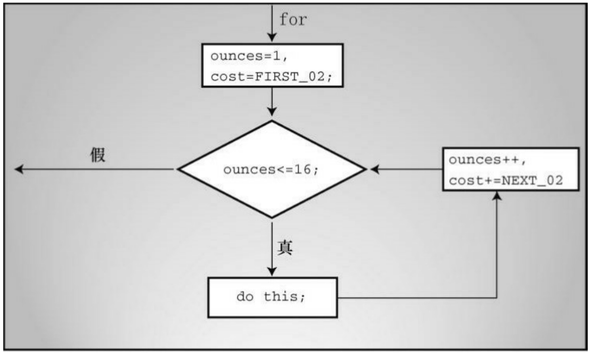
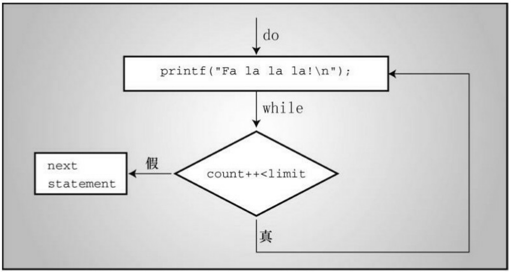
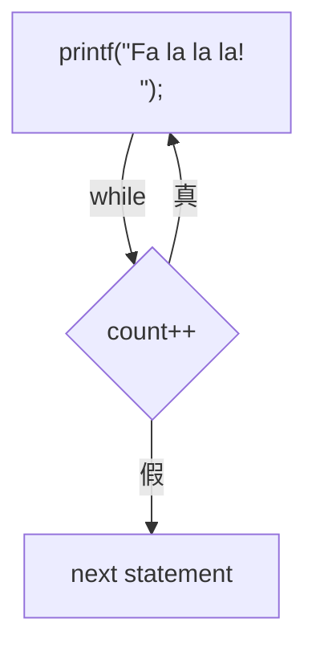
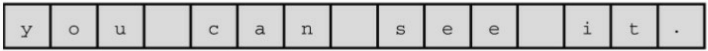
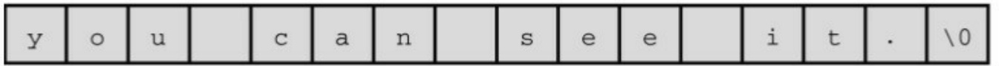
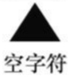
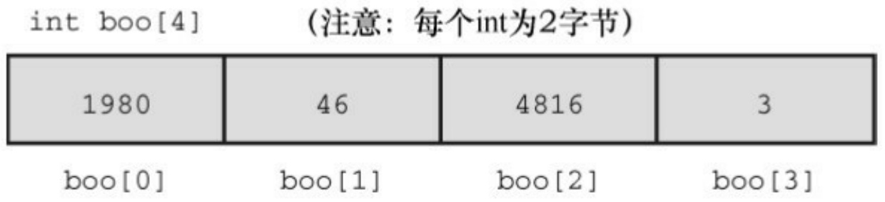
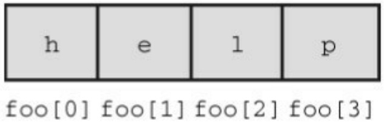

能结束循环的语句即可。

```c
/* for_none.c */

#include <stdio.h>

int main(void)

{

int ans, n;

ans = 2;

for (n = 3; ans <= 25;)

ans = ans * n;

printf("n = %d; ans = %d.\n", n, ans);

return 0;

}
```

该程序的输出如下:

```txt
n = 3; ans = 54.
```

该循环保持n的值为3。变量ans开始的值为2，然后递增到6和18，最终是54（18比25小，所以for循环进入下一次迭代，18乘以3得54）。顺带一提，省略第2个表达式被视为真，所以下面的循环会一直运行:

for (; ; )

printf("I want some action\n");

第1个表达式不一定是给变量赋初值，也可以使用printf()。记住，在执

行循环的其他部分之前，只对第1个表达式求值一次或执行一次。

```c
/* for_show.c */
#include <stdio.h>
int main(void)
{
int num = 0;
for (printf("Keep entering numbers!\n"); num != 6;)
scanf("%d", &num);
printf("That's the one I want!\n");
return 0;
}
```

该程序打印第1行的句子一次，在用户输入6之前不断接受数字:

Keep entering numbers!

That's the one I want!

循环体中的行为可以改变循环头中的表达式。例如，假设创建了下面的

循环:

$$
\text { for } (n = 1; n <   1 0 0 0 0; n = n + \text { delta })
$$

如果程序经过几次迭代后发现delta太小或太大，循环中的if语句（详见第7章）可以改变delta的大小。在交互式程序中，用户可以在循环运行时才改变 delta 的值。这样做也有危险的一面，例如，把delta设置为0就没用了。

总而言之，可以自己决定如何使用for循环头中的表达式，这使得在执行固定次数的循环外，还可以做更多的事情。接下来，我们将简要讨论一些运算符，使for循环更加有用。

小结:**for**语句

关键字:**for**

一般注解:

for语句使用3个表达式控制循环过程，分别用分号隔开。initialize表达式在执行for语句之前只执行一次；然后对test表达式求值，如果表达式为真（或非零），执行循环一次；接着对update表达式求值，并再次检查test表达式。for语句是一种入口条件循环，即在执行循环之前就决定了是否执行循环。因此，for循环可能一次都不执行。statement部分可以是一条简单语句或复合语句。

形式:

for ( initialize; test; update )

statement

在test为假或0之前，重复执行statement部分。

示例:

$( \mathrm { n } = 0 ; \mathrm { n } < 1 0 ; \mathrm { n } ^ { + + } )$

printf(" %d %d\n", n, 2 \* n + 1);

## 6.6 其他赋值运算符:+=、-=、\*=、/=、%=

C有许多赋值运算符。最基本、最常用的是=，它把右侧表达式的值赋给左侧的变量。其他赋值运算符都用于更新变量，其用法都是左侧是一个变量名，右侧是一个表达式。赋给变量的新值是根据右侧表达式的值调整后的值。确切的调整方案取决于具体的运算符。例如:

| scores += 20 | 与 | scores = scores + 20 | 相同 |
| --- | --- | --- | --- |
| dimes -= 2 | 与 | dimes = dimes - 2 | 相同 |
| bunnies *= 2 | 与 | bunnies = bunnies * 2 | 相同 |
| time /= 2.73 | 与 | time = time / 2.73 | 相同 |
| reduce %= 3 | 与 | reduce = reduce % 3 | 相同 |

上述所列的运算符右侧都使用了简单的数，还可以使用更复杂的表达式，例如:

$$
\mathrm{x} ^ {*} = 3 ^ {*} \mathrm{y} + 1 2 \text {与} \mathrm{x} = \mathrm{x} ^ {*} (3 ^ {*} \mathrm{y} + 1 2) \text {相同}
$$

以上提到的赋值运算符与=的优先级相同，即比+或\*优先级低。上面最后一个例子也反映了赋值运算符的优先级，3 \* y先与12相加，再把计算结果与x相乘，最后再把乘积赋给x。

并非一定要使用这些组合形式的赋值运算符。但是，它们让代码更紧凑，而且与一般形式相比，组合形式的赋值运算符生成的机器代码更高效。当需要在for循环中塞进一些复杂的表达式时，这些组合的赋值运算符特别有用。

## 6.7 逗号运算符

逗号运算符扩展了for循环的灵活性，以便在循环头中包含更多的表达式。例如，程序清单6.13演示了一个打印一类邮件资费（first-class postage rate）的程序（在撰写本书时，邮资为首重40美分/盎司，续重20美分/盎司，可以在互联网上查看当前邮资）。

程序清单6.13 postage.c程序

```c
// postage.c -- 一类邮资

#include <stdio.h>

int main(void)

{

const int FIRST_OZ = 46; // 2013邮资

const int NEXT_OZ = 20; // 2013邮资

int ounces, cost;

printf(" ounces cost\n");

for (ounces = 1, cost = FIRST_OZ; ounces <= 16; ounces++,cost += NEXT_OZ)

printf("%5d \$%4.2f\n", ounces, cost / 100.0);

return 0;

}
```

该程序的前5行输出如下:

| ounces | cost |
| --- | --- |
| 1 | $0.46 |
| 2 | $0.66 |
| 3 | $0.86 |
| 4 | $1.06 |

该程序在初始化表达式和更新表达式中使用了逗号运算符。初始化表达式中的逗号使ounces和cost都进行了初始化，更新表达式中的逗号使每次迭代ounces递增1、cost递增20（NEXT\_Z的值是20）。绝大多数计算都在for循环头中进行（见图6.4）。

逗号运算符并不局限于在for循环中使用，但是这是它最常用的地方。逗号运算符有两个其他性质。首先，它保证了被它分隔的表达式从左往右求值（换言之，逗号是一个序列点，所以逗号左侧项的所有副作用都在程序执行逗号右侧项之前发生）。因此，ounces在cost之前被初始化。在该例中，顺序并不重要，但是如果cost的表达式中包含了ounces时，顺序就很重要。例如，假设有下面的表达式:

$$
\text {ounces} + +, \text {cost} = \text {ounces} * \text {FIRST\_OZ}
$$

在该表达式中，先递增ounce，然后在第2个子表达式中使用ounce的新值。作为序列点的逗号保证了左侧子表达式的副作用在对右侧子表达式求值之前发生。



<details>
<summary>flowchart</summary>

```mermaid
graph TD
  A["ounces=1, cost=FIRST_02;"] --> B{"ounces<=16;}}
  B -->|假| C["do this;"]
  B -->|真| D["ounces++, cost+=NEXT_02"]
  D --> B
  C --> D
```
</details>

图6.4 逗号运算符和for循环

其次，整个逗号表达式的值是右侧项的值。例如，下面语句

x = (y = 3, (z = ++y + 2) + 5);的效果是:先把3赋给y，递增y为4，然后把4加2之和（6）赋给z，接着加上5，最后把结果11赋给 x。至于为什么有人编写这样的代码，在此不做评价。另一方面，假设在写数字时不小心输入了逗号:

$$
\text {houseprice} = 2 4 9, 5 0 0;
$$

这不是语法错误，C 编译器会将其解释为一个逗号表达式，即houseprice = 249 是逗号左侧的子表达式，500 是右侧的子表达式。因此，整个逗号表达式的值是逗号右侧表达式的值，而且左侧的赋值表达式把249赋给变量houseprice。因此，这与下面代码的效果相同:

$$
\text {houseprice} = 2 4 9;
$$

500;记住，任何表达式后面加上一个分号就成了表达式语句。所以，500;也是一条语句，但是什么也不做。

另外，下面的语句

$$
\text { houseprice } = (2 4 9, 5 0 0);
$$

赋给houseprice的值是逗号右侧子表达式的值，即500。

逗号也可用作分隔符。在下面语句中的逗号都是分隔符，不是逗号运算符:

char ch, date;

printf("%d %d\n", chimps, chumps);

小结:新的运算符

赋值运算符:

下面的运算符用右侧的值，根据指定的操作更新左侧的变量:

+= 把右侧的值加到左侧的变量上

-= 从左侧的变量中减去右侧的值

\*= 把左侧的变量乘以右侧的值

/= 把左侧的变量除以右侧的值

%= 左侧变量除以右侧值得到的余数

示例:

rabbits \*= 1.6;与rabbits = rabbits \* 1.6;相同

这些组合赋值运算符与普通赋值运算符的优先级相同，都比算术运算符的优先级低。因此，

contents \*= old\_rate + 1.2;

最终的效果与下面的语句相同:

$$
\text {contents} = \text {contents} * (\text {old\_rate} + 1. 2);
$$

逗号运算符:

逗号运算符把两个表达式连接成一个表达式，并保证最左边的表达式最先求值。逗号运算符通常在for循环头的表达式中用于包含更多的信息。整个逗号表达式的值是逗号右侧表达式的值。

示例:

$$
\text { for } (\text { step } = 2, \text { fargo } = 0; \text { fargo } <   1 0 0 0; \text { step } * = 2)
$$

$$
\text {fargo} \quad + = \quad \text {step};
$$

## 6.7.1 当Zeno遇到for循环

接下来，我们看看 for 循环和逗号运算符如何解决古老的悖论。希腊哲学家 Zeno 曾经提出箭永远不会达到它的目标。首先，他认为箭要到达目标距离的一半，然后再达到剩余距离的一半，然后继续到达剩余距离的一半，这样就无穷无尽。Zeno认为箭的飞行过程有无数个部分，所以要花费无数时间才能结束这一过程。不过，我们怀疑Zeno是自愿甘做靶子才会得出这样的结论。

我们采用一种定量的方法，假设箭用1秒钟走完一半的路程，然后用1/2秒走完剩余距离的一半，然后用1/4秒再走完剩余距离的一半，等等。可以用下面的无限序列来表示总时间:

$$
1 + 1 / 2 + 1 / 4 + 1 / 8 + 1 / 1 6 + \dots
$$

程序清单6.14中的程序求出了序列前几项的和。变量power\_of\_two的值分别是1.0、2.0、4.0、8.0等。

程序清单**6.14 zeno.c**程序

/\* zeno.c -- 求序列的和 \*/

#include &lt;stdio.h&gt;

int main(void) {

int t\_ct; // 项计数

double time, power\_of\_2;

int limit;

printf("Enter the number of terms you want: ");

scanf("%d", &limit);

for (time = 0, power\_of\_2 = 1, t\_ct = 1; t\_ct <= limit;

t\_ct++, power\_of\_2 \*= 2.0)

{

time += 1.0 / power\_of\_2;

printf("time = %f when terms = %d.\n", time, t\_ct);

}

return 0;

}

下面是序列前15项的和:

Enter the number of terms you want: 15

不难看出，尽管不断添加新的项，但是总和看起来变化不大。就像程序输出显示的那样，数学家的确证明了当项的数目接近无穷时，总和无限接近2.0。假设S表示总和，下面我们用数学的方法来证明一下:

$$
\mathrm{S} = 1 + 1 / 2 + 1 / 4 + 1 / 8 + \dots
$$

这里的省略号表示“等等”。把S除以2得:

$$
\mathrm{S} / 2 = 1 / 2 + 1 / 4 + 1 / 8 + 1 / 1 6 + \dots
$$

第1个式子减去第2个式子得:

$$
\mathrm{S} - \mathrm{S} / 2 = 1 + 1 / 2 - 1 / 2 + 1 / 4 - 1 / 4 + \dots
$$

除了第1个值为1，其他的值都是一正一负地成对出现，所以这些项都可以消去。只留下:

$$
\mathrm{S} / 2 = 1
$$

然后，两侧同乘以2，得:

$$
\mathrm{S} = 2
$$

从这个示例中得到的启示是，在进行复杂的计算之前，先看看数学上是否有简单的方法可用。

程序本身是否有需要注意的地方？该程序演示了在表达式中可以使用多个逗号运算符，在for循环中，初始化了time、power\_of\_2和count。构建完循环条件之后，程序本身就很简短了。

## 6.8 出口条件循环:do while

while循环和for循环都是入口条件循环，即在循环的每次迭代之前检查测试条件，所以有可能根本不执行循环体中的内容。C语言还有出口条件循环（exit-condition loop），即在循环的每次迭代之后检查测试条件，这保证了至少执行循环体中的内容一次。这种循环被称为 do while循环。程序清单6.15 演示了一个示例。

程序清单6.15 do\_while.c程序

```c
/* do_while.c -- 出口条件循环 */

#include <stdio.h>

int main(void)

{

const int secret_code = 13;

int code_entered;

do

{

printf("To enter the triskaidekaphobia therapy club,\n");
printf("please enter the secret code number: ");
scanf("%d", &code_entered);

} while (code_entered != secret_code);

printf("Congratulations! You are cured!\n");
```

```scss
return 0;
}
```

程序清单6.15在用户输入13之前不断提示用户输入数字。下面是一个运行示例:

```txt
To enter the triskaidekaphobia therapy club,
please enter the secret code number: 12
To enter the triskaidekaphobia therapy club,
please enter the secret code number: 14
To enter the triskaidekaphobia therapy club,
please enter the secret code number: 13
Congratulations! You are cured!
```

使用while循环也能写出等价的程序，但是长一些，如程序清单6.16所示。

程序清单**6.16 entry.c**程序

/\* entry.c -- 出口条件循环 \*/

```c
#include <stdio.h>

int main(void)

{

const int secret_code = 13;

int code_entered;
```

```c
printf("To enter the triskaidekaphobia therapy club,\n");
printf("please enter the secret code number: ");
scanf("%d", &code_entered);
while (code_entered != secret_code)
{
printf("To enter the triskaidekaphobia therapy club,\n");
printf("please enter the secret code number: ");
scanf("%d", &code_entered);
}
printf("Congratulations! You are cured!\n");
return 0;
}
```

下面是do while循环的通用形式:

```txt
do

statement

while ( expression );
```

statement可以是一条简单语句或复合语句。注意，do while循环以分号结尾，其结构见图6.5。

do while循环在执行完循环体后才执行测试条件，所以至少执行循环体一次；而for循环或while循环都是在执行循环体之前先执行测试条件。do

while循环适用于那些至少要迭代一次的循环。例如，下面是一个包含do while循环的密码程序伪代码:



<details>
<summary>flowchart</summary>


</details>

图6.5 do while循环的结构

do

{

提示用户输入密码

读取用户输入的密码

} while (用户输入的密码不等于密码);

避免使用这种形式的do while结构:

do

{

询问用户是否继续

其他行为

} while (回答是yes);

这样的结构导致用户在回答“no”之后，仍然执行“其他行为”部分，因为测试条件执行晚了。

小结:**do while**语句

关键字:**do while**

一般注解:

do while 语句创建一个循环，在 expression 为假或 0 之前重复执行循环体中的内容。do while语句是一种出口条件循环，即在执行完循环体后才根据测试条件决定是否再次执行循环。因此，该循环至少必须执行一次。

statement部分可是一条简单语句或复合语句。

形式:

do

statement

while ( expression );

在test为假或0之前，重复执行statement部分。

示例:

do

scanf("%d", &number);

while (number != 20);

## 6.9 如何选择循环

如何选择使用哪一种循环？首先，确定是需要入口条件循环还是出口条件循环。通常，入口条件循环用得比较多，有几个原因。其一，一般原则是在执行循环之前测试条件比较好。其二，测试放在循环的开头，程序的可读性更高。另外，在许多应用中，要求在一开始不满足测试条件时就直接跳过整个循环。

那么，假设需要一个入口条件循环，用for循环还是while循环？这取决于个人喜好，因为二者皆可。要让for循环看起来像while循环，可以省略第1个和第3个表达式。例如:

for ( ; test ; )

与下面的while效果相同:

while ( test )

要让while循环看起来像for循环，可以在while循环的前面初始化变量，并在while循环体中包含更新语句。例如:

初始化;

while ( 测试 )

{

其他语句

更新语句

}

与下面的for循环效果相同:

for ( 初始化 ;测试 ; 更新 )

其他语句

一般而言，当循环涉及初始化和更新变量时，用for循环比较合适，而在其他情况下用while循环更好。对于下面这种条件，用while循环就很合适:

$$
\text {while} (\operatorname{scanf} \left(\% \text {ld} ^ {\prime \prime}, \& \text {num}\right) = = 1)
$$

对于涉及索引计数的循环，用for循环更适合。例如:

$$
\text { for } (\text { count } = 1; \text { count } <   = 1 0 0; \text { count } + +)
$$

## 6.10 嵌套循环

嵌套循环（nested loop）指在一个循环内包含另一个循环。嵌套循环常用于按行和列显示数据，也就是说，一个循环处理一行中的所有列，另一个循环处理所有的行。程序清单6.17演示了一个简单的示例。

程序清单6.17 rows1.c程序

```c
/* rows1.c -- 使用嵌套循环 */
#include <stdio.h>
#define ROWS 6
#define CHARS 10
int main(void)
{
int row;
char ch;
for (row = 0; row < ROWS; row++)          /* 第10行 */
{
for (ch = 'A'; ch < ('A' + CHARS); ch++)     /* 第12行 */
printf("%c", ch);
printf("\n");
}
```

```scss
return 0;
}
```

运行该程序后，输出如下:

```csv
ABCDEFGHIJKLMNOPQRSTUVWXYZ
ABCDEFGHIJKLMNOPQRSTUVWXYZ
ABCDEFGHIJKLMNOPQRSTUVWXYZ
ABCDEFGHIJKLMNOPQRSTUVWXYZ
ABCDEFGHIJKLMNOPQRSTUVWXYZ
```

## 6.10.1 程序分析

第10行开始的for循环被称为外层循环（outer loop），第12行开始的for循环被称为内层循环（inner loop）。外层循环从row为0开始循环，到row为6时结束。因此，外层循环要执行6次，row的值从0变为5。每次迭代要执行的第1条语句是内层的for循环，该循环要执行10次，在同一行打印字符A～ J；第2条语句是外层循环的printf("\n");，该语句的效果是另起一行，这样在下一次运行内层循环时，将在下一行打印的字符。

注意，嵌套循环中的内层循环在每次外层循环迭代时都执行完所有的循环。在程序清单6.17中，内层循环一行打印10个字符，外层循环创建6行。

## 6.10.2 嵌套变式

上一个实例中，内层循环和外层循环所做的事情相同。可以通过外层循环控制内层循环，在每次外层循环迭代时内层循环完成不同的任务。把程序清单6.17稍微修改后，如程序清单6.18所示。内层循环开始打印的字符取决

于外层循环的迭代次数。该程序的第 1 行使用了新的注释风格，而且用const 关键字代替#define，有助于读者熟悉这两种方法。

程序清单6.18 rows2.c程序

```c
// rows2.c -- 依赖外部循环的嵌套循环
#include <stdio.h>

int main(void)
{
const int ROWS = 6;
const int CHARS = 6;
int row;
char ch;
for (row = 0; row < ROWS; row++)
{
for (ch = ('A' + row); ch < ('A' + CHARS); ch++)
printf("%c", ch);
printf("\n");
}
return 0;
}
```

该程序的输出如下:

ABCDEF

BCDEF

CDEF

DEF

EF

F

因为每次迭代都要把row的值与‘A’相加，所以ch在每一行都被初始化为不同的字符。然而，测试条件并没有改变，所以每行依然是以F结尾，这使得每一行打印的字符都比上一行少一个。

## 6.11 数组简介

在许多程序中，数组很重要。数组可以作为一种储存多个相关项的便利方式。我们在第10章中将详细介绍数组，但是由于循环经常用到数组，所以在这里先简要地介绍一下。

数组（array）是按顺序储存的一系列类型相同的值，如10个char类型的字符或15个int类型的值。整个数组有一个数组名，通过整数下标访问数组中单独的项或元素（element）。例如，以下声明:

float debts[20];

声明debts是一个内含20个元素的数组，每个元素都可以储存float类型的值。数组的第1个元素是debts[0]，第2个元素是debts[1]，以此类推，直到debts[19]。注意，数组元素的编号从0开始，不是从1开始。可以给每个元素赋float类型的值。例如，可以这样写:

$$
\text {debts} [ 5 ] = 3 2. 5 4;
$$

$$
\text {debts} [ 6 ] = 1. 2 \mathrm{e} + 2 1;
$$

实际上，使用数组元素和使用同类型的变量一样。例如，可以这样把值读入指定的元素中:

scanf("%f", &debts[4]); // 把一个值读入数组的第5个元素

这里要注意一个潜在的陷阱:考虑到影响执行的速度，C 编译器不会检查数组的下标是否正确。下面的代码，都不正确:

debts[20] = 88.32; // 该数组元素不存在

debts[33] = 828.12; // 该数组元素不存在

编译器不会查找这样的错误。当运行程序时，这会导致数据被放置在已

被其他数据占用的地方，可能会破坏程序的结果甚至导致程序异常中断。

数组的类型可以是任意数据类型。

int nannies[22]; /\* 可储存22个int类型整数的数组 \*/

char actors[26]; /\* 可储存26个字符的数组 \*/

long big[500]; /\* 可储存500个long类型整数的数组 \*/

我们在第4章中讨论过字符串，可以把字符串储存在char类型的数组中（一般而言，char类型数组的所有元素都储存char类型的值）。如果char类型的数组末尾包含一个表示字符串末尾的空字符\0，则该数组中的内容就构成了一个字符串（见图6.6）。

字符数组，不是字符串



<details>
<summary>text_image</summary>

y o u c a n s e e i t .
</details>

既是字符数组，也是字符串



<details>
<summary>text_image</summary>

y o u c a n s e e i t . \0
</details>



图6.6 字符数组和字符串

用于识别数组元素的数字被称为下标（subscript）、索引（indice）或偏移量（offset）。下标必须是整数，而且要从0开始计数。数组的元素被依次储存在内存中相邻的位置，如图6.7所示。



<details>
<summary>text_image</summary>

int boo[4] (注意: 每个int为2字节)
1980 46 4816 3
boo[0] boo[1] boo[2] boo[3]
</details>

charfoo[4](注意:每个char为1字节)



<details>
<summary>text_image</summary>

h
e
l
p
foo[0] foo[1] foo[2] foo[3]
</details>

图6.7 内存中的char和int类型的数组

## 6.11.1 在for循环中使用数组

程序中有许多地方要用到数组，程序清单6.19是一个较为简单的例子。该程序读取10个高尔夫分数，稍后进行处理。使用数组，就不用创建10个不同的变量来储存10个高尔夫分数。而且，还可以用for循环来读取数据。程序打印总分、平均分、差点（handicap，它是平均分与标准分的差值）。

程序清单**6.19 scores\_in.c**程序

// scores\_in.c -- 使用循环处理数组

#include &lt;stdio.h&gt;

#define SIZE 10

#define PAR 72

int main(void)

{

int index, score[SIZE];

```c
int sum = 0;
float average;
printf("Enter %d golf scores:\n", SIZE);
for (index = 0; index < SIZE; index++)
scanf("%d", &score[index]); // 读取10个分数
printf("The scores read in are as follows:\n");
for (index = 0; index < SIZE; index++)
printf("%5d", score[index]); // 验证输入
printf("\n");
for (index = 0; index < SIZE; index++)
sum += score[index]; // 求总分数
average = (float) sum / SIZE; // 求平均分
printf("Sum of scores = %d, average = %.2f\n", sum, average);
printf("That's a handicap of %.0f\n", average - PAR);
return 0;
}
```

先看看程序清单6.19是否能正常工作，接下来再做一些解释。下面是程序的输出:

Enter 10 golf scores:

```txt
99 95 109 105 100   
96 98 93 99 97 98
```

```txt
The scores read in are as follows:
99 95 109 105 100 96 98 93 99 97
Sum of scores = 991, average = 99.10
```

程序运行没问题，我们来仔细分析一下。首先，注意程序示例虽然打印了11个数字，但是只读入了10个数字，因为循环只读了10个值。由于scanf()会跳过空白字符，所以可以在一行输入10个数字，也可以每行只输入一个数字，或者像本例这样混合使用空格和换行符隔开每个数字（因为输入是缓冲的，只有当用户键入Enter键后数字才会被发送给程序）。

然后，程序使用数组和循环处理数据，这比使用10个单独的scanf()语句和10个单独的printf()语句读取10个分数方便得多。for循环提供了一个简单直接的方法来使用数组下标。注意，int类型数组元素的用法与int类型变量的用法类似。要读取int类型变量fue，应这样写清单6.19中要读取int类型的元素 ，所以这样写

该程序示例演示了一些较好的编程风格。第一，用#define 指令创建的明示常量（SIZE）来指定数组的大小。这样就可以在定义数组和设置循环边界时使用该明示常量。如果以后要扩展程序处理20个分数，只需简单地把SIZE重新定义为20即可，不用逐一修改程序中使用了数组大小的每一处。

第二，下面的代码可以很方便地处理一个大小为SIZE的数组:

```txt
for (index = 0; index < SIZE; index++)
```

设置正确的数组边界很重要。第1个元素的下标是0，因此循环开始时把index设置为0。因为从0开始编号，所以数组中最后一个元素的下标是SIZE - 1。也就是说，第10个元素是score[9]。通过测试条件index < SIZE来控制循环中使用的最后一个index的值是SIZE - 1。

第三，程序能重复显示刚读入的数据。这是很好的编程习惯，有助于确保程序处理的数据与期望相符。

最后，注意该程序使用了3个独立的for循环。这是否必要？是否可以将其合并成一个循环？当然可以，读者可以动手试试，合并后的程序显得更加紧凑。但是，调整时要注意遵循模块化（modularity）的原则。模块化隐含的思想是:应该把程序划分为一些独立的单元，每个单元执行一个任务。这样做提高了程序的可读性。也许更重要的是，模块化使程序的不同部分彼此独立，方便后续更新或修改程序。在掌握如何使用函数后，可以把每个执行任务的单元放进函数中，提高程序的模块化。

## 6.12 使用函数返回值的循环示例

本章最后一个程序示例要用一个函数计算数的整数次幂（math.h库提供了一个更强大幂函数pow()，可以使用浮点指数）。该示例有3个主要任务:设计算法、在函数中表示算法并返回计算结果、提供一个测试函数的便利方法。

首先分析算法。为简化函数，我们规定该函数只处理正整数的幂。这样，把n与n相乘p次便可计算n的p次幂。这里自然会用到循环。先把变量pow设置为1，然后将其反复乘以n:

$$
\text {for} (\mathrm{i} = 1; \mathrm{i} <   = \mathrm{p}; \mathrm{i} + +)
$$

$$
\mathrm{pow} ^ {*} = \mathrm{n};
$$

回忆一下，\*=运算符把左侧的项乘以右侧的项，再把乘积赋给左侧的项。第1次循环后，pow的值是1乘以n，即n；第2次循环后，pow的值是上一次的值（n）乘以n，即n的平方；以此类推。这种情况使用for循环很合适，因为在执行循环之前已预先知道了迭代的次数（已知p）。

现在算法已确定，接下来要决定使用何种数据类型。指数p是整数，其类型应该是int。为了扩大n及其幂的范围，n和pow的类型都是double。

接下来，考虑如何把以上内容用函数来实现。要使用两个参数（分别是double类型和int类型）才能把所需的信息传递给函数，并指定求哪个数的多少次幂。而且，函数要返回一个值。如何把函数的返回值返回给主调函数？编写一个有返回值的函数，要完成以下内容:

1.定义函数时，确定函数的返回类型；
2.使用关键字return表明待返回的值。

例如，可以这样写:

double power(double n, int p) // 返回一个double类型的值

```lisp
{
double pow = 1;
int i;
for (i = 1; i <= p; i++)
pow *= n;
return pow; // 返回pow的值
}
```

要声明函数的返回类型，在函数名前写出类型即可，就像声明一个变量那样。关键字 return 表明该函数将把它后面的值返回给主调函数。根据上面的代码，函数返回一个变量的值。返回值也可以是表达式的值，如下所示:

```javascript
return 2 * x + b;
```

函数将计算表达式的值，并返回该值。在主调函数中，可以把返回值赋给另一个变量、作为表达式中的值、作为另一个函数的参数（如，

printf("%f"，power(6.28,3))，或者忽略它。

现在，我们在一个程序中使用这个函数。要测试一个函数很简单，只需给它提供几个值，看它是如何响应的。这种情况下可以创建一个输入循环，选择 while 循环很合适。可以使用 scanf()函数一次读取两个值。如果成功读取两个值，scanf()则返回2，所以可以把scanf()的返回值与2作比较来控制循环。还要注意，必须先声明power()函数（即写出函数原型）才能在程序中使用它，就像先声明变量再使用一样。程序清单6.20演示了这个程序。

程序清单**6.20 powwer.c**程序