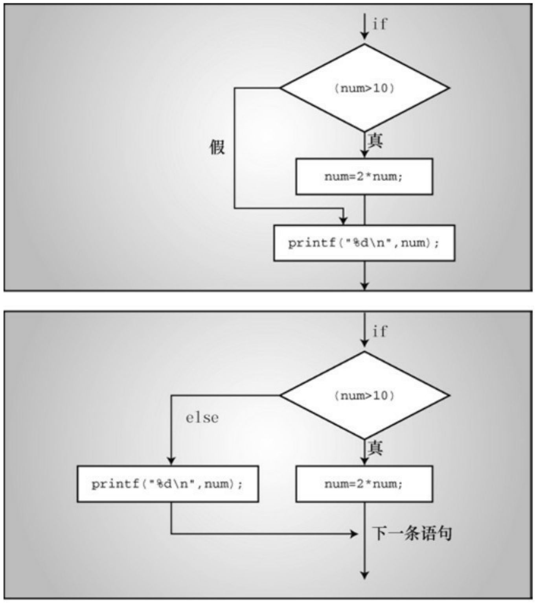

// power.c -- 计算数的整数幂

```c
#include <stdio.h>

double power(double n, int p); // ANSI函数原型

int main(void)
{
double x, xpow;
int exp;
printf("Enter a number and the positive integer power");
printf(" to which\nthe number will be raised. Enter q");
printf(" to quit.\n");
while (scanf("%lf%d", &x, &exp) == 2)
{
xpow = power(x, exp); // 函数调用
printf("%.3g to the power %d is %.5g\n", x, exp, xpow);
printf("Enter next pair of numbers or q to quit.\n");
}
printf("Hope you enjoyed this power trip -- bye!\n");
return 0;
}
```

double power(double n, int p) // 函数定义

{

double pow = 1;

int i;

for (i = 1; i <= p; i++)

pow \*= n;

return pow; // 返回pow的值

}

运行该程序后，输出示例如下:

Enter a number and the positive integer power to which

the number will be raised. Enter q to quit.

**1.2 12**

1.2 to the power 12 is 8.9161

Enter next pair of numbers or q to quit.

2

**16**

2 to the power 16 is 65536

Enter next pair of numbers or q to quit.

q

Hope you enjoyed this power trip -- bye!

## 6.12.1 程序分析

该程序示例中的main()是一个驱动程序（driver），即被设计用来测试函数的小程序。

该例的while循环是前面讨论过的一般形式。输入1.2 12，scanf()成功读取两值，并返回2，循环继续。因为scanf()跳过空白，所以可以像输出示例那样，分多行输入。但是输入q会使scanf()的返回值为0，因为q与scanf()中的转换说明%1f不匹配。scanf()将返回0，循环结束。类似地，输入2.8 q会使scanf()的返回值为1，循环也会结束。

现在分析一下与函数相关的内容。powwer()函数在程序中出现了3次。首次出现是:

double power(double n, int p); // ANSI函数原型

这是power()函数的原型，它声明程序将使用一个名为power()的函数。开头的关键字double表明power()函数返回一个double类型的值。编译器要知道power()函数返回值的类型，才能知道有多少字节的数据，以及如何解释它们。这就是为什么必须声明函数的原因。圆括号中的 double n, int p表示power()函数的两个参数。第1个参数应该是double类型的值，第2个参数应该是int类型的值。

第2次出现是:

程序调用power()，把两个值传递给它。该函数计算x的exp次幂，并把计算结果返回给主调函数。在主调函数中，返回值将被赋给变量xpow。

第3次出现是:

double power(double n, int p) // 函数定义

这里，power()有两个形参，一个是double类型，一个是int类型，分别由变量n和变量p表示。注意，函数定义的末尾没有分号，而函数原型的末尾有分号。在函数头后面花括号中的内容，就是power()完成任务的代码。

power()函数用for循环计算n的p次幂，并把计算结果赋给pow，然后返回pow的值，如下所示:

return pow; //返回pow的值

## 6.12.2 使用带返回值的函数

声明函数、调用函数、定义函数、使用关键字return，都是定义和使用带返回值函数的基本要素。

这里，读者可能有一些问题。例如，既然在使用函数返回值之前要声明函数，那么为什么在使用scanf()的返回值之前没有声明scanf()？为什么在定义中说明了power()的返回类型为double，还要单独声明这个函数？

我们先回答第2 个问题。编译器在程序中首次遇到power()时，需要知道power()的返回类型。此时，编译器尚未执行到power()的定义，并不知道函数定义中的返回类型是double。因此，必须通过前置声明（forward declaration）预先说明函数的返回类型。前置声明告诉编译器，power()定义在别处，其返回类型为double。如果把power()函数的定义置于main()的文件顶部，就可以省略前置声明，因为编译器在执行到main()之前已经知道power()的所有信息。但是，这不是C的标准风格。因为main()通常只提供整个程序的框架，最好把 main()放在所有函数定义的前面。另外，通常把函数放在其他文件中，所以前置声明必不可少。

接下来，为什么不用声明 scanf()函数就可以使用它？其实，你已经声明了。stdio.h 头文件中包含了scanf()、printf()和其他I/O函数的原型。scanf()函数的原型表明，它返回的类型是int。

## 6.13 关键概念

循环是一个强大的编程工具。在创建循环时，要特别注意以下3个方面:

注意循环的测试条件要能使循环结束；

确保循环测试中的值在首次使用之前已初始化；

确保循环在每次迭代都更新测试的值。

C通过求值来处理测试条件，结果为0表示假，非0表示真。带关系运算符的表达式常用于循环测试，它们有些特殊。如果关系表达式为真，其值为1；如果为假，其值为0。这与新类型\_Bool的值保持一致。

数组由相邻的内存位置组成，只储存相同类型的数据。记住，数组元素的编号从 0 开始，所有数组最后一个元素的下标一定比元素数目少1。C编译器不会检查数组下标值是否有效，自己要多留心。

使用函数涉及3个步骤:

通过函数原型声明函数；

在程序中通过函数调用使用函数；

定义函数。

函数原型是为了方便编译器查看程序中使用的函数是否正确，函数定义描述了函数如何工作。现代的编程习惯是把程序要素分为接口部分和实现部分，例如函数原型和函数定义。接口部分描述了如何使用一个特性，也就是函数原型所做的；实现部分描述了具体的行为，这正是函数定义所做的。

## 6.14 本章小结

本章的主题是程序控制。C语言为实现结构化的程序提供了许多工具。while语句和for语句提供了入口条件循环。for语句特别适用于需要初始化和更新的循环。使用逗号运算符可以在for循环中初始化和更新多个变量。有些场合也需要使用出口条件循环，C为此提供了do while语句。

典型的while循环设计的伪代码如下:

获得初值

while (值满足测试条件)

{

处理该值

获取下一个值

}

for循环也可以完成相同的任务:

for (获得初值; 值满足测试条件; 获得下一个值)

处理该值

这些循环都使用测试条件来判断是否继续执行下一次迭代。一般而言，如果对测试表达式求值为非0，则继续执行循环；否则，结束循环。通常，测试条件都是关系表达式（由关系运算符和表达式构成）。表达式的关系为真，则表达式的值为1；如果关系为假，则表达式的值为0。C99新增了\_Bool类型，该类型的变量只能储存1或0，分别表示真或假。

除了关系运算符，本章还介绍了其他的组合赋值运算符，如+=或\*=。这些运算符通过对其左侧运算对象执行算术运算来修改它的值。

接下来还简单地介绍了数组。声明数组时，方括号中的值指明了该数组的元素个数。数组的第 1 个元素编号为0，第2个元素编号为1，以此类推。例如，以下声明:

double hippos[20];

创建了一个有20个元素的数组hippos，其元素从hippos[0]～hippos[19]。利用循环可以很方便地操控数组的下标。

最后，本章演示了如何编写和使用带返回值的函数。

## 6.15 复习题

复习题的参考答案在附录A中。

1.写出执行完下列各行后quack的值是多少。后5行中使用的是第1行quack的值。

int quack = 2;

quack += 5;

quack \*= 10;

quack -= 6;

quack /= 8;

quack %= 3;

2.假设value是int类型，下面循环的输出是什么？

for ( value = 36; value > 0; value /= 2)

printf("%3d", value);

如果value是double类型，会出现什么问题？

3.用代码表示以下测试条件:

a.大于5

b. 读取一个名为的 类型值且失败

c.X的值等于

4.用代码表示以下测试条件:

a. 成功读入一个整数

b. 不等于

c. 大于或等于

5.下面的程序有点问题，请找出问题所在。

```c
#include <stdio.h>

int main(void)
{
/* 第3行 */
```

int i, j, list(10); /\* 第4行 \*/

for (i = 1, i <= 10, i++) /\* 第6行 \*/

{ /\* 第7行 \*/

list[i] = 2\*i + 3; /\* 第8行 \*/

for (j = 1, j > = i, j++) /\* 第9行 \*/

printf(" %d", list[j]); /\* 第10行 \*/

printf("\n"); /\* 第11行 \*/

} /\* 第12行 \*/

6.编写一个程序打印下面的图案，要求使用嵌套循环:

\$\$\$\$\$\$\$\$

\$\$\$\$\$\$\$\$

\$\$\$\$\$\$\$\$

```txt
$$$$$$$$
```

7.下面的程序各打印什么内容？

```c
a.
#include <stdio.h>
int main(void)
{
int i = 0;
while (++i < 4)
printf("Hi! ");
do
printf("Bye! ");
while (i++ < 8);
return 0;
}
b.
#include <stdio.h>
int main(void)
{
int i;
```

```c
char   ch;

for (i = 0, ch = 'A'; i < 4; i++, ch += 2 * i)

printf("%c",   ch);

return   0;

}
```

8.假设用户输入的是 ， 下面各程序的输出是什么？（在ASCII码中，!紧跟在空格字符后面）

```c
a.

#include <stdio.h>

int main(void)

{

char ch;

scanf("%c", &ch);

while (ch != 'g')

{

printf("%c", ch);

scanf("%c", &ch);

}

return 0;
```

```c
}
b.
#include <stdio.h>
int main(void)
{
char ch;
scanf("%c", &ch);
while (ch != 'g')
{
printf("%c", ++ch);
scanf("%c", &ch);
}
return 0;
}
c.
#include <stdio.h>
int main(void)
{
char ch;
```

```txt
do {
scanf("%c", &ch);
printf("%c", ch);
} while (ch != 'g');
return 0;
}
d.
#include <stdio.h>
int main(void)
{
char ch;
scanf("%c", &ch);
for (ch = '$'; ch != 'g'; scanf("%c", &ch))
printf("%c", ch);
return 0;
}
```

9.下面的程序打印什么内容？

```c
#include <stdio.h>

int main(void)
```

```c
{
int n, m;
n = 30;
while (++n <= 33)
printf("%d|", n);
n = 30;
do
printf("%d|", n);
while (++n <= 33);
printf("\n***\n");
for (n = 1; n*n < 200; n += 4)
printf("%d\n", n);
printf("\n***\n");
for (n = 2, m = 6; n < m; n *= 2, m += 2)
printf("%d %d\n", n, m);
printf("\n***\n");
for (n = 5; n > 0; n--)
{
for (m = 0; m <= n; m++)
```

```c
printf("=");

printf("\n");
}
return 0;
}
```

10.考虑下面的声明:

```txt
double mint[10];
```

a.数组名是什么？
b.该数组有多少个元素？
c.每个元素可以储存什么类型的值？
d.下面的哪一个scanf()的用法正确？

```javascript
i.scanf("%lf", mint[2])
```

```javascript
ii.scanf("%lf", &mint[2])
```

```txt
iii.scanf("%lf", &mint)
```

11.Noah先生喜欢以2计数，所以编写了下面的程序，创建了一个储存2、4、6、8等数字的数组。

这个程序是否有错误之处？如果有，请指出。

```c
#include <stdio.h>
```

```c
#define SIZE 8
```

```c
int main(void)
{
int by_twos[SIZE];
int index;
for (index = 1; index <= SIZE; index++)
by_twos[index] = 2 * index;
for (index = 1; index <= SIZE; index++)
printf("%d ", by_twos);
printf("\n");
return 0;
}
```

12.假设要编写一个返回long类型值的函数，函数定义中应包含什么？
13.定义一个函数，接受一个int类型的参数，并以long类型返回参数的平方值。
14.下面的程序打印什么内容？

```c
#include <stdio.h>

int main(void)

{

int k;
```

for (k = 1, printf("%d: Hi!\n", k); printf("k = %d\n", k),

k\*k < 26; k += 2, printf("Now k is %d\n", k))

printf("k is %d in the loop\n", k);

return 0;

}

## 6.16 编程练习

1.编写一个程序，创建一个包含26个元素的数组，并在其中储存26个小写字母。然后打印数组的所有内容。

2.使用嵌套循环，按下面的格式打印字符:

```txt
\$
\$
\$\$
\$\$\$
\$\$\$\$
\$\$\$\$
```

3.使用嵌套循环，按下面的格式打印字母:

```txt
F
FE
FED
FEDC
FEDC
FEDC
```

注意:如果你的系统不使用ASCII或其他以数字顺序编码的代码，可以把字符数组初始化为字母表中的字母:

```javascript
char lets[27] = "ABCDEFGHIJKLMNOPQRSTUVWXYZ";
```

然后用数组下标选择单独的字母，例如lets[0]是‘A’，等等。

4.使用嵌套循环，按下面的格式打印字母:

A

BC

DEF

GHIJ

KLMNO

PQRSTU

如果你的系统不使用以数字顺序编码的代码，请参照练习3的方案解决。

5.编写一个程序，提示用户输入大写字母。使用嵌套循环以下面金字塔型的格式打印字母:

A

ABA

ABCBA

ABCDCBA

ABCDEDCBA

打印这样的图形，要根据用户输入的字母来决定。例如，上面的图形是在用户输入E后的打印结果。

提示:用外层循环处理行，每行使用3个内层循环，分别处理空格、以升序打印字母、以降序打印字母。如果系统不使用ASCII或其他以数字顺序编码的代码，请参照练习3的解决方案。

6.编写一个程序打印一个表格，每一行打印一个整数、该数的平方、该数的立方。要求用户输入表格的上下限。使用一个for循环。
7.编写一个程序把一个单词读入一个字符数组中，然后倒序打印这个单词。提示:strlen()函数（第4章介绍过）可用于计算数组最后一个字符的下标。
8.编写一个程序，要求用户输入两个浮点数，并打印两数之差除以两数乘积的结果。在用户输入非数字之前，程序应循环处理用户输入的每对值。
9.修改练习8，使用一个函数返回计算的结果。
10.编写一个程序，要求用户输入一个上限整数和一个下限整数，计算从上限到下限范围内所有整数的平方和，并显示计算结果。然后程序继续提示用户输入上限和下限整数，并显示结果，直到用户输入的上限整数小于下限整数为止。程序的运行示例如下:

Enter lower and upper integer limits: 5 9

The sums of the squares from 25 to 81 is 255

Enter next set of limits: 3 25

The sums of the squares from 9 to 625 is 5520

Enter next set of limits: 5 5

Done

11.编写一个程序，在数组中读入8个整数，然后按倒序打印这8个整数。

12.考虑下面两个无限序列:

$$
\begin{array}{l} 1. 0 \quad + \quad 1. 0 / 2. 0 \quad + \quad 1. 0 / 3. 0 \quad + \quad 1. 0 / 4. 0 \quad + \dots \\ 1. 0 \quad - \quad 1. 0 / 2. 0 \quad + \quad 1. 0 / 3. 0 \quad - \quad 1. 0 / 4. 0 \quad + \dots \\ \end{array}
$$

编写一个程序计算这两个无限序列的总和，直到到达某次数。提示:奇数个-1 相乘得-1，偶数个-1相乘得1。让用户交互地输入指定的次数，当用户输入0或负值时结束输入。查看运行100项、1000项、10000项后的总和，是否发现每个序列都收敛于某值？

13.编写一个程序，创建一个包含8个元素的int类型数组，分别把数组元素设置为2的前8次幂。使用for循环设置数组元素的值，使用do while循环显示数组元素的值。
14.编写一个程序，创建两个包含8个元素的double类型数组，使用循环提示用户为第一个数组输入8 个值。第二个数组元素的值设置为第一个数组对应元素的累积之和。例如，第二个数组的第 4个元素的值是第一个数组前4个元素之和，第二个数组的第5个元素的值是第一个数组前5个元素之和（用嵌套循环可以完成，但是利用第二个数组的第5个元素是第二个数组的第4个元素与第一个数组的第5个元素之和，只用一个循环就能完成任务，不需要使用嵌套循环）。最后，使用循环显示两个数组的内容，第一个数组显示成一行，第二个数组显示在第一个数组的下一行，而且每个元素都与第一个数组各元素相对应。
15.编写一个程序，读取一行输入，然后把输入的内容倒序打印出来。可以把输入储存在char类型的数组中，假设每行字符不超过255。回忆一下，根据%c转换说明，scanf()函数一次只能从输入中读取一个字符，而且在用户按下Enter键时scanf()函数会生成一个换行字符（\n）。
16.Daphne以10%的单利息投资了100美元（也就是说，每年投资获利相当于原始投资的10%）。Deirdre以 5%的复合利息投资了 100 美元（也就是说，利息是当前余额的 5%，包含之前的利息）。编写一个程序，计算需要多少年Deirdre的投资额才会超过Daphne，并显示那时两人的投资额。

17.Chuckie Lucky赢得了100万美元（税后），他把奖金存入年利率8%的账户。在每年的最后一天， Chuckie取出10万美元。编写一个程序，计算多少年后Chuckie会取完账户的钱？
18.Rabnud博士加入了一个社交圈。起初他有5个朋友。他注意到他的朋友数量以下面的方式增长。第1周少了1个朋友，剩下的朋友数量翻倍；第2周少了2个朋友，剩下的朋友数量翻倍。一般而言，第N周少了N个朋友，剩下的朋友数量翻倍。编写一个程序，计算并显示Rabnud博士每周的朋友数量。该程序一直运行，直到超过邓巴数（Dunbar’s number）。邓巴数是粗略估算一个人在社交圈中有稳定关系的成员的最大值，该值大约是150。

[1].其实num的最终值不是6，而是7。虽然最后一次循环打印的num值是6，但随后num++使num的值为7，然后num<= 6为假，for循环结束。——译者注

# 第7章 C控制语句:分支和跳转

本章介绍以下内容:

关键字:if、else、switch、continue、break、case、default、goto

运算符:&&、||、?:

函数:getchar()、putchar()、ctype.h系列

如何使用if和if else语句，如何嵌套它们

在更复杂的测试表达式中用逻辑运算符组合关系表达式

C的条件运算符

switch语句

break、continue和goto语句

使用C的字符I/O函数:getchar()和putchar()

ctype.h头文件提供的字符分析函数系列

随着越来越熟悉C，可以尝试用C程序解决一些更复杂的问题。这时候，需要一些方法来控制和组织程序，为此C提供了一些工具。前面已经学过如何在程序中用循环重复执行任务。本章将介绍分支结构（如， if和switch），让程序根据测试条件执行相应的行为。另外，还将介绍C语言的逻辑运算符，使用逻辑运算符能在 while 或 if 的条件中测试更多关系。此外，本章还将介绍跳转语句，它将程序流转换到程序的其他部分。学完本章后，读者就可以设计按自己期望方式运行的程序。

## 7.1 if语句

我们从一个有if语句的简单示例开始学习，请看程序清单7.1。该程序读取一列数据，每个数据都表示每日的最低温度（℃），然后打印统计的总天数和最低温度在0℃以下的天数占总天数的百分比。程序中的循环通过scanf()读入温度值。while循环每迭代一次，就递增计数器增加天数，其中的if语句负责判断0℃以下的温度并单独统计相应的天数。

程序清单7.1 colddays.c程序

```c
// colddays.c -- 找出0℃以下的天数占总天数的百分比
#include <stdio.h>

int main(void)

{

const int FREEZING = 0;

float temperature;

int cold_days = 0;

int all_days = 0;

printf("Enter the list of daily low temperatures.\n");

printf("Use Celsius, and enter q to quit.\n");

while (scanf("%f", &temperature) == 1)

{

all_days++;
```

```c
if (temperature < FREEZING)

cold_days++;

}

if (all_days != 0)

printf("%d days total: %.1f%% were below freezing.\n",
all_days, 100.0 * (float) cold_days / all_days);

if (all_days == 0)

printf("No data entered!\n");

return 0;

}
```

下面是该程序的输出示例:

Enter the list of daily low temperatures.

Use Celsius, and enter q to quit.

**12 5 -2.5 0 6 8 -3 -10 5 10 q**

10 days total: 30.0% were below freezing.

while循环的测试条件利用scanf()的返回值来结束循环，因为scanf()在读到非数字字符时会返回0。temperature的类型是float而不是int，这样程序既可以接受-2.5这样的值，也可以接受8这样的值。

while循环中的新语句如下:

if (temperature < FREEZING)

cold\_days++;

if 语句指示计算机，如果刚读取的值（remperature）小于 0，就把cold\_days 递增 1；如果temperature不小于0，就跳过cold\_days++;语句，while循环继续读取下一个温度值。

接着，该程序又使用了两次if语句控制程序的输出。如果有数据，就打印结果；如果没有数据，就打印一条消息（稍后将介绍一种更好的方法来处理这种情况）。

为避免整数除法，该程序示例把计算后的百分比强制转换为 float类型。其实，也不必使用强制类型转换，因为在表达式100.0 \* cold\_days / all\_days中，将首先对表达式100.0 \* cold\_days求值，由于C的自动转换类型规则，乘积会被强制转换成浮点数。但是，使用强制类型转换可以明确表达转换类型的意图，保护程序免受不同版本编译器的影响。if语句被称为分支语句（branching statement）或选择语句（selection statement），因为它相当于一个交叉点，程序要在两条分支中选择一条执行。if语句的通用形式如下:

if ( expression )

statement

如果对expression求值为真（非0），则执行statement；否则，跳过statement。与while循环一样，statement可以是一条简单语句或复合语句。if语句的结构和while语句很相似，它们的主要区别是:如果满足条件可执行的话，if语句只能测试和执行一次，而while语句可以测试和执行多次。

通常，expression 是关系表达式，即比较两个量的大小（如，表达式 x > y 或 c == 6）。如果expression为真（即x大于y，或c == 6），则执行statement。否则，忽略statement。概括地说，可以使用任意表达式，表达式的值为0则为假。

statement部分可以是一条简单语句，如本例所示，或者是一条用花括号括起来的复合语句（或块）:

```txt
if (score > big)

printf("Jackpot!\n");  // 简单语句

if (joe > ron)

{                                      // 复合语句

joecash++;

printf("You lose, Ron.\n");

}
```

注意，即使if语句由复合语句构成，整个if语句仍被视为一条语句。

## 7.2 if else语句

简单形式的if语句可以让程序选择执行一条语句，或者跳过这条语句。C还提供了if else形式，可以在两条语句之间作选择。我们用if else形式修正程序清单7.1中的程序段。

```txt
if (all_days != 0)
```

printf("%d days total: %.1f%% were below freezing.\n",

all\_days, 100.0 \* (float) cold\_days / all\_days);

if (all\_days == 0)

printf("No data entered!\n");

如果程序发现all\_days不等于0，那么它应该知道另一种情况一定是all\_days等于0。用if else形式只需测试一次。重写上面的程序段如下:

```txt
if (all_days!= 0)
```

printf("%d days total: %.1f%% were below freezing.\n",

all\_days, 100.0 \* (float) cold\_days / all\_days);

else

printf("No data entered!\n");

如果if语句的测试表达式为真，就打印温度数据；如果为假，就打印警告消息。

注意，if else语句的通用形式是:

if ( expression )

statement1

else

statement2

如果expression为真（非0），则执行statement1；如果expression为假或0，则执行else后面的statement2。statement1和statement2可以是一条简单语句或复合语句。C并不要求一定要缩进，但这是标准风格。缩进让根据测试条件的求值结果来判断执行哪部分语句一目了然。

如果要在if和else之间执行多条语句，必须用花括号把这些语句括起来成为一个块。下面的代码结构违反了C语法，因为在if和else之间只允许有一条语句（简单语句或复合语句）:

```typescript
if (x > 0)

printf("Incrementing x:\n");

x++;

else          // 将产生一个错误

printf("x <= 0 \n");
```

编译器把printf()语句视为if语句的一部分，而把x++;看作一条单独的语句，它不是if语句的一部分。然后，编译器发现else并没有所属的if，这是错误的。上面的代码应该这样写:

```c
if (x > 0)

{
printf("Incrementing x:\n");
x++;
```

}

else

printf("x <= 0 \n");

if语句用于选择是否执行一个行为，而else if语句用于在两个行为之间选择。图7.1比较了这两种语句。



图7.1 if语句和if else语句

## 7.2.1 另一个示例:介绍getchar()和putchar()

到目前为止，学过的大多数程序示例都要求输入数值。接下来，我们看看输入字符的示例。相信读者已经熟悉了如何用 scanf()和 printf()根据%c 转换说明读写字符，我们马上要讲解的示例中要用到一对字符输入/输出函数:getchar()和putchar()。

getchar()函数不带任何参数，它从输入队列中返回下一个字符。例如，下面的语句读取下一个字符输入，并把该字符的值赋给变量ch:

$$
\mathrm{ch} = \text {getchar();}
$$

该语句与下面的语句效果相同:

$$
\operatorname{scanf} \left(\% \mathrm{c} ^ {\prime \prime}, \& \mathrm{ch}\right);
$$

putchar()函数打印它的参数。例如，下面的语句把之前赋给ch的值作为字符打印出来:

$$
\text {putchar(ch)};
$$

该语句与下面的语句效果相同:

$$
\operatorname{printf} \left(\% \mathrm{c}, \mathrm{ch}\right);
$$

由于这些函数只处理字符，所以它们比更通用的scanf()和printf()函数更快、更简洁。而且，注意 getchar()和 putchar()不需要转换说明，因为它们只处理字符。这两个函数通常定义在 stdio.h头文件中（而且，它们通常是预处理宏，而不是真正的函数，第16章会讨论类似函数的宏）。

接下来，我们编写一个程序来说明这两个函数是如何工作的。该程序把一行输入重新打印出来，但是每个非空格都被替换成原字符在ASCII序列中的下一个字符，空格不变。这一过程可描述为“如果字符是空白，原样打

印；否则，打印原字符在ASCII序列中的下一个字符”。

C代码看上去和上面的描述很相似，请看程序清单7.2。

程序清单**7.2 cypher1.c**程序

```c
// cypher1.c -- 更改输入，空格不变
#include <stdio.h>
#define SPACE ''          // SPACE表示单引号-空格-单引号
int main(void)
{
char ch;
ch = getchar();            // 读取一个字符
while (ch != '\n')      // 当一行未结束时
{
if (ch == SPACE)      // 留下空格
putchar(ch);       // 该字符不变
else
putchar(ch + 1);   // 改变其他字符
ch = getchar();        // 获取下一个字符
}
putchar(ch);                // 打印换行符
```