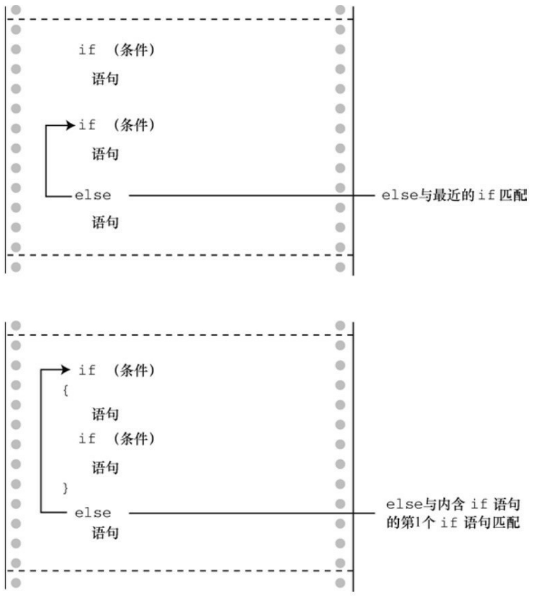

```scss
return 0;
}
```

（如果编译器警告因转换可能导致数据丢失，不用担心。第8章在讲到EOF时再解释。）

下面是该程序的输入示例:

## CALL ME HAL.

## DBMM NF IBM/

把程序清单7.1中的循环和该例中的循环作比较。前者使用scanf()返回的状态值判断是否结束循环，而后者使用输入项的值来判断是否结束循环。这使得两程序所用的循环结构略有不同:程序清单7.1中在循环前面有一条“读取语句”，程序清单7.2中在每次迭代的末尾有一条“读取语句”。不过，C的语法比较灵活，读者也可以模仿程序清单7.1，把读取和测试合并成一个表达式。也就是说，可以把这种形式的循环:

```javascript
ch = getchar();          /* 读取一个字符 */
while (ch != '\n')      /* 当一行未结束时 */
{
...                       /* 处理字符 */
ch = getchar();   /* 获取下一个字符 */
}
```

替换成下面形式的循环:

```txt
while ((ch = getchar()) != '\n')
```

```json
{
... /* 处理字符 */
}
```

关键的一行代码是:

```txt
while ((ch = getchar()) != '\n')
```

这体现了C特有的编程风格——把两个行为合并成一个表达式。C对代码的格式要求宽松，这样写让其中的每个行为更加清晰:

```txt
while (
```

```txt
(ch = getchar()) // 给ch赋一个值
```

!= '\n') // 把ch和\n作比较

以上执行的行为是赋值给ch和把ch的值与换行符作比较。表达式ch 二getchar()两侧的圆括号使之成为!=运算符的左侧运算对象。要对该表达式求值，必须先调用getchar()函数，然后把该函数的返回值赋给 ch。因为赋值表达式的值是赋值运算符左侧运算对象的值，所以 ch = getchar()的值就是 ch的新值，因此，读取ch的值后，测试条件相当于是ch != '\n'（即，ch不是换行符）。

这种独特的写法在C编程中很常见，应该多熟悉它。还要记住合理使用圆括号组合子表达式。上面例子中的圆括号都必不可少。假设省略ch = getchar()两侧的圆括号:

```txt
while (ch = getchar() != '\n')
```

!=运算符的优先级比=高，所以先对表达式getchar() != '\n'求值。由于这是关系表达式，所以其值不是1就是0（真或假）。然后，把该值赋给ch。省略圆括号意味着赋给ch的值是0或1，而不是 getchar()的返回值。这不是我们

的初衷。

下面的语句:

putchar(ch + 1); /\* 改变其他字符 \*/

再次演示了字符实际上是作为整数储存的。为方便计算，表达式ch + 1中的ch被转换成int类型，然后int类型的计算结果被传递给接受一个int类型参数的putchar()，该函数只根据最后一个字节确定显示哪个字符。

## 7.2.2 ctype.h系列的字符函数

注意到程序清单7.2的输出中，最后输入的点号（.）被转换成斜杠（/），这是因为斜杠字符对应的ASCII码比点号的 ASCII 码多 1。如果程序只转换字母，保留所有的非字母字符（不只是空格）会更好。本章稍后讨论的逻辑运算符可用来测试字符是否不是空格、不是逗号等，但是列出所有的可能性太繁琐。C 有一系列专门处理字符的函数，ctype.h头文件包含了这些函数的原型。这些函数接受一个字符作为参数，如果该字符属于某特殊的类别，就返回一个非零值（真）；否则，返回0（假）。例如，如果isalpha()函数的参数是一个字母，则返回一个非零值。程序清单7.3在程序清单7.2的基础上使用了这个函数，还使用了刚才精简后的循环。

程序清单**7.3 cypher2.c**程序

```c
// cypher2.c -- 替换输入的字母，非字母字符保持不变
#include <stdio.h>
#include <ctype.h>          // 包含isalpha()的函数原型
int main(void)
{
char ch;
```

```txt
while ((ch = getchar()) != '\n')
{
if(isalpha(ch))          // 如果是一个字符,
putchar(ch + 1);   // 显示该字符的下一个字符
else                          // 否则,
putchar(ch);       // 原样显示
}
putchar(ch);               // 显示换行符
return 0;
}
```

下面是该程序的一个输出示例，注意大小写字母都被替换了，除了空格和标点符号:

## Look! It's a programmer!

Mppl! Ju't b qsphsbnnfs!

表7.1和表7.2列出了ctype.h头文件中的一些函数。有些函数涉及本地化，指的是为适应特定区域的使用习惯修改或扩展 C 基本用法的工具（例如，许多国家在书写小数点时，用逗号代替点号，于是特殊的本地化可以指定C编译器使用逗号以相同的方式输出浮点数，这样123.45可以显示为123,45）。注意，字符映射函数不会修改原始的参数，这些函数只会返回已修改的值。也就是说，下面的语句不改变ch的值:

tolower(ch); // 不影响ch的值

这样做才会改变ch的值:

ch = tolower(ch); // 把ch转换成小写字母

表7.1 ctype.h头文件中的字符测试函数

| 函数名 | 如果是下列参数时,返回值为真 |
| --- | --- |
| isalnum() | 字母数字(字母或数字) |
| isalpha() | 字母 |
| isblank() | 标准的空白字符(空格、水平制表符或换行符)或任何其他本地化指定为空白的字符 |
| iscntrl() | 控制字符,如 Ctrl+B |
| isdigit() | 数字 |
| isgraph() | 除空格之外的任意可打印字符 |
| islower() | 小写字母 |
| isprint() | 可打印字符 |
| ispunct() | 标点符号(除空格或字母数字字符以外的任何可打印字符) |
| isspace() | 空白字符(空格、换行符、换页符、回车符、垂直制表符、水平制表符或其他本地化定义的字符) |
| isupper() | 大写字母 |
| isxdigit() | 十六进制数字符 |

表7.2 ctype.h头文件中的字符映射函数

| 函数名 | 行为 |
| --- | --- |
| tolower() | 如果参数是大写字符,该函数返回小写字符;否则,返回原始参数 |
| toupper() | 如果参数是小写字符,该函数返回大写字符;否则,返回原始参数 |

## 7.2.3 多重选择else if

现实生活中我们经常有多种选择。在程序中也可以用else if扩展if else结构模拟这种情况。来看一个特殊的例子。电力公司通常根据客户的总用电量来决定电费。下面是某电力公司的电费清单，单位是千瓦时（kWh）:

首 360kWh: \$0.13230/kWh

续 108kWh: \$0.15040/kWh

续 252kWh: \$0.30025/kWh

超过 720kWh: \$0.34025/kWh

如果对用电管理感兴趣，可以编写一个计算电费的程序。程序清单7.4是完成这一任务的第1步。

## 程序清单7.4 electric.c程序

// electric.c -- 计算电费

#include &lt;stdio.h&gt;

| #define RATE1 | 0.13230 | // 首次使用 360 kwh 的费率 |
| --- | --- | --- |
| #define RATE2 | 0.15040 | // 接着再使用 108 kwh 的费率 |
| #define RATE3 | 0.30025 | // 接着再使用 252 kwh 的费率 |
| #define RATE4 | 0.34025 | // 使用超过 720kwh 的费率 |
| #define BREAK1 | 360.0 | // 费率的第1个分界点 |
| #define BREAK2 | 468.0 | // 费率的第2个分界点 |
| #define BREAK3 | 720.0 | // 费率的第3个分界点 |

#define BASE1 (RATE1 \* BREAK1)

// 使用360kwh的费用

#define BASE2 (BASE1 + (RATE2 \* (BREAK2 - BREAK1)))

// 使用468kwh的费用

#define BASE3 (BASE1 + BASE2 + (RATE3 \*(BREAK3 - BREAK2)))

// 使用720kwh的费用

```lisp
int main(void)
{
double kwh;                      // 使用的千瓦时
double bill;                     // 电费
printf("Please enter the kwh used.\n");
scanf("%lf", &kwh);          // %lf对应double类型
if (kwh <= BREAK1)
bill = RATE1 * kwh;
else if (kwh <= BREAK2)      // 360~468 kwh
bill = BASE1 + (RATE2 * (kwh - BREAK1));
else if (kwh <= BREAK3)      // 468~720 kwh
bill = BASE2 + (RATE3 * (kwh - BREAK2));
else                          // 超过 720 kwh
bill = BASE3 + (RATE4 * (kwh - BREAK3));
printf("The charge for %.1f kwh is $%1.2f.\n", kwh, bill);
return 0;
}
该程序的输出示例如下:
Please enter the kwh used.
```

## 580

The charge for 580.0 kwh is \$97.50.

程序清单 7.4 用符号常量表示不同的费率和费率分界点，以便把常量统一放在一处。这样，电力公司在更改费率以及费率分界点时，更新数据非常方便。BASE1和BASE2根据费率和费率分界点来表示。一旦费率或分界点发生了变化，它们也会自动更新。预处理器是不进行计算的。程序中出现BASE1的地方都会被替换成 0.13230\*360.0。不用担心，编译器会对该表达式求值得到一个数值（47.628），以便最终的程序代码使用的是47.628而不是一个计算式。

程序流简单明了。该程序根据kwh的值在3个公式之间选择一个。特别要注意的是，如果kwh大于或等于360，程序只会到达第1个else。因此，else if (kwh <= BREAK2)这行相当于要求kwh在360～482之间，如程序注释所示。类似地，只有当kwh的值超过720时，才会执行最后的else。最后，注意BASE1、BASE2和BASE3分别代表360、468和720千瓦时的总费用。因此，当电量超过这些值时，只需要加上额外的费用即可。

实际上，else if 是已学过的 if else 语句的变式。例如，该程序的核心部分只不过是下面代码的另一种写法:

```c
if (kwh <= BREAK1)
bill = RATE1 * kwh;
else
if (kwh <= BREAK2)          // 360~468 kwh
bill = BASE1 + (RATE2 * (kwh - BREAK1));
else
if (kwh <= BREAK3)      // 468~720 kwh
```

$$
\text {bill} = \text {BASE2} + (\text {RATE3} * (\text {kwh - BREAK2}));
$$

else

// 超过720 kwh

$$
\text {bill} = \text {BASE3} + (\text {RATE4} * (\text {kwh - BREAK3}));
$$

也就是说，该程序由一个ifelse语句组成，else部分包含另一个if else语句，该if else语句的else部分又包含另一个if else语句。第2个if else语句嵌套在第 1个if else语句中，第3个if else语句嵌套在第2个if else语句中。回忆一下，整个if else语句被视为一条语句，因此不必把嵌套的if else语句用花括号括起来。当然，花括号可以更清楚地表明这种特殊格式的含义。

这两种形式完全等价。唯一不同的是使用空格和换行的位置不同，不过编译器会忽略这些。尽管如此，第1种形式还是好些，因为这种形式更清楚地显示了有4种选择。在浏览程序时，这种形式让读者更容易看清楚各项选择。在需要时要缩进嵌套的部分，例如，必须测试两个单独的量时。本例中，仅在夏季对用电量超过720kWh的用户加收10%的电费，就属于这种情况。

可以把多个else if语句连成一串使用，如下所示（当然，要在编译器的限制范围内）:

```txt
if (score < 1000)

bonus = 0;

else if (score < 1500)

bonus = 1;

else if (score < 2000)

bonus = 2;

else if (score < 2500)
```

bonus = 4;

else

bonus = 6;

（这可能是一个游戏程序的一部分，bonus表示下一局游戏获得的光子炸弹或补给。）

对于编译器的限制范围，C99标准要求编译器最少支持127层套嵌。

## 7.2.4 else与if配对

如果程序中有许多if和else，编译器如何知道哪个if对应哪个else？例如，考虑下面的程序段:

if (number > 6)

if (number < 12)

printf("You're close!\n");

else

printf("Sorry, you lose a turn!\n");

何时打印Sorry, you lose a turn!？当number小于或等于6时，还是number大于12时？换言之，else与第1个if还是第2个if匹配？答案是，else与第2个if匹配。也就是说，输入的数字和匹配的响应如下:

数字 响应

5 None

10 You’re close!

规则是，如果没有花括号，else与离它最近的if匹配，除非最近的if被花括号括起来（见图7.2）。



图7.2 if else匹配的规则

注意:要缩进“语句”，“语句”可以是一条简单语句或复合语句。

第1个例子的缩进使得else看上去与第1个if相匹配，但是记住，编译器是忽略缩进的。如果希望else与第1个if匹配，应该这样写:

```txt
if (number > 6)

{

if (number < 12)

printf("You're close!\n");

}

else

printf("Sorry, you lose a turn!\n");
```

这样改动后，响应如下:

数字 响应

5 Sorry, you lose a turn!

10 You’re close!

15 None

## 7.2.5 多层嵌套的if语句

前面介绍的if...else if...else序列是嵌套if的一种形式，从一系列选项中选择一个执行。有时，选择一个特定选项后又引出其他选择，这种情况可以使用另一种嵌套 if。例如，程序可以使用 if else选择男女，if else的每个分支里又包含另一个if else来区分不同收入的群体。

我们把这种形式的嵌套if应用在下面的程序中。给定一个整数，显示所有能整除它的约数。如果没有约数，则报告该数是一个素数。

在编写程序的代码之前要先规划好。首先，要总体设计一下程序。为方便起见，程序应该使用一个循环让用户能连续输入待测试的数。这样，测试一个新的数字时不必每次都要重新运行程序。下面是我们为这种循环开发的一个模型（伪代码）:

提示用户输入数字

当scanf()返回值为1

分析该数并报告结果

提示用户继续输入

回忆一下在测试条件中使用scanf()，把读取数字和判断测试条件确定是否结束循环合并在一起。

下一步，设计如何找出约数。也许最直接的方法是:

$$
\text {for} (\mathrm{div} = 2; \mathrm{div} <   \mathrm{num}; \mathrm{div} + +)
$$

$$
\text {if} (\text {num} \% \text {div} = 0)
$$

$$
\text {printf} (\% \mathrm{d} \text {is divisible by \%d\n", num, div});
$$

该循环检查2～num之间的所有数字，测试它们是否能被num整除。但是，这个方法有点浪费时间。我们可以改进一下。例如，考虑如果144%2得0，说明2是144的约数；如果144除以2得72，那么72也是144的一个约数。所以，num % div测试成功可以获得两个约数。为了弄清其中的原理，我们分析一下循环中得到的成对约数:2和72、2和48、4和36、6和24、8和18、9和16、12和12、16和9、18和8，等等。在得到12和12这对约数后，又开始得到已找到的相同约数（次序相反）。因此，不用循环到143，在达到12以后就可以停止循环。这大大地节省了循环时间！

分析后发现，必须测试的数只要到num的平方根就可以了，不用到num。对于9这样的数字，不会节约很多时间，但是对于10000这样的数，使用哪一种方法求约数差别很大。不过，我们不用在程序中计算平方根，可以这样编写测试条件:

for (div = 2; (div \* div) <= num; div++)

if (num % div == 0)

printf("%d is divisible by %d and %d.\n",num, div, num / div);

如果num是144，当div = 12时停止循环。如果num是145，当div = 13时停止循环。

不使用平方根而用这样的测试条件，有两个原因。其一，整数乘法比求平方根快。其二，我们还没有正式介绍平方根函数。

还要解决两个问题才能准备编程。第1个问题，如果待测试的数是一个完全平方数怎么办？报告144可以被12和12整除显得有点傻。可以使用嵌套if语句测试div是否等于num /div。如果是，程序只打印一个约数:

```c
for (div = 2; (div * div) <= num; div++)
{
if (num % div == 0)
{
if (div * div != num)
printf("%d is divisible by %d and %d.\n",num, div, num / div);
else
printf("%d is divisible by %d.\n", num, div);
}
```

}

## 注意

从技术角度看，if else语句作为一条单独的语句，不必使用花括号。外层if也是一条单独的语句，也不必使用花括号。但是，当语句太长时，使用花括号能提高代码的可读性，而且还可防止今后在if循环中添加其他语句时忘记加花括号。

第2个问题，如何知道一个数字是素数？如果num是素数，程序流不会进入if语句。要解决这个问题，可以在外层循环把一个变量设置为某个值（如，1），然后在if语句中把该变量重新设置为0。循环完成后，检查该变量是否是1，如果是，说明没有进入if语句，那么该数就是素数。这样的变量通常称为标记（flag）。

一直以来，C都习惯用int作为标记的类型，其实新增的\_Bool类型更合适。另外，如果在程序中包含了stdbool.h头文件，便可用bool代替\_Bool类型，用true和false分别代替1和0。

程序清单7.5体现了以上分析的思路。为扩大该程序的应用范围，程序用long类型而不是int类型（如果系统不支持\_Bool类型，可以把isPrime的类型改为int，并用1和0分别替换程序中的true和false）。

程序清单**7.5 divisors.c**程序

// divisors.c -- 使用嵌套if语句显示一个数的约数

```c
#include <stdio.h>

#include <stdbool.h>

int main(void)

{
```

unsigned long num; // 待测试的数

unsigned long div; // 可能的约数

bool isPrime; // 素数标记

printf("Please enter an integer for analysis; ");

printf("Enter q to quit.\n");

while (scanf("%lu", &num) == 1)

{

for (div = 2, isPrime = true; (div \* div) <= num; div++)

{

if (num % div == 0)

if ((div \* div) != num)

printf("%lu is divisible by %lu and %lu.\n",

num, div, num / div);

else

printf("%lu is divisible by %lu.\n",

num, div);

isPrime = false; // 该数不是素数

}

```c
}

if (isPrime)

printf("%lu is prime.\n", num);

printf("Please enter another integer for analysis; ");
printf("Enter q to quit.\n");

}

printf("Bye.\n");

return 0;

}
```

注意，该程序在for循环的测试表达式中使用了逗号运算符，这样每次输入新值时都可以把isPrime设置为true。

下面是该程序的一个输出示例:

Please enter an integer for analysis; Enter q to quit.

## 123456789

123456789 is divisible by 3 and 41152263.

123456789 is divisible by 9 and 13717421.

123456789 is divisible by 3607 and 34227.

123456789 is divisible by 3803 and 32463.

123456789 is divisible by 10821 and 11409.

Please enter another integer for analysis; Enter q to quit.

**149**

149 is prime.

Please enter another integer for analysis; Enter q to quit.

**2013**

2013 is divisible by 3 and 671.

2013 is divisible by 11 and 183.

2013 is divisible by 33 and 61.

Please enter another integer for analysis; Enter q to quit.

q

Bye.

该程序会把1认为是素数，其实它不是。下一节将要介绍的逻辑运算符可以排除这种特殊的情况。

小结:用**if**语句进行选择

关键字:**if**、**else**

一般注解:

下面各形式中，statement可以是一条简单语句或复合语句。表达式为真说明其值是非零值。

形式1:

if (expression)

statement

如果expression为真，则执行statement部分。

形式2:

if (expression)

statement1

else

statement2

如果expression为真，执行statement1部分；否则，执行statement2部分。

形式3:

if (expression1)

statement1

else if (expression2)

statement2

else

statement3

如果expression1为真，执行statement1部分；如果expression2为真，执行statement2部分；否则，执行statement3部分。

示例:

if (legs == 4)

```c
printf("It might be a horse.\n");
else if (legs > 4)
printf("It is not a horse.\n");
else /* 如果legs < 4 */
{
legs++;
printf("Now it has one more leg.\n");
}
```

## 7.3 逻辑运算符

读者已经很熟悉了，if 语句和 while 语句通常使用关系表达式作为测试条件。有时，把多个关系表达式组合起来会很有用。例如，要编写一个程序，计算输入的一行句子中除单引号和双引号以外其他字符的数量。这种情况下可以使用逻辑运算符，并使用句点（.）标识句子的末尾。程序清单7.6用一个简短的程序进行演示。

程序清单7.6 chcount.c程序

```c
// chcount.c -- 使用逻辑与运算符
#include <stdio.h>
#define PERIOD ''
int main(void)
{
char ch;
int charcount = 0;
while ((ch = getchar()) != PERIOD)
{
if (ch != ''' && ch != '\")
charcount++;
}
printf("There are %d non-quote characters.\n", charcount);
```

```scss
return 0;
}
```

下面是该程序的一个输出示例:

## I didn't read the "I'm a Programming Fool" best seller.

There are 50 non-quote characters.

程序首先读入一个字符，并检查它是否是一个句点，因为句点标志一个句子的结束。接下来，if语句的测试条件中使用了逻辑与运算符&&。该 if语句翻译成文字是“如果待测试的字符不是双引号，并且它也不是单引号，那么charcount递增1”。

逻辑运算符两侧的条件必须都为真，整个表达式才为真。逻辑运算符的优先级比关系运算符低，所以不必在子表达式两侧加圆括号。

C有3种逻辑运算符，见表7.3。

表7.3 种逻辑运算符

| 逻辑运算符 | 含义 |
| --- | --- |
| &amp;&amp; | 与 |
| \|\| | 或 |
| ! | 非 |

假设exp1和exp2是两个简单的关系表达式（如car > rat或debt == 1000），那么:

当且仅当exp1和exp2都为真时，exp1 && exp2才为真；

如果exp1或exp2为真，则exp1 || exp2为真；

如果exp1为假，则!exp1为真；如果exp1为真，则!exp1为假。

下面是一些具体的例子:

5 > 2 && 4 > 7为假，因为只有一个子表达式为真；

5 > 2 || 4 > 7为真，因为有一个子表达式为真；

!(4 > 7)为真，因为4不大于7。

顺带一提，最后一个表达式与下面的表达式等价:

$$
4 <   = 7
$$

如果不熟悉逻辑运算符或者觉得很别扭，请记住:(练习&&时间)== 完美。

## 7.3.1 备选拼写:iso646.h头文件

C 是在美国用标准美式键盘开发的语言。但是在世界各地，并非所有的键盘都有和美式键盘一样的符号。因此，C99标准新增了可代替逻辑运算符的拼写，它们被定义在ios646.h头文件中。如果在程序中包含该头文件，便可用and代替&&、or代替||、not代替!。例如，可以把下面的代码:

```javascript
if (ch != ''' && ch != '\')
charcount++;
```

改写为:

```txt
if (ch != ''' and ch != '\")
charcount++;
```

表7.4列出了逻辑运算符对应的拼写，很容易记。读者也许很好奇，为何C不直接使用and、or和not？因为C一直坚持尽量保持较少的关键字。参考资料V“新增C99和C11的标准ANSI C库”列出了一些运算符的备选拼写，有些我们还没见过。

## 表7.4 逻辑运算符的备选拼写

| 传统写法 | iso646.h |
| --- | --- |
| &amp;&amp; | and |
| \|\| | or |
| ! | not |

## 7.3.2 优先级

!运算符的优先级很高，比乘法运算符还高，与递增运算符的优先级相同，只比圆括号的优先级低。&&运算符的优先级比||运算符高，但是两者的优先级都比关系运算符低，比赋值运算符高。因此，表达式 $t a$ >b && $\mathbf { b } \geq \mathbf { c }$ || $\mathbf { b } \geq \mathbf { d }$ 相当于((a > b) && $(b > c) \parallel (b > d)$ 。

也就是说，b介于a和c之间，或者b大于d。

尽管对于该例没必要使用圆括号，但是许多程序员更喜欢使用带圆括号的第 2 种写法。这样做即使不记得逻辑运算符的优先级，表达式的含义也很清楚。

## 7.3.3 求值顺序

除了两个运算符共享一个运算对象的情况外，C 通常不保证先对复杂表达式中哪部分求值。例如，下面的语句，可能先对表达式5 + 3求值，也可能先对表达式9 + 6求值:

$$
\text {apples} = (5 + 3) * (9 + 6);
$$

C 把先计算哪部分的决定权留给编译器的设计者，以便针对特定系统优化设计。但是，对于逻辑运算符是个例外，C保证逻辑表达式的求值顺序是从左往右。&&和||运算符都是序列点，所以程序在从一个运算对象执行到下一个运算对象之前，所有的副作用都会生效。而且，C 保证一旦发现某个元素让整个表达式无效，便立即停止求值。正是由于有这些规定，才能写出这样结构的代码:

$$
\text {while} ((c = \operatorname{getchar}))! = ^ {\prime \prime} \& \& c! = ^ {\prime} \backslash n ^ {\prime})
$$

如上代码所示，读取字符直至遇到第1 个空格或换行符。第1 个子表达式把读取的值赋给c，后面的子表达式会用到c的值。如果没有求值循序的保证，编译器可能在给c赋值之前先对后面的表达式求值。

这里还有一个例子:

$$
\text {if (number != 0 \& \& 12 / number == 2)}
$$

printf("The number is 5 or 6.\n");

如果number的值是0，那么第1个子表达式为假，且不再对关系表达式求值。这样避免了把0作为除数。许多语言都没有这种特性，知道number为0后，仍继续检查后面的条件。

最后，考虑这个例子:

$$
\text {while} (\mathrm{x} + + <   1 0 \& \& \mathrm{x} + \mathrm{y} <   2 0)
$$

实际上，&&是一个序列点，这保证了在对&&右侧的表达式求值之前，已经递增了x。

小结:逻辑运算符和表达式

逻辑运算符:

逻辑运算符的运算对象通常是关系表达式。!运算符只需要一个运算对象，其他两个逻辑运算符都需要两个运算对象，左侧一个，右侧一个。

| 逻辑运算符 | 含义 |
| --- | --- |
| &amp;&amp; | 与 |
| \|\| | 或 |
| ! | 非 |

逻辑表达式:

当且仅当expression1和expression2都为真，expression1 && expression2才为真。如果 expression1 或 expression2 为真，expression1 || expression2 为真。如果expression为假，!expression则为真，反之亦然。

求值顺序:

逻辑表达式的求值顺序是从左往右。一旦发现有使整个表达式为假的因素，立即停止求值。

示例:

6 > 2 && 3 == 3 真

x != 0 && (20 / x) < 5 只有当x不等于0时，才会对第2个表达式求值

## 7.3.4 范围

&&运算符可用于测试范围。例如，要测试score是否在90～100的范围内，可以这样写:

$$
\text {if} (\text {range} > = 9 0 \& \& \text {range} <   = 1 0 0)
$$

printf("Good show!\n");

千万不要模仿数学上的写法:

if (90 <= range <= 100) // 千万不要这样写！

printf("Good show!\n");

这样写的问题是代码有语义错误，而不是语法错误，所以编译器不会捕获这样的问题（虽然可能会给出警告）。由于<=运算符的求值顺序是从左往右，所以编译器把测试表达式解释为:

$$
(9 0 <   = \text {range}) <   = 1 0 0
$$

子表达式90 <= range的值要么是1（为真），要么是0（为假）。这两个值都小于100，所以不管range的值是多少，整个表达式都恒为真。因此，在范围测试中要使用&&。

许多代码都用范围测试来确定一个字符是否是小写字母。例如，假设ch是char类型的变量:

$$
\text {if} (\mathrm{ch} > = ^ {\prime} \mathrm{a} ^ {\prime} \& \& \mathrm{ch} <   = ^ {\prime} \mathrm{z} ^ {\prime})
$$

printf("That's a lowercase character.\n");

该方法仅对于像ASCII这样的字符编码有效，这些编码中相邻字母与相邻数字一一对应。但是，对于像EBCDIC这样的代码就没用了。相应的可移植方法是，用ctype.h系列中的islower()函数（参见表7.1）:

if (islower(ch))

printf("That's a lowercase character.\n");

无论使用哪种特定的字符编码，islower()函数都能正常运行（不过，一些早期的编译器没有ctype.h系列）。

## 7.4 一个统计单词的程序

现在，我们可以编写一个统计单词数量的程序（即，该程序读取并报告单词的数量）。该程序还可以计算字符数和行数。先来看看编写这样的程序要涉及那些内容。

首先，该程序要逐个字符读取输入，知道何时停止读取。然后，该程序能识别并计算这些内容:字符、行数和单词。据此我们编写的伪代码如下:

读取一个字符

当有更多输入时

递增字符计数

如果读完一行，递增行数计数

如果读完一个单词，递增单词计数

读取下一个字符

前面有一个输入循环的模型:

```lua
while ((ch = getchar()) != STOP)
{
...
}
```

这里，STOP表示能标识输入末尾的某个值。以前我们用过换行符和句点标记输入的末尾，但是对于一个通用的统计单词程序，它们都不合适。我们暂时选用一个文本中不常用的字符（如，|）作为输入的末尾标记。第8章中会介绍更好的方法，以便程序既能处理文本文件，又能处理键盘输入。

现在，我们考虑循环体。因为该程序使用getchar()进行输入，所以每次迭代都要通过递增计数器来计数。为了统计行数，程序要能检查换行字符。如果输入的字符是一个换行符，该程序应该递增行数计数器。这里要注意STOP 字符位于一行的中间的情况。是否递增行数计数？我们可以作为特殊行计数，即没有换行符的一行字符。可以通过记录之前读取的字符识别这种情况，即如果读取时发现 STOP 字符的上一个字符不是换行符，那么这行就是特殊行。

最棘手的部分是识别单词。首先，必须定义什么是该程序识别的单词。我们用一个相对简单的方法，把一个单词定义为一个不含空白（即，没有空格、制表符或换行符）的字符序列。因此，“glymxck”和“r2d2”都算是一个单词。程序读取的第 1 个非空白字符即是一个单词的开始，当读到空白字符时结束。判断非空白字符最直接的测试表达式是:

$$
\mathrm{c}! = ^ {\prime \prime} \& \& \mathrm{c}! = ^ {\prime} \mathrm{n} ^ {\prime} \& \& \mathrm{c}! = ^ {\prime} \mathrm{t} ^ {\prime} / * \text {如果c不是空白字符，该表达式为真*}
$$

检测空白字符最直接的测试表达式是:

$$
\mathrm{c} = ^ {\prime \prime} \| \mathrm{c} = ^ {\prime} \mathrm{n} ^ {\prime} \| \mathrm{c} = ^ {\prime} \mathrm{t} ^ {\prime} / * \text {如果c是空白字符，该表达式为真*/}
$$

然而，使用ctype.h头文件中的函数isspace()更简单，如果该函数的参数是空白字符，则返回真。所以，如果c是空白字符，isspace(c)为真；如果c不是空白字符，!isspace(c)为真。

要查找一个单词里是否有某个字符，可以在程序读入单词的首字符时把一个标记（名为 inword）设置为1。也可以在此时递增单词计数。然后，只要inword为1（或true），后续的非空白字符都不记为单词的开始。下一个空白字符，必须重置标记为0（或false），然后程序就准备好读取下一个单词。我们把以上分析写成伪代码:

如果c不是空白字符，且inword为假

设置inword为真，并给单词计数

如果c是空白字符，且inword为真

## 设置inword为假

这种方法在读到每个单词的开头时把inword设置为1（真），在读到每个单词的末尾时把inword设置为0（假）。只有在标记从0设置为1时，递增单词计数。如果能使用\_Bool类型，可以在程序中包含stdbool.h头文件，把inword的类型设置为bool，其值用true和false表示。如果编译器不支持这种用法，就把inword的类型设置为int，其值用1和0表示。

如果使用布尔类型的变量，通常习惯把变量自身作为测试条件。如下所示:

用if (inword)代替if (inword == true)

用if (!inword)代替if (inword == false)

可以这样做的原因是，如果 inword为true，则表达式 inword == true为true；如果 inword为false，则表达式inword == true为false。所以，还不如直接用inword作为测试条件。类似地，!inword的值与表达式inword == false的值相同（非真即false，非假即true）。

程序清单7.7把上述思路（识别行、识别不完整的行和识别单词）翻译了成C代码。

## 程序清单7.7 wordcnt.c程序

// wordcnt.c -- 统计字符数、单词数、行数

#include &lt;stdio.h&gt;

#include &lt;ctype.h&gt; // 为isspace()函数提供原型

#include &lt;stdbool.h&gt; // 为bool、true、false提供定义

```c
#define STOP ''

int main(void)
{
char c;                      // 读入字符
char prev;                 // 读入的前一个字符
long n_chars = 0L;// 字符数
int n_lines = 0;       // 行数
int n_words = 0;       // 单词数
int p_lines = 0;       // 不完整的行数
bool inword = false;   // 如果c在单词中，inword 等于 true
printf("Enter text to be analyzed (| to terminate):\n");
prev = '\n';              // 用于识别完整的行
while ((c = getchar()) != STOP)
{
n_chars++;          // 统计字符
if (c == '\n')
n_lines++;     // 统计行
if (!isspace(c) && !inword)
{
```

inword = true;// 开始一个新的单词

n\_words++; // 统计单词

}

if (isspace(c) && inword)

inword = false; // 打到单词的末尾

prev = c; // 保存字符的值

}

if (prev != '\n')

p\_lines = 1;

printf("characters = %ld, words = %d, lines = %d, ",

n\_chars, n\_words, n\_lines);

printf("partial lines = %d\n", p\_lines);

return 0;

}

下面是运行该程序后的一个输出示例:

Enter text to be analyzed (| to terminate):

**Reason is a**

**powerful servant but**

**an inadequate master.**