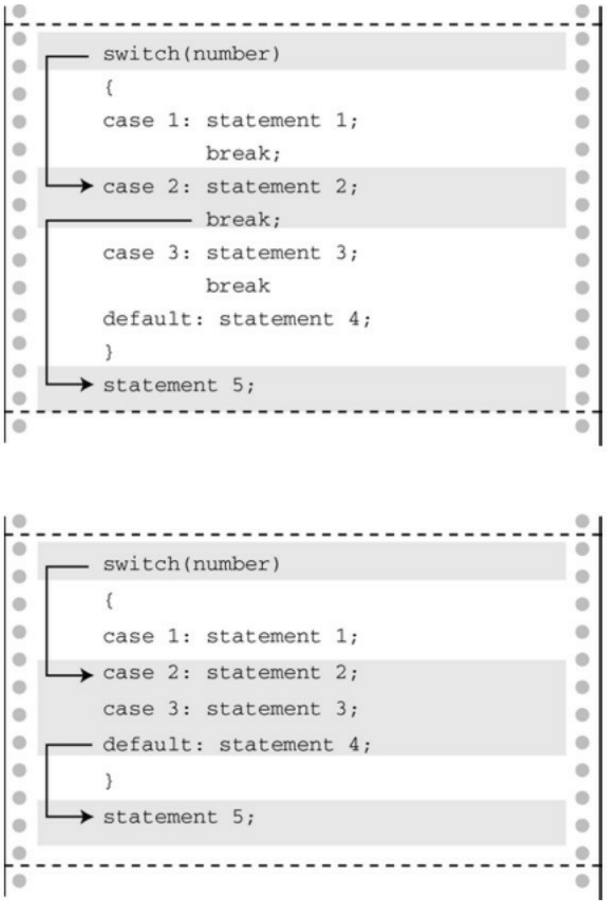

$$
\text { characters } = 5 5, \text { words } = 9, \text { lines } = 3, \text { partial lines } = 0
$$

该程序使用逻辑运算符把伪代码翻译成C代码。例如，把下面的伪代码:

如果c不是空白字符，且inword为假

翻译成如下C代码:

$$
\text {if (!isspace(c) \ & \ & !inword)}
$$

再次提醒读者注意，!inword 与 inword == false 等价。上面的整个测试条件比单独判断每个空白字符的可读性高:

$$
\text {if} (\mathrm{c}! = ^ {\prime \prime} \& \& \mathrm{c}! = ^ {\prime} \mathrm{n} ^ {\prime} \& \& \mathrm{c}! = ^ {\prime} \mathrm{t} ^ {\prime} \& \ & ! \text {inword})
$$

上面的两种形式都表示“如果c不是空白字符，且如果c不在单词里”。如果两个条件都满足，则一定是一个新单词的开头，所以要递增n\_words。如果位于单词中，满足第1个条件，但是inword为true，就不递增 n\_word。当读到下一个空白字符时，inword 被再次设置为 false。检查代码，查看一下如果单词之间有多个空格时，程序是否能正常运行。第 8 章讲解了如何修正这个问题，让该程序能统计文件中的单词量。

## 7.5 条件运算符:?:

C提供条件表达式（conditional expression）作为表达if else语句的一种便捷方式，该表达式使用?:条件运算符。该运算符分为两部分，需要 3 个运算对象。回忆一下，带一个运算对象的运算符称为一元运算符，带两个运算对象的运算符称为二元运算符。以此类推，带 3 个运算对象的运算符称为三元运算符。条件运算符是C语言中唯一的三元运算符。下面的代码得到一个数的绝对值:

$$
\mathrm{x} = (\mathrm{y} <   0)? - \mathrm{y}: \mathrm{y};
$$

在=和;之间的内容就是条件表达式，该语句的意思是“如果y小于0，那么x = -y;否则，x = y”。用if else可以这样表达:

$$
\text {if} (\mathrm{y} <   0)
$$

$$
\mathrm{x} = - \mathrm{y};
$$

$$
\text {else}
$$

$$
\mathrm{x} = \mathrm{y};
$$

条件表达式的通用形式如下:

expression1 ? expression2 : expression3

如果 expression1 为真（非 0），那么整个条件表达式的值与 expression2的值相同；如果expression1为假（0），那么整个条件表达式的值与expression3的值相同。

需要把两个值中的一个赋给变量时，就可以用条件表达式。典型的例子是，把两个值中的最大值赋给变量:

$$
\max = (a > b)? a: b;
$$

如果a大于b，那么将max设置为a；否则，设置为b。

通常，条件运算符完成的任务用 if else 语句也可以完成。但是，使用条件运算符的代码更简洁，而且编译器可以生成更紧凑的程序代码。

我们来看程序清单7.8中的油漆程序，该程序计算刷给定平方英尺的面积需要多少罐油漆。基本算法很简单:用平方英尺数除以每罐油漆能刷的面积。但是，商店只卖整罐油漆，不会拆分来卖，所以如果计算结果是1.7罐，就需要两罐。因此，该程序计算得到带小数的结果时应该进1。条件运算符常用于处理这种情况，而且还要根据单复数分别打印can和cans。

程序清单**7.8 paint.c**程序

/\* paint.c -- 使用条件运算符 \*/

#include &lt;stdio.h&gt;

#define COVERAGE 350 // 每罐油漆可刷的面积（单位:平方英尺）

```c
int main(void)
{
int sq_feet;
int cans;
printf("Enter number of square feet to be painted:\n");
while (scanf("%d", &sq_feet) == 1)
{
cans = sq_feet / COVERAGE;
```

```txt
cans += ((sq_feet % COVERAGE == 0)) ? 0 : 1;

printf("You need %d %s of paint.\n", cans,

cans == 1 ? "can" : "cans");

printf("Enter next value (q to quit):\n");

}

return 0;

}
```

下面是该程序的运行示例:

Enter number of square feet to be painted:

## 349

You need 1 can of paint.

Enter next value (q to quit):

## 351

You need 2 cans of paint.

Enter next value (q to quit):

q

该程序使用的变量都是int类型，除法的计算结果（sq\_feet / COVERAGE）会被截断。也就是说， 351/350得1。所以，cans被截断成整数部分。如果sq\_feet % COVERAGE得0，说明sq\_feet被COVERAGE整除，cans的值不变；否则，肯定有余数，就要给cans加1。这由下面的语句完成:

$$
\text {cans} + = \left(\left(\text {sq\_feet} \% \text {COVERAGE} = = 0\right)\right)? 0: 1;
$$

该语句把+=右侧表达式的值加上cans，再赋给cans。右侧表达式是一个条件表达式，根据sq\_feet是否能被COVERAGE整除，其值为0或1。

printf()函数中的参数也是一个条件表达式:

$$
\text {cans} = = 1? \text {"can":"cans"};
$$

如果cans的值是1，则打印can；否则，打印cans。这也说明了条件运算符的第2个和第3个运算对象可以是字符串。

小结:条件运算符

条件运算符:**?:**

一般注解:

条件运算符需要3个运算对象，每个运算对象都是一个表达式。其通用形式如下:

expression1 ? expression2 : expression3

如果expression1为真，整个条件表达式的值是expression2的值；否则，是expression3的值。

示例:

(5 > 3) ? 1 : 2 值为1

(3 > 5) ? 1 : 2 值为2

(a > b) ? a : b 如果a >b，则取较大的值

## 7.6 循环辅助:continue和break

一般而言，程序进入循环后，在下一次循环测试之前会执行完循环体中的所有语句。continue 和break语句可以根据循环体中的测试结果来忽略一部分循环内容，甚至结束循环。

## 7.6.1 continue语句

3种循环都可以使用continue语句。执行到该语句时，会跳过本次迭代的剩余部分，并开始下一轮迭代。如果continue语句在嵌套循环内，则只会影响包含该语句的内层循环。程序清单7.9中的简短程序演示了如何使用continue。

程序清单7.9 skippart.c程序

```c
/* skippart.c -- 使用continue跳过部分循环 */
#include <stdio.h>

int main(void)
{
const float MIN = 0.0f;
const float MAX = 100.0f;
float score;
float total = 0.0f;
int n = 0;
float min = MAX;
```

```c
float max = MIN;

printf("Enter the first score (q to quit): ");
while (scanf("%f", &score) == 1)
{
if (score < MIN || score > MAX)
{
printf("%0.1f is an invalid value.Try again: ",score);
continue;   // 跳转至while循环的测试条件
}
printf("Accepting %0.1f:\n", score);
min = (score < min) ? score : min;
max = (score > max) ? score : max;
total += score;
n++;
printf("Enter next score (q to quit): ");
}
if (n > 0)
{
printf("Average of %d scores is %0.1f.\n", n, total / n);
```

```txt
printf("Low = %0.1f, high = %0.1f\n", min, max);
}
else
printf("No valid scores were entered.\n");
return 0;
}
```

在程序清单7.9中，while循环读取输入，直至用户输入非数值数据。循环中的if语句筛选出无效的分数。假设输入 188，程序会报告:188 is an invalid value。在本例中，continue 语句让程序跳过处理有效输入部分的代码。程序开始下一轮循环，准备读取下一个输入值。

注意，有两种方法可以避免使用continue，一是省略continue，把剩余部分放在一个else块中:

```txt
if (score < 0 || score > 100)

/* printf()语句 */

else

{

/* 语句*/

}
```

另一种方法是，用以下格式来代替:

```txt
if (score >= 0 && score <= 100)
```

```txt
{
/* 语句 */
}
```

这种情况下，使用continue的好处是减少主语句组中的一级缩进。当语句很长或嵌套较多时，紧凑简洁的格式提高了代码的可读性。

continue还可用作占位符。例如，下面的循环读取并丢弃输入的数据，直至读到行末尾:

```txt
while (getchar() != '\n')
;
```

当程序已经读取一行中的某些内容，要跳至下一行开始处时，这种用法很方便。问题是，一般很难注意到一个单独的分号。如果使用continue，可读性会更高:

```javascript
while (getchar() != '\n')
continue;
```

如果用了continue没有简化代码反而让代码更复杂，就不要使用continue。例如，考虑下面的程序段:

```javascript
while ((ch = getchar() ) != '\n')
{
if (ch == '\t')
continue;
putchar(ch);
```

```txt
}
```

该循环跳过制表符，并在读到换行符时退出循环。以上代码这样表示更简洁:

```javascript
while ((ch = getchar()) != '\n')
if (ch != '\t')
putchar(ch);
```

通常，在这种情况下，把if的测试条件的关系反过来便可避免使用continue。

以上介绍了continue语句让程序跳过循环体的余下部分。那么，从何处开始继续循环？对于while和 do while 循环，执行 continue 语句后的下一个行为是对循环的测试表达式求值。考虑下面的循环:

```txt
count = 0;

while (count < 10)

{

ch = getchar();

if (ch == '\n')

continue;

putchar(ch);

count++;

}
```

该循环读取10个字符（除换行符外，因为当ch是换行符时，程序会跳过count++;语句）并重新显示它们，其中不包括换行符。执行continue后，下一个被求值的表达式是循环测试条件。

对于for循环，执行continue后的下一个行为是对更新表达式求值，然后是对循环测试表达式求值。例如，考虑下面的循环:

```txt
for (count = 0; count < 10; count++)

{
ch = getchar();

if (ch == '\n')

continue;

putchar(ch);

}
```

该例中，执行完continue后，首先递增count，然后将递增后的值和10作比较。因此，该循环与上面while循环的例子稍有不同。while循环的例子中，除了换行符，其余字符都显示；而本例中，换行符也计算在内，所以读取的10个字符中包含换行符。

## 7.6.2 break语句

程序执行到循环中的break语句时，会终止包含它的循环，并继续执行下一阶段。把程序清单7.9中的continue替换成break，在输入188时，不是跳至执行下一轮循环，而是导致退出当前循环。图7.3比较了break和continue。如果break语句位于嵌套循环内，它只会影响包含它的当前循环。

```txt
while ( (ch = getchar() ) !=EOF)
{
    blahblah(ch);
    if (ch == '\n')
        break;
    yakyak(ch);
}
blunder(n,m);
```

```txt
while ( (ch = getchar() ) !=EOF)
{
    blahblah(ch);
    if (ch == '\n')
        continue;
    yakyak(ch);
}
blunder(n,m);
```

图7.3 比较break和continue

break还可用于因其他原因退出循环的情况。程序清单7.10用一个循环计算矩形的面积。如果用户输入非数字作为矩形的长或宽，则终止循环。

程序清单7.10 break.c程序

```c
/* break.c -- 使用 break 退出循环 */
#include <stdio.h>

int main(void)
{
float length, width;
printf("Enter the length of the rectangle:\n");
while (scanf("%f", &length) == 1)
{
printf("Length = %0.2f:\n", length);
printf("Enter its width:\n");
if (scanf("%f", &width) != 1)
break;
printf("Width = %0.2f:\n", width);
printf("Area = %0.2f:\n", length * width);
printf("Enter the length of the rectangle:\n");
}
```

```txt
printf("Done.\n");

return 0;

}
```

可以这样控制循环:

```javascript
while (scanf("%f %f", &length, &width) == 2)
```

但是，用break可以方便显示用户输入的值。

和continue一样，如果用了break代码反而更复杂，就不要使用break。例如，考虑下面的循环:

```lisp
while ((ch = getchar()) != '\n')
{
if (ch == '\t')
break;
putchar(ch);
}
```

如果把两个测试条件放在一起，逻辑就更清晰了:

```txt
while ((ch = getchar() ) != '\n' && ch != '\t')
putchar(ch);
```

break语句对于稍后讨论的switch语句而言至关重要。

在for循环中的break和continue的情况不同，执行完break语句后会直接执行循环后面的第1条语句，连更新部分也跳过。嵌套循环内层的break只会让

程序跳出包含它的当前循环，要跳出外层循环还需要一个break:

```c
int p, q;

scanf("%d", &p);

while (p > 0)

{
printf("%d\n", p);

scanf("%d", &q);

while (q > 0)
{
printf("%d\n", p*q);

if (q > 100)

break; // 跳出内层循环

scanf("%d", &q);

}

if (q > 100)

break; // 跳出外层循环

scanf("%d", &p);

}
```

## 7.7 多重选择:switch和break

使用条件运算符和 if else 语句很容易编写二选一的程序。然而，有时程序需要在多个选项中进行选择。可以用if else if...else来完成。但是，大多数情况下使用switch语句更方便。程序清单7.11演示了如何使用switch语句。该程序读入一个字母，然后打印出与该字母开头的动物名。

程序清单7.11 animals.c程序

```c
/* animals.c -- 使用switch语句 */
#include <stdio.h>
#include <ctype.h>
int main(void)
{
char ch;
printf("Give me a letter of the alphabet, and I will give ");
printf("an animal name\nbeginning with that letter.\n");
printf("Please type in a letter; type # to end my act.\n");
while ((ch = getchar()) != '#')
{
if ('\n' == ch)
continue;
if (islower(ch))      /* 只接受小写字母*/
```

switch (ch)

{

case 'a':

printf("argali, a wild sheep of Asia\n");

break;

case 'b':

printf("babirusa, a wild pig of Malay\n");

break;

case 'c':

printf("coati, racoonlike mammal\n");

break;

case 'd':

printf("desman, aquatic, molelike critter\n");

break;

case 'e':

printf("echidna, the spiny anteater\n");

break;

case 'f':

printf("fisher, brownish marten\n");

```c
break;

default:
printf("That's a stumper!\n");
} /* switch结束 */
else
printf("I recognize only lowercase letters.\n");
while (getchar() != '\n')
continue; /* 跳过输入行的剩余部分 */
printf("Please type another letter or a #.\n");
} /* while循环结束 */
printf("Bye!\n");
return 0;
}
```

篇幅有限，我们只编到f，后面的字母以此类推。在进一步解释该程序之前，先看看输出示例:

Give me a letter of the alphabet, and I will give an animal name

beginning with that letter.

Please type in a letter; type # to end my act.

**a [enter]**

argali, a wild sheep of Asia

Please type another letter or a #.

## dab [enter]

desman, aquatic, molelike critter

Please type another letter or a #.

## r [enter]

That's a stumper!

Please type another letter or a #.

## Q [enter]

I recognize only lowercase letters.

Please type another letter or a #.

## # [enter]

Bye!

该程序的两个主要特点是:使用了switch语句和它对输出的处理。我们先分析switch的工作原理。

## 7.7.1 switch语句

要对紧跟在关键字 switch 后圆括号中的表达式求值。在程序清单 7.11中，该表达式是刚输入给 ch的值。然后程序扫描标签（这里指， $\mathrm { { \bf ~ c a s e ~ } ^ { \prime } a ^ { \prime } }$ :、case 'b' :等）列表，直到发现一个匹配的值为止。然后程序跳转至那一行。如果没有匹配的标签怎么办？如果有default :标签行，就跳转至该行；否则，程序继续执行在switch后面的语句。

break语句在其中起什么作用？它让程序离开switch语句，跳至switch语句后面的下一条语句（见图7.4）。如果没有break语句，就会从匹配标签开始执行到switch末尾。例如，如果删除该程序中的所有break语句，运行程序后输入d，其交互的输出结果如下:



图7.4 switch中有break和没有break的程序流

Give me a letter of the alphabet, and I will give an animal name

beginning with that letter.

Please type in a letter; type # to end my act.

## d [enter]

desman, aquatic, molelike critter

echidna, the spiny anteater

fisher, a brownish marten

That's a stumper!

Please type another letter or a #.

## # [enter]

Bye!

如上所示，执行了从case 'd':到switch语句末尾的所有语句。

顺带一提，break语句可用于循环和switch语句中，但是continue只能用于循环中。尽管如此，如果switch语句在一个循环中，continue便可作为switch语句的一部分。这种情况下，就像在其他循环中一样，continue让程序跳出循环的剩余部分，包括switch语句的其他部分。

如果读者熟悉Pascal，会发现switch语句和Pascal的case语句类似。它们最大的区别在于，如果只希望处理某个带标签的语句，就必须在switch语句中使用break语句。另外，C语言的case一般都指定一个值，不能使用一个范围。

switch在圆括号中的测试表达式的值应该是一个整数值（包括char类型）。case标签必须是整数类型（包括char类型）的常量或整型常量表达式（即，表达式中只包含整型常量）。不能用变量作为case标签。switch的构

造如下:

```txt
switch (整型表达式)
{
case 常量1:
语句        <--可选
case 常量2:
语句        <--可选
default :    <--可选
语句        <--可选
}
```

## 7.7.2 只读每行的首字符

animals.c（程序清单7.11）的另一个独特之处是它读取输入的方式。运行程序时读者可能注意到了，当输入dab时，只处理了第1个字符。这种丢弃一行中其他字符的行为，经常出现在响应单字符的交互程序中。可以用下面的代码实现这样的行为:

```txt
while (getchar() != '\n')
```

continue; /\* 跳过输入行的其余部分 \*/

循环从输入中读取字符，包括按下Enter键产生的换行符。注意，函数的返回值并没有赋给ch，以上代码所做的只是读取并丢弃字符。由于最后丢弃的字符是换行符，所以下一个被读取的字符是下一行的首字母。在外层的while循环中，getchar()读取首字母并赋给ch。

假设用户一开始就按下Enter键，那么程序读到的首个字符就是换行符。下面的代码处理这种情况:

```javascript
if (ch == '\n')
continue;
```

## 7.7.3 多重标签

如程序清单7.12所示，可以在switch语句中使用多重case标签。

程序清单**7.12 vowels.c**程序

// vowels.c -- 使用多重标签

```c
#include <stdio.h>

int main(void)

{

char ch;

int a_ct, e_ct, i_ct, o_ct, u_ct;

a_ct = e_ct = i_ct = o_ct = u_ct = 0;

printf("Enter some text; enter # to quit.\n");

while ((ch = getchar()) != '#')

{

switch (ch)

{
```

```txt
case 'a':
case 'A': a_ct++;
break;
case 'e':
case 'E': e_ct++;
break;
case 'i':
case 'I': i_ct++;
break;
case 'o':
case 'O': o_ct++;
break;
case 'u':
case 'U': u_ct++;
break;
default: break;
} // switch结束
} // while循环结束
printf("number of vowels: A E I O U\n");
```

```txt
printf("                      %4d %4d %4d %4d %4d\n",
a_ct, e_ct, i_ct, o_ct, u_ct);
return 0;
}
```

假设如果ch是字母i，switch语句会定位到标签为case 'i' :的位置。由于该标签没有关联break语句，所以程序流直接执行下一条语句，即i\_ct++;。如果 ch是字母I，程序流会直接定位到case 'I' :。本质上，两个标签都指的是相同的语句。

严格地说，case 'U'的 break 语句并不需要。因为即使删除这条 break 语句，程序流会接着执行switch中的下一条语句，即default : break;。所以，可以把case 'U'的break语句去掉以缩短代码。但是从另一方面看，保留这条break语句可以防止以后在添加新的case（例如，把y作为元音）时遗漏break语句。

下面是该程序的运行示例:

Enter some text; enter # to quit.

## I see under the overseer.#

```txt
number of vowels: A E I O U
0 7 1 1 1
```

在该例中，如果使用ctype.h系列的toupper()函数（参见表7.2）可以避免使用多重标签，在进行测试之前就把字母转换成大写字母:

```txt
while ((ch = getchar()) != '#')
{
```

```txt
ch = toupper(ch);

switch (ch)
{
case 'A': a_ct++;
break;
case 'E': e_ct++;
break;
case 'I': i_ct++;
break;
case 'O': o_ct++;
break;
case 'U': u_ct++;
break;
default: break;
} // switch结束
} // while循环结束
```

或者，也可以先不转换ch，把toupper(ch)放进switch的测试条件中:switch(toupper(ch))。

小结:带多重选择的**switch**语句

关键字:**switch**

一般注解:

程序根据expression的值跳转至相应的case标签处。然后，执行剩下的所有语句，除非执行到break语句进行重定向。expression和case标签都必须是整数值（包括char类型），标签必须是常量或完全由常量组成的表达式。如果没有case标签与expression的值匹配，控制则转至标有default的语句（如果有的话）；否则，将转至执行紧跟在switch语句后面的语句。

形式:

```txt
switch ( expression )
{
case label1 : statement1//使用break跳出switch
case label2 : statement2
default     : statement3
}
```

可以有多个标签语句，default语句可选。

示例:

```txt
switch (choice)
{
case 1 :
case 2 : printf("Darn tootin'!\n"); break;
```

```txt
case 3 : printf("Quite right!\n");
case 4 : printf("Good show!\n"); break;
default: printf("Have a nice day.\n");
}
```

如果choice的值是1或2，打印第1条消息；如果choice的值是3，打印第2条和第3条消息（程序继续执行后续的语句，因为case 3后面没有break语句）；如果choice的值是4，则打印第3条消息；如果choice的值是其他值只打印最后一条消息。

## 7.7.4 switch和if else

何时使用switch？何时使用if else？你经常会别无选择。如果是根据浮点类型的变量或表达式来选择，就无法使用 switch。如果根据变量在某范围内决定程序流的去向，使用 switch 就很麻烦，这种情况用if就很方便:

```txt
if (integer < 1000 && integer > 2)
```

使用switch要涵盖以上范围，需要为每个整数（3～999）设置case标签。但是，如果使用switch，程序通常运行快一些，生成的代码少一些。

## 7.8 goto语句

早期版本的BASIC和FORTRAN所依赖的goto语句，在C中仍然可用。但是C和其他两种语言不同，没有goto语句C程序也能运行良好。Kernighan和Ritchie提到goto语句“易被滥用”，并建议“谨慎使用，或者根本不用”。首先，介绍一下如何使用goto语句；然后，讲解为什么通常不需要它。

goto语句有两部分:goto和标签名。标签的命名遵循变量命名规则，如下所示:

goto part2;

要让这条语句正常工作，函数还必须包含另一条标为part2的语句，该语句以标签名后紧跟一个冒号开始:

part2: printf("Refined analysis:\n");

## 7.8.1 避免使用goto

原则上，根本不用在C程序中使用goto语句。但是，如果你曾经学过FORTRAN或BASIC（goto对这两种语言而言都必不可少），可能还会依赖用goto来编程。为了帮助你克服这个习惯，我们先概述一些使用goto的常见情况，然后再介绍C的解决方案。

处理包含多条语句的if语句:

if (size > 12)

goto a;

goto b;

a: cost = cost \* 1.05;

flag = 2;

b: bill = cost \* flag;

对于以前的BASIC和FORTRAN，只有直接跟在if条件后面的一条语句才属于if，不能使用块或复合语句。我们把以上模式转换成等价的C代码，标准C用复合语句或块来处理这种情况:

```c
if (size > 12)
{
cost = cost * 1.05;
flag = 2;
}
bill = cost * flag;
```

二选一:

```txt
if (ibex > 14)
goto a;
```

```txt
sheds = 2;

goto b;
```

```javascript
a: sheds= 3;
b: help = 2 * sheds;
```

C通过if else表达二选一更清楚:

```txt
if (ibex > 14)
sheds = 3;
```

else

sheds = 2;

help = 2 \* sheds;

实际上，新版的BASIC和FORTRAN已经把else纳入新的语法中。

创建不确定循环:

readin: scanf("%d", &score);

if (score < O)

goto stage2;

lots of statements

goto readin;

stage2: more stuff;

C用while循环代替:

scanf("%d", &score);

while (score <= 0)

{

lots of statements

scanf("%d", &score);

}

more stuff;