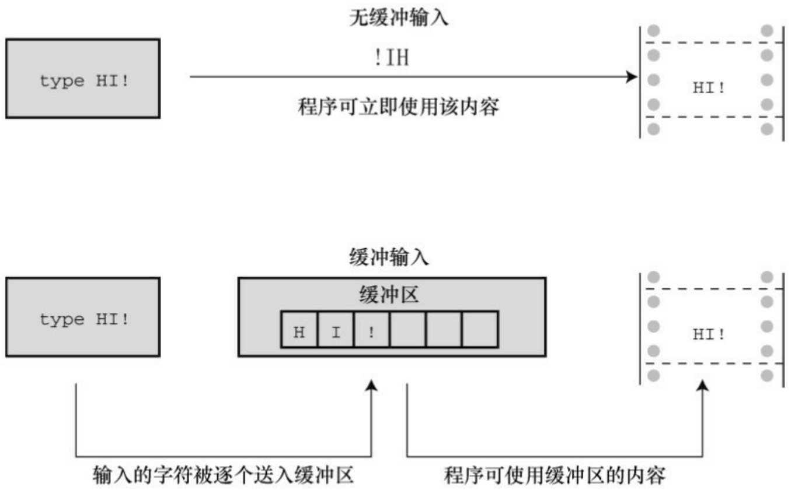

跳转至循环末尾，并开始下一轮迭代。C使用continue语句代替。

跳出循环。C使用break语句。实际上，break和continue是goto的特殊形式。使用break和 continue 的好处是:其名称已经表明它们的用法，而且这些语句不使用标签，所以不用担心把标签放错位置导致的危险。

胡乱跳转至程序的不同部分。简而言之，不要这样做！

但是，C程序员可以接受一种goto的用法——出现问题时从一组嵌套循环中跳出（一条break语句只能跳出当前循环）:

```txt
while (funct > 0)
{
for (i = 1, i <= 100; i++)
{
for (j = 1; j <= 50; j++)
{
其他语句
if (问题)
goto help;
其他语句
}
其他语句
}
```

其他语句

}

其他语句

help: 语句

从其他例子中也能看出，程序中使用其他形式比使用goto的条理更清晰。当多种情况混在一起时，这种差异更加明显。哪些goto语句可以帮助if语句？哪些可以模仿if else？哪些控制循环？哪些是因为程序无路可走才不得已放在那里？过度地使用 goto 语句，会让程序错综复杂。如果不熟悉goto语句，就不要使用它。如果已经习惯使用goto语句，试着改掉这个毛病。讽刺地是，虽然C根本不需要goto，但是它的goto比其他语言的goto好用，因为C允许在标签中使用描述性的单词而不是数字。

小结:程序跳转

关键字:**break**、**continue**、**goto**

一般注解:

这3种语句都能使程序流从程序的一处跳转至另一处。

break语句:

所有的循环和switch语句都可以使用break语句。它使程序控制跳出当前循环或switch语句的剩余部分，并继续执行跟在循环或switch后面的语句。

示例:

```txt
switch (number)
{
```

case 4: printf("That's a good choice.\n");

```txt
break;

case 5: printf("That's a fair choice.\n");

break;

default: printf("That's a poor choice.\n");

}

continue语句:
```

所有的循环都可以使用continue语句，但是switch语句不行。continue语句使程序控制跳出循环的剩余部分。对于while或for循环，程序执行到continue语句后会开始进入下一轮迭代。对于do while循环，对出口条件求值后，如有必要会进入下一轮迭代。

示例:

```txt
while ((ch = getchar()) != '\n')
{
if (ch == ' ')
continue;
putchar(ch);
chcount++;
}
```

以上程序段把用户输入的字符再次显示在屏幕上，并统计非空格字符。

goto语句:

goto语句使程序控制跳转至相应标签语句。冒号用于分隔标签和标签语句。标签名遵循变量命名规则。标签语句可以出现在goto的前面或后面。

形式:

goto label ;

label : statement

示例:

top : ch = getchar();

if (ch != 'y')

goto top;

## 7.9 关键概念

智能的一个方面是，根据情况做出相应的响应。所以，选择语句是开发具有智能行为程序的基础。C语言通过if、if else和switch语句，以及条件运算符（?:）可以实现智能选择。

if 和 if else 语句使用测试条件来判断执行哪些语句。所有非零值都被视为 true，零被视为false。测试通常涉及关系表达式（比较两个值）、逻辑表达式（用逻辑运算符组合或更改其他表达式）。

要记住一个通用原则，如果要测试两个条件，应该使用逻辑运算符把两个完整的测试表达式组合起来。例如，下面这些是错误的:

if (a < x < z) // 错误，没有使用逻辑运算符

…

if (ch != 'q' && != 'Q') // 错误，缺少完整的测试表达式

正确的方式是用逻辑运算符连接两个关系表达式:

if (a < x && x < z) // 使用&&组合两个表达式

…

if (ch != 'q' && ch != 'Q') // 使用&&组合两个表达式

…

对比这两章和前几章的程序示例可以发现:使用第6章、第7章介绍的语句，可以写出功能更强大、更有趣的程序。

## 7.10 本章小结

本章介绍了很多内容，我们来总结一下。if语句使用测试条件控制程序是否执行测试条件后面的一条简单语句或复合语句。如果测试表达式的值是非零值，则执行语句；如果测试表达式的值是零，则不执行语句。if else语句可用于二选一的情况。如果测试条件是非零，则执行else前面的语句；如果测试表达式的值是零，则执行else后面的语句。在else后面使用另一个if语句形成else if，可构造多选一的结构。

测试条件通常都是关系表达式，即用一个关系运算符（如，<或==）的表达式。使用C的逻辑运算符，可以把关系表达式组合成更复杂的测试条件。

在多数情况下，用条件运算符（?:）写成的表达式比if else语句更简洁。

ctype.h系列的字符函数（如，issapce()和isalpha()）为创建以分类字符为基础的测试表达式提供了便捷的工具。

switch 语句可以在一系列以整数作为标签的语句中进行选择。如果紧跟在 switch 关键字后的测试条件的整数值与某标签匹配，程序就转至执行匹配的标签语句，然后在遇到break之前，继续执行标签语句后面的语句。

break、continue和goto语句都是跳转语句，使程序流跳转至程序的另一处。break语句使程序跳转至紧跟在包含break语句的循环或switch末尾的下一条语句。continue语句使程序跳出当前循环的剩余部分，并开始下一轮迭代。

## 7.11 复习题

复习题的参考答案在附录A中。

1.判断下列表达式是true还是false。

```txt
a100 > 3 && 'a' > 'c'
```

```txt
b100 > 3 || 'a'>'c'
```

```lua
c!=(100>3)
```

2.根据下列描述的条件，分别构造一个表达式:

a umber等于或大于90，但是小于100

b h不是字符q或k

c umber在1～9之间（包括1和9），但不是5

d umber不在1～9之间

3.下面的程序关系表达式过于复杂，而且还有些错误，请简化并改正。

```c
#include <stdio.h>
```

```c
int main(void)                          /* 1 */
```

```css
{
/* 2 */
```

int weight, height; /\* weight以磅为单位，height以英寸为单位 \*//\* 4 \*/

```javascript
scanf("%d, weight, height); /* 5 */
```

```javascript
if (weight < 100 && height > 64) /* 6 */
```

printf("You are very tall for your weight.\n");

printf("You are tall for your weight.\n");/\* 10 \*/

else if (weight > 300 && !(weight <= 300) /\* 11 \*/

&& height < 48)

printf(" You are quite short for your weight.\n");

printf("Your weight is ideal.\n");

return 0;

}

4.下列个表达式的值是多少？

a. $. 5 \geq 2$

b.3 + 4 > 2 && 3 < 2

```txt
f.x > y ? y > x : x > y
```

5.下面的程序将打印什么？

```c
#include <stdio.h>

int main(void)
{
int num;
for (num = 1; num <= 11; num++)
{
if (num % 3 == 0)
putchar('\$');
else
putchar('*');
putchar('#');
putchar('%');
}
putchar('\n');
return 0;
}
```

6.下面的程序将打印什么？

```c
#include <stdio.h>

int main(void)
{
int i = 0;
while (i < 3) {
switch (i++) {
case 0: printf("fat ");
case 1: printf("hat ");
case 2: printf("cat ");
default: printf("Oh no!");
}
putchar('\n');
}
return 0;
}
```

7.下面的程序有哪些错误？

```c
#include <stdio.h>

int main(void)

{
```

```txt
char ch;
int lc = 0; /* 统计小写字母
int uc = 0; /* 统计大写字母
int oc = 0; /* 统计其他字母
while ((ch = getchar()) != '#')
{
if ('a' <= ch >= 'z')
lc++;
else if (!(ch < 'A') || !(ch > 'Z')
uc++;
oc++;
}
printf(%d lowercase, %d uppercase, %d other, lc, uc, oc);
return 0;
}
```

8.下面的程序将打印什么？

```txt
/* retire.c */
#include <stdio.h>
int main(void)
```

```c
{
int age = 20;
while (age++ <= 65)
{
if ((age % 20) == 0) /* age是否能被20整除？ */
printf("You are %d.Here is a raise.\n", age);
if (age = 65)
printf("You are %d.Here is your gold watch.\n", age);
}
return 0;
}
```

9.给定下面的输入时，以下程序将打印什么？

```c
q
c
h
b
#include <stdio.h>
int main(void)
{
```

```txt
char ch;

while ((ch = getchar()) != '#')
{
if (ch == '\n')
continue;
printf("Step 1\n");
if (ch == 'c')
continue;
else if (ch == 'b')
break;
else if (ch == 'h')
goto laststep;
printf("Step 2\n");
laststep: printf("Step 3\n");
}
printf("Done\n");
return 0;
}
```

10.重写复习题9，但这次不能使用continue和goto语句。

## 7.12 编程练习

1.编写一个程序读取输入，读到#字符停止，然后报告读取的空格数、换行符数和所有其他字符的数量。
2.编写一个程序读取输入，读到#字符停止。程序要打印每个输入的字符以及对应的ASCII码（十进制）。一行打印8个字符。建议:使用字符计数和求模运算符（%）在每8个循环周期时打印一个换行符。
3.编写一个程序，读取整数直到用户输入 0。输入结束后，程序应报告用户输入的偶数（不包括 0）个数、这些偶数的平均值、输入的奇数个数及其奇数的平均值。
4.使用if else语句编写一个程序读取输入，读到#停止。用感叹号替换句号，用两个感叹号替换原来的感叹号，最后报告进行了多少次替换。
5.使用switch重写练习4。
6.编写程序读取输入，读到#停止，报告ei出现的次数。

注意

该程序要记录前一个字符和当前字符。用“Receive your eieio award”这样的输入来测试。

7.编写一个程序，提示用户输入一周工作的小时数，然后打印工资总额、税金和净收入。做如下假设:

a.基本工资 = 1000美元/小时
b.加班（超过40小时） = 1.5倍的时间
c.税率: 前300美元为15%

续150美元为20%

余下的为25%

用#define定义符号常量。不用在意是否符合当前的税法。

8.修改练习7的假设a，让程序可以给出一个供选择的工资等级菜单。使用switch完成工资等级选择。运行程序后，显示的菜单应该类似这样:

\*\*\*\*\*\*\*\*\*\*\*\*\*\*\*\*\*\*\*\*\*\*\*\*\*\*\*\*\*\*\*\*\*\*\*\*\*\*\*\*\*\*\*\*\*\*\*\*\*\*\*\*\*\*\*\*\*\*\*\*\*\*\*\*\*

Enter the number corresponding to the desired pay rate or action:

1) \$8.75/hr

2) \$9.33/hr

3) \$10.00/hr

4) \$11.20/hr

5) quit

\*\*\*\*\*\*\*\*\*\*\*\*\*\*\*\*\*\*\*\*\*\*\*\*\*\*\*\*\*\*\*\*\*\*\*\*\*\*\*\*\*\*\*\*\*\*\*\*\*\*\*\*\*\*\*\*\*\*\*\*\*\*\*\*\*

如果选择 1～4 其中的一个数字，程序应该询问用户工作的小时数。程序要通过循环运行，除非用户输入 5。如果输入 1～5 以外的数字，程序应提醒用户输入正确的选项，然后再重复显示菜单提示用户输入。使用#define创建符号常量表示各工资等级和税率。

9.编写一个程序，只接受正整数输入，然后显示所有小于或等于该数的素数。
10.1988年的美国联邦税收计划是近代最简单的税收方案。它分为4个类别，每个类别有两个等级。

下面是该税收计划的摘要（美元数为应征税的收入）:

| 类别 | 税金 |
| --- | --- |
| 单身 | 17850 美元按 15% 计,超出部分按 28% 计 |
| 户主 | 23900 美元按 15% 计,超出部分按 28% 计 |
| 已婚,共有 | 29750 美元按 15% 计,超出部分按 28% 计 |
| 已婚,离异 | 14875 美元按 15% 计,超出部分按 28% 计 |

例如，一位工资为20000美元的单身纳税人，应缴纳税费0.15×17850+0.28×（20000−17850）美元。编写一个程序，让用户指定缴纳税金的种类和应纳税收入，然后计算税金。程序应通过循环让用户可以多次输入。

11.ABC 邮购杂货店出售的洋蓟售价为 2.05 美元/磅，甜菜售价为 1.15美元/磅，胡萝卜售价为 1.09美元/磅。在添加运费之前，100美元的订单有5%的打折优惠。少于或等于5磅的订单收取6.5美元的运费和包装费，5磅～ 20磅的订单收取14美元的运费和包装费，超过20磅的订单在14美元的基础上每续重1磅增加0.5美元。编写一个程序，在循环中用switch语句实现用户输入不同的字母时有不同的响应，即输入a的响应是让用户输入洋蓟的磅数，b是甜菜的磅数，c是胡萝卜的磅数，q 是退出订购。程序要记录累计的重量。即，如果用户输入 4 磅的甜菜，然后输入 5磅的甜菜，程序应报告9磅的甜菜。然后，该程序要计算货物总价、折扣（如果有的话）、运费和包装费。随后，程序应显示所有的购买信息:物品售价、订购的重量（单位:磅）、订购的蔬菜费用、订单的总费用、折扣（如果有的话）、运费和包装费，以及所有的费用总额。

# 第8章字符输入/输出和输入验证

本章介绍以下内容:

更详细地介绍输入、输出以及缓冲输入和无缓冲输入的区别

如何通过键盘模拟文件结尾条件

如何使用重定向把程序和文件相连接

创建更友好的用户界面

在涉及计算机的话题时，我们经常会提到输入（input）和输出（output）。我们谈论输入和输出设备（如键盘、U盘、扫描仪和激光打印机），讲解如何处理输入数据和输出数据，讨论执行输入和输出任务的函数。本章主要介绍用于输入和输出的函数（简称I/O函数）。

I/O函数（如printf()、scanf()、getchar()、putchar()等）负责把信息传送到程序中。前几章简单介绍过这些函数，本章将详细介绍它们的基本概念。同时，还会介绍如何设计与用户交互的界面。

最初，输入/输出函数不是C定义的一部分，C把开发这些函数的任务留给编译器的实现者来完成。在实际应用中，UNIX 系统中的 C 实现为这些函数提供了一个模型。ANSI C 库吸取成功的经验，把大量的UNIX I/O函数囊括其中，包括一些我们曾经用过的。由于必须保证这些标准函数在不同的计算机环境中能正常工作，所以它们很少使用某些特殊系统才有的特性。因此，许多C供应商会利用硬件的特性，额外提供一些I/O函数。其他函数或函数系列需要特殊的操作系统支持，如Winsows或Macintosh OS提供的特殊图形界面。这些有针对性、非标准的函数让程序员能更有效地使用特定计算机编写程序。本章只着重讲解所有系统都通用的标准 I/O 函数，用这些函数编写的可移植程序很容易从一个系统移植到另一个系统。处理文件输入/输出的程序也可以使用这些函数。

许多程序都有输入验证，即判断用户的输入是否与程序期望的输入匹配。本章将演示一些与输入验证相关的问题和解决方案。

## 8.1 单字符I/O:getchar()和putchar()

第 7 章中提到过，getchar()和 putchar()每次只处理一个字符。你可能认为这种方法实在太笨拙了，毕竟与我们的阅读方式相差甚远。但是，这种方法很适合计算机。而且，这是绝大多数文本（即，普通文字）处理程序所用的核心方法。为了帮助读者回忆这些函数的工作方式，请看程序清单8.1。该程序获取从键盘输入的字符，并把这些字符发送到屏幕上。程序使用while 循环，当读到#字符时停止。

程序清单8.1 echo.c程序

```c
/* echo.c -- 重复输入 */

#include <stdio.h>

int main(void)

{

char ch;

while ((ch = getchar()) != '#')

putchar(ch);

return 0;

}
```

自从ANSI C标准发布以后，C就把stdio.h头文件与使用getchar()和putchar()相关联，这就是为什么程序中要包含这个头文件的原因（其实，getchar()和 putchar()都不是真正的函数，它们被定义为供预处理器使用的宏，我们在第16章中再详细讨论）。运行该程序后，与用户的交互如下:

**Hello, there.** I **would[enter]**

Hello, there. I would

**like** a **#3 bag of potatoes.[enter]**

like a

读者可能好奇，为何输入的字符能直接显示在屏幕上？如果用一个特殊字符（如，#）来结束输入，就无法在文本中使用这个字符，是否有更好的方法结束输入？要回答这些问题，首先要了解 C程序如何处理键盘输入，尤其是缓冲和标准输入文件的概念。

## 8.2 缓冲区

如果在老式系统运行程序清单8.1，你输入文本时可能显示如下:

HHeelllloo,, tthheerree..II wwoouulldd[enter]

lliikkee aa #

以上行为是个例外。像这样回显用户输入的字符后立即重复打印该字符是属于无缓冲（或直接）输入，即正在等待的程序可立即使用输入的字符。对于该例，大部分系统在用户按下Enter键之前不会重复打印刚输入的字符，这种输入形式属于缓冲输入。用户输入的字符被收集并储存在一个被称为缓冲区（buffer）的临时存储区，按下Enter键后，程序才可使用用户输入的字符。图8.1比较了这两种输入。



图8.1 缓冲输入和无缓冲输入

为什么要有缓冲区？首先，把若干字符作为一个块进行传输比逐个发送这些字符节约时间。其次，如果用户打错字符，可以直接通过键盘修正错

误。当最后按下Enter键时，传输的是正确的输入。

虽然缓冲输入好处很多，但是某些交互式程序也需要无缓冲输入。例如，在游戏中，你希望按下一个键就执行相应的指令。因此，缓冲输入和无缓冲输入都有用武之地。

缓冲分为两类:完全缓冲I/O和行缓冲I/O。完全缓冲输入指的是当缓冲区被填满时才刷新缓冲区（内容被发送至目的地），通常出现在文件输入中。缓冲区的大小取决于系统，常见的大小是 512 字节和 4096字节。行缓冲I/O指的是在出现换行符时刷新缓冲区。键盘输入通常是行缓冲输入，所以在按下Enter键后才刷新缓冲区。

那么，使用缓冲输入还是无缓冲输入？ANSI C和后续的C标准都规定输入是缓冲的，不过最初K&R把这个决定权交给了编译器的编写者。读者可以运行echo.c程序观察输出的情况，了解所用的输出类型。

ANSI C决定把缓冲输入作为标准的原因是:一些计算机不允许无缓冲输入。如果你的计算机允许无缓冲输入，那么你所用的C编译器很可能会提供一个无缓冲输入的选项。例如，许多IBM PC兼容机的编译器都为支持无缓冲输入提供一系列特殊的函数，其原型都在conio.h头文件中。这些函数包括用于回显无缓冲输入的getche()函数和用于无回显无缓冲输入的getch()函数（回显输入意味着用户输入的字符直接显示在屏幕上，无回显输入意味着击键后对应的字符不显示）。UNIX系统使用另一种不同的方式控制缓冲。在UNIX系统中，可以使用ioctl()函数（该函数属于UNIX库，但是不属于C标准）指定待输入的类型，然后用getchar()执行相应的操作。在ANSI C中，用setbuf()和setvbuf()函数（详见第13章）控制缓冲，但是受限于一些系统的内部设置，这些函数可能不起作用。总之，ANSI没有提供调用无缓冲输入的标准方式，这意味着是否能进行无缓冲输入取决于计算机系统。在这里要对使用无缓冲输入的朋友说声抱歉，本书假设所有的输入都是缓冲输入。

## 8.3 结束键盘输入

在echo.c程序（程序清单8.1）中，只要输入的字符中不含#，那么程序在读到#时才会结束。但是， #也是一个普通的字符，有时不可避免要用到。应该用一个在文本中用不到的字符来标记输入完成，这样的字符不会无意间出现在输入中，在你不希望结束程序的时候终止程序。C 的确提供了这样的字符，不过在此之前，先来了解一下C处理文件的方式。

## 8.3.1 文件、流和键盘输入

文件（file）是存储器中储存信息的区域。通常，文件都保存在某种永久存储器中（如，硬盘、U盘或DVD等）。毫无疑问，文件对于计算机系统相当重要。例如，你编写的C程序就保存在文件中，用来编译C程序的程序也保存在文件中。后者说明，某些程序需要访问指定的文件。当编译储存在名为 echo.c 文件中的程序时，编译器打开echo.c文件并读取其中的内容。当编译器处理完后，会关闭该文件。其他程序，例如文字处理器，不仅要打开、读取和关闭文件，还要把数据写入文件。

C 是一门强大、灵活的语言，有许多用于打开、读取、写入和关闭文件的库函数。从较低层面上，C可以使用主机操作系统的基本文件工具直接处理文件，这些直接调用操作系统的函数被称为底层 I/O （low-level I/O）。由于计算机系统各不相同，所以不可能为普通的底层I/O函数创建标准库，ANSI C也不打算这样做。然而从较高层面上，C还可以通过标准I/O包（standard I/O package）来处理文件。这涉及创建用于处理文件的标准模型和一套标准I/O函数。在这一层面上，具体的C实现负责处理不同系统的差异，以便用户使用统一的界面。

上面讨论的差异指的是什么？例如，不同的系统储存文件的方式不同。有些系统把文件的内容储存在一处，而文件相关的信息储存在另一处；有些系统在文件中创建一份文件描述。在处理文件方面，有些系统使用单个换行符标记行末尾，而其他系统可能使用回车符和换行符的组合来表示行末尾。有些系统用最小字节来衡量文件的大小，有些系统则以字节块的大小来衡

量。

如果使用标准 I/O 包，就不用考虑这些差异。因此，可以用 if (ch == $\cdot \pi$ )检查换行符。即使系统实际用的是回车符和换行符的组合来标记行末尾，I/O函数会在两种表示法之间相互转换。

从概念上看，C程序处理的是流而不是直接处理文件。流（stream）是一个实际输入或输出映射的理想化数据流。这意味着不同属性和不同种类的输入，由属性更统一的流来表示。于是，打开文件的过程就是把流与文件相关联，而且读写都通过流来完成。

第13章将更详细地讨论文件。本章着重理解C把输入和输出设备视为存储设备上的普通文件，尤其是把键盘和显示设备视为每个C程序自动打开的文件。stdin流表示键盘输入，stdout流表示屏幕输出。getchar()、putchar()、printf()和scanf()函数都是标准I/O包的成员，处理这两个流。

以上讨论的内容说明，可以用处理文件的方式来处理键盘输入。例如，程序读文件时要能检测文件的末尾才知道应在何处停止。因此，C 的输入函数内置了文件结尾检测器。既然可以把键盘输入视为文件，那么也应该能使用文件结尾检测器结束键盘输入。下面我们从文件开始，学习如何结束文件。

## 8.3.2 文件结尾

计算机操作系统要以某种方式判断文件的开始和结束。检测文件结尾的一种方法是，在文件末尾放一个特殊的字符标记文件结尾。CP/M、IBM-DOS和MS-DOS的文本文件曾经用过这种方法。如今，这些操作系统可以使用内嵌的Ctrl+Z字符来标记文件结尾。这曾经是操作系统使用的唯一标记，不过现在有一些其他的选择，例如记录文件的大小。所以现代的文本文件不一定有嵌入的Ctrl+Z，但是如果有，该操作系统会将其视为一个文件结尾标记。图8.2演示了这种方法。

散文原文:

```txt
Ishphat the robot
slid open the hatch
and shouted his challenge.
```

文件中的散文:

```txt
Ishphat the robot\n slid open the hatch\n and shouted his challenge.\n^Z
```

图8.2 带文件结尾标记的文件

操作系统使用的另一种方法是储存文件大小的信息。如果文件有3000字节，程序在读到3000字节时便达到文件的末尾。MS-DOS 及其相关系统使用这种方法处理二进制文件，因为用这种方法可以在文件中储存所有的字符，包括Ctrl+Z。新版的DOS也使用这种方法处理文本文件。UNIX使用这种方法处理所有的文件。

无论操作系统实际使用何种方法检测文件结尾，在C语言中，用getchar()读取文件检测到文件结尾时将返回一个特殊的值，即EOF（end of file的缩写）。scanf()函数检测到文件结尾时也返回EOF。通常， EOF定义在stdio.h文件中:

#define EOF (-1)

为什么是-1？因为getchar()函数的返回值通常都介于0～127，这些值对应标准字符集。但是，如果系统能识别扩展字符集，该函数的返回值可能在0～255之间。无论哪种情况，-1都不对应任何字符，所以，该值可用于标记文件结尾。

某些系统也许把EOF定义为-1以外的值，但是定义的值一定与输入字符所产生的返回值不同。如果包含stdio.h文件，并使用EOF符号，就不必担心EOF值不同的问题。这里关键要理解EOF是一个值，标志着检测到文件结尾，并不是在文件中找得到的符号。

那么，如何在程序中使用EOF？把getchar()的返回值和EOF作比较。如果两值不同，就说明没有到达文件结尾。也就是说，可以使用下面这样的表达式:

```txt
while ((ch = getchar()) != EOF)
```

如果正在读取的是键盘输入不是文件会怎样？绝大部分系统（不是全部）都有办法通过键盘模拟文件结尾条件。了解这些以后，读者可以重写程序清单8.1的程序，如程序清单8.2所示。

程序清单8.2 echo\_eof.c程序

```c
/* echo_eof.c -- 重复输入，直到文件结尾 */
#include <stdio.h>

int main(void)
{
int ch;

while ((ch = getchar()) != EOF)

putchar(ch);

return 0;
}
```

注意下面几点。

不用定义EOF，因为stdio.h中已经定义过了。

不用担心EOF的实际值，因为EOF在stdio.h中用#define预处理指令定义，可直接使用，不必再编写代码假定EOF为某值。

变量ch的类型从char变为int，因为char类型的变量只能表示0～255的无符号整数，但是EOF的值是-1。还好，getchar()函数实际返回值的类型是int，所以它可以读取EOF字符。如果实现使用有符号的char类型，也可以把ch声明为char类型，但最好还是用更通用的形式。

由于getchar()函数的返回类型是int，如果把getchar()的返回值赋给char类型的变量，一些编译器会警告可能丢失数据。

ch是整数不会影响putchar()，该函数仍然会打印等价的字符。

使用该程序进行键盘输入，要设法输入EOF字符。不能只输入字符EOF，也不能只输入-1（输入-1会传送两个字符:一个连字符和一个数字1）。正确的方法是，必须找出当前系统的要求。例如，在大多数UNIX和Linux系统中，在一行开始处按下Ctrl+D会传输文件结尾信号。许多微型计算机系统都把一行开始处的Ctrl+Z识别为文件结尾信号，一些系统把任意位置的Ctrl+Z解释成文件结尾信号。

下面是在UNIX系统下运行echo\_eof.c程序的缓冲示例:

**She walks in beauty, like the night**

She walks in beauty, like the night

**Of cloudless climes and starry skies...**

Of cloudless climes and starry skies...

**Lord Byron**

Lord Byron

**[Ctrl+D]**

每次按下Enter键，系统便会处理缓冲区中储存的字符，并在下一行打印该输入行的副本。这个过程一直持续到以UNIX风格模拟文件结尾（按下

Ctrl+D）。在PC中，要按下Ctrl+Z。

我们暂停一会。既然echo\_eof.c程序能把用户输入的内容拷贝到屏幕上，那么考虑一下该程序还可以做什么。假设以某种方式把一个文件传送给它，然后它把文件中的内容打印在屏幕上，当到达文件结尾发现EOF信号时停止。或者，假设以某种方式把程序的输出定向到一个文件，然后通过键盘输入数据，用echo\_eof.c 来储存在文件中输入的内容。假设同时使用这两种方法:把输入从一个文件定向到echo\_eof.c中，并把输出发送至另一个文件，然后便可以使用echo\_eof.c来拷贝文件。这个小程序有查看文件内容、创建一个新文件、拷贝文件的潜力，没想到一个小程序竟然如此多才多艺！关键是要控制输入流和输出流，这是我们下一个要讨论的主题。

## 注意模拟EOF和图形界面

模拟EOF的概念是在使用文本界面的命令行环境中产生的。在这种环境中，用户通过击键与程序交互，由操作系统生成EOF信号。但是在一些实际应用中，却不能很好地转换成图形界面（如Windows和Macintosh），这些用户界面包含更复杂的鼠标移动和按钮点击。程序要模拟EOF的行为依赖于编译器和项目类型。例如，Ctrl+Z可以结束输入或整个程序，这取决于特定的设置。

## 8.4 重定向和文件

输入和输出涉及函数、数据和设备。例如，考虑 echo\_eof.c，该程序使用输入函数 getchar()。输出设备（我们假设）是键盘，输入数据流由字符组成。假设你希望输入函数和数据类型不变，仅改变程序查找数据的位置。那么，程序如何知道去哪里查找输入？

在默认情况下，C程序使用标准I/O包查找标准输入作为输入源。这就是前面介绍过的stdin流，它是把数据读入计算机的常用方式。它可以是一个过时的设备，如磁带、穿孔卡或电传打印机，或者（假设）是键盘，甚至是一些先进技术，如语音输入。然而，现代计算机非常灵活，可以让它到别处查找输入。尤其是，可以让一个程序从文件中查找输入，而不是从键盘。

程序可以通过两种方式使用文件。第 1 种方法是，显式使用特定的函数打开文件、关闭文件、读取文件、写入文件，诸如此类。我们在第13章中再详细介绍这种方法。第2种方法是，设计能与键盘和屏幕互动的程序，通过不同的渠道重定向输入至文件和从文件输出。换言之，把stdin流重新赋给文件。继续使用getchar()函数从输入流中获取数据，但它并不关心从流的什么位置获取数据。虽然这种重定向的方法在某些方面有些限制，但是用起来比较简单，而且能让读者熟悉普通的文件处理技术。

重定向的一个主要问题与操作系统有关，与C无关。尽管如此，许多C环境中（包括UNIX、Linux和Windows命令提示模式）都有重定向特性，而且一些C实现还在某些缺乏重定向特性的系统中模拟它。在UNIX上运行苹果OS X，可以用UNIX命令行模式启动Terminal应用程序。接下来我们介绍UNIX、Linux和Windows的重定向。

## 8.4.1 UNIX、Linux和DOS重定向

UNIX（运行命令行模式时）、Linux（ditto）和Window命令行提示（模仿旧式DOS命令行环境）都能重定向输入、输出。重定向输入让程序使用文件而不是键盘来输入，重定向输出让程序输出至文件而不是屏幕。

## 1.重定向输入

假设已经编译了echo\_eof.c 程序，并把可执行版本放入一个名为echo\_eof（或者在Windows系统中名为echo\_eof.exe）的文件中。运行该程序，输入可执行文件名:

```txt
echo_eof
```

该程序的运行情况和前面描述的一样，获取用户从键盘输入的输入。现在，假设你要用该程序处理名为words的文本文件。文本文件（text file）是内含文本的文件，其中储存的数据是我们可识别的字符。文件的内容可以是一篇散文或者C程序。内含机器语言指令的文件（如储存可执行程序的文件）不是文本文件。由于该程序的操作对象是字符，所以要使用文本文件。只需用下面的命令代替上面的命令即可:

```txt
echo_eof < words
```

<符号是UNIX和DOS/Windows的重定向运算符。该运算符使words文件与stdin流相关联，把文件中的内容导入echo\_eof程序。echo\_eof程序本身并不知道（或不关心）输入的内容是来自文件还是键盘，它只知道这是需要导入的字符流，所以它读取这些内容并把字符逐个打印在屏幕上，直至读到文件结尾。因为C把文件和I/O设备放在一个层面，所以文件就是现在的I/O设备。试试看！

## 注意重定向

对于UNIX、Linux和Windows命令提示，<两侧的空格是可选的。一些系统，如AmigaDOS（那些喜欢怀旧的人使用的系统），支持重定向，但是在重定向符号和文件名之间不允许有空格。

下面是一个特殊的words文件的运行示例，\$是UNIX和Linux的标准提示符。在Windows/DOS系统中见到的DOS提示可能是A>或C>。

```perl
\$ echo_eof < words
```

The world is too much with us: late and soon,

We have given our hearts away, a sordid boon!

\$

## 2.重定向输出

现在假设要用echo\_eof把键盘输入的内容发送到名为mywords的文件中。然后，输入以下命令并开始输入:

echo\_eof>mywords

>符号是第2个重定向运算符。它创建了一个名为mywords的新文件，然后把echo\_eof的输出（即，你输入字符的副本）重定向至该文件中。重定向把stdout从显示设备（即，显示器）赋给mywords文件。如果已经有一个名为mywords的文件，通常会擦除该文件的内容，然后替换新的内容（但是，许多操作系统有保护现有文件的选项，使其成为只读文件）。所有出现在屏幕的字母都是你刚才输入的，其副本储存在文件中。在下一行的开始处按下Ctrl+D（UNIX）或Ctrl+Z（DOS）即可结束该程序。如果不知道输入什么内容，可参照下面的示例。这里，我们使用UNIX提示符\$。记住在每行的末尾单击Enter键，这样才能把缓冲区的内容发送给程序。

\$ echo\_eof > mywords

**You should have no problem recalling which redirection**

**operator does what. Just remember that each operator points**

**in the direction the information flows. Think of it as**

a **funnel.**

**[Ctrl+D]**

\$

按下Ctrl+D或Ctrl+Z后，程序会结束，你的系统会提示返回。程序是否起作用了？UNIX的ls命令或Windows命令行提示模式的dir命令可以列出文件名，会显示mywords文件已存在。可以使用UNIX或Linux的cat或DOS的type命令检查文件中的内容，或者再次使用echo\_eof，这次把文件重定向到程序:

\$ echo\_eof < mywords

You should have no problem recalling which redirection

operator does what. Just remember that each operator points

in the direction the information flows. Think of it as a

funnel.

\$

## 3.组合重定向

现在，假设你希望制作一份mywords文件的副本，并命名为savewords。只需输入以下命令即可:

echo\_eof < mywords > savewords

下面的命令也起作用，因为命令与重定向运算符的顺序无关:

echo\_eof > savewords < mywords

注意:在一条命令中，输入文件名和输出文件名不能相同。