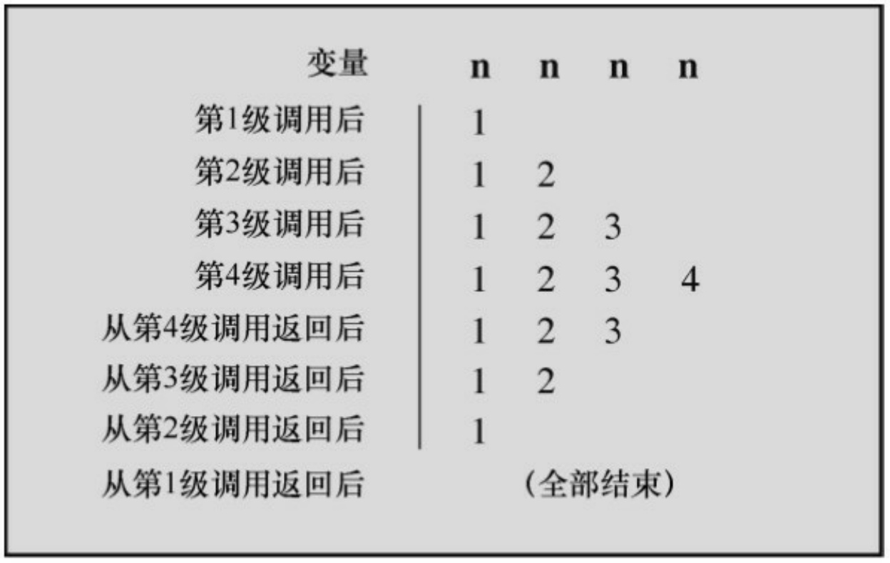

## 9.1.8 使用return从函数中返回值

前面介绍了如何把信息从主调函数传递给被调函数。反过来，函数的返回值可以把信息从被调函数传回主调函数。为进一步说明，我们将创建一个返回两个参数中较小值的函数。由于函数被设计用来处理int类型的值，所以被命名为imin()。另外，还要创建一个简单的main()，用于检查imin()是否正常工作。这种被设计用于测试函数的程序有时被称为驱动程序（driver），该驱动程序调用一个函数。如果函数成功通过了测试，就可以安装在一个更重要的程序中使用。程序清单9.3演示了这个驱动程序和返回最小值的函数。

程序清单9.3 lesser.c程序

```c
/* lesser.c -- 找出两个整数中较小的一个 */
#include <stdio.h>

int imin(int, int);

int main(void)

{

int evil1, evil2;

printf("Enter a pair of integers (q to quit):\n");
while (scanf("%d %d", &evil1, &evil2) == 2)
{

printf("The lesser of %d and %d is %d.\n",
evil1, evil2, imin(evil1, evil2));

printf("Enter a pair of integers (q to quit):\n");
```

```txt
}
printf("Bye.\n");
return 0;
}
int imin(int n, int m)
{
int min;
if (n < m)
min = n;
else
min = m;
return min;
}
```

回忆一下，scanf()返回成功读数据的个数，所以如果输入不是两个整数会导致循环终止。下面是一个运行示例:

Enter a pair of integers (q to quit):

**509 333**

The lesser of 509 and 333 is 333.

Enter a pair of integers (q to quit):

**-9393 6**

The lesser of -9393 and 6 is -9393.

Enter a pair of integers (q to quit):

q

Bye.

关键字return后面的表达式的值就是函数的返回值。在该例中，该函数返回的值就是变量min的值。因为min是int类型的变量，所以imin()函数的类型也是int。

变量min属于imin()函数私有，但是return语句把min的值传回了主调函数。下面这条语句的作用是把min的值赋给lesser:

lesser = imin(n,m);

是否能像写成下面这样:

imin(n,m);

lesser = min;

不能。因为主调函数甚至不知道min的存在。记住，imin()中的变量是imin()的局部变量。函数调用imin(evil1, evil2)只是把两个变量的值拷贝了一份。

返回值不仅可以赋给变量，也可以被用作表达式的一部分。例如，可以这样:

answer = 2 \* imin(z, zstar) + 25;

printf("%d\n", imin(-32 + answer, LIMIT));

返回值不一定是变量的值，也可以是任意表达式的值。例如，可以用以下的代码简化程序示例:

/\* 返回最小值的函数，第2个版本 \*/

```autohotkey
imin(int n,int m)

{

return (n < m) ? n : m;

}
```

条件表达式的值是n和m中的较小者，该值要被返回给主调函数。虽然这里不要求用圆括号把返回值括起来，但是如果想让程序条理更清楚或统一风格，可以把返回值放在圆括号内。

如果函数返回值的类型与函数声明的类型不匹配会怎样？

```txt
int what_if(int n)
{
double z = 100.0 / (double) n;
return z; // 会发生什么?
}
```

实际得到的返回值相当于把函数中指定的返回值赋给与函数类型相同的变量所得到的值。因此在本例中，相当于把z的值赋给int类型的变量，然后返回int类型变量的值。例如，假设有下面的函数调用:

```txt
result = what_if(64);
```

虽然在what\_if()函数中赋给z的值是1.5625，但是return语句返回确实int

类型的值1。

使用 return 语句的另一个作用是，终止函数并把控制返回给主调函数的下一条语句。因此，可以这样编写imin():

/\*返回最小值的函数，第3个版本\*/

```lisp
imin(int n,int m)
{
if (n < m)
return n;
else
return m;
}
```

许多C程序员都认为只在函数末尾使用一次return语句比较好，因为这样做更方便浏览程序的人理解函数的控制流。但是，在函数中使用多个return语句也没有错。无论如何，对用户而言，这3个版本的函数用起来都一样，因为所有的输入和输出都完全相同，不同的是函数内部的实现细节。下面的版本也没问题:

/\*返回最小值的函数，第4个版本\*/

```txt
imin(int n, int m)
{
if (n < m)
return n;
```

```solidity
else

return m;

printf("Professor Fleppard is like totally a fopdoodle.\n");
}
```

return语句导致printf()语句永远不会被执行。如果Fleppard教授在自己的程序中使用这个版本的函数，可能永远不知道编写这个函数的学生对他的看法。

另外，还可以这样使用return:

return;

这条语句会导致终止函数，并把控制返回给主调函数。因为 return 后面没有任何表达式，所以没有返回值，只有在void函数中才会用到这种形式。

## 9.1.9 函数类型

声明函数时必须声明函数的类型。带返回值的函数类型应该与其返回值类型相同，而没有返回值的函数应声明为void类型。如果没有声明函数的类型，旧版本的C编译器会假定函数的类型是int。这一惯例源于C的早期，那时的函数绝大多数都是int类型。然而，C99标准不再支持int类型函数的这种假定设置。

类型声明是函数定义的一部分。要记住，函数类型指的是返回值的类型，不是函数参数的类型。例如，下面的函数头定义了一个带两个int类型参数的函数，但是其返回值是double类型。

double klink(int a, int b)

要正确地使用函数，程序在第 1 次使用函数之前必须知道函数的类型。方法之一是，把完整的函数定义放在第1次调用函数的前面。然而，这种方法增加了程序的阅读难度。而且，要使用的函数可能在C库或其他文件中。因此，通常的做法是提前声明函数，把函数的信息告知编译器。例如，程序清单 9.3 中的main()函数包含以下几行代码:

```c
#include <stdio.h>

int imin(int, int);

int main(void)

{

int evil1, evil2, lesser;
```

第2行代码说明imin是一个函数名，有两个int类型的形参，且返回int类型的值。现在，编译器在程序中调用imin()函数时就知道应该如何处理。

在程序清单9.3中，我们把函数的前置声明放在主调函数外面。当然，也可以放在主调函数里面。例如，重写lesser.c（程序清单9.3）的开头部分:

```c
#include <stdio.h>

int main(void)

{

int imin(int, int); /* 声明imin()函数的原型*/

int evil1, evil2, lesser;
```

注意在这两种情况中，函数原型都声明在使用函数之前。

ANSI C标准库中，函数被分成多个系列，每一系列都有各自的头文件。这些头文件中除了其他内容，还包含了本系列所有函数的声明。例如，stdio.h 头文件包含了标准 I/O 库函数（如，printf()和scanf()）的声明。math.h头文件包含了各种数学函数的声明。例如，下面的声明:

double sqrt(double);

告知编译器sqrt()函数有一个double类型的形参，而且返回double类型的值。不要混淆函数的声明和定义。函数声明告知编译器函数的类型，而函数定义则提供实际的代码。在程序中包含 math.h 头文件告知编译器:sqrt()返回double类型，但是sqrt()函数的代码在另一个库函数的文件中。

## 9.2 ANSI C函数原型

在ANSI C标准之前，声明函数的方案有缺陷，因为只需要声明函数的类型，不用声明任何参数。下面我们看一下使用旧式的函数声明会导致什么问题。

下面是ANSI之前的函数声明，告知编译器imin()返回int类型的值:

int imin();

然而，以上函数声明并未给出imin()函数的参数个数和类型。因此，如果调用imin()时使用的参数个数不对或类型不匹配，编译器根本不会察觉出来。

## 9.2.1 问题所在

我们看看与imax()函数相关的一些示例，该函数与imin()函数关系密切。程序清单9.4演示了一个程序，用过去声明函数的方式声明了imax()函数，然后错误地使用该函数。

程序清单**9.4 misuse.c**程序

```c
/* misuse.c -- 错误地使用函数 */

#include <stdio.h>

int imax();      /* 旧式函数声明 */

int main(void)

{

printf("The maximum of %d and %d is %d.\n",3, 5, imax(3));

printf("The maximum of %d and %d is %d.\n",3, 5,
```

```txt
imax(3.0, 5.0));

    return 0;

}

int imax(n, m)

int n, m;

{

return (n > m ? n : m);

}
```

第1次调用printf()时省略了imax()的一个参数，第2次调用printf()时用两个浮点参数而不是整数参数。尽管有些问题，但程序可以编译和运行。

下面是使用Xcode 4.6运行的输出示例:

```txt
The maximum of 3 and 5 is 1606416656.
The maximum of 3 and 5 is 3886.
```

使用gcc运行该程序，输出的值是1359379472和1359377160。这两个编译器都运行正常，之所以输出错误的结果，是因为它们运行的程序没有使用函数原型。

到底是哪里出了问题？由于不同系统的内部机制不同，所以出现问题的具体情况也不同。下面介绍的是使用P C和VA X的情况。主调函数把它的参数储存在被称为栈（stack）的临时存储区，被调函数从栈中读取这些参数。对于该例，这两个过程并未相互协调。主调函数根据函数调用中的实际参数决定传递的类型，而被调函数根据它的形式参数读取值。因此，函数调用imax(3)把一个整数放在栈中。当imax()函数开始执行时，它从栈中读取两个整数。而实际上栈中只存放了一个待读取的整数，所以读取的第 2 个值是当时恰好在栈中的其他值。

第2次使用imax()函数时，它传递的是float类型的值。这次把两个double类型的值放在栈中（回忆一下，当float类型被作为参数传递时会被升级为double类型）。在我们的系统中，两个double类型的值就是两个64位的值，所以128位的数据被放在栈中。当imax()从栈中读取两个int类型的值时，它从栈中读取前64位。在我们的系统中，每个int类型的变量占用32位。这些数据对应两个整数，其中较大的是3886。

## 9.2.2 ANSI的解决方案

针对参数不匹配的问题，ANSI C标准要求在函数声明时还要声明变量的类型，即使用函数原型（function prototype）来声明函数的返回类型、参数的数量和每个参数的类型。未标明 imax()函数有两个 int 类型的参数，可以使用下面两种函数原型来声明:

int imax(int, int);

int imax(int a, int b);

第1种形式使用以逗号分隔的类型列表，第2种形式在类型后面添加了变量名。注意，这里的变量名是假名，不必与函数定义的形式参数名一致。

有了这些信息，编译器可以检查函数调用是否与函数原型匹配。参数的数量是否正确？参数的类型是否匹配？以 imax()为例，如果两个参数都是数字，但是类型不匹配，编译器会把实际参数的类型转换成形式参数的类型。例如，imax(3.0, 5.0)会被转换成imax(3, 5)。我们用函数原型替换程序清单9.4中的函数声明，如程序清单9.5所示。

程序清单**9.5 proto.c**程序

/\* proto.c -- 使用函数原型 \*/

```c
#include <stdio.h>

int imax(int, int);      /* 函数原型 */

int main(void)

{

printf("The maximum of %d and %d is %d.\n",
3, 5, imax(3));

printf("The maximum of %d and %d is %d.\n",
3, 5, imax(3.0, 5.0));

return 0;

}

int imax(int n, int m)

{

return (n > m ? n : m);

}
```

编译程序清单9.5时，我们的编译器给出调用的imax()函数参数太少的错误消息。

如果是类型不匹配会怎样？为探索这个问题，我们用imax(3, 5)替换imax(3)，然后再次编译该程序。这次编译器没有给出任何错误信息，程序的输出如下:

The maximum of 3 and 5 is 5.

The maximum of 3 and 5 is 5.

如上文所述，第2次调用中的3.0和5.0被转换成3和5，以便函数能正确地处理输入。

虽然没有错误消息，但是我们的编译器还是给出了警告:double转换成int可能会导致丢失数据。例如，下面的函数调用:

imax(3.9, 5.4)

相当于:

imax(3, 5)

错误和警告的区别是:错误导致无法编译，而警告仍然允许编译。一些编译器在进行类似的类型转换时不会通知用户，因为C标准中对此未作要求。不过，许多编译器都允许用户选择警告级别来控制编译器在描述警告时的详细程度。

## 9.2.3 无参数和未指定参数

假设有下面的函数原型:

void print\_name();

一个支持ANSI C的编译器会假定用户没有用函数原型来声明函数，它将不会检查参数。为了表明函数确实没有参数，应该在圆括号中使用void关键字:

void print\_name(void);

支持ANSI C的编译器解释为print\_name()不接受任何参数。然后在调用该函数时，编译器会检查以确保没有使用参数。

一些函数接受（如，printf()和scanf()）许多参数。例如对于printf()，第1个参数是字符串，但是其余参数的类型和数量都不固定。对于这种情况，ANSI C允许使用部分原型。例如，对于printf()可以使用下面的原型:

int printf(const char \*, ...);

这种原型表明，第1个参数是一个字符串（第11章中将详细介绍），可能还有其他未指定的参数。

C库通过stdarg.h头文件提供了一个定义这类（形参数量不固定的）函数的标准方法。第16章中详细介绍相关内容。

## 9.2.4 函数原型的优点

函数原型是C语言的一个强有力的工具，它让编译器捕获在使用函数时可能出现的许多错误或疏漏。如果编译器没有发现这些问题，就很难觉察出来。是否必须使用函数原型？不一定。你也可以使用旧式的函数声明（即不用声明任何形参），但是这样做的弊大于利。

有一种方法可以省略函数原型却保留函数原型的优点。首先要明白，之所以使用函数原型，是为了让编译器在第1次执行到该函数之前就知道如何使用它。因此，把整个函数定义放在第1次调用该函数之前，也有相同的效果。此时，函数定义也相当于函数原型。对于较小的函数，这种用法很普遍:

// 下面这行代码既是函数定义，也是函数原型

```txt
int imax(int a, int b) { return a > b ? a : b; }
int main()
{
int x, z;
...
```

```txt
z = imax(x, 50);

...
}
```

## 9.3 递归

C允许函数调用它自己，这种调用过程称为递归（recursion）。递归有时难以捉摸，有时却很方便实用。结束递归是使用递归的难点，因为如果递归代码中没有终止递归的条件测试部分，一个调用自己的函数会无限递归。

可以使用循环的地方通常都可以使用递归。有时用循环解决问题比较好，但有时用递归更好。递归方案更简洁，但效率却没有循环高。

## 9.3.1 演示递归

我们通过一个程序示例，来学习什么是递归。程序清单 9.6 中的 main()函数调用 up\_and\_down()函数，这次调用称为“第1级递归”。然后up\_and\_down()调用自己，这次调用称为“第2级递归”。接着第2级递归调用第3级递归，以此类推。该程序示例共有4级递归。为了进一步深入研究递归时发生了什么，程序不仅显示了变量n的值，还显示了储存n的内存地址&n（。本章稍后会详细讨论&运算符，printf()函数使用%p转换说明打印地址，如果你的系统不支持这种格式，请使用%u或%lu代替%p）。

程序清单**9.6 recur.c**程序

```c
/* recur.c -- 递归演示 */
#include <stdio.h>
void up_and_down(int);
int main(void)
{
up_and_down(1);
return 0;
```

```txt
}
void up_and_down(int n)
{
printf("Level %d: n location %p\n", n, &n); // #1
if (n < 4)
up_and_down(n + 1);
printf("LEVEL %d: n location %p\n", n, &n); // #2
}
```

下面是在我们系统中的输出:

```asm
Level 1: n location 0x0012ff48
Level 2: n location 0x0012ff3c
Level 3: n location 0x0012ff30
Level 4: n location 0x0012ff24
LEVEL 4: n location 0x0012ff24
LEVEL 3: n location 0x0012ff30
LEVEL 2: n location 0x0012ff3c
LEVEL 1: n location 0x0012ff48
```

我们来仔细分析程序中的递归是如何工作的。首先，main()调用了带参数1的up\_and\_down()函数，执行结果是up\_and\_down()中的形式参数n的值是1，所以打印语句#1打印Level 1。然后，由于n小于4，up\_and\_down()（第1级）调用实际参数为n + 1（或2）的up\_and\_down()（第2级）。于是第2级调用中的n的值是2，打印语句#1打印Level 2。与此类似，下面两次调用打印的分别是Level 3和Level 4。

当执行到第4级时，n的值是4，所以if测试条件为假。up\_and\_down()函数不再调用自己。第4级调用接着执行打印语句#2，即打印LEVEL 4，因为n的值是4。此时，第4级调用结束，控制被传回它的主调函数（即第3级调用）。在第3级调用中，执行的最后一条语句是调用if语句中的第4级调用。被调函数（第4级调用）把控制返回在这个位置，因此，第3级调用继续执行后面的代码，打印语句#2打印LEVEL 3。然后第3级调用结束，控制被传回第2级调用，接着打印LEVEL2，以此类推。

注意，每级递归的变量 n 都属于本级递归私有。这从程序输出的地址值可以看出（当然，不同的系统表示的地址格式不同，这里关键要注意，Level 1和LEVEL1的地址相同，Level 2和LEVEL2的地址相同，等等）。

如果觉得不好理解，可以假设有一条函数调用链——fun1()调用fun2()、fun2()调用 fun3()、fun3()调用fun4()。当 fun4()结束时，控制传回fun3()；当fun3()结束时，控制传回 fun2()；当fun2()结束时，控制传回fun1()。递归的情况与此类似，只不过fun1()、fun2()、fun3()和fun4()都是相同的函数。

## 9.3.2 递归的基本原理

初次接触递归会觉得较难理解。为了帮助读者理解递归过程，下面以程序清单9.6为例讲解几个要点。

第1，每级函数调用都有自己的变量。也就是说，第1级的n和第2级的n不同，所以程序创建了4个单独的变量，每个变量名都是n，但是它们的值各不相同。当程序最终返回 up\_and\_down()的第1 级调用时，最初的n仍然是它的初值1（见图9.4）。



<details>
<summary>text_image</summary>

变量
第1级调用后
第2级调用后
第3级调用后
第4级调用后
从第4级调用返回后
从第3级调用返回后
从第2级调用返回后
从第1级调用返回后
n n n n
1 2 3 4
1 2 3
1 2
1
(全部结束)
</details>

图9.4 递归中的变量

第2，每次函数调用都会返回一次。当函数执行完毕后，控制权将被传回上一级递归。程序必须按顺序逐级返回递归，从某级up\_and\_down()返回上一级的up\_and\_down()，不能跳级回到main()中的第1级调用。
第3，递归函数中位于递归调用之前的语句，均按被调函数的顺序执行。例如，程序清单9.6中的打印语句#1位于递归调用之前，它按照递归的顺序:第1级、第2级、第3级和第4级，被执行了4次。
第4，递归函数中位于递归调用之后的语句，均按被调函数相反的顺序执行。例如，打印语句#2位于递归调用之后，其执行的顺序是第4级、第3级、第2级、第1级。递归调用的这种特性在解决涉及相反顺序的编程问题时很有用。稍后将介绍一个这样的例子。
第5，虽然每级递归都有自己的变量，但是并没有拷贝函数的代码。程序按顺序执行函数中的代码，而递归调用就相当于又从头开始执行函数的代码。除了为每次递归调用创建变量外，递归调用非常类似于一个循环语句。实际上，递归有时可用循环来代替，循环有时也能用递归来代替。

最后，递归函数必须包含能让递归调用停止的语句。通常，递归函数都使用if或其他等价的测试条件在函数形参等于某特定值时终止递归。为此，每次递归调用的形参都要使用不同的值。例如，程序清单9.6中的up\_and\_down(n)调用up\_and\_down(n+1)。最终，实际参数等于4时，if的测试条件(n < 4)为假。

## 9.3.3 尾递归

最简单的递归形式是把递归调用置于函数的末尾，即正好在 return 语句之前。这种形式的递归被称为尾递归（tail recursion），因为递归调用在函数的末尾。尾递归是最简单的递归形式，因为它相当于循环。

下面要介绍的程序示例中，分别用循环和尾递归计算阶乘。一个正整数的阶乘（factorial）是从1到该整数的所有整数的乘积。例如，3的阶乘（写作3！）是1×2×3。另外，0！等于1，负数没有阶乘。程序清单9.7中，第1个函数使用for循环计算阶乘，第2个函数使用递归计算阶乘。

程序清单**9.7 factor.c**程序

```c
// factor.c -- 使用循环和递归计算阶乘
#include <stdio.h>
long fact(int n);
long rfact(int n);
int main(void)
{
int num;
printf("This program calculates factorials.\n");
```

```c
printf("Enter a value in the range 0-12 (q to quit):\n");
while (scanf("%d", &num) == 1)
{
if (num < 0)
printf("No negative numbers, please.\n");
else if (num > 12)
printf("Keep input under 13.\n");
else
{
printf("loop: %d factorial = %ld\n",
num, fact(num));
printf("recursion: %d factorial = %ld\n",
num, rfact(num));
}
printf("Enter a value in the range 0-12 (q to quit):\n");
}
printf("Bye.\n");
return 0;
}
```

```c
long fact(int n)      // 使用循环的函数
{
long  ans;
for (ans = 1; n > 1; n--)
ans *= n;
return  ans;
}
long rfact(int n)      // 使用递归的函数
{
long  ans;
if (n > 0)
ans = n * rfact(n - 1);
else
ans = 1;
return  ans;
}
```

测试驱动程序把输入限制在0\~12。因为12!已快接近5亿，而13!比62亿还大，已超过我们系统中long类型能表示的范围。要计算超过12的阶乘，必须使用能表示更大范围的类型，如double或long long。

下面是该程序的运行示例:

This program calculates factorials.

Enter a value in the range 0-12 (q to quit):

5

loop: 5 factorial = 120

recursion: 5 factorial = 120

Enter a value in the range 0-12 (q to quit):

**10**

loop: 10 factorial = 3628800

recursion: 10 factorial = 3628800

Enter a value in the range 0-12 (q to quit):

q

Bye.

使用循环的函数把ans初始化为1，然后把ans与从n\~2的所有递减整数相乘。根据阶乘的公式，还应该乘以1，但是这并不会改变结果。

现在考虑使用递归的函数。该函数的关键是n! = n×(n-1)!。可以这样做是因为(n-1)!是n-1\~1的所有正整数的乘积。因此，n乘以n-1就得到n的阶乘。阶乘的这一特性很适合使用递归。如果调用函数rfact()，rfact(n)是 n\*rfact(n-1)。因此，通过调用 rfact(n-1)来计算rfact(n)，如程序清单9.7中所示。当然，必须要在满足某条件时结束递归，可以在n等于0时把返回值设为1。

程序清单9.7中使用递归的输出和使用循环的输出相同。注意，虽然rfact()的递归调用不是函数的最后一行，但是当n>0时，它是该函数执行的最后一条语句，因此它也是尾递归。

既然用递归和循环来计算都没问题，那么到底应该使用哪一个？一般而言，选择循环比较好。首先，每次递归都会创建一组变量，所以递归使用的内存更多，而且每次递归调用都会把创建的一组新变量放在栈中。递归调用的数量受限于内存空间。其次，由于每次函数调用要花费一定的时间，所以递归的执行速度较慢。那么，演示这个程序示例的目的是什么？因为尾递归是递归中最简单的形式，比较容易理解。在某些情况下，不能用简单的循环代替递归，因此读者还是要好好理解递归。

## 9.3.4 递归和倒序计算

递归在处理倒序时非常方便（在解决这类问题中，递归比循环简单）。我们要解决的问题是:编写一个函数，打印一个整数的二进制数。二进制表示法根据 2 的幂来表示数字。例如，十进制数 234 实际上是$2 \times 10^{2} + 3 \times 10^{1} + 4 \times 10^{0}$ ，所以二进制数101实际上是 $1 { \times } 2 ^ { 2 } { + } 0 { \times } 2 ^ { 1 } { + } 1 { \times } 2 ^ { 0 }$ 。二进制数由0和1表示。

我们要设计一个以二进制形式表示整数的方法或算法（algorithm）。例如，如何用二进制表示十进制数5？在二进制中，奇数的末尾一定是1，偶数的末尾一定是0，所以通过5 % 2即可确定5的二进制数的最后一位是1还是0。一般而言，对于数字n，其二进制的最后一位是n % 2。因此，计算的第一位数字实际上是待输出二进制数的最后一位。这一规律提示我们，在递归函数的递归调用之前计算n % 2，在递归调用之后打印计算结果。这样，计算的第1个值正好是最后一个打印的值。

要获得下一位数字，必须把原数除以 2。这种计算方法相当于在十进制下把小数点左移一位，如果计算结果是偶数，那么二进制的下一位数就是0；如果是奇数，就是1。例如，5/2得2（整数除法），2是偶数（2%2 得0），所以下一位二进制数是 0。到目前为止，我们已经获得 01。继续重复这个过程。2/2得1，1%2得1，所以下一位二进制数是1。因此，我们得到5的等价二进制数是101。那么，程序应该何时停止计算？当与2相除的结果小于2时停止计算，因为只要结果大于或等于2，就说明还有二进制位。每次除以 2 就相当于去掉一位二进制，直到计算出最后一位为止（如果不好理解，

可以拿十进制数来做类比:628%10得8，因此8就是该数最后一位；而628/10得62，而62%10得2，所以该数的下一位是2，以此类推）。程序清单9.8演示了上述算法。

程序清单9.8 binary.c程序

```c
/* binary.c -- 以二进制形式打印制整数 */
#include <stdio.h>
void to_binary(unsigned long n);
int main(void)
{
unsigned long number;
printf("Enter an integer (q to quit):\n");
while (scanf("%lu", &number) == 1)
{
printf("Binary equivalent: ");
to_binary(number);
putchar('\n');
printf("Enter an integer (q to quit):\n");
}
printf("Done.\n");
return 0;
```

```c
}
void to_binary(unsigned long n)  /* 递归函数 */
{
int r;
r = n % 2;
if (n >= 2)
to_binary(n / 2);
putchar(r == 0 ? '0' : '1');
return;
}
```

在该程序中，如果r的值是0，to\_binary()函数就显示字符'0'；如果r的值是1，to\_binary()函数则显示字符'1'。条件表达式r == 0 ? '0' : '1'用于把数值转换成字符。

下面是该程序的运行示例:

Enter an integer (q to quit):

9

Binary equivalent: 1001

Enter an integer (q to quit):

**255**

Binary equivalent: 11111111

Enter an integer (q to quit):

**1024**

Binary equivalent: 10000000000

Enter an integer (q to quit):

q

done.

不用递归，是否能实现这种用二进制形式表示整数的算法？当然可以。但是由于这种算法要首先计算最后一位二进制数，所以在显示结果之前必须把所有的位数都储存在别处（例如，数组）。第 15 章中会介绍一个不用递归实现该算法的例子。

## 9.3.5 递归的优缺点

递归既有优点也有缺点。优点是递归为某些编程问题提供了最简单的解决方案。缺点是一些递归算法会快速消耗计算机的内存资源。另外，递归不方便阅读和维护。我们用一个例子来说明递归的优缺点。

斐波那契数列的定义如下:第1 个和第2 个数字都是1，而后续的每个数字都是其前两个数字之和。例如，该数列的前几个数是:1、1、2、3、5、8、13。斐波那契数列在数学界深受喜爱，甚至有专门研究它的刊物。不过，这不在本书的讨论范围之内。下面，我们要创建一个函数，接受正整数n，返回相应的斐波那契数值。

首先，来看递归。递归提供一个简单的定义。如果把函数命名为Fibonacci()，那么如果n是1或2， Fibonacci(n)应返回1；对于其他数值，则应返回Fibonacci(n-1)+Fibonacci(n-2):

unsigned long Fibonacci(unsigned n)

```txt
{
if (n > 2)
return Fibonacci(n-1) + Fibonacci(n-2);
else
return 1;
}
```

这个递归函数只是重述了数学定义的递归。该函数使用了双递归（double recursion），即函数每一级递归都要调用本身两次。这暴露了一个问题。

为了说明这个问题，假设调用 Fibonacci(40)。这是第1 级递归调用，将创建一个变量 n。然后在该函数中要调用Fibonacci()两次，在第2级递归中要分别创建两个变量n。这两次调用中的每次调用又会进行两次调用，因而在第3级递归中要创建4个名为n的变量。此时总共创建了7个变量。由于每级递归创建的变量都是上一级递归的两倍，所以变量的数量呈指数增长！在第 5章中介绍过一个计算小麦粒数的例子，按指数增长很快就会产生非常大的值。在本例中，指数增长的变量数量很快就消耗掉计算机的大量内存，很可能导致程序崩溃。

虽然这是个极端的例子，但是该例说明:在程序中使用递归要特别注意，尤其是效率优先的程序。

所有的C函数皆平等

程序中的每个C函数与其他函数都是平等的。每个函数都可以调用其他函数，或被其他函数调用。这点与Pascal和Modula-2中的过程不同，虽然过程可以嵌套在另一个过程中，但是嵌套在不同过程中的过程之间不能相互调用。

main()函数是否与其他函数不同？是的，main()的确有点特殊。当main()与程序中的其他函数放在一起时，最开始执行的是main()函数中的第1条语句，但是这也是局限之处。main()也可以被自己或其他函数递归调用尽管很少这样做。

# 9.4 编译多源代码文件的程序

使用多个函数最简单的方法是把它们都放在同一个文件中，然后像编译只有一个函数的文件那样编译该文件即可。其他方法因操作系统而异，下面将举例说明。

## 9.4.1 UNIX

假定在UNIX系统中安装了UNIX C编译器cc（最初的cc已经停用，但是许多UNIX系统都给cc命令起了一个别名用作其他编译器命令，典型的是gcc或clang）。假设file1.c和file2.c是两个内含C函数的文件，下面的命令将编译两个文件并生成一个名为a.out的可执行文件:

cc file1.c file2.c

另外，还生成两个名为file1.o和file2.o的目标文件。如果后来改动了file1.c，而file2.c不变，可以使用以下命令编译第1个文件，并与第2个文件的目标代码合并:

cc file1.c file2.o

UNIX系统的make命令可自动管理多文件程序，但是这超出了本书的讨论范围。

注意，OS X的Terminal工具可以打开UNIX命令行环境，但是必须先下载命令行编译器（GCC和Clang）。

## 9.4.2 Linux

假定Linux系统安装了GNU C编译器GCC。假设file1.c和file2.c是两个内含C函数的文件，下面的命令将编译两个文件并生成名为a.out的可执行文件:

gcc file1.c file2.c

另外，还生成两个名为file1.o和file2.o的目标文件。如果后来改动了file1.c，而file2.c不变，可以使用以下命令编译第1个文件，并与第2个文件的目标代码合并:

gcc file1.c file2.o

## 9.4.3 DOS命令行编译器

绝大多数DOS命令行编译器的工作原理和UNIX的cc命令类似，只不过使用不同的名称而已。其中一个区别是，对象文件的扩展名是.obj，而不是.o。一些编译器生成的不是目标代码文件，而是汇编语言或其他特殊代码的中间文件。

## 9.4.4 Windows和苹果的IDE编译器

Windows和Macintosh系统使用的集成开发环境中的编译器是面向项目的。项目（project）描述的是特定程序使用的资源。资源包括源代码文件。这种IDE中的编译器要创建项目来运行单文件程序。对于多文件程序，要使用相应的菜单命令，把源代码文件加入一个项目中。要确保所有的源代码文件都在项目列表中列出。许多IDE都不用在项目列表中列出头文件（即扩展名为.h的文件），因为项目只管理使用的源代码文件，源代码文件中的#include指令管理该文件中使用的头文件。但是，Xcode要在项目中添加头文件。

## 9.4.5 使用头文件

如果把main()放在第1个文件中，把函数定义放在第2个文件中，那么第1个文件仍然要使用函数原型。把函数原型放在头文件中，就不用在每次使用函数文件时都写出函数的原型。C 标准库就是这样做的，例如，把I/O函数原型放在stdio.h中，把数学函数原型放在math.h中。你也可以这样用自定义的函数文件。

另外，程序中经常用C预处理器定义符号常量。这种定义只储存了那些包含#define指令的文件。如果把程序的一个函数放进一个独立的文件中，你也可以使用#define指令访问每个文件。最直接的方法是在每个文件中再次输入指令，但是这个方法既耗时又容易出错。另外，还会有维护的问题:如果修改了#define 定义的值，就必须在每个文件中修改。更好的做法是，把#define 指令放进头文件，然后在每个源文件中使用#include指令包含该文件即可。

总之，把函数原型和已定义的字符常量放在头文件中是一个良好的编程习惯。我们考虑一个例子:假设要管理 4 家酒店的客房服务，每家酒店的房价不同，但是每家酒店所有房间的房价相同。对于预订住宿多天的客户，第2天的房费是第1天的95%，第3天是第2天的95%，以此类推（暂不考虑这种策略的经济效益）。设计一个程序让用户指定酒店和入住天数，然后计算并显示总费用。同时，程序要实现一份菜单，允许用户反复输入数据，除非用户选择退出。

程序清单9.9、程序清单9.10和程序清单9.11演示了如何编写这样的程序。第1个程序清单包含main()函数，提供整个程序的组织结构。第 2 个程序清单包含支持的函数，我们假设这些函数在独立的文件中。最后，程序清单9.11列出了一个头文件，包含了该程序所有源文件中使用的自定义符号常量和函数原型。前面介绍过，在UNIX和DOS环境中，#include "hotels.h"指令中的双引号表明被包含的文件位于当前目录中（通常是包含源代码的目录）。如果使用IDE，需要知道如何把头文件合并成一个项目。

程序清单**9.9 usehotel.c**控制模块

/\* usehotel.c -- 房间费率程序 \*/

/\* 与程序清单9.10一起编译 \*/

#include &lt;stdio.h&gt;

#include "hotel.h" /\* 定义符号常量，声明函数 \*/