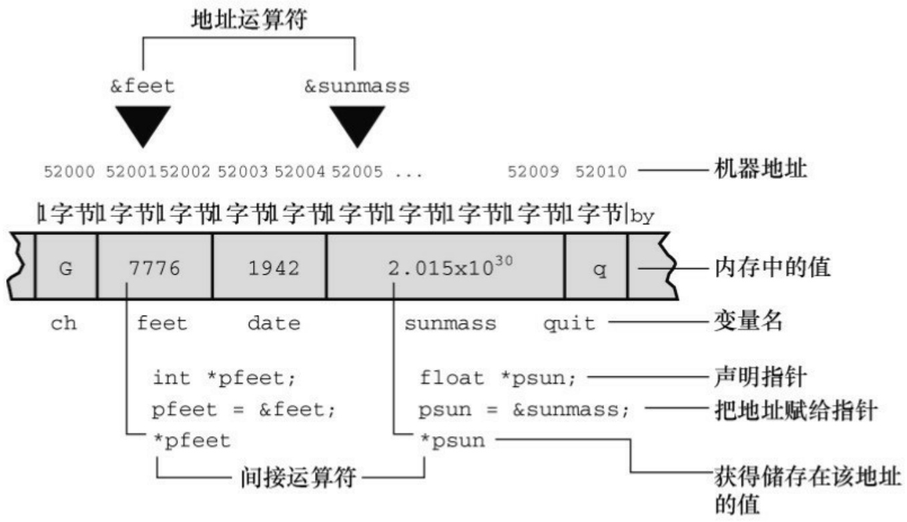
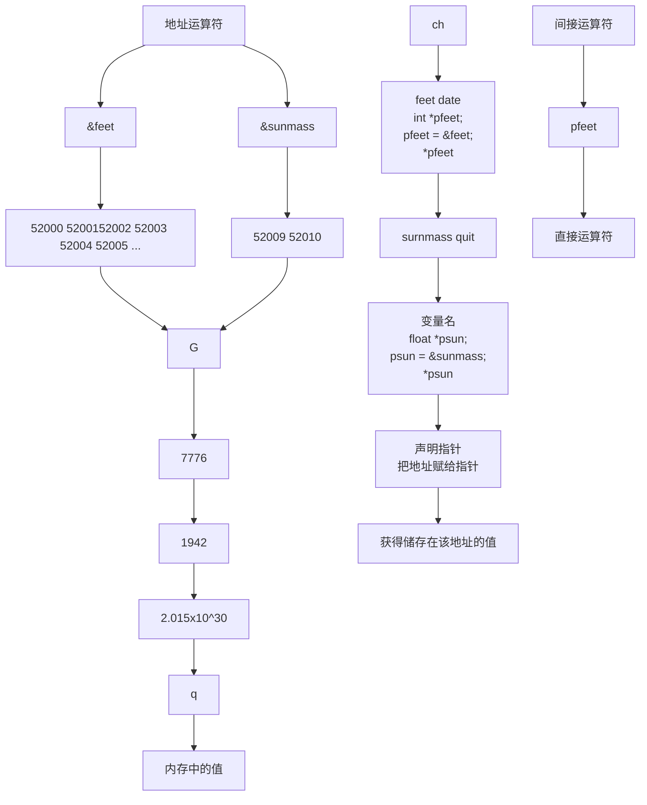
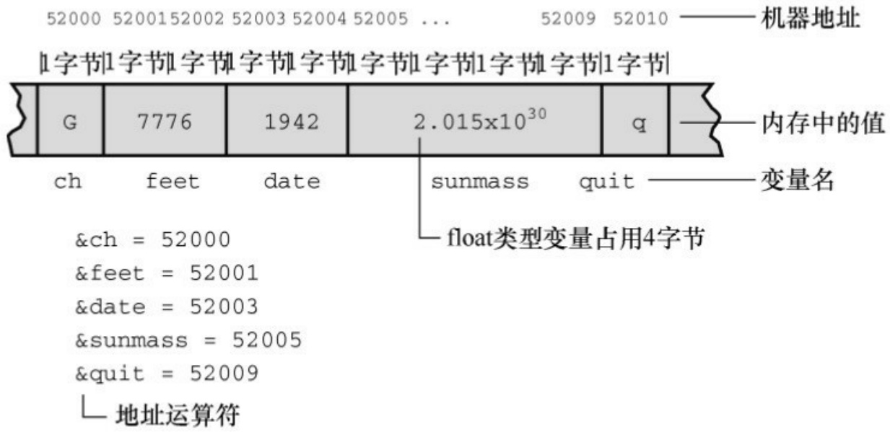

```c
int main(void)
{
int nights;
double hotel_rate;
int code;
while ((code = menu()) != QUIT)
{
switch (code)
{
case 1: hotel_rate = HOTEL1;
break;
case 2: hotel_rate = HOTEL2;
break;
case 3: hotel_rate = HOTEL3;
break;
case 4: hotel_rate = HOTEL4;
break;
default: hotel_rate = 0.0;
printf("Oops!\n");
```

```c
break;
}
nights = getnights();
showprice(hotel_rate, nights);
}
printf("Thank you and goodbye.\n");
return 0;
}
程序清单9.10 hotel.c函数支持模块
/* hotel.c -- 酒店管理函数 */
#include <stdio.h>
#include "hotel.h"
int menu(void)
{
int code, status;
printf("\n%s%s\n", STARS, STARS);
printf("Enter the number of the desired hotel:\n");
printf("1) Fairfield Arms          2) Hotel Olympic\n");
printf("3) Chertworthy Plaza      4) The Stockton\n");
```

```c
printf("5) quit\n");
printf("%s%s\n", STARS, STARS);
while ((status = scanf("%d", &code)) != 1 ||
(code < 1 || code > 5))
{
if (status != 1)
scanf("%*s"); // 处理非整数输入
printf("Enter an integer from 1 to 5, please.\n");
}
return code;
}
int getnights(void)
{
int nights;
printf("How many nights are needed? ");
while (scanf("%d", &nights) != 1)
{
scanf("%*s"); // 处理非整数输入
printf("Please enter an integer, such as 2.\n");
```

```c
}
return nights;
}
void showprice(double rate, int nights)
{
int n;
double total = 0.0;
double factor = 1.0;
for (n = 1; n <= nights; n++, factor *= DISCOUNT)
total += rate * factor;
printf("The total cost will be $%0.2f\n", total);
}
```

程序清单**9.11 hotel.h**头文件

/\* hotel.h -- 符号常量和 hotel.c 中所有函数的原型 \*/

```c
#define QUIT 5
#define HOTEL1 180.00
#define HOTEL2 225.00
#define HOTEL3 255.00
#define HOTEL4 355.00
```

#define DISCOUNT 0.95

#define STARS "\*\*\*\*\*\*\*\*\*\*\*\*\*\*\*\*\*\*\*\*\*\*\*\*\*\*\*\*\*\*\*\*\*\*"

// 显示选择列表

int menu(void);

// 返回预订天数

int getnights(void);

// 根据费率、入住天数计算费用

// 并显示结果

void showprice(double rate, int nights);

下面是这个多文件程序的运行示例:

\*\*\*\*\*\*\*\*\*\*\*\*\*\*\*\*\*\*\*\*\*\*\*\*\*\*\*\*\*\*\*\*\*\*\*\*\*\*\*\*\*\*\*\*\*\*\*\*\*\*\*\*\*\*\*\*\*\*\*\*\*\*\*\*\*\*\*\*

Enter the number of the desired hotel:

1) Fairfield Arms

2) Hotel Olympic

3) Chertworthy Plaza

4) The Stockton

5) quit

\*\*\*\*\*\*\*\*\*\*\*\*\*\*\*\*\*\*\*\*\*\*\*\*\*\*\*\*\*\*\*\*\*\*\*\*\*\*\*\*\*\*\*\*\*\*\*\*\*\*\*\*\*\*\*\*\*\*\*\*\*\*\*\*\*\*\*\*

## 3

How many nights are needed? 1

The total cost will be \$255.00.

Enter the number of the desired hotel:

1) Fairfield Arms
2) Hotel Olympic
3) Chertworthy Plaza
4) The Stockton
5) quit

\*\*\*\*\*\*\*\*\*\*\*\*\*\*\*\*\*\*\*\*\*\*\*\*\*\*\*\*\*\*\*\*\*\*\*\*\*\*\*\*\*\*\*\*\*\*\*\*\*\*\*\*\*\*\*\*\*\*\*\*\*\*\*\*\*\*\*\*

## 4

How many nights are needed? 3

The total cost will be \$1012.64.

\*\*\*\*\*\*\*\*\*\*\*\*\*\*\*\*\*\*\*\*\*\*\*\*\*\*\*\*\*\*\*\*\*\*\*\*\*\*\*\*\*\*\*\*\*\*\*\*\*\*\*\*\*\*\*\*\*\*\*\*\*\*\*\*\*\*\*\*

Enter the number of the desired hotel:

1) Fairfield Arms
2) Hotel Olympic
3) Chertworthy Plaza
4) The Stockton
5) quit

\*\*\*\*\*\*\*\*\*\*\*\*\*\*\*\*\*\*\*\*\*\*\*\*\*\*\*\*\*\*\*\*\*\*\*\*\*\*\*\*\*\*\*\*\*\*\*\*\*\*\*\*\*\*\*\*\*\*\*\*\*\*\*\*\*\*\*\*

## 5

Thank you and goodbye.

顺带一提，该程序中有几处编写得很巧妙。尤其是，menu()和getnights()函数通过测试scanf()的返回值来跳过非数值数据，而且调用 scanf("%\*s")跳至下一个空白字符。注意，menu()函数中是如何检查非数值输入和超出范围

的数据:

$$
\text {while} \left(\left(\text {status} = \operatorname{scanf} \left(\% \mathrm{d} ^ {\prime \prime}, \& \text {code}\right)\right)! = 1 \| (\text {code} <   1 \| \text {code} > 5)\right)
$$

以上代码段利用了C语言的两个规则:从左往右对逻辑表达式求值；一旦求值结果为假，立即停止求值。在该例中，只有在scanf()成功读入一个整数值后，才会检查code的值。

用不同的函数处理不同的任务时应检查数据的有效性。当然，首次编写menu()或getnights()函数时可以暂不添加这一功能，只写一个简单的scanf()即可。待基本版本运行正常后，再逐步改善各模块。

## 9.5 查找地址:&运算符

指针（pointer）是 C 语言最重要的（有时也是最复杂的）概念之一，用于储存变量的地址。前面使用的scanf()函数中就使用地址作为参数。概括地说，如果主调函数不使用return返回的值，则必须通过地址才能修改主调函数中的值。接下来，我们将介绍带地址参数的函数。首先介绍一元&运算符的用法。

一元&运算符给出变量的存储地址。如果pooh是变量名，那么&pooh是变量的地址。可以把地址看作是变量在内存中的位置。假设有下面的语句:

```txt
pooh = 24;
```

假设pooh的存储地址是0B76（PC地址通常用十六进制形式表示）。那么，下面的语句:

```txt
printf("%d %p\n", pooh, &pooh);
```

将输出如下内容（%p是输出地址的转换说明）:

```txt
24 0B76
```

程序清单9.12中使用了这个运算符查看不同函数中的同名变量分别储存在什么位置。

程序清单**9.12 loccheck.c**程序

/\* loccheck.c -- 查看变量被储存在何处 \*/

```c
#include <stdio.h>
```

void mikado(int); /\* 函数原型 \*/

```txt
int main(void)
```

{

int pooh = 2, bah = 5; /\* main()的局部变量 \*/

```c
printf("In main(), pooh = %d and &pooh = %p\n", pooh,
&pooh);

    printf("In main(), bah = %d and &bah = %p\n", bah, &bah);

    mikado(pooh);

    return 0;

}

void mikado(int bah)          /* 定义函数 */

{

    int pooh = 10;              /* mikado()的局部变量 */

    printf("In mikado(), pooh = %d and &pooh = %p\n", pooh,
&pooh);

    printf("In mikado(), bah = %d and &bah = %p\n",     bah,
&bah);

}
```

程序清单9.12中使用ANSI C的%p格式打印地址。我们的系统输出如下:

In main(), pooh = 2 and &pooh = 0x7fff5fbff8e8

In main(), bah = 5 and &bah = 0x7fff5fbff8e4

$$
\text {In mikado(), pooh} = 1 0 \text {and} \& \text {pooh} = 0 x 7 f f f 5 f b f f 8 b 8
$$

$$
\text {In} \quad \text {mikado(),} \quad \text {bah} = 2 \quad \text {and} \quad \& \text {bah} = 0 \mathrm{x7fff5fbff8bc}
$$

实现不同，%p表示地址的方式也不同。然而，许多实现都如本例所示，以十六进制显示地址。顺带一提，每个十六进制数对应4位，该例显示12个十六进制数，对应48位地址。

该例的输出说明了什么？首先，两个pooh的地址不同，两个bah的地址也不同。因此，和前面介绍的一样，计算机把它们看成4个独立的变量。其次，函数调用mikado(pooh)把实际参数（main()中的pooh）的值（2）传递给形式参数（mikado()中的bah）。注意，这种传递只传递了值。涉及的两个变量（main()中的pooh和mikado()中的bah）并未改变。

我们强调第2 点，是因为这并不是在所有语言中都成立。例如，在FORTRAN中，子例程会影响主调例程的原始变量。子例程的变量名可能与原始变量不同，但是它们的地址相同。但是，在 C语言中不是这样。每个C函数都有自己的变量。这样做更可取，因为这样做可以防止原始变量被被调函数中的副作用意外修改。然而，正如下节所述，这也带来了一些麻烦。

## 9.6 更改主调函数中的变量

有时需要在一个函数中更改其他函数的变量。例如，普通的排序任务中交换两个变量的值。假设要交换两个变量x和y的值。简单的思路是:

```matlab
x = y;
y = x;
```

这完全不起作用，因为执行到第2行时，x的原始值已经被y的原始值替换了。因此，要多写一行代码，储存x的原始值:

```txt
temp = x;
x = y;
y = temp;
```

上面这 3 行代码便可实现交换值的功能，可以编写成一个函数并构造一个驱动程序来测试。在程序清单9.13中，为清楚地表明变量属于哪个函数，在main()中使用变量x和y，在intercharge()中使用u和v。

程序清单**9.13 swap1.c**程序

```c
/* swap1.c -- 第1个版本的交换函数 */
#include <stdio.h>
void interchange(int u, int v); /* 声明函数 */
int main(void)
{
int x = 5, y = 10;
```

```txt
printf("Originally x = %d and y = %d.\n", x, y);
interchange(x, y);
printf("Now x = %d and y = %d.\n", x, y);
return 0;
}
void interchange(int u, int v) /* 定义函数 */
{
int temp;
temp = u;
u = v;
v = temp;
}
```

运行该程序后，输出如下:

<div class="docvortex-algorithm" style="white-space: pre-wrap; font-family:monospace;">
Originally $x = 5$ and $y = 10$.
Now $x = 5$ and $y = 10$.
</div>

两个变量的值并未交换！我们在interchange()中添加一些打印语句来检查错误（见程序清单9.14）。

程序清单**9.14 swap2.c**程序

/\* swap2.c -- 查找swap1.c的问题 \*/

```c
#include <stdio.h>

void interchange(int u, int v);

int main(void)
{
int x = 5, y = 10;
printf("Originally x = %d and y = %d.\n", x, y);
interchange(x, y);
printf("Now x = %d and y = %d.\n", x, y);
return 0;
}
void interchange(int u, int v)
{
int temp;
printf("Originally u = %d and v = %d.\n", u, v);
temp = u;
u = v;
v = temp;
printf("Now u = %d and v = %d.\n", u, v);
}
```

下面是该程序的输出:

$$
\text {Originally} \quad \mathrm{x} = 5 \quad \text {and} \quad \mathrm{y} = 1 0.
$$

$$
\text {Originally} \quad \mathrm{u} = 5 \quad \text {and} \quad \mathrm{v} = 1 0.
$$

$$
\text {Now} \quad \mathrm{u} = 1 0 \quad \text {and} \quad \mathrm{v} = 5.
$$

$$
\text {Now} \quad \mathrm{x} = 5 \quad \text {and} \quad \mathrm{y} = 1 0.
$$

看来，interchange()没有问题，它交换了 u 和 v 的值。问题出在把结果传回 main()时。interchange()使用的变量并不是main()中的变量。因此，交换u和v的值对x和y的值没有影响！是否能用return语句把值传回main()？当然可以，在interchange()的末尾加上下面一行语句:

$$
\text {return} (\mathrm{u});
$$

然后修改main()中的调用:

$$
\mathrm{x} = \text { interchange } (\mathrm{x}, \mathrm{y});
$$

这只能改变x的值，而y的值依旧没变。用return语句只能把被调函数中的一个值传回主调函数，但是现在要传回两个值。这没问题！不过，要使用指针。

## 9.7 指针简介

指针？什么是指针？从根本上看，指针（pointer）是一个值为内存地址的变量（或数据对象）。正如char类型变量的值是字符，int类型变量的值是整数，指针变量的值是地址。在C语言中，指针有许多用法。本章将介绍如何把指针作为函数参数使用，以及为何要这样用。

假设一个指针变量名是ptr，可以编写如下语句:

ptr = &pooh; // 把pooh的地址赋给ptr

对于这条语句，我们说ptr“指向”pooh。ptr和&pooh的区别是ptr是变量，而&pooh是常量。或者，ptr是可修改的左值，而&pooh是右值。还可以把ptr指向别处:

现在ptr的值是bah的地址。

要创建指针变量，先要声明指针变量的类型。假设想把ptr声明为储存int类型变量地址的指针，就要使用下面介绍的新运算符。

## 9.7.1 间接运算符:\*

假设已知ptr指向bah，如下所示:

$$
\mathrm{ptr} = \& \text {bah};
$$

然后使用间接运算符\*（indirection operator）找出储存在bah中的值，该运算符有时也称为解引用运算符（dereferencing operator）。不要把间接运算符和二元乘法运算符（\*）混淆，虽然它们使用的符号相同，但语法功能不同。

语句ptr = &bah;和val = \*ptr;放在一起相当于下面的语句:

$$
\mathrm{val} = \text {bah};
$$

由此可见，使用地址和间接运算符可以间接完成上面这条语句的功能，这也是“间接运算符”名称的由来。

小结:与指针相关的运算符

地址运算符:&

一般注解:

后跟一个变量名时，&给出该变量的地址。

示例:

&nurse表示变量nurse的地址。

地址运算符:\*

一般注解:

后跟一个指针名或地址时，\*给出储存在指针指向地址上的值。

示例:

$$
\text {nurse} = 2 2;
$$

ptr = &nurse; // 指向nurse的指针

val = \*ptr; // 把ptr指向的地址上的值赋给val

执行以上3条语句的最终结果是把22赋给val。

## 9.7.2 声明指针

相信读者已经很熟悉如何声明int类型和其他基本类型的变量，那么如何声明指针变量？你也许认为是这样声明:

pointer ptr; // 不能这样声明指针

为什么不能这样声明？因为声明指针变量时必须指定指针所指向变量的类型，因为不同的变量类型占用不同的存储空间，一些指针操作要求知道操作对象的大小。另外，程序必须知道储存在指定地址上的数据类型。long和float可能占用相同的存储空间，但是它们储存数字却大相径庭。下面是一些指针的声明示例:

int \* pi; // pi是指向int类型变量的指针

类型说明符表明了指针所指向对象的类型，星号（\*）表明声明的变量是一个指针。int pi;声明的意思是pi是一个指针，\*pi是int类型（见图9.5）。



<details>
<summary>flowchart</summary>


</details>

图9.5 声明并使用指针

\*和指针名之间的空格可有可无。通常，程序员在声明时使用空格，在解引用变量时省略空格。

pc指向的值（\*pc）是char类型。pc本身是什么类型？我们描述它的类型是“指向char类型的指针”。pc 的值是一个地址，在大部分系统内部，该地址由一个无符号整数表示。但是，不要把指针认为是整数类型。一些处理整数的操作不能用来处理指针，反之亦然。例如，可以把两个整数相乘，但是不能把两个指针相乘。所以，指针实际上是一个新类型，不是整数类型。因此，如前所述，ANSI C专门为指针提供了%p格式的转换说明。

## 9.7.3 使用指针在函数间通信

我们才刚刚接触指针，指针的世界丰富多彩。本节着重介绍如何使用指针解决函数间的通信问题。请看程序清单9.15，该程序在interchange()函数中使用了指针参数。稍后我们将对该程序做详细分析。

程序清单9.15 swap3.c程序

```c
/* swap3.c -- 使用指针解决交换函数的问题 */
#include <stdio.h>

void interchange(int * u, int * v);

int main(void)
{
int x = 5, y = 10;

printf("Originally x = %d and y = %d.\n", x, y);
interchange(&x, &y); // 把地址发送给函数
```

```txt
printf("Now x = %d and y = %d.\n", x, y);
return 0;
}
void interchange(int * u, int * v)
{
int temp;
temp = *u;      // temp获得 u 所指向对象的值
*u = *v;
*v = temp;
}
```

该程序是否能正常运行？下面是程序的输出:

```txt
Originally x = 5 and y = 10.
```

```txt
Now x = 10 and y = 5.
```

没问题，一切正常。接下来，我们分析程序清单9.15的运行情况。首先看函数调用:

```javascript
interchange(&x, &y);
```

该函数传递的不是x和y的值，而是它们的地址。这意味着出现在interchange()原型和定义中的形式参数u和v将把地址作为它们的值。因此，应把它们声明为指针。由于x和y是整数，所以u和v是指向整数的指针，其声明如下:

接下来，在函数体中声明了一个交换值时必需的临时变量:

int temp;

通过下面的语句把x的值储存在temp中:

记住，u的值是&x，所以u指向x。这意味着用\*u即可表示x的值，这正是我们需要的。不要写成这样:

因为这条语句赋给temp的是x的地址（u的值就是x的地址），而不是x的值。函数要交换的是x和y的值，而不是它们的地址。

与此类似，把y的值赋给x，要使用下面的语句:

这条语句相当于:

我们总结一下该程序示例做了什么。我们需要一个函数交换x和y的值。把x和y的地址传递给函数，我们让interchange()访问这两个函数。使用指针和\*运算符，该函数可以访问储存在这些位置的值并改变它们。

可以省略ANSI C风格的函数原型中的形参名，如下所示:

void interchange(int \*, int \*);

一般而言，可以把变量相关的两类信息传递给函数。如果这种形式的函数调用，那么传递的是x的值:

function1(x);

如果下面形式的函数调用，那么传递的是x的地址:

function2(&x);

第1种形式要求函数定义中的形式参数必须是一个与x的类型相同的变量:

int function1(int num)

第2种形式要求函数定义中的形式参数必须是一个指向正确类型的指针:

int function2(int \* ptr)

如果要计算或处理值，那么使用第 1 种形式的函数调用；如果要在被调函数中改变主调函数的变量，则使用第2种形式的函数调用。我们用过的scanf()函数就是这样。当程序要把一个值读入变量时（如本例中的num），调用的是scanf("%d", &num)。scanf()读取一个值，然后把该值储存到指定的地址上。

对本例而言，指针让interchange()函数通过自己的局部变量改变main()中变量的值。

熟悉Pascal和Modula-2的读者应该看出第1种形式和Pascal的值参数相同，第2种形式和Pascal的变量参数类似。C++程序员可能认为，既然C和C++都使用指针变量，那么C应该也有引用变量。让他们失望了，C没有引用变量。对BASIC程序员而言，可能很难理解整个程序。如果觉得本节的内容晦涩难懂，请多做一些相关的编程练习，你会发现指针非常简单实用（见图9.6）。



<details>
<summary>text_image</summary>

52000 5200152002 52003 52004 52005 ...
52009 52010
机器地址
1字节1字节1字节1字节1字节1字节1字节1字节
G	7776	1942	2.015x10³⁰	q
ch	feet	date	sunmass	quit	内存中的值
			变量名
			float类型变量占用4字节
		&ch = 52000
		&feet = 52001
		&date = 52003
		&sunmass = 52005
		&quit = 52009
└─ 地址运算符
</details>

图9.6 按字节寻址系统（如PC）中变量的名称、地址和值

变量:名称、地址和值

通过前面的讨论发现，变量的名称、地址和变量的值之间关系密切。我们来进一步分析。

编写程序时，可以认为变量有两个属性:名称和值（还有其他性质，如类型，暂不讨论）。计算机编译和加载程序后，认为变量也有两个属性:地址和值。地址就是变量在计算机内部的名称。

在许多语言中，地址都归计算机管，对程序员隐藏。然而在 C 中，可以通过&运算符访问地址，通过\*运算符获得地址上的值。例如，&barn表示变量barn的地址，使用函数名即可获得变量的数值。例如，printf("%d\n", barn)打印barn的值，使用\*运算符即可获得储存在地址上的值。如果pbarn= &barn;，那么\*pbarn表示的是储存在&barn地址上的值。

简而言之，普通变量把值作为基本量，把地址作为通过&运算符获得的派生量，而指针变量把地址作为基本量，把值作为通过\*运算符获得的派生量。

虽然打印地址可以满足读者好奇心，但是这并不是&运算符的主要用途。更重要的是使用&、\*和指针可以操纵地址和地址上的内容，如swap3.c

程序（程序清单9.15）所示。

小结:函数

形式:

典型的ANSI C函数的定义形式为:

返回类型名称（形参声明列表）

函数体

形参声明列表是用逗号分隔的一系列变量声明。除形参变量外，函数的其他变量均在函数体的花括号之内声明。

示例:

int diff(int x, int y) // ANSI C

{ // 函数体开始

int z; // 声明局部变量

z = x - y;

return z; // 返回一个值

} // 函数体结束

传递值:

实参用于把值从主调函数传递给被调函数。如果变量a和b的值分别是5和2，那么调用:

c = diff(a,b);

把5和2分别传递给变量x和y。5和2称为实际参数（简称实参），diff()函数定义中的变量x和y称为形式参数（简称形参）。使用关键字return把被调函数中的一个值传回主调函数。本例中， c接受z的值3。被调函数一般不会改变主调函数中的变量，如果要改变，应使用指针作为参数。如果希望把更多的值传回主调函数，必须这么做。

函数的返回类型:

函数的返回类型指的是函数返回值的类型。如果返回值的类型与声明的返回类型不匹配，返回值将被转换成函数声明的返回类型。

函数签名:

函数的返回类型和形参列表构成了函数签名。因此，函数签名指定了传入函数的值的类型和函数返回值的类型。

示例:

```txt
double duff(double, int); // 函数原型
int main(void)
{
double q, x;
int n;
...
q = duff(x,n);          //函数调用
...
}
double duff(double u, int k)      //函数定义
```

```txt
{
double tor;

...
return tor; //返回double类型的值
}
```

## 9.8 关键概念

如果想用C编出高效灵活的程序，必须理解函数。把大型程序组织成若干函数非常有用，甚至很关键。如果让一个函数处理一个任务，程序会更好理解，更方便调试。要理解函数是如何把信息从一个函数传递到另一函数，也就是说，要理解函数参数和返回值的工作原理。另外，要明白函数形参和其他局部变量都属于函数私有，因此，声明在不同函数中的同名变量是完全不同的变量。而且，函数无法直接访问其他函数中的变量。这种限制访问保护了数据的完整性。但是，当确实需要在函数中访问另一个函数的数据时，可以把指针作为函数的参数。

## 9.9 本章小结

函数可以作为组成大型程序的构件块。每个函数都应该有一个单独且定义好的功能。使用参数把值传给函数，使用关键字return把值返回函数。如果函数返回的值不是int类型，则必须在函数定义和函数原型中指定函数的类型。如果需要在被调函数中修改主调函数的变量，使用地址或指针作为参数。

ANSI C提供了一个强大的工具——函数原型，允许编译器验证函数调用中使用的参数个数和类型是否正确。

C 函数可以调用本身，这种调用方式被称为递归。一些编程问题要用递归来解决，但是递归不仅消耗内存多，效率不高，而且费时。

## 9.10 复习题

复习题的参考答案在附录A中。

1.实际参数和形式参数的区别是什么？

2.根据下面各函数的描述，分别编写它们的ANSI C函数头。注意，只需写出函数头，不用写函数体。

a.donut()接受一个int类型的参数，打印若干（参数指定数目）个0

b.gear()接受两个int类型的参数，返回int类型的值

c.guess()不接受参数，返回一个int类型的值

d.stuff\_it()接受一个double类型的值和double类型变量的地址，把第1个值储存在指定位置

3.根据下面各函数的描述，分别编写它们的ANSI C函数头。注意，只需写出函数头，不用写函数体。

a.n\_to\_char()接受一个int类型的参数，返回一个char类型的值

b.digit()接受一个double类型的参数和一个int类型的参数，返回一个int类型的值

c.which()接受两个可储存double类型变量的地址，返回一个double类型的地址

d.random()不接受参数，返回一个int类型的值

4.设计一个函数，返回两整数之和。

5.如果把复习题4改成返回两个double类型的值之和，应如何修改函数？

6.设计一个名为alter()的函数，接受两个int类型的变量x和y，把它们的

值分别改成两个变量之和以及两变量之差。

7.下面的函数定义是否正确？

```c
void salami(num)
{
int num, count;
for (count = 1; count <= num; num++)
printf(" O salami mio!\n");
}
```

8.编写一个函数，返回3个整数参数中的最大值。
9.给定下面的输出:

Please choose one of the following:

1) copy files
2) move files
3) remove files
4) quit

Enter the number of your choice:

a.编写一个函数，显示一份有4个选项的菜单，提示用户进行选择（输出如上所示）。
b.编写一个函数，接受两个int类型的参数分别表示上限和下限。该函数从用户的输入中读取整数。如果整数超出规定上下限，函数再次打印菜单（使用a部分的函数）提示用户输入，然后获取一个新值。如果用户输入的整数在规定范围内，该函数则把该整数返回主调函数。如果用户输入一个非整数字符，该函数应返回4。

c.使用本题a和b部分的函数编写一个最小型的程序。最小型的意思是，该程序不需要实现菜单中各选项的功能，只需显示这些选项并获取有效的响应即可。

## 9.11 编程练习

1.设计一个函数min(x, y)，返回两个double类型值的较小值。在一个简单的驱动程序中测试该函数。
2.设计一个函数chline(ch, i, j)，打印指定的字符j行i列。在一个简单的驱动程序中测试该函数。
3.编写一个函数，接受3个参数:一个字符和两个整数。字符参数是待打印的字符，第1个整数指定一行中打印字符的次数，第2个整数指定打印指定字符的行数。编写一个调用该函数的程序。
4.两数的调和平均数这样计算:先得到两数的倒数，然后计算两个倒数的平均值，最后取计算结果的倒数。编写一个函数，接受两个double类型的参数，返回这两个参数的调和平均数。
5.编写并测试一个函数larger\_of()，该函数把两个double类型变量的值替换为较大的值。例如， larger\_of(x, y)会把x和y中较大的值重新赋给两个变量。
6.编写并测试一个函数，该函数以3个double变量的地址作为参数，把最小值放入第1个函数，中间值放入第2个变量，最大值放入第3个变量。
7.编写一个函数，从标准输入中读取字符，直到遇到文件结尾。程序要报告每个字符是否是字母。如果是，还要报告该字母在字母表中的数值位置。例如，c和C在字母表中的位置都是3。合并一个函数，以一个字符作为参数，如果该字符是一个字母则返回一个数值位置，否则返回-1。
8.第6章的程序清单6.20中，power()函数返回一个double类型数的正整数次幂。改进该函数，使其能正确计算负幂。另外，函数要处理0的任何次幂都为0，任何数的0次幂都为1（函数应报告0的0次幂未定义，因此把该值处理为1）。要使用一个循环，并在程序中测试该函数。

9.使用递归函数重写编程练习8。
10.为了让程序清单9.8中的to\_binary()函数更通用，编写一个to\_base\_n()函数接受两个在2～10范围内的参数，然后以第2个参数中指定的进制打印第1个参数的数值。例如，to\_base\_n(129， 8)显示的结果为201，也就是129的八进制数。在一个完整的程序中测试该函数。
11.编写并测试Fibonacci()函数，该函数用循环代替递归计算斐波那契数。