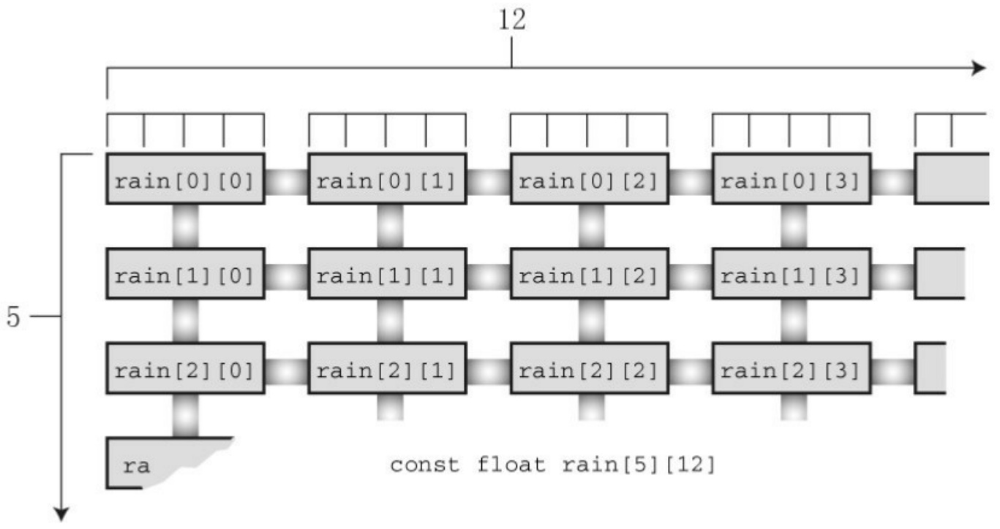
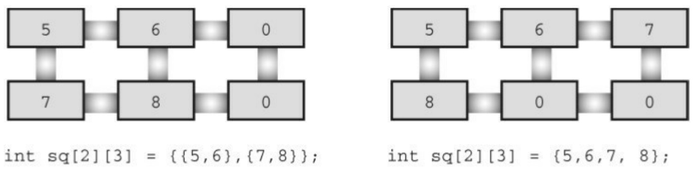
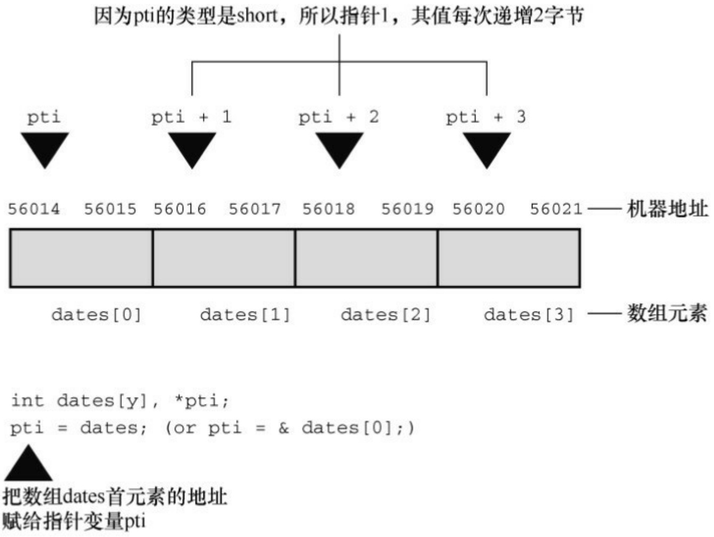

## 第10章数组和指针

本章介绍以下内容:

关键字:static

运算符:&、\*（一元）

如何创建并初始化数组

指针（在已学过的基础上）、指针和数组的关系

编写处理数组的函数

## 二维数组

人们通常借助计算机完成统计每月的支出、日降雨量、季度销售额等任务。企业借助计算机管理薪资、库存和客户交易记录等。作为程序员，不可避免地要处理大量相关数据。通常，数组能高效便捷地处理这种数据。第 6章简单地介绍了数组，本章将进一步地学习如何使用数组，着重分析如何编写处理数组的函数。这种函数把模块化编程的优势应用到数组。通过本章的学习，你将明白数组和指针关系密切。

## 10.1 数组

前面介绍过，数组由数据类型相同的一系列元素组成。需要使用数组时，通过声明数组告诉编译器数组中内含多少元素和这些元素的类型。编译器根据这些信息正确地创建数组。普通变量可以使用的类型，数组元素都可以用。考虑下面的数组声明:

```txt
/*一些数组声明*/
int main(void)
{
float candy[365];          /*内含365个float类型元素的数组 */
char code[12];            /*内含12个char类型元素的数组*/
int states[50];          /*内含50个int类型元素的数组 */
...
}
```

方括号（[]）表明candy、code和states都是数组，方括号中的数字表明数组中的元素个数。

要访问数组中的元素，通过使用数组下标数（也称为索引）表示数组中的各元素。数组元素的编号从0开始，所以candy[0]表示candy数组的第1个元素，candy[364]表示第365个元素，也就是最后一个元素。读者对这些内容应该比较熟悉，下面我们介绍一些新内容。

## 10.1.1 初始化数组

数组通常被用来储存程序需要的数据。例如，一个内含12个整数元素的数组可以储存12个月的天数。在这种情况下，在程序一开始就初始化数组比

较好。下面介绍初始化数组的方法。

只储存单个值的变量有时也称为标量变量（scalar variable），我们已经很熟悉如何初始化这种变量:

```txt
int fix = 1;

float flax = PI * 2;
```

代码中的PI已定义为宏。C使用新的语法来初始化数组，如下所示:

```c
int main(void)
{
int powers[8] = {1,2,4,6,8,16,32,64}; /* 从ANSI C开始支持这种初始化 */
...
}
```

如上所示，用以逗号分隔的值列表（用花括号括起来）来初始化数组，各值之间用逗号分隔。在逗号和值之间可以使用空格。根据上面的初始化，把 1 赋给数组的首元素（powers[0]），以此类推（不支持ANSI的编译器会把这种形式的初始化识别为语法错误，在数组声明前加上关键字static可解决此问题。第12章将详细讨论这个关键字）。

程序清单10.1演示了一个小程序，打印每个月的天数。

程序清单**10.1 day\_mon1.c**程序

/\* day\_mon1.c -- 打印每个月的天数 \*/

#include &lt;stdio.h&gt;

#define MONTHS 12

```c
int main(void)
    {
        int days[MONTHS] = { 31, 28, 31, 30, 31, 30, 31, 31,
30, 31, 30, 31 };
    int index;
    for (index = 0; index < MONTHS; index++)
        printf("Month %2d has %2d days.\n", index + 1, days[index]);
    return 0;
}
```

该程序的输出如下:

```txt
Month 1 has 31 days.
Month 2 has 28 days.
Month 3 has 31 days.
Month 4 has 30 days.
Month 5 has 31 days.
Month 6 has 30 days.
Month 7 has 31 days.
Month 8 has 31 days.
Month 9 has 30 days.
```

Month 10 has 31 days.

Month 11 has 30 days.

Month 12 has 31 days.

这个程序还不够完善，每4年打错一个月份的天数（即，2月份的天数）。该程序用初始化列表初始化days[]，列表（用花括号括起来）中用逗号分隔各值。

注意该例使用了符号常量 MONTHS 表示数组大小，这是我们推荐且常用的做法。例如，如果要采用一年13个月的记法，只需修改#define这行代码即可，不用在程序中查找所有使用过数组大小的地方。

注意使用**const**声明数组

有时需要把数组设置为只读。这样，程序只能从数组中检索值，不能把新值写入数组。要创建只读数组，应该用const声明和初始化数组。因此，程序清单10.1中初始化数组应改成:

$$
\text {const int days[MONTHS]} = \{3 1, 2 8, 3 1, 3 0, 3 1, 3 0, 3 1, 3 1, 3 0, 3 1, 3 0, 3 1 \};
$$

这样修改后，程序在运行过程中就不能修改该数组中的内容。和普通变量一样，应该使用声明来初始化 const 数据，因为一旦声明为 const，便不能再给它赋值。明确了这一点，就可以在后面的例子中使用const了。

如果初始化数组失败怎么办？程序清单10.2演示了这种情况。

程序清单**10.2 no\_data.c**程序

/\* no\_data.c -- 为初始化数组 \*/

#include &lt;stdio.h&gt;

#define SIZE 4

```c
int main(void)
{
int no_data[SIZE]; /* 未初始化数组 */
int i;
printf("%2s%14s\n",      "i",  "no_data[i]");
for (i = 0; i < SIZE; i++)
printf("%2d%14d\n", i, no_data[i]);
return 0;
}
```

该程序的输出如下（系统不同，输出的结果可能不同）:

```csv
i no_data[i]
0 0
1 4204937
2 4219854
3 2147348480
```

使用数组前必须先初始化它。与普通变量类似，在使用数组元素之前，必须先给它们赋初值。编译器使用的值是内存相应位置上的现有值，因此，读者运行该程序后的输出会与该示例不同。

注意存储类别警告

数组和其他变量类似，可以把数组创建成不同的存储类别（storage class）。第12章将介绍存储类别的相关内容，现在只需记住:本章描述的数组属于自动存储类别，意思是这些数组在函数内部声明，且声明时未使用关键字static。到目前为止，本书所用的变量和数组都是自动存储类别。

在这里提到存储类别的原因是，不同的存储类别有不同的属性，所以不能把本章的内容推广到其他存储类别。对于一些其他存储类别的变量和数组，如果在声明时未初始化，编译器会自动把它们的值设置为0。

初始化列表中的项数应与数组的大小一致。如果不一致会怎样？我们还是以上一个程序为例，但初始化列表中缺少两个元素，如程序清单10.3所示:

程序清单**10.3 somedata.c**程序

```c
/* some_data.c -- 部分初始化数组 */

#include <stdio.h>

#define SIZE 4

int main(void)

{

int some_data[SIZE] = { 1492, 1066 };

int i;

printf("%2s%14s\n", "i", "some_data[i]");
for (i = 0; i < SIZE; i++)
printf("%2d%14d\n", i, some_data[i]);
return 0;
```

}

下面是该程序的输出:

```asm
i some_data[i]
0 1492
1 1066
2 0
3 0
```

如上所示，编译器做得很好。当初始化列表中的值少于数组元素个数时，编译器会把剩余的元素都初始化为0。也就是说，如果不初始化数组，数组元素和未初始化的普通变量一样，其中储存的都是垃圾值；但是，如果部分初始化数组，剩余的元素就会被初始化为0。

如果初始化列表的项数多于数组元素个数，编译器可没那么仁慈，它会毫不留情地将其视为错误。但是，没必要因此嘲笑编译器。其实，可以省略方括号中的数字，让编译器自动匹配数组大小和初始化列表中的项数（见程序清单10.4）

程序清单**10.4 day\_mon2.c**程序

```c
/* day_mon2.c -- 让编译器计算元素个数 */

#include <stdio.h>

int main(void)

{

const int days[] = { 31, 28, 31, 30, 31, 30, 31, 31, 30, 31 };
```

```c
int index;

    for (index = 0; index < sizeof days / sizeof days[0];
index++)

    printf("Month %2d has %d days.\n", index + 1, days[index]);

    return 0;

}
```

在程序清单10.4中，要注意以下两点。

如果初始化数组时省略方括号中的数字，编译器会根据初始化列表中的项数来确定数组的大小。

注意for循环中的测试条件。由于人工计算容易出错，所以让计算机来计算数组的大小。sizeof运算符给出它的运算对象的大小（以字节为单位）。所以sizeof days是整个数组的大小（以字节为单位），sizeof day[0]是数组中一个元素的大小（以字节为单位）。整个数组的大小除以单个元素的大小就是数组元素的个数。

下面是该程序的输出:

```txt
Month 1 has 31 days.
Month 2 has 28 days.
Month 3 has 31 days.
Month 4 has 30 days.
Month 5 has 31 days.
Month 6 has 30 days.
```

Month 7 has 31 days.

Month 8 has 31 days.

Month 9 has 30 days.

Month 10 has 31 days.

我们的本意是防止初始化值的个数超过数组的大小，让程序找出数组大小。我们初始化时用了10个值，结果就只打印了10个值！这就是自动计数的弊端:无法察觉初始化列表中的项数有误。

还有一种初始化数组的方法，但这种方法仅限于初始化字符数组。我们在下一章中介绍。

## 10.1.2 指定初始化器（C99）

C99 增加了一个新特性:指定初始化器（designated initializer）。利用该特性可以初始化指定的数组元素。例如，只初始化数组中的最后一个元素。对于传统的C初始化语法，必须初始化最后一个元素之前的所有元素，才能初始化它:

$$
\operatorname{int} \operatorname{arr} [ 6 ] = \{0, 0, 0, 0, 0, 2 1 2 \}; / / \text {传统的语法}
$$

而C99规定，可以在初始化列表中使用带方括号的下标指明待初始化的元素:

$$
\operatorname{int} \operatorname{arr} [ 6 ] = \{[ 5 ] = 2 1 2 \}; / / \text {把} \operatorname{arr} [ 5 ] \text {初始化为} 2 1 2
$$

对于一般的初始化，在初始化一个元素后，未初始化的元素都会被设置为0。程序清单10.5中的初始化比较复杂。

程序清单**10.5 designate.c**程序

// designate.c -- 使用指定初始化器

```c
#include <stdio.h>

#define MONTHS 12

int main(void)

{

    int days[MONTHS] = { 31, 28, [4] = 31, 30, 31, [1]
= 29 };

    int i;

    for (i = 0; i < MONTHS; i++)

    printf("%2d %d\n", i + 1, days[i]);

    return 0;

}
```

该程序在支持C99的编译器中输出如下:

```asm
1 31
2 29
3 0
4 0
5 31
6 30
7 31
```

8 0
9 0
10 0
11 0
12 0

以上输出揭示了指定初始化器的两个重要特性。第一，如果指定初始化器后面有更多的值，如该例中的初始化列表中的片段:[4] = 31,30,31，那么后面这些值将被用于初始化指定元素后面的元素。也就是说，在days[4]被初始化为31后，days[5]和days[6]将分别被初始化为30和31。第二，如果再次初始化指定的元素，那么最后的初始化将会取代之前的初始化。例如，程序清单10.5中，初始化列表开始时把days[1]初始化为28，但是days[1]又被后面的指定初始化[1] = 29初始化为29。

如果未指定元素大小会怎样？

int stuff[] = {1, [6] = 23}; //会发生什么？

int staff[] = {1, [6] = 4, 9, 10}; //会发生什么？

编译器会把数组的大小设置为足够装得下初始化的值。所以，stuff数组有7个元素，编号为0～6；而staff数组的元素比stuff数组多两个（即有9个元素）。

## 10.1.3 给数组元素赋值

声明数组后，可以借助数组下标（或索引）给数组元素赋值。例如，下面的程序段给数组的所有元素赋值:

/\* 给数组的元素赋值 \*/

```c
#include <stdio.h>

#define SIZE 50

int main(void)

{

int counter, evens[SIZE];

for (counter = 0; counter < SIZE; counter++)

evens[counter] = 2 * counter;

...

}
```

注意这段代码中使用循环给数组的元素依次赋值。C 不允许把数组作为一个单元赋给另一个数组，除初始化以外也不允许使用花括号列表的形式赋值。下面的代码段演示了一些错误的赋值形式:

```c
/* 一些无效的数组赋值 */

#define SIZE 5

int main(void)

{

int oxen[SIZE] = {5,3,2,8};          /* 初始化没问题 */

int yaks[SIZE];

yaks = oxen;                     /* 不允许 */

yaks[SIZE] = oxen[SIZE];      /* 数组下标越界 */
```

yaks[SIZE] = {5,3,2,8}; /\* 不起作用 \*/

oxen数组的最后一个元素是oxen[SIZE-1]，所以oxen[SIZE]和yaks[SIZE]都超出了两个数组的末尾。

## 10.1.4 数组边界

在使用数组时，要防止数组下标超出边界。也就是说，必须确保下标是有效的值。例如，假设有下面的声明:

int doofi[20];

那么在使用该数组时，要确保程序中使用的数组下标在0～19的范围内，因为编译器不会检查出这种错误（但是，一些编译器发出警告，然后继续编译程序）。

考虑程序清单10.6的问题。该程序创建了一个内含4个元素的数组，然后错误地使用了-1～6的下标。

程序清单**10.6 bounds.c**程序

// bounds.c -- 数组下标越界

#include &lt;stdio.h&gt;

#define SIZE 4

int main(void)

{

int value1 = 44;

int arr[SIZE];

int value2 = 88;

```c
int i;

printf("value1 = %d, value2 = %d\n", value1, value2);
for (i = -1; i <= SIZE; i++)
arr[i] = 2 * i + 1;
for (i = -1; i < 7; i++)
printf("%2d %d\n", i, arr[i]);
printf("value1 = %d, value2 = %d\n", value1, value2);
printf("address of arr[-1]: %p\n", &arr[-1]);
printf("address of arr[4]: %p\n", &arr[4]);
printf("address of value1: %p\n", &value1);
printf("address of value2: %p\n", &value2);
return 0;
}
```

编译器不会检查数组下标是否使用得当。在C标准中，使用越界下标的结果是未定义的。这意味着程序看上去可以运行，但是运行结果很奇怪，或异常中止。下面是使用GCC的输出示例:

```txt
value1 = 44, value2 = 88
-1 -1
0 1
1 3
```

```txt
value1 = 9, value2 = -1

address of arr[-1]: 0x7fff5fbff8cc

address of arr[4]: 0x7fff5fbff8e0

address of value1: 0x7fff5fbff8e0

address of value2: 0x7fff5fbff8cc
```

注意，该编译器似乎把value2储存在数组的前一个位置，把value1储存在数组的后一个位置（其他编译器在内存中储存数据的顺序可能不同）。在上面的输出中，arr[-1]与value2对应的内存地址相同， arr[4]和value1对应的内存地址相同。因此，使用越界的数组下标会导致程序改变其他变量的值。不同的编译器运行该程序的结果可能不同，有些会导致程序异常中止。

C 语言为何会允许这种麻烦事发生？这要归功于 C 信任程序员的原则。不检查边界，C 程序可以运行更快。编译器没必要捕获所有的下标错误，因为在程序运行之前，数组的下标值可能尚未确定。因此，为安全起见，编译器必须在运行时添加额外代码检查数组的每个下标值，这会降低程序的运行速度。C 相信程序员能编写正确的代码，这样的程序运行速度更快。但并不是所有的程序员都能做到这一点，所以就出现了下标越界的问题。

还要记住一点:数组元素的编号从0开始。最好是在声明数组时使用符

号常量来表示数组的大小:

```c
#define SIZE 4

int main(void)
{
int arr[SIZE];
for (i = 0; i < SIZE; i++)
....
```

这样做能确保整个程序中的数组大小始终一致。

## 10.1.5 指定数组的大小

本章前面的程序示例都使用整型常量来声明数组:

```txt
#define SIZE 4

int main(void)
{
int arr[SIZE];          // 整数符号常量
double lots[144];      // 整数字面常量
...
```

在C99标准之前，声明数组时只能在方括号中使用整型常量表达式。所谓整型常量表达式，是由整型常量构成的表达式。sizeof表达式被视为整型常量，但是（与C++不同）const值不是。另外，表达式的值必须大于0:

```javascript
int n = 5;
```

int m = 8;

float a1[5]; // 可以

float a2[5\*2 + 1]; //可以

float a3[sizeof(int) + 1]; //可以

float a4[-4]; // 不可以，数组大小必须大于0

float a5[0]; // 不可以，数组大小必须大于0

float a6[2.5]; // 不可以，数组大小必须是整数

float a7[(int)2.5]; // 可以，已被强制转换为整型常量

float a8[n]; // C99之前不允许

float a9[m]; // C99之前不允许

上面的注释表明，以前支持C90标准的编译器不允许后两种声明方式。而C99标准允许这样声明，这创建了一种新型数组，称为变长数组（variable-length array）或简称 VLA（C11 放弃了这一创新的举措，把VLA设定为可选，而不是语言必备的特性）。

C99引入变长数组主要是为了让C成为更好的数值计算语言。例如，VLA简化了把FORTRAN现有的数值计算例程库转换为C代码的过程。VLA有一些限制，例如，声明VLA时不能进行初始化。在充分了解经典的C数组后，我们再详细介绍VLA。

## 10.2 多维数组

气象研究员Tempest Cloud为完成她的研究项目要分析5年内每个月的降水量数据，她首先要解决的问题是如何表示数据。一个方案是创建60个变量，每个变量储存一个数据项（我们曾经提到过这一笨拙的方案，和以前一样，这个方案并不合适）。使用一个内含60个元素的数组比将建60个变量好，但是如果能把各年的数据分开储存会更好，即创建5个数组，每个数组12个元素。然而，这样做也很麻烦，如果Tempest决定研究50年的降水量，岂不是要创建50个数组。是否能有更好的方案？

处理这种情况应该使用数组的数组。主数组（master array）有5个元素（每个元素表示一年），每个元素是内含12个元素的数组（每个元素表示一个月）。下面是该数组的声明:

float rain[5][12]; // 内含5个数组元素的数组，每个数组元素内含12个float类型的元素

理解该声明的一种方法是，先查看中间部分（粗体部分）:

float rain[5][12]; // rain是一个内含5个元素的数组

这说明数组rain有5个元素，至于每个元素的情况，要查看声明的其余部分（粗体部分）:

floatrain[5][12] ; // 一个内含12个float类型元素的数组

这说明每个元素的类型是float[12]，也就是说，rain的每个元素本身都是一个内含12个float类型值的数组。

根据以上分析可知，rain的首元素rain[0]是一个内含12个float类型值的数组。所以，rain[1]、rain[2]等也是如此。如果 rain[0]是一个数组，那么它的首元素就是 rain[0][0]，第 2 个元素是rain[0][1]，以此类推。简而言之，数组rain有5个元素，每个元素都是内含12个float类型元素的数组，rain[0]是内含12个float值的数组，rain[0][0]是一个float类型的值。假设要访问位于2行3列的值，则使用rain[2][3]（记住，数组元素的编号从0开始，所以2行指的是第3行）。



<details>
<summary>text_image</summary>

12
rain[0][0]
rain[0][1]
rain[0][2]
rain[0][3]
rain[1][0]
rain[1][1]
rain[1][2]
rain[1][3]
rain[2][0]
rain[2][1]
rain[2][2]
rain[2][3]
ra
const float rain[5][12]
</details>

图10.1 二维数组

该二维视图有助于帮助读者理解二维数组的两个下标。在计算机内部，这样的数组是按顺序储存的，从第1个内含12个元素的数组开始，然后是第2个内含12个元素的数组，以此类推。

我们要在气象分析程序中用到这个二维数组。该程序的目标是，计算每年的总降水量、年平均降水量和月平均降水量。要计算年总降水量，必须对一行数据求和；要计算某月份的平均降水量，必须对一列数据求和。二维数组很直观，实现这些操作也很容易。程序清单10.7演示了这个程序。

## 程序清单10.7 rain.c程序

/\* rain.c -- 计算每年的总降水量、年平均降水量和5年中每月的平均降水量 \*/

```c
#include <stdio.h>
```

```c
#define MONTHS 12      // 一年的月份数
#define YEARS   5       // 年数
int main(void)
{
// 用2010~2014年的降水量数据初始化数组
const float rain[YEARS][MONTHS] =
{
{ 4.3, 4.3, 4.3, 3.0, 2.0, 1.2, 0.2, 0.2, 0.4, 2.4, 3.5,
6.6 },
{ 8.5, 8.2, 1.2, 1.6, 2.4, 0.0, 5.2, 0.9, 0.3, 0.9, 1.4,
7.3 },
{ 9.1, 8.5, 6.7, 4.3, 2.1, 0.8, 0.2, 0.2, 1.1, 2.3, 6.1,
8.4 },
{ 7.2, 9.9, 8.4, 3.3, 1.2, 0.8, 0.4, 0.0, 0.6, 1.7, 4.3,
6.2 },
{ 7.6, 5.6, 3.8, 2.8, 3.8, 0.2, 0.0, 0.0, 0.0, 1.3, 2.6,
5.2 }
};
int year, month;
float subtotal, total;
printf(" YEAR    RAINFALL (inches)\n");
```

```c
for (year = 0, total = 0; year < YEARS; year++)
{
// 每一年，各月的降水量总和
for (month = 0, subtotal = 0; month < MONTHS; month++)
subtot += rain[year][month];
printf("%5d %15.1f\n", 2010 + year, subtotal);
total += subtotal; // 5年的总降水量
}
printf("\nThe yearly average is %.1f inches.\n\n", total / YEARS);
printf("MONTHLY AVERAGES:\n\n");
printf(" Jan Feb Mar Apr May Jun Jul Aug Sep Oct ");
printf(" Nov Dec\n");
for (month = 0; month < MONTHS; month++)
{
// 每个月，5年的总降水量
for (year = 0, subtotal = 0; year < YEARS; year++)
subtot += rain[year][month];
printf("%4.1f ", subtotal / YEARS);
}
printf("\n");
```

```scss
return 0;
}
```

下面是该程序的输出:

| YEAR | RAINFALL | (inches) |
| --- | --- | --- |
| 2010 | 32.4 |  |
| 2011 | 37.9 |  |
| 2012 | 49.8 |  |
| 2013 | 44.0 |  |
| 2014 | 32.9 |  |

The yearly average is 39.4 inches.

MONTHLY AVERAGES:

| Jan | Feb | Mar | Apr | May | Jun | Jul | Aug | Sep | Oct | Nov | Dec |
| --- | --- | --- | --- | --- | --- | --- | --- | --- | --- | --- | --- |
| 7.3 | 7.3 | 4.9 | 3.0 | 2.3 | 0.6 | 1.2 | 0.3 | 0.5 | 1.7 | 3.6 | 6.7 |

学习该程序的重点是数组初始化和计算方案。初始化二维数组比较复杂，我们先来看较为简单的计算部分。

程序使用了两个嵌套for循环。第1个嵌套for循环的内层循环，在year不变的情况下，遍历month计算某年的总降水量；而外层循环，改变year的值，重复遍历month，计算5年的总降水量。这种嵌套循环结构常用于处理二维数组，一个循环处理数组的第1个下标，另一个循环处理数组的第2个下标:

$$
\text {for} \quad (\text {year} = 0, \text {total} = 0; \text {year} <   \text {YEARS}; \text {year++})
$$

{ // 处理每一年的数据

```txt
for (month = 0, subtotal = 0; month < MONTHS; month++)
```

...// 处理每月的数据

...//处理每一年的数据

```txt
}
```

第2个嵌套for循环和第1个的结构相同，但是内层循环遍历year，外层循环遍历month。记住，每执行一次外层循环，就完整遍历一次内层循环。因此，在改变月份之前，先遍历完年，得到某月 5 年间的平均降水量，以此类推:

```javascript
for (month = 0; month < MONTHS; month++)
```

{ // 处理每月的数据

```javascript
for (year = 0, subtotal =0; year < YEARS; year++)
```

...// 处理每年的数据

...// 处理每月的数据

```txt
}
```

## 10.2.1 初始化二维数组

初始化二维数组是建立在初始化一维数组的基础上。首先，初始化一维数组如下:

```txt
sometype ar1[5] = {val1, val2, val3, val4, val5};
```

这里，val1、val2等表示sometype类型的值。例如，如果sometype是int，那么val1可能是7；如果sometype是double，那么val1可能是11.34，诸如此类。但是rain是一个内含5个元素的数组，每个元素又是内含12个float类型元素的数组。所以，对rain而言，val1应该包含12个值，用于初始化内含12个float类型元素的一维数组，如下所示:

```txt
{4.3,4.3,4.3,3.0,2.0,1.2,0.2,0.2,0.4,2.4,3.5,6.6}
```

也就是说，如果sometype是一个内含12个double类型元素的数组，那么val1就是一个由12个double类型值构成的数值列表。因此，为了初始化二维数组rain，要用逗号分隔5个这样的数值列表:

```javascript
const float rain[YEARS][MONTHS] =
{
{4.3,4.3,4.3,3.0,2.0,1.2,0.2,0.2,0.4,2.4,3.5,6.6},
{8.5,8.2,1.2,1.6,2.4,0.0,5.2,0.9,0.3,0.9,1.4,7.3},
{9.1,8.5,6.7,4.3,2.1,0.8,0.2,0.2,1.1,2.3,6.1,8.4},
{7.2,9.9,8.4,3.3,1.2,0.8,0.4,0.0,0.6,1.7,4.3,6.2},
{7.6,5.6,3.8,2.8,3.8,0.2,0.0,0.0,0.0,1.3,2.6,5.2}
};
```

这个初始化使用了5个数值列表，每个数值列表都用花括号括起来。第1个列表的数据用于初始化数组的第1行，第2个列表的数据用于初始化数组的第2行，以此类推。前面讨论的数据个数和数组大小不匹配的问题同样适用于这里的每一行。也就是说，如果第1个列表中只有10个数，则只会初始化数组第1行的前10个元素，而最后两个元素将被默认初始化为0。如果某列表中的数值个数超出了数组每行的元素个数，则会出错，但是这并不会影响其他行的初始化。

初始化时也可省略内部的花括号，只保留最外面的一对花括号。只要保证初始化的数值个数正确，初始化的效果与上面相同。但是如果初始化的数值不够，则按照先后顺序逐行初始化，直到用完所有的值。后面没有值初始化的元素被统一初始化为0。图10.2演示了这种初始化数组的方法。



图10.2 初始化二维数组的两种方法

因为储存在数组rain中的数据不能修改，所以程序使用了const关键字声明该数组。

## 10.2.2 其他多维数组

前面讨论的二维数组的相关内容都适用于三维数组或更多维的数组。可以这样声明一个三维数组:

int box[10][20][30];

可以把一维数组想象成一行数据，把二维数组想象成数据表，把三维数组想象成一叠数据表。例如，把上面声明的三维数组box想象成由10个二维数组（每个二维数组都是20行30列）堆叠起来。

还有一种理解box的方法是，把box看作数组的数组。也就是说，box内含10个元素，每个元素是内含20个元素的数组，这20个数组元素中的每个元素是内含30个元素的数组。或者，可以简单地根据所需的下标值去理解数组。

通常，处理三维数组要使用3重嵌套循环，处理四维数组要使用4重嵌套循环。对于其他多维数组，以此类推。在后面的程序示例中，我们只使用二维数组。

## 10.3 指针和数组

第9章介绍过指针，指针提供一种以符号形式使用地址的方法。因为计算机的硬件指令非常依赖地址，指针在某种程度上把程序员想要传达的指令以更接近机器的方式表达。因此，使用指针的程序更有效率。尤其是，指针能有效地处理数组。我们很快就会学到，数组表示法其实是在变相地使用指针。

我们举一个变相使用指针的例子:数组名是数组首元素的地址。也就是说，如果flizny是一个数组，下面的语句成立:

flizny == &flizny[0]; // 数组名是该数组首元素的地址

flizny 和&flizny[0]都表示数组首元素的内存地址（&是地址运算符）。两者都是常量，在程序的运行过程中，不会改变。但是，可以把它们赋值给指针变量，然后可以修改指针变量的值，如程序清单10.8所示。注意指针加上一个数时，它的值发生了什么变化（转换说明%p通常以十六进制显示指针的值）。

程序清单**10.8 pnt\_add.c**程序

// pnt\_add.c -- 指针地址

#include &lt;stdio.h&gt;

#define SIZE 4

int main(void)

{

short dates[SIZE];

short \* pti;

```c
short index;

double bills[SIZE];

double * ptf;

pti = dates; // 把数组地址赋给指针

ptf = bills;

printf("%23s %15s\n", "short", "double");

for (index = 0; index < SIZE; index++)

printf("pointers + %d: %10p %10p\n", index, pti + index, ptf + index);

return 0;

}
```

下面是该例的输出示例:

```txt
short                          double
pointers + 0: 0x7fff5fbff8dc 0x7fff5fbff8a0
pointers + 1: 0x7fff5fbff8de 0x7fff5fbff8a8
pointers + 2: 0x7fff5fbff8e0 0x7fff5fbff8b0
pointers + 3: 0x7fff5fbff8e2 0x7fff5fbff8b8
```

第2行打印的是两个数组开始的地址，下一行打印的是指针加1后的地址，以此类推。注意，地址是十六进制的，因此dd比dc大1，a1比a0大1。但是，显示的地址是怎么回事？

0x7fff5fbff8dc + 1是否是0x7fff5fbff8de?

0x7fff5fbff8a0 + 1是否是0x7fff5fbff8a8?

我们的系统中，地址按字节编址，short类型占用2字节，double类型占用8字节。在C中，指针加1指的是增加一个存储单元。对数组而言，这意味着把加1后的地址是下一个元素的地址，而不是下一个字节的地址（见图10.3）。这是为什么必须声明指针所指向对象类型的原因之一。只知道地址不够，因为计算机要知道储存对象需要多少字节（即使指针指向的是标量变量，也要知道变量的类型，否则\*pt 就无法正确地取回地址上的值）。



<details>
<summary>flowchart</summary>

```mermaid
graph TD
  A["pti"] --> B["56014"]
  A --> C["56015"]
  A --> D["56016"]
  A --> E["56017"]
  A --> F["56018"]
  A --> G["56019"]
  A --> H["56020"]
  A --> I["56021"]
  
  J["pti + 1"] -.-> A
  K["pti + 2"] -.-> A
  L["pti + 3"] -.-> A
  
  M["&quot;dates[0"]"] --> N["&quot;dates[1"]"]
  O["&quot;dates[2"]"] --> P["&quot;dates[3"]"]
  
  Q["&quot;int dates[y"], *pti; pti = dates; (or pti = & dates["0"];)"] -.-> R["把数组dates首元素的地址赋给指针变量pti"]
```
</details>

图10.3 数组和指针加法

现在可以更清楚地定义指向int的指针、指向float的指针，以及指向其他数据对象的指针。

指针的值是它所指向对象的地址。地址的表示方式依赖于计算机内部的硬件。许多计算机（包括PC和Macintosh）都是按字节编址，意思是内存中的每个字节都按顺序编号。这里，一个较大对象的地址（如double类型的变量）通常是该对象第一个字节的地址。

在指针前面使用\*运算符可以得到该指针所指向对象的值。

指针加1，指针的值递增它所指向类型的大小（以字节为单位）。

下面的等式体现了C语言的灵活性:

以上关系表明了数组和指针的关系十分密切，可以使用指针标识数组的元素和获得元素的值。从本质上看，同一个对象有两种表示法。实际上，C语言标准在描述数组表示法时确实借助了指针。也就是说，定义ar[n]的意思是\*(ar + n)。可以认为\*(ar + n)的意思是“到内存的ar位置，然后移动n个单元，检索储存在那里的值”。

顺带一提，不要混淆 \*(dates+2)和\*dates+2。间接运算符（\*）的优先级高于+，所以\*dates+2相当于(\*dates)+2:

\*(dates + 2) // dates第3个元素的值

\*dates + 2 // dates第1个元素的值加2

明白了数组和指针的关系，便可在编写程序时适时使用数组表示法或指针表示法。运行程序清单 10.9后输出的结果和程序清单10.1输出的结果相同。

程序清单**10.9 day\_mon3.c**程序

/\* day\_mon3.c -- uses pointer notation \*/

```c
#include <stdio.h>

#define MONTHS 12

int main(void)

{

int days[MONTHS] = { 31, 28, 31, 30, 31, 30, 31, 31, 30, 31, 30, 31 };

int index;

for (index = 0; index < MONTHS; index++)

printf("Month %2d has %d days.\n", index + 1,

*(days + index)); //与 days[index]相同

return 0;

}
```

这里，days是数组首元素的地址，days + index是元素days[index]的地址，而\*(days + index)则是该元素的值，相当于days[index]。for循环依次引用数组中的每个元素，并打印各元素的内容。

这样编写程序是否有优势？不一定。编译器编译这两种写法生成的代码相同。程序清单 10.9 要注意的是，指针表示法和数组表示法是两种等效的方法。该例演示了可以用指针表示数组，反过来，也可以用数组表示指针。在使用以数组为参数的函数时要注意这点。

## 10.4 函数、数组和指针

假设要编写一个处理数组的函数，该函数返回数组中所有元素之和，待处理的是名为marbles的int类型数组。应该如何调用该函数？也许是下面这样:

total = sum(marbles); // 可能的函数调用

那么，该函数的原型是什么？记住，数组名是该数组首元素的地址，所以实际参数marbles是一个储存int类型值的地址，应把它赋给一个指针形式参数，即该形参是一个指向int的指针:

int sum(int \* ar); // 对应的函数原型

sum()从该参数获得了什么信息？它获得了该数组首元素的地址，知道要在该位置上找出一个整数。注意，该参数并未包含数组元素个数的信息。我们有两种方法让函数获得这一信息。第一种方法是，在函数代码中写上固定的数组大小:

```txt
int sum(int * ar) // 相应的函数定义
{
int i;
int total = 0;
for (i = 0; i < 10; i++) // 假设数组有10个元素
total += ar[i];          // ar[i] 与 *(ar + i) 相同
return total;
}
```