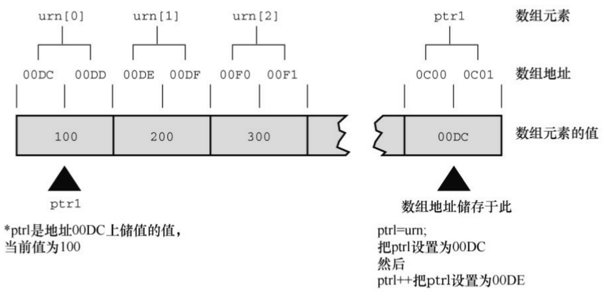
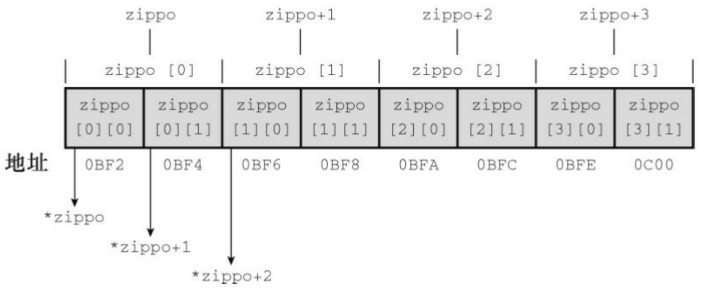

既然能使用指针表示数组名，也可以用数组名表示指针。另外，回忆一下，+=运算符把右侧运算对象加到左侧运算对象上。因此，total是当前数组元素之和。

该函数定义有限制，只能计算10个int类型的元素。另一个比较灵活的方法是把数组大小作为第2个参数:

```c
int sum(int * ar, int n)          // 更通用的方法
{
int   i;
int   total  =  0;
for (i = 0; i < n; i++)      // 使用 n 个元素
total += ar[i];           // ar[i] 和 *(ar + i) 相同
return   total;
}
```

这里，第1个形参告诉函数该数组的地址和数据类型，第2个形参告诉函数该数组中元素的个数。

关于函数的形参，还有一点要注意。只有在函数原型或函数定义头中，才可以用int ar[]代替int \* ar:

int sum (int ar[], int n);

int \*ar形式和int ar[]形式都表示ar是一个指向int的指针。但是，int ar[]只能用于声明形式参数。第2种形式（int ar[]）提醒读者指针ar指向的不仅仅一个int类型值，还是一个int类型数组的元素。

注意声明数组形参

因为数组名是该数组首元素的地址，作为实际参数的数组名要求形式参数是一个与之匹配的指针。只有在这种情况下，C才会把int ar[]和int \* ar解释成一样。也就是说，ar是指向int的指针。由于函数原型可以省略参数名，所以下面4种原型都是等价的:

```c
int sum(int *ar, int n);

int sum(int *, int);

int  sum(int ar[], int n);

int  sum(int [], int);
```

但是，在函数定义中不能省略参数名。下面两种形式的函数定义等价:

```c
int sum(int *ar, int n)
{
// 其他代码已省略
}
int sum(int ar[], int n);
{
//其他代码已省略
}
```

可以使用以上提到的任意一种函数原型和函数定义。

程序清单 10.10 演示了一个程序，使用 sum()函数。该程序打印原始数组的大小和表示该数组的函数形参的大小（如果你的编译器不支持用转换说明%zd打印sizeof返回值，可以用%u或%lu来代替）。

```c
程序清单10.10 sum_arr1.c程序
// sum_arr1.c -- 数组元素之和
// 如果编译器不支持 %zd，用 %u 或 %lu 替换它
#include <stdio.h>
#define SIZE 10
int sum(int ar[], int n);
int main(void)
{
int marbles[SIZE] = { 20, 10, 5, 39, 4, 16, 19, 26,
31, 20 };
long answer;
answer = sum(marbles, SIZE);
printf("The total number of marbles is %ld.\n", answer);
printf("The size of marbles is %zd bytes.\n",
sizeof marbles);
return 0;
}
int sum(int ar[], int n)      // 这个数组的大小是?
{
```

```c
int i;

int total = 0;

for (i = 0; i < n; i++)

total += ar[i];

printf("The size of ar is %zd bytes.\n", sizeof ar);

return total;

}
```

该程序的输出如下:

```txt
The size of ar is 8 bytes.
The total number of marbles is 190.
The size of marbles is 40 bytes.
```

注意，marbles的大小是40字节。这没问题，因为marbles内含10个int类型的值，每个值占4字节，所以整个marbles的大小是40字节。但是，ar才8字节。这是因为ar并不是数组本身，它是一个指向 marbles 数组首元素的指针。我们的系统中用 8 字节储存地址，所以指针变量的大小是 8字节（其他系统中地址的大小可能不是8字节）。简而言之，在程序清单10.10中，marbles是一个数组， ar是一个指向marbles数组首元素的指针，利用C中数组和指针的特殊关系，可以用数组表示法来表示指针ar。

## 10.4.1 使用指针形参

函数要处理数组必须知道何时开始、何时结束。sum()函数使用一个指针形参标识数组的开始，用一个整数形参表明待处理数组的元素个数（指针形参也表明了数组中的数据类型）。但是这并不是给函数传递必备信息的唯一方法。还有一种方法是传递两个指针，第1个指针指明数组的开始处（与前面用法相同），第2个指针指明数组的结束处。程序清单10.11演示了这种方法，同时该程序也表明了指针形参是变量，这意味着可以用索引表明访问数组中的哪一个元素。

程序清单10.11 sum\_arr2.c程序

```c
/* sum_arr2.c -- 数组元素之和 */

#include <stdio.h>

#define SIZE 10

int sump(int * start, int * end);

int main(void)

{

int marbles[SIZE] = { 20, 10, 5, 39, 4, 16, 19, 26, 31, 20 };

long answer;

answer = sump(marbles, marbles + SIZE);

printf("The total number of marbles is %ld.\n", answer);

return 0;

}

/* 使用指针算法 */

int sump(int * start, int * end)
```

```c
{
int total = 0;
while (start < end)
{
total += *start; // 把数组元素的值加起来
start++; // 让指针指向下一个元素
}
return total;
}
```

指针start开始指向marbles数组的首元素，所以赋值表达式total += \*start把首元素（20）加给total。然后，表达式start++递增指针变量start，使其指向数组的下一个元素。因为start是指向int的指针，start递增1相当于其值递增int类型的大小。

注意，sump()函数用另一种方法结束加法循环。sum()函数把元素的个数作为第2个参数，并把该参数作为循环测试的一部分:

$$
\text { for } (i = 0; i <   n; i + +)
$$

而sump()函数则使用第2个指针来结束循环:

$$
\text {while (start <   end)}
$$

因为while循环的测试条件是一个不相等的关系，所以循环最后处理的一个元素是end所指向位置的前一个元素。这意味着end指向的位置实际上在数组最后一个元素的后面。C保证在给数组分配空间时，指向数组后面第一个位置的指针仍是有效的指针。这使得 while循环的测试条件是有效的，因为 start在循环中最后的值是end[1]。注意，使用这种“越界”指针的函数调用更为简洁:

$$
\text {answer} = \text {sump(marbles, marbles + SIZE)};
$$

因为下标从0开始，所以marbles + SIZE指向数组末尾的下一个位置。如果end指向数组的最后一个元素而不是数组末尾的下一个位置，则必须使用下面的代码:

$$
\text {answer} = \text {sump(marbles, marbles + SIZE - 1)};
$$

这种写法既不简洁也不好记，很容易导致编程错误。顺带一提，虽然C保证了marbles + SIZE有效，但是对marbles[SIZE]（即储存在该位置上的值）未作任何保证，所以程序不能访问该位置。

还可以把循环体压缩成一行代码:

$$
\text {total} + = * \text {start} + +;
$$

一元运算符\*和++的优先级相同，但结合律是从右往左，所以start++先求值，然后才是\*start。也就是说，指针start先递增后指向。使用后缀形式（即start++而不是++start）意味着先把指针指向位置上的值加到total上，然后再递增指针。如果使用\*++start，顺序则反过来，先递增指针，再使用指针指向位置上的值。如果使用(\*start)++，则先使用start指向的值，再递增该值，而不是递增指针。这样，指针将一直指向同一个位置，但是该位置上的值发生了变化。虽然\*start++的写法比较常用，但是\*(start++)这样写更清楚。程序清单10.12的程序演示了这些优先级的情况。

程序清单**10.12 order.c**程序

/\* order.c -- 指针运算中的优先级 \*/

#include &lt;stdio.h&gt;

int data[2] = { 100, 200 };

```c
int moredata[2] = { 300, 400 };

int main(void)
{
int *p1, *p2, *p3;
p1 = p2 = data;
p3 = moredata;
printf(" *p1 = %d, *p2 = %d, *p3 = %d\n",*p1, *p2, *p3);
printf("*p1++ = %d, *++p2 = %d, (*p3)++ = %d\n",*p1++, *++p2, (*p3)++);
printf(" *p1 = %d, *p2 = %d, *p3 = %d\n",*p1, *p2, *p3);
return 0;
}
```

下面是该程序的输出:

```txt
*p1 = 100,    *p2 = 100,          *p3 = 300
*p1++ = 100, *++p2 = 200,    (*p3)++ = 300
*p1 = 200,    *p2 = 200,          *p3 = 301
```

只有(\*p3)++改变了数组元素的值，其他两个操作分别把p1和p2指向数组的下一个元素。

## 10.4.2 指针表示法和数组表示法

从以上分析可知，处理数组的函数实际上用指针作为参数，但是在编写这样的函数时，可以选择是使用数组表示法还是指针表示法。如程序清单

10.10所示，使用数组表示法，让函数是处理数组的这一意图更加明显。另外，许多其他语言的程序员对数组表示法更熟悉，如FORTRAN、Pascal、Modula-2或BASIC。其他程序员可能更习惯使用指针表示法，觉得使用指针更自然，如程序清单10.11所示。

至于C语言，ar[i]和\*(ar+1)这两个表达式都是等价的。无论ar是数组名还是指针变量，这两个表达式都没问题。但是，只有当ar是指针变量时，才能使用ar++这样的表达式。

指针表示法（尤其与递增运算符一起使用时）更接近机器语言，因此一些编译器在编译时能生成效率更高的代码。然而，许多程序员认为他们的主要任务是确保代码正确、逻辑清晰，而代码优化应该留给编译器去做。

## 10.5 指针操作

可以对指针进行哪些操作？C提供了一些基本的指针操作，下面的程序示例中演示了8种不同的操作。为了显示每种操作的结果，该程序打印了指针的值（该指针指向的地址）、储存在指针指向地址上的值，以及指针自己的地址。如果编译器不支持%p 转换说明，可以用%u 或%lu 代替%p；如果编译器不支持用%td转换说明打印地址的差值，可以用%d或%ld来代替。

程序清单10.13演示了指针变量的 8种基本操作。除了这些操作，还可以使用关系运算符来比较指针。

程序清单10.13 ptr\_ops.c程序

```c
// ptr_ops.c -- 指针操作
#include <stdio.h>

int main(void)
{
int urn[5] = { 100, 200, 300, 400, 500 };
int *ptr1, *ptr2, *ptr3;
ptr1 = urn;          // 把一个地址赋给指针
ptr2 = &urn[2];      // 把一个地址赋给指针
// 解引用指针，以及获得指针的地址
printf("pointer value, dereferenced pointer, pointer address:\n");
printf("ptr1 = %p, *ptr1 = %d, &ptr1 = %p\n", ptr1, *ptr1, &ptr1);
// 指针加法
```

```txt
ptr3 = ptr1 + 4;
printf("\nadding an int to a pointer:\n");
printf("ptr1 + 4 = %p, *(ptr1 + 4) = %d\n", ptr1 + 4, *(ptr1 + 4));
ptr1++; // 递增指针
printf("\nvalues after ptr1++:\n");
printf("ptr1 = %p, *ptr1 = %d, &ptr1 = %p\n", ptr1, *ptr1, &ptr1);
ptr2--; // 递减指针
printf("\nvalues after --ptr2:\n");
printf("ptr2 = %p, *ptr2 = %d, &ptr2 = %p\n", ptr2, *ptr2, &ptr2);
--ptr1; // 恢复为初始值
++ptr2; // 恢复为初始值
printf("\nPointers reset to original values:\n");
printf("ptr1 = %p, ptr2 = %p\n", ptr1, ptr2);
// 一个指针减去另一个指针
printf("\nsubtracting one pointer from another:\n");
printf("ptr2 = %p, ptr1 = %p, ptr2 - ptr1 = %td\n",
ptr1, ptr2 - ptr1);
// 一个指针减去一个整数
printf("\nsubtracting an int from a pointer:\n");
```

```prolog
printf("ptr3 = %p, ptr3 - 2 = %p\n", ptr3, ptr3 - 2);
return 0;
}
```

下面是我们的系统运行该程序后的输出:

pointer value, dereferenced pointer, pointer address:

```python
ptr1 = 0x7fff5fbff8d0, *ptr1 = 100, &ptr1 = 0x7fff5fbff8c8
```

adding an int to a pointer:

```txt
ptr1 + 4 = 0x7fff5fbff8e0, *(ptr1 + 4) = 500
```

values after ptr1++:

```python
ptr1 = 0x7fff5fbff8d4, *ptr1 =200, &ptr1 = 0x7fff5fbff8c8
```

values after --ptr2:

```python
ptr2 = 0x7fff5fbff8d4, *ptr2 = 200, &ptr2 = 0x7fff5fbff8c0
```

Pointers reset to original values:

```txt
ptr1 = 0x7fff5fbff8d0, ptr2 = 0x7fff5fbff8d8
```

subtracting one pointer from another:

```python
ptr2 = 0x7fff5fbff8d8, ptr1 = 0x7fff5fbff8d0, ptr2 - ptr1 = 2
```

subtracting an int from a pointer:

```txt
ptr3 = 0x7fff5fbff8e0, ptr3 - 2 = 0x7fff5fbff8d8
```

下面分别描述了指针变量的基本操作。

赋值:可以把地址赋给指针。例如，用数组名、带地址运算符（&）的变量名、另一个指针进行赋值。在该例中，把urn数组的首地址赋给了ptr1，该地址的编号恰好是0x7fff5fbff8d0。变量ptr2获得数组urn的第3个元素（urn[2]）的地址。注意，地址应该和指针类型兼容。也就是说，不能把double类型的地址赋给指向int的指针，至少要避免不明智的类型转换。C99/C11已经强制不允许这样做。

解引用:\*运算符给出指针指向地址上储存的值。因此，\*ptr1的初值是100，该值储存在编号为0x7fff5fbff8d0的地址上。

取址:和所有变量一样，指针变量也有自己的地址和值。对指针而言，&运算符给出指针本身的地址。本例中，ptr1 储存在内存编号为0x7fff5fbff8c8 的地址上，该存储单元储存的内容是0x7fff5fbff8d0，即urn的地址。因此&ptr1是指向ptr1的指针，而ptr1是指向utn[0]的指针。

指针与整数相加:可以使用+运算符把指针与整数相加，或整数与指针相加。无论哪种情况，整数都会和指针所指向类型的大小（以字节为单位）相乘，然后把结果与初始地址相加。因此ptr1 +4与&urn[4]等价。如果相加的结果超出了初始指针指向的数组范围，计算结果则是未定义的。除非正好超过数组末尾第一个位置，C保证该指针有效。

递增指针:递增指向数组元素的指针可以让该指针移动至数组的下一个元素。因此，ptr1++相当于把ptr1的值加上4（我们的系统中int为4字节），ptr1指向urn[1]（见图10.4，该图中使用了简化的地址）。现在ptr1的值是0x7fff5fbff8d4（数组的下一个元素的地址），\*ptr的值为200（即urn[1]的值）。注意，ptr1本身的地址仍是 0x7fff5fbff8c8。毕竟，变量不会因为值发生变化就移动位置。



<details>
<summary>flowchart</summary>

```mermaid
graph LR
  subgraph Left_Process
  A["&quot;urn[0"]"] --> B["00DC"]
  A --> C["00DD"]
  A --> D["00DE"]
  A --> E["00DF"]
  A --> F["00F0"]
  A --> G["00F1"]
  B --> H["100"]
  C --> H
  D --> H
  E --> H
  F --> H
  G --> H
  end

  subgraph Right_Process
  I["ptr1"] --> J["0C00"]
  I --> K["0C01"]
  L["数组元素的值"] --> M["00DC"]
  N["数组地址"] --> O["ptr1"]
  P["数组地址储存于此"] --> Q["ptr1=urn;把ptrl设置为00DC然后ptrl++把ptrl设置为00DE"]
  end

  H ==> I
  H ==> L
  M ==> L
  O ==> L
  Q ==> L
```
</details>

图10.4 递增指向int的指针

指针减去一个整数:可以使用-运算符从一个指针中减去一个整数。指针必须是第1个运算对象，整数是第 2 个运算对象。该整数将乘以指针指向类型的大小（以字节为单位），然后用初始地址减去乘积。所以ptr3 - 2与&urn[2]等价，因为ptr3指向的是&arn[4]。如果相减的结果超出了初始指针所指向数组的范围，计算结果则是未定义的。除非正好超过数组末尾第一个位置，C保证该指针有效。

递减指针:当然，除了递增指针还可以递减指针。在本例中，递减ptr3使其指向数组的第2个元素而不是第3个元素。前缀或后缀的递增和递减运算符都可以使用。注意，在重置ptr1和ptr2前，它们都指向相同的元素urn[1]。

指针求差:可以计算两个指针的差值。通常，求差的两个指针分别指向同一个数组的不同元素，通过计算求出两元素之间的距离。差值的单位与数组类型的单位相同。例如，程序清单10.13的输出中，ptr2 - ptr1得2，意思是这两个指针所指向的两个元素相隔两个int，而不是2字节。只要两个指针都指向相同的数组（或者其中一个指针指向数组后面的第 1 个地址），C 都能保证相减运算有效。如果指向两个不同数组的指针进行求差运算可能会得出一个值，或者导致运行时错误。

比较:使用关系运算符可以比较两个指针的值，前提是两个指针都指向

相同类型的对象。

注意，这里的减法有两种。可以用一个指针减去另一个指针得到一个整数，或者用一个指针减去一个整数得到另一个指针。

在递增或递减指针时还要注意一些问题。编译器不会检查指针是否仍指向数组元素。C 只能保证指向数组任意元素的指针和指向数组后面第 1 个位置的指针有效。但是，如果递增或递减一个指针后超出了这个范围，则是未定义的。另外，可以解引用指向数组任意元素的指针。但是，即使指针指向数组后面一个位置是有效的，也能解引用这样的越界指针。

解引用未初始化的指针

说到注意事项，一定要牢记一点:千万不要解引用未初始化的指针。例如，考虑下面的例子:

int \* pt;// 未初始化的指针

为何不行？第2行的意思是把5储存在pt指向的位置。但是pt未被初始化，其值是一个随机值，所以不知道5将储存在何处。这可能不会出什么错，也可能会擦写数据或代码，或者导致程序崩溃。切记:创建一个指针时，系统只分配了储存指针本身的内存，并未分配储存数据的内存。因此，在使用指针之前，必须先用已分配的地址初始化它。例如，可以用一个现有变量的地址初始化该指针（使用带指针形参的函数时，就属于这种情况）。或者还可以使用第12章将介绍的malloc()函数先分配内存。无论如何，使用指针时一定要注意，不要解引用未初始化的指针！

double \* pd; // 未初始化的指针

\*pd = 2.4; // 不要这样做

假设

int urn[3];

int \* ptr1, \* ptr2;

下面是一些有效和无效的语句:

有效语句

无效语句

基于这些有效的操作，C 程序员创建了指针数组、函数指针、指向指针的指针数组、指向函数的指针数组等。别紧张，接下来我们将根据已学的内容介绍指针的一些基本用法。指针的第 1 个基本用法是在函数间传递信息。前面学过，如果希望在被调函数中改变主调函数的变量，必须使用指针。指针的第 2 个基本用法是用在处理数组的函数中。下面我们再来看一个使用函数和数组的编程示例。

## 10.6 保护数组中的数据

编写一个处理基本类型（如，int）的函数时，要选择是传递int类型的值还是传递指向int的指针。通常都是直接传递数值，只有程序需要在函数中改变该数值时，才会传递指针。对于数组别无选择，必须传递指针，因为这样做效率高。如果一个函数按值传递数组，则必须分配足够的空间来储存原数组的副本，然后把原数组所有的数据拷贝至新的数组中。如果把数组的地址传递给函数，让函数直接处理原数组则效率要高。

传递地址会导致一些问题。C 通常都按值传递数据，因为这样做可以保证数据的完整性。如果函数使用的是原始数据的副本，就不会意外修改原始数据。但是，处理数组的函数通常都需要使用原始数据，因此这样的函数可以修改原数组。有时，这正是我们需要的。例如，下面的函数给数组的每个元素都加上一个相同的值:

```c
void add_to(double ar[], int n, double val)
{
int i;
for (i = 0; i < n; i++)
ar[i] += val;
}
```

因此，调用该函数后，prices数组中的每个元素的值都增加了2.5:

```txt
add_to(prices, 100, 2.50);
```

该函数修改了数组中的数据。之所以可以这样做，是因为函数通过指针直接使用了原始数据。

然而，其他函数并不需要修改数据。例如，下面的函数计算数组中所有元素之和，它不用改变数组的数据。但是，由于ar实际上是一个指针，所以编程错误可能会破坏原始数据。例如，下面示例中的ar[i]++会导致数组中每个元素的值都加1:

```c
int sum(int ar[], int n) // 错误的代码
{
int i;
int total = 0;
for( i = 0; i < n; i++)
total += ar[i]++;
// 错误递增了每个元素的值
return total;
}
```

## 10.6.1 对形式参数使用const

在K&R C的年代，避免类似错误的唯一方法是提高警惕。ANSI C提供了一种预防手段。如果函数的意图不是修改数组中的数据内容，那么在函数原型和函数定义中声明形式参数时应使用关键字const。例如，sum()函数的原型和定义如下:

```c
int sum(const int ar[], int n); /* 函数原型 */
int sum(const int ar[], int n) /* 函数定义 */
{
int i;
```

```txt
int total = 0;

for( i = 0; i < n; i++)
total += ar[i];

return total;

}
```

以上代码中的const告诉编译器，该函数不能修改ar指向的数组中的内容。如果在函数中不小心使用类似ar[i]++的表达式，编译器会捕获这个错误，并生成一条错误信息。

这里一定要理解，这样使用const并不是要求原数组是常量，而是该函数在处理数组时将其视为常量，不可更改。这样使用const可以保护数组的数据不被修改，就像按值传递可以保护基本数据类型的原始值不被改变一样。一般而言，如果编写的函数需要修改数组，在声明数组形参时则不使用const；如果编写的函数不用修改数组，那么在声明数组形参时最好使用const。

程序清单10.14的程序中，一个函数显示数组的内容，另一个函数给数组每个元素都乘以一个给定值。因为第1个函数不用改变数组，所以在声明数组形参时使用了const；而第2个函数需要修改数组元素的值，所以不使用const。

程序清单**10.14 arf.c**程序

```c
/* arf.c -- 处理数组的函数 */

#include <stdio.h>

#define SIZE 5

void show_array(const double ar[], int n);
```

```c
void mult_array(double ar[], int n, double mult);
int main(void)
{
double dip[SIZE] = { 20.0, 17.66, 8.2, 15.3, 22.22 };
printf("The original dip array:\n");
show_array(dip, SIZE);
mult_array(dip, SIZE, 2.5);
printf("The dip array after calling mult_array():\n");
show_array(dip, SIZE);
return 0;
}
/* 显示数组的内容 */
void show_array(const double ar[], int n)
{
int i;
for (i = 0; i < n; i++)
printf("%8.3f ", ar[i]);
putchar('\n');
}
```

/\* 把数组的每个元素都乘以相同的值 \*/

```c
void mult_array(double ar[], int n, double mult)
{
int i;
for (i = 0; i < n; i++)
ar[i] *= mult;
}
```

下面是该程序的输出:

The original dip array:

```python
20.000      17.660       8.200       15.300      22.220
The dip array after calling mult_array():
    50.000      44.150       20.500      38.250      55.550
```

注意该程序中两个函数的返回类型都是void。虽然mult\_array()函数更新了dip数组的值，但是并未使用return机制。

## 10.6.2 const的其他内容

我们在前面使用const创建过变量:

```txt
const double PI = 3.14159;
```

虽然用#define指令可以创建类似功能的符号常量，但是const的用法更加灵活。可以创建const数组、const指针和指向const的指针。

程序清单10.4演示了如何使用const关键字保护数组:

#define MONTHS 12

. ..

const int days[MONTHS] = {31,28,31,30,31,30,31,31,30,31,30,31};

如果程序稍后尝试改变数组元素的值，编译器将生成一个编译期错误消息:

days[9] = 44; /\* 编译错误 \*/

指向const的指针不能用于改变值。考虑下面的代码:

double rates[5] = {88.99, 100.12, 59.45, 183.11, 340.5};

const double \* pd = rates; // pd指向数组的首元素

第2行代码把pd指向的double类型的值声明为const，这表明不能使用pd来更改它所指向的值:

\*pd = 29.89; // 不允许

pd[2] = 222.22; //不允许

rates[0] = 99.99; // 允许，因为rates未被const限定

无论是使用指针表示法还是数组表示法，都不允许使用pd修改它所指向数据的值。但是要注意，因为rates并未被声明为const，所以仍然可以通过rates修改元素的值。另外，可以让pd指向别处:

pd++; /\* 让pd指向rates[1] -- 没问题 \*/

指向 const 的指针通常用于函数形参中，表明该函数不会使用指针改变数据。例如，程序清单 10.14中的show\_array()函数原型如下:

void show\_array(const double \*ar, int n);

关于指针赋值和const需要注意一些规则。首先，把const数据或非const数据的地址初始化为指向const的指针或为其赋值是合法的:

```javascript
double rates[5] = {88.99, 100.12, 59.45, 183.11, 340.5};
const double locked[4] = {0.08, 0.075, 0.0725, 0.07};
```

const double \* pc = rates; // 有效

```txt
pc = locked; //有效
```

```javascript
pc = &rates[3]; //有效
```

然而，只能把非const数据的地址赋给普通指针:

```javascript
double rates[5] = {88.99, 100.12, 59.45, 183.11, 340.5};
const double locked[4] = {0.08, 0.075, 0.0725, 0.07};
```

double \* pnc = rates; // 有效

```txt
pnc = locked; // 无效
```

```txt
pnc = &rates[3]; // 有效
```

这个规则非常合理。否则，通过指针就能改变const数组中的数据。

应用以上规则的例子，如 show\_array()函数可以接受普通数组名和 const数组名作为参数，因为这两种参数都可以用来初始化指向const的指针:

show\_array(rates, 5); // 有效

show\_array(locked, 4); // 有效

因此，对函数的形参使用const不仅能保护数据，还能让函数处理const数组。

另外，不应该把const数组名作为实参传递给mult\_array()这样的函数:

mult\_array(rates, 5, 1.2); // 有效

mult\_array(locked, 4, 1.2); // 不要这样做

C标准规定，使用非const标识符（如，mult\_arry()的形参ar）修改const数据（如，locked）导致的结果是未定义的。

const还有其他的用法。例如，可以声明并初始化一个不能指向别处的指针，关键是const的位置:

double rates[5] = {88.99, 100.12, 59.45, 183.11, 340.5};

double \* const pc = rates; // pc指向数组的开始

pc = &rates[2]; // 不允许，因为该指针不能指向别处

\*pc = 92.99; // 没问题 -- 更改rates[0]的值

可以用这种指针修改它所指向的值，但是它只能指向初始化时设置的地址。

最后，在创建指针时还可以使用const两次，该指针既不能更改它所指向的地址，也不能修改指向地址上的值:

double rates[5] = {88.99, 100.12, 59.45, 183.11, 340.5};

const double \* const pc = rates;

pc = &rates[2]; //不允许

\*pc = 92.99; //不允许

## 10.7 指针和多维数组

指针和多维数组有什么关系？为什么要了解它们的关系？处理多维数组的函数要用到指针，所以在使用这种函数之前，先要更深入地学习指针。至于第 1 个问题，我们通过几个示例来回答。为简化讨论，我们使用较小的数组。假设有下面的声明:

int zippo[4][2]; /\* 内含int数组的数组 \*/

然后数组名zippo是该数组首元素的地址。在本例中，zippo的首元素是一个内含两个int值的数组，所以zippo是这个内含两个int值的数组的地址。下面，我们从指针的属性进一步分析。

因为zippo是数组首元素的地址，所以zippo的值和&zippo[0]的值相同。而zippo[0]本身是一个内含两个整数的数组，所以zippo[0]的值和它首元素（一个整数）的地址（即&zippo[0][0]的值）相同。简而言之，zippo[0]是一个占用一个int大小对象的地址，而zippo是一个占用两个int大小对象的地址。由于这个整数和内含两个整数的数组都开始于同一个地址，所以zippo和zippo[0]的值相同。

给指针或地址加1，其值会增加对应类型大小的数值。在这方面，zippo和zippo[0]不同，因为zippo指向的对象占用了两个int大小，而zippo[0]指向的对象只占用一个int大小。因此， zippo + 1和zippo[0] + 1的值不同。

解引用一个指针（在指针前使用\*运算符）或在数组名后使用带下标的[]运算符，得到引用对象代表的值。因为zippo[0]是该数组首元素（zippo[0] [0]）的地址，所以\*(zippo[0])表示储存在zippo[0][0]上的值（即一个int类型的值）。与此类似，\*zippo代表该数组首元素（zippo[0]）的值，但是zippo[0]本身是一个int类型值的地址。该值的地址是&zippo[0][0]，所以\*zippo就是&zippo[0][0]。对两个表达式应用解引用运算符表明，\*\*zippo与\*&zippo[0][0]等价，这相当于zippo[0][0]，即一个int类型的值。简而言之，zippo是地址的地址，必须解引用两次才能获得原始值。地址的地址或指针的指针是就是双重间接（double indirection）的例子。

显然，增加数组维数会增加指针的复杂度。现在，大部分初学者都开始意识到指针为什么是 C 语言中最难的部分。认真思考上述内容，看看是否能用所学的知识解释程序清单10.15中的程序。该程序显示了一些地址值和数组的内容。

程序清单10.15 zippo1.c程序

```c
/* zippo1.c --  zippo的相关信息 */
#include <stdio.h>

int main(void)
{
    int zippo[4][2] = { { 2, 4 }, { 6, 8 }, { 1, 3 },
{ 5, 7 } };

    printf(" zippo = %p, zippo + 1 = %p\n",zippo, zippo + 1);

    printf("zippo[0] = %p, zippo[0] + 1 = %p\n",zippo[0], zippo[0] + 1);

    printf(" *zippo = %p, *zippo + 1 = %p\n",*zippo, *zippo + 1);
    printf("zippo[0][0] = %d\n", zippo[0][0]);
    printf(" *zippo[0] = %d\n", *zippo[0]);
    printf(" **zippo = %d\n", **zippo);
    printf(" zippo[2][1] = %d\n", zippo[2][1]);
```

```lisp
printf("*(*(zippo+2) + 1) = %d\n", *(*(zippo + 2) + 1));
return    0;
}
```

下面是我们的系统运行该程序后的输出:

```txt
zippo = 0x0064fd38, zippo + 1 = 0x0064fd40
zippo[0]= 0x0064fd38, zippo[0] + 1 = 0x0064fd3c
*zippo=0x0064fd38, *zippo+1=0x0064fd3c
zippo[0][0] = 2
*zippo[0]=2
**zippo=2
zippo[2][1] = 3
*(*(zippo+2)+1)=3
```

其他系统显示的地址值和地址形式可能不同，但是地址之间的关系与以上输出相同。该输出显示了二维数组zippo的地址和一维数组zippo[0]的地址相同。它们的地址都是各自数组首元素的地址，因而与&zippo[0][0]的值也相同。

尽管如此，它们也有差别。在我们的系统中，int是4 字节。前面讨论过，zippo[0]指向一个4 字节的数据对象。zippo[0]加1，其值加4（十六进制中，38+4得3c）。数组名zippo 是一个内含2个int类型值的数组的地址，所以zippo指向一个8字节的数据对象。因此，zippo加1，它所指向的地址加8字节（十六进制中，38+8得40）。

该程序演示了zippo[0]和\*zippo完全相同，实际上确实如此。然后，对二维数组名解引用两次，得到储存在数组中的值。使用两个间接运算符（\*）或者使用两对方括号（[]）都能获得该值（还可以使用一个\*和一对[]，但是我们暂不讨论这么多情况）。

要特别注意，与 zippo[2][1]等价的指针表示法是\*(\*(zippo+2) + 1)。看上去比较复杂，应最好能理解。下面列出了理解该表达式的思路:

```txt
zippo ←二维数组首元素的地址（每个元素都是内含两个 int 类型元素的一维数组）
zippo+2 ←二维数组的第 3 个元素（即一维数组）的地址
*(zippo+2) ←二维数组的第 3 个元素（即一维数组）的首元素（一个 int 类型的值）地址
*(zippo+2) + 1 ←二维数组的第 3 个元素（即一维数组）的第 2 个元素（也是一个 int 类型的值）地址
*(*(zippo+2) + 1) ←二维数组的第 3 个一维数组元素的第 2 个 int 类型元素的值，即数组的第 3 行第 2 列的值（zippo[2][1]）
```

以上分析并不是为了说明用指针表示法（\*(\*(zippo+2) + 1)）代替数组表示法（zippo[2][1]），而是提示读者，如果程序恰巧使用一个指向二维数组的指针，而且要通过该指针获取值时，最好用简单的数组表示法，而不是指针表示法。

图10.5以另一种视图演示了数组地址、数组内容和指针之间的关系。



<details>
<summary>flowchart</summary>

```mermaid
graph TD
  A["zippo"] --> B["&quot;zippo [0"]"]
  B --> C["zippo +1"]
  C --> D["&quot;zippo [1"]"]
  D --> E["zippo +2"]
  E --> F["zippo +3"]
  F --> G["&quot;zippo [3"]"]
  G --> H["&quot;zippo [2"]"]
  H --> I["&quot;zippo [2"] [1]"]
  I --> J["&quot;zippo [2"][0]"]
  J --> K["&quot;zippo [3"][0]"]
  K --> L["&quot;zippo [3"][1]"]
  M["0BF2"] --> N["*zippo"]
  M --> O["0BF4"] --> P["*zippo+1"]
  M --> Q["0BF6"] --> R["*zippo+2"]
```
</details>

图10.5 数组的数组

## 10.7.1 指向多维数组的指针

如何声明一个指针变量pz指向一个二维数组（如，zippo）？在编写处理类似zippo这样的二维数组时会用到这样的指针。把指针声明为指向int的类型还不够。因为指向int只能与zippo[0]的类型匹配，说明该指针指向一个int类型的值。但是zippo是它首元素的地址，该元素是一个内含两个int类型值的一维数组。因此，pz必须指向一个内含两个int类型值的数组，而不是指向一个int类型值，其声明如下:

以上代码把pz声明为指向一个数组的指针，该数组内含两个int类型值。为什么要在声明中使用圆括号？因为[]的优先级高于\*。考虑下面的声明:

int \* pax[2]; // pax是一个内含两个指针元素的数组，每个元素都指向int的指针

由于[]优先级高，先与pax结合，所以pax成为一个内含两个元素的数组。然后\*表示pax数组内含两个指针。最后，int表示pax数组中的指针都指向int类型的值。因此，这行代码声明了两个指向int的指针。而前面有圆括号的版本，\*先与pz结合，因此声明的是一个指向数组（内含两个int类型的值）的指针。程序清单10.16演示了如何使用指向二维数组的指针。

程序清单**10.16 zippo2.c**程序

```c
/* zippo2.c -- 通过指针获取zippo的信息 */

#include <stdio.h>

int main(void)

{

    int zippo[4][2] = { { 2, 4 }, { 6, 8 }, { 1, 3 },
{ 5, 7 } };

    int(*pz)[2];
```

```c
pz = zippo;

printf(" pz = %p, pz + 1 = %p\n", pz, pz + 1);

printf("pz[0] = %p, pz[0] + 1 = %p\n", pz[0], pz[0] + 1);

printf(" *pz = %p, *pz + 1 = %p\n", *pz, *pz + 1);

printf("pz[0][0] = %d\n", pz[0][0]);

printf(" *pz[0] = %d\n", *pz[0]);

printf(" **pz = %d\n", **pz);

printf(" pz[2][1] = %d\n", pz[2][1]);

printf("*(*(pz+2) + 1) = %d\n", *(*(pz + 2) + 1));

return 0;

}
```

下面是该程序的输出:

```ini
pz = 0x0064fd38,    pz + 1 = 0x0064fd40
pz[0] = 0x0064fd38,   pz[0] + 1 = 0x0064fd3c
*pz=0x0064fd38,     *pz+1=0x0064fd3c
pz[0][0] = 2
*pz[0]=2
**pz=2
pz[2][1] = 3
```

$$
* (* (\mathrm{pz} + 2) + 1) = 3
$$

系统不同，输出的地址可能不同，但是地址之间的关系相同。如前所述，虽然pz是一个指针，不是数组名，但是也可以使用 pz[2][1]这样的写法。可以用数组表示法或指针表示法来表示一个数组元素，既可以使用数组名，也可以使用指针名:

$$
\mathrm{zippo[m][n]} = = * (* (\mathrm{zippo} + \mathrm{m}) + \mathrm{n})
$$

$$
\mathrm{pz} [ \mathrm{m} ] [ \mathrm{n} ] = = * (* (\mathrm{pz} + \mathrm{m}) + \mathrm{n})
$$

## 10.7.2 指针的兼容性

指针之间的赋值比数值类型之间的赋值要严格。例如，不用类型转换就可以把 int 类型的值赋给double类型的变量，但是两个类型的指针不能这样做。

$$
\text {int} \quad \mathrm{n} = 5;
$$

$$
\text {double} \quad \mathrm{x};
$$

$$
\mathrm{int} ^ {*} \mathrm{p1} = \& \mathrm{n};
$$

$$
\text {double} * \mathrm{pd} = \& \mathrm{x};
$$

$$
\mathrm{x} = \mathrm{n}; \quad / / \text {隐式类型转换}
$$

$$
\mathrm{pd} = \mathrm{p} 1; \quad / / \text {编译时错误}
$$

更复杂的类型也是如此。假设有如下声明:

$$
\text {int} ^ {*} \text {pt};
$$

$$
\text {int} (^ {*} \mathrm{pa}) [ 3 ];
$$

$$
\text {int} \quad \operatorname{ar1} [ 2 ] [ 3 ];
$$

int ar2[3][2];

int \*\*p2; // 一个指向指针的指针

有如下的语句:

pt = ar1[0]; // 都是指向int的指针

pt = ar1; // 无效

pa = ar1; // 都是指向内含3个int类型元素数组的指针

pa = ar2; // 无效

p2 = &pt; // both pointer-to-int \*

\*p2 = ar2[0]; // 都是指向int的指针

p2 = ar2; // 无效

注意，以上无效的赋值表达式语句中涉及的两个指针都是指向不同的类型。例如，pt 指向一个 int类型值，而ar1指向一个内含3和int类型元素的数组。类似地，pa指向一个内含2个int类型元素的数组，所以它与ar1的类型兼容，但是ar2指向一个内含2个int类型元素的数组，所以pa与ar2不兼容。

上面的最后两个例子有些棘手。变量p2是指向指针的指针，它指向的指针指向int，而ar2是指向数组的指针，该数组内含2个int类型的元素。所以，p2和ar2的类型不同，不能把ar2赋给p2。但是，\*p2是指向int的指针，与ar2[0]兼容。因为ar2[0]是指向该数组首元素（ar2[0][0]）的指针，所以ar2[0]也是指向int的指针。

一般而言，多重解引用让人费解。例如，考虑下面的代码:

int x = 20;