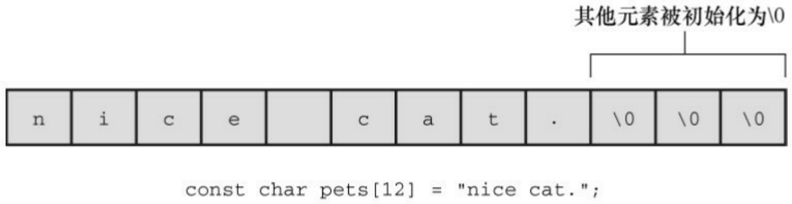
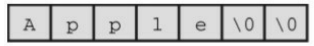
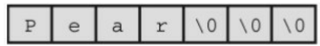
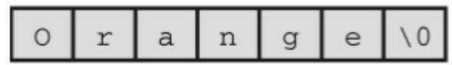
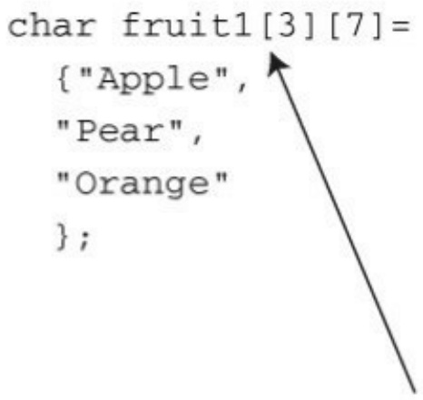
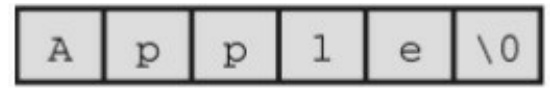
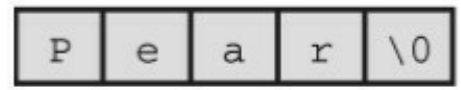
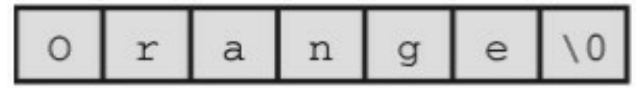
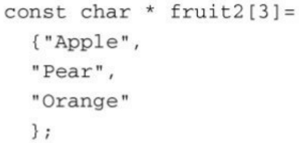

# 第11章字符串和字符串函数

本章介绍以下内容:

函数:gets()、gets\_s()、fgets()、puts()、fputs()、strcat()、strncat()、strcmp()、strncmp()、strcpy()、strncpy()、sprintf()、strchr()

创建并使用字符串

使用C库中的字符和字符串函数，并创建自定义的字符串函数

使用命令行参数

字符串是C语言中最有用、最重要的数据类型之一。虽然我们一直在使用字符串，但是要学的东西还很多。C 库提供大量的函数用于读写字符串、拷贝字符串、比较字符串、合并字符串、查找字符串等。通过本章的学习，读者将进一步提高自己的编程水平。

## 11.1 表示字符串和字符串I/O

第4章介绍过，字符串是以空字符（\0）结尾的char类型数组。因此，可以把上一章学到的数组和指针的知识应用于字符串。不过，由于字符串十分常用，所以 C提供了许多专门用于处理字符串的函数。本章将讨论字符串的性质、如何声明并初始化字符串、如何在程序中输入和输出字符串，以及如何操控字符串。

程序清单11.1演示了在程序中表示字符串的几种方式。

程序清单11.1 strings1.c程序

```c
// strings1.c
#include <stdio.h>
#define MSG "I am a symbolic string constant."
#define MAXLENGTH 81
int main(void)
{
char words[MAXLENGTH] = "I am a string in an array.";
const char * pt1 = "Something is pointing at me.";
puts("Here are some strings:");
puts(MSG);
puts(words);
puts(pt1);
```

```txt
words[8] = 'p';

puts(words);

return 0;

}
```

和printf()函数一样，puts()函数也属于stdio.h系列的输入/输出函数。但是，与printf()不同的是，puts()函数只显示字符串，而且自动在显示的字符串末尾加上换行符。下面是该程序的输出:

Here are some strings:

I am an old-fashioned symbolic string constant.

I am a string in an array.

Something is pointing at me.

I am a spring in an array.

我们先分析一下该程序中定义字符串的几种方法，然后再讲解把字符串读入程序涉及的一些操作，最后学习如何输出字符串。

## 11.1.1 在程序中定义字符串

程序清单11.1中使用了多种方法（即字符串常量、char类型数组、指向char的指针）定义字符串。程序应该确保有足够的空间储存字符串，这一点我们稍后讨论。

## 1.字符串字面量（字符串常量）

用双引号括起来的内容称为字符串字面量（string literal），也叫作字符串常量（string constant）。双引号中的字符和编译器自动加入末尾的\0字符，都作为字符串储存在内存中，所以"I am a symbolic stringconstant."、"I am a string in an array."、"Something is pointed at me."、"Here are some strings:"都是字符串字面量。

从ANSI C标准起，如果字符串字面量之间没有间隔，或者用空白字符分隔，C会将其视为串联起来的字符串字面量。例如:

```javascript
char greeting[50] = "Hello, and"" how are" " you"
" today!";
```

与下面的代码等价:

```javascript
char greeting[50] = "Hello, and how are you today!";
```

如果要在字符串内部使用双引号，必须在双引号前面加上一个反斜杠（\）:

```lua
printf("\"Run, Spot, run!\" exclaimed Dick.\n");
```

输出如下:

"Run, Spot, run!" exclaimed Dick.

字符串常量属于静态存储类别（static storage class），这说明如果在函数中使用字符串常量，该字符串只会被储存一次，在整个程序的生命期内存在，即使函数被调用多次。用双引号括起来的内容被视为指向该字符串储存位置的指针。这类似于把数组名作为指向该数组位置的指针。如果确实如此，程序清单11.2中的程序会输出什么？

程序清单**11.2 strptr.c**程序

```txt
/* strptr.c -- 把字符串看作指针 */
```

```c
#include <stdio.h>
```

```txt
int main(void)
```

```txt
{
printf("%s, %p, %c\n", "We", "are", *"space farers");
return 0;
}
```

printf()根据%s 转换说明打印 We，根据%p 转换说明打印一个地址。因此，如果"are"代表一个地址，printf()将打印该字符串首字符的地址（如果使用ANSI之前的实现，可能要用%u或%lu代替%p）。最后，\*"space farers"表示该字符串所指向地址上储存的值，应该是字符串\*"space farers"的首字符。是否真的是这样？下面是该程序的输出:

We, 0x100000f61, s

## 2.字符串数组和初始化

定义字符串数组时，必须让编译器知道需要多少空间。一种方法是用足够空间的数组储存字符串。在下面的声明中，用指定的字符串初始化数组m1:

const char m1[40] = "Limit yourself to one line's worth.";

const表明不会更改这个字符串。

这种形式的初始化比标准的数组初始化形式简单得多:

```javascript
const char m1[40] = { 'L','i', 'm', 'i', 't', '', 'y', 'o', 'u', 'r', 's', 'e', 'l',
'f, '', 't', 'o', '', 'o', 'n', 'e', '', 'l', 'i', 'n', 'e',
'\", 's', ' ', 'w', 'o', 'r', 't', 'h', '.', '\0'
};
```

注意最后的空字符。没有这个空字符，这就不是一个字符串，而是一个字符数组。

在指定数组大小时，要确保数组的元素个数至少比字符串长度多1（为了容纳空字符）。所有未被使用的元素都被自动初始化为0（这里的0指的是char形式的空字符，不是数字字符0），如图11.1所示。



<details>
<summary>text_image</summary>

其他元素被初始化为\0
const char pets[12] = "nice cat.";
</details>

图11.1 初始化数组

通常，让编译器确定数组的大小很方便。回忆一下，省略数组初始化声明中的大小，编译器会自动计算数组的大小:

$$
\text {const char m2[]} = \text {"If you can't think of anything, fake it."};
$$

让编译器确定初始化字符数组的大小很合理。因为处理字符串的函数通常都不知道数组的大小，这些函数通过查找字符串末尾的空字符确定字符串在何处结束。

让编译器计算数组的大小只能用在初始化数组时。如果创建一个稍后再填充的数组，就必须在声明时指定大小。声明数组时，数组大小必须是可求值的整数。在C99新增变长数组之前，数组的大小必须是整型常量，包括由整型常量组成的表达式。

$$
\text {int} \quad \mathrm{n} = 8;
$$

$$
\text {char cookies[1];} \quad / / \text {有效}
$$

$$
\text {char cakes} [ 2 + 5 ]; / / \text {有效，数组大小是整型常量表达式}
$$

char pies[2\*sizeof(long double) + 1]; // 有效

char crumbs[n]; // 在C99标准之前无效，C99标准之后这种数组是变长数组

字符数组名和其他数组名一样，是该数组首元素的地址。因此，假设有下面的初始化:

char car[10] = "Tata";

那么，以下表达式都为真:

还可以使用指针表示法创建字符串。例如，程序清单11.1中使用了下面的声明:

该声明和下面的声明几乎相同:

const char ar1[] = "Something is pointing at me.";

以上两个声明表明，pt1和ar1都是该字符串的地址。在这两种情况下，带双引号的字符串本身决定了预留给字符串的存储空间。尽管如此，这两种形式并不完全相同。

## 3.数组和指针

数组形式和指针形式有何不同？以上面的声明为例，数组形式（ar1[]）在计算机的内存中分配为一个内含29个元素的数组（每个元素对应一个字符，还加上一个末尾的空字符'\0'），每个元素被初始化为字符串字面量对应的字符。通常，字符串都作为可执行文件的一部分储存在数据段中。当把程序载入内存时，也载入了程序中的字符串。字符串储存在静态存储区（static memory）中。但是，程序在开始运行时才会为该数组分配内存。此时，才将字符串拷贝到数组中（第 12 章将详细讲解）。注意，此时字符串有两个副本。一个是在静态内存中的字符串字面量，另一个是储存在ar1数组中的字符串。

此后，编译器便把数组名ar1识别为该数组首元素地址（&ar1[0]）的别名。这里关键要理解，在数组形式中，ar1是地址常量。不能更改ar1，如果改变了ar1，则意味着改变了数组的存储位置（即地址）。可以进行类似ar1+1这样的操作，标识数组的下一个元素。但是不允许进行++ar1这样的操作。递增运算符只能用于变量名前（或概括地说，只能用于可修改的左值），不能用于常量。

指针形式（\*pt1）也使得编译器为字符串在静态存储区预留29个元素的空间。另外，一旦开始执行程序，它会为指针变量pt1留出一个储存位置，并把字符串的地址储存在指针变量中。该变量最初指向该字符串的首字符，但是它的值可以改变。因此，可以使用递增运算符。例如，++pt1将指向第2 个字符（o）。

字符串字面量被视为const数据。由于pt1指向这个const数据，所以应该把pt1声明为指向const数据的指针。这意味着不能用pt1改变它所指向的数据，但是仍然可以改变pt1的值（即，pt1指向的位置）。如果把一个字符串字面量拷贝给一个数组，就可以随意改变数据，除非把数组声明为const。

总之，初始化数组把静态存储区的字符串拷贝到数组中，而初始化指针只把字符串的地址拷贝给指针。程序清单11.3演示了这一点。

程序清单**11.3 addresses.c**程序

// addresses.c -- 字符串的地址

#define MSG "I'm special"

#include &lt;stdio.h&gt;

int main()

```c
{
char ar[] = MSG;

const char *pt = MSG;

printf("address of \"I'm special\": %p \n", "I'm special");
printf("            address ar: %p\n", ar);
printf("            address pt: %p\n", pt);
printf("            address of MSG: %p\n", MSG);
printf("address of \"I'm special\": %p \n", "I'm special");
return 0;
}
```

下面是在我们的系统中运行该程序后的输出:

```yaml
address of "I'm special": 0x100000f10
address ar: 0x7fff5fbff858
address pt: 0x100000f10
address of MSG: 0x100000f10
address of "I'm special": 0x100000f10
```

该程序的输出说明了什么？第一，pt和MSG的地址相同，而ar的地址不同，这与我们前面讨论的内容一致。第二，虽然字符串字面量"I'm special"在程序的两个 printf()函数中出现了两次，但是编译器只使用了一个存储位置，而且与MSG的地址相同。编译器可以把多次使用的相同字面量

储存在一处或多处。另一个编译器可能在不同的位置储存3个"I'm special"。第三，静态数据使用的内存与ar使用的动态内存不同。不仅值不同，特定编译器甚至使用不同的位数表示两种内存。

数组和指针表示字符串的区别是否很重要？通常不太重要，但是这取决于想用程序做什么。我们来进一步讨论这个主题。

## 4.数组和指针的区别

初始化字符数组来储存字符串和初始化指针来指向字符串有何区别（“指向字符串”的意思是指向字符串的首字符）？例如，假设有下面两个声明:

char heart[] = "I love Tillie!";

const char \*head = "I love Millie!";

两者主要的区别是:数组名heart是常量，而指针名head是变量。那么，实际使用有什么区别？

首先，两者都可以使用数组表示法:

for (i = 0; i < 6; i++)

putchar(heart[i]);

putchar('\n');

for (i = 0; i < 6; i++)

putchar(head[i]);

putchar('\n');

上面两段代码的输出是:

I love

I love

其次，两者都能进行指针加法操作:

```txt
for (i = 0; i < 6; i++)
```

```javascript
putchar(*(heart + i));
```

```javascript
putchar('\n');
```

```txt
for (i = 0; i < 6; i++)
```

```txt
putchar(*(head + i));
```

```javascript
putchar('\n');
```

输出如下:

I love

I love

但是，只有指针表示法可以进行递增操作:

while (\*(head) != '\0') /\* 在字符串末尾处停止\*/

putchar(\*(head++)); /\* 打印字符，指针指向下一个位置 \*/

这段代码的输出如下:

I love Millie!

假设想让head和heart统一，可以这样做:

```txt
head = heart; /* head现在指向数组heart */
```

这使得head指针指向heart数组的首元素。

但是，不能这样做:

这类似于x = 3;和3 = x;的情况。赋值运算符的左侧必须是变量（或概括地说是可修改的左值），如\*pt\_int。顺带一提，head = heart;不会导致head指向的字符串消失，这样做只是改变了储存在head中的地址。除非已经保存了"I love Millie!"的地址，否则当head指向别处时，就无法再访问该字符串。

另外，还可以改变heart数组中元素的信息:

数组的元素是变量（除非数组被声明为const），但是数组名不是变量。

我们来看一下未使用const限定符的指针初始化:

char \* word = "frame";

是否能使用该指针修改这个字符串？

word[1] = 'l'; // 是否允许？

编译器可能允许这样做，但是对当前的C标准而言，这样的行为是未定义的。例如，这样的语句可能导致内存访问错误。原因前面提到过，编译器可以使用内存中的一个副本来表示所有完全相同的字符串字面量。例如，下面的语句都引用字符串"Klingon"的一个内存位置:

char \* p1 = "Klingon";

printf("Klingon");

printf(": Beware the %ss!\n", "Klingon");

也就是说，编译器可以用相同的地址替换每个"Klingon"实例。如果编译器使用这种单次副本表示法，并允许p1[0]修改'F'，那将影响所有使用该字符串的代码。所以以上语句打印字符串字面量"Klingon"时实际上显示的是"Flingon":

Flingon: Beware the Flingons!

实际上在过去，一些编译器由于这方面的原因，其行为难以捉摸，而另一些编译器则导致程序异常中断。因此，建议在把指针初始化为字符串字面量时使用const限定符:

然而，把非const数组初始化为字符串字面量却不会导致类似的问题。因为数组获得的是原始字符串的副本。

总之，如果不修改字符串，不要用指针指向字符串字面量。

## 5.字符串数组

如果创建一个字符数组会很方便，可以通过数组下标访问多个不同的字符串。程序清单11.4演示了两种方法:指向字符串的指针数组和char类型数组的数组。

程序清单**11.4 arrchar.c**程序

// arrchar.c -- 指针数组，字符串数组

#include &lt;stdio.h&gt;

#define SLEN 40

#define LIM 5

```c
int main(void)
{
const char *mytalents[LIM] = {
"Adding numbers swiftly",
"Multiplying accurately", "Stashing data",
"Following instructions to the letter",
"Understanding the C language"
};
char yourtalents[LIM][SLEN] = {
"Walking in a straight line",
"Sleeping", "Watching television",
"Mailing letters", "Reading email"
};
int i;
puts("Let's compare talents.");
printf("%-36s %-25s\n", "My Talents", "Your Talents");
for (i = 0; i < LIM; i++)
printf("%-36s %-25s\n", mytalents[i], yourtalents[i]);
printf("\nsizeof mytalents: %zd, sizeof yourtalents: %zd\n",
```

```c
sizeof(mytalents), sizeof(yourtalents));

return 0;

}
```

下面是该程序的输出:

Let's compare talents.

My Talents Your Talents

Adding numbers swiftly Walking in a straight line

Multiplying accurately Sleeping

Stashing data Watching television

Following instructions to the letter Mailing letters

Understanding the C language Reading email

sizeof mytalents: 40, sizeof yourtalents: 200

从某些方面来看，mytalents和yourtalents非常相似。两者都代表5个字符串。使用一个下标时都分别表示一个字符串，如mytalents[0]和yourtalents[0]；使用两个下标时都分别表示一个字符，例如 mytalents[1][2]表示 mytalents 数组中第 2 个指针所指向的字符串的第 3 个字符'l'，yourtalents[1][2]表示youttalentes数组的第2个字符串的第3个字符'e'。而且，两者的初始化方式也相同。

但是，它们也有区别。mytalents数组是一个内含5个指针的数组，在我们的系统中共占用40字节。而yourtalents是一个内含5个数组的数组，每个数组内含40个char类型的值，共占用200字节。所以，虽然mytalents[0]和yourtalents[0]都分别表示一个字符串，但mytalents和yourtalents的类型并不相同。mytalents中的指针指向初始化时所用的字符串字面量的位置，这些字符串字面量被储存在静态内存中；而 yourtalents 中的数组则储存着字符串字面量的副本，所以每个字符串都被储存了两次。此外，为字符串数组分配内存的使用率较低。yourtalents 中的每个元素的大小必须相同，而且必须是能储存最长字符串的大小。

我们可以把yourtalents想象成矩形二维数组，每行的长度都是40字节；把mytalents想象成不规则的数组，每行的长度不同。图 11.2 演示了这两种数组的情况（实际上，mytalents 数组的指针元素所指向的字符串不必储存在连续的内存中，图中所示只是为了强调两种数组的不同）。



<details>
<summary>text_image</summary>

A p p 1 e \0 \0
</details>



<details>
<summary>text_image</summary>

P e a r \0 \0 \0
</details>



<details>
<summary>text_image</summary>

0 r a n g e \0
</details>



<details>
<summary>text_image</summary>

char fruit1[3][7]=
{"Apple",
"Pear",
"Orange"
};
</details>



<details>
<summary>text_image</summary>

A p p 1 e \0
</details>



<details>
<summary>text_image</summary>

P e a r \0
</details>



<details>
<summary>text_image</summary>

0 r a n g e \0
</details>

两者的声明不同


<details>
<summary>natural_image</summary>

Simple diagonal arrow pointing downward (no text or symbols)
</details>



<details>
<summary>text_image</summary>

const char * fruit2[3]=
{"Apple",
"Pear",
"Orange"
};
</details>

图11.2 矩形数组和不规则数组

综上所述，如果要用数组表示一系列待显示的字符串，请使用指针数组，因为它比二维字符数组的效率高。但是，指针数组也有自身的缺点。

mytalents 中的指针指向的字符串字面量不能更改；而yourtalentsde 中的内容可以更改。所以，如果要改变字符串或为字符串输入预留空间，不要使用指向字符串字面量的指针。

## 11.1.2 指针和字符串

读者可能已经注意到了，在讨论字符串时或多或少会涉及指针。实际上，字符串的绝大多数操作都是通过指针完成的。例如，考虑程序清单11.5中的程序。

程序清单11.5 p\_and\_s.c程序

```c
/* p_and_s.c -- 指针和字符串 */

#include <stdio.h>

int main(void)

{

const char * mesg = "Don't be a fool!";

const char * copy;

copy = mesg;

printf("%s\n", copy);

printf("mesg = %s; &mesg = %p; value = %p\n", mesg, &mesg, mesg);

printf("copy = %s; &copy = %p; value = %p\n", copy, &copy, copy);

return 0;
```

}

注意

如果编译器不识别%p，用%u或%lu代替%p。

你可能认为该程序拷贝了字符串"Don't be a fool!"，程序的输出似乎也验证了你的猜测:

我们来仔细分析最后两个printf()的输出。首先第1项，mesg和copy都以字符串形式输出（%s转换说明）。这里没问题，两个字符串都是"Don't be a fool!"。

接着第2项，打印两个指针的地址。如上输出所示，指针mesg和copy分别储存在地址为0x0012ff48和0x0012ff44的内存中。

注意最后一项，显示两个指针的值。所谓指针的值就是它储存的地址。mesg 和 copy 的值都是0x0040a000，说明它们都指向的同一个位置。因此，程序并未拷贝字符串。语句copy = mesg;把mesg的值赋给copy，即让copy也指向mesg指向的字符串。

为什么要这样做？为何不拷贝整个字符串？假设数组有50个元素，考虑一下哪种方法更效率:拷贝一个地址还是拷贝整个数组？通常，程序要完成某项操作只需要知道地址就可以了。如果确实需要拷贝整个数组，可以使用strcpy()或strncpy()函数，本章稍后介绍这两个函数。

我们已经讨论了如何在程序中定义字符串，接下来看看如何从键盘输入

字符串。

## 11.2 字符串输入

如果想把一个字符串读入程序，首先必须预留储存该字符串的空间，然后用输入函数获取该字符串。

## 11.2.1 分配空间

要做的第 1 件事是分配空间，以储存稍后读入的字符串。前面提到过，这意味着必须要为字符串分配足够的空间。不要指望计算机在读取字符串时顺便计算它的长度，然后再分配空间（计算机不会这样做，除非你编写一个处理这些任务的函数）。假设编写了如下代码:

char \*name;

scanf("%s", name);

虽然可能会通过编译（编译器很可能给出警告），但是在读入name时，name可能会擦写掉程序中的数据或代码，从而导致程序异常中止。因为scanf()要把信息拷贝至参数指定的地址上，而此时该参数是个未初始化的指针，name可能会指向任何地方。大多数程序员都认为出现这种情况很搞笑，但仅限于评价别人的程序时。

最简单的方法是，在声明时显式指明数组的大小:

char name[81];

现在name是一个已分配块（81字节）的地址。还有一种方法是使用C库函数来分配内存，第12章将详细介绍。

为字符串分配内存后，便可读入字符串。C 库提供了许多读取字符串的函数:scanf()、gets()和fgets()。我们先讨论最常用gets()函数。

## 11.2.2 不幸的gets()函数

在读取字符串时，scanf()和转换说明%s只能读取一个单词。可是在程序中经常要读取一整行输入，而不仅仅是一个单词。许多年前，gets()函数就用于处理这种情况。gets()函数简单易用，它读取整行输入，直至遇到换行符，然后丢弃换行符，储存其余字符，并在这些字符的末尾添加一个空字符使其成为一个 C 字符串。它经常和 puts()函数配对使用，该函数用于显示字符串，并在末尾添加换行符。程序清单11.6中演示了这两个函数的用法。

程序清单11.6 getsputs.c程序

```c
/* getsputs.c -- 使用 gets() 和 puts() */
#include <stdio.h>

#define STLEN 81

int main(void)

{

char words[STLEN];

puts("Enter a string, please.");

gets(words); // 典型用法

printf("Your string twice:\n");

printf("%s\n", words);

puts(words);

puts("Done-.");

return 0;

}
```

下面是该程序在某些编译器（或者至少是旧式编译器）中的运行示例:

Enter a string, please.

**I want to learn about string theory!**

Your string twice:

I want to learn about string theory!

I want to learn about string theory!

Done.

整行输入（除了换行符）都被储存在 words 中，puts(words)和printf("%s\n, words")的效果相同。

下面是该程序在另一个编译器中的输出示例:

Enter a string, please.

warning: this program uses gets(), which is unsafe.

**Oh, no!**

Your string twice:

Oh, no!

Oh, no!

Done.

编译器在输出中插入了一行警告消息。每次运行这个程序，都会显示这行消息。但是，并非所有的编译器都会这样做。其他编译器可能在编译过程中给出警告，但不会引起你的注意。

这是怎么回事？问题出在 gets()唯一的参数是 words，它无法检查数组是否装得下输入行。上一章介绍过，数组名会被转换成该数组首元素的地址，因此，gets()函数只知道数组的开始处，并不知道数组中有多少个元素。

如果输入的字符串过长，会导致缓冲区溢出（buffer overflow），即多余的字符超出了指定的目标空间。如果这些多余的字符只是占用了尚未使用的内存，就不会立即出现问题；如果它们擦写掉程序中的其他数据，会导致程序异常中止；或者还有其他情况。为了让输入的字符串容易溢出，把程序中的STLEN设置为5，程序的输出如下:

Enter a string, please.

warning: this program uses gets(), which is unsafe.

I **think I'll be just fine.**

Your string twice:

I think I'll be just fine.

I think I'll be just fine.

Done.

Segmentation fault: 11

“Segmentation fault”（分段错误）似乎不是个好提示，的确如此。在UNIX系统中，这条消息说明该程序试图访问未分配的内存。

C 提供解决某些编程问题的方法可能会导致陷入另一个尴尬棘手的困境。但是，为什么要特别提到gets()函数？因为该函数的不安全行为造成了安全隐患。过去，有些人通过系统编程，利用gets()插入和运行一些破坏系统安全的代码。

不久，C 编程社区的许多人都建议在编程时摒弃 gets()。制定 C99 标准的委员会把这些建议放入了标准，承认了gets()的问题并建议不要再使用它。尽管如此，在标准中保留gets()也合情合理，因为现有程序中含有大量使用该函数的代码。而且，只要使用得当，它的确是一个很方便的函数。

好景不长，C11标准委员会采取了更强硬的态度，直接从标准中废除了gets()函数。既然标准已经发布，那么编译器就必须根据标准来调整支持什么，不支持什么。然而在实际应用中，编译器为了能兼容以前的代码，大部分都继续支持gets()函数。不过，我们使用的编译器，可没那么大方。

## 11.2.3 gets()的替代品

过去通常用fgets()来代替gets()，fgets()函数稍微复杂些，在处理输入方面与gets()略有不同。C11标准新增的gets\_s()函数也可代替gets()。该函数与gets()函数更接近，而且可以替换现有代码中的gets()。但是，它是stdio.h输入/输出函数系列中的可选扩展，所以支持C11的编译器也不一定支持它。

## 1.fgets()函数（和fputs()）

fgets()函数通过第2个参数限制读入的字符数来解决溢出的问题。该函数专门设计用于处理文件输入，所以一般情况下可能不太好用。fgets()和gets()的区别如下。

fgets()函数的第2个参数指明了读入字符的最大数量。如果该参数的值是n，那么fgets()将读入n-1个字符，或者读到遇到的第一个换行符为止。

如果fgets()读到一个换行符，会把它储存在字符串中。这点与gets()不同，gets()会丢弃换行符。

fgets()函数的第3 个参数指明要读入的文件。如果读入从键盘输入的数据，则以stdin（标准输入）作为参数，该标识符定义在stdio.h中。

因为 fgets()函数把换行符放在字符串的末尾（假设输入行不溢出），通常要与 fputs()函数（和puts()类似）配对使用，除非该函数不在字符串末尾添加换行符。fputs()函数的第2个参数指明它要写入的文件。如果要显示在计算机显示器上，应使用stdout（标准输出）作为该参数。程序清单11.7演示了fgets()和fputs()函数的用法。

程序清单11.7 fgets1.c程序

```c
/* fgets1.c -- 使用 fgets() 和 fputs() */
#include <stdio.h>
#define STLEN 14
int main(void)
{
char words[STLEN];
puts("Enter a string, please.");
fgets(words, STLEN, stdin);
printf("Your string twice (puts(), then fputs():\n");
puts(words);
fgets(words, stdout);
puts("Enter another string, please.");
fgets(words, STLEN, stdin);
printf("Your string twice (puts(), then fputs():\n");
puts(words);
fgets(words, stdout);
```

```txt
puts("Done.");
return 0;
}
```

下面是该程序的输出示例:

Enter a string, please.

**apple pie**

Your string twice (puts(), then fputs()):

apple pie

apple pie

Enter another string, please.

**strawberry shortcake**

Your string twice (puts(), then fputs()):

strawberry sh

strawberry shDone.

第1行输入，apple pie，比fgets()读入的整行输入短，因此，apple pie\n\0被储存在数组中。所以当puts()显示该字符串时又在末尾添加了换行符，因此apple pie后面有一行空行。因为fputs()不在字符串末尾添加换行符，所以并未打印出空行。

第2行输入，strawberry shortcake，超过了大小的限制，所以fgets()只读入了13个字符，并把strawberry sh\0 储存在数组中。再次提醒读者注意，puts()函数会在待输出字符串末尾添加一个换行符，而fputs()不会这样做。

fputs()函数返回指向 char的指针。如果一切进行顺利，该函数返回的地址与传入的第 1 个参数相同。但是，如果函数读到文件结尾，它将返回一个特殊的指针:空指针（null pointer）。该指针保证不会指向有效的数据，所以可用于标识这种特殊情况。在代码中，可以用数字0来代替，不过在C语言中用宏NULL来代替更常见（如果在读入数据时出现某些错误，该函数也返回NULL）。程序清单11.8演示了一个简单的循环，读入并显示用户输入的内容，直到fgets()读到文件结尾或空行（即，首字符是换行符）。

程序清单11.8 fgets2.c程序

```c
/* fgets2.c -- 使用 fgets() 和 fputs() */

#include <stdio.h>

#define STLEN 10

int main(void)

{

char words[STLEN];

puts("Enter strings (empty line to quit):");

while (fgets(words, STLEN, stdin) != NULL && words[0] != '\n')

fputs(words, stdout);

puts("Done.");
return 0;

}
```

下面是该程序的输出示例:

Enter strings (empty line to quit):

**By the way, the gets() function**

By the way, the gets() function

**also returns** a **null pointer if it**

also returns a null pointer if it

**encounters end-of-file.**

encounters end-of-file.

Done.

有意思，虽然STLEN被设置为10，但是该程序似乎在处理过长的输入时完全没问题。程序中的fgets()一次读入 STLEN - 1 个字符（该例中为 9 个字符）。所以，一开始它只读入了“By the wa”，并储存为By the wa\0；接着fputs()打印该字符串，而且并未换行。然后while循环进入下一轮迭代，fgets()继续从剩余的输入中读入数据，即读入“y, the ge”并储存为y, the ge\0；接着fputs()在刚才打印字符串的这一行接着打印第 2 次读入的字符串。然后while 进入下一轮迭代，fgets()继续读取输入、fputs()打印字符串，这一过程循环进行，直到读入最后的“tion\n”。fgets()将其储存为tion\n\0， fputs()打印该字符串，由于字符串中的\n，光标被移至下一行开始处。

系统使用缓冲的I/O。这意味着用户在按下Return键之前，输入都被储存在临时存储区（即，缓冲区）中。按下Return键就在输入中增加了一个换行符，并把整行输入发送给fgets()。对于输出，fputs()把字符发送给另一个缓冲区，当发送换行符时，缓冲区中的内容被发送至屏幕上。

fgets()储存换行符有好处也有坏处。坏处是你可能并不想把换行符储存在字符串中，这样的换行符会带来一些麻烦。好处是对于储存的字符串而言，检查末尾是否有换行符可以判断是否读取了一整行。如果不是一整行，

要妥善处理一行中剩下的字符。

首先，如何处理掉换行符？一个方法是在已储存的字符串中查找换行符，并将其替换成空字符:

while (words[i] != '\n') // 假设\n在words中

i++;

words[i] = '\0';

其次，如果仍有字符串留在输入行怎么办？一个可行的办法是，如果目标数组装不下一整行输入，就丢弃那些多出的字符:

while (getchar() != '\n') // 读取但不储存输入，包括\n

continue;

程序清单11.9在程序清单11.8的基础上添加了一部分测试代码。该程序读取输入行，删除储存在字符串中的换行符，如果没有换行符，则丢弃数组装不下的字符。

程序清单**11.9 fgets3.c**程序

/\* fgets3.c -- 使用 fgets() \*/

#include &lt;stdio.h&gt;

#define STLEN 10

int main(void)

{

char words[STLEN];

```c
int i;

puts("Enter strings (empty line to quit):");

while (fgets(words, STLEN, stdin) != NULL && words[0] != '\n')

{
i = 0;

while (words[i] != '\n' && words[i] != '\0')

i++;

if (words[i] == '\n')

words[i] = '\0';

else // 如果word[i]=='\0'则执行这部分代码

while (getchar() != '\n')

continue;

puts(words);

}

puts("done");

return 0;

}

循环
```

```javascript
while (words[i] != '\n' && words[i] != '\0')
i++;
```

遍历字符串，直至遇到换行符或空字符。如果先遇到换行符，下面的if语句就将其替换成空字符；如果先遇到空字符，else部分便丢弃输入行的剩余字符。下面是该程序的输出示例:

```txt
Enter strings (empty line to quit):
This
This
program seems
program s
unwilling to accept long lines.
unwilling
But it doesn't get stuck on long
But it do
lines either.
lines eit
done
```

空字符和空指针

程序清单 11.9 中出现了空字符和空指针。从概念上看，两者完全不同。空字符（或'\0'）是用于标记C字符串末尾的字符，其对应字符编码是