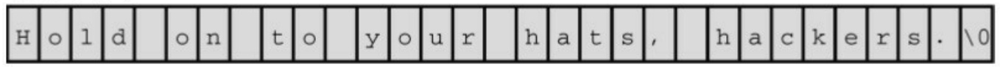
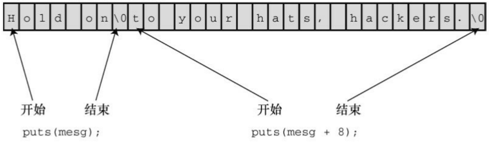
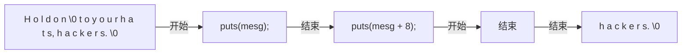

0。由于其他字符的编码不可能是 0，所以不可能是字符串的一部分。

空指针（或NULL）有一个值，该值不会与任何数据的有效地址对应。通常，函数使用它返回一个有效地址表示某些特殊情况发生，例如遇到文件结尾或未能按预期执行。

空字符是整数类型，而空指针是指针类型。两者有时容易混淆的原因是:它们都可以用数值0来表示。但是，从概念上看，两者是不同类型的0。另外，空字符是一个字符，占1字节；而空指针是一个地址，通常占4字节。

## 2.gets\_s()函数

C11新增的gets\_s()函数（可选）和fgets()类似，用一个参数限制读入的字符数。假设把程序清单11.9中的fgets()换成gets\_s()，其他内容不变，那么下面的代码将把一行输入中的前9个字符读入words数组中，假设末尾有换行符:

gets\_s(words, STLEN);

gets\_s()与fgets()的区别如下。

gets\_s()只从标准输入中读取数据，所以不需要第3个参数。

如果gets\_s()读到换行符，会丢弃它而不是储存它。

如果gets\_s()读到最大字符数都没有读到换行符，会执行以下几步。首先把目标数组中的首字符设置为空字符，读取并丢弃随后的输入直至读到换行符或文件结尾，然后返回空指针。接着，调用依赖实现的“处理函数”（或你选择的其他函数），可能会中止或退出程序。

第2个特性说明，只要输入行未超过最大字符数，gets\_s()和gets()几乎一样，完全可以用gets\_s()替换gets()。第3个特性说明，要使用这个函数还需要进一步学习。

我们来比较一下 gets()、fgets()和 gets\_s()的适用性。如果目标存储区装得下输入行，3 个函数都没问题。但是fgets()会保留输入末尾的换行符作为字符串的一部分，要编写额外的代码将其替换成空字符。

如果输入行太长会怎样？使用gets()不安全，它会擦写现有数据，存在安全隐患。gets\_s()函数很安全，但是，如果并不希望程序中止或退出，就要知道如何编写特殊的“处理函数”。另外，如果打算让程序继续运行，gets\_s()会丢弃该输入行的其余字符，无论你是否需要。由此可见，当输入太长，超过数组可容纳的字符数时，fgets()函数最容易使用，而且可以选择不同的处理方式。如果要让程序继续使用输入行中超出的字符，可以参考程序清单11.8中的处理方法。如果想丢弃输入行的超出字符，可以参考程序清单11.9中的处理方法。

所以，当输入与预期不符时，gets\_s()完全没有fgets()函数方便、灵活。也许这也是gets\_s()只作为C库的可选扩展的原因之一。鉴于此，fgets()通常是处理类似情况的最佳选择。

## 3.s\_gets()函数

程序清单11.9演示了fgets()函数的一种用法:读取整行输入并用空字符代替换行符，或者读取一部分输入，并丢弃其余部分。既然没有处理这种情况的标准函数，我们就创建一个，在后面的程序中会用得上。程序清单11.10提供了一个这样的函数。

程序清单11.10 s\_gets()函数

```c
char * s_gets(char * st, int n)

{

char * ret_val;

int i = 0;

ret_val = fgets(st, n, stdin);
```

```c
if (ret_val) // 即, ret_val != NULL
{
while (st[i] != '\n' && st[i] != '\0')
i++;
if (st[i] == '\n')
st[i] = '\0';
else
while (getchar() != '\n')
continue;
}
return ret_val;
}
```

如果 fgets()返回 NULL，说明读到文件结尾或出现读取错误，s\_gets()函数跳过了这个过程。它模仿程序清单11.9的处理方法，如果字符串中出现换行符，就用空字符替换它；如果字符串中出现空字符，就丢弃该输入行的其余字符，然后返回与fgets()相同的值。我们在后面的示例中将讨论fgets()函数。

也许读者想了解为什么要丢弃过长输入行中的余下字符。这是因为，输入行中多出来的字符会被留在缓冲区中，成为下一次读取语句的输入。例如，如果下一条读取语句要读取的是 double 类型的值，就可能导致程序崩溃。丢弃输入行余下的字符保证了读取语句与键盘输入同步。

我们设计的 s\_gets()函数并不完美，它最严重的缺陷是遇到不合适的输入时毫无反应。它丢弃多余的字符时，既不通知程序也不告知用户。但是，用来替换前面程序示例中的gets()足够了。

## 11.2.4 scanf()函数

我们再来研究一下scanf()。前面的程序中用scanf()和%s转换说明读取字符串。scanf()和gets()或fgets()的区别在于它们如何确定字符串的末尾:

scanf()更像是“获取单词”函数，而不是“获取字符串”函数；如果预留的存储区装得下输入行，gets()和fgets()会读取第1个换行符之前所有的字符。

scanf()函数有两种方法确定输入结束。无论哪种方法，都从第1个非空白字符作为字符串的开始。如果使用%s转换说明，以下一个空白字符（空行、空格、制表符或换行符）作为字符串的结束（字符串不包括空白字符）。如果指定了字段宽度，如%10s，那么scanf()将读取10 个字符或读到第1个空白字符停止（先满足的条件即是结束输入的条件），见图11.3。

| 输入语句 | 原输入序列* | name中的内容 | 剩余输入序列 |
| --- | --- | --- | --- |
| scanf("%s", name); | Fleebert □Hup | Fleebert | □Hup |
| scanf("%5s", name); | Fleebert □Hup | Fleeb | ert □Hup |
| scanf("%5s", name); | Ann □Ular | Ann | □Ular |

\*☐表示空格字符

图11.3 字段宽度和scanf()

前面介绍过，scanf()函数返回一个整数值，该值等于scanf()成功读取的项数或EOF（读到文件结尾时返回EOF）。

程序清单11.11演示了在scanf()函数中指定字段宽度的用法。

程序清单**11.11 scan\_str.c**程序

/\* scan\_str.c -- 使用 scanf() \*/

#include &lt;stdio.h&gt;

```txt
int main(void)
    {
        char name1[11], name2[11];
        int count;

        printf("Please enter 2 names.\n");
        count = scanf("%5s %10s", name1, name2);
        printf("I read the %d names %s and %s.\n", count, name1, name2);

        return 0;
    }
```

下面是该程序的3个输出示例:

Please enter 2 names.

## Jesse Jukes

I read the 2 names Jesse and Jukes.

Please enter 2 names.

## Liza Applebottham

I read the 2 names Liza and Applebotth.

Please enter 2 names.

## Portensia Callowit

I read the 2 names Porte and nsia.

第1个输出示例，两个名字的字符个数都未超过字段宽度。第2个输出示例，只读入了Applebottham的前10个字符Applebotth（因为使用了%10s转换说明）。第3个输出示例，Portensia的后4个字符nsia被写入name2中，因为第2次调用scanf()时，从上一次调用结束的地方继续读取数据。在该例中，读取的仍是Portensia中的字母。

根据输入数据的性质，用fgets()读取从键盘输入的数据更合适。例如，scanf()无法完整读取书名或歌曲名，除非这些名称是一个单词。scanf()的典型用法是读取并转换混合数据类型为某种标准形式。例如，如果输入行包含一种工具名、库存量和单价，就可以使用scanf()。否则可能要自己拼凑一个函数处理一些输入检查。如果一次只输入一个单词，用scanf()也没问题。

scanf()和gets()类似，也存在一些潜在的缺点。如果输入行的内容过长，scanf()也会导致数据溢出。不过，在%s转换说明中使用字段宽度可防止溢出。

## 11.3 字符串输出

讨论完字符串输入，接下来我们讨论字符串输出。C有3个标准库函数用于打印字符串:put()、fputs()和printf()。

## 11.3.1 puts()函数

puts()函数很容易使用，只需把字符串的地址作为参数传递给它即可。程序清单11.12演示了puts()的一些用法。

程序清单11.12 put\_out.c程序

```c
/* put_out.c -- 使用 puts() */

#include <stdio.h>

#define DEF "I am a #defined string."

int main(void)

{

char str1[80] = "An array was initialized to me.";
const char * str2 = "A pointer was initialized to me.";
puts("I'm an argument to puts().");

puts(DEF);

puts(str1);

puts(str2);

puts(&str1[5]);
```

```txt
puts(str2 + 4);

return 0;

}
```

该程序的输出如下:

I'm an argument to puts().

I am a #defined string.

An array was initialized to me.

A pointer was initialized to me.

ray was initialized to me.

inter was initialized to me.

如上所示，每个字符串独占一行，因为puts()在显示字符串时会自动在其末尾添加一个换行符。

该程序示例再次说明，用双引号括起来的内容是字符串常量，且被视为该字符串的地址。另外，储存字符串的数组名也被看作是地址。在第5个puts()调用中，表达式&str1[5]是str1数组的第6个元素（r），puts()从该元素开始输出。与此类似，第6个puts()调用中，str2+4指向储存"pointer"中i的存储单元，puts()从这里开始输出。

puts()如何知道在何处停止？该函数在遇到空字符时就停止输出，所以必须确保有空字符。不要模仿程序清单11.13中的程序！

程序清单**11.13 nono.c**程序

/\* nono.c -- 千万不要模仿！ \*/

```c
#include <stdio.h>

int main(void)
{
char side_a[] = "Side A";
char dont[] = { 'W', 'O', 'W', '!' };
char side_b[] = "Side B";
puts(dont); /* dont 不是一个字符串 */
return 0;
}
```

由于dont缺少一个表示结束的空字符，所以它不是一个字符串，因此puts()不知道在何处停止。它会一直打印dont后面内存中的内容，直到发现一个空字符为止。为了让puts()能尽快读到空字符，我们把dont放在side\_a和side\_b之间。下面是该程序的一个运行示例:

## WOW!Side A

我们使用的编译器把side\_a数组储存在dont数组之后，所以puts()一直输出至遇到side\_a中的空字符。你所使用的编译器输出的内容可能不同，这取决于编译器如何在内存中储存数据。如果删除程序中的side\_a和side\_b数组会怎样？通常内存中有许多空字符，如果幸运的话，puts()很快就会发现一个。但是，这样做很不靠谱。

## 11.3.2 fputs()函数

fputs()函数是puts()针对文件定制的版本。它们的区别如下。

fputs()函数的第 2 个参数指明要写入数据的文件。如果要打印在显示器

上，可以用定义在stdio.h中的stdout（标准输出）作为该参数。

与puts()不同，fputs()不会在输出的末尾添加换行符。

注意，gets()丢弃输入中的换行符，但是puts()在输出中添加换行符。另一方面，fgets()保留输入中的换行符，fputs()不在输出中添加换行符。假设要编写一个循环，读取一行输入，另起一行打印出该输入。可以这样写:

char line[81];

while (gets(line))// 与while (gets(line) != NULL)相同

puts(line);

如果gets()读到文件结尾会返回空指针。对空指针求值为0（即为假），这样便可结束循环。或者，可以这样写:

char line[81];

while (fgets(line, 81, stdin))

fputs(line, stdout);

第1个循环（使用gets()和puts()的while循环），line数组中的字符串显示在下一行，因为puts()在字符串末尾添加了一个换行符。第2个循环（使用fgets()和fputs()的while循环），line数组中的字符串也显示在下一行，因为fgets()把换行符储存在字符串末尾。注意，如果混合使用 fgets()输入和puts()输出，每个待显示的字符串末尾就会有两个换行符。这里关键要注意:puts()应与gets()配对使用，fputs()应与fgets()配对使用。

我们在这里提到已被废弃的 gets()，并不是鼓励使用它，而是为了让读者了解它的用法。如果今后遇到包含该函数的代码，不至于看不懂。

## 11.3.3 printf()函数

在第4章中，我们详细讨论过printf()函数的用法。和puts()一样，printf()也把字符串的地址作为参数。printf()函数用起来没有puts()函数那么方便，但是它更加多才多艺，因为它可以格式化不同的数据类型。

与puts()不同的是，printf()不会自动在每个字符串末尾加上一个换行符。因此，必须在参数中指明应该在哪里使用换行符。例如:

printf("%s\n", string);

和下面的语句效果相同:

puts(string);

如上所示，printf()的形式更复杂些，需要输入更多代码，而且计算机执行的时间也更长（但是你觉察不到）。然而，使用 printf()打印多个字符串更加简单。例如，下面的语句把 Well、用户名和一个#define定义的字符串打印在一行:

printf("Well, %s, %s\n", name, MSG);

## 11.4 自定义输入/输出函数

不一定非要使用C库中的标准函数，如果无法使用这些函数或者不想用它们，完全可以在getchar()和putchar()的基础上自定义所需的函数。假设你需要一个类似puts()但是不会自动添加换行符的函数。程序清单11.14给出了一个这样的函数。

程序清单11.14 put1()函数

```c
/* put1.c -- 打印字符串，不添加\n */
#include <stdio.h>
void put1(const char * string)/* 不会改变字符串 */
{
while (*string != '\0')
putchar(*string++);
}
```

指向char的指针string最初指向传入参数的首元素。因为该函数不会改变传入的字符串，所以形参使用了const限定符。打印了首元素的内容后，指针递增1，指向下一个元素。while循环重复这一过程，直到指针指向包含空字符的元素。记住，++的优先级高于\*，因此putchar(\*string++)打印string指向的值，递增的是string本身，而不是递增它所指向的字符。

可以把 put1.c 程序作为编写字符串处理函数的模型。因为每个字符串都以空字符结尾，所以不用给函数传递字符串的大小。函数依次处理每个字符，直至遇到空字符。

用数组表示法编写这个函数稍微复杂些:

```matlab
int i = 0;

while (string[i]!= '\0')

putchar(string[i++]);
```

要为数组索引创建一个额外的变量。

许多C程序员会在while循环中使用下面的测试条件:

```txt
while (*string)
```

当string指向空字符时，\*string的值是0，即测试条件为假，while循环结束。这种方法比上面两种方法简洁。但是，如果不熟悉C语言，可能觉察不出来。这种处理方法很普遍，作为C程序员应该熟悉这种写法。

注意

为什么程序清单11.14中的形式参数是const char \* string，而不是const char sting[]？从技术方面看，两者等价且都有效。使用带方括号的写法是为了提醒用户:该函数处理的是数组。然而，如果要处理字符串，实际参数可以是数组名、用双引号括起来的字符串，或声明为 char \*类型的变量。用const char \* string可以提醒用户:实际参数不一定是数组。

假设要设计一个类似puts()的函数，而且该函数还给出待打印字符的个数。如程序清单11.15所示，添加一个功能很简单。

程序清单**11.15 put2.c**程序

/\* put2.c -- 打印一个字符串，并统计打印的字符数 \*/

```c
#include <stdio.h>

int put2(const char * string)

{
```

```c
int count = 0;

while (*string) /* 常规用法 */

{
putchar(*string++);
count++;

}
putchar('\n'); /* 不统计换行符 */
return(count);

}
```

下面的函数调用将打印字符串pizza:

```javascript
put1("pizza");
```

下面的调用将返回统计的字符数，并将其赋给num（该例中，num的值是5）:

```txt
num = put2("pizza");
```

程序清单11.16使用一个简单的驱动程序测试put1()和put2()，并演示了嵌套函数的调用。

程序清单**11.16 .c**程序

//put\_put.c -- 用户自定义输出函数

```c
#include <stdio.h>
```

```txt
void put1(const char *);
```

```c
int put2(const char *);
int main(void)
{
put1("If I'd as much money");
put1(" as I could spend,\n");
printf("I count %d characters.\n",
put2("I never would cry old chairs to mend."));
return 0;
}
void put1(const char * string)
{
while (*string) /* 与 *string != '\0' 相同 */
putchar(*string++);
}
int put2(const char * string)
{
int count = 0;
while (*string)
{
```

```txt
putchar(*string++);
count++;
}
putchar('\n');
return(count);
}
```

程序中使用 printf()打印 put2()的值，但是为了获得 put2()的返回值，计算机必须先执行put2()，因此在打印字符数之前先打印了传递给该函数的字符串。下面是该程序的输出:

```txt
If I'd as much money as I could spend,
I never would cry old chairs to mend.
I count 37 characters.
```

## 11.5 字符串函数

C库提供了多个处理字符串的函数，ANSI C把这些函数的原型放在string.h头文件中。其中最常用的函数有 strlen()、strcat()、strcmp()、strncmp()、strcpy()和 strncpy()。另外，还有sprintf()函数，其原型在stdio.h头文件中。欲了解string.h系列函数的完整列表，请查阅附录B中的参考资料V“新增C99和C11的标准ANSI C库”。

## 11.5.1 strlen()函数

strlen()函数用于统计字符串的长度。下面的函数可以缩短字符串的长度，其中用到了strlen():

```c
void fit(char *string, unsigned int size)
{
if (strlen(string) > size)
string[size] = '\0';
}
```

该函数要改变字符串，所以函数头在声明形式参数string时没有使用const限定符。

程序清单11.17中的程序测试了fit()函数。注意代码中使用了C字符串常量的串联特性。

程序清单**11.17 test\_fit.c**程序

/\* test\_fit.c -- 使用缩短字符串长度的函数 \*/

#include &lt;stdio.h&gt;

```c
#include <string.h>  /* 内含字符串函数原型 */
void fit(char *, unsigned int);
int main(void)
{
char mesg [] = "Things should be as simple as possible,"
" but not simpler.";
puts(mesg);
fit(mesg, 38);
puts(mesg);
puts("Let's look at some more of the string.");
puts(mesg + 39);
return 0;
}
void fit(char *string, unsigned int size)
{
if (strlen(string) > size)
string[size] = '\0';
}
```

下面是该程序的输出:

but not simpler.

fit()函数把第39个元素的逗号替换成'\0'字符。puts()函数在空字符处停止输出，并忽略其余字符。然而，这些字符还在缓冲区中，下面的函数调用把这些字符打印了出来:

puts(mesg + 8);

表达式mesg + 39是mesg[39]的地址，该地址上储存的是空格字符。所以put()显示该字符并继续输出直至遇到原来字符串中的空字符。图11.4演示了这一过程。

原始字符串:



<details>
<summary>text_image</summary>

H o l d  o n  t o  y o u r  h a t s ,  h a c k e r s . \0
</details>

调用fit(mesg,7)之后的字符串



<details>
<summary>flowchart</summary>


</details>

图11.4 puts()函数和空字符

注意

一些ANSI之前的系统使用strings.h头文件，而有些系统可能根本没有字

符串头文件。

string.h头文件中包含了C字符串函数系列的原型，因此程序清单11.17要包含该头文件。

## 11.5.2 strcat()函数

strcat()（用于拼接字符串）函数接受两个字符串作为参数。该函数把第2个字符串的备份附加在第1个字符串末尾，并把拼接后形成的新字符串作为第1个字符串，第2个字符串不变。strcat()函数的类型是char \*（即，指向char的指针）。strcat()函数返回第1个参数，即拼接第2个字符串后的第1个字符串的地址。

程序清单11.18演示了strcat()的用法。该程序还使用了程序清单11.10的s\_gets()函数。回忆一下，该函数使用fgets()读取一整行，如果有换行符，将其替换成空字符。

程序清单**11.18 str\_cat.c**程序

```c
/* str_cat.c -- 拼接两个字符串 */
#include <stdio.h>
#include <string.h> /* strcat()函数的原型在该头文件中 */
#define SIZE 80
char *s_gets(char *st, int n);
int main(void)
{
char flower[SIZE];
char addon [] = "s smell like old shoes.";
```

```c
puts("What is your favorite flower?");
if (s_gets(flower, SIZE))
{
strcat(flower, addon);
puts(flower);
puts(addon);
}
else
puts("End of file encountered!");
puts("bye");
return 0;
}
char * s_gets(char * st, int n)
{
char * ret_val;
int i = 0;
ret_val = fgets(st, n, stdin);
if (ret_val)
{
```

```txt
while (st[i] != '\n' && st[i] != '\0')
```

```txt
i++;
```

```javascript
if (st[i] == '\n')
```

```javascript
st[i] = '\0';
```

```txt
else
```

```txt
while (getchar() != '\n')
```

```txt
continue;
```

```txt
}
```

```txt
return ret_val;
```

```txt
}
```

该程序的输出示例如下:

What is your favorite flower?

## wonderflower

wonderflowers smell like old shoes.

s smell like old shoes.

```txt
bye
```

从以上输出可以看出，flower改变了，而addon保持不变。

## 11.5.3 strncat()函数

strcat()函数无法检查第1个数组是否能容纳第2个字符串。如果分配给第

1个数组的空间不够大，多出来的字符溢出到相邻存储单元时就会出问题。当然，可以像程序清单11.15那样，用strlen()查看第1个数组的长度。注意，要给拼接后的字符串长度加1才够空间存放末尾的空字符。或者，用strncat()，该函数的第3 个参数指定了最大添加字符数。例如，strncat(bugs, addon, 13)将把 addon字符串的内容附加给bugs，在加到第13个字符或遇到空字符时停止。因此，算上空字符（无论哪种情况都要添加空字符），bugs数组应该足够大，以容纳原始字符串（不包含空字符）、添加原始字符串在后面的13个字符和末尾的空字符。程序清单11.19使用这种方法，计算avaiable变量的值，用于表示允许添加的最大字符数。

程序清单11.19 join\_chk.c程序

```c
/* join_chk.c -- 拼接两个字符串，检查第1个数组的大小 */
#include <stdio.h>
#include <string.h>
#define SIZE 30
#define BUGSIZE 13
char * s_gets(char * st, int n);
int main(void)
{
char flower[SIZE];
char addon [] = "s smell like old shoes.";
char bug[BUGSIZE];
int available;
```

```txt
puts("What is your favorite flower?");
s_gets(flower, SIZE);
if ((strlen(addon) + strlen(flower) + 1) <= SIZE)
strcat(flower, addon);
puts(flower);
puts("What is your favorite bug?");
s_gets(bug, BUGSIZE);
available = BUGSIZE - strlen(bug) - 1;
strncat(bug, addon, available);
puts(bug);
return 0;
}
char * s_gets(char * st, int n)
{
char * ret_val;
int i = 0;
ret_val = fgets(st, n, stdin);
if (ret_val)
{
```

```txt
while (st[i] != '\n' && st[i] != '\0')
i++;
if (st[i] == '\n')
st[i] = '\0';
else
while (getchar() != '\n')
continue;
}
return ret_val;
}
```

下面是该程序的运行示例:

What is your favorite flower?

## Rose

Roses smell like old shoes.

What is your favorite bug?

## Aphid

Aphids smell

读者可能已经注意到，strcat()和 gets()类似，也会导致缓冲区溢出。为什么 C11 标准不废弃strcat()，只留下strncat()？为何对gets()那么残忍？这也许是因为gets()造成的安全隐患来自于使用该程序的人，而strcat()暴露的问

题是那些粗心的程序员造成的。无法控制用户会进行什么操作，但是，可以控制你的程序做什么。C语言相信程序员，因此程序员有责任确保strcat()的使用安全。

## 11.5.4 strcmp()函数

假设要把用户的响应与已储存的字符串作比较，如程序清单11.20所示。

程序清单**11.20 nogo.c**程序

```c
/* nogo.c -- 该程序是否能正常运行？ */
#include <stdio.h>
#define ANSWER "Grant"
#define SIZE 40
char *s_gets(char *st, int n);
int main(void)
{
char try[SIZE];
puts("Who is buried in Grant's tomb?");
s_gets(try, SIZE);
while (try != ANSWER)
{
puts("No, that's wrong. Try again.");
```

```c
s_gets(try, SIZE);
}
puts("That's right!");
return 0;
}
char * s_gets(char * st, int n)
{
char * ret_val;
int i = 0;
ret_val = fgets(st, n, stdin);
if (ret_val)
{
while (st[i] != '\n' && st[i] != '\0')
i++;
if (st[i] == '\n')
st[i] = '\0';
else
while (getchar() != '\n')
continue;
```

```txt
}
return  ret_val;
}
```

这个程序看上去没问题，但是运行后却不对劲。ANSWER和try都是指针，所以try != ANSWER检查的不是两个字符串是否相等，而是这两个字符串的地址是否相同。因为ANSWE和try储存在不同的位置，所以这两个地址不可能相同，因此，无论用户输入什么，程序都提示输入不正确。这真让人沮丧。

该函数要比较的是字符串的内容，不是字符串的地址。读者可以自己设计一个函数，也可以使用C标准库中的strcmp()函数（用于字符串比较）。该函数通过比较运算符来比较字符串，就像比较数字一样。如果两个字符串参数相同，该函数就返回0，否则返回非零值。修改后的版本如程序清单11.21所示。

程序清单11.21 compare.c程序

```c
/* compare.c -- 该程序可以正常运行 */
#include <stdio.h>
#include <string.h> // strcmp()函数的原型在该头文件中
#define ANSWER "Grant"
#define SIZE 40
char *s_gets(char *st, int n);
int main(void)
{
```

```c
char try[SIZE];

puts("Who is buried in Grant's tomb?");
s_gets(try, SIZE);

while (strcmp(try, ANSWER) != 0)
{
puts("No, that's wrong. Try again.");
s_gets(try, SIZE);
}
puts("That's right!");
return 0;
}
char * s_gets(char * st, int n)
{
char * ret_val;
int i = 0;
ret_val = fgets(st, n, stdin);
if (ret_val)
{
while (st[i] != '\n' && st[i] != '\0')
```

```perl
i++;

if (st[i] == '\n')

st[i] = '\0';

else

while (getchar() != '\n')

continue;

}

return ret_val;

}
```

注意

由于非零值都为“真”，所以许多经验丰富的C程序员会把该例main()中的while循环头写成:while (strcmp(try, ANSWER))

strcmp()函数比较的是字符串，不是整个数组，这是非常好的功能。虽然数组try占用了40字节，而储存在其中的"Grant"只占用了6字节（还有一个用来放空字符），strcmp()函数只会比较try中第1个空字符前面的部分。所以，可以用strcmp()比较储存在不同大小数组中的字符串。

如果用户输入GRANT、grant或Ulysses S.Grant会怎样？程序会告知用户输入错误。希望程序更友好，必须把所有正确答案的可能性包含其中。这里可以使用一些小技巧。例如，可以使用#define定义类似GRANT这样的答案，并编写一个函数把输入的内容都转换成小写，就解决了大小写的问题。但是，还要考虑一些其他错误的形式，这些留给读者完成。

## 1.strcmp()的返回值

如果strcmp()比较的字符串不同，它会返回什么值？请看程序清单11.22的程序示例。

程序清单11.22 compback.c程序

```c
/* compback.c -- strcmp()的返回值 */
#include <stdio.h>
#include <string.h>
int main(void)
{
printf("strcmp(\"A\", \"A\") is ");
printf("%d\n", strcmp("A", "A"));
printf("strcmp(\"A\", \"B\") is ");
printf("%d\n", strcmp("A", "B"));
printf("strcmp(\"B\", \"A\") is ");
printf("%d\n", strcmp("B", "A"));
printf("strcmp(\"C\", \"A\") is ");
printf("%d\n", strcmp("C", "A"));
printf("strcmp(\"Z\", \"a\") is ");
printf("%d\n", strcmp("Z", "a"));
printf("strcmp(\"apples\", \"apple\") is ");
```

```txt
printf("%d\n",  strcmp("apples", "apple"));
return 0;
}
```

在我们的系统中运行该程序，输出如下:

```txt
strcmp("A", "A") is 0
strcmp("A", "B") is -1
strcmp("B", "A") is 1
strcmp("C", "A") is 1
strcmp("Z", "a") is -1
strcmp("apples", "apple") is 1
```

strcmp()比较"A"和本身，返回0；比较"A"和"B"，返回-1；比较"B"和"A"，返回1。这说明，如果在字母表中第1个字符串位于第2个字符串前面，strcmp()中就返回负数；反之，strcmp()则返回正数。所以，strcmp()比较"C"和"A"，返回1。其他系统可能返回2，即两者的ASCII码之差。ASCII标准规定，在字母表中，如果第1个字符串在第2个字符串前面，strcmp()返回一个负数；如果两个字符串相同，strcmp()返回0；如果第1个字符串在第2个字符串后面，strcmp()返回正数。然而，返回的具体值取决于实现。例如，下面给出在不同实现中的输出，该实现返回两个字符的差值:

```txt
strcmp("A", "A") is 0
strcmp("A", "B") is -1
strcmp("B", "A") is 1
strcmp("C", "A") is 2
```