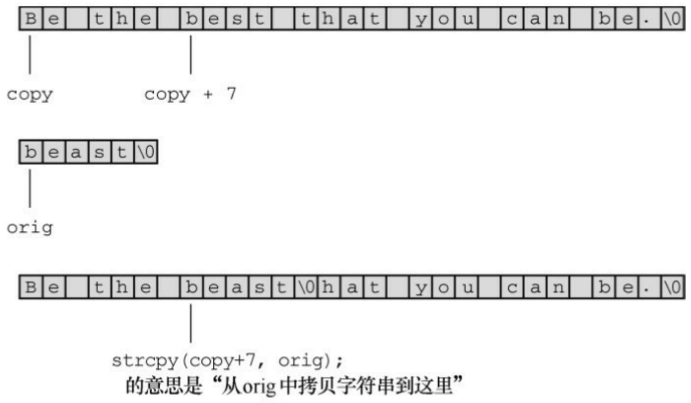
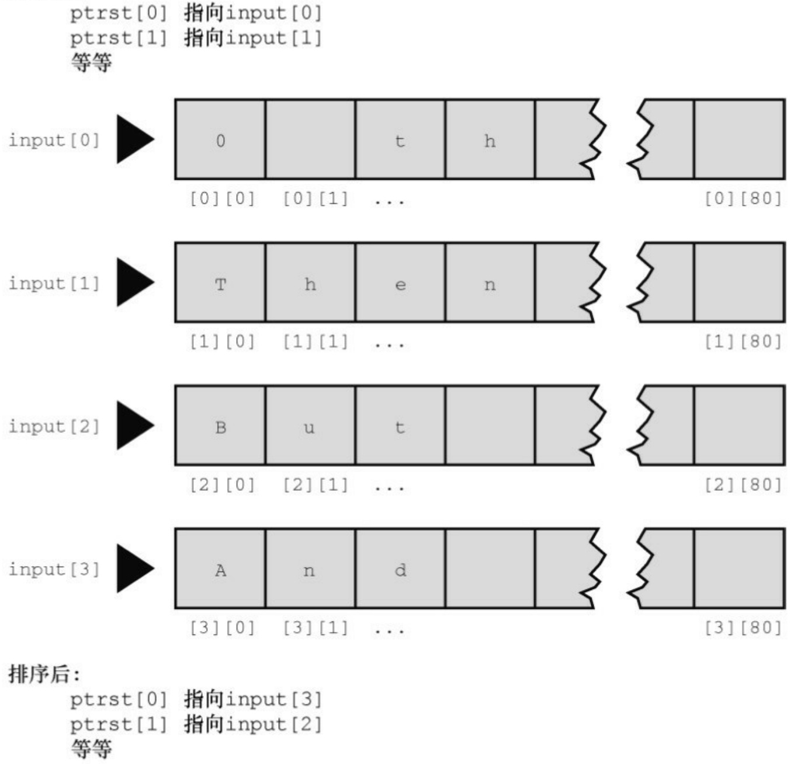

strcmp("Z", "a") is -7

strcmp("apples", "apple") is 115

如果两个字符串开始的几个字符都相同会怎样？一般而言，strcmp()会依次比较每个字符，直到发现第 1 对不同的字符为止。然后，返回相应的值。例如，在上面的最后一个例子中，“apples"和"apple"只有最后一对字符不同（"apples"的s和"apple"的空字符）。由于空字符在ASCII中排第1。字符s一定在它后面，所以strcmp()返回一个正数。

最后一个例子表明，strcmp()比较所有的字符，不只是字母。所以，与其说该函数按字母顺序进行比较，不如说是按机器排序序列（machine collating sequence）进行比较，即根据字符的数值进行比较（通常都使用ASCII值）。在ASCII中，大写字母在小写字母前面，所以strcmp("Z", "a")返回的是负值。

大多数情况下，strcmp()返回的具体值并不重要，我们只在意该值是0还是非0（即，比较的两个字符串是否相等）。或者按字母排序字符串，在这种情况下，需要知道比较的结果是为正、为负还是为0。

注意

strcmp()函数比较的是字符串，不是字符，所以其参数应该是字符串（如"apples"和"A"），而不是字符（如'A'）。但是，char 类型实际上是整数类型，所以可以使用关系运算符来比较字符。假设word是储存在char类型数组中的字符串，ch是char类型的变量，下面的语句都有效:

if (strcmp(word, "quit") == 0) // 使用strcmp()比较字符串

puts("Bye!");

if(ch=='q') // 使用 == 比较字符

puts("Bye!");

尽管如此，不要使用ch或'q'作为strcmp()的参数。

程序清单11.23用strcmp()函数检查程序是否要停止读取输入。

程序清单11.23 quit\_chk.c程序

/\* quit\_chk.c -- 某程序的开始部分 \*/

```c
#include <stdio.h>

#include <string.h>

#define SIZE 80

#define LIM 10

#define STOP "quit"

char * s_gets(char * st, int n);

int main(void)

{

char input[LIM][SIZE];

int ct = 0;

printf("Enter up to %d lines (type quit to quit):\n", LIM);
while (ct < LIM && s_gets(input[ct], SIZE) != NULL &&
strcmp(input[ct], STOP) != 0)

{

ct++;
```

```c
}
printf("%d strings entered\n", ct);
return 0;
}
char * s_gets(char * st, int n)
{
char * ret_val;
int i = 0;
ret_val = fgets(st, n, stdin);
if (ret_val)
{
while (st[i] != '\n' && st[i] != '\0')
i++;
if (st[i] == '\n')
st[i] = '\0';
else
while (getchar() != '\n')
continue;
}
```

```lua
return  ret_val;

}
```

该程序在读到EOF字符（这种情况下s\_gets()返回NULL）、用户输入quit或输入项达到LIM时退出。

顺带一提，有时输入空行（即，只按下Enter键或Return键）表示结束输入更方便。为实现这一功能，只需修改一下while循环的条件即可:

```txt
while (ct < LIM && s_gets(input[ct], SIZE) != NULL&& input[ct][0] != '\0')
```

这里，input[ct]是刚输入的字符串，input[ct][0]是该字符串的第1个字符。如果用户输入空行，s\_gets()便会把该行第1个字符（换行符）替换成空字符。所以，下面的表达式用于检测空行:

```python
input[ct][0] != '\0'
```

## 2.strncmp()函数

strcmp()函数比较字符串中的字符，直到发现不同的字符为止，这一过程可能会持续到字符串的末尾。而strcmp()函数在比较两个字符串时，可以比较到字符不同的地方，也可以只比较第3个参数指定的字符数。例如，要查找以"astro"开头的字符串，可以限定函数只查找这5 个字符。程序清单11.24演示了该函数的用法。

程序清单11.24 starsrch.c程序

/\* starsrch.c -- 使用 strncmp() \*/

#include &lt;stdio.h&gt;

#include &lt;string.h&gt;

#define LISTSIZE 6

```c
int main()
{
const char * list[LISTSIZE] =
{
"astronomy", "astounding",
"astrophysics", "ostracize",
"asterism", "astrophobia"
};
int count = 0;
int i;
for (i = 0; i < LISTSIZE; i++)
if (strcmp(list[i], "astro", 5) == 0)
{
printf("Found: %s\n", list[i]);
count++;
}
printf("The list contained %d words beginning"
" with astro.\n", count);
return 0;
```

}

下面是该程序的输出:

Found: astronomy

Found: astrophysics

Found: astrophobia

The list contained 3 words beginning with astro.

## 11.5.5 strcpy()和strncpy()函数

前面提到过，如果pts1和pts2都是指向字符串的指针，那么下面语句拷贝的是字符串的地址而不是字符串本身:

pts2 = pts1;

如果希望拷贝整个字符串，要使用strcpy()函数。程序清单11.25要求用户输入以q开头的单词。该程序把输入拷贝至一个临时数组中，如果第1个字母是q，程序调用strcpy()把整个字符串从临时数组拷贝至目标数组中。strcpy()函数相当于字符串赋值运算符。

程序清单11.25 copy1.c程序

/\* copy1.c -- 演示 strcpy() \*/

#include &lt;stdio.h&gt;

#include &lt;string.h&gt; // strcpy()的原型在该头文件中

#define SIZE 40

#define LIM 5

```c
char * s_gets(char * st, int n);

int main(void)
{
char qwords[LIM][SIZE];
char temp[SIZE];
int i = 0;
printf("Enter %d words beginning with q:\n", LIM);
while (i < LIM && s_gets(temp, SIZE))
{
if (temp[0] != 'q')
printf("%s doesn't begin with q!\n", temp);
else
{
strcpy(qwords[i], temp);
i++;
}
}
puts("Here are the words accepted:");
for (i = 0; i < LIM; i++)
```

```c
puts(qwords[i]);
return 0;
}
char * s_gets(char * st, int n)
{
char * ret_val;
int i = 0;
ret_val = fgets(st, n, stdin);
if (ret_val)
{
while (st[i] != '\n' && st[i] != '\0')
i++;
if (st[i] == '\n')
st[i] = '\0';
else
while (getchar() != '\n')
continue;
}
return ret_val;
```

}

下面是该程序的运行示例:

Enter 5 words beginning with q:

quackery

quasar

quilt

quotient

no more

no more doesn't begin with q!

quiz

Here are the words accepted:

quackery

quasar

quilt

quotient

quiz

注意，只有在输入以q开头的单词后才会递增计数器i，而且该程序通过比较字符进行判断:

if (temp[0] != 'q')

这行代码的意思是:temp中的第1个字符是否是q？当然，也可以通过比较字符串进行判断:

$$
\text {if} (\operatorname{strncpy} (\text {temp, "q", 1})! = 0)
$$

这行代码的意思是:temp字符串和"q"的第1个元素是否相等？

请注意，strcpy()第2个参数（temp）指向的字符串被拷贝至第1个参数（qword[i]）指向的数组中。拷贝出来的字符串被称为目标字符串，最初的字符串被称为源字符串。参考赋值表达式语句，很容易记住strcpy()参数的顺序，即第1个是目标字符串，第2个是源字符串。

char target[20];

int x;

x = 50; /\* 数字赋值\*/

strcpy(target, "Hi ho!"); /\* 字符串赋值\*/

target = "So long"; /\* 语法错误 \*/程序员有责任确保目标数组有足够的空间容纳源字符串的副本。下面的代码有点问题:

char \* str;

strcpy(str, "The C of Tranquility"); // 有问题

strcpy()把"The C of Tranquility"拷贝至str指向的地址上，但是str未被初始化，所以该字符串可能被拷贝到任意的地方！

总之，strcpy()接受两个字符串指针作为参数，可以把指向源字符串的第2个指针声明为指针、数组名或字符串常量；而指向源字符串副本的第1个指针应指向一个数据对象（如，数组），且该对象有足够的空间储存源字符串的副本。记住，声明数组将分配储存数据的空间，而声明指针只分配储存一个地址的空间。

## 1 strcpy()的其他属性

strcpy()函数还有两个有用的属性。第一，strcpy()的返回类型是 char \*，该函数返回的是第 1 个参数的值，即一个字符的地址。第二，第 1 个参数不必指向数组的开始。这个属性可用于拷贝数组的一部分。程序清单11.26演示了该函数的这两个属性。

程序清单11.26 copy2.c程序

```c
/* copy2.c -- 使用 strcpy() */
#include <stdio.h>
#include <string.h> // 提供strcpy()的函数原型
#define WORDS "beast"
#define SIZE 40
int main(void)
{
const char * orig = WORDS;
char copy[SIZE] = "Be the best that you can be.";
char * ps;
puts(orig);
puts(copy);
ps = strcpy(copy + 7, orig);
puts(copy);
```

```c
puts(ps);

return 0;

}
```

下面是该程序的输出:

```txt
beast
```

Be the best that you can be.

Be the beast

beast

注意，strcpy()把源字符串中的空字符也拷贝在内。在该例中，空字符覆盖了copy数组中that的第1个t（见图11.5）。注意，由于第1个参数是copy + 7，所以ps指向copy中的第8个元素（下标为7）。因此puts(ps)从该处开始打印字符串。



<details>
<summary>text_image</summary>

Be the best that you can be.\0
copy copy + 7
beast\0
orig
Be the beast\0 hat you can be.\0
strcpy(copy+7, orig);
的意思是“从orig中拷贝字符串到这里”
</details>

图11.5 使用指针strcpy()函数

## 2. 更谨慎的选择: strncpy()

strcpy()和 strcat()都有同样的问题，它们都不能检查目标空间是否能容纳源字符串的副本。拷贝字符串用 strncpy()更安全，该函数的第 3 个参数指明可拷贝的最大字符数。程序清单 11.27 用 strncpy()代替程序清单11.25中的 strcpy()。为了演示目标空间装不下源字符串的副本会发生什么情况，该程序使用了一个相当小的目标字符串（共7个元素，包含6个字符）。

程序清单11.27 copy3.c程序

```c
/* copy3.c -- 使用strncpy() */
#include <stdio.h>
#include <string.h> /* 提供strncpy()的函数原型*/
#define SIZE 40
#define TARGSIZE 7
#define LIM 5
char *s_gets(char *st, int n);
int main(void)
{
char qwords[LIM][TARGSIZE];
char temp[SIZE];
int i = 0;
printf("Enter %d words beginning with q:\n", LIM);
```

```c
while (i < LIM && s_gets(temp, SIZE))
{
if (temp[0] != 'q')
printf("%s doesn't begin with q!\n", temp);
else
{
strncpy(qwords[i], temp, TARGSIZE - 1);
qwords[i][TARGSIZE - 1] = '\0';
i++;
}
}
puts("Here are the words accepted:");
for (i = 0; i < LIM; i++)
puts(qwords[i]);
return 0;
}
char * s_gets(char * st, int n)
{
char * ret_val;
```

```c
int i = 0;

ret_val = fgets(st, n, stdin);

if (ret_val)
{
while (st[i] != '\n' && st[i] != '\0')
i++;

if (st[i] == '\n')
st[i] = '\0';

else

while (getchar() != '\n')
continue;

}

return ret_val;
}
```

下面是该程序的运行示例:

```txt
Enter 5 words beginning with q:
quack
quadratic
quisling
```

quota

quagga

Here are the words accepted:

quack

quadra

quisli

quota

quagga

strncpy(target, source, n)把source中的n个字符或空字符之前的字符（先满足哪个条件就拷贝到何处）拷贝至target中。因此，如果source中的字符数小于n，则拷贝整个字符串，包括空字符。但是，strncpy()拷贝字符串的长度不会超过n，如果拷贝到第n个字符时还未拷贝完整个源字符串，就不会拷贝空字符。所以，拷贝的副本中不一定有空字符。鉴于此，该程序把n设置为比目标数组大小少1（TARGSIZE-1），然后把数组最后一个元素设置为空字符:

strncpy(qwords[i], temp, TARGSIZE - 1);

qwords[i][TARGSIZE - 1] = '\0';

这样做确保储存的是一个字符串。如果目标空间能容纳源字符串的副本，那么从源字符串拷贝的空字符便是该副本的结尾；如果目标空间装不下副本，则把副本最后一个元素设置为空字符。

## 11.5.6 sprintf()函数

sprintf()函数声明在stdio.h中，而不是在string.h中。该函数和printf()类似，但是它是把数据写入字符串，而不是打印在显示器上。因此，该函数可以把多个元素组合成一个字符串。sprintf()的第1个参数是目标字符串的地址。其余参数和printf()相同，即格式字符串和待写入项的列表。

程序清单11.28中的程序用printf()把3个项（两个字符串和一个数字）组合成一个字符串。注意，sprintf()的用法和printf()相同，只不过sprintf()把组合后的字符串储存在数组formal中而不是显示在屏幕上。

程序清单11.28 format.c程序

```c
/* format.c -- 格式化字符串 */
#include <stdio.h>
#define MAX 20
char * s_gets(char * st, int n);
int main(void)
{
char first[MAX];
char last[MAX];
char formal[2 * MAX + 10];
double prize;
puts("Enter your first name:");
s_gets(first, MAX);
puts("Enter your last name:");
```

```c
s_gets(last, MAX);

puts("Enter your prize money:

scanf("%lf", &prize);
sprintf(formal, "%s, %-19s: $%6.2f\n", last, first, prize);
puts(formal);

return 0;

}

char * s_gets(char * st, int n)
{

char * ret_val;

int i = 0;

ret_val = fgets(st, n, stdin);

if (ret_val)

{

while (st[i] != '\n' && st[i] != '\0')

i++;

if (st[i] == '\n')

st[i] = '\0';

else
```

```txt
while (getchar() != '\n')
continue;
}
return ret_val;
}
```

下面是该程序的运行示例:

Enter your first name:

## Annie

Enter your last name:

## von Wurstkasse

Enter your prize money:

## 25000

von Wurstkasse, Annie : \$25000.00

sprintf()函数获取输入，并将其格式化为标准形式，然后把格式化后的字符串储存在formal中。

## 11.5.7 其他字符串函数

ANSI C库有20多个用于处理字符串的函数，下面总结了一些常用的函数。

char \*strcpy(char \* restrict s1, const char \* restrict s2);

该函数把s2指向的字符串（包括空字符）拷贝至s1指向的位置，返回值

是s1。

char \*strncpy(char \* restrict s1, const char \* restrict s2, size\_t n);

该函数把s2指向的字符串拷贝至s1指向的位置，拷贝的字符数不超过n，其返回值是s1。该函数不会拷贝空字符后面的字符，如果源字符串的字符少于n个，目标字符串就以拷贝的空字符结尾；如果源字符串有n个或超过n个字符，就不拷贝空字符。

char \*strcat(char \* restrict s1, const char \* restrict s2);

该函数把s2指向的字符串拷贝至s1指向的字符串末尾。s2字符串的第1个字符将覆盖s1字符串末尾的空字符。该函数返回s1。

char \*strncat(char \* restrict s1, const char \* restrict s2, size\_t n);

该函数把s2字符串中的n个字符拷贝至s1字符串末尾。s2字符串的第1个字符将覆盖s1字符串末尾的空字符。不会拷贝s2字符串中空字符和其后的字符，并在拷贝字符的末尾添加一个空字符。该函数返回s1。

int strcmp(const char \* s1, const char \* s2);

如果s1字符串在机器排序序列中位于s2字符串的后面，该函数返回一个正数；如果两个字符串相等，则返回0；如果s1字符串在机器排序序列中位于s2字符串的前面，则返回一个负数。

int strncmp(const char \* s1, const char \* s2, size\_t n);

该函数的作用和strcmp()类似，不同的是，该函数在比较n个字符后或遇到第1个空字符时停止比较。

char \*strchr(const char \* s, int c);

如果s字符串中包含c字符，该函数返回指向s字符串首位置的指针（末尾的空字符也是字符串的一部分，所以在查找范围内）；如果在字符串s中未找到c字符，该函数则返回空指针。

char \*strpbrk(const char \*s1, const char \*s2);如果 s1 字符中包含 s2 字符串中的任意字符，该函数返回指向 s1 字符串首位置的指针；如果在s1字符串中未找到任何s2字符串中的字符，则返回空字符。

char \*strrchr(const char \*s, int c);该函数返回s字符串中c字符的最后一次出现的位置（末尾的空字符也是字符串的一部分，所以在查找范围内）。如果未找到c字符，则返回空指针。

char \*strstr(const char \* s1, const char \* s2);

该函数返回指向s1字符串中s2字符串出现的首位置。如果在s1中没有找到s2，则返回空指针。

size\_t strlen(const char \* s);

该函数返回s字符串中的字符数，不包括末尾的空字符。

请注意，那些使用const关键字的函数原型表明，函数不会更改字符串。例如，下面的函数原型:

char \*strcpy(char \* restrict s1, const char \* restrict s2);

表明不能更改s2指向的字符串，至少不能在strcpy()函数中更改。但是可以更改s1指向的字符串。这样做很合理，因为s1是目标字符串，要改变，而s2是源字符串，不能更改。

关键字restrict将在第12章中介绍，该关键字限制了函数参数的用法。例如，不能把字符串拷贝给本身。

第5章中讨论过，size\_t类型是sizeof运算符返回的类型。C规定sizeof运算符返回一个整数类型，但是并未指定是哪种整数类型，所以size\_t在一个系统中可以是unsigned int，而在另一个系统中可以是 unsigned long。string.h 头文件针对特定系统定义了 size\_t，或者参考其他有 size\_t 定义的头文件。

前面提到过，参考资料V中列出了string.h系列的所有函数。除提供ANSI标准要求的函数外，许多实现还提供一些其他函数。应查看你所使用的C实现文档，了解可以使用哪些函数。

我们来看一下其中一个函数的简单用法。前面学过的fgets()读入一行输入时，在目标字符串的末尾添加换行符。我们自定义的s\_gets()函数通过while循环检测换行符。其实，这里可以用strchr()代替s\_gets()。首先，使用strchr()查找换行符（如果有的话）。如果该函数发现了换行符，将返回该换行符的地址，然后便可用空字符替换该位置上的换行符:

char line[80];

char \* find;

fgets(line, 80, stdin);

find = strchr(line, '\n'); // 查找换行符

if (find)

// 如果没找到换行符，返回NULL

\*find = '\0';

// 把该处的字符替换为空字符

如果strchr()未找到换行符，fgets()在达到行末尾之前就达到了它能读取的最大字符数。可以像在s\_gets()中那样，给if添加一个else来处理这种情况。

接下来，我们看一个处理字符串的完整程序。

## 11.6 字符串示例:字符串排序

我们来处理一个按字母表顺序排序字符串的实际问题。准备名单表、创建索引和许多其他情况下都会用到字符串排序。该程序主要是用 strcmp()函数来确定两个字符串的顺序。一般的做法是读取字符串函数、排序字符串并打印出来。之前，我们设计了一个读取字符串的方案，该程序就用到这个方案。打印字符串没问题。程序使用标准的排序算法，稍后解释。我们使用了一个小技巧，看看读者是否能明白。程序清单11.29演示了这个程序。

程序清单11.29 sort\_str.c程序

```c
/* sort_str.c -- 读入字符串，并排序字符串 */
#include <stdio.h>
#include <string.h>
#define SIZE 81      /* 限制字符串长度，包括 \0 */
#define LIM 20       /* 可读入的最多行数 */
#define HALT ""      /* 空字符串停止输入 */
void stsrt(char *strings [], int num);  /* 字符串排序函数 */
char *s_gets(char *st, int n);
int main(void)
{
char input[LIM][SIZE];    /* 储存输入的数组     */
char *ptstr[LIM];        /* 内含指针变量的数组     */
int ct = 0;             /* 输入计数          */
```

```c
int k;                      /* 输出计数          */
printf("Input up to %d lines, and I will sort them.\n", LIM);
printf("To stop, press the Enter key at a line's start.\n");
while (ct < LIM && s_gets(input[ct], SIZE) != NULL
&& input[ct][0] != '\0')
{
ptstr[ct] = input[ct]; /* 设置指针指向字符串  */
ct++;
}
stsrt(ptstr, ct);         /* 字符串排序函数     */
puts("\nHere's the sorted list:\n");
for (k = 0; k < ct; k++)
puts(ptstr[k]);       /* 排序后的指针     */
return 0;
}
/* 字符串-指针-排序函数 */
void stsrt(char *strings [], int num)
{
char *temp;
```

```c
int top, seek;

for (top = 0; top < num - 1; top++)
for (seek = top + 1; seek < num; seek++)
if (strcmp(strings[top], strings[seek]) > 0)
{
temp = strings[top];
strings[top] = strings[seek];
strings[seek] = temp;
}
}
char * s_gets(char * st, int n)
{
char * ret_val;
int i = 0;
ret_val = fgets(st, n, stdin);
if (ret_val)
{
while (st[i] != '\n' && st[i] != '\0')
i++;
```

if (st[i] == '\n')

st[i] = '\0';

else

while (getchar() != '\n')

continue;

}

return ret\_val;

}

我们用一首童谣来测试该程序:

Input up to 20 lines, and I will sort them.

To stop, press the Enter key at a line's start.

O that I was where I would be,

Then would I be where I am not;

But where I am I must be,

And where I would be I can not.

Here's the sorted list:

And where I would be I can not.

But where I am I must be,

O that I was where I would be,

Then would I be where I am not;

看来经过排序后，这首童谣的内容未受影响。

## 11.6.1 排序指针而非字符串

该程序的巧妙之处在于排序的是指向字符串的指针，而不是字符串本身。我们来分析一下具体怎么做。最初，ptrst[0]被设置为input[0]，ptrst[1]被设置为input[1]，以此类推。这意味着指针ptrst[i]指向数组input[i]的首字符。每个input[i]都是一个内含81个元素的数组，每个ptrst[i]都是一个单独的变量。排序过程把ptrst重新排列，并未改变input。例如，如果按字母顺序input[1]在input[0]前面，程序便交换指向它们的指针（即ptrst[0]指向input[1]的开始，而ptrst[1]指向input[0]的开始）。这样做比用strcpy()交换两个input字符串的内容简单得多，而且还保留了input数组中的原始顺序。图11.6从另一个视角演示了这一过程。

排序前:



<details>
<summary>text_image</summary>

ptrst[0] 指向input[0]
ptrst[1] 指向input[1]
等等
input[0] ▶ 0 [0][0] [0][1] ... [0][80]
input[1] ▶ T [1][0] [1][1] ... [1][80]
input[2] ▶ B [2][0] [2][1] ... [2][80]
input[3] ▶ A [3][0] [3][1] ... [3][80]
排序后:
ptrst[0] 指向input[3]
ptrst[1] 指向input[2]
等等
</details>

图11.6 排序字符串指针

## 11.6.2 选择排序算法

我们采用选择排序算法（selection sort algorithm）来排序指针。具体做法是，利用for循环依次把每个元素与首元素比较。如果待比较的元素在当前首元素的前面，则交换两者。循环结束时，首元素包含的指针指向机器排序序列最靠前的字符串。然后外层for循环重复这一过程，这次从input的第2个元素开始。当内层循环执行完毕时，ptrst中的第2个元素指向排在第2的字符串。这一过程持续到所有元素都已排序完毕。

现在来进一步分析选择排序的过程。下面是排序过程的伪代码:

for n = 首元素至 n = 倒数第2个元素,

找出剩余元素中的最大值，并将其放在第n个元素中

具体过程如下。首先，从n=0开始，遍历整个数组找出最大值元素，那该元素与第1个元素交换；然后设置n=1，遍历除第1个元素以外的其他元素，在其余元素中找出最大值元素，把该元素与第2个元素交换；重复这一过程直至倒数第2个元素为止。现在只剩下两个元素。比较这两个元素，把较大者放在倒数第2的位置。这样，数组中的最小元素就在最后的位置上。

这看起来用for循环就能完成任务，但是我们还要更详细地分析“查找和放置”的过程。在剩余项中查找最大值的方法是，比较数组剩余元素的第1个元素和第2个元素。如果第2个元素比第1个元素大，交换两者。现在比较数组剩余元素的第1个元素和第3个元素，如果第3个元素比较大，交换两者。每次交换都把较大的元素移至顶部。继续这一过程直到比较第1个元素和最后一个元素。比较完毕后，最大值元素现在是剩余数组的首元素。已经排出了该数组的首元素，但是其他元素还是一团糟。下面是排序过程的伪代码:

for n - 第2个元素至最后一个元素,

比较第n个元素与第1个元素，如果第n个元素更大，交换这两个元素的值

看上去用一个for循环也能搞定。只不过要把它嵌套在刚才的for循环中。外层循环指明正在处理数组的哪一个元素，内层循环找出应储存在该元素的值。把这两部分伪代码结合起来，翻译成 C代码，就得到了程序清单11.29中的stsrt()函数。顺带一提，C库中有一个更高级的排序函数:qsort()。该函数使用一个指向函数的指针进行排序比较。第16章将给出该函数的用法示例。

## 11.7 ctype.h字符函数和字符串

第7章中介绍了ctype.h系列与字符相关的函数。虽然这些函数不能处理整个字符串，但是可以处理字符串中的字符。例如，程序清单11.30中定义的ToUpper()函数，利用toupper()函数处理字符串中的每个字符，把整个字符串转换成大写；定义的 PunctCount()函数，利用 ispunct()统计字符串中的标点符号个数。另外，该程序使用strchr()处理fgets()读入字符串的换行符（如果有的话）。

程序清单11.30 mod\_str.c程序

```c
/* mod_str.c -- 修改字符串 */
#include <stdio.h>
#include <string.h>
#include <ctype.h>
#define LIMIT 81
void ToUpper(char *);
int PunctCount(const char *);
int main(void)
{
char line[LIMIT];
char * find;
puts("Please enter a line:");
fgets(line, LIMIT, stdin);
```

```c
find = strchr(line, '\n'); // 查找换行符
if (find)                      // 如果地址不是 NULL,
*find = '\0';          // 用空字符替换
ToUpper(line);
puts(line);
printf("That line has %d punctuation characters.\n", PunctCount(line));
return 0;
}
void ToUpper(char * str)
{
while (*str)
{
*str = toupper(*str);
str++;
}
}
int PunctCount(const char * str)
{
```

```c
int ct = 0;

while (*str)

{

if (ispunct(*str))

ct++;

str++;

}

return ct;

}
```

while (\*str)循环处理str指向的字符串中的每个字符，直至遇到空字符。此时\*str的值为0（空字符的编码值为0），即循环条件为假，循环结束。下面是该程序的运行示例:

Please enter a line:

Me? You talkin' to me? Get outta here!

ME? YOU TALKIN' TO ME? GET OUTTA HERE!

That line has 4 punctuation characters.

ToUpper()函数利用toupper()处理字符串中的每个字符（由于C区分大小写，所以这是两个不同的函数名）。根据ANSI C中的定义，toupper()函数只改变小写字符。但是一些很旧的C实现不会自动检查大小写，所以以前的代码通常会这样写:

if (islower(\*str)) /\* ANSI C之前的做法 -- 在转换大小写之前先检查 \*/