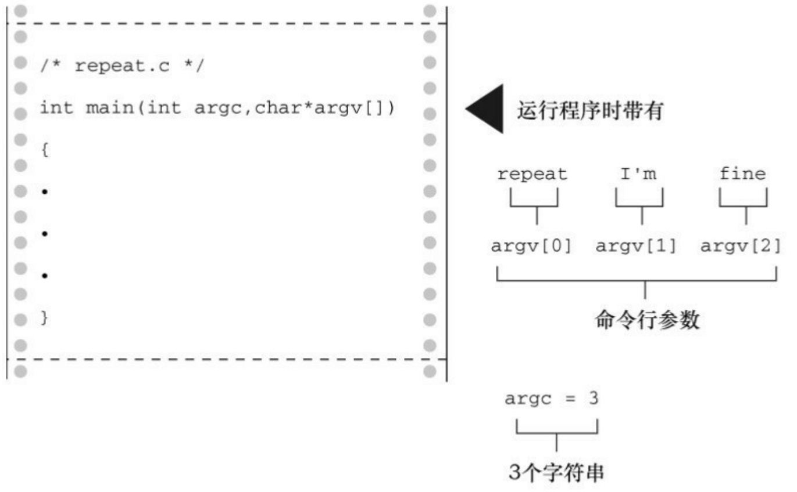

$$
^ {*} \mathrm{str} = \text {toupper} (^ {*} \mathrm{str});
$$

顺带一提，ctype.h中的函数通常作为宏（macro）来实现。这些C预处理器宏的作用很像函数，但是两者有一些重要的区别。我们在第16章再讨论关于宏的内容。

该程序使用 fgets()和 strchr()组合，读取一行输入并把换行符替换成空字符。这种方法与使用s\_gets()的区别是:s\_gets()会处理输入行剩余字符（如果有的话），为下一次输入做好准备。而本例只有一条输入语句，就没必要进行多余的步骤。

## 11.8 命令行参数

在图形界面普及之前都使用命令行界面。DOS和UNIX就是例子。Linux终端提供类UNIX命令行环境。命令行（command line）是在命令行环境中，用户为运行程序输入命令的行。假设一个文件中有一个名为fuss的程序。在UNIX环境中运行该程序的命令行是:

\$ fuss

或者在Windows命令提示模式下是:

C> fuss

命令行参数（command-line argument）是同一行的附加项。如下例:

\$ fuss -r Ginger

一个C程序可以读取并使用这些附加项（见图11.7）。

程序清单11.27是一个典型的例子，该程序通过main()的参数读取这些附加项。

名为repeat的可执行文件



<details>
<summary>flowchart</summary>

```mermaid
graph LR
  A["&quot;/* repeat.c */<br>  B[&quot;int main(int argc,char*argv["])\n{"]
  C[""]
  D[""]
  E[""]
  F[""]
  G[""]
  H[""]
  I[""]
  J[""]
  K[""]
  L[""]
  M[""]
  N[""]
  O[""]
  P[""]
  Q[""]
  R[""]
  S[""]
  T[""]
  U[""]
  V[""]
  W[""]
  X[""]
  Y[""]
  Z[""]
  AA[""]
  AB[""]
  AC[""]
  AD[""]
  AE[""]
  AF[""]
  AG[""]
  AH[""]
  AI[""]
  AJ[""]
  AK[""]
  AL[""]
  AM[""]
  AN[""]
  AO[""]
  AP[""]
  AQ[""]
  AR[""]
  AS[""]
  AT[""]
  AU[""]
  AV[""]
  AW[""]
  AX[""]
  AY[""]
  AZ[""]
  B1[""]
  B2[""]
  B3[""]
  B4[""]
  B5[""]
  B6[""]
  B7[""]
  B8[""]
  B9[""]
  B10[""]
  B11[""]
  B12[""]
  B13[""]
  B14[""]
  B15[""]
  B16[""]
  B17[""]
  B18[""]
  B19[""]
  B20[""]
  B21[""]
  B22[""]
  B23[""]
  B24[""]
  B25[""]
  B26[""]
  B27[""]
  B28[""]
  B29[""]
```
</details>

图11.7 命令行参数

程序清单11.31 repeat.c程序

```c
/* repeat.c -- 带参数的 main() */

#include <stdio.h>

int main(int argc, char *argv [])
{
int count;

printf("The command line has %d arguments:\n", argc - 1);

for (count = 1; count < argc; count++)

printf("%d: %s\n", count, argv[count]);
```

```c
printf("\n");
return 0;
}
```

把该程序编译为可执行文件repeat。下面是通过命令行运行该程序后的输出:

C>repeat Resistance is futile

The command line has 3 arguments:

1: Resistance
2: is
3: futile

由此可见该程序为何名为repeat。下面我们解释一下它的运行原理。

C编译器允许main()没有参数或者有两个参数（一些实现允许main()有更多参数，属于对标准的扩展）。main()有两个参数时，第1个参数是命令行中的字符串数量。过去，这个int类型的参数被称为argc （表示参数计数(argument count)）。系统用空格表示一个字符串的结束和下一个字符串的开始。因此，上面的repeat示例中包括命令名共有4个字符串，其中后3个供repeat使用。该程序把命令行字符串储存在内存中，并把每个字符串的地址储存在指针数组中。而该数组的地址则被储存在 main()的第2个参数中。按照惯例，这个指向指针的指针称为argv（表示参数值[argument value]）。如果系统允许（一些操作系统不允许这样），就把程序本身的名称赋给argv[0]，然后把随后的第1个字符串赋给argv[1]，以此类推。在我们的例子中，有下面的关系:

argv[0] 指向 repeat （对大部分系统而言）

argv[1] 指向Resistance

argv[2] 指向is

argv[3] 指向futile

程序清单11.31的程序通过一个for循环依次打印每个字符串。printf()中的%s转换说明表明，要提供一个字符串的地址作为参数，而指针数组中的每个元素（argv[0]、argv[1]等）都是这样的地址。

main()中的形参形式与其他带形参的函数相同。许多程序员用不同的形式声明argv:

int main(int argc, char \*\*argv)

char \*\*argv与char \*argv[]等价。也就是说，argv是一个指向指针的指针，它所指向的指针指向 char。因此，即使在原始定义中，argv 也是指向指针（该指针指向 char）的指针。两种形式都可以使用，但我们认为第1种形式更清楚地表明argv表示一系列字符串。

顺带一提，许多环境（包括UNIX和DOS）都允许用双引号把多个单词括起来形成一个参数。例如:

repeat "I am hungry" now

这行命令把字符串"I am hungry"赋给argv[1]，把"now"赋给argv[2]。

## 11.8.1 集成环境中的命令行参数

Windows集成环境（如Xcode、Microsoft Visual C++和Embarcadero C++ Builder）都不用命令行运行程序。有些环境中有项目对话框，为特定项目指定命令行参数。其他环境中，可以在IDE中编译程序，然后打开MS-DOS窗口在命令行模式中运行程序。但是，如果你的系统有一个运行命令行的编译器（如GCC）会更简单。

## 11.8.2 Macintosh中的命令行参数

如果使用Xcode 4.6（或类似的版本），可以在Product菜单中选择Scheme选项来提供命令行参数，编辑Scheme，运行。然后选择Argument标签，在Launch的Arguments Pass中输入参数。

或者进入Mac的Terminal模式和UNIX的命令行环境。然后，可以找到程序可执行代码的目录（UNIX的文件夹），或者下载命令行工具，使用gcc或clang编译程序。

## 11.9 把字符串转换为数字

数字既能以字符串形式储存，也能以数值形式储存。把数字储存为字符串就是储存数字字符。例如，数字213以'2'、'1'、'3'、'\0'的形式被储存在字符串数组中。以数值形式储存213，储存的是int类型的值。

C要求用数值形式进行数值运算（如，加法和比较）。但是在屏幕上显示数字则要求字符串形式，因为屏幕显示的是字符。printf()和 sprintf()函数，通过%d 和其他转换说明，把数字从数值形式转换为字符串形式，scanf()可以把输入字符串转换为数值形式。C 还有一些函数专门用于把字符串形式转换成数值形式。

假设你编写的程序需要使用数值命令形参，但是命令形参数被读取为字符串。因此，要使用数值必须先把字符串转换为数字。如果需要整数，可以使用atoi()函数（用于把字母数字转换成整数），该函数接受一个字符串作为参数，返回相应的整数值。程序清单11.32中的程序示例演示了该函数的用法。

程序清单11.32 hello.c程序

```c
/* hello.c -- 把命令行参数转换为数字 */

#include <stdio.h>

#include <stdlib.h>

int main(int argc, char *argv [])
{
int i, times;

if (argc < 2 || (times = atoi(argv[1])) < 1)
```

```txt
printf("Usage: %s positive-number\n", argv[0]);
else
for (i = 0; i < times; i++)
puts("Hello, good looking!");
return 0;
}
```

该程序的运行示例:

\$ hello 3

Hello, good looking!

Hello, good looking!

Hello, good looking!

\$是UNIX和Linux的提示符（一些UNIX系统使用%）。命令行参数3被储存为字符串3\0。atoi()函数把该字符串转换为整数值3，然后该值被赋给times。该值确定了执行for循环的次数。

如果运行该程序时没有提供命令行参数，那么argc < 2为真，程序给出一条提示信息后结束。如果times 为 0 或负数，情况也是如此。C 语言逻辑运算符的求值顺序保证了如果 argc < 2，就不会对atoi(argv[1])求值。

如果字符串仅以整数开头，atio()函数也能处理，它只把开头的整数转换为字符。例如，atoi("42regular")将返回整数42。如果在命令行输入hello what会怎样？在我们所用的C实现中，如果命令行参数不是数字，atoi()函数返回0。然而C标准规定，这种情况下的行为是未定义的。因此，使用有错误检测功能的strtol()函数（马上介绍）会更安全。

该程序中包含了stdlib.h头文件，因为从ANSI C开始，该头文件中包含了atoi()函数的原型。除此之外，还包含了 atof()和 atol()函数的原型。atof()函数把字符串转换成 double 类型的值，atol()函数把字符串转换成long类型的值。atof()和atol()的工作原理和atoi()类似，因此它们分别返回double类型和long类型。

ANSI C还提供一套更智能的函数:strtol()把字符串转换成long类型的值，strtoul()把字符串转换成unsigned long类型的值，strtod()把字符串转换成double类型的值。这些函数的智能之处在于识别和报告字符串中的首字符是否是数字。而且，strtol()和strtoul()还可以指定数字的进制。

下面的程序示例中涉及strtol()函数，其原型如下:

long strtol(const char \* restrict nptr, char \*\* restrict endptr, int base);

这里，nptr是指向待转换字符串的指针，endptr是一个指针的地址，该指针被设置为标识输入数字结束字符的地址，base表示以什么进制写入数字。程序清单11.33演示了该函数的用法。

程序清单11.33 strcnvt.c程序

```c
/* strcnvt.c -- 使用 strtol() */
#include <stdio.h>
#include <stdlib.h>
#define LIM 30
char * s_gets(char * st, int n);
int main()
{
```

```c
char number[LIM];
char * end;
long value;
puts("Enter a number (empty line to quit):");
while (s_gets(number, LIM) && number[0] != '\0')
{
value = strtol(number, &end, 10); /* 十进制 */
printf("base 10 input, base 10 output: %ld, stopped at %s (%d)\n",
value, end, *end);
value = strtol(number, &end, 16); /* 十六进制 */
printf("base 16 input, base 10 output: %ld, stopped at %s (%d)\n",
value, end, *end);
puts("Next number:");
}
puts("Bye!\n");
return 0;
}
char * s_gets(char * st, int n)
```

```txt
{
char * ret_val;

int i = 0;

ret_val = fgets(st, n, stdin);

if (ret_val)

{

while (st[i] != '\n' && st[i] != '\0')
i++;

if (st[i] == '\n')

st[i] = '\0';

else

while (getchar() != '\n')

continue;

}

return ret_val;
}
```

下面是该程序的输出示例:

Enter a number (empty line to quit):

10

base 10 input, base 10 output: 10, stopped at (0)

base 16 input, base 10 output: 16, stopped at (0)

Next number:

## 10atom

base 10 input, base 10 output: 10, stopped at atom (97)

base 16 input, base 10 output: 266, stopped at tom (116)

Next number:

Bye!

首先注意，当base分别为10和16时，字符串"10"分别被转换成数字10和16。还要注意，如果end指向一个字符，\*end就是一个字符。因此，第1次转换在读到空字符时结束，此时end指向空字符。打印end会显示一个空字符串，以%d转换说明输出\*end显示的是空字符的ASCII码。

对于第2个输入的字符串，当base为10时，end的值是'a'字符的地址。所以打印end显示的是字符串"atom"，打印\*end显示的是'a'字符的ASCII码。然而，当base为16时，'a'字符被识别为一个有效的十六进制数，strtol()函数把十六进制数10a转换成十进制数266。

strtol()函数最多可以转换三十六进制，'a'\~'z'字符都可用作数字。
strtoul()函数与该函数类似，但是它把字符串转换成无符号值。strtod()函数只以十进制转换，因此它值需要两个参数。

许多实现使用 itoa()和 ftoa()函数分别把整数和浮点数转换成字符串。但是这两个函数并不是 C标准库的成员，可以用sprintf()函数代替它们，因为sprintf()的兼容性更好。

## 11.10 关键概念

许多程序都要处理文本数据。一个程序可能要求用户输入姓名、公司列表、地址、一种蕨类植物的学名、音乐剧的演员等。毕竟，我们用言语与现实世界互动，使用文本的例子不计其数。C 程序通过字符串的方式来处理它们。

字符串，无论是由字符数组、指针还是字符串常量标识，都储存为包含字符编码的一系列字节，并以空字符串结尾。C 提供库函数处理字符串，查找字符串并分析它们。尤其要牢记，应该使用 strcmp()来代替关系运算符，当比较字符串时，应该使用 strcpy()或 strncpy()代替赋值运算符把字符串赋给字符数组。

## 11.11 本章小结

C字符串是一系列char类型的字符，以空字符（'\0'）结尾。字符串可以储存在字符数组中。字符串还可以用字符串常量来表示，里面都是字符，括在双引号中（空字符除外）。编译器提供空字符。因此，“joy”被储存为4个字符j、o、y和\0。strlen()函数可以统计字符串的长度，空字符不计算在内。

字符串常量也叫作字符串——字面量，可用于初始化字符数组。为了容纳末尾的空字符，数组大小应该至少比容纳的数组长度多1。也可以用字符串常量初始化指向char的指针。

函数使用指向字符串首字符的指针来表示待处理的字符串。通常，对应的实际参数是数组名、指针变量或用双引号括起来的字符串。无论是哪种情况，传递的都是首字符的地址。一般而言，没必要传递字符串的长度，因为函数可以通过末尾的空字符确定字符串的结束。

fgets()函数获取一行输入，puts()和 fputs()函数显示一行输出。它们都是stdio.h头文件中的函数，用于代替已被弃用的gets()。

C库中有多个字符串处理函数。在ANSI C中，这些函数都声明在string.h文件中。C库中还有许多字符处理函数，声明在ctype.h文件中。

给main()函数提供两个合适的形式参数，可以让程序访问命令行参数。第1个参数通常是int类型的argc，其值是命令行的单词数量。第2个参数通常是一个指向数组的指针argv，数组内含指向char的指针。每个指向char的指针都指向一个命令行参数字符串，argv[0]指向命令名称，argv[1]指向第1个命令行参数，以此类推。

atoi()、atol()和atof()函数把字符串形式的数字分别转换成int、long 和 double类型的数字。strtol()、strtoul()和strtod()函数把字符串形式的数字分别转换成long、unsigned long和double类型的数字。

## 11.12 复习题

复习题的参考答案在附录A中。

1. 下面字符串的声明有什么问题？

```txt
int main(void)
{
char name[] = {'F', 'e', 's', 's' };
...
}
```

2. 下面的程序会打印什么？

```c
#include <stdio.h>

int main(void)
{
char note[] = "See you at the snack bar.";
char *ptr;

ptr = note;

puts(ptr);

puts(++ptr);

note[7] = '\0';

puts(note);
```

```txt
puts(++ptr);

return  0;

}
```

3. 下面的程序会打印什么？

```c
#include <stdio.h>

#include <string.h>

int main(void)
{
char food [] = "Yummy";

char *ptr;

ptr = food + strlen(food);

while (--ptr >= food)

puts(ptr);

return 0;
}
```

4. 下面的程序会打印什么？

```c
#include <stdio.h>

#include <string.h>

int main(void)
```

```txt
{
char goldwyn[40] = "art of it all  ";
char samuel[40] = "I read p";
const char * quote = "the way through.";
strcat(goldwyn, quote);
strcat(samuel, goldwyn);
puts(samuel);
return 0;
}
```

5. 下面的练习涉及字符串、循环、指针和递增指针。首先，假设定义了下面的函数:

```c
#include <stdio.h>

char *pr(char *str)

{

char *pc;

pc = str;

while (*pc)

putchar(*pc++);

do {
```

```c
putchar(*--pc);

} while (pc - str);

return (pc);

}
```

考虑下面的函数调用:

```javascript
x = pr("Ho Ho Ho!");
```

a.将打印什么？
b.x是什么类型?
c.x的值是什么？
d. 表达式\*--pc是什么意思？与--\*pc有何不同？
e.如果用\*--pc替换--\*pc，会打印什么？

f.两个while循环用来测试什么？

g.如果pr()函数的参数是空字符串，会怎样？

h.必须在主调函数中做什么，才能让pr()函数正常运行？

6. 假设有如下声明:

```javascript
char sign = '\$';
```

sign占用多少字节的内存？'\$'占用多少字节的内存？"\$"占用多少字节的内存？

7. 下面的程序会打印出什么？

```c
#include <stdio.h>

#include <string.h>

#define M1 "How are ya, sweetie? "
char M2[40] = "Beat the clock.";
char *M3 = "chat";
int main(void)
{
char words[80];
printf(M1);
puts(M1);
puts(M2);
puts(M2 + 1);
strcpy(words, M2);
strcat(words, " Win a toy.");
puts(words);
words[4] = '\0';
puts(words);
while (*M3)
puts(M3++);
```

puts(--M3);

puts(--M3);

M3 = M1;

puts(M3);

return 0;

}

8. 下面的程序会打印出什么？

#include &lt;stdio.h&gt;

int main(void)

{

char str1 [] = "gawsie";

char str2 [] = "bletonism";

char \*ps;

int i = 0;

for (ps = str1; \*ps != '\0'; ps++) {

if (\*ps == 'a' || \*ps == 'e')

putchar(\*ps);

else

(\*ps)--;

```c
putchar(*ps);

}

putchar('\n');

while (str2[i] != '\0') {
printf("%c", i % 3 ? str2[i] : '*');
++i;

}

return 0;

}
```

9.本章定义的s\_gets()函数，用指针表示法代替数组表示法便可减少一个变量i。请改写该函数。
10.strlen()函数接受一个指向字符串的指针作为参数，并返回该字符串的长度。请编写一个这样的函数。
11.本章定义的s\_gets()函数，可以用strchr()函数代替其中的while循环来查找换行符。请改写该函数。
12. 设计一个函数，接受一个指向字符串的指针，返回指向该字符串第1个空格字符的指针，或如果未找到空格字符，则返回空指针。
13. 重写程序清单11.21，使用ctype.h头文件中的函数，以便无论用户选择大写还是小写，该程序都能正确识别答案。

## 11.13 编程练习

1. 设计并测试一个函数，从输入中获取下n个字符（包括空白、制表符、换行符），把结果储存在一个数组里，它的地址被传递作为一个参数。
2. 修改并编程练习1的函数，在n个字符后停止，或在读到第1个空白、制表符或换行符时停止，哪个先遇到哪个停止。不能只使用scanf()。
3. 设计并测试一个函数，从一行输入中把一个单词读入一个数组中，并丢弃输入行中的其余字符。该函数应该跳过第1个非空白字符前面的所有空白。将一个单词定义为没有空白、制表符或换行符的字符序列。
4. 设计并测试一个函数，它类似编程练习3的描述，只不过它接受第2个参数指明可读取的最大字符数。
5.设计并测试一个函数，搜索第1个函数形参指定的字符串，在其中查找第2个函数形参指定的字符首次出现的位置。如果成功，该函数返指向该字符的指针，如果在字符串中未找到指定字符，则返回空指针（该函数的功能与 strchr() 函数相同）。在一个完整的程序中测试该函数，使用一个循环给函数提供输入值。
6. 编写一个名为is\_within()的函数，接受一个字符和一个指向字符串的指针作为两个函数形参。如果指定字符在字符串中，该函数返回一个非零值（即为真）。否则，返回0（即为假）。在一个完整的程序中测试该函数，使用一个循环给函数提供输入值。
7. strncpy(s1, s2, n)函数把s2中的n个字符拷贝至s1中，截断s2，或者有必要的话在末尾添加空字符。如果s2的长度是n或多于n，目标字符串不能以空字符结尾。该函数返回s1。自己编写一个这样的函数，名为mystrncpy()。在一个完整的程序中测试该函数，使用一个循环给函数提供输入值。
8. 编写一个名为string\_in()的函数，接受两个指向字符串的指针作为参数。如果第2个字符串中包含第1个字符串，该函数将返回第1个字符串开始的地址。例如，string\_in("hats", "at")将返回hats中a的地址。否则，该函数返回空指针。在一个完整的程序中测试该函数，使用一个循环给函数提供输入值。

9. 编写一个函数，把字符串中的内容用其反序字符串代替。在一个完整的程序中测试该函数，使用一个循环给函数提供输入值。
10. 编写一个函数接受一个字符串作为参数，并删除字符串中的空格。在一个程序中测试该函数，使用循环读取输入行，直到用户输入一行空行。该程序应该应用该函数只每个输入的字符串，并显示处理后的字符串。
11. 编写一个函数，读入10个字符串或者读到EOF时停止。该程序为用户提供一个有5个选项的菜单:打印源字符串列表、以ASCII中的顺序打印字符串、按长度递增顺序打印字符串、按字符串中第1个单词的长度打印字符串、退出。菜单可以循环显示，除非用户选择退出选项。当然，该程序要能真正完成菜单中各选项的功能。
12. 编写一个程序，读取输入，直至读到 EOF，报告读入的单词数、大写字母数、小写字母数、标点符号数和数字字符数。使用ctype.h头文件中的函数。
13. 编写一个程序，反序显示命令行参数的单词。例如，命令行参数是 see you later，该程序应打印 later you see。
14. 编写一个通过命令行运行的程序计算幂。第1个命令行参数是double类型的数，作为幂的底数，第2个参数是整数，作为幂的指数。
15. 使用字符分类函数实现atoi()函数。如果输入的字符串不是纯数字，该函数返回0。
16. 编写一个程序读取输入，直至读到文件结尾，然后把字符串打印出来。该程序识别和实现下面的命令行参数:

-p 按原样打印

-u 把输入全部转换成大写
-1 把输入全部转换成小写

如果没有命令行参数，则让程序像是使用了-p参数那样运行。

# 第12章 存储类别、链接和内存管理

本章介绍以下内容:

关键字:auto、extern、static、register、const、volatile、restricted、\_Thread\_local、\_Atomic

函数:rand()、srand()、time()、malloc()、calloc()、free()

如何确定变量的作用域（可见的范围）和生命期（它存在多长时间）

设计更复杂的程序

C语言能让程序员恰到好处地控制程序，这是它的优势之一。程序员通过 C的内存管理系统指定变量的作用域和生命期，实现对程序的控制。合理使用内存储存数据是设计程序的一个要点。

## 12.1 存储类别

C提供了多种不同的模型或存储类别（storage class）在内存中储存数据。要理解这些存储类别，先要复习一些概念和术语。

本书目前所有编程示例中使用的数据都储存在内存中。从硬件方面来看，被储存的每个值都占用一定的物理内存，C 语言把这样的一块内存称为对象（object）。对象可以储存一个或多个值。一个对象可能并未储存实际的值，但是它在储存适当的值时一定具有相应的大小（面向对象编程中的对象指的是类对象，其定义包括数据和允许对数据进行的操作，C不是面向对象编程语言）。

从软件方面来看，程序需要一种方法访问对象。这可以通过声明变量来完成:

$$
\text {int entity} = 3;
$$

该声明创建了一个名为entity的标识符（identifier）。标识符是一个名称，在这种情况下，标识符可以用来指定（designate）特定对象的内容。标识符遵循变量的命名规则（第2章介绍过）。在该例中，标识符entity即是软件（即C程序）指定硬件内存中的对象的方式。该声明还提供了储存在对象中的值。

变量名不是指定对象的唯一途径。考虑下面的声明:

$$
\mathrm{int} ^ {*} \mathrm{pt} = \& \text {entity};
$$

$$
\text {int ranks[10];}
$$

第1行声明中，pt是一个标识符，它指定了一个储存地址的对象。但是，表达式\*pt不是标识符，因为它不是一个名称。然而，它确实指定了一个对象，在这种情况下，它与entity指定的对象相同。一般而言，那些指定对象的表达式被称为左值（第5章介绍过）。所以，entity既是标识符也是左值；\*pt既是表达式也是左值。按照这个思路，ranks + 2 \* entity既不是标识符（不是名称），也不是左值（它不指定内存位置上的内容）。但是表达式\*(ranks + 2 \* entity)是一个左值，因为它的确指定了特定内存位置的值，即ranks数组的第7个元素。顺带一提，ranks的声明创建了一个可容纳10个int类型元素的对象，该数组的每个元素也是一个对象。

所有这些示例中，如果可以使用左值改变对象中的值，该左值就是一个可修改的左值（modifiable lvalue）。现在，考虑下面的声明:

$$
\text {const char} * \mathrm{pc} = \text {"Behold a string literal!"};
$$

程序根据该声明把相应的字符串字面量储存在内存中，内含这些字符值的数组就是一个对象。由于数组中的每个字符都能被单独访问，所以每个字符也是一个对象。该声明还创建了一个标识符为pc的对象，储存着字符串的地址。由于可以设置pc重新指向其他字符串，所以标识符pc是一个可修改的左值。const只能保证被pc指向的字符串内容不被修改，但是无法保证pc不指向别的字符串。由于\*pc指定了储存'B'字符的数据对象，所以\*pc 是一个左值，但不是一个可修改的左值。与此类似，因为字符串字面量本身指定了储存字符串的对象，所以它也是一个左值，但不是可修改的左值。

可以用存储期（storage duration）描述对象，所谓存储期是指对象在内存中保留了多长时间。标识符用于访问对象，可以用作用域（scope）和链接（linkage）描述标识符，标识符的作用域和链接表明了程序的哪些部分可以使用它。不同的存储类别具有不同的存储期、作用域和链接。标识符可以在源代码的多文件中共享、可用于特定文件的任意函数中、可仅限于特定函数中使用，甚至只在函数中的某部分使用。对象可存在于程序的执行期，也可以仅存在于它所在函数的执行期。对于并发编程，对象可以在特定线程的执行期存在。可以通过函数调用的方式显式分配和释放内存。

我们先学习作用域、链接和存储期的含义，再介绍具体的存储类别。

## 12.1.1 作用域

作用域描述程序中可访问标识符的区域。一个C变量的作用域可以是块作用域、函数作用域、函数原型作用域或文件作用域。到目前为止，本书程序示例中使用的变量几乎都具有块作用域。块是用一对花括号括起来的代码区域。例如，整个函数体是一个块，函数中的任意复合语句也是一个块。定义在块中的变量具有块作用域（block scope），块作用域变量的可见范围是从定义处到包含该定义的块的末尾。另外，虽然函数的形式参数声明在函数的左花括号之前，但是它们也具有块作用域，属于函数体这个块。所以到目前为止，我们使用的局部变量（包括函数的形式参数）都具有块作用域。因此，下面代码中的变量cleo和patrick都具有块作用域:

```txt
double blocky(double cleo)
{
double patrick = 0.0;
...
return patrick;
}
```

声明在内层块中的变量，其作用域仅局限于该声明所在的块:

```txt
double blocky(double cleo)
{
double patrick = 0.0;
int i;
for (i = 0; i < 10; i++)
{
```

```txt
double q = cleo * i; // q的作用域开始

...

patrick *= q;

}                                      // q的作用域结束

...

return  patrick;

}
```

在该例中，q的作用域仅限于内层块，只有内层块中的代码才能访问q。

以前，具有块作用域的变量都必须声明在块的开头。C99 标准放宽了这一限制，允许在块中的任意位置声明变量。因此，对于for的循环头，现在可以这样写:

```txt
for (int i = 0; i < 10; i++)
printf("A C99 feature: i = %d", i);
```

为适应这个新特性，C99把块的概念扩展到包括for循环、while循环、do while循环和if语句所控制的代码，即使这些代码没有用花括号括起来，也算是块的一部分。所以，上面for循环中的变量i被视为for循环块的一部分，它的作用域仅限于for循环。一旦程序离开for循环，就不能再访问i。

函数作用域（function scope）仅用于goto语句的标签。这意味着即使一个标签首次出现在函数的内层块中，它的作用域也延伸至整个函数。如果在两个块中使用相同的标签会很混乱，标签的函数作用域防止了这样的事情发生。

函数原型作用域（function prototype scope）用于函数原型中的形参名

（变量名），如下所示:

int mighty(int mouse, double large);

函数原型作用域的范围是从形参定义处到原型声明结束。这意味着，编译器在处理函数原型中的形参时只关心它的类型，而形参名（如果有的话）通常无关紧要。而且，即使有形参名，也不必与函数定义中的形参名相匹配。只有在变长数组中，形参名才有用:

void use\_a\_VLA(int n, int m, ar[n][m]);

方括号中必须使用在函数原型中已声明的名称。

变量的定义在函数的外面，具有文件作用域（file scope）。具有文件作用域的变量，从它的定义处到该定义所在文件的末尾均可见。考虑下面的例子:

```c
#include <stdio.h>

int units = 0;          /* 该变量具有文件作用域 */
void critic(void);

int main(void)

{

...

}

void critic(void)
{

...
```

}

这里，变量units具有文件作用域，main()和critic()函数都可以使用它（更准确地说，units具有外部链接文件作用域，稍后讲解）。由于这样的变量可用于多个函数，所以文件作用域变量也称为全局变量（global variable）。

## 注意 翻译单元和文件

你认为的多个文件在编译器中可能以一个文件出现。例如，通常在源代码（.c扩展名）中包含一个或多个头文件（.h 扩展名）。头文件会依次包含其他头文件，所以会包含多个单独的物理文件。但是，C预处理实际上是用包含的头文件内容替换#include指令。所以，编译器源代码文件和所有的头文件都看成是一个包含信息的单独文件。这个文件被称为翻译单元（translation unit）。描述一个具有文件作用域的变量时，它的实际可见范围是整个翻译单元。如果程序由多个源代码文件组成，那么该程序也将由多个翻译单元组成。每个翻译单元均对应一个源代码文件和它所包含的文件。

## 12.1.2 链接

接下来，我们介绍链接。C 变量有 3 种链接属性:外部链接、内部链接或无链接。具有块作用域、函数作用域或函数原型作用域的变量都是无链接变量。这意味着这些变量属于定义它们的块、函数或原型私有。具有文件作用域的变量可以是外部链接或内部链接。外部链接变量可以在多文件程序中使用，内部链接变量只能在一个翻译单元中使用。

## 注意 正式和非正式术语

C 标准用“内部链接的文件作用域”描述仅限于一个翻译单元（即一个源代码文件和它所包含的头文件）的作用域，用“外部链接的文件作用域”描述可延伸至其他翻译单元的作用域。但是，对程序员而言这些术语太长了。一些程序员把“内部链接的文件作用域”简称为“文件作用域”，把“外部链接的文件作用域”简称为“全局作用域”或“程序作用域”。

如何知道文件作用域变量是内部链接还是外部链接？可以查看外部定义中是否使用了存储类别说明符static:

```txt
int giants = 5;                      // 文件作用域，外部链接
static int dodgers = 3;      // 文件作用域，内部链接
int   main()
{
...
}
...
```

该文件和同一程序的其他文件都可以使用变量giants。而变量dodgers属文件私有，该文件中的任意函数都可使用它。

## 12.1.3 存储期

作用域和链接描述了标识符的可见性。存储期描述了通过这些标识符访问的对象的生存期。C对象有4种存储期:静态存储期、线程存储期、自动存储期、动态分配存储期。

如果对象具有静态存储期，那么它在程序的执行期间一直存在。文件作用域变量具有静态存储期。注意，对于文件作用域变量，关键字 static表明了其链接属性，而非存储期。以 static声明的文件作用域变量具有内部链接。但是无论是内部链接还是外部链接，所有的文件作用域变量都具有静态存储期。

线程存储期用于并发程序设计，程序执行可被分为多个线程。具有线程存储期的对象，从被声明时到线程结束一直存在。以关键字\_Thread\_local声明一个对象时，每个线程都获得该变量的私有备份。