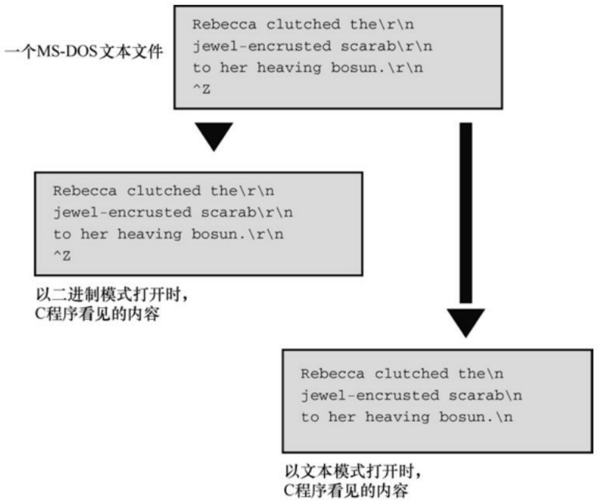
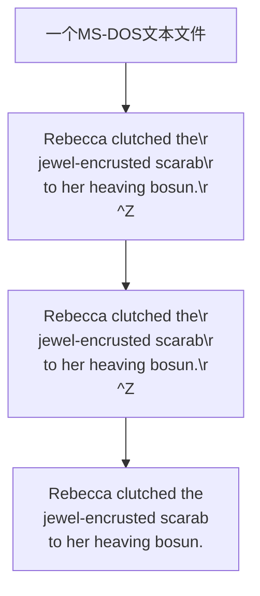

智能的（进行优化的）编译器会注意到以上代码使用了两次 x，但并未改变它的值。于是编译器把 x的值临时储存在寄存器中，然后在val2需要使用x时，才从寄存器中（而不是从原始内存位置上）读取x的值，以节约时间。这个过程被称为高速缓存（caching）。通常，高速缓存是个不错的优化方案，但是如果一些其他代理在以上两条语句之间改变了x的值，就不能这样优化了。如果没有volatile关键字，编译器就不知道这种事情是否会发生。因此，为安全起见，编译器不会进行高速缓存。这是在 ANSI 之前的情况。现在，如果声明中没有volatile关键字，编译器会假定变量的值在使用过程中不变，然后再尝试优化代码。

可以同时用const和volatile限定一个值。例如，通常用const把硬件时钟设置为程序不能更改的变量，但是可以通过代理改变，这时用 volatile。只能在声明中同时使用这两个限定符，它们的顺序不重要，如下所示:

volatile const int loc;

const volatile int \* ploc;

## 12.5.3 restrict类型限定符

restrict 关键字允许编译器优化某部分代码以更好地支持计算。它只能用于指针，表明该指针是访问数据对象的唯一且初始的方式。要弄明白为什么这样做有用，先看几个例子。考虑下面的代码:

int ar[10];

int \* restrict restar = (int \*) malloc(10 \* sizeof(int));

int \* par = ar;

这里，指针restar是访问由malloc()所分配内存的唯一且初始的方式。因此，可以用restrict关键字限定它。而指针par既不是访问ar数组中数据的初始方式，也不是唯一方式。所以不用把它设置为restrict。

现在考虑下面稍复杂的例子，其中n是int类型:

```c
for (n = 0; n < 10; n++)
{
par[n] += 5;
restar[n] += 5;
ar[n] *= 2;
par[n] += 3;
restar[n] += 3;
}
```

由于之前声明了 restar 是访问它所指向的数据块的唯一且初始的方式，编译器可以把涉及 restar的两条语句替换成下面这条语句，效果相同:

restar[n] += 8; /\* 可以进行替换 \*/

但是，如果把与par相关的两条语句替换成下面的语句，将导致计算错误:

par[n] += 8; / \* 给出错误的结果 \*/

这是因为for循环在par两次访问相同的数据之间，用ar改变了该数据的值。

在本例中，如果未使用restrict关键字，编译器就必须假设最坏的情况（即，在两次使用指针之间，其他的标识符可能已经改变了数据）。如果用了restrict关键字，编译器就可以选择捷径优化计算。

restrict 限定符还可用于函数形参中的指针。这意味着编译器可以假定在函数体内其他标识符不会修改该指针指向的数据，而且编译器可以尝试对其优化，使其不做别的用途。例如，C 库有两个函数用于把一个位置上的字节拷贝到另一个位置。在C99中，这两个函数的原型是:

void \* memcpy(void \* restrict s1, const void \* restrict s2, size\_t n);

void \* memmove(void \* s1, const void \* s2, size\_t n);

这两个函数都从位置s2把n字节拷贝到位置s1。memcpy()函数要求两个位置不重叠，但是memove()没有这样的要求。声明s1和s2为restrict说明这两个指针都是访问相应数据的唯一方式，所以它们不能访问相同块的数据。这满足了memcpy()无重叠的要求。memmove()函数允许重叠，它在拷贝数据时不得不更小心，以防在使用数据之前就先覆盖了数据。

restrict 关键字有两个读者。一个是编译器，该关键字告知编译器可以自由假定一些优化方案。另一个读者是用户，该关键字告知用户要使用满足restrict要求的参数。总而言之，编译器不会检查用户是否遵循这一限制，但是无视它后果自负。

## 12.5.4 \_Atomic类型限定符（C11）

并发程序设计把程序执行分成可以同时执行的多个线程。这给程序设计带来了新的挑战，包括如何管理访问相同数据的不同线程。C11通过包含可选的头文件stdatomic.h和threads.h，提供了一些可选的（不是必须实现的）管理方法。值得注意的是，要通过各种宏函数来访问原子类型。当一个线程对一个原子类型的对象执行原子操作时，其他线程不能访问该对象。例如，下面的代码:

int hogs;// 普通声明

hogs = 12; // 普通赋值

可以替换成:

这里，在hogs中储存12是一个原子过程，其他线程不能访问hogs。

编写这种代码的前提是，编译器要支持这一新特性。

## 12.5.5 旧关键字的新位置

C99允许把类型限定符和存储类别说明符static放在函数原型和函数头的形式参数的初始方括号中。对于类型限定符而言，这样做为现有功能提供了一个替代的语法。例如，下面是旧式语法的声明:

void ofmouth(int \* const a1, int \* restrict a2, int n); // 以前的风格

该声明表明a1是一个指向int的const指针，这意味着不能更改指针本身，可以更改指针指向的数据。除此之外，还表明a2是一个restrict指针，如上一节所述。新的等价语法如下:

根据新标准，在声明函数形参时，指针表示法和数组表示法都可以使用这两个限定符。

static的情况不同，因为新标准为static引入了一种与以前用法不相关的新用法。现在，static除了表明静态存储类别变量的作用域或链接外，新的用法告知编译器如何使用形式参数。例如，考虑下面的原型:

double stick(double ar[static 20]);

static 的这种用法表明，函数调用中的实际参数应该是一个指向数组首元素的指针，且该数组至少有20个元素。这种用法的目的是让编译器使用这些信息优化函数的编码。为何给static新增一个完全不同的用法？C 标准委员会不愿意创建新的关键字，因为这样会让以前用新关键字作为标识符的程序无效。所以，他们会尽量利用现有的关键字，尽量不添加新的关键字。

restrict 关键字有两个读者。一个是编译器，该关键字告知编译器可以自由假定一些优化方案。另一个读者是用户，该关键字告知用户要使用满足restrict要求的参数。

## 12.6 关键概念

C 提供多种管理内存的模型。除了熟悉这些模型外，还要学会如何选择不同的类别。大多数情况下，最好选择自动变量。如果要使用其他类别，应该有充分的理由。通常，使用自动变量、函数形参和返回值进行函数间的通信比使用全局变量安全。但是，保持不变的数据适合用全局变量。

应该尽量理解静态内存、自动内存和动态分配内存的属性。尤其要注意:静态内存的数量在编译时确定；静态数据在载入程序时被载入内存。在程序运行时，自动变量被分配或释放，所以自动变量占用的内存数量随着程序的运行会不断变化。可以把自动内存看作是可重复利用的工作区。动态分配的内存也会增加和减少，但是这个过程由函数调用控制，不是自动进行的。

## 12.7 本章小结

内存用于存储程序中的数据，由存储期、作用域和链接表征。存储期可以是静态的、自动的或动态分配的。如果是静态存储期，在程序开始执行时分配内存，并在程序运行时都存在。如果是自动存储期，在程序进入变量定义所在块时分配变量的内存，在程序离开块时释放内存。如果是动态分配存储期，在调用malloc()（或相关函数）时分配内存，在调用free()函数时释放内存。

作用域决定程序的哪些部分可以访问某数据。定义在所有函数之外的变量具有文件作用域，对位于该变量声明之后的所有函数可见。定义在块或作为函数形参内的变量具有块作用域，只对该块以及它包含的嵌套块可见。

链接描述定义在程序某翻译单元中的变量可被链接的程度。具有块作用域的变量是局部变量，无链接。具有文件作用域的变量可以是内部链接或外部链接。内部链接意味着只有其定义所在的文件才能使用该变量。外部链接意味着其他文件使用也可以使用该变量。

下面是C的5种存储类别（不包括线程的概念）。

自动——在块中不带存储类别说明符或带 auto 存储类别说明符声明的变量（或作为函数头中的形参）属于自动存储类别，具有自动存储期、块作用域、无链接。如果未初始化自动变量，它的值是未定义的。

寄存器——在块中带 register 存储类别说明符声明的变量（或作为函数头中的形参）属于寄存器存储类别，具有自动存储期、块作用域、无链接，且无法获取其地址。把一个变量声明为寄存器变量即请求编译器将其储存到访问速度最快的区域。如果未初始化寄存器变量，它的值是未定义的。

静态、无链接——在块中带static存储类别说明符声明的变量属于“静态、无链接”存储类别，具有静态存储期、块作用域、无链接。只在编译时被初始化一次。如果未显式初始化，它的字节都被设置为0。

静态、外部链接——在所有函数外部且没有使用 static 存储类别说明符声明的变量属于“静态、外部链接”存储类别，具有静态存储期、文件作用域、外部链接。只能在编译器被初始化一次。如果未显式初始化，它的字节都被设置为0。

静态、内部链接——在所有函数外部且使用了 static 存储类别说明符声明的变量属于“静态、内部链接”存储类别，具有静态存储期、文件作用域、内部链接。只能在编译器被初始化一次。如果未显式初始化，它的字节都被设置为0。

动态分配的内存由 malloc()（或相关）函数分配，该函数返回一个指向指定字节数内存块的指针。这块内存被free()函数释放后便可重复使用，free()函数以该内存块的地址作为参数。

类型限定符const、volatile、restrict和\_Atomic。const限定符限定数据在程序运行时不能改变。对指针使用const时，可限定指针本身不能改变或指针指向的数据不能改变，这取决于const在指针声明中的位置。volatile 限定符表明，限定的数据除了被当前程序修改外还可以被其他进程修改。该限定符的目的是警告编译器不要进行假定的优化。restrict限定符也是为了方便编译器设置优化方案。restrict限定的指针是访问它所指向数据的唯一途径。

## 12.8 复习题

复习题的参考答案在附录A中。

1.哪些类别的变量可以成为它所在函数的局部变量？
2.哪些类别的变量在它所在程序的运行期一直存在？
3.哪些类别的变量可以被多个文件使用？哪些类别的变量仅限于在一个文件中使用？

4.块作用域变量具有什么链接属性？

5.extern关键字有什么用途？

6.考虑下面两行代码，就输出的结果而言有何异同:

```txt
int * p1 = (int *)malloc(100 * sizeof(int));
int * p1 = (int *)calloc(100, sizeof(int));
```

7.下面的变量对哪些函数可见？程序是否有误？

/\* 文件 1 \*/

```c
int daisy;
int main(void)
{
int lily;
...;
}
```

```c
int petal()
{
extern int daisy, lily;
...;
}
/* 文件 2 */
extern int daisy;
static int lily;
int rose;
int stem()
{
int rose;
...;
}
void root()
{
...;
}
```

8.下面程序会打印什么？

```c
#include <stdio.h>

char color = 'B';

void first(void);

void second(void);

int main(void)

{

extern char color;

printf("color in main() is %c\n", color);

first();

printf("color in main() is %c\n", color);

second();

printf("color in main() is %c\n", color);

return 0;

}

void first(void)

{

char color;

color = 'R';

printf("color in first() is %c\n", color);
```

```c
}

void second(void)

{

color = 'G';

printf("color in second() is %c\n", color);

}
```

9.假设文件的开始处有如下声明:

```c
static int plink;

int value_ct(const int arr[], int value, int n);
```

a.以上声明表明了程序员的什么意图？

b.用const int value和const int n分别替换int value和int n，是否对主调程序的值加强保护。

## 12.9 编程练习

1.不使用全局变量，重写程序清单12.4。

2.在美国，通常以英里/加仑来计算油耗；在欧洲，以升/100 公里来计算。下面是程序的一部分，提示用户选择计算模式（美制或公制），然后接收数据并计算油耗。

```c
// pe12-2b.c
// 与 pe12-2a.c 一起编译
#include <stdio.h>
#include "pe12-2a.h"
int main(void)
{
int mode;
printf("Enter 0 for metric mode, 1 for US mode: ");
scanf("%d", &mode);
while (mode >= 0)
{
set_mode(mode);
get_info();
show_info();
```

```c
printf("Enter 0 for metric mode, 1 for US mode");
printf(" (-1 to quit): ");
scanf("%d", &mode);
}
printf("Done.\n");
return 0;
}
```

下面是是一些输出示例:

Enter 0 for metric mode, 1 for US mode: 0

Enter distance traveled in kilometers: 600

Enter fuel consumed in liters: 78.8

Fuel consumption is 13.13 liters per 100 km.

Enter 0 for metric mode, 1 for US mode (-1 to quit): 1

Enter distance traveled in miles: 434

Enter fuel consumed in gallons: 12.7

Fuel consumption is 34.2 miles per gallon.

Enter 0 for metric mode, 1 for US mode (-1 to quit): 3

Invalid mode specified. Mode 1(US) used.

Enter distance traveled in miles: 388

Enter fuel consumed in gallons: 15.3

Fuel consumption is 25.4 miles per gallon.

Enter 0 for metric mode, 1 for US mode (-1 to quit): -1

Done.

如果用户输入了不正确的模式，程序向用户给出提示消息并使用上一次输入的正确模式。请提供pe12-2a.h头文件和pe12-2a.c源文件。源代码文件应定义3个具有文件作用域、内部链接的变量。一个表示模式、一个表示距离、一个表示消耗的燃料。get\_info()函数根据用户输入的模式提示用户输入相应数据，并将其储存到文件作用域变量中。show\_info()函数根据设置的模式计算并显示油耗。可以假设用户输入的都是数值数据。

3.重新设计编程练习2，要求只使用自动变量。该程序提供的用户界面不变，即提示用户输入模式等。但是，函数调用要作相应变化。
4.在一个循环中编写并测试一个函数，该函数返回它被调用的次数。
5.编写一个程序，生成100个1～10范围内的随机数，并以降序排列（可以把第11章的排序算法稍加改动，便可用于整数排序，这里仅对整数排序）。
6.编写一个程序，生成1000个1～10范围内的随机数。不用保存或打印这些数字，仅打印每个数出现的次数。用 10 个不同的种子值运行，生成的数字出现的次数是否相同？可以使用本章自定义的函数或ANSI C的rand()和srand()函数，它们的格式相同。这是一个测试特定随机数生成器随机性的方法。
7.编写一个程序，按照程序清单12.13输出示例后面讨论的内容，修改该程序。使其输出类似:

Enter the number of sets; enter q to stop : 18

```txt
How many sides and how many dice? 6 3
Here are 18 sets of 3 6-sided throws.
12 10 6 9 8 14 8 15 9 14 12 17 11 7 10
13 8 14
How many sets? Enter q to stop: q
```

8.下面是程序的一部分:

```c
// pe12-8.c
#include <stdio.h>
int * make_array(int elem, int val);
void show_array(const int ar [], int n);
int main(void)
{
int * pa;
int size;
int value;
printf("Enter the number of elements: ");
while (scanf("%d", &size) == 1 && size > 0)
{
printf("Enter the initialization value: ");
```

```txt
scanf("%d", &value);

pa = make_array(size, value);

if (pa)

{

show_array(pa, size);

free(pa);

}

printf("Enter the number of elements (<1 to quit): ");
}

printf("Done.\n");

return 0;

}
```

提供make\_array()和show\_array()函数的定义，完成该程序。make\_array()函数接受两个参数，第1个参数是int类型数组的元素个数，第2个参数是要赋给每个元素的值。该函数调用malloc()创建一个大小合适的数组，将其每个元素设置为指定的值，并返回一个指向该数组的指针。show\_array()函数显示数组的内容，一行显示8个数。

9.编写一个符合以下描述的函数。首先，询问用户需要输入多少个单词。然后，接收用户输入的单词，并显示出来，使用malloc()并回答第1个问题（即要输入多少个单词），创建一个动态数组，该数组内含相应的指向char的指针（注意，由于数组的每个元素都是指向char的指针，所以用于储存malloc()返回值的指针应该是一个指向指针的指针，且它所指向的指针指向char）。在读取字符串时，该程序应该把单词读入一个临时的char数组，使用malloc()分配足够的存储空间来储存单词，并把地址存入该指针数组（该数组中每个元素都是指向 char 的指针）。然后，从临时数组中把单词拷贝到动态分配的存储空间中。因此，有一个字符指针数组，每个指针都指向一个对象，该对象的大小正好能容纳被储存的特定单词。下面是该程序的一个运行示例:

```txt
How many words do you wish to enter? 5
Enter 5 words now:
I enjoyed doing this exercise
Here are your words:
I
enjoyed
doing
this
exercise
```

[1].注意，以static声明的文件作用域变量具有内部链接属性。——译者注

# 第13章文件输入/输出

本章介绍以下内容:

函数:fopen()、getc()、putc()、exit()、fclose()

fprintf()、fscanf()、fgets()、fputs()

rewind()、fseek()、ftell()、fflush()

fgetpos()、fsetpos()、feof()、ferror()

ungetc()、setvbuf()、fread()、fwrite()

如何使用C标准I/O系列的函数处理文件

文件模式和二进制模式、文本和二进制格式、缓冲和无缓冲I/O

使用既可以顺序访问文件也可以随机访问文件的函数

文件是当今计算机系统不可或缺的部分。文件用于储存程序、文档、数据、书信、表格、图形、照片、视频和许多其他种类的信息。作为程序员，必须会编写创建文件和从文件读写数据的程序。本章将介绍相关的内容。

## 13.1 与文件进行通信

有时，需要程序从文件中读取信息或把信息写入文件。这种程序与文件交互的形式就是文件重定向（第8章介绍过）。这种方法很简单，但是有一定限制。例如，假设要编写一个交互程序，询问用户书名并把完整的书名列表保存在文件中。如果使用重定向，应该类似于:

$$
\text {books} > \text {bklist}
$$

用户的输入被重定向到 bklist 中。这样做不仅会把不符合要求的文本写入 bklist，而且用户也看不到要回答什么问题。

C提供了更强大的文件通信方法，可以在程序中打开文件，然后使用特殊的I/O函数读取文件中的信息或把信息写入文件。在研究这些方法之前，先简要介绍一下文件的性质。

## 13.1.1 文件是什么

文件（file）通常是在磁盘或固态硬盘上的一段已命名的存储区。对我们而言，stdio.h就是一个文件的名称，该文件中包含一些有用的信息。然而，对操作系统而言，文件更复杂一些。例如，大型文件会被分开储存，或者包含一些额外的数据，方便操作系统确定文件的种类。然而，这都是操作系统所关心的，程序员关心的是C程序如何处理文件（除非你正在编写操作系统）。

C把文件看作是一系列连续的字节，每个字节都能被单独读取。这与UNIX环境中（C的发源地）的文件结构相对应。由于其他环境中可能无法完全对应这个模型，C提供两种文件模式:文本模式和二进制模式。

## 13.1.2 文本模式和二进制模式

首先，要区分文本内容和二进制内容、文本文件格式和二进制文件格式，以及文件的文本模式和二进制模式。

所有文件的内容都以二进制形式（0或1）储存。但是，如果文件最初使用二进制编码的字符（例如， ASCII或Unicode）表示文本（就像C字符串那样），该文件就是文本文件，其中包含文本内容。如果文件中的二进制值代表机器语言代码或数值数据（使用相同的内部表示，假设，用于long或double类型的值）或图片或音乐编码，该文件就是二进制文件，其中包含二进制内容。

UNIX用同一种文件格式处理文本文件和二进制文件的内容。不奇怪，鉴于C是作为开发UNIX的工具而创建的，C和UNIX在文本中都使用\n（换行符）表示换行。UNIX目录中有一个统计文件大小的计数，程序可使用该计数确定是否读到文件结尾。然而，其他系统在此之前已经有其他方法处理文件，专门用于保存文本。也就是说，其他系统已经有一种与UNIX模型不同的格式处理文本文件。例如，以前的OS X Macintosh文件用\r （回车符）表示新的一行。早期的MS-DOS文件用\r\n组合表示新的一行，用嵌入的Ctrl+Z字符表示文件结尾，即使实际文件用添加空字符的方法使其总大小是256的倍数（在Windows中，Notepad仍然生成MS-DOS格式的文本文件，但是新的编辑器可能使用类UNIX格式居多）。其他系统可能保持文本文件中的每一行长度相同，如有必要，用空字符填充每一行，使其长度保持一致。或者，系统可能在每行的开始标出每行的长度。

为了规范文本文件的处理，C 提供两种访问文件的途径:二进制模式和文本模式。在二进制模式中，程序可以访问文件的每个字节。而在文本模式中，程序所见的内容和文件的实际内容不同。程序以文本模式读取文件时，把本地环境表示的行末尾或文件结尾映射为C模式。例如，C程序在旧式Macintosh中以文本模式读取文件时，把文件中的\r转换成\n；以文本模式写入文件时，把\n转换成\r。或者，C文本模式程序在MS-DOS平台读取文件时，把\r\n转换成\n；写入文件时，把\n转换成\r\n。在其他环境中编写的文本模式程序也会做类似的转换。

除了以文本模式读写文本文件，还能以二进制模式读写文本文件。如果读写一个旧式MS-DOS文本文件，程序会看到文件中的\r 和\n 字符，不会发生映射（图 13.1 演示了一些文本）。如果要编写旧式 Mac格式、MS-DOS格式或UNIX/Linux格式的文件模式程序，应该使用二进制模式，这样程序才能确定实际的文件内容并执行相应的动作。



<details>
<summary>flowchart</summary>


</details>

图13.1 二进制模式和文本模式

虽然C提供了二进制模式和文本模式，但是这两种模式的实现可以相同。前面提到过，因为UNIX使用一种文件格式，这两种模式对于UNIX实现而言完全相同。Linux也是如此。

## 13.1.3 I/O的级别

除了选择文件的模式，大多数情况下，还可以选择I/O的两个级别（即处理文件访问的两个级别）。底层I/O（low-level I/O）使用操作系统提供的基本I/O服务。标准高级I/O（standard high-level I/O）使用C库的标准包和stdio.h头文件定义。因为无法保证所有的操作系统都使用相同的底层I/O模

型，C标准只支持标准I/O包。有些实现会提供底层库，但是C标准建立了可移植的I/O模型，我们主要讨论这些I/O。

## 13.1.4 标准文件

C程序会自动打开3个文件，它们被称为标准输入（standard input）、标准输出（standard output）和标准错误输出（standard error output）。在默认情况下，标准输入是系统的普通输入设备，通常为键盘；标准输出和标准错误输出是系统的普通输出设备，通常为显示屏。

通常，标准输入为程序提供输入，它是 getchar()和 scanf()使用的文件。程序通常输出到标准输出，它是putchar()、puts()和printf()使用的文件。第8章提到的重定向把其他文件视为标准输入或标准输出。标准错误输出提供了一个逻辑上不同的地方来发送错误消息。例如，如果使用重定向把输出发送给文件而不是屏幕，那么发送至标准错误输出的内容仍然会被发送到屏幕上。这样很好，因为如果把错误消息发送至文件，就只能打开文件才能看到。

## 13.2 标准I/O

与底层I/O相比，标准I/O包除了可移植以外还有两个好处。第一，标准I/O有许多专门的函数简化了处理不同I/O的问题。例如，printf()把不同形式的数据转换成与终端相适应的字符串输出。第二，输入和输出都是缓冲的。也就是说，一次转移一大块信息而不是一字节信息（通常至少512字节）。例如，当程序读取文件时，一块数据被拷贝到缓冲区（一块中介存储区域）。这种缓冲极大地提高了数据传输速率。程序可以检查缓冲区中的字节。缓冲在后台处理，所以让人有逐字符访问的错觉（如果使用底层I/O，要自己完成大部分工作）。程序清单13.1演示了如何用标准I/O读取文件和统计文件中的字符数。我们将在后面几节讨论程序清单 13.1 中的一些特性。该程序使用命令行参数，如果你是Windows用户，在编译后必须在命令提示窗口运行该程序；如果你是Macintosh用户，最简单的方法是使用Terminal在命令行形式中编译并运行该程序。或者，如第11章所述，如果在IDE中运行该程序，可以使用Xcode的Product菜单提供命令行参数。或者也可以用puts()和fgets()函数替换命令行参数来获得文件名。

程序清单**13.1 count.c**程序

```c
/* count.c -- 使用标准 I/O */

#include <stdio.h>

#include <stdlib.h>      // 提供 exit()的原型

int main(int argc, char *argv [])
{
int ch;                  // 读取文件时，储存每个字符的地方
FILE *fp;     // “文件指针”
unsigned long count = 0;
```

```lisp
if (argc != 2)
{
printf("Usage: %s filename\n", argv[0]);
exit(EXIT_FAILURE);
}
if ((fp = fopen(argv[1], "r")) == NULL)
{
printf("Can't open %s\n", argv[1]);
exit(EXIT_FAILURE);
}
while ((ch = getc(fp)) != EOF)
{
putc(ch, stdout); // 与 putchar(ch); 相同
count++;
}
fclose(fp);
printf("File %s has %lu characters\n", argv[1], count);
return 0;
}
```

## 13.2.1 检查命令行参数

首先，程序清单13.1中的程序检查argc的值，查看是否有命令行参数。如果没有，程序将打印一条消息并退出程序。字符串 argv[0]是该程序的名称。显式使用 argv[0]而不是程序名，错误消息的描述会随可执行文件名的改变而自动改变。这一特性在像 UNIX 这种允许单个文件具有多个文件名的环境中也很方便。但是，一些操作系统可能不识别argv[0]，所以这种用法并非完全可移植。

exit()函数关闭所有打开的文件并结束程序。exit()的参数被传递给一些操作系统，包括 UNIX、Linux、Windows和MS-DOS，以供其他程序使用。通常的惯例是:正常结束的程序传递0，异常结束的程序传递非零值。不同的退出值可用于区分程序失败的不同原因，这也是UNIX和DOS编程的通常做法。但是，并不是所有的操作系统都能识别相同范围内的返回值。因此，C 标准规定了一个最小的限制范围。尤其是，标准要求0或宏EXIT\_SUCCESS用于表明成功结束程序，宏EXIT\_FAILURE用于表明结束程序失败。这些宏和exit()原型都位于stdlib.h头文件中。

根据ANSI C的规定，在最初调用的main()中使用return与调用exit()的效果相同。因此，在main()，下面的语句:

return 0;

和下面这条语句的作用相同:

exit(0);

但是要注意，我们说的是“最初的调用”。如果main()在一个递归程序中，exit()仍然会终止程序，但是return只会把控制权交给上一级递归，直至最初的一级。然后return结束程序。return和exit()的另一个区别是，即使在其他函数中（除main()以外）调用exit()也能结束整个程序。

## 13.2.2 fopen()函数

继续分析程序清单13.1，该程序使用fopen()函数打开文件。该函数声明在stdio.h中。它的第1个参数是待打开文件的名称，更确切地说是一个包含改文件名的字符串地址。第 2 个参数是一个字符串，指定待打开文件的模式。表13.1列出了C库提供的一些模式。

表13.1 fopen()的模式字符串

| 模式字符串 | 含义 |
| --- | --- |
| "r" | 以读模式打开文件 |
| "w" | 以写模式打开文件,把现有文件的长度截为0,如果文件不存在,则创建一个新文件 |
| "a" | 以写模式打开文件,在现有文件末尾添加内容,如果文件不存在,则创建一个新文件 |
| "r+" | 以更新模式打开文件(即可以读写文件) |
| "w+" | 以更新模式打开文件(即,读和写),如果文件存在,则将其长度截为0;如果文件不存在,则创建一个新文件 |
| "a+" | 以更新模式打开文件(即,读和写),在现有文件的末尾添加内容,如果文件不存在则创建一个新文件;可以读整个文件,但是只能从末尾添加内容 |
| "rb"、"wb"、"ab"、"ab+"、"a+b"、"wb+"、"w+b"、"ab+"、"a+b" | 与上一个模式类似,但是以二进制模式而不是文本模式打开文件 |
| "wx"、"wbx"、"w+x"、"wb+x"或"w+bx" | (C11)类似非x模式,但是如果文件已存在或以独占模式打开文件,则打开文件失败 |

像UNIX和Linux这样只有一种文件类型的系统，带b字母的模式和不带b字母的模式相同。

新的C11新增了带x字母的写模式，与以前的写模式相比具有更多特性。第一，如果以传统的一种写模式打开一个现有文件，fopen()会把该文件的长度截为 0，这样就丢失了该文件的内容。但是使用带 x字母的写模式，即使fopen()操作失败，原文件的内容也不会被删除。第二，如果环境允许，x模式的独占特性使得其他程序或线程无法访问正在被打开的文件。

警告

如果使用任何一种"w"模式（不带x字母）打开一个现有文件，该文件的内容会被删除，以便程序在一个空白文件中开始操作。然而，如果使用带x字母的任何一种模式，将无法打开一个现有文件。

程序成功打开文件后，fopen()将返回文件指针（file pointer），其他I/O函数可以使用这个指针指定该文件。文件指针（该例中是fp）的类型是指向FILE的指针，FILE是一个定义在stdio.h中的派生类型。文件指针fp并不指向实际的文件，它指向一个包含文件信息的数据对象，其中包含操作文件的I/O函数所用的缓冲区信息。因为标准库中的I/O函数使用缓冲区，所以它们不仅要知道缓冲区的位置，还要知道缓冲区被填充的程度以及操作哪一个文件。标准I/O函数根据这些信息在必要时决定再次填充或清空缓冲区。fp指向的数据对象包含了这些信息（该数据对象是一个 C结构，将在第 14章中介绍）。

## 13.2.3 getc()和putc()函数

getc()和putc()函数与getchar()和putchar()函数类似。所不同的是，要告诉getc()和putc()函数使用哪一个文件。下面这条语句的意思是“从标准输入中获取一个字符”:

$$
\mathrm{ch} = \text {getchar();}
$$

然而，下面这条语句的意思是“从fp指定的文件中获取一个字符”:

$$
\mathrm{ch} = \operatorname{getc} (\mathrm{fp});
$$

与此类似，下面语句的意思是“把字符ch放入FILE指针fpout指定的文件中”:

$$
\text {putc(ch, fpout)};
$$

在putc()函数的参数列表中，第1个参数是待写入的字符，第2个参数是文件指针。

程序清单13.1把stdout作为putc()的第2个参数。stdout作为与标准输出相关联的文件指针，定义在stdio.h中，所以putc(ch, stdout)与putchar(ch)的作用相同。实际上，putchar()函数一般通过putc()来定义。与此类似，getchar()也通过使用标准输入的getc()来定义。

为何该示例不用 putchar()而要用 putc()？原因之一是为了介绍 putc()函数；原因之二是，把stdout替换成别的参数，很容易将这段程序改写成文件输出。

## 13.2.4 文件结尾

从文件中读取数据的程序在读到文件结尾时要停止。如何告诉程序已经读到文件结尾？如果 getc()函数在读取一个字符时发现是文件结尾，它将返回一个特殊值EOF。所以C程序只有在读到超过文件末尾时才会发现文件的结尾（一些其他语言用一个特殊的函数在读取之前测试文件结尾，C语言不同）。

为了避免读到空文件，应该使用入口条件循环（不是do while循环）进行文件输入。鉴于getc() （和其他C输入函数）的设计，程序应该在进入循环体之前先尝试读取。如下面设计所示:

// 设计范例 #1

int ch; // 用int类型的变量储存EOF

FILE \* fp;

fp = fopen("wacky.txt", "r");

ch = getc(fp); // 获取初始输入

while (ch != EOF)

{

putchar(ch); // 处理输入

ch = getc(fp); // 获取下一个输入

}

以上代码可简化为:

```awk
// 设计范例 #2

int ch;

FILE * fp;

fp = fopen("wacky.txt", "r");

while (( ch = getc(fp)) != EOF)

{

putchar(ch);  //处理输入

}
```

由于ch = getc(fp)是while测试条件的一部分，所以程序在进入循环体之前就读取了文件。不要设计成下面这样:

// 糟糕的设计（存在两个问题）

```txt
int ch;

FILE * fp;

fp = fopen("wacky.txt", "r");

while (ch != EOF) // 首次使用ch时，它的值尚未确定
{
ch = getc(fp);      // 获取输入

putchar(ch);          // 处理输入
```

}

第1个问题是，ch首次与EOF比较时，其值尚未确定。第2个问题是，如果getc()返回EOF，该循环会把EOF作为一个有效字符处理。这些问题都可以解决。例如，把ch初始化为一个哑值（dummy value），再把一个if语句加入到循环中。但是，何必多此一举，直接使用上面的设计范例即可。

其他输入函数也会用到这种处理方案，它们在读到文件结尾时也会返回一个错误信号（EOF 或 NULL指针）。

## 13.2.5 fclose()函数

fclose(fp)函数关闭fp指定的文件，必要时刷新缓冲区。对于较正式的程序，应该检查是否成功关闭文件。如果成功关闭，fclose()函数返回0，否则返回EOF:

$$
\text {if} (\text {fclose} (\text {fp})! = 0)
$$

printf("Error in closing file %s\n", argv[1]);

如果磁盘已满、移动硬盘被移除或出现I/O错误，都会导致调用fclose()函数失败。

## 13.2.6 指向标准文件的指针

stdio.h头文件把3个文件指针与3个标准文件相关联，C程序会自动打开这3个标准文件。如表13.2所示:

表13.2 标准文件和相关联的文件指针

| 标准文件 | 文件指针 | 通常使用的设备 |
| --- | --- | --- |
| 标准输入 | stdin | 键盘 |
| 标准输出 | stdout | 显示器 |
| 标准错误 | stderr | 显示器 |

这些文件指针都是指向FILE的指针，所以它们可用作标准I/O函数的参数，如fclose(fp)中的fp。接下来，我们用一个程序示例创建一个新文件，并写入内容。