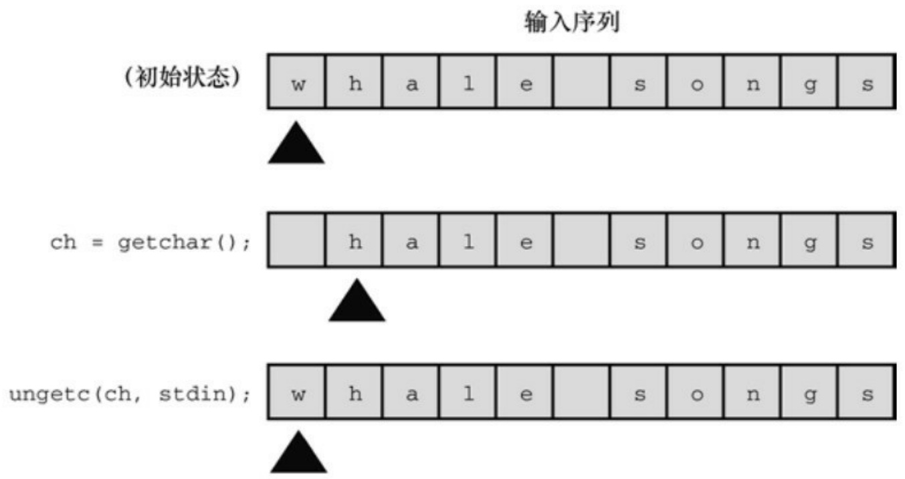
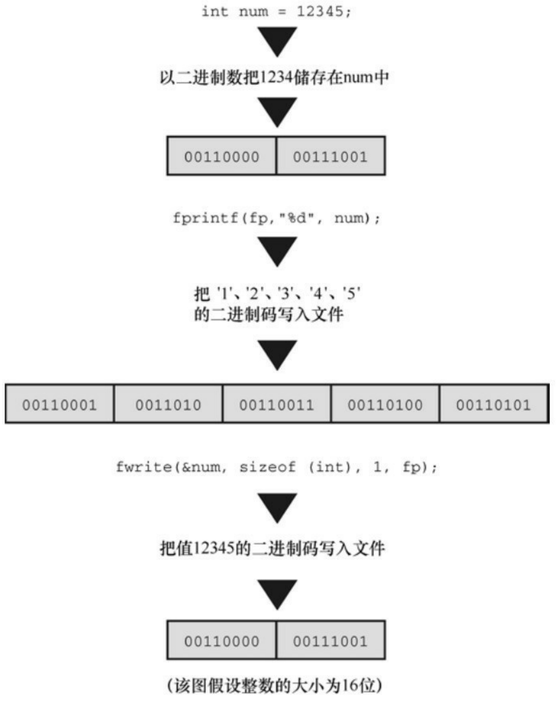
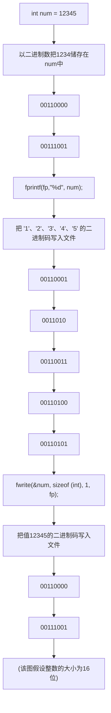

## 13.3 一个简单的文件压缩程序

下面的程序示例把一个文件中选定的数据拷贝到另一个文件中。该程序同时打开了两个文件，以"r"模式打开一个，以"w"模式打开另一个。该程序（程序清单13.2）以保留每3个字符中的第1个字符的方式压缩第1个文件的内容。最后，把压缩后的文本存入第2个文件。第2个文件的名称是第1个文件名加上.red后缀（此处的red代表reduced）。使用命令行参数，同时打开多个文件，以及在原文件名后面加上后缀，都是相当有用的技巧。这种压缩方式有限，但是也有它的用途（很容易把该程序改成用标准 I/O 而不是命令行参数提供文件名）。

程序清单13.2 reducto.c程序

```c
// reducto.c -把文件压缩成原来的1/3!
#include <stdio.h>
#include <stdlib.h>      // 提供 exit()的原型
#include <string.h>      // 提供 strcpy()、strcat()的原型
#define LEN 40
int main(int argc, char *argv [])
{
FILE *in, *out;   // 声明两个指向 FILE 的指针
int ch;
char name[LEN];   // 储存输出文件名
int count = 0;
```

```c
// 检查命令行参数
if (argc < 2)
{
fprintf(stderr, "Usage: %s filename\n", argv[0]);
exit(EXIT_FAILURE);
}
// 设置输入
if ((in = fopen(argv[1], "r")) == NULL)
{
fprintf(stderr, "I couldn't open the file \"%s\"\n",
argv[1]);
exit(EXIT_FAILURE);
}
// 设置输出
strncpy(name, argv[1], LEN - 5);      // 拷贝文件名
name[LEN - 5] = '\0';
strcat(name, ".red");                  // 在文件名后添加.red
if ((out = fopen(name, "w")) == NULL)
{                       // 以写模式打开文件
```

```txt
fprintf(stderr, "Can't create output file.\n");
exit(3);
}
```

// 拷贝数据

```txt
while ((ch = getc(in)) != EOF)
if (count++ % 3 == 0)
```

putc(ch, out);// 打印3个字符中的第1个字符

// 收尾工作

```javascript
if (fclose(in) != 0 || fclose(out) != 0)
```

```txt
fprintf(stderr, "Error in closing files\n");
return 0;
}
```

假设可执行文件名是reducto，待读取的文件名为eddy，该文件中包含下面一行内容:

So even Eddy came oven ready.

命令如下:

reducto eddy

待写入的文件名为eddy.red。该程序把输出显示在eddy.red中，而不是屏幕上。打开eddy.red，内容如下:

Send money

该程序示例演示了几个编程技巧。我们来仔细研究一下。

fprintf()和 printf()类似，但是 fprintf()的第 1 个参数必须是一个文件指针。程序中使用stderr指针把错误消息发送至标准错误，C标准通常都这么做。

为了构造新的输出文件名，该程序使用strncpy()把名称eddy拷贝到数组name中。参数LEN-5为.red后缀和末尾的空字符预留了空间。如果argv[2]字符串比LEN-5长，就拷贝不了空字符。出现这种情况时，程序会添加空字符。调用strncpy()后，name中的第1个空字符在调用strcat()函数时，被.red的.覆盖，生成了eddy.red。程序中还检查了是否成功打开名为eddy.red的文件。这个步骤在一些环境中相当重要，因为像strange.c.red这样的文件名可能是无效的。例如，在传统的DOS环境中，不能在后缀名后面添加后缀名（MS-DOS使用的方法是用.red替换现有后缀名，所以strange.c将变成strange.red。例如，可以用strchr()函数定位（如果有的话），然后只拷贝点前面的部分即可）。

该程序同时打开了两个文件，所以我们要声明两个 FIFL 指针。注意，程序都是单独打开和关闭每个文件。同时打开的文件数量是有限的，这个限制取决于系统和实现，范围一般是10～20。相同的文件指针可以处理不同的文件，前提是这些文件不需要同时打开。

## 13.4 文件I/O:fprintf()、fscanf()、fgets()和fputs()

前面章节介绍的I/O函数都类似于文件I/O函数。它们的主要区别是，文件I/O函数要用FILE指针指定待处理的文件。与 getc()、putc()类似，这些函数都要求用指向 FILE 的指针（如，stdout）指定一个文件，或者使用fopen()的返回值。

## 13.4.1 fprintf()和fscanf()函数

文件I/O函数fprintf()和fscanf()函数的工作方式与printf()和scanf()类似，区别在于前者需要用第1个参数指定待处理的文件。我们在前面用过fprintf()。程序清单13.3演示了这两个文件I/O函数和rewind()函数的用法。

程序清单13.3 addaword.c程序

```c
/* addaword.c -- 使用 fprintf()、fscanf() 和 rewind() */
#include <stdio.h>
#include <stdlib.h>
#include <string.h>
#define MAX 41
int main(void)
{
FILE *fp;
char words[MAX];
if ((fp = fopen("wordy", "a+")) == NULL)
```

```c
{
fprintf(stdout, "Can't open \"wordy\" file.\n");
exit(EXIT_FAILURE);
}
puts("Enter words to add to the file; press the #");
puts("key at the beginning of a line to terminate.");
while ((fscanf(stdin, "%40s", words) == 1) && (words[0] != '#'))
fprintf(fp, "%s\n", words);
puts("File contents:");
rewind(fp);          /* 返回到文件开始处 */
while (fscanf(fp, "%s", words) == 1)
puts(words);
puts("Done!");
if (fclose(fp) != 0)
fprintf(stderr, "Error closing file\n");
return 0;
}
```

该程序可以在文件中添加单词。使用"a+"模式，程序可以对文件进行读写操作。首次使用该程序，它将创建wordy文件，以便把单词存入其中。随后再使用该程序，可以在wordy文件后面添加单词。虽然"a+"模式只允许在文件末尾添加内容，但是该模式下可以读整个文件。rewind()函数让程序回到文件开始处，方便while循环打印整个文件的内容。注意，rewind()接受一个文件指针作为参数。

下面是该程序在UNIX环境中的一个运行示例（可执行程序已重命名为addword）:

\$ addaword

Enter words to add to the file; press the Enter

key at the beginning of a line to terminate.

## The fabulous programmer

#

File contents:

The

fabulous

programmer

Done!

\$ addaword

Enter words to add to the file; press the Enter

key at the beginning of a line to terminate.

## enchanted the

**large**

#

File contents:

The

fabulous

programmer

enchanted

the

large

Done!

如你所见，fprintf()和 fscanf()的工作方式与 printf()和 scanf()类似。但是，与 putc()不同的是，fprintf()和fscanf()函数都把FILE指针作为第1个参数，而不是最后一个参数。

## 13.4.2 fgets()和fputs()函数

第11章时介绍过fgets()函数。它的第1个参数和gets()函数一样，也是表示储存输入位置的地址（char \* 类型）；第2个参数是一个整数，表示待输入字符串的大小 [1]；最后一个参数是文件指针，指定待读取的文件。下面是一个调用该函数的例子:

fgets(buf, STLEN, fp);

这里，buf是char类型数组的名称，STLEN是字符串的大小，fp是指向FILE的指针。

fgets()函数读取输入直到第 1 个换行符的后面，或读到文件结尾，或者读取STLEN-1 个字符（以上面的 fgets()为例）。然后，fgets()在末尾添加一个空字符使之成为一个字符串。字符串的大小是其字符数加上一个空字符。如果fgets()在读到字符上限之前已读完一整行，它会把表示行结尾的换行符放在空字符前面。fgets()函数在遇到EOF时将返回NULL值，可以利用这一机制检查是否到达文件结尾；如果未遇到EOF则之前返回传给它的地址。

fputs()函数接受两个参数:第1个是字符串的地址；第2个是文件指针。该函数根据传入地址找到的字符串写入指定的文件中。和 puts()函数不同，fputs()在打印字符串时不会在其末尾添加换行符。下面是一个调用该函数的例子:

fputs(buf, fp);

这里，buf是字符串的地址，fp用于指定目标文件。

由于fgets()保留了换行符，fputs()就不会再添加换行符，它们配合得非常好。如第11章的程序清单11.8所示，即使输入行比STLEN长，这两个函数依然处理得很好。

## 13.5 随机访问:fseek()和ftell()

有了 fseek()函数，便可把文件看作是数组，在 fopen()打开的文件中直接移动到任意字节处。我们创建一个程序（程序清单13.4）演示fseek()和ftell()的用法。注意，fseek()有3个参数，返回int类型的值；ftell()函数返回一个long类型的值，表示文件中的当前位置。

程序清单13.4 reverse.c程序

```c
/* reverse.c -- 倒序显示文件的内容 */
#include <stdio.h>
#include <stdlib.h>
#define CNTL_Z '\032'      /* DOS文本文件中的文件结尾标记 */
#define SLEN 81
int main(void)
{
char file[SLEN];
char ch;
FILE *fp;
long count, last;
puts("Enter the name of the file to be processed:");
scanf("%80s", file);
if ((fp = fopen(file, "rb")) == NULL)
```

```c
{
/* 只读模式 */
printf("reverse can't open %s\n", file);
exit(EXIT_FAILURE);
}
fseek(fp, 0L, SEEK_END); /* 定位到文件末尾 */
last = ftell(fp);
for (count = 1L; count <= last; count++)
{
fseek(fp, -count, SEEK_END); /* 回退 */
ch = getc(fp);
if (ch != CNTL_Z && ch != '\r') /* MS-DOS 文件 */
putchar(ch);
}
putchar('\n');
fclose(fp);
return 0;
}
下面是对一个文件的输出:
Enter the name of the file to be processed:
```

## Cluv

.C ni eno naht ylevol erom margorp a

ees reven llahs I taht kniht I

该程序使用二进制模式，以便处理MS-DOS文本和UNIX文件。但是，在使用其他格式文本文件的环境中可能无法正常工作。

注意

如果通过命令行环境运行该程序，待处理文件要和可执行文件在同一个目录（或文件夹）中。如果在IDE中运行该程序，具体查找方案序因实现而异。例如，默认情况下，Microsoft Visual Studio 2012在源代码所在的目录中查找，而Xcode 4.6则在可执行文件所在的目录中查找。

接下来，我们要讨论3个问题:fseek()和ftell()函数的工作原理、如何使用二进制流、如何让程序可移植。

## 13.5.1 fseek()和ftell()的工作原理

fseek()的第1个参数是FILE指针，指向待查找的文件，fopen()应该已打开该文件。

fseek()的第2个参数是偏移量（offset）。该参数表示从起始点开始要移动的距离（参见表13.3列出的起始点模式）。该参数必须是一个long类型的值，可以为正（前移）、负（后移）或0（保持不动）。

fseek()的第3个参数是模式，该参数确定起始点。根据ANSI标准，在stdio.h头文件中规定了几个表示模式的明示常量（manifest constant），如表13.3所示。

## 表13.3 文件的起始点模式

| 模式 | 偏移量的起始点 |
| --- | --- |
| SEEK_SET | 文件开始处 |
| SEEK_CUR | 当前位置 |
| SEEK_END | 文件末尾 |

旧的实现可能缺少这些定义，可以使用数值0L、1L、2L分别表示这3种模式。L后缀表明其值是long类型。或者，实现可能把这些明示常量定义在别的头文件中。如果不确定，请查阅实现的使用手册或在线帮助。

下面是调用fseek()函数的一些示例，fp是一个文件指针:

fseek(fp, 0L, SEEK\_SET); // 定位至文件开始处

fseek(fp, 10L, SEEK\_SET); // 定位至文件中的第10个字节

fseek(fp, 2L, SEEK\_CUR); // 从文件当前位置前移2个字节

fseek(fp, 0L, SEEK\_END); // 定位至文件结尾

fseek(fp, -10L, SEEK\_END); // 从文件结尾处回退10个字节

对于这些调用还有一些限制，我们稍后再讨论。

如果一切正常，fseek()的返回值为0；如果出现错误（如试图移动的距离超出文件的范围），其返回值为-1。

ftell()函数的返回类型是long，它返回的是当前的位置。ANSI C把它定义在stdio.h中。在最初实现的UNIX中，ftell()通过返回距文件开始处的字节数来确定文件的位置。文件的第1个字节到文件开始处的距离是0，以此类推。ANSI C规定，该定义适用于以二进制模式打开的文件，以文件模式打开文件的情况不同。这也是程序清单13.4以二进制模式打开文件的原因。

下面，我们来分析程序清单13.4中的基本要素。首先，下面的语句:

fseek(fp, 0L, SEEK\_END);

把当前位置设置为距文件末尾 0 字节偏移量。也就是说，该语句把当前位置设置在文件结尾。下一条语句:

```javascript
last = ftell(fp);
```

把从文件开始处到文件结尾的字节数赋给last。

然后是一个for循环:

```c
for (count = 1L; count <= last; count++)

{
fseek(fp, -count, SEEK_END); /* go backward */
ch = getc(fp);
}
```

第1轮迭代，把程序定位到文件结尾的第1个字符（即，文件的最后一个字符）。然后，程序打印该字符。下一轮迭代把程序定位到前一个字符，并打印该字符。重复这一过程直至到达文件的第1个字符，并打印。

## 13.5.2 二进制模式和文本模式

我们设计的程序清单13.4在UNIX和MS-DOS环境下都可以运行。UNIX只有一种文件格式，所以不需要进行特殊的转换。然而MS-DOS要格外注意。许多MS-DOS编辑器都用Ctrl+Z标记文本文件的结尾。以文本模式打开这样的文件时，C 能识别这个作为文件结尾标记的字符。但是，以二进制模式打开相同的文件时，Ctrl+Z字符被看作是文件中的一个字符，而实际的文件结尾符在该字符的后面。文件结尾符可能紧跟在Ctrl+Z字符后面，或者文件中可能用空字符填充，使该文件的大小是256的倍数。在DOS环境下不会打印空字符，程序清单13.4中就包含了防止打印Ctrl+Z字符的代码。

二进制模式和文本模式的另一个不同之处是:MS-DOS用\r\n组合表示文本文件换行。以文本模式打开相同的文件时，C程序把\r\n“看成”\n。但是，以二进制模式打开该文件时，程序能看见这两个字符。因此，程序清单13.4中还包含了不打印\r的代码。通常，UNIX文本文件既没有Ctrl+Z，也没有\r，所以这部分代码不会影响大部分UNIX文本文件。

ftell()函数在文本模式和二进制模式中的工作方式不同。许多系统的文本文件格式与UNIX的模型有很大不同，导致从文件开始处统计的字节数成为一个毫无意义的值。ANSI C规定，对于文本模式，ftell()返回的值可以作为fseek()的第2个参数。对于MS-DOS，ftell()返回的值把\r\n当作一个字节计数。

## 13.5.3 可移植性

理论上，fseek()和ftell()应该符合UNIX模型。但是，不同系统存在着差异，有时确实无法做到与UNIX模型一致。因此，ANSI对这些函数降低了要求。下面是一些限制。

在二进制模式中，实现不必支持SEEK\_END模式。因此无法保证程序清单13.4的可移植性。移植性更高的方法是逐字节读取整个文件直到文件末尾。C 预处理器的条件编译指令（第 16 章介绍）提供了一种系统方法来处理这种情况。

在文本模式中，只有以下调用能保证其相应的行为。

| 函数调用 | 效果 |
| --- | --- |
| fseek(file, 0L, SEEK_SET) | 定位至文件开始处 |
| fseek(file, 0L, SEEK_CUR) | 保持当前位置不动 |
| fseek(file, 0L, SEEK_END) | 定位至文件结尾 |
| fseek(file, ftell-pos, SEEK_SET) | 到距文件开始处 ftell-pos 的位置,ftell-pos 是 ftell() 的返回值 |

不过，许多常见的环境都支持更多的行为。

## 13.5.4 fgetpos()和fsetpos()函数

fseek()和 ftell()潜在的问题是，它们都把文件大小限制在 long 类型能表示的范围内。也许 20亿字节看起来相当大，但是随着存储设备的容量迅猛增长，文件也越来越大。鉴于此，ANSI C新增了两个处理较大文件的新定位函数:fgetpos()和 fsetpos()。这两个函数不使用 long 类型的值表示位置，它们使用一种新类型:fpos\_t（代表file position type，文件定位类型）。fpos\_t类型不是基本类型，它根据其他类型来定义。fpos\_t 类型的变量或数据对象可以在文件中指定一个位置，它不能是数组类型，除此之外，没有其他限制。实现可以提供一个满足特殊平台要求的类型，例如，fpos\_t可以实现为结构。

ANSI C定义了如何使用fpos\_t类型。fgetpos()函数的原型如下:

int fgetpos(FILE \* restrict stream, fpos\_t \* restrict pos);

调用该函数时，它把fpos\_t类型的值放在pos指向的位置上，该值描述了文件中的一个位置。如果成功，fgetpos()函数返回0；如果失败，返回非0。

fsetpos()函数的原型如下:

int fsetpos(FILE \*stream, const fpos\_t \*pos);

调用该函数时，使用pos指向位置上的fpos\_t类型值来设置文件指针指向该值指定的位置。如果成功，fsetpos()函数返回0；如果失败，则返回非0。fpos\_t类型的值应通过之前调用fgetpos()获得。

## 13.6 标准I/O的机理

我们在前面学习了标准I/O包的特性，本节研究一个典型的概念模型，分析标准I/O的工作原理。

通常，使用标准I/O的第1步是调用fopen()打开文件（前面介绍过，C程序会自动打开3种标准文件）。fopen()函数不仅打开一个文件，还创建了一个缓冲区（在读写模式下会创建两个缓冲区）以及一个包含文件和缓冲区数据的结构。另外，fopen()返回一个指向该结构的指针，以便其他函数知道如何找到该结构。假设把该指针赋给一个指针变量fp，我们说fopen()函数“打开一个流”。如果以文本模式打开该文件，就获得一个文本流；如果以二进制模式打开该文件，就获得一个二进制流。

这个结构通常包含一个指定流中当前位置的文件位置指示器。除此之外，它还包含错误和文件结尾的指示器、一个指向缓冲区开始处的指针、一个文件标识符和一个计数（统计实际拷贝进缓冲区的字节数）。

我们主要考虑文件输入。通常，使用标准I/O的第2步是调用一个定义在stdio.h中的输入函数，如fscanf()、getc()或 fgets()。一调用这些函数，文件中的数据块就被拷贝到缓冲区中。缓冲区的大小因实现而异，一般是512字节或是它的倍数，如4096或16384（随着计算机硬盘容量越来越大，缓冲区的大小也越来越大）。最初调用函数，除了填充缓冲区外，还要设置fp所指向的结构中的值。尤其要设置流中的当前位置和拷贝进缓冲区的字节数。通常，当前位置从字节0开始。

在初始化结构和缓冲区后，输入函数按要求从缓冲区中读取数据。在它读取数据时，文件位置指示器被设置为指向刚读取字符的下一个字符。由于stdio.h系列的所有输入函数都使用相同的缓冲区，所以调用任何一个函数都将从上一次函数停止调用的位置开始。

当输入函数发现已读完缓冲区中的所有字符时，会请求把下一个缓冲大小的数据块从文件拷贝到该缓冲区中。以这种方式，输入函数可以读取文件中的所有内容，直到文件结尾。函数在读取缓冲区中的最后一个字符后，把结尾指示器设置为真。于是，下一次被调用的输入函数将返回EOF。

输出函数以类似的方式把数据写入缓冲区。当缓冲区被填满时，数据将被拷贝至文件中。

## 13.7 其他标准I/O函数

ANSI标准库的标准I/O系列有几十个函数。虽然在这里无法一一列举，但是我们会简要地介绍一些，让读者对它们有一个大概的了解。这里列出函数的原型，表明函数的参数和返回类型。我们要讨论的这些函数，除了setvbuf()，其他函数均可在ANSI之前的实现中使用。参考资料V的“新增C99和C11的标准ANSI C库”中列出了全部的ANSI C标准I/O包。

## 13.7.1 int ungetc(int c, FILE \*fp)函数

int ungetc()函数把c指定的字符放回输入流中。如果把一个字符放回输入流，下次调用标准输入函数时将读取该字符（见图13.2）。例如，假设要读取下一个冒号之前的所有字符，但是不包括冒号本身，可以使用 getchar()或getc()函数读取字符到冒号，然后使用 ungetc()函数把冒号放回输入流中。ANSI C标准保证每次只会放回一个字符。如果实现允许把一行中的多个字符放回输入流，那么下一次输入函数读入的字符顺序与放回时的顺序相反。



<details>
<summary>text_image</summary>

(初始状态)
输入序列
w h a l e s o n g s
▲
ch = getchar();
h a l e s o n g s
▲
ungetc(ch, stdin);
w h a l e s o n g s
▲
</details>

图13.2 ungets()函数

## 13.7.2 int fflush()函数

fflush()函数的原型如下:

int fflush(FILE \*fp);

调用fflush()函数引起输出缓冲区中所有的未写入数据被发送到fp指定的输出文件。这个过程称为刷新缓冲区。如果 fp是空指针，所有输出缓冲区都被刷新。在输入流中使用fflush()函数的效果是未定义的。只要最近一次操作不是输入操作，就可以用该函数来更新流（任何读写模式）。

## 13.7.3 int setvbuf()函数

setvbuf()函数的原型是:

int setvbuf(FILE \* restrict fp, char \* restrict buf, int mode, size\_t size);

setvbuf()函数创建了一个供标准I/O函数替换使用的缓冲区。在打开文件后且未对流进行其他操作之前，调用该函数。指针fp识别待处理的流，buf指向待使用的存储区。如果buf的值不是NULL，则必须创建一个缓冲区。例如，声明一个内含1024个字符的数组，并传递该数组的地址。然而，如果把NULL作为buf的值，该函数会为自己分配一个缓冲区。变量size告诉setvbuf()数组的大小（size\_t是一种派生的整数类型，第5章介绍过）。mode的选择如下:\_IOFBF表示完全缓冲（在缓冲区满时刷新）；\_IOLBF表示行缓冲（在缓冲区满时或写入一个换行符时）；\_IONBF表示无缓冲。如果操作成功，函数返回0，否则返回一个非零值。

假设一个程序要储存一种数据对象，每个数据对象的大小是3000字节。可以使用setvbuf()函数创建一个缓冲区，其大小是该数据对象大小的倍数。

## 13.7.4 二进制I/O:fread()和fwrite()

介绍fread()和fwrite()函数之前，先要了解一些背景知识。之前用到的标准I/O函数都是面向文本的，用于处理字符和字符串。如何要在文件中保存数值数据？用 fprintf()函数和%f转换说明只是把数值保存为字符串。例如，下面的代码:

$$
\text {double num} = 1. / 3.;
$$

$$
\text {fprintf} (\mathrm{fp}," \% \mathrm{f}", \mathrm{num});
$$

把num储存为8个字符:0.333333。使用%.2f转换说明将其储存为4个字符:0.33，用%.12f转换说明则将其储存为 14 个字符:0.333333333333。改变转换说明将改变储存该值所需的空间数量，也会导致储存不同的值。把num 储存为 0.33 后，读取文件时就无法将其恢复为更高的精度。一般而言， fprintf()把数值转换为字符数据，这种转换可能会改变值。

为保证数值在储存前后一致，最精确的做法是使用与计算机相同的位组合来储存。因此，double 类型的值应该储存在一个 double 大小的单元中。如果以程序所用的表示法把数据储存在文件中，则称以二进制形式储存数据。不存在从数值形式到字符串的转换过程。对于标准 I/O，fread()和 fwrite函数用于以二进制形式处理数据（见图13.3）。

实际上，所有的数据都是以二进制形式储存的，甚至连字符都以字符码的二进制表示来储存。如果文件中的所有数据都被解释成字符码，则称该文件包含文本数据。如果部分或所有的数据都被解释成二进制形式的数值数据，则称该文件包含二进制数据（另外，用数据表示机器语言指令的文件都是二进制文件）。



<details>
<summary>flowchart</summary>


</details>

图13.3 二进制输出和文本输出

二进制和文本的用法很容易混淆。ANSI C和许多操作系统都识别两种文件格式:二进制和文本。能以二进制数据或文本数据形式存储或读取信

息。可以用二进制模式打开文本格式的文件，可以把文本储存在二进制形式的文件中。可以调用 getc()拷贝包含二进制数据的文件。然而，一般而言，用二进制模式在二进制格式文件中储存二进制数据。类似地，最常用的还是以文本格式打开文本文件中的文本数据（通常文字处理器生成的文件都是二进制文件，因为这些文件中包含了大量非文本信息，如字体和格式等）。

## 13.7.5 size\_t fwrite()函数

fwrite()函数的原型如下:

size\_t fwrite(const void \* restrict ptr, size\_t size, size\_t nmemb,FILE \* restrict fp);

fwrite()函数把二进制数据写入文件。size\_t是根据标准C类型定义的类型，它是sizeof运算符返回的类型，通常是unsigned int，但是实现可以选择使用其他类型。指针ptr是待写入数据块的地址。size表示待写入数据块的大小（以字节为单位），nmemb表示待写入数据块的数量。和其他函数一样，fp指定待写入的文件。例如，要保存一个大小为256字节的数据对象（如数组），可以这样做:

char buffer[256];

fwrite(buffer, 256, 1, fp);

以上调用把一块256字节的数据从buffer写入文件。另举一例，要保存一个内含10个double类型值的数组，可以这样做:

double earnings[10];

fwrite(earnings, sizeof(double), 10, fp);

以上调用把earnings数组中的数据写入文件，数据被分成10块，每块都是double的大小。

注意fwrite()原型中的const void \* restrict ptr声明。fwrite()的一个问题是，它的第1个参数不是固定的类型。例如，第1个例子中使用buffer，其类型是指向char的指针；而第2个例子中使用earnings，其类型是指向double的指针。在ANSI C函数原型中，这些实际参数都被转换成指向void的指针类型，这种指针可作为一种通用类型指针（在ANSI C之前，这些参数使用char \*类型，需要把实参强制转换成char \*类型）。

fwrite()函数返回成功写入项的数量。正常情况下，该返回值就是nmemb，但如果出现写入错误，返回值会比nmemb小。

## 13.7.6 size\_t fread()函数

size\_t fread()函数的原型如下:

size\_t fread(void \* restrict ptr, size\_t size, size\_t nmemb,FILE \* restrict fp);

fread()函数接受的参数和fwrite()函数相同。在fread()函数中，ptr是待读取文件数据在内存中的地址，fp指定待读取的文件。该函数用于读取被fwrite()写入文件的数据。例如，要恢复上例中保存的内含10个double类型值的数组，可以这样做:

double earnings[10];

fread(earnings, sizeof (double), 10, fp);

该调用把10个double大小的值拷贝进earnings数组中。

fread()函数返回成功读取项的数量。正常情况下，该返回值就是nmemb，但如果出现读取错误或读到文件结尾，该返回值就会比nmemb小。

## 13.7.7 int feof(FILE \*fp)和int ferror(FILE \*fp)函数

如果标准输入函数返回 EOF，则通常表明函数已到达文件结尾。然而，出现读取错误时，函数也会返回EOF。feof()和ferror()函数用于区分这

两种情况。当上一次输入调用检测到文件结尾时，feof()函数返回一个非零值，否则返回0。当读或写出现错误，ferror()函数返回一个非零值，否则返回0。

## 13.7.8 一个程序示例

接下来，我们用一个程序示例说明这些函数的用法。该程序把一系列文件中的内容附加在另一个文件的末尾。该程序存在一个问题:如何给文件传递信息。可以通过交互或使用命令行参数来完成，我们先采用交互式的方法。下面列出了程序的设计方案。

询问目标文件的名称并打开它。

使用一个循环询问源文件。

以读模式依次打开每个源文件，并将其添加到目标文件的末尾。

为演示setvbuf()函数的用法，该程序将使用它指定一个不同的缓冲区大小。下一步是细化程序打开目标文件的步骤:

1.以附加模式打开目标文件；
2.如果打开失败，则退出程序；
3.为该文件创建一个4096字节的缓冲区；
4.如果创建失败，则退出程序。

与此类似，通过以下具体步骤细化拷贝部分:

1.如果该文件与目标文件相同，则跳至下一个文件；
2.如果以读模式无法打开文件，则跳至下一个文件；
3.把文件内容添加至目标文件末尾。

最后，程序回到目标文件的开始处，显示当前整个文件的内容。

作为练习，我们使用fread()和fwrite()函数进行拷贝。程序清单13.5给出了这个程序。

程序清单13.5 append.c程序

```c
/* append.c -- 把文件附加到另一个文件末尾 */
#include <stdio.h>
#include <stdlib.h>
#include <string.h>
#define BUFSIZE 4096
#define SLEN 81
void append(FILE *source, FILE *dest);
char *s_gets(char *st, int n);
int main(void)
{
FILE *fa, *fs;      // fa 指向目标文件，fs 指向源文件
int files = 0;          // 附加的文件数量
char file_app[SLEN];   // 目标文件名
char file_src[SLEN];   // 源文件名
int ch;
```

```c
puts("Enter name of destination file:");
s_gets(file_app, SLEN);
if ((fa = fopen(file_app, "a+")) == NULL)
{
fprintf(stderr, "Can't open %s\n", file_app);
exit(EXIT_FAILURE);
}
if (setvbuf(fa, NULL, _IOFBF, BUFSIZE) != 0)
{
fputs("Can't create output buffer\n", stderr);
exit(EXIT_FAILURE);
}
puts("Enter name of first source file (empty line to quit):");
while (s_gets(file_src, SLEN) && file_src[0] != '\0')
{
if (strcmp(file_src, file_app) == 0)
fputs("Can't append file to itself\n", stderr);
else if ((fs = fopen(file_src, "r")) == NULL)
fprintf(stderr, "Can't open %s\n", file_src);
```

```c
else
{
if (setvbuf(fs, NULL, _IOFBF, BUFSIZE) != 0)
{
fputs("Can't create input buffer\n", stderr);
continue;
}
append(fs, fa);
if (ferror(fs) != 0)
fprintf(stderr, "Error in reading file %s.\n",
file_src);
if (ferror(fa) != 0)
fprintf(stderr, "Error in writing file %s.\n",
file_app);
fclose(fs);
files++;
printf("File %s appended.\n", file_src);
puts("Next file (empty line to quit):");
}
```

```c
}
printf("Done appending.%d files appended.\n", files);
rewind(fa);
printf("%s contents:\n", file_app);
while ((ch = getc(fa)) != EOF)
putchar(ch);
puts("Done displaying.");
fclose(fa);
return 0;
}
void append(FILE *source, FILE *dest)
{
size_t bytes;
static char temp[BUFSIZE]; // 只分配一次
while ((bytes = fread(temp, sizeof(char), BUFSIZE, source)) > 0)
fwrite(temp, sizeof(char), bytes, dest);
}
char * s_gets(char * st, int n)
{
```

```c
char * ret_val;

char * find;

ret_val = fgets(st, n, stdin);

if (ret_val)

{

find = strchr(st, '\n');  // 查找换行符

if (find)                      // 如果地址不是NULL,

*find = '\0';          // 在此处放置一个空字符

else

while (getchar() != '\n')

continue;

}

return ret_val;

}
```

如果setvbuf()无法创建缓冲区，则返回一个非零值，然后终止程序。可以用类似的代码为正在拷贝的文件创建一块4096字节的缓冲区。把NULL作为setvbuf()的第2个参数，便可让函数分配缓冲区的存储空间。

该程序获取文件名所用的函数是 s\_gets()，而不是 scanf()，因为 scanf()会跳过空白，因此无法检测到空行。该程序还用s\_gets()代替fgets()，因为后者在字符串中保留换行符。

以下代码防止程序把文件附加在自身末尾:

```txt
if (strcmp(file_src, file_app) == 0)

fputs("Can't append file to itself\n",stderr);
```

参数file\_app表示目标文件名，file\_src表示正在处理的文件名。

append()函数完成拷贝任务。该函数使用fread()和fwrite()一次拷贝4096字节，而不是一次拷贝1字节:

```txt
void append(FILE *source, FILE *dest)
{
size_t bytes;
static char temp[BUFSIZE]; // 只分配一次
while ((bytes = fread(temp, sizeof(char), BUFSIZE, source)) > 0)
fwrite(temp, sizeof(char), bytes, dest);
}
```

因为是以附加模式打开由 dest 指定的文件，所以所有的源文件都被依次添加至目标文件的末尾。注意，temp数组具有静态存储期（意思是在编译时分配该数组，不是在每次调用append()函数时分配）和块作用域（意思是该数组属于它所在的函数私有）。

该程序示例使用文本模式的文件。使用"ab+"和"rb"模式可以处理二进制文件。

## 13.7.9 用二进制I/O进行随机访问

随机访问是用二进制I/O写入二进制文件最常用的方式，我们来看一个简短的例子。程序清单13.6中的程序创建了一个储存double类型数字的文件，然后让用户访问这些内容。

程序清单13.6 randbin.c程序

```c
/* randbin.c -- 用二进制I/O进行随机访问 */
#include <stdio.h>
#include <stdlib.h>
#define ARSIZE 1000
int main()
{
double numbers[ARSIZE];
double value;
const char * file = "numbers.dat";
int i;
long pos;
FILE *iofile;
```

// 创建一组 double类型的值

```c
for (i = 0; i < ARSIZE; i++)
numbers[i] = 100.0 * i + 1.0 / (i + 1);
```

// 尝试打开文件