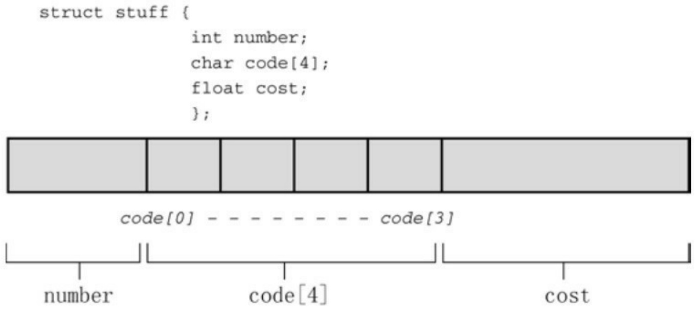
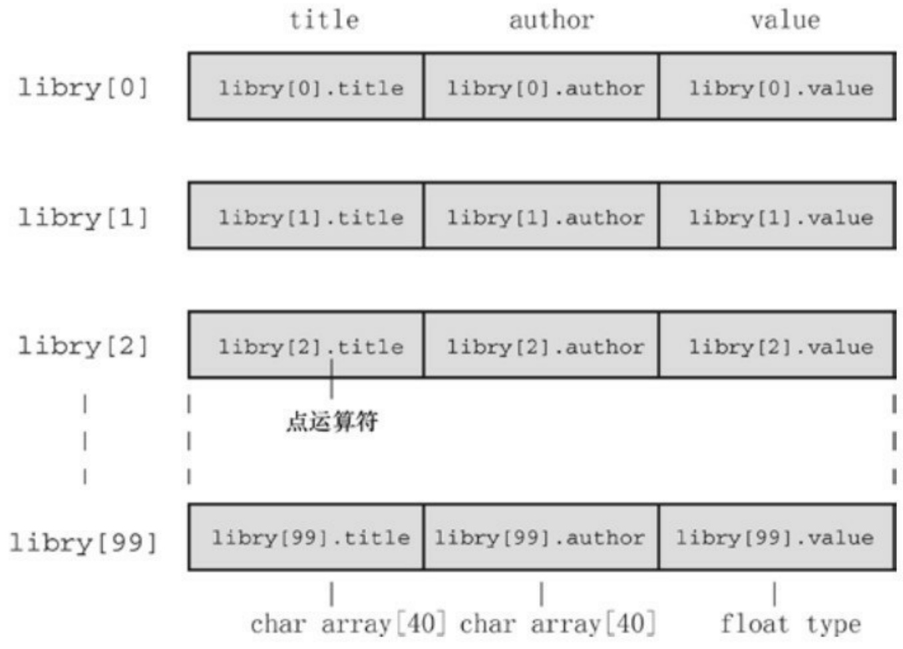

```c
if ((iofile = fopen(file, "wb")) == NULL)
{
fprintf(stderr, "Could not open %s for output.\n", file);
exit(EXIT_FAILURE);
}
// 以二进制格式把数组写入文件
fwrite(numbers, sizeof(double), ARSIZE, iofile);
fclose(iofile);
if ((iofile = fopen(file, "rb")) == NULL)
{
fprintf(stderr,
"Could not open %s for random access.\n", file);
exit(EXIT_FAILURE);
}
// 从文件中读取选定的内容
printf("Enter an index in the range 0-%d.\n", ARSIZE - 1);
while (scanf("%d", &i) == 1 && i >= 0 && i < ARSIZE)
{
pos = (long) i * sizeof(double);      // 计算偏移量
```

```txt
fseek(iofile, pos, SEEK_SET);          // 定位到此处
fread(&value, sizeof(double), 1, iofile);
printf("The value there is %f.\n", value);
printf("Next index (out of range to quit):\n");
}
// 完成
fclose(iofile);
puts("Bye!");
return 0;
}
```

首先，该程序创建了一个数组，并在该数组中存放了一些值。然后，程序以二进制模式创建了一个名为numbers.dat的文件，并使用fwrite()把数组中的内容拷贝到文件中。内存中数组的所有double类型值的位组合（每个位组合都是64位）都被拷贝至文件中。不能用文本编辑器读取最后的二进制文件，因为无法把文件中的值转换成字符串。然而，储存在文件中的每个值都与储存在内存中的值完全相同，没有损失任何精确度。此外，每个值在文件中也同样占用64位存储空间，所以可以很容易地计算出每个值的位置。

程序的第 2 部分用于打开待读取的文件，提示用户输入一个值的索引。程序通过把索引值和 double类型值占用的字节相乘，即可得出文件中的一个位置。然后，程序调用fseek()定位到该位置，用fread()读取该位置上的数据值。注意，这里并未使用转换说明。fread()从已定位的位置开始，拷贝8字节到内存中地址为&value的位置。然后，使用printf()显示value。下面是该程序的一个运行示例:

Enter an index in the range 0-999.

## 500

The value there is 50000.001996.

Next index (out of range to quit):

## 900

The value there is 90000.001110.

Next index (out of range to quit):

## 0

The value there is 1.000000.

Next index (out of range to quit):

## -1

Bye!

## 13.8 关键概念

C程序把输入看作是字节流，输入流来源于文件、输入设备（如键盘），或者甚至是另一个程序的输出。类似地，C程序把输出也看作是字节流，输出流的目的地可以是文件、视频显示等。

C 如何解释输入流或输出流取决于所使用的输入/输出函数。程序可以不做任何改动地读取和存储字节，或者把字节依次解释成字符，随后可以把这些字符解释成普通文本以用文本表示数字。类似地，对于输出，所使用的函数决定了二进制值是被原样转移，还是被转换成文本或以文本表示数字。如果要在不损失精度的前提下保存或恢复数值数据，请使用二进制模式以及fread()和fwrite()函数。如果打算保存文本信息并创建能在普通文本编辑器查看的文本，请使用文本模式和函数（如getc()和fprintf()）。

要访问文件，必须创建文件指针（类型是FILE \*）并把指针与特定文件名相关联。随后的代码就可以使用这个指针（而不是文件名）来处理该文件。

要重点理解C如何处理文件结尾。通常，用于读取文件的程序使用一个循环读取输入，直至到达文件结尾。C 输入函数在读过文件结尾后才会检测到文件结尾，这意味着应该在尝试读取之后立即判断是否是文件结尾。可以使用13.2.4节中“设计范例”中的双文件输入模式。

## 13.9 本章小结

对于大多数C程序而言，写入文件和读取文件必不可少。为此，绝大对数C实现都提供底层I/O和标准高级I/O。因为ANSI C库考虑到可移植性，包含了标准I/O包，但是未提供底层I/O。

标准 I/O 包自动创建输入和输出缓冲区以加快数据传输。fopen()函数为标准 I/O 打开一个文件，并创建一个用于存储文件和缓冲区信息的结构。fopen()函数返回指向该结构的指针，其他函数可以使用该指针指定待处理的文件。feof()和ferror()函数报告I/O操作失败的原因。

C把输入视为字节流。如果使用fread()函数，C把输入看作是二进制值并将其储存在指定存储位置。如果使用fscanf()、getc()、fgets()或其他相关函数，C则将每个字节看作是字符码。然后fscanf()和scanf()函数尝试把字符码翻译成转换说明指定的其他类型。例如，输入一个值23，%f转换说明会把23翻译成一个浮点值，%d转换说明会把23翻译成一个整数值，%s转换说明则会把23储存为字符串。getc()和 fgetc()系列函数把输入作为字符码储存，将其作为单独的字符保存在字符变量中或作为字符串储存在字符数组中。类似地，fwrite()将二进制数据直接放入输出流，而其他输出函数把非字符数据转换成用字符表示后才将其放入输出流。

ANSI C提供两种文件打开模式:二进制和文本。以二进制模式打开文件时，可以逐字节读取文件；以文本模式打开文件时，会把文件内容从文本的系统表示法映射为C表示法。对于UNIX和Linux系统，这两种模式完全相同。

通常，输入函数getc()、fgets()、fscanf()和fread()都从文件开始处按顺序读取文件。然而， fseek()和ftell()函数让程序可以随机访问文件中的任意位置。fgetpos()和fsetpos()把类似的功能扩展至更大的文件。与文本模式相比，二进制模式更容易进行随机访问。

## 13.10 复习题

复习题的参考答案在附录A中。

1.下面的程序有什么问题？

```c
int main(void)
{
int * fp;
int k;
fp = fopen("gelatin");
for (k = 0; k < 30; k++)
fputs(fp, "Nanette eats gelatin.");
fclose("gelatin");
return 0;
}
```

2.下面的程序完成什么任务？（假设在命令行环境中运行）

```c
#include <stdio.h>

#include <stdlib.h>

#include <ctype.h>

int main(int argc, char *argv [])
{
```

```c
int ch;

FILE *fp;

if (argc < 2)

exit(EXIT_FAILURE);

if ((fp = fopen(argv[1], "r")) == NULL)

exit(EXIT_FAILURE);

while ((ch = getc(fp)) != EOF)

if (isdigit(ch))

putchar(ch);

fclose(fp);

return 0;

}

3.假设程序中有下列语句:

#include <stdio.h>

FILE * fp1,* fp2;

char ch;

fp1 = fopen("terky", "r");

fp2 = fopen("jerky", "w");
```

另外，假设成功打开了两个文件。补全下面函数调用中缺少的参数:

```javascript
a.ch = getc();
b.fprintf( ,"%c\n", );
c.putc( , );
```

d.fclose(); /\* 关闭terky文件 \*/

4.编写一个程序，不接受任何命令行参数或接受一个命令行参数。如果有一个参数，将其解释为文件名；如果没有参数，使用标准输入（stdin）作为输入。假设输入完全是浮点数。该程序要计算和报告输入数字的算术平均值。
5.编写一个程序，接受两个命令行参数。第1个参数是字符，第2个参数是文件名。要求该程序只打印文件中包含给定字符的那些行。

注意

C程序根据'\n'识别文件中的行。假设所有行都不超过256个字符，你可能会想到用fgets()。

6.二进制文件和文本文件有何区别？二进制流和文本流有何区别？
7.

a.分别用fprintf()和fwrite()储存8238201有何区别？
b.分别用putc()和fwrite()储存字符S有何区别？
8.下面语句的区别是什么？

printf("Hello, %s\n", name);

fprintf(stdout, "Hello, %s\n", name);

fprintf(stderr, "Hello, %s\n", name);

9."a+"、"r+"和"w+"模式打开的文件都是可读写的。哪种模式更适合用来更改文件中已有的内容？

## 13.11 编程练习

1.修改程序清单13.1中的程序，要求提示用户输入文件名，并读取用户输入的信息，不使用命令行参数。

2.编写一个文件拷贝程序，该程序通过命令行获取原始文件名和拷贝文件名。尽量使用标准I/O和二进制模式。

3.编写一个文件拷贝程序，提示用户输入文本文件名，并以该文件名作为原始文件名和输出文件名。该程序要使用 ctype.h 中的 toupper()函数，在写入到输出文件时把所有文本转换成大写。使用标准I/O和文本模式。

4.编写一个程序，按顺序在屏幕上显示命令行中列出的所有文件。使用argc控制循环。

5.修改程序清单13.5中的程序，用命令行界面代替交互式界面。

6.使用命令行参数的程序依赖于用户的内存如何正确地使用它们。重写程序清单 13.2 中的程序，不使用命令行参数，而是提示用户输入所需信息。

7.编写一个程序打开两个文件。可以使用命令行参数或提示用户输入文件名。

a.该程序以这样的顺序打印:打印第1个文件的第1行，第2个文件的第1行，第1个文件的第2行，第2个文件的第2行，以此类推，打印到行数较多文件的最后一行。

b.修改该程序，把行号相同的行打印成一行。

8.编写一个程序，以一个字符和任意文件名作为命令行参数。如果字符后面没有参数，该程序读取标准输入；否则，程序依次打开每个文件并报告每个文件中该字符出现的次数。文件名和字符本身也要一同报告。程序应包含错误检查，以确定参数数量是否正确和是否能打开文件。如果无法打开文件，程序应报告这一情况，然后继续处理下一个文件。

9.修改程序清单 13.3 中的程序，从 1 开始，根据加入列表的顺序为每个单词编号。当程序下次运行时，确保新的单词编号接着上次的编号开始。
10.编写一个程序打开一个文本文件，通过交互方式获得文件名。通过一个循环，提示用户输入一个文件位置。然后该程序打印从该位置开始到下一个换行符之前的内容。用户输入负数或非数值字符可以结束输入循环。
11.编写一个程序，接受两个命令行参数。第1个参数是一个字符串，第2个参数是一个文件名。然后该程序查找该文件，打印文件中包含该字符串的所有行。因为该任务是面向行而不是面向字符的，所以要使用fgets()而不是getc()。使用标准C库函数strstr()（11.5.7节简要介绍过）在每一行中查找指定字符串。假设文件中的所有行都不超过255个字符。
12.创建一个文本文件，内含20行，每行30个整数。这些整数都在0～9之间，用空格分开。该文件是用数字表示一张图片，0～9表示逐渐增加的灰度。编写一个程序，把文件中的内容读入一个20×30的int数组中。一种把这些数字转换为图片的粗略方法是:该程序使用数组中的值初始化一个20×31的字符数组，用值0 对应空格字符，1 对应点字符，以此类推。数字越大表示字符所占的空间越大。例如，用#表示9。每行的最后一个字符（第31个）是空字符，这样该数组包含了20个字符串。最后，程序显示最终的图片（即，打印所有的字符串），并将结果储存在文本文件中。例如，下面是开始的数据:

$$
\begin{array}{l} 0 0 9 0 0 0 0 0 0 0 0 0 5 8 9 9 8 5 2 0 0 0 0 0 0 0 0 0 0 \\ 0 0 0 0 9 0 0 0 0 0 0 0 5 8 9 9 8 5 5 2 0 0 0 0 0 0 0 0 0 \\ 0 0 0 0 0 0 0 0 0 0 0 5 8 1 9 8 5 4 5 2 0 0 0 0 0 0 0 0 \\ 0 0 0 0 9 0 0 0 0 0 0 5 8 9 9 8 5 0 4 5 2 0 0 0 0 0 0 0 \\ 0 0 9 0 0 0 0 0 0 0 5 8 9 9 8 5 0 0 4 5 2 0 0 0 0 0 \end{array}
$$

| 0000000000000589185000452000000 |
| --- |
| 000000000000589985000045200000 |
| 55555555555558998555555555555 |
| 8888888888888589985888888888888 |
| 999909999999999999999939999999 |
| 8888888888888589985888888888888 |
| 55555555555558998555555555555 |
| 00000000000058998500000000000 |
| 000000000000589985000066000000 |
| 000022000000589985005600650000 |
| 000033000000589985056111165000 |
| 000044000000589985005600650000 |
| 000055000000589985000066000000 |
| 00000000000058998500000000000 |
| 00000000000058998500000000000 |

根据以上描述选择特定的输出字符，最终输出如下:

$$
\begin{array}{l} \# \quad * \% \#\#\% * ^ {\prime} \\ \# \quad * \% \#\#\% * *\' \\ * \%\ # \% * \sim *' \\ \# \quad * \% \#\#\% * \sim *\' \\ \# \quad * \% \#\#\% * \sim *\' \\ * \text{8}\#.\text{8} *\quad \sim *' \\ *\% \#\#\% * \quad \sim *' \\ \* * * * * * * * * * \% \#\# \% * * * * * *\*\*\* *\*\*\*\*\*\*\*\*\*\*\*\*\*\*\*\*\*\*\*\*\*\*\*\*\*\*\*\*\*\*\*\*\*\*\*\*\*\*\*\*\*\*\*\*\*\*\*\*\*\*\*\*\*\*\*\*\*\*\*\*\*\*\*\*\*\*\*\*\*\*\*\*\*\*\*\*\*\*\*\*\*\*\*\*\*\*\*\*\*\*\*\*\*\*\*\*\*\*\*\*\* * \\ \text \text \text \text \text * \% \#\# \% * \% \text \text \text \text \\ \# \# \# \# \quad \# \# \# \# \# \# \# \# \# \# \# \# \#: \# \# \# \# \#\# \\ \% \text \% \% \% \% \% \% \% * \% \#\# \% * \% \% \% \% \% \% \% \% \% \\ \ast \ast \ast \ast \ast \ast \ast \ast \ast \ast \% \# \# \% \ast \ast \ast \ast \ast \ast \ast \ast * \\ *\% \#\#\% * \\ *\%\#\#\%* \quad = = \\ \text {``} \quad * \% \# \# \% * \quad * = \quad = * \\ : : \quad * \% \# \# \% * \quad * = \dots = * \\ \sim \sim \quad * \% \# \# \% * \quad * = \quad = * \\ \begin{array}{c c c} \text {**} & * \% \# \# \% * & = = \\ \hline \end{array} \\ *\% \#\#\% * \\ *\% \#\#\% * \\ \end{array}
$$

13.用变长数组（VLA）代替标准数组，完成编程练习12。
14.数字图像，尤其是从宇宙飞船发回的数字图像，可能会包含一些失真。为编程练习12添加消除失真的函数。该函数把每个值与它上下左右相邻的值作比较，如果该值与其周围相邻值的差都大于1，则用所有相邻值的平均值（四舍五入为整数）代替该值。注意，与边界上的点相邻的点少于4个，所以做特殊处理。

<small><span class="docvortex-page-footnote" data-block-type="page_footnote" style="color:#6b7280">[1].注意，字符串大小和字符串长度不同。前者指该字符串占用多少空间，后者指该字符串的字符个数。——译者注</span></small>

# 第14章结构和其他数据形式

本章介绍以下内容:

关键字:struct、union、typedef

运算符:.、->

什么是C结构，如何创建结构模板和结构变量

如何访问结构的成员，如何编写处理结构的函数

联合和指向函数的指针

设计程序时，最重要的步骤之一是选择表示数据的方法。在许多情况下，简单变量甚至是数组还不够。为此，C提供了结构变量（structure variable）提高你表示数据的能力，它能让你创造新的形式。如果熟悉Pascal的记录（record），应该很容易理解结构。如果不懂Pascal也没关系，本章将详细介绍C结构。我们先通过一个示例来分析为何需要C结构，学习如何创建和使用结构。

## 14.1 示例问题:创建图书目录

Gwen Glenn要打印一份图书目录。她想打印每本书的各种信息:书名、作者、出版社、版权日期、页数、册数和价格。其中的一些项目（如，书名)可以储存在字符数组中，其他项目需要一个int数组或float数组。用 7 个不同的数组分别记录每一项比较繁琐，尤其是 Gwen 还想创建多份列表:一份按书名排序、一份按作者排序、一份按价格排序等。如果能把图书目录的信息都包含在一个数组里更好，其中每个元素包含一本书的相关信息。

因此，Gwen需要一种即能包含字符串又能包含数字的数据形式，而且还要保持各信息的独立。C结构就满足这种情况下的需求。我们通过一个示例演示如何创建和使用数组。但是，示例进行了一些限制。第一，该程序示例演示的书目只包含书名、作者和价格。第二，只有一本书的数目。当然，别忘了这只是进行了限制，我们在后面将扩展该程序。请看程序清单14.1及其输出，然后阅读后面的一些要点。

程序清单**14.1 book.c**程序

//\* book.c -- 一本书的图书目录 \*/

#include &lt;stdio.h&gt;

#include &lt;string.h&gt;

char \* s\_gets(char \* st, int n);

#define MAXTITL 41 /\* 书名的最大长度 + 1 \*/

#define MAXAUTL 31 /\* 作者姓名的最大长度 + 1\*/

struct book { /\* 结构模版:标记是 book \*/

char title[MAXTITL];

```c
char author[MAXAUTL];
float value;
}; /* 结构模版结束 */
int main(void)
{
struct book library; /* 把 library 声明为一个 book 类型的变量 */
printf("Please enter the book title.\n");
s_gets(library.title, MAXTITLE); /* 访问title部分*/
printf("Now enter the author.\n");
s_gets(library.author, MAXAUTL);
printf("Now enter the value.\n");
scanf("%f", &library.value);
printf("%s by %s: $%.2f\n", library.title,
library.author, library.value);
printf("%s: \"%s\" ($%.2f)\n", library.author,
library.title, library.value);
printf("Done.\n");
return 0;
}
```

```c
char * s_gets(char * st, int n)
{
char * ret_val;
char * find;
ret_val = fgets(st, n, stdin);
if (ret_val)
{
find = strchr(st, '\n'); // 查找换行符
if (find) // 如果地址不是 NULL,
*find = '\0'; // 在此处放置一个空字符
else
while (getchar() != '\n')
continue; //处理输入行中剩余的字符
}
return ret_val;
}
```

我们使用前面章节中介绍的s\_gets()函数去掉fgets()储存在字符串中的换行符。下面是该例的一个运行示例:

Please enter the book title.

## Chicken of the Andes

Now enter the author.

## Disma Lapoult

Now enter the value.

## 29.99

Chicken of the Andes by Disma Lapoult: \$29.99

Disma Lapoult: "Chicken of the Andes" (\$29.99)

## Done.

程序清单14.1中创建的结构有3部分，每个部分都称为成员（member）或字段（field）。这3部分中，一部分储存书名，一部分储存作者名，一部分储存价格。下面是必须掌握的3个技巧:

为结构建立一个格式或样式；

声明一个适合该样式的变量；

访问结构变量的各个部分。

## 14.2 建立结构声明

结构声明（structure declaration）描述了一个结构的组织布局。声明类似下面这样:

```txt
struct book {

char title[MAXTITL];

char author[MAXAUTL];

float value;

};
```

该声明描述了一个由两个字符数组和一个float类型变量组成的结构。该声明并未创建实际的数据对象，只描述了该对象由什么组成。〔有时，我们把结构声明称为模板，因为它勾勒出结构是如何储存数据的。如果读者知道C++的模板，此模板非彼模板，C++中的模板更为强大。〕我们来分析一些细节。首先是关键字 struct，它表明跟在其后的是一个结构，后面是一个可选的标记（该例中是 book），稍后程序中可以使用该标记引用该结构。所以，我们在后面的程序中可以这样声明:

struct book library;

这把library声明为一个使用book结构布局的结构变量。

在结构声明中，用一对花括号括起来的是结构成员列表。每个成员都用自己的声明来描述。例如，title部分是一个内含MAXTITL个元素的char类型数组。成员可以是任意一种C的数据类型，甚至可以是其他结构！右花括号后面的分号是声明所必需的，表示结构布局定义结束。可以把这个声明放在所有函数的外部（如本例所示），也可以放在一个函数定义的内部。如果把结构声明置于一个函数的内部，它的标记就只限于该函数内部使用。如果把结构声明置于函数的外部，那么该声明之后的所有函数都能使用它的标记。

例如，在程序的另一个函数中，可以这样声明:

struct book dickens;

这样，该函数便创建了一个结构变量dickens，该变量的结构布局是book。

结构的标记名是可选的。但是以程序示例中的方式建立结构时（在一处定义结构布局，在另一处定义实际的结构变量），必须使用标记。我们学完如何定义结构变量后，再来看这一点。

## 14.3 定义结构变量

结构有两层含义。一层含义是“结构布局”，刚才已经讨论过了。结构布局告诉编译器如何表示数据，但是它并未让编译器为数据分配空间。下一步是创建一个结构变量，即是结构的另一层含义。程序中创建结构变量的一行是:

struct book library;

编译器执行这行代码便创建了一个结构变量library。编译器使用book模板为该变量分配空间:一个内含MAXTITL个元素的char数组、一个内含MAXAUTL个元素的char数组和一个float类型的变量。这些存储空间都与一个名称library结合在一起（见图14.1）。

在结构变量的声明中，struct book所起的作用相当于一般声明中的int或float。例如，可以定义两个struct book类型的变量，或者甚至是指向struct book类型结构的指针:

struct book doyle, panshin, \* ptbook;



<details>
<summary>text_image</summary>

struct stuff {
    int number;
    char code[4];
    float cost;
};

code[0] - - - - - - - - - - - - - - - - - - - - - - - - - - - - - - - - - - - - - - - - - - - - - - -
number
code[4]
cost
</details>

图14.1 一个结构的内存分配

结构变量doyle和panshin中都包含title、author和value部分。指针ptbook可以指向doyle、panshin或任何其他book类型的结构变量。从本质上看，book结构声明创建了一个名为struct book的新类型。

就计算机而言，下面的声明:

struct book library;

是以下声明的简化:

struct book {

char title[MAXTITL];

char author[AXAUTL];

float value;

} library; /\* 声明的右右花括号后跟变量名\*/

换言之，声明结构的过程和定义结构变量的过程可以组合成一个步骤。如下所示，组合后的结构声明和结构变量定义不需要使用结构标记:

struct { /\* 无结构标记 \*/

char title[MAXTITL];

char author[MAXAUTL];

float value;

} library;

然而，如果打算多次使用结构模板，就要使用带标记的形式；或者，使用本章后面介绍的typedef。

这是定义结构变量的一个方面，在这个例子中，并未初始化结构变量。

## 14.3.1 初始化结构

初始化变量和数组如下:

int count = 0;

int fibo[7] = {0,1,1,2,3,5,8};

结构变量是否也可以这样初始化？是的，可以。初始化一个结构变量（ANSI之前，不能用自动变量初始化结构；ANSI之后可以用任意存储类别）与初始化数组的语法类似:

struct book library = {

"The Pious Pirate and the Devious Damsel",

"Renee Vivotte",

1.95

};

简而言之，我们使用在一对花括号中括起来的初始化列表进行初始化，各初始化项用逗号分隔。因此， title成员可以被初始化为一个字符串，value成员可以被初始化为一个数字。为了让初始化项与结构中各成员的关联更加明显，我们让每个成员的初始化项独占一行。这样做只是为了提高代码的可读性，对编译器而言，只需要用逗号分隔各成员的初始化项即可。

## 注意初始化结构和类别储存期

第12章中提到过，如果初始化静态存储期的变量（如，静态外部链接、静态内部链接或静态无链接），必须使用常量值。这同样适用于结构。如果初始化一个静态存储期的结构，初始化列表中的值必须是常量表达式。如果是自动存储期，初始化列表中的值可以不是常量。

## 14.3.2 访问结构成员

结构类似于一个“超级数组”，这个超级数组中，可以是一个元素为char类型，下一个元素为forat类型，下一个元素为int数组。可以通过数组下标单独访问数组中的各元素，那么，如何访问结构中的成员？使用结构成员运算符——点（.）访问结构中的成员。例如，library.value即访问library的value部分。可以像使用任何float类型变量那样使用library.value。与此类似，可以像使用字符数组那样使用 library.title。因此，程序清单 14.1 中的程序中有s\_gets(library.title, MAXTITL);和scanf("%f", &library.value);这样的代码。

本质上，.title、.author和.value的作用相当于book结构的下标。

注意，虽然library是一个结构，但是library.value是一个float类型的变量，可以像使用其他 float 类型变量那样使用它。例如，scanf("%f",...)需要一个 float 类型变量的地址，而&library.float正好符合要求。.比&的优先级高，因此这个表达式和&(library.float)一样。

如果还有一个相同类型的结构变量，可以用相同的方法:

struct book bill, newt;

s\_gets(bill.title, MAXTITL);

s\_gets(newt.title, MAXTITL);

.title 引用 book 结构的第 1 个成员。注意，程序清单 14.1 中的程序以两种不同的格式打印了library结构变量中的内容。这说明可以自行决定如何使用结构成员。

## 14.3.3 结构的初始化器

C99和C11为结构提供了指定初始化器（designated initializer）[1]，其语法与数组的指定初始化器类似。但是，结构的指定初始化器使用点运算符和成员名（而不是方括号和下标）标识特定的元素。例如，只初始化book结构

的value成员，可以这样做:

```javascript
struct book surprise = { .value = 10.99};
```

可以按照任意顺序使用指定初始化器:

```txt
struct book gift = { .value = 25.99,
```

```python
.author = "James Broadfool",
```

```txt
.title = "Rue for the Toad"};
```

与数组类似，在指定初始化器后面的普通初始化器，为指定成员后面的成员提供初始值。另外，对特定成员的最后一次赋值才是它实际获得的值。例如，考虑下面的代码:

```txt
struct book gift= {.value = 18.90,
```

```txt
.author = "Philionna Pestle",
```

```txt
0.25};
```

赋给value的值是0.25，因为它在结构声明中紧跟在author成员之后。新值0.25取代了之前的18.9。在学习了结构的基本知识后，可以进一步了解结构的一些相关类型。

## 14.4 结构数组

接下来，我们要把程序清单14.1的程序扩展成可以处理多本书。显然，每本书的基本信息都可以用一个 book 类型的结构变量来表示。为描述两本书，需要使用两个变量，以此类推。可以使用这一类型的结构数组来处理多本书。在下一个程序中（程序清单 14.2）就创建了一个这样的数组。如果你使用 Borland C/C++，请参阅本节后面的“Borland C和浮点数”。

## 结构和内存

manybook.c程序创建了一个内含100个结构变量的数组。由于该数组是自动存储类别的对象，其中的信息被储存在栈（stack）中。如此大的数组需要很大一块内存，这可能会导致一些问题。如果在运行时出现错误，可能抱怨栈大小或栈溢出，你的编译器可能使用了一个默认大小的栈，这个栈对于该例而言太小。要修正这个问题，可以使用编译器选项设置栈大小为10000，以容纳这个结构数组；或者可以创建静态或外部数组（这样，编译器就不会把数组放在栈中）；或者可以减小数组大小为16。为何不一开始就使用较小的数组？这是为了让读者意识到栈大小的潜在问题，以便今后再遇到类似的问题，可以自己处理好。

程序清单14.2 manybook.c程序

```c
/* manybook.c -- 包含多本书的图书目录 */
#include <stdio.h>
#include <string.h>
char * s_gets(char * st, int n);
#define MAXTITL 40
#define MAXAUTL 40
```

```c
#define MAXBKS 100 /* 书籍的最大数量 */
struct book { /* 简历 book 模板 */
char title[MAXTITL];
char author[MAXAUTL];
float value;
};
int main(void)
{
struct book library[MAXBKS]; /* book 类型结构的数组 */
int count = 0;
int index;
printf("Please enter the book title.\n");
printf("Press [enter] at the start of a line to stop.\n");
while (count < MAXBKS && s_gets(library[count].title, MAXTITL) != NULL
&& library[count].title[0] != '\0')
{
printf("Now enter the author.\n");
s_gets(library[count].author, MAXAUTL);
```

```c
printf("Now enter the value.\n");
scanf("%f", &library[count++].value);
while (getchar() != '\n')
continue;      /* 清理输入行*/
if (count < MAXBKS)
printf("Enter the next title.\n");
}
if (count > 0)
{
printf("Here is the list of your books:\n");
for (index = 0; index < count; index++)
printf("%s by %s: \$%.2f\n", library[index].title,
library[index].author, library[index].value);
}
else
printf("No books? Too bad.\n");
return 0;
}
char * s_gets(char * st, int n)
```

```txt
{
char * ret_val;
char * find;
ret_val = fgets(st, n, stdin);
if (ret_val)
{
find = strchr(st, '\n'); // 查找换行符
if (find) // 如果地址不是 NULL,
*find = '\0'; // 在此处放置一个空字符
else
while (getchar() != '\n')
continue; // 处理输入行中剩余的字符
}
return ret_val;
}
下面是该程序的一个输出示例:
Please enter the book title.
Press [enter] at the start of a line to stop.
My Life as a Budgie
```

Now enter the author.

## Mack Zackles

Now enter the value.

## 12.95

Enter the next title.

...（此处省略了许多内容）...

Here is the list of your books:

My Life as a Budgie by Mack Zackles: \$12.95

Thought and Unthought Rethought by Kindra Schlagmeyer: \$43.50

Concerto for Financial Instruments by Filmore Walletz: \$49.99

The CEO Power Diet by Buster Downsize: \$19.25

C++ Primer Plus by Stephen Prata: \$59.99

Fact Avoidance: Perception as Reality by Polly Bull: \$19.97

Coping with Coping by Dr.Rubin Thonkwacker: \$0.02

Diaphanous Frivolity by Neda McFey: \$29.99

Murder Wore a Bikini by Mickey Splats: \$18.95

A History of Buvania, Volume 8, by Prince Nikoli Buvan: \$50.04

Mastering Your Digital Watch, 5nd Edition, by Miklos Mysz: \$28.95

A Foregone Confusion by Phalty Reasoner: \$5.99

## Borland C和浮点数

如果程序不使用浮点数，旧式的Borland C编译器会尝试使用小版本的scanf()来压缩程序。然而，如果在一个结构数组中只有一个浮点值（如程序清单14.2中那样），那么这种编译器（DOS的Borland C/C++ 3.1之前的版本，不是Borland C/C++ 4.0）就无法发现它存在。结果，编译器会生成如下消息:

scanf : floating point formats not linked

Abnormal program termination

一种解决方案是，在程序中添加下面的代码:

#include &lt;math.h&gt;

double dummy = sin(0.0);

这段代码强制编译器载入浮点版本的scanf()。

首先，我们学习如何声明结构数组和如何访问数组中的结构成员。然后，着重分析该程序的两个方面。

## 14.4.1 声明结构数组

声明结构数组和声明其他类型的数组类似。下面是一个声明结构数组的例子:

struct book library[MAXBKS];

以上代码把library声明为一个内含MAXBKS个元素的数组。数组的每个元素都是一个book类型的数组。因此，library[0]是第1个book类型的结构变量，library[1]是第2个book类型的结构变量，以此类推。参看图14.2 可以帮助读者理解。数组名library本身不是结构名，它是一个数组名，该数组中的每个元素都是struct book类型的结构变量。



<details>
<summary>flowchart</summary>

```mermaid
graph LR
  subgraph Library_0 ["libry[0]"]
  Title["&quot;libry[0"].title"] --> Author["&quot;libry[0"].author"]
  Author --> Value["&quot;libry[0"].value"]
  end

  subgraph Library_1 ["libry[1]"]
  Title["&quot;libry[1"].title"] --> Author["&quot;libry[1"].author"]
  Author --> Value["&quot;libry[1"].value"]
  end

  subgraph Library_2 ["libry[2]"]
  Title["&quot;libry[2"].title"] --> Author["&quot;libry[2"].author"]
  Author --> Value["&quot;libry[2"].value"]
  end

  subgraph Library_99 ["libry[99]"]
  Title["&quot;libry[99"].title"] --> Author["&quot;libry[99"].author"]
  Author --> Value["&quot;libry[99"].value"]
  end

  %% Points at Library_2
  "Point运算符" (pointing to all layers) is highlighted in the middle section of the Library_2 layer.
```
</details>

图14.2 一个结构数组library[MAXBKS]

## 14.4.2 标识结构数组的成员

为了标识结构数组中的成员，可以采用访问单独结构的规则:在结构名后面加一个点运算符，再在点运算符后面写上成员名。如下所示:

library[0].value /\* 第1个数组元素与value 相关联 \*/

library[4].title /\* 第5个数组元素与title 相关联 \*/

注意，数组下标紧跟在library后面，不是成员名后面:

library.value[2] // 错误

library[2].value // 正确