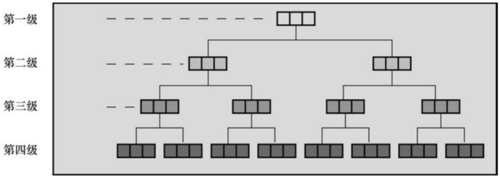
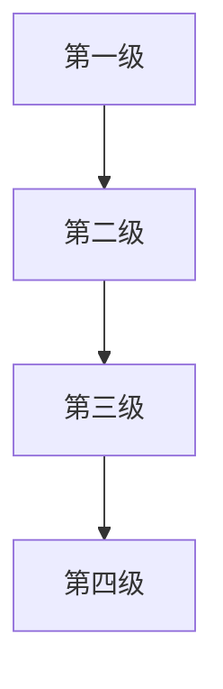

// 分配内存以储存名

```c
pst->fname = (char *) malloc(strlen(temp) + 1);
```

// 把名拷贝到动态分配的内存中

```txt
strcpy(pst->fname, temp);
```

```lisp
printf("Please enter your last name.\n");
```

```txt
s_gets(temp, SLEN);
```

```c
pst->lname = (char *) malloc(strlen(temp) + 1);
```

```txt
strcpy(pst->lname, temp);
```

```txt
}
```

```txt
void makeinfo(struct namect * pst)
```

```txt
{
```

```txt
pst->letters = strlen(pst->fname) +
```

```txt
strlen(pst->lname);
```

```txt
}
```

```txt
void showinfo(const struct namect * pst)
```

```txt
{
```

```txt
printf("%s %s, your name contains %d letters.\n",
```

```txt
pst->fname, pst->lname, pst->letters);
```

```txt
}
```

```c
void cleanup(struct namect * pst)
{
free(pst->fname);
free(pst->lname);
}
char * s_gets(char * st, int n)
{
char * ret_val;
char * find;
ret_val = fgets(st, n, stdin);
if (ret_val)
{
find = strchr(st, '\n');    // 查找换行符
if (find)                      // 如果地址不是 NULL,
*find = '\0';          // 在此处放置一个空字符
else
while (getchar() != '\n')
continue;             // 处理输入行的剩余部分
}
```

```lua
return ret_val;

}
```

下面是该程序的输出:

Please enter your first name.

## Floresiensis

Please enter your last name.

## Mann

Floresiensis Mann, your name contains 16 letters.

## 14.7.8 复合字面量和结构（C99）

C99 的复合字面量特性可用于结构和数组。如果只需要一个临时结构值，复合字面量很好用。例如，可以使用复合字面量创建一个数组作为函数的参数或赋给另一个结构。语法是把类型名放在圆括号中，后面紧跟一个用花括号括起来的初始化列表。例如，下面是struct book类型的复合字面量:

(struct book) {"The Idiot", "Fyodor Dostoyevsky", 6.99}

程序清单14.11中的程序示例，使用复合字面量为一个结构变量提供两个可替换的值（在撰写本书时，并不是所有的编译器都支持这个特性，不过这是时间的问题）。

程序清单**14.11 complit.c**程序

/\* complit.c -- 复合字面量 \*/

#include &lt;stdio.h&gt;

#define MAXTITL 41

#define MAXAUTL 31

```txt
struct book {          // 结构模版: 标记是 book
char title[MAXITL];
char author[MAXAUTL];
float value;
};
int main(void)
{
struct book readfirst;
int score;
printf("Enter test score: ");
scanf("%d", &score);
if (score >= 84)
readfirst = (struct book) {"Crime and Punishment",
"Fyodor Dostoyevsky",
11.25};
else
readfirst = (struct book) {"Mr.Bouncy's Nice Hat",
"Fred Winsome",
```

```txt
5.99};
printf("Your assigned reading:\n");
printf("%s by %s: \$%.2f\n", readfirst.title,
readfirst.author, readfirst.value);
return 0;
}
```

还可以把复合字面量作为函数的参数。如果函数接受一个结构，可以把复合字面量作为实际参数传递:

```c
struct rect {double x; double y;}
double rect_area(struct rect r){return r.x * r.y;}
...
double area;
area = rect_area( (struct rect) {10.5, 20.0});
值210被赋给area。
```

如果函数接受一个地址，可以传递复合字面量的地址:

```c
struct rect {double x; double y;}
double rect_areap(struct rect * rp) {return rp->x * rp->y;}
...
double area;
```

```javascript
area = rect_areap( &(struct rect) {10.5, 20.0});
```

值210被赋给area。

复合字面量在所有函数的外部，具有静态存储期；如果复合字面量在块中，则具有自动存储期。复合字面量和普通初始化列表的语法规则相同。这意味着，可以在复合字面量中使用指定初始化器。

## 14.7.9 伸缩型数组成员（C99）

C99新增了一个特性:伸缩型数组成员（flexible array member），利用这项特性声明的结构，其最后一个数组成员具有一些特性。第1个特性是，该数组不会立即存在。第2个特性是，使用这个伸缩型数组成员可以编写合适的代码，就好像它确实存在并具有所需数目的元素一样。这可能听起来很奇怪，所以我们来一步步地创建和使用一个带伸缩型数组成员的结构。

首先，声明一个伸缩型数组成员有如下规则:

伸缩型数组成员必须是结构的最后一个成员；

结构中必须至少有一个成员；

伸缩数组的声明类似于普通数组，只是它的方括号中是空的。

下面用一个示例来解释以上几点:

```c
struct flex
{
int count;

double average;

double scores[];  // 伸缩型数组成员
```

声明一个struct flex类型的结构变量时，不能用scores做任何事，因为没有给这个数组预留存储空间。实际上，C99的意图并不是让你声明struct flex类型的变量，而是希望你声明一个指向struct flex类型的指针，然后用malloc()来分配足够的空间，以储存struct flex类型结构的常规内容和伸缩型数组成员所需的额外空间。例如，假设用scores表示一个内含5个double类型值的数组，可以这样做:

struct flex \* pf; // 声明一个指针

// 请求为一个结构和一个数组分配存储空间

$$
\mathrm{pf} = \text {malloc(sizeof(struct flex)} + 5 * \text {sizeof(double));}
$$

现在有足够的存储空间储存count、average和一个内含5个double类型值的数组。可以用指针pf访问这些成员:

程序清单14.13进一步扩展了这个例子，让伸缩型数组成员在第1种情况下表示5个值，在第2种情况下代表9个值。该程序也演示了如何编写一个函数处理带伸缩型数组元素的结构。

程序清单**14.12 flexmemb.c**程序

// flexmemb.c -- 伸缩型数组成员（C99新增特性）

```c
#include <stdio.h>

#include <stdlib.h>

struct flex
```

```c
{
size_t count;
double average;
double scores []; // 伸缩型数组成员
};
void showFlex(const struct flex * p);
int main(void)
{
struct flex * pf1, *pf2;
int n = 5;
int i;
int tot = 0;
// 为结构和数组分配存储空间
pfl = malloc(sizeof(struct flex) + n * sizeof(double));
pfl->count = n;
for (i = 0; i < n; i++)
{
pfl->scores[i] = 20.0 - i;
tot += pfl->scores[i];
```

```c
}
pf1->average = tot / n;
showFlex(pf1);
n = 9;
tot = 0;
pf2 = malloc(sizeof(struct flex) + n * sizeof(double));
pf2->count = n;
for (i = 0; i < n; i++)
{
pf2->scores[i] = 20.0 - i / 2.0;
tot += pf2->scores[i];
}
pf2->average = tot / n;
showFlex(pf2);
free(pf1);
free(pf2);
return 0;
}
void showFlex(const struct flex * p)
```

```txt
{
int i;

printf("Scores : ");
for (i = 0; i < p->count; i++)
printf("%g ", p->scores[i]);
printf("\nAverage: %g\n", p->average);
}
```

下面是该程序的输出:

Scores : 20 19 18 17 16

Average: 18

Scores : 20 19.5 19 18.5 18 17.5 17 16.5 16

Average: 17

带伸缩型数组成员的结构确实有一些特殊的处理要求。第一，不能用结构进行赋值或拷贝:

struct flex \* pf1, \*pf2; // \*pf1 和\*pf2 都是结构

...

\*pf2 = \*pf1; // 不要这样做

这样做只能拷贝除伸缩型数组成员以外的其他成员。确实要进行拷贝，应使用memcpy()函数（第16章中介绍）。

第二，不要以按值方式把这种结构传递给结构。原因相同，按值传递

个参数与赋值类似。要把结构的地址传递给函数。

第三，不要使用带伸缩型数组成员的结构作为数组成员或另一个结构的成员。

这种类似于在结构中最后一个成员是伸缩型数组的情况，称为struct hack。除了伸缩型数组成员在声明时用空的方括号外，struct hack特指大小为0的数组。然而，struct hack是针对特殊编译器（GCC）的，不属于C标准。这种伸缩型数组成员方法是标准认可的编程技巧。

## 14.7.10 匿名结构（C11）

匿名结构是一个没有名称的结构成员。为了理解它的工作原理，我们先考虑如何创建嵌套结构:

```c
struct names
{
char first[20];
char last[20];
};
struct person
{
int id;
struct names name;// 嵌套结构成员
};
struct person ted = {8483, {"Ted", "Grass"}};
```

这里，name成员是一个嵌套结构，可以通过类似ted.name.first的表达式访问"ted":

```txt
puts(ted.name.first);
```

在C11中，可以用嵌套的匿名成员结构定义person:

```txt
struct person
{
int id;
struct {char first[20]; char last[20];}; // 匿名结构
};
```

初始化ted的方式相同:

```txt
struct person ted = {8483, {"Ted", "Grass"}};
```

但是，在访问ted时简化了步骤，只需把first看作是person的成员那样使用它:

```txt
puts(ted.first);
```

当然，也可以把first和last直接作为person的成员，删除嵌套循环。匿名特性在嵌套联合中更加有用，我们在本章后面介绍。

## 14.7.11 使用结构数组的函数

假设一个函数要处理一个结构数组。由于数组名就是该数组的地址，所以可以把它传递给函数。另外，该函数还需访问结构模板。为了理解该函数的工作原理，程序清单14.13把前面的金融程序扩展为两人，所以需要一个内含两个funds结构的数组。

程序清单14.13 funds4.c程序

/\* funds4.c -- 把结构数组传递给函数 \*/

```c
#include <stdio.h>
```

```c
#define FUNDLEN 50
```

```txt
#define N 2
```

```txt
struct funds {
```

```txt
char bank[FUNDLEN];
```

```vhdl
double bankfund;
```

```txt
char save[FUNDLEN];
```

```vhdl
double savefund;
```

```txt
};
```

```txt
double sum(const struct funds money [], int n);
```

```txt
int main(void)
```

```txt
{
```

```txt
struct funds jones[N] = {
```

```txt
{
```

```txt
"Garlic-Melon Bank",
```

```txt
4032.27,
```

```txt
"Lucky's Savings and Loan",
```

```c
8543.94
},
{
"Honest Jack's Bank",
3620.88,
"Party Time Savings",
3802.91
}
};
printf("The Joneses have a total of \$%.2f.\n",sum(jones, N));
return 0;
}
double sum(const struct funds money [], int n)
{
double total;
int i;
for (i = 0, total = 0; i < n; i++)
total += money[i].bankfund + money[i].savefund;
return(total);
```

}

该程序的输出如下:

The Joneses have a total of \$20000.00.

（读者也许认为这个总和有些巧合！）

数组名jones是该数组的地址，即该数组首元素（jones[0]）的地址。因此，指针money的初始值相当于通过下面的表达式获得:

$$
\text {money} = \& \text {jones} [ 0 ];
$$

因为money指向jones数组的首元素，所以money[0]是该数组的另一个名称。与此类似，money[1]是第2个元素。每个元素都是一个funds类型的结构，所以都可以使用点运算符（.）来访问funds类型结构的成员。

下面是几个要点。

可以把数组名作为数组中第1个结构的地址传递给函数。

然后可以用数组表示法访问数组中的其他结构。注意下面的函数调用与使用数组名效果相同:

$$
\mathrm{sum} (\& \text {jones} [ 0 ], \mathrm{N})
$$

因为jones和&jones[0]的地址相同，使用数组名是传递结构地址的一种间接的方法。

由于sum()函数不能改变原始数据，所以该函数使用了ANSI C的限定符const。

## 14.8 把结构内容保存到文件中

由于结构可以储存不同类型的信息，所以它是构建数据库的重要工具。例如，可以用一个结构储存雇员或汽车零件的相关信息。最终，我们要把这些信息储存在文件中，并且能再次检索。数据库文件可以包含任意数量的此类数据对象。储存在一个结构中的整套信息被称为记录（record），单独的项被称为字段（field）。本节我们来探讨这个主题。

或许储存记录最没效率的方法是用fprintf()。例如，回忆程序清单14.1中的book结构:

```c
#define MAXTITL 40

#define MAXAUTL 40

struct book {

char title[MAXTITL];

char author[MAXAUTL];

float value;

};
```

如果pbook标识一个文件流，那么通过下面这条语句可以把信息储存在struct book类型的结构变量primer中:

fprintf(pbooks, "%s %s %.2f\n", primer.title,primer.author, primer.value);

对于一些结构（如，有 30 个成员的结构），这个方法用起来很不方便。另外，在检索时还存在问题，因为程序要知道一个字段结束和另一个字段开始的位置。虽然用固定字段宽度的格式可以解决这个问题（例如，"%39s%39s%8.2f"），但是这个方法仍然很笨拙。

更好的方案是使用fread()和fwrite()函数读写结构大小的单元。回忆一下，这两个函数使用与程序相同的二进制表示法。例如:

fwrite(&primer, sizeof(struct book), 1, pbooks);

定位到 primer 结构变量开始的位置，并把结构中所有的字节都拷贝到与 pbooks 相关的文件中。sizeof(struct book)告诉函数待拷贝的一块数据的大小，1 表明一次拷贝一块数据。带相同参数的fread()函数从文件中拷贝一块结构大小的数据到&primer指向的位置。简而言之，这两个函数一次读写整个记录，而不是一个字段。

以二进制表示法储存数据的缺点是，不同的系统可能使用不同的二进制表示法，所以数据文件可能不具可移植性。甚至同一个系统，不同编译器设置也可能导致不同的二进制布局。

## 14.8.1 保存结构的程序示例

为了演示如何在程序中使用这些函数，我们把程序清单14.2修改为一个新的版本（即程序清单14.14），把书名保存在book.dat文件中。如果该文件已存在，程序将显示它当前的内容，然后允许在文件中添加内容（如果你使用的是早期的Borland编译器，请参阅程序清单14.2后面的“Borland C和浮点数”）。

程序清单**14.14 booksave.c**程序

/\* booksave.c -- 在文件中保存结构中的内容 \*/

#include &lt;stdio.h&gt;

#include &lt;stdlib.h&gt;

#include &lt;string.h&gt;

#define MAXTITL 40

#define MAXAUTL 40

#define MAXBKS 10

/\* 最大书籍数量 \*/

char \* s\_gets(char \* st, int n);

struct book { /\* 建立 book 模板 \*/

char title[MAXTITL];

char author[MAXAUTL];

float value;

int main(void)

{

struct book library[MAXBKS]; /\* 结构数组 \*/

int count = 0;

int index, filecount;

FILE \* pbooks;

int size = sizeof(struct book);

if ((pbooks = fopen("book.dat", "a+b")) == NULL)

{

fputs("Can't open book.dat file\n", stderr);

exit(1);

```prolog
}
rewind(pbooks);          /* 定位到文件开始 */
while (count < MAXBKS &&  fread(&library[count], size,
1, pbooks) == 1)
{
if (count == 0)
puts("Current contents of book.dat:");
printf("%s by %s: \$%.2f\n", library[count].title,
library[count].author, library[count].value);
count++;
}
filecount = count;
if (count == MAXBKS)
{
fputs("The book.dat file is full.", stderr);
exit(2);
}
puts("Please add new book titles.");
puts("Press [enter] at the start of a line to stop.");
```

while (count < MAXBKS && s\_gets(library[count].title, MAXTITL) != NULL

```txt
&& library[count].title[0] != '\0')
{
puts("Now enter the author.");
s_gets(library[count].author, MAXAUTL);
puts("Now enter the value.");
scanf("%f", &library[count++].value);
while (getchar() != '\n')
continue;          /* 清理输入行 */
if (count < MAXBKS)
puts("Enter the next title.");
}
if (count > 0)
{
puts("Here is the list of your books:");
for (index = 0; index < count; index++)
printf("%s by %s: \$%.2f\n", library[index].title,
library[index].author, library[index].value);
```

fwrite(&library[filecount], size, count - filecount,

pbooks);

}

else

puts("No books? Too bad.\n");

puts("Bye.\n");

fclose(pbooks);

return 0;

}

char \* s\_gets(char \* st, int n)

{

char \* ret\_val;

char \* find;

ret\_val = fgets(st, n, stdin);

if (ret\_val)

find = strchr(st, '\n'); // 查找换行符

if (find) // 如果地址不是 NULL，

\*find = '\0'; // 在此处放置一个空字符

else

while (getchar() != '\n')

continue; // 清理输入行

}

return ret\_val;

}

我们先看几个运行示例，然后再讨论程序中的要点。

\$ booksave

Please add new book titles.

Press [enter] at the start of a line to stop.

## Metric Merriment

Now enter the author.

## Polly Poetica

Now enter the value.

## 18.99

Enter the next title.

## Deadly Farce

Now enter the author.

## Dudley Forse

Now enter the value.

## 15.99

Enter the next title.

## [enter]

Here is the list of your books:

Metric Merriment by Polly Poetica: \$18.99

Deadly Farce by Dudley Forse: \$15.99

Bye.

\$ booksave

Current contents of book.dat:

Metric Merriment by Polly Poetica: \$18.99

Deadly Farce by Dudley Forse: \$15.99

Please add new book titles.

## The Third Jar

Now enter the author.

## Nellie Nostrum

Now enter the value.

## 22.99

Enter the next title.

## [enter]

Here is the list of your books:

Metric Merriment by Polly Poetica: \$18.99

Deadly Farce by Dudley Forse: \$15.99

The Third Jar by Nellie Nostrum: \$22.99

Bye.

\$

再次运行booksave.c程序把这3本书作为当前的文件记录打印出来。

## 14.8.2 程序要点

首先，以"a+b"模式打开文件。a+部分允许程序读取整个文件并在文件的末尾添加内容。b 是 ANSI的一种标识方法，表明程序将使用二进制文件格式。对于不接受b模式的UNIX系统，可以省略b，因为UNIX只有一种文件形式。对于早期的ANSI实现，要找出和b等价的表示法。

我们选择二进制模式是因为fread()和fwrite()函数要使用二进制文件。虽然结构中有些内容是文本，但是value成员不是文本。如果使用文本编辑器查看book.dat，该结构本文部分的内容显示正常，但是数值部分的内容不可读，甚至会导致文本编辑器出现乱码。

rewrite()函数确保文件指针位于文件开始处，为读文件做好准备。

第1个while循环每次把一个结构读到结构数组中，当数组已满或读完文件时停止。变量filecount统计已读结构的数量。

第2个while按下循环提示用户进行输入，并接受用户的输入。和程序清单14.2一样，当数组已满或用户在一行的开始处按下Enter键时，循环结束。

注意，该循环开始时count变量的值是第1个循环结束后的值。该循环把新输入项添加到数组的末尾。

然后for循环打印文件和用户输入的数据。因为该文件是以附加模式打开，所以新写入的内容添加到文件现有内容的末尾。

我们本可以用一个循环在文件末尾一次添加一个结构，但还是决定用fwrite()一次写入一块数据。对表达式count - filecount求值得新添加的书籍数量，然后调用fwrite()把结构大小的块写入文件。由于表达式&library[filecount]是数组中第1个新结构的地址，所以拷贝就从这里开始。

也许该例是把结构写入文件和检索它们的最简单的方法，但是这种方法浪费存储空间，因为这还保存了结构中未使用的部分。该结构的大小是2×40×sizeof(char)+sizeof(float)，在我们的系统中共84字节。实际上不是每个输入项都需要这么多空间。但是，让每个输入块的大小相同在检索数据时很方便。

另一个方法是使用可变大小的记录。为了方便读取文件中的这种记录，每个记录以数值字段规定记录的大小。这比上一种方法复杂。通常，这种方法涉及接下来要介绍的“链式结构”和第16章的动态内存分配。

## 14.9 链式结构

在结束讨论结构之前，我们想简要介绍一下结构的多种用途之一:创建新的数据形式。计算机用户已经开发出的一些数据形式比我们提到过的数组和简单结构更有效地解决特定的问题。这些形式包括队列、二叉树、堆、哈希表和图表。许多这样的形式都由链式结构（linked structure）组成。通常，每个结构都包含一两个数据项和一两个指向其他同类型结构的指针。这些指针把一个结构和另一个结构链接起来，并提供一种路径能遍历整个彼此链接的结构。例如，图14.3演示了一个二叉树结构，每个单独的结构（或节点）都和它下面的两个结构（或节点）相连。



<details>
<summary>flowchart</summary>


</details>

图14.3 一个二叉树结构

图14.3中显示的分级或树状的结构是否比数组高效？考虑一个有10级节点的树的情况。它有2<sup>10</sup>−1（或1023）个节点，可以储存1023个单词。如果这些单词以某种规则排列，那么可以从最顶层开始，逐级向下移动查找单词，最多只需移动9次便可找到任意单词。如果把这些单词都放在一个数组中，最多要查找1023个元素才能找出所需的单词。

如果你对这些高级概念感兴趣，可以阅读一些关于数据结构的书籍。使用C结构，可以创建和使用那些书中介绍的各种数据形式。另外，第17章中也介绍了一些高级数据形式。

本章对结构的概念介绍至此为止，第17章中会给出链式结构的例子。下

面，我们介绍C语言中的联合、枚举和typedef。

## 14.10 联合简介

联合（union）是一种数据类型，它能在同一个内存空间中储存不同的数据类型（不是同时储存）。其典型的用法是，设计一种表以储存既无规律、事先也不知道顺序的混合类型。使用联合类型的数组，其中的联合都大小相等，每个联合可以储存各种数据类型。

创建联合和创建结构的方式相同，需要一个联合模板和联合变量。可以用一个步骤定义联合，也可以用联合标记分两步定义。下面是一个带标记的联合模板:

```txt
union hold {
int digit;
double bigfl;
char letter;
};
```

根据以上形式声明的结构可以储存一个int类型、一个double类型和char类型的值。然而，声明的联合只能储存一个int类型的值或一个double类型的值或char类型的值。

下面定义了3个与hold类型相关的变量:

union hold fit; // hold类型的联合变量

union hold save[10]; // 内含10个联合变量的数组

union hold \* pu; // 指向hold类型联合变量的指针

第1个声明创建了一个单独的联合变量fit。编译器分配足够的空间以便它能储存联合声明中占用最大字节的类型。在本例中，占用空间最大的是double类型的数据。在我们的系统中，double类型占64位，即8字节。第2个声明创建了一个数组save，内含10个元素，每个元素都是8字节。第3个声明创建了一个指针，该指针变量储存hold类型联合变量的地址。

可以初始化联合。需要注意的是，联合只能储存一个值，这与结构不同。有 3 种初始化的方法:把一个联合初始化为另一个同类型的联合；初始化联合的第1个元素；或者根据C99标准，使用指定初始化器:

union hold valA;

valA.letter = 'R';

union hold valB = valA; // 用另一个联合来初始化

union hold valC = {88}; // 初始化联合的digit 成员

union hold valD = {.bigfl = 118.2}; // 指定初始化器

## 14.10.1 使用联合

下面是联合的一些用法:

fit.digit = 23; //把 23 储存在 fit，占2字节

fit.bigfl = 2.0; // 清除23，储存 2.0，占8字节

fit.letter = 'h'; // 清除2.0，储存h，占1字节

点运算符表示正在使用哪种数据类型。在联合中，一次只储存一个值。即使有足够的空间，也不能同时储存一个char类型值和一个int类型值。编写代码时要注意当前储存在联合中的数据类型。

和用指针访问结构使用->运算符一样，用指针访问联合时也要使用->运算符:

$$
\mathrm{pu} = \& \text {fit};
$$

x = pu->digit; // 相当于 x = fit.digit

不要像下面的语句序列这样:

fit.letter = 'A';

flnum = 3.02\*fit.bigfl; // 错误

以上语句序列是错误的，因为储存在 fit 中的是 char 类型，但是下一行却假定 fit 中的内容是double类型。

不过，用一个成员把值储存在一个联合中，然后用另一个成员查看内容，这种做法有时很有用。下一章的程序清单15.4就给出了一个这样的例子。

联合的另一种用法是，在结构中储存与其成员有从属关系的信息。例如，假设用一个结构表示一辆汽车。如果汽车属于驾驶者，就要用一个结构成员来描述这个所有者。如果汽车被租赁，那么需要一个成员来描述其租赁公司。可以用下面的代码来完成:

```txt
struct owner {
    char socsecurity[12];
    ...
};
struct leasecompany {
    char name[40];
    char headquarters[40];
...
```

```c
};
union data {
struct owner owncar;
struct leasecompany leasecar;
};
struct car_data {
char make[15];
int status; /* 私有为0，租赁为1 */
union data ownerinfo;
...
};
```

假设flits是car\_data类型的结构变量，如果flits.status为0，程序将使用flits.ownerinfo.owncar.socsecurity，如果flits.status为1，程序则使用flits.ownerinfo.leasecar.name。

## 14.10.2 匿名联合（C11）

匿名联合和匿名结构的工作原理相同，即匿名联合是一个结构或联合的无名联合成员。例如，我们重新定义car\_data结构如下:

```txt
struct owner {

char socsecurity[12];

...
```

```txt
};
struct leasecompany {
char name[40];
char headquarters[40];
...
};
struct car_data {
char make[15];
int status; /* 私有为0，租赁为1 */
union {
struct owner owncar;
struct leasecompany leasecar;
};
.
};
```

现在，如果 flits 是 car\_data 类型的结构变量，可以用flits.owncar.socsecurity 代替flits.ownerinfo.owncar.socsecurity。

总结:结构和联合运算符

成员运算符:.