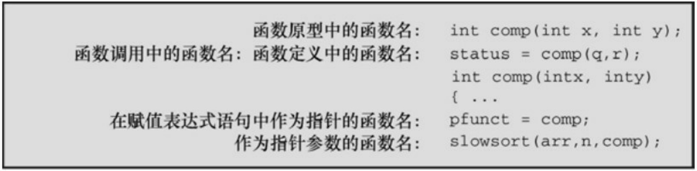

一般注释:

该运算符与结构或联合名一起使用，指定结构或联合的一个成员。如果name是一个结构的名称， member是该结构模版指定的一个成员名，下面标识了该结构的这个成员:

```txt
name.member
```

name.member的类型就是member的类型。联合使用成员运算符的方式与结构相同。

示例:

```c
struct {

int code;

float cost;

} item;

item.code = 1265;
```

间接成员运算符:**->**

一般注释:

该运算符和指向结构或联合的指针一起使用，标识结构或联合的一个成员。假设ptrstr是指向结构的指针，member是该结构模版指定的一个成员，那么:

```txt
ptrstr->member
```

标识了指向结构的成员。联合使用间接成员运算符的方式与结构相同。

示例:

```c
struct {

int code;

float cost;

} item, * ptrst;

ptrst = &item;

ptrst->code = 3451;
```

最后一条语句把一个int类型的值赋给item的code成员。如下3个表达式是等价的:

```txt
ptrst->code item.code (*ptrst).code
```

## 14.11 枚举类型

可以用枚举类型（enumerated type）声明符号名称来表示整型常量。使用enum关键字，可以创建一个新“类型”并指定它可具有的值（实际上，enum常量是int类型，因此，只要能使用int类型的地方就可以使用枚举类型）。枚举类型的目的是提高程序的可读性。它的语法与结构的语法相同。例如，可以这样声明:

enum spectrum {red, orange, yellow, green, blue, violet};

enum spectrum color;

第1个声明创建了spetrum作为标记名，允许把enum spetrum作为一个类型名使用。第2个声明使color作为该类型的变量。第1个声明中花括号内的标识符枚举了spectrum变量可能有的值。因此， color 可能的值是 red、orange、yellow 等。这些符号常量被称为枚举符（enumerator）。然后，便可这样用:

```matlab
int c;

color = blue;

if (color == yellow)

...;

for (color = red; color <= violet; color++)

...;
```

虽然枚举符（如red和blue）是int类型，但是枚举变量可以是任意整数类型，前提是该整数类型可以储存枚举常量。例如，spectrum的枚举符范围是0～5，所以编译器可以用unsigned char来表示color变量。

顺带一提，C枚举的一些特性并不适用于C++。例如，C允许枚举变量使用++运算符，但是C++标准不允许。所以，如果编写的代码将来会并入C++程序，那么必须把上面例子中的color声明为int类型，才能C和C++都兼容。

## 14.11.1 enum常量

blue和red到底是什么？从技术层面看，它们是int类型的常量。例如，假定有前面的枚举声明，可以这样写:

$$
\operatorname{printf} \left(\text {"red = \%d, orange = \%d\n", red, orange}\right);
$$

其输出如下:

$$
\text {red} = 0, \text {orange} = 1
$$

red成为一个有名称的常量，代表整数0。类似地，其他标识符都是有名称的常量，分别代表1～5。只要是能使用整型常量的地方就可以使用枚举常量。例如，在声明数组时，可以用枚举常量表示数组的大小；在switch语句中，可以把枚举常量作为标签。

## 14.11.2 默认值

默认情况下，枚举列表中的常量都被赋予0、1、2等。因此，下面的声明中nina的值是3:

$$
\text {enum kids} \{\text {nippy, slats, skippy, nina, liz} \};
$$

## 14.11.3 赋值

在枚举声明中，可以为枚举常量指定整数值:

$$
\text {enum levels} \{\text {low} = 1 0 0, \text {medium} = 5 0 0, \text {high} = 2 0 0 0 \};
$$

如果只给一个枚举常量赋值，没有对后面的枚举常量赋值，那么后面的

常量会被赋予后续的值。例如，假设有如下的声明:

```javascript
enum feline {cat, lynx = 10, puma, tiger};
```

那么，cat的值是0（默认），lynx、puma和tiger的值分别是10、11、12。

## 14.11.4 enum的用法

枚举类型的目的是为了提高程序的可读性和可维护性。如果要处理颜色，使用red和blue比使用0和1更直观。注意，枚举类型只能在内部使用。如果要输入color中orange的值，只能输入1，而不是单词orange。或者，让程序先读入字符串"orange"，再将其转换为orange代表的值。

因为枚举类型是整数类型，所以可以在表达式中以使用整数变量的方式使用enum变量。它们用在case语句中很方便。

程序清单14.15演示了一个使用enum的小程序。该程序示例使用默认值的方案，把red的值设置为0，使之成为指向字符串"red"的指针的索引。

程序清单**14.15 enum.c**程序

```c
/* enum.c -- 使用枚举类型的值 */
#include <stdio.h>
#include <string.h>      // 提供 strcmp()、strchr()函数的原型
#include <stdbool.h>   // C99 特性
char * s_gets(char * st, int n);
enum spectrum { red, orange, yellow, green, blue, violet };
const char * colors [] = { "red", "orange", "yellow",
```

```c
"green", "blue", "violet" };

#define LEN 30

int main(void)

{

char choice[LEN];

enum spectrum color;

bool color_is_found = false;

puts("Enter a color (empty line to quit):");

while (s_gets(choice, LEN) != NULL && choice[0] != '\0')

{

for (color = red; color <= violet; color++)

{

if (strcmp(choice, colors[color]) == 0)

{

color_is_found = true;

break;

}

}

if (color_is_found)
```

```txt
switch (color)
{
case red: puts("Roses are red.");
break;
case orange: puts("Poppies are orange.");
break;
case yellow: puts("Sunflowers are yellow.");
break;
case green: puts("Grass is green.");
break;
case blue: puts("Bluebells are blue.");
break;
case violet: puts("Violets are violet.");
break;
}
else
printf("I don't know about the color %s.\n", choice);
color_is_found = false;
puts("Next color, please (empty line to quit):");
```

```c
}
puts("Goodbye!");
return 0;
}
char * s_gets(char * st, int n)
{
char * ret_val;
char * find;
ret_val = fgets(st, n, stdin);
if (ret_val)
{
find = strchr(st, '\n'); // 查找换行符
if (find) // 如果地址不是 NULL,
*find = '\0'; // 在此处放置一个空字符
else
while (getchar() != '\n')
continue; // 清理输入行
}
return ret_val;
```

}

当输入的字符串与color数组的成员指向的字符串相匹配时，for循环结束。如果循环找到匹配的颜色，程序就用枚举变量的值与作为case标签的枚举常量匹配。下面是该程序的一个运行示例:

Enter a color (empty line to quit):

## blue

Bluebells are blue.

Next color, please (empty line to quit):

## orange

Poppies are orange.

Next color, please (empty line to quit):

## purple

I don't know about the color purple.

Next color, please (empty line to quit):

Goodbye!

## 14.11.5 共享名称空间

C语言使用名称空间（namespace）标识程序中的各部分，即通过名称来识别。作用域是名称空间概念的一部分:两个不同作用域的同名变量不冲突；两个相同作用域的同名变量冲突。名称空间是分类别的。在特定作用域中的结构标记、联合标记和枚举标记都共享相同的名称空间，该名称空间与普通变量使用的空间不同。这意味着在相同作用域中变量和标记的名称可以相同，不会引起冲突，但是不能在相同作用域中声明两个同名标签或同名变量。例如，在C中，下面的代码不会产生冲突:

struct rect { double x; double y; };

int rect; // 在C中不会产生冲突

尽管如此，以两种不同的方式使用相同的标识符会造成混乱。另外，C++不允许这样做，因为它把标记名和变量名放在相同的名称空间中。

## 14.12 typedef简介

typedef工具是一个高级数据特性，利用typedef可以为某一类型自定义名称。这方面与#define类似，但是两者有3处不同:

与#define不同，typedef创建的符号名只受限于类型，不能用于值。

typedef由编译器解释，不是预处理器。

在其受限范围内，typedef比#define更灵活。

下面介绍typedef的工作原理。假设要用BYTE表示1字节的数组。只需像定义个char类型变量一样定义BYTE，然后在定义前面加上关键字typedef即可:

typedef unsigned char BYTE;

随后，便可使用BYTE来定义变量:

BYTE x, y[10], \* z;

该定义的作用域取决于typedef定义所在的位置。如果定义在函数中，就具有局部作用域，受限于定义所在的函数。如果定义在函数外面，就具有文件作用域。

通常，typedef定义中用大写字母表示被定义的名称，以提醒用户这个类型名实际上是一个符号缩写。当然，也可以用小写:

typedef unsigned char byte;

typedef中使用的名称遵循变量的命名规则。

为现有类型创建一个名称，看上去真是多此一举，但是它有时的确很有用。在前面的示例中，用BYTE代替unsigned char表明你打算用BYTE类型的变量表示数字，而不是字符码。使用typedef还能提高程序的可移植性。例

如，我们之前提到的sizeof运算符的返回类型:size\_t类型，以及time()函数的返回类型:time\_t类型。C标准规定sizeof和time()返回整数类型，但是让实现来决定具体是什么整数类型。其原因是，C 标准委员会认为没有哪个类型对于所有的计算机平台都是最优选择。所以，标准委员会决定建立一个新的类型名（如，time\_t），并让实现使用typedef来设置它的具体类型。以这样的方式，C标准提供以下通用原型:

time\_t time(time\_t \*);

time\_t 在一个系统中是 unsigned long，在另一个系统中可以是 unsigned long long。只要包含time.h头文件，程序就能访问合适的定义，你也可以在代码中声明time\_t类型的变量。

typedef的一些特性与#define的功能重合。例如:

#define BYTE unsigned char

这使预处理器用BYTE替换unsigned char。但是也有#define没有的功能:

typedef char \* STRING;

没有typedef关键字，编译器将把STRING识别为一个指向char的指针变量。有了typedef关键字，编译器则把STRING解释成一个类型的标识符，该类型是指向char的指针。因此:

STRING name, sign;

相当于:

char \* name, \* sign;

但是，如果这样假设:

#define STRING char \*

然后，下面的声明:

STRING name, sign;

将被翻译成:

char \* name, sign;

这导致只有name才是指针。

还可以把typedef用于结构:

typedef struct complex {

float real;

float imag;

} COMPLEX;

然后便可使用COMPLEX类型代替complex结构来表示复数。使用typedef的第1个原因是:为经常出现的类型创建一个方便、易识别的类型名。例如，前面的例子中，许多人更倾向于使用 STRING 或与其等价的标记。

用typedef来命名一个结构类型时，可以省略该结构的标签:

typedef struct {double x; double y;} rect;

假设这样使用typedef定义的类型名:

rect r1 = {3.0, 6.0};

rect r2;

以上代码将被翻译成:

struct {double x; double y;} r1= {3.0, 6.0};

struct {double x; double y;} r2;

这两个结构在声明时都没有标记，它们的成员完全相同（成员名及其类型都匹配），C认为这两个结构的类型相同，所以r1和r2间的赋值是有效操作。

使用typedef的第2个原因是:typedef常用于给复杂的类型命名。例如，下面的声明:

typedef char (\* FRPTC ()) [5];

把FRPTC声明为一个函数类型，该函数返回一个指针，该指针指向内含5个char类型元素的数组（参见下一节的讨论）。

使用typedef时要记住，typedef并没有创建任何新类型，它只是为某个已存在的类型增加了一个方便使用的标签。以前面的STRING为例，这意味着我们创建的STRING类型变量可以作为实参传递给以指向char指针作为形参的函数。

通过结构、联合和typedef，C提供了有效处理数据的工具和处理可移植数据的工具。

## 14.13 其他复杂的声明

C 允许用户自定义数据形式。虽然我们常用的是一些简单的形式，但是根据需要有时还会用到一些复杂的形式。在一些复杂的声明中，常包含下面的符号，如表14.1所示:

表14.1 声明时可使用的符号

| 符号 | 含义 |
| --- | --- |
| * | 表示一个指针 |
| () | 表示一个函数 |
| [ ] | 表示一个数组 |

下面是一些较复杂的声明示例:

int board[8][8]; // 声明一个内含int数组的数组

int \*\* ptr; // 声明一个指向指针的指针，被指向的指针指向int

int \* risks[10]; // 声明一个内含10个元素的数组，每个元素都是一个指向int的指针

int (\* rusks)[10]; // 声明一个指向数组的指针，该数组内含10个int类型的值

int \* oof[3][4]; // 声明一个3×4 的二维数组，每个元素都是指向int的指针

int (\* uuf)[3][4]; // 声明一个指向3×4二维数组的指针，该数组中内含int类型值

int (\* uof[3])[4]; // 声明一个内含3个指针元素的数组，其中每个指针都指向一个内含4个int类型元素的数组

要看懂以上声明，关键要理解\*、()和[]的优先级。记住下面几条规则。

1.数组名后面的[]和函数名后面的()具有相同的优先级。它们比\*（解引用运算符）的优先级高。因此下面声明的risk是一个指针数组，不是指向数组的指针:

int \* risks[10];

2.[]和()的优先级相同，由于都是从左往右结合，所以下面的声明中，在应用方括号之前，\*先与rusks结合。因此rusks是一个指向数组的指针，该数组内含10个int类型的元素:

int (\* rusks)[10];

3.[]和()都是从左往右结合。因此下面声明的goods是一个由12个内含50个int类型值的数组组成的二维数组，不是一个有50个内含12个int类型值的数组组成的二维数组:

int goods[12][50];

把以上规则应用于下面的声明:

int \* oof[3][4];

[3]比\*的优先级高，由于从左往右结合，所以[3]先与oof结合。因此，oof首先是一个内含3个元素的数组。然后再与[4]结合，所以oof的每个元素都是内含4个元素的数组。\*说明这些元素都是指针。最后，int表明了这4个元素都是指向int的指针。因此，这条声明要表达的是:foo是一个内含3个元素的数组，其中每个元素是由4个指向int的指针组成的数组。简而言之，oof是一个3×4的二维数组，每个元素都是指向int的指针。编译器要为12个指针预留存储空间。

现在来看下面的声明:

int (\* uuf)[3][4];

圆括号使得\*先与uuf结合，说明uuf是一个指针，所以uuf是一个指向3×4

的int类型二维数组的指针。编译器要为一个指针预留存储空间。

根据这些规则，还可以声明:

char \* fump(int); // 返回字符指针的函数

char (\* frump)(int); // 指向函数的指针，该函数的返回类型为char

char (\* flump[3])(int); // 内含3个指针的数组，每个指针都指向返回类型为char的函数

这3个函数都接受int类型的参数。

可以使用typedef建立一系列相关类型:

typedef int arr5[5];

typedef arr5 \* p\_arr5;

typedef p\_arr5 arrp10[10];

arr5 togs; // togs 是一个内含5个int类型值的数组

p\_arr5 p2; // p2 是一个指向数组的指针，该数组内含5个int类型的值

arrp10 ap; // ap 是一个内含10个指针的数组，每个指针都指向一个内含5个int类型值的数组

如果把这些放入结构中，声明会更复杂。至于应用，我们就不再进一步讨论了。

## 14.14 函数和指针

通过上一节的学习可知，可以声明一个指向函数的指针。这个复杂的玩意儿到底有何用处？通常，函数指针常用作另一个函数的参数，告诉该函数要使用哪一个函数。例如，排序数组涉及比较两个元素，以确定先后。如果元素是数字，可以使用>运算符；如果元素是字符串或结构，就要调用函数进行比较。C库中的 qsort()函数可以处理任意类型的数组，但是要告诉qsort()使用哪个函数来比较元素。为此， qsort()函数的参数列表中，有一个参数接受指向函数的指针。然后，qsort()函数使用该函数提供的方案进行排序，无论这个数组中的元素是整数、字符串还是结构。

我们来进一步研究函数指针。首先，什么是函数指针？假设有一个指向int类型变量的指针，该指针储存着这个int类型变量储存在内存位置的地址。同样，函数也有地址，因为函数的机器语言实现由载入内存的代码组成。指向函数的指针中储存着函数代码的起始处的地址。

其次，声明一个数据指针时，必须声明指针所指向的数据类型。声明一个函数指针时，必须声明指针指向的函数类型。为了指明函数类型，要指明函数签名，即函数的返回类型和形参类型。例如，考虑下面的函数原型:

void ToUpper(char \*); // 把字符串中的字符转换成大写字符

ToUpper()函数的类型是“带char \* 类型参数、返回类型是void的函数”。下面声明了一个指针pf指向该函数类型:

void (\*pf)(char \*); // pf 是一个指向函数的指针

从该声明可以看出，第1对圆括号把\*和pf括起来，表明pf是一个指向函数的指针。因此，(\*pf)是一个参数列表为(char \*)、返回类型为void的函数。注意，把函数名ToUpper替换为表达式(\*pf)是创建指向函数指针最简单的方式。所以，如果想声明一个指向某类型函数的指针，可以写出该函数的原型后把函数名替换成(\*pf)形式的表达式，创建函数指针声明。前面提到过，由于运算符优先级的规则，在声明函数指针时必须把\*和指针名括起来。如果省略第1个圆括号会导致完全不同的情况:

void \*pf(char \*); // pf 是一个返回字符指针的函数

提示

要声明一个指向特定类型函数的指针，可以先声明一个该类型的函数，然后把函数名替换成(\*pf)形式的表达式。然后，pf就成为指向该类型函数的指针。

声明了函数指针后，可以把类型匹配的函数地址赋给它。在这种上下文中，函数名可以用于表示函数的地址:

void ToUpper(char \*);

void ToLower(char \*);

int round(double);

void (\*pf)(char \*);

pf = ToUpper; // 有效，ToUpper是该类型函数的地址

pf = ToLower; //有效，ToUpper是该类型函数的地址

pf = round; // 无效，round与指针类型不匹配

pf = ToLower(); // 无效，ToLower()不是地址

最后一条语句是无效的，不仅因为 ToLower()不是地址，而且ToLower()的返回类型是 void，它没有返回值，不能在赋值语句中进行赋值。注意，指针pf可以指向其他带char \*类型参数、返回类型是void的函数，不能指向其他类型的函数。

既然可以用数据指针访问数据，也可以用函数指针访问函数。奇怪的是，有两种逻辑上不一致的语法可以这样做，下面解释:

void ToUpper(char \*);

void ToLower(char \*);

void (\*pf)(char \*);

char mis[] = "Nina Metier";

pf = ToUpper;

(\*pf)(mis); // 把ToUpper 作用于（语法1）

pf = ToLower;

pf(mis); // 把ToLower 作用于（语法2）

这两种方法看上去都合情合理。先分析第1种方法:由于pf指向ToUpper函数，那么\*pf就相当于ToUpper函数，所以表达式(\*pf)(mis)和ToUpper(mis)相同。从ToUpper函数和pf的声明就能看出，ToUpper和(\*pf)是等价的。第2种方法:由于函数名是指针，那么指针和函数名可以互换使用，所以pf(mis)和ToUpper(mis)相同。从pf的赋值表达式语句就能看出ToUpper和pf是等价的。由于历史的原因，贝尔实验室的C和UNIX的开发者采用第1种形式，而伯克利的UNIX推广者却采用第2种形式。K&R C不允许第2种形式。但是，为了与现有代码兼容，ANSI C认为这两种形式（本例中是(\*pf)(mis)和pf(mis)）等价。后续的标准也延续了这种矛盾的和谐。

作为函数的参数是数据指针最常见的用法之一，函数指针亦如此。例如，考虑下面的函数原型:

void show(void (\* fp)(char \*), char \* str);

这看上去让人头晕。它声明了两个形参:fp和str。fp形参是一个函数指针，str是一个数据指针。更具体地说，fp指向的函数接受char \* 类型的参数，其返回类型为void；str指向一个char类型的值。因此，假设有上面的声明，可以这样调用函数:

```javascript
show(ToLower, mis); /* show()使用ToLower()函数: fp = ToLower */
show(pf, mis); /* show()使用pf指向的函数: fp = pf */
```

show()如何使用传入的函数指针？是用fp()语法还是(\*fp)()语法调用函数:

```c
void show(void (* fp)(char *), char * str)
{
(*fp)(str);  /* 把所选函数作用于str */
puts(str);      /* 显示结果 */
}
```

例如，这里的show()首先用fp指向的函数转换str，然后显示转换后的字符串。

顺带一提，把带返回值的函数作为参数传递给另一个函数有两种不同的方法。例如，考虑下面的语句:

function1(sqrt); /\* 传递sqrt()函数的地址 \*/

function2(sqrt(4.0)); /\* 传递sqrt()函数的返回值 \*/

第1条语句传递的是sqrt()函数的地址，假设function1()在其代码中会使用该函数。第2条语句先调用sqrt()函数，然后求值，并把返回值（该例中是2.0）传递给function2()。

程序清单14.16中的程序通过show()函数来演示这些要点，该函数以各种转换函数作为参数。该程序也演示了一些处理菜单的有用技巧。

程序清单**14.16 func\_ptr.c**程序

// func\_ptr.c -- 使用函数指针

#include &lt;stdio.h&gt;

#include &lt;string.h&gt;

#include &lt;ctype.h&gt;

#define LEN 81

char \* s\_gets(char \* st, int n);

char showmenu(void);

void eatline(void); // 读取至行末尾

void show(void(\*fp)(char \*), char \* str);

void ToUpper(char \*); // 把字符串转换为大写

void ToLower(char \*); // 把字符串转换为小写

void Transpose(char \*); // 大小写转置

void Dummy(char \*); // 不更改字符串

int main(void)

{

char line[LEN];

char copy[LEN];

char choice;

void(\*pfun)(char \*); // 声明一个函数指针，被指向的函数接受char \*类型

的参数，无返回值

```txt
puts("Enter a string (empty line to quit):");
while (s_gets(line, LEN) != NULL && line[0] != '\0')
{
while ((choice = showmenu()) != 'n')
{
switch (choice) // switch语句设置指针
{
case 'u': pfun = ToUpper; break;
case 'l': pfun = ToLower; break;
case 't': pfun = Transpose; break;
case 'o': pfun = Dummy; break;
}
strcpy(copy, line); // 为show()函数拷贝一份
show(pfun, copy); // 根据用户的选择，使用选定的函数
}
puts("Enter a string (empty line to quit):");
}
puts("Bye!");
```

```c
return 0;
}
char showmenu(void)
{
char ans;
puts("Enter menu choice:");
puts("u) uppercase      l) lowercase");
puts("t) transposed case o) original case");
puts("n) next string");
ans = getchar();          // 获取用户的输入
ans = tolower(ans);       // 转换为小写
eatline();                   // 清理输入行
while (strchr("ulton", ans) == NULL)
{
puts("Please enter a u, l, t, o, or n:");
ans = tolower(getchar());
eatline();
}
return ans;
```

```c
}
void eatline(void)
{
while (getchar() != '\n')
continue;
}
void ToUpper(char * str)
{
while (*str)
{
*str = toupper(*str);
str++;
}
}
void ToLower(char * str)
{
while (*str)
{
*str = tolower(*str);
```

```c
str++;
}
}
void Transpose(char * str)
{
while (*str)
{
if (islower(*str))
*str = toupper(*str);
else if (isupper(*str))
*str = tolower(*str);
str++;
}
}
void Dummy(char * str)
{
// 不改变字符串
}
void show(void(*fp)(char *), char * str)
```

```c
{
(*fp)(str); // 把用户选定的函数作用于str
puts(str); // 显示结果
}
char * s_gets(char * st, int n)
{
char * ret_val;
char * find;
ret_val = fgets(st, n, stdin);
if (ret_val)
{
find = strchr(st, '\n'); // 查找换行符
if (find) // 如果地址不是NULL,
*find = '\0'; // 在此处放置一个空字符
else
while (getchar() != '\n')
continue; // 清理输入行中剩余的字符
}
return ret_val;
```

}

下面是该程序的输出示例:

Enter a string (empty line to quit):

## Does C make you feel loopy?

Enter menu choice:

u) uppercase l) lowercase
t) transposed case o) original case
n) next string

t

dOES c MAKE YOU FEELLOOPY?

Enter menu choice:

u) uppercase l) lowercase
t) transposed case o) original case
n) next string

l

does c make you feel loopy?

Enter menu choice:

u) uppercase l) lowercase
t) transposed case o) original case

n) next string

n

Enter a string (empty line to quit):

Bye!

注意，ToUpper()、ToLower()、Transpose()和 Dummy()函数的类型都相同，所以这 4 个函数都可以赋给pfun指针。该程序把pfun作为show()的参数，但是也可以直接把这4个函数中的任一个函数名作为参数，如show(Transpose, copy)。

这种情况下，可以使用typedef。例如，该程序中可以这样写:

typedef void (\*V\_FP\_CHARP)(char \*);

void show (V\_FP\_CHARP fp, char \*);

V\_FP\_CHARP pfun;

如果还想更复杂一些，可以声明并初始化一个函数指针的数组:

V\_FP\_CHARP arpf[4] = {ToUpper, ToLower, Transpose, Dummy};

然后把showmenu()函数的返回类型改为int，如果用户输入u，则返回0；如果用户输入l，则返回2；如果用户输入t，则返回2，以此类推。可以把程序中的switch语句替换成下面的while循环:

index = showmenu();

while (index >= 0 && index <= 3)

strcpy(copy, line); /\* 为show()拷贝一份 \*/

```javascript
show(arpf[index], copy);    /* 使用选定的函数 */
index = showmenu();
}
```

虽然没有函数数组，但是可以有函数指针数组。

以上介绍了使用函数名的4种方法:定义函数、声明函数、调用函数和作为指针。图14.4进行了总结。



<details>
<summary>text_image</summary>

函数原型中的函数名: int comp(int x, int y);
函数调用中的函数名: 函数定义中的函数名: status = comp(q,r);
int comp(intx, inty)
{ ...
在赋值表达式语句中作为指针的函数名: pfunct = comp;
作为指针参数的函数名: slowsort(arr,n,comp);
</details>

图14.4 函数名的用法

至于如何处理菜单，showmenu()函数给出了几种技巧。首先，下面的代码:

```txt
ans = getchar();          // 获取用户输入
```

```javascript
ans = tolower(ans); // 转换成小写
```

和

```javascript
ans = tolower(getchar());
```

演示了转换用户输入的两种方法。这两种方法都可以把用户输入的字符转换为一种大小写形式，这样就不用检测用户输入的是'u'还是'U'，等等。

eatline()函数丢弃输入行中的剩余字符，在处理这两种情况时很有用。第一，用户为了输入一个选择，输入一个字符，然后按下Enter键，将产生一个换行符。如果不处理这个换行符，它将成为下一次读取的第1个字符。

第二，假设用户输入的是整个单词uppercase，而不是一个字母u。如果 没有eatline()函数，程序会把uppercase中的字符作为用户的响应依次读取。有了eatline()，程序会读取u字符并丢弃输入行中剩余的字符。

其次，showmenu()函数的设计意图是，只给程序返回正确的选项。为完成这项任务，程序使用了string.h头文件中的标准库函数strchr():

$$
\text {while} (\text {strchr} (" \text {ulton}", \text {ans}) = = \text {NULL})
$$

该函数在字符串"ulton"中查找字符ans首次出现的位置，并返回一个指向该字符的指针。如果没有找到该字符，则返回空指针。因此，上面的while循环头可以用下面的while循环头代替，但是上面的用起来更方便:

$$
\text {while (ans != 'u' && ans != 'l' && ans != 't' && ans != 'o' && ans != 'n')}
$$

待检查的项越多，使用strchr()就越方便。

## 14.15 关键概念

我们在编程中要表示的信息通常不只是一个数字或一些列数字。程序可能要处理具有多种属性的实体。例如，通过姓名、地址、电话号码和其他信息表示一名客户；或者，通过电影名、发行人、播放时长、售价等表示一部电影DVD。C结构可以把这些信息都放在一个单元内。在组织程序时这很重要，因为这样可以把相关的信息都储存在一处，而不是分散储存在多个变量中。

设计结构时，开发一个与之配套的函数包通常很有用。例如，写一个以结构（或结构的地址）为参数的函数打印结构内容，比用一堆printf()语句强得多。因为只需要一个参数就能打印结构中的所有信息。如果把信息放到零散的变量中，每个部分都需要一个参数。另外，如果要在结构中增加一个成员，只需重写函数，不必改写函数调用。这在修改结构时很方便。

联合声明与结构声明类似。但是，联合的成员共享相同的存储空间，而且在联合中同一时间内只能有一个成员。实质上，可以在联合变量中储存一个类型不唯一的值。

enum 工具提供一种定义符号常量的方法，typedef 工具提供一种为基本或派生类型创建新标识符的方法。

指向函数的指针提供一种告诉函数应使用哪一个函数的方法。