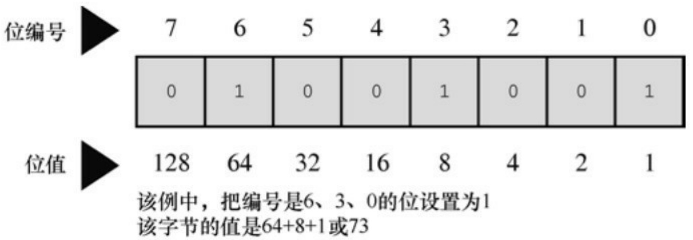
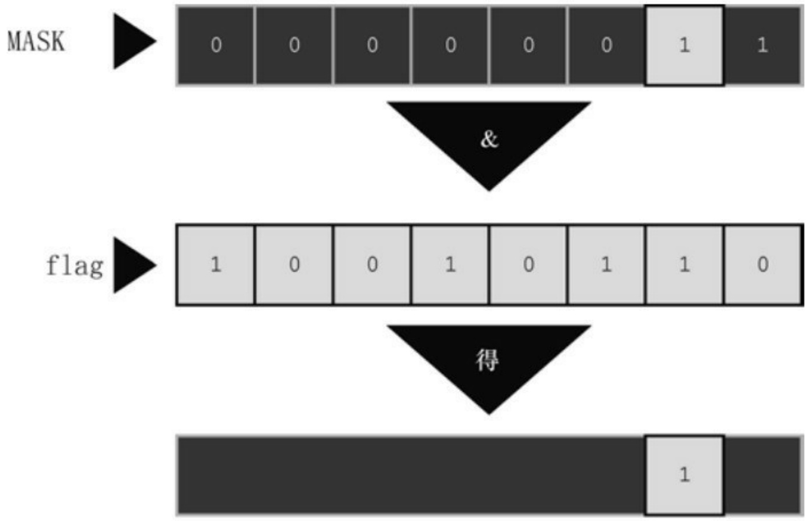
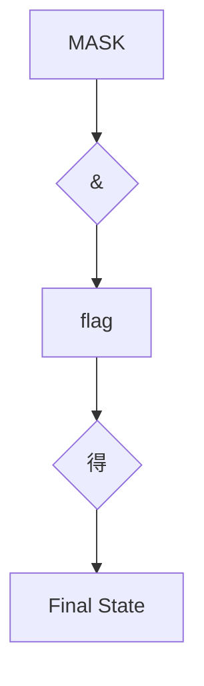

## 14.16 本章小结

C 结构提供在相同的数据对象中储存多个不同类型数据项的方法。可以使用标记来标识一个具体的结构模板，并声明该类型的变量。通过成员点运算符（.）可以使用结构模版中的标签来访问结构的各个成员。

如果有一个指向结构的指针，可以用该指针和间接成员运算符（->）代替结构名和点运算符来访问结构的各成员。和数组不同，结构名不是结构的地址，要在结构名前使用&运算符才能获得结构的地址。

一贯以来，与结构相关的函数都使用指向结构的指针作为参数。现在的C允许把结构作为参数传递，作为返回值和同类型结构之间赋值。然而，传递结构的地址通常更有效。

联合使用与结构相同的语法。然而，联合的成员共享一个共同的存储空间。联合同一时间内只能储存一个单独的数据项，不像结构那样同时储存多种数据类型。也就是说，结构可以同时储存一个int类型数据、一个double类型数据和一个char类型数据，而相应的联合只能保存一个int类型数据，或者一个double类型数据，或者一个char类型数据。

通过枚举可以创建一系列代表整型常量（枚举常量）的符号和定义相关联的枚举类型。

typedef工具可用于建立C标准类型的别名或缩写。

函数名代表函数的地址，可以把函数的地址作为参数传递给其他函数，然后这些函数就可以使用被指向的函数。如果把特定函数的地址赋给一个名为pf的函数指针，可以通过以下两种方式调用该函数:

#include &lt;math.h&gt; /\* 提供sin()函数的原型:double sin(double) \*/

...

double (\*pdf)(double);

double x;

pdf = sin;

x = (\*pdf)(1.2); // 调用sin(1.2)

x = pdf(1.2); // 同样调用 sin(1.2)

## 14.17 复习题

复习题的参考答案在附录A中。

1.下面的结构模板有什么问题:

```txt
structure {
    char itable;
    int num[20];
    char * togs
}
```

2.下面是程序的一部分，输出是什么？

```c
#include <stdio.h>

struct house {

float sqft;

int rooms;

int stories;

char address[40];

};

int main(void)

{

struct house fruzt = {1560.0, 6, 1, "22 Spiffo Road"};
```

```c
struct house *sign;

sign = &fruzt;

printf("%d %d\n", fruzt.rooms, sign->stories);

printf("%s \n", fruzt.address);

printf("%c %c\n", sign->address[3], fruzt.address[4]);

return 0;

}
```

3.设计一个结构模板储存一个月份名、该月份名的3个字母缩写、该月的天数以及月份号。
4.定义一个数组，内含12个结构（第3题的结构类型）并初始化为一个年份（非闰年）。
5.编写一个函数，用户提供月份号，该函数就返回一年中到该月为止（包括该月）的总天数。假设在所有函数的外部声明了第3题的结构模版和一个该类型结构的数组。
6.a.假设有下面的 typedef，声明一个内含 10 个指定结构的数组。然后，单独给成员赋值（或等价字符串），使第3个元素表示一个焦距长度有500mm，孔径为f/2.0的Remarkata镜头。

typedef struct lens { /\* 描述镜头 \*/

float foclen; /\* 焦距长度，单位为mm \*/

float fstop; /\* 孔径 \*/

char brand[30]; /\* 品牌名称 \*/

```txt
} LENS;
```

b.重写a，在声明中使用一个待指定初始化器的初始化列表，而不是对每个成员单独赋值。

7.考虑下面程序片段:

```txt
struct name {

char first[20];

char last[20];

};

struct bem {

int limbs;

struct name title;

char type[30];

};

struct bem * pb;

struct bem deb = {

6,

{ "Berbnazel", "Gwolkapwolk" },
"Arcturan"
};
```

```txt
pb = &deb;
```

a.下面的语句分别打印什么？

```javascript
printf("%d\n", deb.limbs);
```

```c
printf("%s\n", pb->type);
```

```txt
printf("%s\n", pb->type + 2);
```

b.如何用结构表示法（两种方法）表示"Gwolkapwolk"？

c.编写一个函数，以bem结构的地址作为参数，并以下面的形式输出结构的内容（假定结构模板在一个名为starfolk.h的头文件中）:

Berbnazel Gwolkapwolk is a 6-limbed Arcturan.

8.考虑下面的声明:

```txt
struct fullname {
```

```javascript
char fname[20];
```

```javascript
char lname[20];
```

```txt
};
```

```txt
struct bard {
```

```sql
struct fullname name;
```

```txt
int born;
```

```vhdl
int died;
```

```txt
};
```

struct bard willie;

struct bard \*pt = &willie;

a.用willie标识符标识willie结构的born成员。

b.用pt标识符标识willie结构的born成员。

c.调用scanf()读入一个用willie标识符标识的born成员的值。

d.调用scanf()读入一个用pt标识符标识的born成员的值。

e.调用scanf()读入一个用willie标识符标识的name成员中lname成员的值。

f.调用scanf()读入一个用pt标识符标识的name成员中lname成员的值。

g.构造一个标识符，标识willie结构变量所表示的姓名中名的第3个字母（英文的名在前）。

h.构造一个表达式，表示willie结构变量所表示的名和姓中的字母总数。

9.定义一个结构模板以储存这些项:汽车名、马力、EPA（美国环保局）城市交通MPG（每加仑燃料行驶的英里数）评级、轴距和出厂年份。使用car作为该模版的标记。

10.假设有如下结构:

struct gas {

float distance;

float gals;

float mpg;

a.设计一个函数，接受struct gas类型的参数。假设传入的结构包含distance和gals信息。该函数为mpg成员计算正确的值，并把值返回该结构。
b.设计一个函数，接受struct gas类型的参数。假设传入的结构包含distance和gals信息。该函数为mpg成员计算正确的值，并把该值赋给合适的成员。

11.声明一个标记为choices的枚举，把枚举常量no、yes和maybe分别设置为0、1、2。
12.声明一个指向函数的指针，该函数返回指向char的指针，接受一个指向char的指针和一个char类型的值。
13.声明4个函数，并初始化一个指向这些函数的指针数组。每个函数都接受两个double类型的参数，返回double类型的值。另外，用两种方法使用该数组调用带10.0和2.5实参的第2个函数。

## 14.18 编程练习

1.重新编写复习题 5，用月份名的拼写代替月份号（别忘了使用strcmp()）。在一个简单的程序中测试该函数。
2.编写一个函数，提示用户输入日、月和年。月份可以是月份号、月份名或月份名缩写。然后该程序应返回一年中到用户指定日子（包括这一天）的总天数。
3.修改程序清单 14.2 中的图书目录程序，使其按照输入图书的顺序输出图书的信息，然后按照标题字母的声明输出图书的信息，最后按照价格的升序输出图书的信息。
4.编写一个程序，创建一个有两个成员的结构模板:

a.第1个成员是社会保险号，第2个成员是一个有3个成员的结构，第1个成员代表名，第2个成员代表中间名，第3个成员表示姓。创建并初始化一个内含5个该类型结构的数组。该程序以下面的格式打印数据:

Dribble, Flossie M.–– 302039823

如果有中间名，只打印它的第1个字母，后面加一个点（.）；如果没有中间名，则不用打印点。编写一个程序进行打印，把结构数组传递给这个函数。

b.修改a部分，传递结构的值而不是结构的地址。

5.编写一个程序满足下面的要求。

a.外部定义一个有两个成员的结构模板name:一个字符串储存名，一个字符串储存姓。
b.外部定义一个有3个成员的结构模板student:一个name类型的结构，一个grade数组储存3个浮点型分数，一个变量储存3个分数平均数。

c.在main()函数中声明一个内含CSIZE（CSIZE = 4）个student类型结构的数组，并初始化这些结构的名字部分。用函数执行g、e、f和g中描述的任务。

d.以交互的方式获取每个学生的成绩，提示用户输入学生的姓名和分数。把分数储存到grade数组相应的结构中。可以在main()函数或其他函数中用循环来完成。

e.计算每个结构的平均分，并把计算后的值赋给合适的成员。

f.打印每个结构的信息。

g.打印班级的平均分，即所有结构的数值成员的平均值。

6.一个文本文件中保存着一个垒球队的信息。每行数据都是这样排列:

## 4 Jessie Joybat 5 2 1 1

第1项是球员号，为方便起见，其范围是0～18。第2项是球员的名。第3项是球员的姓。名和姓都是一个单词。第4项是官方统计的球员上场次数。接着3项分别是击中数、走垒数和打点（RBI）。文件可能包含多场比赛的数据，所以同一位球员可能有多行数据，而且同一位球员的多行数据之间可能有其他球员的数据。编写一个程序，把数据储存到一个结构数组中。该结构中的成员要分别表示球员的名、姓、上场次数、击中数、走垒数、打点和安打率（稍后计算）。可以使用球员号作为数组的索引。该程序要读到文件结尾，并统计每位球员的各项累计总和。

世界棒球统计与之相关。例如，一次走垒和触垒中的失误不计入上场次数，但是可能产生一个RBI。但是该程序要做的是像下面描述的一样读取和处理数据文件，不会关心数据的实际含义。

要实现这些功能，最简单的方法是把结构的内容都初始化为零，把文件中的数据读入临时变量中，然后将其加入相应的结构中。程序读完文件后，应计算每位球员的安打率，并把计算结果储存到结构的相应成员中。计算安打率是用球员的累计击中数除以上场累计次数。这是一个浮点数计算。最后，程序结合整个球队的统计数据，一行显示一位球员的累计数据。

7.修改程序清单 14.14，从文件中读取每条记录并显示出来，允许用户删除记录或修改记录的内容。如果删除记录，把空出来的空间留给下一个要读入的记录。要修改现有的文件内容，必须用"r+b"模式，而不是"a+b"模式。而且，必须更加注意定位文件指针，防止新加入的记录覆盖现有记录。最简单的方法是改动储存在内存中的所有数据，然后再把最后的信息写入文件。跟踪的一个方法是在book结构中添加一个成员表示是否该项被删除。

8.巨人航空公司的机群由 12 个座位的飞机组成。它每天飞行一个航班。根据下面的要求，编写一个座位预订程序。

a.该程序使用一个内含 12 个结构的数组。每个结构中包括:一个成员表示座位编号、一个成员表示座位是否已被预订、一个成员表示预订人的名、一个成员表示预订人的姓。

b.该程序显示下面的菜单:

To choose a function, enter its letter label:

a) Show number of empty seats
b) Show list of empty seats
c) Show alphabetical list of seats
d) Assign a customer to a seat assignment
e) Delete a seat assignment

f) Quit

c.该程序能成功执行上面给出的菜单。选择d)和e)要提示用户进行额外输入，每个选项都能让用户中止输入。

d.执行特定程序后，该程序再次显示菜单，除非用户选择f)。

9.巨人航空公司（编程练习 8）需要另一架飞机（容量相同），每天飞4 班（航班 102、311、444 和519）。把程序扩展为可以处理4个航班。用一个顶层菜单提供航班选择和退出。选择一个特定航班，就会出现和编程练习8类似的菜单。但是该菜单要添加一个新选项:确认座位分配。而且，菜单中的退出是返回顶层菜单。每次显示都要指明当前正在处理的航班号。另外，座位分配显示要指明确认状态。
10.编写一个程序，通过一个函数指针数组实现菜单。例如，选择菜单中的 a，将激活由该数组第 1个元素指向的函数。
11.编写一个名为transform()的函数，接受4个参数:内含double类型数据的源数组名、内含double类型数据的目标数组名、一个表示数组元素个数的int类型参数、函数名（或等价的函数指针）。transform()函数应把指定函数应用于源数组中的每个元素，并把返回值储存在目标数组中。例如:

transform(source, target, 100, sin);

该声明会把target[0]设置为sin(source[0])，等等，共有100个元素。在一个程序中调用transform()4次，以测试该函数。分别使用math.h函数库中的两个函数以及自定义的两个函数作为参数。

[1].也被称为标记化结构初始化语法。——译者注

# 第15章位操作

本章介绍以下内容:

运算符:～、&、|、^、

$$
\ll , \gg
$$

$$
\& = , \mid = , \wedge = , > > = , <   <   =
$$

二进制、十进制和十六进制记数法（复习）

处理一个值中的位的两个C工具:位运算符和位字段

关键字:\_Alignas、\_Alignof

在C语言中，可以单独操控变量中的位。读者可能好奇，竟然有人想这样做。有时必须单独操控位，而且非常有用。例如，通常向硬件设备发送一两个字节来控制这些设备，其中每个位（bit）都有特定的含义。另外，与文件相关的操作系统信息经常被储存，通过使用特定位表明特定项。许多压缩和加密操作都是直接处理单独的位。高级语言一般不会处理这级别的细节，C 在提供高级语言便利的同时，还能在为汇编语言所保留的级别上工作，这使其成为编写设备驱动程序和嵌入式代码的首选语言。

首先要介绍位、字节、二进制记数法和其他进制记数系统的一些背景知识。

## 15.1 二进制数、位和字节

通常都是基于数字10来书写数字。例如2157的千位是2，百位是1，十位是5，个位是7，可以写成:

$$
2 \times 1 0 0 0 + 1 \times 1 0 0 + 5 \times 1 0 + 7 \times 1
$$

注意，1000是10的立方（即3次幂），100是10的平方（即2次幂），10是10的1次幂，而且10（以及任意正数）的0次幂是1。因此，2157也可以写成:

$$
2 \times 1 0 ^ {3} + 1 \times 1 0 ^ {2} + 5 \times 1 0 ^ {1} + 7 \times 1 0 ^ {0}
$$

因为这种书写数字的方法是基于10的幂，所以称以10为基底书写2157。

姑且认为十进制系统得以发展是得益于我们都有10根手指。从某种意义上看，计算机的位只有2根手指，因为它只能被设置为0或1，关闭或打开。因此，计算机适用基底为2的数制系统。它用2的幂而不是10的幂。以2为基底表示的数字被称为二进制数（binary number）。二进制中的2和十进制中的10作用相同。例如，二进制数1101可表示为:

$$
1 \times 2 ^ {3} + 1 \times 2 ^ {2} + 0 \times 2 ^ {1} + 1 \times 2 ^ {0}
$$

以十进制数表示为:

$$
1 \times 8 + 1 \times 4 + 0 \times 2 + 1 \times 1 = 1 3
$$

用二进制系统可以把任意整数（如果有足够的位）表示为0和1的组合。由于数字计算机通过关闭和打开状态的组合来表示信息，这两种状态分别用0和1来表示，所以使用这套数制系统非常方便。接下来，我们来学习二进制系统如何表示1字节的整数。

## 15.1.1 二进制整数

通常，1字节包含8位。C语言用字节（byte）表示储存系统字符集所需的大小，所以C字节可能是8位、9位、16位或其他值。不过，描述存储器芯片和数据传输率中所用的字节指的是8位字节。为了简化起见，本章假设1字节是8位（计算机界通常用八位组(octet)这个术语特指8位字节）。可以从左往右给这8位分别编号为7～0。在1字节中，编号是7的位被称为高阶位（high-order bit），编号是0的位被称为低阶位（low-order bit）。每 1位的编号对应2的相应指数。因此，可以根据图15.1所示的例子理解字节。



<details>
<summary>text_image</summary>

位编号
7 6 5 4 3 2 1 0
0 1 0 0 1 0 0 1
位值
128 64 32 16 8 4 2 1
该例中，把编号是6、3、0的位设置为1
该字节的值是64+8+1或73
</details>

图15.1 位编号和位值

这里，128是2的7次幂，以此类推。该字节能表示的最大数字是把所有位都设置为1:11111111。这个二进制数的值是:

$$
1 2 8 + 6 4 + 3 2 + 1 6 + 8 + 4 + 2 + 1 = 2 5 5
$$

而该字节最小的二进制数是00000000，其值为0。因此，1字节可储存0 ～255范围内的数字，总共256个值。或者，通过不同的方式解释位组合（bit pattern），程序可以用1字节储存-128～+127范围内的整数，总共还是256个值。例如，通常unsigned char用1字节表示的范围是0～255，而signed char用1字节表示的范围是-128～+127。

## 15.1.2 有符号整数

如何表示有符号整数取决于硬件，而不是C语言。也许表示有符号数最简单的方式是用1位（如，高阶位）储存符号，只剩下7位表示数字本身（假设储存在1字节中）。用这种符号量（sign-magnitude）表示法，10000001表示−1，00000001表示1。因此，其表示范围是−127～+127。

这种方法的缺点是有两个0:+0和-0。这很容易混淆，而且用两个位组合来表示一个值也有些浪费。

二进制补码（two’s-complement）方法避免了这个问题，是当今最常用的系统。我们将以1字节为例，讨论这种方法。二进制补码用1字节中的后7位表示0～127，高阶位设置为0。目前，这种方法和符号量的方法相同。另外，如果高阶位是1，表示的值为负。这两种方法的区别在于如何确定负值。从一个9位组合100000000（256的二进制形式）减去一个负数的位组合，结果是该负值的量。例如，假设一个负值的位组合是 10000000，作为一个无符号字节，该组合为表示 128；作为一个有符号值，该组合表示负值（编码是 7的位为1），而且值为100000000-10000000，即1000000（128）。因此，该数是-128（在符号量表示法中，该位组合表示−0）。类似地，10000001 是−127，11111111 是−1。该方法可以表示−128～ +127范围内的数。

要得到一个二进制补码数的相反数，最简单的方法是反转每一位（即0变为1，1变为0），然后加1。因为1是00000001，那么−1则是11111110+1，或11111111。这与上面的介绍一致。

二进制反码（one’s-complement）方法通过反转位组合中的每一位形成一个负数。例如，00000001是1，那么11111110是−1。这种方法也有一个−0:11111111。该方法能表示-127～+127之间的数。

## 15.1.3 二进制浮点数

浮点数分两部分储存:二进制小数和二进制指数。下面我们将详细介绍。

## 1.二进制小数

一个普通的浮点数0.527，表示如下:

$$
5 / 1 0 + 2 / 1 0 0 + 7 / 1 0 0 0
$$

从左往右，各分母都是10的递增次幂。在二进制小数中，使用2的幂作为分母，所以二进制小数.101表示为:

$$
1 / 2 + 0 / 4 + 1 / 8
$$

用十进制表示法为:

$$
0. 5 0 + 0. 0 0 + 0. 1 2 5
$$

即是0.625。

许多分数（如，1/3）不能用十进制表示法精确地表示。与此类似，许多分数也不能用二进制表示法准确地表示。实际上，二进制表示法只能精确地表示多个1/2的幂的和。因此，3/4和7/8可以精确地表示为二进制小数，但是1/3和2/5却不能。

## 2.浮点数表示法

为了在计算机中表示一个浮点数，要留出若干位（因系统而异）储存二进制分数，其他位储存指数。一般而言，数字的实际值是由二进制小数乘以2的指定次幂组成。例如，一个浮点数乘以4，那么二进制小数不变，其指数乘以2，二进制分数不变。如果一份浮点数乘以一个不是2的幂的数，会改变二进制小数部分，如有必要，也会改变指数部分。

## 15.2 其他进制数

计算机界通常使用八进制记数系统和十六进制记数系统。因为8和16都是2的幂，这些系统比十进制系统更接近计算机的二进制系统。

## 15.2.1 八进制

八进制（octal）是指八进制记数系统。该系统基于8的幂，用0～7表示数字（正如十进制用0～9表示数字一样）。例如，八进制数451（在C中写作0451）表示为:

$$
4 \times 8 ^ {2} + 5 \times 8 ^ {1} + 1 \times 8 ^ {0} = 2 9 7 (\text {十进制})
$$

了解八进制的一个简单的方法是，每个八进制位对应3个二进制位。表15.1列出了这种对应关系。这种关系使得八进制与二进制之间的转换很容易。例如，八进制数0377的二进制形式是11111111。即，用111代替0377中的最后一个7，再用111代替倒数第2个7，最后用011代替3，并舍去第1位的0。这表明比0377大的八进制要用多个字节表示。这是八进制唯一不方便的地方:一个3位的八进制数可能要用9位二进制数来表示。注意，将八进制数转换为二进制形式时，不能去掉中间的0。例如，八进制数0173的二进制形式是01111011，不是0111111。

表15.1 与八进制位等价的二进制位

| 八进制位 | 等价的二进制位 | 八进制位 | 等价的二进制位 |
| --- | --- | --- | --- |
| 0 | 000 | 4 | 100 |
| 1 | 001 | 5 | 101 |
| 2 | 010 | 6 | 110 |
| 3 | 011 | 7 | 111 |

## 15.2.2 十六进制

十六进制（hexadecimal或hex）是指十六进制记数系统。该系统基于16的幂，用0～15表示数字。但是，由于没有单独的数（digit，即0～9这样单独一位的数）表示10～15，所以用字母A～F来表示。例如，十六进制数A3F（在C中写作0xA3F）表示为:

$$
1 0 \times 1 6 ^ {2} + 3 \times 1 6 ^ {1} + 1 5 \times 1 6 ^ {0} = 2 6 2 3 (\text {十进制})
$$

由于A表示10，F表示15。在C语言中，A～F既可用小写也可用大写。因此，2623也可写作0xa3f。

每个十六进制位都对应一个4位的二进制数（即4个二进制位），那么两个十六进制位恰好对应一个8位字节。第1个十六进制表示前4位，第2个十六进制位表示后4位。因此，十六进制很适合表示字节值。

表15.2列出了各进制之间的对应关系。例如，十六进制值0xC2可转换为11000010。相反，二进制值11010101可以看作是1101 0101，可转换为0xD5。

表15.2 十进制、十六进制和等价的二进制

| 十进制 | 十六进制 | 等价二进制 | 十进制 | 十六进制 | 等价二进制 |
| --- | --- | --- | --- | --- | --- |
| 0 | 0 | 0000 | 8 | 8 | 1000 |
| 1 | 1 | 0001 | 9 | 9 | 1001 |
| 2 | 2 | 0010 | 10 | A | 1010 |
| 3 | 3 | 0011 | 11 | B | 1011 |
| 4 | 4 | 0100 | 12 | C | 1100 |
| 5 | 5 | 0101 | 13 | D | 1101 |
| 6 | 6 | 0110 | 14 | E | 1110 |
| 7 | 7 | 0111 | 15 | F | 1111 |

介绍了位和字节的相关内容，接下来我们研究C用位和字节进行哪些操作。C有两个操控位的工具。第 1 个工具是一套（6 个）作用于位的按位运算符。第 2 个工具是字段（field）数据形式，用于访问 int中的位。下面将简要介绍这些C的特性。

## 15.3 C按位运算符

C 提供按位逻辑运算符和移位运算符。在下面的例子中，为了方便读者了解位的操作，我们用二进制记数法写出值。但是在实际的程序中不必这样，用一般形式的整型变量或常量即可。例如，在程序中用25或031或0x19，而不是00011001。另外，下面的例子均使用8位二进制数，从左往右每位的编号为7～0。

## 15.3.1 按位逻辑运算符

4个按位逻辑运算符都用于整型数据，包括char。之所以叫作按位（bitwise）运算，是因为这些操作都是针对每一个位进行，不影响它左右两边的位。不要把这些运算符与常规的逻辑运算符（&&、||和！）混淆，常规的逻辑运算符操作的是整个值。

## 1.二进制反码或按位取反:～

一元运算符～把1变为0，把0变为1。如下例子所示:

～(10011010) // 表达式

(01100101) // 结果值

假设val的类型是unsigned char，已被赋值为2。在二进制中，00000010表示2。那么，～val的值是11111101，即253。注意，该运算符不会改变val的值，就像3 \* val不会改变val的值一样， val仍然是2。但是，该运算符确实创建了一个可以使用或赋值的新值:

$$
\text {newval} = \sim \text {val};
$$

$$
\mathrm{printf} (\% \mathrm{d}", \sim \text {val});
$$

如果要把val的值改为～val，使用下面这条语句:

$$
\mathrm{val} = \sim \mathrm{val};
$$

## 2.按位与:&

二元运算符&通过逐位比较两个运算对象，生成一个新值。对于每个位，只有两个运算对象中相应的位都为1时，结果才为1（从真/假方面看，只有当两个位都为真时，结果才为真）。因此，对下面的表达式求值:

(10010011) & (00111101) // 表达式

由于两个运算对象中编号为4和0的位都为1，得:

(00010001) // 结果值

C有一个按位与和赋值结合的运算符:&=。下面两条语句产生的最终结果相同:

$$
\text {val} \& = 0 3 7 7;
$$

$$
\text {val} = \text {val} \& 0 3 7 7;
$$

## 3.按位或:|

二元运算符|，通过逐位比较两个运算对象，生成一个新值。对于每个位，如果两个运算对象中相应的位为1，结果就为1（从真/假方面看，如果两个运算对象中相应的一个位为真或两个位都为真，那么结果为真）。因此，对下面的表达式求值:

(10010011) | (00111101) // 表达式

除了编号为6的位，这两个运算对象的其他位至少有一个位为1，得:

(10111111) // 结果值

C有一个按位或和赋值结合的运算符:|=。下面两条语句产生的最终作用相同:

$$
\text {val} \models 0 3 7 7;
$$

$$
\mathrm{val} = \mathrm{val} \mid 0 3 7 7;
$$

## 4.按位异或:^

二元运算符^逐位比较两个运算对象。对于每个位，如果两个运算对象中相应的位一个为1（但不是两个为1），结果为1（从真/假方面看，如果两个运算对象中相应的一个位为真且不是两个为同为1，那么结果为真）。因此，对下面表达式求值:

(10010011) ^ (00111101) // 表达式

编号为0的位都是1，所以结果为0，得:

(10101110) // 结果值

C有一个按位异或和赋值结合的运算符:^=。下面两条语句产生的最终作用相同:

$$
\text {val} ^ {\wedge} = 0 3 7 7;
$$

$$
\mathrm{val} = \mathrm{val} ^ {\wedge} 0 3 7 7;
$$

## 15.3.2 用法:掩码

按位与运算符常用于掩码（mask）。所谓掩码指的是一些设置为开（1）或关（0）的位组合。要明白称其为掩码的原因，先来看通过&把一个量与掩码结合后发生什么情况。例如，假设定义符号常量MASK为2 （即，二进制形式为00000010），只有1号位是1，其他位都是0。下面的语句:

$$
\text {flags} = \text {flags} \& \text {MASK};
$$

把flags中除1号位以外的所有位都设置为0，因为使用按位与运算符（&）任何位与0组合都得0。1号位的值不变（如果1号位是1，那么 1&1得

1；如果 1号位是0，那么 0&1也得0）。这个过程叫作“使用掩码”，因为掩码中的0隐藏了flags中相应的位。

可以这样类比:把掩码中的0看作不透明，1看作透明。表达式flags & MASK相当于用掩码覆盖在flags的位组合上，只有MASK为1的位才可见（见图15.2）。



<details>
<summary>flowchart</summary>


</details>

图15.2 掩码示例

用&=运算符可以简化前面的代码，如下所示:

$$
\text {flags} \& = \text {MASK};
$$

下面这条语句是按位与的一种常见用法:

$$
\mathrm{ch} \&= 0 \mathrm{xff}; / * \text {或者} \mathrm{ch} \&= 0 3 7 7; *\right/
$$

前面介绍过oxff的二进制形式是11111111，八进制形式是0377。这个掩码保持ch中最后8位不变，其他位都设置为0。无论ch原来是8位、16位或是其他更多位，最终的值都被修改为1个8位字节。在该例中，掩码的宽度为8

位。

## 15.3.3 用法:打开位（设置位）

有时，需要打开一个值中的特定位，同时保持其他位不变。例如，一台IBM PC 通过向端口发送值来控制硬件。例如，为了打开内置扬声器，必须打开 1 号位，同时保持其他位不变。这种情况可以使用按位或运算符（|）。

以上一节的flags和MASK（只有1号位为1）为例。下面的语句:

$$
\text {flags} = \text {flags} \mid \text {MASK};
$$

把flags的1号位设置为1，且其他位不变。因为使用|运算符，任何位与0组合，结果都为本身；任何位与1组合，结果都为1。

例如，假设flags是00001111，MASK是10110110。下面的表达式:

$$
\text {flags} \mid \text {MASK}
$$

即是:

$$
(0 0 0 0 1 1 1 1) \mid (1 0 1 1 0 1 1 0) \quad / / \text {表达式}
$$

其结果为:

$$
(1 0 1 1 1 1 1 1) \quad / / \text {结果值}
$$

MASK中为1的位，flags与其对应的位也为1。MASK中为0的位，flags与其对应的位不变。

用|=运算符可以简化上面的代码，如下所示:

$$
\text {flags} \models \text {MASK};
$$

同样，这种方法根据MASK中为1的位，把flags中对应的位设置为1，其

他位不变。

## 15.3.4 用法:关闭位（清空位）

和打开特定的位类似，有时也需要在不影响其他位的情况下关闭指定的位。假设要关闭变量flags中的1号位。同样，MASK只有1号位为1（即，打开）。可以这样做:

$$
\text {flags} = \text {flags} \& \sim \text {MASK};
$$

由于MASK除1号位为1以外，其他位全为0，所以～MASK除1号位为0以外，其他位全为1。使用&，任何位与1组合都得本身，所以这条语句保持1号位不变，改变其他各位。另外，使用&，任何位与0组合都的0。所以无论1号位的初始值是什么，都将其设置为0。

例如，假设flags是00001111，MASK是10110110。下面的表达式:

$$
\text {flags} \& \sim \text {MASK}
$$

即是:

(00001111) & ～(10110110) // 表达式

其结果为:

(00001001) // 结果值

MASK中为1的位在结果中都被设置（清空）为0。flags中与MASK为0的位相应的位在结果中都未改变。

可以使用下面的简化形式:

$$
\text {flags} \& = \sim \text {MASK};
$$

## 15.3.5 用法:切换位

切换位指的是打开已关闭的位，或关闭已打开的位。可以使用按位异或运算符（^）切换位。也就是说，假设b是一个位（1或0），如果b为1，则1^b为0；如果b为0，则1^b为1。另外，无论b为1还是0，0^b均为b。因此，如果使用^组合一个值和一个掩码，将切换该值与MASK为1的位相对应的位，该

值与MASK为0的位相对应的位不变。要切换flags中的1号位，可以使用下面两种方法:

$$
\text {flags} = \text {flags} ^ {\wedge} \text {MASK};
$$

$$
\text {flags} ^ {\wedge} = \text {MASK};
$$

例如，假设flags是00001111，MASK是10110110。表达式:

$$
\text {flags} ^ {\wedge} \text {MASK}
$$

即是:

(00001111) ^ (10110110) // 表达式

其结果为:

(10111001) // 结果值

flags中与MASK为1的位相对应的位都被切换了，MASK为0的位相对应的位不变。

## 15.3.6 用法:检查位的值

前面介绍了如何改变位的值。有时，需要检查某位的值。例如，flags中1号位是否被设置为1？不能这样直接比较flags和MASK:

$$
\text {if (flags == MASK)}
$$

puts("Wow!"); /\* 不能正常工作 \*/

这样做即使flags的1号位为1，其他位的值会导致比较结果为假。因此，必须覆盖flags中的其他位，只用1号位和MASK比较:

$$
\text {if} ((\text {flags} \& \text {MASK}) = = \text {MASK})
$$

$$
\text {puts} (" \text {Wow!"});
$$

由于按位运算符的优先级比==低，所以必须在flags & MASK周围加上圆括号。

为了避免信息漏过边界，掩码至少要与其覆盖的值宽度相同。

## 15.3.7 移位运算符

下面介绍C的移位运算符。移位运算符向左或向右移动位。同样，我们在示例中仍然使用二进制数，有助于读者理解其工作原理。

**1.**左移:**<<**

左移运算符（<<）将其左侧运算对象每一位的值向左移动其右侧运算对象指定的位数。左侧运算对象移出左末端位的值丢失，用0填充空出的位置。下面的例子中，每一位都向左移动两个位置:

$$
(1 0 0 0 1 0 1 0) \ll 2 \quad / / \text { 表达式 }
$$

$$
(0 0 1 0 1 0 0 0) \quad / / \text {结果值}
$$

该操作产生了一个新的位值，但是不改变其运算对象。例如，假设stonk为1，那么 stonk<<2为4，但是stonk本身不变，仍为1。可以使用左移赋值运算符（<<=）来更改变量的值。该运算符将变量中的位向左移动其右侧运算对象给定值的位数。如下例:

$$
\text {int stonk} = 1;
$$

$$
\text {int onkoo;}
$$

onkoo = stonk << 2; /\* 把4赋给onkoo \*/

stonk <<= 2; /\* 把stonk的值改为4 \*/

## 2.右移:>>

右移运算符（>>）将其左侧运算对象每一位的值向右移动其右侧运算对象指定的位数。左侧运算对象移出右末端位的值丢。对于无符号类型，用0 填充空出的位置；对于有符号类型，其结果取决于机器。空出的位置可用0填充，或者用符号位（即，最左端的位）的副本填充:

(10001010) >> 2 // 表达式，有符号值

(00100010) // 在某些系统中的结果值

(10001010) >> 2 // 表达式，有符号值

(11100010) // 在另一些系统上的结果值

下面是无符号值的例子:

(10001010) >> 2 // 表达式，无符号值

(00100010) // 所有系统都得到该结果值

每个位向右移动两个位置，空出的位用0填充。

右移赋值运算符（>>=）将其左侧的变量向右移动指定数量的位数。如下所示:

int sweet = 16;

int ooosw;

ooosw = sweet >> 3; // ooosw = 2，sweet的值仍然为16

sweet >>=3; // sweet的值为2

## 3.用法:移位运算符

移位运算符针对2的幂提供快速有效的乘法和除法:

number << n number乘以2的n次幂

number >> n 如果number为非负，则用number除以2的n次幂

这些移位运算符类似于在十进制中移动小数点来乘以或除以10。

移位运算符还可用于从较大单元中提取一些位。例如，假设用一个unsigned long类型的值表示颜色值，低阶位字节储存红色的强度，下一个字节储存绿色的强度，第 3 个字节储存蓝色的强度。随后你希望把每种颜色的强度分别储存在3个不同的unsigned char类型的变量中。那么，可以使用下面的语句:

#define BYTE\_MASK 0xff

unsigned long color = 0x002a162f;

unsigned char blue, green, red;

red = color & BYTE\_MASK;

green = (color >> 8) & BYTE\_MASK;

以上代码中，使用右移运算符将 8 位颜色值移动至低阶字节，然后使用掩码技术把低阶字节赋给指定的变量。

## 15.3.8 编程示例

在第 9 章中，我们用递归的方法编写了一个程序，把数字转换为二进制形式（程序清单 9.8）。现在，要用移位运算符来解决相同的问题。程序清单15.1中的程序，读取用户从键盘输入的整数，将该整数和一个字符串地址传递给itobs()函数（itobs表示interger to binary string，即整数转换成二进制字符串）。然后，该函数使用移位运算符计算出正确的1和0的组合，并将其放入字符串中。

程序清单**15.1 binbit.c**程序

/\* binbit.c -- 使用位操作显示二进制 \*/

#include &lt;stdio.h&gt;

#include &lt;limits.h&gt; // 提供 CHAR\_BIT 的定义，CHAR\_BIT 表示每字节的位数

```c
char * itobs(int, char *);
void show_bstr(const char *);
int main(void)
{
char bin_str[CHAR_BIT * sizeof(int) + 1];
int number;
puts("Enter integers and see them in binary.");
puts("Non-numeric input terminates program.");
while (scanf("%d", &number) == 1)
{
itobs(number, bin_str);
```

```c
printf("%d is ", number);
show_bstr(bin_str);
putchar('\n');
}
puts("Bye!");
return 0;
}
char * itobs(int n, char * ps)
{
int i;
const static int size = CHAR_BIT * sizeof(int);
for (i = size - 1; i >= 0; i--, n >>= 1)
ps[i] = (01 & n) + '0';
ps[size] = '\0';
return ps;
}
/*4位一组显示二进制字符串 */
void show_bstr(const char * str)
{
```

```txt
int i = 0;

while (str[i]) /* 不是一个空字符 */
{
putchar(str[i]);
if (++i % 4 == 0 && str[i])
putchar(' ');
}
}
```

程序清单15.1使用limits.h中的CHAR\_BIT宏，该宏表示char中的位数。sizeof运算符返回char的大小，所以表达式CHAE\_BIT \* sizeof(int)表示int类型的位数。bin\_str数组的元素个数是CHAE\_BIT \* sizeof(int) + 1，留出一个位置给末尾的空字符。

itobs()函数返回的地址与传入的地址相同，可以把该函数作为printf()的参数。在该函数中，首次执行for循环时，对01 & n求值。01是一个八进制形式的掩码，该掩码除0号位是1之外，其他所有位都为0。因此，01 & n就是n最后一位的值。该值为0或1。但是对数组而言，需要的是字符'0'或字符'1'。该值加上'0'即可完成这种转换（假设按顺序编码的数字，如 ASCII）。其结果存放在数组中倒数第2个元素中（最后一个元素用来存放空字符）。

顺带一提，用1 & n或01 & n都可以。我们用八进制1而不是十进制1，只是为了更接近计算机的表达方式。

然后，循环执行i--和n >>= 1。i--移动到数组的前一个元素，n >>= 1使n中的所有位向右移动一个位置。进入下一轮迭代时，循环中处理的是n中新的最右端的值。然后，把该值储存在倒数第3个元素中，以此类推。itobs()函数用这种方式从右往左填充数组。