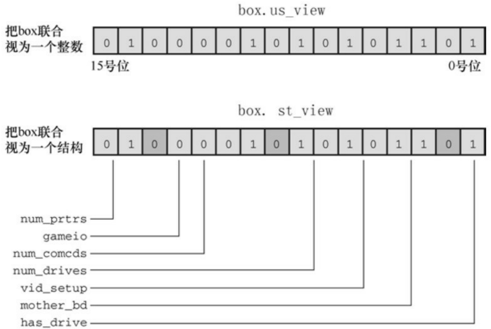

可以使用printf()或puts()函数显示最终的字符串，但是程序清单15.1中定义了show\_bstr()函数，以4位一组打印字符串，方便阅读。

下面的该程序的运行示例:

Enter integers and see them in binary.

Non-numeric input terminates program.

7

7 is 0000 0000 0000 0000 0000 0000 0000 0111

**2013**

2013 is 0000 0000 0000 0000 0000 0111 1101 1101

-1 is 1111 1111 1111 1111 1111 1111 1111 1111

**32123**

32123 is 0000 0000 0000 0000 0111 1101 0111 1011

q

Bye!

## 15.3.9 另一个例子

我们来看另一个例子。这次要编写的函数用于切换一个值中的后 n 位，待处理值和 n 都是函数的参数。

～运算符切换一个字节的所有位，而不是选定的少数位。但是，^运算符（按位异或）可用于切换单个位。假设创建了一个掩码，把后n位设置为

1，其余位设置为0。然后使用^组合掩码和待切换的值便可切换该值的最后n位，而且其他位不变。方法如下:

```txt
int invert_end(int num, int bits)
{
int mask = 0;
int bitval = 1;
while (bits— > 0)
{
mask |= bitval;
bitval <<= 1;
}
return num ^ mask;
}
```

while循环用于创建所需的掩码。最初，mask的所有位都为0。第1轮循环将mask的0号位设置为1。然后第2轮循环将mask的1号位设置为1，以此类推。循环bits次，mask的后bits位就都被设置为1。最后，num ^ mask运算即得所需的结果。

我们把这个函数放入前面的程序中，测试该函数。如程序清单15.2所示。

程序清单**15.2 invert4.c**程序

/\* invert4.c -- 使用位操作显示二进制 \*/

```c
#include <stdio.h>

#include <limits.h>

char * itobs(int, char *);
void show_bstr(const char *);
int invert_end(int num, int bits);

int main(void)
{
char bin_str[CHAR_BIT * sizeof(int) + 1];
int number;
puts("Enter integers and see them in binary.");
puts("Non-numeric input terminates program.");
while (scanf("%d", &number) == 1)
{
itobs(number, bin_str);
printf("%d is\n", number);
show_bstr(bin_str);
putchar('\n');
number = invert_end(number, 4);
printf("Inverting the last 4 bits gives\n");
```

```c
show_bstr(itobs(number, bin_str));

putchar('\n');

}

puts("Bye!");

return 0;

}

char * itobs(int n, char * ps)

{

int i;

const static int size = CHAR_BIT * sizeof(int);

for (i = size - 1; i >= 0; i--, n >>= 1)

ps[i] = (01 & n) + '0';

ps[size] = '\0';

return ps;

}

/* 以4位为一组，显示二进制字符串 */
void show_bstr(const char * str)

{

int i = 0;
```

while (str[i]) /\* 不是空字符 \*/

{

putchar(str[i]);

if (++i % 4 == 0 && str[i])

putchar(' ');

}

}

int invert\_end(int num, int bits)

{

int mask = 0;

int bitval = 1;

while (bits-- > 0)

{

mask |= bitval;

bitval <<= 1;

}

return num ^ mask;

}

下面是该程序的一个运行示例:

Enter integers and see them in binary.

Non-numeric input terminates program.

7

7 is

0000 0000 0000 0000 0000 0000 0000 0111

Inverting the last 4 bits gives

0000 0000 0000 0000 0000 0000 0000 1000

**12541**

12541 is

0000 0000 0000 0000 0011 0000 1111 1101

Inverting the last 4 bits gives

0000 0000 0000 0000 0011 0000 1111 0010

q

Bye!

## 15.4 位字段

操控位的第2种方法是位字段（bit field）。位字段是一个signed int或unsigned int类型变量中的一组相邻的位（C99和C11新增了\_Bool类型的位字段）。位字段通过一个结构声明来建立，该结构声明为每个字段提供标签，并确定该字段的宽度。例如，下面的声明建立了一个4个1位的字段:

```txt
struct {
unsigned int autfd : 1;
unsigned int bldfc : 1;
unsigned int undln : 1;
unsigned int itals : 1;
} prnt;
```

根据该声明，prnt包含4个1位的字段。现在，可以通过普通的结构成员运算符（.）单独给这些字段赋值:

```javascript
prnt.itals = 0;

prnt.undln = 1;
```

由于每个字段恰好为1位，所以只能为其赋值1或0。变量prnt被储存在int大小的内存单元中，但是在本例中只使用了其中的4位。

带有位字段的结构提供一种记录设置的方便途径。许多设置（如，字体的粗体或斜体）就是简单的二选一。例如，开或关、真或假。如果只需要使用 1 位，就不需要使用整个变量。内含位字段的结构允许在一个存储单元中储存多个设置。

有时，某些设置也有多个选择，因此需要多位来表示。这没问题，字段

不限制 1 位大小。可以使用如下的代码:

```vhdl
struct {

unsigned int code1 : 2;

unsigned int code2 : 2;

unsigned int code3 : 8;

} prcode;
```

以上代码创建了两个2位的字段和一个8位的字段。可以这样赋值:

```txt
prcode.code1 = 0;

prcode.code2 = 3;

prcode.code3 = 102;
```

但是，要确保所赋的值不超出字段可容纳的范围。

如果声明的总位数超过了一个unsigned int类型的大小会怎样？会用到下一个unsigned int类型的存储位置。一个字段不允许跨越两个unsigned int之间的边界。编译器会自动移动跨界的字段，保持unsigned int的边界对齐。一旦发生这种情况，第1个unsigned int中会留下一个未命名的“洞”。

可以用未命名的字段宽度“填充”未命名的“洞”。使用一个宽度为0的未命名字段迫使下一个字段与下一个整数对齐:

```txt
struct {

unsigned int field1      : 1 ;

unsigned int          : 2 ;
```

```matlab
unsigned int field2      : 1 ;
unsigned int             : 0 ;
unsigned int field3     : 1 ;
} stuff;
```

这里，在stuff.field1和stuff.field2之间，有一个2位的空隙；stuff.field3将储存在下一个unsigned int中。

字段储存在一个int中的顺序取决于机器。在有些机器上，存储的顺序是从左往右，而在另一些机器上，是从右往左。另外，不同的机器中两个字段边界的位置也有区别。由于这些原因，位字段通常都不容易移植。尽管如此，有些情况却要用到这种不可移植的特性。例如，以特定硬件设备所用的形式储存数据。

## 15.4.1 位字段示例

通常，把位字段作为一种更紧凑储存数据的方式。例如，假设要在屏幕上表示一个方框的属性。为简化问题，我们假设方框具有如下属性:

方框是透明的或不透明的；

方框的填充色选自以下调色板:黑色、红色、绿色、黄色、蓝色、紫色、青色或白色；

边框可见或隐藏；

边框颜色与填充色使用相同的调色板；

边框可以使用实线、点线或虚线样式。

可以使用单独的变量或全长（full-sized）结构成员来表示每个属性，但是这样做有些浪费位。例如，只需1位即可表示方框是透明还是不透明；只需1位即可表示边框是显示还是隐藏。8种颜色可以用3位单元的8个可能的值来表示，而3种边框样式也只需2位单元即可表示。总共10位就足够表示方框的5个属性设置。

一种方案是:一个字节储存方框内部（透明和填充色）的属性，一个字节储存方框边框的属性，每个字节中的空隙用未命名字段填充。struct box\_props声明如下:

```txt
struct boxprops {
bool opaque                      : 1 ;
unsigned int fill_color    : 3 ;
unsigned int                          : 4 ;
bool show_border         : 1 ;
unsigned int border_color   : 3 ;
unsigned int border_style   : 2 ;
unsigned int                          : 2 ;
};
```

加上未命名的字段，该结构共占用 16 位。如果不使用填充，该结构占用 10 位。但是要记住，C 以unsigned int作为位字段结构的基本布局单元。因此，即使一个结构唯一的成员是1位字段，该结构的大小也是一个unsigned int类型的大小，unsigned int在我们的系统中是32位。另外，以上代码假设C99新增的\_Bool类型可用，在stdbool.h中，bool是\_Bool的别名。

对于opaque成员，1表示方框不透明，0表示透明。show\_border成员也用类似的方法。对于颜色，可以用简单的RGB（即red-green-blue的缩写）表示。这些颜色都是三原色的混合。显示器通过混合红、绿、蓝像素来产生不同的颜色。在早期的计算机色彩中，每个像素都可以打开或关闭，所以可以使用用 1 位来表示三原色中每个二进制颜色的亮度。常用的顺序是，左侧位表示蓝色亮度、中间位表示绿色亮度、右侧位表示红色亮度。表15.3列出了这8种可能的组合。fill\_color成员和border\_color成员可以使用这些组合。最后，border\_style成员可以使用0、1、2来表示实线、点线和虚线样式。

表15.3 简单的颜色表示

| 位组合 | 十进制 | 颜色 |
| --- | --- | --- |
| 000 | 0 | 黑色 |
| 001 | 1 | 红色 |
| 010 | 2 | 绿色 |
| 011 | 3 | 黄色 |
| 100 | 4 | 蓝色 |
| 101 | 5 | 紫色 |
| 110 | 6 | 青色 |
| 111 | 7 | 白色 |

程序清单15.3中的程序使用box\_props结构，该程序用#define创建供结构成员使用的符号常量。注意，只打开一位即可表示三原色之一。其他颜色用三原色的组合来表示。例如，紫色由打开的蓝色位和红色位组成，所以，紫色可表示为BLUE|RED。

程序清单**15.3 fields.c**程序

/\* fields.c -- 定义并使用字段 \*/

#include &lt;stdio.h&gt;

#include &lt;stdbool.h&gt; // C99定义了bool、true、false

/\* 线的样式 \*/

#define SOLID 0

#define DOTTED 1

#define DASHED 2

/\* 三原色 \*/

#define BLUE 4

#define GREEN 2

#define RED 1

/\* 混合色 \*/

#define BLACK 0

#define YELLOW (RED | GREEN)

#define MAGENTA (RED | BLUE)

#define CYAN (GREEN | BLUE)

#define WHITE (RED | GREEN | BLUE)

const char \* colors[8] = { "black", "red", "green", "yellow",

"blue", "magenta", "cyan", "white" };

struct box\_props {

bool opaque : 1; // 或者 unsigned int （C99以前）

unsigned int fill\_color : 3;

unsigned int : 4;

bool show\_border : 1; // 或者 unsigned int （C99以前）

unsigned int border\_color : 3;

unsigned int border\_style : 2;

```c
unsigned int : 2;
};
void show_settings(const struct boxprops * pb);
int main(void)
{
/* 创建并初始化 boxprops 结构 */
struct boxprops box = { true, YELLOW, true, GREEN, DASHED };
printf("Original box settings:\n");
show_settings(&box);
box.opaque = false;
box.fill_color = WHITE;
box.border_color = MAGENTA;
box.border_style = SOLID;
printf("\nModified box settings:\n");
show_settings(&box);
return 0;
}
void show_settings(const struct boxprops * pb)
{
```

```cpp
printf("Box is %s.\n",
pb->opaque == true ? "opaque" : "transparent");
printf("The fill color is %s.\n", colors[pb->fill_color]);
printf("Border %s.\n",
pb->show_border == true ? "shown" : "not shown");
printf("The border color is %s.\n", colors[pb->border_color]);
printf("The border style is ");
switch (pb->border_style)
{
case SOLID: printf("solid.\n"); break;
case DOTTED: printf("dotted.\n"); break;
case DASHED: printf("dashed.\n"); break;
default: printf("unknown type.\n");
}
}
下面是该程序的输出:
Original box settings:
Box is opaque.
The fill color is yellow.
```

Border shown.

The border color is green.

The border style is dashed.

Modified box settings:

Box is transparent.

The fill color is white.

Border shown.

The border color is magenta.

The border style is solid.

该程序要注意几个要点。首先，初始化位字段结构与初始化普通结构的语法相同:

$$
\text {struct box\_props box} = \{\text {YES, YELLOW, YES, GREEN, DASHED} \};
$$

类似地，也可以给位字段成员赋值:

$$
\text {box.fill\_color} = \text {WHITE};
$$

另外，switch语句中也可以使用位字段成员，甚至还可以把位字段成员用作数组的下标:

$$
\operatorname{printf} \left(\text {The fill color is \%s.\n", colors[pb - > fill\_color]}\right);
$$

注意，根据 colors 数组的定义，每个索引对应一个表示颜色的字符串，而每种颜色都把索引值作为该颜色的数值。例如，索引1对应字符串"red"，枚举常量red的值是1。

## 15.4.2 位字段和按位运算符

在同类型的编程问题中，位字段和按位运算符是两种可替换的方法，用哪种方法都可以。例如，前面的例子中，使用和unsigned int类型大小相同的结构储存图形框的信息。也可使用unsigned int变量储存相同的信息。如果不想用结构成员表示法来访问不同的部分，也可以使用按位运算符来操作。一般而言，这种方法比较麻烦。接下来，我们来研究这两种方法（程序中使用了这两种方法，仅为了解释它们的区别，我们并不鼓励这样做）。

可以通过一个联合把结构方法和位方法放在一起。假定声明了 struct box\_props 类型，然后这样声明联合:

```txt
union Views /* 把数据看作结构或unsigned short类型的变量 */
{
struct boxprops st_view;
unsigned short us_view;
};
```

在某些系统中，unsigned int和box\_props类型的结构都占用16 位内存。但是，在其他系统中（例如我们使用的系统），unsigned int和box\_props都是32位。无论哪种情况，通过联合，都可以使用 st\_view 成员把一块内存看作是一个结构，或者使用 us\_view 成员把相同的内存块看作是一个unsigned short。结构的哪一个位字段与unsigned short中的哪一位对应？这取决于实现和硬件。下面的程序示例假设从字节的低阶位端到高阶位端载入结构。也就是说，结构中的第 1 个位字段对应计算机字的0号位（为简化起见，图15.3以16位单元演示了这种情况）。



<details>
<summary>text_image</summary>

box.us_view
把box联合
视为一个整数
0 1 0 0 0 0 1 0 1 0 1 0 1 1 0 1
15号位
0号位
box.st_view
把box联合
视为一个结构
0 1 0 0 0 0 1 0 1 0 1 0 1 1 0 1
num_prtrs
gameio
num_comcds
num_drives
vid_setup
mother_bd
has_drive
</details>

图15.3 作为整数和结构的联合

程序清单15.4使用Views联合来比较位字段和按位运算符这两种方法。在该程序中，box是View联合，所以box.st\_view是一个使用位字段的box\_props类型的结构，box.us\_view把相同的数据看作是一个unsigned short类型的变量。联合只允许初始化第1 个成员，所以初始化值必须与结构相匹配。该程序分别通过两个函数显示 box 的属性，一个函数接受一个结构，一个函数接受一个 unsigned short 类型的值。这两种方法都能访问数据，但是所用的技术不同。该程序还使用了本章前面定义的itobs()函数，以二进制字符串形式显示数据，以便读者查看每个位的开闭情况。

程序清单**15.4 dualview.c**程序

/\* dualview.c -- 位字段和按位运算符 \*/

#include &lt;stdio.h&gt;

#include &lt;stdbool.h&gt;

#include &lt;limits.h&gt;

/\* 位字段符号常量 \*/

/\* 边框线样式 \*/

#define SOLID 0

#define DOTTED 1

#define DASHED 2

/\* 三原色 \*/

#define BLUE 4

#define GREEN 2

#define RED 1

/\* 混合颜色 \*/

#define BLACK 0

#define YELLOW (RED | GREEN)

#define MAGENTA (RED | BLUE)

#define CYAN (GREEN | BLUE)

#define WHITE (RED | GREEN | BLUE)

/\* 按位方法中用到的符号常量 \*/

#define OPAQUE 0x1

#define FILL\_BLUE 0x8

#define FILL\_GREEN 0x4

#define FILL\_RED 0x2

#define FILL\_MASK 0xE

#define BORDER 0x100

#define BORDER\_BLUE 0x800

#define BORDER\_GREEN 0x400

#define BORDER\_RED0x 200

#define BORDER\_MASK 0xE00

#define B\_SOLID 0

#define B\_DOTTED 0x1000

#define B\_DASHED 0x2000

#define STYLE\_MASK0x 3000

const char \* colors[8] = { "black", "red", "green", "yellow", "blue", "magenta",

"cyan", "white" };

struct box\_props {

bool opaque : 1;

unsigned int fill\_color : 3;

unsigned int : 4;

```c
bool show_border          : 1;
unsigned int border_color  : 3;
unsigned int border_style  : 2;
unsigned int                : 2;
};
union Views   /* 把数据看作结构或unsigned short类型的变量 */
{
struct boxprops st_view;
unsigned short us_view;
};
void show_settings(const struct boxprops * pb);
void show_settings1(unsigned short);
char * itobs(int n, char * ps);
int main(void)
{
/* 创建Views联合，并初始化initialize struct box view */
union Views box = { { true, YELLOW, true, GREEN, DASHED } };
char bin_str[8 * sizeof(unsigned int) + 1];
printf("Original box settings:\n");
```

```c
show_settings(&box.st_view);

printf("\nBox settings using unsigned int view:\n");

show_settings1(box.us_view);

printf("bits are %s\n",
itobs(box.us_view, bin_str));

box.us_view &= ~FILL_MASK;          /* 把表示填充色的位清0 */
box.us_view |= (FILL_BLUE | FILL_GREEN);    /* 重置填充色 */
box.us_view ^= OPAQUE;                    /* 切换是否透明的位 */
box.us_view |= BORDER_RED;                /* 错误的方法 */
box.us_view &= ~STYLE_MASK;            /* 把样式的位清0 */
box.us_view |= B_DOTTED;                 /* 把样式设置为点 */
printf("\nModified box settings:\n");
show_settings(&box.st_view);
printf("\nBox settings using unsigned int view:\n");
show_settings1(box.us_view);
printf("bits are %s\n",
itobs(box.us_view, bin_str));
return 0;
```

```txt
}
void show_settings(const struct boxprops * pb)
{
printf("Box is %s.\n",
pb->opaque == true ? "opaque" : "transparent");
printf("The fill color is %s.\n", colors[pb->fill_color]);
printf("Border %s.\n",
pb->show_border == true ? "shown" : "not shown");
printf("The border color is %s.\n", colors[pb->border_color]);
printf("The border style is ");
switch (pb->border_style)
{
case SOLID: printf("solid.\n"); break;
case DOTTED: printf("dotted.\n"); break;
case DASHED: printf("dashed.\n"); break;
default: printf("unknown type.\n");
}
}
void show_settings1(unsigned short us)
```

```txt
{
printf("box is %s.\n",
(us & OPAQUE) == OPAQUE ? "opaque" : "transparent");
printf("The fill color is %s.\n",
colors[(us >> 1) & 07]);
printf("Border %s.\n",
(us & BORDER) == BORDER ? "shown" : "not shown");
printf("The border style is ");
switch (us & STYLE_MASK)
{
case B_SOLID : printf("solid.\n"); break;
case B_DOTTED : printf("dotted.\n"); break;
case B_DASHED : printf("dashed.\n"); break;
default : printf("unknown type.\n");
}
printf("The border color is %s.\n",
colors[(us >> 9) & 07]);
}
char * itobs(int n, char * ps)
```

```txt
{
int i;

const static int size = CHAR_BIT * sizeof(int);

for (i = size - 1; i >= 0; i--, n >>= 1)

ps[i] = (01 & n) + '0';

ps[size] = '\0';

return ps;

}
```

下面是该程序的输出:

Original box settings:

Box is opaque.

The fill color is yellow.

Border shown.

The border color is green.

The border style is dashed.

Box settings using unsigned int view:

box is opaque.

The fill color is yellow.

Border shown.

The border style is dashed.

The border color is green.

bits are 00000000000000000010010100000111

Modified box settings:

Box is transparent.

The fill color is cyan.

Border shown.

The border color is yellow.

The border style is dotted.

Box settings using unsigned int view:

box is transparent.

The fill color is cyan.

Border not shown.

The border style is dotted.

The border color is yellow.

bits are 00000000000000000001011100001100

这里要讨论几个要点。位字段视图和按位视图的区别是，按位视图需要位置信息。例如，程序中使用BLUE表示蓝色，该符号常量的数值为4。但是，由于结构排列数据的方式，实际储存蓝色设置的是3号位（位的编号从0开始，参见图15.1），而且储存边框为蓝色的设置是11号位。因此，该程序定义了一些新的符号常量:

```c
#define FILL_BLUE      0x8
```

```c
#define BORDER_BLUE      0x800
```

这里，0x8是3号位为1时的值，0x800是11号位为1时的值。可以使用第1个符号常量设置填充色的蓝色位，用第2个符号常量设置边框颜色的蓝色位。用十六进制记数法更容易看出要设置二进制的哪一位，由于十六进制的每一位代表二进制的4位，那么0x8的位组合是1000，而0x800的位组合是10000000000，0x800的位组合比0x8后面多8个0。但是以等价的十进制来看就没那么明显，0x8是8，0x800是2048。

如果值是2的幂，那么可以使用左移运算符来表示值。例如，可以用下面的#define分别替换上面的#define:

```c
#define FILL_BLUE          1<<3
```

```c
#define BORDER_BLUE      1<<11
```

这里，<<的右侧是2的指数，也就是说，0x8是2<sup>3</sup>，0x800是2<sup>11</sup>。同样，表达式1<<n指的是第n位为1的整数。1<<11是常量表达式，在编译时求值。

可以使用枚举代替#defined创建符号常量。例如，可以这样做:

```python
enum { OPAQUE = 0x1, FILL_BLUE = 0x8, FILL_GREEN = 0x4, FILL_RED = 0x2,
```

```python
FILL_MASK = 0xE, BORDER = 0x100, BORDER_BLUE = 0x800,
```

```python
BORDER_GREEN = 0x400, BORDER_RED = 0x200, BORDER_MASK = 0xE00,
```

```txt
B_DOTTED = 0x1000, B_DASHED = 0x2000, STYLE_MASK = 0x3000};
```

如果不想创建枚举变量，就不用在声明中使用标记。

注意，按位运算符改变设置更加复杂。例如，要设置填充色为青色。只打开蓝色位和绿色位是不够的:

问题是该颜色还依赖于红色位的设置。如果已经设置了该位（比如对于黄色），这行代码保留了红色位的设置，而且还设置了蓝色位和绿色位，结果是产生白色。解决这个问题最简单的方法是在设置新值前关闭所有的颜色位。因此，程序中使用了下面两行代码:

/\* 把表示填充色的位

如果不先关闭所有的相关位，程序中演示了这种情况:

因为BORDER\_GREEN位已经设置过了，所以结果颜色是BORDER\_GREEN | BORDER\_RED，被解释为黄色。

这种情况下，位字段版本更简单:

这种方法不用先清空所有的位。而且，使用位字段成员时，可以为边框和框内填充色使用相同的颜色值。但是用按位运算符的方法则要使用不同的值（这些值反映实际位的位置）。

其次，比较下面两个打印语句:

printf("The border color is %s.\n", colors[pb->border\_color]);

printf("The border color is %s.\n", colors[(us >> 9) & 07]);

第1条语句中，表达式pb->border\_color的值在0～7的范围内，所以该表达式可用作colors数组的索引。用按位运算符获得相同的信息更加复杂。一种方法是使用ui>>9把边框颜色右移至最右端（0号位～2号位），然后把该值与掩码07组合，关闭除了最右端3位以外所有的位。这样结果也在0～7的范围内，可作为colors数组的索引。

警告

位字段和位的位置之间的相互对应因实现而异。例如，在早期的Macintosh PowerPC上运行程序清单15.4，输出如下:

Original box settings:

Box is opaque.

The fill color is yellow.

Border shown.

The border color is green.

The border style is dashed.

Box settings using unsigned int view:

box is transparent.

The fill color is black.

Border not shown.

The border style is solid.

The border color is black.

bits are 10110000101010000000000000000000

Modified box settings:

Box is opaque.

The fill color is yellow.

Border shown.

The border color is green.

The border style is dashed.

Box settings using unsigned int view:

box is opaque.

The fill color is cyan.

Border shown.

The border style is dotted.

The border color is red.

bits are 10110000101010000001001000001101

该输出的二进制位与程序示例15.4不同，Macintosh PowerPC把结构载入内存的方式不同。特别是，它把第1位字段载入最高阶位，而不是最低阶位。所以结构表示法储存在前16位（与PC中的顺序不同），而unsigned int表示法则储存在后16位。因此，对于Macintosh，程序清单15.4中关于位的位置的假设是错误的，使用按位运算符改变透明设置和填充色设置时，也弄错了位。

## 15.5 对齐特性（C11）

C11 的对齐特性比用位填充字节更自然，它们还代表了C在处理硬件相关问题上的能力。在这种上下文中，对齐指的是如何安排对象在内存中的位置。例如，为了效率最大化，系统可能要把一个 double 类型的值储存在4 字节内存地址上，但却允许把char储存在任意地址。大部分程序员都对对齐不以为然。但是，有些情况又受益于对齐控制。例如，把数据从一个硬件位置转移到另一个位置，或者调用指令同时操作多个数据项。

\_Alignof运算符给出一个类型的对齐要求，在关键字\_Alignof后面的圆括号中写上类型名即可:

$$
\text {size\_td\_align} = \text {\_Alignof(float)};
$$

假设d\_align的值是4，意思是float类型对象的对齐要求是4。也就是说，4是储存该类型值相邻地址的字节数。一般而言，对齐值都应该是2的非负整数次幂。较大的对齐值被称为stricter或stronger，较小的对齐值被称为weaker。

可以使用\_Alignas 说明符指定一个变量或类型的对齐值。但是，不应该要求该值小于基本对齐值。例如，如果float类型的对齐要求是4，不要请求其对齐值是1或2。该说明符用作声明的一部分，说明符后面的圆括号内包含对齐值或类型:

Alignas(double) char c1;

Alignas(8) char c2;

unsigned char \_Alignas(long double) c\_arr[sizeof(long double)];

注意

撰写本书时，Clang（3.2版本）要求\_Alignas(type)说明符在类型说明符后面，如上面第3行代码所示。但是，无论\_Alignas(type)说明符在类型说明符的前面还是后面，GCC 4.7.3都能识别，后来Clang 3.3 版本也支持了这两种顺序。

程序清单15.5中的程序演示了\_Alignas和\_Alignof的用法。

程序清单15.5 align.c程序

// align.c -- 使用 \_Alignof 和 \_Alignas （C11）

```c
#include <stdio.h>

int main(void)
{
double dx;
char ca;
char cx;
double dz;
char cb;
char _Alignas(double)  cz;
printf("char alignment: %zd\n", _Alignof(char));
printf("double alignment: %zd\n", _Alignof(double));
printf("&dx: %p\n", &dx);
printf("&ca: %p\n", &ca);
printf("&cx: %p\n", &cx);
```

```c
printf("&dz: %p\n", &dz);

printf("&cb: %p\n", &cb);

printf("&cz: %p\n", &cz);

return 0;

}
```

该程序的输出如下:

```txt
char alignment: 1
double alignment: 8
&dx: 0x7fff5fbff660
&ca: 0x7fff5fbff65f
&cx: 0x7fff5fbff65e
&dz: 0x7fff5fbff650
&cb: 0x7fff5fbff64f
&cz: 0x7fff5fbff648
```

在我们的系统中，double的对齐值是8，这意味着地址的类型对齐可以被8整除。以0或8结尾的十六进制地址可被8整除。这就是地址常用两个double类型的变量和char类型的变量cz（该变量是double对齐值）。因为char的对齐值是1，对于普通的char类型变量，编译器可以使用任何地址。

在程序中包含 stdalign.h 头文件后，就可以把 alignas 和 alignof 分别作为\_Alignas 和\_Alignof的别名。这样做可以与C++关键字匹配。