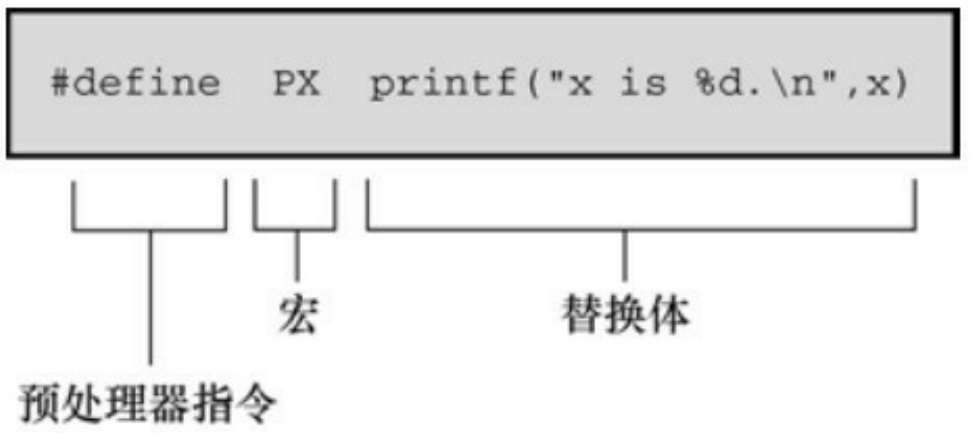
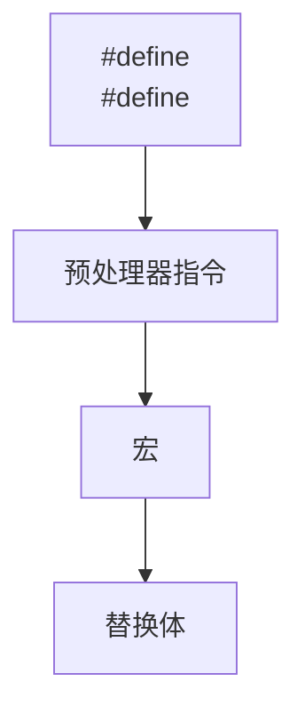
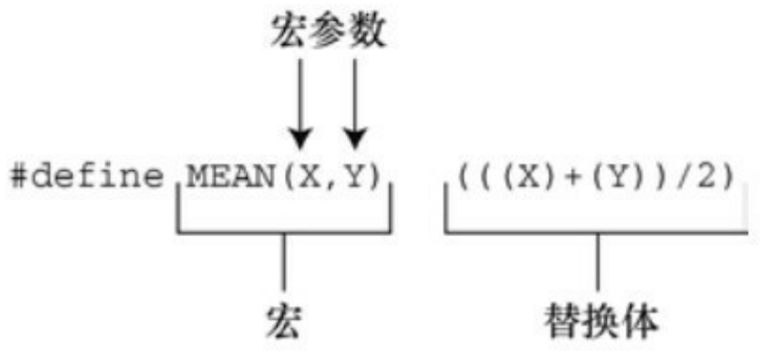
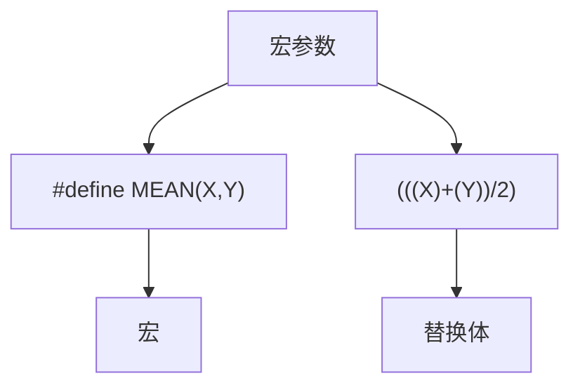

C11在stdlib.h库还添加了一个新的内存分配函数，用于对齐动态分配的内存。该函数的原型如下:

第1个参数代表指定的对齐，第2个参数是所需的字节数，其值应是第1个参数的倍数。与其他内存分配函数一样，要使用free()函数释放之前分配的内存。

## 15.6 关键概念

C 区别于许多高级语言的特性之一是访问整数中单独位的能力。该特性通常是与硬件设备和操作系统交互的关键。

C有两种访问位的方法。一种方法是通过按位运算符，另一种方法是在结构中创建位字段。

C11新增了检查内存对齐要求的功能，而且可以指定比基本对齐值更大的对齐值。

通常（但不总是），使用这些特性的程序仅限于特定的硬件平台或操作系统，而且设计为不可移植的。

## 15.7 本章小结

计算硬件与二进制记数系统密不可分，因为二进制数的1和0可用于表示计算机内存和寄存器中位的开闭状态。虽然C不允许以二进制形式书写数字，但是它识别与二进制相关的八进制和十六进制记数法。正如每个二进制数字表示1位一样，每个八进制位代表3位，每个十六进制位代表4位。这种关系使得二进制转为八进制或十六进制较为简单。

C 提供多种按位运算符，之所以称为按位是因为它们单独操作一个值中的每个位。～运算符将其运算对象的每一位取反，将1转为0，0转为1。按位与运算符（&）通过两个运算对象形成一个值。如果两运算对象中相同号位都为1，那么该值中对应的位为1；否则，该位为0。按位或运算符（|）同样通过两个运算对象形成一个值。如果两运算对象中相同号位有一个为1或都为1，那么该值中对应的位为1；否则，该位为0。按位异或运算符（^）也有类似的操作，只有两运算对象中相同号位有一个为1时，结果值中对应的位才为1。

C还有左移（<<）和右移（>>）运算符。这两个运算符使位组合中的所有位都向左或向右移动指定数量的位，以形成一个新值。对于左移运算符，空出的位置设为 0。对于右移运算符，如果是无符号类型的值，空出的位设为0；如果是有符号类型的值，右移运算符的行为取决于实现。

可以在结构中使用位字段操控一个值中的单独位或多组位。具体细节因实现而异。

可以使用\_Alignas强制执行数据存储区上的对齐要求。

这些位工具帮助C程序处理硬件问题，因此它们通常用于依赖实现的场合中。

## 15.8 复习题

复习题的参考答案在附录A中。

1.把下面的十进制转换为二进制:

a.3
b.13
c.59
d.119

2.将下面的二进制值转换为十进制、八进制和十六进制的形式:

a.00010101
b.01010101
c.01001100
d.10011101

3.对下面的表达式求值，假设每个值都为8位:

a.～3
b.3 & 6
c.3 | 6
d.1 | 6
e.3 ^ 6
f.7 >> 1

```txt
g.7 << 2
```

4.对下面的表达式求值，假设每个值都为8位:

```txt
a.～0
b.!0
c.2 & 4
d.2 && 4
e.2 | 4
f.2 || 4
g.5 << 3
```

5.因为ASCII码只使用最后7位，所以有时需要用掩码关闭其他位，其相应的二进制掩码是什么？分别用十进制、八进制和十六进制来表示这个掩码。

6.程序清单15.2中，可以把下面的代码:

```txt
while (bits-- > 0)
{
mask |= bitval;
bitval <<= 1;
}
```

替换成:

```txt
while (bits-- > 0)
```

```lisp
{
mask += bitval;
bitval *= 2;
}
```

程序照常工作。这是否意味着\*=2等同于<<=1？+=是否等同于|=？

7.a.Tinkerbell计算机有一个硬件字节可读入程序。该字节包含以下信息:

| 位 | 含义 |
| --- | --- |
| 0~1 | 1.4MB 软盘驱动器的数量 |
| 2 | 未使用 |
| 3~4 | CD-ROM 驱动器数量 |
| 5 | 未使用 |
| 6~7 | 硬盘驱动器数量 |

Tinkerbell和IBM PC一样，从右往左填充结构位字段。创建一个适合存放这些信息的位字段模板。

b.Klinkerbell与Tinkerbell类似，但是它从左往右填充结构位字段。请为Klinkerbell创建一个相应的位字段模板。

## 15.9 编程练习

1.编写一个函数，把二进制字符串转换为一个数值。例如，有下面的语句:

$$
\mathrm{char} * \mathrm{pbin} = " 0 1 0 0 1 0 0 1";
$$

那么把pbin作为参数传递给该函数后，它应该返回一个int类型的值25。

2.编写一个程序，通过命令行参数读取两个二进制字符串，对这两个二进制数使用～运算符、&运算符、|运算符和^运算符，并以二进制字符串形式打印结果（如果无法使用命令行环境，可以通过交互式让程序读取字符串）。
3.编写一个函数，接受一个 int 类型的参数，并返回该参数中打开位的数量。在一个程序中测试该函数。
4.编写一个程序，接受两个int类型的参数:一个是值；一个是位的位置。如果指定位的位置为1，该函数返回1；否则返回0。在一个程序中测试该函数。
5.编写一个函数，把一个 unsigned int 类型值中的所有位向左旋转指定数量的位。例如，rotate\_l(x, 4)把x中所有位向左移动4个位置，而且从最左端移出的位会重新出现在右端。也就是说，把高阶位移出的位放入低阶位。在一个程序中测试该函数。
6.设计一个位字段结构以储存下面的信息。

字体ID:0～255之间的一个数；

字体大小:0～127之间的一个数；

对齐:0～2之间的一个数，表示左对齐、居中、右对齐；

加粗:开（1）或闭（0）；

斜体:开（1）或闭（0）；

在一个程序中使用该结构来打印字体参数，并使用循环菜单来让用户改变参数。例如，该程序的一个运行示例如下:

```txt
ID SIZE ALIGNMENT B I U
1 12 left off off off
```

f)changefont s)change size a)changealignment b)toggle bold i)toggle italicu)toggle underline q)quit

s Enterfont size (0-127):36

```txt
ID SIZE ALIGNMENT B I U
1 36 left off off off
```

f)changefont s)change size a)changealignment b)toggle bold i)toggle italic u)toggle underline q)quit

a Select alignment: 1)left c)center r)right r

ID SIZE ALIGNMENT B I U 1 36 right off off off f)changefont s)changesize a)changealignment b)toggle bold i)toggle italic u)toggle underline q)quit i

```txt
ID SIZE ALIGNMENT    B    I    U
1     36   right      off on off
```

f)change font s)change size a)changealignment b)toggle bold i)toggle italic u)toggle underline q)quit

q Bye!

该程序要使用按位与运算符（&）和合适的掩码来把字体ID和字体大小信息转换到指定的范围内。

7.编写一个与编程练习 6 功能相同的程序，使用 unsigned long 类型的变量储存字体信息，并且使用按位运算符而不是位成员来管理这些信息。

# 第16章 C预处理器和C库

本章介绍以下内容:

预处理指令:#define、#include、#ifdef、#else、#endif、#ifndef、#if、#elif、#line、#error、#pragma

关键字:\_Generic、\_Noreturn、\_Static\_assert

函数/宏:sqrt()、atan()、atan2()、exit()、atexit()、assert()、memcpy()、memmove()、va\_start()、va\_arg()、va\_copy()、va\_end()

C预处理器的其他功能

通用选择表达式

内联函数

C库概述和一些特殊用途的方便函数

C语言建立在适当的关键字、表达式、语句以及使用它们的规则上。然而，C标准不仅描述C语言，还描述如何执行C预处理器、C标准库有哪些函数，以及详述这些函数的工作原理。本章将介绍C预处理器和C库，我们先从C预处理器开始。

C预处理器在程序执行之前查看程序（故称之为预处理器）。根据程序中的预处理器指令，预处理器把符号缩写替换成其表示的内容。预处理器可以包含程序所需的其他文件，可以选择让编译器查看哪些代码。预处理器并不知道 C。基本上它的工作是把一些文本转换成另外一些文本。这样描述预处理器无法体现它的真正效用和价值，我们将在本章举例说明。前面的程序示例中也有很多#define和#include的例子。下面，我们先总结一下已学过的预处理指令，再介绍一些新的知识点。

## 16.1 翻译程序的第一步

在预处理之前，编译器必须对该程序进行一些翻译处理。首先，编译器把源代码中出现的字符映射到源字符集。该过程处理多字节字符和三字符序列——字符扩展让C更加国际化（详见附录B“参考资料VII，扩展字符支持”）。

第二，编译器定位每个反斜杠后面跟着换行符的实例，并删除它们。也就是说，把下面两个物理行（physical line）:

printf("That's wond\

erful!\n");

转换成一个逻辑行（logical line）:

printf("That's wonderful\n!");

注意，在这种场合中，“换行符”的意思是通过按下Enter键在源代码文件中换行所生成的字符，而不是指符号表征\n。

由于预处理表达式的长度必须是一个逻辑行，所以这一步为预处理器做好了准备工作。一个逻辑行可以是多个物理行。

第三，编译器把文本划分成预处理记号序列、空白序列和注释序列（记号是由空格、制表符或换行符分隔的项，详见16.2.1）。这里要注意的是，编译器将用一个空格字符替换每一条注释。因此，下面的代码:

int/\* 这看起来并不像一个空格\*/fox;

将变成:

int fox;

而且，实现可以用一个空格替换所有的空白字符序列（不包括换行符）。最后，程序已经准备好进入预处理阶段，预处理器查找一行中以#号开始的预处理指令。

## 16.2 明示常量:#define

#define预处理器指令和其他预处理器指令一样，以#号作为一行的开始。ANSI和后来的标准都允许#号前面有空格或制表符，而且还允许在#和指令的其余部分之间有空格。但是旧版本的C要求指令从一行最左边开始，而且#和指令其余部分之间不能有空格。指令可以出现在源文件的任何地方，其定义从指令出现的地方到该文件末尾有效。我们大量使用#define指令来定义明示常量（manifest constant）（也叫做符号常量），但是该指令还有许多其他用途。程序清单16.1演示了#define指令的一些用法和属性。

预处理器指令从#开始运行，到后面的第1个换行符为止。也就是说，指令的长度仅限于一行。然而，前面提到过，在预处理开始前，编译器会把多行物理行处理为一行逻辑行。

程序清单16.1 preproc.c程序

```c
/* preproc.c -- 简单的预处理示例 */
#include <stdio.h>
#define TWO 2      /* 可以使用注释 */
#define OW "Consistency is the last refuge of the unimaginative.- Oscar Wilde" /* 反斜杠把该定义延续到下一行 */
#define FOUR TWO*TWO
#define PX printf("X is %d.\n", x)
#define FMT   "X is %d.\n"
int main(void)
{
```

```c
int x = TWO;

PX;

x = FOUR;

printf(FMT, x);

printf("%s\n", OW);

printf("TWO: OW\n");

return 0;

}
```

每行#define（逻辑行）都由3部分组成。第1部分是#define指令本身。第2部分是选定的缩写，也称为宏。有些宏代表值（如本例），这些宏被称为类对象宏（object-like macro）。C 语言还有类函数宏（function-like macro），稍后讨论。宏的名称中不允许有空格，而且必须遵循C变量的命名规则:只能使用字符、数字和下划线（\_）字符，而且首字符不能是数字。第3部分（指令行的其余部分）称为替换列表或替换体（见图16.1）。一旦预处理器在程序中找到宏的示实例后，就会用替换体代替该宏（也有例外，稍后解释）。从宏变成最终替换文本的过程称为宏展开（macro expansion）。注意，可以在#define行使用标准C注释。如前所述，每条注释都会被一个空格代替。



<details>
<summary>flowchart</summary>


</details>

图16.1 类对象宏定义的组成

运行该程序示例后，输出如下:

X is 2.

X is 4.

Consistency is the last refuge of the unimaginative.- Oscar Wilde

TWO: OW

下面分析具体的过程。下面的语句:

int x = TWO;

变成了:

int x = 2;

2代替了TWO。而语句:

PX;

变成了:

printf("X is %d.\n", x);

这里同样进行了替换。这是一个新用法，到目前为止我们只是用宏来表示明示常量。从该例中可以看出，宏可以表示任何字符串，甚至可以表示整个 C 表达式。但是要注意，虽然 PX 是一个字符串常量，它只打印一个名为x的变量。

下一行也是一个新用法。读者可能认为FOUR被替换成4，但是实际的过程是:

x = FOUR;

变成了:

$$
\mathrm{x} = \mathrm{TWO} ^ {*} \mathrm{TWO};
$$

即是:

$$
\mathrm{x} = 2 ^ {*} 2;
$$

宏展开到此处为止。由于编译器在编译期对所有的常量表达式（只包含常量的表达式）求值，所以预处理器不会进行实际的乘法运算，这一过程在编译时进行。预处理器不做计算，不对表达式求值，它只进行替换。

注意，宏定义还可以包含其他宏（一些编译器不支持这种嵌套功能）。

程序中的下一行:

printf (FMT, x);

变成了:

printf("X is %d.\n",x);

相应的字符串替换了 FMT。如果要多次使用某个冗长的字符串，这种方法比较方便。另外，也可以用下面的方法:

const char \* fmt = "X is %d.\n";

然后可以把fmt作为printf()的格式字符串。

下一行中，用相应的字符串替换OW。双引号使替换的字符串成为字符串常量。编译器把该字符串储存在以空字符结尾的数组中。因此，下面的指令定义了一个字符常量:

#define HAL 'Z'

而下面的指令则定义了一个字符串（Z\0）:

#define HAP "Z"

在程序示例16.1中，我们在一行的结尾加一个反斜杠字符使该行扩展至下一行:

#define OW "Consistency is the last refuge of the unimagina\

tive.- Oscar Wilde"

注意，第2行要与第1行左对齐。如果这样做:

#define OW "Consistency is the last refuge of the unimagina\

tive.- Oscar Wilde"

那么输出的内容是:

Consistency is the last refuge of the unimagina tive.- Oscar Wilde

第2行开始到tive之间的空格也算是字符串的一部分。

一般而言，预处理器发现程序中的宏后，会用宏等价的替换文本进行替换。如果替换的字符串中还包含宏，则继续替换这些宏。唯一例外的是双引号中的宏。因此，下面的语句:

printf("TWO: OW");

打印的是TWO: OW，而不是打印:

2: Consistency is the last refuge of the unimaginative.- Oscar Wilde

要打印这行，应该这样写:

printf("%d: %s\n", TWO, OW);

这行代码中，宏不在双引号内。

那么，何时使用字符常量？对于绝大部分数字常量，应该使用字符常量。如果在算式中用字符常量代替数字，常量名能更清楚地表达该数字的含义。如果是表示数组大小的数字，用符号常量后更容易改变数组的大小和循环次数。如果数字是系统代码（如，EOF），用符号常量表示的代码更容易移植（只需改变EOF的定义）。助记、易更改、可移植，这些都是符号常量很有价值的特性。

C语言现在也支持const关键字，提供了更灵活的方法。用const可以创建在程序运行过程中不能改变的变量，可具有文件作用域或块作用域。另一方面，宏常量可用于指定标准数组的大小和const变量的初始值。

#define LIMIT 20

const int LIM = 50;

static int data1[LIMIT]; // 有效

static int data2[LIM]; // 无效

const int LIM2 = 2 \* LIMIT; // 有效

const int LIM3 = 2 \* LIM; // 无效

这里解释一下上面代码中的“无效”注释。在C中，非自动数组的大小应该是整型常量表达式，这意味着表示数组大小的必须是整型常量的组合（如5）、枚举常量和sizeof表达式，不包括const声明的值（这也是C++和C的区别之一，在C++中可以把const值作为常量表达式的一部分）。但是，有的实现可能接受其他形式的常量表达式。例如，GCC 4.7.3不允许data2的声明，但是Clang 4.6允许。

## 16.2.1 记号

从技术角度来看，可以把宏的替换体看作是记号（token）型字符串，而不是字符型字符串。C预处理器记号是宏定义的替换体中单独的“词”。用

空白把这些词分开。例如:

#define FOUR 2\*2

该宏定义有一个记号:2\*2序列。但是，下面的宏定义中:

#define SIX 2 \* 3

有3个记号:2、\*、3。

替换体中有多个空格时，字符型字符串和记号型字符串的处理方式不同。考虑下面的定义:

#define EIGHT 4 \* 8

如果预处理器把该替换体解释为字符型字符串，将用4 \* 8替换EIGHT。即，额外的空格是替换体的一部分。如果预处理器把该替换体解释为记号型字符串，则用3个的记号4 \* 8（分别由单个空格分隔）来替换EIGHT。换而言之，解释为字符型字符串，把空格视为替换体的一部分；解释为记号型字符串，把空格视为替换体中各记号的分隔符。在实际应用中，一些C编译器把宏替换体视为字符串而不是记号。在比这个例子更复杂的情况下，两者的区别才有实际意义。

顺带一提，C编译器处理记号的方式比预处理器复杂。由于编译器理解C语言的规则，所以不要求代码中用空格来分隔记号。例如，C编译器可以把2\*2直接视为3个记号，因为它可以识别2是常量，\*是运算符。

## 16.2.2 重定义常量

假设先把LIMIT定义为20，稍后在该文件中又把它定义为25。这个过程称为重定义常量。不同的实现采用不同的重定义方案。除非新定义与旧定义相同，否则有些实现会将其视为错误。另外一些实现允许重定义，但会给出警告。ANSI标准采用第1种方案，只有新定义和旧定义完全相同才允许重定义。

具有相同的定义意味着替换体中的记号必须相同，且顺序也相同。因此，下面两个定义相同:

#define SIX 2 \* 3

#define SIX 2 \* 3

这两条定义都有 3 个相同的记号，额外的空格不算替换体的一部分。而下面的定义则与上面两条宏定义不同:

#define SIX 2\*3

这条宏定义中只有一个记号，因此与前两条定义不同。如果需要重定义宏，使用#undef 指令（稍后讨论）。

如果确实需要重定义常量，使用const关键字和作用域规则更容易些。

## 16.3 在#define中使用参数

在#define中使用参数可以创建外形和作用与函数类似的类函数宏。带有参数的宏看上去很像函数，因为这样的宏也使用圆括号。类函数宏定义的圆括号中可以有一个或多个参数，随后这些参数出现在替换体中，如图16.2所示。



<details>
<summary>flowchart</summary>


</details>

图16.2 函数宏定义的组成

下面是一个类函数宏的示例:

```c
#define SQUARE(X) X*X
```

在程序中可以这样用:

```txt
z = SQUARE(2);
```

这看上去像函数调用，但是它的行为和函数调用完全不同。程序清单16.2演示了类函数宏和另一个宏的用法。该示例中有一些陷阱，请读者仔细阅读序。

程序清单**16.2 mac\_arg.c**程序

/\* mac\_arg.c -- 带参数的宏 \*/

```c
#include <stdio.h>
```

```c
#define SQUARE(X) X*X
```

#define PR(X) printf("The result is %d.\n", X)

int main(void)

{

int x = 5;

int z;

printf("x = %d\n", x);

z = SQUARE(x);

printf("Evaluating SQUARE(x): ");

PR(z);

z = SQUARE(2);

printf("Evaluating SQUARE(2): ");

PR(z);

printf("Evaluating SQUARE(x+2): ");

PR(SQUARE(x + 2));

printf("Evaluating 100/SQUARE(2): ");

PR(100 / SQUARE(2));

printf("x is %d.\n", x);

printf("Evaluating SQUARE(++x): ");

PR(SQUARE(++x));

```c
printf("After incrementing, x is %x.\n", x);

return 0;

}
```

SQUARE宏的定义如下:

```c
#define SQUARE(X) X*X
```

这里，SQUARE 是宏标识符，SQUARE(X)中的 X 是宏参数，X\*X 是替换列表。程序清单 16.2 中出现SQUARE(X)的地方都会被X\*X替换。这与前面的示例不同，使用该宏时，既可以用X，也可以用其他符号。宏定义中的X由宏调用中的符号代替。因此，SQUARE(2)替换为2\*2，X实际上起到参数的作用。

然而，稍后你将看到，宏参数与函数参数不完全相同。下面是程序的输出。注意有些内容可能与我们的预期不符。实际上，你的编译器输出甚至与下面的结果完全不同。

<div class="docvortex-algorithm" style="white-space: pre-wrap; font-family:monospace;">
$\mathrm{x} = 5$
</div>

Evaluating SQUARE(x): The result is 25.

Evaluating SQUARE(2): The result is 4.

Evaluating SQUARE(x+2): The result is 17.

Evaluating 100/SQUARE(2): The result is 100.

x is 5.

Evaluating SQUARE(++x): The result is 42.

After incrementing, x is 7.

前两行与预期相符，但是接下来的结果有点奇怪。程序中设置x的值为5，你可能认为SQUARE(x+2)应该是 7\*7，即 49。但是，输出的结果是 17，这不是一个平方值！导致这样结果的原因是，我们前面提到过，预处理器不做计算、不求值，只替换字符序列。预处理器把出现x的地方都替换成x+2。因此，x\*x变成了 $x + 2 * x + 2$ 。如果x为5，那么该表达式的值为:

$$
5 + 2 * 5 + 2 = 5 + 1 0 + 2 = 1 7
$$

该例演示了函数调用和宏调用的重要区别。函数调用在程序运行时把参数的值传递给函数。宏调用在编译之前把参数记号传递给程序。这两个不同的过程发生在不同时期。是否可以修改宏定义让SQUARE(x+2)得36？当然可以，要多加几个圆括号:

$$
\# \text {define} \mathrm{SQUARE} (\mathrm{x}) (\mathrm{x}) ^ {*} (\mathrm{x})
$$

现在SQUARE(x+2)变成了(x+2)\*(x+2)，在替换字符串中使用圆括号就得到符合预期的乘法运算。

但是，这并未解决所有的问题。下面的输出行:

$$
1 0 0 / \text {SQUARE} (2)
$$

将变成:

$$
100 / 2 * 2
$$

根据优先级规则，从左往右对表达式求值:(100/2)\*2，即 $5 0 ^ { * } 2$ ，得100。把SQUARE(x)定义为下面的形式可以解决这种混乱:

$$
\# \text {define SQUARE} (\mathrm{x}) \left(\mathrm{x} ^ {*} \mathrm{x}\right)
$$

这样修改定义后得100/(2\*2)，即100/4，得25。

要处理前面的两种情况，要这样定义:

$$
\# \text {define SQUARE} (\mathrm{x}) ((\mathrm{x}) ^ {*} (\mathrm{x}))
$$

因此，必要时要使用足够多的圆括号来确保运算和结合的正确顺序。

尽管如此，这样做还是无法避免程序中最后一种情况的问题。

SQUARE(++x)变成了++x\*++x，递增了两次x，一次在乘法运算之前，一次在乘法运算之后:

$$
+ + \mathrm{x} ^ {*} + + \mathrm{x} = 6 ^ {*} 7 = 4 2
$$

由于标准并未对这类运算规定顺序，所以有些编译器得 7\*6。而有些编译器可能在乘法运算之前已经递增了x，所以7\*7得49。在C标准中，对该表达式求值的这种情况称为未定义行为。无论哪种情况，x的开始值都是5，虽然从代码上看只递增了一次，但是x的最终值是7。

解决这个问题最简单的方法是，避免用++x 作为宏参数。一般而言，不要在宏中使用递增或递减运算符。但是，++x可作为函数参数，因为编译器会对++x求值得5后，再把5传递给函数。

## 16.3.1 用宏参数创建字符串:#运算符

下面是一个类函数宏:

#define PSQR(X) printf("The square of X is %d.\n", ((X)\*(X)));

假设这样使用宏:

PSQR(8);

输出为:

The square of X is 64.

注意双引号字符串中的X被视为普通文本，而不是一个可被替换的记号。

C允许在字符串中包含宏参数。在类函数宏的替换体中，#号作为一个预处理运算符，可以把记号转换成字符串。例如，如果x是一个宏形参，那么#x就是转换为字符串"x"的形参名。这个过程称为字符串化（stringizing）。程序清单16.3演示了该过程的用法。

程序清单16.3 subst.c程序

```c
/* subst.c -- 在字符串中替换 */
#include <stdio.h>
#define PSQR(x) printf("The square of " #x " is %d.\n",((x)*(x)))
int main(void)
{
int y = 5;
PSQR(y);
PSQR(2 + 4);
return 0;
}
```

该程序的输出如下:

The square of y is 25.

The square of 2 + 4 is 36.

调用第1个宏时，用"y"替换#x。调用第2个宏时，用"2 + 4"替换#x。ANSI C字符串的串联特性将这些字符串与printf()语句的其他字符串组合，生成最终的字符串。例如，第1次调用变成:

printf("The square of " "y" " is %d.\n",((y)\*(y)));

然后，字符串串联功能将这3个相邻的字符串组合成一个字符串:

"The square of y is %d.\n"

## 16.3.2 预处理器黏合剂:##运算符

与#运算符类似，##运算符可用于类函数宏的替换部分。而且，##还可用于对象宏的替换部分。##运算符把两个记号组合成一个记号。例如，可以这样做:

#define XNAME(n) x ## n

然后，宏XNAME(4)将展开为x4。程序清单16.4演示了##作为记号粘合剂的用法。

程序清单**16.4 glue.c**程序

```c
// glue.c -- 使用##运算符
#include <stdio.h>
#define XNAME(n) x ## n
#define PRINT_XN(n) printf("x" #n " = %d\n", x ## n);
int main(void)
{
int XNAME(1) = 14;      // 变成 int x1 = 14;
int XNAME(2) = 20;      // 变成 int x2 = 20;
int x3 = 30;
```

```c
PRINT_XN(1);                      // 变成 printf("x1 = %d\n", x1);
PRINT_XN(2);                     // 变成 printf("x2 = %d\n", x2);
PRINT_XN(3);                     // 变成 printf("x3 = %d\n", x3);
return 0;
}
```

该程序的输出如下:

```txt
x1 = 14
x2 = 20
x3 = 30
```

注意，PRINT\_XN()宏用#运算符组合字符串，##运算符把记号组合为一个新的标识符。

一些函数（如 printf()）接受数量可变的参数。stdvar.h 头文件（本章后面介绍）提供了工具，让用户自定义带可变参数的函数。C99/C11也对宏提供了这样的工具。虽然标准中未使用“可变”（variadic）这个词，但是它已成为描述这种工具的通用词（虽然，C标准的索引添加了字符串化(stringizing)词条，但是，标准并未把固定参数的函数或宏称为固定函数和不变宏）。

通过把宏参数列表中最后的参数写成省略号（即，3个点...）来实现这一功能。这样，预定义宏

\_VA\_ARGS\_ \_可用在替换部分中，表明省略号代表什么。例如，下面的定义:

```cmake
#define PR(...) printf(__VA_ARGS__)
```

假设稍后调用该宏:

```txt
PR("Howdy");
```

```javascript
PR("weight = %d, shipping = \$%.2f\n", wt, sp);
```

对于第1次调用，\_ \_VA\_ARGS\_ \_展开为1个参数:"Howdy"。

对于第2次调用，\_ \_VA\_ARGS\_ \_展开为3个参数:"weight = %d, shipping = \$%.2f\n"、wt、sp。

因此，展开后的代码是:

```txt
printf("Howdy");
```

```txt
printf("weight = %d, shipping = \$%.2f\n", wt, sp);
```

程序清单16.5演示了一个示例，该程序使用了字符串的串联功能和#运算符。

程序清单**16.5 variadic.c**程序

```txt
// variadic.c -- 变参宏
```

```c
#include <stdio.h>
```

```c
#include <math.h>
```

```c
#define PR(X, ...) printf("Message " #X ": " __VA_ARGS__)
```

```txt
int main(void)
```

```txt
{
```

```txt
double x = 48;
```

double y;

y = sqrt(x);

PR(1, "x = %g\n", x);

PR(2, "x = %.2f, y = %.4f\n", x, y);

return 0;

}

第1个宏调用，X的值是1，所以#X变成"1"。展开后成为:

print("Message " "1" ": " "x = %g\n", x);

然后，串联4个字符，把调用简化为:

print("Message 1: x = %g\n", x);

下面是该程序的输出:

Message 1: x = 48

Message 2: x = 48.00, y = 6.9282

记住，省略号只能代替最后的宏参数:

#define WRONG(X, ..., Y) #X #\_ \_VA\_ARGS\_ \_ #y //不能这样做

## 16.4 宏和函数的选择

有些编程任务既可以用带参数的宏完成，也可以用函数完成。应该使用宏还是函数？这没有硬性规定，但是可以参考下面的情况。

使用宏比使用普通函数复杂一些，稍有不慎会产生奇怪的副作用。一些编译器规定宏只能定义成一行。不过，即使编译器没有这个限制，也应该这样做。

宏和函数的选择实际上是时间和空间的权衡。宏生成内联代码，即在程序中生成语句。如果调用20次宏，即在程序中插入20行代码。如果调用函数20次，程序中只有一份函数语句的副本，所以节省了空间。然而另一方面，程序的控制必须跳转至函数内，随后再返回主调程序，这显然比内联代码花费更多的时间。

宏的一个优点是，不用担心变量类型（这是因为宏处理的是字符串，而不是实际的值）。因此，只要能用int或float类型都可以使用SQUARE(x)宏。

C99提供了第3种可替换的方法——内联函数。本章后面将介绍。

对于简单的函数，程序员通常使用宏，如下所示:

$$
\# \text {define} \operatorname{MAX} (\mathrm{X}, \mathrm{Y}) ((\mathrm{X}) > (\mathrm{Y})? (\mathrm{X}): (\mathrm{Y}))
$$

$$
\# \text {define} \mathrm{ABS} (\mathrm{X}) ((\mathrm{X}) <   0? - (\mathrm{X}): (\mathrm{X}))
$$

$$
\# \text {define ISSIGN} (\mathrm{X}) ((\mathrm{X}) = = ^ {\prime} + ^ {\prime} \| (\mathrm{X}) = = ^ {\prime} - ^ {\prime}? 1: 0)
$$

（如果x是一个代数符号字符，最后一个宏的值为1，即为真。）

要注意以下几点。

记住宏名中不允许有空格，但是在替换字符串中可以有空格。ANSI C允许在参数列表中使用空格。