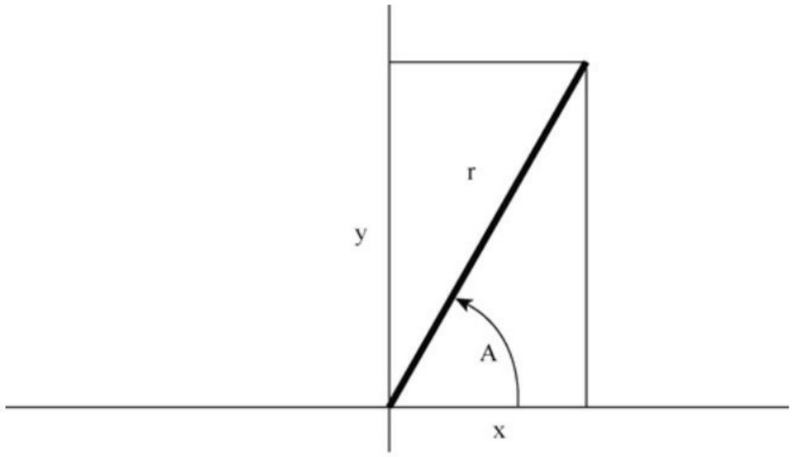
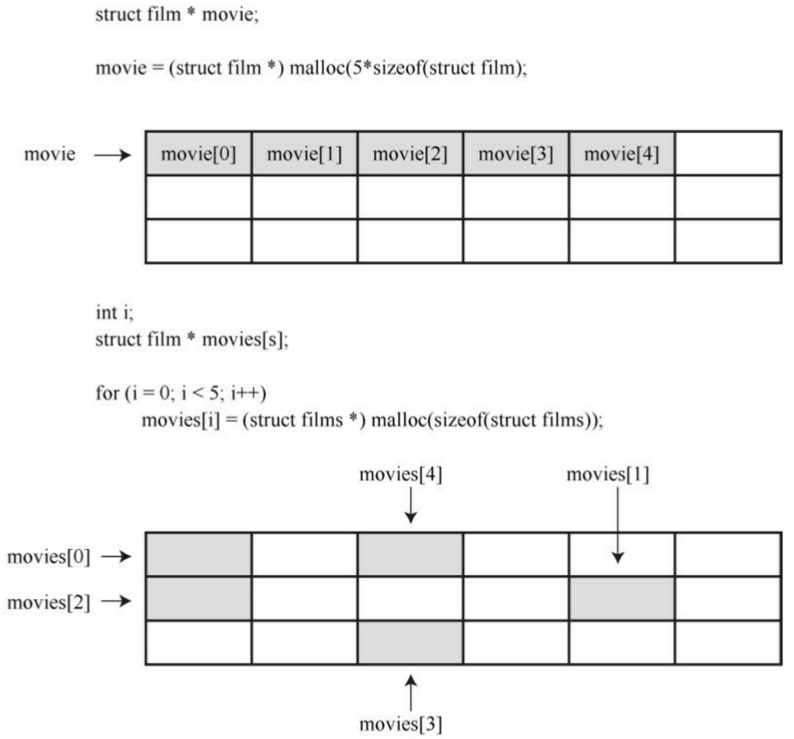
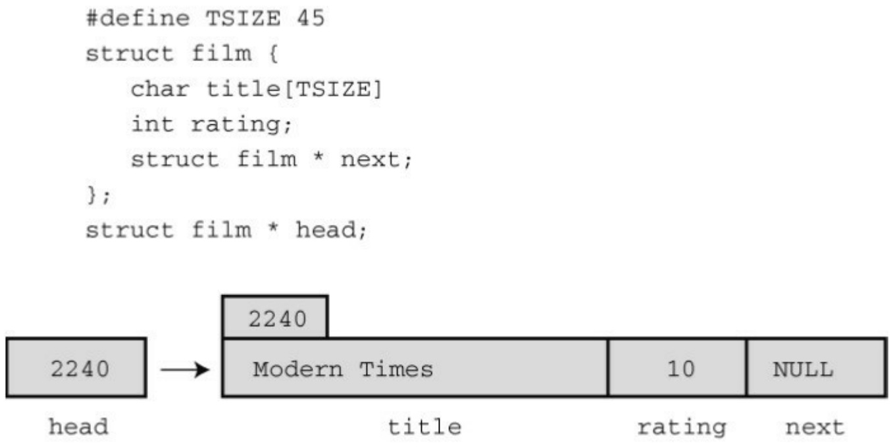
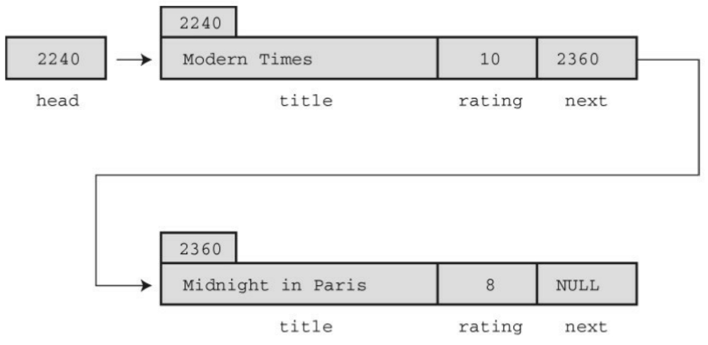
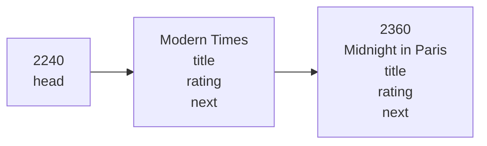
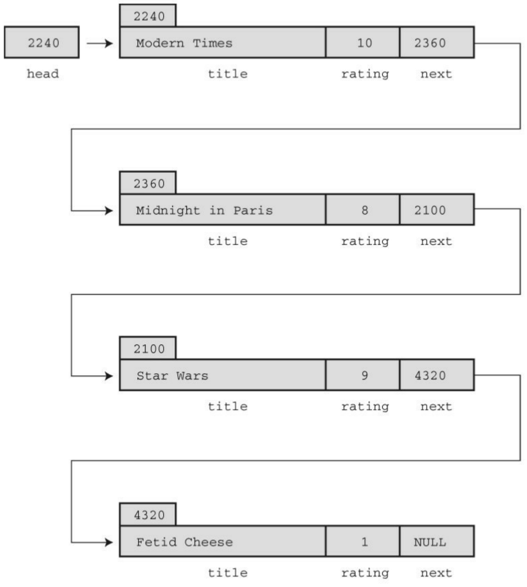
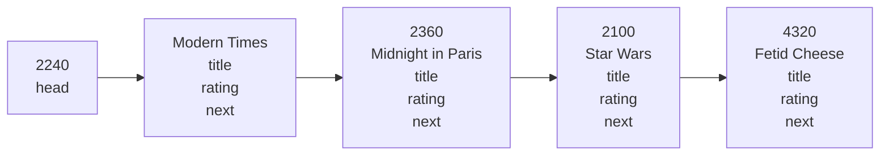

```c
// mems.c -- 使用 memcpy() 和 memmove()
#include <stdio.h>
#include <string.h>
#include <stdlib.h>
#define SIZE 10
void show_array(const int ar [], int n);
// 如果编译器不支持C11的_Static_assert, 可以注释掉下面这行
_Static_assert(sizeof(double) == 2 * sizeof(int), "double not twice int size");
int main()
{
int values[SIZE] = { 1, 2, 3, 4, 5, 6, 7, 8, 9, 10 };
int target[SIZE];
double curious[SIZE / 2] = { 2.0, 2.0e5, 2.0e10, 2.0e20, 5.0e30 };
puts("memcpy() used:");
puts("values (original data): ");
show_array(values, SIZE);
memcpy(target, values, SIZE * sizeof(int));
puts("target (copy of values):");
show_array(target, SIZE);
```

puts("\nUsing memmove() with overlapping ranges:");

memmove(values + 2, values, 5 \* sizeof(int));

puts("values -- elements 0-4 copied to 2-6:");

show\_array(values, SIZE);

puts("\nUsing memcpy() to copy double to int:");

memcpy(target, curious, (SIZE / 2) \* sizeof(double));

puts("target -- 5 doubles into 10 int positions:");

show\_array(target, SIZE / 2);

show\_array(target + 5, SIZE / 2);

return 0;

}

void show\_array(const int ar [], int n)

{

int i;

for (i = 0; i < n; i++)

printf("%d ", ar[i]);

putchar('\n');

}

下面是该程序的输出:

memcpy() used:

values (original data):

1 2 3 4 5 6 7 8 9 10

target (copy of values):

1 2 3 4 5 6 7 8 9 10

Using memmove() with overlapping ranges:

values -- elements 0-4 copied to 2-6:

1 2 1 2 3 4 5 8 9 10

Using memcpy() to copy double to int:

target -- 5 doubles into 10 int positions:

0 1073741824 0 1091070464 536870912

1108516959 2025163840 1143320349 -2012696540 1179618799

程序中最后一次调用 memcpy()从 double 类型数组中把数据拷贝到 int 类型数组中，这演示了memcpy()函数不知道也不关心数据的类型，它只负责从一个位置把一些字节拷贝到另一个位置（例如，从结构中拷贝数据到字符数组中）。而且，拷贝过程中也不会进行数据转换。如果用循环对数组中的每个元素赋值，double类型的值会在赋值过程被转换为int类型的值。这种情况下，按原样拷贝字节，然后程序把这些位组合解释成int类型。

## 16.14 可变参数:stdarg.h

本章前面提到过变参宏，即该宏可以接受可变数量的参数。stdarg.h 头文件为函数提供了一个类似的功能，但是用法比较复杂。必须按如下步骤进行:

1.提供一个使用省略号的函数原型；
2.在函数定义中创建一个va\_list类型的变量；
3.用宏把该变量初始化为一个参数列表；
4.用宏访问参数列表；
5.用宏完成清理工作。

接下来详细分析这些步骤。这种函数的原型应该有一个形参列表，其中至少有一个形参和一个省略号:

void f1(int n, ...); // 有效

int f2(const char \* s, int k, ...); // 有效

char f3(char c1, ..., char c2);// 无效，省略号不在最后

double f3(...); // 无效，没有形参

最右边的形参（即省略号的前一个形参）起着特殊的作用，标准中用parmN这个术语来描述该形参。在上面的例子中，第1行f1()中parmN为n，第2行f2()中parmN为k。传递给该形参的实际参数是省略号部分代表的参数数量。例如，可以这样使用前面声明的f1()函数:

f1(2, 200, 400); // 2个额外的参数

f1(4, 13, 117, 18, 23); // 4个额外的参数

接下来，声明在stdarg.h中的va\_list类型代表一种用于储存形参对应的形参列表中省略号部分的数据对象。变参函数的定义起始部分类似下面这样:

```lisp
double sum(int lim,...)

{
```

va\_list ap; //声明一个储存参数的对象

在该例中，lim是parmN形参，它表明变参列表中参数的数量。

然后，该函数将使用定义在stdarg.h中的va\_start()宏，把参数列表拷贝到va\_list类型的变量中。该宏有两个参数:va\_list类型的变量和parmN形参。接着上面的例子讨论，va\_list类型的变量是ap，parmN形参是lim。所以，应这样调用它:

va\_start(ap, lim); // 把ap初始化为参数列表

下一步是访问参数列表的内容，这涉及使用另一个宏va\_arg()。该宏接受两个参数:一个va\_list类型的变量和一个类型名。第1次调用va\_arg()时，它返回参数列表的第1项；第2次调用时返回第2项，以此类推。表示类型的参数指定了返回值的类型。例如，如果参数列表中的第1个参数是double类型，第2个参数是int类型，可以这样做:

```txt
double tic;

int toc;

...
```

tic = va\_arg(ap, double); // 检索第1个参数

toc = va\_arg(ap, int); //检索第2个参数

注意，传入的参数类型必须与宏参数的类型相匹配。如果第1个参数是

10.0，上面tic那行代码可以正常工作。但是如果参数是10，这行代码可能会出错。这里不会像赋值那样把double类型自动转换成int类型。

最后，要使用va\_end()宏完成清理工作。例如，释放动态分配用于储存参数的内存。该宏接受一个va\_list类型的变量:

va\_end(ap); // 清理工作

调用va\_end(ap)后，只有用va\_start重新初始化ap后，才能使用变量ap。

因为va\_arg()不提供退回之前参数的方法，所以有必要保存va\_list类型变量的副本。C99新增了一个宏用于处理这种情况:va\_copy()。该宏接受两个va\_list类型的变量作为参数，它把第2个参数拷贝给第1个参数:

```c
va_list ap;

va_list apcopy;

double

double tic;

int toc;

...

va_start(ap, lim);          // 把ap初始化为一个参数列表

va_copy(apcopy, ap);         // 把apcopy作为ap的副本

tic = va_arg(ap, double);   // 检索第1个参数

toc = va_arg(ap, int);       // 检索第2个参数

此时，即使删除了ap，也可以从apcopy中检索两个参数。
```

程序清单 16.21 中的程序示例中演示了如何创建这样的函数，该函数对可变参数求和。sum()的第 1个参数是待求和项的数目。

程序清单16.21 varargs.c程序

```c
//varargs.c -- use variable number of arguments
#include <stdio.h>

#include <stdarg.h>

double sum(int, ...);

int main(void)
{
double s, t;
s = sum(3, 1.1, 2.5, 13.3);
t = sum(6, 1.1, 2.1, 13.1, 4.1, 5.1, 6.1);
printf("return value for "
"sum(3, 1.1, 2.5, 13.3):          %g\n", s);
printf("return value for "
"sum(6, 1.1, 2.1, 13.1, 4.1, 5.1, 6.1): %g\n", t);
return 0;
}
double sum(int lim, ...)
```

```c
{
va_list ap; // 声明一个对象储存参数
double tot = 0;
int i;
va_start(ap, lim); // 把ap初始化为参数列表
for (i = 0; i < lim; i++)
tot += va_arg(ap, double); // 访问参数列表中的每一项
va_end(ap); // 清理工作
return tot;
}
```

下面是该程序的输出:

```txt
return value for sum(3, 1.1, 2.5, 13.3): 16.9
```

```lua
return value for sum(6, 1.1, 2.1, 13.1, 4.1, 5.1, 6.1): 31.6
```

查看程序中的运算可以发现，第1次调用sum()时对3个数求和，第2次调用时对6个数求和。

总而言之，使用变参函数比使用变参宏更复杂，但是函数的应用范围更广。

## 16.15 关键概念

C标准不仅描述C语言，还描述了组成C语言的软件包、C预处理器和C标准库。通过预处理器可以控制编译过程、列出要替换的内容、指明要编译的代码行和影响编译器其他方面的行为。C库扩展了C语言的作用范围，为许多编程问题提供现成的解决方案。

## 16.16 本章小结

C预处理器和C库是C语言的两个重要的附件。C预处理器遵循预处理器指令，在编译源代码之前调整源代码。C 库提供许多有助于完成各种任务的函数，包括输入、输出、文件处理、内存管理、排序与搜索、数学运算、字符串处理等。附录B的参考资料V中列出了完整的ANSI C库。

## 16.17 复习题

1.下面的几组代码由一个或多个宏组成，其后是使用宏的源代码。在每种情况下代码的结果是什么？这些代码是否是有效代码？（假设其中的变量已声明）

a.

#define FPM 5280 /\*每英里的英尺数\*/

dist = FPM \* miles;

b.

#define FEET 4

#define POD FEET + FEET

plort = FEET \* POD;

c.

#define SIX = 6;

nex = SIX;

d.

#define NEW(X) X + 5

y = NEW(y);

berg = NEW(berg) \* lob;

est = NEW(berg) / NEW(y);

$$
\mathrm{nilp} = \mathrm{lob} * \mathrm{NEW} (- \text {berg});
$$

2.修改复习题1中d部分的定义，使其更可靠。

3.定义一个宏函数，返回两值中的较小值。

4.定义EVEN\_GT(X, Y)宏，如果X为偶数且大于Y，该宏返回1。

5.定义一个宏函数，打印两个表达式及其值。例如，若参数为3+4和4\*12，则打印:

$$
3 + 4 \text {is 7 and} 4 ^ {*} 1 2 \text {is 48}
$$

6.创建#define指令完成下面的任务。

a.创建一个值为25的命名常量。

b.SPACE表示空格字符。

c.PS()代表打印空格字符。

d.BIG(X)代表X的值加3。

e.SUMSQ(X, Y)代表X和Y的平方和。

7.定义一个宏，以下面的格式打印名称、值和int类型变量的地址:

$$
\text {name: fop; value: 23; address: ff464016}
$$

8.假设在测试程序时要暂时跳过一块代码，如何在不移除这块代码的前提下完成这项任务？

9.编写一段代码，如果定义了PR\_DATE宏，则打印预处理的日期。

10.内联函数部分讨论了3种不同版本的square()函数。从行为方面看，这3种版本的函数有何不同？

11.创建一个使用泛型选择表达式的宏，如果宏参数是\_Bool类型，对"boolean"求值，否则对"not boolean"求值。

12.下面的程序有什么错误？

```c
#include <stdio.h>

int main(int argc, char argv[])
{
printf("The square root of %f is %f\n", argv[1],sqrt(argv[1]) );
}
```

13.假设 scores 是内含 1000 个 int 类型元素的数组，要按降序排序该数组中的值。假设你使用qsort()和comp()比较函数。

a.如何正确调用qsort()？

b.如何正确定义comp()？

14.假设data1是内含100个double类型元素的数组，data2是内含300个double类型元素的数组。

a.编写memcpy()的函数调用，把data2中的前100个元素拷贝到data1中。
b.编写memcpy()的函数调用，把data2中的后100个元素拷贝到data1中。

## 16.18 编程练习

1.开发一个包含你需要的预处理器定义的头文件。
2.两数的调和平均数这样计算:先得到两数的倒数，然后计算两个倒数的平均值，最后取计算结果的倒数。使用#define指令定义一个宏“函数”，执行该运算。编写一个简单的程序测试该宏。
3.极坐标用向量的模（即向量的长度）和向量相对x轴逆时针旋转的角度来描述该向量。直角坐标用向量的x轴和y轴的坐标来描述该向量（见图16.3）。编写一个程序，读取向量的模和角度（单位:度），然后显示x轴和y轴的坐标。相关方程如下:

$$
\mathrm{x} = \mathrm{r} ^ {*} \cos \mathrm{A} \mathrm{y} = \mathrm{r} ^ {*} \sin \mathrm{A}
$$

需要一个函数来完成转换，该函数接受一个包含极坐标的结构，并返回一个包含直角坐标的结构（或返回指向该结构的指针）。



<details>
<summary>text_image</summary>

y
r
A
x
</details>

图16.3 直角坐标和极坐标

4.ANSI库这样描述clock()函数的特性:

#include &lt;time.h&gt;

clock\_t clock (void);

这里，clock\_t是定义在time.h中的类型。该函数返回处理器时间，其单位取决于实现（如果处理器时间不可用或无法表示，该函数将返回-1）。然而，CLOCKS\_PER\_SEC（也定义在time.h中）是每秒处理器时间单位的数量。因此，两个 clock()返回值的差值除以 CLOCKS\_PER\_SEC得到两次调用之间经过的秒数。在进行除法运算之前，把值的类型强制转换成double类型，可以将时间精确到小数点以后。编写一个函数，接受一个double类型的参数表示时间延迟数，然后在这段时间运行一个循环。编写一个简单的程序测试该函数。

5.编写一个函数接受这些参数:内含int类型元素的数组名、数组的大小和一个代表选取次数的值。该函数从数组中随机选择指定数量的元素，并打印它们。每个元素只能选择一次（模拟抽奖数字或挑选陪审团成员）。另外，如果你的实现有time()（第12章讨论过）或类似的函数，可在srand()中使用这个函数的输出来初始化随机数生成器rand()。编写一个简单的程序测试该函数。
6.修改程序清单16.17，使用struct names元素（在程序清单16.17后面的讨论中定义过），而不是double类型的数组。使用较少的元素，并用选定的名字显式初始化数组。
7.下面是使用变参函数的一个程序段:

#include &lt;stdio.h&gt;

#include &lt;stdlib.h&gt;

#include &lt;stdarg.h&gt;

void show\_array(const double ar[], int n);

```c
double * new_d_array(int n, ...);

int main()
{
double * p1;
double * p2;
p1 = new_d_array(5, 1.2, 2.3, 3.4, 4.5, 5.6);
p2 = new_d_array(4, 100.0, 20.00, 8.08, -1890.0);
show_array(p1, 5);
show_array(p2, 4);
free(p1);
free(p2);
return 0;
}
```

new\_d\_array()函数接受一个int类型的参数和double类型的参数。该函数返回一个指针，指向由malloc()分配的内存块。int类型的参数指定了动态数组中的元素个数，double类型的值用于初始化元素（第1个值赋给第1个元素，以此类推）。编写show\_array()和new\_d\_array()函数的代码，完成这个程序。

# 第17章高级数据表示

本章介绍以下内容:

函数:进一步学习malloc()

使用C表示不同类型的数据

新的算法，从概念上增强开发程序的能力

抽象数据类型（ADT）

学习计算机语言和学习音乐、木工或工程学一样。首先，要学会使用工具:学习如何演奏音阶、如何使用锤子等，然后解决各种问题，如降落、滑行以及平衡物体之类。到目前为止，读者一直在本书中学习和练习各种编程技能，如创建变量、结构、函数等。然而，如果想提高到更高层次时，工具是次要的，真正的挑战是设计和创建一个项目。本章将重点介绍这个更高的层次，教会读者如何把项目看作一个整体。本章涉及的内容可能比较难，但是这些内容非常有价值，将帮助读者从编程新手成长为老手。

我们先从程序设计的关键部分，即程序表示数据的方式开始。通常，程序开发最重要的部分是找到程序中表示数据的好方法。正确地表示数据可以更容易地编写程序其余部分。到目前为止，读者应该很熟悉C的内置类型:简单变量、数组、指针、结构和联合。

然而，找出正确的数据表示不仅仅是选择一种数据类型，还要考虑必须进行哪些操作。也就是说，必须确定如何储存数据，并且为数据类型定义有效的操作。例如，C实现通常把int类型和指针类型都储存为整数，但是这两种类型的有效操作不相同。例如，两个整数可以相乘，但是两个指针不能相乘；可以用\*运算符解引用指针，但是对整数这样做毫无意义。C 语言为它的基本类型都定义了有效的操作。但是，当你要设记数据表示的方案时，你可能需要自己定义有效操作。在C语言中，可以把所需的操作设计成C函数

来表示。简而言之，设计一种数据类型包括设计如何储存该数据类型和设计一系列管理该数据的函数。

本章还会介绍一些算法（algorithm），即操控数据的方法。作为一名程序员，应该掌握这些可以反复解决类似问题的处理方法。

本章将进一步研究设计数据类型的过程，这是一个把算法和数据表示相匹配的过程。期间会用到一些常见的数据形式，如队列、列表和二叉树。

本章还将介绍抽象数据类型（ADT）的概念。抽象数据类型以面向问题而不是面向语言的方式，把解决问题的方法和数据表示结合起来。设计一个ADT后，可以在不同的环境中复用。理解ADT可以为将来学习面向对象程序设计（OOP）以及C++语言做好准备。

## 17.1 研究数据表示

我们先从数据开始。假设要创建一个地址簿程序。应该使用什么数据形式储存信息？由于储存的每一项都包含多种信息，用结构来表示每一项很合适。如何表示多个项？是否用标准的结构数组？还是动态数组？还是一些其他形式？各项是否按字母顺序排列？是否要按照邮政编码（或地区编码）查找各项？需要执行的行为将影响如何储存信息？简而言之，在开始编写代码之前，要在程序设计方面做很多决定。

如何表示储存在内存中的位图图像？位图图像中的每个像素在屏幕上都单独设置。在以前黑白屏的年代，可以使用一个计算机位（1 或 0）来表示一个像素点（开或闭），因此称之为位图。对于彩色显示器而言，如果8位表示一个像素，可以得到256种颜色。现在行业标准已发展到65536色（每像素16位）、16777216色（每像素24位）、2147483色（每像素32位），甚至更多。如果有32位色，且显示器有2560×1440的分辨率，则需要将近1.18亿位（14M）来表示一个屏幕的位图图像。是用这种方法表示，还是开发一种压缩信息的方法？是有损压缩（丢失相对次要的数据）还是无损压缩（没有丢失数据）？再次提醒读者注意，在开始编写代码之前，需要做很多程序设计方面的决定。

我们来处理一个数据表示的示例。假设要编写一个程序，让用户输入一年内看过的所有电影（包括DVD和蓝光光碟）。要储存每部影片的各种信息，如片名、发行年份、导演、主演、片长、影片的种类（喜剧、科幻、爱情等）、评级等。建议使用一个结构储存每部电影，一个数组储存一年内看过的电影。为简单起见，我们规定结构中只有两个成员:片名和评级（0～ 10）。程序清单17.1演示了一个基本的实现。

程序清单**17.1 films1.c**程序

/\* films1.c -- 使用一个结构数组 \*/

#include &lt;stdio.h&gt;

```c
#include <string.h>

#define TSIZE 45 /* 储存片名的数组大小 */

#define FMAX 5 /* 影片的最大数量 */

struct film {

char title[TSIZE];

int rating;

};

char * s_gets(char str[], int lim);

int main(void)

{

struct film movies[FMAX];

int i = 0;

int j;

puts("Enter first movie title:

while (i < FMAX && s_gets(movies[i].title, TSIZE) != NULL &&
movies[i].title[0] != '\0')

{

puts("Enter your rating <0-10>:");
```

```c
scanf("%d", &movies[i++].rating);

while (getchar() != '\n')

continue;

puts("Enter next movie title (empty line to stop):");

}

if (i == 0)

printf("No data entered."])

else

printf("Here is the movie list:\n");

for (j = 0; j < i; j++)
printf("Movie: %s Rating: %d\n", movies[j].title,movies[j].rating);
printf("Bye!\n");

return 0;

}

char * s_gets(char * st, int n)

{

char * ret_val;

char * find;

ret_val = fgets(st, n, stdin);
```

```c
if (ret_val)
{
find = strchr(st, '\n');    // 查找换行符
if (find)                          // 如果地址不是 NULL,
*find = '\0';          // 在此处放置一个空字符
else
while (getchar() != '\n')
continue;                // 处理剩余输入行
}
return ret_val;
}
```

该程序创建了一个结构数组，然后把用户输入的数据储存在数组中。直到数组已满（用 FMAX 进行判断）或者到达文件结尾（用NULL进行判断），或者用户在首行按下Enter键（用'\0'进行判断），输入才会终止。

这样设计程序有点问题。首先，该程序很可能会浪费许多空间，因为大部分的片名都不会超过40个字符。但是，有些片名的确很长，如The Discreet Charm of the Bourgeoisie和Won Ton Ton, The Dog Who Saved Hollywood。其次，许多人会觉得每年5部电影的限制太严格了。当然，也可以放宽这个限制，但是，要多大才合适？有些人每年可以看500部电影，因此可以把FMAX改为500。但是，对有些人而言，这可能仍然不够，而对有些人而言一年根本看不了这么多部电影，这样就浪费了大量的内存。另外，一些编译器对自动存储类别变量（如 movies）可用的内存数量设置了一个默认的限制，如此大型的数组可能会超过默认设置的值。可以把数组声明为静态或外部数组，或者设置编译器使用更大的栈来解决这个问题。但是，这样做并不能根本解决问题。

该程序真正的问题是，数据表示太不灵活。程序在编译时确定所需内存量，其实在运行时确定会更好。要解决这个问题，应该使用动态内存分配来表示数据。可以这样做:

#define TSIZE 45 /\*储存片名的数组大小\*/

```txt
struct film {
char title[TSIZE];
int rating;
};
...
int n, i;
struct film * movies; /* 指向结构的指针 */
...
printf("Enter the maximum number of movies you'll enter:\n");
scanf("%d", &n);
movies = (struct film *) malloc(n * sizeof(struct film));
```

第12章介绍过，可以像使用数组名那样使用指针movies。

while (i < FMAX && s\_gets(movies[i].title, TSIZE) != NULL &&movies[i].title[0] != '\0')

使用malloc()，可以推迟到程序运行时才确定数组中的元素数量。所以，如果只需要20个元素，程序就不必分配存放500个元素的空间。但是，这样做的前提是，用户要为元素个数提供正确的值。

## 17.2 从数组到链表

理想的情况是，用户可以不确定地添加数据（或者不断添加数据直到用完内存量），而不是先指定要输入多少项，也不用让程序分配多余的空间。这可以通过在输入每一项后调用 malloc()分配正好能储存该项的空间。如果用户输入3部影片，程序就调用malloc()3次；如果用户输入300部影片，程序就调用malloc()300次。

不过，我们又制造了另一个麻烦。比较一下，一种方法是调用malloc()一次，为300个filem结构请求分配足够的空间；另一种方法是调用malloc()300次，分别为每个file结构请求分配足够的空间。前者分配的是连续的内存块，只需要一个单独的指向struct变量（film）的指针，该指针指向已分配块中的第1个结构。简单的数组表示法让指针访问块中的每个结构，如前面代码段所示。第2种方法的问题是，无法保证每次调用malloc()都能分配到连续的内存块。这意味着结构不一定被连续储存（见图17.1）。因此，与第1种方法储存一个指向300个结构块的指针相比，你需要储存300个指针，每个指针指向一个单独储存的结构。



<details>
<summary>text_image</summary>

struct film * movie;
movie = (struct film *) malloc(5*sizeof(struct film);

movie → movie[0] movie[1] movie[2] movie[3] movie[4]


int i;
struct film * movies[s];

for (i = 0; i < 5; i++)
    movies[i] = (struct films *) malloc(sizeof(struct films));

movies[0] →
movies[2] →
        movies[4] movies[1]
        movies[3]
</details>

图17.1 一块内存中分配结构和单独分配结构

一种解决方法是创建一个大型的指针数组，并在分配新结构时逐个给这些指针赋值，但是我们不打算使用这种方法:

#define TSIZE 45 /\*储存片名的数组大小\*/

#define FMAX 500 /\*影片的最大数量\*/

struct film {

char title[TSIZE];

```txt
int rating;
};
...
struct film * movies[FMAX]; /* 结构指针数组 */
int i;
...
movies[i] = (struct film *) malloc (sizeof(struct film));
```

如果用不完500个指针，这种方法节约了大量的内存，因为内含500个指针的数组比内含500个结构的数组所占的内存少得多。尽管如此，如果用不到 500 个指针，还是浪费了不少空间。而且，这样还是有500个结构的限制。

还有一种更好的方法。每次使用 malloc()为新结构分配空间时，也为新指针分配空间。但是，还得需要另一个指针来跟踪新分配的指针，用于跟踪新指针的指针本身，也需要一个指针来跟踪，以此类推。要重新定义结构才能解决这个潜在的问题，即每个结构中包含指向 next 结构的指针。然后，当创建新结构时，可以把该结构的地址储存在上一个结构中。简而言之，可以这样定义film结构:

#define TSIZE 45 /\* 储存片名的数组大小\*/

```txt
struct film {
char title[TSIZE];
int rating;
struct film * next;
```

虽然结构不能含有与本身类型相同的结构，但是可以含有指向同类型结构的指针。这种定义是定义链表（linked list）的基础，链表中的每一项都包含着在何处能找到下一项的信息。

在学习链表的代码之前，我们先从概念上理解一个链表。假设用户输入的片名是Modern Times，等级为10。程序将为film类型的结构分配空间，把字符串Modern Times拷贝到结构中的title成员中，然后设置rating成员为10。为了表明该结构后面没有其他结构，程序要把next成员指针设置为NULL（NULL是一个定义在stdio.h头文件中的符号常量，表示空指针）。当然，还需要一个单独的指针储存第1个结构的地址，该指针被称为头指针（head pointer）。头指针指向链表中的第1项。图17.2演示了这种结构（为节约图片空间，压缩了title成员中的空白）。



<details>
<summary>flowchart</summary>

```mermaid
graph LR
  A["#define TSIZE 45"] --> B["&quot;struct film {<br>    char title[TSIZE"]
    int rating;
    struct film * next;
  };
  A --> C["struct film * head;"]
  C --> D["2240"]
  D --> E["Modern Times"]
  E --> F["10"]
  E --> G["NULL"]
  E --> H["head"]
  E --> I["title"]
  E --> J["rating"]
  E --> K["next"]
```
</details>

图17.2 链表中的第1个项

现在，假设用户输入第2部电影及其评级，如Midnight in Paris和8。程序为第2个film类型结构分配空间，把新结构的地址储存在第1个结构的next成员中（擦写了之前储存在该成员中的NULL），这样链表中第1个结构中的next指针指向第2个结构。然后程序把Midnight in Paris和8拷贝到新结构中，

并把第2个结构中的next成员设置为NULL，表明该结构是链表中的最后一个结构。图17.3演示了这两个项。



<details>
<summary>flowchart</summary>


</details>

图17.3 链表中的两个项

每加入一部新电影，就以相同的方式来处理。新结构的地址将储存在上一个结构中，新信息储存在新结构中，而且新结构中的next成员设置为NULL。从而建立起如图17.4所示的链表。



<details>
<summary>flowchart</summary>


</details>

图17.4 链表中的多个项

假设要显示这个链表，每显示一项，就可以根据该项中已储存的地址来定位下一个待显示的项。然而，这种方案能正常运行，还需要一个指针储存链表中第1项的地址，因为链表中没有其他项储存该项的地址。此时，头指针就派上了用场。

## 17.2.1 使用链表

从概念上了解了链表的工作原理，接着我们来实现它。程序清单17.2修改了程序清单17.1，用链表而不是数组来储存电影信息。

程序清单17.2 films2.c程序

```c
/* films2.c -- 使用结构链表 */
#include <stdio.h>
#include <stdlib.h>          /* 提供malloc()原型 */
#include <string.h>          /* 提供strcpy()原型 */
#define TSIZE  45       /* 储存片名的数组大小 */
struct film {
char title[TSIZE];
int rating;
struct film * next;    /* 指向链表中的下一个结构 */
};
char * s_gets(char * st, int n);
int main(void)
{
struct film * head = NULL;
struct film * prev, *current;
char input[TSIZE];
```

/\* 收集并储存信息 \*/

puts("Enter first movie title:");

while (s\_gets(input, TSIZE) != NULL && input[0] != '\0')

{

current = (struct film \*) malloc(sizeof(struct film));

if (head == NULL) /\* 第1个结构 \*/

head = current;

else /\* 后续的结构 \*/

prev->next = current;

current->next = NULL;

strcpy(current->title, input);

puts("Enter your rating <0-10>:");

scanf("%d", &amp;current->rating);

while (getchar() != '\n')

continue;

puts("Enter next movie title (empty line to stop):");

prev = current;

}

/\* 显示电影列表 \*/