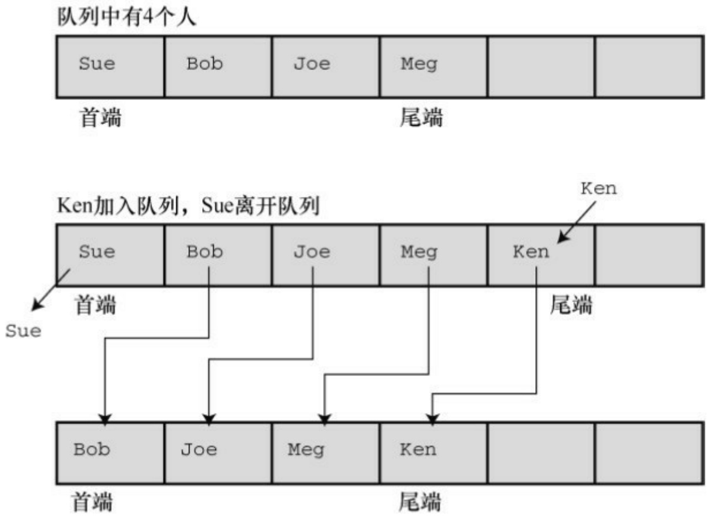
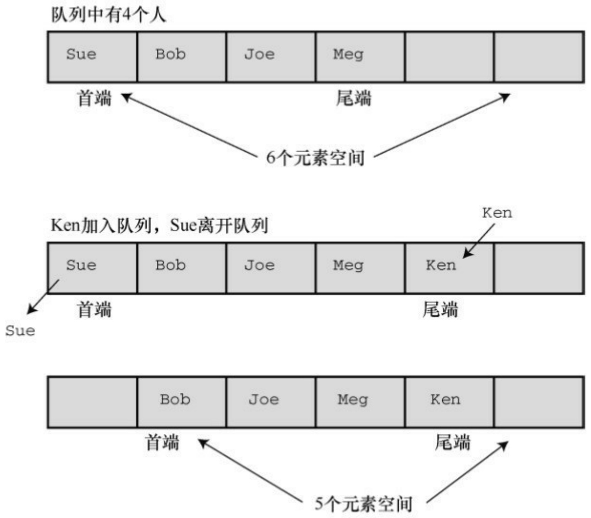
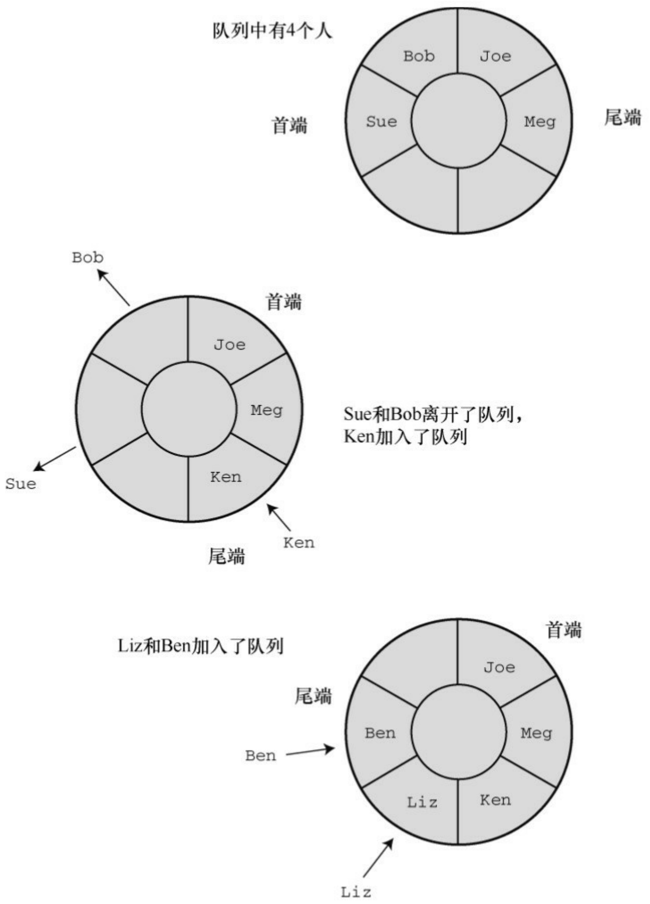

```txt
{
(*pfun)(pnode->item); /* 把函数应用于该项*/
pnode = pnode->next;    /* 前进至下一个项 */
}
}
```

pnode->item代表储存在节点中的数据，pnode->next标识链表中的下一个节点。如下函数调用:

Traverse(movies, showmovies);

把showmovies()函数应用于链表中的每一项。

最后，EmptyTheList()函数释放了之前malloc()分配的内存:

```c
void EmptyTheList(List * plist)
{
Node * psave;
while (*plist != NULL)
{
psave = (*plist)->next;      /* 保存下一个节点的地址   */
free(*plist);                  /* 释放当前节点       */
*plist = psave;              /* 前进至下一个节点     */
}
```

}

该函数的实现通过把List类型的变量设置为NULL来表明一个空链表。因此，要把List类型变量的地址传递给该函数，以便函数重置。由于List已经是一个指针，所以plist是一个指向指针的指针。因此，在上面的代码中，\*plist是指向Node的指针。当到达链表末尾时，\*plist为NULL，表明原始的实际参数现在被设置为NULL。

代码中要保存下一节点的地址，因为原则上调用了free()会使当前节点（即\*plist指向的节点）的内容不可用。

提示 **const**的限制

多个处理链表的函数都把const List \* plist作为形参，表明这些函数不会更改链表。这里， const确实提供了一些保护。它防止了\*plist（即plist所指向的量）被修改。在该程序中，plist指向movies，所以const防止了这些函数修改movies。因此，在ListItemCount()中，不允许有类似下面的代码:

$$
* \text {plist} = (* \text {plist}) - > \text {next}; / /\text {如果} * \text {plist是const, 不允许这样做}
$$

因为改变\*plist就改变了movies，将导致程序无法跟踪数据。然而，\*plist和movies都被看作是const并不意味着\*plist或movies指向的数据是const。例如，可以编写下面的代码:

$$
(^ {*} \text {plist}) - > \text {item.rating} = 3; / / \text {即使} ^ {*} \text {plist是const,也可以这样做}
$$

因为上面的代码并未改变\*plist，它改变的是\*plist指向的数据。由此可见，不要指望const能捕获到意外修改数据的程序错误。

## 2.考虑你要做的

现在花点时间来评估ADT方法做了什么。首先，比较程序清单17.2和程序清单17.4。这两个程序都使用相同的内存分配方法（动态分配链接的结构）解决电影链表的问题，但是程序清单17.2暴露了所有的编程细节，把

malloc()和prev->next这样的代码都公之于众。而程序清单17.4隐藏了这些细节，并用与任务直接相关的方式表达程序。也就是说，该程序讨论的是创建链表和向链表中添加项，而不是调用内存函数或重置指针。简而言之，程序清单17.4是根据待解决的问题来表达程序，而不是根据解决问题所需的具体工具来表达程序。ADT版本可读性更高，而且针对的是最终的用户所关心的问题。

其次，list.h 和 list.c 文件一起组成了可复用的资源。如果需要另一个简单的链表，也可以使用这些文件。假设你需要储存亲戚的一些信息:姓名、关系、地址和电话号码，那么先要在 list.h 文件中重新定义Item类型:

```txt
typedef struct itemtag
{
char fname[14];
char lname [24];
char relationship[36];
char address [60];
char phonenum[20];
} Item;
```

然后„„只需要做这些就行了。因为所有处理简单链表的函数都与Item类型有关。根据不同的情况，有时还要重新定义CopyToNode()函数。例如，当项是一个数组时，就不能通过赋值来拷贝。

另一个要点是，用户接口是根据抽象链表操作定义的，不是根据某些特定的数据表示和算法来定义。这样，不用重写最后的程序就能随意修改实现。例如，当前使用的AddItem()函数效率不高，因为它总是从链表第 1 个项开始，然后搜索至链表末尾。可以通过保存链表结尾处的地址来解决这个问题。例如，可以这样重新定义List类型:

```c
typedef struct list
{
Node * head;  /* 指向链表的开头 */
Node * end;  /* 指向链表的末尾 */
} List;
```

当然，还要根据新的定义重写处理链表的函数，但是不用修改程序清单17.4中的内容。对大型编程项目而言，这种把实现和最终接口隔离的做法相当有用。这称为数据隐藏，因为对终端用户隐藏了数据表示的细节。

注意，这种特殊的ADT甚至不要求以链表的方式实现简单链表。下面是另一种方法:

```c
#define MAXSIZE 100

typedef struct list

{

Item entries[MAXSIZE]; /* 项数组 */

int items;                      /* 其中的项数 */

} List;
```

这样做也需要重写list.c文件，但是使用list的程序不用修改。

最后，考虑这种方法给程序开发过程带来了哪些好处。如果程序运行出现问题，可以把问题定位到具体的函数上。如果想用更好的方法来完成某个任务（如，添加项），只需重写相应的函数即可。如果需要新功能，可以添加一个新的函数。如果觉得数组或双向链表更好，可以重写实现的代码，不用修改使用实现的程序。

## 17.4 队列ADT

在C语言中使用抽象数据类型方法编程包含以下3个步骤。

1.以抽象、通用的方式描述一个类型，包括该类型的操作。
2.设计一个函数接口表示这个新类型。
3.编写具体代码实现这个接口。

前面已经把这种方法应用到简单链表中。现在，把这种方法应用于更复杂的数据类型:队列。

## 17.4.1 定义队列抽象数据类型

队列（queue）是具有两个特殊属性的链表。第一，新项只能添加到链表的末尾。从这方面看，队列与简单链表类似。第二，只能从链表的开头移除项。可以把队列想象成排队买票的人。你从队尾加入队列，买完票后从队首离开。队列是一种“先进先出”（first in,first out，缩写为FIFO）的数据形式，就像排队买票的队伍一样（前提是没有人插队）。接下来，我们建立一个非正式的抽象定义:

类型名: 队列

类型属性: 可以储存一系列项

类型操作: 初始化队列为空

确定队列为空

确定队列已满

确定队列中的项数

在队列末尾添加项

在队列开头删除或恢复项

清空队列

## 17.4.2 定义一个接口

接口定义放在queue.h文件中。我们使用C的typedef工具创建两个类型名:Item和Queue。相应结构的具体实现应该是queue.h文件的一部分，但是从概念上来看，应该在实现阶段才设计结构。现在，只是假定已经定义了这些类型，着重考虑函数的原型。

首先，考虑初始化。这涉及改变Queue类型，所以该函数应该以Queue的地址作为参数:

void InitializeQueue (Queue \* pq);

接下来，确定队列是否为空或已满的函数应返回真或假值。这里，假设C99的stdbool.h头文件可用。如果该文件不可用，可以使用int类型或自己定义bool类型。由于该函数不更改队列，所以接受Queue类型的参数。但是，传递Queue的地址更快，更节省内存，这取决于Queue类型的对象大小。这次我们尝试这种方法。这样做的好处是，所有的函数都以地址作为参数，而不像 List 示例那样。为了表明这些函数不更改队列，可以且应该使用const限定符:

bool QueueIsFull(const Queue \* pq);

bool QueueIsEmpty (const Queue \* pq);

指针pq指向Queue数据对象，不能通过pq这个代理更改数据。可以定义一个类似该函数的原型，返回队列的项数:

int QueueItemCount(const Queue \* pq);

在队列末尾添加项涉及标识项和队列。这次要更改队列，所以有必要

（而不是可选）使用指针。该函数的返回类型可以是void，或者通过返回值来表示是否成功添加项。我们采用后者:

bool EnQueue(Item item, Queue \* pq);

最后，删除项有多种方法。如果把项定义为结构或一种基本类型，可以通过函数返回待删除的项。函数的参数可以是Queue类型或指向Queue的指针。因此，可能是下面这样的原型:

Item DeQueue(Queue q);

然而，下面的原型会更合适一些:

bool DeQueue(Item \* pitem, Queue \* pq);

从队列中待删除的项储存在pitem指针指向的位置，函数的返回值表明是否删除成功。

清空队列的函数所需的唯一参数是队列的地址，可以使用下面的函数原型:

void EmptyTheQueue(Queue \* pq);

## 17.4.3 实现接口数据表示

第一步是确定在队列中使用何种C数据形式。有可能是数组。数组的优点是方便使用，而且向数组的末尾添加项很简单。问题是如何从队列的开头删除项。类比于排队买票的队列，从队列的开头删除一个项包括拷贝数组首元素的值和把数组剩余各项依次向前移动一个位置。编程实现这个过程很简单，但是会浪费大量的计算机时间（见图17.6）。



图17.6 用数组实现队列

第二种解决数组队列删除问题的方法是改变队列首端的位置，其余元素不动（见图17.7）。



图17.7 重新定义首元素

解决这种问题的一个好方法是，使队列成为环形。这意味着把数组的首尾相连，即数组的首元素紧跟在最后一个元素后面。这样，当到达数组末尾时，如果首元素空出，就可以把新添加的项储存到这些空出的元素中（见图17.8）。可以想象在一张条形的纸上画出数组，然后把数组的首尾粘起来形成一个环。当然，要做一些标记，以免尾端超过首端。



图17.8 环形队列

另一种方法是使用链表。使用链表的好处是删除首项时不必移动其余元素，只需重置头指针指向新的首元素即可。由于我们已经讨论过链表，所以采用这个方案。我们用一个整数队列开始测试:

```txt
typedef int Item;
```

链表由节点组成，所以，下一步是定义节点:

```txt
typedef struct node
{
Item item;
struct node * next;
} Node;
```

对队列而言，要保存首尾项，这可以使用指针来完成。另外，可以用一个计数器来记录队列中的项数。因此，该结构应由两个指针成员和一个int类型的成员构成:

```c
typedef struct queue
{
Node * front; /* 指向队列首项的指针 */
Node * rear;  /*指向队列尾项的指针*/
int items;          /* 队列中的项数*/
} Queue;
```

注意，Queue是一个内含3个成员的结构，所以用指向队列的指针作为参数比直接用队列作为参数节约了时间和空间。

接下来，考虑队列的大小。对链表而言，其大小受限于可用的内存量，因此链表不要太大。例如，可能使用一个队列模拟飞机等待在机场着陆。如果等待的飞机数量太多，新到的飞机就应该改到其他机场降落。我们把队列的最大长度设置为10。程序清单17.6包含了队列接口的原型和定义。Item类型留给用户定义。使用该接口时，可以根据特定的程序插入合适的定义。

程序清单17.6 queue.h接口头文件

```c
/* queue.h -- Queue的接口 */
#ifndef _QUEUE_H_
#define _QUEUE_H_
#include <stdbool.h>
// 在这里插入Item类型的定义，例如
typedef int Item;      // 用于use_q.c
// 或者 typedef struct item {int gumption; int charisma;} Item;
#define MAXQUEUE 10
typedef struct node
{
Item item;
struct node * next;
} Node;
typedef struct queue
```

{

Node \* front; /\* 指向队列首项的指针 \*/

Node \* rear; /\* 指向队列尾项的指针 \*/

int items; /\* 队列中的项数 \*/

} Queue;

/\* 操作: 初始化队列 \*/

/\* 前提条件: pq 指向一个队列 \*/

/\* 后置条件: 队列被初始化为空 \*/

void InitializeQueue(Queue \* pq);

/\* 操作: 检查队列是否已满 \*/

/\* 前提条件: pq 指向之前被初始化的队列\*/

/\* 后置条件: 如果队列已满则返回true，否则返回false \*/

bool QueueIsFull(const Queue \* pq);

/\* 操作: 检查队列是否为空 \*/

/\* 前提条件: pq 指向之前被初始化的队列\*/

/\* 后置条件: 如果队列为空则返回true，否则返回false \*/

bool QueueIsEmpty(const Queue \*pq);

/\* 操作: 确定队列中的项数 \*/

/\* 前提条件: pq 指向之前被初始化的队列\*/

/\* 后置条件: 返回队列中的项数 \*/

int QueueItemCount(const Queue \* pq);

/\* 操作: 在队列末尾添加项 \*/

/\* 前提条件: pq 指向之前被初始化的队列\*/

/\* item是要被添加在队列末尾的项 \*/

/\* 后置条件: 如果队列不为空，item将被添加在队列的末尾， \*/

/\* 该函数返回true；否则，队列不改变，该函数返回false\*/

bool EnQueue(Item item, Queue \* pq);

/\* 操作: 从队列的开头删除项 \*/

/\* 前提条件: pq 指向之前被初始化的队列\*/

/\* 后置条件: 如果队列不为空，队列首端的item将被拷贝到\*pitem中\*/

/\* 并被删除，且函数返回true； \*/

/\* 如果该操作使得队列为空，则重置队列为空 \*/

/\* 如果队列在操作前为空，该函数返回false \*/

```javascript
bool DeQueue(Item *pitem, Queue * pq);
```

/\* 操作: 清空队列

\*/

```txt
/* 前提条件: pq 指向之前被初始化的队列
*/
```

/\* 后置条件: 队列被清空

\*/

```cpp
void EmptyTheQueue(Queue * pq);

#endif
```

## 1.实现接口函数

接下来，我们编写接口代码。首先，初始化队列为空，这里“空”的意思是把指向队列首项和尾项的指针设置为NULL，并把项数（items成员）设置为0:

```c
void InitializeQueue(Queue * pq)
{
pq->front = pq->rear = NULL;
pq->items = 0;
}
```

这样，通过检查items的值可以很方便地了解到队列是否已满、是否为空和确定队列的项数:

```txt
bool QueueIsFull(const Queue * pq)
{
```

```c
return pq->items == MAXQUEUE;
}
bool QueueIsEmpty(const Queue * pq)
{
return pq->items == 0;
}
int QueueItemCount(const Queue * pq)
{
return pq->items;
}
```

把项添加到队列中，包括以下几个步骤:

（1）创建一个新节点；
（2）把项拷贝到节点中；
（3）设置节点的next指针为NULL，表明该节点是最后一个节点；
（4）设置当前尾节点的next指针指向新节点，把新节点链接到队列中；
（5）把rear指针指向新节点，以便找到最后的节点；
（6）项数加1。

函数还要处理两种特殊情况。第一种情况，如果队列为空，应该把front指针设置为指向新节点。因为如果队列中只有一个节点，那么这个节点既是首节点也是尾节点。第二种情况是，如果函数不能为节点分配所需内存，则必须执行一些动作。因为大多数情况下我们都使用小型队列，这种情况很少发生，所以，如果程序运行的内存不足，我们只是通过函数终止程序。

EnQueue()的代码如下:

```c
bool EnQueue(Item item, Queue * pq)
{
Node * pnew;
if (QueueIsFull(pq))
return false;
pnew = (Node *)malloc( sizeof(Node));
if (pnew == NULL)
{
fprintf(stderr,"Unable to allocate memory!\n");
exit(1);
}
CopyToNode(item, pnew);
pnew->next = NULL;
if (QueueIsEmpty(pq))
pq->front = pnew;      /* 项位于队列首端     */
else
```

```c
pq->rear->next = pnew; /* 链接到队列尾端 */
pq->rear = pnew;          /* 记录队列尾端的位置 */
pq->items++;                  /* 队列项数加1         */
return  true;
}
CopyToNode()函数是静态函数，用于把项拷贝到节点中：
static void CopyToNode(Item item, Node * pn)
{
pn->item = item;
}
```

从队列的首端删除项，涉及以下几个步骤:

（1）把项拷贝到给定的变量中；
（2）释放空出的节点使用的内存空间；
（3）重置首指针指向队列中的下一个项；
（4）如果删除最后一项，把首指针和尾指针都重置为NULL；
（5）项数减1。

下面的代码完成了这些步骤:

```txt
bool DeQueue(Item * pitem, Queue * pq)
{
```

```c
Node * pt;

if (QueueIsEmpty(pq))

return false;

CopyToItem(pq->front, pitem);

pt = pq->front;

pq->front = pq->front->next;

free(pt);

pq->items--;

if (pq->items == 0)

pq->rear = NULL;

return true;

}
```

关于指针要注意两点。第一，删除最后一项时，代码中并未显式设置front指针为NULL，因为已经设置front指针指向被删除节点的next指针。如果该节点不是最后一个节点，那么它的next指针就为NULL。第二，代码使用临时指针（pt）储存待删除节点的位置。因为指向首节点的正式指针（pt->front）被重置为指向下一个节点，所以如果没有临时指针，程序就不知道该释放哪块内存。

我们使用DeQueue()函数清空队列。循环调用DeQueue()函数直到队列为空:

```txt
void EmptyTheQueue(Queue * pq)
```

```txt
{
Item dummy;
while (!QueueIsEmpty(pq))
DeQueue(&dummy, pq);
}
```

注意保持纯正的**ADT**

定义ADT接口后，应该只使用接口函数处理数据类型。例如，Dequeue()依赖EnQueue()函数来正确设置指针和把rear节点的next指针设置为NULL。如果在一个使用ADT的程序中，决定直接操控队列的某些部分，有可能破坏接口包中函数之间的协作关系。

程序清单17.7演示了该接口中的所有函数，包括EnQueue()函数中用到的CopyToItem()函数。

程序清单**17.7 queue.c**实现文件

/\* queue.c -- Queue类型的实现 \*/

```c
#include <stdio.h>

#include <stdlib.h>

#include "queue.h"
```

/\* 局部函数 \*/

static void CopyToNode(Item item, Node \* pn);

static void CopyToItem(Node \* pn, Item \* pi);

```c
void InitializeQueue(Queue * pq)
{
pq->front = pq->rear = NULL;
pq->items = 0;
}
bool QueueIsFull(const Queue * pq)
{
return pq->items == MAXQUEUE;
}
bool QueueIsEmpty(const Queue * pq)
{
return pq->items == 0;
}
int QueueItemCount(const Queue * pq)
{
return pq->items;
}
bool EnQueue(Item item, Queue * pq)
{
```

```c
Node * pnew;

if (QueueIsFull(pq))

return false;

pnew = (Node *) malloc(sizeof(Node));

if (pnew == NULL)
{
fprintf(stderr, "Unable to allocate memory!\n");
exit(1);
}
CopyToNode(item, pnew);
pnew->next = NULL;
if (QueueIsEmpty(pq))
pq->front = pnew;          /* 项位于队列的首端      */
else
pq->rear->next = pnew;     /* 链接到队列的尾端      */
pq->rear = pnew;                 /* 记录队列尾端的位置     */
pq->items++;                    /* 队列项数加1       */
return true;
}
```

bool DeQueue(Item \* pitem, Queue \* pq)

{

Node \* pt;

if (QueueIsEmpty(pq))

return false;

CopyToItem(pq->front, pitem);

pt = pq->front;

pq->front = pq->front->next;

free(pt);

pq->items--;

if (pq->items == 0)

pq->rear = NULL;

return true;

}

/\* 清空队列 \*/

void EmptyTheQueue(Queue \* pq)

{

Item dummy;

while (!QueueIsEmpty(pq))

```c
DeQueue(&dummy, pq);

}

/* 局部函数 */
static void CopyToNode(Item item, Node * pn)
{
pn->item = item;
}
static void CopyToItem(Node * pn, Item * pi)
{
*pi = pn->item;
}
```

## 17.4.4 测试队列

在重要程序中使用一个新的设计（如，队列包）之前，应该先测试该设计。测试的一种方法是，编写一个小程序。这样的程序称为驱动程序（driver），其唯一的用途是进行测试。例如，程序清单17.8使用一个添加和删除整数的队列。在运行该程序之前，要确保queue.h中包含下面这行代码:

typedef int item;

记住，还必须链接queue.c和use\_q.c。

程序清单**17.8 use\_q.c**程序

```c
/* use_q.c -- 驱动程序测试 Queue 接口  */
/* 与 queue.c 一起编译 */
#include <stdio.h>
#include "queue.h" /* 定义Queue、Item */
int main(void)
{
Queue line;
Item temp;
char ch;
InitializeQueue(&line);
puts("Testing the Queue interface. Type a to add a value,");
puts("type d to delete a value, and type q to quit.");
while ((ch = getchar()) != 'q')
{
if (ch != 'a' && ch != 'd') /* 忽略其他输出 */
continue;
if (ch == 'a')
{
printf("Integer to add: ");
```

```txt
scanf("%d", &temp);

if (!QueueIsFull(&line))

{

printf("Putting %d into queue\n", temp);

EnQueue(temp, &line);

}

else

puts("Queue is full!");

}

else

{

if (QueueIsEmpty(&line))

puts("Nothing to delete!");

else

{

DeQueue(&temp, &line);

printf("Removing %d from queue\n", temp);

}

}
```

```txt
printf("%d items in queue\n", QueueItemCount(&line));
puts("Type a to add, d to delete, q to quit:");
}
EmptyTheQueue(&line);
puts("Bye!");
return 0;
}
```

下面是一个运行示例。除了这样测试，还应该测试当队列已满后，实现是否能正常运行。

```txt
Testing the Queue interface. Type a to add a value,
type d to delete a value, and type q to quit.
```

a

Integer to add: 40

Putting 40 into queue

1 items in queue

Type a to add, d to delete, q to quit:

a

Integer to add: 20

Putting 20 into queue

2 items in queue

Type a to add, d to delete, q to quit:

a

Integer to add: 55

Putting 55 into queue

3 items in queue

Type a to add, d to delete, q to quit:

d

Removing 40 from queue

2 items in queue

Type a to add, d to delete, q to quit:

d

Removing 20 from queue

1 items in queue

Type a to add, d to delete, q to quit:

d

Removing 55 from queue

0 items in queue

Type a to add, d to delete, q to quit:

d

Nothing to delete!

0 items in queue

Type a to add, d to delete, q to quit:

q

Bye!

## 17.5 用队列进行模拟

经过测试，队列没问题。现在，我们用它来做一些有趣的事情。许多现实生活的情形都涉及队列。例如，在银行或超市的顾客队列、机场的飞机队列、多任务计算机系统中的任务队列等。我们可以用队列包来模拟这些情形。

假设Sigmund Landers在商业街设置了一个提供建议的摊位。顾客可以购买1分钟、2分钟或3分钟的建议。为确保交通畅通，商业街规定每个摊位前排队等待的顾客最多为10人（相当于程序中的最大队列长度）。假设顾客都是随机出现的，并且他们花在咨询上的时间也是随机选择的（1分钟、2分钟、3分钟）。那么 Sigmund 平均每小时要接待多少名顾客？每位顾客平均要花多长时间？排队等待的顾客平均有多少人？队列模拟能回答类似的问题。

首先，要确定在队列中放什么。可以根据顾客加入队列的时间和顾客咨询时花费的时间来描述每一位顾客。因此，可以这样定义Item类型。

```c
typedef struct item
{
long arrive;      /* 一位顾客加入队列的时间 */
int processtime;  /* 该顾客咨询时花费的时间 */
} Item;
```

要用队列包来处理这个结构，必须用typedef定义的Item替换上一个示例的int类型。这样做就不用担心队列的具体工作机制，可以集中精力分析实际问题，即模拟咨询Sigmund的顾客队列。

这里有一种方法，让时间以1分钟为单位递增。每递增1分钟，就检查是否有新顾客到来。如果有一位顾客且队列未满，将该顾客添加到队列中。这涉及把顾客到来的时间和顾客所需的咨询时间记录在Item类型的结构中，然后在队列中添加该项。然而，如果队列已满，就让这位顾客离开。为了做统计，要记录顾客的总数和被拒顾客（队列已满不能加入队列的人）的总数。

接下来，处理队列的首端。也就是说，如果队列不为空且前面的顾客没有在咨询 Sigmund，则删除队列首端的项。记住，该项中储存着这位顾客加入队列的时间，把该时间与当前时间作比较，就可得出该顾客在队列中等待的时间。该项还储存着这位顾客需要咨询的分钟数，即还要咨询 Sigmund多长时间。因此还要用一个变量储存这个时长。如果Sigmund 正忙，则不用让任何人离开队列。尽管如此，记录等待时间的变量应该递减1。

核心代码类似下面这样，每一轮迭代对应1分钟的行为:

```txt
for (cycle = 0; cycle < cyclelimit; cycle++)
{
if (newcustomer(min_per_cust))
{
if (QueueIsFull(&line))
turnaways++;
else
{
customers++;
temp = customertime(cycle);
EnQueue(temp, &line);
}
```