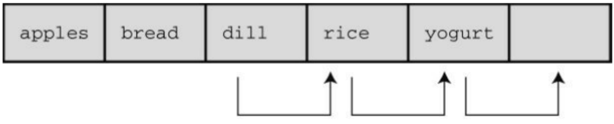
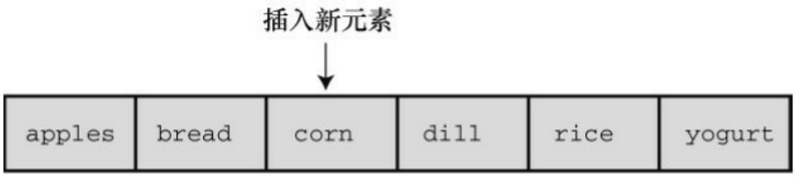
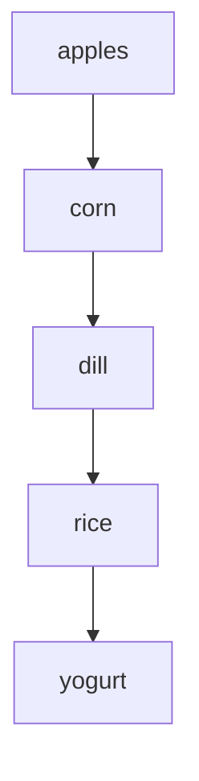
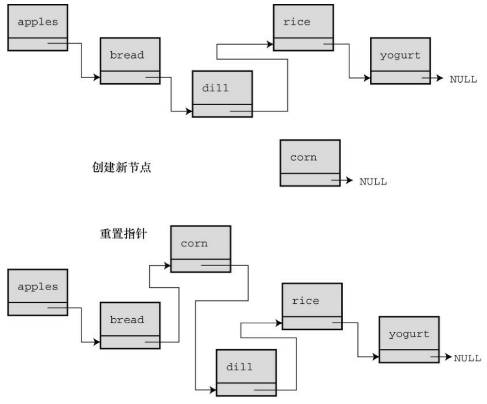
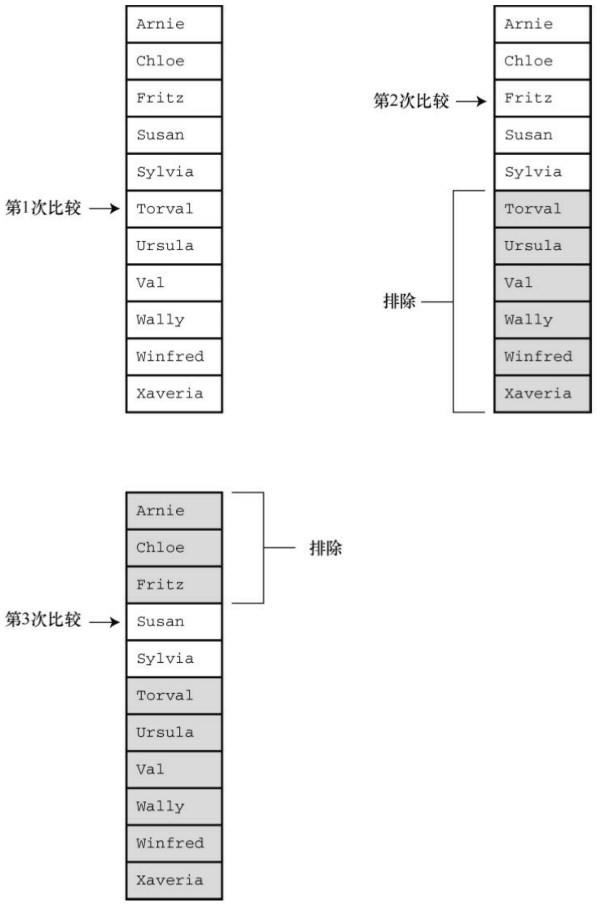
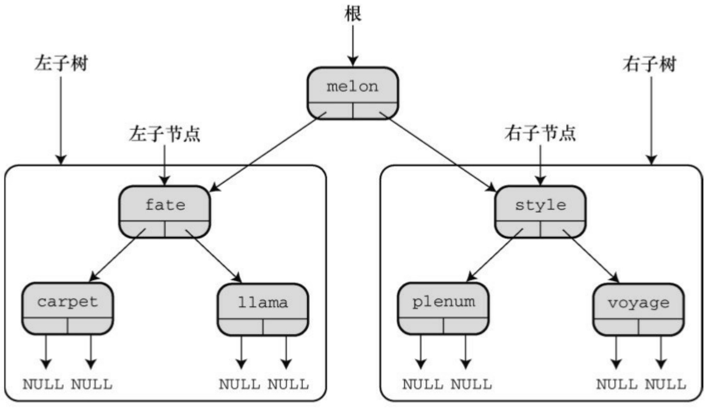

```c
}
if (wait_time <= 0 && !QueueIsEmpty(&line))
{
DeQueue(&temp, &line);
wait_time = temp.processtime;
line_wait += cycle - temp.arrive;
served++;
}
if (wait_time > 0)
wait_time—;
sum_line += QueueItemCount(&line);
}
```

注意，时间的表示比较粗糙（1分钟），所以一小时最多60位顾客。下面是一些变量和函数的含义。

min\_per\_cus是顾客到达的平均间隔时间。

newcustomer()使用C的rand()函数确定在特定时间内是否有顾客到来。

turnaways是被拒绝的顾客数量。

customers是加入队列的顾客数量。

temp是表示新顾客的Item类型变量。

customertime()设置temp结构中的arrive和processtime成员。

wait\_time是Sigmund完成当前顾客的咨询还需多长时间。

line\_wait是到目前为止队列中所有顾客的等待总时间。

served是咨询过Sigmund的顾客数量。

sum\_line是到目前为止统计的队列长度。

如果到处都是malloc()、free()和指向节点的指针，整个程序代码会非常混乱和晦涩。队列包让你把注意力集中在模拟问题上，而不是编程细节上。

程序清单 17.9 演示了模拟商业街咨询摊位队列的完整代码。根据第 12章介绍的方法，使用标准函数rand()、srand()和 time()来产生随机数。另外要特别注意，必须用下面的代码更新 queue.h 中的Item，该程序才能正常工作:

```c
typedef struct item
{
long arrive;      //一位顾客加入队列的时间
int processtime;  //该顾客咨询时花费的时间
} Item;
```

记住，还要把mall.c和queue.c一起链接。

程序清单**17.9 mall.c**程序

// mall.c -- 使用 Queue 接口

// 和 queue.c 一起编译

```c
#include <stdio.h>
#include <stdlib.h>          // 提供 rand() 和 srand() 的原型
#include <time.h>            // 提供 time() 的原型
#include "queue.h"           // 更改 Item 的 typedef
#define MIN_PER_HR 60.0
bool newcustomer(double x);    // 是否有新顾客到来?
Item customertime(long when);   // 设置顾客参数
int main(void)
{
Queue line;
Item temp;                    // 新的顾客数据
int hours;                    // 模拟的小时数
int perhour;                    // 每小时平均多少位顾客
long cycle, cyclelimit;    // 循环计数器、计数器的上限
long turnaways = 0;         // 因队列已满被拒的顾客数量
long customers = 0;         // 加入队列的顾客数量
long served = 0;             // 在模拟期间咨询过Sigmund的顾客数量
long sum_line = 0;         // 累计的队列总长
int wait_time = 0;         // 从当前到Sigmund空闲所需的时间
```

double min\_per\_cust; // 顾客到来的平均时间

long line\_wait = 0; // 队列累计的等待时间

InitializeQueue(&line);

srand((unsigned int) time(0)); // rand() 随机初始化

puts("Case Study: Sigmund Lander's Advice Booth");

puts("Enter the number of simulation hours:");

scanf("%d", &hours);

cyclelimit = MIN\_PER\_HR \* hours;

puts("Enter the average number of customers per hour:");

scanf("%d", &perhour);

min\_per\_cust = MIN\_PER\_HR / perhour;

for (cycle = 0; cycle < cyclelimit; cycle++)

if (newcustomer(min\_per\_cust))

{

if (QueueIsFull(&line))

turnaways++;

else

{

```c
customers++;
temp = customertime(cycle);

EnQueue(temp, &line);
}
}
if (wait_time <= 0 && !QueueIsEmpty(&line))
{
DeQueue(&temp, &line);
wait_time = temp.processtime;
line_wait += cycle - temp.arrive;
served++;
}
if (wait_time > 0)
wait_time--;
sum_line += QueueItemCount(&line);
}
if (customers > 0)
{
printf("customers accepted: %ld\n", customers);
```

```c
printf(" customers served: %ld\n", served);
printf(" turnaways: %ld\n", turnaways);
printf("average queue size: %.2f\n",
(double) sum_line / cyclelimit);
printf(" average wait time: %.2f minutes\n",
(double) line_wait / served);
}
else
puts("No customers!");
EmptyTheQueue(&line);
puts("Bye!");
return 0;
}
// x是顾客到来的平均时间（单位：分钟）
// 如果1分钟内有顾客到来，则返回true
bool newcustomer(double x)
{
if (rand() * x / RAND_MAX < 1)
return true;
```

```txt
else
return false;
}
// when是顾客到来的时间
// 该函数返回一个Item结构，该顾客到达的时间设置为when，
// 咨询时间设置为1~3的随机值
Item customertime(long when)
{
Item cust;
cust.processtime = rand() % 3 + 1;
cust.arrive = when;
return cust;
}
```

该程序允许用户指定模拟运行的小时数和每小时平均有多少位顾客。模拟时间较长得出的值较为平均，模拟时间较短得出的值随时间的变化而随机变化。下面的运行示例解释了这一点（先保持每小时的顾客平均数量不变）。注意，在模拟80小时和800小时的情况下，平均队伍长度和等待时间基本相同。但是，在模拟 1 小时的情况下这两个量差别很大，而且与长时间模拟的情况差别也很大。这是因为小数量的统计样本往往更容易受相对变化的影响。

Case Study: Sigmund Lander's Advice Booth

Enter the number of simulation hours:

## 80

Enter the average number of customers per hour:

## 20

customers accepted: 1633

customers served: 1633

turnaways: 0

average queue size: 0.46

average wait time: 1.35 minutes

Case Study: Sigmund Lander's Advice Booth

Enter the number of simulation hours:

## 800

Enter the average number of customers per hour:

## 20

customers accepted: 16020

customers served: 16019

turnaways: 0

average queue size: 0.44

average wait time: 1.32 minutes

Case Study: Sigmund Lander's Advice Booth

Enter the number of simulation hours:

## 1

Enter the average number of customers per hour:

## 20

customers accepted: 20

customers served: 20

turnaways: 0

average queue size: 0.23

average wait time: 0.70 minutes

Case Study: Sigmund Lander's Advice Booth

Enter the number of simulation hours:

## 1

Enter the average number of customers per hour:

## 20

customers accepted: 22

customers served: 22

turnaways: 0

average queue size: 0.75

average wait time: 2.05 minutes

然后保持模拟的时间不变，改变每小时的顾客平均数量:

Case Study: Sigmund Lander's Advice Booth

Enter the number of simulation hours:

## 80

Enter the average number of customers per hour:

## 25

customers accepted: 1960

customers served: 1959

turnaways: 3

average queue size: 1.43

average wait time: 3.50 minutes

Case Study: Sigmund Lander's Advice Booth

Enter the number of simulation hours:

## 80

Enter the average number of customers per hour:

## 30

customers accepted: 2376

customers served: 2373

turnaways: 94

average queue size: 5.85

average wait time: 11.83 minutes

注意，随着每小时顾客平均数量的增加，顾客的平均等待时间迅速增加。在每小时20位顾客（80小时模拟时间）的情况下，每位顾客的平均等待时间是1.35分钟；在每小时25位顾客的情况下，平均等待时间增加至3.50分钟；在每小时30位顾客的情况下，该数值攀升至11.83分钟。而且，这3种情况下被拒顾客分别从0位增加至3位最后陡增至94位。Sigmund可以根据程序模拟的结果决定是否要增加一个摊位。

## 17.6 链表和数组

许多编程问题，如创建一个简单链表或队列，都可以用链表（指的是动态分配结构的序列链）或数组来处理。每种形式都有其优缺点，所以要根据具体问题的要求来决定选择哪一种形式。表17.1总结了链表和数组的性质。

表17.1 比较数组和链表

| 数据形式 | 优点 | 缺点 |
| --- | --- | --- |
| 数组 | C直接支持提供随机访问 | 在编译时确定大小插入和删除元素很费时 |
| 链表 | 运行时确定大小快速插入和删除元素 | 不能随机访问用户必须提供编程支持 |

接下来，详细分析插入和删除元素的过程。在数组中插入元素，必须移动其他元素腾出空位插入新元素，如图17.9所示。新插入的元素离数组开头越近，要被移动的元素越多。然而，在链表中插入节点，只需给两个指针赋值，如图17.10所示。类似地，从数组中删除一个元素，也要移动许多相关的元素。但是从链表中删除节点，只需重新设置一个指针并释放被删除节点占用的内存即可。



<details>
<summary>flowchart</summary>

```mermaid
graph LR
  A["apples"] --> B["bread"]
  B --> C["dill"]
  C --> D["rice"]
  D --> E["yogurt"]
  F[""] --> G[""]
```
</details>

移动元素，为新元素腾出空间

| apples | bread |  | dill | rice | yogurt |
| --- | --- | --- | --- | --- | --- |



<details>
<summary>flowchart</summary>


</details>

图17.9 在数组中插入一个元素



图17.10 在链表中插入一个元素

接下来，考虑如何访问元素。对数组而言，可以使用数组下标直接访问该数组中的任意元素，这叫做随机访问（random access）。对链表而言，必须从链表首节点开始，逐个节点移动到要访问的节点，这叫做顺序访问（sequential access）。当然，也可以顺序访问数组。只需按顺序递增数组下标即可。在某些情况下，顺序访问足够了。例如，显示链表中的每一项，顺序访问就不错。其他情况用随机访问更合适。

假设要查找链表中的特定项。一种算法是从列表的开头开始按顺序查找，这叫做顺序查找（sequential search）。如果项并未按某种顺序排列，则只能顺序查找。如果待查找的项不在链表里，必须查找完所有的项才知道该项不在链表中（在这种情况下可以使用并发编程，同时查找列表中的不同部分）。

我们可以先排序列表，以改进顺序查找。这样，就不必查找排在待查找项后面的项。例如，假设在一个按字母排序的列表中查找Susan。从开头开始查找每一项，直到Sylvia都没有查找到Susan。这时就可以退出查找，因为如果Susan在列表中，应该排在Sylvia前面。平均下来，这种方法查找不在列表中的项的时间减半。

对于一个排序的列表，用二分查找（binary search）比顺序查找好得多。下面分析二分查找的原理。首先，把待查找的项称为目标项，而且假设列表中的各项按字母排序。然后，比较列表的中间项和目标项。如果两者相等，查找结束；假设目标项在列表中，如果中间项排在目标项前面，则目标项一定在后半部分项中；如果中间项在目标项后面，则目标项一定在前半部分项中。无论哪种情况，两项比较的结果都确定了下次查找的范围只有列表的一半。接着，继续使用这种方法，把需要查找的剩下一半的中间项与目标项比较。同样，这种方法会确定下一次查找的范围是当前查找范围的一半。以此类推，直到找到目标项或最终发现列表中没有目标项（见图17.11）。这种方法非常有效率。假如有127个项，顺序查找平均要进行64次比较才能找到目标项或发现不在其中。但是二分查找最多只用进行7次比较。第1次比较剩下63项进行比较，第2次比较剩下31项进行比较，以此类推，第6次剩下最后1项进行比较，第7次比较确定剩下的这个项是否是目标项。一般而言，n 次比较能处理有 2<sup>n</sup>-1 个元素的数组。所以项数越多，越能体现二分查找的优势。



图17.11 用二分查找法查找Susan

用数组实现二分查找很简单，因为可以使用数组下标确定数组中任意部分的中点。只要把数组的首元素和尾元素的索引相加，得到的和再除以2 即可。例如，内含100 个元素的数组，首元素下标是0，尾元素下标是99，那么用于首次比较的中间项的下标应为(0+99)/2，得49（整数除法）。如果比较的结果是下标为49的元素在目标项的后面，那么目标项的下标应在0～48的范围内。所以，第2次比较的中间项的下标应为(0+48)/2，得24。如果中间项与目标项的比较结果是，中间项在目标项前面，那么第3次比较的中间项下标应为(25+48)/2，得 36。这体现了随机访问的特性，可以从一个位置跳至另一个位置，不用一次访问两位置之间的项。但是，链表只支持顺序访问，不提供跳至中间节点的方法。所以在链表中不能使用二分查找。

如前所述，选择何种数据类型取决于具体的问题。如果因频繁地插入和删除项导致经常调整大小，而且不需要经常查找，选择链表会更好。如果只是偶尔插入或删除项，但是经常进行查找，使用数组会更好。

如果需要一种既支持频繁插入和删除项又支持频繁查找的数据形式，数组和链表都无法胜任，怎么办？这种情况下应该选择二叉查找树。

## 17.7 二叉查找树

二叉查找树是一种结合了二分查找策略的链接结构。二叉树的每个节点都包含一个项和两个指向其他节点（称为子节点）的指针。图17.12演示了二叉查找树中的节点是如何链接的。二叉树中的每个节点都包含两个子节点左节点和右节点，其顺序按照如下规定确定:左节点的项在父节点的项前面，右节点的项在父节点的项后面。这种关系存在于每个有子节点的节点中。进一步而言，所有可以追溯其祖先回到一个父节点的左节点的项，都在该父节点项的前面；所有以一个父节点的右节点为祖先的项，都在该父节点项的后面。图17.12中的树以这种方式储存单词。有趣的是，与植物学的树相反，该树的顶部被称为根（root）。树具有分层组织，所以以这种方式储存的数据也以等级或层次组织。一般而言，每级都有上一级和下一级。如果二叉树是满的，那么每一级的节点数都是上一级节点数的两倍。



<details>
<summary>flowchart</summary>

```mermaid
graph TD
  Root["根"] --> Melon["melon"]
  LeftSub["左子树"] --> fate["fate"]
  RightSub["右子树"] --> style["style"]
  Melon --> fate
  Melon --> style
  style --> style
  style --> style
  style --> style
  fate --> carpet["carpet"]
  fate --> llama["llama"]
  style --> plenum["plenum"]
  style --> voyage["voyage"]
  carpet --> NULL1["NULL NULL"]
  llama --> NULL2["NULL NULL"]
  plenum --> NULL3["NULL NULL"]
  voyage --> NULL4["NULL NULL"]
```
</details>

图17.12 一个从存储单词的二叉树

二叉查找树中的每个节点是其后代节点的根，该节点与其后代节点构成称了一个子树（subtree）。如图 17.12 所示，包含单词fate、carpet和llama的节点构成了整个二叉树的左子树，而单词 voyage是style-plenum-voyage子树的右子树。

假设要在二叉树中查找一个项（即目标项）。如果目标项在根节点项的前面，则只需查找左子树；如果目标项在根节点项的后面，则只需查找右子树。因此，每次比较就排除半个树。假设查找左子树，这意味着目标项与左子节点项比较。如果目标项在左子节点项的前面，则只需查找其后代节点的左半部分，以此类推。与二分查找类似，每次比较都能排除一半的可能匹配项。

我们用这种方法来查找puppy是否在图17.12的二叉树中。比较puppy和melon（根节点项），如果puppy在该树中，一定在右子树中。因此，在右子树中比较puppy和style，发现puppy在style前面，所以必须链接到其左节点。然后发现该节点是plenum，在puppy前面。现在要向下链接到该节点的右子节点，但是没有右子节点了。所以经过3次比较后发现puppy不在该树中。

二叉查找树在链式结构中结合了二分查找的效率。但是，这样编程的代价是构建一个二叉树比创建一个链表更复杂。下面我们在下一个ADT项目中创建一个二叉树。

## 17.7.1 二叉树ADT

和前面一样，先从概括地定义二叉树开始。该定义假设树不包含相同的项。许多操作与链表相同，区别在于数据层次的安排。下面建立一个非正式的树定义:

类型名: 二叉查找树

类型属性: 二叉树要么是空节点的集合（空树），要么是有一个根节点的节点集合

每个节点都有两个子树，叫做左子树和右子树

每个子树本身也是一个二叉树，也有可能是空树

二叉查找树是一个有序的二叉树，每个节点包含一个项，

左子树的所有项都在根节点项的前面，右子树的所有项都在根节点项的后面

类型操作: 初始化树为空

确定树是否为空

确定树是否已满

确定树中的项数

在树中添加一个项

在树中删除一个项

在树中查找一个项

在树中访问一个项

清空树

## 17.7.2 二叉查找树接口

原则上，可以用多种方法实现二叉查找树，甚至可以通过操控数组下标用数组来实现。但是，实现二叉查找树最直接的方法是通过指针动态分配链式节点。因此我们这样定义:

```c
typedef SOMETHING Item;

typedef struct trnode

{

Item item;
```

```c
struct trnode * left;

struct trnode * right;

} Trn;

typedef struct tree

{

Trnode * root;

int size;

} Tree;
```

每个节点包含一个项、一个指向左子节点的指针和一个指向右子节点的指针。可以把 Tree 定义为指向 Trnode 的指针类型，因为只需要知道根节点的位置就可访问整个树。然而，使用有成员大小的结构能很方便地记录树的大小。

我们要开发一个维护 Nerfville 宠物俱乐部的花名册，每一项都包含宠物名和宠物的种类。程序清单17.10就是该花名册的接口。我们把树的大小限制为10，较小的树便于在树已满时测试程序的行为是否正确。当然，你也可以把MAXITEMS设置为更大的值。

程序清单**17.10 tree.h**接口头文件

/\* tree.h -- 二叉查找数 \*/

/\* 树种不允许有重复的项 \*/

```c
#ifndef _TREE_H_
#define _TREE_H_
```

```c
#include <stdbool.h>

/* 根据具体情况重新定义 Item */

#define SLEN 20

typedef struct item

{

char petname[SLEN];

char petkind[SLEN];

} Item;

#define MAXITEMS 10

typedef struct trnode

{

Item item;

struct trnode * left;      /* 指向左分支的指针 */
struct trnode * right; /* 指向右分支的指针 */
} Trnode;

typedef struct tree

{

Trnode * root;/* 指向根节点的指针 */
int size;     /* 树的项数               */
```

} Tree;

/\* 函数原型 \*/

/\* 操作: 把树初始化为空\*/

/\* 前提条件: ptree指向一个树 \*/

/\* 后置条件: 树被初始化为空 \*/

void InitializeTree(Tree \* ptree);

/\* 操作: 确定树是否为空 \*/

/\* 前提条件: ptree指向一个树 \*/

/\* 后置条件: 如果树为空，该函数返回true \*/

/\* 否则，返回false \*/

bool TreeIsEmpty(const Tree \* ptree);

/\* 操作: 确定树是否已满 \*/

/\* 前提条件: ptree指向一个树 \*/

/\* 后置条件: 如果树已满，该函数返回true \*/

/\* 否则，返回false \*/

bool TreeIsFull(const Tree \* ptree);

/\* 操作: 确定树的项数 \*/

/\* 前提条件: ptree指向一个树 \*/

/\* 后置条件: 返回树的项数 \*/

int TreeItemCount(const Tree \* ptree);

/\* 操作: 在树中添加一个项 \*/

/\* 前提条件: pi是待添加项的地址 \*/

/\* ptree指向一个已初始化的树 \*/

/\* 后置条件: 如果可以添加，该函数将在树中添加一个项 \*/

/\* 并返回true；否则，返回false \*/

bool AddItem(const Item \* pi, Tree \* ptree);

/\* 操作: 在树中查找一个项 \*/

/\* 前提条件: pi指向一个项 \*/

/\* ptree指向一个已初始化的树 \*/

/\* 后置条件: 如果在树中添加一个项，该函数返回true \*/

/\* 否则，返回false \*/

bool InTree(const Item \* pi, const Tree \* ptree);

/\* 操作: 从树中删除一个项 \*/

/\* 前提条件: pi是删除项的地址 \*/

/\* ptree指向一个已初始化的树 \*/

/\* 后置条件: 如果从树中成功删除一个项，该函数返回true\*/

/\* 否则，返回false \*/

bool DeleteItem(const Item \* pi, Tree \* ptree);

```c
/* 操作: 把函数应用于树中的每一项 */
/* 前提条件: ptree指向一个树 */
/* pfun指向一个函数, */
/* 该函数接受一个Item类型的参数, 并无返回值*/
/* 后置条件: pfun指向的这个函数为树中的每一项执行一次*/
void Traverse(const Tree * ptree, void(*pfun)(Item item));
/* 操作: 删除树中的所有内容 */
/* 前提条件: ptree指向一个已初始化的树 */
/* 后置条件: 树为空 */
void DeleteAll(Tree * ptree);
#endif
```

## 17.7.3 二叉树的实现

接下来，我们要实现tree.h中的每个函数。InitializeTree()、EmptyTree()、FullTree()和TreeItems()函数都很简单，与链表ADT、队列ADT类似，所以下面着重讲解其他函数。

## 1.添加项

在树中添加一个项，首先要检查该树是否有空间放得下一个项。由于我们定义二叉树时规定其中的项不能重复，所以接下来要检查树中是否有该项。通过这两步检查后，便可创建一个新节点，把待添加项拷贝到该节点中，并设置节点的左指针和右指针都为NULL。这表明该节点没有子节点。然后，更新Tree结构的 size 成员，统计新增了一项。接下来，必须找出应该把这个新节点放在树中的哪个位置。如果树为空，则应设置根节点指针指向该新节点。否则，遍历树找到合适的位置放置该节点。AddItem()函数就根据这个思路来实现，并把一些工作交给几个尚未定义的函数:SeekItem()、MakeNode()和AddNode()。

```c
bool AddItem(const Item * pi, Tree * ptree)
{
Trnode * new_node;
if (TreeIsFull(ptree))
{
fprintf(stderr, "Tree is full\n");
return false;          /* 提前返回 */
}
if (SeekItem(pi, ptree).child != NULL)
{
fprintf(stderr, "Attempted to add duplicate item\n");
return false;          /* 提前返回 */
}
new_node = MakeNode(pi);  /* 指向新节点 */
if (new_node == NULL)
{
fprintf(stderr, "Couldn't create node\n");
```

```c
return false;          /* 提前返回     */

}

/* 成功创建了一个新节点 */

ptree->size++;

if (ptree->root == NULL)           /* 情况1: 树为空       */
ptree->root = new_node;         /* 新节点是根节点      */
else                          /* 情况2: 树不为空       */
AddNode(new_node, ptree->root);/* 在树中添加一个节点*/
return true;  /* 成功返回 */

}
```

SeekItem()、MakeNode()和 AddNode()函数不是 Tree 类型公共接口的一部分。它们是隐藏在tree.c文件中的静态函数，处理实现的细节（如节点、指针和结构），不属于公共接口。

MakeNode()函数相当简单，它处理动态内存分配和初始化节点。该函数的参数是指向新项的指针，其返回值是指向新节点的指针。如果 malloc()无法分配所需的内存，则返回空指针。只有成功分配了内存，MakeNode()函数才会初始化新节点。下面是MakeNode()的代码:

```c
static Trnode * MakeNode(const Item * pi)
{
Trnode * new_node;
new_node = (Trnode *) malloc(sizeof(Trnode));
```

```c
if (new_node != NULL)
{
new_node->item = *pi;
new_node->left = NULL;
new_node->right = NULL;
}
return new_node;
}
```

AddNode()函数是二叉查找树包中最麻烦的第2个函数。它必须确定新节点的位置，然后添加新节点。具体来说，该函数要比较新项和根项，以确定应该把新项放在左子树还是右子树中。如果新项是一个数字，则使用<和>进行比较；如果新项是一个字符串，则使用strcmp()函数来比较。但是，该项是内含两个字符串的结构，所以，必须自定义用于比较的函数。如果新项应放在左子树中，ToLeft()函数（稍后定义）返回true；如果新项应放在右子树中，ToRight()函数（稍后定义）返回true。这两个函数分别相当于<和>。假设把新项放在左子树中。如果左子树为空，AddNode()函数只需让左子节点指针指向新项即可。如果左子树不为空怎么办？此时，AddNode()函数应该把新项和左子节点中的项做比较，以确定新项应该放在该子节点的左子树还是右子树。这个过程一直持续到函数发现一个空子树为止，并在此此处添加新节点。递归是一种实现这种查找过程的方法，即把AddNode()函数应用于子节点，而不是根节点。当左子树或右子树为空时，即当root->left或root->right为NULL时，函数的递归调用序列结束。记住，root是指向当前子树顶部的指针，所以每次递归调用它都指向一个新的下一级子树（递归详见第9章）。

static void AddNode(Trnode \* new\_node, Trnode \* root)

```c
{
if (ToLeft(&new_node->item, &root->item))
{
if(root->left == NULL)          /* 空子树 */
root->left = new_node;         /* 所以，在此处添加节点 */
else
AddNode(new_node, root->left);  /* 否则，处理该子树*/
}
else if (ToRight(&new_node->item, &root->item))
{
if (root->right == NULL)
root->right = new_node;
else
AddNode(new_node, root->right);
}
else                          /* 不应含有重复的项 */
{
fprintf(stderr, "location error in AddNode()\n");
exit(1);
```

```txt
}
}
```

ToLeft()和ToRight()函数依赖于Item类型的性质。Nerfville宠物俱乐部的成员名按字母排序。如果两个宠物名相同，按其种类排序。如果种类也相同，这两项属于重复项，根据该二叉树的定义，这是不允许的。回忆一下，如果标准C库函数strcmp()中的第1个参数表示的字符串在第2个参数表示的字符串前面，该函数则返回负数；如果两个字符串相同，该函数则返回0；如果第1个字符串在第2个字符串后面，该函数则返回正数。ToRight()函数的实现代码与该函数类似。通过这两个函数完成比较，而不是直接在AddNode()函数中直接比较，这样的代码更容易适应新的要求。当需要比较不同的数据形式时，就不必重写整个AddNode()函数，只需重写Toleft()和ToRight()即可。

```c
static bool ToLeft(const Item * i1, const Item * i2)
{
int compl;
if ((comp1 = strcmp(i1->petname, i2->petname)) < 0)
return true;
else if (comp1 == 0 &&
strcmp(i1->petkind, i2->petkind) < 0)
return true;
else
return false;
```

}

## 2.查找项

3个接口函数都要在树中查找特定项:AddItem()、InItem()和DeleteItem()。这些函数的实现中使用SeekItem()函数进行查找。DeleteItem()函数有一个额外的要求:该函数要知道待删除项的父节点，以便在删除子节点后更新父节点指向子节点的指针。因此，我们设计SeekItem()函数返回的结构包含两个指针:一个指针指向包含项的节点（如果未找到指定项则为NULL）；一个指针指向父节点（如果该节点为根节点，即没有父节点，则为NULL）。这个结构类型的定义如下:

```c
typedef struct pair {
Trnode * parent;
Trnode * child;
} Pair;
```

SeekItem()函数可以用递归的方式实现。但是，为了给读者介绍更多编程技巧，我们这次使用while循环处理树中从上到下的查找。和AddNode()一样，SeekItem()也使用ToLeft()和ToRight()在树中导航。开始时，SeekItem()设置look.child指针指向该树的根节点，然后沿着目标项应在的路径重置look.child指向后续的子树。同时，设置look.parent指向后续的父节点。如果没有找到匹配的项， look.child则被设置为NULL。如果在根节点找到匹配的项，则设置look.parent为NULL，因为根节点没有父节点。下面是SeekItem()函数的实现代码:

```c
static Pair SeekItem(const Item * pi, const Tree * ptree)
{
Pair look;
```

```txt
look.parent = NULL;

look.child = ptree->root;

if (look.child == NULL)

return look; /* 提前退出 */

while (look.child != NULL)
{
if (ToLeft(pi, &(look.child->item)))
{
look.parent = look.child;
look.child = look.child->left;
}
else if (ToRight(pi, &(look.child->item)))
{
look.parent = look.child;
look.child = look.child->right;
}
else /* 如果前两种情况都不满足，则必定是相等的情况 */
break; /* look.child 目标项的节点 */
}
```