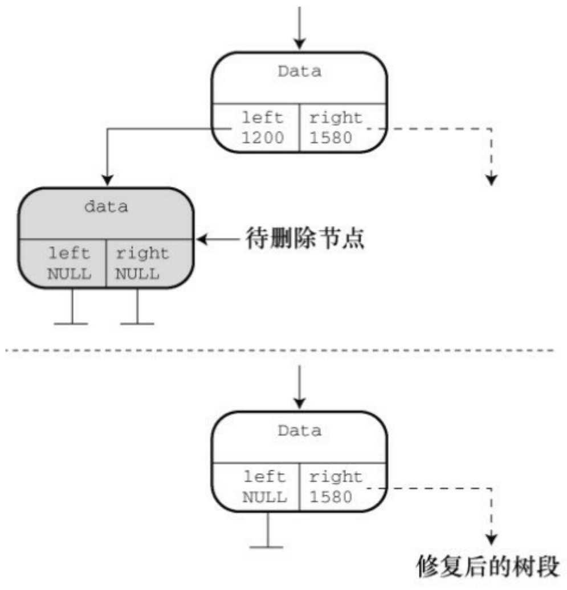
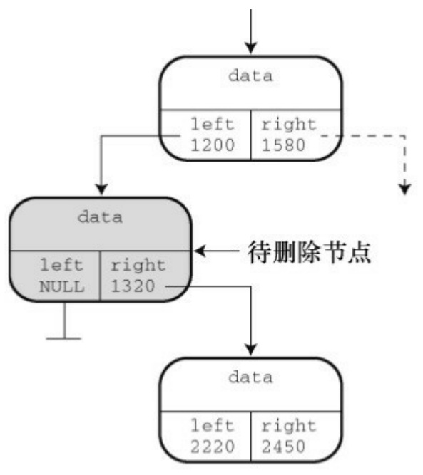
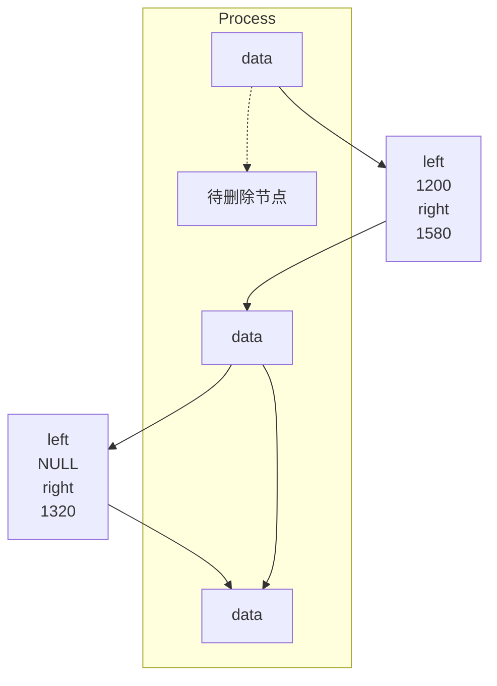
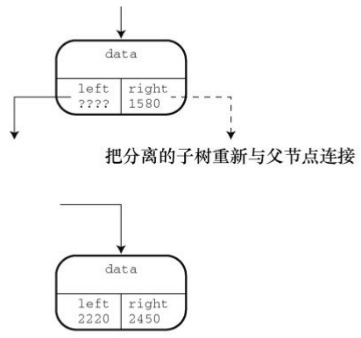
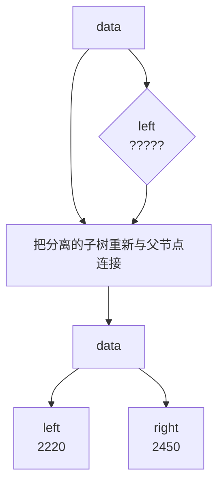
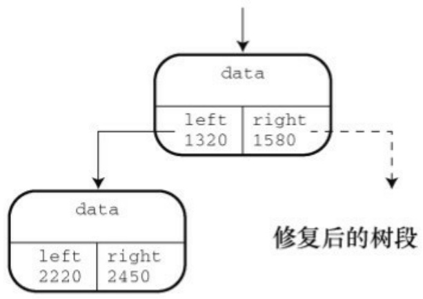
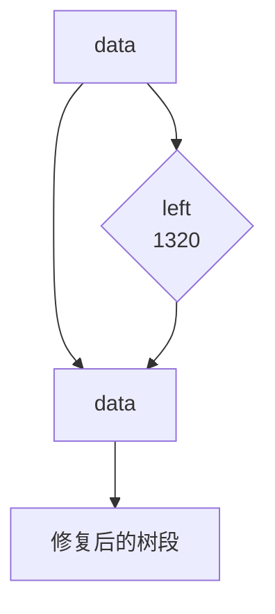
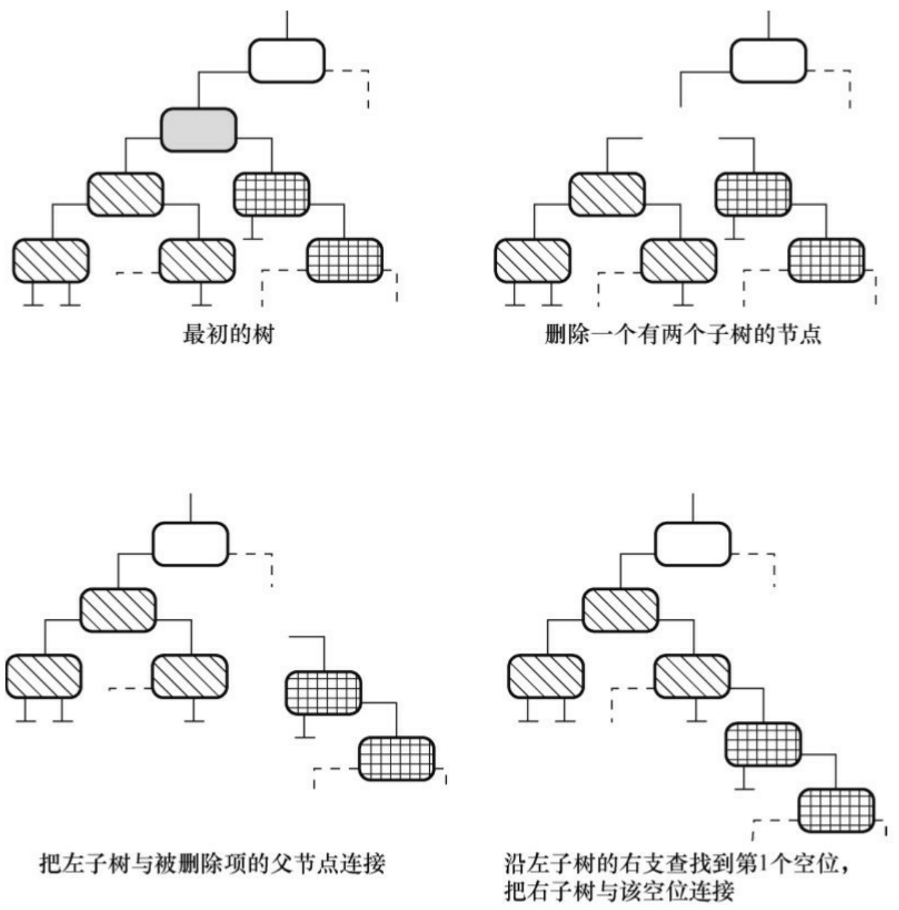

```txt
return look;          /* 成功返回 */
}
```

注意，如果 SeekItem()函数返回一个结构，那么该函数可以与结构成员运算符一起使用。例如， AddItem()函数中有如下的代码:

```txt
if (SeekItem(pi, ptree).child != NULL)
```

有了SeekItem()函数后，编写InTree()公共接口函数就很简单了:

```c
bool InTree(const Item * pi, const Tree * ptree)
{
return (SeekItem(pi, ptree).child == NULL) ? false : true;
}
```

## 3.考虑删除项

删除项是最复杂的任务，因为必须重新连接剩余的子树形成有效的树。在准备编写这部分代码之前，必须明确需要做什么。

图17.13演示了最简单的情况。待删除的节点没有子节点，这样的节点被称为叶节点（leaf）。这种情况只需把父节点中的指针重置为NULL，并使用free()函数释放已删除节点所占用的内存。

```mermaid
graph TD
  A["Data"] --> B["left\n1200"]
  A --> C["right\n1580"]
  B --> D["data"]
  C -.-> E["待删除节点"]
  D --> F["left\nNULL"]
  D --> G["right\nNULL"]
  F --> H["Data"]
  G --> H
  H --> I["left\nNULL"]
  H --> J["right\n1580"]
  I --> K["修复后的树段"]
  J -.-> K
```



<details>
<summary>flowchart</summary>


</details>

图17.13 删除一个叶节点

删除带有一个子节点的情况比较复杂。删除该节点会导致其子树与其他部分分离。为了修正这种情况，要把被删除节点父节点中储存该节点的地址更新为该节点子树的地址（见图17.14）。



<details>
<summary>flowchart</summary>


</details>

(a)



<details>
<summary>flowchart</summary>


</details>

(b)



<details>
<summary>flowchart</summary>


</details>

图17.14 删除有一个子节点的节点

最后一种情况是删除有两个子树的节点。其中一个子树（如左子树）可连接在被删除节点之前连接的位置。但是，另一个子树怎么处理？牢记树的基本设计:左子树的所有项都在父节点项的前面，右子树的所有项都在父节点项的后面。也就是说，右子树的所有项都在左子树所有项的后面。而且，因为该右子树曾经是被删除节点的父节点的左子树的一部分，所以该右节点中的所有项在被删除节点的父节点项的前面。想像一下如何在树中从上到下查找该右子树的头所在的位置。它应该在被删除节点的父节点的前面，所以要沿着父节点的左子树向下找。但是，该右子树的所有项又在被删除节点左子树所有项的后面。因此要查看左子树的右支是否有新节点的空位。如果没有，就要沿着左子树的右支向下找，一直找到一个空位为止。图17.15演示了这种方法。



图17.15 删除一个有两个子节点的项

① 删除一个节点

现在可以设计所需的函数了，可以分成两个任务:第一个任务是把特定项与待删除节点关联；第二个任务是删除节点。无论哪种情况都必须修改待删除项父节点的指针。因此，要注意以下两点。

该程序必须标识待删除节点的父节点。

为了修改指针，代码必须把该指针的地址传递给执行删除任务的函数。

第一点稍后讨论，下面先分析第二点。要修改的指针本身是Trnode \*类型，即指向Trnode的指针。由于该函数的参数是该指针的地址，所以参数的类型是Trnode \*\*，即指向指针（该指针指向Trnode）的指针。假设有合适的地址可用，可以这样编写执行删除任务的函数:

```c
static void DeleteNode(Trnode **ptr)

/* ptr 是指向目标节点的父节点指针成员的地址 */
{
Trnode * temp;

if ((*ptr)->left == NULL)
{
temp = *ptr;

*ptr = (*ptr)->right;

free(temp);

}
else if ((*ptr)->right == NULL)
{
temp = *ptr;

*ptr = (*ptr)->left;
```

```c
free(temp);

}
else /* 被删除的节点有两个子节点 */
{
/* 找到重新连接右子树的位置 */
for (temp = (*ptr)->left; temp->right != NULL;
temp = temp->right)
continue;
temp->right = (*ptr)->right;
temp = *ptr;
*ptr = (*ptr)->left;
free(temp);
}
}
```

该函数显式处理了 3 种情况:没有左子节点的节点、没有右子节点的节点和有两个子节点的节点。无子节点的节点可作为无左子节点的节点的特例。如果该节点没有左子节点，程序就将右子节点的地址赋给其父节点的指针。如果该节点也没有右子节点，则该指针为NULL。这就是无子节点情况的值。

注意，代码中用临时指针记录被删除节点的地址。被删除节点的父节点指针（\*ptr）被重置后，程序会丢失被删除节点的地址，但是free()函数需要这个信息。所以，程序把\*ptr的原始值储存在temp中，然后用free()函数使用temp来释放被删除节点所占用的内存。

有两个子节点的情况，首先在for循环中通过temp指针从左子树的右半部分向下查找一个空位。找到空位后，把右子树连接于此。然后，再用temp 保存被删除节点的位置。接下来，把左子树连接到被删除节点的父节点上，最后释放temp指向的节点。

注意，由于ptr的类型是Trnode \*\*，所以\*ptr的类型是Trnode \*，与temp的类型相同。

② 删除一个项

剩下的问题是把一个节点与特定项相关联。可以使用SeekItem()函数来完成。回忆一下，该函数返回一个结构（内含两个指针，一个指针指向父节点，一个指针指向包含特定项的节点）。然后就可以通过父节点的指针获得相应的地址传递给DeleteNode()函数。根据这个思路，DeleteNode()函数的定义如下:

```c
bool DeleteItem(const Item * pi, Tree * ptree)
{
Pair look;
look = SeekItem(pi, ptree);
if (look.child == NULL)
return false;
if (look.parent == NULL) /* 删除根节点 */
DeleteNode(&ptree->root);
```

```c
else if (look.parent->left == look.child)
DeleteNode(&look.parent->left);
else
DeleteNode(&look.parent->right);
ptree->size--;
return true;
}
```

首先，SeekItem()函数的返回值被赋给look类型的结构变量。如果look.child是NULL，表明未找到指定项，DeleteItem()函数退出，并返回false。如果找到了指定的Item，该函数分3种情况来处理。第一种情况是，look.parent的值为NULL，这意味着该项在根节点中。在这情况下，不用更新父节点，但是要更新Tree结构中根节点的指针。因此，函数该函数把该指针的地址传递给DeleteNode()函数。否则（即剩下两种情况），程序判断待删除节点是其父节点的左子节点还是右子节点，然后传递合适指针的地址。

注意，公共接口函数（DeleteItem()）处理的是最终用户所关心的问题（项和树），而隐藏的DeleteNode()函数处理的是与指针相关的实质性任务。

## 4.遍历树

遍历树比遍历链表更复杂，因为每个节点都有两个分支。这种分支特性很适合使用分而制之的递归（详见第9章）来处理。对于每一个节点，执行遍历任务的函数都要做如下的工作:

处理节点中的项；

处理左子树（递归调用）；

处理右子树（递归调用）。

可以把遍历分成两个函数来完成:Traverse()和InOrder()。注意，InOrder()函数处理左子树，然后处理项，最后处理右子树。这种遍历树的顺序是按字母排序进行。如果你有时间，可以试试用不同的顺序，比如，项-左子树-右子树或者左子树-右子树-项，看看会发生什么。

```c
void Traverse(const Tree * ptree, void(*pfun)(Item item))
{
if (ptree != NULL)
InOrder(ptree->root, pfun);
}
static void InOrder(const Trnode * root, void(*pfun)(Item item))
{
if (root != NULL)
{
InOrder(root->left, pfun);
(*pfun)(root->item);
InOrder(root->right, pfun);
}
}
```

**5.**清空树

清空树基本上和遍历树的过程相同，即清空树的代码也要访问每个节点，而且要用 free()函数释放内存。除此之外，还要重置Tree类型结构的成员，表明该树为空。DeleteAll()函数负责处理Tree类型的结构，把释放内存的任务交给 DeleteAllNode()函数。DeleteAllNode()与 InOrder()函数的构造相同，它储存了指针的值root->right，使其在释放根节点后仍然可用。下面是这两个函数的代码:

```c
void DeleteAll(Tree * ptree)
{
if (ptree != NULL)
DeleteAllNodes(ptree->root);
ptree->root = NULL;
ptree->size = 0;
}
static void DeleteAllNodes(Trnode * root)
{
Trnode * pright;
if (root != NULL)
{
pright = root->right;
DeleteAllNodes(root->left);
free(root);
```

```solidity
DeleteAllNodes(pright);

}

}
```

## 6.完整的包

程序清单17.11演示了整个tree.c的代码。tree.h和tree.c共同组成了树的程序包。

程序清单17.11 tree.c程序

```c
/* tree.c -- 树的支持函数 */
#include <string.h>
#include <stdio.h>
#include <stdlib.h>
#include "tree.h"
/* 局部数据类型 */
typedef struct pair {
Trnode * parent;
Trnode * child;
} Pair;
/* 局部函数的原型 */
static Trnode * MakeNode(const Item * pi);
```

```c
static bool ToLeft(const Item * i1, const Item * i2);
static bool ToRight(const Item * i1, const Item * i2);
static void AddNode(Trnode * new_node, Trnode * root);
static void InOrder(const Trnode * root, void(*pfun)(Item item));
static Pair SeekItem(const Item * pi, const Tree * ptree);
static void DeleteNode(Trnode **ptr);
static void DeleteAllNodes(Trnode * ptr);
/* 函数定义 */
void InitializeTree(Tree * ptree)
{
ptree->root = NULL;
ptree->size = 0;
}
bool TreeIsEmpty(const Tree * ptree)
{
if (ptree->root == NULL)
return true;
else
return false;
```

```c
}
bool TreeIsFull(const Tree * ptree)
{
if (ptree->size == MAXITEMS)
return true;
else
return false;
}
int TreeItemCount(const Tree * ptree)
{
return ptree->size;
}
bool AddItem(const Item * pi, Tree * ptree)
{
Trnode * new_node;
if (TreeIsFull(ptree))
{
fprintf(stderr, "Tree is full\n");
return false; /* 提前返回 */
```

```c
}
if (SeekItem(pi, ptree).child != NULL)
{
fprintf(stderr, "Attempted to add duplicate item\n");
return false;          /* 提前返回 */
}
new_node = MakeNode(pi);  /* 指向新节点 */
if (new_node == NULL)
{
fprintf(stderr, "Couldn't create node\n");
return false;          /* 提前返回 */
}
/* 成功创建了一个新节点 */
ptree->size++;
if (ptree->root == NULL)          /* 情况1: 树为空 */
ptree->root = new_node;       /* 新节点为树的根节点 */
else                          /* 情况2: 树不为空 */
AddNode(new_node, ptree->root);/* 在树中添加新节点 */
return true;                  /* 成功返回 */
*/
```

```c
}
bool InTree(const Item * pi, const Tree * ptree)
{
return (SeekItem(pi, ptree).child == NULL) ? false : true;
}
bool DeleteItem(const Item * pi, Tree * ptree)
{
Pair look;
look = SeekItem(pi, ptree);
if (look.child == NULL)
return false;
if (look.parent == NULL)          /* 删除根节点项 */
DeleteNode(&ptree->root);
else if (look.parent->left == look.child)
DeleteNode(&look.parent->left);
else
DeleteNode(&look.parent->right);
ptree->size--;
return true;
```

```c
}
void Traverse(const Tree * ptree, void(*pfun)(Item item))
{
if (ptree != NULL)
InOrder(ptree->root, pfun);
}
void DeleteAll(Tree * ptree)
{
if (ptree != NULL)
DeleteAllNodes(ptree->root);
ptree->root = NULL;
ptree->size = 0;
}
/* 局部函数 */
static void InOrder(const Trnode * root, void(*pfun)(Item item))
{
if (root != NULL)
{
InOrder(root->left, pfun);
```

```c
(*pfun)(root->item);

InOrder(root->right, pfun);

}

}
static void DeleteAllNodes(Trnode * root)
{
Trnode * pright;
if (root != NULL)
{
pright = root->right;
DeleteAllNodes(root->left);
free(root);
DeleteAllNodes(pright);
}
}
static void AddNode(Trnode * new_node, Trnode * root)
{
if (ToLeft(&new_node->item, &root->item))
{
```

```c
if(root->left == NULL)          /* 空子树              */
root->left = new_node;         /* 把节点添加到此处     */
else
AddNode(new_node, root->left);  /* 否则处理该子树      */
}
else if (ToRight(&new_node->item, &root->item))
{
if (root->right == NULL)
root->right = new_node;
else
AddNode(new_node, root->right);
}
else                          /* 不允许有重复项
*/
{
fprintf(stderr, "location error in AddNode()\n");
exit(1);
}
}
```

```c
static bool ToLeft(const Item * i1, const Item * i2)
{
int compl;
if ((comp1 = strcmp(i1->petname, i2->petname)) < 0)
return true;
else if (comp1 == 0 &&strcmp(i1->petkind, i2->petkind) < 0)
return true;
else
return false;
}
static bool ToRight(const Item * i1, const Item * i2)
{
int compl;
if ((comp1 = strcmp(i1->petname, i2->petname)) > 0)
return true;
else if (comp1 == 0 &&
strcmp(i1->petkind, i2->petkind) > 0)
return true;
else
```

```c
return false;

}

static Trnode * MakeNode(const Item * pi)

{

Trnode * new_node;

new_node = (Trnode *) malloc(sizeof(Trnode));

if (new_node != NULL)

{

new_node->item = *pi;

new_node->left = NULL;

new_node->right = NULL;

}

return new_node;

}

static Pair SeekItem(const Item * pi, const Tree * ptree)

{

Pair look;

look.parent = NULL;

look.child = ptree->root;
```

```c
if (look.child == NULL)
return look;                      /* 提前返回 */
while (look.child != NULL)
{
if (ToLeft(pi, &(look.child->item)))
{
look.parent = look.child;
look.child = look.child->left;
}
else if (ToRight(pi, &(look.child->item)))
{
look.parent = look.child;
look.child = look.child->right;
}
else            /* 如果前两种情况都不满足，则必定是相等的情况 */
break;         /* look.child 目标项的节点 */
}
return look;                    /* 成功返回 */
```

```c
}
static void DeleteNode(Trnode **ptr)
/* ptr 是指向目标节点的父节点指针成员的地址 */
{
Trnode * temp;
if ((*ptr)->left == NULL)
{
temp = *ptr;
*ptr = (*ptr)->right;
free(temp);
}
else if ((*ptr)->right == NULL)
{
temp = *ptr;
*ptr = (*ptr)->left;
free(temp);
}
else /* 被删除的节点有两个子节点 */
{
```

```c
/* 找到重新连接右子树的位置 */
for (temp = (*ptr)->left; temp->right != NULL; temp = temp->right)
continue;
temp->right = (*ptr)->right;
temp = *ptr;
*ptr = (*ptr)->left;
free(temp);
}
}
```

## 17.7.4 使用二叉树

现在，有了接口和函数的实现，就可以使用它们了。程序清单17.12中的程序以菜单的方式提供选择:向俱乐部成员花名册添加宠物、显示成员列表、报告成员数量、核实成员及退出。main()函数很简单，主要提供程序的大纲。具体工作主要由支持函数来完成。

程序清单**17.12 petclub.c**程序

/\* petclub.c -- 使用二叉查找数 \*/

```c
#include <stdio.h>

#include <string.h>

#include <ctype.h>

#include "tree.h"
```

```c
char menu(void);
void addpet(Tree * pt);
void droppet(Tree * pt);
void showpets(const Tree * pt);
void findpet(const Tree * pt);
void printitem(Item item);
void uppercase(char * str);
char * s_gets(char * st, int n);
int main(void)
{
Tree pets;
char choice;
InitializeTree(&pets);
while ((choice = menu()) != 'q')
{
switch (choice)
{
case 'a': addpet(&pets);
break;
```

```javascript
case 'l': showpets(&pets);
break;
case 'f': findpet(&pets);
break;
case 'n': printf("%d pets in club\n",
            TreeItemCount(&pets));
break;
case 'd': droppet(&pets);
break;
default: puts("Switching error");
}
}
DeleteAll(&pets);
puts("Bye.");
return 0;
}
char menu(void)
{
int ch;
```

```c
puts("Nerfville Pet Club Membership Program");
puts("Enter the letter corresponding to your choice:");
puts("a) add a pet          l) show list of pets");
puts("n) number of pets     f) find pets");
puts("d) delete a pet         q) quit");
while ((ch = getchar()) != EOF)
{
while (getchar() != '\n')  /* 处理输入行的剩余内容 */
continue;
ch = tolower(ch);
if (strchr("alrfndq", ch) == NULL)
puts("Please enter an a, l, f, n, d, or q:");
else
break;
}
if (ch == EOF)      /* 使程序退出 */
ch = 'q';
return ch;
}
```

```lisp
void addpet(Tree * pt)
{
Item temp;
if (TreeIsFull(pt))
puts("No room in the club!");
else
{
puts("Please enter name of pet:");
s_gets(temp.petname, SLEN);
puts("Please enter pet kind:");
s_gets(temp.petkind, SLEN);
uppercase(temp.petname);
uppercase(temp.petkind);
AddItem(&temp, pt);
}
}
void showpets(const Tree * pt)
{
if (TreeIsEmpty(pt))
```

```c
puts("No entries!");
else
Traverse(pt, printitem);
}
void printitem(Item item)
{
printf("Pet: %-19s Kind: %-19s\n", item.petname,item.petkind);
}
void findpet(const Tree * pt)
{
Item temp;
if (TreeIsEmpty(pt))
{
puts("No entries!");
return; /* 如果树为空，则退出该函数 */
}
puts("Please enter name of pet you wish to find:");
s_gets(temp.petname, SLEN);
puts("Please enter pet kind:");
```

```c
s_gets(temp.petkind, SLEN);

uppercase(temp.petname);

uppercase(temp.petkind);

printf("%s the %s ", temp.petname, temp.petkind);
if (InTree(&temp, pt))

printf("is a member.\n");

else

printf("is not a member.\n");

}

void droppet(Tree * pt)

{

Item temp;

if (TreeIsEmpty(pt))

{

puts("No entries!");

return; /* 如果树为空，则退出该函数 */

}

puts("Please enter name of pet you wish to delete:");
s_gets(temp.petname, SLEN);
```

```c
puts("Please enter pet kind:");
s_gets(temp.petkind, SLEN);
uppercase(temp.petname);
uppercase(temp.petkind);
printf("%s the %s ", temp.petname, temp.petkind);
if (DeleteItem(&temp, pt))
printf("is dropped from the club.\n");
else
printf("is not a member.\n");
}
void uppercase(char * str)
{
while (*str)
{
*str = toupper(*str);
str++;
}
}
char * s_gets(char * st, int n)
```

```c
{
char * ret_val;

char * find;

ret_val = fgets(st, n, stdin);

if (ret_val)

{

find = strchr(st, '\n'); // 查找换行符

if (find) // 如果地址不是 NULL,

*find = '\0'; // 在此处放置一个空字符

else

while (getchar() != '\n')

continue; // 处理输入行的剩余内容

}

return ret_val;

}
```

该程序把所有字母都转换为大写字母，所以SNUFFY、Snuffy和snuffy都被视为相同。下面是该程序的一个运行示例:

Nerfville Pet Club Membership Program

Enter the letter corresponding to your choice:

a) add a pet l) show list of pets
n) number of pets f) find pets
q) quit

a

Please enter name of pet:

## Quincy

Please enter pet kind:

Nerfville Pet Club Membership Program

Enter the letter corresponding to your choice:

a) add a pet l) show list of pets
n) number of pets f) find pets

a

Please enter name of pet:

## Bennie Haha

Please enter pet kind:

## parrot

Nerfville Pet Club Membership Program