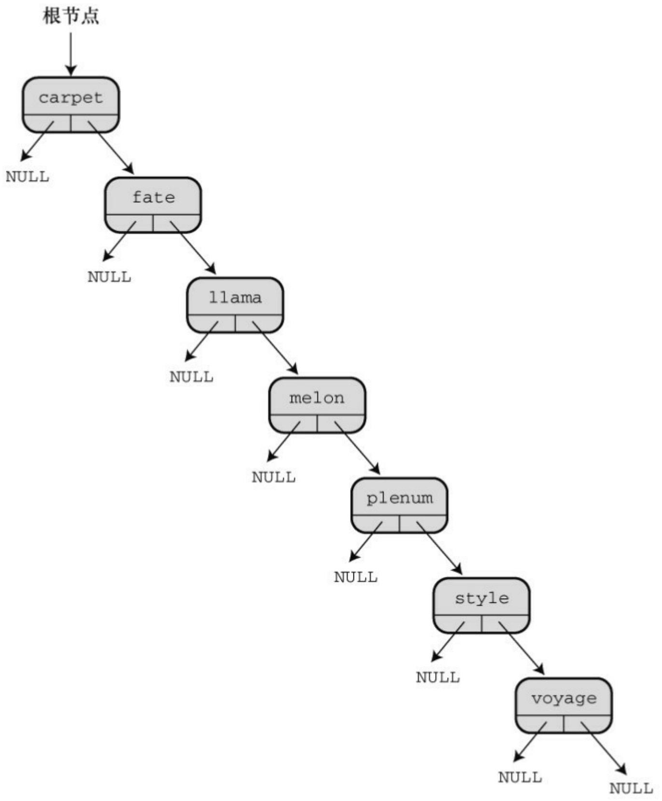
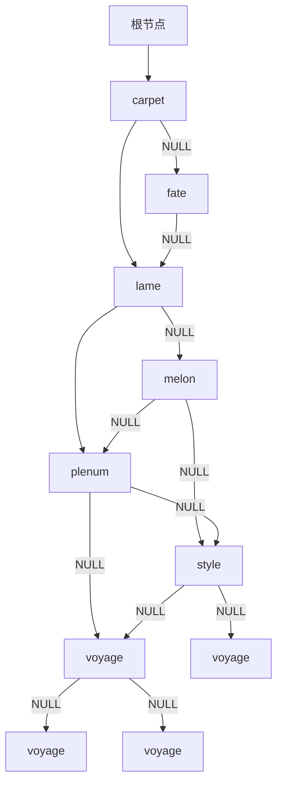

Enter the letter corresponding to your choice:

a) add a pet

l) show list of pets

n) number of pets

f) find pets

q) quit

## a

Please enter name of pet:

## Hiram Jinx

Please enter pet kind:

## domestic cat

Nerfville Pet Club Membership Program

Enter the letter corresponding to your choice:

a) add a pet

l) show list of pets

n) number of pets

f) find pets

q) quit

## n

3 pets in club

Nerfville Pet Club Membership Program

Enter the letter corresponding to your choice:

a) add a pet

l) show list of pets

n) number of pets f) find pets

l

Pet: BENNIE HAHA

Kind: PARROT

Pet: HIRAM JINX

Kind: DOMESTIC CAT

Pet: QUINCY

Kind: PIG

Nerfville Pet Club Membership Program

Enter the letter corresponding to your choice:

a) add a pet

l) show list of pets

n) number of pets

f) find pets

q) quit

q

Bye.

## 17.7.5 树的思想

二叉查找树也有一些缺陷。例如，二叉查找树只有在满员（或平衡）时效率最高。假设要储存用户随机输入的单词。该树的外观应如图17.12所示。现在，假设用户按字母顺序输入数据，那么每个新节点应该被添加到右边，该树的外观应如图17.16所示。图17.12所示是平衡的树，图17.16所示是不平衡的树。查找这种树并不比查找链表要快。

避免串状树的方法之一是在创建树时多加注意。如果树或子树的一边或另一边太不平衡，就需要重新排列节点使之恢复平衡。与此类似，可能在进行删除操作后要重新排列树。俄国数学家Adel’son-Vel’skii和Landis发明了一种算法来解决这个问题。根据他们的算法创建的树称为AVL树。因为要重构，所以创建一个平衡的树所花费的时间更多，但是这样的树可以确保最大化搜索效率。

你可能需要一个能储存相同项的二叉查找树。例如，在分析一些文本时，统计某个单词在文本中出现的次数。一种方法是把 Item 定义成包含一个单词和一个数字的结构。第一次遇到一个单词时，将其添加到树中，并且该单词的数量加 1。下一次遇到同样的单词时，程序找到包含该单词的节点，并递增表示该单词数量的值。把基本二叉查找树修改成具有这一特性，不费多少工夫。

考虑Nerfville宠物俱乐部的示例，有另一种情况。示例中的树根据宠物的名字和种类进行排列，所以，可以把名为Sam的猫储存在一个节点中，把名为Sam的狗储存在另一节点中，把名为Sam的山羊储存在第3个节点中。但是，不能储存两只名为Sam的猫。另一种方法是以名字来排序，但是这样做只能储存一个名为Sam的宠物。还需要把Item定义成多个结构，而不是一个结构。第一次出现Sally时，程序创建一个新的节点，并创建一个新的列表，然后把Sally及其种类添加到列表中。下一次出现Sally时，程序将定位到之前储存Sally的节点，并把新的数据添加到结构列表中。

提示插件库

读者可能意识到实现一个像链表或树这样的ADT比较困难，很容易犯错。插件库提供了一种可选的方法:让其他人来完成这些工作和测试。在学完本章这两个相对简单的例子后，读者应该能很好地理解和认识这样的库。



<details>
<summary>flowchart</summary>


</details>

图17.16 不平衡的二叉查找树

## 17.8 其他说明

本书中，我们涵盖了C语言的基本特性，但是只是简要介绍了库。ANSI C库中包含多种有用的函数。绝大部分实现都针对特定的系统提供扩展库。基于Windows的编译器支持Windows图形接口。Macintosh C编译器提供访问Macintosh 工具箱的函数，以便编写具有标准 Macintosh 接口或 iOS 系统的程序产品，如iPhone或iPad。与此类似，还有一些工具用于创建Linux程序的图形接口。花时间查看你的系统提供什么。如果没有你想要的工具，就自己编写函数。这是C的一部分。如果认为自己能编写一个更好的（如，输入函数），那就去做！随着你不断练习并提高自己的编程技术，会从一名新手成为经验丰富的资深程序员。

如果对链表、队列和树的相关概念感兴趣或觉得很有用，可以阅读其他相关的书籍，学习高级编程技巧。计算机科学家在开发和分析算法以及如何表示数据方面投入了大量的时间和精力。也许你会发现已经有人开发了你正需要的工具。

学会C语言后，你可能想研究C++、Objectiv C或Java。这些都是以C为基础的面向对象（object-oriented）语言。C已经涵盖了从简单的char类型变量到大型且复杂的结构在内的数据对象。面向对象语言更进一步发展了对象的观点。例如，对象的性质不仅包括它所储存的信息类型，而且还包括了对其进行的操作类型。本章介绍的ADT就遵循了这种模式。而且，对象可以继承其他对象的属性。OOP提供比C更高级的抽象，很适合编写大型程序。

请参阅附录B中的参考资料I“补充阅读”中找到你感兴趣的书籍。

## 17.9 关键概念

一种数据类型通过以下几点来表征:如何构建数据、如何储存数据、有哪些可能的操作。抽象数据类型（ADT）以抽象的方式指定构成某种类型特征的属性和操作。从概念上看，可以分两步把ADT翻译成一种特定的编程语言。第1步是定义编程接口。在C中，通过使用头文件定义类型名，并提供与允许的操作相应的函数原型来实现。第2步是实现接口。在C中，可以用源代码文件提供与函数原型相应的函数定义来实现。

## 17.10 本章小结

链表、队列和二叉树是ADT在计算机程序设计中常用的示例。通常用动态内存分配和链式结构来实现它们，但有时用数组来实现会更好。

当使用一种特定类型（如队列或树）进行编程时，要根据类型接口来编写程序。这样，在修改或改进实现时就不用更改使用接口的那些程序。

## 17.11 复习题

1.定义一种数据类型涉及哪些内容？

2.为什么程序清单17.2 只能沿一个方向遍历链表？如何修改struct film定义才能沿两个方向遍历链表？

3.什么是ADT？

4.QueueIsEmpty()函数接受一个指向queue结构的指针作为参数，但是也可以将其编写成接受一个queue结构作为参数。这两种方式各有什么优缺点？

5.栈（stack）是链表系列的另一种数据形式。在栈中，只能在链表的一端添加和删除项，项被“压入”栈和“弹出”栈。因此，栈是一种LIFO（即后进先出last in,first out）结构。

a.设计一个栈ADT

b.为栈设计一个C编程接口，例如stack.h头文件

6.在一个含有3个项的分类列表中，判断一个特定项是否在该列表中，用顺序查找和二叉查找方法分别需要最多多少次？当列表中有1023个项时分别是多少次？65535个项是分别是多少次？

7.假设一个程序用本章介绍的算法构造了一个储存单词的二叉查找树。假设根据下面所列的顺序输入

单词，请画出每种情况的树:

a.nice food roam dodge gate office wave

b.wave roam office nice gate food dodge

c.food dodge roam wave office gate nice

d.nice roam office food wave gate dodge

8.考虑复习题7构造的二叉树，根据本章的算法，删除单词food之后，各树是什么样子？

## 17.12 编程练习

1.修改程序清单17.2，让该程序既能正序也能逆序显示电影列表。一种方法是修改链表的定义，可以双向遍历链表。另一种方法是用递归。
2.假设list.h（程序清单17.3）使用下面的list定义:

```c
typedef struct list
{
Node * head;  /* 指向list的开头 */
Node * end;/* 指向list的末尾 */
} List;
```

重写 list.c（程序清单 17.5）中的函数以适应新的定义，并通过films.c（程序清单 17.4）测试最终的代码。

3.假设list.h（程序清单17.3）使用下面的list定义:

```c
#define MAXSIZE 100

typedef struct list

{

Item entries[MAXSIZE]; /* 内含项的数组 */
int items;                 /* list中的项数 */

} List;
```

重写 list.c（程序清单 17.5）中的函数以适应新的定义，并通过films.c（程序清单 17.4）测试最终的代码。

4.重写mall.c（程序清单17.7），用两个队列模拟两个摊位。
5.编写一个程序，提示用户输入一个字符串。然后该程序把该字符串的字符逐个压入一个栈（参见复习题5），然后从栈中弹出这些字符，并显示它们。结果显示为该字符串的逆序。
6.编写一个函数接受 3 个参数:一个数组名（内含已排序的整数）、该数组的元素个数和待查找的整数。如果待查找的整数在数组中，那么该函数返回 1；如果该数不在数组中，该函数则返回 0。用二分查找法实现。
7.编写一个程序，打开和读取一个文本文件，并统计文件中每个单词出现的次数。用改进的二叉查找树储存单词及其出现的次数。程序在读入文件后，会提供一个有3个选项的菜单。第1个选项是列出所有的单词和出现的次数。第2个选项是让用户输入一个单词，程序报告该单词在文件中出现的次数。第3个选项是退出。
8.修改宠物俱乐部程序，把所有同名的宠物都储存在同一个节点中。当用户选择查找宠物时，程序应询问用户该宠物的名字，然后列出该名字的所有宠物（及其种类）。

## 附录A 复习题答案

## A.1 第1章复习题答案

1.完美的可移植程序是，其源代码无需修改就能在不同计算机系统中成功编译的程序。
2.源代码文件包含程序员使用的任何编程语言编写的代码。目标代码文件包含机器语言代码，它不必是完整的程序代码。可执行文件包含组成可执行程序的完整机器语言代码。
3.（1）定义程序目标；（2）设计程序；（3）编写程序；（4）编译程序；（5）运行程序；（6）测试和调试程序；（7）维护和修改程序。
4.编译器把源代码（如，用C语言编写的代码）翻译成等价的机器语言代码（也叫作目标代码）。
5.链接器把编译器翻译好的源代码以及库代码和启动代码组合起来，生成一个可执行程序。

## A.2 第2章复习题答案

1.它们都叫作函数。
2.语法错误违反了组成语句或程序的规则。这是一个有语法错误的英文例子:Me speak English good.。这是一个有语法错误的C语言例子:printf"Where are the parentheses?";。
3.语义错误是指含义错误。这是一个有语义错误的英文例子:This sentence isexcellent Czech.[1]。这是一个有语义错误的C语言例子: thrice\_n = $3 + n \left[ 2 \right]$
4.第1行:以一个#开始；studio.h应改成stdio.h；然后用一对尖括号把

stdio.h括起来。

第2行:把{}改成()；注释末尾把/\*改成\*/。

第3行:把(改成｛

第4行:int s末尾加上一个分号。

第5行没问题。

第6行:把:=改成，赋值用=，而不是用:=（这说明Indiana Sloth了解Pascal）。另外，用于赋值的值56也不对，一年有52周，不是56周。

第7行应该是:printf("There are %d weeks in a year.\n", s);

第9行:原程序中没有第9行，应该在该行加上一个右花括号｝。

修改后的程序如下:

```c
#include <stdio.h>

int main(void) /* this prints the number of weeks in a year */
{
int s;

s = 52;

printf("There are %d weeks in a year.\n", s);

return 0;

}
```

5.a.Baa Baa Black Sheep.Have you any wool?（注意，Sheep.和Have之间没有空格）

b.Begone!

O creature of lard!

c.What?

No/nfish?

（注意斜杠/和反斜杠\的效果不同，/只是一个普通的字符，原样打印）

d.2 + 2 = 4

（注意，每个%d与列表中的值相对应。还要注意，+的意思是加法，可以在printf()语句内部计算）

6.关键字是int和char（main是一个函数名；function是函数的意思；=是一个运算符）。
7.printf("There were %d words and %d lines.\n", words, lines);
8.执行完第7行后，a是5，b是2。执行完第8行后，a和b都是5。执行完第9行后，a和b仍然是5（注意，a不会是2，因为在执行a = b;时，b的值已经被改为5）。
9.执行完第7行后，x是10，b是5。执行完第8行后，x是10，y是15。执行完第9行后，x是150，y是15。

## A.3 第3章复习题答案

1.a.int类型，也可以是short类型或unsigned short类型。人口数是一个整数。
b.float类型，价格通常不是一个整数（也可以使用double类型，但实际上不需要那么高的精度）。
c.char类型。

d.int类型，也可以是unsigned类型。

2.原因之一:在系统中要表示的数超过了int可表示的范围，这时要使用long类型。原因之二:如果要处理更大的值，那么使用一种在所有系统上都保证至少是 32 位的类型，可提高程序的可移植性。
3.如果要正好获得32位的整数，可以使用int32\_t类型。要获得可储存至少32位整数的最小类型，可以使用int\_least32\_t类型。如果要为32位整数提供最快的计算速度，可以选择int\_fast32\_t类型（假设你的系统已定义了上述类型）。

4.a.char类型常量（但是储存为int类型）

b.int类型常量
c.double类型常量
d.unsigned int类型常量，十六进制格式
e.double类型常量

5.第1行:应该是#include &lt;stdio.h&gt;

第2行:应该是int main(void)

第3行:把(改为｛

第4行:g和h之间的;改成,

第5行:没问题

第6行:没问题

第7行:虽然这数字比较大，但在e前面应至少有一个数字，如1e21或1.0e21都可以。

第8行:没问题，至少没有语法问题。

第9行:把)改成}

除此之外，还缺少一些内容。首先，没有给rate变量赋值；其次未使用h变量；而且程序不会报告计算结果。虽然这些错误不会影响程序的运行（编译器可能给出变量未被使用的警告），但是它们确实与程序设计的初衷不符合。另外，在该程序的末尾应该有一个return语句。

下面是一个正确的版本，仅供参考:

```c
#include <stdio.h>

int main(void)

{

float g, h;

float tax, rate;

rate = 0.08;

g = 1.0e5;

tax = rate*g;

h = g + tax;

printf("You owe $%f plus $%f in taxes for a total of $%f.\n", g, tax, h);
return 0;

}

6.
```

| 常量 | 类型 | 转换说明(%转换字符) |
| --- | --- | --- |
| 12 | int | %d |
| 0X3 | unsigned int | %#X |
| 'C' | char(实际上是 int) | %c |
| 2.34E07 | double | %e |
| '\\040' | char(实际上是 int) | %c |
| 7.0 | double | %f |
| 6L | long | %ld |
| 6.0f | float | %f |
| 0x5.b6p12 | float | %a |

7.

| 常量 | 类型 | 转换说明(%转换字符) |
| --- | --- | --- |
| 012 | unsigned int | %#o |
| 2.9e05L | long double | %Le |
| 's' | char(实际上是 int) | %c |
| 100000 | long | %ld |
| '\\n' | char(实际上是 int) | %c |
| 20.0f | float | %f |
| 0x44 | unsigned int | %x |
| -40 | int | %d |

8.printf("The odds against the %d were %ld to 1.\n", imate, shot);printf("A score of %f is not an %c grade.\n", log, grade);

$$
9. \mathrm{ch} = ^ {\prime} \backslash \mathrm{r} ^ {\prime};
$$

$$
\mathrm{ch} = 1 3;
$$

$$
\mathrm{ch} = ^ {\prime} \backslash 0 1 5 ^ {\prime}
$$

$$
\mathrm{ch} = ^ {\prime} \backslash \mathrm{xd} ^ {\prime}
$$

10.最前面缺少一行（第0行）:#include &lt;stdio.h&gt;

第1行:使用/\*和\*/把注释括起来，或者在注释前面使用//。

第3行:int cows, legs;

第4行:country？\n");

第5行:把%c改为%d，把legs改为&legs。

第7行:把%f改为%d。

另外，在程序末尾还要加上return语句。

下面是修改后的版本:

```c
#include <stdio.h>

int main(void) /* this program is perfect */
{
int cows, legs;

printf("How many cow legs did you count?\n");

scanf("%d", &legs);

cows = legs / 4;

printf("That implies there are %d cows.\n", cows);

return 0;

}
```

11.a.换行字符
b.反斜杠字符
c.双引号字符
d.制表字符

**A.4** 第4章复习题答案

1.程序不能正常运行。第1 个scanf()语句只读取用户输入的名，而用户输入的姓仍留在输入缓冲区中（缓冲区是用于储存输入的临时存储区）。下一条scang()语句在输入缓冲区查找重量时，从上次读入结束的地方开始读取。这样就把留在缓冲区的姓作为体重来读取，导致 scanf()读取失败。另一方面，如果在要求输入姓名时输入Lasha 144，那么程序会把144作为用户的体重（虽然用户是在程序提示输入体重之前输入了144）。

2.a.He sold the painting for \$234.50.

b.Hi!（注意，第1个字符是字符常量；第2个字符由十进制整数转换而来；第3个字符是八进制字符常量的ASCII表示）

c.His Hamlet was funny without being vulgar.has 42 characters.

d.Is 1.20e+003 the same as 1201.00?

3.在这条语句中使用\":printf("\"%s\"\nhas %d characters.\n", Q, strlen(Q));
4.下面是修改后的程序:

#include &lt;stdio.h&gt; /\* 别忘了要包含合适的头文件 \*/

#define B "booboo" /\* 添加#、双引号 \*/

#define X 10 /\* 添加# \*/

int main(void) /\* 不是main(int) \*/

{

int age;

int xp; /\* 声明所有的变量 \*/

char name[40]; /\* 把name声明为数组 \*/

```txt
printf("Please enter your first name.\n"); /* 添加\n，提高可读性 */
scanf("%s", name);
```

```c
printf("All right, %s, what's your age?\n", name); /* %s用于打印字符串*/
scanf("%d", &age); /* 把%f改成%d，把age改成&age */
```

<div class="docvortex-algorithm" style="white-space: pre-wrap; font-family:monospace;">
$\mathrm{xp} = \mathrm{age} + \mathrm{X}$;
</div>

```txt
printf("That's a %s! You must be at least %d.\n", B, xp);
```

```txt
return 0; /* 不是rerun */
}
```

```txt
5.记住，要打印%必须用%%:
```

```c
printf("This copy of \"%s\" sells for \$%0.2f.\n", BOOK, cost);
printf("That is %0.0f%% of list.\n", percent);
```

```txt
6.a.%d
```

```txt
b.%4X
```

```txt
c.%10.3f
```

```txt
d.%12.2e
```

```txt
e.%-30s
```

```txt
7.a.%15lu
```

```txt
b.%#4x
```

```txt
c.%-12.2E
```

d.%+10.3f

e.%8.8s

8.a.%6.4d

b.%\*o

c.%2c

d.%+0.2f

e.%-7.5s

9.a.int dalmations;

scanf("%d", &dalmations);

b.float kgs, share;

scanf("%f%f", &kgs, &share);

（注意:对于本题的输入，可以使用转换字符e、f和g。另外，除了%c之外，在%和转换字符之间加空格不会影响最终的结果）

c.char pasta[20];

scanf("%s", pasta);

d.char action[20];

int value;

scanf("%s %d", action, &value);

e.int value;

```txt
scanf("%*s %d", &value);
```

10.空白包括空格、制表符和换行符。C 语言使用空白分隔记号。scanf()使用空白分隔连续的输入项。
11.%z 中的 z 是修饰符，不是转换字符，所以要在修饰符后面加上一个它修饰的转换字符。可以使用%zd打印十进制数，或用不同的说明符打印不同进制的数，例如，%zx打印十六进制的数。
12.可以分别把(和)替换成{和}。但是预处理器无法区分哪些圆括号应替换成花括号，哪些圆括号不能替换成花括号。因此，

```c
#define ( {

#define ) }

int main(void)

(
printf("Hello, O Great One!\n");
)
```

将变成:

```txt
int main{void}

{
printf{"Hello, O Great One!\n"};

}
```

**A.5** 第5章复习题答案

1.a.30

b.27（不是3）。(12+6)/(2\*3)得3。

c.x = 1，y = 1（整数除法）。

d.x = 3（整数除法），y = 9。

2.a.6（由3 + 3.3截断而来）

b.52

c.0（0 \* 22.0的结果）

d.13（66.0 / 5或13.2，然后把结果赋给int类型变量）

3.a.37.5（7.5 \* 5.0的结果）

b.1.5（30.0 / 20.0的结果）

c.35（7 \* 5的结果）

d.37（150 / 4的结果）

e.37.5（7.5 \* 5的结果）

f.35.0（7 \* 5.0的结果）

4.第0行:应增加一行#include &lt;stdio.h&gt;。

第3行:末尾用分号，而不是逗号。

第6行:while语句创建了一个无限循环。因为i的值始终为1，所以它总是小于30。推测一下，应该是想写 $\mathrm{while}(i++30)$

第6～8行:这样的缩进布局不能使第7行和第8行组成一个代码块。由于没有用花括号括起来， while循环只包括第7行，所以要添加花括号。

第7行:因为1和i都是整数，所以当i为1时，除法的结果是1；当i为更大的数时，除法结果为0。用n = 1.0/i，i在除法运算之前会被转换为浮点数，这样就能得到非零值。

第8行:在格式化字符串中没有换行符（\n），这导致数字被打印成一行。

第10行:应该是return 0;

下面是正确的版本:

```c
#include <stdio.h>

int main(void)
{
int i = 1;

float n;

printf("Watch out! Here come a bunch of fractions!\n");
while (i++ < 30)
{
n = 1.0/i;

printf("%f\n", n);
}
printf("That's all, folks!\n");
return 0;
```

```txt
}
```

5.这个版本最大的问题是测试条件（sec是否大于0？）和scanf()语句获取sec变量的值之间的关系。具体地说，第一次测试时，程序尚未获得sec的值，用来与0作比较的是正好在sec变量内存位置上的一个垃圾值。一个比较笨拙的方法是初始化 sec（如，初始化为 1）。这样就可通过第一次测试。不过，还有另一个问题。当最后输入0结束程序时，在循环结束之前不会检查sec，所以0也被打印了出来。因此，更好的方法是在while测试之前使用scanf()语句。可以这样修改:

```c
scanf("%d", &sec);

while ( sec > 0 ) {

min = sec/S_TO_M;

left = sec % S_TO_M;

printf("%d sec is %d min, %d sec.\n", sec, min, left);

printf("Next input?\n");

scanf("%d", &sec);

}
```

while循环第一轮迭代使用的是scanf()在循环外面获取的值。因此，在while循环的末尾还要使用一次scanf()语句。这是处理类似问题的常用方法。

6.下面是该程序的输出:

%s! C is cool!

! C is cool!

11

解释一下。第1个printf()语句与下面的语句相同:

printf("%s! C is cool!\n","%s! C is cool!\n");

第2个printf()语句首先把num递增为11，然后打印该值。第3个printf()语句打印num的值（值为11）。第 4个printf()语句打印n当前的值（仍为12），然后将其递减为11。最后一个printf()语句打印num的当前值（值为11）。

7.下面是该程序的输出:

SOS:4 4.00

表达式c1 -c2的值和'S' - '0'的值相同（其对应的ASCII值是83 - 79）。

8.把1～10打印在一行，每个数字占5列宽度，然后开始新的一行:

1 2 3 4 5 6 7 8 9 10

9.下面是一个参考程序，假定字母连续编码，与ASCII中的情况一样。

```c
#include <stdio.h>

int main(void)

{

char ch = 'a';

while (ch <= 'g')

printf("%5c", ch++);
```

```c
printf("\n");

return 0;

}
```

10.下面是每个部分的输出:

a.1 2

注意，先递增x的值再比较。光标仍留在同一行。

```csv
b.101
102
103
104
```

注意，这次x先比较后递增。在示例a和b中，x都是在先递增后打印。另外还要注意，虽然第2个printf()语句缩进了，但是这并不意味着它是while循环的一部分。因此，在while循环结束后，才会调用一次该printf()语句。

c.stuvw

该例中，在第1次调用printf()语句后才会递增ch。

11.这个程序有点问题。while循环没有用花括号把两个缩进的语句括起来，只有printf()是循环的一部分，所以该程序一直重复打印消息COMPUTER BYTES DOG，直到强行关闭程序为止。

```javascript
12.a.x = x + 10;
b.x++; or ++x; or x = x + 1;
```

$$
\mathrm{c.c} = 2 * (\mathrm{a+b});
$$

$$
\mathrm{d.c} = \mathrm{a} + 2 ^ {*} \mathrm{b};
$$

13 a.x--; or --x; or x = x - 1;

$$
\mathrm{b.m} = \mathrm{n}\% \mathrm{k};
$$

$$
\mathrm{c.p} = \mathrm{q} / (\mathrm{b-a});
$$

$$
\mathrm{d.x} = (\mathrm{a} + \mathrm{b}) / (\mathrm{c} * \mathrm{d});
$$

**A.6** 第6章复习题答案

1.2，7，70，64，8，2。

2.该循环的输出是:

36 18 9 4 2 1

如果value是double类型，即使value小于1，循环的测试条件仍然为真。循环将一直执行，直到浮点数下溢生成0为止。另外，value是double类型时，%3d转换说明也不正确。

$$
3. a. x > 5
$$

$$
\mathrm{b.scanf} \left(\% \mathrm{lf} ^ {\prime}, \& \mathrm{x}\right)! = 1
$$

$$
\mathrm{c.x} = = 5
$$

$$
\text {4.a.scanf} (\% \mathrm{d}, \& \mathrm{x}) = = 1
$$

$$
\mathrm{b.x}! = 5
$$

$$
\mathrm{c.x} > = 2 0
$$

5.第4行:应该是list[10]。

第6行:逗号改为分号。i的范围应该是0～9，不是1～10。

第9行:逗号改为分号。>=改成<=，否则，当i等于1时，该循环将成为无限循环。

第10行:在第10行和第11行之间少了一个右花括号。该右花括号与第7行的左花括号配对，形成一个for循环块。然后在这个右花括号与最后一个右花括号之间，少了一行return 0;。

下面是一个正确的版本:

```c
#include <stdio.h>

int main(void)
{
/* 第3行 */
int i, j, list(10); /* 第4行 */
for (i = 1, i <= 10, i++) /* 第6行 */
{
/* 第7行 */
list[i] = 2*i + 3; /* 第8行 */
for (j = 1, j >= i, j++) /* 第9行 */
printf("%d", list[j]); /* 第10行 */
printf("\n"); /* 第11行 */
}
return 0;
}
```

6.下面是一种方法:

```c
#include <stdio.h>

int main(void)
{
int col, row;
for (row = 1; row <= 4; row++)
{
for (col = 1; col <= 8; col++)
printf("\$");
printf("\n");
}
return 0;
}
```

7.a.Hi! Hi! Hi! Bye! Bye! Bye! Bye! Bye!

b.ACGM（因为代码中把int类型值与char类型值相加，编译器可能警告会损失有效数字）

8.a.Go west, youn
b.Hp!xftu-!zpvo
c.Go west, young

d.\$o west, youn

9.其输入如下:

31|32|33|30|31|32|33|

\*\*\*

1

5

9

13

\*\*\*

2 6

4 8

8 10

\*\*\*

10.a.mint

b.10个元素

c.double 类型的值

d.第ii行正确，mint[2]是double类型的值，&mingt[2]是它在内存中的位置。

11.因为第1个元素的索引是0，所以循环的范围应该是0～SIZE - 1，而不是1～SIZE。但是，如果只是这样更改会导致赋给第1个元素的值是0，不是2。所以，应重写这个循环:

$$
\text { for } (\text { index } = 0; \text { index } <   \text { SIZE }; \text { index } + +)
$$

$$
\text {by\_twos[index]} = 2 * (\text {index} + 1);
$$

与此类似，第2个循环的范围也要更改。另外，应该在数组名后面使用数组索引:

$$
\text { for } (\text { index } = 0; \text { index } <   \text { SIZE }; \text { index } + +)
$$

$$
\operatorname{printf} \left(\% \mathrm{d} \text {", by\_twos[index]}\right);
$$

错误的循环条件会成为程序的定时炸弹。程序可能开始运行良好，但是由于数据被放在错误的位置，可能在某一时刻导致程序不能正常工作。

12.该函数应声明为返回类型为long，并包含一个返回long类型值的return语句。
13.把num的类型强制转换成long类型，确保计算使用long类型而不是int类型。在int为16位的系统中，两个int类型值的乘积在返回之前会被截断为一个int类型的值，这可能会丢失数据。

```txt
long square(int num)
{
```