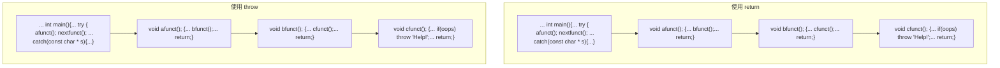
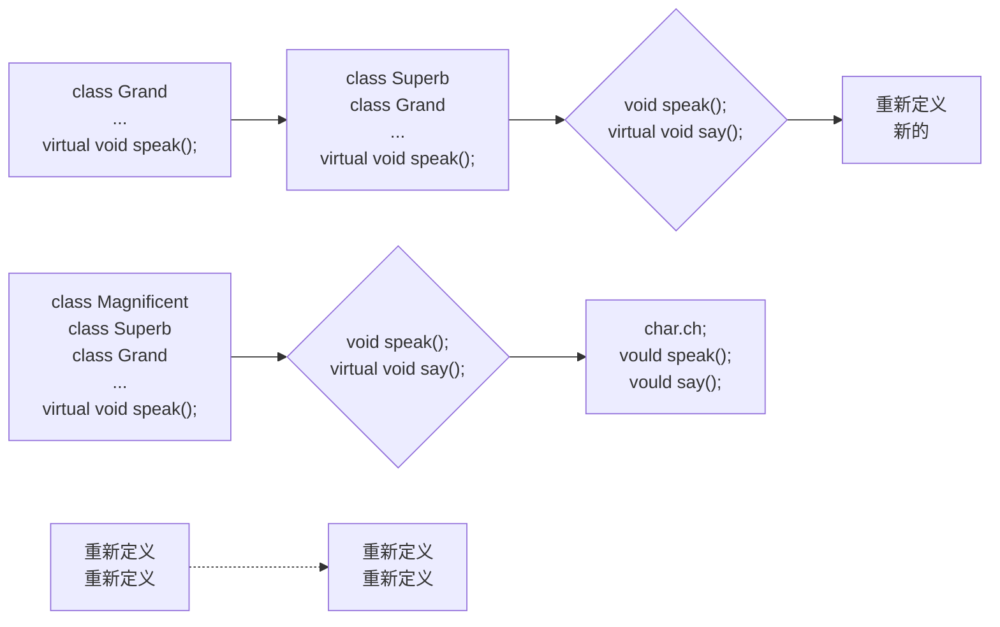

# 第15章 友元、异常和其他

原始 PDF 第 620–672 页。

## 第 15 章 友元、异常和其他

## 本章内容包括:

- 友元类。
- 友元类方法。
- 嵌套类。
- 引发异常、try 块和 catch 块。
- 异常类。
● 运行阶段类型识别（RTTI）。
- dynamic\_cast 和 typeid。
- static\_cast、const\_cast 和 reinterpret\_cast。

本章先介绍一些 C++ 语言最初就有的特性，然后介绍 C++ 语言新增的一些特性。前者包括友元类、友元成员函数和嵌套类，它们是在其他类中声明的类；后者包括异常、运行阶段类型识别（RTTI）和改进后的类型转换控制。C++ 异常处理提供了处理特殊情况的机制，如果不对其进行处理，将导致程序终止。RTTI 是一种确定对象类型的机制。新的类型转换运算符提高了类型转换的安全性。后 3 种特性是 C++ 新增的，老式编译器不支持它们。

## 15.1 友元

本书前面的一些示例将友元函数用于类的扩展接口中，类并非只能拥有友元函数，也可以将类作为友元。在这种情况下，友元类的所有方法都可以访问原始类的私有成员和保护成员。另外，也可以做更严格的限制，只将特定的成员函数指定为另一个类的友元。哪些函数、成员函数或类为友元是由类定义的，而不能从外部强加友情。因此，尽管友元被授予从外部访问类的私有部分的权限，但它们并不与面向对象的编程思想相悖；相反，它们提高了公有接口的灵活性。

## 15.1.1 友元类

什么时候希望一个类成为另一个类的友元呢？我们来看一个例子。假定需要编写一个模拟电视机和遥控器的简单程序。决定定义一个Tv类和一个Remote类，来分别表示电视机和遥控器。很明显，这两个类之间应当存在某种关系，但是什么样的关系呢？遥控器并非电视机，反之亦然，所以公有继承的is-a关系并不适用。遥控器也非电视机的一部分，反之亦然，因此包含或私有继承和保护继承的has-a关系也不适用。事实上，遥控器可以改变电视机的状态，这表明应将Romote类作为Tv类的一个友元。

首先定义 Tv 类。可以用一组状态成员（描述电视各个方面的变量）来表示电视机。下面是一些可能的状态:

- 开/关；
- 频道设置；

---

第 15 章 友元、异常和其他

603

- 音量设置；
● 有线电视或天线调节模式；
- TV 调谐或 A/V 输入。

调节模式指的是，在美国，对于有线接收和 UHF 广播接收，14 频道和 14 频道以上的频道间隔是不同的。输入选择包括 TV（有线 TV 或广播 TV）和 DVD。有些电视机可能提供更多的选择，如多种 DVD/蓝光输入，但对于这个示例的目的而言，这个清单足够了。

另外，电视机还有一些不是状态变量的参数。例如，可接收频道数随电视机而异，可以包括一个记录这个值的成员。

接下来，必须给类提供一些修改这些设置的方法。当前，很多电视机都将控件藏在面板后面，但大多数电视机还是可以在不使用遥控器的情况下进行换台等工作的，通常只能逐频道换台，而不能随意选台。同样，通常还有两个按钮，分别用来增加和降低音量。

遥控器的控制能力应与电视机内置的控制功能相同，它的很多方法都可通过使用 Tv 方法来实现。另外，遥控器通常都提供随意选择频道的功能，即可以直接从 2 频道换到 20 频道，并不用逐次切换频道。另外，很多遥控器都有多种工作模式，如用作电视控制器和 DVD 遥控器。

这些考虑因素表明，定义应类似于程序清单 15.1。定义中包括一些被定义为枚举的常数。下面的语句使 Remote 成为友元类:

```txt
friend class Remote;
```

友元声明可以位于公有、私有或保护部分，其所在的位置无关紧要。由于 Remote 类提到了 Tv 类，所以编译器必须了解 Tv 类后，才能处理 Remote 类，为此，最简单的方法是首先定义 Tv 类。也可以使用前向声明（forward delaration），这将稍后介绍。

程序清单 15.1 tv.h

```cpp
// tv.h -- Tv and Remote classes
#ifndef TV_H_
#define TV_H_

class Tv
{
public:
    friend class Remote;   // Remote can access Tv private parts
    enum {Off, On};
    enum {MinVal,MaxVal = 20};
    enum {Antenna, Cable};
    enum {TV, DVD};

    Tv(int s = Off, int mc = 125) : state(s), volume(5),
        maxchannel(mc), channel(2), mode(Cable), input(TV) {}
    void onoff() {state = (state == On)? Off : On;}
    bool ison() const {return state == On;}
    bool volup();
    bool voldown();
    void chanup();
    void chandown();
    void set_mode() {mode = (mode == Antenna)? Cable : Antenna;}
    void set_input() {input = (input == TV)? DVD : TV;}
    void settings() const; // display all settings
private:
    int state;            // on or off
    int volume;            // assumed to be digitized
    int maxchannel;          // maximum number of channels
```

---

604

C++ Primer Plus（第6版）中文版

```cpp
int channel;             // current channel setting
    int mode;                 // broadcast or cable
    int input;                // TV or DVD
};
class Remote
{
private:
    int mode;            // controls TV or DVD
public:
    Remote(int m = Tv::TV) : mode(m) {}
    bool volup(Tv & t) { return t.volup();}
    bool voldown(Tv & t) { return t.voldown();}
    void onoff(Tv & t) { t.onoff(); }
    void chanup(Tv & t) {t.chanup();}
    void chandown(Tv & t) {t.chandown();}
    void set_chan(Tv & t, int c) {t.channel = c;}
    void set_mode(Tv & t) {t.set_mode();}
    void set_input(Tv & t) {t.set_input();} .
};
#endif
```

在程序清单 15.1 中，大多数类方法都被定义为内联的。除构造函数外，所有的 Romote 方法都将一个 Tv 对象引用作为参数，这表明遥控器必须针对特定的电视机。程序清单 15.2 列出了其余的定义。音量设置函数将音量成员增减一个单位，除非声音到达最大或最小。频道选择函数使用循环方式，最低的频道设置为 1，它位于最高的频道设置 maxchannel 之后。

很多方法都使用条件运算符在两种状态之间切换:

```txt
void onoff() {state = (state == On)? Off : On;}
```

如果两种状态值分别为 true（1）和 false（0），则可以结合使用将在附录 E 讨论的按位异或和赋值运算符（^=）来简化上述代码:

```txt
void onoff() {state ^= 1;}
```

事实上，在单个无符号 char 变量中可存储多达 8 个双状态设置，分别对它们进行切换；但现在已经不用这样做了，使用附录 E 中讨论的按位运算符就可以完成。

程序清单 15.2 tv.cpp

```cpp
// tv.cpp -- methods for the Tv class (Remote methods are inline)
#include <iostream>
#include "tv.h"

bool Tv::volup()
{
    if (volume < MaxVal)
    {
        volume++;
        return true;
    }
    else
        return false;
}
bool Tv::voldown()
{
    if (volume > MinVal)
    {
```

---

第 15 章 友元、异常和其他

605

```cpp
volume--;
    return true;
}
else
    return false;
}

void Tv::chanup()
{
    if (channel < maxchannel)
        channel++;
    else
        channel = 1;
}

void Tv::chandown()
{
    if (channel > 1)
        channel--;
    else
        channel = maxchannel;
}

void Tv::settings() const
{
    using std::cout;
    using std::endl;
    cout << "TV is " << (state == Off? "Off" : "On") << endl;
    if (state == On)
    {
        cout << "Volume setting = " << volume << endl;
        cout << "Channel setting = " << channel << endl;
        cout << "Mode = "
            << (mode == Antenna? "antenna" : "cable") << endl;
        cout << "Input = "
            << (input == TV? "TV" : "DVD") << endl;
    }
}
```

程序清单 15.3 是一个简短的程序，可以测试一些特性。另外，可使用同一个遥控器控制两台不同的电视机。

程序清单 15.3 use\_tv.cpp

```cpp
//use_tv.cpp -- using the Tv and Remote classes
#include <iostream>
#include "tv.h"

int main()
{
    using std::cout;
    Tv s42;
    cout << "Initial settings for 42\" TV:\n";
    s42.settings();
    s42.onoff();
    s42.chanup();
    cout << "\nAdjusted settings for 42\" TV:\n";
```

---

606

C++ Primer Plus（第6版）中文版

```txt
s42.chanup();
cout << "\nAdjusted settings for 42\" TV:\n";
s42.settings();

Remote grey;

grey.set_chan(s42, 10);
grey.volup(s42);
grey.volup(s42);
cout << "\n42\" settings after using remote:\n";
s42.settings();

Tv s58(Tv::On);
s58.set_mode();
grey.set_chan(s58,28);
cout << "\n58\" settings:\n";
s58.settings();
return 0;
}
```

下面是程序清单 15.1～程序清单 15.3 组成的程序的输出:

```python
Initial settings for 42" TV:
TV is Off
Adjusted settings for 42" TV:
TV is On
Volume setting = 5
Channel setting = 3
Mode = cable
Input = TV

42" settings after using remote:
TV is On
Volume setting = 7
Channel setting = 10
Mode = cable
Input = TV

58" settings:
TV is On
Volume setting = 5
Channel setting = 28
Mode = antenna
Input = TV
```

这个练习的主要目的在于表明，类友元是一种自然用语，用于表示一些关系。如果不使用某些形式的友元关系，则必须将 Tv 类的私有部分设置为公有的，或者创建一个笨拙的、大型类来包含电视机和遥控器。这种解决方法无法反应这样的事实，即同一个遥控器可用于多台电视机。

## 15.1.2 友元成员函数

从上一个例子中的代码可知，大多数 Remote 方法都是用 Tv 类的公有接口实现的。这意味着这些方法不是真正需要作为友元。事实上，唯一直接访问 Tv 成员的 Remote 方法是 Remote::set\_chan()，因此它是唯一需要作为友元的方法。确实可以选择仅让特定的类成员成为另一个类的友元，而不必让整个类成为友元，但这样做稍微有点麻烦，必须小心排列各种声明和定义的顺序。下面介绍其中的原因。

让 Remote::set\_chan()成为 Tv 类的友元的方法是，在 Tv 类声明中将其声明为友元:

---

第 15 章 友元、异常和其他

607

```cpp
class Tv
{
    friend void Remote::set_chan(Tv & t, int c);
    ...
};
```

然而，要使编译器能够处理这条语句，它必须知道 Remote 的定义。否则，它无法知道 Remote 是一个类，而 set\_chan 是这个类的方法。这意味着应将 Remote 的定义放到 Tv 的定义前面。Remote 的方法提到了 Tv 对象，而这意味着 Tv 定义应当位于 Remote 定义之前。避开这种循环依赖的方法是，使用前向声明（forward declaration）。为此，需要在 Remote 定义的前面插入下面的语句:

```txt
class Tv;                  // forward declaration
```

这样，排列次序应如下:

```txt
class Tv;  // forward declaration
class Remote { ... };
class Tv { ... };
```

能否像下面这样排列呢？

```javascript
class Remote;          // forward declaration
class Tv { ... };
class Remote { ... };
```

答案是不能。原因在于，在编译器在 Tv 类的声明中看到 Remote 的一个方法被声明为 Tv 类的友元之前，应该先看到 Remote 类的声明和 set\_chan() 方法的声明。

还有一个麻烦。程序清单 15.1 的 Remote 声明包含了内联代码，例如:

```txt
void onoff(Tv & t) { t.onoff(); }
```

由于这将调用 Tv 的一个方法，所以编译器此时必须已经看到了 Tv 类的声明，这样才能知道 Tv 有哪些方法，但正如看到的，该声明位于 Remote 声明的后面。这种问题的解决方法是，使 Remote 声明中只包含方法声明，并将实际的定义放在 Tv 类之后。这样，排列顺序将如下:

```txt
class Tv;            // forward declaration
class Remote { ... };     // Tv-using methods as prototypes only
class Tv { ... };
// put Remote method definitions here
```

Remote 方法的原型与下面类似:

```txt
void onoff(Tv & t);
```

检查该原型时，所有的编译器都需要知道 Tv 是一个类，而前向声明提供了这样的信息。当编译器到达真正的方法定义时，它已经读取了 Tv 类的声明，并拥有了编译这些方法所需的信息。通过在方法定义中使用 inline 关键字，仍然可以使其成为内联方法。程序清单 15.4 列出了修订后的头文件。

程序清单 15.4 tvfm.h

```cpp
// tvfm.h -- Tv and Remote classes using a friend member
#ifndef TVFM_H_
#define TVFM_H_

class Tv;                                // forward declaration

class Remote
{
public:
    enum State{Off, On};
    enum {MinVal,MaxVal = 20};
    enum {Antenna, Cable};
```

---

608

C++ Primer Plus（第6版）中文版

```cpp
enum {TV, DVD};
private:
    int mode;
public:
    Remote(int m = TV) : mode(m) {}
    bool volup(Tv & t);          // prototype only
    bool voldown(Tv & t);
    void onoff(Tv & t) ;
    void chanup(Tv & t) ;
    void chandown(Tv & t) ;
    void set_mode(Tv & t) ;
    void set_input(Tv & t);
    void set_chan(Tv & t, int c);

};

class Tv
{
public:
    friend void Remote::set_chan(Tv & t, int c);
    enum State{Off, On};
    enum {MinVal,MaxVal = 20};
    enum {Antenna, Cable};
    enum {TV, DVD};

    Tv(int s = Off, int mc = 125) : state(s), volume(5),
        maxchannel(mc), channel(2), mode(Cable), input(TV) {}
    void onoff() {state = (state == On)? Off : On;}
    bool ison() const {return state == On;}
    bool volup();
    bool voldown();
    void chanup();
    void chandown();
    void set_mode() {mode = (mode == Antenna)? Cable : Antenna;}
    void set_input() {input = (input == TV)? DVD : TV;}
    void settings() const;
private:
    int state;
    int volume;
    int maxchannel;
    int channel;
    int mode;
    int input;
};

// Remote methods as-inline functions
inline bool Remote::volup(Tv & t) { return t.volup();}
inline bool Remote::voldown(Tv & t) { return t.voldown();}
inline void Remote::onoff(Tv & t) { t.onoff(); }
inline void Remote::chanup(Tv & t)= {t.chanup();}
inline void Remote::chandown(Tv & t) {t.chandown();}
inline void Remote::set_mode(Tv & t) {t.set_mode();}
inline void Remote::set_input(Tv & t) {t.set_input();}
inline void Remote::set_chan(Tv & t, int c) {t.channel = c;}
#endif
```

---

第 15 章 友元、异常和其他

609

如果在 tv.cpp 和 use\_tv.cpp 中包含 tvfm.h 而不是 tv.h，程序的行为与前一个程序相同，区别在于，只有一个 Remote 方法是 Tv 类的友元，而在原来的版本中，所有的 Remote 方法都是 Tv 类的友元。图 15.1 说明了这种区别。


图 15.1 类友元与类成员友元

本书前面介绍过，内联函数的链接性是内部的，这意味着函数定义必须在使用函数的文件中。在这个例子中，内联定义位于头文件中，因此在使用函数的文件中包含头文件可确保将定义放在正确的地方。也可以将定义放在实现文件中，但必须删除关键字 inline，这样函数的链接性将是外部的。

顺便说一句，让整个 Remote 类成为友元并不需要前向声明，因为友元语句本身已经指出 Remote 是一个类: friend class Remote;

## 15.1.3 其他友元关系

除本章前面讨论的，还有其他友元和类的组合形式，下面简要地介绍其中的一些。

假设由于技术进步，出现了交互式遥控器。例如，交互式遥控器让您能够回答电视节目中的问题，如果回答错误，电视将在控制器上产生嗡嗡声。忽略电视使用这种设施安排观众进入节目的可能性，我们只看 C++ 的编程方面。新的方案将受益于相互的友情，一些 Remote 方法能够像前面那样影响 Tv 对象，而一些 Tv 方法也能影响 Remote 对象。这可以通过让类彼此成为对方的友元来实现，即除了 Remote 是 Tv 的友元外，Tv

---

610

C++ Primer Plus（第6版）中文版

还是 Remote 的友元。需要记住的一点是，对于使用 Remote 对象的 Tv 方法，其原型可在 Remote 类声明之前声明，但必须在 Remote 类声明之后定义，以便编译器有足够的信息来编译该方法。这种方案与下面类似:

```cpp
class Tv
{
friend class.Remote;
public:
    void buzz(Remote & r);
    ...
};
class Remote
{
friend class Tv;
public:
    void Bool volup(Tv.& t){t.volup();}
};
inline void Tv::buzz(Remote & r)
{
    ...
}
```

由于 Remote 的声明位于 Tv 声明的后面，所以可以在类声明中定义 Remote::volup()，但 Tv::buzz() 方法必须在 Tv 声明的外部定义，使其位于 Remote 声明的后面。如果不希望 buzz() 是内联的，则应在一个单独的方法定义文件中定义它。

## 15.1.4 共同的友元

需要使用友元的另一种情况是，函数需要访问两个类的私有数据。从逻辑上看，这样的函数应是每个类的成员函数，但这是不可能的。它可以是一个类的成员，同时是另一个类的友元，但有时将函数作为两个类的友元更合理。例如，假定有一个 Probe 类和一个 Analyzer 类，前者表示某种可编程的测量设备，后者表示某种可编程的分析设备。这两个类都有内部时钟，且希望它们能够同步，则应该包含下述代码行:

```dart
class Analyzer; // forward declaration
class Probe
{
    friend void sync(Analyzer & a, const Probe & p); // sync a to p
    friend void sync(Probe & p, const Analyzer & a); // sync p to a
    ...
};
class Analyzer
{
    friend void sync(Analyzer & a, const Probe & p); // sync a to p
    friend void sync(Probe & p, const Analyzer & a); // sync p to a
    ...
};
// define the friend functions
inline void sync(Analyzer & a, const Probe & p)
{
    ...
}
inline void sync(Probe & p, const Analyzer & a)
{
    ...
}
```

---

第 15 章 友元、异常和其他

611

前向声明使编译器看到 Probe 类声明中的友元声明时，知道 Analyzer 是一种类型。

## 15.2 嵌套类

在 C++ 中，可以将类声明放在另一个类中。在另一个类中声明的类被称为嵌套类（nested class），它通过提供新的类型类作用域来避免名称混乱。包含类的成员函数可以创建和使用被嵌套类的对象；而仅当声明位于公有部分，才能在包含类的外面使用嵌套类，而且必须使用作用域解析运算符（然而，旧版本的 C++ 不允许嵌套类或无法完全实现这种概念）。

对类进行嵌套与包含并不同。包含意味着将类对象作为另一个类的成员，而对类进行嵌套不创建类成员，而是定义了一种类型，该类型仅在包含嵌套类声明的类中有效。

对类进行嵌套通常是为了帮助实现另一个类，并避免名称冲突。Queue 类示例（第 12 章的程序清单 12.8）嵌套了结构定义，从而实现了一种变相的嵌套类:

```lisp
class Queue
{
private:
// class scope_definitions
    // Node is a nested structure-definition local to this class
    struct Node {Item item; struct Node ← next;}
    ...
};
```

由于结构是一种其成员在默认情况下为公有的类，所以 Node 实际上是一个嵌套类，但该定义并没有充分利用类的功能。具体地说，它没有显式构造函数，下面进行补救。

首先，找到Queue示例中创建Node对象的位置。从类声明（程序清单11.10）和方法定义（程序清单12.61）可知，唯一创建了Node对象的地方是enqueue()方法:

```cpp
bool Queue::enqueue(const Item & item)
{
    if (isfull())
    return false;
    Node * add = new Node; // create node
// on_failure, new throws std::bad_alloc exception
    add->item = item;      // set node pointers
    add->next = NULL;
    ...
}
```

上述代码创建 Node 后，显式地给 Node 成员赋值，这种工作更适合由构造函数来完成。

知道应在什么地方以及如何使用构造函数后，便可以提供一个适当的构造函数定义:

```txt
class Queue
{
// class scope definitions
    // Node is a nested class=definition local to this class
    class Node
    {
    public:
        Item_item;
        Node * next;
        Node(const Item & i) : item(i), next(0) { }
    };
    ...
};
```

---

612

C++ Primer Plus（第6版）中文版

该构造函数将节点的 item 成员初始化为 i，并将 next 指针设置为 0，这是使用 C++ 编写空值指针的方法之一（使用 NULL 时，必须包含一个定义 NULL 的头文件；如果您使用的编译器支持 C++11，可使用 nullptr）。由于使用 Queue 类创建的所有节点的 next 的初始值都被设置为空指针，因此这个类只需要该构造函数。

接下来，需要使用构造函数重新编写 enqueue():

```cpp
bool Queue::enqueue(const Item & item)
{
    if (isfull())
        return false;
    Node * add = new Node(item);  // create, initialize node
// on failure, new throws std::bad_alloc exception
    ...
}
```

这使得 enqueue()的代码更短，也更安全，因为它自动进行初始化，无需程序员记住应做什么。

这个例子在类声明中定义了构造函数。假设想在方法文件中定义构造函数，则定义必须指出 Node 类是在 Queue 类中定义的。这是通过使用两次作用域解析运算符来完成的:

```rust
Queue::Node::Node(const Item & i) : item(i), next(0) { }
```

## 15.2.1 嵌套类和访问权限

有两种访问权限适合于嵌套类。首先，嵌套类的声明位置决定了嵌套类的作用域，即它决定了程序的哪些部分可以创建这种类的对象。其次，和其他类一样，嵌套类的公有部分、保护部分和私有部分控制了对类成员的访问。在哪些地方可以使用嵌套类以及如何使用嵌套类，取决于作用域和访问控制。下面将更详细地进行介绍。

## 1. 作用域

如果嵌套类是在另一个类的私有部分声明的，则只有后者知道它。在前一个例子中，被嵌套在 Queue 声明中的 Node 类就属于这种情况（看起来 Node 是在私有部分之前定义的，但别忘了，类的默认访问权限是私有的），因此，Queue 成员可以使用 Node 对象和指向 Node 对象的指针，但是程序的其他部分甚至不知道存在 Node 类。对于从 Queue 派生而来的类，Node 也是不可见的，因为派生类不能直接访问基类的私有部分。

如果嵌套类是在另一个类的保护部分声明的，则它对于后者来说是可见的，但是对于外部世界则是不可见的。然而，在这种情况中，派生类将知道嵌套类，并可以直接创建这种类型的对象。

如果嵌套类是在另一个类的公有部分声明的，则允许后者、后者的派生类以及外部世界使用它，因为它是公有的。然而，由于嵌套类的作用域为包含它的类，因此在外部世界使用它时，必须使用类限定符。例如，假设有下面的声明:

```txt
class Team
{
public:
    class Coach { ... };
    ...
};
```

现在假定有一个失业的教练，他不属于任何球队。要在 Team 类的外面创建 Coach 对象，可以这样做:

```cpp
Team::Coach forhire;  // create a Coach object outside the Team class
```

嵌套结构和枚举的作用域与此相同。其实，很多程序员都使用公有枚举来提供可供客户程序员使用的类常数。例如，很多类实现都被定义为支持 iostream 使用这种技术来提供不同的格式选项，前面已经介绍过这方面的内容，第 17 章将更加全面地进行介绍。表 15.1 总结了嵌套类、结构和枚举的作用域特征。

---

第 15 章 友元、异常和其他

613

表 15.1

嵌套类、结构和枚举的作用域特征

| 声明位置 | 包含它的类是否可以使用它 | 从包含它的类派生而来的类是否可以使用它 | 在外部是否可以使用 |
| --- | --- | --- | --- |
| 私有部分 | 是 | 否 | 否 |
| 保护部分 | 是 | 是 | 否 |
| 公有部分 | 是 | 是 | 是,通过类限定符来使用 |

## 2. 访问控制

类可见后，起决定作用的将是访问控制。对嵌套类访问权的控制规则与对常规类相同。在 Queue 类声明中声明 Node 类并没有赋予 Queue 类任何对 Node 类的访问特权，也没有赋予 Node 类任何对 Queue 类的访问特权。因此，Queue 类对象只能显示地访问 Node 对象的公有成员。由于这个原因，在 Queue 示例中，Node 类的所有成员都被声明为公有的。这样有悖于应将数据成员声明为私有的这一惯例，但 Node 类是 Queue 类内部实现的一项特性，对外部世界是不可见的。这是因为 Node 类是在 Queue 类的私有部分声明的。所以，虽然 Queue 的方法可直接访问 Node 的成员，但使用 Queue 类的客户不能这样做。

总之，类声明的位置决定了类的作用域或可见性。类可见后，访问控制规则（公有、保护、私有、友元）将决定程序对嵌套类成员的访问权限。

## 15.2.2 模板中的嵌套

您知道，模板很适合用于实现诸如 Queue 等容器类。您可能会问，将 Queue 类定义转换为模板时，是否会由于它包含嵌套类而带来问题？答案是不会。程序清单 15.5 演示了如何进行这种转换。和类模板一样，该头文件也包含类模板和方法函数模板。

程序清单 15.5 queuetp.h

```cpp
// queuetp.h -- queue template with a nested class
#ifndef QUEUETP_H_
#define QUEUETP_H_

template <class Item>
class QueueTP
{
private:
    enum {Q_SIZE = 10};
    // Node is a nested class definition
    class Node
    {
    public:
        Item item;
        Node * next;
        Node(const Item & i):item(i), next(0){ }
    };
    Node * front;          // pointer to front of Queue
    Node * rear;          // pointer to rear of Queue
    int items;          // current number of items in Queue
    const int qsize;   // maximum number of items in Queue
    QueueTP(const QueueTP & q) : qsize(0) {}
    QueueTP & operator=(const QueueTP & q) { return *this; }
public:
    QueueTP(int qs = Q_SIZE);
    -QueueTP();
    bool isempty() const
    {
```

---

614

C++ Primer Plus（第6版）中文版

```cpp
return items == 0;
}
bool isfull() const
{
    return items == qsize;
}
int queuecount() const
{
    return items;
}
bool enqueue(const Item &item); // add item to end
bool dequeue(Item &item);      // remove item from front
};
// QueueTP methods
template <class Item>
QueueTP<Item>::QueueTP(int qs) : qsize(qs)
{
    front = rear = 0;
    items = 0;
}

template <class Item>
QueueTP<Item>::~QueueTP()
{
    Node * temp;
    while (front != 0)      // while queue is not yet empty
    {
        temp = front;       // save address of front item
        front = front->next;// reset pointer to next item
        delete temp;       // delete former front
    }
}

// Add item to queue
template <class Item>
bool QueueTP<Item>::enqueue(const Item & item)
{
    if (isfull()) {
        return false;
    Node * add = new Node(item);   // create node
// on failure, new throws std::bad_alloc exception
    items++;
    if (front == 0)          // if queue is empty,
        front = add;       // place item at front
    else
        rear->next = add;   // else place at rear
    rear = add;               // have rear point to new node
    return true;
}

// Place front item into item variable and remove from queue
template <class Item>
bool QueueTP<Item>::dequeue(Item & item)
{
    if (front == 0)
```

---

第 15 章 友元、异常和其他

615

```c
return false;
    item = front->item;      // set item to first item in queue
    items--;
    Node * temp = front;     // save location of first item
    front = front->next;     // reset front to next item
    delete temp;             // delete former first item
    if (items == 0)
        rear = 0;
    return true;
}
#endif
```

程序清单 15.5 中模板有趣的一点是，Node 是利用通用类型 Item 来定义的。所以，下面的声明将导致 Node 被定义成用于存储 double 值:

```txt
QueueTp<double>_ dq;
```

而下面的声明将导致 Node 被定义成用于存储 char 值:

```txt
QueueTp<char>.cq;
```

这两个 Node 类将在两个独立的 QueueTP 类中定义，因此不会发生名称冲突。即一个节点的类型为 QueueTP&lt;double&gt;::Node，另一个节点的类型为 QueueTP&lt;char&gt;::Node。

程序清单15.6是一个小程序，可用于测试这个新的类。

程序清单 15.6 nested.cpp

```cpp
// nested.cpp -- using a queue that has a nested class
#include <iostream>

#include <string>
#include "queuetp.h"

int main()
{
    using std::string;
    using std::cin;
    using std::cout;

    QueueTP<string> cs(5);
    string temp;

    while (!cs.isfull())
    {
        cout << "Please enter your name. You will be "
            "served in the order of arrival.\n"
            "name: ";
        getline(cin, temp);
        cs.enqueue(temp);
    }
    cout << "The queue is full. Processing begins!\n";

    while (!cs.isempty())
    {
        cs.dequeue(temp);
        cout << "Now processing " << temp << "...\n";
```

---

616

C++ Primer Plus（第6版）中文版

```scss
}
    return 0;
}
```

程序清单 15.5 和程序清单 15.6 组成的程序的运行情况如下:

```txt
Please enter your name. You will be served in the order of arrival.
name: Kinsey Millhone
Please enter your name. You will be served in the order of arrival.
name: Adam Dalgliesh
Please enter your name. You will be served in the order of arrival.
name: Andrew Dalziel
Please enter your name. You will be served in the order of arrival.
name: Kay Scarpetta
Please enter your name. You will be served in the order of arrival.
name: Richard Jury
The queue is full. Processing begins!
Now processing Kinsey Millhone...
Now processing Adam Dalgliesh...
Now processing Andrew Dalziel...
Now processing Kay Scarpetta...
Now processing Richard Jury...
```

## 15.3 异常

程序有时会遇到运行阶段错误，导致程序无法正常地运行下去。例如，程序可能试图打开一个不可用的文件，请求过多的内存，或者遭遇不能容忍的值。通常，程序员都会试图预防这种意外情况。C++异常为处理这种情况提供了一种功能强大而灵活的工具。异常是相对较新的 C++功能，有些老式编译器可能没有实现。另外，有些编译器默认关闭这种特性，您可能需要使用编译器选项来启用它。

讨论异常之前，先来看看程序员可使用的一些基本方法。作为试验，以一个计算两个数的调和平均数的函数为例。两个数的调和平均数的定义是:这两个数字倒数的平均值的倒数，因此表达式为:

```txt
2.0 × x × y / (x + y)
```

如果 y 是 x 的负值，则上述公式将导致被零除——一种不允许的运算。对于被零除的情况，很多新式编译器通过生成一个表示无穷大的特殊浮点值来处理，cout 将这种值显示为 Inf、inf、INF 或类似的东西；而其他的编译器可能生成在发生被零除时崩溃的程序。最好编写在所有系统上都以相同的受控方式运行的代码。

## 15.3.1 调用 abort()

对于这种问题，处理方式之一是，如果其中一个参数是另一个参数的负值，则调用 abort() 函数。Abort() 函数的原型位于头文件 cstdlib（或 stdlib.h）中，其典型实现是向标准错误流（即 cerr 使用的错误流）发送消息 abnormal program termination（程序异常终止），然后终止程序。它还返回一个随实现而异的值，告诉操作系统（如果程序是由另一个程序调用的，则告诉父进程），处理失败。abort() 是否刷新文件缓冲区（用于存储读写到文件中的数据的内存区域）取决于实现。如果愿意，也可以使用 exit()，该函数刷新文件缓冲区，但不显示消息。程序清单 15.7 是一个使用 abort() 的小程序。

## 程序清单 15.7 error1.cpp

```cpp
//error1.cpp -- using the abort() function
#include <iostream>
#include <cstdlib>
double hmean(double a, double b);
```

---

第 15 章 友元、异常和其他

617

```cpp
int main()
{
    double x, y, z;

    std::cout << "Enter two numbers: ";
    while-(std::cin >> x >> y)
    {
        z = hmean(x,y);
        std::cout << "Harmonic mean of " << x << " and " << y
            << " is " << z << std::endl;
        std::cout << "Enter next set of numbers <q to quft>: ";
    }
    std::cout << "Bye!\n";
    return 0;
}

double hmean(double a, double b)
{
    if (a == -b)
    {
        std::cout << "untenable arguments to hmean()\n";
        std::abort();
    }
    return 2.0 * a * b / (a + b);
}
```

程序清单 15.7 中程序的运行情况如下:

```txt
Enter two numbers: 3 6
Harmonic mean of 3 and 6 is 4
Enter next set of numbers <q to quit>: 10 -10
untenable arguments to hmean()
abnormal program termination
```

注意，在hmean()中调用abort()函数将直接终止程序，而不是先返回到main()。一般而言，显示的程序异常中断消息随编译器而异，下面是另一种编译器显示的消息:

```txt
This application has requested the Runtime-to terminate it in an unusual way. Please contact the application's support team for more information.
```

为了避免异常终止，程序应在调用 hmean(-)函数之前检查 x 和 y 的值。然而，依靠程序员来执行这种检查是不安全的。

## 15.3.2 返回错误码

一种比异常终止更灵活的方法是，使用函数的返回值来指出问题。例如，ostream 类的-get（void）成员通常返回下一个输入字符的 ASCII 码，但到达文件尾时，将返回特殊值 EOF。对 hmean() 来说，这种方法不管用。任何数值都是有效的返回值，因此不存在可用于指出问题的特殊值。在这种情况下，可使用指针参数或引用参数来将值返回给调用程序，并使用函数的返回值来指出成功还是失败。istream 族重载>>运算符使用了这种技术的变体。通过告知调用程序是成功了还是失败了，使得程序可以采取除异常终止程序之外的其他措施。程序清单 15.8 是一个采用这种方式的示例，它将 hmean() 的返回值重新定义为 bool，让返回值指出成功了还是失败了，另外还给该函数增加了第三个参数，用于提供答案。

---

618

C++ Primer Plus（第6版）中文版

程序清单 15.8 error2.cpp

```cpp
//error2.cpp -- returning an error code
#include <iostream>
#include <cfloat>  // (or float.h) for DBL_MAX

bool hmean(double a, double b, double * ans);

int main()
{
    double x, y, z;

    std::cout << "Enter two numbers: ";
    while (std::cin >> x >> y)
    {
        if (hmean(x,y,&z))
            std::cout << "Harmonic mean of " << x << " and " << y
                << " is " << z << std::endl;
        else
            std::cout << "One value should not be the negative "
                << "of the other - try again.\n";
        std::cout << "Enter next set of numbers <q to quit>: ";
    }
    std::cout << "Bye!\n";
    return 0;
}

bool hmean(double a, double b, double * ans)
{
    if (a == -b)
    {
        *ans = DBL_MAX;
        return false;
    }
    else
    {
        *ans = 2.0 * a * b / (a + b);
        return true;
    }
}
```

程序清单 15.8 中程序的运行情况如下:

```txt
Enter two numbers: 3 6
Harmonic mean of 3 and 6 is 4
Enter next set of numbers <q to quit>: 10 -10
One value should not be the negative of the other - try again.
Enter next set of numbers <q to quit>: 1 19
Harmonic mean of 1 and 19 is 1.9
Enter next set of numbers <q to quit>: q
Bye!
```

## 程序说明

在程序清单 15.8 中，程序设计避免了错误输入导致的恶果，让用户能够继续输入。当然，设计确实依靠用户检查函数的返回值，这项工作是程序员所不经常做的。例如，为使程序短小精悍，本书的程序清单

---

第 15 章 友元、异常和其他

619

都没有检查 cout 是否成功地处理了输出。

第三参数可以是指针或引用。对内置类型的参数，很多程序员都倾向于使用指针，因为这样可以明显看出是哪个参数用于提供答案。

另一种在某个地方存储返回条件的方法是使用一个全局变量。可能问题的函数可以在出现问题时将该全局变量设置为特定的值，而调用程序可以检查该变量。传统的 C 语言数学库使用的就是这种方法，它使用的全局变量名为 errno。当然，必须确保其他函数没有将该全局变量用于其他目的。

## 15.3.3 异常机制

下面介绍如何使用异常机制来处理错误。C++异常是对程序运行过程中发生的异常情况（例如被0除）的一种响应。异常提供了将控制权从程序的一个部分传递到另一部分的途径。对异常的处理有3个组成部分:

- 引发异常；
- 使用处理程序捕获异常；
- 使用try块。

程序在出现问题时将引发异常。例如，可以修改程序清单 15.7 中的 hmean()，使之引发异常，而不是调用 abort() 函数。throw 语句实际上是跳转，即命令程序跳到另一条语句。throw 关键字表示引发异常，紧随其后的值（例如字符串或对象）指出了异常的特征。

程序使用异常处理程序（exception handler）来捕获异常，异常处理程序位于要处理问题的程序中。catch 关键字表示捕获异常。处理程序以关键字 catch 开头，随后是位于括号中的类型声明，它指出了异常处理程序要响应的异常类型；然后是一个用花括号括起的代码块，指出要采取的措施。catch 关键字和异常类型用作标签，指出当异常被引发时，程序应跳到这个位置执行。异常处理程序也被称为 catch 块。

try 块标识其中特定的异常可能被激活的代码块，它后面跟一个或多个 catch 块。try 块是由关键字 try 指示的，关键字 try 的后面是一个由花括号括起的代码块，表明需要注意这些代码引发的异常。

要了解这3个元素是如何协同工作的，最简单的方法是看一个简短的例子，如程序清单15.9所示。

程序清单 15.9 = error3.cpp

```cpp
// error3.cpp -- using an exception
#include <iostream>
double hmean(double a, double-b);

int_main()
{
    double-x, y, z;

    std::cout << "Enter two numbers: ";
    while (std::cin >> x >> y)
    {
        try { // start of try block
            z = hmean(x,y);
        } // end of try block_
        catch (const char * s) // start of exception handler
        {
            std::cout<< s << std::endl;
            std::cout<< "Enter a new pair of numbers:";
            continue;
        } - // end of handler
        std::cout << "Harmonic mean of " << x << " and " << y
            << " is " << z << std::endl;
        std::cout << "Enter next set of numbers<q to quit>: ";
    }
    std::cout << "Bye!\n";
```

---

620

C++ Primer Plus（第6版）中文版

```txt
return 0;
}

double hmean(double a, double b)
{
    if (a == -b)
        throw "bad hmean() arguments: a = -b not allowed";
    return 2.0 * a * b / (a + b);
}
```

程序清单 15.9 中程序的运行情况如下:

```txt
Enter two numbers: 3 6
Harmonic mean of 3 and 6 is 4
Enter next set of numbers <q to quit>: 10 -10
bad hmean() arguments: a = -b not allowed
Enter a new pair of numbers: 1 19
Harmonic mean of 1 and 19 is 1.9
Enter next set of numbers <q to quit>: q
Bye!
```

## 程序说明

在程序清单 15.9 中，try 块与下面类似:

```txt
try {                               // start of try block
    z = hmean(x,y);
}                             // end of try block
```

如果其中的某条语句导致异常被引发，则后面的 catch 块将对异常进行处理。如果程序在 try 块的外面调用 hmean()，将无法处理异常。

引发异常的代码与下面类似:

```txt
if (a == -b)
    throw "bad hmean() arguments: a = -b not allowed";
```

其中被引发的异常是字符串 “bad hmean()arguments: a = -b not allowed”。异常类型可以是字符串（就像这个例子中那样）或其他 C++ 类型；通常为类类型，本章后面的示例将说明这一点。

执行 throw 语句类似于执行返回语句，因为它也将终止函数的执行；但 throw 不是将控制权返回给调用程序，而是导致程序沿函数调用序列后退，直到找到包含 try 块的函数。在程序清单 15.9 中，该函数是调用函数。稍后将有一个沿函数调用序列后退多步的例子。另外，在这个例子中，throw 将程序控制权返回给 main()。程序将在 main() 中寻找与引发的异常类型匹配的异常处理程序（位于 try 块的后面）。

处理程序（或 catch 块）与下面类似:

```cpp
catch (char * s)  // start of exception handler
{
    std::cout << s << std::endl;
    sdt::cout << "Enter a new pair of numbers: ";
    continue;
}                                      // end of handler
```

catch 块点类似于函数定义，但并不是函数定义。关键字 catch 表明这是一个处理程序，而 char\*s 则表明该处理程序与字符串异常匹配。s 与函数参数定义极其类似，因为匹配的引发将被赋给 s。另外，当异常与该处理程序匹配时，程序将执行括号中的代码。

执行完 try 块中的语句后，如果没有引发任何异常，则程序跳过 try 块后面的 catch 块，直接执行处理程序后面的第一条语句。因此处理值 3 和 6 时，程序清单 15.9 中程序执行报告结果的输出语句。

接下来看将 10 和 -10 传递给 hmean() 函数后发生的情况。If 语句导致 hmean() 引发异常。这将终止

---

第 15 章 友元、异常和其他

621

hmean()的执行。程序向后搜索时发现，hmean()函数是从 main()中的 try 块中调用的，因此程序查找与异常类型匹配的 catch 块。程序中唯一的一个 catch 块的参数为 char\*，因此它与引发异常匹配。程序将字符串 “bad hmean()arguments: a = -b not allowed” 赋给变量 s，然后执行处理程序中的代码。处理程序首先打印 s——捕获的异常，然后打印要求用户输入新数据的指示，最后执行 continue 语句，命令程序跳过 while 循环的剩余部分，跳到起始位置。continue 使程序跳到循环的起始处，这表明处理程序语句是循环的一部分，而 catch 行是指引程序流程的标签（参见图 15.2）。


<details>
<summary>flowchart</summary>

This image displays a C-style loop flowchart for an algorithm named 'hmean', illustrating the sequence of operations including checking if the function is true, checking if it is true, and returning to the previous state.
</details>

图 15.2 出现异常时的程序流程

您可能会问，如果函数引发了异常，而没有 try 块或没有匹配的处理程序时，将会发生什么情况。在默认情况下下，程序最终将调用 abort() 函数，但可以修改这种行为。稍后将讨论这个问题。

## 15.3.4 将对象用作异常类型

通常，引发异常的函数将传递一个对象。这样做的重要优点之一是，可以使用不同的异常类型来区分不同的函数在不同情况下引发的异常。另外，对象可以携带信息，程序员可以根据这些信息来确定引发异常的原因。同时，catch块可以根据这些信息来决定采取什么样的措施。例如，下面是针对函数hmean()引发的异常而提供的一种设计:

```cpp
class bad_hmean
{
private:
    double v1;
    double v2;
public:
    bad_hmean(int a = 0, int b = 0) : v1(a), v2(b){}
    void mesg();
};

inline void bad_hmean::mesg()
{
```

---

622

C++ Primer Plus（第6版）中文版

```cpp
std::cout << "hmean(" << v1 << ", " << v2 <<"): "
              << "invalid arguments: a = -b\n";
```

可以将一个 bad\_hmean 对象初始化为传递给函数 hmcan() 的值，而方法 mesg() 可用于报告问题（包括传递给函数 hmena() 的值）。函数 hmean() 可以使用下面这样的代码:

```javascript
if (a == -b)
    throw bad_hmean(a,b);
```

上述代码调用构造函数 bad\_hmean()，以初始化对象，使其存储参数值。

程序清单 15.10 和 15.11 添加了另一个异常类 bad\_gmean 以及另一个名为 gmean() 的函数，该函数引发 bad\_gmean 异常。函数 gmean() 计算两个数的几何平均值，即乘积的平方根。这个函数要求两个参数都不为负，如果参数为负，它将引发异常。程序清单 15.10 是一个头文件，其中包含异常类的定义:而程序清单 15.11 是一个示例程序，它使用了该头文件。注意，try 块的后面跟着两个 catch 块:

```txt
try {                  // start of try block
...
}// end of try block
catch (bad_hmean & bg)    // start of catch block
{
...
}
catch (bad_gmean & hg)
{
...
}// end of catch block
```

如果函数 hmean()引发 bad\_hmean 异常，第一个 catch 块将捕获该异常；如果 gmean()引发 bad\_gmean 异常，异常将逃过第一个 catch 块，被第二个 catch 块捕获。

程序清单 15.10 exc\_mean.h

```cpp
// exc_mean_h --- exception classes for_hmean{}; gmean():
#include <iostream>
class bad_hmean
{
private:
    double v1;
    double v2;
public:
    bad_hmean(double a = 0, double b = .0); v1(a), v2(b) {}
    void mesg();
};
inline void bad_hmean::mesg(){
{
    std: cout << "hmean(" << v1 << ", " << v2 << ")."
        << "invalid arguments: a = -b\n";
}
class bad_gmean
{
public:
    double v1;
    double.v2;
    bad_gmean(double a = 0, double b = .0); v1(a), v2(b) {}
```

---

第 15 章 友元、异常和其他

623

```cpp
const char * mesg();
};

inline const char * bad_gmean::mesg()
{
    return "gmean() arguments should be >= 0\n";
}
```

程序清单 15.11 error4.cpp

```cpp
//error4.cpp - using exception classes
#include <iostream>
#include <cmath> // or math.h, unix users may need -lm flag
#include "exc_mean.h"
// function prototypes
double hmean(double a, double b);
double gmean(double a, double b);
int main()
{
    using std::cout;
    using std::cin;
    using std::endl;

    double x, y, z;

    cout << "Enter two numbers: ";
    while (cin >> x >> y)
    {
        try {                  // start of try block
            z = hmean(x,y);
            cout << "Harmonic mean of " << x << " and " << y
                << " is " << z << endl;
            cout << "Geometric mean of " << x << " and " << y
                << " is " << gmean(x,y) << endl;
            cout << "Enter next set of numbers <q to quit>: ";
        }// end of try block
        catch (bad_hmean & bg)      // start of catch block
        {
            bg.mesg();
            cout << "Try again.\n";
            continue;
        }
        catch (bad_gmean & hg)
        {
            cout << hg.mesg();
            cout << "Values used: " << hg.v1 << ", "
                << hg.v2 << endl;
            cout << "Sorry, you don't get to play any more.\n";
            break;
        } // end of catch block
    }
    cout << "Bye!\n";
    return 0;
}
```

---

624

C++ Primer Plus（第6版）中文版

```cpp
double hmean(double a, double b)
{
    if (a_== -b)
        throw bad_hmean(a,b);
    return 2.0 * a * b / (a + b);
}
double gmearr(double a, double b)
{
    if (a < 0[ ] b < 0)
        throw bad_gmean(a,b);
    return std::sqrt(a * b);
}
```

下面是程序清单15.10和15.11组成的程序的运行情况，错误的gmean()函数输入导致程序终止:

```txt
Enter two numbers: 4.12
Harmonic mean of 4 and 12 is 6
Geometric mean of 4 and -12 is 6.9282
Enter next set of numbers <q to quit>: 5 -5
hmean(5, -5): invalid arguments: a = -b
Try again
5 -2
Harmonic mean of 5 and -2 is -6.66667
gmean() arguments should be >= 0
Values used: 5, -2
Sorry, you don't get to play any more.
Bye!
```

首先，bad\_hmean 异常处理程序使用了一条 continue 语句，而 bad\_gmean 异常处理程序使用了一条 break 语句。因此，如果用户给函数 hmean() 提供的参数不正确，将导致程序跳过循环中余下的代码，进入下一次循环；而用户给函数 gmean() 提供的参数不正确时将结束循环。这演示了程序如何确定引发的异常（根据异常类型）并据此采取相应的措施。

其次，异常类 bad\_gmean 和 bad\_hmean 使用的技术不同，具体地说，bad\_gmean 使用的是公有数据和一个公有方法，该方法返回一个 C-风格字符串。

## 15.3.5 异常规范和 C++11

有时候，一种理念看似有前途，但实际的使用效果并不好。一个这样的例子是异常规范（exception specification），这是 C++98 新增的一项功能，但 C++11 却将其摒弃了。这意味着 C++11 仍然处于标准之中，但以后可能会从标准中剔除，因此不建议您使用它。

然而，忽视异常规范前，您至少应该知道它是什么样的，如下所示:

```txt
double harm(double a) throw(bad_thing); // may throw bad_thing exception
double marm(double) throw(); // doesn't throw an exception
```

其中的 throw()部分就是异常规范，它可能出现在函数原型和函数定义中，可包含类型列表，也可不包含。

异常规范的作用之一是，告诉用户可能需要使用try块。然而，这项工作也可使用注释轻松地完成。异常规范的另一个作用是，让编译器添加执行运行阶段检查的代码，检查是否违反了异常规范。这很难检查。例如，marm()可能不会引发异常，但它可能调用一个函数，而这个函数调用的另一个函数引发了异常。另外，您给函数编写代码时它不会引发异常，但库更新后它却会引发异常。总之，编程社区（尤其是尽力编写安全代码的开发人员）达成的一致意见是，最好不要使用这项功能。而C++11也建议您忽略异常规范。

然而，C++11确实支持一种特殊的异常规范:您可使用新增的关键字noexcept指出函数不会引发异常:

```txt
double-marm() noexcept; //-marm() doesn't throw an-exception
```

---

第 15 章 友元、异常和其他

625

有关这种异常规范是否必要和有用存在一些争议，有些人认为最好不要使用它（至少在大多数情况下如此）；而有些人认为引入这个新关键字很有必要，理由是知道函数不会引发异常有助于编译器优化代码。通过使用这个关键字，编写函数的程序员相当于做出了承诺。

还有运算符 noexcept()，它判断其操作数是否会引发异常，详情请参阅附录 E。

## 15.3.6 栈解退

假设 try 块没有直接调用引发异常的函数，而是调用了对引发异常的函数进行调用的函数，则程序流程将从引发异常的函数跳到包含 try 块和处理程序的函数。这涉及到栈解退（unwinding the stack），下面进行介绍。

首先来看一看 C++ 通常是如何处理函数调用和返回的。C++ 通常通过将信息放在栈（参见第 9 章）中来处理函数调用。具体地说，程序将调用函数的指令的地址（返回地址）放到栈中。当被调用的函数执行完毕后，程序将使用该地址来确定从哪里开始继续执行。另外，函数调用将函数参数放到栈中。在栈中，这些函数参数被视为自动变量。如果被调用的函数创建了新的自动变量，则这些变量也将被添加到栈中。如果被调用的函数调用了另一个函数，则后者的信息将被添加到栈中，依此类推。当函数结束时，程序流程将跳到该函数被调用时存储的地址处，同时栈顶的元素被释放。因此，函数通常都返回到调用它的函数，依此类推，同时每个函数都在结束时释放其自动变量。如果自动变量是类对象，则类的析构函数（如果有的话）将被调用。

现在假设函数由于出现异常（而不是由于返回）而终止，则程序也将释放栈中的内存，但不会在释放栈的第一个返回地址后停止，而是继续释放栈，直到找到一个位于try块（参见图15.3）中的返回地址。随后，控制权将转到块尾的异常处理程序，而不是函数调用后面的第一条语句。这个过程被称为栈解退。引发机制的一个非常重要的特性是，和函数返回一样，对于栈中的自动类对象，类的析构函数将被调用。然而，函数返回仅仅处理该函数放在栈中的对象，而throw语句则处理try块和throw之间整个函数调用序列放在栈中的对象。如果没有栈解退这种特性，则引发异常后，对于中间函数调用放在栈中的自动类对象，其析构函数将不会被调用。


<details>
<summary>flowchart</summary>


</details>

图 15.3 throw 与 return

程序清单 15.12 是一个栈解退的示例。其中，main() 调用了 means()，而 means() 又调用了 hmean() 和 gmean()。函数 means() 计算算术平均数、调和平均数和几何平均数。main() 和 means() 都创建 demo 类型的对象（demo 是一个喋喋不休的类，指出什么时候构造函数和析构函数被调用），以便您知道发生异常时这些对象将被如何处理。函数 main() 中的 try 块能够捕获 bad\_hmean 和 badgmean 异常，而函数 means() 中的 try 块只能捕获 bad\_hmean 异常。catch 块的代码如下:

---

626

C++ Primer Plus（第6版）中文版

```cpp
catch (bad_hmean & bg) // start of catch_block
{
    bg.mesg();
    std::cout << "Caught in means()\n";
    throw;             // rethrows the exception
}
```

上述代码显示消息后，重新引发异常，这将向上把异常发送给 main() 函数。一般而言，重新引发的异常将由下一个捕获这种异常的 try-catch 块组合进行处理，如果没有找到这样的处理程序，默认情况下程序将异常终止。程序清单 15.12 使用的头文件与程序清单 15.11 使用的相同（程序清单 15.10 所示的 exc\_mean.h）。

程序清单 15.12 error5.cpp

```cpp
//error5.cpp -- unwinding the stack
#include <iostream>
#include <cmath> // or math.h, unix users may need -lm flag
#include <string>
#include "exc_mean.h"

class demo
{
private:
    std::string word;
public:
    demo (const std::string & str)
    {
        word = str;
        std::cout << "demo " << word << " created\n":
    }
    ~demo()
    {
        std::cout << "demo " << word << " destroyed\n";
    }
    void show() const
    {
        std::cout << "demo " << word << " lives!\n";
    }
};

// function prototypes
double hmean(double a, double b);
double gmean(double a, double b);
double means(double a, double b);

int main(){
    {
        using std::cout;
        using std::cin;
        using std::endl;

        double x, y, z;
    {
        demo d1{"found in block in main"}();
        cout << "Enter two numbers: ";
        while {cin >> x >> y}
        {
```

---

第 15 章 友元、异常和其他

627

```cpp
try { // start of try block
    z = means(x,y);
    cout << "The mean mean of " << x << " and " << y
        << " is " << z << endl;
    cout << "Enter next pair: ";
} // end of try block
catch (bad_hmean & bg) // start of catch block
{
    bg.mesg();
    cout << "Try again.\n";
    continue;
}
catch (bad_gmean & hg)
{
    cout << hg.mesg();
    cout << "Values-used: " << hg.v1= << "; "
        << hg.v2 << endl;
    cout << "Sorry, you don't get to play any more.\n";
    break;
} // end of catch block
}
d1.show();
}
cout << "Bye!\n";
cin.get();
cin.get();
return 0;
}

double hmean(double a, double b)
{
    if (a == -b)
        throw bad_hmean(a,b);
    return 2.0 * a * b / (a + b);
}

double gmean(double a, double b)
{
    if (a < 0 || b < 0)
        throw bad_gmean(a,b);
    return std::sqrt(a * b);
}

double means(double a, double b)
{
    double am, hm, gm;
    demo d2("found in means()");
    am = (a + b) / 2:0; // arithmetic mean
    try
    {
        hm = hmean(a,b);
        gm = gmean(a,b);
    }
    catch (bad_hmean & bg) // start of catch block
    {
        bg.mesg();
```

---

628

C++ Primer Plus（第6版）中文版

```cpp
std::cout << "Caught in means()\n";
        throw;                 // rethrows the exception
    }
    d2.show();
    return (am + hm + gm) / 3.0;
}
```

下面是程序清单 15.10 和程序清单 15.12 组成的程序的运行情况:

```txt
demo found in block in main() created
Enter two numbers: 6 12
demo found in means() created
demo found in means() lives!
demo found in means() destroyed
The mean mean of 6 and 12 is 8.49509
6 -6
demo found in means() created
hmean(6, -6): invalid arguments: a = -b
Caught in means()
demo found in means() destroyed
hmean(6, -6): invalid arguments: a = -b
Try again.
6 -8
demo found in means() created
demo found in means() destroyed
gmean() arguments should be >= 0
Values used: 6, -8
Sorry, you don't get to play any more.
demo found in block in main() lives!
demo found in block in main() destroyed
Bye!
```

## 程序说明

来看看该程序的运行过程。首先，正如 demo 类的构造函数指出的，在 main() 函数中创建了一个 demo 对象。接下来，调用了函数 means()，它创建了另一个 demo 对象。函数 means() 使用 6 和 2 来调用函数 hmean() 和 gmean()，它们将结果返回给 means()，后者计算一个结果并将其返回。返回结果前，means() 调用了 d2.show()；返回结果后，函数 means() 执行完毕，因此自动为 d2 调用析构函数:

```txt
demo found in means() lives!
demo found in means() destroyed
```

接下来的输入循环将值 6 和 -6 发送给函数 means()，然后 means() 创建一个新的 demo 对象，并将值传递给 hmean()。函数 hmean() 引发 bad\_hmean 异常，该异常被 means() 中的 catch 块捕获，下面的输出指出了这一点:

```txt
hmean(6, -6): invalid arguments: a = -b
Caught in means()
```

该 catch 块中的 throw 语句导致函数 means()终止执行，并将异常传递给 main()函数。语句 d2.show() 没有被执行表明 means()函数被提前终止。但需要指出的是，还是为 d2 调用了析构函数:

```txt
demo found in means() destroyed
```

这演示了异常极其重要的一点:程序进行栈解退以回到能够捕获异常的地方时，将释放栈中的自动存储型变量。如果变量是类对象，将为该对象调用析构函数。

与此同时，重新引发的异常被传递给 main()，在该函数中，合适的 catch 块将捕获它并对其进行处理:

```txt
hmean(6, -6): invalid arguments: a = -b
Try again.
```

---

第 15 章 友元、异常和其他

629

接下来开始了第三次输入循环:6 和 -8 被发送给函数 means()。同样，means() 创建一个新的 demo 对象，然后将 6 和 -8 传递给 hmean()，后者在处理它们时没有出现问题。然而，means() 将 6 和 -8 传递给 gmean()，后者引发了 bad\_gmean 异常。由于 means() 不能捕获 bad\_gmean 异常，因此异常被传递给 main()，同时不再执行 means() 中的其他代码。同样，当程序进行栈解退时，将释放局部的动态变量，因此为 d2 调用了析构函数:

```txt
demo found in means() destroyed
```

最后，main()中的 bad\_gmean 异常处理程序捕获了该异常，循环结束:

```txt
gmean() arguments should be >= 0
Values used: 6, -8
Sorry, you don't get to play any more.
```

然后程序正常终止:显示一些消息并自动为 d1 调用析构函数。如果 catch 块使用的是 exit(EXIT\_FAILURE)而不是 break，则程序将立刻终止，用户将看不到下述消息:

```txt
demo found in main() lives!
Bye!
```

但仍能够看到如下消息:

```txt
demo found in main() destroyed
```

同样，异常机制将负责释放栈中的自动变量。

## 15.3.7 其他异常特性

虽然 throw-catch 机制类似于函数参数和函数返回机制，但还是有些不同之处。其中之一是函数 fun() 中的返回语句将控制权返回到调用 fun() 的函数，但 throw 语句将控制权向上返回到第一个这样的函数:包含能够捕获相应异常的 try-catch 组合。例如，在程序清单 15.12 中，当函数 hmeans() 引发异常时，控制权将传递给函数 means(); 然而，当 gmean() 引发异常时，控制权将向上传递到 main()。

另一个不同之处是，引发异常时编译器总是创建一个临时拷贝，即使异常规范和 catch 块中指定的是引用。例如，请看下面的代码:

```txt
class problem {...};
...
void super() throw (problem)
{
    ...
    if (oh_no)
    {
        problem oops;   // construct object
        throw oops;-     // throw it
    ...
}
...
try {
    super();
}
catch(problem & p)
{
// statements-
}
```

p 将指向 oops 的副本而不是 oops 本身。这是件好事，因为函数 super() 执行完毕后，oops 将不复存在。顺便说一句，将引发异常和创建对象组合在一起将更简单:

```javascript
throw problem();      // construct and throw default problem object
```

---

630

C++ Primer Plus（第6版）中文版

您可能会问，既然 throw 语句将生成副本，为何代码中使用引用呢？毕竟，将引用作为返回值的通常原因是避免创建副本以提高效率。答案是，引用还有另一个重要特征:基类引用可以执行派生类对象。假设有一组通过继承关联起来的异常类型，则在异常规范中只需列出一个基类引用，它将与任何派生类对象匹配。

假设有一个异常类层次结构，并要分别处理不同的异常类型，则使用基类引用将能够捕获任何异常对象；而使用派生类对象只能捕获它所属类及从这个类派生而来的类的对象。引发的异常对象将被第一个与之匹配的catch块捕获。这意味着catch块的排列顺序应该与派生顺序相反:

```txt
class bad_1 {...};
class bad_2 : public bad_1 {...};
class bad_3 : public bad 2 {...};
...
void duper()
{
    ...
    if (oh_no)
        throw bad_1();
    if (rats)
        throw bad_2();
    if (drat)
        throw bad_3();
}
...
try {
    duper();
}
catch(bad_3 &be)
{ // statements }
catch(bad_2 &be)
{ // statements }
catch(bad_1 &be)
{ // statements }
```

如果将 bad\_1 & 处理程序放在最前面，它将捕获异常 bad\_1、bad\_2 和 bad\_3；通过按相反的顺序排列，bad\_3 异常将被 bad\_3 & 处理程序所捕获。

提示:如果有一个异常类继承层次结构，应这样排列 catch 块:将捕获位于层次结构最下面的异常类的 catch 语句放在最前面，将捕获基类异常的 catch 语句放在最后面。

通过正确地排列 catch 块的顺序，让您能够在如何处理异常方面有选择的余地。然而，有时候可能不知道会发生哪些异常。例如，假设您编写了一个调用另一个函数的函数，而您并不知道被调用的函数可能引发哪些异常。在这种情况下，仍能够捕获异常，即使不知道异常的类型。方法是使用省略号来表示异常类型，从而捕获任何异常:

```txt
catch (...) { // statements }  // catches any type exception
```

如果知道一些可能会引发的异常，可以将上述捕获所有异常的 catch 块放在最后面，这有点类似于 switch 语句中的 default:

```txt
try {
    duper();
}
catch(bad_3 &be)
{ // statements }
catch(bad_2 &be)
{ // statements }
catch(bad_1 &be)
{ // statements }
```

---

第 15 章 友元、异常和其他

631

```txt
catch(bad_hmean & h)
{ // statements }
catch (...)          // catch whatever is left
{ // statements }
```

可以创建捕获对象而不是引用的处理程序。在 catch 语句中使用基类对象时，将捕获所有的派生类对象，但派生特性将被剥去，因此将使用虚方法的基类版本。

## 15.3.8 exception 类

C++异常的主要目的是为设计容错程序提供语言级支持，即异常使得在程序设计中包含错误处理功能更容易，以免事后采取一些严格的错误处理方式。异常的灵活性和相对方便性激励着程序员在条件允许的情况下在程序设计中加入错误处理功能。总之，异常是这样一种特性:类似于类，可以改变您的编程方式。

较新的 C++编译器将异常合并到语言中。例如，为支持该语言，exception 头文件（以前为 exception.h 或 except.h）定义了 exception 类，C++可以把它用作其他异常类的基类。代码可以引发 exception 异常，也可以将 exception 类用作基类。有一个名为 what() 的虚拟成员函数，它返回一个字符串，该字符串的特征随实现而异。然而，由于这是一个虚方法，因此可以在从 exception 派生而来的类中重新定义它:

```cpp
#include <exception>
class bad_hmean : public std::exception
{
public:
    const char * what() { return "bad arguments to hmean(); }
...
};
class bad_gmean : public std::exception
{
public:
    const char * what() { return "bad arguments to gmean(); }
...
};
```

如果不想以不同的方式处理这些派生而来的异常，可以在同一个基类处理程序中捕获它们:

```cpp
try {
...
}
catch(std::exception &_e)
{
    cout << e.what() << endl;
...
}
```

否则，可以分别捕获它们。

C++库定义了很多基于 exception 的异常类型。

## 1. stdexcept 异常类

头文件 stdexcept 定义了其他几个异常类。首先，该文件定义了 logic\_error 和 runtime\_error 类，它们都是以公有方式从 exception 派生而来的:

```cpp
class logic_error : public exception {
public:
explicit logic_error(const string& what_arg);
...
};
```

---

632

C++ Primer Plus（第6版）中文版

```txt
class domain_error : public logic_error {
public:
explicit domain_error(const string& what_arg);
...
};
```

注意，这些类的构造函数接受一个string对象作为参数，该参数提供了方法what()以C-风格字符串方式返回的字符数据。

这两个新类被用作两个派生类系列的基类。异常类系列 logic\_error 描述了典型的逻辑错误。总体而言，通过合理的编程可以避免这种错误，但实际上这些错误还是可能发生的。每个类的名称指出了它用于报告的错误类型:

- domain\_error;
- invalid\_argument;
- length\_error;
- out\_of\_bounds。

每个类独有一个类似于logic\_error的构造函数，让您能够提供一个供方法what()返回的字符串。

数学函数有定义域（domain）和值域（range）。定义域由参数的可能取值组成，值域由函数可能的返回值组成。例如，正弦函数的定义域为负无穷大到正无穷大，因为任何实数都有正弦值；但正弦函数的值域为-1到+F，因为它们分别是最大和最小正弦值。另一方面，反正弦函数的定义域为-1到+1，值域为-π到+π。如果您编写一个函数，该函数将一个参数传递给函数std::sin()，则可以让该函数在参数不在定义域-1到+1之间时引发domain\_error异常。

异常-invalid\_argument 指出给函数传递了一个意料外的值。例如，如果函数希望接受一个这样的字符串:其中每个字符要么是‘0’要么是‘1’，则当传递的字符串中包含其他字符时，该函数将引发 invalid\_argument 异常。

异常 length\_error 用于指出没有足够的空间来执行所需的操作。例如，string 类的 append() 方法在合并得到的字符串长度超过最大允许长度时，将引发 length\_error 异常。

异常 out\_of\_bounds 通常用于指示索引错误。例如，您可以定义一个类似于数组的类，其 operator() [ ] 在使用的索引无效时引发 out\_of\_bounds 异常。

接下来，\_runtime\_error 异常系列描述了可能在运行期间发生但难以预计和防范的错误。每个类的名称指出了它用于报告的错误类型:

- range\_error;
- overflow\_error;
- underflow\_error。

每个类独有一个类似于 runtime\_error 的构造函数，让您能够提供一个供方法 what() 返回的字符串。

下溢（underflow）错误在浮点数计算中。一般而言，存在浮点类型可以表示的最小非零值，计算结果比这个值还小时将导致下溢错误。整型和浮点型都可能发生上溢错误，当计算结果超过了某种类型能够表示的最大数量级时，将发生上溢错误。计算结果可能不再函数允许的范围之内，但没有发生上溢或下溢错误，在这种情况下，可以使用range\_error异常。

一般而言，logic\_error 系列异常表明存在可以通过编程修复的问题，而 runtime\_error 系列异常表明存在无法避免的问题。所有这些错误类有相同的常规特征，它们之间的主要区别在于:不同的类名让您能够分别处理每种异常。另一方面，继承关系让您能够一起处理它们（如果您愿意的话）。例如，下面的代码首先单独捕获 out\_of\_bounds 异常，然后统一捕获其他 logic\_error 系列异常，最后统一捕获 exception 异常、runtime\_error 系列异常以及其他从 exception 派生而来的异常:

```txt
try {
...
}
catch(out_of_bounds & oe)-// catch out_of_bounds error
{...}
```

---

第 15 章 友元、异常和其他

633

```txt
catch(logic_error &oe) = // catch remaining logic_error family
{...}
catch(exception & oe)      // catch runtime_error, exception objects
{...}
```

如果上述库类不能满足您的需求，应该从 logic\_error 或 runtime\_error 派生一个异常类，以确保您异常类可归入同一个继承层次结构中。

## 2. bad\_alloc 异常和 new

对于使用-new 导致的内存分配问题，C++的最新处理方式是让-new 引发 bad\_alloc 异常。头文件 new 包含 bad\_alloc 类的声明，它是从 exception 类公有派生而来的。但在以前，当无法分配请求的内存量时，new 返回一个空指针。

程序清单 15.13 演示了最新的方法。捕获到异常后，程序将显示继承的 what() 方法返回的消息（该消息随实现而异），然后终止。

程序清单 15.13 newexcp.cpp

```cpp
// newexcel.cpp -- the bad_alloc exception
#include <iostream>
#include <new>
#include <cstdlib>  // for exit(), EXIT_FAILURE
using namespace std;

struct Big
{
    double stuff[20000];
};

int main()
{
    Big * pb;
    try {
        cout << "Trying to get a big block of memory:\n";
        pb = new Big[10000]; // 1,600,000,000 bytes
        cout << "Got past the new request:\n";
    }
    catch (bad_alloc & ba)
    {
        cout << "Caught the exception!\n";
        cout << ba.what() << endl;
        exit(EXIT_FAILURE);
    }
    cout << "Memory successfully allocated\n";
    pb[0].stuff[0] = 4;
    cout << pb[0].stuff[0] << endl;
    delete [] pb;
    return 0;
}
```

下面该程序在某个系统中的输出:

```txt
Trying to get a big block of memory:
Caught the exception!
std::bad_alloc
```

在这里，方法 what() 返回字符串 “std::bad\_alloc”。

---

634

C++Primer Plus（第6版）中文版

如果程序在您的系统上运行时没有出现内存分配问题，可尝试提高请求分配的内存量。

## 3. 空指针和 new

……很多代码都是在 new. 在失败时返回空指针时编写的。为处理 new 的变化，有些编译器提供了一个标记（开关），让用户选择所需的行为。当前，C++ 标准提供了一种在失败时返回空指针的 new，其用法如下:

```typescript
int * pr = new [std: nothrow] int;
int * pa = new [std: nowthrow] int [500];
```

使用这种 new，可将程序清单 15:13 的核心代码改为如下所示:

```cpp
Big * pb;
pb = new (std::nothrow) Big[10000] // 1,600,000,000 bytes
if (pb == 0)
{
    cout << "Could not allocate memory .Bye \n";
    exit (EXIT FAILURE);
}
```

## 15.3.9 异常、类和继承

异常、类和继承以三种方式相互关联。首先，可以像标准 C++ 库所做的那样，从一个异常类派生出另一个；其次，可以在类定义中嵌套异常类声明来组合异常；第三，这种嵌套声明本身可被继承，还可用作基类。

程序清单 15.14 带领我们开始了上述一些可能性的探索之旅。这个头文件声明了一个 Sales 类，它用于存储一个年份以及一个包含 12 个月的销售数据的数组。LabeledSales 类是从 Sales 派生而来的，新增了一个用于存储数据标签的成员。

程序清单 15.14 sales.h

```cpp
// sales.h -- exceptions and inheritance
#include <stackcept>
#include <string>

class Sales
{
public:
    -enum {MONTHS = 12};   // could be a static const
    - class bad_index : public std::logic error
    {
        private:
            int bi; // bad index value
        public:
            explicit bad_index(int ix, _
                const std::string & s = "Index error in Sales object\n");
            int bi_val() const {return bi;}
            virtual -bad_index{r throw()} {}
        };
        explicit Sales(int yy = 0);
        Sales(int yy, const double * gr, int n);
        virtual -Sales()-{ } --- ...
        int Year() const { return year; }
        virtual double operator[](int i) const;
        virtual double & operator[](int i);
private:
    double gross [MONTHS];
```

---

第 15 章 友元、异常和其他

635

```cpp
int year;
};

class LabeledSales : public Sales
{
    public:
        class nbad_index : public Sales::bad_index
    {
        private:
            std::string lbl;
        public:
            nbad_index(const std::string & lb, int ix,
                const std::string & s = "Index error in LabeledSales object\n");
            const std::string & label_val() const {return lbl;}
            virtual ~nbad_index(* throw() {}
        };
        explicit LabeledSales(const std::string & lb = "none", int yy = 0);
        LabeledSales(const std::string & lb, int yy, const double * gr, int n);
        virtual ~LabeledSales() { }
        const std::string & Label() const{return label;}
        virtual double_operator[∃(int i)-const;
        virtual double & operator[](int i);
private:
    std::string label;
};
```

来看一下程序清单 15.14 的几个细节。首先，符号常量 MONTHS 位于 Sales 类的保护部分，这使得派生类（如 LabeledSales）能够使用这个值。

接下来，bad\_index 被嵌套在 Sales 类的公有部分中，这使得客户类的 catch 块可以使用这个类作为类型。注意，在外部使用这个类型时，需要使用 Sales::bad\_index 来标识。这个类是从 logic\_error 类派生而来的，能够存储和报告数组索引的超界值（out-of-bounds value）。

nbad\_index 类被嵌套到 LabeledSales 的公有部分，这使得客户类可以通过 LabeledSales::nbad\_index 来使用它。它是从 bad\_index 类派生而来的，新增了存储和报告 LabeledSales 对象的标签的功能。由于 bad\_index 是从 logic\_error 派生而来的，因此 nbad\_index 归根结底也是从 logic\_error 派生而来的。

这两个类都有重载的 operator[ ] ( )方法，这些方法设计用于访问存储在对象中的数组元素，并在索引超界时引发异常。

bad\_index 和 nbad\_index 类都使用了异常规范 throw()，这是因为它们都归根结底是从基类 exception 派生而来的，而 exception 的虚构造函数使用了异常规范 throw()。这是 C++98 的一项功能，在 C++11 中，exception 的构造函数没有使用异常规范。

程序清单 15.15 是程序清单中没有声明为内联的方法的实现。注意，对于被嵌套类的方法，需要使用多个作用域解析运算符。另外，如果数组索引超界，函数 operator[]() 将引发异常。

程序清单 15.15 sales.cpp

```cpp
// sales.cpp -- Sales implementation
#include "sales.h"
using std::string;

Sales::bad_index::bad_index(int ix, const string & s )
    : std::logic_error(s), bi(ix)
{
}
```

---

636

C++ Primer Plus（第6版）中文版

```cpp
Sales::Sales(int yy)
{
    year = yy;
    for (int i = 0; i < MONTHS; ++i)
        gross[i] = 0;
}
Sales::Sales(int yy, const double * gr, int n)
{
    year = yy;
    int lim = (n < MONTHS)? n : MONTHS;
    int i;
    for (i = 0; i < lim; ++i)
        gross[i] = gr[i];
    // for i > n and i <= MONTHS
    for ( ; i < MONTHS; ++i)
        gross[i] = 0;
}
```

```cpp
double Sales::operator[](int i) const
{
    if(i < 0-||i >= MONTHS)
        throw bad_index(i);
    return gross[i];
}
```

```cpp
double & Sales::operator[] (int. i)
{
    if (i < 0 || i >= MONTHS)
        throw bad_index(i);
    return gross[i];
}
```

```cpp
-LabeledSales::nbad_index::nbad_index(const string & lb, int ix,
            const string & s) : Sales::Bad_index(ix, s)
{
    lbF = lb;
}
```

```cpp
LabeledSales::LabeledSales(const string & lb, int yy)
    : Sales(yy)
{
    label = lb;
}
LabeledSales::LabeledSales(const string & lb, int yy,
        const double * gr, int n)
        : Sales(yy, gr, n)
{
    label = lb;
}
```

```cpp
double LabeledSales::operator[](int i)= const
{   if(i <-0 || i >= MONTHS)
    throw nbad_index(Label(), i);
```

---

第 15 章 友元、异常和其他

637

```cpp
return Sales::operator[](i);
}

double & LabeledSales::operator[](int i)
{
    if(i < 0 || i >= MONTHS)
        throw nbad_index(Label(), i);
    return Sales::operator[](i);
}
```

程序清单 15.16 在一个程序中使用了这些类:首先试图超越 LabeledSales 对象 sales2 中数组的末尾，然后试图超越 Sales 对象 sales1 中数组的末尾。这些尝试是在两个 try 块中进行的，让您能够检测每种异常。

程序清单 15.16 use\_sales.cpp

```cpp
// use_sales.cpp -- nested exceptions
#include <iostream>
#include "sales.h"

int main()
{
    using std::cout;
    using std::cin;
    using std::endl;
double vals1[12] =
{
    1220, 1100, 1122, 2212, 1232, 2334,
    2884, 2393, 3302, 2922, 3002, 3544
};

double vals2[12] =
{
    12, 11, 22, 21, 32, 34,
    28, 29, 33, 29, 32, 35
};

Sales sales1(2011, vals1, 12);
LabeledSales sales2("Blogstar",2012, vals2, 12 );

cout << "First try block:\n";
try
{
    int i;
    cout << "Year = " << sales1.Year() << endl;
    for (i = 0; i < 12; ++i)
    {

        cout << sales1[i] << ' ';
        if (i % 6 == 5)
            cout << endl;
    }
    cout << "Year = " << sales2.Year() << endl;
    cout << "Label = " << sales2.Label() << endl;
    for (i = 0; i <= 12; ++i)
    {
```

---

638

C++ Primer Plus（第6版）中文版

```cpp
cout << sales2[i] << ' ';
    if (i % 6 == 5)
        cout << endl;
    }

    cout << "End of try block 1.\n";
]
catch(LabeledSales::nbad_index & bad)
{
    cout << bad.what();
    cout << "Company: " << bad.label_val() << endl;
    cout << "bad_index: " << bad.bi_val() << endl;
}
catch(Sales::bad_index & bad)
{
    cout << bad.what();
    cout << "bad_index: " << bad.bi_val() << endl;
}
cout << "\nNext try block:\n";
try
{
    sales2[2] = 37.5;
    sales1[20] = 23345;
    cout << "End of try block 2.\n";
}
catch(LabeledSales::nbad_index & bad)
{
    cout << bad.what();
    cout << "Company: " << bad.label_val() << endl;
    cout << "bad_index: " << bad.bi_val() << endl;
}
catch(SaIes::bad_index & bad)
{
    cout << bad.what();
    cout << "bad_index: " << bad.bi_val() << endl;
}
cout << "done\n";
return 0;
}
```

下面是程序清单 15.14～程序清单 15.16 组成的程序的输出:

```txt
First try block:
Year = 2011
1220 1100 1122 2212 1232 2334
2884 2393 3302 2922 3002 3544
Year = 2012
LabelI= Blogstar
12 1F 22 21 32 34
28 29 33 29 32 35
Index error in LabeledSales object
Company: Blogstar
bad index: 12

Next try block:
```

---

第 15 章 友元、异常和其他

639

```txt
Index error in Sales object
bad index: 20
done
```

## 15.3.10 异常何时会迷失方向

异常被引发后，在两种情况下，会导致问题。首先，如果它是在带异常规范的函数中引发的，则必须与规范列表中的某种异常匹配（在继承层次结构中，类类型与这个类及其派生类的对象匹配），否则称为意外异常（unexpected exception）。在默认情况下，这将导致程序异常终止（虽然 C++11 摒弃了异常规范，但仍支持它，且有些现有的代码使用了它）。如果异常不是在函数中引发的（或者函数没有异常规范），则必须捕获它。如果没被捕获（在没有 try 块或没有匹配的 catch 块时，将出现这种情况），则异常被称为未捕获异常（uncaught exception）。在默认情况下，这将导致程序异常终止。然而，可以修改程序对意外异常和未捕获异常的反应。下面来看如何修改，先从未捕获异常开始。

未捕获异常不会导致程序立刻异常终止。相反，程序将首先调用函数 terminate()。在默认情况下，terminate() 调用 abort() 函数。可以指定 terminate() 应调用的函数（而不是 abort()）来修改 terminate() 的这种行为。为此，可调用 set\_terminate() 函数。set\_terminate() 和 terminate() 都是在头文件 exception 中声明的:

```c
typedef void (*terminate_handler)();
terminate_handler set_terminate(terminate_handler f) throw();  // C++98
terminate_handler set_terminate(terminate_handler f) noexcept; // C++11
void terminate();            // C++98
void terminate() noexcept;   // C++11
```

其中的 typedef 使 terminate\_handler 成为这样一种类型的名称:指向没有参数和返回值的函数的指针。set\_terminate() 函数将不带任何参数且返回类型为 void 的函数的名称（地址）作为参数，并返回该函数的地址。如果调用了 set\_terminate() 函数多次，则 terminate() 将调用最后一次 set\_terminate() 调用设置的函数。

来看一个例子。假设希望未捕获的异常导致程序打印一条消息，然后调用 exit() 函数，将退出状态值设置为 5。首先，请包含头文件 exception。可以使用 using 编译指令、适当的 using 声明或 std::限定符，来使其声明可用。

```cpp
#include <exception>
using namespace std;

然后，设计一个完成上述两种操作所需的函数，其原型如下：
void myQuit()
{
    cout << "Terminating due to uncaught exception\n";
    exit(5);
}
```

最后，在程序的开头，将终止操作指定为调用该函数。

```txt
set_terminate(myQuit);
```

现在，如果引发了一个异常且没有被捕获，程序将调用 terminate()，而后者将调用 MyQuit()。

接下来看意外异常。通过给函数指定异常规范，可以让函数的用户知道要捕获哪些异常。假设函数的原型如下:

```txt
double Argh(double, double) throw(out_of_bounds);
```

则可以这样使用该函数:

```txt
try {
    x = Argh(a, b);
}
catch(out_of_bounds & ex)
{
```

---

640

C++ Primer Plus（第6版）中文版

```txt
}
```

知道应捕获哪些异常很有帮助，因为默认情况下，未捕获的异常将导致程序异常终止。

原则上，异常规范应包含函数调用的其他函数引发的异常。例如，如果 $\operatorname{Argh}()$ 调用了Duh()函数，而后者可能引发retort对象异常，则 $\operatorname{Argh}()$ 和Duh()的异常规范中都应包含retort。除非自己编写所有的函数，并且特别仔细，否则无法保证上述工作都已正确完成。例如，可能使用的是老式商业库，而其中的函数没有异常规范。这表明应进一步探讨这样一点，即如果函数引发了其异常规范中没有的异常，情况将如何？这也表明异常规范机制处理起来比较麻烦，这也是C++11将其摒弃的原因之一。

在这种情况下，行为与未捕获的异常极其类似。如果发生意外异常，程序将调用 unexpected()函数（您没有想到是 unexpected()函数吧？谁也想不到！）。这个函数将调用 terminate()，后者在默认情况下将调用 abort()。正如有一个可用于修改 terminate()的行为的 set\_terminate()函数一样，也有一个可用于修改 unexpected()的行为的 set\_unexpected()函数。这些新函数也是在头文件 exception 中声明的:

```c
typedef void (*unexpected_handler)();
unexpected_handler set_unexpected(unexpected_handler f) throw();  // C++98
unexpected_handler set_unexpected(unexpected_handler f) noexcept; // C++11
void unexpected();          // C++98
void unexpected() noexcept;  // C+0x
```

然而，与提供给 set\_terminate() 的函数的行为相比，提供给 set\_unexpected() 的函数的行为受到更严格的限制。具体地说，unexpected\_handler 函数可以:

● 通过调用 terminate()（默认行为）、abort()或 exit()来终止程序；
- 引发异常。

引发异常（第二种选择）的结果取决于 unexpected\_handler 函数所引发的异常以及引发意外异常的函数的异常规范:

- 如果新引发的异常与原来的异常规范匹配，则程序将从那里开始进行正常处理，即寻找与新引发的异常匹配的 catch 块。基本上，这种方法将用预期的异常取代意外异常；
- 如果新引发的异常与原来的异常规范不匹配，且异常规范中没有包括 std::bad\_exception 类型，则程序将调用 terminate()。bad\_exception 是从 exception 派生而来的，其声明位于头文件 exception 中；
- 如果新引发的异常与原来的异常规范不匹配，且原来的异常规范中包含了 std ::bad\_exception 类型，则不匹配的异常将被 std ::bad\_exception 异常所取代。

总之，如果要捕获所有的异常（不管是预期的异常还是意外异常），则可以这样做:

首先确保异常头文件的声明可用:

```cpp
#include <exception>
using namespace std;
```

然后，设计一个替代函数，将意外异常转换为 bad\_exception 异常，该函数的原型如下:

```cpp
void myUnexpected()
{
    throw std::bad_exception();  //or just throw;
}
```

仅使用 throw，而不指定异常将导致重新引发原来的异常。然而，如果异常规范中包含了这种类型，则该异常将被 bad\_exception 对象所取代。

接下来在程序的开始位置，将意外异常操作指定为调用该函数:

```txt
set_unexpected(myUnexpected);
```

最后，将 bad\_exception 类型包括在异常规范中，并添加如下 catch 块序列:

---

第 15 章 友元、异常和其他

641

```txt
double Argh(double, double) throw(out_of_bounds, bad_exception);
...
try {
    x = Argh(a, b);
}
catch(out_of_bounds & ex)
{
    ...
}
catch(bad_exception & ex)
{
    ...
}
```

## 15.3.11 有关异常的注意事项

从前面关于如何使用异常的讨论可知，应在设计程序时就加入异常处理功能，而不是以后再添加。这样做有些缺点。例如，使用异常会增加程序代码，降低程序的运行速度。异常规范不适用于模板，因为模板函数引发的异常可能随特定的具体化而异。异常和动态内存分配并非总能协同工作。

下面进一步讨论动态内存分配和异常。首先，请看下面的函数:

```txt
void test1(int n)
{
    string mesg("I'm trapped in an endless loop");
    ...
    if (oh_no)
        throw exception();
    ...
    return;
}
```

string 类采用动态内存分配。通常，当函数结束时，将为 mesg 调用 string 的析构函数。虽然 throw 语句过早地终止了函数，但它仍然使得析构函数被调用，这要归功于栈解退。因此在这里，内存被正确地管理。

接下来看下面这个函数:

```txt
void test2(int n)
{
    double * ar = new double[n];
    ...
    if (oh_no)
        throw exception();
    ...
    delete [] ar;
    return;
}
```

这里有个问题。解退栈时，将删除栈中的变量 ar。但函数过早的终止意味着函数末尾的 delete[] 语句被忽略。指针消失了，但它指向的内存块未被释放，并且不可访问。总之，这些内存被泄漏了。

这种泄漏是可以避免的。例如，可以在引发异常的函数中捕获该异常，在 catch 块中包含一些清理代码，然后重新引发异常:

```txt
void test3(int n)
{
    double * ar = new double[n];
    ...
```

---

642

C++ Primer Plus（第6版）中文版

```txt
try {
    if (oh_no)
        throw exception();
}
catch(exception & ex)
{
    delete [] ar;
    throw;
}
...
delete [] ar;
return;
}
```

然而，这将增加疏忽和产生其他错误的机会。另一种解决方法是使用第16章将讨论的智能指针模板之一。

总之，虽然异常处理对于某些项目极为重要，但它也会增加编程的工作量、增大程序、降低程序的速度。另一方面，不进行错误检查的代价可能非常高。

## 异常处理

在现代库中，异常处理的复杂程度可能再创新高——主要原因在于文档没有对异常处理例程进行解释或解释得很蹩脚。任何熟练使用现代操作系统的人都遇到过未处理的异常导致的错误和问题。这些错误背后的程序员通常面临一场艰难的战役，需要不断了解库的复杂性:什么异常将被引发，它们发生的原因和时间，如何处理它们，等等。

程序员新手很快将发现，理解库中异常处理像学习语言本身一样困难，现代库中包含的例程和模式可能像 C++ 语法细节一样陌生而困难。要开发出优秀的软件，必须花时间了解库和类中的复杂内容，就像必须花时间学习 C++ 本身一样。通过库文档和源代码了解到的异常和错误处理细节将使程序员和他的软件受益。

## 15.4 RTTI

RTTI 是运行阶段类型识别（Runtime Type Identification）的简称。这是新添加到 C++ 中的特性之一，很多老式实现不支持。另一些实现可能包含开关 RTTI 的编译器设置。RTTI 旨在为程序在运行阶段确定对象的类型提供一种标准方式。很多类库已经为其类对象提供了实现这种功能的方式，但由于 C++ 内部并不支持，因此各个厂商的机制通常互不兼容。创建一种 RTTI 语言标准将使得未来的库能够彼此兼容。

## 15.4.1 RTTI 的用途

假设有一个类层次结构，其中的类都是从同一个基类派生而来的，则可以让基类指针指向其中任何一个类的对象。这样便可以调用这样的函数:在处理一些信息后，选择一个类，并创建这种类型的对象，然后返回它的地址，而该地址可以被赋给基类指针。如何知道指针指向的是哪种对象呢？

在回答这个问题之前，先考虑为何要知道类型。可能希望调用类方法的正确版本，在这种情况下，只要该函数是类层次结构中所有成员都拥有的虚函数，则并不真正需要知道对象的类型。但派生对象可能包含不是继承而来的方法，在这种情况下，只有某些类型的对象可以使用该方法。也可能是出于调试目的，想跟踪生成的对象的类型。对于后两种情况，RTTI 提供解决方案。

## 15.4.2 RTTI 的工作原理

C++有 3 个支持 RTTI 的元素。

---

第 15 章 友元、异常和其他

643

- 如果可能的话，dynamic\_cast 运算符将使用一个指向基类的指针来生成一个指向派生类的指针；否则，该运算符返回 0——空指针。
- typeid 运算符返回一个指出对象的类型的值。
- type\_info 结构存储了有关特定类型的信息。

只能将 RTTI 用于包含虚函数的类层次结构，原因在于只有对于这种类层次结构，才应该将派生对象的地址赋给基类指针。

警告:RTTI 只适用于包含虚函数的类。

下面详细介绍 RTTI 的这 3 个元素。

## 1. dynamic\_cast 运算符

dynamic\_cast 运算符是最常用的 RTTI 组件，它不能回答“指针指向的是哪类对象”这样的问题，但能够回答“是否可以安全地将对象的地址赋给特定类型的指针”这样的问题。我们来看一看这意味着什么。假设有下面这样的类层次结构:

```txt
class Grand { // has virtual methods};
class Superb : public Grand { ... };
class Magnificent : public-Superb { ... };
```

接下来假设有下面的指针:

```java
Grand * pg = new Grand;
Grand * ps = new Superb;
Grand * pm = new Magnificent;
```

最后，对于下面的类型转换:

```objectivec
Magnificent * p1 = (Magnificent *) pm;          // #1
Magnificent * p2 = (Magnificent *) pg;         // #2
Superb * p3 = (Magnificent *) pm;           // #3
```

哪些是安全的？根据类声明，它们可能全都是安全的，但只有那些指针类型与对象的类型（或对象的直接或间接基类的类型）相同的类型转换才一定是安全的。例如，类型转换#1就是安全的，因为它将Magificent类型的指针指向类型为Magnificent的对象。类型转换#2就是不安全的，因为它将基数对象（Grand）的地址赋给派生类（Magnificent）指针。因此，程序将期望基类对象有派生类的特征，而通常这是不可能的。例如，Magnificent对象可能包含一些Grand对象没有的数据成员。然而，类型转换#3是安全的，因为它将派生对象的地址赋给基类指针。即公有派生确保Magnificent对象同时也是一个Superb对象（直接基类）和一个Grand对象（间接基类）。因此，将它的地址赋给这3种类型的指针都是安全的。虚函数确保了将这3种指针中的任何一种指向Magnificent对象时，都将调用Magnificent方法。

注意，与问题“指针指向的是哪种类型的对象”相比，问题“类型转换是否安全”更通用，也更有用。通常想知道类型的原因在于:知道类型后，就可以知道调用特定的方法是否安全。要调用方法，类型并不一定要完全匹配，而可以是定义了方法的虚拟版本的基类类型。下面的例子说明了这一点。

然而，先来看一下 dynamic\_cast 的语法。该运算符的用法如下，其中 pg 指向一个对象:

```txt
Superb *. pm = dynamic_cast<Superb *> (pg);
```

这提出了这样的问题:指针 pg 的类型是否可被安全地转换为 Superb \*? 如果可以，运算符将返回对象的地址，否则返回一个空指针。

注意:通常，如果指向的对象（\*pt）的类型为 Type 或者是从 Type 直接或间接派生而来的类型，则下面的表达式将指针 pt 转换为 Type 类型的指针:

---

644

C++ Primer Plus（第6版）中文版

```txt
dynamic_cast<Type *> (pt)
```

否则，结果为0，即空指针。

程序清单 15.17 演示了这种处理。首先，它定义了 3 个类，名称为 Grand、Superb 和 Magnificent。Grand 类定义了一个虚函数 Speak()，而其他类都重新定义了该虚函数。Superb 类定义了一个虚函数 Say()，而 Manificent 也重新定义了它（参见图 15.4）。程序定义了 GetOne() 函数，该函数随机创建这 3 种类中某种类的对象，并对其进行初始化，然后将地址作为 Grand\* 指针返回（GetOne() 函数模拟用户做出决定）。循环将该指针赋给 Grand \* 变量 pg，然后使用 pg 调用 Speak() 函数。因为这个函数是虚拟的，所以代码能够正确地调用指向的对象的 Speak() 版本。

```c
for (int i = 0; i < 5; i++)
{
    pg = GetOne();
    pg->Speak();
    ...
}
```

然而，不能用相同的方式（即使用指向 Grand 的指针）来调用 Say() 函数，因为 Grand 类没有定义它。然而，可以使用 dynamic\_cast 运算符来检查是否可将 pg 的类型安全地转换为 Superb 指针。如果对象的类型为 Superb 或 Magnificent，则可以安全转换。在这两种情况下，都可以安全地调用 Say() 函数:

```c
if (ps = dynamic_cast<Superb *>(pg))
    ps->Say();
```

赋值表达式的值是它左边的值，因此 if 条件的值为 ps。如果类型转换成功，则 ps 的值为非零（true）；如果类型转换失败，即 pg 指向的是一个 Grand 对象，ps 的值将为 0（false）。程序清单 15.17 列出了所有的代码。顺便说一句，有些编译器可能会对无目的赋值（在 if 条件语句中，通常使用 == 运算符）提出警告。


<details>
<summary>flowchart</summary>


</details>

图 15.4 Grand 类系列

---

第 15 章 友元、异常和其他

645

程序清单 15.17 rtti1.cpp

```cpp
// rttil.cpp -- using the RTTI dynamic_cast operator
#include <iostream>
#include <cstdlib>
#include <ctime>

using std::cout;
class Grand
{
private:
    int hold;
public:
    Grand(int h = 0) :=hold(h) {}
    virtual void Speak() const { cout << "I am a grand class!\n"; }
    virtual int Value() const { return hold; }
};

class Superb : public Grand
{
public:
    Superb(int h = 0) : Grand(h) {}
    voidSpeak() const {cout << "I am a superb class!!\n"; }
    virtual void Say() const
        { cout << "I hold the superb value of " << Value() << "!\n";}
};

class Magnificent : public Superb
{
private:
    char ch;
public:
    Magnificent(int h = 0, char c = 'A') : Superb(h), ch(c) {}
    void Speak() const {cout << "I am a magnificent class!!!\n"; }
    void Say() const {cout << "I hold the character " << ch << " and the integer " << Value() << "!\n";}
};

Grand * GetOne();

int main()
{
    std::srand(std::time(0));
    Grand * pg;
    Superb * ps;
    for (int i = 0; i < 5; i++)
    {
        pg = GetOne();
        pg->Speak(); _
        if( ps = dynamic_cast<Superb *>(pg);
            ps->Say();
    }
    return 0;
}
```

---

646

C++ Primer Plus（第6版）中文版

```cpp
Grand * GetOne()    // generate one of three kinds of objects randomly
{
    Grand * p;
    switch( std::rand() % 3)
    {
        case 0: p = new Grand(std::rand() % 100);
            break;
        case 1: p = new Superb(std::rand() % 100);
            break;
        case 2: p = new Magnificent(std::rand() % 100,
                          'A' + std::rand() % 26);
            break;
    }
    return p;
}
```

注意:即使编译器支持 RTTI，在默认情况下，它也可能关闭该特性。如果该特性被关闭，程序可能仍能够通过编译，但将出现运行阶段错误。在这种情况下，您应查看文档或菜单选项。

程序清单 15.17 中程序说明了重要的一点，即应尽可能使用虚函数，而只在必要时使用 RTTI。下面是该程序的输出:

```txt
I am a superb class!!
I hold the superb value of 68!
I am a magnificent class!!!
I hold the character R and the integer 68!
I am a magnificent class!!!
I hold the character D and the integer 12!
I am a magnificent class!!!
I hold the character V and the integer 59!
I am a grand class!
```

正如您看到的，只为 Superb 和 Magnificent 类调用了 Say() 方法（每次运行时输出都可能不同，因为该程序使用 rand() 来选择对象类型）。

也可以将 dynamic\_cast 用于引用，其用法稍微有点不同:没有与空指针对应的引用值，因此无法使用特殊的引用值来指示失败。当请求不正确时，dynamic\_cast 将引发类型为 bad\_cast 的异常，这种异常是从 exception 类派生而来的，它是在头文件 typeinfo 中定义的。因此，可以像下面这样使用该运算符，其中 rg 是对 Grand 对象的引用:

```c
#include <typeinfo> // for bad_cast
...
try {
    Superb & rs = dynamic_cast<Superb &>(rg);
    ...
}
catch(bad_cast &) {
    ...
};
```

## 2. typeid 运算符和 type\_info 类

typeid 运算符使得能够确定两个对象是否为同种类型。它与 sizeof 有些相像，可以接受两种参数:

- 类名；
- 结果为对象的表达式。

typeid 运算符返回一个对 type\_info 对象的引用, 其中, type\_info 是在头文件 typeinfo(以前为 typeinfo.h)

---

第 15 章 友元、异常和其他

647

中定义的一个类。type\_info 类重载了==和!=运算符，以便可以使用这些运算符来对类型进行比较。例如，如果 pg 指向的是一个 Magnificent 对象，则下述表达式的结果为 bool 值 true，否则为 false:

```txt
typeid(Magnificent) == typeid(*pg)
```

如果 pg 是一个空指针，程序将引发 bad\_typeid 异常。该异常类型是从 exception 类派生而来的，是在头文件 typeinfo 中声明的。

type\_info 类的实现随厂商而异，但包含一个 name() 成员，该函数返回一个随实现而异的字符串:通常（但并非一定）是类的名称。例如，下面的语句显示指针 pg 指向的对象所属的类定义的字符串:

```txt
cout << "Now processing type " << typeid(*pg).name() << ".\n";
```

程序清单 15.18 对程序清单 15.17 作了修改，以使用 typeid 运算符和 name() 成员函数。注意，它们都适用于 dynamic\_cast 和 virtual 函数不能处理的情况。typeid 测试用来选择一种操作，因为操作不是类的方法，所以不能通过类指针调用它。name() 方法语句演示了如何将方法用于调试。注意，程序包含了头文件 typeinfo。

程序清单 15.18 rtti2.cpp

```cpp
// rtti2.cpp -- using dynamic_cast, typeid, and type_info
#include <iostream>
#include <cstdlib>
#include <ctime>
#include <typeinfo>
using namespace std;
class Grand
{
private:
    int hold;
public:
    Grand(int h = 0) : hold(h) {}
    virtual void Speak() const { cout << "I am a grand class!\n";}
    virtual int Value() const { return hold; }
};

class Superb : public Grand
{
public:
    Superb(int h = 0) : Grand(h) {}
    void Speak() const {cout << "I am a superb class!!\n"; }
    virtual void Say() const
        { cout << "I hold the superb value of " << Value() << "!\n";}
};

class Magnificent : public Superb
{
private:
    char ch;
public:
    Magnificent(int h = 0, char cv = 'A') : Superb(h), ch(cv) {}
    void Speak() const {cout << "I am a magnificent class!!!\n";}
    void Say() const {cout << "I hold the character " << ch <<
        " and the integer " << Value() << "!\n"; }
};

Grand * GetOne();
int main()
```

---

648

C++ Primer Plus（第6版）中文版

```cpp
{
    srand(time(0));
    Grand * pg;
    Superb *.ps;
    for (int i = 0; i < 5; i++)
    {
        pg = GetOne();
        cout << "Now processing-type " << typeid(*pg):name() << "\n";
        pg->Speak();
        if( ps = dynamic_cast<Superb *>(pg))
            ps->Say();
        if (typeid(Magnificent) == typeid(*pg))
            cout << "Yes, you're really magnificent.\n";
    }
    return 0;
}

Grand * GetOne()
{
    Grand * p;

    switch( rand() % 3)
    {
        case 0: p = new Grand(rand() % 100);
            break;
        case 1: p = new Superb(rand() % 100);
            break;
        case 2: p = new Magnificent(rand() % 100; 'A' + rand() % 26);
            break;
    }
    return p;
}
```

程序清单 15.18 所示程序的运行情况如下:

Now processing type Magnificent.

```txt
I am a magnificent class!!!
I hold the character P and the integer
Yes, you're really magnificent.
Now processing type Superb.
I am a superb class!!
I hold the superb value of 37!
Now processing type Grand.
I am a grand class!
Now processing type Superb.
I am a superb class!!
I hold the superb value of 18!
Now processing type Grand.
I am a grand class!
```

与前一个程序的输出一样，每次运行该程序的输出都可能不同，因为它使用 rand() 来选择类型。另外，调用 name() 时，有些编译器可能提供不同的输出，如 5Grand（而不是 Grand）。

## 3. 误用RTTI的例子

C++界有很多人对 RTTI 口诛笔伐，他们认为 RTTI 是多余的，是导致程序效率低下和糟糕编程方式的罪魁祸首。这里不讨论对 RTTI 的争论，而介绍一下应避免的编程方式。

---

第 15 章 友元、异常和其他

649

请看程序清单 15.17 的核心代码:

```cpp
Grand * pg;
Superb * ps;
for (int i = 0; i < 5; i++)
{
    pg-= GetOne();
    pg->Speak();-
    if( ps= dynamic_cast<Superb *>(pg) )
        ps->Say();
}
```

通过放弃 dynamic\_cast 和虚函数，而使用 typeid，可以将上述代码重新编写为:

```c
Grand * pg;
Superb * ps;
Magnificent* pm;
for (int i = 0; i < 5; i++)
{
    pg = GetOne();
    if (typeid(Magnificent) == typeid(*pg))
    {
        pm = (Magnificent *) pg;
        pm->Speak();
        pm->Say();
    }
    else if (typeid(Superb) == typeid(*pg)) _
    {
        ps = (Superb *) pg;
        ps->Speak();
        ps->Say();
    }
    else
        pg->Speak();
}
```

上述代码不仅比原来的更难看、更长，而且显式地指定各个类存在严重的缺陷。例如，假设您发现必须从 Magnificent 类派生一个 Insufferable 类，而后者需要重新定义 Speak() 和 Say()。使用 typeid 来显示地测试每个类型时，必须修改 for 循环的代码，添加一个 else if，但无需修改原来的版本。下面的语句适用于所有从 Grand 派生而来的类:

```txt
pg->Speak();
```

而下面的语句适用于所有从 Superb 派生而来的类:

```txt
if( ps = dynamic_cast<Superb *>(pg))
    ps->Say();
```

提示:如果发现在扩展的 if else 语句系列中使用了 typeid，则应考虑是否应该使用虚函数和 dynamic\_cast。

## 15.5 类型转换运算符

在 C++ 的创始人 Bjarne Stroustrup 看来，C 语言中的类型转换运算符太过松散。例如，请看下面的代码:

```lisp
struct Data
{
    double data[200];
};
```

---

650

C++ Primer Plus（第6版）中文版

```c
struct Junk
{
    int junk[100];
};
Data d = {2.5e33, 3.5e-19, 20.2e32};
char * pch = (char *) (&d); // type cast #1 - convert to string
char ch = char-(&d); // type cast #2 - convert address to a char
Junk * pj = (Junk *) (&d); // type cast #3 - convert to Junk pointer
```

首先，上述3种类型转换中，哪一种有意义？除非不讲理，否则它们中没有一个是有意义的。其次，这3种类型转换中哪种是允许的呢？在C语言中都是允许的。

对于这种松散情况，Stroustrop 采取的措施是，更严格地限制允许的类型转换，并添加 4 个类型转换运算符，使转换过程更规范:

- dynamic\_cast;
- const\_cast;
static\_cast;
- reinterpret\_cast。

可以根据目的选择一个适合的运算符，而不是使用通用的类型转换。这指出了进行类型转换的原因，并让编译器能够检查程序的行为是否与设计者想法吻合。

dynamic\_cast 运算符已经在前面介绍过了。总之，假设 High 和 Low 是两个类，而 ph 和 pl 的类型分别为 High \* 和 Low \*，则仅当 Low 是 High 的可访问基类（直接或间接）时，下面的语句才将一个 Low \* 指针赋给 pl:

```txt
pl = dynamic_cast<Low*>ph;
```

否则，该语句将空指针赋给 pl。通常，该运算符的语法如下:

```txt
dynamic_cast < type-name > -(expression)
```

该运算符的用途是，使得能够在类层次结构中进行向上转换（由于 is-a 关系，这样的类型转换是安全的），而不允许其他转换。

const\_cast 运算符用于执行只有一种用途的类型转换，即改变值为 const 或 volatile，其语法与 dynamic\_cast 运算符相同:

```txt
const cast < type-name > (expression)
```

如果类型的其他方面也被修改，则上述类型转换将出错。也就是说，除了const或volatile特征（有或无）可以不同外，type\_name和expression的类型必须相同。再次假设High和Low是两个类:

```c
High bar;
const High * pbar = &bar;
High * pb = const_cast<High *> (pbar);    //-valid
const Low * pl = const_cast<const_Low *> (pbar);    //-invalid
```

第一个类型转换使得\*pb 成为一个可用于修改 bar 对象值的指针，它删除 const 标签。第二个类型转换是非法的，因为它同时尝试将类型从 const High \*改为 const Low \*。

提供该运算符的原因是，有时候可能需要这样一个值，它在大多数时候是常量，而有时又是可以修改的。在这种情况下，可以将这个值声明为 const，并在需要修改它的时候，使用 const\_cast。这也可以通过通用类型转换来实现，但通用转换也可能同时改变类型:

```txt
High bar;
const High * pbar = &bar;
...
High * pb = (High *) (pbar);      // valid
Low * pl = (Low *) (pbar);        // also valid
```

---

第 15 章 友元、异常和其他

651.

由于编程时可能无意间同时改变类型和常量特征，因此使用 const\_cast 运算符更安全。

const\_cast 不是万能的。它可以修改指向一个值的指针，但修改 const 值的结果是不确定的。程序清单 15.19 的简单示例阐明了这一点:

程序清单 15.19 constcast.cpp

```cpp
// constcast.cpp -- using const cast<>
#include <iostream>
using std::cout;
using std::endl;
void change(const int * pt, int n);
int main()
{
    int pop1 = 38383;
    const int pop2 = 2000;
    cout << "pop1, pop2: " << pop1 << ", " << pop2 << endl;
    change(&pop1, -103);
    change(&pop2, -103);
    cout << "pop1, pop2: " << pop1 << ", " << pop2 << endl;
    return 0;
}

void change(const int * pt, int n)
{
    int * pc;
    pc = const cast<int *>(pt);
    *pc += n;
}
```

const\_cast 运算符可以删除 const int\* pt 中的 const，使得编译器能够接受 change() 中的语句:

```txt
*pc += n;
```

但由于 pop2 被声明为 const，因此编译器可能禁止修改它，如下面的输出所示:

```txt
pop1; pop2: 38383, 2000
```

```txt
pop1, pop2: -38280, 2000
```

正如您看到的，调用 change() 时，修改了 pop1，但没有修改 pop2。在 chang() 中，指针被声明为 const int \*，因此不能用来修改指向的 int。指针 pc 删除了 const 特征，因此可用来修改指向的值，但仅当指向的值不是 const 时才可行。因此，pc 可用于修改 pop1，但不能用于修改 pop2。

static\_cast 运算符的语法与其他类型转换运算符相同:

```txt
static_cast < type-name -> (expression)
```

仅当 type\_name 可被隐式转换为 expression 所属的类型或 expression 可被隐式转换为 type\_name 所属的类型时，上述转换才是合法的，否则将出错。假设 High 是 Low 的基类，而 Pond 是一个无关的类，则从 High 到 Low 的转换；从 Low 到 High 的转换都是合法的，而从 Low 到 Pond 的转换是不允许的:

```cpp
High bar;
Low blow;

High * pb = static_cast<High *>-(&blow);      // valid upcast
Low * pl = static_cast<Low *> (&bar);        // valid downcast
Pond * pmer = static_cast<Pond *> (&blow);   // invalid, Pond unrelated
```

---

652

C++ Primer Plus（第6版）中文版

第一种转换是合法的，因为向上转换可以显示地进行。第二种转换是从基类指针到派生类指针，在不进行显示类型转换的情况下，将无法进行。但由于无需进行类型转换，便可以进行另一个方向的类型转换，因此使用 static\_cast 来进行向下转换是合法的。

同理，由于无需进行类型转换，枚举值就可以被转换为整型，所以可以用 static\_cast 将整型转换为枚举值。同样，可以使用 static\_cast 将 double 转换为 int、将 float 转换为 long 以及其他各种数值转换。

reinterpret\_cast 运算符用于天生危险的类型转换。它不允许删除 const，但会执行其他令人生厌的操作。有时程序员必须做一些依赖于实现的、令人生厌的操作，使用 reinterpret\_cast 运算符可以简化对这种行为的跟踪工作。该运算符的语法与另外 3 个相同:

```txt
reinterpret_cast < type-name > (expression)
```

下面是一个使用示例:

```c
struct dat {short a; short b;};
long value = 0xA224B118;
dat * pd = reinterpret_cast< dat *> (&value);
cout << hex << pd->a;   // display first 2 bytes of value
```

通常，这样的转换适用于依赖于实现的底层编程技术，是不可移植的。例如，不同系统在存储多字节整型时，可能以不同的顺序存储其中的字节。

然而，reinterpret\_cast 运算符并不支持所有的类型转换。例如，可以将指针类型转换为足以存储指针表示的整型，但不能将指针转换为更小的整型或浮点型。另一个限制是，不能将函数指针转换为数据指针，反之亦然。

在 C++ 中，普通类型转换也受到限制。基本上，可以执行其他类型转换可执行的操作，加上一些组合，如 static\_cast 或 reinterpret\_cast 后跟 const\_cast，但不能执行其他转换。因此，下面的类型转换在 C 语言中是允许的，但在 C++ 中通常不允许，因为对于大多数 C++ 实现，char 类型都太小，不能存储指针:

```txt
char ch = char (&d);          // type cast #2 - convert address to a char
```

这些限制是合理的，如果您觉得这种限制难以忍受，可以使用 C 语言。

## 15.6 总结

友元使得能够为类开发更灵活的接口。类可以将其他函数、其他类和其他类的成员函数作为友元。在某些情况下，可能需要使用前向声明，需要特别注意类和方法声明的顺序，以正确地组合友元。

嵌套类是在其他类中声明的类，它有助于设计这样的助手类，即实现其他类，但不必是公有接口的组成部分。

C++异常机制为处理拙劣的编程事件，如不适当的值、I/O失败等，提供了一种灵活的方式。引发异常将终止当前执行的函数，将控制权传给匹配的catch块。catch块紧跟在try块的后面，为捕获异常，直接或间接导致异常的函数调用必须位于try块中。这样程序将执行catch块中的代码。这些代码试图解决问题或终止程序。类可以包含嵌套的异常类，嵌套异常类在相应的问题被发现时将被引发。函数可以包含异常规范，指出在该函数中可能引发的异常；但C++11摒弃了这项功能。未被捕获的异常（没有匹配的catch块的异常）在默认情况下将终止程序，意外异常（不与任何异常规范匹配的异常）也是如此。

RTTI（运行阶段类型信息）特性让程序能够检测对象的类型。dynamic\_cast 运算符用于将派生类指针转换为基类指针，其主要用途是确保可以安全地调用虚函数。Typeid 运算符返回一个 type\_info 对象。可以对两个 typeid 的返回值进行比较，以确定对象是否为特定的类型，而返回的 type\_info 对象可用于获得关于对象的信息。

与通用转换机制相比，dynamic\_cast、static\_cast、const\_cast 和 reinterpret\_cast 提供了更安全、更明确的类型转换。

---

第 15 章 友元、异常和其他

653

## 15.7 复习题

1. 下面建立友元的尝试有什么错误？

```cpp
a. class snap {
    friend clasp;
    ...
};
class clasp { ... };

b. class cuff {
public:
    void snip(muff &) { ... }
    ...
};
class muff {
    friend void cuff::snip(muff &);
    ...
};
c. class muff {
    friend void cuff::snip(muff &);
    ...
};
class cuff {
public:
    void snip(muff &) { ... }
    ...
};
```

2. 您知道了如何建立相互类友元的方法。能够创建一种更为严格的友情关系，即类 B 只有部分成员是类 A 的友元，而类 A 只有部分成员是类 B 的友元吗？请解释原因。

3. 下面的嵌套类声明中可能存在什么问题？

```txt
class Ribs
{
private:
    class Sauce
    {
        int soy;
        int sugar;
    public:
        Sauce(int s1, int s2) : soy(s1), sugar(s2) { }
};
...
```

4. throw 和 return 之间的区别何在?

5. 假设有一个从异常基类派生来的异常类层次结构，则应按什么样的顺序放置 catch 块？

6. 对于本章定义的 Grand、Superb 和 Magnificent 类，假设 pg 为 Grand \* 指针，并将其中某个类的对象的地址赋给了它，而 ps 为 Superb \* 指针，则下面两个代码示例的行为有什么不同？

```cpp
if (ps = dynamic_cast<Superb *>(pg))
    ps->say();  // sample #1
```

---

654

C++ Primer Plus（第6版）中文版

```c
if (typeid(*pg) == typeid(Superb)).....
    (Superb *) pg)->say();  // sample #2
```

7. static\_cast 运算符与 dynamic\_cast 运算符有什么不同?

## 15.8 编程练习

1. 对 Tv 和 Remote 类做如下修改:

a. 让它们互为友元;
b. 在 Remote 类中添加一个状态变量成员，该成员描述遥控器是处于常规模式还是互动模式；
c. 在 Remote 中添加一个显示模式的方法;

d. 在 Tv 类中添加一个对 Remote 中新成员进行切换的方法，该方法应仅当 TV 处于打开状态时才能运行。

编写一个小程序来测试这些新特性。

2. 修改程序清单 15.11，使两种异常类型都是从头文件&lt;stdlib&gt;提供的 logic\_error 类派生出来的类。让每个 what() 方法都报告函数名和问题的性质。异常对象不用存储错误的参数值，而只需支持 what() 方法。
3. 这个练习与编程练习2相同，但异常类是从一个这样的基类派生而来的:它是从logic error派生而来的，并存储两个参数值。异常类应该有一个这样的方法:报告这些值以及函数名。程序使用一个catch块来捕获基类异常，其中任何一种从该基类异常派生而来的异常都将导致循环结束。
4. 程序清单 15.16 在每个 try 后面都使用两个 catch 块，以确保 nbad\_index 异常导致方法 label\_val() 被调用。请修改该程序，在每个 try 块后面只使用一个 catch 块，并使用 RTTI 来确保合适时调用 label\_val()。
