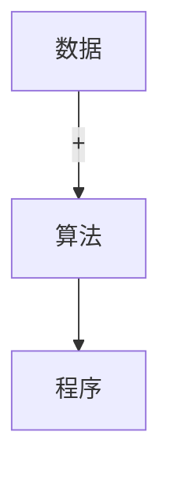
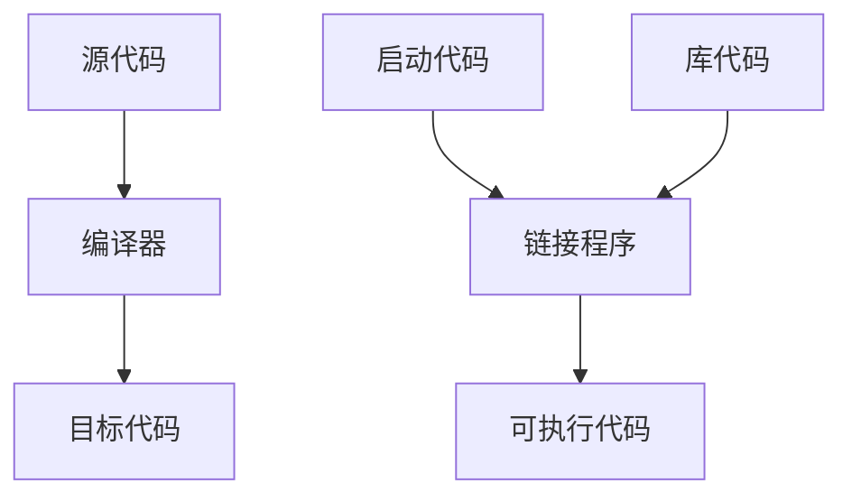
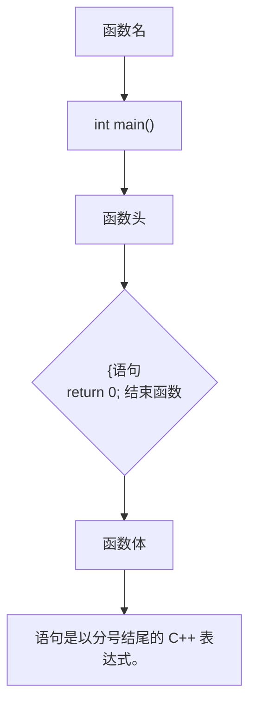

# C++

# Primer Plus

中文版
累计销量超
80 000册

(第6版) 中文版

[美] Stephen Prata 著 张海龙 袁国忠 译

C++ Primer Plus Sixth Edition

■ 经久不衰的C++畅销经典教程
■ 涵盖C++11新标准


<details>
<summary>text_image</summary>

Stephen Praita
C++
Primer Plus
Sixth Edition
New
C++11
Coverage
Developer's Library
</details>


<details>
<summary>text_image</summary>

Black and white barcode image with no visible text or symbols
</details>

NLIC2970801560


<details>
<summary>natural_image</summary>

Line drawing of a modern arched bridge spanning a river, with no visible text or symbols.
</details>

## 经典C++教程十年新版再现 众多C++高手和读者好评如潮

C++很有用，但也很难学。学C++之难，一是学习曲线陡峭，二是容易误入歧途。C++11标准颁布之后，这个问题就更严重。C++ Primer Plus 是在市场的多年检验中脱颖而出的一本名著，它的价值，正在于降低陡峭的学习曲线，并且确保读者学到“正确”的C++。

——孟岩

如果说 $C++$ Primer是 $\mathrm{C}++$ 语言的一本百科全书，讲述了 $\mathrm{C}++$ 语言里面“有什么”；那么 $C++$ Primer Plus就是这门语言的一本通识课本，它实实在在地教给程序员如何理解和使用这种内容丰富、威力强大的语言。本书最大的特点就是务实，通过类比、举例和习惯多维度的方式，为程序员打下坚实的、使用 $\mathrm{C}++$ 进行日常工作的基础。

——高博

如果你从未接触过C语言，我猜有 $80\%$ 的 $\mathrm{C + + }$ 程序员会推荐 $C + +$ Primer这本书（而不是 $C + +$ Primer Plus），但实际上这两本书是有所不同的，别看仅仅就多了这么个Plus。 $C + +$ Primer Plus可以说是一本面向从未学习过C语言甚至是从未学习过编程的人的入门书籍。

——豆瓣读者“梦中惊醒”

这本书对于入门学者来说真的很好，讲的很细致，很透彻，非常人性化！对于初次接触面向对象编程的人来讲，真的很棒！书上的例子和课后题目也很有代表性！强烈建议阅读！

——豆瓣读者“慧质岚心”

最适合初学者的书，我看过好几本C++的图书，包括最出名的C++ Primer，但是还是觉得这本书通俗易懂，能让初学者更好地学好C++。

——豆瓣读者“冷月潇风”

不愧为“程序员和开发人员学习C++的完整教程”，称得上是计算机行业的经典著作。


请访问www.ptpress.com或http://t.cn/zOnA8Jy下载书中相关源代码

——当当读者“刘圈点绕”


<details>
<summary>text_image</summary>

ISBN 978-7-115-27946-0
9 787115 279460 >
</details>

ISBN 978-7-115-27946-0

定价: 99.00 元

## C++

# Primer Plus

# (第6版) 中文版

[美] Stephen Prata 著

张海龙 袁国忠 译

C++ Primer Plus Sixth Edition

## 图书在版编目（CIP）数据

C++ Primer Plus中文版:第6版 /（美）普拉达(Prata, S.) 著；张海龙，袁国忠译. -- 北京:人民邮电出版社，2012.7

ISBN 978-7-115-27946-0

I. ①C… II. ①普… ②张… ③袁… III. ① C语言—程序设计 IV. ①TP312

中国版本图书馆CIP数据核字(2012)第065092号

## 版权声明

Authorized translation from the English language edition, entitled C++ Primer Plus (sixth edition), 9780321776402 by Stephen Prata, published by Pearson Education, Inc., publishing as Addison-Wesley, Copyright © 2011 Pearson Education, Inc.

All rights reserved. No part of this book may be reproduced or transmitted in any form or by any means, electronic or mechanical, including photocopying, recording or by any information storage retrieval system, without permission from Pearson Education Inc. CHINESE SIMPLIFIED language edition published by PEARSON EDUCATION ASIA LTD., and POSTS & TELECOMMUNICATIONS PRESS Copyright © 2012.

本书封面贴有 Pearson Education（培生教育出版集团）激光防伪标签。无标签者不得销售。

## C++ Primer Plus（第6版）中文版

♦ 著 [美] Stephen Prata
译 张海龙 袁国忠
责任编辑 傅道坤

◆ 人民邮电出版社出版发行 北京市崇文区夕照寺街14号

邮编 100061 电子邮件 315@ptpress.com.cn

网址 http://www.ptpress.com.cn

北京新华印刷有限公司印刷

◆ 开本:787×1092 1/16

印张:59.5

字数:1946千字 2012年7月第1版

印数:1-10000册 2012年7月北京第1次印刷

著作权合同登记号 图字:01-2012-0244号

ISBN 978-7-115-27946-0

定价:99.00元

读者服务热线:(010)67132692 印装质量热线:(010)67129223

反盗版热线:(010)67171154

广告经营许可证:京崇工商广字第0021号

## 内容提要

C++是在 C 语言基础上开发的一种集面向对象编程、泛型编程和过程化编程于一体的编程语言，是 C 语言的超集。本书是根据 2003 年的 ISO/ANSI C++ 标准编写的，通过大量短小精悍的程序详细而全面地阐述了 C++ 的基本概念和技术，并专辟一章介绍了 C++1 新增的功能。

全书分 18 章和 10 个附录。分别介绍了 C++ 程序的运行方式、基本数据类型、复合数据类型、循环和关系表达式、分支语句和逻辑运算符、函数重载和函数模板、内存模型和名称空间、类的设计和使用、多态、虚函数、动态内存分配、继承、代码重用、友元、异常处理技术、string 类和标准模板库、输入/输出、C++11 新增功能等内容。

本书针对 C++ 初学者，书中从 C 语言基础知识开始介绍，然后在此基础上详细阐述 C++ 新增的特性，因此不要求读者有 C 语言方面的背景知识。本书可作为高等院校教授 C++ 课程的教材，也可供初学者自学 C++ 时使用。


<details>
<summary>seal</summary>

鄭孝船
就乎
</details>

## 作者简介

Stephen Prata 在美国加州肯特菲尔得的马林学院教授天文、物理和计算机科学。他毕业于加州理工学院，在美国加州大学伯克利分校获得博士学位。他单独或与他人合作编写的编程图书有十多本，其中《New C Primer Plus》获得了计算机出版联合会 1990 年度最佳 “How-to” 计算机图书奖，《C++ Primer Plus》获得了计算机出版联合会 1991 年度最佳 “How-to” 计算机图书奖提名。

## 前言

学习 C++ 是一次探索之旅，因为这种语言容纳了好几种编程范式，其中包括面向对象编程、泛型编程和传统的过程化编程。本书第 5 版是基于 ISO C++ 标准编写的，该标准的官方名称为 C++99 和 C++03 (C++99/C++03)，其中 2003 标准主要是对 1999 标准的技术修正，并没有添加任何新功能。C++ 在不断发展，编写本书时，新标准获得了 C++ 国际标准委员会的批准。在制定期间，该标准名为 C++0x，但现已改名为 C++11。大多数编译器都能很好地支持 C++99/03，而本书的大多数示例都遵守该标准。有些实现中已显现了新标准的很多功能，而本书也对这些新功能进行了探索。

本书在介绍 C++ 特性的同时，讨论了基本 C 语言，使两者成为有机的整体。书中介绍了 C++ 的基本概念，并通过短小精悍的程序来阐明，这些程序都很容易复制和试验。书中还介绍了输入和输出，如何让程序执行重复性任务，如何让程序做出选择，处理数据的多种方式，以及如何使用函数等内容。另外，本书还讲述了 C++ 在 C 语言的基础上新增的很多特性，包括:

- 类和对象；
- 继承；
● 多态、虚函数和 RTTI（运行阶段类型识别）；
- 函数重载；
- 引用变量；
- 泛型（独立于类型的）编程，这种技术是由模板和标准模板库（STL）提供的；
- 处理错误条件的异常机制；
- 管理函数、类和变量名的名称空间。

## 初级教程方法

大约 20 年前，《C Primer Plus》开创了优良的初级教程传统，本书建立在这样的基础之上，吸收了其中很多成功的理念。

- 初级教程应当是友好的、便于使用的指南。
- 初级教程不要求您已经熟悉相关的编程概念。
- 初级教程强调的是动手学习，通过简短、容易输入的示例阐述一两个概念。
- 初级教程用示意图来解释概念。
● 初级教程提供问题和练习来检验您对知识的理解，从而适于自学或课堂教学。

基于上述理念，本书帮助您理解这种用途广泛的语言，并学习如何使用它。

- 对何时使用某些特性，例如何时使用公共继承来建立 is-a 关系，提供了概念方面的指导。
● 阐释了常用的 C++编程理念和技术。
● 提供了大量的附注，如提示、警告、注意等。

本书的作者和编辑尽最大的努力使本书简单、明了、生动有趣。我们的目标是，您阅读本书后，能够编写出可靠、高效的程序，并且觉得这是一种享受。

## 示例代码

本书包含大量的示例代码，其中大部分是完整的程序。和前一版一样，本书介绍的是通用 C++，因此适用于任何计算机、操作系统和编译器。书中的示例在 Windows 7 系统、Macintosh OS X 系统和 Linux 系统上进行了测试。

使用了 C++11 功能的程序要求编译器支持这些功能，但其他程序可在遵循 C++99/03 的任何系统上运行。

书中完整程序的源代码可从配套网站下载，详情请参阅封底的链接信息。

## 本书内容

本书分为 18 章和 10 个附录。

- 第1章 预备知识:本章介绍Bjarne Stroustrup如何通过在C语言的基础上添加对面向对象编程的支持，来创造 $\mathrm{C + + }$ 编程语言。讨论面向过程语言（如C语言）与面向对象语言（如 $\mathrm{C + + }$ ）之间的区别。您将了解ANSI/ISO在制定 $\mathrm{C + + }$ 标准方面所做的工作。本章还讨论了创建 $\mathrm{C + + }$ 程序的技巧，介绍了当前几种 $\mathrm{C + + }$ 编译器使用的方法。最后，本章介绍了本书的一些约定。
- 第2章 开始学习C++:本章介绍创建简单C++程序的步骤。您可以学习到main()函数扮演的角色以及C++程序使用的一些语句。您将使用预定义的cout和cin对象来实现程序输出和输入，学习如何创建和使用变量。最后，本章还将介绍函数——C++的编程模块。
- 第3章 处理数据:C++提供了内置类型来存储两种数据:整数（没有小数的数字）和浮点数（带小数的数字）。为满足程序员的各种需求，C++为每一种数据都提供了几个类型。本章将要讨论这些类型，包括创建变量和编写各种类型的常量。另外，还将讨论C++是如何处理不同类型之间的隐式和显式转换的。
- 第4章 复合类型:C++让程序员能够使用基本的内置类型来创建更复杂的类型。最高级的形式是类，这将在第9章～第13章讨论。本章讨论其他形式，包括数组（存储多个同类型的值）、结构（存储多个不同类型的值）、指针（标识内存位置）。您还将学习如何创建和存储文本字符串及如何使用C-风格字符数组和C++string类来处理文本输入和输出。最后，还将学习C++处理内存分配的一些方法，其中包括用于显式地管理内存的new和delete运算符。
- 第5章 循环和关系表达式:程序经常需要执行重复性操作，为此C++提供了3种循环结构:for循环、while循环和do while循环。这些循环必须知道何时终止，C++的关系运算符使程序员能够创建测试来引导循环。本章还将介绍如何创建逐字符地读取和处理输入的循环。最后，您将学习如何创建二维数组以及如何使用嵌套循环来处理它们。
- 第6章 分支语句和逻辑运算符:如果程序可以根据实际情况调整执行，我们就说程序能够智能地行动。在本章，您将了解到如何使用if、if else和switch语句及条件运算符来控制程序流程，学习如何使用逻辑运算符来表达决策测试。另外，本章还将介绍确定字符关系（如测试字符是数字还是非打印字符）的函数库cctype。最后，还将简要地介绍文件输入/输出。
- 第7章 函数——C++的编程模块:函数是C++的基本编程部件。本章重点介绍C++函数与C函数共同的特性。具体地说，您将复习函数定义的通用格式，了解函数原型是如何提高程序可靠性的。同时，还将学习如何编写函数来处理数组、字符串和结构。还要学习有关递归的知识（即函数在什么情况下调用自身）以及如何用它来实现分而治之的策略。最后将介绍函数指针，它使程序员能够通过函数参数来命令函数使用另一个函数。
- 第8章 函数探幽:本章将探索C++中函数新增的特性。您将学习内联函数，它可以提高程序的执行速度，但会增加程序的长度；还将使用引用变量，它们提供了另一种将信息传递给函数的方式。默认参数使函数能够自动为函数调用中省略的函数参数提供值。函数重载使程序员能够创建多个参数列表不同的同名函数。类设计中经常使用这些特性。另外，您还将学习函数模板，它们使程序员能够指定相关函数族的设计。
- 第9章 内存模型和名称空间:本章讨论如何创建多文件程序，介绍分配内存的各种方式、管理内存的各种方式以及作用域、链接、名称空间，这些内容决定了变量在程序的哪些部分是可见的。
- 第10章 对象和类:类是用户定义的类型，对象（如变量）是类的实例。本章介绍面向对象编程和类设计。对象声明描述的是存储在对象中的信息以及可对对象执行的操作（类方法）。对象的某些组成部分对于外界来说是可见的（公有部分），而某些部分却是隐藏的（私有部分）。特殊的类方法（构造函数和析构函数）在对象创建和释放时发挥作用。在本章中，您将学习所有这些内容以及其他类知识，了解如何使用类来实现ADT，如栈。
- 第11章 使用类:在本章中，您将深入了解类。首先了解运算符重载，它使程序员能够定义与类对象一起使用的运算符，如+。还将学习友元函数，这些函数可以访问外部世界不可访问的类数据。同时还将了解一些构造函数和重载运算符成员函数是如何被用来管理类类型转换的。

- 第12章 类和动态内存分配:一般来说，让类成员指向动态分配的内存很有用。如果程序员在类构造函数中使用new来分配动态内存，就有责任提供适当的析构函数，定义显式拷贝构造函数和显式赋值运算符。本章介绍了在程序员没有提供显式定义时，将如何隐式地生成成员函数以及这些成员函数的行为。您还将通过使用对象指针，了解队列模拟问题，扩充类方面的知识。
- 第13章 类继承:在面向对象编程中，继承是功能最强大的特性之一，通过继承，派生类可以继承基类的特性，可重用基类代码。本章讨论公有继承，这种继承模拟了is-a关系，即派生对象是基对象的特例。例如，物理学家是科学家的特例。有些继承关系是多态的，这意味着相同的方法名称可能导致依赖于对象类型的行为。要实现这种行为，需要使用一种新的成员函数——虚函数。有时，使用抽象基类是实现继承关系的最佳方式。本章讨论了这些问题，说明了公有继承在什么情况下合适，在什么情况下不合适。
- 第14章 C++中的代码重用:公有继承只是代码重用的方式之一。本章将介绍其他几种方式。如果一个类包含了另一个类的对象，则称为包含。包含可以用来模拟has-a关系，其中一个类包含另一个类的对象。例如，汽车有马达。也可以使用私有继承和保护继承来模拟这种关系。本章说明了各种方法之间的区别。同时，您还将学习类模板，它让程序员能够使用泛型定义类，然后使用模板根据具体类型创建特定的类。例如，栈模板使程序员能够创建整数栈或字符串栈。最后，本章还将介绍多重公有继承，使用这种方式，一个类可以从多个类派生而来。
- 第15章 友元、异常和其他:本章扩展了对友元的讨论，讨论了友元类和友元成员函数。然后从异常开始介绍了C++的几项新特性。异常为处理程序异常提供了一种机制，如函数参数值不正确或内存耗尽等。您还将学习RTTI，这种机制用来确定对象类型。最后，本章还将介绍一种更安全的方法来替代不受限制的强制类型转换。
- 第16章 string类和标准模板库:本章讨论C++语言中新增的一些类库。对于传统的C-风格字符串来说，string类是一种方便且功能强大的替代方式。auto\_ptr类帮助管理动态分配的内存。STL提供了几种类容器（包括数组、队列、链表、集合和映射）的模板表示。它还提供了高效的泛型算法库，这些算法可用于STL容器，也可用于常规数组。模板类valarray为数值数组提供了支持。
- 第17章 输入、输出和文件:本章复习 $\mathrm{C}++$ I/O，并讨论如何格式化输出。您将要学习如何使用类方法来确定输入或输出流的状态，了解输入类型是否匹配或是否检测到了文件尾。$\mathrm{C}++$ 使用继承来派生用于管理文件输入和输出的类。您将学习如何打开文件，以进行输入和输出，如何在文件中追加数据，如何使用二进制文件，如何获得对文件的随机访问权。最后，还将学习如何使用标准的I/O方法来读取和写入字符串。
- 第18章 探讨 $\mathrm{C}++$ 新标准:本章首先复习之前介绍过的几项 $\mathrm{C}++11$ 新功能，包括新类型、统一的初始化语法、自动类型推断、新的智能指针以及作用域内枚举。然后，讨论新增的右值引用类型以及如何使用它来实现移动语义。接下来，介绍了新增的类功能、lambda表达式和可变参数模板。最后，概述了众多其他的新功能。

● 附录 A 计数系统:本附录讨论八进制数、十六进制数和二进制数。
- 附录 B C++保留字:本附录列出了 C++关键字。
- 附录C ASCII字符集:本附录列出了ASCII字符集及其十进制、八进制、十六进制和二进制表示。
● 附录 D 运算符优先级:本附录按优先级从高到低的顺序列出了 C++ 的运算符。
- 附录E 其他运算符:本附录总结了正文中没有介绍的其他C++运算符，如按位运算符等。
- 附录 F 模板类 string: 本附录总结了 string 类方法和函数。
- 附录 G 标准模板库方法和函数:本附录总结了 STL 容器方法和通用的 STL 算法函数。
- 附录 H 精选读物和网上资源:本附录列出一些参考书，帮助您深入了解 C++。
- 附录I 转换为ISO标准C++:本附录提供了从C和老式C++实现到标准C++的转换指南。
● 附录 J 复习题答案:本附录提供各章结尾的复习题的答案。

## 对教师的提示

本书宗旨之一是，提供一本既可用于自学又可用于教学的书籍。下面是本书在支持教学方面的一些特征。

● 本书介绍的是通用 C++，不依赖于特定实现。
- 本书内容跟踪了ISO/ANSI C++标准委员会的工作，并讨论了模板、STL、string类、异常、RTTI和名称空间。
- 本书不要求学生了解 C 语言，但如果有一定的编程经验则更好。
本书内容经过了精心安排，前几章可以作为对 C 预备知识的复习一带而过。
- 各章都有复习题和编程练习。附录J提供了复习题的答案。
- 本书介绍的一些主题很适于计算机科学课程，包括抽象数据类型（ADT）、栈、队列、简单链表、模拟、泛型编程以及使用递归来实现分而治之的策略。
- 各章都非常简短，用一周甚至更短的时间就可以学完。
- 本书讨论了何时使用具体的特性以及如何使用它们。例如，把is-a关系的公有继承同组合、has-a关系的私有继承联系起来，讨论了何时应使用虚函数以及何时不应使用。

## 本书约定

为区别不同类型的文本，我们使用了一些印刷上的约定。

\- 代码行、命令、语句、变量、文件名和程序输出使用 courier new 字体:

```cpp
#include <iostream>
int main{}
{
    using namespace std;
    cout << "What's up, Doc!\n";
    return 0;
}
```

\- 用户需要输入的程序输入用粗体表示:

```txt
Please enter your name=
Plato
```

● 语法描述中的占位符用斜体表示。您应使用实际的文件名、参数等替换占位符。
- 新术语用斜体表示。

旁注:提供更深入的讨论和额外的背景知识，帮助阐明主题。

提示:提供特定编程情形下很有帮助的简单指南。

警告:指出潜在的陷阱。

注意:提供不属于其他类别的各种说明。

## 开发本书编程示例时使用的系统

本书的 C++11 示例是使用 Microsoft Visual C++ 2010 和带 Gnu g++ 4.5.0 的 Cygwin 开发的，它们都运行在 64 位的 Windows 7 系统上。其他示例在这些系统上进行了测试，还在 OS-X 10.6.8 系统和 Ubuntu Linux 系统上分别使用 g++ 4.21 和 g++ 4.4.1 进行了测试。大多数非 C++11 示例最初都是在 Windows XP Professional 系统上使用 Microsoft Visual C++ 2003 和 Metrowerks CodeWarrior Development Studio-9 开发的，并在该系统上使用 Borland C++ 5.5 命令行编译器和 GNU gpp 3.3.3 进行了测试；其次，在运行 SuSE 9.0 Linux 的系统上使用 Comeau 4.3.3 和 GNU g++ 3.3.1 进行了测试；最后，在运行 OS 10.3 的 Macintosh G4 上使用 Metrowerks Development Studio 9 进行了测试。

C++为程序员提供了丰富多彩的内容。祝您学习愉快！

## 目录

## 第1章 预备知识……1

1.Γ C++简介 …… 1
1.2 C++简史....2

1.2.1 C语言....2
1.2.2 C语言编程原理……2
1.2.3 面向对象编程 …… 3
F-2.4 C++和泛型编程 …… 4
1.2.5 C++的起源……4

1.3 可移植性和标准 …… 5

1.3.1 C++的发展....6
1.3.2 本书遵循的 C++标准……6

1.4 程序创建的技巧 …… 6

1.4.1 创建源代码文件 7
1.4.2 编译和链接 8

1.5 总结....10

## 第2章 开始学习C++....12

2. F 进入 C++....12

2.1.1 main()函数....13
2.1.2 C++注释....15
2.1.3 C++预处理器和iostream文件……16
2.1.4 头文件名 ……16
2.1.5 名称空间 ……17
2.1.6 使用 cout 进行 C++ 输出 …… 18
2.1.7 C++源代码的格式化 ……19

2.2 C++语句....21

2.2.1= 声明语句和变量 ……21
2.2.2 赋值语句 ……22
2.2.3 cout 的新花样……23

2.3 其他 C++语句....23

2.3.1= 使用cin 24
2.3.2 使用cout进行拼接....24
2.3.3 类简介 …… 25

2.4 函数....26

2.4.1 使用有返回值的函数……26
2.4.2 函数变体 …… 29
2.4.3 用户定义的函数 …… 29
2.4.4 用户定义的有返回值的函数……32
2.4.5 在多函数程序中使用 using 编译指令 ……33

2.5 总结 34
2.6 复习题 35

2.7 编程练习....35

## 第3章 处理数据....37

3.1 简单变量……37

3.1.1 变量名....38
3.1.2 整型....39
3. F.3 整型 short、int、long 和 long long …… 39
3.1.4 无符号类型....43
3.1.5 选择整型类型 …… 45
3.F.6 整型字面值 45
3.1.7 C++如何确定常量的类型……47
3.F.8 char 类型: 字符和小整数……47
3.1.9 bool 类型 53

3.2 const 限定符....54

3.3 浮点数……55

3.3.1 书写浮点数……55
3.3.2 浮点类型……56
3.3.3- 浮点常量 58
3.3.4 浮点数的优缺点 …… 58

3.4 C++算术运算符....59

3.4.1 运算符优先级和结合性 ……60
3.4.2 除法分支 60
3.4.3 求模运算符 61
3.4.4 类型转换 62
3.4.5 C++11 中的 auto 声明……66

3.5 总结....67
3.6 复习题 67
3.7 编程练习....68

## 第4章 复合类型....70

4.1 数组 70

4.1.1 程序说明……72
4.1.2 数组的初始化规则 73
4.1.3 C++H1 数组初始化方法 …… 73

4.2 字符串 74

4.2.1 拼接字符串常量 75
4.2.2 在数组中使用字符串 76
4.2.3 字符串输入 77
4.2.4 每次读取一行字符串输入……78
4.2.5 混合输入字符串和数字 81

4.3 string 类简介 82
4.3.1 C++11字符串初始化....83

4.3.2 赋值、拼接和附加 83
4.3.3 string 类的其他操作 84
4.3-4 string 类 I/O 86
4.3.5 其他形式的字符串字面值……87

4.4 结构简介....88

4.4.1 在程序中使用结构 ....89
4.4.2 C++11 结构初始化....91
4.4.3 结构可以将 string 类
作为成员吗 ....91
4.4.4 其他结构属性 91
4.4.5 结构数组 ....93
4.4.6 结构中的位字段……94

4.5 共用体 94

4.6 枚举....95

4.6.1 设置枚举量的值....97
4.6.2 枚举的取值范围 ……97

4.7 指针和自由存储空间 97

4.7.1 声明和初始化指针 …… 100
4.7.2 指针的危险……101
4.7.3 指针和数字 …… 102
4.7.4 使用new来分配内存……102
4.7.5 使用delete释放内存....104
4.7.6 使用new来创建动态数组……104

4.8 指针、数组和指针算术 …… 106

4.8.F 程序说明....107
4.8.2 指针小结....109
4.8.3 指针和字符串……111
4.8.4 使用-new创建动态结构……114
4.8.5 自动存储、静态存储和动态存储……117

4.9 类型组合 …… 118

4.10 数组的替代品 …… 120

4.10.1 模板类 vector …… 120
4.10.2 模板类 array (C++11) ……120
4.10.3 比较数组、vector 对象和 array 对象....120

4.11 总结 …… 122
4.12 复习题 …… 123
4.13 编程练习 ……-123

## 第 5 章 循环和关系表达式 …… 125

5.1 for 循环....125

5.1.1 for 循环的组成部分……126
5.1.2 - 回到 for 循环....131
5.1.3 修改步长 132
5.1.4 使用 for 循环访问字符串 …… 133
5.1.5 递增运算符（+）和递减运算符（-）……133

5.1.6 副作用和顺序点 …… 134
5.1.7 前缀格式和后缀格式....135
5.1.8 递增/递减运算符和指针……135
5.1.9 组合赋值运算符....136
5.1.10 复合语句（语句块）……136
5.1.11 其他语法技巧——逗号运算符....138
5.12 关系表达式 140
5.13 赋值、比较和可能犯的错误…141
5.14 C-风格字符串的比较 …… 142
5:1.15 比较 string 类字符串 …… 144

5.2 while 循环....145

5.2.1 for 与 while....147
5.2.2 等待一段时间:编写延时循环…148

5.3 do while 循环....150
5.4 基于范围的 for 循环 (C++11)……152
5.5 循环和文本输入....152

5.5.1 使用原始的cin进行输入……152
5.5.2 使用 cin.get(char) 进行补救 …… 153
5.5.3 使用哪一个 cin.get()……154
5.5.4 文件尾条件....155
5.5.5 另一个 cin.get() 版本……157

5.6 嵌套循环和二维数组……159

5.6.1 初始化二维数组 160
5.6.2 使用二维数组....160

5.7 总结....162
5.8 复习题....163
5.9 编程练习 163

## 第6章 分支语句和逻辑运算符……165

6.1 if 语句....165

6.1.1 if else 语句 …… 167
6.1.2 格式化 if else 语句 …… 168
6.1.3 if else if else 结构....169

6.2 逻辑表达式....170

6.2.1 逻辑 OR 运算符: ||....171
6.2.2 逻辑 AND-运算符: && ……172
6.2.3 用&&来设置取值范围……174
6.2.4 逻辑 NOT 运算符:!……175
6.2.5 逻辑运算符细节 ……176
6.2.6 其他表示方式....177

6.3 字符函数库 cctype....177
6.4 ?:运算符....179
6.5 switch 语句....180

6.5.1 将枚举量用作标签……183
6.5.2 switch 和 if else....184

6.6 break 和 continue 语句 …… 185

6.7 读取数字的循环....187

6.8 简单文件输入/输出....190

6.8.1 文本 I/O 和文本文件 …… 190
6.8.2 写入到文本文件中……191
6.8.3 读取文本文件 ……194

6.9 总结....197
6.10 复习题 198
6.H 编程练习....199

## 第 7 章 函数——C++的编程模块……202

7.1 复习函数的基本知识……202

7.1.1 定义函数 203
7.1.2 函数原型和函数调用……205

7.2 函数参数和按值传递 207

7.2.1 多个参数 208
7.2.2 另外一个接受两个参数的函数…210

7.3 函数和数组 212

7.3.1 函数如何使用指针来处理数组…213
7.3.2 将数组作为参数意味着什么……213
7.3.3 更多数组函数示例 ……215
7.3.4 使用数组区间的函数……220
7.3.5 指针和 const 221

7.4 函数和二维数组 224
7.5 函数和 C-风格字符串 225

7.5.1 将 C-风格字符串作为参数的函数……225
7.5.2 返回-C-风格字符串的函数……227

7.6 函数和结构 …… 228

7.6.1 传递和返回结构 ……228
7.6.2 另一个处理结构的函数示例……230
7.6.3 传递结构的地址 ……234

7.7 函数和 string 对象 ……235
7.8 函数与 array 对象 236
7.9 递归....238

7.9.1 包含一个递归调用的递归……239
7.9.2 包含多个递归调用的递归……240

7.10 函数指针 241

7.10.1 函数指针的基础知识……241
7.10.2 函数指针示例 243
7.10.3 深入探讨函数指针……244
7.10.4 使用typedef进行简化……248

7.11 总结 248
7.12 复习题 249
7.13 编程练习 250

## 第8章 函数探幽 253

8.1 C++内联函数....253
8.2 引用变量 255

8.2.1 创建引用变量 256

8.2.2 将引用用作函数参数……258
8.2.3 引用的属性和特别之处……260
8.2.4 将引用用于结构……263
8.2.5 将引用用于类对象 …… 268
8.2.6 对象、继承和引用 …… 271
8.2.7 何时使用引用参数 ……274

8.3 默认参数....274
8.4 函数重载....276

8.4.1 重载示例....278
8.4.2 何时使用函数重载....280

8.5 函数模板 …… 281

8.5.1 重载的模板....283

8.5.2\_模板的局限性....285
8.5.3 显式具体化 285
8.5.4 实例化和具体化 288
8.5.5 编译器选择使用哪个函数版本…289
8.5.6 模板函数的发展 295

8.6 总结....297
8.7 复习题 297
8.8 编程练习 298

## 第9章 内存模型和名称空间 …… 300

9.1 单独编译 300
9.2 存储持续性、作用域和链接性……304

9.2.1 作用域和链接....305
9.2.2 自动存储持续性 305
9.2.3 静态持续变量 309
9.2.4 静态持续性、外部链接性……310
9.2.5 静态持续性、内部链接性……313
9.2.6 静态存储持续性、无链接性……315
9.2.7—说明符和限定符……317
9.2.8 函数和链接性 318
9.2.9 语言链接性....319
9.2.10 存储方案和动态分配……319

9.3 名称空间 324

9.3.1 传统的 C++名称空间……324
9.3.2 新的名称空间特性 …… 325
9.3.3 名称空间示例 331
9.3.4 名称空间及其前途 334

9.4 总结....335
9.5 复习题 335
9.6 编程练习....338

## 第 10 章 对象和类 …… 340

10.1 过程性编程和面向对象编程……340
10.2 抽象和类 341

10.2.1 类型是什么 341

10.2.2 C++中的类 342

10.2.3 实现类成员函数 …… 345
10.2.4 使用类 ……349
10.2.5 修改实现 ……350
10.2.6 小结 ……351

10.3 类的构造函数和析构函数……352

10.3.1 声明和定义构造函数……353
10.3.2 使用构造函数 ……354
10.3.3 默认构造函数 …… 354
10.3.4 析构函数 …… 355
10.3.5 改进 Stock 类 ……356
10.3.6 构造函数和析构函数小结……362

10.4 this 指针 ……363
10.5 对象数组 368
10.6 类作用域 370

10.6.1 作用域为类的常量……371
10.6.2 作用域内枚举（C++11）……372

10.7 抽象数据类型 ……373
10.8 总结....376
10.9 复习题 377
10.10 编程练习 ……377

## 第 11 章 使用类……380

11.1 运算符重载 ……380
11.2 计算时间:一个运算符重载示例……381

11.2.1 添加加法运算符……384
11.2.2 重载限制……387
11.2.3 其他重载运算符……388

11.3 友元 390

11.3.1 创建友元……391
11.3.2 常用的友元: 重载<<运算符……392

11.4 重载运算符:作为成员函数还是非成员函数……397
11.5 再谈重载:一个矢量类……398

11.5.1 使用状态成员 404
11.5.2 为 Vector 类重载算术运算符…406
11.5.3 对实现的说明……408
11.5.4 使用 Vector 类来模拟
随机漫步……408

11.6 类的自动转换和强制类型转换……411

11.6.1 转换函数……415
11.6.2 转换函数和友元函数……419

11.7 总结 421
11.8 复习题 422
11.9 编程练习 422

## 第 12 章 类和动态内存分配……425

12.1 动态内存和类 425
12.1.1 复习示例和静态类成员……425

12.1.2 特殊成员函数 …… 432
12.1.3 回到 Stringbad: 复制构造
函数的哪里出了问题 ……434
12.1.4 Stringbad 的其他问题:
赋值运算符....436

12.2 改进后的新 String 类 437

12.2.1 修订后的默认构造函数 ……438
12.2.2 比较成员函数 …… 439
12.2.3 使用中括号表示法访问字符…439
12.2.4 静态类成员函数 …… 441
12.2.5 进一步重载赋值运算符 …… 441

12.3 在构造函数中使用 new 时应注意的事项……446

12.3.1 应该和不应该 447
12.3.2 包含类成员的类的逐成员
复制 …… 448

12.4 有关返回对象的说明 …… 449

12.4.1 返回指向 const 对象的引用……449
12.4.2 返回指向非 const 对象的引用……449
12.4.3 返回对象 450
12.4.4 返回 const 对象....450

12.5 使用指向对象的指针 …… 451

12.5.1 再谈 new 和 delete....453
12.5.2 指针和对象小结 454
12.5.3 再谈定位 new 运算符……456

12.6 复习各种技术……459

12.6.1 重载<<运算符....459
12.6.2 转换函数 460
12.6.3 其构造函数使用 new 的类……460

12.7 队列模拟 460

12.7.1 队列类 461
12.7.2 Customer 类....468
12.7.3 ATM 模拟....471

12.8 总结……475
12.9 复习题 476
12.10 编程练习 477

## 第 13 章 类继承……480

13.1 一个简单的基类……481

13.1.1 派生一个类 482
13.1.2 构造函数:访问权限的考虑……484
13.1.3 使用派生类 486
13.1.4 派生类和基类之间的
特殊关系 …… 488

13.2 继承:is-a 关系 489
13.3 多态公有继承 490

13.4 静态联编和动态联编 501

13.4.1 指针和引用类型的兼容性……502

13.4.2 虚成员函数和动态联编……503

13.4.3 有关虚函数注意事项……505

13.5 访问控制: protected....507

13.6 抽象基类 508

13.6.1 应用 ABC 概念……510

13.6.2 ABC理念 516

13.7 继承和动态内存分配 …… 516

13.7.1 第一种情况:派生类
不使用 new……516

13.7.2 第二种情况:派生类
使用 new……517

13.7.3 使用动态内存分配和友元的继承示例……519

13.8 类设计回顾 523

13.8.1 编译器生成的成员函数……523

13.8.2 其他的类方法 …… 524

13.8.3 公有继承的考虑因素……527

13.8.4 类函数小结 …… 530

13.9 总结....530

13.10 复习题 531

13.11 编程练习 531

## 第 14 章 C++ 中的代码重用 …… 534

14.1 包含对象成员的类 …… 534

14.1.1 valarray 类简介……535

14.1.2 Student 类的设计 …… 535

14.1.3 Student 类示例 …… 537

14.2 私有继承 543

14.2.1 Student 类示例（新版本）……543

14.2.2 使用包含还是私有继承……549

14.2.3 保护继承……549

14.2.4 使用using重新定义访问权限…550

14.3 多重继承 551

14.3.1 有多少 Worker....555

14.3.2 哪个方法 …… 558

14.3.3 MI 小结 567

14.4 类模板 567

14.4.1 定义类模板 …… 568

14.4.2 使用模板类 570

14.4.3 深入探讨模板类 ……572

14.4.4 数组模板示例和非类型参数……577

14.4.5 模板多功能性 578

14.4.6 模板的具体化 ……582

14.4.7 成员模板 584

14.4.8 将模板用作参数 …… 586-

F4.4.9 模板类和友元 588

14.4.10 模板别名 (C++11) …… 593

14.5 总结 594

14.6 复习题 595

14.7 编程练习 597

## 第 15 章 友元、异常和其他……602

15.1 友元 602

15.1.1 友元类 602

15.1.2 友元成员函数 606

15.1.3 其他友元关系 609

15.1.4 共同的友元 6-10

15.2 嵌套类 6F1

15.2.1 嵌套类和访问权限 612

15.2.2 模板中的嵌套 613

15.3 异常 616

15.3.1 调用 abort() 616

15.3.2 返回错误码 617

15.3.3 异常机制 619

15.3.4 将对象用作异常类型……621

15.3.5 异常规范和 C++11 624

15.3.6 栈解退 625

15.3.7 其他异常特性 629

15.3.8 exception类 631

15.3.9 异常、类和继承……634

F5.3.10 异常何时会迷失方向 639

15.3.11 有关异常的注意事项……641

15.4 RTTI 642

15.4.1 RTTI的用途 642

15.4.2 RTTI 的工作原理……642

15.5 类型转换运算符 649

F5.6 总结 652

15.7 复习题 653

15.8 编程练习 654

## 第 16 章 string 类和标准模板库 ……655

16.1 string 类....655

16.1.1 构造字符串 655

16.1.2 string 类输入 659

16.1.3 使用字符串 661

16.1.4 string 还提供了哪些功能……665

16.1.5 字符串种类 666

16.2 智能指针模板类 667

16.2.1 使用智能指针 668

16.2.2 有关智能指针的注意事项……670

16.2.3 unique\_ptr 为何优于 auto\_ptr…672

16.2.4 选择智能指针 …… 673

16.3 标准模板库 674

16.3.1 模板类 vector 675

16.3.2 可对矢量执行的操作……676
16.3.3 对矢量可执行的其他操作……680
16.3.4 基于范围的 for 循环
(C++11) ……684

16.4 泛型编程 …… 684

16.4.1 为何使用迭代器 ……685
16.4.2 迭代器类型 688
16.4.3 迭代器层次结构 ……689
16.4.4 概念、改进和模型……690
16.4.5 容器种类 695
16.4.4 关联容器 702
16.4.5 无序关联容器（C++11）……707

16.5 函数对象 707

16.5.1 函数符概念 707
16.5.2 预定义的函数符 710
16.5.3 自适应函数符和函数适配器……711

16.6 算法 713

16.6.1 算法组 713
16.6.2 算法的通用特征 ……714
16.6.3 STL 和 string 类 715
16.6.4 函数和容器方法 ……716
16.6.5 使用 STL 717

16.7 其他库 720

16.7.1 vector、valarray 和 array ……720
16.7.2 模板 initializer\_list (C++11) ……724
16.7.3 使用 initializer\_list 725

16.8 总结 727

16.9 复习题 728

16.10 编程练习 728

## 第 17 章 输入、输出和文件……731

17.1 C++输入和输出概述 731
17.1.1 流和缓冲区 732
17.1.2 流、缓冲区和iostream 文件……733
17.1.3 重定向 735

17.2 使用cout进行输出....736

17.2.1 重载的<<运算符....736
17.2.2 其他 ostream 方法....738
17.2.3 刷新输出缓冲区 740
17.2.4 用cout进行格式化……741

17.3 使用 cin 进行输入....753

17.3.1 cin>>如何检查输入 754
17.3.2 流状态 756
17.3.3 其他 istream 类方法……759
17.3.4 其他 istream 方法……764

17.4 文件输入和输出 768

17.4.1 简单的文件 I/O 768
17.4.2 流状态检查和 is\_open()……770

17.4.3 打开多个文件 771
17.4.4 命令行处理技术 772
17.4.5 文件模式 773
17.4.6 随机存取....781

17.5 内核格式化 788
17.6 总结 790
17.7 复习题……791
17.8 编程练习 792

## 第 18 章 探讨 C++新标准 ……795

18.1 复习前面介绍过的 C++11 功能……795
18.1.1 新类型 795
18.8.2 统一的初始化 795
18.1.3 声明 796
18.1.4 智能指针 798
18.1.5 异常规范方面的修改 798
18.1.6 作用域内枚举 799
18.1.7 对类的修改 799
18.1.8 模板和 STL 方面的修改 ……800
18.1.9 右值引用 801

18.2 移动语义和右值引用 802
18.2.1 为何需要移动语义 802
18.2.2 一个移动示例 803
18.2.3 移动构造函数解析 808
18.2.4 赋值 809
18.2.5 强制移动 809
18.3 新的类功能....813
18.3.1 特殊的成员函数 813
18.3.2 默认的方法和禁用的方法……814
18.3.3 委托构造函数 815
18.3.4 继承构造函数 815
18.3.5 管理虚方法: override 和 final…817

18.4 Lambda函数 817
18.4.1 比较函数指针、函数符和
Lambda 函数 …… 818
18.4.2 为何使用 lambda ....820

18.5 包装器 822
18.5.1 包装器 function 及模板的低效性 ....823
18.5.2 修复问题....825
18.5.3 其他方式 826

18.6 可变参数模板 827
18.6.1 模板和函数参数包 827
18.6.2 展开参数包 828
18.6.3 在可变参数模板函数中使用递归....828

18.7 C++11 新增的其他功能 831
18.7.1 并行编程 831

18.7.2 新增的库 831
18.7.3 低级编程 832
18.7.4 杂项 832

18.8 语言变化 832

18.8.1 Boost 项目 ....833
18.8.2 TR1 833
18.8.3 使用 Boost....833

18.9 接下来的任务 834

18.10 总结 834
18.11 复习题 835
18.12 编程练习 838

## 附录 A 计数系统....839

A.1 十进制数 839
A.2 八进制整数 839
A.3 十六进制数 839
A.4 二进制数 840
A.5 二进制和十六进制 841

## 附录 B C++保留字……842

B.1 C++关键字 842
B.2 替代标记……842
B.3 C++库保留名称……843
B.4 有特殊含义的标识符……843

## 附录 C ASCII 字符集……845

## 附录 D 运算符优先级……849

## 附录 E 其他运算符……852

E.1 按位运算符....852

E.1.1 移位运算符 852
E.1.2 逻辑按位运算符....853
E.1.3 按位运算符的替代表示 855
E.1.4 几种常用的按位运算符技术……856

E.2 成员解除引用运算符....857
E.3 alignof (C++11) 860
E.4 noexcept (C++11) 861

## 附录 F 模板类 string 862

F.1 13种类型和一个常量……862
F.2 数据信息、构造函数及其他……863

F.2.1 默认构造函数....865
F.2.2 使用 C-风格字符串的构造函数……865
F.2.3 使用部分 C-风格字符串的构造函数 ....865
F.2.4 使用左值引用的构造函数……866

F.2.5 使用右值引用的构造函数
(C++11) ....866
F.2.6 使用一个字符的 n 个副本的构造函数 ……867
F.2.7 使用区间的构造函数 867
F.2.8 使用初始化列表的构造函数
(C++11) ....868
F.2.9 内存杂记 868

F.3 字符串存取 868
F.4 基本赋值 869
F.5 字符串搜索 869

F.5.1 find()系列....870
F.5.2 rfind()系列....870
F.5.3 find first of()系列 870
F.5.4 find\_last\_of()系列 871
F.5.5 find\_first\_not\_of()系列 871
F.5.6 find\_last\_not\_of()系列 871

F.6 比较方法和函数 872
F.7 字符串修改方法 873

F.7.1 用于追加和相加的方法 ……873
F.7.2 其他赋值方法 874
F.7.3 插入方法 874
F.7.4 清除方法 875
F.7.5 替换方法 875
F.7.6 其他修改方法:copy()和 swap()....876

F.8 输出和输入 876

## 附录 G 标准模板库方法和函数……877

G.1 STL 和 C++11 877

G.1.1 新增的容器....877
G.1.2 对 C++98 容器所做的修改……877

G.2 大部分容器都有的成员……878
G.3 序列容器的其他成员....881
G.4 set 和 map 的其他操作 883
G.4 无序关联容器（C++11）……884
G.5 STL 函数 886

G.5.1 非修改式序列操作....886
G.5.2 修改式序列操作....890
G.5.3 排序和相关操作....897
G.5.4 数值运算....907

## 附录 H 精选读物和网上资源……909

H.1 精选读物 909
H.2 网上资源 910

## 附录 I 转换为 ISO 标准 C++……911

I.1 使用一些预处理器编译指令的替代品…911

I.1.1 使用 const 而不是#define 来定义常量....911
I.1.2 使用 inline 而不是# define 来定义
小型函数……912

1.2 使用函数原型....913
1.3 使用类型转换....913
I.4 熟悉 C++特性....913
1.5 使用新的头文件....914
I.6 使用名称空间 914
I.7 使用智能指针 915
I.8 使用 string 类....915
1.9 使用 STL 915

## 附录 J 复习题答案 …… 916.

第 2 章复习题答案 ……916
第 3 章复习题答案 ……916

第 4 章复习题答案 ……917
第 5 章复习题答案 ……919
第6章复习题答案 919
第 7 章复习题答案 ……920
第8章复习题答案 922
第9章复习题答案 924
第 10 章复习题答案 …… 925
第 11 章复习题答案 ……927
第 12 章复习题答案 ……927
第 13 章复习题答案 ……929
第 14 章复习题答案 …… 930
第 15 章复习题答案 ……931
第 16 章复习题答案 ……932
第 17 章复习题答案 ……933
第 18 章复习题答案 …… 935

## 第1章 预备知识

## 本章内容包括:

- C 语言和 C++ 的发展历史和基本原理。
- 过程性编程和面向对象编程。
- C++是如何在 C 语言的基础上添加面向对象概念的。
- C++是如何在 C 语言的基础上添加泛型编程概念的。
- 编程语言标准。
- 创建程序的技巧。

欢迎进入 C++ 世界！这是一种令人兴奋的语言，它在 C 语言的基础上添加了对面向对象编程和泛型编程的支持，在 20 世纪 90 年代便是最重要的编程语言之一，并在 21 世纪仍保持强劲势头。C++ 继承了 C 语言高效、简洁、快速和可移植性的传统。C++ 面向对象的特性带来了全新的编程方法，这种方法是为应付复杂程度不断提高的现代编程任务而设计的。C++ 的模板特性提供了另一种全新的编程方法——泛型编程。这三件法宝既是福也是祸，一方面让 C++ 语言功能强大，另一方面则意味着有更多的东西需要学习。

本章首先介绍 C++ 的背景, 然后介绍创建 C++ 程序的一些基本原则。本书其他章节将讲述如何使用 C++ 语言, 从最浅显的基本知识开始, 到面向对象的编程 (OOP) 及其支持的新术语——对象、类、封装、数据隐藏、多态和继承等, 然后介绍它对泛型编程的支持 (当然, 随着您对 C++ 的学习, 这些词汇将从花里胡哨的词语变为论述中必不可少的术语)。

## 1.1 C++简介

C++融合了3种不同的编程方式:C语言代表的过程性语言、C++在C语言基础上添加的类代表的面向对象语言、C++模板支持的泛型编程。本章将简要介绍这些传统。不过首先，我们来看看这种传统对于学习C++来说意味着什么。使用C++的原因之一是为了利用其面向对象的特性。要利用这种特性，必须对标准C语言知识有较深入的了解，因为它提供了基本类型、运算符、控制结构和语法规则。所以，如果已经对C有所了解，便可以学习C++了，但这并不仅仅是学习更多的关键字和结构，从C过渡到C++的学习量就像从头学习C语言一样大。另外，如果先掌握了C语言，则在过渡到C++时，必须摈弃一些编程习惯。如果不了解C语言，则学习C++时需要掌握C语言的知识、OOP知识以及泛型编程知识，但无需摈弃任何编程习惯。如果您认为学习C++可能需要扩展思维，这就对了。本书将以清晰的、帮助的方式，引导读者一步一个脚印地学习，因此扩展思维的过程是温和的，不至于让您的大脑接受不了。

本书通过传授 C 语言基础知识和 C++ 新增的内容，带您步入 C++ 的世界，因此不要求读者具备 C 语言知识。首先学习 C++ 与 C 语言共有的一些特性。即使已经了解 C 语言，也会发现阅读本书的这一部分是一次很好的复习。另外，本章还介绍了一些对后面的学习十分重要的概念，指出了 C++ 和 C 之间的区别。在牢固地掌握了 C 语言的基础知识后，就可以在此基础上学习 C++ 方面的知识了。那时将学习对象和类以及

C++是如何实现它们的，另外还将学习模板。

本书不是完整的C++参考手册，不会探索该语言的每个细节，但将介绍所有的重要特性，包括模板、异常和名称空间等。

下面简要地介绍一下 $\epsilon + +$ 的背景知识。

## 1.2 C++简史

在过去的几十年，计算机技术以令人惊讶的速度发展着，当前，笔记本电脑的计算速度和存储信息的能力超过了20世纪60年代的大型机。很多程序员可能还记得，将数叠穿孔卡片提交给充斥整个房间的大型计算机系统的时代，而这种系统只有100KB的内存，比当今智能手机的内存都少得多。计算机语言也得到了发展，尽管变化可能不是天翻地覆的，但也是非常重要的。体积更大、功能更强的计算机引出了更大、更复杂的程序，而这些程序在程序管理和维护方面带来了新的问题。

在 20 世纪 70 年代，C 和 Pascal 这样的语言引领人们进入了结构化编程时代，这种机制把秩序和规程带进了迫切需要这种性质的领域中。除了提供结构化编程工具外，C 还能生成简洁、快速运行的程序，并提供了处理硬件问题的能力，如管理通信端口和磁盘驱动器。这些因素使 C 语言成为 20 世纪 80 年代占统治地位的编程语言。同时，20 世纪 80 年代，人们也见证了一种新编程模式的成长:面向对象编程（OOP）。SmallTalk 和 C++ 语言具备这种功能。下面更深入地介绍 C 和 OOP。

## 1.2.1 C 语言

20 世纪-70 年代早期，贝尔实验室的 Dennis Ritchie 致力于开发 UNIX 操作系统（操作系统是能够管理计算机资源、处理计算机与用户之间交互的一组程序。例如，操作系统将系统提示符显示在屏幕上以提供终端式界面、提供管理窗口和鼠标的图形界面以及运行程序）。为完成这项工作，Ritchie 需要一种语言，它必须简洁，能够生成简洁、快速的程序，并能有效地控制硬件。

传统上，程序员使用汇编语言来满足这些需求，汇编语言依赖于计算机的内部机器语言。然而，汇编语言是低级（low-level）语言，即直接操作硬件，如直接访问CPU寄存器和内存单元。因此汇编语言针对于特定的计算机处理器，要将汇编程序移植到另一种计算机上，必须使用不同的汇编语言重新编写程序。这有点像每次购买新车时，都发现设计人员改变了控制系统的位置和功能，客户不得不重新学习驾驶。

然而，UNIX 是为在不同的计算机（或平台）上工作而设计的，这意味着它是一种高级语言。高级（high-level）语言致力于解决问题，而不针对特定的硬件。一种被称为编译器的特殊程序将高级语言翻译成特定计算机的内部语言。这样，就可以通过对每个平台使用不同的编译器来在不同的平台上使用同一个高级语言程序了。Ritchie 希望有一种语言能将低级语言的效率、硬件访问能力和高级语言的通用性、可移植性融合在一起，于是他在旧语言的基础上开发了 C 语言。

## 1.2.2 C 语言编程原理

由于 C++ 在 C 语言的基础上移植了新的编程理念，因此我们首先来看一看 C 所遵循的旧的理念。一般来说，计算机语言要处理两个概念——数据和算法。数据是程序使用和处理的信息，而算法是程序使用的方法（参见图 1.1）。C 语言与当前最主流的语言一样，在最初面世时也是过程性（procedural）语言，这意味着它强调的是编程的算法方面。从概念上说，过程化编程首先要确定计算机应采取的操作，然后使用编程语言来实现这些操作。程序命令计算机按一系列流程生成特定的结果，就像菜谱指定了厨师做蛋糕时应遵循的一系列步骤一样。

随着程序规模的扩大，早期的程序语言（如 FORTRAN 和 BASIC）都会遇到组织方面的问题。例如，程序经常使用分支语句，根据某种测试的结果，执行一组或另一组指令。很多旧式程序的执行路径很混乱（被称为“意大利面条式编程”），几乎不可能通过阅读程序来理解它，修改这种程序简直是一场灾难。为了解决这种问题，计算机科学家开发了一种更有序的编程方法——结构化编程（structured programming）。C语言具有使用这种方法的特性。例如，结构化编程将分支（决定接下来应执行哪个

指令）限制为一小组行为良好的结构。C 语言的词汇表中就包含了这些结构（for 循环、while 循环、do while 循环和 if else 语句）。

另一个新原则是自顶向下（top-down）的设计。在 C 语言中，其理念是将大型程序分解成小型、便于管理的任务。如果其中的一项任务仍然过大，则将它分解为更小的任务。这一过程将一直持续下去，直到将程序划分为小型的、易于编写的模块（整理一下书房。先整理桌子、桌面、档案柜，然后整理书架。好，先从桌子开始，然后整理每个抽屉，从中间的那个抽屉开始整理。也许我都可以管理这项任务）。C 语言的设计有助于使用这种方法，它鼓励程序员开发程序单元（函数）来表示各个任务模块。如上所述，结构化编程技术反映了过程性编程的思想，根据执行的操作来构思一个程序。


<details>
<summary>flowchart</summary>


</details>

图 1.1 数据+算法=程序

## 1.2.3 面向对象编程

虽然结构化编程的理念提高了程序的清晰度、可靠性，并使之便于维护，但它在编写大型程序时，仍面临着挑战。为应付这种挑战，OOP 提供了一种新方法。与强调算法的过程性编程不同的是，OOP 强调的是数据。OOP 不像过程性编程那样，试图使问题满足语言的过程性方法，而是试图让语言来满足问题的要求。其理念是设计与问题的本质特性相对应的数据格式。

在 C++ 中，类是一种规范，它描述了这种新型数据格式，对象是根据这种规范构造的特定数据结构。例如，类可以描述公司管理人员的基本特征（姓名、头衔、工资、特长等），而对象则代表特定的管理人员（Guilford Sheepblat、副总裁、\$925 000、知道如何恢复 Windows 注册表）。通常，类规定了可使用哪些数据来表示对象以及可以对这些数据执行哪些操作。例如，假设正在开发一个能够绘制矩形的计算机绘图程序，则可以定义一个描述矩形的类。定义的数据部分应包括顶点的位置、长和宽、4 条边的颜色和样式、矩形内部的填充颜色和图案等；定义的操作部分可以包括移动、改变大小、旋转、改变颜色和图案、将矩形复制到另一个位置上等操作。这样，当使用该程序来绘制矩形时，它将根据类定义创建一个对象。该对象保存了描述矩形的所有数据值，因此可以使用类方法来修改该矩形。如果绘制两个矩形，程序将创建两个对象，每个矩形对应一个。

OOP 程序设计方法首先设计类，它们准确地表示了程序要处理的东西。例如，绘图程序可能定义表示矩形、直线、圆、画刷、画笔的类。类定义描述了对每个类可执行的操作，如移动圆或旋转直线。然后您便可以设计一个使用这些类的对象的程序。从低级组织（如类）到高级组织（如程序）的处理过程叫做自下向上（bottom-up）的编程。

OOP 编程并不仅仅是将数据和方法合并为类定义。例如，OOP 还有助于创建可重用的代码，这将减少大量的工作。信息隐藏可以保护数据，使其免遭不适当的访问。多态让您能够为运算符和函数创建多个定义，通过编程上下文来确定使用哪个定义。继承让您能够使用旧类派生出新类。正如接下来将看到的那样，OOP 引入了很多新的理念，使用的编程方法不同于过程性编程。它不是将重点放在任务上，而是放在表示概念上。有时不一定使用自上向下的编程方法，而是使用自下向上的编程方法。本书将通过大量易于掌握的示例帮助读者理解这些要点。

设计有用、可靠的类是一项艰巨的任务，幸运的是，OOP 语言使程序员在编程中能够轻松地使用已有的类。厂商提供了大量有用的类库，包括设计用于简化 Windows 或 Macintosh 环境下编程的类库。C++真正的优点之一是:可以方便地重用和修改现有的、经过仔细测试的代码。

## 1.2.4 C++和泛型编程

泛型编程（generic programming）是 C++ 支持的另一种编程模式。它与 OOP 的目标相同，即使重用代码和抽象通用概念的技术更简单。不过 OOP 强调的是编程的数据方面，而泛型编程强调的是独立于特定数据类型。它们的侧重点不同。OOP 是一个管理大型项目的工具，而泛型编程提供了执行常见任务（如对数据排序或合并链表）的工具。术语泛型（generic）指的是创建独立于类型的代码。C++ 的数据表示有多种类型——整数、小数、字符、字符串、用户定义的、由多种类型组成的复合结构。例如，要对不同类型的数据进行排序，通常必须为每种类型创建一个排序函数。泛型编程需要对语言进行扩展，以便可以只编写一个泛型（即不是特定类型的）函数，并将其用于各种实际类型。C++ 模板提供了完成这种任务的机制。

## 1.2.5 C++的起源

与 C 语言一样，C++也是在贝尔实验室诞生的，Bjarne Stroustrup 于 20 世纪 80 年代在这里开发出了这种语言。用他自己的话来说，“C++主要是为了我的朋友和我不必再使用汇编语言、C 语言或其他现代高级语言来编程而设计的。它的主要功能是可以更方便地编写出好程序，让每个程序员更加快乐”。

## Bjarne Stroustrup 的主页

Bjarne Stroustrup 设计并实现了 C++编程语言，他是权威参考手册《The C++ Programming Language》和《The design and Evolution of C++》的作者。读者应将他位于 AT&T Labs Research 上的个人网站作为首选的 C++ 书签:

```txt
http://www.research.att.com/-bs/
```

该网站包括了 C++ 语言有趣的发展历史、Bjarne 的传记材料和 C++ FAQ。Bjarne 被问得最多的问题是:Bjarne Stroustrup 应该如何读。您可以访问 Stroustrup 的网站，阅读 FAQ 部分并下载. WAV 文件，亲自听一听。

Stroustrup 比较关心的是让 C++ 更有用，而不是实施特定的编程原理或风格。在确定 C++ 语言特性方面，真正的编程需要比纯粹的原理更重要。Stroupstrup 之所以在 C 的基础上创建 C++，是因为 C 语言简洁、适合系统编程、使用广泛且与 UNIX 操作系统联系紧密。C++ 的 OOP 方面是受到了计算机模拟语言 Simula67 的启发。Stroustrup 加入了 OOP 特性和对 C 的泛型编程支持，但并没有对 C 的组件作很大的改动。因此，C++ 是 C 语言的超集，这意味着任何有效的 C 程序都是有效的 C++ 程序。它们之间有些细微的差异，但无足轻重。C++ 程序可以使用已有的 C 软件库。库是编程模块的集合，可以从程序中调用它们。库对很多常见的编程问题提供了可靠的解决方法，因此能节省程序员大量的时间和工作量。这也有助于 C++ 的广泛传播。

名称 C++ 来自 C 语言中的递增运算符++, 该运算符将变量加 1。名称 C++ 表明, 它是 C 的扩充版本。

计算机程序将实际问题转换为计算机能够执行的一系列操作。OOP部分赋予了C++语言将问题所涉及的概念联系起来的能力，C部分则赋予了C++语言紧密联系硬件的能力（参见图1.2），这种能力上的结合成就了C++的广泛传播。从程序的一个方面转到另一个方面时，思维方式也要跟着转换（确实，有些OOP正统派把为C添加OOP特性看作是为猪插上翅膀，虽然这是头瘦骨嶙峋、非常能干的猪）。另外，C++是在C语言的基础上添加OOP特性，您可以忽略C++的面向对象特性，但将错过很多有用的东西。

在 $\mathrm{C}++$ 获得一定程度的成功后，Stroustrup才添加了模板，这使得进行泛型编程成为可能。在模板特性被使用和改进后，人们才逐渐认识到，它们和OOP同样重要——甚至比OOP还重要，但有些人不这么认为。$\mathrm{C}++$ 融合了OOP、泛型编程和传统的过程性方法，这表明 $\mathrm{C}++$ 强调的是实用价值，而不是意识形态方法，这也是该语言获得成功的原因之一。


<details>
<summary>text_image</summary>

OOP 提供了高级抽象。
...
north_america.show();
...
C 提供了低级硬件访问。
set byte at
address
01000 to 0
</details>

图 1.2 C++的二重性

## 1.3 可移植性和标准

假设您为运行 Windows 2000 的老式奔腾 PC 编写了一个很好用的 C++ 程序，而管理人员决定用使用不同操作系统（如 Mac OS X 或 Linux）和处理器（如 SPARC 处理器）的计算机替换它。该程序是否可以在新平台上运行呢？当然，必须使用为新平台设计的 C++ 编译器对程序重新编译。但是否需要修改编写好的代码呢？如果在不修改代码的情况下，重新编译程序后，程序将运行良好，则该程序是可移植的。

在可移植性方面存在两个障碍，其中的一个是硬件。硬件特定的程序是不可移植的。例如，直接控制IBM PC视频卡的程序在涉及Sun时将“胡言乱语”（将依赖于硬件的部分放在函数模块中可以最大限度地降低可移植性问题；这样只需重新编写这些模块即可）。本书将避免这种编程。

可移植性的第二个障碍是语言上的差异。口语确实可能产生问题。约克郡的人对某个事件的描述，布鲁克林人可能就听不明白，虽然这两个地方的人都说英语。计算机语言也可能出现方言。Windows XP C++ 的实现与 Red Hat Linux 或 Macintosh OS X 实现相同吗？虽然多数实现都希望其 C++ 版本与其他版本兼容，但如果没有准确描述语言工作方式的公开标准，这将很难做到。因此，美国国家标准局（American National Standards Institute, ANSI）在 1990 年设立了一个委员会（ANSI X3J16），专门负责制定 C++ 标准（ANSI 制定了 C 语言标准）。国际标准化组织（ISO）很快通过自己的委员会（ISO-WG-21）加入了这个行列，创建了联合组织 ANSI/ISO，致力于制定 C++ 标准。

经过多年的努力，制定出了一个国际标准 ISO/IEC 14882:1998，并于 1998 年获得了 ISO、IEC（International Electrotechnical Committee，国际电工技术委员会）和 ANSI 的批准。该标准常被称为 C++98，它不仅描述了已有的 C++特性，还对该语言进行了扩展，添加了异常、运行阶段类型识别（RTTI）、模板和标准模板库（STL）。2003 年，发布了 C++标准第二版（IOS/IEC 14882:2003）；这个新版本是一次技术性修订，这意味着它对第一版进行了整理——修订错误、减少多义性等，但没有改变语言特性。这个版本常被称为 C++03。由于 C++03 没有改变语言特性，因此我们使用 C++98 表示 C++98/C++2003。

C++在不断发展。ISO 标准委员会于 2001 年 8 月批准了新标准 ISO/IEC 14882:2011，该标准以前称为

$C++11$。与 $C++98$ 一样，$C++11$ 也新增了众多特性。另外，其目标是消除不一致性，让 $C++$ 学习和使用起来更容易。该标准还曾被称为 $C++0x$，最初预期 $x$ 为 7 或 8，但标准制定工作是一个令人疲惫的缓慢过程。所幸的是，可将 $0x$ 视为十六进制数，这意味着委员会只需在 2015 年前完成这项任务即可。根据这个度量标准，委员会还是提前完成了任务。

ISO C++标准还吸收了ANSI-C语言标准，因为 $\mathbb{C}++$ 应尽量是C语言的超集。这意味着在理想情况下，任何有效的C程序都应是有效的 $\mathrm{C + + }$ 程序。ANSI C与对应的 $\mathrm{C + + }$ 规则之间存在一些差别，但这种差别很小。实际上，ANSI C加入了 $\mathrm{C + + }$ 首次引入的一些特性，如函数原型和类型限定符const。

在 ANSI C 出现之前，C 语言社区遵循一种事实标准，该标准基于 Kernighan 和 Ritchie 编写的《The C Programming Language》一书，通常被称为 K&R C；ANSI C 出现后，更简单的 K&R C 有时被称为经典 C (Classic C)。

ANSI C 标准不仅定义了 C 语言，还定义了一个 ANSI C 实现必须支持的标准 C 库。C++也使用了这个库；本书将其称为标准 C 库或标准库。另外，ANSI/ISO C++标准还提供了一个 C++标准类库。

最新的 C 标准为 C99，ISO 和 ANSI 分别于 1999 年和 2000 年批准了该标准。该标准在 C 语言中添加了一些 C++ 编译器支持的特性，如新的整型。

## 1.3.1 C++的发展

Stroustrup 编写的《The Programming Language》包含 65 页的参考手册，它成了最初的 C++ 事实标准。

下一个事实标准是 Ellis 和 Stroustrup 编写的《The Annotated C++ Reference Manual》。

C++98 标准新增了大量特性，其篇幅将近 800 页，且包含的说明很少。

C++11 标准的篇幅长达 1350 页，对旧标准做了大量的补充。

## 1.3.2 本书遵循的 C++ 标准

当代的编译器都对 C++98 提供了很好的支持。编写本书期间，有些编译器还支持一些 C++特性；随着新标准获批，对这些特性的支持将很快得到提高。本书反映了当前的情形，详尽地介绍了 C++98，并涵盖了 C++11 新增的一些特性。在探讨相关的 C++98 主题时顺便介绍了一些 C++新特性，而第 18 章专门介绍新特性，它总结了本书前面提到的一些特性，并介绍了其他特性。

在编写本书期间，对 C++11 的支持还不全面，因此难以全面介绍 C++11 新增的所有特性。考虑到篇幅限制，即使这个新标准获得了全面支持，也无法在一本书中全面介绍它。本书重点介绍大多数编译器都支持的特性，并简要地总结其他特性。

详细介绍 C++之前，先介绍一些有关程序创建的基本知识。

## 1.4 程序创建的技巧

假设您编写了一个 C++ 程序。如何让它运行起来呢？具体的步骤取决于计算机环境和使用的 C++ 编译器，但大体如下（参见图 1.3）。

1. 使用文本编辑器编写程序，并将其保存到文件中，这个文件就是程序的源代码。
2. 编译源代码。这意味着运行一个程序，将源代码翻译为主机使用的内部语言——机器语言。包含了翻译后的程序的文件就是程序的目标代码（object code）。
3. 将目标代码与其他代码链接起来。例如，C++程序通常使用库。C++库包含一系列计算机例程（被称为函数）的目标代码，这些函数可以执行诸如在屏幕上显示信息或计算平方根等任务。链接指的是将目标代码同使用的函数的目标代码以及一些标准的启动代码（startup code）组合起来，生成程序的运行阶段版本。包含该最终产品的文件被称为可执行代码。


<details>
<summary>flowchart</summary>


</details>

图 1.3 编程步骤

本书将不断使用术语源代码，请记住该术语。

本书的程序都是通用的，可在任何支持 C++98 的系统中运行；但第 18 章的程序要求系统支持 C++11。编写本书期间，有些编译器要求您使用特定的标记，让其支持部分 C++11 特性。例如，从 4.3 版起，g++ 要求您编译源代码文件时使用标记 -std=c++0x:

```txt
g++ -std=c++0x use_auto.cpp-
```

创建程序的步骤可能各不相同，下面深入介绍这些步骤。

## 1.4.1 创建源代码文件

本书余下的篇幅讨论源代码文件中的内容:本节讨论创建源代码文件的技巧。有些 C++ 实现（如 Microsoft Visual C++、Embarcadero C++ Builder、Apple Xcode、Open Watcom C++、Digital Mars C++ 和 Freescale CodeWarrior）提供了集成开发环境（integrated development environments，IDE），让您能够在主程序中管理程序开发的所有步骤，包括编辑。有些实现（如用于 UNIX 和 Linux 的 GNU C++、用于 AIX 的 IBM XL C/C++、Embarcadero 分发的 Borland 5.5 免费版本以及 Digital Mars 编译器）只能处理编译和链接阶段，要求在系统命令行输入命令。在这种情况下，可以使用任何文本编辑器来创建和修改源代码。例如，在 UNIX 系统上，可以使用 vi、ed、ex 或 emacs；在以命令提示符模式运行的 Windows 系统上，可以使用 edlin、edit 或任何程序编辑器。如果将文件保存为标准 ASCII 文本文件（而不是特殊的字处理器格式），甚至可以使用字处理器。另外，还可能有 IDE 选项，让您能够使用这些命令行编译器。

给源文件命名时，必须使用正确的后缀，将文件标识为 C++ 文件。这不仅告诉您该文件是 C++ 源代码，还将这种信息告知编译器（如果 UNIX 编译器显示信息“bad magic number”，则表明后缀不正确）。后缀由

一个句点和一个或多个字符组成，这些字符被称作扩展名（参见图1.4）。

使用什么扩展名取决于 C++ 实现，表 1.1 列出了一些常用的扩展名。例如，spiffy.C 是有效的 UNIX-C++ 源代码文件名。注意，UNIX 区分大小写，这意味着应使用大写的 C 字符。实际上，小写 c 扩展名也有效，但标准 C 才使用小写的 c。因此，为避免在 UNIX 系统上发生混淆，对于 C 程序应使用 c，而对于 C++ 程序则请使用 C。如果不在乎多输入一两个字符，则对于某些 UNIX 系统，也可以使用扩展名 cc 和 cxx。DOS 比 UNIX 稍微简单一点，不区分大小写，因此 DOS 实现使用额外的字母（如表 1.1 所示）来区别 C 和 C++ 程序。


<details>
<summary>text_image</summary>

spiffy.cpp-
句点
文件名	扩展名
</details>

图1.4. 源文件的扩展名

表 1.1

源代码文件的扩展名

| C++实现 | 源代码文件的扩展名 |
| --- | --- |
| UNIX | C、cc、cxx、c |
| GNU C++ | C、cc、cxx、cpp、c++ |
| Digital Mars | cpp、cxx |
| Borland C++ | cpp |
| Watcom | cpp |
| Microsoft Visual C++ | cpp、cxx、cc |
| Freestyle CodeWarrior | cp、cpp、cc、cxx、c++ |

## 1.4.2 编译和链接

最初，Stroustrup 实现 C++ 时，使用了一个 C++ 到 C 的编译器程序，而不是开发直接的 C++ 到目标代码的编译器。前者叫做 cfront（表示 C 前端，C front end），它将 C++ 源代码翻译成 C 源代码，然后使用一个标准 C 编译器对其进行编译。这种方法简化了向 C 的领域引入 C++ 的过程。其他实现也采用这种方法将 C++ 引入到其他平台。随着 C++ 的日渐普及，越来越多的实现转向创建 C++ 编译器，直接将 C++ 源代码生成目标代码。这种直接方法加速了编译过程，并强调 C++ 是一种独立（虽然有些相似）的语言。

编译的机理取决于实现，接下来的几节将介绍一些常见的形式。这些总结概括了基本步骤，但对于具体步骤，必须查看系统文档。

## 1. UNIX 编译和链接

最初，UNIX 命令 CC 调用 cfront，但 cfront 未能紧跟 C++ 的发展步伐，其最后一个版本发布于 1993 年。当今的 UNIX 计算机可能没有编译器、有专用编译器或第三方编译器，这些编译器可能是商业的，也可能是自由软件，如 GNU g++ 编译器。如果 UNIX 计算机上有 C++ 编译器，很多情况下命令 CC 仍然管用，只是启动的编译器随系统而异。出于简化的目的，读者应假设命令 CC 可用，但必须认识到这一点，即对于下述讨论中的 CC，可能必须使用其他命令来代替。

请用 CC 命令来编译程序。名称采用大写字母，这样可以将它与标准 UNIX C 编译器 cc 区分开来。CC 编译器是命令行编译器，这意味着需要在 UNIX 命令行上输入编译命令。

例如，要编译 C++源代码文件 spiffy.C，则应在 UNIX 提示符下输入如下命令:

```txt
CC spiffy.C
```

如果由于技巧、努力或是幸运的因素，程序没有错误，编译器将生成一个扩展名为o的目标代码文件。在这个例子中，编译器将生成文件spiffy.o。

接下来，编译器自动将目标代码文件传递给系统链接程序，该程序将代码与库代码结合起来，生成一个可执行文件。在默认情况下，可执行文件为 a.out。如果只使用一个源文件，链接程序还将删除 spiffy.o 文件，因为这个文件不再需要了。要运行该程序，只要输入可执行文件的文件名即可:

```txt
a.out
```

注意，如果编译新程序，新的可执行文件 a.out 将覆盖已有的 a.out（这是因为可执行文件占据了大量空间，因此覆盖旧的可执行文件有助于降低存储需求）。然而，如果想保留可执行文件，只需使用 UNIX 的 mv 命令来修改可执行文件的文件名即可。

与在 C 语言中一样，在 C++ 中，程序也可以包含多个文件（本书第 8～第 16 章的很多程序都是这样）。在这种情况下，可以通过在命令行上列出全部文件来编译程序:

```txt
CC my.C precious.C
```

如果有多个源代码文件，则编译器将不会删除目标代码文件。这样，如果只修改了 my.C 文件，则可以用下面的命令重新编译该程序:

CC my.C precious.o

这将重新编译 my.C 文件，并将它与前面编译的 precious.o 文件链接起来。

可能需要显式地指定一些库。例如，要访问数学库中定义的函数，必须在命令行中加上-lm标记:

CC usingmath.C -lm

## 2. Linux 编译和链接

Linux 系统中最常用的编译器是 g++, 这是来自 Free Software Foundation 的 GNU C++ 编译器。Linux 的多数版本都包括该编译器，但并不一定总会安装它。g++ 编译器的工作方式很像标准 UNIX 编译器。例如，下面的命令将生成可执行文件 a.out

g++ spiffy.cxx

有些版本可能要求链接 C++ 库:

g++ spiffy.cxx -lg++

要编译多个源文件，只需将它们全部放到命令行中即可:

g++ my.cxx precious.cxx

这将生成一个名为 a.out 的可执行文件和两个目标代码文件 my.o 和 precious.o。如果接下来修改了其中的某个源代码文件，如 mu.cxx，则可以使用 my.cxx 和 precious.o 来重新编译:

g++ my.cxx precious.o

GNU 编译器可以在很多平台上使用，包括基于 Windows 的 PC 和在各种平台上运行的 UNIX 系统。

## 3. Windows 命令行编译器

要在 Windows PC 上编译 C++ 程序，最便宜的方法是下载一个在 Windows 命令提示符模式（在这种模式下，将打开一个类似于 MS-DOS 的窗口）下运行的免费命令行编译器。Cygwin 和 MinGW 都包含编译器 GNU C++，且可免费下载；它们使用的编译器名为 g++。

要使用 g++编译器，首先需要打开一个命令提示符窗口。启动程序 Cygwin 和 MinGW 时，它们将自动为您打开一个命令提示符窗口。要编译名为 great.cpp 的源代码文件，请在提示符下输入如下命令:

g++-great.cpp

如果程序编译成功，则得到的可执行文件名为 a.exe。

## 4. Windows 编译器

Windows 产品很多且修订频繁，无法对它们分别进行介绍。当前，最流行是 Microsoft Visual C++ 2010，可通过免费的 Microsoft Visual C++ 2010 学习版获得。虽然设计和目标不同，但大多数基于 Windows 的 C++ 编译器都有一些相同的功能。

通常，必须为程序创建一个项目，并将组成程序的一个或多个文件添加到该项目中。每个厂商提供的IDE（集成开发环境）都包含用于创建项目的菜单选项（可能还有自动帮助）。必须确定的非常重要的一点是，需要创建的是什么类型的程序。通常，编译器提供了很多选择，如Windows应用程序、MFC Windows应用程序、动态链接库、ActiveX控件、DOS或字符模式的可执行文件、静态库或控制台应用程序等。其中一些可能既有32位版本，又有64位版本。

由于本书的程序都是通用的，因此应当避免要求平台特定代码的选项，如 Windows 应用程序。相反，应让程序以字符模式运行。具体选项取决于编译器。一般而言，应选择包含字样“控制台”、“字符模式”或“DOS 可执行文件”等选项。例如，在 Microsoft Visual C++ 2010 中，应选择 Win32 Console Application（控制台应用程序）选项，单击 Application Settings（应用程序设置），并选择 Empty Project（空项目）。在 C++ Builder 中，应从 C++ Builder Projects（C++ Builder 项目）中选择 Console Application（控制台应用程序）。

创建好项目后，需要对程序进行编译和链接。IDE通常提供了多个菜单项，如Compile（编译）、Build（建立）、Make（生成）、Build All（全部建立）、Link（链接）、Execute（执行）、Run（运行）和Debug（调试），不过同一个IDE中，不一定包含所有这些选项。

\- Compile 通常意味着对当前打开的文件中的代码进行编译。

- Build 和 Make 通常意味着编译项目中所有源代码文件的代码。这通常是一个递增过程，也就是说，如果项目包含 3 个文件，而只有其中一个文件被修改，则只重新编译该文件。
● Build All 通常意味着重新编译所有的源代码文件。
- Link 意味着（如前所述）将编译后的源代码与所需的库代码组合起来。
- Run 或 Execute 意味着运行程序。通常，如果您还没有执行前面的步骤，Run 将在运行程序之前完成这些步骤。
- Debug 意味着以步进方式执行程序。
⑤ 编译器可能让您选择要生成调试版还是发布版。调试版包含额外的代码，这会增大程序、降低执行速度，但可提供详细的调试信息。

如果程序违反了语言规则，编译器将生成错误消息，指出存在问题的行。遗憾的是，如果不熟悉语言，将难以理解这些消息的含义。有时，真正的问题可能在标识行之前；有时，一个错误可能引发一连串的错误消息。

提示:改正错误时，应首先改正第一个错误。如果在标识为有错误的那一行上找不到错误，请查看前一行。

需要注意的是，程序能够通过某个编译器的编译并不意味着它是合法的 $C \oplus$ 程序；同样，程序不能通过某个编译器的编译也并不意味着它是非法的 $C++$ 程序。与几年前相比，现在的编译器更严格地遵循了 $C++$ 标准。另外，编译器通常提供了可用于控制严格程度的选项。

提示:有时，编译器在不完全地构建程序后将出现混乱，它显示无法改正的、无意义的错误消息。在这种情况下，可以选择 Build All，重新编译整个程序，以清除这些错误消息。遗憾的是，这种情况和那些更常见的情况（即错误消息只是看上去无意义，实际上有意义）很难区分。

通常，IDE 允许在辅助窗口中运行程序。程序执行完毕后，有些 IDE 将关闭该窗口，而有些 IDE 不关闭。如果编译器关闭窗口，将难以看到程序输出，除非您眼疾手快、过目不忘。为查看输出，必须在程序的最后加上一些代码:

```txt
cin.get();  // add this statement
    cin.get();  // and maybe this, too
    return 0;
}
```

cin.get()语句读取下一次键击，因此上述语句让程序等待，直到按下了Enter键（在按下Enter键之前，键击将不被发送给程序，因此按其他键都不管用）。如果程序在其常规输入后留下一个没有被处理的键击，则第二条语句是必需的。例如，如果要输入一个数字，则需要输入该数字，然后按Enter键。程序将读取该数字，但Enter键不被处理，这样它将被第一个cin.get()读取。

## 5. Macintosh上的C++

当前，Apple 随操作系统 Mac OS-X 提供了开发框架 Xcode，该框架是免费的，但通常不会自动安装。要安装它，可使用操作系统安装盘，也可从 Apple 网站免费下载（但需要注意的是，它超过 4GB）。Xcode 不仅提供了支持多种语言的 IDE，还自带了两个命令行编译器（g++ 和 clang），可在 UNIX 模式下运行它们。而要进入 UNIX 模式，可通过实用程序 Terminal。

提示:为节省时间，可对所有示例程序使用同一个项目。方法是从项目列表中删除前一个示例程序的源代码文件；并添加当前的源代码。这样可节省时间、工作量和磁盘空间。

## 1.5 总结

随着计算机的功能越来越强大，计算机程序越来越庞大而复杂。为应对这种挑战，计算机语言也得到了改进，以便编程过程更为简单。C语言新增了诸如控制结构和函数等特性，以便更好地控制程序流程，支持结构化和模块化程度更高的方法；而C++增加了对面向对象编程和泛型编程的支持，这有助于提高模块化和创建可重用代码，从而节省编程时间并提高程序的可靠性。

C++的流行导致大量用于各种计算平台的 C++ 实现得以面世；而 ISOC++ 标准（C++98/03 和 C++11）为确保众多实现的相互兼容提供了基础。这些标准规定了语言必须具备的特性、语言呈现出的行为、标准库函数、类和模板，旨在实现该语言在不同计算平台和实现之间的可移植性。

要创建 C++ 程序，可创建一个或多个源代码文件，其中包含了以 C++ 语言表示的程序。这些文件是文本文件，它们经过编译和链接后将得到机器语言文件，后者构成了可执行的程序。上述任务通常是在 IDE 中完成的，IDE 提供了用于创建源代码文件的文本编辑器、用于生成可执行文件的编译器和链接器以及其他资源，如项目管理和调试功能。然而，这些任务也可以在命令行环境中通过调用合适的工具来完成。

## 第 2 章 开始学习 C++

## 本章内容包括:

创建 C++ 程序。
- C++程序的一般格式。
#include 编译指令。
- main()函数。
- 使用cout对象进行输出。
③ 在 C++ 程序中加入注释。
- 何时以及如何使用endl。
- 声明和使用变量。
- 使用 cin 对象进行输入。
- 定义和使用简单函数。

要建造简单的房屋，首先要打地基、搭框架。如果一开始没有牢固的结构，后面就很难建造窗子、门框、圆屋顶和镶木地板的舞厅等。同样，学习计算机语言时，应从程序的基本结构开始学起。只有这样，才能一步一步了解其具体细节，如循环和对象等。本章对 C++ 程序的基本结构做一概述，并预览后面将介绍的主题，如函数和类。（这里的理念是，先介绍一些基本概念，这样可以激发读者接下去学习的兴趣。）

## 2.1 进入 C++

首先介绍一个显示消息的简单 C++ 程序。程序清单 2.1 使用 C++ 工具 cout 生成字符输出。源代码中包含一些供读者阅读的注释，这些注释都以 // 打头，编译器将忽略它们。C++ 对大小写敏感，也就是说区分大写字符和小写字符。这意味着大小写必须与示例中相同。例如，该程序使用的是 cout，如果将其替换为 Cout 或 COUT，程序将无法通过编译，并且编译器将指出使用了未知的标识符（编译器也是对拼写敏感的，因此请不要使用 kout 或 coot）。文件扩展名 cpp 是一种表示 C++ 程序的常用方式，您可能需要使用第 1 章介绍的其他扩展名。

程序清单 2.1 myfirst.cpp

```cpp
// myfirst.cpp -- displays a message
#include <iostream>                               // a PREPROCESSOR directive
int main()                                   // function header
{                                              // start of function body
    using namespace std;                       // make definitions visible
    cout << "Come up and C++ me some time.";  // message
    cout << endl;                             // start a new line
    cout << "You won't regret it!" << endl;  // more output
```

```txt
return 0;                                // terminate main()
}                                       // end of function body
```

## 程序调整

要在自己的系统上运行本书的示例，可能需要对其进行修改。有些窗口环境在独立的窗口中运行程序，并在程序运行完毕后自动关闭该窗口。正如第1章讨论的，要让窗口一直打开，直到您按任何键，可在return语句前添加如下语句:

```txt
cin.get();
```

对于有些程序，要让窗口一直打开，直到您按任何键，必须添加两条这样的语句。第4章将更详细地介绍cin.get()。

如果您使用的系统很旧，它可能不支持 C++98 新增的特性。

有些程序要求编译器对 C++11 标准提供一定的支持。对于这样的程序，将明确的指出这一点，并在可能的情况下提供非 C++11 代码。

将该程序复制到您选择的编辑器中（或使用本书配套网站的源代码，详情请参阅封底）后，便可以 C++ 编译器创建可执行代码了（参见第 1 章的介绍）。下面是运行编译后的程序时得到的输出:

```txt
Come up and C++ me some time.
You won't regret it!
```

## C 语言输入和输出

如果已经使用过 C 语言进行编程，则看到 cout 函数（而不是 printf() 函数）时可能会小吃一惊。事实上，C++ 能够使用 printf()、scanf() 和其他所有标准 C 输入和输出函数，只需要包含常规 C 语言的 stdio.h 文件。不过本书介绍的是 C++, 所以将使用 C++ 的输入工具，它们在 C 版本的基础上作了很多改进。

您使用函数来创建 C++ 程序。通常，先将程序组织为主要任务，然后设计独立的函数来处理这些任务。程序清单 2.1 中的示例非常简单，只包含一个名为 main() 的函数。myfirst.cpp 示例包含下述元素。

- 注释，由前缀//标识。
- 预处理器编译指令#include。
- 函数头:int main()。
- 编译指令 using namespace。
- 函数体，用{和}括起。
- 使用 C++ 的 cout 工具显示消息的语句。
- 结束 main()函数的 return 语句。

下面详细介绍这些元素。先来看看 main() 函数，因为了解了 main() 的作用后，main() 前面的一些特性（如预处理器编译指令）将更易于理解。

## 2.1.1 main()函数

去掉修饰后，程序清单 2.1 中的示例程序的基本结构如下:

```c
int main()
{
    statements
    return 0;
}
```

这几行表明有一个名为 main() 的函数，并描述了该函数的行为。这几行代码构成了函数定义（function definition）。该定义由两部分组成:第一行 int main() 叫函数头（function heading），花括号( $\{和\}$ ) 中包括的部分叫函数体。图 2.1 对 main() 函数做了说明。函数头对函数与程序其他部分之间的接口进行了总结；函数体是指出函数应做什么的计算机指令。在 $\mathrm{C}++$ 中，每条完整的指令都称为语句。所有的语句都以分号结束，因此在输入示例代码时，请不要省略分号。


<details>
<summary>flowchart</summary>


</details>

图 2.1 main()函数

main()中最后一条语句叫做返回语句（return statement），它结束该函数。本章将讲述有关返回语句的更多知识。

## 语句和分号

语句是要执行的操作。为理解源代码，编译器需要知道一条语句何时结束，另一条语句何时开始。有些语言使用语句分隔符。例如，FORTRAN 通过行尾将语句分隔开来，Pascal 使用分号分隔语句。在 Pascal 中，有些情况下可以省略分号，例如 END 前的语句后面，这种情况下，实际上并没有将两条语句分开。不过 C++ 与 C 一样，也使用终止符（terminator），而不是分隔符。终止符是一个分号，它是语句的结束标记，是语句的组成部分，而不是语句之间的标记。结论是:在 C++ 中，不能省略分号。

## 1. 作为接口的函数头

就目前而言，需要记住的主要一点是，C++句法要求 main()函数的定义以函数头-int main()开始。本章后面的“函数”一节将详细讨论函数头句法，然而，为满足读者的好奇心，下面先预览一下。

通常，C++函数可被其他函数激活或调用，函数头描述了函数与调用它的函数之间的接口。位于函数名前面的部分叫做函数返回类型，它描述的是从函数返回给调用它的函数的信息。函数名后括号中的部分叫做形参列表（argument list）或参数列表（parameter list）；它描述的是从调用函数传递给被调用的函数的信息。这种通用格式用于main()时让人感到有些迷惑，因为通常并不从程序的其他部分调用main()。

然而，通常，main()被启动代码调用，而启动代码是由编译器添加到程序中的，是程序和操作系统（UNIX、Windows 7 或其他操作系统）之间的桥梁。事实上，该函数头描述的是 main() 和操作系统之间的接口。

来看一下 main() 的接口描述，该接口从 int 开始。C++ 函数可以给调用函数返回一个值，这个值叫做返回值（return-value）。在这里，从关键字 int 可知，main() 返回一个整数值。接下来，是空括号。通常，C++ 函数在调用另一个函数时，可以将信息传递给该函数。括号中的函数头部分描述的就是这种信息。在这里，空括号意味着 main() 函数不接受任何信息，或者 main() 不接受任何参数。（main() 不接受任何参数并不意味着 main() 是不讲道理的、发号施令的函数。相反，术语参数（argument）只是计算机人员用来表示从一个函数传递给另一个函数的信息）。

简而言之，下面的函数头表明main()函数可以给调用它的函数返回一个整数值，且不从调用它的函数那里获得任何信息:

int main()

很多现有的程序都使用经典 C 函数头: