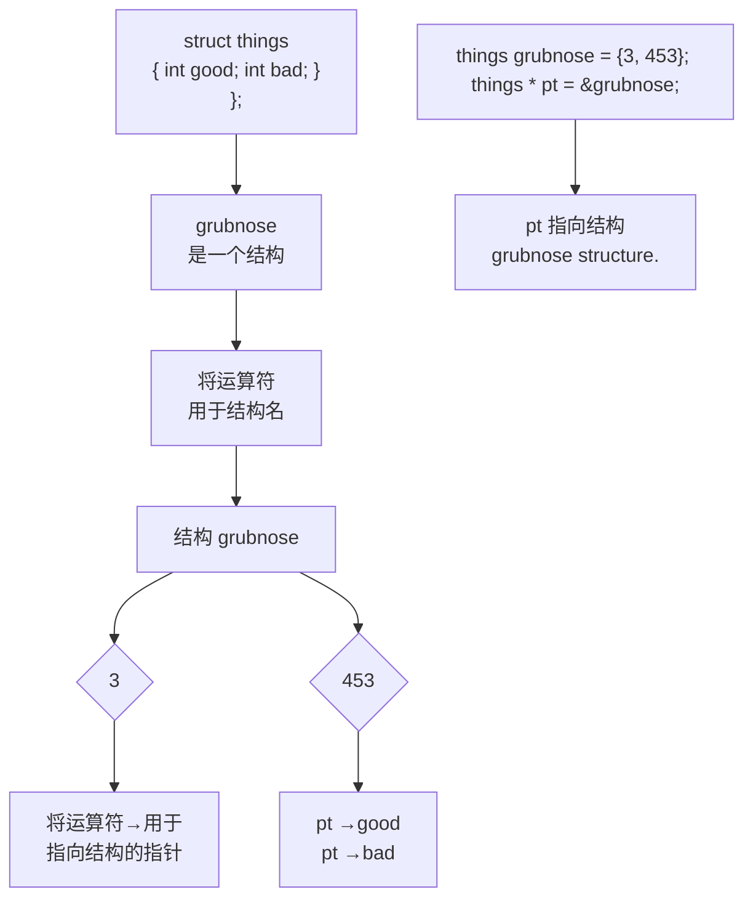
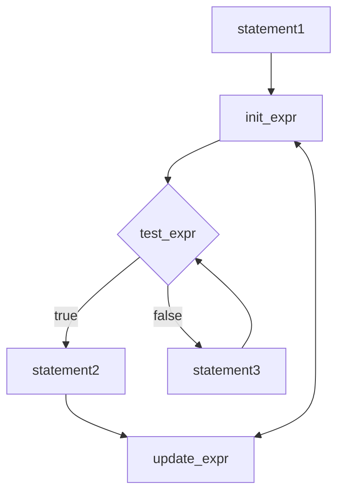

```txt
tacos[0] means *tacos means the value at address tacos
tacos[3] means * (tacos- + 3) means the value at address tacos- + 3
```

数组名和指针变量都是如此，因此对于指针和数组名，既可以使用指针表示法，也可以使用数组表示法。

下面是一些示例:

```c
int * pt = new int [10];    // pt-points to-block of 10 ints
*pt = 5;                     // set element number -0 to 5
pt[0F = 6;                 // reset element number 0 to 6
pt[9F = 44;                 // set tenth element (element number 9) to 44
int coats[10];
*(coats + 4L = 12;        // set coats[4] to 12
```

## 4.8.3 指针和字符串

数组和指针的特殊关系可以扩展到 C-风格字符串。请看下面的代码:

```javascript
char flower[10] = "rose";
cout << flower << "s are red\n";
```

数组名是第一个元素的地址，因此cout语句中的flower是包含字符r的char元素的地址。cout对象认为char的地址是字符串的地址，因此它打印该地址处的字符，然后继续打印后面的字符，直到遇到空字符（\0）为止。总之，如果给cout提供一个字符的地址，则它将从该字符开始打印，直到遇到空字符为止。

这里的关键不在于 flower 是数组名，而在于 flower 是一个 char 的地址。这意味着可以将指向 char 的指针变量作为 cout 的参数，因为它也是 char 的地址。当然，该指针指向字符串的开头，稍后将核实这一点。

前面的cout语句中最后一部分的情况如何呢？如果flower是字符串第一个字符的地址，则表达式“s are red\n”是什么呢？为了与cout对字符串输出的处理保持一致，这个用引号括起的字符串也应当是一个地址。在C++中，用引号括起的字符串像数组名一样，也是第一个元素的地址。上述代码不会将整个字符串发送给cout，而只是发送该字符串的地址。这意味着对于数组中的字符串、用引号括起的字符串常量以及指针所描述的字符串，处理的方式是一样的，都将传递它们的地址。与逐个传递字符串中的所有字符相比，这样做的工作量确实要少。

注意:在cout和多数C++表达式中，char数组名、char指针以及用引号括起的字符串常量都被解释为字符串第一个字符的地址。

程序清单-4.20-演示了如何使用不同形式的字符串。它使用了两个字符串库中的函数。函数 strlen() 我们以前用过，它返回字符串的长度。函数 strcpy() 将字符串从一个位置复制到另一个位置。这两个函数的原型都位于头文件 estring（在不太新的实现中，为 string.h）中。该程序还通过注释指出了应尽量避免的错误使用指针的方式。

程序清单 4.20 ptrstr.cpp

```cpp
// ptrstr.cpp--- using pointers.to strings
#include <iostream>
#include <string>          =      // declare strlen(), strcpy()
int main()
{
    using namespace std;
    char_animal[20] = "bear";   // animal holds bear
    const char * bird = "wren"; // bird holds address of string
    char * ps;                               // uninitialized

    cout << animal << " and ";  // display bear
    cout << bird << "\n";       // display wren
```

```cpp
// cout << ps << "\n";      //may display garbage, may cause a crash

cout << "Enter a kind of animal: ";
cin >> animal;                  // ok if input < 20 chars
// cin >> ps; Too horrible a blunder to try; ps doesn't
//             point to allocated space

ps = animal;                 // set ps to point to string
cout << ps << "!\n";       // ok, same as using animal
cout << "Before using strcpy():\n";
cout << animal << " at " << (int *) animal << endl;
cout << ps << " at " << (int *) ps << endl;

ps = new char[strlen(animal) + 1];  // get new storage
strcpy(ps, animal);        // copy string to new storage
cout << "After using strcpy():\n";
cout << animal << " at " << (int *) animal << endl;
cout << ps << " at " << (int *) ps << endl;
delete [] ps;
return 0;
}
```

下面是该程序的运行情况:

```python
bear and wren
Enter a kind of animal: fox
fox!
Before using strcpy():
fox at 0x0065fd30
fox at 0x0065fd30
After using strcpy():
fox at 0x0065fd30
fox at 0x004301c8
```

## 程序说明

程序清单 4.20 中的程序创建了一个 char 数组（animal）和两个指向 char 的指针变量（bird 和 ps）。该程序首先将 animal 数组初始化为字符串 “bear”，就像初始化数组一样。然后，程序执行了一些新的操作，将 char 指针初始化为指向一个字符串:

```txt
const char * bird = "wren"; // bird holds address of string
```

记住，“wren”实际表示的是字符串的地址，因此这条语句将“wren”的地址赋给了bird指针。（一般来说，编译器在内存留出一些空间，以存储程序源代码中所有用引号括起的字符串，并将每个被存储的字符串与其地址关联起来。）这意味着可以像使用字符串“wren”那样使用指针bird，如下面的示例所示:

```txt
cout << "A concerned " << bird << " speaks\n";
```

字符串字面值是常量，这就是为什么代码在声明中使用关键字 const 的原因。以这种方式使用 const 意味着可以用 bird 来访问字符串，但不能修改它。第 7 章将详细介绍 const 指针。最后，指针 ps 未被初始化，因此不指向任何字符串（正如您知道的，这通常是个坏主意，这里也不例外）。

接下来，程序说明了这样一点，即对于cout来说，使用数组名animal和指针bird是一样的。毕竟，它们都是字符串的地址，cout将显示存储在这两个地址上的两个字符串（“bear”和“wren”）。如果激活错误地显示ps的代码，则将可能显示一个空行、一堆乱码，或者程序将崩溃。创建未初始化的指针有点像签发空头支票:无法控制它将被如何使用。

对于输入，情况有点不同。只要输入比较短，能够被存储在数组中，则使用数组 animal 进行输入将是

安全的。然而，使用 bird 来进行输入并不合适:

- 有些编译器将字符串字面值视为只读常量，如果试图修改它们，将导致运行阶段错误。在 C++ 中，字符串字面值都将被视为常量，但并不是所有的编译器都对以前的行为做了这样的修改。
- 有些编译器只使用字符串字面值的一个副本来表示程序中所有的该字面值。

下面讨论一下第二点。C++不能保证字符串字面值被唯一地存储。也就是说，如果在程序中多次使用了字符串字面值“wren”，则编译器将可能存储该字符串的多个副本，也可能只存储一个副本。如果是后面一种情况，则将 bird 设置为指向一个“wren”，将使它只是指向该字符串的唯一一个副本。将值读入一个字符串可能会影响被认为是独立的、位于其他地方的字符串。无论如何，由于 bird 指针被声明为 const，因此编译器将禁止改变 bird 指向的位置中的内容。

试图将信息读入 ps 指向的位置将更糟。由于 ps 没有被初始化，因此并不知道信息将被存储在哪里，这甚至可能改写内存中的信息。幸运的是，要避免这种问题很容易——只要使用足够大的 char 数组来接收输入即可。请不要使用字符串常量或未被初始化的指针来接收输入。为避免这些问题，也可以使用 std::string 对象，而不是数组。

警告:在将字符串读入程序时，应使用已分配的内存地址。该地址可以是数组名，也可以是使用 new 初始化过的指针。

接下来，请注意下述代码完成的工作:

```cpp
ps = animal;          // set ps to point-to-string
cout << animal << " at " << (int *) animal << endl;
cout << ps << " at " << (int *) ps << endl;
```

它将生成下面的输出:

```txt
fox at 0x0065fd30
fox at 0x0065fd30
```

一般来说，如果给cout提供一个指针，它将打印地址。但如果指针的类型为char\*，则cout将显示指向的字符串。如果要显示的是字符串的地址，则必须将这种指针强制转换为另一种指针类型，如int\*（上面的代码就是这样做的）。因此，ps显示为字符串“fox”，而（int\*）-ps显示为该字符串的地址。注意，将animal赋给ps并不会复制字符串，而只是复制地址。这样，这两个指针将指向相同的内存单元和字符串。

要获得字符串的副本，还需要做其他工作。首先，需要分配内存来存储该字符串，这可以通过声明另一个数组或使用 new 来完成。后一种方法使得能够根据字符串的长度来指定所需的空间:

```javascript
ps = new char[strlen(animal) + 1];//get new storage
```

字符串“fox”不能填满整个animal数组，因此这样做浪费了空间。上述代码使用strlen()来确定字符串的长度，并将它加1来获得包含空字符时该字符串的长度。随后，程序使用new来分配刚好足够存储该字符串的空间。

接下来，需要将 animal 数组中的字符串复制到新分配的空间中。将 animal 赋给 ps 是不可行的，因为这样只能修改存储在 ps 中的地址，从而失去程序访问新分配内存的唯一途径。需要使用库函数 strcpy():

```cpp
strcpy(ps, animal); // copy string to new storage
```

strcpy()函数接受2个参数。第一个是目标地址，第二个是要复制的字符串的地址。您应确定，分配了目标空间，并有足够的空间来存储副本。在这里，我们用strlen()来确定所需的空间，并使用new获得可用的内存。

通过使用 strcpy(-)和 new，将获得“fox”的两个独立副本:

```txt
fox at 0x0065fd30
fox at 0x004301c8
```

另外，new 在离 animal 数组很远的地方找到了所需的内存空间。

经常需要将字符串放到数组中。初始化数组时，请使用=运算符；否则应使用 strcpy()或 strncpy()。strcpy()在前面已经介绍过，其工作原理如下:

```txt
char food[20] = "carrots"; // initialization
strcpy(food, "flan");      // otherwise
```

注意，类似下面这样的代码可能导致问题，因为 food 数组比字符串小:

strcpy(food, "a picnic basket filled with many goodies");

在这种情况下，函数将字符串中剩余的部分复制到数组后面的内存字节中，这可能会覆盖程序正在使用的其他内存。要避免这种问题，请使用 strncpy()。该函数还接受第 3 个参数——要复制的最大字符数。然而，要注意的是，如果该函数在到达字符串结尾之前，目标内存已经用完，则它将不会添加空字符。因此，应该这样使用该函数:

```javascript
strncpy(food, "a picnic basket filled with many goodies", 19);
food[19] = '\0';
```

这样最多将 19 个字符复制到数组中，然后将最后一个元素设置成空字符。如果该字符串少于 19 个字符，则 strncpy() 将在复制完该字符串之后加上空字符，以标记该字符串的结尾。

警告:应使用 strcpy()或 strncpy()，而不是赋值运算符来将字符串赋给数组。

您对使用 C-风格字符串和 cstring 库的一些方面有了了解后，便可以理解为何使用 C++ string 类型更为简单了:您不用担心字符串会导致数组越界，并可以使用赋值运算符而不是函数 strcpy() 和 strncpy()。

## 4.8.4 使用 new 创建动态结构

在运行时创建数组优于在编译时创建数组，对于结构也是如此。需要在程序运行时为结构分配所需的空间，这也可以使用 new 运算符来完成。通过使用 new，可以创建动态结构。同样，“动态”意味着内存是在运行时，而不是编译时分配的。由于类与结构非常相似，因此本节介绍的有关结构的技术也适用于类。

将 new 用于结构由两步组成:创建结构和访问其成员。要创建结构，需要同时使用结构类型和 new。例如，要创建一个未命名的 inflatable 类型，并将其地址赋给一个指针，可以这样做:

```txt
inflatable * ps = new inflatable;
```

这将把足以存储 inflatable 结构的一块可用内存的地址赋给 ps。这种句法和 C++ 的内置类型完全相同。

比较棘手的一步是访问成员。创建动态结构时，不能将成员运算符句点用于结构名，因为这种结构没有名称，只是知道它的地址。C++专门为这种情况提供了一个运算符:箭头成员运算符（->）。该运算符由连字符和大于号组成，可用于指向结构的指针，就像点运算符可用于结构名一样。例如，如果 ps 指向一个 inflatable 结构，则 ps->price 是被指向的结构的 price 成员（参见图 4.11）。


<details>
<summary>flowchart</summary>


</details>

图4.11=标识结构成员—

提示:有时，C++新手在指定结构成员时，搞不清楚何时应使用句点运算符，何时应使用箭头运算符。规则非常简单。如果结构标识符是结构名，则使用句点运算符；如果标识符是指向结构的指针，则使用箭头运算符。

另一种访问结构成员的方法是，如果 ps 是指向结构的指针，则\*ps 就是被指向的值——结构本身。由于\*ps 是一个结构，因此（\*ps）.price 是该结构的 price 成员。C++ 的运算符优先规则要求使用括号。

程序清单 4.21 使用 new 创建一个未命名的结构，并演示了两种访问结构成员的指针表示法。

程序清单 4.21 newstrct.cpp

```cpp
// newstrct.cpp -- using new with a structure
#include <iostream>
struct inflatable // structure definition
{
    char name[20];
    float volume;
    double price;
};
int main()
{
    using namespace std;
    inflatable * ps = new inflatable; // allot memory for structure
    cout << "Enter name of inflatable item: ";
    cin.get(ps->name, 20);          // method 1 for member access
    cout << "Enter volume in cubic feet: ";
    cin >> (*ps).volume;           // method 2 for member access
    cout << "Enter price: $";
    cin >> ps->price;
    cout << "Name: " << (*ps).name << endl;            // method 2
    cout << "Volume: " << ps->volume << " cubic feet\n"; // method 1
    cout << "Price: $" << ps->price << endl;        // method 1
    delete ps;                    // free memory used by structure
    return 0;
}
```

下面是该程序的运行情况:

```txt
Enter name of inflatable item: Fabulous Frodo
Enter volume in cubic feet: 1.4
Enter price: $27.99
Name: Fabulous Frodo
Volume: 1.4 cubic feet
Price: $27.99
```

## 1. 一个使用 new 和 delete 的示例

下面介绍一个使用 new 和 delete 来存储通过键盘输入的字符串的示例。程序清单 4.22 定义了一个函数 getname()，该函数返回一个指向输入字符串的指针。该函数将输入读入到一个大型的临时数组中，然后使用 new[] 创建一个刚好能够存储该输入字符串的内存块，并返回一个指向该内存块的指针。对于读取大量字符串的程序，这种方法可以节省大量内存（实际编写程序时，使用 string 类将更容易，因为这样可以使用内置的 new 和 delete）。

假设程序要读取 100 个字符串，其中最大的字符串包含 79 个字符，而大多数字符串都短得多。如果用 char 数组来存储这些字符串，则需要 1000 个数组，其中每个数组的长度为 80 个字符。这总共需要 80000 个字节，而其中的很多内存没有被使用。另一种方法是，创建一个数组，它包含 1000 个指向 char 的指针，然后使用 new 根据每个字符串的需要分配相应数量的内存。这将节省几万个字节。是根据输入来分配内存，而不是为每个字符串使用一个大型数组。另外，还可以使用 new 根据需要的指针数量来分配空间。就目前而言，这有点不切实际，即使是使用 1000 个指针的数组也是这样，不过程序清单 4.22 还是演示了一些技巧。另外，为演示 delete 是如何工作的，该程序还用它来释放内存以便能够重新使用。

程序清单 4.22 delete.cpp

```cpp
// delete.cpp -- using the delete operator
#include <iostream>
#include <cstring>      // or string.h
using namespace std;
char * getname(void);   // function prototype
int main()    -
{
    char * name;          // create pointer but no storage

    name = getname();  // assign-address of string to name
    cout << name << " at " << (int *) name << "\n";
    delete [] name;  - // memory freed_

    name = getname();  // reuse freed memory
    cout << name << " at "-<<(int *) name << "\n";
    delete [] name;       // memory freed again
    return-0;
}

char * getname()=           // return-pointer to new string
{
    char temp[80];     // temporary storage
    cout << "Enter last name: ";
    cin >> temp;
    char * pn = new char[strlen(temp) + 1];
    strcpy(pn, temp);   // copy string into smaller space

    return pn;             // temp lost when function ends
}
```

下面是该程序的运行情况:

```txt
Enter last name: Fredeldumpkin
Fredeldumpkin at 0x004326b8
Enter last name: Pook
Pook at 0x004301c8
```

## 2. 程序说明

来看一下程序清单 4.22 中的函数 getname()。它使用 cin 将输入的单词放到 temp 数组中，然后使用 new 分配新内存，以存储该单词。程序需要 strle(temp) + 1 个字符（包括空字符）来存储该字符串，因此将这个值提供给 new。获得空间后，getname() 使用标准库函数 strcpy() 将 temp 中的字符串复制到新的内存块中。该函数并不检查内存块是否能够容纳字符串，但 getname() 通过使用 new 请求合适的字节数来完成了这样的工作。最后，函数返回 pn，这是字符串副本的地址。

在 main() 中，返回值（地址）被赋给指针 name。该指针是在 main() 中定义的，但它指向 getname() 函数中分配的内存块。然后，程序打印该字符串及其地址。

接下来，在释放 name 指向的内存块后，main(=)再次调用 getname()。C++不保证新释放的内存就是下

一次使用 new 时选择的内存，从程序运行结果可知，确实不是。

在这个例子中，getname()分配内存，而main()释放内存。将new和delete放在不同的函数中通常并不是个好办法，因为这样很容易忘记使用delete。不过这个例子确实把new和delete分开放置了，只是为了说明这样做也是可以的。

为了解该程序的一些更为微妙的方面，需要知道一些有关 C++ 是如何处理内存的知识。下面介绍一些这样的知识，这些知识将在第 9 章做全面介绍。

## 4.8.5 自动存储、静态存储和动态存储

根据用于分配内存的方法，C++有3种管理数据内存的方式:自动存储、静态存储和动态存储（有时也叫作自由存储空间或堆）。在存在时间的长短方面，以这3种方式分配的数据对象各不相同。下面简要地介绍每种类型（C++11新增了第四种类型——线程存储，这将在第9章简要地讨论）。

## F. 自动存储

在函数内部定义的常规变量使用自动存储空间，被称为自动变量（automatic variable），这意味着它们在所属的函数被调用时自动产生，在该函数结束时消亡。例如，程序清单4.22中的temp数组仅当getname()函数活动时存在。当程序控制权回到main()时，temp使用的内存将自动被释放。如果getname()返回temp的地址，则main()中的name-指针指向的内存将很快得到重新使用。这就是在getname()中使用new的原因之一。

实际上，自动变量是一个局部变量，其作用域为包含它的代码块。代码块是被包含在花括号中的一段代码。到目前为止，我们使用的所有代码块都是整个函数。然而，在下一章将会看到，函数内也可以有代码块。如果在其中的某个代码块定义了一个变量，则该变量仅在程序执行该代码块中的代码时存在。

自动变量通常存储在栈中。这意味着执行代码块时，其中的变量将依次加入到栈中，而在离开代码块时，将按相反的顺序释放这些变量，这被称为后进先出（LIFO）。因此，在程序执行过程中，栈将不断地增大和缩小。

## 2. 静态存储

静态存储是整个程序执行期间都存在的存储方式。使变量成为静态的方式有两种:一种是在函数外面定义它；另一种是在声明变量时使用关键字 static:

```txt
static double fee = 56.50;
```

在 K&R C 中，只能初始化静态数组和静态结构，而 C++ Release 2.0（及后续版本）和 ANSI C 中，也可以初始化自动数组和自动结构。然而，一些您可能已经发现，有些 C++ 实现还不支持对自动数组和自动结构的初始化。

第9章将详细介绍静态存储。自动存储和静态存储的关键在于:这些方法严格地限制了变量的寿命。变量可能存在于程序的整个生命周期（静态变量），也可能只是在特定函数被执行时存在（自动变量）。

## 3. 动态存储

new 和 delete 运算符提供了一种比自动变量和静态变量更灵活的方法。它们管理了一个内存池，这在 C++ 中被称为自由存储空间（free store）或堆（heap）。该内存池同用于静态变量和自动变量的内存是分开的。程序清单 4.22 表明，new 和 delete 让您能够在一个函数中分配内存，而在另一个函数中释放它。因此，数据的生命周期不完全受程序或函数的生存时间控制。与使用常规变量相比，使用 new 和 delete 让程序员对程序如何使用内存有更大的控制权。然而，内存管理也更复杂了。在栈中，自动添加和删除机制使得占用的内存总是连续的，但 new 和 delete 的相互影响可能导致占用的自由存储区不连续，这使得跟踪新分配内存的位置更困难。

## 栈、堆和内存泄漏

如果使用 new 运算符在自由存储空间（或堆）上创建变量后，没有调用 delete，将发生什么情况呢？如果没有调用 delete，则即使包含指针的内存由于作用域规则和对象生命周期的原因而被释放，在自由存储空间上动态分配的变量或结构也将继续存在。实际上，将会无法访问自由存储空间中的结构，因为指向这些内存的指针无效。这将导致内存泄漏。被泄漏的内存将在程序的整个生命周期内都不可使用；这些内存被分配出去，但无法收回。极端情况（不过不常见）是，内存泄漏可能会非常严重，以致于应用程序可用的内存被耗尽，出现内存耗尽错误，导致程序崩溃。另外，这种泄漏还会给一些操作系统或在相同的内存空间中运行的应用程序带来负面影响，导致它们崩溃。

即使是最好的程序员和软件公司，也可能导致内存泄漏。要避免内存泄漏，最好是养成这样一种习惯，即同时使用 new 和 delete 运算符，在自由存储空间上动态分配内存，随后便释放它。C++智能指针有助于自动完成这种任务，这将在第 16 章介绍。

注意:指针是功能最强大的 C++ 工具之一，但也最危险，因为它们允许执行对计算机不友好的操作，如使用未经初始化的指针来访问内存或者试图释放同一个内存块两次。另外，在通过实践习惯指针表示法和指针概念之前，指针是容易引起迷惑的。由于指针是 C++ 编程的重要组成部分，本书后面将更详细地讨论它。本书多次对指针进行了讨论，就是希望您能够越来越熟悉它。

## 4.9 类型组合

本章介绍了数组、结构和指针。可以各种方式组合它们，下面介绍其中的一些，从结构开始:

```c
struct antarctica_years_end
{
    int year;
    /* some really interesting data, etc. */
};
```

可以创建这种类型的变量:

```txt
antarctica_years_end s01, s02, s03;  // s01, s02, s03 are structures
```

然后使用成员运算符访问其成员:

```txt
s01.year = 1998;
```

可创建指向这种结构的指针:

```txt
antarctica_years_end * pa = &s02;
```

将该指针设置为有效地址后，就可使用间接成员运算符来访问成员:

```txt
pa->year = 1999;
```

可创建结构数组:

```txt
antarctica_years_end trio[3]; // array of 3 structures
```

然后，可以使用成员运算符访问元素的成员:

```javascript
trio[0].year = 2003;  // trio[0] is a structure
```

其中 trio 是一个数组, trio[0]是一个结构, 而 trio[0].year 是该结构的一个成员。由于数组名是一个指针, 因此也可使用间接成员运算符:

```lisp
(trio+1)->year = 2004; // same as trio[1].year = 2004;
```

可创建指针数组:

```txt
const antarctica_years_end * arp[3] = {&s01, &s02, &s03};
```

咋一看，这有点复杂。如何使用该数组来访问数据呢？既然 arp 是一个指针数组，arp[1]就是一个指针，可将间接成员运算符应用于它，以访问成员:

```cpp
std::cout << arp[1]->year << std::endl;
```

可创建指向上述数组的指针:

```txt
const antarctica_years_end ** ppa = arp;
```

其中 arp 是一个数组的名称，因此它是第一个元素的地址。但其第一个元素为指针，因此 ppa 是一个指针，指向一个指向 const antarctica\_years\_end 的指针。这种声明很容易容错。例如，您可能遗漏 const，忘记\*，搞错顺序或结构类型。下面的示例演示了 C++11 版本的 auto 提供的方便。编译器知道 arp 的类型，能够正确地推断出 ppb 的类型:

```txt
auto ppb = arp; // C++11 automatic type deduction
```

在以前，编译器利用它推断的类型来指出声明错误，而现在，您可利用它的这种推断能力。

如何使用 ppa 来访问数据呢？由于 ppa 是一个指向结构指针的指针，因此 \*ppa 是一个结构指针，可将间接成员运算符应用于它:\_\_\_\_

```cpp
std::cout << (*ppa)->year << std::endl;
std::cout << (*(ppb+1))->year << std::endl;
```

由于 ppa 指向 arp 的第一个元素，因此\*ppa 为第一个元素，即&s01。所以，(\*ppa)->year 为 s01 的 year 成员。在第二条语句中，pp5+1 指向下一个元素 arp[1]，即&s02。其中的括号必不可少，这样才能正确地结合。例如，\*ppa->year 试图将运算符\*应用于 ppa->year，这将导致错误，因为成员 year 不是指针。

上面所有的说法都对吗？程序清单4.23将这些语句放到了一个简短的程序中。

程序清单 4.23 mixtypes.cpp

```cpp
// mixtypes.cpp -- some type-combinations
#include <iostream>

struct_antarctica_years_end
{
    int year;
    /* some really interesting data, etc. */
};

int main()
{
    antarctica_years_end s01, s02, s03;
    s01.year = 1998;
    antarctica_years_end * pa = &s02;_
    pa->year = 1999;
    antarctica_years_end trio[3]; //=array of 3 structures
    trio[0].year = 2003;
    std::cout << trio->year << std::endl;
    const antarctica_years_end * arp[3] = {&s01, &s02, &s03};
    std::cout << arp[1]->year << std::endl;
    const antarctica_years_end ** ppa = arp;
    auto ppb = arp; // C++11 automatic type deduction
// or else use const antarctica_years_end ** ppb = arp;
    std::cout << (*ppa)->year << std::endl;
    std::cout << (*(ppb+1))->year << std::endl;
    return 0;
}
```

该程序的输出如下:

```csv
2003
1999
1998
1999
```

该程序通过了编译，并向前面介绍的那样运行。

## 4.10 数组的替代品

本章前面说过，模板类 vector 和 array 是数组的替代品。下面简要地介绍它们的用法以及使用它们带来的一些好处。

## 4.10.1 模板类 vector

模板类 vector 类似于 string 类，也是一种动态数组。您可以在运行阶段设置 vector 对象的长度，可在末尾附加新数据，还可在中间插入新数据。基本上，它是使用 new 创建动态数组的替代品。实际上，vector 类确实使用 new 和 delete 来管理内存，但这种工作是自动完成的。

这里不深入探讨模板类意味着什么，而只介绍一些基本的实用知识。首先，要使用 vector 对象，必须包含头文件 vector。其次，vector 包含在名称空间 std 中，因此您可使用 using 编译指令、using 声明或 std::vector。第三，模板使用不同的语法来指出它存储的数据类型。第四，vector 类使用不同的语法来指定元素数。下面是一些示例:

```cpp
#include <vector>
...
using namespace std;
vector<int> vi;      // create a zero-size array of int
int n;
cin >> n;
vector<double> vd(n);  // create an array of n doubles
```

其中，vi 是一个 vector&lt;int&gt;对象，vd 是一个 vector&lt;double&gt;对象。由于 vector 对象在您插入或添加值时自动调整长度，因此可以将 vi 的初始长度设置为零。但要调整长度，需要使用 vector 包中的各种方法。

一般而言，下面的声明创建一个名为 vt 的 vector 对象，它可存储 n\_elem 个类型为 typeName 的元素:
vector&lt;typeName&gt; vt(n\_elem);

其中参数 n\_elem 可以是整型常量，也可以是整型变量。

## 4.10.2 模板类 array (C++11)

vector 类的功能比数组强大，但付出的代价是效率稍低。如果您需要的是长度固定的数组，使用数组是更佳的选择，但代价是不那么方便和安全。有鉴于此，C++11 新增了模板类 array，它也位于名称空间 std 中。与数组一样，array 对象的长度也是固定的，也使用栈（静态内存分配），而不是自由存储区，因此其效率与数组相同，但更方便，更安全。要创建 array 对象，需要包含头文件 array。array 对象的创建语法与 vector 稍有不同:

```cpp
#include <array>
...
using namespace std;
array<int, 5> ai;   // create array object of 5 ints
array<double, 4> ad = {1.2, 2.1, 3.43. 4.3};
```

推而广之，下面的声明创建一个名为 arr 的 array 对象，它包含 n\_elem 个类型为 typename 的元素:
array&lt;typeName, n_elem&gt; arr;

与创建 vector 对象不同的是，n\_elem 不能是变量。

在 C++11 中，可将列表初始化用于 vector 和 array 对象，但在 C++98 中，不能对 vector 对象这样做。

## 4.10.3 比较数组、vector 对象和 array 对象

要了解数组、vector 对象和 array 对象的相似和不同之处，最简单的方式可能是看一个使用它们的简单

示例，如程序清单4.24所示。

程序清单 4.24 choices.cpp

```cpp
// choices.cpp -- array variations
#include <iostream>
#include <vector> // STL C++98
#include <array> // C++I1
int main()
{
    using namespace std;
// C, original_C++
    double a1[4] = {1.2, 2.4, 3.6, 4-8};
// C++98 STL
    vector<double> a2(4); // create vector with 4 elements
// no-simple way to initialize in C98
    a2[0] = 1.0/3.0;
    a2[I] = 1.0/5.0;
    a2[2] = 1.0/7.0;
    a2[3] = 1.0/9.0;
// C++11 -- create and initialize array-object
    array<double, 4> a3 = {3.14, 2.72, 1.62, 1.4I};
    array<double, 4>-a4;
    a4 = a3; // valid for array objects of same size
// use array notation
    cout << "a1[2]: " << a1[2] << " at " << &a1[2] << endl;
    cout << "a2[2]: " << a2[2] << " at " << &a2[2] << endl;
    cout << "a3[2]: " << a3[2] << " at " << &a3[2] << endl;
    cout << "a4[2]: " << a4[2] << " at " << &a4[2] << endl;
// misdeed
    a1[-2] = 20.27
    cout << "a1[-2]: " << a1[-2] << " at " << &a1[-2] << endl;
    cout << "a3[2]: " << a3[2] << " at " << &a3[2] << endl;
    cout << "a4[2]: " << a4[2] << " at " << &a4[2] << endl;
    return 0;
}
```

下面是该程序的输出示例:

```txt
a1[2]: 3.6 at 0x28cce8
a2[2]: 0.142857 at 0xca0328
a3[2]: 1.62 at 0x28ccc8
a4[2]: 1.62 at 0x28cca8
a1[-2]: 20.2 at 0x28ccc8
a3[2]: 20.2 at 0x28ccc8
a4[2]: -1.62-at 0x28cca8
```

## 程序说明

首先，注意到无论是数组、vector对象还是array对象，都可使用标准数组表示法来访问各个元素。其次，从地址可知，array对象和数组存储在相同的内存区域（即栈）中，而vector对象存储在另一个区域（自由存储区或堆）中。第三，注意到可以将一个array对象赋给另一个array对象；而对于数组，必须逐元素复制数据。

接下来，下面一行代码需要特别注意:

```txt
a1[-2E = 20.2;
```

索引-2 是什么意思呢？本章前面说过，这将被转换为如下代码:

$$
* (a 1 - 2) = 2 0. 2;
$$

其含义如下:找到 a1 指向的地方，向前移两个 double 元素，并将 20.2 存储到目的地。也就是说，将信息存储到数组的外面。与 C 语言一样，C++ 也不检查这种超界错误。在这个示例中，这个位置位于 array 对象 a3 中。其他编译器可能将 20.2 放在 a4 中，甚至做出更糟糕的选择。这表明数组的行为是不安全的。

vector 和 array 对象能够禁止这种行为吗？如果您让它们禁止，它们就能禁止。也就是说，您仍可编写不安全的代码，如下所示:

$$
\begin{array}{l} \text {a2[-2] = .5; // still allowed} \\ \text {a3[200] = 1.4;} \end{array}
$$

然而，您还有其他选择。一种选择是使用成员函数 at()。就像可以使用 cin 对象的成员函数 getline()一样，您也可以使用 vector 和 array 对象的成员函数 at():

$$
\text {a2.at(1)} = 2. 3; \quad / / \text {assign 2.3 to a2[1]}
$$

中括号表示法和成员函数 at() 的差别在于，使用 at() 时，将在运行期间捕获非法索引，而程序默认将中断。这种额外检查的代价是运行时间更长，这就是 C++ 让允许您使用任何一种表示法的原因所在。另外，这些类还让您能够降低意外超界错误的概率。例如，它们包含成员函数 begin() 和 end()，让您能够确定边界，以免无意间超界，这将在第 16 章讨论。

## 4.11 总结

数组、结构和指针是 $\mathbf{C}++$ 的3种复合类型。数组可以在一个数据对象中存储多个同种类型的值。通过使用索引或下标，可以访问数组中各个元素。

结构可以将多个不同类型的值存储在同一个数据对象中，可以使用成员关系运算符（.）来访问其中的成员。使用结构的第一步是创建结构模板，它定义结构存储了哪些成员。模板的名称将成为新类型的标识符，然后就可以声明这种类型的结构变量。

共用体可以存储一个值，但是这个值可以是不同的类型，成员名指出了使用的模式。

指针是被设计用来存储地址的变量。我们说，指针指向它存储的地址。指针声明指出了指针指向的对象的类型。对指针应用解除引用运算符，将得到指针指向的位置中的值。

字符串是以空字符为结尾的一系列字符。字符串可用引号括起的字符串常量表示，其中隐式包含了结尾的空字符。可以将字符串存储在 char 数组中，可以用被初始化为指向字符串的 char 指针表示字符串。函数 strlen() 返回字符串的长度，其中不包括空字符。函数 strcpy() 将字符串从一个位置复制到另一个位置。在使用这些函数时，应当包含头文件 cstring 或 string.h。

头文件 string 支持的 C++ string 类提供了另一种对用户更友好的字符串处理方法。具体地说，string 对象将根据要存储的字符串自动调整其大小，用户可以使用赋值运算符来复制字符串。

new 运算符允许在程序运行时为数据对象请求内存。该运算符返回获得内存的地址，可以将这个地址赋给一个指针，程序将只能使用该指针来访问这块内存。如果数据对象是简单变量，则可以使用解除引用运算符（\*）来获得其值；如果数据对象是数组，则可以像使用数组名那样使用指针来访问元素；如果数据对象是结构，则可以用指针解除引用运算符（->）来访问其成员。

指针和数组紧密相关。如果 ar 是数组名，则表达式 ar[i] 被解释为  $*(\mathrm{ar} + \mathrm{i})$ ，其中数组名被解释为数组第一个元素的地址。这样，数组名的作用和指针相同。反过来，可以使用数组表示法，通过指针名来访问 new 分配的数组中的元素。

运算符 new 和 delete 允许显式控制何时给数据对象分配内存，何时将内存归还给内存池。自动变量是在函数中声明的变量，而静态变量是在函数外部或者使用关键字 static 声明的变量，这两种变量都不太灵活。自动变量在程序执行到其所属的代码块（通常是函数定义）时产生，在离开该代码块时终止。静态变量在整个程序周期内都存在。

C++98 新增的标准模板库（STL）提供了模板类 vector，它是动态数组的替代品。C++11 提供了模板类 array，它是定长数组的替代品。

## 4.12 复习题

1. 如何声明下述数据？

a. actor 是由 30 个 char 组成的数组。

b. betsie 是由 100 个 short 组成的数组。

c. chuck 是由 13 个 float 组成的数组。

d. dipsea 是由 64 个 long double 组成的数组。

2. 使用模板类 array 而不是数组来完成问题 1。

3. 声明一个包含 5 个元素的 int 数组，并将它初始化为前 5 个正奇数。

4. 编写一条语句，将问题 3 中数组第一个元素和最后一个元素的和赋给变量 even。

5. 编写一条语句，显示 float 数组 ideas 中的第 2 个元素的值。

6. 声明一个 char 的数组，并将其初始化为字符串 “cheeseburger”。

7. 声明一个 string 对象，并将其初始化为字符串 “Waldorf Salad”。

8. 设计一个描述鱼的结构声明。结构中应当包括品种、重量（整数，单位为盎司）和长度（英寸，包括小数）。

9. 声明一个问题 8 中定义的结构的变量，并对它进行初始化。

10. 用 enum 定义一个名为 Response 的类型，它包含 Yes、No 和 Maybe 等枚举量，其中 Yes 的值为 1，No 为 0，Maybe 为 2。

11. 假设 ted 是一个 double 变量，请声明一个指向 ted 的指针，并使用该指针来显示 ted 的值。

12. 假设 treacle 是一个包含 10 个元素的 float 数组，请声明一个指向 treacle 的第一个元素的指针，并使用该指针来显示数组的第一个元素和最后一个元素。

13. 编写一段代码，要求用户输入一个正整数，然后创建一个动态的 int 数组，其中包含的元素数目等于用户输入的值。首先使用 new 来完成这项任务，再使用 vector 对象来完成这项任务。

14. 下面的代码是否有效？如果有效，它将打印出什么结果？

```txt
cout << (int *) "Home of the jolly bytes";
```

15. 编写一段代码，给问题 8 中描述的结构动态分配内存，再读取该结构的成员的值。

16. 程序清单 4.6 指出了混合输入数字和一行字符串时存储的问题。如果将下面的代码:

```javascript
cin.getline(address,80);
```

替换为:

```sql
cin >> address;
```

将对程序的运行带来什么影响？

17. 声明一个 vector 对象和一个 array 对象，它们都包含 10 个 string 对象。指出所需的头文件，但不要使用 using。使用 const 来指定要包含的 string 对象数。

## 4.13 编程练习

1. 编写一个 C++ 程序，如下述输出示例所示的那样请求并显示信息:

```txt
What is your first name? Betty Sue
What is your last name? Yewe
What letter-grade do you deserve? B
What is your age? 22_
Name: Yewe, Betty Sue
Grade:C=
Age: 22
```

注意，该程序应该接受的名字包含多个单词。另外，程序将向下调整成绩，即向上调一个字母。假设用户请求A、B或C，所以不必担心D和F之间的空档。

2. 修改程序清单 4.4, 使用 C++ string 类而不是 char 数组。

3. 编写一个程序，它要求用户首先输入其名，然后输入其姓；然后程序使用一个逗号和空格将姓和名组合起来，并存储和显示组合结果。请使用char数组和头文件cstring中的函数。下面是该程序运行时的情形:

```txt
Enter your first name: Flip
Enter your last name: Fleming
Here's the information in a single string: Fleming, Flip
```

4. 编写一个程序，它要求用户首先输入其名，再输入其姓；然后程序使用一个逗号和空格将姓和名组合起来，并存储和显示组合结果。请使用 string 对象和头文件 string 中的函数。下面是该程序运行时的情形:

```txt
Enter your first name: Flip
Enter your last name: Fleming
Here's the information in a single string: Fleming, Flip
```

5. 结构 CandyBar 包含 3 个成员。第一个成员存储了糖块的品牌；第二个成员存储糖块的重量（可以有小数）；第三个成员存储了糖块的卡路里含量（整数）。请编写一个程序，声明这个结构，创建一个名为 snack 的 CandyBar 变量，并将其成员分别初始化为 “Mocha Munch”、2.3 和 350。初始化应在声明 snack 时进行。最后，程序显示 snack 变量的内容。
6. 结构 CandyBar 包含 3 个成员，如编程练习 5 所示。请编写一个程序，创建一个包含 3 个元素的 CandyBar 数组，并将它们初始化为所选择的值，然后显示每个结构的内容。
7. William Wingate 从事比萨饼分析服务。对于每个披萨饼，他都需要记录下列信息:

- 披萨饼公司的名称，可以有多个单词组成。
● 披萨饼的直径。
● 披萨饼的重量。

请设计一个能够存储这些信息的结构，并编写一个使用这种结构变量的程序。程序将请求用户输入上述信息，然后显示这些信息。请使用cin（或它的方法）和cout。

8. 完成编程练习 7，但使用 new 来为结构分配内存，而不是声明一个结构变量。另外，让程序在请求输入比萨饼公司名称之前输入比萨饼的直径。
9.- 完成编程练习6，但使用 new 来动态分配数组，而不是声明一个包含 3 个元素的 CandyBar 数组。
10. 编写一个程序，让用户输入三次40码跑的成绩（如果您愿意，也可让用户输入40米跑的成绩），并显示次数和平均成绩。请使用一个array对象来存储数据（如果编译器不支持array类，请使用数组）。

## 第 5 章 循环和关系表达式

## 本章内容包括:

- for 循环。
● 表达式和语句。
- 递增运算符和递减运算符:++和--。
组合赋值运算符。
● 复合语句（语句块）。
- 逗号运算符。
关系运算符:＞、＞=、==、＜=、＜和！=。
while 循环。
- typedef 工具。
- do while 循环。
- 字符输入方法 get()。
⑬ 文件尾条件。
- 嵌套循环和二维数组。

计算机除了存储数据外，还可以做很多其他的工作。可以对数据进行分析、合并、重组、抽取、修改、推断、合成以及其他操作。有时甚至会歪曲和破坏数据，不过我们应当尽量防止这种行为的发生。为了发挥其强大的操控能力，程序需要有执行重复的操作和进行决策的工具。当然，C++提供了这样的工具。事实上，它使用与常规C语言相同的for-循环、while循环、do while循环、if语句和switch语句，如果读者熟悉C语言，可粗略地浏览本章和第6章；但浏览速度不要过快，否则会错过cin如何处理字符输入。这些程序控制语句通常都使用关系表达式和逻辑表达式来控制其行为。本章将讨论循环和关系表达式，第6章将介绍分支语句和逻辑表达式。

## 5.1 for循环

很多情况下都需要程序执行重复的任务，如将数组中的元素累加起来或将歌颂生产的赞歌打印20-份，C++中的for循环可以轻松地完成这种任务。我们来看看程序清单5.1中，以了解for循环所做的工作，然后讨论它是如何工作的。

程序清单 5.1 forloop.cpp

```cpp
// forloop.cpp -- introducing the for_loop
#include <iostream>
int main()
{
```

```cs
using namespace std;
int i;  // create a counter
//  initialize; test ; update
for (i = 0; i < 5; i++)
    cout << "C++ knows loops.\n";
cout << "C++ knows when to stop.\n";
return 0;
}
```

下面是该程序的输出:

```txt
C++ knows loops.
C++ knows loops.
C++ knows loops.
C++ knows loops.
C++ knows loops.
C++ knows when to stop.
```

该循环首先将整数变量 i 设置为 0:

```txt
i = 0
```

这是循环的初始化（loop initialization）部分。然后，循环测试（loop test）部分检查 i 是否小于 5: i < 5

如果确实小于 5，则程序将执行接下来的语句——循环体（loop body）:

```javascript
cout << "C++ knows loops.\n";
```

然后，程序使用循环更新（loop update）部分将 i 加 1:

```txt
1++
```

这里使用了++运算符——递增运算符（increment operator），它将操作数的值加1。递增运算符并不仅限于用于for循环。例如，在程序中，可以使用i++;来替换语句 $i=i+1$ ；将i加1后，便结束了循环的第一个周期。

接下来，循环开始了新的周期，将新的i值与5进行比较。由于新值（1）也小于5，因此循环打印另一行，然后再次将i加1，从而结束这一周期。这样又进入了新的一轮测试、执行语句和更新i的值。这一过程将一直进行下去，直到循环将i更新为5为止。这样，接下来的测试失败，程序将接着执行循环后的语句。

## 5.1.1 for 循环的组成部分

for 循环为执行重复的操作提供了循序渐进的步骤。我们来具体看一看它是如何工作的。for 循环的组成部分完成下面这些步骤。

1. 设置初始值。
2. 执行测试，看看循环是否应当继续进行。
3. 执行循环操作。
4. 更新用于测试的值。

C++循环设计中包括了这些要素，很容易识别。初始化、测试和更新操作构成了控制部分，这些操作由括号括起。其中每部分都是一个表达式，彼此由分号隔开。控制部分后面的语句叫作循环体，只要测试表达式为 true，它便被执行:

```txt
for (initialization; test-expression; update-expression)
    body
```

C++语法将整个 for 看作一条语句——虽然循环体可以包含一条或多条语句。（包含多条语句时，需要使用复合语句或代码块，这将在本章后面进行讨论。）

循环只执行一次初始化。通常，程序使用该表达式将变量设置为起始值，然后用该变量计算循环周期。

test-expression（测试表达式）决定循环体是否被执行。通常，这个表达式是关系表达式，即对两个值进行比较。这个例子将i的值同5进行比较，看i是否小于5。如果比较结果为真，则程序将执行循环体。实际上，C++并没有将test-expression的值限制为只能为真或假。可以使用任意表达式，C++将把结果强制转换为bool类型。因此，值为0的表达式将被转换为bool值false，导致循环结束。如果表达式的值为非零，则被强制转换为bool值true，循环将继续进行。程序清单5.2通过将表达式i用作测试条件来演示了这一特点。更新部分的i--与i++相似，只是每使用一次，i值就减1。

程序清单 5.2 num\_test.cpp

```cpp
// num_test.cpp -- use numeric test in for loop
#include <iostream>
int main()
{
    using namespace std;
    cout << "Enter the starting countdown value: ";
    int limit;
    cin >> limit;
    int i;
    for (i = limit; i; i--)      // quits when i is 0
        cout << "i = " << i << "\n";
    cout << "Done now that i = " << i << "\n";
    return 0;
}
```

下面是该程序的输出:

```txt
Enter the starting countdown value: 4
i = 4
i = 3
i = 2
i = 1
Done now that i = 0
```

注意，循环在i变为0后结束。

关系表达式（如 i<5）是如何得到循环终止值 0 的呢？在引入 bool 类型之前，如果关系表达式为 true，则被判定为 1；如果为 false，则被判定为 0。因此，表达式 3<5 的值为 1，而 5<5 的值为 0。然而，C++ 添加了 bool 类型后，关系表达式就判定为 bool 字面值 true 和 false，而不是 1 和 0 了。这种变化不会导致不兼容的问题，因为 C++ 程序在需要整数值的地方将把 true 和 false 分别转换为 1 和 0，而在需要 bool 值的地方将把 0 转换为 false，非 0 转换为 true。

for 循环是入口条件（entry-condition）循环。这意味着在每轮循环之前，都将计算测试表达式的值，当测试表达式为 false 时，将不会执行循环体。例如，假设重新运行程序清单 5.2 中的程序，但将起始值设置为 0，则由于测试条件在首次被判定时便为 false，循环体将不被执行:

```txt
Enter the starting countdown value: 0
Done now that i = 0
```

这种在循环之前进行检查的方式可避免程序遇到麻烦。

update-expression（更新表达式）在每轮循环结束时执行，此时循环体已经执行完毕。通常，它用来对跟踪循环轮次的变量的值进行增减。然而，它可以是任何有效的 C++ 表达式，还可以是其他控制表达式。这使 for 循环的功能不仅仅是从 0 数到 5（这是第一个循环示例所做的工作），稍后将介绍一些例子。

for 循环体由一条语句组成，不过很快将介绍如何扩展这条规则。图 5.1 对 for 循环设计进行了总结。

for 语句看上去有些像函数调用，因为它使用一个后面跟一对括号的名称。然而，for 是一个 C++关键字，因此编译器不会将 for 视为一个函数，这还将防止将函数命名为 for。


<details>
<summary>flowchart</summary>


</details>

图5.1 for循环

提示: $C++$ 常用的方式是，在 for 和括号之间加上一个空格，而省略函数名与括号之间的空格。

$$
\text {for} (i = 6; i <   1 0; i + +)
$$

$$
\text {smart\_function} (i);
$$

对于其他控制语句（如 if 和 while），处理方式与 for 相似。这样从视觉上强化了控制语句和函数调用之间的区别。另外，常见的做法是缩进 for 语句体，使它看上去比较显著。

## 1. 表达式和语句

for 语句的控制部分使用3个表达式。由于其自身强加的句法限制，C++成为非常具有表现力的语言。任何值或任何有效的值和运算符的组合都是表达式。例如，10是值为10的表达式（一点都不奇怪），28\*20是值为560的表达式。在C++中，每个表达式都有值。通常值是很明显的。例如，下面的表达式由两个值和一个加号组成，它的值为49:

22+27

有时值不这么明显，例如，下面是一个表达式，因为它由两个值和一个赋值运算符组成:

x = 20

C++将赋值表达式的值定义为左侧成员的值，因此这个表达式的值为20。由于赋值表达式有值，因此可以编写下面这样的语句:

$$
\text {maids} = (\text {cooks} = 4) + 3;
$$

表达式cooks = 4 的值为 4，因此 maids 的值为 7。然而，C++ 虽然允许这样做，但并不意味着应鼓励

这种做法。允许存在上述语句存在的原则也允许编写如下的语句:

$$
\mathrm{x} = \mathrm{y} = - \mathrm{z} = 0;
$$

这种方法可以快速地将若干个变量设置为相同的值。优先级表（见附录D）表明赋值运算符是从右向左结合的，因此首先将0赋给z，然后将z=0赋给y，依此类推。

最后，正如前面指出的，像 x<y 这样的关系表达式将被判定为 bool 值 true 或 false。程序清单 5.3 中的小程序指出了有关表达式值的一些重要方面。<运算符的优先级比表达式中使用的运算符高，因此代码使用括号来获得正确的运算顺序。

程序清单5.3 express.cpp

```cpp
// express.cpp -- values of expressions
#include <iostream>
int main()
{
    using namespace std;
    int x;

    cout << "The expression x = 100 has the value ";
    cout << (x = 100)_<< endl;
    cout << "Now x = " << x << endl_
    cout << "The expression x < 3 has the value ";
    cout << (x < 3) << endl;
    cout << "The expression x > 3 has the value ";
    cout << (x > 3) << endl;
    cout.setf(ios_base::boolalpha),- //a newer C++ feature
    cout << "The expression x < 3 has the value ";
    cout << (x < 3) << endl;
    cout << "The expression x > 3 has the value ";
    cout << (x > 3) << endl;
    return 0;
}
```

注意:老式 C++ 实现可能要求使用 ios: boolalpha，而不是 ios\_base:: boolalpha 来作为 cout.setf() 的参数。有些老式实现甚至无法识别这两种形式。

下面是该程序的输出:

```txt
The expression x = 100 has the value 100=
Now x = 100
The expression x < 3 has the value 0
The expression x > 3 has the value 1
The expression x < 3 has the value false
The expression x > 3 has the value true
```

通常，cout 在显示 bool 值之前将它们转换为 int，但 cout.setf（ios::boolalpha）函数调用设置了一个标记，该标记命令 cout 显示 true 和 false，而不是 1 和 0。

注意:C++表达式是值或值与运算符的组合，每个C++表达式都有值。

——为判定表达式 $x = 100$，$\epsilon++$ 必须将 100 赋给 $x$。当判定表达式的值这种操作改变了内存中数据的值时，我们说表达式有副作用（side effect）。因此，判定赋值表达式会带来这样的副作用，即修改被赋值者的值。有可能把赋值看作预期的效果，但从 $\epsilon++$ 的构造方式这个角度来看，判定表达式才是主要作用。并不是所有的表达式都有副作用。例如，判定 $x + 15$ 将计算出一个新的值，但不会修改 $x$ 的值。然而，判定 $++x + 15$ 就有副作用，因为它将 $x$ 加 1。

从表达式到语句的转变很容易，只要加分号即可。因此下面是一个表达式:

```txt
age = 100
```

而下面是一条语句:

```rust
age = 100;
```

更准确地说，这是一条表达式语句。只要加上分号，所有的表达式都可以成为语句，但不一定有编程意义。例如，如果 rodents 是个变量，则下面就是一条有效的 C++ 语句:

```javascript
rodents + 6;      // valid, but useless, statement
```

编译器允许这样的语句，但它没有完成任何有用的工作。程序仅仅是计算和，而没有使用得到的结果，然后便进入下一条语句（智能编译器甚至可能跳过这条语句）。

## 2. 非表达式和语句

有些概念对于理解 C++ 至关重要，如了解 for 循环的结构。不过句法中也有一些相对次要的内容，让认为自己理解语言的人突然觉得不知所措。下面来看看这样的内容。

对任何表达式加上分号都可以成为语句，但是这句话反过来说就不对了。也就是说，从语句中删除分号，并不一定能将它转换为表达式。就我们目前使用的语句而言，返回语句、声明语句和 for 语句都不满足“语句=表达式+分号”这种模式。例如，下面是一条语句:

```vhdl
int toad;
```

但 int toad 并不是表达式，因为它没有值。因此，下面的代码是非法的:

```txt
eggs = int toad * 1000;    // invalid, not an expression
cin >> int toad;           // can't combine declaration with cin
```

同样，不能把 for 循环赋给变量。在下面的示例中，for 循环不是表达式，因此没有值，也不能给它赋值:

```txt
int fx = for (i = 0; i< 4; i++)
    cout >> i;   // not possible
```

## 3. 修改规则

C++在 C 循环的基础上添加了一项特性，要求对 for 循环句法做一些微妙的调整。

这是原来的句法:

```txt
for (expression; expression; expression)
    statement
```

具体地说，正如本章前面指出的，for 结构的控制部分由 3 个表达式组成，它们由分号分隔。然而，C++循环允许像下面这样做:

```txt
for (int i = 0; i < 5; i++)
```

也就是说，可以在 for 循环的初始化部分中声明变量。这很方便，但并不适用于原来的句法，因为声明不是表达式。这种一度是非法的行为最初是通过定义一种新的表达式——声明语句表达式（declaration-statement expression）——来合法化的，声明语句表达式不带分号声明，只能出现在 for 语句中。然而，这种调整已经被取消了，代之以将 for 语句的句法修改成下面这样:

```txt
for (for-init-statement condition; expression)
    statement
```

乍一看很奇怪，因为这里只有一个分号（而不是两个分号）。但是这是允许的，因为 for-init-statement 被视为一条语句，而语句有自己的分号。对于 for-init-statement 来说，它既可以是表达式语句，也可以是声明。这种句法规则用语句替换了后面跟分号的表达式，语句本身有自己的分号。总之，C++ 程序员希望能够在 for 循环初始化部分中声明和初始化变量，他们会做 C++ 句法需要和英语所允许的工作。

在 for-init-statement 中声明变量还有其实用的一面，这也是应该知道的。这种变量只存在于 for 语句中，也就是说，当程序离开循环后，这种变量将消失:

```javascript
for (int i = 0; i < 5; i++)
    cout << "C++ knows loops.\n";
cout << i << endl; // oops! i no longer defined
```

您还应知道的一点是，有些较老的 C++ 实现遵循以前的规则，对于前面的循环，将把 i 视为是在循环之前声明的，因此在循环结束后，i 仍可用。

## 5.1.2 回到for循环

下面使用 for 循环完成更多的工作。程序清单 5.4 使用循环来计算并存储前 16 个阶乘。阶乘的计算方式如下:零阶乘写作 0!，被定义为 1。1! 是 1\*0!，即 1。2! 为 2\*1，即 2。3! 为 3\*2，即 6，依此类推。每个整数的阶乘都是该整数与前一个阶乘的乘积（钢琴家 Victor Borge 最著名的独白以其语音标点为特色，其中，惊叹号的发音就像 phfft-pptz，带有濡湿的口音。然而，刚才提到的“!”读作“阶乘”)。该程序用一个循环来计算连续阶乘的值，并将这些值存储在数组中。然后，用另一个循环来显示结果。另外，该程序还在外部声明了一些值。

程序清单5.4 formore.cpp

```cpp
// formore.cpp -- more looping with for
#include <iostream>
const int ArSize =16;      // example of external declaration
int main()
{
    long long factorials[ArSize];
    factorials[1] = factorials[0] = 1LL;
    for (int i = 2; i < ArSize; i++)
        factorials[i] = i * factorials[i-1];
    for (int i = 0; i < ArSize; i++)
        std::cout << i << "F= " << factorials[i] << std::endl;
    return 0;
}
```

下面是该程序的输出:

```txt
0! = 1
I! = 1
2! = 2
3! = 6
4! = 24
5! = 120
6! = 720
7! = 5040
8! = 40320
9! = 362880
10! = 3628800
11! = 39916800—
12! = 479001600
13! = 6227020800
14! = 87178291200
15! = 13076574368000
```

阶乘增加得很快！

注意:这个程序清单使用了类型 long long。如果您的系统不支持这种类型，可使用 double。然而，整型使得阶乘的增大方式看起来更明显。

## 程序说明

该程序创建了一个数组来存储阶乘值。元素0存储0!, 元素1存储1!, 依此类推。由于前两个阶乘都等于 1，因此程序将 factorials 数组的前两个元素设置为 1（记住，数组第一个元素的索引值为 0）。然后，程序用循环将每个阶乘设置为索引号与前一个阶乘的乘积。该循环表明，可以在循环体中使用循环计数。

该程序演示了 for 循环如何通过提供一种访问每个数组成员的方便途径来与数组协同工作。另外，formore.cpp 还使用 const 创建了数组长度的符号表示 (ArSize)。然后，它在需要数组长度的地方使用 ArSize，如定义数组以及限制循环如何处理数组时。现在，如果要将程序扩展成处理 20 个阶乘，则只需要将 ArSize 设置为 20 并重新编译程序即可。通过使用符号常量，就可以避免将所有的 10 修改为 20。

提示:通常，定义一个 const 值来表示数组中的元素个数是个好办法。在声明数组和引用数组长度时（如在 for 循环中），可以使用 const 值。

表达式 i < ArSize 反映了这样一个事实，包含 ArSize 个元素的数组的下标从 0 到 ArSize - 1，因此数组索引应在 ArSize 减 1 的位置停止。也可以使用 i <= ArSize - 1，但它看上去没有前面的表达式好。

该程序在 main() 的外面声明 const int 变量 ArSize。第 4 章末尾提到过，这样可以使 ArSize 成为外部数据。以这种方式声明 ArSize 的两种后果是，ArSize 在整个程序周期内存在、程序文件中所有的函数都可以使用它。在这个例子中，程序只有一个函数，因此在外部声明 ArSize 几乎没有任何实际用处，但包含多个函数的程序常常会受益于共享外部常量，因此我们现在就开始练习使用外部变量。

另外，这个示例还提醒您，可使用 std::而不是编译指令 using 来让选定的标准名称可用。

## 5.1.3 修改步长

到现在为止，循环示例每一轮循环都将循环计数加1或减1。可以通过修改更新表达式来修改步长。例如，程序清单5.5中的程序按照用户选择的步长值将循环计数递增。它没有将i++用作更新表达式，而是使用表达式 $i=i+by$ ，其中by是用户选择的步长值。

程序清单 5.5 bigstep.cpp

```cpp
// bigstep.cpp -- count as directed
#include <iostream>
int main()
{
    using std::cout;   // a using declaration
    using std::cin;
    using std::endl;
    cout << "Enter an integer: ";
    int by;
    cin >> by;
    cout << "Counting by " << by << "s:\n";
    for (int i = 0; i < 100; i = i + by)
        cout << i << endl;
    return 0;
}
```

下面是该程序的运行情况:

```txt
Enter an integer: 17
Counting by 17s:
0
17
34
51
68
85
```

当 i 的值到达 102 时，循环终止。这里的重点是，更新表达式可以是任何有效的表达式。例如，如果

要求每轮递增以 i 的平方加 10，则可以使用表达式  $i = i * i + 10$ 。

需要指出的另一点是，检测不等通常比检测相等好。例如，在这里使用条件 $i = 100$ 不可行，因为 $i$ 的取值不会为100。

最后，这个示例使用了 using 声明，而不是 using 编译指令。

## 5.1.4 使用 for 循环访问字符串

for 循环提供了一种依次访问字符串中每个字符的方式。例如，程序清单 5.6 让用户能够输入一个字符串，然后按相反的方向逐个字符地显示该字符串。在这个例子中，可以使用 string 对象，也可以使用 char 数组，因为它们都让您能够使用数组表示法来访问字符串中的字符。程序清单 5.6 使用的是 string 对象。string 类的 size() 获得字符串中的字符数；循环在其初始化表达式中使用这个值，将 i 设置为字符串中最后一个字符的索引（不考虑空值字符）。为了反向计数，程序使用递减运算符（---），在每轮循环后将数组下标减 1。另外，程序清单 5.6 使用关系运算符大于或等于（>=）来测试循环是否到达第一个元素。稍后我们将对所有的关系运算符做一总结。

程序清单 5.6 forstr1.cpp

```cpp
// forstr1.cpp --- using for with a string
#include <iostream>
#include <string>
int main()
{
    using namespace std;
    cout << "Enter a word: ";
    string word;
    cin >> word;

    // display letters in reverse order
    for (int i = word.size() - 1; i >= 0; i--)
        cout << word[i];
    cout << "\nBye.\n";
    return 0;
}
```

注意:如果所用的实现没有添加新的头文件，则必须使用 string.h，而不是 cstring。

下面是该程序的运行情况:

```txt
Enter a_word: animal
lamina ...
Bye.
```

程序成功地按相反的方向打印了 animal；与回文 rotator、redder 或 stats 相比，animaF 能更清晰地说明这个程序的作用。

## 5.1.5 递增运算符（++）和递减运算符（--）

C++中有多个常被用在循环中的运算符，因此我们花一点时间来讨论它们。前面已经介绍了两个这样的运算符:递增运算符（++）（名称 C++由此得到）和递减运算符（---）。这两个运算符执行两种极其常见的循环操作:将循环计数加 1 或减 1。然而，它们还有很多特点不为读者所知。这两个运算符都有两种变体。前缀（prefix）版本位于操作数前面，如++x；后缀（postfix）版本位于操作数后面，如 x++。两个版本对操作数的影响是一样的，但是影响的时间不同。这就像对于钱包来说，清理草坪之前付钱和清理草坪之后付钱的最终结果是一样的，但支付钱的时间不同。程序清单 5.7 演示递增运算符的这种差别。

程序清单 5.7 plus\_one.cpp

```cpp
// plus_one.cpp -- the increment operator
#include <iostream>
int main()
{
    using std::cout;
    int a = 20;
    int b = 20;
    cout << "a   = " << a << ":   b = " << b << "\n";
    cout << "a++ = " << a++ << ": ++b = " << ++b << "\n";
    cout << "a   = " << a << ":   b = " << b << "\n";
    return 0;
}
```

下面是该程序的输出:

```python
a       = 20:    b = 20
a++     = 20: ++b = 21
a       = 21:    b = 21
```

粗略地讲，a++意味着使用 a 的当前值计算表达式，然后将 a 的值加 1；而++b 的意思是先将 b 的值加 1，然后使用新的值来计算表达式。例如，我们有下面这样的关系:

```c
int x = 5;
int y = ++x;      // change x, then assign to y
                        // y is 6, x is 6

int z = 5;
int y = z++;     // assign to -y, then change z
                        // y is 5, z is 6
```

递增和递减运算符是处理将值加减1这种常见任务的一种简约、方便的方法。

递增运算符和递减运算符都是漂亮的小型运算符，不过千万不要失去控制，在同一条语句对同一个值递增或递减多次。问题在于，规则“使用后修改”和“修改后使用”可能会变得模糊不清。也就是说，下面这条语句在不同的系统上将生成不同的结果:

```txt
x = 2 * x++ * (3 - ++x); // don't do it except as an experiment
```

对这种语句，C++没有定义正确的行为。

## 5.1.6 副作用和顺序点

下面更详细地介绍 C++ 就递增运算符何时生效的哪些方面做了规定，哪些方面没有规定。首先，副作用（side effect）指的是在计算表达式时对某些东西（如存储在变量中的值）进行了修改；顺序点（sequence point）是程序执行过程中的一个点，在这里，进入下一步之前将确保对所有的副作用都进行了评估。在 C++ 中，语句中的分号就是一个顺序点，这意味着程序处理下一条语句之前，赋值运算符、递增运算符和递减运算符执行的所有修改都必须完成。本章后面将讨论的有些操作也有顺序点。另外，任何完整的表达式末尾都是一个顺序点。

何为完整表达式呢？它是这样一个表达式:不是另一个更大表达式的子表达式。完整表达式的例子有:表达式语句中的表达式部分以及用作 while 循环中检测条件的表达式。

顺序点有助于阐明后缀递增何时进行。例如，请看下面的代码:

```txt
while (guests++ < 10)
    cout << guests-<< endl;
```

while 循环将在本章后面讨论，它类似于只有测试表达式的 for 循环。在这里，C++ 新手可能认为 “使用值，然后递增” 意味着先在 cout 语句中使用 guests 的值，再将其值加 1。然而，表达式 guests++ < 10 是一个完整表达式，因为它是一个 while 循环的测试条件，因此该表达式的末尾是一个顺序点。所以，C++确保副作用（将guests加1）在程序进入cout之前完成。然而，通过使用后缀格式，可确保将guests同10进行比较后再将其值加F。

现在来看下面的语句:

$$
\mathrm{y} = (4 + \mathrm{x} + +) + (6 + \mathrm{x} + +);
$$

表达式 $4 + x++$ 不是一个完整表达式，因此，$C++$ 不保证 $x$ 的值在计算子表达式 $4 + x++$ 后立刻增加1。在这个例子中，整条赋值语句是一个完整表达式，而分号标示了顺序点，因此 $C++$ 只保证程序执行到下一条语句之前，$x$ 的值将被递增两次。$C++$ 没有规定是在计算每个子表达式之后将 $x$ 的值递增，还是在整个表达式计算完毕后才将 $x$ 的值递增，有鉴于此，您应避免使用这样的表达式。

在 C++11 文档中，不再使用术语 “顺序点” 了，因为这个概念难以用于讨论多线程执行。相反，使用了术语 “顺序”，它表示有些事件在其他事件前发生。这种描述方法并非要改变规则，而旨在更清晰地描述多线程编程。

## 5.1.7 前缀格式和后缀格式

显然，如果变量被用于某些目的（如用作函数参数或给变量赋值），使用前缀格式和后缀格式的结果将不同。然而，如果递增表达式的值没有被使用，情况又如何呢？例如，下面两条语句的作用是否不同？

```txt
X++;
++X;
```

下面两条语句的作用是否不同？

```matlab
for (n = -lim; n_> 0; --n)
...;
```

和

```matlab
for(n = lim; n > 0; n--)
    ...;
```

从逻辑上说，在上述两种情形下，使用前缀格式和后缀格式没有任何区别。表达式的值未被使用，因此只存在副作用。在上面的例子中，使用这些运算符的表达式为完整表达式，因此将 x 加 1 和 n 减 1 的副作用将在程序进入下一步之前完成，前缀格式和后缀格式的最终效果相同。

然而，虽然选择使用前缀格式还是后缀格式对程序的行为没有影响，但执行速度可能有细微的差别。对于内置类型和当代的编译器而言，这看似不是什么问题。然而，C++允许您针对类定义这些运算符，在这种情况下，用户这样定义前缀函数:将值加1，然后返回结果；但后缀版本首先复制一个副本，将其加1，然后将复制的副本返回。因此，对于类而言，前缀版本的效率比后缀版本高。

总之，对于内置类型，采用哪种格式不会有差别；但对于用户定义的类型，如果有用户定义的递增和递减运算符，则前缀格式的效率更高。

## 5.1.8—递增/递减运算符和指针

可以将递增运算符用于指针和基本变量。本书前面介绍过，将递增运算符用于指针时，将把指针的值增加其指向的数据类型占用的字节数，这种规则适用于对指针递增和递减:

```javascript
double arr[5]_ = {21.1, 32.8, 23.4, 45.2, 37.4};
double *pt = arr; // pt points to arr[0]=i.e. to 21.1
+pt; // pt points to arr[1], i.e. to 32.8
```

也可以结合使用这些运算符和\*运算符来修改指针指向的值。将\*和++同时用于指针时提出了这样的问题:将什么解除引用，将什么递增。这取决于运算符的位置和优先级。前缀递增、前缀递减和解除引用运算符的优先级相同，以从右到左的方式进行结合。后缀递增和后缀递减的优先级相同，但比前缀运算符的优先级高，这两个运算符以从左到右的方式进行结合。

前缀运算符的从右到到结合规则意味着\*++pt的含义如下:现将++应用于pt（因为++位于\*的右边），

然后将\*应用于被递增后的 pt:

```javascript
double x = *++pt;  // increment pointer, take the value; i.e., arr[2], or 23.4
```

另一方面，++\*pt 意味着先取得 pt 指向的值，然后将这个值加 1:

```txt
++*pt;          // increment the pointed to value; i.e., change 23.4 to 24.4
```

在这种情况下，pt 仍然指向 arr[2]。

接下来，请看下面的组合:

```txt
(*pt)++;      // increment pointed-to value
```

圆括号指出，首先对指针解除引用，得到24.4。然后，运算符++将这个值递增到25.4，pt仍然指向arr[2]。

最后，来看看下面的组合:

```txt
x = *pt++;          // dereference original location, then increment pointer
```

后缀运算符++的优先级更高，这意味着将运算符用于 pt，而不是\*pt，因此对指针递增。然而后缀运算符意味着将对原来的地址（&arr[2]）而不是递增后的新地址解除引用，因此\*pt++的值为 arr[2]，即 25.4，但该语句执行完毕后，pt 的值将为 arr[3]的地址。

注意:指针递增和递减遵循指针算术规则。因此，如果 pt 指向某个数组的第一个元素，++pt 将修改 pt，使之指向第二个元素。

## 5.1.9 组合赋值运算符

程序清单 5.5 使用了下面的表达式来更新循环计数:

```txt
i = i + by
```

C++有一种合并了加法和赋值操作的运算符，能够更简洁地完成这种任务:

```txt
i += by
```

+=运算符将两个操作数相加，并将结果赋给左边的操作数。这意味着左边的操作数必须能够被赋值，如变量、数组元素、结构成员或通过对指针解除引用来标识的数据:

```c
int k = 5;
k += 3;                     // ok, k set to 8
int *pa = new int[10];   // pa points to pa[0]
pa[4] = 12;
pa[4] += 6;                 // ok, pa[4] set to 18
*(pa + 4) += 7;         // ok, pa[4] set to 25
pa += 2;                    // ok, pa points to the former pa[2]
34 += 10;                // quite wrong
```

每个算术运算符都有其对应的组合赋值运算符，表 5.1 对它们进行了总结。其中每个运算符的工作方式都和+=相似。因此，下面的语句将 k 与 10 相乘，再将结果赋给 k:

```txt
k *= 10;
```

表 5.1

组合赋值运算符

| 操作符 | 作用(L为左操作数,R为右操作数) |
| --- | --- |
| += | 将L+R赋给L |
| -= | 将L-R赋给L |
| *= | 将L*R赋给L |
| /= | 将L/R赋给L |
| %= | 将L%R赋给L |

## 5.1.10 复合语句（语句块）

编写 C++for 语句的格式（或句法）看上去可能比较严格，因为循环体必须是一条语句。如果要在循环体中包含多条语句，这将很不方便。所幸的是，C++提供了避开这种限制的方式，通过这种方式可以在循环体中包含任意多条语句。方法是用两个花括号来构造一条复合语句（代码块）。代码块由一对花括号和它们包含的语句组成，被视为一条语句，从而满足句法的要求。例如，程序清单5.8中的程序使用花括号将3条语句合并为一个代码块。这样，循环体便能够提示用户、读取输入并进行计算。该程序计算用户输入的数字的和，因此有机会使用+=运算符。

程序清单 5.8 block.cpp

```cpp
// block.cpp -- use a block statement
#include <iostream>
int main()
{
    using_namespace std;
    cout << "The Amazing Accounto will sum and average";
    cout << "five numbers for you.\n";
    cout << "Please enter five values:\n";
    double number;
    double sum = 0.0;
    for (int i = 1; i <= 5; i++)
    {
        cout << "Value "<< i << ": ";
        cin >> number;
        sum += number;
    }
    cout << "Five exquisite choices indeed! ";
    cout << "They sum-to " << sum << endl;
    cout << "and average to " << sum / 5 << ".\n";
    cout << "The Amazing Accounto-bids you adieu!\n";
    return 0;
}
```

下面是该程序的运行情况:

```txt
The Amazing Accounto will sum and average five numbers for you.
Please enter five values:
Value 1=1942
Value 2: 1948
Value 3:-1957
Value 4: 1974
Value 5:-1980
Five exquisite choices indeed! They sum to-9801
and average to 1960.2.
The Amazing Accounto bids you adieu!
```

假设对循环体进行了缩进，但省略了花括号:

```txt
for (int i = 1; i <= 5; i++)
    cout << "Value " << i << ": ";      // loop ends here
    cin >> number;                     // after the loop
    sum += number;
cout << "Five exquisite choices indeed! ";
```

编译器将忽略缩进，因此只有第一条语句位于循环中。因此，该循环将只打印出5条提示，而不执行其他操作。循环结束后，程序移到后面几行执行，只读取和计算一个数字。

复合语句还有一种有趣的特性。如果在语句块中定义一个新的变量，则仅当程序执行该语句块中的语句时，该变量才存在。执行完该语句块后，变量将被释放。这表明此变量仅在该语句块中才是可用的:

```cpp
#include <iostream>
int main()
{
    using namespace std;
    int x = 20;
    {
        int y = 100;
        cout << x << endl; // ok
        cout << y << endl; // ok
    }
    cout << x << endl; // ok
    cout << y << endl; // invalid, won't compile
    return 0;
```

注意，在外部语句块中定义的变量在内部语句块中也是被定义了的。

如果在一个语句块中声明一个变量，而外部语句块中也有一个这种名称的变量，情况将如何呢？在声明位置到内部语句块结束的范围之内，新变量将隐藏旧变量；然后就变量再次可见，如下例所示:

```cpp
#include <iostream>
int main()
{
    using std::cout;
    using std::endl;
    int x = 20;          // original x
    {                            // block starts
        cout << x << endl;   // use original x
        int x = 100;         // new x
        cout << x << endl;   // use new x
    }                            // block ends
    cout << x << endl;      // use original x
    return 0;
}
```

## 5.1.11 其他语法技巧——逗号运算符

正如读者看到的，语句块允许把两条或更多条语句放到按 C++ 句法只能放一条语句的地方。逗号运算符对表达式完成同样的任务，允许将两个表达式放到 C++ 句法只允许放一个表达式的地方。例如，假设有一个循环，每轮都将一个变量加 1，而将另一个变量减 1。在 for 循环控制部分的更新部分中完成这两项工作将非常方便，但循环句法只允许这里包含一个表达式。在这种情况下，可以使用逗号运算符将两个表达式合并为一个:

```txt
++j, --i // two expressions count as one for syntax purposes
```

逗号并不总是逗号运算符。例如，下面这个声明中的逗号将变量列表中相邻的名称分开:

```txt
int i, j;  // comma is a separator here, not an operator
```

程序清单 5.9 在一个程序中使用了两次逗号运算符，该程序将一个 string 类对象的内容反转。也可以使用 char 数组来编写该程序，但可输入的单词长度将受 char 数组大小的限制。注意，程序清单 5.6 按相反的顺序显示数组的内容，而程序清单 5.9 将数组中的字符顺序反转。该程序还使用了语句块将几条语句组合成一条。

## 程序清单 5.9 forstr2.cpp

```cpp
// forstr2.cpp -- reversing an array
#include <iostream>
#include <string>
int main()
{
    using namespace std;
    cout << "Enter a word: ";
    string word;
```

```cpp
cin >> word;

// physically modify string=object
char temp;
int i, j;
for (j = 0, i = word.size() - 1; -j < i; --i, ++j) {
    // start block
    temp== word[i];
    word[i] = word[j];
    word[j] = temp;
}
// end_block
cout << word<< "\nDone\n";
return 0;
}
```

下面是该程序运行情况:

```txt
Enter a word: stressed
desserts
Done
```

顺便说一句，在反转字符串方面，string 类提供了更为简洁的方式，这将在第 16 章介绍。

## 1. 程序说明

来看程序清单 5.9 中的 for 循环控制部分。

首先，它使用逗号运算符将两个初始化操作放进控制部分第一部分的表达式中。然后，再次使用逗号运算符将两个更新合并到控制部分最后一部分的表达式中。

接下来看循环体。程序用括号将几条语句合并为一个整体。在循环体中，程序将数组第一个元素和最后一个元素调换，从而将单词反转过来。然后，它将j加1，将i减1，让它们分别指向第二个元素和倒数第二个元素，然后将这两个元素调换。注意，测试条件j<i使得到达数组的中间时，循环将停止。如果过了这一点后，循环仍继续下去，则便开始将交换后的元素回到原来的位置（参见图5.2）。


图5.2 反转字符串

需要注意的另一点是，声明变量 temp、i、j 的位置。代码在循环之前声明 i 和 j，因为不能用逗号运算符将两个声明组合起来。这是因为声明已经将逗号用于其他用途——分隔列表中的变量。也可以使用一个声明语句表达式来创建并初始化两个变量，但是这样看起来有些乱:

```txt
int j = 0, i = word.size() - 1;
```

在这种情况下，逗号只是一个列表分隔符，而不是逗号运算符，因此该表达式对 j 和 i 进行声明和初始化。然而，看上去好像只声明了 j。

另外，可以在 for 循环内部声明 temp:

```txt
int temp = word[i];
```

这样，temp 在每轮循环中都将被分配和释放。这比在循环前声明 temp 的速度要慢一些。另一方面，如果在循环内部声明 temp，则它将在循环结束后被丢弃。

## 2. 逗号运算符花絮

到目前为止，逗号运算符最常见的用途是将两个或更多的表达式放到一个 for 循环表达式中。不过 C++ 还为这个运算符提供了另外两个特性。首先，它确保先计算第一个表达式，然后计算第二个表达式（换句话说，逗号运算符是一个顺序点）。如下所示的表达式是安全的:

```javascript
i = 20, j = 2 * i          // i set to 20, then j set to 40
```

其次，C++规定，逗号表达式的值是第二部分的值。例如，上述表达式的值为40，因为 $j=2*i$ 的值为40。

在所有运算符中，逗号运算符的优先级是最低的。例如，下面的语句:

```txt
cata = 17,240;
```

被解释为:

```javascript
(cats = 17), 240;
```

也就是说，将 cats 设置为 17, 240 不起作用。然而，由于括号的优先级最高，下面的表达式将把 cats 设置为 240——逗号右侧的表达式值:

```javascript
cats = (17,240);
```

## 5.1.12 关系表达式

计算机不只是机械的数字计数器。它能够对值进行比较，这种能力是计算机决策的基础。在 C++ 中，关系运算符是这种能力的体现。C++ 提供了 6 种关系运算符来对数字进行比较。由于字符用其 ASCII 码表示，因此也可以将这些运算符用于字符。不能将它们用于 C-风格字符串，但可用于 string 类对象。对于所有的关系表达式，如果比较结果为真，则其值将为 true，否则为 false，因此可将其用作循环测试表达式。（老式实现认为结果为 true 的关系表达式的值为 1，而结果为 false 的关系表达式为 0。）表 5.2 对这些运算符进行了总结。

表5.2

关系运算符

| 操作符 | 含义 |
| --- | --- |
| &lt; | 小于 |
| &lt;= | 小于或等于 |
| == | 等于 |
| > | 大于 |
| >= | 大于或等于 |
| != | 不等于 |

这 6 种关系运算符可以在 C++ 中完成对数字的所有比较。如果要对两个值进行比较，看看哪个值更漂亮或者更幸运，则这里的运算符就派不上用场了。

下面是一些测试示例:

```txt
for (x = 20; x > 5; x--) // continue while x is greater than 5
for (x = 1; y != x; ++x) // continue while y is not equal to x
for (cin >> x; x == 0; cin >> x)) // continue while x is 0
```

关系运算符的优先级比算术运算符低。这意味着表达式:

```javascript
x + -3 > y = -2 // Expression 1_
```

对应于:

```javascript
(x + 3) = > (y - 2) // Expression 2
```

而不是:

```javascript
x + (3 > y) - 2 // Expression 3
```

由于将 bool 值提升为 int 后，表达式(3>y)要么为 F，要么为 0。因此第二个和第三个表达式都是有效的。不过我们更希望第一个表达式等价于第二个表达式，而 C++ 正是这样做的。

## 5.1.13 赋值、比较和可能犯的错误

不要混淆等于运算符 $(= =)$ 与赋值运算符 $(=)$ 。下面的表达式问了一个音乐问题——musicians是否等于4？

```txt
musicians==4 // comparison
```

该表达式的值为 true 或 false。下面的表达式将 4 赋给 musicians:

```txt
musicians = 4 - // assignment
```

在这里，整个表达式的值为4，因为该表达式左边的值为4。

for 循环的灵活设计让用户很容易出错。如果不小心遗漏了==运算符中的一个等号，则 for 循环的测试部分将是一个赋值表达式，而不是关系表达式，此时代码仍是有效的。这是因为可以将任何有效的 C++ 表达式用作 for 循环的测试条件。别忘了，非零值为 true，零值为 false。将 4 赋给 musicians 的表达式的值为 4，因此被视为 true。如果以前使用过用=判断是否相等的语言，如 Pascal 或 BASIC，则尤其可能出现这样的错误。

程序清单 5.10 中指出了可能出现这种错误的情况。该程序试图检查一个存储了测验成绩的数组，在遇到第一个不为 20 的成绩时停止。该程序首先演示了一个正确进行比较的循环，然后是一个在测试条件中错误地使用了赋值运算符的循环。该程序还有另一个重大的设计错误，稍后将介绍如何修复（应从错误中吸取教训，而程序清单 5.10 在这方面很有帮助）。

程序清单 5.10 : equal.cpp

```cpp
// equal.cpp -- equality vs assignment
#include <iostream>
int main()
{
    using namespace std;
    int quizscores[10] =
        { 20, 20, 20=20, 20, 19, 20, 18, 20, 20};

    cout << "Doing it right:\n";
    int i;
    for (i = 0; quizscores[i]== 20; i++)
        cout << "quiz " << i << " is a-20\n";
// Warning: you may prefer reading about this program
// to actually running it.
    cout << "Doing it dangerously wrong:\n";
    for (i = 0; quizscores[i] = 20; i++)
        cout << "quiz " << i << " is a-20\n";

    return 0;
}
```

由于这个程序存在一个严重的问题，读者可能希望了解它，以便真正运行它。下面是该程序的一些输出:

```txt
Doing it right:
quiz 0 is a 20
quiz 1 is a 20
quiz 2 is a 20
quiz 3 is a 20
quiz 4 is a 20
Doing it dangerously wrong:
quiz 0 is a 20
quiz 1 is a 20
quiz 2 is a 20
quiz 3 is a 20
quiz 4 is a 20
quiz 5 is a 20
quiz 6 is a 20
quiz 7 is a 20
quiz 8 is a 20
quiz 9 is a 20
quiz 10 is a 20
quiz 11 is a 20
quiz 12 is a 20
quiz 13 is a 20
```

第一个循环在显示了前 5 个测验成绩后正确地终止，但第二个循环显示整个数组。更糟糕的是，显示的每个值都是 20。更加糟糕的是，它到了数组末尾还不停止。最糟糕的是，该程序可能导致其他应用程序无法运行，您必须重新启动计算机。

当然，错误出在下面的测试表达式中:

```txt
quizscores[i] = 20
```

首先，由于它将一个非零值赋给数组元素，因此表达式始终为非零，所以始终为 true。其次，由于表达式将值赋给数组元素，它实际上修改了数据。第三，由于测试表达式一直为 true，因此程序在到达数组结尾后，仍不断修改数据。它把一个又一个 20 放入内存中！这会带来不好的影响。

发现这种错误的困难之处在于，代码在语法上是正确的，因此编译器不会将其视为错误（然而，由于C和C++程序员频繁地犯这种错误，因此很多编译器都会发出警告，询问这是否是设计者的真正意图）。

警告:不要使用=来比较两个量是否相等，而要使用==。

和 C 语言一样，C++比起大多数编程语言来说，赋予程序员更大的自由。这种自由以程序员应付的更大责任为代价。只有良好的规划才能避免程序超出标准 C++数组的边界。然而，对于 C++类，可以设计一种保护数组类型来防止这种错误，第 13 章提供一个这样的例子。另外，应在需要的时候在程序中加入保护措施。例如，在程序清单 5.10 的循环中，应包括防止超出最后一个成员的测试，这甚至对于 “好” 的循环来说也是必要的。如果所有的成绩都是 20，“好” 的循环也会超出数组边界。总之，循环需要测试数组的值和索引的值。第 6 章将介绍如何使用逻辑运算符将两个这样的测试合并为一个条件。

## 5.1.14 C-风格字符串的比较

假设要知道字符数组中的字符串是不是 mate。如果 word 是数组名，下面的测试可能并不能像我们预想的那样工作:

```hcl
word == "mate"
```

请记住，数组名是数组的地址。同样，用引号括起的字符串常量也是其地址。因此，上面的关系表达式不是判断两个字符串是否相同，而是查看它们是否存储在相同的地址上。两个字符串的地址是否相同呢？答案是否定的，虽然它们包含相同的字符。

由于 C++ 将 C-风格字符串视为地址，因此如果使用关系运算符来比较它们，将无法得到满意的结果。