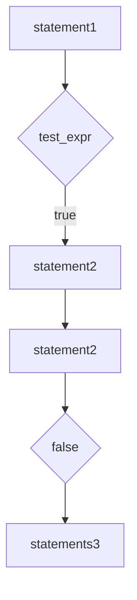
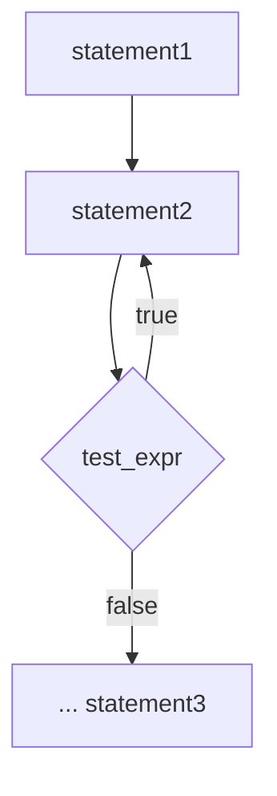
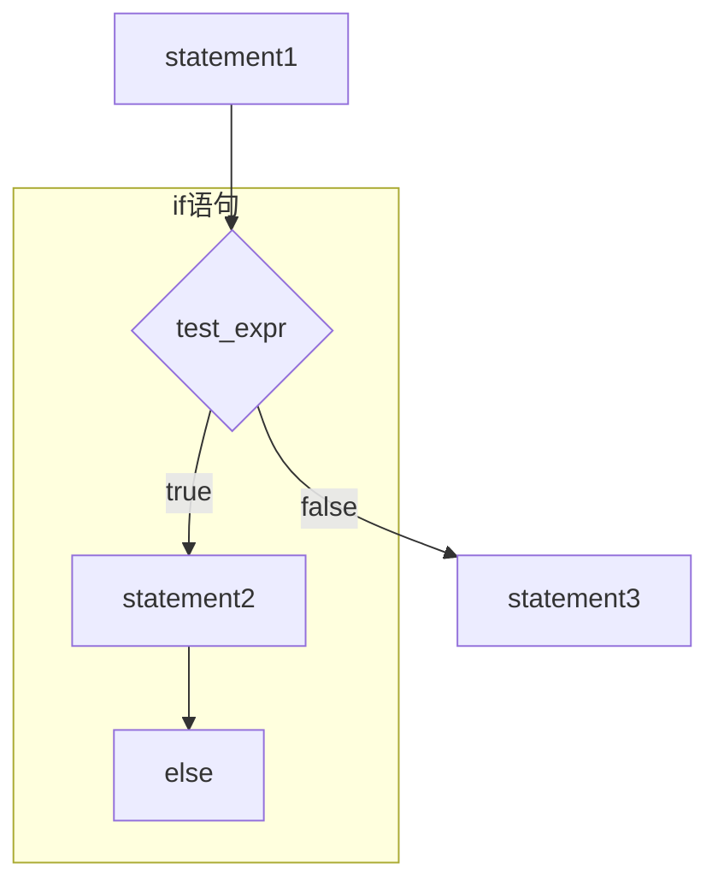
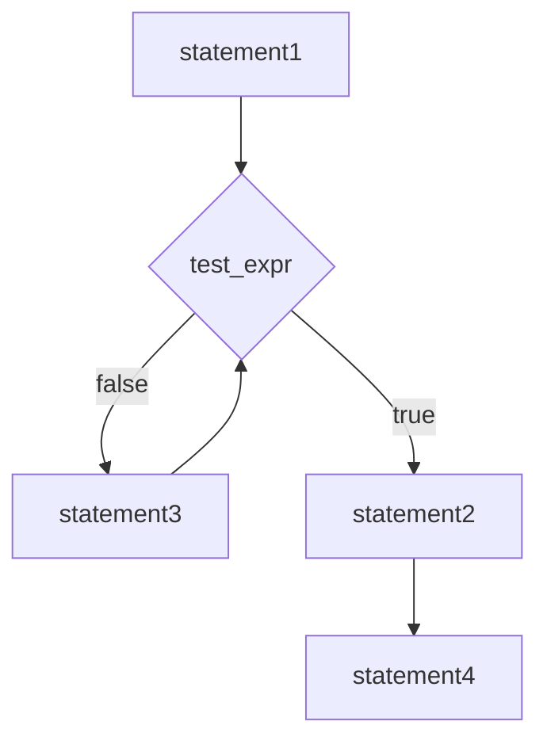

相反，应使用 C-风格字符串库中的 strcmp()函数来比较。该函数接受两个字符串地址作为参数。这意味着参数可以是指针、字符电常量或字符数组名。如果两个字符串相同，该函数将返回零；如果第一个字符串按字母顺序排在第二个字符串之前，则 strcmp()将返回一个负数值；如果第一个字符串按字母顺序排在第二个字符串之后，则 strcmp()将返回一个正数值。实际上，“按系统排列顺序”比“按字母顺序”更准确。这意味着字符是根据字符的系统编码来进行比较的。例如，使用 ASCII 码时，所有大写字母的编码都比小写字母小，所以按排列顺序，大写字母将位于小写字母之前。因此，字符串“Zoo”在字符串“aviary”之前。根据编码进行比较还意味着大写字母和小写字母是不同的，因此字符串“FOO”和字符串“foo”不同。

在有些语言（如 BASIC 和标准 Pascal）中，存储在不同长度的数组中的字符串彼此不相等。但是 C-风格字符串是通过结尾的空值字符定义的，而不是由其所在数组的长度定义的。这意味着两个字符电即使被存储在长度不同的数组中，也可能是相同的:

```javascript
char big[80] = "Daffy";          // 5 letters plus \0
char little[6] = "Daffy";        // 5 letters plus \0
```

顺便说一句，虽然不能用关系运算符来比较字符串，但却可以用它们来比较字符，因为字符实际上是整型。因此下面的代码可以用来显示字母表中的字符，至少对于 ASCII 字符集和 Unicode 字符集来说是有效的:

```txt
for (ch = 'a'; ch_<= 'z'; ch++)—
    cout << ch;
```

程序清单 5.11 在 for 循环的测试条件中使用了 strcmp()。该程序显示一个单词，修改其首字母，然后再次显示这个单词；这样循环往复，直到 strcmp() 确定该单词与字符串 “mate” 相同为止。注意，该程序清单包含了文件 cstring，因为它提供了 strcmp() 的函数原型。

程序清单 5.11 compstr1.cpp

```cpp
// compstr1.cpp -- comparing strings using arrays
#include <iostream>
#include <cstring>      // prototype for strcmp()
int main()
{
    using namespace std;
    char word[5] = "?ate";
    for (char-ch_ = 'a'; strcmp(word, "mate"); ch++)
    {
        cout << word << endl;
        word[0] = ch;
    }
    cout << "After loop ends, word is " << word << endl;
    return 0;
}
```

下面是该程序的输出:

```ignorefile
?ate
aate
bate
cate
date
eate
fate
gate
hate
iate
jate
```

```txt
kate
late
After loop ends, word is mate
```

## 程序说明

该程序有几个有趣的地方。其中之一当然是测试。我们希望只要 word 不是 mate，循环就继续进行。也就是说，我们希望只要 strcmp() 判断出两个字符串不相同，测试就继续进行。最显而易见的测试是这样的:

```txt
strcmp(word, "mate") =-0      // strings are not the same
```

如果字符串不相等，则该语句的值为1（true），如果字符串相等，则该语句的值为0（false）。但使用strcmp（word，“mate”）本身将如何呢？如果字符串不相等，则它的值为非零（true）；如果字符串相等，则它的值为零（false）。实际上，如果字符串不同，该返回true，否则返回false。因此，可以只用这个函数，而不是整个关系表达式。这样得到的结果将相同，还可以少输入几个字符。另外，C和C++程序员传统上就是用这种方式使用strcmp()的。

## 检测相等或排列顺序:

可以使用 strcmp()来测试 C-风格字符串是否相等（排列顺序）。如果 str1 和 str2 相等，则下面的表达式为 true:

```txt
strcmp(str1,str2) == 0—
```

如果 str1 和 str2 不相等，则下面两个表达式都为 true:

```julia
strcmp(str1, str2) != 0
strcmp(str1, str2)
```

如果 str1 在 str2 的前面，则下面的表达式为 true:

```txt
strcmp(str1,str2) < 0
```

如果 str1 在 str2 的后面，则下面的表达式为 true:

```txt
strcmp(str1, str2) > 0
```

因此，根据要如何设置测试条件，strcmp()可以扮演==、!=、<和>运算符的角色。

接下来，compstr1.cpp 使用递增运算符使变量 ch 遍历字母表:

```txt
ch++
```

可以对字符变量使用递增运算符和递减运算符，因为char类型实际上是整型，因此这种操作实际上将修改存储在变量中的整数编码。另外，使用数组索引可使修改字符串中的字符更为简单:

```javascript
word[0] = ch;
```

## 5.1.15 比较 string 类字符串

如果使用 string 类字符串而不是 C-风格字符串，比较起来将简单些，因为类设计让您能够使用关系运算符进行比较。这之所以可行，是因为类函数重载（重新定义）了这些运算符。第 12 章将介绍如何将这种特性加入到类设计中，但从应用的角度说，读者现在只需知道可以将关系运算符用于 string 对象即可。程序清单 5.12 是在程序清单 5.11 的基础上修改而成的，它使用的是 string 对象而不是 char 数组。

程序清单5.12 compstr2.cpp

```txt
// compstr2.cpp -- comparing strings using arrays
#include <iostream>
#include <string>      // string class
int-main()
{
    using namespace std;
    string=word = "?ate";
```

```txt
for (char ch = 'a'; word != "mate"; ch++)
{
    cout << word << endl;
    word[0] = ch;
}
cout << "After loop ends, word is " << word << endl;
return 0;
```

该程序的输出与程序清单5.11相同。

## 程序说明

在程序清单 5.12 中，下面的测试条件使用了一个关系运算符，该运算符的左边是一个 string 对象，右边是一个 C-风格字符串:

```txt
word != "mate"
```

string 类重载运算符!=的方式让您能够在下述条件下使用它:至少有一个操作数为 string 对象，另一个操作数可以是 string 对象，也可以是 C-风格字符串。

string 类的设计让您能够将 string 对象作为一个实体（在关系型测试表达式中），也可以将其作为一个聚合对象，从而使用数组表示法来提取其中的字符。

正如您看到的，使用 C-风格字符串和 string 对象可获得相同的结果，但使用 string 对象更简单、更直观。

最后，和前面大多数 for 循环不同，此循环不是计数循环。也就是说，它并不对语句块执行指定的次数。相反，此循环将根据情况（word 为 “mate”）来确定是否停止。对于这种测试，C++ 程序通常使用 while 循环，下面来看看这种循环。

## 5.2 while 循环

while 循环是没有初始化和更新部分的 for 循环，它只有测试条件和循环体:

```txt
while (test-condition)
    body
```

首先，程序计算圆括号内的测试条件（test-condition）表达式。如果该表达式为 true，则执行循环体中的语句。与 for 循环一样，循环体也由一条语句或两个花括号定义的语句块组成。执行完循环体后，程序返回测试条件，对它进行重新评估。如果该条件为非零，则再次执行循环体。测试和执行将一直进行下去，直到测试条件为 false 为止（参见图 5.3）。显然，如果希望循环最终能够结束，循环体中的代码必须完成某种影响测试条件表达式的操作。例如，循环可以将测试条件中使用的变量加 1 或从键盘输入读取一个新值。和 for 循环一样，while 循环也是一种入口条件循环。因此，如果测试条件一开始便为 false，则程序将不会执行循环体。

程序清单 5.13 使用了一个 while 循环。该循环遍历字符串，并显示其中的字符及其 ASCII 码。循环在遇到空值字符时停止。这种逐字符遍历字符串直到遇到空值字符的技术是 C++ 处理 C-风格字符串的标准方法。由于字符串中包含了结尾标记，因此程序通常不需要知道字符串的长度。

程序清单 5.13 while.cpp

```cpp
// while.cpp -- introducing the while loop
#include <iostream>
const_int ArSize = 20;
int main()
{
    using namespace std;
    char name[ArSize];
```

```cpp
cout << "Your first name, please: ";
cin >> name;
cout << "Here is your name, verticalized and ASCIIized:\n";
int i = 0;                      // start at beginning of string
while (name[i] != '\0')        // process to end of string
{
    cout << name[i] << ": " << int(name[i]) << endl;
    i++;                             // don't forget this step
}
return 0;
}
```


<details>
<summary>flowchart</summary>


</details>

图 5:3 while 循环的结构

下面是该程序的运行情况:

```yaml
Your first name, please: Muffy
Here is your name, verticalized and ASCIIized:
M: 77
u: 117
f: 102
f: 102
y: 121
```

verticalized 和 ASCIIized 并不是真正的单词，甚至将来也不会是单词。不过它们确实在输出中添加了一种“可爱”的氛围。

## 程序说明

程序清单 5.13 中的 while 条件像这样:

```txt
while (name[i] != '\0')
```

它可以测试数组中特定的字符是不是空值字符。为使该测试最终能够成功，循环体必须修改 i 的值，这是通过在循环体结尾将 i 加 1 来实现的。省略这一步将导致循环停留在同一个数组元素上，打印该字符及其编码，直到强行终止该程序。导致死循环是循环最常见的问题之一。通常，在循环体中忘记更新某个值时，便会出现这种情况。

可以这样修改 while 行:

```txt
while (name[i])
```

经过这种修改后，程序的工作方式将不变。这是由于 name[i] 是常规字符，其值为该字符的编码——非零值或 true。然而，当 name[i] 为空值字符时，其编码将为 0 或 false。这种表示法更为简洁（也更常用），但没有程序清单 5.13 中的表示法清晰。对于后一种情况，“笨拙”的编译器生成的代码的速度将更快，“聪明”的编译器对于这两个版本生成的代码将相同。

要打印字符的 ASCII 码，必须通过强制类型转换将 name[i] 转换为整型。这样，cout 将把值打印成整数，而不是将它解释为字符编码。

不同于 C-风格字符串，string 对象不使用空字符来标记字符串末尾，因此要将程序清单 5.13 转换为使用 string 类的版本，只需用 string 对象替换 char 数组即可。第 16 章将讨论可用于标识 string 对象中最后一个字符的技术。

## 5.2.1 for 与 while

在 C++ 中，for 和 while 循环本质上是相同的。例如，下面的 for 循环:

```lisp
for (init-expression; test-expression; update-expression)
{
    statement(s)
}
```

可以改写成这样:

```lisp
init-expression;
while (test-expression)
{
    statement(s)
    update-expression;
}
```

同样，下面的 while 循环:

```txt
while (test-expression)
    body
```

可以改写成这样:

```txt
for ( ;test-expression;)
    body
```

for 循环需要 3 个表达式（从技术的角度说，它需要 1 条后面跟两个表达式的语句），不过它们可以是空表达式（语句），只有两个分号是必需的。另外，省略 for 循环中的测试表达式时，测试结果将为 true，因此下面的循环将一直运行下去:

```txt
for ( ; ; )
    body
```

由于 for 循环和 while 循环几乎是等效的，因此究竟使用哪一个只是风格上的问题。它们之间存在三个差别。首先，在 for 循环中省略了测试条件时，将认为条件为 true；其次，在 for 循环中，可使用初始化语句声明一个局部变量，但在 while 循环中不能这样做；最后，如果循环体中包括 continue 语句，情况将稍有不同，continue 语句将在第 6 章讨论。通常，程序员使用 for 循环来为循环计数，因为 for 循环格式允许将所有相关的信息——初始值、终止值和更新计数器的方法——放在同一个地方。在无法预先知道循环将执行的次数时，程序员常使用 while 循环。

提示:在设计循环时，请记住下面几条指导原则。

\- 指定循环终止的条件。

● 在首次测试之前初始化条件。
在条件被再次测试之前更新条件。

for 循环的一个优点是，其结构提供了一个可实现上述 3 条指导原则的地方，因此有助于程序员记住应该这样做。但这些指导原则也适用于 while 循环。

## 错误的标点符号

for 循环和 while 循环都由用括号括起的表达式和后面的循环体（包含一条语句）组成。前面讲过，这条语句可以是语句块，其中包含多条语句。记住，语句块是由花括号，而不是由缩进定义的。例如，请看下面的循环:

```javascript
i = 0;
while (name[i] != '\0'}
    cout << name[i] << endl;
    i++;
cout << "Done\n";
```

缩进表明，该程序的作者希望 i++; 语句是循环体的组成部分。然而，由于没有花括号，因此编译器认为循环体仅由最前面的 cout 语句组成。因此，该循环将不断地打印数组的第一个字符。该程序不会执行 i++; 语句，因为它在循环的外面。

下面的例子说明了另一个潜在的缺陷:

```javascript
i = 0;
while (name[i] != '\0'); // problem semicolon
{
    cout << name[i] << endl;
    i++;
}
cout << "Done\n";
```

这一次，代码正确地使用了花括号，但还插入了一个分号。记住，分号结束语句，因此该分号将结束 while 循环。换句话说，循环体为空语句，也就是说，分号后面没有任何内容。这样，花括号中所有的代码现在位于循环的后面，永远不会被执行。该循环不执行任何操作，是一个死循环。请注意这种分号。

## 5.2.2 等待一段时间:编写延时循环

有时候，让程序等待一段时间很有用。例如，读者可能遇到过这样的程序，它在屏幕上显示一条消息，而还没来得及阅读之前，又出现了其他内容。这样读者将担心自己错过了重要的、无法恢复的消息。如果程序在显示其他内容之前等待5秒钟，情况将会好得多。while循环可用于这种目的。一种用于个人计算机的早期技术是，让计算机进行计数，以等待一段时间:

```txt
long wait = 0;
while (wait < 10000).
    wait++;          // counting silently
```

这种方法的问题是，当计算机处理器的速度发生变化时，必须修改计数限制。例如，有些为 IBM PC 编写的游戏在速度更快的机器上运行时，其速度将快得无法控制；另外，有些编译器可能修改上述代码，将 wait 设置为 10000，从而跳过该循环。更好的方法是让系统时钟来完成这种工作。

ANSI C 和 C++ 库中有一个函数有助于完成这样的工作。这个函数名为 clock()，返回程序开始执行后所用的系统时间。这有两个复杂的问题:首先，clock() 返回时间的单位不一定是秒；其次，该函数的返回类型在某些系统上可能是 long，在另一些系统上可能是 unsigned-long 或其他类型。

但头文件 ctime（较早的实现中为 time.h）提供了这些问题的解决方案。首先，它定义了一个符号常量——CLOCKS\_PER\_SEC，该常量等于每秒钟包含的系统时间单位数。因此，将系统时间除以这个值，可以得到秒数。或者将秒数乘以 CLOCK\_PER\_SEC，可以得到以系统时间单位为单位的时间。其次，ctime 将 clock\_t 作为 clock() 返回类型的别名（参见本章后面的注释“类型别名”），这意味着可以将变量声明为clock\_t 类型，编译器将把它转换为 long、unsigned int 或适合系统的其他类型。

程序清单 5.14 演示了如何使用 clock() 和关文件 ctime 来创建延迟循环。

程序清单 5.14 waiting.cpp

```cpp
//waiting.cpp -- using-clock()- in a time-delay_loop
#include <iostream>
#include <ctime> // describes clock() function, clock_t type
int main()
{
    using namespace std;
    cout << "Enter the delay time, in seconds: ";
    float secs;
    cin >> secs;
    clock_t delay = secs * CLOCKS_PER_SEC;  // convert to clock ticks
    cout << "starting\a\n";
    clock_t start = clock();
    while (clock() -- start < delay) == // wait until time elapses;
        // note the semicolon
    cout << "done -\a\n";
    return 0;
}
```

该程序以系统时间单位为单位（而不是以秒为单位）计算延迟时间，避免了在每轮循环中将系统时间转换为秒。

## 类型别名

C++为类型建立别名的方式有两种。一种是使用预处理器:

```txt
#define BYTE char // preprocessor replaces BYTE with char
```

这样，预处理器将在编译程序时用 char 替换所有的 BYTE，从而使 BYTE 成为 char 的别名。

第二种方法是使用 C++（和 C）的关键字 typedef 来创建别名。例如，要将 byte 作为 char 的别名，可以这样做:

```txt
typedef char byte; // makes-byte an alias for char
```

下面是通用格式:

```typescript
typedef typeName.aliasName;
```

换句话说，如果要将 aliasName 作为某种类型的别名，可以声明 aliasName，如同将 aliasName 声明为这种类型的变量那样，然后在声明的前面加上关键字 typedef。例如，要让 byte\_pointer 成为 char 指针的别名，可将 byte\_pointer 声明为 char 指针，然后在前面加上 typedef:

```txt
typedef char * byte_pointer; // pointer to char type
```

也可以使用#define，不过声明一系列变量时，这种方法不适用。例如，请看下面的代码:

```c
#define FLOAT_POINTER float
FLOAT_POINTER pa, pb;
```

预处理器置换将该声明转换为这样:

```txt
float * pa, pb; // pa a pointer to float, pb just a float
```

typedef 方法不会有这样的问题。它能够处理更复杂的类型别名，这使得与使用#define相比，使用typedef 是一种更佳的选择——有时候，这也是唯一的选择。

注意，typedef 不会创建新类型，而只是为已有的类型建立一个新名称。如果将 word 作为 int 的别名，则 cout 将把 word 类型的值视为 int 类型。

## 5.3 do while 循环

前面已经学习了 for 循环和 while 循环。第 3 种 C++ 循环是 do while，它不同于另外两种循环，因为它是出口条件（exit condition）循环。这意味着这种循环将首先执行循环体，然后再判定测试表达式，决定是否应继续执行循环。如果条件为 false，则循环终止；否则，进入新一轮的执行和测试。这样的循环通常至少执行一次，因为其程序流必须经过循环体后才能到达测试条件。下面是其句法:

```txt
do
    body
while (test-expression);
```

循环体是一条语句或用括号括起的语句块。图 5.4 总结了 do while 循环的程序流程。


<details>
<summary>flowchart</summary>


</details>

图 5.4 do while 循环的结构

通常，入口条件循环比出口条件循环好，因为入口条件循环在循环开始之前对条件进行检查。例如，假设程序清单5.13使用do while（而不是while），则循环将打印空值字符及其编码，然后才发现已到达字符串结尾。但是有时do while测试更合理。例如，请求用户输入时，程序必须先获得输入，然后对它进行测试。程序清单5.15演示了如何在这种情况下使用do while。

程序清单 5.15 downtime.cpp

```cpp
// downwhile.cpp -- exit-condition-loop
#include <iostream>
int main() ---
```

```perl
{
    using namespace std;
    int n;

    cout << "Enter numbers in the range 1-10 to find ";
    cout << "my favorite number\n";
    do
    {
        cin >> n;      // execute body
    } while {n != 7};   // then test
    cout << "Yes, 7 is my favorite.\n" ;
    return 0;
}
```

下面是该程序的运行情况:

```txt
Enter numbers in the range 1-10 to find my favorite number
9
4
7
Yes_7 is my favorite.
```

## 奇特的 for 循环

虽然不是很常见，但有时出现下面这样的代码:

```txt
int I = 0;
for(;;) // sometimes called a "forever loop"
{
    I++;
    // do-something ...
    if (30 >=-1)_break;   // if statement and break (Chapter 6)
}
```

或另一种变体:

```txt
int I = 0;
for(;;I++)
{
    if (30 >= I) break;
        // do something ...
}
```

上述代码基于这样一个事实:for 循环中的空测试条件被视为 true。这些例子既不易于阅读，也不能用作编写循环的通用模型。第一个例子的功能在 do-while 循环中将表达得更清晰=

```txt
int I = .0; _________
do { _________
    I++; _________
    // do something;
while (30 > I);
```

同样，第二个例子使用 while 循环可以表达得更清晰:

```scss
while (I < 30)=
{
    // do something
    I++;
}
```

通常，编写清晰、容易理解的代码比使用语言的晦涩特性来显示自己的能力更为有用。

## 5.4 基于范围的 for 循环（C++11）

C++11 新增了一种循环:基于范围（range-based）的 for 循环。这简化了一种常见的循环任务:对数组（或容器类，如 vector 和 array）的每个元素执行相同的操作，如下例所示:

```txt
double prices[5] = {4.99, 10.99, 6.87, 7.99, 8.49};
for (double x : prices)
    cout << x << std::endl;
```

其中，x 最初表示数组 prices 的第一个元素。显示第一个元素后，不断执行循环，而 x 依次表示数组的其他元素。因此，上述代码显示全部 5 个元素，每个元素占据一行。总之，该循环显示数组中的每个值。

要修改数组的元素，需要使用不同的循环变量语法:

```txt
for (double &x : prices)
    x = x * 0.80;      //20% off sale
```

符号&表明 x 是一个引用变量，这个主题将在第 8 章讨论。就这里而言，这种声明让接下来的代码能够修改数组的内容，而第一种语法不能。

还可结合使用基于范围的 for 循环和初始化列表:

```javascript
for (int x : {3, 5, 2, 8, 6})
    cout << x << " ";
cout << '\n';
```

然而，这种循环主要用于第 16 章将讨论的各种模板容器类。

## 5.5 循环和文本输入

知道循环的工作原理后，来看一看循环完成的一项最常见、最重要的任务:逐字符地读取来自文件或键盘的文本。例如，读者可能想编写一个能够计算输入中的字符数、行数和字数的程序。传统上，C++和C语言一样，也使用while循环来完成这类任务。下面介绍这是如何完成的。即使熟悉C语言，也不要太快地浏览本节和下一节。尽管C++中的while循环与C语言中的while循环一样，但C++的I/O工具不同，这使得C++循环看起来与C语言循环有些不同。事实上，cin对象支持3种不同模式的单字符输入，其用户接口各不相同。下面介绍如何在while循环中使用这三种模式。

## 5.5.1 使用原始的 cin 进行输入

如果程序要使用循环来读取来自键盘的文本输入，则必须有办法知道何时停止读取。如何知道这一点呢？一种方法是选择某个特殊字符——有时被称为哨兵字符（sentinel character），将其作为停止标记。例如，程序清单5.16在遇到#字符时停止读取输入。该程序计算读取的字符数，并回显这些字符，即在屏幕上显示读取的字符。按下键盘上的键不能自动将字符显示到屏幕上，程序必须通过回显输入字符来完成这项工作。通常，这种任务由操作系统处理。运行完毕后，该程序将报告处理的总字符数。程序清单5.16列出了该程序的代码。

程序清单 5.16 textin.f.cpp

```cpp
// textin1.cpp -- reading_chars with a while_loop
#include <iostream>
int main()
{
    using namespace std;
```

```cpp
char ch;
int count = 0;—— // use basic input
cout << "Enter characters; enter # to-quit:\n";
cin >> ch;          // get a character_
while (ch != '#')   // test the character
{
    cout << ch;     // echo the character
    ++count;        // count the character
    cin >> ch;      //-get the-next character
}
cout << endl << count << " characters-read\n";
return 0;
}
```

下面是该程序的运行情况:

```txt
Enter characters; enter # to quit:
see ken run#really fast
seekenrun
9 characters read
```

## 程序说明

请注意该程序的结构。该程序在循环之前读取第一个输入字符，这样循环可以测试第一个字符。这很重要，因为第一个字符可能是#。由于 textin1.cpp 使用的是入口条件循环，因此在这种情况下，能够正确地跳过整个循环。由于前面已经将变量 count 设置为 0，因此 count 的值也是正确的。

如果读取的第一个字符不是#，则程序进入该循环，显示字符，增加计数，然后读取下一个字符。最后一步是极为重要的，没有这一步，循环将反复处理第一个输入字符，一直进行下去。有了这一步后，程序就可以处理到下一个字符。

注意，该循环设计遵循了前面指出的几条指导原则。结束循环的条件是最后读取的一个字符是#。该条件是通过在循环之前读取一个字符进行初始化的，而通过循环体结尾读取下一个字符进行更新。

上面的做法合情合理。但为什么程序在输出时省略了空格呢？原因在 cin。读取 char 值时，与读取其他基本类型一样，cin 将忽略空格和换行符。因此输入中的空格没有被回显，也没有被包括在计数内。

更为复杂的是，发送给 cin 的输入被缓冲。这意味着只有在用户按下回车键后，他输入的内容才会被发送给程序。这就是在运行该程序时，可以在#后面输入字符的原因。按下回车键后，整个字符序列将被发送给程序，但程序在遇到#字符后将结束对输入的处理。

## 5.5.2 使用 cin.get(char) 进行补救

通常，逐个字符读取输入的程序需要检查每个字符，包括空格、制表符和换行符。cin 所属的 istream 类（在 iostream 中定义）中包含一个能够满足这种要求的成员函数。具体地说，成员函数 cin.get(ch) 读取输入中的下一个字符（即使它是空格），并将其赋给变量 ch。使用这个函数调用替换 cin>>ch，可以修补程序清单 5.16 的问题。程序清单 5.17 列出了修改后的代码。

程序清单 5.17 textin2.cpp

```cpp
// textin2.cpp -- using cin.get(char)
#include <iostream>
int main()
{
    using namespace std;
    char ch;
    int count = 0;

    cout << "Enter characters; enter # to quit:\n";
```

```txt
cin.get(ch);          // use the cin.get(ch) function
while (ch != '#')
{
    cout << ch;
    ++count;
    cin.get(ch);     // use it again
}
cout << endl << count << " characters-read\n";
return 0;
}
```

下面是该程序的运行情况:

```txt
Enter characters; enter # to quit:
Did you use a #2 pencil?
Did you use a
14 characters read
```

现在，该程序回显了每个字符，并将全部字符计算在内，其中包括空格。输入仍被缓冲，因此输入的字符个数仍可能比最终到达程序的要多。

如果熟悉 C 语言，可能以为这个程序存在严重的错误！cin.get(ch)调用将一个值放在 ch 变量中，这意味着将修改该变量的值。在 C 语言中，要修改变量的值，必须将变量的地址传递给函数。但程序清单 5.17 调用 cin.get()时，传递的是 ch，而不是&ch。在 C 语言中，这样的代码无效，但在 C++ 中有效，只要函数将参数声明为引用即可。引用是 C++ 在 C- 语言的基础上新增的一种类型。头文件 iostream 将 cin.get(ch) 的参数声明为引用类型，因此该函数可以修改其参数的值。我们将在第 8 章中详细介绍。同时，C 语言行家可以松一口气了——通常，在 C++ 中传递的参数的工作方式与在 C 语言中相同。然而，cin.get(ch) 不是这样。

## 5.5.3 使用哪一个 cin.get()

在第4章的程序清单4.5中，使用了这样的代码:

```matlab
char name[ArSize];
...
cout <<-"Enter your name:\n";
cin.get(name, ArSize).get();
```

最后一行相当于两个连续的函数调用:

```txt
ein.get(name, ArSize);
cin.get();
```

cin.get()的一个版本接受两个参数:数组名(字符串(char\*类型)的地址)和ArSize(int类型的整数)。(记住，数组名是其第一个元素的地址，因此字符数组名的类型为char\*)。)接下来，程序使用了不接受任何参数的cin.get()。而最近，我们这样使用过cin.get():

```javascript
char_ch;
cin.get(ch);
```

这里 cin.get 接受一个 char 参数。

看到这里，熟悉 C 语言的读者将再次感到兴奋或困惑。在 C 语言中，如果函数接受 char 指针和 int 参数，则使用该函数时，不能只传递一个参数（类型不同）。但在 C++ 中，可以这样做，因为该语言支持被称为函数重载的 OOP 特性。函数重载允许创建多个同名函数，条件是它们的参数列表不同。例如，如果在 C++ 中使用 cin.get（name, ArSize），则编译器将找到使用 char\* 和 int 作为参数的 cin.get(-) 版本；如果使用 cin.get（ch），则编译器将使用接受一个 char 参数的版本；如果没有提供参数，则编译器将使用不接受任何参数的 cin.get(-) 版本。函数重载允许对多个相关的函数使用相同的名称，这些函数以不同方式或针对不同类型执行相同的基本任务。第 8 章将讨论该主题。另外，通过使用 istream 类中的 get() 示例，读者将逐渐习惯函数重载。为区分不同的函数版本，我们在引用它们时提供参数列表。因此，cin.get()指的是不接受任何参数的版本，而 cin.get(char)则指的是接受一个参数的版本。

## 5.5.4 文件尾条件

程序清单 5.17 表明，使用诸如#等符号来表示输入结束很难令人满意，因为这样的符号可能就是合法输入的组成部分，其他符号（如@和%）也如此。如果输入来自于文件，则可以使用一种功能更强大的技术——检测文件尾（EOF）。C++输入工具和操作系统协同工作，来检测文件尾并将这种信息告知程序。

乍一看，读取文件中的信息似乎同 cin 和键盘输入没什么关系，但其实存在两个相关的地方。首先，很多操作系统（包括 Unix、Linux 和 Windows 命令提示符模式）都支持重定向，允许用文件替换键盘输入。例如，假设在 Windows 中有一个名为 gofish.exe 的可执行程序和一个名为 fishtale 的文本文件，则可以在命令提示符模式下输入下面的命令:

```txt
gofish <fishtale
```

这样，程序将从 fishtale 文件（而不是键盘）获取输入。<符号是 Unix 和 Windows 命令提示符模式的重定向运算符。

其次，很多操作系统都允许通过键盘来模拟文件尾条件。在Unix中，可以在行首按下 $\mathrm{Ctrl + D}$ 来实现；在Windows命令提示符模式下，可以在任意位置按 $\mathrm{Ctrl + Z}$ 和Enter。有些 $\mathrm{C + + }$ 实现支持类似的行为，即使底层操作系统并不支持。键盘输入的EOF概念实际上是命令行环境遗留下来的。然而，用于Mac的Symantec$\mathrm{C + + }$ 模拟了UNIX，将 $\mathrm{Ctrl + D}$ 视为仿真的EOF。MetrowerksCodewarrior能够在Macintosh和Windows环境下识别 $\mathrm{Ctrl + Z}$ 。用于PC的MicrosoftVisual $\mathrm{C + + }$ 、Borland $\mathrm{C + + }5.5$ 和GNU $\mathrm{C + + }$ 都能够识别行首的 $\mathrm{Ctrl + Z}$ 但用户必须随后按下回车键。总之，很多PC编程环境都将 $\mathrm{Ctrl + Z}$ 视为模拟的EOF，但具体细节（必须在行首还是可以在任何位置，是否必须按下回车键等）各不相同。

如果编程环境能够检测 EOF，可以在类似于程序清单 5.17 的程序中使用重定向的文件，也可以使用键盘输入，并在键盘输入中模拟 EOF。这一点似乎很有用，因此我们来看看究竟如何做。

检测到 EOF 后，cin 将两位（eofbit 和 failbit）都设置为 1。可以通过成员函数 eof() 来查看 eofbit 是否被设置；如果检测到 EOF，则 cin.eof() 将返回 bool 值 true，否则返回 false。同样，如果 eofbit 或 failbit 被设置为 1，则 fail() 成员函数返回 true，否则返回 false。注意，eof() 和 fail() 方法报告最近读取的结果；也就是说，它们在事后报告，而不是预先报告。因此应将 cin.eof() 或 cin.fail() 测试放在读取后，程序清单 5.18 中的设计体现了这一点。它使用的是 fail()，而不是 eof()，因为前者可用于更多的实现中。

注意:有些系统不支持来自键盘的模拟 EOF；有些系统对其支持不完善。cin.get()可以用来锁住屏幕，直到可以读取为止，但是这种方法在这里并不适用，因为检测 EOF 时将关闭对输入的进一步读取。然而，可以使用程序清单 5.14 中那样的计时循环来使屏幕在一段时间内是可见的。也可使用 cin.clear()来重置输入流，这将在第 6 章和第 17 章介绍。

程序清单 5.18 textin3.cpp

```cpp
// textin3.cpp -- reading chars to end of file
#include <iostream>
int main()
{
    using namespace std;
    char ch;
    int count = 0;
    cin.get(ch);          // attempt to read a char
    while (cin.fail() == false)  // test for EOF
    {
        cout << ch;      // echo character
        ++count;
```

```cpp
cin.get(ch);   // attempt to read another char
}
cout << endl << count << " characters read\n";
return 0;
}
```

下面是该程序的运行情况:

```txt
The green bird sings in the winter.<ENTER>
The green bird sings in the winter.
Yes, but the crow flies in the dawn.<ENTER>
Yes, but the crow flies in the dawn.
<CTRL>+<Z><ENTER>
73 characters read
```

这里在 Windows 7 系统上运行该程序，因此可以按下 Ctrl+Z 和回车键来模拟 EOF 条件。请注意，在 Unix 和类 Unix（包括 Linux 和 Cygwin）系统中，用户应按 Ctrl+Z 组合键将程序挂起，而命令 fg 恢复执行程序。

通过使用重定向，可以用该程序来显示文本文件，并报告它包含的字符数。下面，我们在 Unix 系统运行该程序，并对一个两行的文件进行读取、回显和计算字数（\$是 Unix 提示符）:

```txt
$ textin3 < stuff
I am a Unix file. I am proud
to be a Unix file.
48 characters read
$
```

## 1. EOF 结束输入

前面指出过，cin 方法检测到 EOF 时，将设置 cin 对象中一个指示 EOF 条件的标记。设置这个标记后，cin 将不读取输入，再次调用 cin 也不管用。对于文件输入，这是有道理的，因为程序不应读取超出文件尾的内容。然而，对于键盘输入，有可能使用模拟 EOF 来结束循环，但稍后要读取其他输入。cin.clear() 方法可能清除 EOF 标记，使输入继续进行。这将在第 17 章详细介绍。不过要记住的是，在有些系统中，按 Ctrl+Z 实际上将结束输入和输出，而 cin.clear() 将无法恢复输入和输出。

## 2. 常见的字符输入做法

每次读取一个字符，直到遇到 EOF 的输入循环的基本设计如下:

```txt
cin.get(ch);      // attempt to read a char
while (cin.fail() == false)  // test for EOF
{
    ...                 // do stuff
    cin.get(ch);   // attempt to read another char
}
```

可以在上述代码中使用一些简捷方式。第6章将介绍的!运算符可以将true切换为false或将false切换为true。可以使用此运算符将上述while测试改写成这样:

```txt
while (!cin.fail())    // while input has not failed
```

方法 cin.get(char) 的返回值是一个 cin 对象。然而，istream 类提供了一个可以将 istream 对象（如 cin）转换为 bool 值的函数；当 cin 出现在需要 bool 值的地方（如在 while 循环的测试条件中）时，该转换函数将被调用。另外，如果最后一次读取成功了，则转换得到的 bool 值为 true；否则为 false。这意味着可以将上述 while 测试改写为这样:

```txt
while (cin) // while input is successful
```

这比! cin.fail()或!cin.eof()更通用，因为它可以检测到其他失败原因，如磁盘故障。

最后，由于 cin.get(char) 的返回值为 cin，因此可以将循环精简成这种格式:

```txt
while (cin.get(ch)) = // while input_is-successful
{
    ... -        // do stuff
}
```

这样，cin.get(char)只被调用一次，而不是两次:循环前一次、循环结束后一次。为判断循环测试条件，程序必须首先调用cin.get(ch)。如果成功，则将值放入ch中。然后，程序获得函数调用的返回值，即cin。接下来，程序对cin进行bool转换，如果输入成功，则结果为true，否则为false。三条指导原则（确定结束条件、对条件进行初始化以及更新条件）全部被放在循环测试条件中。

## 5.5.5 另一个 cin.get() 版本

“怀旧”的C语言用户可能喜欢C语言中的字符I/O函数——getchar()和putchar()，它们仍然适用，只要像在C语言中那样包含头文件stdio.h（或新的cstdio）即可。也可以使用istream和ostream类中类似功能的成员函数，来看看这种方式。

不接受任何参数的 cin.get() 成员函数返回输入中的下一个字符。也就是说，可以这样使用它:

```javascript
ch = cin.get();
```

该函数的工作方式与C语言中的getchar()相似，将字符编码作为int值返回；而cin.get(ch)返回一个对象，而不是读取的字符。同样，可以使用cout.put()函数（参见第3章）来显示字符:

```javascript
cout.put(ch);
```

该函数的工作方式类似 C 语言中的 putchar()，只不过其参数类型为 char，而不是 int。

注意:最初，put()成员只有一个原型——put(char)。可以传递一个 int 参数给它，该参数将被强制转换为 char。C++ 标准还要求只有一个原型。然而，有些 C++ 实现都提供了 3 个原型:put(char)、put(signed char) 和 put(unsigned char)。在这些实现中，给 put() 传递一个 int 参数将导致错误消息，因为转换 int 的方式不止一种。使用显式强制类型转换的原型（如 cin.put(char(ch))) 可使用 int 参数。

为成功地使用 cin.get()，需要知道其如何处理 EOF 条件。当该函数到达 EOF 时，将没有可返回的字符。相反，cin.get() 将返回一个用符号常量 EOF 表示的特殊值。该常量是在头文件 iostream 中定义的。EOF 值必须不同于任何有效的字符值，以便程序不会将 EOF 与常规字符混淆。通常，EOF 被定义为值 -1，因为没有 ASCII 码为 -1 的字符，但并不需要知道实际的值，而只需在程序中使用 EOF 即可。例如，程序清单 5.18 的核心是这样:

```txt
char ch;
cin.get(ch);
while (cin.fail() == false)  // test for EOF
{
    cout << ch;
    ++count;
    cin.get(ch);
}
```

可以使用 int ch，并用 cin.get()代替 cin.get(char)，用 cout.put()代替 cout，用 EOF 测试代替 cin.fail()测试:

```txt
int ch;      // for compatibility with EOF value
ch = cin.get();
while (ch != EOF)
{
    cout.put(ch);  // cout.put(char(ch)) for some implementations
    ++count;
    ch = cin.get();
}
```

如果 ch 是一个字符，则循环将显示它。如果 ch 为 EOF，则循环将结束。

提示:需要知道的是，EOF 不表示输入中的字符，而是指出没有字符。

除了当前所做的修改外，关于使用 cin.get() 还有一个微妙而重要的问题。由于 EOF 表示的不是有效字符编码，因此可能不与 char 类型兼容。例如，在有些系统中，char 类型是没有符号的，因此 char 变量不可能为 EOF 值（-1）。由于这种原因，如果使用 cin.get()（没有参数）并测试 EOF，则必须将返回值赋给 int 变量，而不是 char 变量。另外，如果将 ch 的类型声明为 int，而不是 char，则必须在显示 ch 时将其强制转换为 char 类型。

程序清单 5.19 将程序清单 5.18 进行了修改，使用了 cin.get() 方法。它还通过将字符输入与 while 循环测试合并在一起，使代码更为简洁。

程序清单 5.19 textin4.cpp

```cpp
// textin4.cpp -- reading chars with cin.get()
#include <iostream>
int main(void)
{
    using namespace std;
    int ch;                      // should be int, not char
    int count = 0;

    while ((ch = cin.get()) != EOF) // test for end-of-file
    {
        cout.put(char(ch));
        ++count;
    }
    cout << endl << count << " characters read\n";
    return 0;
}
```

注意:有些系统要么不支持来自键盘的模拟 EOF，要么支持地不完善，在这种情况下，上述示例将无法正常运行。如果使用 cin.get() 来锁住屏幕直到可以阅读它，这将不起作用，因为检测 EOF 时将禁止进一步读取输入。然而，可以使用程序清单 5.14 那样的计时循环来使屏幕停留一段时间。还可使用第 17 章将介绍的 cin.clear() 来重置输入流。

下面是该程序的运行情况:

```txt
The sullen mackerel sulks in the shadowy shallows.<ENTER>
The sullen mackerel sulks in the shadowy shallows.
Yes, but the blue bird of happiness harbors secrets.<ENTER>
Yes, but the blue bird of happiness harbors secrets.
<CTRL>+<Z><ENTER>
104 characters read
```

下面分析一下循环条件:

```txt
while ((ch = cin.get()) != EOF)
```

子表达式 ch=cin.get()两端的括号导致程序首先计算该表达式。为此，程序必须首先调用 cin.get()函数，然后将该函数的返回值赋给 ch。由于赋值语句的值为左操作数的值，因此整个子表达式变为 ch 的值。如果这个值是 EOF，则循环将结束，否则继续。该测试条件中所有的括号都是必不可少的。如果省略其中的一些括号:

```txt
while (ch = cin.get() != EOF)
```

由于!=运算符的优先级高于=，因此程序将首先对 cin.get() 的返回值和 EOF 进行比较。比较的结果为 false 或 true，而这些 bool 值将被转换为 0 或 1，并本质赋给 ch。

另一方面，使用 cin.get(ch)（有一个参数）进行输入时，将不会导致任何类型方面的问题。前面讲过，cin.get(char)函数在到达 EOF 时，不会将一个特殊值赋给 ch。事实上，在这种情况下，它不会将任何值赋给 ch。ch 不会被用来存储非 char 值。表 5.3 总结了 cin.get(char) 和 cin.get() 之间的差别。

表 5.3

cin.get(ch)与 cin.get()

| 属性 | cin.get(ch) | ch=cin.get( ) |
| --- | --- | --- |
| 传递输入字符的方式 | 赋给参数 ch | 将函数返回值赋给 ch |
| 用于字符输入时函数的返回值 | istream 对象(执行 bool 转换后为 true) | int 类型的字符编码 - |
| 到达 EOF 时函数的返回值 | istream 对象(执行 bool 转换后为 false) | EOF - |

那么应使用 cin.get()还是 cin.get(char)呢？使用字符参数的版本更符合对象方式，因为其返回值是 istream 对象。这意味着可以将它们拼接起来。例如，下面的代码将输入中的下一个字符读入到 ch1 中，并将接下来的一个字符读入到 ch2 中:\_\_\_\_

```javascript
cin.get(ch1).get(ch2);
```

这是可行的，因为函数调用 cin.get(ch1) 返回一个 cin 对象，然后便可以通过该对象调用 get(ch2)。

get()的主要用途是能够将 stdio.h 的 getchar()和 putchar()函数转换为 iostream 的 cin.get()和 cout.put()方法。只要用头文件 iostream 替换 stdio.h，并用作用相似的方法替换所有的 getchar()和 putchar()即可。(如果旧的代码使用 int 变量进行输入，而所用的实现包含 put()的多个原型，则必须做进一步的调整。)

## 5.6 嵌套循环和二维数组

如本章前面所述，for 循环是一种处理数组的工具。下面进一步讨论如何使用嵌套 for 循环中来处理二维数组。

首先，介绍一下什么是二维数组。到目前为止，本章使用的数组都是一维数组，因为每个数组都可以看作是一行数据。二维数组更像是一个表格——既有数据行又有数据列。例如，可以用二维数组来表示6个不同地区每季度的销售额，每一个地区占一行数据。也可以用二维数组来表示RoboDork在计算机游戏板上的位置。

C++没有提供二维数组类型，但用户可以创建每个元素本身都是数组的数组。例如，假设要存储5个城市在4年间的最高温度。在这种情况下，可以这样声明数组:

```txt
int maxtemps[4][5];
```

该声明意味着 maxtemps 是一个包含 4 个元素的数组，其中每个元素都是一个由 5 个整数组成的数组（参见图 5.5）。可以将 maxtemps 数组看作由 4 行组成，其中每一行有 5 个温度值。


<details>
<summary>text_image</summary>

maxtemps是4个元素的数组
int maxtemps[4][9];
每个元素都是5个int的数组
maxtemps数组
maxtemps[0]
maxtemps[1]
maxtemps[2]
maxtemps[3]
maxtemps[0][0]
maxtemps[1][0]
maxtemps[2][0]
maxtemps[3][0]
</details>

图 5.5 由数组组成的数组

表达式 maxtemps[0] 是 maxtemps 数组的第一个元素，因此 maxtemps[0] 本身就是一个由 5 个 int 组成的数组。maxtemps[0] 数组的第一个元素是 maxtemps[0][0]，该元素是一个 int。因此，需要使用两个下标来访问 int 元素。可以认为第一个下标表示行，第二个下标表示列（参见图 5.6）。


<details>
<summary>text_image</summary>

int maxtemps[4][5];
maxtemps数组被看成表格:
0	1	2	3	4
maxtemps[0] 0	maxtemps[0][0]	maxtemps[0][1]	maxtemps[0][2]	maxtemps[0][3]	maxtemps[0][4]
maxtemps[1] 1	maxtemps[1][0]	maxtemps[1][1]	maxtemps[1][2]	maxtemps[1][3]	maxtemps[1][4]
maxtemps[2] 2	maxtemps[2][0]	maxtemps[2][1]	maxtemps[2][2]	maxtemps[2][3]	maxtemps[2][4]
maxtemps[3] 3	maxtemps[3][0]	maxtemps[3][1]	maxtemps[3][2]	maxtemps[3][3]	maxtemps[3][4]
</details>

图 5.6 使用下标访问数组元素

假设要打印数组所有的内容，可以用一个 for 循环来改变行，用另一个被嵌套的 for 循环来改变列:

```lisp
for (int row = 0; row < 4; row++)
{
    for (int col = 0; col < 5; ++col)
        cout << maxtemps[row][col] << "\t";
    cout << endl;
}
```

对于每个 row 值，内部的 for 循环将遍历所有的 col 值。这个示例在每个值之后打印一个制表符（使用 C++ 转义字符表示时为 \t），打印完每行后，打印一个换行符。

## 5.6.1 初始化二维数组

创建二维数组时，可以初始化其所有元素。这项技术建立在一维数组初始化技术的基础之上:提供由逗号分隔的用花括号括起的值列表:

```javascript
// initializing a one-dimensional array
int btus[5] = { 23, 26, 24, 31, 28};
```

对于二维数组来说，由于每个元素本身就是一个数组，因此可以使用与上述代码类似的格式来初始化每一个元素。因此，初始化由一系列逗号分隔的一维数组初始化（用花括号括起）组成:

```javascript
int maxtemps[4][5] =   // 2-D array
{
    {96, 100, 87, 101, 105},   // values for maxtemps[0]
    {96, 98, 91, 107, 104},     // values for maxtemps[1]
    {97, 101, 93, 108, 107},   // values for maxtemps[2]
    {98, 103, 95, 109, 108}   // values for maxtemps[3]
};
```

可将数组 maxtemps 包含 4 行, 每行包含 5 个数字。{94, 98, 87, 103, 101} 初始化第一行, 即 maxtemps [0]。作为一种风格, 如果可能的话, 每行数据应各占一行, 这样阅读起来将更容易。

## 5.6.2 使用二维数组

程序清单 5.20 初始化了一个二维数组，并使用了一个嵌套循环。这一次，循环的顺序相反，将列循环（城市索引）放在外面，将行循环（年份索引）放在内面。另外，它还采用了 C++ 常用的做法，将一个指针数组初始化为一组字符串常量。也就是说，将 cities 声明为一个 char 指针数组。这使得每个元素（如 cities [0]）都是一个 char 指针，可被初始化为一个字符串的地址。程序将 cities [0] 初始化为字符串 “Gribble City” 的地址，等等。因此，该指针数组的行为与字符串数组类似。

程序清单 5.20 nested.cpp

```cpp
// nested.cpp -- nested loops and 2-D array
#include <iostream>
const int Cities = 5;
const int Years = 4;
int main()
{
    using namespace std;
    const char * cities[Cities] =   // array of pointers
    {                          // to 5 strings
        "Gribble City",
        "Gribbletown",
        "New Gribble",
        "San Gribble",
        "Gribble Vista"
    };

    int maxtemps[Years][Cities] =   // 2-D array
    {
        {96, 100, 87, 101, 105},   // values for maxtemps[0]
        {96, 98, 91, 107, 104},   // values for maxtemps[1]
        {97, 101, 93, 108, 107},   // values for maxtemps[2]
        {98, 103, 95, 109, 108}   // values for maxtemps[3]
    };

    cout << "Maximum temperatures for 2008 - 2011\n\n";
    for (int city = 0; city < Cities; ++city)
    {
        cout << cities[city] << ":\t";
        for (int year = 0; year < Years; ++year)
            cout << maxtemps[year][city] << "\t";
        cout << endl;
    }
    // cin.get();
    return 0;
}
```

下面是该程序的输出:

```txt
Maximum temperatures for 2008 - 2011
Gribble City: 96 96 97 98
Gribbletown: 100 98 101 103
New Gribble: 87 91 93 95
San Gribble: 101 107 108 109
Gribble Vista: 105 104 107 108
```

在输出中使用制表符比使用空格可使数据排列更有规则。然而，制表符设置不相同，因此输出的外观将随系统而异。第17章将介绍更精确的、更复杂的、对输出进行格式化的方法。

在这个例子中，可以使用 char 数组的数组，而不是字符串指针数组。在这种情况下，声明如下:

```txt
char cities[Cities][25] =   // array of 5 arrays of 25 char
{
    "Gribble City",
    "Gribbletown",
    "New Gribble",
    "San Gribble",
    "Gribble Vista"
};
```

上述方法将全部 5 个字符串的最大长度限制为 24 个字符。指针数组存储 5 个字符串的地址，而使用 char 数组的数组时，将 5 个字符串分别复制到 5 个包含 25 个元素的 char 数组中。因此，从存储空间的角度说，使用指针数组更为经济；然而，如果要修改其中的任何一个字符串，则二维数组是更好的选择。令人惊讶的是，这两种方法使用相同的初始化列表，显示字符串的 for 循环代码页相同。

另外，还可以使用 string 对象数组，而不是字符串指针数组。在这种情况下，声明如下:

```txt
const string cities[Cities] =  // array of 5 strings
{
    "Gribble City",
    "Gribbletown",
    "New Gribble",
    "San Gribble",
    "Gribble Vista"
};
```

如果希望字符串是可修改的，则应省略限定符 const。使用 string 对象数组时，初始化列表和用于显示字符串的 for 循环代码与前两种方法中相同。在希望字符串是可修改的情况下，string 类自动调整大小的特性将使这种方法比使用二维数组更为方便。

## 5.7 总结

C++提供了3种循环:for 循环、while 循环和 do while 循环。如果循环测试条件为 true 或非零，则循环将重复执行一组指令；如果测试条件为 false 或 0，则结束循环。for 循环和 while 循环都是入口条件循环，这意味着程序将在执行循环体中的语句之前检查测试条件。do while 循环是出口条件循环，这意味着其将在执行循环体中的语句之后检查条件。

每种循环的句法都要求循环体由一条语句组成。然而，这条语句可以是复合语句，也可以是语句块（由花括号括起的多条语句）。

关系表达式对两个值进行比较，常被用作循环测试条件。关系表达式是通过使用6种关系运算符之一构成的:<、<=、==、>=、>或!=。关系表达式的结果为5ool类型，值为true或false。

许多程序都逐字节地读取文本输入或文本文件，istream 类提供了多种可完成这种工作的方法。如果 ch 是一个 char 变量，则下面的语句将输入中的下一个字符读入到 ch 中:

```txt
cin>> ch;
```

然而，它将忽略空格、换行符和制表符。下面的成员函数调用读取输入中的下一个字符（而不管该字符是什么）并将其存储到ch中:

```txt
cin.get(ch);
```

成员函数调用 cin.get() 返回下一个输入字符——包括空格、换行符和制表符，因此，可以这样使用它:

```javascript
ch = cin.get();
```

cin.get (char)-成员函数调用通过返回转换为 false 的 bool 值来指出已到达 EOF，而 cin.get() 成员函数

调用则通过返回 EOF 值来指出已到达 EOF，EOF 是在文件 iostream 中定义的。

嵌套循环是循环中的循环，适合用于处理二维数组。

## 5.8 复习题

1. 入口条件循环和出口条件循环之间的区别是什么？各种 C++ 循环分别属于其中的哪一种？
2. 如果下面的代码片段是有效程序的组成部分，它将打印什么内容？

```c
int i;
for (i = 0; i < 5; i++)
    cout << i;
    cout << endl;
```

3. 如果下面的代码片段是有效程序的组成部分，它将打印什么内容？

```javascript
int j;
for (j = 0; j < 11; j += 3)
    cout << j;
cout << endl << j << endl;
```

4. 如果下面的代码片段是有效程序的组成部分，它将打印什么内容？

```txt
int j = 5;
while ( ++j < 9)
    cout << j++ << endl;
```

5. 如果下面的代码片段是有效程序的组成部分，它将打印什么内容？

```txt
int k = 8;
do
    cout <<" k = " << k << endl;
while (k++ < 5);
```

6. 编写一个打印 1、2、4、8、16、32、64 的 for 循环，每轮循环都将计数变量的值乘以 2。
7. 如何在循环体中包括多条语句？
8. 下面的语句是否有效？如果无效，原因是什么？如果有效，它将完成什么工作？

```txt
int x = (1,024);
```

下面的语句又如何呢？

```txt
int y;
y = 1,024;
```

9. 在查看输入方面，cin >> ch 同 cin.get(ch) 和 ch = cin.get() 有什么不同？

## 5.9 编程练习

1. 编写一个要求用户输入两个整数的程序。该程序将计算并输出这两个整数之间（包括这两个整数）所有整数的和。这里假设先输入较小的整数。例如，如果用户输入的是2和9，则程序将指出 $2 \sim 9$ 之间所有整数的和为44。
2. 使用 array 对象（而不是数组）和 long double（而不是 long long）重新编写程序清单 5.4，并计算 100! 的值。
3. 编写一个要求用户输入数字的程序。每次输入后，程序都将报告到目前为止，所有输入的累计和。当用户输入 0 时，程序结束。
4. Daphne 以 10% 的单利投资了 100 美元。也就是说，每一年的利润都是投资额的 10%，即每年 10 美元:

利息 = 0.10 × 原始存款

而 Cleo 以 5% 的复利投资了 100 美元。也就是说，利息是当前存款（包括获得的利息）的 5%，

利息=0.05×当前存款

Cleo 在第一年投资 100 美元的盈利是 5%——得到了 105 美元。下一年的盈利是 105 美元的 5%——即 5.25 美元，依此类推。请编写一个程序，计算多少年后，Cleo 的投资价值才能超过 Daphne 的投资价值，并显示此时两个人的投资价值。

5. 假设要销售《C++ For Fools》一书。请编写一个程序，输入全年中每个月的销售量（图书数量，而不是销售额）。程序通过循环，使用初始化为月份字符串的 char \*数组（或 string 对象数组）逐月进行提示，并将输入的数据储存在一个 int 数组中。然后，程序计算数组中各元素的总数，并报告这一年的销售情况。
6. 完成编程练习 5，但这一次使用一个二维数组来存储输入——3 年中每个月的销售量。程序将报告每年销售量以及三年的总销售量。
7. 设计一个名为 car 的结构，用它存储下述有关汽车的信息:生产商（存储在字符数组或 string 对象中的字符串）、生产年份（整数）。编写一个程序，向用户询问有多少辆汽车。随后，程序使用 new 来创建一个由相应数量的 car 结构组成的动态数组。接下来，程序提示用户输入每辆车的生产商（可能由多个单词组成）和年份信息。请注意，这需要特别小心，因为它将交替读取数值和字符串（参见第 4 章）。最后，程序将显示每个结构的内容。该程序的运行情况如下:

```txt
How many cars do you wish to catalog? 2
Car #1:
Please enter the make: Hudson Hornet
Please enter the year made: 1952
Car #2:
Please enter the make: Kaiser
Please enter the year made: 1951
Here is your collection:
1952 Hudson Hornet
1951 Kaiser
```

8. 编写一个程序，它使用一个 char 数组和循环来每次读取一个单词，直到用户输入 done 为止。随后，该程序指出用户输入了多少个单词（不包括 done 在内）。下面是该程序的运行情况:

```txt
Enter words (to stop, type the word done): anteater birthday category dumpster envy finagle geometry done for sure You entered a total of 7 words.
```

您应在程序中包含头文件 cstring，并使用函数 strcmp()来进行比较测试。

9. 编写一个满足前一个练习中描述的程序，但使用-string对象而不是字符数组。请在程序中包含头文件string，并使用关系运算符来进行比较测试。
10. 编写一个使用嵌套循环的程序，要求用户输入一个值，指出要显示多少行。然后，程序将显示相应行数的星号，其中第一行包括一个星号，第二行包括两个星号，依此类推。每一行包含的字符数等于用户指定的行数，在星号不够的情况下，在星号前面加上句点。该程序的运行情况如下:

Enter number of rows: 5

# 第6章 分支语句和逻辑运算符

## 本章内容包括:

- if语句。
- if else 语句。
● 逻辑运算符:&&、||和!。
- cctype 字符函数库。
- 条件运算符:?:。
- switch 语句。
- continue 和 break 语句。
- 读取数字的循环。
- 基本文件输入/输出。

设计智能程序的一个关键是使程序具有决策能力。第5章介绍了一种决策方式——循环，在循环中，程序决定是否继续循环。现在，来研究一下C++是如何使用分支语句在可选择的操作中做出决定的。程序应使用哪一种防止吸血鬼的方案（大蒜还是十字架）呢？用户选择了哪个菜单选项呢？用户是否输入了0？C++提供了if和switch语句来进行决策，它们是本章的主要主题。另外，还将介绍条件运算符和逻辑运算符，前者提供了另一种决策方式，而后者允许将两个测试组合在一起。最后，本章将首次介绍文件输入/输出。

## 6.1 if 语句

当 C++ 程序必须决定是否执行某个操作时，通常使用 if 语句来实现选择。if 有两种格式:if 和 if else。首先看一看简单的 if，它模仿英语，如 “If you have a Captain Cookie card, you get a free cookie（如果您有一张 Captain Cookie 卡，就可获得免费的小甜饼）”。如果测试条件为 true，则 if 语句将引导程序执行语句或语句块；如果条件是 false，程序将跳过这条语句或语句块。因此，if 语句让程序能够决定是否应执行特定的语句。

if 语句的语法与 while 相似:

```python
if (test-condition)
    statement
```

如果 test-condition（测试条件）为 true，则程序将执行 statement（语句），后者既可以是一条语句，也可以是语句块。如果测试条件为 false，则程序将跳过语句（参见图 6.1）。和循环测试条件一样，if 测试条件也将被强制转换为 bool 值，因此 0 将被转换为 false，非零为 true。整个 if 语句被视为一条语句。

通常情况下，测试条件都是关系表达式，如那些用来控制循环的表达式。例如，假设读者希望程序计算输入中的空格数和字符总数，则可以在while循环中使用cin.get（char）来读取字符，然后使用if语句识别空格字符并计算其总数。程序清单6.1完成了这项工作，它使用句点（）来确定句子的结尾。


<details>
<summary>flowchart</summary>


</details>

图6.1 if语句的结构

程序清单 6.1 if.cpp

```cpp
// if.cpp -- using the if statement
#include <iostream>
int main()
{
    using std::cin;      // using declarations
    using std::cout;
    char ch;
    int spaces = 0;
    int total = 0;
    cin.get(ch);
    while (ch != '.')   // quit at end of sentence
    {
        if (ch == ' ')   // check if ch is a space
            ++spaces;
        ++total;          // done every time
        cin.get(ch);
    }
    cout << spaces << " spaces, " << total;
    cout << " characters total in sentence\n";
    return 0;
}
```

下面是该程序的输出:

```txt
The balloonist was an airhead with lofty goals.
6 spaces, 46 characters total in sentence
```

正如程序中的注释指出的，仅当ch为空格时，语句++spaces;才被执行。因为语句++tota;位于if语句的外面，因此在每轮循环中都将被执行。注意，字符总数中包括按回车键生成的换行符。

## 6.1.1 if else 语句

if 语句让程序决定是否执行特定的语句或语句块，而 if else 语句则让程序决定执行两条语句或语句块中的哪一条，这种语句对于选择其中一种操作很有用。C++ 的 if else 语句模仿了简单的英语，如 “If you have a Captain Cookie card, you get a Cookie Plus Plus, else you just get a Cookie d'Ordinaire（如果您拥有 Captain Cookie 卡，将可获得 Cookie Plus Plus，否则只能获得 Cookie d'Ordinaire）”。if else 语句的通用格式如下:

```txt
if (test-condition)
    statement1
else
    statement2
```

如果测试条件为 true 或非零，则程序将执行 statement1，跳过 statement2；如果测试条件为 false 或 0，则程序将跳过 statement1，执行 statement2。因此，如果 answer 是 1492，则下面的代码片段将打印第一条信息，否则打印第二条信息:

```perl
if (answer. == 1492).
    cout << "That's right!\n";
else
    cout << "You'd better review Chapter 1 again:\n";
```

每条语句都既可以是一条语句，也可以是用大括号括起的语句块(参见图6.2)。从语法上看，整个if else结构被视为一条语句。


<details>
<summary>flowchart</summary>


</details>

图 6.2 if else 语句的结构

例如，假设要通过对字母进行加密编码来修改输入的文本（换行符不变）。这样，每个输入行都被转换为一行输出，且长度不变。这意味着程序对换行符采用一种操作，而对其他字符采用另一种操作。正如程序清单6.2所表明的，if else使得这项工作非常简单。该程序清单还演示了限定符std:，这是编译指令using的替代品之一。

程序清单 6.2 ifelse.cpp

```cpp
if else.cpp -- using the if else statement
#include <iostream>
int main()
{
    char ch;

    std::cout << "Type, and I shall repeat.\n";
    std::cin.get(ch);
    while (ch != init)
    {
        if (ch == '\n")
            std::cout << ch;      // done if newline
        else
            std::cout << ++ch;   // done otherwise
        std::cin.get(ch);
    }
// try_ch + 1 instead of ++ch for interesting effect
    std::cout << "\nPlease excuse the slight confusion.\n"
        // -std::cin.get();
        // std::cin.get();
    return 0;
}
```

下面是该程序的运行情况:

```txt
Type, and I shall repeat.
An ineffable joy suffused me as I beheld
Bo!jofggbcmf!kpz!tvggvtfe!nf!bt!J!cfifme
the wonders of modern computing.
uif!xpoefst!pg!npefsoldpnqvujoh
Please excuse the slight confusion...
```

注意，程序清单 6.2 中的注释之一指出，将++ch 改为 ch+1 将产生一种有趣的效果。能推断出它是什么吗？如果不能，就试验一下，然后看看是否可以解释发生的情况（提示:想一想 cout 是如何处理不同的类型的）。

## 6.1.2 格式化 if else 语句

if else 中的两种操作都必须是一条语句。如果需要多条语句，需要用大括号将它们括起来，组成一个块语句。和有些语言（如 BASIC 和 FORTRAN）不同的是，由于 C++ 不会自动将 if 和 else 之间的所有代码视为一个代码块，因此必须使用大括号将这些语句组合成一个语句块。例如，下面的代码将出现编译器错误:

```txt
if {ch == 'Z'}
    zorro++;          // if ends here
    cout << "Another Zorro candidate\n";
else                //wrong
    dull++;            =
    cout << "Not a Zorro candidate\n";
```

编译器把它看作是一条以 zorro++;语句结尾的简单 if 语句，接下来是一条 cout 语句。到目前为止，切正常。但之后编译器发现一个独立的 else，这被视为语法错误。

请添加大括号，将语句组合成一个语句块:

```txt
if (ch == 'Z')
{
    // if true block
    zorro++;
    cout << "Another Zorro candidate\n";
}
else
{
    // if false block
    dull++;
    cout << "Not a Zorro candidate\n";
}
```

由于 C++ 是自由格式语言，因此只要使用大括号将语句括起，对大括号的位置没有任何限制。上述代码演示了一种流行的格式，下面是另一种流行的格式:

```txt
if (ch == 'Z') {
    zorro++;
    cout << "Another Zorro candidate\n";
}
else {
    dull++;
    cout << "Not a Zorro candidate\n";
}
```

第一种格式强调的是语句的块结构，第二种格式则将语句块与关键字 if 和 else 更紧密地结合在一起。这两种风格清晰、一致，应该能够满足要求；然而，可能会有老师或雇主在这个问题上的观点强硬而固执。

## 6.1.3 if else if else 结构

与实际生活中发生的情况类似，计算机程序也可能提供两个以上的选择。可以将 C++ 的 if else 语句进行扩展来满足这种需求。正如读者知道的，else 之后应是一条语句，也可以是语句块。由于 if else 语句本身是一条语句，所以可以放在 else 的后面:

```javascript
if (ch == 'A')
    a_grade++;                  // alternative # 1
else
    if (ch == 'B')             // alternative # 2
        b_grade++;          // subalternative # 2a
    else
        soso++;                // subalternative # 2b
```

如果 ch 不是'A'，则程序将执行 else。执行到那里，另一个 if else 又提供了两种选择。C++ 的自由格式允许将这些元素排列成便于阅读的格式:

```c
if (ch == 'A')
    a_grade++;            // alternative # 1
else if (ch == 'B')
    b_grade++;            // alternative # 2
else
    soso++;                // alternative # 3
```

这看上去像是一个新的控制结构——if else if else 结构。但实际上，它只是一个 if else 被包含在另一个 if else 中。修订后的格式更为清晰，使程序员通过浏览代码便能确定不同的选择。整个构造仍被视为一条语句。

程序清单 6.3 使用这种格式创建了一个小型测验程序。

程序清单 6.3 ifelseif.cpp

```cpp
// ifelseif.cpp -- using if else if else
#include <iostream>
const int Fave = 27;
int main()
{
    using namespace std;
    int n;

    cout << "Enter a number in the range 1-100 to find ";
    cout << "my favorite number: ";
    do
    {
        cin >> n;
        if (n < Fave)
            cout << "Too low -- guess again: ";
        else if (n > Fave)
            cout << "Too high -- guess again: ";
        else
            cout << Fave << " is right!\n";
    } while (n != Fave);
    return 0;
}
```

下面是该程序的输出:

```txt
Enter a number in the range 1-100 to find my favorite number: 50
Too high -- guess again: 25
Too low -- guess again: 37
Too high -- guess again: 31
Too high -- guess again: 28
Too high -- guess again: 27
27 is right!
```

## 条件运算符和错误防范

许多程序员将更直观的表达式 variable ==value 反转为 value ==variable，以此来捕获将相等运算符误写为赋值运算符的错误。例如，下述条件有效，可以正常工作:

```txt
if (3 == myNumber)
```

但如果错误地使用下面的条件，编译器将生成错误消息，因为它以为程序员试图将一个值赋给一个字面值（3总是等于3，而不能将另一个值赋给它）:

```txt
if (3 = myNumber)
```

假设犯了类似的错误，但使用的是前一种表示方法:

```txt
if (myNumber = 3)
```

编译器将只是把3赋给myNumber，而if中的语句块将包含非常常见的、而又非常难以发现的错误（然而，很多编译器会发出警告，因此注意警告是明智的）。一般来说，编写让编译器能够发现错误的代码，比找出导致难以理解的错误的原因要容易得多。

## 6.2 逻辑表达式

经常需要测试多种条件。例如，字符要是小写，其值就必须大于或等于'a'，且小于或等于'z'。如果要求用户使用y或n进行响应，则希望用户无论输入大写（Y和N）或小写都可以。为满足这种需要，C++提供了3种逻辑运算符，来组合或修改已有的表达式。这些运算符分别是逻辑OR（||）、逻辑AND（&&）

和逻辑 NOT (!)。下面介绍这些运算符。

## 6.2.1 逻辑 OR 运算符:||

在英语中，当两个条件中有一个或全部满足某个要求时，可以用单词 or 来指明这种情况。例如，如果您或您的配偶在 MegaMicro 公司工作，您就可以参加 MegaMicro 公司的野餐会。C++ 可以采用逻辑 OR 运算符（||），将两个表达式组合在一起。如果原来表达式中的任何一个或全部都为 true（或非零），则得到的表达式的值为 true；否则，表达式的值为 false。下面是一些例子:

```txt
5 == 5 || 5 == 9   // true because first expression is true
5 > 3 || 5 > 10    // true because first expression is true
5 > 8 || 5 < 10    // true because second expression is true
5 < 8 || 5 > 2      // true because both expressions are true
5 > 8 || 5 < 2      // false because both expressions are false
```

由于||的优先级比关系运算符低，因此不需要在这些表达式中使用括号。表6.1总结了||的工作原理。

C++规定，||运算符是个顺序点（sequence point）。也是说，先修改左侧的值，再对右侧的值进行判定（C++11的说法是，运算符左边的子表达式先于右边的子表达式）。例如，请看下面的表达式:

```txt
i++ < 6||i== j
```

假设 i 原来的值为 10，则在对 i 和 j 进行比较时，i 的值将为 11。另外，如果左侧的表达式为 true，则 C++ 将不会去判定右侧的表达式，因为只要一个表达式为 true，则整个逻辑表达式为 true（读者可能还记得，冒号和逗号运算符也是顺序点）。

程序清单 6.4 在一条 if 语句中使用 || 运算符来检查某个字符的大写或小写。另外，它还使用了 C++ 字符串的拼接特性（参见第 4 章）将一个字符串分布在 3 行中。

表 6.1 ||运算符

|  | expr1 \|\| expr2 的值 |  |
| --- | --- | --- |
|  | expr1 == true | expr1 == false |
| expr2 == true | true | true |
| expr2 == false | true | false |

程序清单 6.4 or.cpp

```cpp
// or.cpp -- using the logical OR operator
#include <iostream>
int main()
{
    using namespace std;
    cout << "This program may reformat your hard disk\n"
        "and destroy all your data.\n"
        "Do you wish to continue? <y/n> ";
    char ch;
    cin >> ch;
    if (ch == 'y' || ch == 'Y')          // y or Y
        cout << "You were warned!\a\a\n";
    else if (ch == 'n' || ch == 'N')         // n or N
        cout << "A wise choice ... bye\n";
    else
    cout << "That wasn't a y or n! Apparently you "
        "can't follow\ninstructions, so "
        "I'll trash your disk anyway.\a\a\a\n";
    return 0;
}
```

该程序不会带来任何威胁，下面是其运行情况:

```txt
This program may reformat your hard disk and destroy all your data.
Do you wish to continue? <y/n> N
A wise choice ... bye
```

由于程序只读取一个字符，因此只读取响应的第一个字符。这意味着用户可以用 NO!（而不是 N）进行回答，程序将只读取 N。然而，如果程序后面再读取输入时，将从 O 开始读取。

## 6.2.2 逻辑 AND 运算符:&&

逻辑 AND 运算符（&&），也是将两个表达式组合成一个表达式。仅当原来的两个表达式都为 true 时，得到的表达式的值才为 true。下面是一些例子:

```txt
5 == 5 && 4 == 4    // true because both expressions are true
5 == 3 && 4 == 4    // false because first expression is false
5 > 3 && 5 > 10     // false because second expression is false
5 > 8 && 5 < 10     // false because first expression is false
5 < 8 && 5 > 2       // true because both expressions are true
5 > 8 && 5 < 2       // false because both expressions are false
```

由于&&的优先级低于关系运算符，因此不必在这些表达式中使用括号。和||运算符一样，&&运算符也是顺序点，因此将首先判定左侧，并且在右侧被判定之前产生所有的副作用。如果左侧为false，则整个逻辑表达式必定为false，在这种情况下，C++将不会再对右侧进行判定。表6.2总结了&&运算符的工作方式。

表 6.2

&&运算符

|  | expr1 &amp;&amp; expr2 的值 |  |
| --- | --- | --- |
|  | expr1 == true | expr1 == false |
| expr2 == true | true | false |
| expr2 == false | false | false |

程序清单 6.5 演示了如何用&&来处理一种常见的情况——由于两种不同的原因而结束 while 循环。在这个程序清单中，一个 while 循环将值读入到数组。一个测试（i&lt;ArSize）在数组被填满时循环结束，另一个测试（temp&gt;=0）让用户通过输入一个负值来提前结束循环。该程序使用&&运算符将两个测试组合成一个条件。该程序还使用了两条 if 语句、一条 if else 语句和一个 for 循环，因此它演示了本章和第 5 章的多个主题。

程序清单 6.5 and.cpp

```cpp
// and.cpp -- using the logical AND operator
#include <iostream>
const int ArSize = 6;
int main()
{
    using namespace std;
    float naaq[ArSize];
    cout << "Enter the NAAQs (New Age Awareness Quotients) "
           << "of\nyour neighbors. Program terminates "
           << "when you make\n" << ArSize << " entries "
           << "or enter a negative value.\n";

    int i = 0;
    float temp;
    cout << "First value: ";
```

```c
cin >> temp;
while (i < ArSize && temp >= 0) // 2 quitting criteria
{
    naaq[i] = temp;
    ++i;
    if (i < ArSize)          // room left in the array,
    {
        cout << "Next value: ";
        cin >> temp;         // so get next value
    }
}
if (i == 0)
    cout << "No data--bye\n";
else
{
    cout << "Enter your NAAQ: ";
    float you;
    cin >> you;
    int count = 0;
    for (int j = 0; j < i; j++)
        if (naaq[j] > you)
            ++count;
    cout << count;
    cout << " of your neighbors have greater awareness of\n"
        << "the New Age than you do.\n";
}
return 0;
}
```

注意，该程序将输入放在临时变量 temp 中。在核实输入有效后，程序才将这个值赋给数组。下面是该程序的两次运行情况。一次在输入 6 个值后结束:

```txt
Enter the NAAQs (New Age Awareness Quotients) of
your neighbors. Program terminates when you make
6 entries or enter a negative value.
First value: 28
Next value: 72
Next value: 15
Next value: 6
Next value: 130
Next value: 145
Enter your NAAQ: 50
3 of your neighbors have greater awareness of
the New Age than you do.
```

另一次在输入负值后结束:

```txt
Enter the NAAQs (New Age Awareness Quotients) of
your neighbors. Program terminates when you make
6 entries or enter a negative value.
First value: 123
Next value: 119
Next value: 4
Next value: 89
Next value: -1
Enter your NAAQ: 123.031
0 of your neighbors have greater awareness of
the New Age than you do.
```

## 程序说明

来看看该程序的输入部分:

```txt
cin >> temp;
while (i < ArSize && temp >= 0) // 2 quitting criteria
{
    naaq[i] = temp;
    ++i;
    if (i < ArSize)          // room left in the array,
    {
        cout << "Next value: ";
        cin >> temp;         // so get next value
    }
}
```

该程序首先将第一个输入值读入到临时变量（temp）中。然后，while 测试条件查看数组中是否还有空间（i&lt;ArSize）以及输入值是否为非负（temp&gt;=0）。如果满足条件，则将 temp 的值复制到数组中，并将数组索引加 1。此时，由于数组下标从 0 开始，因此 i 指示输入了多少个值。也是说，如果 i 从 0 开始，则第一轮循环将一个值赋给 naaq[0]，然后将 i 设置为 1。

当数组被填满或用户输入了负值时，循环将结束。注意，仅当 i 小于 ArSize 时，即数组中还有空间时，循环才将另外一个值读入到 temp 中。

获得数据后，如果没有输入任何数据（即第一次输入的是一个负数），程序将使用 if else 语句指出这一点，如果存在数据，就对数据进行处理。

## 6.2.3 用&&来设置取值范围

&&运算符还允许建立一系列 if else if else 语句，其中每种选择都对应于一个特定的取值范围。程序清单 6.6 演示了这种方法。另外，它还演示了一种用于处理一系列消息的技术。与 char 指针变量可以通过指向一个字符串的开始位置来标识该字符串一样，char 指针数组也可以标识一系列字符串，只要将每一个字符串的地址赋给各个数组元素即可。程序清单 6.6 使用 qualify 数组来存储 4 个字符串的地址，例如，qualify [1] 存储字符串 “mud tug-of-war\n” 的地址。然后，程序便能够将 cout、strlen() 或 strcmp() 用于 qualify [1]，就像用于其他字符串指针一样。使用 const 限定符可以避免无意间修改这些字符串。

程序清单 6.6 more\_and.cpp

```cpp
// more_and.cpp -- using the logical AND operator
#include <iostream>
const char * qualify[4] =          // an array of pointers
{                                   // to strings
    "10,000-meter race.\n",
    "mud tug-of-war.\n",
    "masters canoe jousting.\n",
    "pie-throwing festival.\n"
};
int main()
{
    using namespace std;
    int age;
    cout << "Enter your age in years: ";
    cin >> age;
    int index;

    if (age > 17 && age < 35)
        index = 0;
```