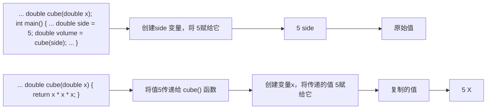

低程序出错的几率。具体来说，原型确保以下几点:

- 编译器正确处理函数返回值；
● 编译器检查使用的参数数目是否正确；
● 编译器检查使用的参数类型是否正确。如果不正确，则转换为正确的类型（如果可能的话）。

前面已经讨论了如何正确处理返回值。下面来看一看参数数目不对时将发生的情况。例如，假设进行了如下调用:

```javascript
double z = cube();
```

如果没有函数原型，编译器将允许它通过。当函数被调用时，它将找到 cube() 调用存放值的位置，并使用这里的值。这正是 ANSIC 从 C++ 借鉴原型之前，C 语言的工作方式。由于对于 ANSI C 来说，原型是可选的，因此有些 C 语言程序正是这样工作的。但在 C++ 中，原型不是可选的，因此可以确保不会发生这类错误。

接下来，假设提供了一个参数，但其类型不正确。在 C 语言中，这将造成奇怪的错误。例如，如果函数需要一个 int 值（假设占 16 位），而程序员传递了一个 double 值（假设占 64 位），则函数将只检查 64 位中的前 16 位，并试图将它们解释为一个 int 值。但 C++ 自动将传递的值转换为原型中指定的类型，条件是两者都是算术类型。例如，程序清单 7.2 将能够应付下述语句中两次出现的类型不匹配的情况:

```txt
cheers (cube(2));
```

首先，程序将 int 的值 2 传递给 cube()，而后者期望的是 double 类型。编译器注意到，cube() 原型指定了一个 double 类型参数，因此将 2 转换为 2.0——一个 double 值。接下来，cube() 返回一个 double 值 (8.0)，这个值被用作 cheer() 的参数。编译器将再一次检查原型，并发现 cheer() 要求一个 int 参数，因此它将返回值转换为整数 8。通常，原型自动将被传递的参数强制转换为期望的类型。（但第 8 章将介绍的函数重载可能导致二义性，因此不允许某些自动强制类型转换。）

自动类型转换并不能避免所有可能的错误。例如，如果将8.33E27传递给期望一个int值的函数，则这样大的值将不能被正确转换为int值。当较大的类型被自动转换为较小的类型时，有些编译器将发出警告，指出这可能会丢失数据。

仅当有意义时，原型化才会导致类型转换。例如，原型不会将整数转换为结构或指针。

在编译阶段进行的原型化被称为静态类型检查（static type checking）。可以看出，静态类型检查可捕获许多在运行阶段非常难以捕获的错误。

## 7.2 函数参数和按值传递

下面详细介绍一下函数参数。C++通常按值传递参数，这意味着将数值参数传递给函数，而后者将其赋给一个新的变量。例如，程序清单7.2包含下面的函数调用:

```txt
double volume = cube(side);
```

其中，side 是一个变量，在前面的程序运行中，其值为 5。cube() 的函数头如下:

```txt
double cube(double x)
```

被调用时，该函数将创建一个新的名为 x 的 double 变量，并将其初始化为 5。这样，cube()执行的操作将不会影响 main()中的数据，因为 cube()使用的是 side 的副本，而不是原来的数据。稍后将介绍一个实现这种保护的例子。用于接收传递值的变量被称为形参。传递给函数的值被称为实参。出于简化的目的，C++标准使用参数（argument）来表示实参，使用参量（parameter）来表示形参，因此参数传递将参量赋给参数（参见图 7.2）。

在函数中声明的变量（包括参数）是该函数私有的。在函数被调用时，计算机将为这些变量分配内存；在函数结束时，计算机将释放这些变量使用的内存（有些 C++ 文献将分配和释放内存称为创建和毁坏变量，这样似乎更激动人心）。这样的变量被称为局部变量，因为它们被限制在函数中。前面提到过，这样做有助于确保数据的完整性。这还意味着，如果在 main() 中声明了一个名为 x 的变量，同时在另一个函数中也声明了一个名为 x 的变量，则它们将是两个完全不同的、毫无关系的变量，这与加利福尼亚州的 Albany 与纽约的 Albany 是两个完全不同的地方是一样的道理（参见图 7.3）。这样的变量也被称为自动变量，因为它们是在程序执行过程中自动被分配和释放的。


<details>
<summary>flowchart</summary>


</details>

图7.2 按值传递


<details>
<summary>flowchart</summary>

```mermaid
graph LR
  A["..."] --> B["void cheers(int n); int main() {<br>    C[&quot;int n = 20; int i = 1000; int y = 10; ... cheers (y); ..."]
    D["void cheers(int n) { for (int i = 0; i <n; i++) cout << &quot;Cheers!&quot;; cout << &quot;\n&quot;; }"]
  end"] --> E["main()中的变量"]
  E --> F["10: 0"]
  F --> G["cheers()中的变量"]
```
</details>

图7.3-局部变量

## 7.2.1 多个参数

函数可以有多个参数。在调用函数时，只需使用逗号将这些参数分开即可:

```javascript
n_chars('R', 25);
```

上述函数调用将两个参数传递给函数 n\_chars()，我们将稍后定义该函数。

同样，在定义函数时，也在函数头中使用由逗号分隔的参数声明列表:

```txt
void n_chars(char c, int n)  // two arguments
```

该函数头指出，函数 n\_char() 接受一个 char 参数和一个 int 参数。传递给函数的值被赋给参数 c 和 n。如果函数的两个参数的类型相同，则必须分别指定每个参数的类型，而不能像声明常规变量那样，将声明组合在一起:

```txt
void fifi(float a, float b)  // declare each variable separately
void fufu(float a, b)          // NOT acceptable
```

和其他函数一样，只需添加分号就可以得到该函数的原型:

```c
void n_chars(char c, int n); // prototype, style 1
```

和一个参数的情况一样，原型中的变量名不必与定义中的变量名相同，而且可以省略:

```txt
void n_chars(char, int);      // prototype, style 2
```

然而，提供变量名将使原型更容易理解，尤其是两个参数的类型相同时。这样，变量名可以提醒参量和参数间的对应关系:

```txt
double melon_density(double weight, double volume);
```

程序清单 7.3 演示了一个接受两个参数的函数，它还表明，在函数中修改形参的值不会影响调用程序中的数据。

程序清单 7.3 twoarg.cpp

```cpp
// twoarg.cpp -- a function with 2 arguments
#include <iostream>
using namespace std;
void n_chars(char, int);
int main()
{
    int times;
    char ch;

    cout << "Enter a character: ";
    cin >> ch;
    while (ch != 'q')          // q to quit
    {
        cout << "Enter an integer: ";
        cin >> times;
        n_chars(ch, times); // function with two arguments
        cout << "\nEnter another character or press the"
            " q-key to quit: ";
        cin >> ch;
    }
    cout << "The value of times is " << times << ".\n";
    cout << "Bye\n";
    return 0;
}

void n_chars(char c, int n) // displays c n times
{
    while (n-- > 0)          // continue until n reaches 0
        cout << c;
}
```

在程序清单7.3的程序中，将编译指令using放在函数定义的前面，而不是函数中。下面是该程序的运行情况:

```txt
Enter a-character: W
Enter an integer: 50
WWWWWWWWWWWWWWWWWWWWWWWWWWWWWWWWWWWWWWWWWWWWWWWWWWWWWWWWWWWWWWWWWWWWWWWWWWWWWWWWWWWWWWWWWWWWWWWWWWWWWWWWWWWWWWWWWWWWWWWWWWWWWWWWWWWWWWWWWWWWWWWWWWWWWWWWWWWWWWWWWWWWWWWWWWWWWWWWWWWWWWWWWWWWWWWWWWWWWWWWWWW
Enter another character or press the q-key to quit: a
Enter an integer: 20
aaaaaaaaaaaaaaaaaaaaaaa
Enter another character or press the q-key to quit: q
The value of times is 20:
Bye
```

## 程序说明

程序清单 7.3 中的 main() 函数使用一个 while 循环提供重复输入（并让读者温习使用循环的技巧），它使用 cin>>ch，而不是 cin.get(ch) 或 ch = cin.get() 来读取一个字符。这样做是有原因的。前面讲过，这两个 cin.get() 函数读取所有的输入字符，包括空格和换行符，而 cin>>跳过空格和换行符。当用户对程序提示作出响应时，必须在每行的最后按 Enter 键，以生成换行符。cin>>ch 方法可以轻松地跳过这些换行符，但当输入的下一个字符为数字时，cin.get() 将读取后面的换行符。可以通过编程来避开这种麻烦，但比较简便的方法是像该程序那样使用 cin。

n\_char()函数接受两个参数:一个是字符c，另一个是整数n。然后，它使用循环来显示该字符，显示次数为n:

```txt
while(n->0) = //-continue until n reaches 0
    cout << c;
```

程序通过将 n 变量递减来计数，其中 n 是参数列表的形参，main() 中 times 变量的值被赋给该变量。然后，while 循环将 n 递减到 0，但前面的运行情况表明，修改 n 的值对 times 没有影响。即使您在函数 main() 中使用名称 n 而不是 times，在函数 n\_chars() 中修改 n 的值时，也不会影响函数 main() 中 n 的值。

## 7.2.2 另外一个接受两个参数的函数

下面创建另一个功能更强大的函数，它执行重要的计算任务。另外，该函数将演示局部变量的用法，而不是形参的用法。

目前，美国许多州都采用某种纸牌游戏的形式来发行彩票，让参与者从卡片中选择一定数目的选项。例如，从51个数字中选取6个。随后，彩票管理者将随机抽取6个数。如果参与者选择的数字与这6个完全相同，将赢得大约几百万美元的奖金。我们的函数将计算中奖的几率。（是的，能够成功预测获奖号码的函数将更有用，但虽然C++的功能非常强大，目前还不具备超自然能力。）

首先，需要一个公式。假设必须从51个数中选取6个，而获奖的概率为 $1 / \mathbb{R}$，则 $\mathbb{R}$ 的计算公式如下:

$$
\mathrm{R} = \frac {5 1 \times 5 0 \times 4 9 \times 4 8 \times 4 7 \times 4 6}{6 \times 5 \times 4 \times 3 \times 2 \times 1}
$$

选择6个数时，分母为前6个整数的乘积或6的阶乘。分子也是6个连续整数的乘积，从51开始，依次减工。推而广之，如果从numbers个数中选取picks个数，则分母是picks的阶乘，分子为numbers开始向前的picks个整数的乘积。可以用for循环进行计算:

```txt
long double result = 1.0;
for (n = numbers, p = picks; p > 0; n--, p--)
    result = result * n / p ;
```

循环不是首先将所有的分子项相乘，而是首先将1.0与第一个分子项相乘，然后除以第一个分母项。然后下一轮循环乘以第二个分子项，并除以第二个分母项。这样得到的乘积将比先进行乘法运算得到的小。例如，对于 $(10*9)/(2*1)$ 和 $(10/2)*(9/1)$，前者将计算 $90/2$，得到45，后者将计算为 $5*9$，得到45。这两种方法得到的结果相同，但前者的中间值（90）大于后者。因子越多，中间值的差别就越大。当数字非常大时，这种交替进行乘除运算的策略可以防止中间结果超出最大的浮点数。

程序清单 7.4 在 probability() 函数中使用了这个公式。由于选择的数目和总数目都为正，因此该程序将这些变量声明为 unsigned .int 类型（简称 unsigned）。将若干整数相乘可以得到相当大的结果，因此 lotto.cpp 将该函数的返回值声明为 long double 类型。另外，如果使用整型，则像 49/6 这样的运算将出现舍入误差。

注意:有些 C++ 实现不支持 long double 类型，如果所用的 C++ 实现是这样的，请使用 double 类型。

程序清单 7.4 lotto.cpp

```cpp
// lotto.cpp -- probability of winning
#include <iostream>
// Note: some implementations require double instead of long double
long double probability(unsigned numbers, unsigned picks);
int main()
{
    using namespace std;
    double total, choices;
    cout << "Enter the total number of choices on the game card and\n"
        "the number of picks allowed:\n";
    while ((cin >> total >> choices) && choices <= total)
    {
        cout << "You have one chance in ";
        cout << probability(total, choices);      // compute the odds
        cout << " of winning.\n";
        cout << "Next two numbers (q to quit): ";
    }
    cout << "bye\n";
    return 0;
}

// the following function calculates the probability of picking picks
// numbers correctly from numbers choices
long double probability(unsigned numbers, unsigned picks)
{
    long double result = 1.0;  // here come some local variables
    long double n;
    unsigned p;

    for (n = numbers, p = picks; p > 0; n--, p--)
        result = result * n / p ;
    return result;
}
```

下面是该程序的运行情况:

```txt
Enter the total number of choices on the game card and
the number of picks allowed:
49 6
You have one chance in 1.39838e+007 of winning.
Next two numbers (q to quit): 51 6
You have one chance in 1.80095e+007 of winning.
Next two numbers (q to quit): 38 6
You have one chance in 2.76068e+006 of winning.
Next two numbers (q to quit): q
bye
```

请注意，增加游戏卡中可供选择的数字数目，获奖的可能性将急剧降低。

## 程序说明

程序清单 7.4 中的 probability() 函数演示了可以在函数中使用的两种局部变量。首先是形参（number 和 picks），这是在左括号前面的函数头中声明的；其次是其他局部变量（result、n 和 p），它们是在将函数定义括起的括号内声明的。形参与其他局部变量的主要区别是，形参从调用 probability() 的函数那里获得自己的值，而其他变量是从函数中获得自己的值。

## 7.3 函数和数组

到目前为止，本书的函数示例都很简单，参数和返回值的类型都是基本类型。但是，函数是处理更复杂的类型（如数组和结构）的关键。下面来如何将数组和函数结合在一起。

假设使用一个数组来记录家庭野餐中每人吃了多少个甜饼（每个数组索引都对应一个人，元素值对应于这个人所吃的甜饼数量）。现在想知道总数。这很容易，只需使用循环将所有数组元素累积起来即可。将数组元素累加是一项非常常见的任务，因此设计一个完成这项工作的函数很有意义。这样就不必在每次计算数组总和时都编写新的循环了。

考虑函数接口所涉及的内容。由于函数计算总数，因此应返回答案。如果不分吃甜饼，则可以让函数的返回类型为 int。另外，函数需要知道要对哪个数组进行累计，因此需要将数组名作为参数传递给它。为使函数通用，而不限于特定长度的数组，还需要传递数组长度。这里唯一的新内容是，需要将一个形参声明为数组名。下面来看一看函数头及其其他部分:

```txt
int sum_arr(int arr[], int n) // arr = array name, n = size
```

这看起来似乎合理。方括号指出 arr 是一个数组，而方括号为空则表明，可以将任何长度的数组传递给该函数。但实际情况并非如此:arr 实际上并不是数组，而是一个指针！好消息是，在编写函数的其余部分时，可以将 arr 看作是数组。首先，通过一个示例验证这种方法可行，然后看看它为什么可行。

程序清单 7.5 演示如同使用数组名那样使用指针的情况。程序将数组初始化为某些值，并使用 sum\_arr() 函数计算总数。注意到 sum\_arr() 函数使用 arr 时，就像是使用数组名一样。

程序清单 7.5 arrfun1.cpp

```cpp
// arrfun1.cpp -- functions with an array argument
#include <iostream>
const int ArSize = 8;
int sum_arr(int arr[], int n);          // prototype
int main()
{
    using namespace std;
    int cookies[ArSize] = {1,2,4,8,16,32,64,128};
// some systems require preceding int with static to
// enable array initialization

    int sum = sum_arr(cookies, ArSize);
    cout << "Total cookies eaten: " << sum << "\n";
    return 0;
}

// return the sum of an integer array
int sum_arr(int arr[], int n)
{
    int total = 0;
```

```c
for (int i = 0; i < n; i++)
        total = total + arr[i];
    return total;
}
```

下面是该程序的输出:

```txt
Total cookies eaten: 255
```

从中可知，该程序管用。下面讨论为何该程序管用。

## 7.3.1 函数如何使用指针来处理数组

在大多数情况下，C++和 C 语言一样，也将数组名视为指针。第 4 章介绍过，C++将数组名解释为其第一个元素的地址:

```txt
cookies == &cookies[0]  // array name is address of first element
```

该规则有一些例外。首先，数组声明使用数组名来标记存储位置；其次，对数组名使用 sizeof 将得到整个数组的长度（以字节为单位）；第三，正如第 4 章指出的，将地址运算符&用于数组名时，将返回整个数组的地址，例如&cookies 将返回一个 32 字节内存块的地址（如果 int 长 4 字节）。

程序清单 7.5 执行下面的函数调用:

```txt
int sum = sum_arr(cookies, ArSize);
```

其中，cookies 是数组名，而根据 C++ 规则，cookies 是其第一个元素的地址，因此函数传递的是地址。由于数组的元素的类型为 int，因此 cookies 的类型必须是 int 指针，即 int \*。这表明，正确的函数头应该是这样的:

```txt
int sum_arr(int * arr, int n) // arr = array name, n = size
```

其中用 int \* arr 替换了 int arr[]。这证明这两个函数头都是正确的，因为在 C++ 中，当（且仅当）用于函数头或函数原型中，int \* arr 和 int arr[] 的含义才是相同的。它们都意味着 arr 是一个 int 指针。然而，数组表示法（int arr[]）提醒用户，arr 不仅指向 int，还指向 int 数组的第一个 int。当指针指向数组的第一个元素时，本书使用数组表示法；而当指针指向一个独立的值时，使用指针表示法。别忘了，在其他的上下文中，int \* arr 和 int arr[] 的含义并不相同。例如，不能在函数体中使用 int tip[] 来声明指针。

鉴于变量 arr 实际上就是一个指针，函数的其余部分是合理的。第 4 章在介绍动态数组时指出过，同数组名或指针一样，也可以用方括号数组表示法来访问数组元素。无论 arr 是指针还是数组名，表达式 arr [3] 都指的是数组的第 4 个元素。就目前而言，提请读者记住下面两个恒等式，将不会有任何坏处:

```txt
arr[i] == *(ar + i)      // values in two notations
&arr[i] == ar + i          // addresses in two notations
```

记住，将指针（包括数组名）加 1，实际上是加上了一个与指针指向的类型的长度（以字节为单位）相等的值。对于遍历数组而言，使用指针加法和数组下标时等效的。

## 7.3.2 将数组作为参数意味着什么

我们来看一看程序清单 7.5 暗示了什么。函数调用 sum\_arr(coolies, ArSize) 将 cookies 数组第一个元素的地址和数组中的元素数目传递给 sum\_arr() 函数。sum\_arr() 函数将 cookies 的地址赋给指针变量 arr，将 ArSize 赋给 int 变量 n。这意味着，程序清单 7.5 实际上并没有将数组内容传递给函数，而是将数组的位置（地址）、包含的元素种类（类型）以及元素数目（n 变量）提交给函数（参见图 7.4）。有了这些信息后，函数便可以使用原来的数组。传递常规变量时，函数将使用该变量的拷贝；但传递数组时，函数将使用原来的数组。实际上，这种区别并不违反 C++ 按值传递的方法，sum\_arr() 函数仍传递了一个值，这个值被赋给一个新变量，但这个值是一个地址，而不是数组的内容。


<details>
<summary>flowchart</summary>

```mermaid
graph TD
  A["&quot;int sum_arr(int arr["], int n)"] --> B["告知数组地址"]
  B --> C["告知数组类型"]
  C --> A
  D["与*arr相同，指出arr是指针"] -.-> A
  E["告知有多少元素要处理"] -.-> B
```
</details>

图 7.4 告知函数有关数组的信息

数组名与指针对应是好事吗？确实是一件好事。将数组地址作为参数可以节省复制整个数组所需的时间和内存。如果数组很大，则使用拷贝的系统开销将非常大；程序不仅需要更多的计算机内存，还需要花费时间来复制大块的数据。另一方面，使用原始数据增加了破坏数据的风险。在经典的C语言中，这确实是一个问题；但ANSIC和C++中的const限定符提供了解决这种问题的办法。稍后将介绍一个这样的示例，但先来修改程序清单7.5，以演示数组函数是如何运作的。程序清单7.6表明cookies和arr的值相同。它还演示了指针概念如何使sum\_arr函数比以前更通用。该程序使用限定符std::而不是编译指令using来提供对cout和endl的访问权。

程序清单 7.6- arrfun2.cpp

```cpp
// arrfun2.cpp -- functions with an array argument
#include <iostream>
const int ArSize = 8;
int sum_arr(int arr[], int n);
// use std:: instead of using directive
int main()
{
    int cookies[ArSize] = {1,2,4,8,16,32,64,128};
// some systems require preceding int with static to
// enable array initialization
    std::cout << cookies << " = array address, ";
// some systems require a type cast: unsigned (cookies)

    std::cout << sizeof cookies << " = sizeof cookies\n";
    int sum = sum_arr(cookies, ArSize);
    std::cout << "Total cookies eaten: " << sum<< std::endl;
    sum = sum_arr(cookies, 3);          // a lie
    std::cout << "First three eaters ate " << sum << " cookies.\n";
    sum = sum_arr(cookies + 4, 4);      // another lie
    std::cout << "Last four eaters ate " << sum << " cookies.\n";
    return 0;
}
```

```cpp
// return the sum of an integer array
int sum_arr(int arr[], int n)
{
    int_total = 0;
    std::cout << arr << " = arr, ";
// some systems require a type cast: unsigned (arr)
    std::cout << sizeof arr << " = sizeof arr\n";
    for (int i = 0; i < n; i++)
        total = total + arr[i];
    return_total;
}
```

下面是该程序的输出（地址值和数组的长度将随系统而异）:

```txt
003EF9FC = array address, 32 = sizeof cookies
003EF9FC = arr, 4 = sizeof arr
Total cookies eaten: 255
003EF9FC = arr, 4 = sizeof arr
First three eaters ate 7 cookies.
003EFAOC = arr, 4 = sizeof arr
Last four eaters ate 240 cookies.
```

注意，地址值和数组的长度随系统而异。另外，有些C++实现以十进制而不是十六进制格式显示地址，还有些编译器以十六进制显示地址时，“会加上前缀0x。

## 程序说明

程序清单7.6说明了数组函数的一些有趣的地方。首先，cookies和arr指向同一个地址。但sizeof cookies的值为32，而sizeof arr为4。这是由于sizeof cookies是整个数组的长度，而sizeof arr只是指针变量的长度（上述程序运行结果是从一个使用4字节地址的系统中获得的）。顺便说一句，这也是必须显式传递数组长度，而不能在sum arr()中使用sizeof arr的原因；指针本身并没有指出数组的长度。

由于 sum\_arr() 只能通过第三个参数获知数组中的元素数量，因此可以对函数 “说谎”。例如，程序第二次使用该函数时，这样调用它:

```txt
sum = sum arr Interval(cookies, 3);
```

通过告诉该函数 cookies 有 3 个元素，可以让它计算前 3 个元素的总和。

为什么在这里停下了呢？还可以提供假的数组起始位置:

```txt
sum = sum_arr Interval + 4, 4);
```

由于 cookies 是第一个元素的地址，因此 cookies + 4 是第 5 个元素的地址。这条语句将计算数组第 5、6、7、8 个元素的总和。请注意输出中第三次函数调用选择将不同于前两个调用的地址赋给 arr 的。是的，可以将 &cookies[4]，而不是 cookies + 4 作为参数；它们的含义是相同的。

注意:为将数组类型和元素数量告诉数组处理函数，请通过两个不同的参数来传递它们:

```txt
void fillArray(int arr[], int size); - // prototype
```

而不要试图使用方括号表示法来传递数组长度:

```txt
void fillArray(int arr[size]);--------- // NO -- bad prototype
```

## 7.3.3 更多数组函数示例

选择使用数组来表示数据时，实际上是在进行一次设计方面的决策。但设计决策不仅仅是确定数据的存储方式；还涉及到如何使用数据。程序员常会发现，编写特定的函数来处理特定的数据操作是有好处的（这里讲的好处指的是程序的可靠性更高、修改和调试更为方便）。另外，构思程序时将存储属性与操作结合起来，便是朝 OOP 思想迈进了重要的一步；以后将证明这是很有好处的。

来看一个简单的案例。假设要使用一个数组来记录房地产的价值（假设拥有房地产）。在这种情况下，程序员必须确定要使用哪种类型。当然，double 的取值范围比 int 和 long 大，并且提供了足够多的有效位数来精确地表示这些值。接下来必须决定数组元素的数目。（对于使用 new 创建的动态数组来说，可以稍后再决定，但我们希望使事情简单一点）。如果房地产数目不超过 5 个，则可以使用一个包含 5 个元素的 double 数组。

现在，考虑要对房地产数组执行的操作。两个基本的操作分别是，将值读入到数组中和显示数组内容。我们再添加另一个操作:重新评估每种房地产的值。为简单起见，假设所有房地产都以相同的比率增加或者减少。（别忘了，这是一本关于C++的书，而不是关于房地产管理的书。）接下来，为每项操作编写一个函数，然后编写相应的代码。下面首先介绍这些步骤，然后将其用于一个完整的示例中。

## 1. 填充数组

由于接受数组名参数的函数访问的是原始数组，而不是其副本，因此可以通过调用该函数将值赋给数组元素。该函数的一个参数是要填充的数组的名称。通常，程序可以管理多个人的投资，因此需要多个数组，因此不能在函数中设置数组长度，而要将数组长度作为第二个参数传递，就像前一个示例那样。另外，用户也可能希望在数组被填满之前停止读取数据，因此需要在函数中建立这种特性。由于用户输入的元素数目可能少于数组的长度，因此函数应返回实际输入的元素数目。因此，该函数的原型如下:

```c
int fill_array(double ar[], int limit);
```

该函数接受两个参数，一个是数组名，另一个指定了要读取的最大元素数；该函数返回实际读取的元素数。例如，如果使用该函数来处理一个包含5个元素的数组，则将5作为第二个参数。如果只输入3个值，则该函数将返回3。

可以使用循环连续地将值读入到数组中，但如何提早结束循环呢？一种方法是，使用一个特殊值来指出输入结束。由于所有的属性都不为负，因此可以使用负数来指出输入结束。另外，该函数应对错误输入作出反应，如停止输入等。这样，该函数的代码如下所示:

```cpp
int fill_array(double ar[], int limit)
{
    using namespace std;
    double temp;
    int i;
    for (i = 0; i < limit; i++)
    {
        cout << "Enter value #" << (i + 1) << ": ";
        cin >> temp;
        if (!cin)      // bad input
        {
            cin.clear();
            while (cin.get() != '\n')
                continue;
            cout << "Bad input; input process terminated.\n";
            break;
        }
        else if (temp < 0)      // signal to terminate
            break;
        ar[i] = temp;
    }
    return i;
}
```

注意，代码中包含了对用户的提示。如果用户输入的是非负值，则这个值将被赋给数组，否则循环结束。如果用户输入的都是有效值，则循环将在读取最大数目的值后结束。循环完成的最后一项工作是将 i 加 1，因此循环结束后，i 将比最后一个数组索引大 1，即等于填充的元素数目。然后，函数返回这个值。

## 2. 显示数组及用 const 保护数组

创建显示数组内容的函数很简单。只需将数组名和填充的元素数目传递给函数，然后该函数使用循环来显示每个元素。然而，还有另一个问题——确保显示函数不修改原始数组。除非函数的目的就是修改传递给它的数据，否则应避免发生这种情况。使用普通参数时，这种保护将自动实现，这是由于 C++ 按值传递数据，而且函数使用数据的副本。然而，接受数组名的函数将使用原始数据，这正是 fill\_array() 函数能够完成其工作的原因。为防止函数无意中修改数组的内容，可在声明形参时使用关键字 const(参见第 3 章): void show\_array(const double ar[], int n);

该声明表明，指针 ar 指向的是常量数据。这意味着不能使用 ar 修改该数据，也就是说，可以使用像 ar[0]这样的值，但不能修改。注意，这并不是意味着原始数组必须是常量，而只是意味着不能在 show\_array() 函数中使用 ar 来修改这些数据。因此，show\_array() 将数组视为只读数据。假设无意间在 show\_array() 函数中执行了下面的操作，从而违反了这种限制:

```txt
ar[0] += 10;
```

编译器将禁止这样做。例如，Borland C++将给出一条错误消息，如下所示（稍作了编辑）:

```txt
Cannot modify a const object in function
show_array(const double *,int)
```

其他编译器可能用其他措词表示其不满。

这条消息提醒用户，C++将声明 const double ar []解释为 const double \*ar。因此，该声明实际上是说，ar 指向的是一个常量值。结束这个例子后，我们将详细讨论这个问题。下面是 show\_array()函数的代码:

```cpp
void show_array(const double ar[], int n)
{
    using namespace std;
    for (int i = 0; i < n; i++)
    {
        cout << "Property #" << (i + 1) << ": \$";
        cout << ar[i] << endl;
    }
}
```

## 3. 修改数组

在这个例子中，对数组进行的第三项操作是将每个元素与同一个重新评估因子相乘。需要给函数传递3个参数:因子、数组和元素数目。该函数不需要返回值，因此其代码如下:

```txt
void revalue(double r, double ar[], int n)
{
    for (int i = 0; i < n; i++)
        ar[i] *= r;
}
```

由于这个函数将修改数组的值，因此在声明 ar 时，不能使用 const。

## 4. 将上述代码组合起来

至此，您根据数据的存储方式（数组）和使用方式（3个函数）定义了数据的类型，因此可以将它们组合成一个程序。由于已经建立了所有的数组处理工具，因此main()的编程工作非常简单。该程序检查用户输入的是否是数字，如果不是，则要求用户这样做。余下的大部分编程工作只是让main()调用前面开发的函数。程序清单7.7列出了最终的代码，它将编译指令using放在那些需要iostream工具的函数中。

程序清单 7.7 arrfun3.cpp

```cpp
// arrfun3.cpp -- array functions and const
#include <iostream>
const int Max = 5;
// function prototypes
int fill_array(double ar[], int limit);
void show_array(const double ar[], int n);  // don't change data
void revalue(double r, double ar[], int n);

int main()
{
    using namespace std;
    double properties[Max];

    int size = fill_array(properties, Max);
    show_array(properties, size);
    if (size > 0)
    {
        cout << "Enter revaluation factor: ";
        double factor;
        while (!(cin >> factor))      // bad input
        {
            cin.clear();
            while (cin.get() != '\n')
                continue;
            cout << "Bad input; Please enter a number: ";
        }
        revalue(factor, properties, size);
        show_array(properties, size);
    }
    cout << "Done.\n";
    cin.get();
    cin.get();
    return 0;
}

int fill_array(double ar[], int limit)
{
    using namespace std;
    double temp;
    int i;
    for (i = 0; i < limit; i++)
    {
        cout << "Enter value #" << (i + 1) << ": ";
        cin >> temp;
        if (!cin)      // bad input
        {
            cin.clear();
            while (cin.get() != '\n')
                continue;
            cout << "Bad input; input process terminated.\n";
            break;
        }
```

```cpp
else if (temp < 0)      // signal to terminate
            break;
        ar[i] = temp;
    }
    return i;
}

// the following function can use, but not alter,
// the array whose address is ar
void show_array(const double ar[], int n)
{
    using namespace std;
    for (int i = 0; i < n; i++)
    {
        cout << "Property #" << (i + 1) << ": \$";
        cout << ar[i] << endl;
    }
}

// multiplies each element of ar[] by r
void revalue(double r, double ar[], int n)
{
    for (int i = 0; i < n; i++)
        ar[i] *= r;
}
```

下面两次运行该程序时的输出:

```txt
Enter value #1: 100000
Enter value #2: 80000
Enter value #3: 222000
Enter value #4: 240000
Enter value #5: 118000
Property #1: $100000
Property #2: $80000
Property #3: $222000
Property #4: $240000
Property #5: $118000
Enter revaluation factor: 0.8
Property #1: $80000
Property #2: $64000
Property #3: $177600
Property #4: $192000
Property #5: $94400
Done.
Enter value #1: 200000
Enter value #2: 84000
Enter value #3: 160000
Enter value #4: -2
Property #1: $200000
Property #2: $84000
Property #3: $160000
Enter reevaluation factor: 1.20
Property #1: $240000
Property #2: $100800
Property #3: $192000
Done.
```

函数 fill\_array() 指出，当用户输入 5 项房地产值或负值后，将结束输入。第一次运行演示了输入 5 项房地产值的情况，第二次运行演示了输入负值的情况。

## 5. 程序说明

前面已经讨论了与该示例相关的重要编程细节，因此这里回顾一下整个过程。我们首先考虑的是通过数据类型和设计适当的函数来处理数据，然后将这些函数组合成一个程序。有时也称为自下而上的程序设计（bottom-up programming），因为设计过程从组件到整体进行。这种方法非常适合于 OOP——它首先强调的是数据表示和操纵。而传统的过程性编程倾向于从上而下的程序设计（top-down programming），首先指定模块化设计方案，然后再研究细节。这两种方法都很有用，最终的产品都是模块化程序。

## 6. 数组处理函数的常用编写方式

假设要编写一个处理 double 数组的函数。如果该函数要修改数组，其原型可能类似于下面这样:

```javascript
void f_modify(double-ar[], int n);
```

如果函数不修改数组，其原型可能类似于下面这样:

```c
void _f_no_change(const double ar[], int n);
```

当然，在函数原型中可以省略变量名，也可将返回类型指定为类型。这里的要点是，ar实际上是一个指针，指向传入的数组的第一个元素；另外，由于通过参数传递了元素数，这两个函数都可使用任何长度的数组，只要数组的类型为double:

```matlab
double rewards[1000];
double faults[50];
...
f_modify(rewards, 1000);
f_modify(faults, 50);
```

这种做法是通过传递两个数字（数组地址和元素数）实现的。正如您看到的，函数缺少一些有关原始数组的知识；例如，它不能使用 sizeof 来获悉原始数组的长度，而必须依赖于程序员传入正确的元素数。

## 7.3.4 使用数组区间的函数

正如您看到的，对于处理数组的 C++ 函数，必须将数组中的数据种类、数组的起始位置和数组中元素数量提交给它；传统的 C/C++ 方法是，将指向数组起始处的指针作为一个参数，将数组长度作为第二个参数（指针指出数组的位置和数据类型），这样便给函数提供了找到所有数据所需的信息。

还有另一种给函数提供所需信息的方法，即指定元素区间（range），这可以通过传递两个指针来完成:一个指针标识数组的开头，另一个指针标识数组的尾部。例如，C++标准模板库（STL，将在第16章介绍）将区间方法广义化了。STL方法使用“超尾”概念来指定区间。也就是说，对于数组而言，标识数组结尾的参数将是指向最后一个元素后面的指针。例如，假设有这样的声明:

```txt
double elbuod[20];
```

则指针 elboud 和 elboud + 20 定义了区间。首先，数组名 elboud 指向第一个元素。表达式 elboud + 19 指向最后一个元素（即 elboud[19]），因此，elboud + 20 指向数组结尾后面的一个位置。将区间传递给函数将告诉函数应处理哪些元素。程序清单 7.8 对程序清单 7.6 做了修改，使用两个指针来指定区间。

程序清单 7.8 arrfun4.cpp

```cpp
// arrfun4.cpp -- functions with an array range
#include <iostream>
const int ArSize = 8;
int sum_arr(const int * begin, const int * end);
int main()
{
    using namespace std;
```

```txt
int cookies[ArSize] = {1,2,4,8,16,32,64,128};
// some systems require preceding int with static to
// enable array initialization

    int sum = sum_arr(cookies, cookies + ArSize);
    cout << "Total cookies eaten: " << sum << endl;
    sum = sum_arr(cookies, cookies + 3);          // first 3 elements
    cout << "First three eaters ate " << sum << " cookies.\n";
    sum = sum_arr(cookies + 4_cookies + 8);     // last 4 elements
    cout << "Last four eaters ate " << sum << " cookies.\n";
    return 0;
}

// return the sum of an integer array
int sum_arr(const int * begin, const int * end)
{
    const int * pt;
    int total = 0;

    for (pt = begin; pt != end; pt++)
        total = total + *pt;
    return total;
}
```

下面是该程序的输出:

```txt
Total cookies eaten: 255
First three eaters ate 7 cookies.
Last four eaters ate 240 cookies.
```

## 程序说明

请注意程序清单 7.8 中 sum\_array() 函数中的 for 循环:

```txt
for (pt = begin; pt != end; pt++)
    total = total + *pt;
```

它将 pt 设置为指向要处理的第一个元素（begin-指向的元素）的指针，并将\*pt（元素的值）加入到 total 中。然后，循环通过递增操作来更新 pt，使之指向下一个元素。只要 pt 不等于 end，这一过程就将继续下去。当 pt 等于 end 时，它将指向区间中最后一个元素后面的一个位置，此时循环将结束。

其次，请注意不同的函数调用是如何指定数组中不同的区间的:

```matlab
int sum = sum_arr(cookies, cookies + ArSize);
...
sum = sum_arr(cookies, cookies + 3);          // first 3 elements
...
sum = sum_arr(cookies + 4, cookies + 8);     // last 4 elements
```

指针 cookies + ArSize 指向最后一个元素后面的一个位置（数组有 ArSize 个元素，因此 cookies[ArSize - 1] 是最后一个元素，其地址为 cookies + ArSize - 1）。因此，区间[cookies, cookies + ArSize]指定的是整个数组。同样，cookies, cookies + 3 指定了前 3 个元素，依此类推。

请注意，根据指针减法规则，在 sum\_arr() 中，表达式 end-begin 是一个整数值，等于数组的元素数目。另外，必须按正确的顺序传递指针，因为这里的代码假定 begin 在前面，end 在后面。

## 7.3.5 指针和 const

将 const 用于指针有一些很微妙的地方（指针看起来总是很微妙），我们来详细探讨一下。可以用两种不同的方式将 const 关键字用于指针。第一种方法是让指针指向一个常量对象，这样可以防止使用该指针来修改所指向的值，第二种方法是将指针本身声明为常量，这样可以防止改变指针指向的位置。下面来看细节。

首先，声明一个指向常量的指针pt:

```txt
int age = 39;
const int * pt = &age;
```

该声明指出，pt 指向一个 const int（这里为 39），因此不能使用 pt 来修改这个值。换句话说，\*pt 的值为 const，不能被修改:

```c
*pt += 1;          // INVALID because pt points to a const int
cin >> *pt;         // INVALID for the same reason
```

现在来看一个微妙的问题。pt 的声明并不意味着它指向的值实际上就是一个常量，而只是意味着对 pt 而言，这个值是常量。例如，pt 指向 age，而 age 不是 const。可以直接通过 age 变量来修改 age 的值，但不能使用 pt 指针来修改它:

```txt
, *pt = 20;          // INVALID because pt points to a const int
age = 20;          // VALID because age is not declared to be const
```

以前我们将常规变量的地址赋给常规指针，而这里将常规变量的地址赋给指向const的指针。因此还有两种可能:将const变量的地址赋给指向const的指针、将const的地址赋给常规指针。这两种操作都可行吗？第一种可行，但第二种不可行:

```c
const float g_earth = 9.80;
const float * pe = &g_earth; -- // VALID

const float g_moon = -1.63;
float * pm = &g_moon;          // INVALID
```

对于第一种情况来说，既不能使用 g\_earth 来修改值 9.80，也不能使用 pe 来修改。C++ 禁止第二种情况的原因很简单——如果将 g\_moon 的地址赋给 pm，则可以使用 pm 来修改 g\_moon 的值，这使得 g\_moon 的 const 状态很荒谬，因此 C++ 禁止将 const 的地址赋给非 const 指针。如果读者非要这样做，可以使用强制类型转换来突破这种限制，详情请参阅第 15 章中对运算符 const\_cast 的讨论。

如果将指针指向指针，则情况将更复杂。前面讲过，假如涉及的是一级间接关系，则将非 const 指针赋给 const 指针是可以的:

```c
int age = 39;          // age++ is a-valid operation
int * pd = &age;       // *pd = 41 is a valid operation
const int * pt = pd;   // *pt = 42 is an invalid operation
```

然而，进入两级间接关系时，与一级间接关系一样将 const 和非 const 混合的指针赋值方式将不再安全。如果允许这样做，则可以编写这样的代码:

```c
const int **pp2;
int *p1;
const int n = 13;
pp2 = &p1; // not allowed, but suppose it were:
*pp2 = &n; // valid, both const, but sets p1 to point at n
*p1 = 10; // valid, but changes const n
```

上述代码将非 const 地址（&pl）赋给了 const 指针（pp2），因此可以使用 pl 来修改 const 数据。因此，仅当只有一层间接关系（如指针指向基本数据类型）时，才可以将非 const 地址或指针赋给 const 指针。

注意:如果数据类型本身并不是指针，则可以将 const 数据或非 const 数据的地址赋给指向 const 的指针，但只能将非 const 数据的地址赋给非 const 指针。

假设有一个由 const 数据组成的数组:

```javascript
const int months[12] = {31,28,31,30,3F,30, 31, 31,30,31,30,31};
```

则禁止将常量数组的地址赋给非常量指针将意味着不能将数组名作为参数传递给使用非常量形参的函数:

```txt
int sum(int arr[], int n): // should have been const int arr[]  
int j = sum(months=12); // not allowed
```

上述函数调用试图将 const 指针（months）赋给非 const 指针（arr），编译器将禁止这种函数调用。

## 尽可能使用 const

将指针参数声明为指向常量数据的指针有两条理由:

- 这样可以避免由于无意间修改数据而导致的编程错误；
- 使用 const 使得函数能够处理 const 和非 const 实参，否则将只能接受非 const 数据。

如果条件允许，则应将指针形参声明为指向const的指针。

为说明另一个微妙之处，请看下面的声明:

```txt
int age = 39;
const-int * pt = &age;
```

第二个声明中的 const 只能防止修改 pt 指向的值（这里为 39），而不能防止修改 pt 的值。也就是说，可以将一个新地址赋给 pt:

```txt
int sage = 80;
pt = &sage; // okay to point to another location
```

但仍然不能使用 pt 来修改它指向的值（现在为 80）。

第二种使用 const 的方式使得无法修改指针的值:

```cpp
int sloth = 3;
const int * ps = &sloth;      // a pointer_to_const int
int * const finger = &sloth;   // a const pointer to int
```

在最后一个声明中，关键字 const 的位置与以前不同。这种声明格式使得 finger 只能指向 sloth，但允许使用 finger 来修改 sloth 的值。中间的声明不允许使用 ps 来修改 sloth 的值，但允许将 ps 指向另一个位置。简而言之，finger 和 \*ps 都是 const，而 \*finger 和 ps 不是（参见图 7.5）。


<details>
<summary>text_image</summary>

int gorp = 16;
int chips = 12;
const int * p_snack = &gorp;
*p_snack = 20;
p_snack = &chips;
禁止修改p_snack
指向的值
p_snack可以指向
另一个变量
int gorp = 16;
int chips = 12;
int * const p_snack = &gorp;
*p_snack = 20;
p=snack = &chips;
p_snack可以用来
修改值
禁止改变p_snack
指向的变量
</details>

图7.5 指向 const 的指针和 const 指针

如果愿意，还可以声明指向 const 对象的 const 指针:

```txt
double trouble = 2.0E30;
const double * const stick = &trouble;
```

其中，stick 只能指向 trouble，而 stick 不能用来修改 trouble 的值。简而言之，stick 和 \*stick 都是 const。

通常，将指针作为函数参数来传递时，可以使用指向const的指针来保护数据。例如，程序清单7.5中的show\_array()的原型:

```javascript
void show_array(const double ar[]; int n);
```

在该声明中使用 const 意味着 show\_array() 不能修改传递给它的数组中的值。只要只有一层间接关系，就可以使用这种技术。例如，这里的数组元素是基本类型，但如果它们是指针或指向指针的指针，则不能使用 const。

## 7.4 函数和二维数组

一为编写将二维数组作为参数的函数，必须牢记，数组名被视为其地址，因此，相应的形参是一个指针，就像一维数组一样。比较难处理的是如何正确地声明指针。例如，假设有下面的代码:

```javascript
int data[3]:[4] = { {1,2,3,4}, {9,8,7,6}, {2,4,6,8}};
int total = sum(data, 3);
```

则 sum() 的原型是什么样的呢？函数为何将行数（3）作为参数，而将列数（4）作为参数呢？

Data 是一个数组名，该数组有 3 个元素。第一个元素本身是一个数组，有 4 个 int 值组成。因此 data 的类型是指向由 4 个 int 组成的数组的指针，因此正确的原型如下:

```txt
int sum(int (*ar2)[4], int size);
```

其中的括号是必不可少的，因为下面的声明将声明一个由4个指向int的指针组成的数组，而不是由个指向由4个int组成的数组的指针；另外，函数参数不能是数组:

```txt
int *ar2[4]
```

还有另外一种格式，这种格式与上述原型的含义完全相同，但可读性更强:

```javascript
int.sum(int.ar2[] [4], int.size);
```

上述两个原型都指出，ar2 是指针而不是数组。还需注意的是，指针类型指出，它指向由 4 个-int 组成的数组。因此，指针类型指定了列数，这就是没有将列数作为独立的函数参数进行传递的原因。

由于指针类型指定了列数，因此 sum() 函数只能接受由 4 列组成的数组。但长度变量指定了行数，因此 sum() 对数组的行数没有限制:

```txt
int a=[100][4];
int b[6][4];
...
int total1 = sum(a, 100);    // sum all of a
int total2 = sum(b, 6);        // sum all of b
int total3 = sum(a, 10);     // sum first 10 rows of a
int total4 = sum(a+10, -20); // sum next 20 rows of a
```

由于参数 ar2 是指向数组的指针，那么我们如何在函数定义中使用它呢？最简单的方法是将 ar2 看作是一个二维数组的名称。下面是一个可行的函数定义:

```c
int sum(int ar2[] [4], =int size)
{
    int total = 0;
    for (int_r = 0; r < size; r++)
    for (int c = 0; c < 4; c++)
```

```txt
total += ar2[r][c];
    return total;
}
```

同样，行数被传递给 size 参数，但无论是参数 ar2 的声明或是内部 for 循环中，列数都是固定的——4 列。

可以使用数组表示法的原因如下。由于 ar2 指向数组（它的元素是由 4 个 int 组成的数组）的第一个元素（元素 0），因此表达式 ar2 + r 指向编号为 r 的元素。因此 ar2[r] 是编号为 r 的元素。由于该元素本身就是一个由 4 个 int 组成的数组，因此 ar2[r] 是由 4 个 int 组成的数组的名称。将下标用于数组名将得到一个数组元素，因此 ar2[r][c] 是由 4 个 int 组成的数组中的一个元素，是一个 int 值。必须对指针 ar2 执行两次解除引用，才能得到数据。最简单的方法是使用方括号两次:ar2[r][c]。然而，如果不考虑难看的话，也可以使用运算符\*两次:

```txt
ar2[r][c] == *(*(ar2 + r) + c) // same thing
```

为理解这一点，读者可以从内向外解析各个子表达式的含义:

```txt
ar2                      // pointer to first row of an array of 4 int
ar2 + r               // pointer to row r (an array of 4 int)
*(ar2 + r)          // row r (an array of 4 int, hence the name of an array,
                             // thus a pointer to the first int in the row, i.e., ar2[r]

*(ar2 +r) + c     // pointer int number c in row r, i.e., ar2[r] + c
*(*(ar2 + r) + c // value of int number c in row r, i.e. ar2[r][c]
```

sum()的代码在声明参数 ar2 时，没有使用 const，因为这种技术只能用于指向基本类型的指针，而 ar2 是指向指针的指针。

## 7.5 函数和 C-风格字符串

C-风格字符串由一系列字符组成，以空值字符结尾。前面介绍的大部分有关设计数组函数的知识也适用于字符串函数。

例如，将字符串作为参数时意味着传递的是地址，但可以使用 const 来禁止对字符串参数进行修改。然而，下面首先介绍一些有关字符串的特殊知识。

## 7.5.1 将 C-风格字符串作为参数的函数

假设要将字符串作为参数传递给函数，则表示字符串的方式有三种:

- char 数组；
- 用引号括起的字符串常量（也称字符串字面值）；
- 被设置为字符串的地址的 char 指针。

但上述 3 种选择的类型都是 char 指针（准确地说是 char\*），因此可以将其作为字符串处理函数的参数:

```txt
char ghost[15] = "galloping";
char * str = "galumphing";
int n1 = strlen(ghost);          // ghost is &ghost[0]
int n2 = strlen(str);           // pointer to char
int n3 = strlen("gamboling");   // address of string
```

可以说是将字符串作为参数来传递，但实际传递的是字符串第一个字符的地址。这意味着字符串函数原型应将其表示字符串的形参声明为 char \*类型。

C-风格字符串与常规 char 数组之间的一个重要区别是，字符串有内置的结束字符（前面讲过，包含字符，但不以空值字符结尾的 char 数组只是数组，而不是字符串）。这意味着不必将字符串长度作为参数传递给函数，而函数可以使用循环依次检查字符串中的每个字符，直到遇到结尾的空值字符为止。程序清单 7.9 演示了这种方法，使用一个函数来计算特定的字符在字符串中出现的次数。由于该程序不需要处理负数，因此它将计数变量的类型声明为 unsigned int。

程序清单 7.9 strgfun.cpp

```cpp
// strgfun.cpp--- functions with a string argument
#include <iostream>
unsigned int c_in_str(const char * str, char ch);
int main(){
    using namespace std;
    char mmm[15] = "minimum";      // string_in an array
// some systems-require preceding char with static to-
// enable array initialization

    char *wail = "ululate";      // wail points to string

    unsigned int ms = c_in_str(mmm, 'm');
    unsigned int us = c_in_str(wail, 'u');
    cout << ms << " m characters in " << mmm << endl;
    cout << us << " u characters in " << wail << endl;
    return_0;
}

// this-function counts the number of ch characters
// in the string str
unsigned int c_in_str(const char * str, char ch)
{
    unsigned int count = 0;

    while (*str)          // quit when *str is '\0'
    {
        if (*str == ch)
            count++;
        str++;          // move-pointer to next char
    }
    return-count;
}
```

下面是该程序的输出:

```txt
3 m characters in minimum-
2 u characters in ululate
```

## 程序说明

由于程序清单 7.9 中的 c\_int\_str()函数不应修改原始字符串，因此它在声明形参-str 时使用了限定符 const。这样，如果错误地址函数修改了字符串的内容，编译器将捕获这种错误。当然，可以在函数买中使用数组表示法，而不声明 str:

```cpp
unsigned int c_in_str(const char str[], char ch) // also okay
```

然而，使用指针表示法提醒读者注意，参数不一定必须是数组名，也可以是其他形式的指针。

该函数本身演示了处理字符串中字符的标准方式:

```txt
while (*str)
{
    statements
    str++;
}
```

str 最初指向字符串的第一个字符，因此\*str 表示的是第一个字符。例如，第一次调用该函数后，\*str 的值将为 m——“minimum”的第一个字符。只要字符不为空值字符（0），\*str 就为非零值，因此循环将继续。在每轮循环的结尾处，表达式 str++ 将指针增加一个字节，使之指向字符串中的下一个字符。最终，str 将指向结尾的空值字符，使得\*str 等于 0——空值字符的数字编码，从而结束循环。

## 7.5.2 返回 C-风格字符串的函数

现在，假设要编写一个返回字符串的函数。是的，函数无法返回一个字符串，但可以返回字符串的地址，这样做的效率更高。例如，程序清单7.10定义了一个名为buildstr()的函数，该函数返回一个指针。该函数接受两个参数:一个字符和一个数字。函数使用new创建一个长度与数字参数相等的字符串，然后将每个元素都初始化为该字符。然后，返回指向新字符串的指针。

程序清单 7.10 strgback.cpp

```cpp
// strgback.cpp --- a function that returns a pointer to char
#include <iostream>
char * buildstr(char c, int n);      // prototype
int main()
{
    using namespace -std;
    int times;
    char ch;

    cout << "Enter a character: ";
    cin >> ch;
    cout << "Enter an integer: ";
    cin >> times;
    char *ps = buildstr(ch, times);
    cout << ps << endl;
    delete [] ps;                  // free memory
    ps = buildstr(+[, 20];        // reuse pointer
    cout << ps << "-DONE-" << ps << endl;
    delete [] ps;                  // free memory
    return 0;
}

// builds string made of n c characters
char * buildstr(char c, int n)
{
    char * pstr = new char[n + 1];
    pstr[n] = '\0';          // terminate string
    while (n--> 0);
    -- pstr[n] = c;       // fill rest of string
    return pstr;
}
```

下面是该程序的运行情况:

```csv
Enter a character: V
Enter an integer: 46
VVVVVVVVVVVVVVVVVVVVVVVVVVVVVVVVVVVVVVV
+++++++++++++++-DONE-+++++++++++++++
```

程序说明

要创建包含 n 个字符的字符串，需要能够存储  $n+1$  个字符的空间，以便能够存储空值字符。因此，程序清单7.10中的函数请求分配 $\mathbf{n} + 1$ 个字节的内存来存储该字符串，并将最后一个字节设置为空值字符，然后从后向前对数组进行填充。在程序清单7.10中，下面的循环将循环 $\mathbf{n}$ 次，直到 $\mathbf{n}$ 减少到0，这将填充 $\mathbf{n}$ 个元素:

```txt
while (n-- > 0)
    pstr[n] = c;
```

在最后一轮循环开始时，n 的值为 1。由于 n—意味着先使用这个值，然后将其递减，因此 while 循环测试条件将对 1 和 0 进行比较，发现测试为 true，循环继续。测试后，函数将 n 减为 0，因此 pstr[0] 是最后一个被设置为 c 的元素。之所以从后向前（而不是从前向后）填充字符串，是为了避免使用额外的变量。从前向后填充的代码将与下面类似:

```txt
int i = 0;
while (i < n)
    pstr[i++] = c;
```

注意，变量pstr的作用域为buildstr函数内，因此该函数结束时，pstr（而不是字符串）使用的内存将被释放。但由于函数返回了pstr的值，因此程序仍可以通过main()中的指针ps来访问新建的字符串。

当该字符串不再需要时，程序清单7.10中的程序使用delete释放该字符串占用的内存。然后，将ps指向为下一个字符串分配的内存块，然后释放它们。这种设计（让函数返回一个指针，该指针指向new分配的内存）的缺点是，程序员必须记住使用delete。在第12章中，读者将知道C++类如何使用构造函数和析构函数负责为您处理这些细节。

## 7.6 函数和结构

现在将注意力从数组转到结构。为结构编写函数比为数组编写函数要简单得多。虽然结构变量和数组一样，都可以存储多个数据项，但在涉及到函数时，结构变量的行为更接近于基本的单值变量。也就是说，与数组不同，结构将其数据组合成单个实体或数据对象，该实体被视为一个整体。前面讲过，可以将一个结构赋给另外一个结构。同样，也可以按值传递结构，就像普通变量那样。在这种情况下，函数将使用原始结构的副本。另外，函数也可以返回结构。与数组名就是数组第一个元素的地址不同的是，结构名只是结构的名称，要获得结构的地址，必须使用地址运算符&。在C语言和C++中，都使用符号&来表示地址运算符；另外，C++还使用该运算符来表示引用变量，这将在第8章讨论。

使用结构编程时，最直接的方式是像处理基本类型那样来处理结构；也就是说，将结构作为参数传递，并在需要时将结构用作返回值使用。然而，按值传递结构有一个缺点。如果结构非常大，则复制结构将增加内存要求，降低系统运行的速度。出于这些原因（同时由于最初C语言不允许按值传递结构），许多C程序员倾向于传递结构的地址，然后使用指针来访问结构的内容。C++提供了第三种选择——按引用传递（将在第8章介绍）。下面介绍其他两种传递方式，首先介绍传递和返回整个结构。

## 7.6.1 传递和返回结构

当结构比较小时，按值传递结构最合理，下面来看两个使用这种技术的示例。第一个例子处理行程时间。有些地图指出，从 Thunder Falls 到 Bingo 城需要 3 小时 50 分钟，而从 Bingo 城到 Gotesquo 需要 1 小时 25 分钟。对于这种时间，可以使用结构来表示——一个成员表示小时值，另一个成员表示分钟值。将两个时间加起来需要一些技巧，因为可能需要将分钟值转换为小时。例如，前面列出的两个时间的总和为 4 小时 75 分钟，应将它转换为 5 小时 15 分钟。下面开发用于表示时间值的结构，然后再开发一个函数，它接受两个这样的结构为参数，并返回表示参数的和的结构。

定义结构的工作很简单:

```txt
struct travel_time
{
    int hours;
    int mins;
};
```

接下来，看一下返回两个这种结构的总和的 sum()函数的原型。返回值的类型应为 travel\_time，两个参数也应为这种类型。因此，原型应如下所示:

```txt
travel_time sum(travel_time t1, travel_time t2);
```

要将两个时间相加，应首先将分钟成员相加。然后通过整数除法（除数为60）得到小时值，通过求模运算符（%）得到剩余的分钟数。程序清单7.11在sum()函数中使用了这种计算方式，并使用show\_time()函数显示travel\_time结构的内容。

程序清单 7.11 travel.cpp

```cpp
// travel.cpp -- using structures with functions
#include <iostream>
struct travel_time
{
    int hours;
    int mins;
};
const int Mins_per_hr = 60;

travel_time sum(travel_time t1, travel_time t2);
void show_time(travel_time t);

int main()
{
    using namespace std;
    travel_time day1 = {5, 45};     // 5 hrs, 45 min
    travel_time day2 = {4, 55};     // 4 hrs, 55 min

    travel_time trip = sum(day1, day2);
    cout << "Two-day total: ";
    show_time(trip);

    travel_time day3= {4, 32};
    cout << "Three-day total: ";
    show_time(sum(trip, day3));

    return 0;
}

travel_time sum(travel_time t1, travel_time t2)
{
    travel_time total;

    total.mins = (t1.mins + t2.mins) % Mins_per_hr;
    total.hours = t1.hours + t2.hours +
        (t1.mins + t2.mins) / Mins_per_hr;
    return total;
}

void show_time(travel_time t)
{
    using namespace std;
    cout << t.hours << " hours, "
        << t.mins << " minutes\n";
}
```

其中，travel\_time 就像是一个标准的类型名，可被用来声明变量、函数的返回类型和函数的参数类型。由于 total 和 t1 变量是 travel\_time 结构，因此可以对它们使用句点成员运算符。由于 sum() 函数返回 travel\_time 结构，因此可以将其用作 show\_time() 函数的参数。由于在默认情况下，C++ 函数按值传递参数，因此函数调用 show\_time(sum(trip, day3)) 将执行函数调用 sum(trip, day3)，以获得其返回值。然后，show\_time() 调用将 sum() 的返回值（而不是函数自身）传递给 show\_time()。下面是该程序的输出:

```txt
Two-day total: 10-hours, 40 minutes
Three-day total: 15 hours, 12 minutes
```

## 7.6.2 另一个处理结构的函数示例

前面介绍的有关函数和 C++ 结构的大部分知识都可用于 C++ 类中，因此有必要介绍另一个示例。这次要处理的是空间，而不是时间。具体地说，这个例子将定义两个结构，用于表示两种不同的描述位置的方法，然后开发一个函数，将一种格式转换为另一种格式，并显示结果。这个例子用到的数学知识比前一个要多，但并不需要像学习数学那样学习 C++。

假设要描述屏幕上某点的位置，或地图上某点相对于原点的位置，则一种方法是指出该点相对于原点的水平偏移量和垂直偏移量。传统上，数学家使用 x 表示水平偏移量，使用 y 表示垂直偏移量（参见图 7.6）。x 和 y 一起构成了直角坐标（rectangular coordinates）。可以定义由两个坐标组成的结构来表示位置:


<details>
<summary>text_image</summary>

y轴
y坐标
distance D
Micromips
angle A
Byteville
x坐标
x轴
Micromips相对于Byteville的直角坐标
</details>

图7.6 直角坐标

```txt
struct rect
{
    double x;          // horizontal distance from origin
    double y;          // vertical distance from origin
};
```

另一种描述点的位置的方法是，指出它偏离原点的距离和方向（例如，东偏北40度）。传统上，数学家从正水平轴开始按逆时针方向度量角度（参见图7.7）。距离和角度一起构成了极坐标（polar coordinates）。可以定义另一个结构来表示这种位置:

```txt
struct polar
{
    double distance;   // distance from origin
    double angle;     // direction from origin
};
```


<details>
<summary>text_image</summary>

Nerdhaven
Miromips
Byteville
distance D
angle A
Micromips相对于Byteville的极坐标
</details>

图 7.7 极坐标

下面来创建一个显示 polar 结构的内容的函数。C++库（从 C 语言借鉴而来）中的数学函数假设角度的单位为弧度，因此应以弧度为单位来测量角度。但为了便于显示，我们将弧度值转换为角度值。这意味着需要将弧度值乘以 $180 / \pi$ ——约为 57.29577951。该函数的代码如下:

```cpp
// show polar coordinates, converting angle to degrees
void show polar (polar-dapos)
{
    using namespace std;
    const double Rad_to_deg = 57.29577951;

    cout << "distance = " << dapos.distance;
    cout << ", angle = "<<dapos.angle * Rad_to_deg;
    cout << " degrees\n";
}
```

请注意，形参的类型为polar。将一个polar结构传递给该函数时，该结构的内容将被复制到dapos结构中，函数随后将使用该拷贝完成工作。由于dapos是一个结构，因此该函数使用成员运算符句点（参见第4章）来标识结构成员。

接下来，让我们试着再前进一步，编写一个将直角坐标转换为极坐标的函数。该函数接受一个 rect 参数，并返回一个 polar 结构。这需要使用数学库中的函数，因此程序必须包含头文件 cmath（在较旧的系统中为 math.h）。另外，在有些系统中，还必须命令编译器载入数学库（参见第 1 章）。可以根据毕达哥拉斯定理，使用水平和垂直坐标来计算距离:

```txt
distance = sqrt(x * x + y * -y)
```

数学库中的 atan2()函数可根据 x 和 y 的值计算角度:

```python
angle = atan2(y, x)
```

还有一个 atan()函数，但它不能区分 180 度之内和之外的角度。在数学函数中，这种不确定性与在生存手册中一样不受人欢迎。

有了这些公式后，便可以这样编写该函数:

```txt
// convert rectangular to polar coordinates
polar rect_to_polar(rect xypos)  // type polar
{
```

```txt
polar answer;

answer.distance =
    sqrt( xypos.x * xypos.x + xypos.y * xypos.y );
answer.angle = atan2(xypos.y, xypos.x);
return answer;      // returns a polar structure
}
```

编写好函数后，程序的其他部分编写起来就非常简单了。程序清单7.12列出了程序的代码。

程序清单 7.12 atrctfun.cpp

```cpp
// strictfun.cpp -- functions with a structure argument
#include <iostream>
#include <cmath>

// structure declarations
struct polar
{
    double distance;      // distance from origin
    double angle;        // direction from origin
};
struct rect
{
    double x;            // horizontal distance from origin
    double y;                // vertical distance from origin
};

// prototypes
polar rect_to_polar(rect xypos);
void show_polar(polar dapos);

int main()
{
    using namespace std;
    rect rplace;
    polar pplace;

    cout << "Enter the x and y values: ";
    while (cin >> rplace.x >> rplace.y)  // slick use of cin
    {
        pplace = rect_to_polar(rplace);
        show_polar(pplace);
        cout << "Next two numbers (q to quit): ";
    }
    cout << "Done.\n";
    return 0;
}

// convert rectangular to polar coordinates
polar rect_to_polar(rect xypos)
{
    using namespace std;
    polar answer;

    answer.distance =
        sqrt( xypos.x * xypos.x + xypos.y * xypos.y );
```

```cpp
answer.angle = atan2(xypos.y, xypos.x);
    return answer;      // returns a polar structure
}

// show polar coordinates, converting angle to degrees
void show_polar (polar dapos)
{
    using namespace std;
    const double Rad_to_deg = 57.29577951;

    cout << "distance = " << dapos.distance;
    cout << ", angle = " << dapos.angle * Rad_to_deg;
    cout << " degrees\n";
}
```

注意:有些编译器仅当被明确指示后，才会搜索数学库。例如，较早的 g++ 版本使用下面这样的命令行:

```txt
g++ structfun.C -lm
```

下面是该程序的运行情况:

```txt
Enter the x and y values: 30 40
distance = 50, angle = 53.1301 degrees
Next two numbers (q to quit): -100 100
distance = 141.421, angle = 135 degrees
Next two numbers (q to quit): q
```

## 程序说明

程序清单 7.12 中的两个函数已经在前面讨论了，因此下面复习一下该程序如何使用 cin 来控制 while 循环:

```txt
while (cin >> rplace.x >> rplace.y)
```

前面讲过，cin 是 istream 类的一个对象。抽取运算符（>>）被设计成使得 cin>>rplace.x 也是一个 istream 对象。正如第 11 章将介绍的，类运算符是使用函数实现的。使用 cin>>rplace.x 时，程序将调用一个函数，该函数返回一个 istream 值。将抽取运算符用于 cin>>rplace.x 对象（就像 cin>>rplace.x>>rplace.y 这样），也将获得一个 istream 对象。因此，整个 while 循环的测试表达式的最终结果为 cin，而 cin 被用于测试表达式中时，将根据输入是否成功，被转换为 bool 值 true 或 false。例如，在程序清单 7.12 中的循环中，cin 期望用户输入两个数字，如果用户输入了 q（前面的输出示例就是这样做的），cin>>将知道 q 不是数字，从而将 q 留在输入队列中，并返回一个将被转换为 fasle 的值，导致循环结束。

请将这种读取数字的方法与下面更为简单的方法进行比较:

```txt
for (int i = 0; i < limit; i++)
{
    cout << "Enter value #" << (i + 1) << ": ";
    cin >> temp;
    if (temp < 0)
        break;
    ar[i] = temp;
}
```

要提早结束该循环，可以输入一个负值。这将输入限制为非负值。这种限制符合某些程序的需要，但通常需要一种不会将某些数值排除在外的、终止循环的方式。将 cin>>用作测试条件消除了这种限制，因为它接受任何有效的数字输入。在需要使用循环来输入数字时，别忘了考虑使用这种方式。另外请记住，非数字输入将设置一个错误条件，禁止进一步读取输入。如果程序在输入循环后还需要进行输入，则必须使用 cin.clear()重置输入，然后还可能需要通过读取不合法的输入来丢弃它们。程序清单 7.7 演示了这些技术。

## 7.6.3 传递结构的地址

假设要传递结构的地址而不是整个结构以节省时间和空间，则需要重新编写前面的函数，使用指向结构的指针。首先来看一看如何重新编写 show\_polar() 函数。需要修改三个地方:

● 调用函数时，将结构的地址（&pplace）而不是结构本身（pplace）传递给它；
- 将形参声明为指向 polar 的指针，即 polar \*类型。由于函数不应该修改结构，因此使用了 const 修饰符；
- 由于形参是指针而不是结构，因此应间接成员运算符（->），而不是成员运算符（句点）。

完成上述修改后，该函数如下所示:

```cpp
// show polar coordinates, converting angle to degrees
void show_polar (const polar * pda)
{
    using namespace std;
    const double Rad_to_deg = 57.29577951;

    cout << "distance = " << pda->distance;
    cout << ", angle = " << pda->angle * Rad_to_deg;
    cout << " degrees\n";
}
```

接下来对 rect\_to\_polar 进行修改。由于原来的 rect\_to\_polar 函数返回一个结构，因此修改工作更复杂些。为了充分利用指针的效率，应使用指针，而不是返回值。为此，需要将两个指针传递给该函数。第一个指针指向要转换的结构，第二个指针指向存储转换结果的结构。函数不返回一个新的结构，而是修改调用函数中已有的结构。因此，虽然第一个参数是 const 指针，但第二个参数却不是。也可以像修改函数 show\_polar() 修改这个函数。程序清单 7.13 列出了修改后的程序。

程序清单 7.13 strictptr.cpp

```c
// structptr.cpp -- functions with pointer to structure arguments
#include <iostream>
#include <cmath>

// structure templates
struct polar
{
    double distance;      // distance from origin
    double angle;        // direction from origin
};
struct rect
{
    double x;            // horizontal distance from origin
    double y;                // vertical distance from origin
};

// prototypes
void rect_to_polar(const rect * pxy, polar * pda);
void show_polar (const polar * pda);

int main()
{
    using namespace std;
    rect rplace;
    polar pplace;
```

```cpp
cout << "Enter the x and y values: ";
    while (cin >> rplace.x >> rplace.y)
    {
        rect_to_polar(&rplace, &pplace);      // pass addresses
        show_polar(&pplace);          // pass address
        cout << "Next two numbers (q to quit): ";
    }
    cout << "Done.\n";
    return 0;
}

// show polar coordinates, converting angle to degrees
void show_polar (const polar * pda)
{
    using namespace std;
    const double Rad_to_deg = 57.29577951;

    cout << "distance = " << pda->distance;
    cout << ", angle = " << pda->angle * Rad_to_deg;
    cout << " degrees\n";
}

// convert rectangular to polar coordinates
void rect_to_polar(const rect * pxy, polar * pda)
{
    using namespace std;
    pda->distance =
        sqrt(pxy->x * pxy->x + pxy->y * pxy->y);
    pda->angle = atan2(pxy->y, pxy->x);
}
```

注意:有些编译器需要明确指示，才会搜索数学库。例如，较早的 $\mathrm{g}++$ 版本使用下面这样的命令行:

```txt
g++ structfun.C -lm
```

从用户的角度来说，程序清单 7.13 的行为与程序清单 7.12 相同。它们之间的差别在于，程序清单 7.12 使用的是结构副本，而程序清单 7.13 使用的是指针，让函数能够对原始结构进行操作。

## 7.7 函数和 string 对象

虽然 C-风格字符串和 string 对象的用途几乎相同，但与数组相比，string 对象与结构的更相似。例如，可以将一个结构赋给另一个结构，也可以将一个对象赋给另一个对象。可以将结构作为完整的实体传递给函数，也可以将对象作为完整的实体进行传递。如果需要多个字符串，可以声明一个 string 对象数组，而不是二维 char 数组。

程序清单 7.14 提供了一个小型示例，它声明了一个 string 对象数组，并将该数组传递给一个函数以显示其内容。

程序清单 7.14 topfive.cpp

```cpp
// topfive.cpp --- handling an array of string objects
#include <iostream>
#include <string>
using namespace std;
```

```cpp
const int SIZE = 5;
void display(const string sa[], int n);
int main()
{
    string list[SIZE];      // an-array-holding 5 string object
    cout << "Enter your " << SIZE << " favorite astronomical sights:\n";
    for (int i = 0; i < SIZE; i++)
    {
        cout << i + 1 << ": ";
        getline(cin,list[i]);
    }
}

    cout << "Your list:\n";
    display(list, SIZE);

    return 0;
}

void display(const string sa[], int n)
{
    for (int i = 0; i < n; i++)
        cout << i + 1 << ": " << sa[i] << endl;
}
```

下面是该程序的运行情况:

```txt
Enter your .5 favorite astronomical sights:
1: Orion Nebula
2: M13
3: Saturn
4: Jupiter
5: Moon
Your list:
1: Orion Nebula
2:-M13
3:-Saturn
4: Jupiter
5:_Moon
```

对于该示例，需要指出的一点是，除函数 getline() 外，该程序像对待内置类型（如 int）一样对待 string 对象。如果需要 string 数组，只需使用通常的数组声明格式即可:

```txt
string list[SIZE];      // an array holding 5 string object
```

这样，数组 list 的每个元素都是一个 string 对象，可以像下面这样使用它:

```javascript
getline(cin,list[i]);
```

同样，形参 sa 是一个指向 string 对象的指针，因此 sa[i] 是一个 string 对象，可以像下面这样使用它:

```javascript
cout << i + 1 << ": " << sa[i] << endl;
```

## 7.8 函数与 array 对象

在 C++ 中，类对象是基于结构的，因此结构编程方面的有些考虑因素也适用于类。例如，可按值将对象传递给函数，在这种情况下，函数处理的是原始对象的副本。另外，也可传递指向对象的指针，这让函数能够操作原始对象。下面来看一个使用 C++11 模板类 array 的例子。

假设您要使用一个 array 对象来存储一年四个季度的开支:

```rust
std::array<double, 4> expenses;
```

本书前面说过，要使用 array 类，需要包含头文件 array，而名称 array 位于名称空间 std 中。如果函数来显示 expenses 的内容，可按值传递 expenses:

```txt
show(expenses);
```

但如果函数要修改对象 expenses，则需将该对象的地址传递给函数（下一章将讨论另一种方法——使用引用）:

```javascript
fiFl (&expenses);
```

这与程序清单 7.13 处理结构时使用的方法相同。

如何声明这两个函数呢？expenses 的类型为 array&lt;double, 4&gt;，因此必须在函数原型中指定这种类型:

```cpp
void show(std::array<double, 4> da);   // da_an object
void fill(std::array<double, 4> * pa); // pa_a pointer to an object
```

这些考虑因素是这个示例程序的核心。该程序还包含其他一些功能。首先，它用符号常量替换了4:

```typescript
const int Seasons = 4;
```

其次，它使用了一个 const array 对象，该对象包含 4 个 string 对象，用于表示几个季度:

```cpp
const std::array<std::string, Seasons> Snames = {"Spring", "Summer", "FaFl", "Winter"};
```

请注意，模板 array 并非只能存储基本数据类型，它还可存储类对象。程序清单 7.15 列出了该程序的完整代码。

程序清单 7.15 arrobj.cpp

```cpp
//arrobj.cpp -- functions with array objects (C++11)
#include <iostream>
#include <array>
#include <string>
// constant data
const int Seasons = 4;
const std::array<std::string, Seasons> Snames =
    {"Spring", "Summer", "Fall", "Winter"};

// function to modify array object
void fill(std::array<double, Seasons> * pa);
// function that uses array object without modifying it
void show(std::array<double, Seasons> da);

int main()
{
    std::array<double, Seasons> expenses;
    fill(&expenses);
    show(expenses);
    return 0;
}

void fill(std::array<double, Seasons> * pa)
{
    using namespace std;
    for (int i = 0; i < Seasons; i++)
    {
        cout << "Enter " << Snames[i] << " expenses: ";
        cin >> (*pa)[i];
```

```cpp
}
}

void show(std::array<double, Seasons> da)
{
    using namespace std;
    double total = 0.0;
    cout << "\nEXPENSES\n";
    for {int i = 0; i < Seasons; i++)
    {
        cout << Snames[i] << ": $" << da[i] << endl;
        total += da[i];
    }
    cout << "Total Expenses: $" << total << endl;
}
```

下面是该程序的运行情况:

```txt
Enter Spring expenses: 212
Enter Summer expenses: 256
Enter Fall expenses: 208
Enter Winter expenses: 244
EXPENSES
Spring: $212
Summer: $256
Fall: $208
Winter: $244
Total: $920
```

## 程序说明

由于 const array 对象 Snames 是在所有函数之前声明的，因此可后面的任何函数定义中使用它。与 const Seasons 一样，Snames 也有整个源代码文件共享。这个程序没有使用编译指令 using，因此必须使用 std::限定 array 和 string。为简化程序，并将重点放在函数可如何使用对象上，函数 fill() 没有检查输入是否有效。

函数 fill()和 show()都有缺点。函数 show()存在的问题是，expenses 存储了四个 double 值，而创建一个新对象并将 expenses 的值复制到其中的效率太低。如果修改该程序，使其处理每月甚至每日的开支，这种问题将更严重。

函数 fill()使用指针来直接处理原始对象，这避免了上述效率低下的问题，但代价是代码看起来更复杂:

```dart
fill(&expenses);    // don't forget the &
...
cin >> (*pa)[i];
```

在最后一条语句中，pa 是一个指向 array&lt;double, 4&gt;对象的指针，因此\*pa 为这种对象，而(\*pa) [i] 是该对象的一个元素。由于运算符优先级的影响，其中的括号必不可少。这里的逻辑很简单，但增加了犯错的机会。

使用第 8 章将讨论的引用可解决效率和表示法两方面的问题。

## 7.9 递归

下面介绍一些完全不同的内容。C++函数有一种有趣的特点——可以调用自己（然而，与 C 语言不同的是，C++不允许 main() 调用自己），这种功能被称为递归。尽管递归在特定的编程（例如人工智能）中是一种重要的工具，但这里只简单地介绍一下它是如何工作的。