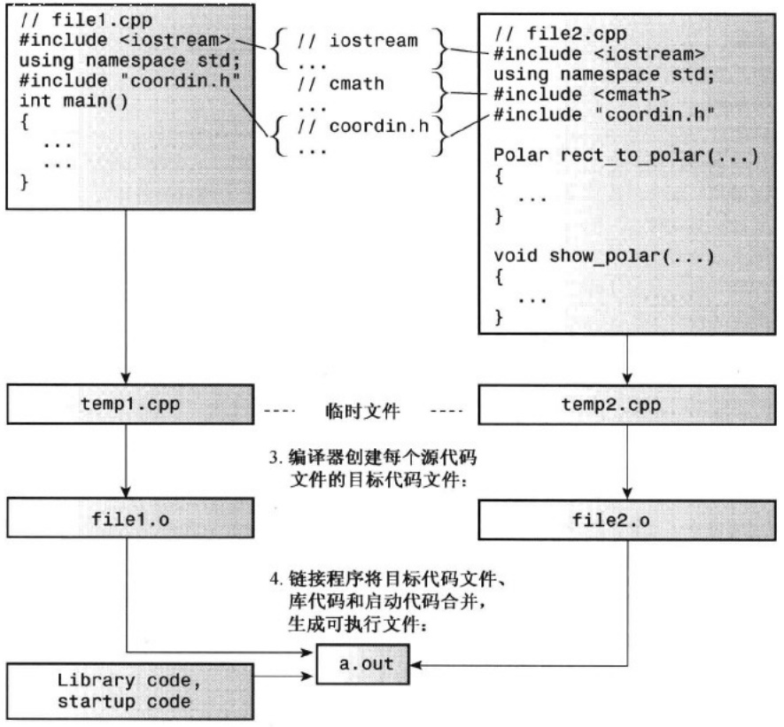
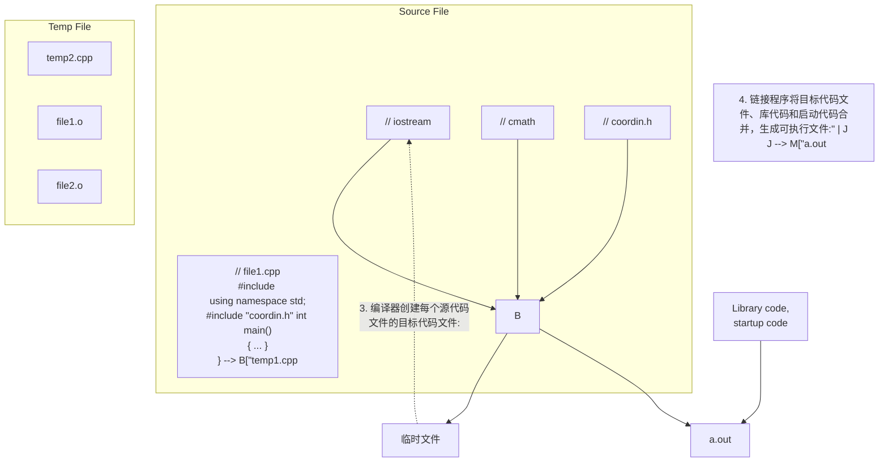

这种属性的结果是，如果形参类型为 const string &，在调用函数时，使用的实参可以是 string 对象或 C-风格字符串，如用引号括起的字符串字面量、以空字符结尾的 char 数组或指向 char 的指针变量。因此，下面的代码是可行的:

```javascript
result = version1(input, "***");
```

函数 version2()不创建临时 string 对象，而是直接修改原来的 string 对象:

```txt
const string & version2(string & s1, const string & s2)  // has side effect
{
    s1 = s2 + s1 + s2;
// safe to return reference passed to function
    return s1;
}
```

该函数可以修改 s1，因为不同于 s2，s1 没有被声明为 const。

由于 s1 是指向 main() 中一个对象（input）的引用，因此将 s1 最为引用返回是安全的。由于 s1 是指向 input 的引用，因此，下面一行代码:

```javascript
result = version2(input, "###");
```

与下面的代码等价:

```javascript
version2(input, "###");      // input altered directly by version2()
result = input;                  // reference to s1 is reference to input
```

然而，由于 s1 是指向 input 的引用，调用该函数将带来修改 input 的副作用:

```txt
Your original string: It's not my fault.
Your string enhanced: ###It's not my fault.###
Your original string: ###It's not my fault.###
```

因此，如果要保留原来的字符串不变，这将是一种错误设计。

程序清单 8.7 中的第三个函数版本指出了什么不能做:

```lisp
const string & version3(string & s1, const string & s2)  // bad design
{
    string temp;

    temp = s2 + s1 + s2;
// unsafe to return reference to local variable
    return temp;
}
```

它存在一个致命的缺陷:返回一个指向 version3() 中声明的变量的引用。这个函数能够通过编译（但编译器会发出警告），但当程序试图执行该函数时将崩溃。具体地说，问题是由下面的赋值语句引发的:

```txt
result = version3(input, "@@@");
```

程序试图引用已经释放的内存。

## 8.2.6 对象、继承和引用

ostream 和 ofstream 类凸现了引用的一个有趣属性。正如第 6 章介绍的，ofstream 对象可以使用 ostream 类的方法，这使得文件输入/输出的格式与控制台输入/输出相同。使得能够将特性从一个类传递给另一个类的语言特性被称为继承，这将在第 13 章详细讨论。简单地说，ostream 是基类（因为 ofstream 是建立在它的基础之上的），而 ofstream 是派生类（因为它是从 ostream 派生而来的）。派生类继承了基类的方法，这意味着 ofstream 对象可以使用基类的特性，如格式化方法 precision()和 setf()。

继承的另一个特征是，基类引用可以指向派生类对象，而无需进行强制类型转换。这种特征的一个实际结果是，可以定义一个接受基类引用作为参数的函数，调用该函数时，可以将基类对象作为参数，也可以将派生类对象作为参数。例如，参数类型为 ostream & 的函数可以接受 ostream 对象（如 cout）或您声明的 ofstream 对象作为参数。

程序清单 8.8 通过调用同一个函数（只有函数调用参数不同）将数据写入文件和显示到屏幕上来说明了这一点。该程序要求用户输入望远镜物镜和一些目镜的焦距，然后计算并显示每个目镜的放大倍数。放大倍数等于物镜的焦距除以目镜的焦距，因此计算起来很简单。该程序还使用了一些格式化方法，这些方法用于 cout 和 ofstream 对象（在这个例子中为 fout）时作用相同。

程序清单 8.8 filefunc.cpp

```cpp
//filefunc.cpp -- function with ostream & parameter
#include <iostream>
#include <fstream>
#include <cstdlib>
using namespace std;

void file_it(ostream & os, double fo, const double fe[],int n);
const int LIMIT = 5;
int main()
{
    ofstream fout;
    const char * fn = "ep-data.txt";
    fout.open(fn);
    if (!fout.is_open())
    {
        cout << "Can't open " << fn << ". Bye.\n";
        exit(EXIT_FAILURE);
    }
    double objective;
    cout << "Enter the focal length of your "
        "telescope objective in mm: ";
    cin >> objective;
    double eps[LIMIT];
    cout << "Enter the focal lengths, in mm, of " << LIMIT
        << " eyepieces:\n";
    for (int i = 0; i < LIMIT; i++)
    {
        cout << "Eyepiece #" << i + 1 << ": ";
        cin >> eps[i];
    }
    file_it(fout, objective, eps, LIMIT);
    file_it(cout, objective, eps, LIMIT);
    cout << "Done\n";
    return 0;
}
void file_it(ostream & os, double fo, const double fe[],int n)
{
    ios_base::fmtflags initial;
    initial = os.setf(ios_base::fixed); // save initial formatting state
    os.precision(0);
    os << "Focal length of objective: " << fo << " mm\n";
    os.setf(ios::showpoint);
    os.precision(1);
    os.width(12);
    os << "f.l. eyepiece";
    os.width(15);
```

```txt
os<< "magnification" << endl;
for (int-i = 0; i < n;-i++)=
{
    os.width(12);
    os << fe[i];
    os.width(15);
    os << int (fo/fe[i] + 0.5) << endl;
}
os.setf(initial);   // restore initial formatting state
}
```

下面是该程序的运行情况:

```txt
Enter the focal length of your telescope objective in mm: 1800
Enter the focal lengths, in mm, of 5 eyepieces:
Eyepiece #1: 30
Eyepiece #2: 19
Eyepiece #3: 14
Eyepiece #4: 8.8
Eyepiece #5: 7.5
Focal length of objective: 1800 mm
f.l. eyepiece magnification
    30.0          60
    19.0          95
    14.0          129
    8.8          205
    7.5          240
Done
```

下述代码行将目镜数据写入到文件 ep-data.txt 中:

```txt
file_it(fout, objective, eps, LIMIT);
```

而下述代码行将同样的信息以同样的格式显示到屏幕上:

```c
file_it(cout, objective, eps, LIMIT);
```

## 程序说明

对于该程序，最重要的一点是，参数 os（其类型为 ostream &）可以指向 ostream 对象（如 cout），也可以指向 ofstream 对象（如 fout）。该程序还演示了如何使用 ostream 类中的格式化方法。下面复习（介绍）其中的一些，更详细的讨论请参阅第 17 章。

方法 setf() 让您能够设置各种格式化状态。例如，方法调用 setf(ios\_base::fixed) 将对象置于使用定点表示法的模式；setf(ios\_base::showpoint) 将对象置于显示小数点的模式，即使小数部分为零。方法 precision() 指定显示多少位小数（假定对象处于定点模式下）。所有这些设置都将一直保持不变，直到再次调用相应的方法重新设置它们。方法 width() 设置下一次输出操作使用的字段宽度，这种设置只在显示下一个值时有效，然后将恢复到默认设置。默认的字段宽度为零，这意味着刚好能容纳下要显示的内容。

函数 file\_it() 使用了两个有趣的方法调用:

```txt
ios_base::fmtflags initial;
initial = os.setf(ios_base::fixed); // save initial formatting state
...
os.setf(initial);   // restore initial formatting state
```

方法 setf() 返回调用它之前有效的所有格式化设置。ios\_base::fmtflags 是存储这种信息所需的数据类型名称。因此，将返回值赋给 initial 将存储调用 file\_it() 之前的格式化设置，然后便可以使用变量 initial 作为参数来调用 setf()，将所有的格式化设置恢复到原来的值。因此，该函数将对象回到传递给 file\_it() 之前的状态。

了解更多有关类的知识将有助于更好地理解这些方法的工作原理，以及为何在代码中使用 ios\_base。

然而，您不用等到第17章才使用这些方法。

需要说明的最后一点是，每个对象都存储了自己的格式化设置。因此，当程序将cout传递给file\_it()时，cout的设置将被修改，然后被恢复；当程序将fout传递给file\_it()时，fout的设置将被修改，然后被恢复。

## 8.2.7 何时使用引用参数

使用引用参数的主要原因有两个。

- 程序员能够修改调用函数中的数据对象。
● 通过传递引用而不是整个数据对象，可以提高程序的运行速度。

当数据对象较大时（如结构和类对象），第二个原因最重要。这些也是使用指针参数的原因。这是有道理的，因为引用参数实际上是基于指针的代码的另一个接口。那么，什么时候应使用引用、什么时候应使用指针呢？什么时候应按值传递呢？下面是一些指导原则:

对于使用传递的值而不作修改的函数。

● 如果数据对象很小，如内置数据类型或小型结构，则按值传递。
- 如果数据对象是数组，则使用指针，因为这是唯一的选择，并将指针声明为指向 const 的指针。
- 如果数据对象是较大的结构，则使用 const 指针或 const 引用，以提高程序的效率。这样可以节省复制结构所需的时间和空间。
- 如果数据对象是类对象，则使用 const 引用。类设计的语义常常要求使用引用，这是 C++ 新增这项特性的主要原因。因此，传递类对象参数的标准方式是按引用传递。

对于修改调用函数中数据的函数:

- 如果数据对象是内置数据类型，则使用指针。如果看到诸如 fixit(&x) 这样的代码（其中 x 是 int），则很明显，该函数将修改 x。
● 如果数据对象是数组，则只能使用指针。
● 如果数据对象是结构，则使用引用或指针。
- 如果数据对象是类对象，则使用引用。

当然，这只是一些指导原则，很可能有充分的理由做出其他的选择。例如，对于基本类型，cin 使用引用，因此可以使用 cin>>n，而不是 cin>>&n。

## 8.3 默认参数

下面介绍 C++ 的另一项新内容——默认参数。默认参数指的是当函数调用中省略了实参时自动使用的一个值。例如，如果将 void wow（int n）设置成 n 有默认值为 1，则函数调用 wow() 相当于 wow（1）。这极大地提高了使用函数的灵活性。假设有一个名为 left() 的函数，它将字符串和 n 作为参数，并返回该字符串的前 n 个字符。更准确地说，该函数返回一个指针，该指针指向由原始字符串中被选中的部分组成的字符串。例如，函数调用 left("theory", 3) 将创建新字符串 "the"，并返回一个指向该字符串的指针。现在假设第二个参数的默认值被设置为 1，则函数调用 left("theory", 3) 仍像前面讲述的那样工作，3 将覆盖默认值。但函数调用 left("theory") 不会出错，它认为第二个参数的值为 1，并返回指向字符串 "t" 的指针。如果程序经常需要抽取一个字符组成的字符串，而偶尔需要抽取较长的字符串，则这种默认值将很有帮助。

如何设置默认值呢？必须通过函数原型。由于编译器通过查看原型来了解函数所使用的参数数目，因此函数原型也必须将可能的默认参数告知程序。方法是将值赋给原型中的参数。例如，left()的原型如下:

```javascript
char * left(const char * str, int n = 1);
```

您希望该函数返回一个新的字符串，因此将其类型设置为 char \*（指向 char 的指针）；您希望原始字符串保持不变，因此对第一个参数使用了 const 限定符；您希望 n 的默认值为 1，因此将这个值赋给 n。默认参数值是初始化值，因此上面的原型将 n 初始化为 1。如果省略参数 n，则它的值将为 1；否则，传递的值将覆盖 1。

对于带参数列表的函数，必须从右向左添加默认值。也就是说，要为某个参数设置默认值，则必须为它右边的所有参数提供默认值:

```c
int harpo(int n, int m = 4, int j = 5);          // VALID
int chico(int n, int m = 6, int j);            // INVALID
int groucho(int k = 1, int m = 2, int n = 3);   // VALID
```

例如，harpo()原型允许调用该函数时提供1个、2个或3个参数:

```javascript
beeps = harpo(2);          // same as harpo(2,4,5)
beeps = harpo(1,8);       // same as harpo(1,8,5)
beeps = harpo (8,7,6);   // no default arguments used
```

实参按从左到右的顺序依次被赋给相应的形参，而不能跳过任何参数。因此，下面的调用是不允许的:

```javascript
beeps = harpo(3, ,8);   // invalid, doesn't set m to 4
```

默认参数并非编程方面的重大突破，而只是提供了一种便捷的方式。在设计类时您将发现，通过使用默认参数，可以减少要定义的析构函数、方法以及方法重载的数量。

程序清单 8.9 使用了默认参数。请注意，只有原型指定了默认值。函数定义与没有默认参数时完全相同。

程序清单 8.9 left.cpp

```cpp
// left.cpp -- string function with a default argument
#include <iostream>
const int ArSize = 80;
char * left(const char * str, int n = 1);
int main()
{
    using namespace std;
    char sample[ArSize];
    cout << "Enter a string:\n";
    cin.get(sample,ArSize);
    char *ps = left(sample, 4);
    cout << ps << endl;
    delete [] ps;          // free old string
    ps = left(sample);
    cout << ps << endl;
    delete [] ps;          // free new string
    return 0;
}

// This function returns a pointer to a new string
// consisting of the first n characters in the str string.
char * left(const char * str, int n)
{
    if(n < 0)
        n = 0;
    char * p = new char[n+1];
    int i;
    for (i = 0; i < n && str[i]; i++)
        p[i] = str[i];  // copy characters
    while (i <= n)
        p[i++] = '\0';  // set rest of string to '\0'
    return p;
}
```

下面是该程序的运行情况:

```txt
Enter a string:
forthcoming
fort
f
```

## 程序说明

该程序使用 new 创建一个新的字符串，以存储被选择的字符。一种可能出现的尴尬情况是，不合作的用户要求的字符数目可能为负。在这种情况下，函数将字符计数设置为 0，并返回一个空字符串。另一种可能出现的尴尬情况是，不负责任的用户要求的字符数目可能多于字符串包含的字符数，为预防这种情况，函数使用了一个组合测试:

```txt
i < n && str[i]
```

i < n 测试让循环复制了 n 个字符后终止。测试的第二部分——表达式 str[i]，是要复制的字符的编码。遇到空值字符（其编码为 0）后，循环将结束。这样，while 循环将使字符串以空值字符结束，并将余下的空间（如果有的话）设置为空值字符。

另一种设置新字符串长度的方法是，将 n 设置为传递的值和字符串长度中较小的一个:

```javascript
int len = strlen(str);
n = (n < len) ? n : len; // the Iesser of n and len
char * p = -new char[n+1];
```

这将确保 new 分配的空间不会多于存储字符串所需的空间。如果用户执行像 left("Hi!", 32767) 这样的调用，则这种方法很有用。第一种方法将把 "Hi!" 复制到由 32767 个字符组成的数组中，并将除前 3 个字符之外的所有字符都设置为空值字符；第二种方法将 "Hi!" 复制到由 4 个字符组成的数组中。但由于添加了另外一个函数调用 (strlen())，因此程序将更长，运行速度将降低，同时还必须包含头文件 cstring（或 string.h）。C 程序员倾向于选择运行速度更快、更简洁的代码，因此需要程序员在正确使用函数方面承担更多责任。然而，C++ 的传统是更强调可靠性。毕竟，速度较慢但能正常运行的程序，要比运行速度虽快但无法正常运行的程序好。如果调用 strlen() 所需的时间很长，则可以让 left() 直接确定 n 和字符串长度哪个小。例如，当 m 的值等于 n 或到达字符串结尾时，下面的循环都将终止:

```txt
int m = 0;
while (m <= n && str[m] != '\0')
    m++;
- char * p = new char[m+1];
- // use m instead of n in rest of code
```

别忘了，在 str[m]不是空值字符时，表达式 str[m] != '\0'的结果为 true，否则为 false。由于在&&表达式中，非零值被转换为 true，而零被转换为 false，因此也可以这样编写这个 while 测试:

```txt
while (m<=n && str[m])
```

## 8.4 函数重载

函数多态是 C++ 在 C 语言的基础上新增的功能。默认参数让您能够使用不同数目的参数调用同一个函数，而函数多态（函数重载）让您能够使用多个同名的函数。术语“多态”指的是有多种形式，因此函数多态允许函数可以有多种形式。类似地，术语“函数重载”指的是可以有多个同名的函数，因此对名称进行了重载。这两个术语指的是同一回事，但我们通常使用函数重载。可以通过函数重载来设计一系列函数——它们完成相同的工作，但使用不同的参数列表。

重载函数就像是有多种含义的动词。例如，Piggy 小姐可以在棒球场为家乡球队助威（root），也可以在地里种植（root）菌类作物。根据上下文可以知道在每一种情况下，root 的含义是什么。同样，C++ 使用上下文来确定要使用的重载函数版本。

函数重载的关键是函数的参数列表——也称为函数特征标（function signature）。如果两个函数的参数数目和类型相同，同时参数的排列顺序也相同，则它们的特征标相同，而变量名是无关紧要的。C++允许定义名称相同的函数，条件是它们的特征标不同。如果参数数目和/或参数类型不同，则特征标也不同。例如，可以定义一组原型如下的 print() 函数:

```c
void print(const char * str, int width); // #1
void print(double d, int width); // #2
void print(long l, int width); // #3
void print(int i, int width); // #4
void print(const char *str); // #5
```

使用 print() 函数时，编译器将根据所采取的用法使用有相应特征标的原型:

```c
print("Pancakes", 15);          // use #1
print("Syrup");                  // use #5
print(1999_0, 10);           // use #2
print(1999, 12);               // use #4
print(1999L, 15);               // use #3
```

例如，print("Pancakes", 15)使用一个字符串和一个整数作为参数，这与#1原型匹配。

使用被重载的函数时，需要在函数调用中使用正确的参数类型。例如，对于下面的语句:

```txt
unsigned int year = 3210;
print(year, 6); // ambiguous call
```

print()调用与哪个原型匹配呢？它不与任何原型匹配！没有匹配的原型并不会自动停止使用其中的某个函数，因为C++将尝试使用标准类型转换强制进行匹配。如果#2原型是print()唯一的原型，则函数调用print(year,6)将把year转换为double类型。但在上面的代码中，有3个将数字作为第一个参数的原型，因此有3种转换year的方式。在这种情况下，C++将拒绝这种函数调用，并将其视为错误。

一些看起来彼此不同的特征标是不能共存的。例如，请看下面的两个原型:

```txt
double cube(double x);
double cube(double & x);
```

您可能认为可以在此处使用函数重载，因为它们的特征标看起来不同。然而，请从编译器的角度来考虑这个问题。假设有下面这样的代码:

```txt
cout << cube(x);
```

参数 x 与 double x 原型和 double &x 原型都匹配，因此编译器无法确定究竟应使用哪个原型。为避免这种混乱，编译器在检查函数特征标时，将把类型引用和类型本身视为同一个特征标。

匹配函数时，并不区分 const 和非 const 变量。请看下面的原型:

```c
void dribble(char * bits);      // overloaded
void dribble (const char *cbits);   // overloaded
void dabble(char * bits);          // not overloaded
void drivel(const char * bits);    // not overloaded
```

下面列出了各种函数调用对应的原型:

```txt
const char p1[20] = "How's the weather?";
char p2[20] = "How's business?";
dribble(p1);          // dribble(const char *);
dribble(p2);          // dribble(char *);
dabble(p1);          // no match
dabble(p2);          // dabble(char *);
drivel(p1);          // drivel(const char *);
drivel(p2);          // drivel(const char *);
```

dribble()函数有两个原型，一个用于const指针，另一个用于常规指针，编译器将根据实参是否为const来决定使用哪个原型。dribble()函数只与带非const参数的调用匹配，而drivel()函数可以与带const或非const 参数的调用匹配。drivel()和dabble()之所以在行为上有这种差别，主要是由于将非const值赋给const变量是合法的，但反之则是非法的。

请记住，是特征标，而不是函数类型使得可以对函数进行重载。例如，下面的两个声明是互斥的:

```cpp
long gronk(int n, float m); // same signatures,
double gronk(int n, float m); // hence not allowed.
```

因此，C++不允许以这种方式重载gronk()。返回类型可以不同，但特征标也必须不同:

```txt
long-gronk(int n, float m);      // different signatures,
double gronk(float n, float m);    // hence allowed
```

在本章稍后讨论过模板后，将进一步讨论函数匹配的问题。

## 重载引用参数

类设计和STL经常使用引用参数，因此知道不同引用类型的重载很有用。请看下面三个原型:

```cpp
void sink(double & r1);      // matches modifiable lvalue
void sank(const double & r2); // matches modifiable or const lvalue, rvalue
void sunk(double && r3);        // matches rvalue
```

\- 左值引用参数 r1 与可修改的左值参数（如 double 变量）匹配；const 左值引用参数 r2 与可修改的左值参数、const 左值参数和右值参数（如两个 double 值的和）匹配；最后，左值引用参数 r3 与左值匹配。注意到与 r1 或 r3 匹配的参数都与 r2 匹配。这就带来了一个问题:如果重载使用这三种参数的函数，结果将如何？答案是将调用最匹配的版本:

```c
void staff(double & rs);          // matches modifiable Fvalue
voit staff(const double & rcs);   // matches rvalue, const lvalue
void stove(double & r1);           // matches modifiable lvalue
void stove(const double & r2);    // matches const lvalue
void stove(double && r3);        // matches rvalue
```

这让您能够根据参数是左值、const 还是右值来定制函数的行为:

```txt
double x = 55.5;
const double y = 32.0;
stove(x);            // calls_stove(double &) 
stove(y);            f/ calls_stove(const_double=&) _
stove(x+y);          f/ calls_stove(double &&)
```

如果没有定义函数 stove(double &&), stove(x+y)将调用函数 stove(const double &)。

## 8.4.1 重载示例

本章前面创建了一个left()函数，它返回一个指针，指向字符串的前n个字符。下面添加另一个left()函数，它返回整数的前n位。例如，可以使用该函数来查看被存储为整数的、美国邮政编码的前3位——如果要根据城区分拣邮件，则这种操作很有用。

该函数的整数版本编写起来比字符串版本更困难些，因为并不是整数的每一位被存储在相应的数组元素中。三种方法是，先计算数字包含多少位。将数字除以10便可以去掉一位，因此可以使用除法来计算数位。更准确地说，可以用下面的循环完成这种工作:

```matlab
unsigned digits = 1;
while (n /= 10)
    digits++;
```

上述循环计算每次删除 n 中的一位时，需要多少次才能删除所有的位。前面讲过，n / = 10 是 n = n / 10 的缩写。例如，如果 n 为 8，则该测试条件将 8/10 的值（0，由于这是整数除法）赋给 n。这将结束循环，digits 的值仍然为 -1。但如果 n 为 238，第一轮循环测试将 n 设置为 238/10，即 23。这个值不为零，因此循环将 digits 增加到 2。下一轮循环将 n 设置为 23/10，即 2。这个值还是不为零，因此 digits 将增加到 3。下一轮循环将 n 设置为 2/10，即 0，从而结束循环，而 digits 被设置为正确的值——3。

现在假设知道数字共有 5 位，并要返回前 3 位，则将这个数除以 10 后再除以 10，便可以得到所需的值。每除以 10 次就删除数字的最后一位。要知道需要删除多少位，只需将总位数减去要获得的位数即可。例如，要获得 9 位数的前 4 位，需要删除后面的 5 位。可以这样编写代码:

```txt
ct = digits - ct;
while {ct--} =
    num /= 10;
return num;
```

程序清单-8.10将上述代码放到了一个新的left()函数中。该函数还包含一些用于处理特殊情况的代码，如用户要求显示0位或要求显示的位数多于总位数。由于新left()的特征标不同于旧的left()，因此可以在同一个程序中使用这两个函数。

程序清单 8.10 leftover.cpp

```cpp
// leftover.cpp -- overloading the left() function
#include <iostream>
unsigned long left(unsigned long num, unsigned ct);
char * left(const char * str, int n = 1);
int main()
{
    using namespace std;
    char * trip = "Hawaii!!"; // test value
    unsigned long n = 12345678; // test value
    int i;
    char * temp;
    for (i = 1; i < 10; i++)
    {
        cout << left(n, i) << endl;
        temp = left(trip,i);
        cout << temp << endl;
        delete [] temp; // point to temporary storage -
    }
    return 0;
}

// This function returns the first ct digits of the number num.
unsigned long left(unsigned long num, unsigned ct)
{
    unsigned digits = I;
    unsigned long n = num;

    if (ct == 0 || num == 0)
        return 0;      // return 0 if no digits
    while (n /= 10)
        digits++;
    if (digits > ct)
    {
        ct = digits - ct;
        while (ct--)
            num /= 10;
        return num;          //-return Left ct digits
    }
```

```c
else                      // if ct >= number of digits
    return num;     // return the whole number
}

// This function returns a pointer to a new string
// consisting of the first n characters in the str string.
char * left(const char * str, int n)
{
    if(n < 0)
        n = 0;
    char * p = new char[n+1];
    int i;
    for (i = 0; i < n && str[i]; i++)
        p[i] = str[i];  // copy characters
    while (i <= n)
        p[i++] = '\0';  // set rest of string to '\0'
    return p;
}
```

下面是该程序的输出:

```csv
1
H
12
Ha
123
Haw
1234
Hawa
12345
Hawai
123456
Hawaii
1234567
Hawaii!
12345678
Hawaii!!
12345678
Hawaii!!
```

## 8.4.2 何时使用函数重载

虽然函数重载很吸引人，但也不要滥用。仅当函数基本上执行相同的任务，但使用不同形式的数据时，才应采用函数重载。另外，您可能还想知道，是否可以通过使用默认参数来实现同样的目的。例如，可以用两个重载函数来代替面向字符串的left()函数:

```cpp
char * left(const char * str, unsigned n);    // two arguments
char * left(const char * str);                 // one argument
```

使用一个带默认参数的函数要简单些。只需编写一个函数（而不是两个函数），程序也只需为一个函数（而不是两个）请求内存；需要修改函数时，只需修改一个。然而，如果需要使用不同类型的参数，则默认参数便不管用了，在这种情况下，应该使用函数重载。

## 什么是名称修饰

C++如何跟踪每一个重载函数呢？它给这些函数指定了秘密身份。使用 C++ 开发工具中的编辑器编写和编译程序时，C++ 编译器将执行一些神奇的操作——名称修饰（name decoration）或名称矫正（name mangling), 它根据函数原型中指定的形参类型对每个函数名进行加密。请看下述未经修饰的函数原型:
long MyFunctionFoo(int, float);

这种格式对于人类来说很适合；我们知道函数接受两个参数（一个为 int 类型，另一个为 float 类型），并返回一个 long 值。而编译器将名称转换为不太好看的内部表示，来描述该接口，如下所示:

```txt
?MyFunctionFoo@@YAXH
```

对原始名称进行的表面看来无意义的修饰（或矫正，因人而异）将对参数数目和类型进行编码。添加的一组符号随函数特征标而异，而修饰时使用的约定随编译器而异。

## 8.5 函数模板

现在的 C++编译器实现了 C++新增的一项特性——函数模板。函数模板是通用的函数描述，也就是说，它们使用泛型来定义函数，其中的泛型可用具体的类型（如 int 或 double）替换。通过将类型作为参数传递给模板，可使编译器生成该类型的函数。由于模板允许以泛型（而不是具体类型）的方式编写程序，因此有时也被称为通用编程。由于类型是用参数表示的，因此模板特性有时也被称为参数化类型（parameterized types）。下面介绍为何需要这种特性以及其工作原理。

在前面的程序清单 8.4 中，定义了一个交换两个 int 值的函数。假设要交换两个 double 值，则一种方法是复制原来的代码，并用 double 替换所有的 int。如果需要交换两个 char 值，可以再次使用同样的技术。进行这种修改将浪费宝贵的时间，且容易出错。如果进行手工修改，则可能会漏掉一个 int。如果进行全局查找和替换（如用 double 替换 int）时，可能将:

```txt
int x;
short_interval;
转换为:
```

```cpp
double x; // intended change of type
short doubleerval; // unintended change of variable name
```

C++的函数模板功能能自动完成这一过程，可以节省时间，而且更可靠。

函数模板允许以任意类型的方式来定义函数。例如，可以这样建立一个交换模板:

```c
template <typename AnyType>
void Swap (AnyType &a, AnyType &b)
{
    AnyType_temp;
    temp = a;
    a = b;
    b = temp;
}
```

第一行指出，要建立一个模板，并将类型命名为 AnyType。关键字 template 和 typename 是必需的，除非可以使用关键字 class 代替 typename。另外，必须使用尖括号。类型名可以任意选择（这里为 AnyType），只要遵守 C++ 命名规则即可；许多程序员都使用简单的名称，如 T。余下的代码描述了交换两个 AnyType 值的算法。模板并不创建任何函数，而只是告诉编译器如何定义函数。需要交换 int 的函数时，编译器将按模板模式创建这样的函数，并用 int 代替 AnyType。同样，需要交换 double 的函数时，编译器将按模板模式创建这样的函数，并用 double 代替 AnyType。

在标准 C++98 添加关键字 typename 之前，C++ 使用关键字 class 来创建模板。也就是说，可以这样编写模板定义:

```cpp
template <class AnyType>
void Swap (AnyType &a, AnyType &b)
{
```

```txt
AnyType temp;
temp = a;
a = b;
b = temp;
```

typename 关键字使得参数 AnyType 表示类型这一点更为明显；然而，有大量代码库是使用关键字 class 开发的。在这种上下文中，这两个关键字是等价的。本书使用了这两种形式，旨在让您在其他地方遇到它们时不会感到陌生。

提示:如果需要多个将同一种算法用于不同类型的函数，请使用模板。如果不考虑向后兼容的问题，并愿意键入较长的单词，则声明类型参数时，应使用关键字typename而不使用class。

要让编译器知道程序需要一个特定形式的交换函数，只需在程序中使用 Swap() 函数即可。编译器将检查所使用的参数类型，并生成相应的函数。程序清单 8.11 演示为何可以这样做。该程序的布局和使用常规函数时相同，在文件的开始位置提供模板函数的原型，并在 main() 后面提供模板函数的定义。这个示例采用了更常见的做法，即将 T 而不是 AnyType 用作类型参数。

程序清单 8.11 funtemp.cpp

```cpp
// funtemp.cpp -- using a function template
#include <iostream>
// function template prototype
template <typename T> // or class T
void Swap(T &a, T &b);

int main()
{
    using namespace std;
    int i = 10;
    int j = 20;
    cout << "i, j = " << i << ", " << j << ".\n";
    cout << "Using compiler-generated int swapper:\n";
    Swap(i,j); // generates void Swap(int &, int &) 
    cout << "Now i, j = ". << i << ";" << j << ".\n";
    double x = 24.5;
    double y = 81.7;
    cout << "x, y = "_<< x << ", " << y << ".\n";
    cout << "Using compiler-generated double swapper:\n";
    Swap(x,y); // generates void Swap(double &, double &) 
    cout << "Now x, y = " << x << ", " << y << ".\n";
    // cin:get();
    return 0;
}

// function template definition
template <typename T> // or class T
void Swap(T &a, T &b)
{
    T temp; // temp a variable of type T
    temp = a;
    a = b;
    b = temp;
}
```

程序清单 8.11 中的第一个 Swap() 函数接受两个 int 参数，因此编译器生成该函数的 int 版本。也就是说，用 int 替换所有的 T，生成下面这样的定义:

```c
void Swap(int &a, int &b)
{
    int temp;
    temp = a;
    a = b;
    b = temp;
}
```

程序员看不到这些代码，但编译器确实生成并在程序中使用了它们。第二个 Swap()函数接受两个 double 参数，因此编译器将生成 double 版本。也就是说，用 double 替换 T，生成下述代码:

```txt
void Swap(double &a, double &b)
{
    double temp;
    temp = a;
    a = b;
    b = temp;
}
```

下面是程序清单 8.11 中程序的输出，从中可知，这种处理方式是可行的:

```txt
i, j = 10, 20.
Using compiler-generated int swapper:
Now i, j = 20, 10.
x, y = 24.5, 81.7.
Using compiler-generated double swapper:
Now x, y = 81.7, 24.5.
```

注意，函数模板不能缩短可执行程序。对于程序清单 8.11，最终仍将由两个独立的函数定义，就像以手工方式定义了这些函数一样。最终的代码不包含任何模板，而只包含了为程序生成的实际函数。使用模板的好处是，它使生成多个函数定义更简单、更可靠。

更常见的情形是，将模板放在头文件中，并在需要使用模板的文件中包含头文件。头文件将在第9章讨论。

## 8.5.1 重载的模板

需要多个对不同类型使用同一种算法的函数时，可使用模板，如程序清单8.11所示。然而，并非所有的类型都使用相同的算法。为满足这种需求，可以像重载常规函数定义那样重载模板定义。和常规重载一样，被重载的模板的函数特征标必须不同。例如，程序清单8.12新增了一个交换模板，用于交换两个数组中的元素。原来的模板的特征标为(T&, T &)，而新模板的特征标为(T [ ], T [ ], int)。注意，在后一个模板中，最后一个参数的类型为具体类型（int），而不是泛型。并非所有的模板参数都必须是模板参数类型。

编译器见到 twotemps.cpp 中第一个 Swap() 函数调用时，发现它有两个 int 参数，因此将它与原来的模板匹配。但第二次调用将两个 int 数组和一个 int 值用作参数，这与新模板匹配。

程序清单 8.12 twotemps.cpp

```c
// twotemps.cpp -- using overloaded template functions
#include <iostream>
template <typename T>      // original template
void Swap(T &a, T &b);

template <typename T>      // new template
void Swap(T *a, T *b, int n);
```

```cpp
void Show(int a[]);
const int Lim = 8;
int main()
{
    using namespace std;
    int i = 10, j = 20;
    cout << "i, j = " << i << ", " << j << ".\n";
    cout << "Using compiler-generated int swapper:\n";
    Swap(i,j);            // matches original template
    cout << "Now i, j = " << i << ", " << j << ".\n";

    int d1[Lim] = {0,7,0,4,1,7,7,6};
    int d2[Lim] = {0,7,2,0,1,9,6,9};
    cout << "Original arrays:\n";
    Show(d1);
    Show(d2);
    Swap(d1,d2,Lim);        // matches new template
    cout << "Swapped arrays:\n";
    Show(d1);
    Show(d2);
    // cin.get();
    return 0;
}

template <typename T>
void Swap(T &a, T &b)
{
    T temp;
    temp = a;
    a = b;
    b = temp;
}

template <typename T>
void Swap(T a[], T b[], int n)
{
    T temp;
    for (int i = 0; i < n; i++)
    {
        temp = a[i];
        a[i] = b[i];
        b[i] = temp;
    }
}

void Show(int a[])
{
    using namespace std;
    cout << a[0] << a[1] << "/";
    cout << a[2] << a[3] << "/";
    for (int i = 4; i < Lim; i++)
        cout << a[i];
    cout << endl;
}
```

下面是程序清单 8.12 中程序的输出:

```txt
i, j = 10, 20.
Using compiler-generated int swapper:
Now i, j = 20, 10.
Original arrays:
07/04/1776
07/20/1969
Swapped arrays:
07/20/1969
07/04/1776
```

## 8.5.2 模板的局限性

假设有如下模板函数:

```txt
template <class T>      // or template <typename T>
void f(T a, T b)
{...}
```

通常，代码假定可执行哪些操作。例如，下面的代码假定定义了赋值，但如果 T 为数组，这种假设将不成立:a = b;

同样，下面的语句假设定义了<，但如果 T 为结构，该假设便不成立:

```txt
if (a > b)
```

另外，为数组名定义了运算符>，但由于数组名为地址，因此它比较的是数组的地址，而这可能不是您希望的。下面的语句假定为类型T定义了乘法运算符，但如果T为数组、指针或结构，这种假设便不成立:

```javascript
T c = a*b;
```

总之，编写的模板函数很可能无法处理某些类型。另一方面，有时候通用化是有意义的，但 C++ 语法不允许这样做。例如，将两个包含位置坐标的结构相加是有意义的，虽然没有为结构定义运算符+。一种解决方案是，C++ 允许您重载运算符+，以便能够将其用于特定的结构或类（运算符重载将在第 11 章讨论）。这样使用运算符+的模板便可处理重载了运算符+的结构。另一种解决方案是，为特定类型提供具体化的模板定义，下面就来介绍这种解决方案。

## 8.5.3 显式具体化

假设定义了如下结构:

```txt
struct job
{
    char name[40];
    double salary;
    int floor;
};
```

另外，假设希望能够交换两个这种结构的内容。原来的模板使用下面的代码来完成交换:

```matlab
temp = a;
a = b;
b = temp;
```

由于 C++ 允许将一个结构赋给另一个结构，因此即使 T 是一个 job 结构，上述代码也适用。然而，假设只想交换 salary 和 floor 成员，而不交换 name 成员，则需要使用不同的代码，但 Swap() 的参数将保持不变（两个 job 结构的引用），因此无法使用模板重载来提供其他的代码。

然而，可以提供一个具体化函数定义——称为显式具体化（explicit specialization），其中包含所需的代码。当编译器找到与函数调用匹配的具体化定义时，将使用该定义，而不再寻找模板。

具体化机制随着 C++ 的演变而不断变化。下面介绍 C++ 标准定义的形式。

## 1. 第三代具体化（ISO/ANSI C++标准）

试验其他具体化方法后，C++98 标准选择了下面的方法。

- 对于给定的函数名，可以有非模板函数、模板函数和显式具体化模板函数以及它们的重载版本。
- 显式具体化的原型和定义应以 template◇ 打头，并通过名称来指出类型。
- 具体化优先于常规模板，而非模板函数优先于具体化和常规模板。

下面是用于交换 job 结构的非模板函数、模板函数和具体化的原型:

```c
// non-template function prototype
void Swap(job &, job &);

// template prototype
template <typename T>
void Swap(T &, T &);

// explicit specialization for the job type
template <> void Swap<job>(job &, job &);
```

正如前面指出的，如果有多个原型，则编译器在选择原型时，非模板版本优先于显式具体化和模板版本，而显式具体化优先于使用模板生成的版本。例如，在下面的代码中，第一次调用 Swap() 时使用通用版本，而第二次调用使用基于 job 类型的显式具体化版本。

```txt
...
template <class T>          // template
void Swap(T &, T &);

// explicit specialization for the job type
template <> void Swap<job>(job &, job &);
int main()
{
    double-u, v;
    ...
    Swap(u,v);  // use template
    job a, b;
    ...
    Swap(a,b);  // use void Swap<job>(job &, job-&)
}
```

Swap&lt;job&gt;中的&lt;job&gt;是可选的，因为函数的参数类型表明，这是 job 的一个具体化。因此，该原型也可以这样编写:

```javascript
template <>-void Swap(job &, "job &); = // - simpler form
```

下面来看一看显式具体化的工作方式。

## 2. 显式具体化示例

程序清单8.13演示了显式具体化的工作方式。

## 程序清单 8.13 twoswap.cpp

```cpp
// twoswap:cpp--- specialization overrides a template
#include <iostream>
template <typename T>
void Swap(T &a, T &b);

struct job
{
    char name[40];
    double salary;
```

```cpp
int floor;
};

// explicit specialization
template <> void Swap<job>(job &j1, job &j2);
void Show(job &j);

int main()
{
    using namespace std;
    cout.precision(2);
    cout.setf(ios::fixed, ios::floatfield);
    int i = 10, j = 20;
    cout << "i, j = " << i << ", " << j << ".\n";
    cout << "Using compiler-generated int swapper:\n";
    Swap(i,j); // generates void Swap(int &, int &).
    cout << "Now i, j = " << i << ", " << j << ".\n";
    job sue = {"Susan Yaffee", 73000.60, 7};
    job-sidney = {"Sidney Taffee", 78060.72, 9};
    cout << "Before job swapping:\n";
    Show(sue);
    Show(sidney);
    Swap(sue, sidney); // uses void Swap(job &, job &) 
    cout << "After job swapping:\n";
    Show(sue);
    Show(sidney);
    // cin.get();
    return 0;
}

template <typename T>
void Swap(T &a, T &b) // general version
{
    T temp;
    temp = a;
    a = b;
    b = temp;
}

// swaps just the salary and floor fields of a job str
template <> void Swap<job>(job &j1, job &j2) // speci
{
    double t1;
    int t2;
    t1 = j1.salary;
    j1:salary = j2.salary;
    j2:salary = t1;
    t2 = j1.floor;
    f1.floor = j2.floor;
    j2.floor = t2;
}

void Show(job &j)
```

```txt
using namespace std;
cout << j.name << ": \$" << j.salary
    << " on floor " << j.floor << endl;
}
```

下面是该程序的输出:

```txt
i, j = 10, 20.
Using compiler-generated int swapper:
Now i, j = 20, 10.
Before job swapping:
Susan Yaffee: $73000.60 on floor 7
Sidney Taffee: $78060.72 on floor 9
After job swapping:
Susan Yaffee: $78060.72 on floor 9
Sidney Taffee: $73000.60 on floor 7
```

## 8.5.4 实例化和具体化

为进一步了解模板，必须理解术语实例化和具体化。记住，在代码中包含函数模板本身并不会生成函数定义，它只是一个用于生成函数定义的方案。编译器使用模板为特定类型生成函数定义时，得到的是模板实例（instantiation）。例如，在程序清单8.13中，函数调用Swap(i,j)导致编译器生成Swap()的一个实例，该实例使用int类型。模板并非函数定义，但使用int的模板实例是函数定义。这种实例化方式被称为隐式实例化（implicit instantiation），因为编译器之所以知道需要进行定义，是由于程序调用Swap()函数时提供了int参数。

最初，编译器只能通过隐式实例化，来使用模板生成函数定义，但现在 C++ 还允许显式实例化（explicit instantiation）。这意味着可以直接命令编译器创建特定的实例，如 Swap&lt;int&gt;()。其语法是，声明所需的种类——用 <> 符号指示类型，并在声明前加上关键字 template:

```txt
template void Swap<int>(int, int); // explicit instantiation
```

实现了这种特性的编译器看到上述声明后，将使用 Swap() 模板生成一个使用 int 类型的实例。也就是说，该声明的意思是“使用 Swap() 模板生成 int 类型的函数定义。”

与显式实例化不同的是，显式具体化使用下面两个等价的声明之一:

```txt
template <> void Swap<int>(int &, int &); // explicit specialization
template <> void Swap(int &, int &); --- // explicit specialization
```

区别在于，这些声明的意思是“不要使用 Swap() 模板来生成函数定义，而应使用专门为 int 类型显式地定义的函数定义”。这些原型必须有自己的函数定义。显式具体化声明在关键字 template 后包含◇，而显式实例化没有。

警告:试图在同一个文件（或转换单元）中使用同一种类型的显式实例和显式具体化将出错。

还可通过在程序中使用函数来创建显式实例化。例如，请看下面的代码:

```cpp
template <class T>
T Add(T a, T b)    // pass by value
{
    return a + b;
}
...
int m = 6;
double x = 10.2;
cout << Add<double>(x, m) << endl;  // explicit instantiation-
```

这里的模板与函数调用 Add(x, m) 不匹配，因为该模板要求两个函数参数的类型相同。但通过使用 Add&lt;double&gt;(x, m)，可强制为 double 类型实例化，并将参数 m 强制转换为 double 类型，以便与函数 Add&lt;double&gt;(double, double) 的第二个参数匹配。

如果对 Swap()做类似的处理, 结果将如何呢?

```txt
int m = 5;
double x  = 14.3;
Swap<double>(m, x);  // almost works
```

这将为类型 double 生成一个显式实例化。不幸的是，这些代码不管用，因为第一个形参的类型为 double &，不能指向 int 变量 m。

隐式实例化、显式实例化和显式具体化统称为具体化（specialization）。它们的相同之处在于，它们表示的都是使用具体类型的函数定义，而不是通用描述。

引入显式实例化后，必须使用新的语法——在声明中使用前缀 template 和 template <>，以区分显式实例化和显式具体化。通常，功能越多，语法规则也越多。下面的代码片段总结了这些概念:

```txt
...
template <class T>
void Swap (T &, T &);  // template prototype

template <> void Swap<job>(job &, job &);   // explicit specialization for job
int main(void)
{
    template void Swap<char>(char &, char &); // explicit instantiation for char
    short a, b;
    ...
    Swap(a,b);     // implicit template instantiation for short
    job n, m;
    ...
    Swap(n, m);   // use explicit specialization for job
    char g, h;
    ...
    Swap(g, h);  // use explicit template instantiation for char
    ...
}
```

编译器看到 char 的显式实例化后，将使用模板定义来生成 Swap() 的 char 版本。对于其他 Swap() 调用，编译器根据函数调用中实际使用的参数，生成相应的版本。例如，当编译器看到函数调用 Swap(a, b) 后，将生成 Swap() 的 short 版本，因为两个参数的类型都是 short。当编译器看到 Swap(n, m) 后，将使用为 job 类型提供的独立定义（显式具体化）。当编译器看到 Swap(g, h) 后，将使用处理显式实例化时生成的模板具体化。

## 8.5.5 编译器选择使用哪个函数版本

对于函数重载、函数模板和函数模板重载，C++需要（且有）一个定义良好的策略，来决定为函数调用使用哪一个函数定义，尤其是有多个参数时。这个过程称为重载解析（overloading resolution）。详细解释这个策略将需要将近一章的篇幅，因此我们先大致了解一下这个过程是如何进行的。

- 第1步:创建候选函数列表。其中包含与被调用函数的名称相同的函数和模板函数。
- 第2步:使用候选函数列表创建可行函数列表。这些都是参数数目正确的函数，为此有一个隐式转换序列，其中包括实参类型与相应的形参类型完全匹配的情况。例如，使用float参数的函数调用可以将该参数转换为double，从而与double形参匹配，而模板可以为float生成一个实例。
- 第3步:确定是否有最佳的可行函数。如果有，则使用它，否则该函数调用出错。

考虑只有一个函数参数的情况，如下面的调用:

```javascript
may('B');    // actual argument is type char
```

首先，编译器将寻找候选者，即名称为 may() 的函数和函数模板。然后寻找那些可以用一个参数调用的函数。例如，下面的函数符合要求，因为其名称与被调用的函数相同，且可只给它们传递一个参数:

```txt
void may(int);                          // #1
float may(float, float = 3);          // #2
void may(char);                       // #3
```

```cpp
char * may(const char *);          // #4
char may(const char &);            // #5
template<class T> void may(const T &);   // #6
template<class T> void may(T *);     //-#7
```

注意，只考虑特征标，而不考虑返回类型。其中的两个候选函数（#4 和 #7）不可行，因为整数类型不能被隐式地转换（即没有显式强制类型转换）为指针类型。剩余的一个模板可用来生成具体化，其中 T 被替换为 char 类型。这样剩下 5 个可行的函数，其中的每一个函数，如果它是声明的唯一一个函数，都可以被使用。

接下来，编译器必须确定哪个可行函数是最佳的。它查看为使函数调用参数与可行的候选函数的参数匹配所需要进行的转换。通常，从最佳到最差的顺序如下所述。

完全匹配，但常规函数优先于模板。

2. 提升转换（例如，char 和 shorts 自动转换为 int，float 自动转换为 double）。
3. 标准转换（例如，int 转换为 char，long 转换为 double）。
4. 用户定义的转换，如类声明中定义的转换。

例如，函数#1优于函数#2，因为-char到int的转换是提升转换（参见第3章），而char到float的转换是标准转换（参见第3章）。函数#3、函数#5和函数#6都优于函数#1和#2，因为它们都是完全匹配的。#3和#5优于#6，因为#6-函数是模板。这种分析引出了两个问题。什么是完全匹配？如果两个函数（如#3和#5）都完全匹配，将如何办呢？通常，有两个函数完全匹配是一种错误，但这一规则有两个例外。显然，我们需要对这一点做更深入的探讨。

## 1. 完全匹配和最佳匹配

进行完全匹配时，C++允许某些“无关紧要的转换”。表8.1列出了这些转换——Type表示任意类型。例如，int-实参与int&形参完全匹配。注意，Type可以是char&这样的类型，因此这些规则包括从char&到const-char&的转换。Type（argument-list）意味着用作实参的函数名与用作形参的函数指针只要返回类型和参数列表相同，就是匹配的（第7章介绍了函数指针以及为何可以将函数名作为参数传递给接受函数指针的函数）。第9章将介绍关键字volatile。

表 8.1 完全匹配允许的无关紧要转换

| 从实参 | 到形参 |
| --- | --- |
| Type | Type &amp; |
| Type &amp; | Type |
| Type [ ] | * Type |
| Type (argument-list) | Type (*) (argument-list) |
| Type | const Type |
| Type | volatile Type |
| Type * | const Type |
| Type * | volatile Type * |

假设有下面的函数代码:

```txt
struct blot {int a; char b[10];};
blot ink = {25, "spots"};
...
recycle(ink);
```

在这种情况下，下面的原型都是完全匹配的:

```lisp
void recycle(blot);          // #1  blot-to-blot
void recycle(const blot);     // #2  blot-to-(const blot)
void recycle(blot &);         // #3  blot-to-(blot &) 
void recycle(const blot &);   // #4  blot-to-(const blot &)
```

正如您预期的，如果有多个匹配的原型，则编译器将无法完成重载解析过程；如果没有最佳的可行函数，则编译器将生成一条错误消息，该消息可能会使用诸如“ambiguous（二义性）”这样的词语。

然而，有时候，即使两个函数都完全匹配，仍可完成重载解析。首先，指向非 const 数据的指针和引用优先与非 const 指针和引用参数匹配。也就是说，在 recycle() 示例中，如果只定义了函数 #3 和 #4 是完全匹配的，则将选择 #3，因为 ink 没有被声明为 const。然而，const 和非 const 之间的区别只适用于指针和引用指向的数据。也就是说，如果只定义了 #1 和 #2，则将出现二义性错误。

一个完全匹配优于另一个的另一种情况是，其中一个是非模板函数，而另一个不是。在这种情况下，非模板函数将优先于模板函数（包括显式具体化）。

如果两个完全匹配的函数都是模板函数，则较具体的模板函数优先。例如，这意味着显式具体化将优于使用模板隐式生成的具体化:

```txt
struct blot {int a; char b[10];};
template <class Type> void recycle (Type t); // template
template <> void recycle<blot> (blot & t);   // specialization for blot
...
blot ink = {25, "spots"};
...
recycle(ink);  // use specialization
```

术语 “最具体（most specialized）” 并不一定意味着显式具体化，而是指编译器推断使用哪种类型时执行的转换最少。例如，请看下面两个模板:

```cpp
template <class Type> void recycle (Type t); // #1
template <class Type> void recycle (Type * t); // #2
```

假设包含这些模板的程序也包含如下代码:

```c
struct blot {int a; char b[10];};
blot ink = {25, "spots"};

recycle(&ink); // address of a structure
```

recycle(&ink)调用与#1模板匹配，匹配时将Type解释为blot\*。recycle(&ink)函数调用也与#2模板匹配，这次Type被解释为ink。因此将两个隐式实例——recycle< blot \*>(blot \*)和recycle < blot>(blot \*)发送到可行函数池中。

在这两个模板函数中，recycle&lt;blot*&gt;(blot\*)被认为是更具体的，因为在生成过程中，它需要进行的转换更少。也就是说，#2 模板已经显式指出，函数参数是指向 Type 的指针，因此可以直接用 blot 标识 Type；而#1 模板将 Type 作为函数参数，因此 Type 必须被解释为指向 blot 的指针。也就是说，在#2 模板中，Type 已经被具体化为指针，因此说它“更具体”。

用于找出最具体的模板的规则被称为函数模板的部分排序规则（partial ordering rules）。和显式实例一样，这也是 C++98 新增的特性。

## 2. 部分排序规则示例

我们先看一个完整的程序，它使用部分排序规则来确定要使用哪个模板定义。程序清单8.14有两个用来显示数组内容的模板定义。第一个定义（模板A）假设作为参数传递的数组中包含了要显示的数据；第二个定义（模板B）假设数组元素为指针，指向要显示的数据。

程序清单8.14 temptempover.cpp

```cpp
// tempover.cpp -- template overloading
#include <iostream>

template <typename T>          // template A
void ShowArray(T arr[], int n);

template <typename T>          // template B
```

```cpp
void ShowArray(T * arr[], int n);

struct debts
{
    char name[50];
    double amount;
};

int main()
{
    using namespace std;
    int things[6] = {13, 31, 103, 301, 310, 130};
    struct debts mr_E[3] =
    {
        {"Ima Wolfe", 2400.0},
        {"Ura Foxe", 1300.0},
        {"Iby Stout", 1800.0}
    };
    double * pd[3];

// set pointers to the amount members of the structures in mr_E
    for (int i = 0; i < 3; i++)
        pd[i] = &mr_E[i].amount;

    cout << "Listing Mr. E's counts of things:\n";
// things is an array of int
    ShowArray(things, 6); // uses template A
    cout << "Listing Mr. E's debts:\n";
// pd is an array of pointers to double
    ShowArray(pd, 3);      // uses template B (more specialized)
    return 0;
}

template <typename T>
void ShowArray(T arr[], int n)
{
    using namespace std;
    cout << "template A\n";
    for (int i = 0; i < n; i++)
        cout << arr[i] << ' ';
    cout << endl;
}

template <typename T>
void ShowArray(T * arr[], int n)
{
    using namespace std;
    cout << "template B\n";
    for (int i = 0; i < n; i++)
        cout << *arr[i] << ' ';
    cout << endl;
}
```

请看下面的函数调用:

```javascript
ShowArray(things, 6);
```

标识符 things 是一个 int 数组的名称，因此与下面的模板匹配:

```c
template <typename T>          // template A
void ShowArray(T arr[], int n);
```

其中 T 被替换为 int 类型。

接下来，请看下面的函数调用:

```javascript
ShowArray(pd, 3);
```

其中 pd 是一个 double \*数组的名称。这与模板 A 匹配:

```c
template <typename T>          // template A
void ShowArray(T arr[], int n);
```

其中，T 被替换为类型 double \*。在这种情况下，模板函数将显示 pd 数组的内容，即 3 个地址。该函数调用也与模板 B 匹配:

```c
template <typename T>          // template B
void ShowArray(T * arr[], int n);
```

在这里，T 被替换为类型 double，而函数将显示被解除引用的元素\*arr[i]，即数组内容指向的 double 值。在这两个模板中，模板 B 更具体，因为它做了特定的假设——数组内容是指针，因此被使用。

下面是程序清单 8.14 中程序的输出:

```txt
Listing Mr. E's counts of things:
template A
13 31 103 301 310 130
Listing Mr. E's debts:
template B
2400 1300 1800
```

如果将模板 B 从程序中删除，则编译器将使用模板 A 来显示 pd 的内容，因此显示的将是地址，而不是值。请试试看。

简而言之，重载解析将寻找最匹配的函数。如果只存在一个这样的函数，则选择它；如果存在多个这样的函数，但其中只有一个是非模板函数，则选择该函数；如果存在多个适合的函数，且它们都为模板函数，但其中有一个函数比其他函数更具体，则选择该函数。如果有多个同样合适的非模板函数或模板函数，但没有一个函数比其他函数更具体，则函数调用将是不确定的，因此是错误的；当然，如果不存在匹配的函数，则也是错误。

## 3. 自己选择

在有些情况下，可通过编写合适的函数调用，引导编译器做出您希望的选择。请看程序清单 8.15，该程序将模板函数定义放在文件开头，从而无需提供模板原型。与常规函数一样，通过在使用函数前提供模板函数定义，它让它也充当原型。

程序清单 8.15 choices.cpp

```cpp
// choices.cpp -- choosing a template
#include <iostream>

template<class T>  // or template <typename T>
T lesser(T a, T b)          // #1
{
    return a < b ? a : b;
}

int lesser (int a, int b)  // #2
```

```cpp
{
    a = a < 0 ? -a : a;
    b = b < 0 ? -b : b;
    return a < b ? a : b;
}

int main()
{
    using namespace std;
    int m = 20;
    int n = -30;
    double x = 15.5;
    double y = 25.9;

    cout << lesser(m, n) << endl;          // use #2
    cout << lesser(x, y) << endl;          // use #1 with double
    cout << lesser<>(m, n) << endl;      // use #1 with int
    cout << lesser<int>(x, y)  << endl; // use #1 with int

    return 0;
}
```

最后的函数调用将 double 转换为 int，有些编译器会针对这一点发出警告。

该程序的输出如下:

```csv
20
15.5
-30
15
```

程序清单 8.15 提供了一个模板和一个标准函数，其中模板返回两个值中较小的一个，而标准函数返回两个值中绝对值较小的那个。如果函数定义是在使用函数前提供的，它将充当函数原型，因此这个示例无需提供原型。请看下面的语句:

```cpp
cout << lesser(m, n) << endl;          // use #2
```

这个函数调用与模板函数和非模板函数都匹配，因此选择非模板函数，返回20。

接下来，下述语句中的函数调用与模板匹配（T 为 double）:

```cpp
cout << lesser(x, y) << endl;          // use #1 with double
```

现在来看下面的语句:

```cpp
cout << lesser<>(m, n) << endl;      // use #1 with int
```

lesser○(m, n)中的○指出，编译器应选择模板函数，而不是非模板函数；编译器注意到实参的类型为 int，因此使用 int 替代 T 对模板进行实例化。

最后，请看下面的语句:

```cpp
cout << lesser<int>(x, y)  << endl; // use #1 with int
```

这条语句要求进行显式实例化（使用 int 替代 T），将使用显式实例化得到的函数。x 和 y 的值将被强制转换为 int，该函数返回一个 int 值，这就是程序显示 15 而不是 15.5 的原因所在。

## 4. 多个参数的函数

将有多个参数的函数调用与有多个参数的原型进行匹配时，情况将非常复杂。编译器必须考虑所有参数的匹配情况。如果找到比其他可行函数都合适的函数，则选择该函数。一个函数要比其他函数都合适，其所有参数的匹配程度都必须不比其他函数差，同时至少有一个参数的匹配程度比其他函数都高。

本书并不是要解释复杂示例的匹配过程，这些规则只是为了让任何一组函数原型和模板都存在确定的结果。

## 8.5.6 模板函数的发展

在 C++ 发展的早期，大多数人都没有想到模板函数和模板类会有这么强大而有用，它们甚至没有就这个主题发挥想象力。但聪明而专注的程序员挑战模板技术的极限，阐述了各种可能性。根据熟悉模板的程序员提供的反馈，C++98 标准做了相应的修改，并添加了标准模板库。从此以后，模板程序员在不断探索各种可能性，并消除模板的局限性。C++11 标准根据这些程序员的反馈做了相应的修改。下面介绍一些相关的问题及其解决方案。

## 1. 是什么类型

在 C++98 中，编写模板函数时，一个问题是并非总能知道应在声明中使用哪种类型。请看下面这个不完整的示例:

```txt
template<class T1, class T2>
void ft(T1 x, T2 y)
{
    ...
    ?type? xpy = x + y;
    ...
}
```

xpy 应为什么类型呢？由于不知道 ft() 将如何使用，因此无法预先知道这一点。正确的类型可能是 T1、T2 或其他类型。例如，T1 可能是 double，而 T2 可能是 int，在这种情况下，两个变量的和将为 double 类型。T1 可能是 short，而 T2 可能是 int，在这种情况下，两个变量的和为 int 类型。T1 还可能是 short，而 T2 可能是 char，在这种情况下，加法运算将导致自动整型提升，因此结果类型为 int。另外，结构和类可能重载运算符+，这导致问题更加复杂。因此，在 C++98 中，没有办法声明 xpy 的类型。

## 2. 关键字 decltype (C++11)

C++11 新增的关键字 decltype 提供了解决方案。可这样使用该关键字:

```txt
int x;
decltype(x) y;  // make y the same type as x.
```

给 decltype 提供的参数可以是表达式，因此在前面的模板函数 ft() 中，可使用下面的代码:

```typescript
decltype(x + y) xpy;  // make xpy the same type as x + y
xpy = x + y;
```

另一种方法是，将这两条语句合而为一:

```txt
decltype(x + y) xpy = x + y;
```

因此，可以这样修复前面的模板函数 ft():

```txt
template<class T1, class T2>
void ft(T1 x, T2 y)
{
    ...
    ...
    decltype(x + y) xpy = -x + y;
}
```

decltype 比这些示例演示的要复杂些。为确定类型，编译器必须遍历一个核对表。假设有如下声明:

```txt
decltype(expression) var;
```

则核对表的简化版如下:

第一步:如果 expression 是一个没有用括号括起的标识符，则 var 的类型与该标识符的类型相同，包括 const 等限定符:

```txt
double x = 5.5;
double y = -7.9;
double &rx = x;
```

```cpp
const double * pd;
decltype(x) w;          // w is type double
decltype(rx) u = y;  // u is type double &
decltype(pd) v;          // v is type const double *
```

第三步:如果 expression 是一个函数调用，则 var 的类型与函数的返回类型相同:

```lisp
long indeed(int);
decltype (indeed(3)) m; // m-is type int-
```

注意:并不会实际调用函数。编译器通过查看函数的原型来获悉返回类型，而无需实际调用函数。

第三步:如果 expression 是一个左值，则 var 为指向其类型的引用。这好像意味着前面的 w 应为引用类型，因为 x 是一个左值。但别忘了，这种情况已经在第一步处理过了。要进入第三步，expression 不能是未用括号括起的标识符。那么，expression 是什么时将进入第二步呢？一种显而易见的情况是，expression 是用括号括起的标识符:

```lisp
double xx = 4.4;
decltype ((xx)) r2 = xx; // r2 is double &
decltype(xx) w = xx; // w is double (Stage-1 match)
```

顺便说一句，括号并不会改变表达式的值和左值性。例如，下面两条语句等效:

```javascript
xx = 98.6; // ( ) don't affect use of xx
```

第四步:如果前面的条件都不满足，则 var 的类型与 expression 的类型相同:

```rust
int j = 3;
int &k = j;
int &n = j;
decltype(j+6) i1; // i1 type int
decltype(100L) i2; // i2 type long
decltype(k+n) i3; // i3 type-int;
```

请注意，虽然 k 和 n 都是引用，但表达式  $k+n$  不是引用；它是两个 int 的和，因此类型为 int。

如果需要多次声明，可结合使用 typedef 和 decltype:

```txt
template<class T1, class T2>
void ft(T1 x, T2 y)
{
    typedef decltype(x + y) xytype;
    xytype xpy = x + y;
    xytype arr[10];
    xytype & rxy = arr[2]; // rxy a reference
}
```

## 3. 另一种函数声明语法（C++11 后置返回类型）

有一个相关的问题是 decltype 本身无法解决的。请看下面这个不完整的模板函数:

```cpp
template<class T1, class T2>
?type? gt(T1 x, T2 y)
{
    return x + y;
}
```

同样，无法预先知道将 x 和 y 相加得到的类型。好像可以将返回类型设置为 decltype(x+y)，但不幸的是，此时还未声明参数 x 和 y，它们不在作用域内（编译器看不到它们，也无法使用它们）。必须在声明参数后使用 decltype 为此，C++ 新增了一种声明和定义函数的语法。下面使用内置类型来说明这种语法的工作原理。对于下面的原型:

```txt
double h(int x, float y);
```

使用新增的语法可编写成这样:

```txt
auto-h(int x, float y)-> double;
```

这将返回类型移到了参数声明后面。->double 被称为后置返回类型（trailing return type）。其中 auto 是一个占位符，表示后置返回类型提供的类型，这是 C++1F 给 auto 新增的一种角色。这种语法也可用于函数定义:

```txt
auto h(int x, float y) -> double
{/* function body */};
```

通过结合使用这种语法和 decltype，便可给 gt() 指定返回类型，如下所示:

```cpp
template<class T1, class T2>
auto gt(T1 x, T2 y--> decltype(x + y)
{
return x + y;
}
```

现在，decltype 在参数声明后面，因此 x 和 y 位于作用域内，可以使用它们。

## 8.6 总结

C++扩展了 C 语言的函数功能。通过将 inline 关键字用于函数定义，并在首次调用该函数前提供其函数定义，可以使得 C++ 编译器将该函数视为内联函数。也就是说，编译器不是让程序跳到独立的代码段，以执行函数，而是用相应的代码替换函数调用。只有在函数很短时才能采用内联方式。

引用变量是一种伪装指针，它允许为变量创建别名（另一个名称）。引用变量主要被用作处理结构和类对象的函数的参数。通常，被声明为特定类型引用的标识符只能指向这种类型的数据；然而，如果一个类（如 ofstream）是从另一个类（如 ostream）派生出来的，则基类引用可以指向派生类对象。

C++原型让您能够定义参数的默认值。如果函数调用省略了相应的参数，则程序将使用默认值；如果函数调用提供了参数值，则程序将使用这个值（而不是默认值）。只能在参数列表中从右到左提供默认参数。因此，如果为某个参数提供了默认值，则必须为该参数右边所有的参数提供默认值。

函数的特征标是其参数列表。程序员可以定义两个同名函数，只要其特征标不同。这被称为函数多态或函数重载。通常，通过重载函数来为不同的数据类型提供相同的服务。

函数模板自动完成重载函数的过程。只需使用泛型和具体算法来定义函数，编译器将为程序中使用的特定参数类型生成正确的函数定义。

## 8.7 复习题

1. 哪种函数适合定义为内联函数？
2. 假设 song() 函数的原型如下:

```c
void song(const char * name, int times);
```

a: 如何修改原型，使 times 的默认值为 1?

b. 函数定义需要做哪些修改？

c. 能否为 name 提供默认值 “O. My Papa”？

3. 编写 iquote() 的重载版本——显示其用双引号括起的参数。编写 3 个版本:一个用于 int 参数，一个用于 double 参数，另一个用于 string 参数。

4. 下面是一个结构模板:

```txt
struct box
{
    char maker[40];
    float height;
    float width;
    float length;
    float volume;
};
```

a. 请编写一个函数，它将 box 结构的引用作为形参，并显示每个成员的值。
b. 请编写一个函数，它将 box 结构的引用作为形参，并将 volume 成员设置为其他 3 边的乘积。
5. 为让函数 fill() 和 show() 使用引用参数，需要对程序清单 7.15 做哪些修改？
6. 指出下面每个目标是否可以使用默认参数或函数重载完成，或者这两种方法都无法完成，并提供合适的原型。

a. mass(density, volume)返回密度为 density、体积为 volume 的物体的质量，而 mass(density)返回密度为 density、体积为 1.0 立方米的物体的质量。这些值的类型都为 double。
b. repeat(10, "I'm OK")将指定的字符串显示 10 次，而 repeat("But you're kind of stupid")将指定的字符串显示 5 次。
c. average(3,6)返回两个 int 参数的平均值（int 类型），而 average(3.0,6.0) 返回两个 double 值的平均值（double 类型）。
d. mangle("I'm glad to meet you")根据是将值赋给 char 变量还是 char\*变量，分别返回字符 1 和指向字符串 "I'm mad to greet you" 的指针。

7. 编写返回两个参数中较大值的函数模板。

8. 给定复习题 6 的模板和复习题 4 的 box 结构，提供一个模板具体化，它接受两个 box 参数，并返回体积较大的一个。
9. 在下述代码（假定这些代码是一个完整程序的一部分）中；v1、v2、v3、v4 和 v5 分别是哪种类型？

```txt
int g(int x);
float m = 5.5f;
float & rm = m;
decltype(m)_v1 = m;
decltype(rm) v2 = m;
decltype((m))_v3 = m;
decltype (g(100)) v4;
decltype (2.0± m)- v5;
```

## 8.8 编程练习

1. 编写通常接受一个参数（字符串的地址），并打印该字符串的函数。然而，如果提供了第二个参数（int类型），且该参数不为0，则该函数打印字符串的次数将为该函数被调用的次数（注意，字符串的打印次数不等于第二个参数的值，而等于函数被调用的次数）。是的，这是一个非常可笑的函数，但它让您能够使用本章介绍的一些技术。在一个简单的程序中使用该函数，以演示该函数是如何工作的。
2. CandyBar 结构包含 3 个成员。第一个成员存储 candy bar 的品牌名称；第二个成员存储 candy bar 的重量（可能有小数）；第三个成员存储 candy bar 的热量（整数）。请编写一个程序，它使用一个这样的函数，即将 CandyBar 的引用、char 指针、double 和 int 作为参数，并用最后 3 个值设置相应的结构成员。最后 3 个参数的默认值分别为 “Millennium Munch”、2.85 和 350。另外，该程序还包含一个以 CandyBar 的引用为参数，并显示结构内容的函数。请尽可能使用 const。
3. 编写一个函数，它接受一个指向 string 对象的引用作为参数，并将该 string 对象的内容转换为大写，为此可使用表 6.4 描述的函数 toupper()。然后编写一个程序，它通过使用一个循环让您能够用不同的输入来测试这个函数，该程序的运行情况如下:

```txt
Enter a string (q to quit): go away
GO AWAY
Next string (q to quit): good grief!
GOOD GRIEF!
Next string (q to quit): q
Bye.
```

4. 下面是一个程序框架:

```cpp
#include <iostream>
using namespace std;
#include <cstring>      // for strlen(), strcpy()
struct stringy {
    char * str;          // points to a string
    int ct;            // length of string (not counting '\0')
};

// prototypes for set(), show(), and show() go here
int main()
{
    stringy beany;
    char testing[] = "Reality isn't what it used to be.";

    set(beany, testing);   // first argument is a reference,
                    // allocates space to hold copy of testing,
                    // sets str member of beany to point to the
                    // new block, copies testing to new block,
                    // and sets ct member of beany
    show(beany);     // prints member string once
    show(beany, 2);   // prints member string twice
    testing[0] = 'D';
    testing[1] = 'u';
    show(testing);   // prints testing string once
    show(testing, 3); // prints testing string thrice
    show("Done!");
    return 0;
}
```

请提供其中描述的函数和原型，从而完成该程序。注意，应有两个 show() 函数，每个都使用默认参数。请尽可能使用 cosnt 参数。set() 使用 new 分配足够的空间来存储指定的字符串。这里使用的技术与设计和实现类时使用的相似。（可能还必须修改头文件的名称，删除 using 编译指令，这取决于所用的编译器。）

5. 编写模板函数 max5()，它将一个包含 5 个 T 类型元素的数组作为参数，并返回数组中最大的元素（由于长度固定，因此可以在循环中使用硬编码，而不必通过参数来传递）。在一个程序中使用该函数，将 T 替换为一个包含 5 个 int 值的数组和一个包含 5 个 double 值的数组，以测试该函数。
6. 编写模板函数 $\maxn()$, 它将由一个 T 类型元素组成的数组和一个表示数组元素数目的整数作为参数, 并返回数组中最大的元素。在程序对它进行测试, 该程序使用一个包含 6 个 int 元素的数组和一个包含 4 个 double 元素的数组来调用该函数。程序还包含一个具体化, 它将 char 指针数组和数组中的指针数量作为参数, 并返回最长的字符串的地址。如果有多个这样的字符串, 则返回其中第一个字符串的地址。使用由 5 个字符串指针组成的数组来测试该具体化。
7. 修改程序清单8.14，使其使用两个名为SumArray()的模板函数来返回数组元素的总和，而不是显示数组的内容。程序应显示thing的总和以及所有debt的总和。

# 第 9 章 内存模型和名称空间

## 本章内容包括:

- 单独编译。
- 存储持续性、作用域和链接性。
- 定位（placement）new 运算符。
●—名称空间。

C++为在内存中存储数据方面提供了多种选择。可以选择数据保留在内存中的时间长度（存储持续性）以及程序的哪一部分可以访问数据（作用域和链接）等。可以使用 new 来动态地分配内存，而定位 new 运算符提供了这种技术的一种变种。C++名称空间是另一种控制访问权的方式。通常，大型程序都由多个源代码文件组成，这些文件可能共享一些数据。这样的程序涉及到程序文件的单独编译，本章将首先介绍这个主题。

## 9.1 单独编译

和 C 语言一样，C++也允许甚至鼓励程序员将组件函数放在独立的文件中。第 1 章介绍过，可以单独编译这些文件，然后将它们链接成可执行的程序。（通常，C++编译器既编译程序，也管理链接器。）如果只修改了一个文件，则可以只重新编译该文件，然后将它与其他文件的编译版本链接。这使得大程序的管理更便捷。另外，大多数 C++环境都提供了其他工具来帮助管理。例如，UNIX 和 Linux 系统都具有 make 程序，可以跟踪程序依赖的文件以及这些文件的最后修改时间。运行 = make 时，如果它检测到上次编译后修改了源文件，make 将记住重新构建程序所需的步骤。大多数集成开发环境（包括 Embarcadero C++ Builder、Microsoft Visual C++、Apple Xcode 和 Freescale CodeWarrior）都在 Project 菜单中提供了类似的工具。

现在看一个简单的示例。我们不是要从中了解编译的细节（这取决于实现），而是要重点介绍更通用的方面，如设计。

例如，假设程序员决定分解程序清单 7.12 中的程序，将支持函数放在一个独立的文件中。清单 7.12 将直角坐标转换为极坐标，然后显示结果。不能简单地以 main()之后的虚线为界，将原来的文件分为两个。问题在于，main()和其他两个函数使用了同一个结构声明，因此两个文件都应包含该声明。简单地将它们输入进去无疑是自找麻烦。即使正确地复制了结构声明，如果以后要作修改，则必须记住对这两组声明都进行修改。简而言之，将一个程序放在多个文件中将引出新的问题。

谁希望出现更多的问题呢？C 和 C++ 的开发人员都不希望，因此他们提供了 #include 来处理这种情况。与其将结构声明加入到每一个文件中，不如将其放在头文件中，然后在每一个源代码文件中包含该头文件。这样，要修改结构声明时，只需在头文件中做一次改动即可。另外，也可以将函数原型放在头文件中。因此，可以将原来的程序分成三部分。

● 头文件:包含结构声明和使用这些结构的函数的原型。

- 源代码文件:包含与结构有关的函数的代码。
- 源代码文件:包含调用与结构相关的函数的代码。

这是一种非常有用的组织程序的策略。例如，如果编写另一个程序时，也需要使用这些函数，则只需包含头文件，并将函数文件添加到项目列表或 make 列表中即可。另外，这种组织方式也与 OOP 方法一致。一个文件（头文件）包含了用户定义类型的定义；另一个文件包含操纵用户定义类型的函数的代码。这两个文件组成了一个软件包，可用于各种程序中。

请不要将函数定义或变量声明放到头文件中。这样做对于简单的情况可能是可行的，但通常会引来麻烦。例如，如果在头文件包含一个函数定义，然后在其他两个文件（属于同一个程序）中包含该头文件，则同一个程序中将包含同一个函数的两个定义，除非函数是内联的，否则这将出错。下面列出了头文件中常包含的内容。

- 函数原型。
- 使用#define 或 const 定义的符号常量。
- 结构声明。
- 类声明。
- 模板声明。
- 内联函数。

将结构声明放在头文件中是可以的，因为它们不创建变量，而只是在源代码文件中声明结构变量时，告诉编译器如何创建该结构变量。同样，模板声明不是将被编译的代码，它们指示编译器如何生成与源代码中的函数调用相匹配的函数定义。被声明为 const 的数据和内联函数有特殊的链接属性（稍后将介绍），因此可以将其放在头文件中，而不会引起问题。

程序清单 9.1、程序清单 9.2 和程序清单 9.3 是将程序清单 7.12 分成几个独立部分后得到的结果。注意，在包含头文件时，我们使用 “coordin.h”，而不是 &lt;coordin.h&gt;。如果文件名包含在尖括号中，则 C++ 编译器将在存储标准头文件的主机系统的文件系统中查找；但如果文件名包含在双引号中，则编译器将首先查找当前的工作目录或源代码目录（或其他目录，这取决于编译器）。如果没有在那里找到头文件，则将在标准位置查找。因此在包含自己的夹文件时，应使用引号而不是尖括号。

图 9.1 简要地说明了在 UNIX 系统中将该程序组合起来的步骤。注意，只需执行编译命令 CC 即可，其他步骤将自动完成。g++ 和 gpp 命令行编译器以及 Borland C++ 命令行编译器 (bcc32.exe) 的行为类似。Apple Xcode、Embarcadero C++ Builderr 和 Microsoft Visual C++ 基本上执行同样的步骤，但正如第 1-章介绍的，启动这个过程的方式不同——使用能够创建项目并将其与源代码文件关联起来的菜单。注意，只需将源代码文件加入到项目中，而不用加入头文件。这是因为 #include= 指令管理头文件。另外，不要使用 #include 来包含源代码文件，这样做将导致多重声明。

警告:在 IDE 中，不要将头文件加入到项目列表中，也不要在源代码文件中使用#include 来包含其他源代码文件。

程序清单 9.1 coordin.h

```c
//coordin.h -- structure templates and function-prototypes
//structure-templates
#ifndef COORDIN_H_
#define COORDIN_H_

struct polar
{
    double distance;     // distance from origin_
    double angle;         // direction from origin
};
```

```c
struct rect
{
    double x;          // horizontal distance from origin
    double y;          // vertical distance from origin
};

// prototypes
polar rect_to_polar(rect xypos);
void show_polar(polar dapos);

#endif
```

1. 编译两个源代码文件的 UNIX 命令:

CC file1.cpp file2.ccp

2. 预处理器将包含的文件与源代码文件合并:



<details>
<summary>flowchart</summary>


</details>

图 9.1 在 UNIX 系统中编译由多个文件组成的 C++ 程序

## 头文件管理

在同一个文件中只能将同一个头文件包含一次。记住这个规则很容易，但很可能在不知情的情况下将头文件包含多次。例如，可能使用包含了另外一个头文件的头文件。有一种标准的 C/C++ 技术可以避免多次包含同一个头文件。它是基于预处理器编译指令 #ifndef（即 if not defined）的。下面的代码片段意味着仅当以前没有使用预处理器编译指令 #define 定义名称 COORDIN\_H\_时，才处理 #ifndef 和 #endif 之间的语句:

```c
#ifndef COORDIN_H_
...
#endif
```