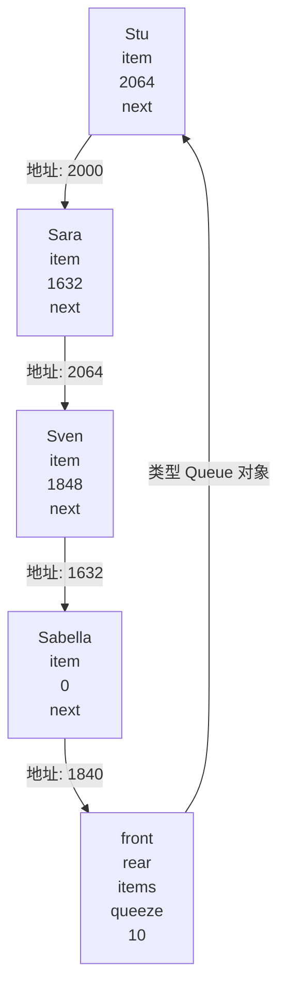
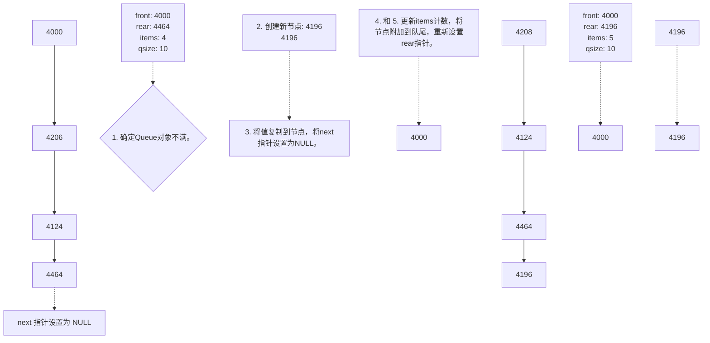
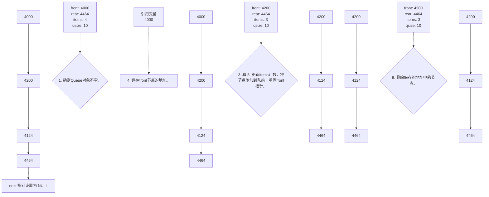

<details>
<summary>flowchart</summary>


</details>

图12.9 Queue 对象

```lisp
class Queue
{
private:
// class scope definitions
    // Node is a nested structure definition local to this class
    struct Node { Item item; struct Node * next;};
    enum {Q_SIZE = 10};
// private class members
    Node * front;      //-pointer to front_of Queue
    Node-* rear;       // pointer to rear of Queue
    int items;        //-current number of items in Queue
    const int qsize;   //-maximum number of items in Queue
    ...
public:
//...
};
```

上述声明使用了 C++ 的一项特性:在类中嵌套结构或类声明。通过将 Node 声明放在 Queue 类中，可以使其作用域为整个类。也就是说，Node 是这样一种类型:可以使用它来声明类成员，也可以将它作为类方法中的类型名称，但只能在类中使用。这样，就不必担心该 Node 声明与某些全局声明或其他类中声明的 Node 发生冲突。有些较老的编译器不支持嵌套的结构和类，如果您的编译器是这样的，则必须将 Node 结构定义为全局的，将其作用域设置为整个文件。

## 嵌套结构和类

在类声明中声明的结构、类或枚举被称为是被嵌套在类中，其作用域为整个类。这种声明不会创建数据对象，而只是指定了可以在类中使用的类型。如果声明是在类的私有部分进行的，则只能在这个类使用被声明的类型；如果声明是在公有部分进行的，则可以从类的外部通过作用域解析运算符使用被声明的类型。例如，如果 Node 是在 Queue 类的公有部分声明的，则可以在类的外面声明 Queue::Node 类型的变量。设计好数据的表示方式后，接下来需要编写类方法。

## 3. 类方法

类构造函数应提供类成员的值。由于在这个例子中，队列最初是空的，因此队首和队尾指针都设置为

NULL（0 或 nullptr），并将 items 设置为 0。另外，还应将队列的最大长度 qsize 设置为构造函数参数 qs 的值。下面的实现方法无法正常运行:

```cpp
Queue::Queue(int qs)
{
    front = rear = NULL;
    items== 0;
    qsize = qs; // not acceptable!
}
```

问题在于qsize是常量，所以可以对它进行初始化，但不能给它赋值。从概念上说，调用构造函数时，对象将在括号中的代码执行之前被创建。因此，调用Queue（int qs）构造函数将导致程序首先给4个成员变量分配内存。然后，程序流程进入到括号中，使用常规的赋值方式将值存储到内存中。因此，对于const数据成员，必须在执行到构造函数体之前，即创建对象时进行初始化。C++提供了一种特殊的语法来完成上述工作，它叫做成员初始化列表（member initializer list）。成员初始化列表由逗号分隔的初始化列表组成（前面带冒号）。它位于参数列表的右括号之后、函数体左括号之前。如果数据成员的名称为mdata，并需要将它初始化为val，则初始化器为mdata（val）。使用这种表示法，可以这样编写Queue的构造函数:

```txt
Queue::Queue(int_qs) : qsize(qs)  //-initialize qsize to -qs
{
    front = rear = NULL;
    items = 0;
}
```

通常，初值可以是常量或构造函数的参数列表中的参数。这种方法并不限于初始化常量，可以将 Queue 构造函数写成如下所示:

```autohotkey
Queue::Queue(int qs) : qsize(qs), front(NULL), rear(NULL), items(0)
{
}
```

只有构造函数可以使用这种初始化列表语法。如上所示，对于 const 类成员，必须使用这种语法。另外，对于被声明为引用的类成员，也必须使用这种语法:

```cpp
class Agency {...};
class Agent
{
private:
    Agency & belong; // must use initializer list to initialize
    ...
};
Agent::Agent(Agency & a) : belong(a) {...}
```

这是因为引用与 const 数据类似, 只能在被创建时进行初始化。对于简单数据成员(例如 front 和 items), 使用成员初始化列表和在函数体中使用赋值没有什么区别。然而, 正如第 14 章将介绍的, 对于本身就是类对象的成员来说, 使用成员初始化列表的效率更高。

## 成员初始化列表的语法

如果 Classy 是一个类，而 mem1、mem2 和 mem3 都是这个类的数据成员，则类构造函数可以使用如下的语法来初始化数据成员:

```autohotkey
Classy::Classy{int n, int m} :mem1(n), mem2(0), mem3(n*m + 2)
{
//...
}
```

上述代码将 mem1 初始化为 n，将 mem2 初始化为 0，将 mem3 初始化为  $n*m+2$ 。从概念上说，这些

初始化工作是在对象创建时完成的，此时还未执行括号中的任何代码。请注意以下几点:

- 这种格式只能用于构造函数；
- 必须用这种格式来初始化非静态 const 数据成员（至少在 C++H 之前是这样的）；
- 必须用这种格式来初始化引用数据成员。

数据成员被初始化的顺序与它们出现在类声明中的顺序相同，与初始化器中的排列顺序无关。

警告:不能将成员初始化列表语法用于构造函数之外的其他类方法。

成员初始化列表使用的括号方式也可用于常规初始化。也就是说，如果愿意，可以将下述代码:

```txt
int games = 162;
double talk = 2.71828;
```

替换为:

```txt
int games(162);
double talk(2.71828);
```

这使得初始化内置类型就像初始化类对象一样。

## C++11 的类内初始化

C++11允许您以更直观的方式进行初始化:

```javascript
class Classy
{
    int mem1 = 10;      // in-class initialization
    const int mem2 = 20; // in-class initialization
//...
};
```

这与在构造函数中使用成员初始化列表等价:

```txt
Classy::Classy() : mem1(10), mem2(20) {...}
```

成员 mem1 和 mem2 将分别被初始化为 10 和 20，除非调用了使用成员初始化列表的构造函数，在这种情况下，实际列表将覆盖这些默认初始值:

```txt
Classy::Classy(int n) : mem1(n) {...}
```

在这里，构造函数将使用 n 来初始化 mem1，但 mem2 仍被设置为 20。

isempty()、isfull()和 queuecount()的代码都非常简单。如果 items 为 0，则队列是空的；如果 items 等于 qsize，则队列是满的。要知道队列中的项目数，只需返回 items 的值。后面的程序清单 12.11 列出了这些代码。

将项目添加到队尾（入队）比较麻烦。下面是一种方法:

```cpp
bool Queue::enqueue(const Item & item)
{
    if (isfull())
        return false;
    Node * add = new Node;  // create node
// on failure, new throws std::bad_alloc exception
    add->item = item;      // set node pointers
    add->next == NULL;       // or nullptr;
    items++;
    if (front == NULL)     // if queue.is empty,
        front = add;         // place item at front
    else
        rear->next = add;  // else place at rear
    rear = add;             // have rear point to-new node
    return true;
}
```

总之，方法需要经过下面几个阶段（见图 12.10）。


<details>
<summary>flowchart</summary>


</details>

图 12.10 将项目入队

1. 如果队列已满，则结束（在这里的实现中，队列的最大长度由用户通过构造函数指定）。
2. 创建一个新节点。如果 new 无法创建新节点，它将引发异常，这个主题将在第 15 章介绍。最终的结果是，除非提供了处理异常的代码，否则程序将终止。
3. 在节点中放入正确的值。在这个例子中，代码将Item值复制到节点的数据部分，并将节点的next指针设置为NULL（0或C++1新增的nullptr）。这样就为将节点作为队列中的最后一个项目做好了准备。
4. 将项目计数（items）加1。
5. 将节点附加到队尾。这包括两个部分。首先，将节点与列表中的另一个节点连接起来。这是通过将当前队尾节点的 next 指针指向新的队尾节点来完成的。第二部分是将 Queue 的成员指针 rear 设置为指向新节点，使队列可以直接访问最后一个节点。如果队列为空，则还必须将 front 指针设置成指向新节点（如果只有一个节点，则它既是队首节点，也是队尾节点）。

删除队首项目（出队）也需要多个步骤才能完成。下面是一种方式:

```cpp
bool Queue::dequeue(Item & item)
{
    if (front == NULL) ...
        return false;
    item = front->item;      // set item to first item in queue
    items--;
    Node * temp = front;     // save location of first item
    front = front->next;     // reset front to next item
    delete temp;             // delete former first item
    if (items == 0)
        rear = NULL;
    return true;
}
```

总之，需要经过下面几个阶段（参见图 12.11）:


<details>
<summary>flowchart</summary>


</details>

图 12.11 将项目出队

1. 如果队列为空，则结束。
2. 将队列的第一个项目提供给调用函数，这是通过将当前 front 节点中的数据部分复制到传递给方法的引用变量中来实现。
3. 将项目计数（items）减 1。
4. 保存 front 节点的位置，供以后删除。
5. 让节点出队。这是通过将 Queue 成员指针 front 设置成指向下一个节点来完成的，该节点的位置由 front->next 提供。
6. 为节省内存，删除以前的第一个节点。
7. 如果链表为空，则将 rear 设置为 NULL（在这个例子中，将 front 指针设置成 front->next 后，它已经是 NULL 了）。同样，可使用 0 而不是 NULL，也可使用 C++11 新增的 nullptr。

第 4 步是必不可少的，这是因为第 5 步将删除关于先前第一个节点位置的信息。

4. 是否需要其他类方法

是否需要其他方法呢？类构造函数没有使用 new，所以乍一看，好像不用理会由于在构造函数中使用 new 给类带来的特殊要求。当然，这种印象是错误的，因为向队列中添加对象将调用 new 来创建新的节点。通过删除节点的方式，dequeue() 方法确实可以清除节点，但这并不能保证队列在到期时为空。因此，类需要一个显式析构函数——该函数删除剩余的所有节点。下面是一种实现，它从链表头开始，依次删除其中的每个节点:

```cpp
Queue::~Queue()
{
    Node * temp;
    while (front != NULL)   // while queue is not yet empty
    {
```

```txt
temp = front;      // save address of front item
    front = front->next;// reset pointer to next item
    delete temp;       // delete former front
}
```

您知道，使用 new 的类通常需要包含显式复制构造函数和执行深度复制的赋值运算符，这个例子也是如此吗？首先要回答的问题是，默认的成员复制是否合适？答案是否定的。复制 Queue 对象的成员将生成一个新的对象，该对象指向链表原来的头和尾。因此，将项目添加到复制的 Queue 对象中，将修改共享的链表。这样做将造成非常严重的后果。更糟的是，只有副本的尾指针得到了更新，从原始对象的角度看，这将损坏链表。显然，要克隆或复制队列，必须提供复制构造函数和执行深度复制的赋值构造函数。

当然，这提出了这样一个问题:为什么要复制队列呢？也许是希望在模拟的不同阶段保存队列的瞬像，也可能是希望为两个不同的策略提供相同的输入。实际上，拥有拆分队列的操作是非常有用的，超市在开设额外的收款台时经常这样做。同样，也可能希望将两个队列结合成一个或者截短一个队列。

但假设这里的模拟不实现上述功能。难道不能忽略这些问题，而使用已有的方法吗？当然可以。然而，在将来的某个时候，可能需要再次使用队列且需要复制。另外，您可能会忘记没有为复制提供适当的代码。在这种情况下，程序将能编译和运行，但结果却是混乱的，甚至会崩溃。因此，最好还是提供复制构造函数和赋值运算符，尽管目前并不需要它们。

幸运的是，有一种小小的技巧可以避免这些额外的工作，并确保程序不会崩溃。这就是将所需的方法定义为伪私有方法:

```txt
class Queue
{
private:
    Queue(const-Queue & q) := qsize(0) {=}   // preemptive definition
    Queue & operator=(const Queue & q) {=return *this;}
//...
};
```

这样做有两个作用:第一，它避免了本来将自动生成的默认方法定义。第二，因为这些方法是私存的，所以不能被广泛使用。也就是说，如果 nip 和 tuck 是 Queue 对象，则编译器就不允许这样做:

```javascript
Queue snick(nip);      // not allowed
tuck = nip;               // not allowed
```

所以，与其将来面对无法预料的运行故障，不如得到一个易于跟踪的编译错误，指出这些方法是不可访问的。另外，在定义其对象不允许被复制的类时，这种方法也很有用。

C++1F 提供了另一种禁用方法的方式——使用关键字 delete，这将在第 18 章介绍。

还有没有其他影响需要注意呢？当然有。当对象被按值传递（或返回）时，复制构造函数将被调用。然而，如果遵循优先采用按引用传递对象的惯例，将不会有任何问题。另外，复制构造函数还被用于创建其他的临时对象，但 Queue 定义中并没有导致创建临时对象的操作，例如重载加法运算符。

## 12.7.2 Customer 类

接下来需要设计客户类。通常，ATM 客户有很多属性，例如姓名、账户和账户结余。然而，这里的模拟需要使用的唯一一个属性是客户何时进入队列以及客户交易所需的时间。当模拟生成新客户时，程序将创建一个新的客户对象，并在其中存储客户的到达时间以及一个随机生成的交易时间。当客户到达队首时，程序将记录此时的时间，并将其与进入队列的时间相减，得到客户的等候时间。下面的代码演示了如何定义和实现 Customer 类:

```cpp
class Customer
{
private:
    long arrive;      // arrival time for customer
    int processtime;   // processing time for customer
```

```cpp
public:
    Customer() { arrive = processtime = 0; }
    void set(long when);
    long when() const { return arrive; }
    int ptime() const { return processtime; }
};
void Customer::set(long when)
{
    processtime = std::rand() % 3 + 1;
    arrive = when;
}
```

默认构造函数创建一个空客户。set()成员函数将到达时间设置为参数，并将处理时间设置为1\~3中的一个随机值。

程序清单 12.10 将 Queue 和 Customer 类声明放到一起，而程序清单 12.11 列出了方法。

程序清单 12.10 queue.h

```cpp
// queue.h -- interface for a queue
#ifndef QUEUE_H_
#define QUEUE_H_
// This queue will contain Customer items
class Customer
{
private:
    long arrive;          // arrival time for customer
    int processtime;     // processing time for customer
public:
    Customer() { arrive = processtime = 0; }

    void set(long when);
    long when() const { return arrive; }
    int ptime() const { return processtime; }
};

typedef Customer Item;

class Queue
{
private:
// class scope defineitions
    // Node is a nested structure,definition local to this c
    struct Node { Item item, struct Node * next;}
    enum {Q-SIZE = 10};
// private class members
    Node * front;         // pointer to front of Queue
    Node * rear,        // pointer to rear of Queue
    int items;         // current number of items in Queue
    const int qsize;     // maximum number of items in Queue
    // preemptive definitions to prevent public copying
    Queue(const Queue & q) ~ qsize(0).(-)
    Queue & operator=(const Queue & q) { return *this*}
public:
    Queue(int qs = Q_SIZE); // create queue with a qs limit
    -Queue();
    bool isempty() const,
```

```cpp
bool isfull() const;
int queuecount() const;
bool enqueue(const Item &item); // add item to end
bool dequeue(Item &item);          // remove item from front
};
#endif
```

程序清单 12.11 queue.cpp

```cpp
// queue.cpp -- Queue and Customer methods
#include "queue.h"
#include <cstdlib>          // (or stdlib.h) for rand()

// Queue methods
Queue::Queue(int qs) : qsize(qs)
{
    front = rear = NULL;     // or nullptr
    items = 0;
}

Queue::~Queue()
{
    Node * temp;
    while (front != NULL)      // while queue is not yet_empty
    {
        temp = front;         // save address of front item
        front = front->next;// reset pointer to next item
        delete temp;         // delete former front
    }
}

bool Queue::isempty() const
{
    return items == 0;
}

bool Queue::isfull() const
{
    return items == qsize;
}

int Queue::queuecount() const
{
    return items;
}

// Add item to queue
bool Queue::enqueue(const Item & item)
{
    if (isfull())
        return false;
    Node * add = new Node; // create node
// on failure, new throws std::bad_alloc exception
    add->item = item;       // set node pointers
    add->next = NULL;       // or nullptr;
```

```cpp
items++;
if (front == NULL)      // if queue is empty,
    front = add;       // place item at front
else
    rear->next = add;   // else place at rear
rear = add;               // have rear point to new node
return true;
}

// Place front item into item variable and remove from queue
bool Queue::dequeue(Item & item)
{
    if (front == NULL)
        return false;
    item = front->item;     // set item to first item in queue
    items--;
    Node * temp = front;    // save location of first item
    front = front->next;    // reset front to next item
    delete temp;             // delete former first item
    if (items == 0)
        rear = NULL;
    return true;
}
// time set to a random value in the range 1 - 3
void Customer::set(long when)
{
    processtime = std::rand() % 3 + 1;
    arrive = when;
}
```

## 12.7.3 ATM 模拟

现在已经拥有模拟-ATM所需的工具。程序允许用户输入3个数:队列的最大长度、程序模拟的持续时间（单位为小时）以及平均每小时的客户数。程序将使用循环——每次循环代表一分钟。在每分钟的循环中，程序将完成下面的工作。

1. 判断是否来了新的客户。如果来了，并且此时队列未满，则将它添加到队列中，否则拒绝客户入队。
2. 如果没有客户在进行交易，则选取队列的第一个客户。确定该客户的已等候时间，并将 wait\_time 计数器设置为新客户所需的处理时间。
3. 如果客户正在处理中，则将 wait\_time 计数器减 1。
4. 记录各种数据，如获得服务的客户数目、被拒绝的客户数目、排队等候的累积时间以及累积的队列长度等。

当模拟循环结束时，程序将报告各种统计结果。

一个有趣的问题是，程序如何确定是否有新的客户到来。假设平均每小时有10名客户到达，则相当于每6分钟有一名客户。程序将计算这个值，并将它保存在min\_per\_cust变量中。然而，刚好每6分钟来一名客户不太现实，我们真正（至少在大部分时间内）希望的是一个更随机的过程——但平均每6分钟来一名客户。程序将使用下面的函数来确定是否在循环期间有客户到来:

```cpp
bool newcustomer(double x)
{
    return (std::rand() * x / RAND_MAX < 1);
}
```

其工作原理如下:值 RAND\_MAX 是在 cstdlib 文件（以前是 stdlib.h）中定义的，是 rand() 函数可能返回的最大值（0是最小值）。假设客户到达的平均间隔时间 x 为 6，则 rand() \* x /RAND\_MAX 的值将位于 0 到 6 之间。具体地说，平均每隔 6 次，这个值会有 1 次小于 1。然而，这个函数可能会导致客户到达的时间间隔有时为 1 分钟，有时为 20 分钟。这种方法虽然很笨拙，但可使实际情况不同于有规则地每 6 分钟到来一个客户。如果客户到达的平均时间间隔少于 1 分钟，则上述方法将无效，但模拟并不是针对这种情况设计的。如果确实需要处理这种情况，最好提高时间分辨率，比如每次循环代表 10 秒钟。

程序清单 12.12 给出了模拟的细节。长时间运行该模拟程序，可以知道长期的平均值；短时间运行该模拟程序，将只能知道短期的变化。

程序清单 12.12 bank.cpp

```cpp
// bank.cpp -- using the Queue interface
// compile with queue.cpp
#include <iostream>
#include <cstdlib> // for rand() and srand()
#include <ctime>   // for time()
#include "queue.h"
const int MIN_PER_HR = 60;

bool newcustomer(double x); // is there a new customer?

int main()
{
    using std::cin;
    using std::cout;
    using std::endl;
    using std::ios_base;
// setting things up
    std::srand(std::time(0));   // random initializing of rand()

    cout << "Case Study: Bank of Heather Automatic Teller\n";
    cout << "Enter maximum size of queue: ";
    int qs;
    cin >> qs;
    Queue line(qs);          // line queue holds up to qs people

    cout << "Enter the number of simulation hours: ";
    int hours;               // hours of simulation
    cin >> hours;
    // simulation will run 1 cycle per minute
    long cyclelimit = MIN_PER_HR * hours; // # of cycles

    cout << "Enter the average number of customers per hour: ";
    double perhour;           // average # of arrival per hour
    cin >> perhour;
    double min_per_cust;   // average time between arrivals
    min_per_cust = MIN_PER_HR / perhour;

    Item temp;                // new customer data
    long turnaways = 0;     // turned away by full queue
    long customers = 0;     // joined the queue
    long served = 0;         // served during the simulation
    long sum_line = 0;      // cumulative line length
    int wait_time = 0;       // time until autoteller is free
    long line_wait = 0;       // cumulative time in line
```

```cpp
// running the simulation
    for (int cycle = 0; cycle < cyclelimit;-cycle++)
    {
        if (newcustomer(min_per_cust)) // have newcomer
        {
            if (line.isfull())
                turnaways++;
            else
            {
                customers++;
                temp.set(cycle); // cycle = time of arrival
                line.enqueue(temp); // add newcomer to line
            }
        }
        if (wait_time <= 0 && !line.isempty())
        {
            line.dequeue (temp); // attend next customer
            wait_time = temp cosmic().// for wait_time minutes
            line_wait += cycle - temp.when();
            served++;
        }
        if (wait_time > 0)
            wait_time--;
        sum_line += line.queuecount();
    }

// reporting results
    if (customers > 0)
    {
        cout << "customers accepted: " << customers << endl;
        cout << " customers served: " << served << endl;
        cout << " turnaways: " << turnaways << endl;
        cout << "average-queue size: ";
        cout.precision(2);
        cout.setf(ios_base::fixed, ios_base::floatfield);
        cout << (double) sum_line / cyclelimit << endl;
        cout << " average wait_time: "
               << (double) line_wait / served << " minutes\n";
    }
    else
        cout << "No customers!\n";
        cout << "Done!\n";

        return 0;
    }

// x = average time, in minutes, between customers
// return value is true if customer shows up this minute
bool newcustomer(double x)
{
    return (std::rand() * x / RAND_MAX < 1);
}
```

注意:编译器如果没有实现 bool，可以用 int 代替 bool，用 0 代替 false，用 1 代替 true；还可能必须使用 stdlib.h 和 time.h 代替较新的 cstdlib 和 ctime；另外可能必须自己来定义 RAND\_MAX。

下面是程序清单12.10-12.12组成的程序长时间运行的几个例子:

```txt
Case Study: Bank of Heather Automatic Teller
Enter maximum size of queue: 10
Enter the number of simulation hours: 100
Enter the average number of customers per hour: 15
customers accepted: 1485
- customers served: 1485
- turnaways: 0
average queue size: 0.15
-average wait time: 0.63 minutes
Done!
Case Study: Bank of Heather Automatic Teller
Enter maximum size of queue: 10
Enter the number of simulation hours: 100
Enter the average number of customers per hour: 30
customers accepted: 2896
- customers served: 2888
- turnaways: 101
average queue size: 4.64
-average wait time: 9.63 minutes
Done!
Case Study: Bank of Heather Automatic Teller
Enter maximum size of queue: 20
Enter the number of simulation hours: 100
Enter the average number of customers per hour: 30
customers accepted: 2943
- customers served: 2943
- turnaways: 93
average queue size: 13.06
-average wait time: 26.63 minutes
Done!
```

注意，每小时到达的客户从15名增加到30名时，等候时间并不是加倍，而是增加了15倍。如果允许队列更长，情况将更糟。然而，模拟没有考虑到这个事实——许多客户由于不愿意排很长的队而离开了。

下面是该程序的另外几个运行示例。从中可知，即使平均每小时到达的客户数不变，也会出现短期变化。

```txt
Case Study: Bank of Heather Automatic Teller
Enter maximum size of queue: 10
Enter the number of simulation hours: 4
Enter the average number of customers per hour: 30
customers accepted: 114
  customers served: 110
    turnaways: 0
average queue size: 2.15
  average wait time: 4.52 minutes
Done!
Case Study: Bank of Heather Automatic Teller
Enter maximum size of queue: 10
Enter the number of simulation hours: 4
Enter the average number of customers per hour: 30
customers accepted: 121
  customers served: 116
    turnaways: 5
average queue size: 5.28
```

```yaml
average wait time: 70.72 minutes
Done!
Case Study: Bank of Heather Automatic Teller
Enter maximum size of queue: 10
Enter the number of simulation hours: 4
Enter the average number of customers per hour: 30
customers accepted: 112
    customers served: -109
        turnaways: 0
average queue size=2.41
average wait time: 5.16 minutes
Done!
```

## 12.8 总结

本章介绍了定义和使用类的许多重要方面。其中的一些方面是非常微妙甚至很难理解的概念。如果其中的某些概念对于您来说过于复杂，也不用害怕——这些问题对于大多数C++的初学者来说都是很难的。通常，对于诸如复制构造函数等概念，都是在由于忽略它们而遇到了麻烦后逐步理解的。本章介绍的一些内容乍看起来非常难以理解，但是随着经验越来越丰富，对其理解也将越透彻。

在类构造函数中，可以使用 new 为数据分配内存，然后将内存地址赋给类成员。这样，类便可以处理长度不同的字符串，而不用在类设计时提前固定数组的长度。在类构造函数中使用 new，也可能在对象过期时引发问题。如果对象包含成员指针，同时它指向的内存是由 new 分配的，则释放用于保存对象的内存并不会自动释放对象成员指针指向的内存。因此在类构造函数中使用 new 类来分配内存时，应在类析构函数中使用 delete 来释放分配的内存。这样，当对象过期时，将自动释放其指针成员指向的内存。

如果对象包含指向 new 分配的内存的指针成员，则将一个对象初始化为另一个对象，或将一个对象赋给另一个对象时，也会出现问题。在默认情况下，C+逐个对成员进行初始化和赋值，这意味着被初始化或被赋值的对象的成员将与原始对象完全相同。如果原始对象的成员指向一个数据块，则副本成员将指向同一个数据块。当程序最终删除这两个对象时，类的析构函数将试图删除同一个内存数据块两次，这将出错。解决方法是:定义一个特殊的复制构造函数来重新定义初始化，并重载赋值运算符。在上述任何一种情况下，新的定义都将创建指向数据的副本，并使新对象指向这些副本。这样，旧对象和新对象都将引用独立的、相同的数据，而不会重叠。由于同样的原因，必须定义赋值运算符。对于每一种情况，最终目的都是执行深度复制，也就是说，复制实际的数据，而不仅仅是复制指向数据的指针。

对象的存储持续性为自动或外部时，在它不再存在时将自动调用其析构函数。如果使用 new 运算符为对象分配内存，并将其地址赋给一个指针，则当您将 delete 用于该指针时将自动为对象调用析构函数。然而，如果使用定位 new 运算符（而不是常规 new 运算符）为类对象分配内存，则必须负责显式地为该对象调用析构函数，方法是使用指向该对象的指针调用析构函数方法。C++ 允许在类中包含结构、类和枚举定义。这些嵌套类型的作用域为整个类，这意味着它们被局限于类中，不会与其他地方定义的同名结构、类和枚举发生冲突。

C++为类构造函数提供了一种可用来初始化数据成员的特殊语法。这种语法包括冒号和由逗号分隔的初始化列表，被放在构造函数参数的右括号后，函数体的左括号之前。每一个初始化器都由被初始化的成员的名称和包含初始值的括号组成。从概念上来说，这些初始化操作是在对象创建时进行的，此时函数体中的语句还没有执行。语法如下:

```matlab
queue(int qs) : qsize(qs); items(0), front(NULL), rear(NULL){
```

如果数据成员是非静态 const 成员或引用，则必须采用这种格式，但可将 C++1L 新增的类内初始化用于非静态 const 成员。

C++11 允许类内初始化，即在类定义中进行初始化:

```c
class Queue
{
private:
...
    Node * front = NULL;
    enum {Q_SIZE = 10};
    Node * rear = NULL;
    int items = 0;
    const int qsize = Q_SIZE;
...
};
```

这与使用成员初始化列表等价。然而，使用成员初始化列表的构造函数将覆盖相应的类内初始化。

您可能已经注意到，与简单的 C 结构相比，需要注意的类细节要多得多。作为回报，它们的功能也更强。

## 12.9 复习题

1. 假设 String 类有如下私有成员:

```txt
class String
{
private:
    char * str;    // points to string allocated by new
    int len;       // holds length of string
//...
};
```

a. 下述默认构造函数有什么问题？

```autohotkey
String::String() {}
```

b. 下述构造函数有什么问题？

```txt
String::String(const char * s)
{
    str = s;
    len = strlen(s);
}
```

c. 下述构造函数有什么问题？

```cpp
String::String(const char * s)
{
    strcpy(str, s);
    len = strlen(s);
}
```

2. 如果您定义了一个类，其指针成员是使用 new 初始化的，请指出可能出现的 3 个问题以及如何纠正这些问题。
3. 如果没有显式提供类方法，编译器将自动生成哪些类方法？请描述这些隐式生成的函数的行为。
4. 找出并改正下述类声明中的错误:

```cpp
class nifty
{
// data
    char personality[];
    int talents;
// methods
```

```cpp
nifty();
nifty(char * s);
ostream & operator<<(ostream & os, nifty & n);
}

nifty:nifty()
{
    personality = NULL;
    talents = 0;
}

nifty:nifty(char * s)
{
    personality = new char [strlen(s)];
    personality = s;
    talents = 0;
}
ostream & nifty:operator<<(ostream & os, nifty & n)
{
    os << n;
}
5. 对于下面的类声明:
class Golfer
{
private:
    char * fulname;      // points to string containing golfer's_name
    int games;          // holds number of_golf games played
    int_* scores;       // points to first element of array of goff scores_
public:
    Golfer();
    Golfer(const char * name, int g= 0);
    // creates empty dynamic array of g eElements if g > 0
    Golfer(const Golfer & g);
    ~Golfer();
};
```

a. 下列各条语句将调用哪些类方法？

```txt
Golfer nancy;                          // #1
Golfer lulu ("Little Lulu");            //#2
Golfer roy ("Roy Hobbs", 12);          //#3
Golfer * par = new Golfer;           //-#4
Golfer next = lulu;                    // #5
Golfer hazzard = "Weed Thwacker";     // #6
*par = nancy;                            // #7
nancy_ = "Nancy Putter";         // #8
```

b. 很明显，类需要有另外几个方法才能更有用，但是类需要那些方法才能防止数据被损坏呢？

## 12.10 编程练习

1. 对于下面的类声明:

```javascript
class Cow {
    char name[20];
    char * hobby;
```

```cpp
double weight;
public:
    Cow();
    Cow(const char * nm, const char * ho, double wt);
    Cow(const Cow c&);
    ~Cow();
    Cow & operator=(const Cow & c);
    void ShowCow() const;  // display all cow data
};
```

给这个类提供实现，并编写一个使用所有成员函数的小程序。

2. 通过完成下面的工作来改进 String 类声明（即将 String1.h 升级为 String2.h）。

a. 对+运算符进行重载，使之可将两个字符串合并成1个。
b. 提供一个 Stringlow() 成员函数，将字符串中所有的字母字符转换为小写（别忘了 cctype 系列字符函数）。
c. 提供 String() 成员函数，将字符串中所有字母字符转换成大写。
d. 提供一个这样的成员函数，它接受一个 char 参数，返回该字符在字符串中出现的次数。

使用下面的程序来测试您的工作:

```cpp
// pe12_2.cpp
#include <iostream>
using namespace std;
#include "string2.h"
int main()
{
    String s1(" and I am a C++ student.");
    String s2 = "Please enter your name: ";
    String s3;
    cout << s2;                      // overloaded << operator
    cin >> s3;                       // overloaded >> operator
    s2 = "My name is " + s3;   // overloaded =, + operators
    cout << s2 << ".\n";
    s2 = s2 + s1;
    s2.stringup();                 // converts string to uppercase
    cout << "The string\n" << s2 << "\ncontains " << s2.has('A')
        << " 'A' characters in it.\n";
    s1 = "red";      // String(const char *),
                        // then String & operator=(const String&)
    String rgb[3] = { String(s1), String("green"), String("blue")};
    cout << "Enter the name of a primary color for mixing light: ";
    String ans;
    bool success = false;
    while (cin >> ans)
    {
        ans.stringlow();          // converts string to lowercase
        for (int i = 0; i < 3; i++)
        {
            if (ans == rgb[i])  // overloaded == operator
            {
                cout << "That's right!\n";
                success = true;
                break;
            }
        }
        if (success)
            break;
        else
```

```cpp
cout << "Try again!\n";
    }
    cout << "Bye\n";
    return 0;
}
```

输出应与下面相似:

```txt
Please enter your name: Fretta Farbo
My name is Fretta Farbo.
The string
MY NAME IS FRETTA FARBO AND I AM A C++ STUDENT.
contains 6 'A' characters in it.
Enter the name of a primary color for mixing light: yellow
Try again!
BLUE
That's right!
Bye
```

3. 新编写程序清单 10.7 和程序清单 10.8 描述的 Stock 类，使之使用动态分配的内存，而不是 string 类对象来存储股票名称。另外，使用重载的 operator <<() 定义代替 show() 成员函数。再使用程序清单 10.9 测试新的定义程序。

4. 请看下面程序清单 10.10 定义的 Stack 类的变量:

```cpp
// stack.h -- class declaration for the stack ADT
typedef unsigned long Item;

class Stack
{
private:
    enum {MAX = 10};      // constant specific to class
    Item * pitems;       // holds stack items
    int size;               // number of elements in stack
    int top;                // index for top stack item
public:
    Stack(int n = MAX);   // creates stack with n elements
    Stack(const Stack & st);
    ~Stack();
    bool isempty() const;
    bool isfull() const;
    // push() returns false if stack already is full, true otherwise
    bool push(const Item & item); // add item to stack
    // pop() returns false if stack already is empty, true otherwise
    bool pop(Item & item);  // pop top into item
    Stack & operator=(const Stack & st);
};
```

正如私有成员表明的，这个类使用动态分配的数组来保存栈项。请重新编写方法，以适应这种新的表示法，并编写一个程序来演示所有的方法，包括复制构造函数和赋值运算符。

5. Heather 银行进行的研究表明，ATM 客户不希望排队时间不超过 1 分钟。使用程序清单 12.10 中的模拟，找出要使平均等候时间为 1 分钟，每小时到达的客户数应为多少（试验时间不短于 100 小时）？
6. Heather 银行想知道，如果再开设一台 ATM，情况将如何。请对模拟进行修改，以包含两个队列。假设当第一台 ATM 前的排队人数少于第二台 ATM 时，客户将排在第一队，否则将排在第二队。然后再找出要使平均等候时间为 1 分钟，每小时到达的客户数应该为多少（注意，这是一个非线性问题，即将 ATM 数量加倍，并不能保证每小时处理的客户数量也翻倍，并确保客户等候的时间少于 1 分钟）？

## 第13章 类继承

## 本章内容包括:

- is-a 关系的继承。
如何以公有方式从一个类派生出另一个类。
- 保护访问。
构造函数成员初始化列表。
● 向上和向下强制转换。
虚成员函数。
● 早期（静态）联编与晚期（动态）联编。
- 抽象基类。
纯虚函数。
- 何时及如何使用公有继承。

面向对象编程的主要目的之一是提供可重用的代码。开发新项目，尤其是当项目十分庞大时，重用经过测试的代码比重新编写代码要好得多。使用已有的代码可以节省时间，由于已有的代码已被使用和测试过，因此有助于避免在程序中引入错误。另外，必须考虑的细节越少，便越能专注于程序的整体策略。

传统的 C 函数库通过预定义、预编译的函数（如 strlen() 和 rand()，可以在程序中使用这些函数）提供了可重用性。很多厂商都提供了专用的 C 库，这些专用库提供标准 C 库没有的函数。例如，可以购买数据库管理函数库和屏幕控制函数库。然而，函数库也有局限性。除非厂商提供了库函数的源代码（通常是不提供的），否则您将无法根据自己特定的需求，对函数进行扩展或修改，而必须根据库的情况修改自己的程序。即使厂商提供了源代码，在修改时也有一定的风险，如不经意地修改了函数的工作方式或改变了库函数之间的关系。

C++类提供了更高层次的重用性。目前，很多厂商提供了类库，类库由类声明和实现构成。因为类组合了数据表示和类方法，因此提供了比函数库更加完整的程序包。例如，单个类就可以提供用于管理对话框的全部资源。通常，类库是以源代码的方式提供的，这意味着可以对其进行修改，以满足需求。然而，C++提供了比修改代码更好的方法来扩展和修改类。这种方法叫作类继承，它能够从已有的类派生出新的类，而派生类继承了原有类（称为基类）的特征，包括方法。正如继承一笔财产要比自己白手起家容易一样，通过继承派生出的类通常比设计新类要容易得多。下面是可以通过继承完成的一些工作。

- 可以在已有类的基础上添加功能。例如，对于数组类，可以添加数学运算。
- 可以给类添加数据。例如，对于字符串类，可以派生出一个类，并添加指定字符串显示颜色的数据成员。
- 可以修改类方法的行为。例如，对于代表提供给飞机乘客的服务的 Passenger 类，可以派生出提供更高级别服务的 FirstClassPassenger 类。

当然，可以通过复制原始类代码，并对其进行修改来完成上述工作，但继承机制只需提供新特性，甚至不需要访问源代码就可以派生出类。因此，如果购买的类库只提供了类方法的头文件和编译后代码，仍可以使用库中的类派生出新的类。而且可以在不公开实现的情况下将自己的类分发给其他人，同时允许他

们在类中添加新特性。

继承是一种非常好的概念，其基本实现非常简单。但要对继承进行管理，使之在所有情况下都能正常工作，则需要做一些调整。本章将介绍继承简单的一面和复杂的一面。

## 13.1 一个简单的基类

从一个类派生出另一个类时，原始类称为基类，继承类称为派生类。为说明继承，首先需要一个基类。Webtown 俱乐部决定跟踪乒乓球会会员。作为俱乐部的首席程序员，需要设计一个简单的 TableTennisPlayer 类，如程序清单 13.1 和 13.2 所示。

程序清单 13.1 tabtenn0.h

```cpp
// tabtenn0.h--- a table-tennis base_class _
#ifndef TABTENNO_H_
#define TABTENNO_H_
#include <string>--
using std::string;
// simple base class
class TableTennisPlayer  --
{ _
private:
    string firstname;
    string lastname;
    bool hasTable;
public:
    TableTennisPlayer [const string & fn = "none",
                       const string & ln = "none", bool ht = false);
    void Name() const;
    bool-HasTable() const { return hasTable; };
    void ResetTable(bool -v) { hasTable = -v; };
};
#endif
```

程序清单 13.2 tabtenn0.cpp

```cpp
//tabtenn0.cpp -- simple base-class methods
#include "tabtenn0.h" -
#include <iostream>

TableTennisPlayer::TableTennisPlayer (const string & fn,
    const string & ln, bool ht) : firstname(fn),
        lastname(ln), hasTable(ht) {}

void TableTennisPlayer::Name() const
{
    .std::cout << lastname << ", " << firstname;
}
```

TableTennisPlayer 类只是记录会员的姓名以及是否有球桌。有两点需要说明。首先，这个类使用标准 string 类来存储姓名，相比于使用字符数组，这更方便、更灵活、更安全，而与第 12 章的 String 类相比，这更专业。其次，构造函数使用了第 12 章介绍的成员初始化列表语法，但也可以像下面这样做:

```cpp
TableTennisPlayer::TableTennisPlayer (const string & fn,
                    const string & ln, bool ht)
{
    firstname = fn;
    lastname = ln;
    hasTable = ht;
}
```

这将首先为 firstname 调用 string 的默认构造函数，再调用 string 的赋值运算符将 firstname 设置为 fn，但初始化列表语法可减少一个步骤，它直接使用 string 的复制构造函数将 firstname 初始化为 fn。

程序清单 13.3 使用了这个类。

程序清单 13.3 usett0.cpp

```cpp
// usett0.cpp -- using a base class
#include <iostream>
#include "tabtenn0.h"

int main (-void)
{
    using std::cout;
    TableTennisPlayer player1("Chuck", "Blizzard", true);
    TableTennisPlayer player2("Tara", "Boomdea", false);
    player1.Name();
    if (player1.HasTable())
        cout << ": has a table.\n";
    else
        cout << ": hasn't a table.\n";
    player2.Name();
    if (player2.HasTable())
        cout << ": has a table";
    else
        cout << ": hasn't a table.\n";
    return 0;
}
```

下面是程序清单13.1.-13.3组成的程序的输出:

```txt
Blizzard, Chuck: has a table.
Boomdea, Tara: hasn't a table.
```

注意到该程序实例化对象时将 C-风格字符串作为参数:

```javascript
TableTennisPlayer player1("Chuck", "Blizzard", true);
TableTennisPlayer player2("Tara", "Boomdea", false);
```

但构造函数的形参类型被声明为 const string &。这导致类型不匹配，但与第 12 章创建的 String 类一样，string 类有一个将 const char \*作为参数的构造函数，- 使用 C-风格字符串初始化 string 对象时，- 将自动调用这个构造函数。总之，可将 string 对象或 C-风格字符串作为构造函数 TableTennisPlayer 的参数；将前者作为参数时，将调用接受 const string &作为参数的 string 构造函数，而将后者作为参数时，将调用接受 const char \*作为参数的 string 构造函数。

## 13.1.1 派生一个类

Webtown 俱乐部的一些成员曾经参加过当地的乒乓球锦标赛，需要这样一个类，它能包括成员在比赛中的比分。与其从零开始，不如从 TableTennisClass 类派生出一个类。首先将 RatedPlayer 类声明为从

TableTennisClass 类派生而来:

```txt
// RatedPlayer derives from the TableTennisPlayer base class
class RatedPlayer : public TableTennisPlayer
{
...
};
```

冒号指出 RatedPlayer 类的基类是 TableTennisplayer 类。上述特殊的声明头表明 TableTennisPlayer 是一个公有基类，这被称为公有派生。派生类对象包含基类对象。使用公有派生，基类的公有成员将成为派生类的公有成员；基类的私有部分也将成为派生类的一部分，但只能通过基类的公有和保护方法访问（稍后将介绍保护成员）。

上述代码完成了哪些工作呢？Ratedplayer 对象将具有以下特征:

● 派生类对象存储了基类的数据成员（派生类继承了基类的实现）；
- 派生类对象可以使用基类的方法（派生类继承了基类的接口）。

因此，RatedPlayer 对象可以存储运动员的姓名及其是否有球桌。另外，RatedPlayer 对象还可以使用 TableTennisPlayer 类的 Name()、hasTable() 和 ResetTable() 方法（参见图 13.1）。


<details>
<summary>text_image</summary>

private:
...
balance:_______
public:
double Balance();
...
BankAccount object

class Overdraft : public BankAccount {...};

no direct access:
...
balance: _______
public:
double Balance();
...
private:
maxLoan: _______
public:
...
Overdraft object

继承了私有的balance成员，
但是不能直接访问它

公有成员Balance()作为
公有成员被继承

balance member的值可以
通过继承的公有成员函数
Balance()间接访问
</details>

图 13.1 基类对象和派生类对象

需要在继承特性中添加什么呢？

- 派生类需要自己的构造函数。
- 派生类可以根据需要添加额外的数据成员和成员函数。

在这个例子中，派生类需要另一个数据成员来存储比分，还应包含检索比分的方法和重置比分的方法。因此，类声明与下面类似:

```txt
// simple derived class
class RatedPlayer : public TableTennisPlayer
```

```cpp
{
private:
    unsigned int rating;      // add a data member
public:
    RatedPlayer (unsigned int r = 0, const string & fn = "none",
                   const string & ln = "none", bool ht = false);
    RatedPlayer(unsigned int r, const TableTennisPlayer & tp);
    unsigned int Rating() const { return rating; }   // add a method
    void ResetRating (unsigned int r) {rating = r;} // add a method
};
```

构造函数必须给新成员（如果有的话）和继承的成员提供数据。在第一个 RatedPlayer 构造函数中，每个成员对应一个形参；而第二个 Ratedplayer 构造函数使用一个 TableTennisPlayer 参数，该参数包括 firstname、lastname 和 hasTable。

## 13.1.2 构造函数:访问权限的考虑

派生类不能直接访问基类的私有成员，而必须通过基类方法进行访问。例如，RatedPlayer 构造函数不能直接设置继承的成员（firstname、lastname 和 hasTable），而必须使用基类的公有方法来访问私有的基类成员。具体地说，派生类构造函数必须使用基类构造函数。

创建派生类对象时，程序首先创建基类对象。从概念上说，这意味着基类对象应当在程序进入派生类构造函数之前被创建。C++使用成员初始化列表语法来完成这种工作。例如，下面是第一个 RatedPlayer 构造函数的代码:

```cpp
RatedPlayer::RatedPlayer(unsigned int r, const string & fn,
        const string & ln, bool ht) : TableTennisPlayer(fn, ln, ht)
{
    rating = r;
}
```

其中:TableTennisPlayer(fn,ln,ht)是成员初始化列表。它是可执行的代码，调用TableTennisPlayer构造函数。例如，假设程序包含如下声明:

```javascript
RatedPlayer rplayer1(1140, "Mallory", "Duck", true);
```

则 RealPlayer 构造函数将把实参 “Mallory”、“Duck” 和 true 赋给形参 fn、In 和 ht，然后将这些参数作为实参传递给 TableTennisPlayer 构造函数，后者将创建一个嵌套 TableTennisPlayer 对象，并将数据 “Mallory”、“Duck” 和 true 存储在该对象中。然后，程序进入 RealPlayer 构造函数体，完成 RealPlayer 对象的创建，并将参数 r 的值（即 1140）赋给 rating 成员（参见图 13.2）。


<details>
<summary>flowchart</summary>

```mermaid
graph TD
  A["基类构造函数"] --> B["将参数从派生类构造函数\n传递给基类构造函数"]
  B --> C["BAN(a) = BAN(b) = BAN(c) = BAN(d) = BAN(e) = BAN(f) = BAN(g) = BAN(h) = BAN(i) = BAN(j) = BAN(k) = BAN(l) = BAN(m) = BAN(n) = BAN(o) = BAN(p) = BAN(q) = BAN(r) = BAN(s) = BAN(t) = BAN(u) = BAN(v) = BAN(w) = BAN(x) = BAN(y) = BAN(z) = BAN(w)'(BAN)(a, b, c, d, e, f, g, h, i, j, k, l, m, n, o, p, q, r) = B(BA),
```
</details>

图 13.2 将参数传递给基类构造函数

如果省略成员初始化列表，情况将如何呢？

```cpp
RatedPlayer::RatedPlayer(unsigned int r, const string & fn,
    const string & ln, bool ht) // what if no initializer list?
{
    rating = r;
}
```

必须首先创建基类对象，如果不调用基类构造函数，程序将使用默认的基类构造函数，因此上述代码与下面等效:

```cpp
RatedPlayer::RatedPlayer(unsigned int r, const string & fn,
    const string & ln_e bool ht) // : TableTennisPlayer()
{
    rating = r;
}
```

除非要使用默认构造函数，否则应显式调用正确的基类构造函数。

下面来看第二个构造函数的代码:

```cpp
RatedPlayer::RatedPlayer(unsigned int r, const TableTennisPlayer & tp) -
    : TableTennisPlayer(tp)
{
    rating = r;
}
```

这里也将 TableTennisPlayer 的信息传递给了 TableTennisPlayer 构造函数:

```kotlin
TableTennisPlayer(tp)
```

由于 tp 的类型为 TableTennisPlayer &，因此将调用基类的复制构造函数。基类没有定义复制构造函数，但第 12 章介绍过，如果需要使用复制构造函数但又没有定义，编译器将自动生成一个。在这种情况下，执行成员复制的隐式复制构造函数是合适的，因为这个类没有使用动态内存分配（string 成员确实使用了动态内存分配，但本书前面说过，成员复制将使用 string 类的复制构造函数来复制 string 成员）。

如果愿意，也可以对派生类成员使用成员初始化列表语法。在这种情况下，应在列表中使用成员名，而不是类名。所以，第二个构造函数可以按照下述方式编写:

```cpp
// alternative version
RatedPlayer::RatedPlayer(unsigned int r, const TableTennisPlayer & tp)
    = TableTennisPlayer(tp), rating(r)
{
```

有关派生类构造函数的要点如下:

● 首先创建基类对象；
- 派生类构造函数应通过成员初始化列表将基类信息传递给基类构造函数；
● 派生类构造函数应初始化派生类新增的数据成员。

这个例子没有提供显式构造函数，因此将使用隐式构造函数。释放对象的顺序与创建对象的顺序相反，即首先执行派生类的析构函数，然后自动调用基类的析构函数。

注意:创建派生类对象时，程序首先调用基类构造函数，然后再调用派生类构造函数。基类构造函数负责初始化继承的数据成员；派生类构造函数主要用于初始化新增的数据成员。派生类的构造函数总是调用一个基类构造函数。可以使用初始化器列表语法指明要使用的基类构造函数，否则将使用默认的基类构造函数。

派生类对象过期时，程序将首先调用派生类析构函数，然后再调用基类析构函数。

## 成员初始化列表

派生类构造函数可以使用初始化器列表机制将值传递给基类构造函数。请看下面的例子:

```txt
derived::derived(type1 x, type2 y) : base(x,y) // initializer list
{
    ...
}
```

其中 derived 是派生类，base 是基类，x 和 y 是基类构造函数使用的变量。例如，如果派生类构造函数接收到参数 10 和 12，则这种机制将把 10 和 12 传递给被定义为接受这些类型的参数的基类构造函数。除虚基类外（参见第 14 章），类只能将值传递回相邻的基类，但后者可以使用相同的机制将信息传递给相邻的基类，依此类推。如果没有在成员初始化列表中提供基类构造函数，程序将使用默认的基类构造函数。成员初始化列表只能用于构造函数。

## 13.1.3 使用派生类

要使用派生类，程序必须要能够访问基类声明。程序清单13.4将这两种类的声明置于同一个头文件中。也可以将每个类放在独立的头文件中，但由于这两个类是相关的，所以把其类声明放在一起更合适。

程序清单 13.4 tabtenn1.h

```cpp
// tabtenn1.h -- a table-tennis base class
#ifndef TABTENN1_H_
#define TABTENN1_H
#include <string>
using std::string;
// simple base-class
class TableTennisPlayer
{
private:
    string firstname;
    string_lastname;
    bool hasTable;
public:
    TableTennisPlayer (const string & fn = "none",
                     const string & ln = "none", bool ht = false);
    void Name() const;
    bool HasTable() const { return hasTable; };
    void ResetTable(bool-v){ hasTable = v; };
};

// simple derived class
class RatedPlayer : public TableTennisPlayer
{
private:
    unsigned int rating;
public:
    RatedPlayer (unsigned int r = 0, const string & fn = "none",
                       const string & ln = "none", bool ht = false);
    RatedPlayer(unsigned int r, const TableTennisPlayer & tp);
    unsigned int Rating() const { return rating; }
    void ResetRating (unsigned int r) {rating = r;}
};
#endif
```

程序清单 13.5 是这两个类的方法定义。同样，也可以使用不同的文件，但将定义放在一起更简单。

程序清单 13.5 tabtenn1.cpp

```cpp
//tabtennl.cpp -- simple base-class methods
#include "tabtennl.h"
#include <iostream>

TableTennisPlayer::TableTennisPlayer (const string & fn,
    const string & ln, bool ht) : firstname(fn),
        lastname(ln), hasTable(ht)_ {}

void TableTennisPlayer::Name() const
{
    std::cout << lastname << ", " << firstname;
}

// RatedPlayer methods
RatedPlayer::RatedPlayer(unsigned int r, const string & fn,
        const string & ln, bool ht) : TableTennisPlayer(fn, ln, ht)
{
    rating = r;
}

RatedPlayer::RatedPlayer(unsigned int r, const TableTennisPlayer & tp)
    : TableTennisPlayer(tp), rating(r)
{
}
```

程序清单 13.6 创建了 TableTennisPlayer 类和 RatedPlayer 类的对象。请注意这两个类对象是如何使用 TableTennisPlayer 类的 Name() 和 HasTable() 方法的。

程序清单 13.6 usett1.cpp

```cpp
// usett1.cpp -- using base class and derived class
#include <iostream>
#include "tabtenn1:h"

int main-( void )
{
    using std::cout;
    using std::endl;
    TableTennisPlayer player1("Tara", "Boomdea", false);
    RatedPlayer rplayer1(1140, "Mallory", "Duck", true);
    rplayer1.Name();          // derived object uses base method
    if (rplayer1.HasTable())
        cout << ": has a table.\n";
    else
        cout << ": hasn't a table.\n";
    player1.Name();          // base object uses base method
    if (player1.HasTable())
        cout << ": has a table";
    else
        cout << ": hasn't a table.\n";
    cout << "Name: ";
    rplayer1.Name();
    cout << "; Rating: " << rplayer1.Rating() << endl;
// initialize RatedPlayer using TableTennisPlayer object
```

```cpp
RatedPlayer rpLayer2(1212, player1);
cout << "Name: ";
rplayer2.Name();
cout << "; Rating: " << rplayer2.Rating()-<< endl;

return 0;
}
```

下面是程序清单 13.4～程序清单 13.6 组成的程序的输出:

```txt
Duck, Mallory: has a table.
Boomdea, Tara: hasn't a table.
Name: Duck, Mallory; Rating: 1140
Name: Boomdea, Tara; Rating: 1212
```

## 13.1.4 派生类和基类之间的特殊关系

派生类与基类之间有一些特殊关系。其中之一是派生类对象可以使用基类的方法，条件是方法不是私有的:

```txt
RatedPlayer rplayer1(1140, "Mallory", "Duck", true);
rplayerF.Name(); // derived object uses base-method
```

另外两个重要的关系是:基类指针可以在不进行显式类型转换的情况下指向派生类对象；基类引用可以在不进行显式类型转换的情况下引用派生类对象。

```cpp
RatedPlayer rplayer1(1140, "Mallory", "Duck", true);
TableTennisPlayer & rt = rplayer;
TableTennisPlayer * pt = &rplayer;
rt.Name();  // invoke Name() with reference
pt->Name();  // invoke Name() with pointer
```

然而，基类指针或引用只能用于调用基类方法，因此，不能使用rt或pt来调用派生类的ResetRanking方法。

通常，C++要求引用和指针类型与赋给的类型匹配，但这一规则对继承来说是例外。然而，这种例外只是单向的，不可以将基类对象和地址赋给派生类引用和指针:

```txt
TableTennisPlayer player("Betsy", "Bloop", true);
RatedPlayer & rr = player;          // NOT ALLOWED
RatedPlayer * pr = player;          // NOT ALLOWED
```

上述规则是有道理的。例如，如果允许基类引用隐式地引用派生类对象，则可以使用基类引用为派生类对象调用基类的方法。因为派生类继承了基类的方法，所以这样做不会出现问题。如果可以将基类对象赋给派生类引用，将发生什么情况呢？派生类引用能够为基对象调用派生类方法，这样做将出现问题。例如，将RatedPlayer::Rating()方法用于TableTennisPlayer对象是没有意义的，因为TableTennisPlayer对象没有rating成员。

如果基类引用和指针可以指向派生类对象，将出现一些很有趣的结果。其中之一是基类引用定义的函数或指针参数可用于基类对象或派生类对象。例如，在下面的函数中:

```cpp
void Show(const TableTennisPlayer & rt)
{
    using std::cout;
    cout << "Name: ";
    rt.Name();
    cout << "\nTable: ";
    if (rt.HasTable())
        cout << "yes\n";
    else
        cout << "no\n";
}
```

形参 rt 是一个基类引用，它可以指向基类对象或派生类对象，所以可以在 Show() 中使用 TableTennis 参数或 Ratedplayer 参数:

```javascript
TableTennisPlayer player1("Tara", "Boomdea", false);
RatedPlayer rplayer1(1140, "Mallory", "Duck", true);
Show(player1);   // works with TableTennisPlayer argument
Show(rplayer1);  // works with RatedPlayer argument
```

对于形参为指向基类的指针的函数，也存在相似的关系。它可以使用基类对象的地址或派生类对象的地址作为实参:

```txt
void Wohs(const TableTennisPlayer * pt);  // function with pointer parameter
...
TableTennisPlayer player1("Tara", "Boomdea", false);
RatedPlayer rplayer1(1140, "Mallory", "Duck", true);
Wohs(&player1);   // works with TableTennisPlayer * argument
Wohs(&rplayer1);  // works with RatedPlayer * argument
```

引用兼容性属性也让您能够将基类对象初始化为派生类对象，尽管不那么直接。假设有这样的代码:

```txt
RatedPlayer olaf1(1840, "Olaf", "Loaf", true);
TableTennisPlayer olaf2(olaf1);
```

要初始化 olaf2，匹配的构造函数的原型如下:

```typescript
TableTennisPlayer(const RatedPlayer &);      // doesn't exist
```

类定义中没有这样的构造函数，但存在隐式复制构造函数:

```txt
// implicit copy constructor
TableTennisPlayer(const TableTennisPlayer &);
```

形参是基类引用，因此它可以引用派生类。这样，将 olaf2 初始化为 olaf1 时，将要使用该构造函数，它复制 firstname、lastname 和 hasTable 成员。换句话说，它将 olaf2 初始化为嵌套在 RatedPlayer 对象 olaf1 中的 TableTennisPlayer 对象。

同样，也可以将派生对象赋给基类对象:

```txt
RatedPlayer olaf1(1840, "Olaf", "Loaf", true);
TableTennisPlayer winner;
winner = olaf1; // assign derived-to base object
```

在这种情况下，程序将使用隐式重载赋值运算符:

```javascript
TableTennisPlayer & operator=(const TableTennisPlayer &) const;
```

基类引用指向的也是派生类对象，因此 olaf1 的基类部分被复制给 winner。

## 13.2 继承:is-a 关系

派生类和基类之间的特殊关系是基于 C++ 继承的底层模型的。实际上，C++ 有 3 种继承方式:公有继承、保护继承和私有继承。公有继承是最常用的方式，它建立一种 is-a 关系，即派生类对象也是一个基类对象，可以对基类对象执行的任何操作，也可以对派生类对象执行。例如，假设有一个 Fruit 类，可以保存水果的重量和热量。因为香蕉是一种特殊的水果，所以可以从 Fruit 类派生出 Banana 类。新类将继承原始类的所有数据成员，因此，Banana 对象将包含表示香蕉重量和热量的成员。新的 Banana 类还添加了专门用于香蕉的成员，这些成员通常不用于水果，例如 Banana Institute Peel Index（香蕉机构果皮索引）。因为派生类可以添加特性，所以，将这种关系称为 is-a-kind-of（是一种）关系可能更准确，但是通常使用术语 is-a。

为阐明 is-a 关系，来看一些与该模型不符的例子。公有继承不建立 has-a 关系。例如，午餐可能包括水果，但通常午餐并不是水果。所以，不能通过从 Fruit 类派生出 Lunch 类来在午餐中添加水果。在午餐中加入水果的正确方法是将其作为一种 has-a 关系:午餐有水果。正如将在第 14 章介绍的，最容易的建模方式是，将 Fruit 对象作为 Lunch 类的数据成员（参见图13.3）。


<details>
<summary>text_image</summary>

FRUIT ONLY
香蕉是水果，
但是
午餐有香蕉。
</details>

图 13.3 is-a 关系和 has-a 关系

公有继承不能建立 is-like-a 关系，也就是说，它不采用明喻。人们通常说律师就像鲨鱼，但律师并不是鲨鱼。例如，鲨鱼可以在水下生活。所以，不应从 Shark 类派生出 Lawyer 类。继承可以在基类的基础上添加属性，但不能删除基类的属性。在有些情况下，可以设计一个包含共有特征的类，然后以 is-a 或 has-a 关系，在这个类的基础上定义相关的类。

公有继承不建立 is-implemented-as-a（作为……来实现）关系。例如，可以使用数组来实现栈，但从 Array 类派生出 Stack 类是不合适的，因为栈不是数组。例如，数组索引不是栈的属性。另外，可以以其他方式实现栈，如链表。正确的方法是，通过让栈包含一个私有 Array 对象成员来隐藏数组实现。

公有继承不建立 uses-a 关系。例如，计算机可以使用激光打印机，但从 Computer 类派生出 Printer 类（或反过来）是没有意义的。然而，可以使用友元函数或类来处理 Printer 对象和 Computer 对象之间的通信。

在 C++ 中，完全可以使用公有继承来建立 has-a、is-implemented-as-a 或 uses-a 关系；然而，这样做通常会导致编程方面的问题。因此，还是坚持使用 is-a 关系吧。

## 13.3 多态公有继承

RatedPlayer 继承示例很简单。派生类对象使用基类的方法，而未做任何修改。然而，可能会遇到这样的情况，即希望同一个方法在派生类和基类中的行为是不同的。换句话说，方法的行为应取决于调用该方法的对象。这种较复杂的行为称为多态——具有多种形态，即同一个方法的行为随上下文而异。有两种重要的机制可用于实现多态公有继承；

- 在派生类中重新定义基类的方法。
- 使用虚方法。

现在来看另一个例子。由于 Webtown 俱乐部的工作经历，您成了 Pontoon 银行的首席程序员。银行要求您完成的第一项工作是开发两个类。一个类用于表示基本支票账户——Brass Account，另一个类用于表示代表 Brass Plus 支票账户，它添加了透支保护特性。也就是说，如果用户签出一张超出其存款余额的支票——但是超出的数额并不是很大，银行将支付这张支票，对超出的部分收取额外的费用，并追加罚款。可以根据要保存的数据以及允许执行的操作来确定这两种账户的特征。

下面是用于 Brass Account 支票账户的信息:

- 客户姓名；
- 账号；
- 当前结余。

下面是可以执行的操作:

- 创建账户；
- 存款；
- 取款；
- 显示账户信息。

Pontoon 银行希望 Brass Plus 支票账户包含 Brass Account 的所有信息及如下信息:

- 透支上限；
- 透支贷款利率；
- 当前的透支总额。

不需要新增操作，但有两种操作的实现不同:

● 对于取款操作，必须考虑透支保护；
● 显示操作必须显示 Brass Plus 账户的其他信息。

假设将第一个类命名为 Brass，第二个类为 BrassPlus。应从 Brass 公有派生出 BrassPlus 吗？要回答这个问题，必须先回答另一个问题:BrassPlus 类是否满足 is-a 条件？当然满足。对于 Brass 对象是正确的事情，对于 BrassPlus 对象也是正确的。它们都将保存客户姓名、账号以及结余。使用这两个类都可以存款、取款和显示账户信息。请注意，is-a 关系通常是不可逆的。也就是说，水果不是香蕉；同样，Brass 对象不具备 BrassPlus 对象的所有功能。

## 13.3.1 开发 Brass 类和 BrassPlus 类

Brass Account 类的信息很简单，但是银行没有告诉您有关透支系统的细节。当您向友好的 Pontoon 银行代表询问时，他提供了如下信息:

● Brass Plus 账户限制了客户的透支款额。默认为 500 元，但有些客户的限额可能不同；
● 银行可以修改客户的透支限额；
● Brass Plus 账户对贷款收取利息。默认为 11.125%，但有些客户的利率可能不同；
● 银行可以修改客户的利率；
- 账户记录客户所欠银行的金额（透支数额加利息）。用户不能通过常规存款或从其他账户转账的方式偿付，而必须以现金的方式交给特定的银行工作人员。如果有必要，工作人员可以找到该客户。欠款偿还后，欠款金额将归零。

最后一种特性是银行出于做生意的考虑而采用的，这种方法有它有利的一面——使编程更简单。

上述列表表明，新的类需要构造函数，而且构造函数应提供账户信息，设置透支上限（默认为500元）和利率（默认为11.125%）。另外，还应有重新设置透支限额、利率和当前欠款的方法。要添加到Brass类中的就是这些，这将在BrassPlus类声明中声明。

有关这两个类的信息声明，类声明应类似于程序清单 13.7。

程序清单 13.7 brass.h

```c
// brass.h -- bank account classes
#ifndef BRASS_H_
#define BRASS_H_
#include <string>
// Brass Account Class
```

```cpp
class Brass
{
private:
    std::string fullName;
    long acctNum;
    double balance;
public:
    Brass(const std::string & s = "Nullbody", long an = -1,
            double bal = 0.0);
    void Deposit(double amt);
    virtual void Withdraw(double amt);
    double Balance() const;
    virtual void ViewAcct() const;
    virtual ~Brass() {}
};

//Brass Plus Account Class
class BrassPlus : public Brass
{
private:
    double maxLoan;
    double rate;
    double owesBank;
public:
    BrassPlus(const std::string & s = "Nullbody", long an = -1,
            double bal = 0.0, double ml = 500,
            double r = 0.11125);
    BrassPlus(const Brass & ba, double ml = 500,
                    double r = 0.11125);
    virtual void ViewAcct()const;
    virtual void Withdraw(double amt);
    void ResetMax(double m) { maxLoan = m; }
    void ResetRate(double r) { rate = r; };
    void ResetOwes() { owesBank = 0; }
};

#endif
```

对于程序清单 13.7，需要说明的有下面几点:

- BrassPlus 类在 Brass 类的基础上添加了 3 个私有数据成员和 3 个公有成员函数；
- Brass 类和 BrassPlus 类都声明了 ViewAcct() 和 Withdraw() 方法, 但 BrassPlus 对象和 Brass 对象的这些方法的行为是不同的;
- Brass 类在声明 ViewAcct() 和 Withdraw() 时使用了新关键字 virtual。这些方法被称为虚方法(virtual method);
- Brass 类还声明了一个虚析构函数，虽然该析构函数不执行任何操作。

第一点没有什么新鲜的。RatedPlayer 类在 TableTennisPlayer 类的基础上添加新数据成员和 2 个新方法的方式与此类似。

第二点介绍了声明如何指出方法在派生类的行为的不同。两个 ViewAcct() 原型表明将有 2 个独立的方法定义。基类版本的限定名为 Brass::ViewAcct()，派生类版本的限定名为 BrassPlus::ViewAcct()。程序将使用对象类型来确定使用哪个版本:

```javascript
Brass dom("Dominic Banker", 11224, 4183.45);
BrassPlus dot("Dorothy Banker", 12118, 2592.00);
```

```rust
dom.ViewAcct();          // use Brass::ViewAcct()
dot.ViewAcct();         // use BrassPlus::ViewAcct()
```

同样，Withdraw()也有2个版本，一个供Brass对象使用，另一个供BrassPlus对象使用。对于在两个类中行为相同的方法（如Deposit()和Balance()），则只在基类中声明。

第三点（使用 virtual）比前两点要复杂。如果方法是通过引用或指针而不是对象调用的，它将确定使用哪一种方法。如果没有使用关键字 virtual，程序将根据引用类型或指针类型选择方法；如果使用了 virtual，程序将根据引用或指针指向的对象的类型来选择方法。如果 ViewAcct()不是虚的，则程序的行为如下:

```cpp
// behavior with non-virtual-ViewAcct()
// method chosen according to reference type
Brass dom("Dominic=Banker", 11224, 4183.45);
BrassPlus dot("Dorothy Banker", 12118, 2592.00);
Brass & b1_ref = dom;
Brass & b2_ref = dot;
b1_ref.ViewAcct();      // use Brass::ViewAcct()
b2_ref.ViewAcct();      // use Brass::ViewAcct()
```

引用变量的类型为Brass，所以选择了 Brass::ViewAccount()。使用 Brass 指针代替引用时，行为将与此类似。

如果 ViewAcct() 是虚的，则行为如下:

```cpp
// behavior_with virtual ViewAcct()
// method chosen according to object type
Brass dom("Dominic Banker", 11224, 4183.45);
BrassPlus dot("Dorothy Banker", 12118, 2592.00);
Brass & b1_ref = dom;
Brass & b2_ref = dōt;
b1_ref.ViewAcct();      // use Brass::ViewAcct()
b2_ref.ViewAcct();      // use BrassPlus::ViewAcct()
```

这里两个引用的类型都是 Brass，但 b2\_ref 引用的是一个 BrassPlus 对象，所以使用的是 BrassPlus::ViewAcct()。使用 Brass 指钮代替引用时，行为将类似。

稍后您将看到，虚函数的这种行为非常方便。因此，经常在基类中将派生类会重新定义的方法声明为虚方法。方法在基类中被声明为虚的后，它在派生类中将自动成为虚方法。然而，在派生类声明中使用关键字 virtual 来指出哪些函数是虚函数也不失为一个好办法。

第四点是，基类声明了一个虚析构函数。这样做是为了确保释放派生对象时，按正确的顺序调用析构函数。本章后面将详细介绍这个问题。

注意:如果要在派生类中重新定义基类的方法，通常应将基类方法声明为虚的。这样，程序将根据对象类型而不是引用或指针的类型来选择方法版本。为基类声明一个虚析构函数也是一种惯例。

## 1. 类实现

接下来需要实现类，其中的部分工作已由头文件中的内联函数定义完成了。程序清单13.8列出了其他方法的定义。注意，关键字virtual只用于类声明的方法原型中，而没有用于程序清单13.8的方法定义中。

## 程序清单 13.8 brass.cpp

```cpp
// brass.cpp -- bank account class methods
#include <iostream>
#include "brass.h"
using std::cout;
using std::endl;
using std::string;

// formatting stuff
```

```cpp
typedef std::ios_base::fmtflags format;
typedef std::streamsize precis;
format setFormat();
void restore(format f, precis p);

// Brass methods

Brass::Brass(const string & s; long an, double bal)
{
    fullName = s;
    acctNum = an;
    balance = bal;
}

void Brass::Deposit(double amt)
{
    if (amt < 0)
        cout << "Negative deposit not allowed;" << "deposit is cancelled:\n";
    else
        balance += amt;
}

void Brass::Withdraw(double amt)
{
    // set up ###.## format
    format initialState_ = setFormat(); -
    precis prec = cout.precision(2);

    if (amt < 0)
        cout << "Withdrawal amount must be positive; "
            << "withdrawal canceled.\n";
    else if (amt <= balance)
        balance -= amt;
    else
        cout << "Withdrawal amount of $" << amt << " exceeds your balance.\n"
            << "Withdrawal canceled.\n";
    restore(initialState, prec);
}
double Brass::Balance() const
{
    return balance;
}

void Brass::ViewAcct() const
{
    // set up ###.## format
    format initialState = setFormat();
    precis prec = cout.precision(2);
    cout << "Client: " << fullName << endl;
    cout << "Account Number: " << acctNum << endl;
    cout << "Balance: $" << balance << endl;
    restore(initialState, prec); // restore original format
}
```