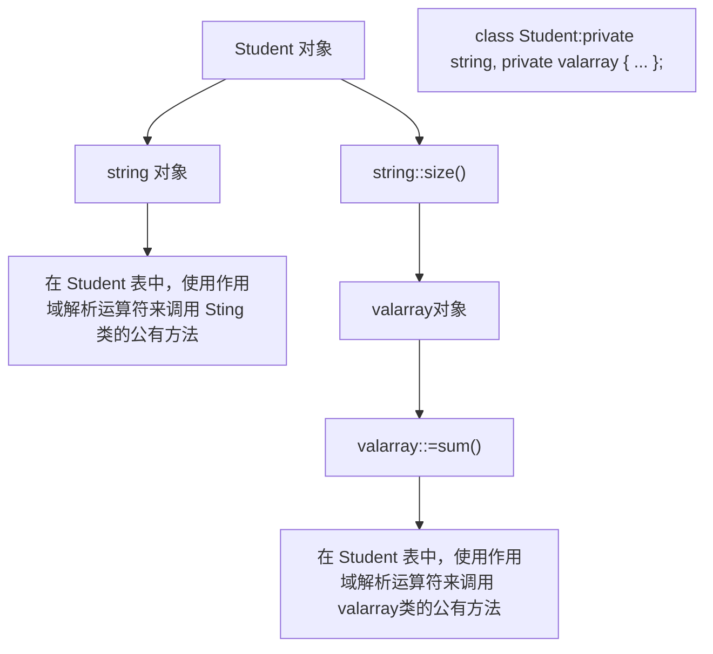
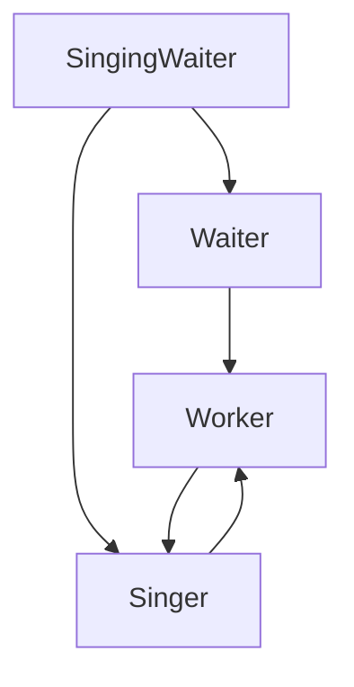

## 13.8.3 公有继承的考虑因素

通常，在程序中使用继承时，有很多问题需要注意。下面来看其中的一些问题。

## 1. is-a 关系

要遵循 is-a 关系。如果派生类不是一种特殊的基类，则不要使用公有派生。例如，不应从 Brain 类派生出 Programmer 类。如果要指出程序员有大脑，应将 Brain 类对象作为 Programmer 类的成员。

在某些情况下，最好的方法可能是创建包含纯虚函数的抽象数据类，并从它派生出其他的类。

请记住，表示 is-a 关系的方式之一是，无需进行显式类型转换，基类指针就可以指向派生类对象，基类引用可以引用派生类对象。另外，反过来是行不通的，即不能在不进行显式类型转换的情况下，将派生类指针或引用指向基类对象。这种显式类型转换（向下强制转换）可能有意义，也可能没有，这取决于类声明（参见图 13.4）。

## 2. 什么不能被继承

构造函数是不能继承的，也就是说，创建派生类对象时，必须调用派生类的构造函数。然而，派生类构造函数通常使用成员初始化列表语法来调用基类构造函数，以创建派生对象的基类部分。如果派生类构造函数没有使用成员初始化列表语法显式调用基类构造函数，将使用基类的默认构造函数。在继承链中，每个类都可以使用成员初始化列表将信息传递给相邻的基类。C++11 新增了一种让您能够继承构造函数的机制，但默认仍不继承构造函数。

析构函数也是不能继承的。然而，在释放对象时，程序将首先调用派生类的析构函数，然后调用基类的析构函数。如果基类有默认析构函数，编译器将为派生类生成默认析构函数。通常，对于基类，其析构函数应设置为虚的。

赋值运算符是不能继承的，原因很简单。派生类继承的方法的特征标与基类完全相同，但赋值运算符的特征标随类而异，这是因为它包含一个类型为其所属类的形参。赋值运算符确实有一些有趣的特征，下面介绍它们。

## 3. 赋值运算符

如果编译器发现程序将一个对象赋给同一个类的另一个对象，它将自动为这个类提供一个赋值运算符。这个运算符的默认或隐式版本将采用成员赋值，即将原对象的相应成员赋给目标对象的每个成员。然而，如果对象属于派生类，编译器将使用基类赋值运算符来处理派生对象中基类部分的赋值。如果显式地为基类提供了赋值运算符，将使用该运算符。与此相似，如果成员是另一个类的对象，则对于该成员，将使用其所属类的赋值运算符。

正如多次提到的，如果类构造函数使用new来初始化指针，则需要提供一个显式赋值运算符。因为对于派生对象的基类部分，C++将使用基类的赋值运算符，所以不需要为派生类重新定义赋值运算符，除非它添加了需要特别留意的数据成员。例如，baseDMA类显式地定义了赋值，但派生类lackDMA使用为它生成的隐式赋值运算符。

然而，如果派生类使用了 new，则必须提供显式赋值运算符。必须给类的每个成员提供赋值运算符，而不仅仅是新成员。HasDMA 类演示了如何完成这项工作:

```cpp
hasDMA & hasDMA::operator=(const hasDMA & hs)
{
    if (this == &hs)
        return *this;
    baseDMA::operator=(hs);  // copy base portion
    delete [] style;          // prepare for new style
    style = new char[std::strlen(hs.style) + 1];
    std::strcpy(style, hs.style);
    return *this;
}
```

将派生类对象赋给基类对象将会如何呢？（注意，这不同于将基类引用初始化为派生类对象。）请看下面的例子:

```javascript
Brass blips;                                // base class
BrassPlus snips("Rafe Flosh", 91191,3993.19, 600.0, 0.12); // derived class
blips = snips;                 // assign derived object to base object
```

这将使用哪个赋值运算符呢？赋值语句将被转换成左边的对象调用的一个方法:

```javascript
blips.operator=(snips);
```

其中左边的对象是 Brass 对象，因此它将调用 Brass ::operator = (const Brass &) 函数。is-a 关系允许 Brass 引用指向派生类对象，如 Snips。赋值运算符只处理基类成员，所以上述赋值操作将忽略 Snips 的 maxLoan 成员和其他 BrassPlus 成员。总之，可以将派生对象赋给基类对象，但这只涉及基类的成员。

相反的操作将如何呢？即可以将基类对象赋给派生类对象吗？请看下面的例子:

```txt
Brass gp("Griff Hexbait", 21234, 1200);    // base class
BrassPlus temp;                          // derived class
temp = gp;    // possible?
```

上述赋值语句将被转换为如下所示:

```javascript
temp.operator=(gp);
```

左边的对象是 BrassPlus 对象，所以它调用 BrassPlus ::operator=（const BrassPlus &）函数。然而，派生类引用不能自动引用基类对象，因此上述代码不能运行，除非有下面的转换构造函数:

```javascript
BrassPlus(const Brass &);
```

与 BrassPlus 类的情况相似，转换构造函数可以接受一个类型为基类的参数和其他参数，条件是其他参数有默认值:

```javascript
BrassPlus(const Brass & ba, double ml = 500, double r = 0.1);
```

如果有转换构造函数，程序将通过它根据 gp 来创建一个临时 BrassPlus 对象，然后将它用作赋值运算符的参数。

另一种方法是，定义一个用于将基类赋给派生类的赋值运算符:

```txt
BrassPlus & BrassPlus ::operator=(const Brass &) {...}
```

该赋值运算符的类型与赋值语句完全匹配，因此无需进行类型转换。

总之，问题“是否可以将基类对象赋给派生对象？”的答案是“也许”。如果派生类包含了这样的构造函数，即对将基类对象转换为派生类对象进行了定义，则可以将基类对象赋给派生对象。如果派生类定义了用于将基类对象赋给派生对象的赋值运算符，则也可以这样做。如果上述两个条件都不满足，则不能这样做，除非使用显式强制类型转换。

## 4. 私有成员与保护成员

对派生类而言，保护成员类似于公有成员；但对于外部而言，保护成员与私有成员类似。派生类可以直接访问基类的保护成员，但只能通过基类的成员函数来访问私有成员。因此，将基类成员设置为私有的可以提高安全性，而将它们设置为保护成员则可简化代码的编写工作，并提高访问速度。Stroustrup在其《The Design and Evolution of C++》一书中指出，使用私用数据成员比使用保护数据成员更好，但保护方法很有用。

## 5. 虚方法

设计基类时，必须确定是否将类方法声明为虚的。如果希望派生类能够重新定义方法，则应在基类中将方法定义为虚的，这样可以启用晚期联编（动态联编）；如果不希望重新定义方法，则不必将其声明为虚的，这样虽然无法禁止他人重新定义方法，但表达了这样的意思:您不希望它被重新定义。

请注意，不适当的代码将阻止动态联编。例如，请看下面的两个函数:

```cpp
void show(const Brass & rba)
{
    rba.ViewAcct();
    cout << endl;
}
void inadequate(Brass ba)
{
    ba_ViewAcct();
    cout << endl;
}
```

第一个函数按引用传递对象，第二个按值传递对象。

现在，假设将派生类参数传递给上述两个函数:

```javascript
BrassPlus buzz("Buzz Parsec", 00001111, 4300);
show(buzz);
inadequate(buzz);
```

show()函数调用使rba参数成为BrassPlus对象buzz的引用，因此，rba.ViewAcct()被解释为BrassPlus版本，正如应该的那样。但在inadequate()函数中（它是按值传递对象的），ba是Brass（const Brass &）构造函数创建的一个Brass对象（自动向上强制转换使得构造函数参数可以引用一个BrassPlus对象）。因此，在inadequate()中，ba.ViewAcct()是Brass版本，所以只有buzz的Brass部分被显示。

## 6. 析构函数

正如前面介绍的，基类的析构函数应当是虚的。这样，当通过指向对象的基类指针或引用来删除派生对象时，程序将首先调用派生类的析构函数，然后调用基类的析构函数，而不仅仅是调用基类的析构函数。

## 7. 友元函数

由于友元函数并非类成员，因此不能继承。然而，您可能希望派生类的友元函数能够使用基类的友元函数。为此，可以通过强制类型转换将，派生类引用或指针转换为基类引用或指针，然后使用转换后的指针或引用来调用基类的友元函数:

```cpp
ostream & operator<<(ostream & os, const hasDMA & hs)
{
// type cast to match operator<<(ostream & , const baseDMA &) os << (const baseDMA &) hs;
os << "Style: " << hs.style << endl;
return os;
}
```

也可以使用第 15 章将讨论的运算符 dynamic\_cast<>来进行强制类型转换:

```txt
os << dynamic_cast<const baseDMA &> (hs);
```

鉴于第 15 章将讨论的原因，这是更佳的强制类型转换方式。

## 8. 有关使用基类方法的说明

以公有方式派生的类的对象可以通过多种方式来使用基类的方法。

- 派生类对象自动使用继承而来的基类方法，如果派生类没有重新定义该方法。
- 派生类的构造函数自动调用基类的构造函数。
- 派生类的构造函数自动调用基类的默认构造函数，如果没有在成员初始化列表中指定其他构造函数。
- 派生类构造函数显式地调用成员初始化列表中指定的基类构造函数。
- 派生类方法可以使用作用域解析运算符来调用公有的和受保护的基类方法。
- 派生类的有元函数可以通过强制类型转换，将派生类引用或指针转换为基类引用或指针，然后使

用该引用或指针来调用基类的友元函数。

## 13.8.4 类函数小结

C++类函数有很多不同的变体，其中有些可以继承，有些不可以。有些运算符函数既可以是成员函数，也可以是友元，而有些运算符函数只能是成员函数。表13.1（摘自《The Annotated C++ Reference Manual》）总结了这些特征，其中op=表示诸如+=、\*=等格式的赋值运算符。注意，op=运算符的特征与“其他运算符”类别并没有区别。单独列出op=旨在指出这些运算符与=运算符的行为是不同的。

表 13.1 成员函数属性

| 函数 | 能否继承 | 成员还是友元 | 默认能否生成 | 能否为虚函数 | 是否可以有返回类型 |
| --- | --- | --- | --- | --- | --- |
| 构造函数 | 否 | 成员 | 能 | 否 | 否 |
| 析构函数 | 否 | 成员 | 能 | 能 | 否 |
| = | 否 | 成员 | 能 | 能 | 能 |
| &amp; | 能 | 任意 | 能 | 能 | 能 |
| 转换函数 | 能 | 成员 | 否 | 能 | 否 |
| () | 能 | 成员 | 否 | 能 | 能 |
| [] | 能 | 成员 | 否 | 能 | 能 |
| -> | 能 | 成员 | 否 | 能 | 能 |
| op= | 能 | 任意 | 否 | 能 | 能 |
| new | 能 | 静态成员 | 否 | 否 | void* |
| delete | 能 | 静态成员 | 否 | 否 | void |
| 其他运算符 | 能 | 任意 | 否 | 能 | 能 |
| 其他成员 | 能 | 成员 | 否 | 能 | 能 |
| 友元 | 否 | 友元 | 否 | 否 | 能 |

## 13.9 总结

继承通过使用已有的类（基类）定义新的类（派生类），使得能够根据需要修改编程代码。公有继承建立 is-a 关系，这意味着派生类对象也应该是某种基类对象。作为 is-a 模型的一部分，派生类继承基类的数据成员和大部分方法，但不继承基类的构造函数、析构函数和赋值运算符。派生类可以直接访问基类的公有成员和保护成员，并能够通过基类的公有方法和保护方法访问基类的私有成员。可以在派生类中新增数据成员和方法，还可以将派生类用作基类，来做进一步的开发。每个派生类都必须有自己的构造函数。程序创建派生类对象时，将首先调用基类的构造函数，然后调用派生类的构造函数；程序删除对象时，将首先调用派生类的析构函数，然后调用基类的析构函数。

如果要将类用作基类，则可以将成员声明为保护的，而不是私有的，这样，派生类将可以直接访问这些成员。然而，使用私有成员通常可以减少出现编程问题的可能性。如果希望派生类可以重新定义基类的方法，则可以使用关键字 virtual 将它声明为虚的。这样对于通过指针或引用访问的对象，能够根据对象类型来处理，而不是根据引用或指针的类型来处理。具体地说，基类的析构函数通常应当是虚的。

可以考虑定义一个 ABC:只定义接口，而不涉及实现。例如，可以定义抽象类 Shape，然后使用它派生出具体的形状类，如 Circle 和 Square。ABC 必须至少包含一个纯虚方法，可以在声明中的分号前面加上=0 来声明纯虚方法。

```typescript
virtual double area() const = 0;
```

不一定非得定义纯虚方法。对于包含纯虚成员的类，不能使用它来创建对象。纯虚方法用于定义派生类的通用接口。

## 13.10 复习题

1. 派生类从基类那里继承了什么？
2. 派生类不能从基类那里继承什么？
3. 假设 baseDMA ::operator=()函数的返回类型为 void，而不是 baseDMA &, 这将有什么后果？如果返回类型为 baseDMA，而不是 baseDMA &, 又将有什么后果？

4. 创建和删除派生类对象时，构造函数和析构函数调用的顺序是怎样的？

5. 如果派生类没有添加任何数据成员，它是否需要构造函数？

6. 如果基类和派生类定义了同名的方法，当派生类对象调用该方法时，被调用的将是哪个方法？

7. 在什么情况下，派生类应定义赋值运算符？

8. 可以将派生类对象的地址赋给基类指针吗？可以将基类对象的地址赋给派生类指针吗？

9. 可以将派生类对象赋给基类对象吗？可以将基类对象赋给派生类对象吗？

10. 假设定义了一个函数，它将基类对象的引用作为参数。为什么该函数也可以将派生类对象作为参数？

11. 假设定义了一个函数，它将基类对象作为参数（即函数按值传递基类对象）。为什么该函数也可以将派生类对象作为参数？

12. 为什么通常按引用传递对象比按值传递对象的效率更高？

13. 假设 Corporation 是基类，PublicCorporation 是派生类。再假设这两个类都定义了 head() 函数，ph 是指向 Corporation 类型的指针，且被赋给了一个 PublicCorporation 对象的地址。如果基类将 head() 定义为:

a. 常规非虚方法；

b. 虚方法;

则 ph->head() 将被如何解释？

14. 下述代码有什么问题？

```cpp
class Kitchen
{
private:
    double kit_sq_ft;
public:
    Kitchen() {kit_sq_ft = 0.0; }
    virtual double area() const { return kit_sq_ft * kit_sq_ft; }
};
class House : public Kitchen
{
private:
    double all_sq_ft;
public:
    House() {all_sq_ft += kit_sq_ft;}
    double area(const char *s) const { cout << s; return all_sq_ft; }
};
```

## 13.11 编程练习

1. 以下面的类声明为基础:

```txt
// base class
class Cd {  // represents a CD disk
```

```cpp
private:
    char performers[50];
    char label[20];
    int selections;   // number of selections
    double playtime;  // playing time in minutes
public:
    Cd{char * s1, char * s2, int n, double x};
    Cd{const Cd & d};
    Cd();
    ~Cd();
    void Report() const;  // reports all CD data
    Cd & operator=(const Cd & d);
};
```

派生出一个 Classic 类，并添加一组 char 成员，用于存储指出 CD 中主要作品的字符串。修改上述声明，使基类的所有函数都是虚的。如果上述定义声明的某个方法并不需要，则请删除它。使用下面的程序测试您的产品:

```cpp
#include <iostream>
using namespace std;
#include "classic.h"      // which will contain #include cd.h
void Bravo(const Cd & disk);
int main()
{
    Cd c1("Beatles", "Capitol", 14, 35.5);
    Classic c2 = CClassic["Piano Sonata in B-flat, Fantasia in-E",
                   "Alfred Brendel", "Philips", 2, 57.17};
    Cd *pcd = &c1;   -

    cout << "Using object directly:\n";
    c1.Report();     // use Cd method
    c2.Report();     // use Classic method

    cout << "Using type cd * pointer to objects:\n";
    pcd->Report(); = // use Cd method for cd object
    pcd = &c2;
    pcd->Report();  // use Classic method for classic object

    cout << "Calling a function with a Cd_reference argument:\n";
    Bravo(c1);
    Bravo(c2);

    cout << "Testing assignment: ";
    Classic copy;
    copy = c2;
    copy.Report()

    return 0;
}

void Bravo(const Cd & disk)
{
    disk.Report();
}
```

2. 完成练习1，但让两个类使用动态内存分配而不是长度固定的数组来记录字符串。
3. 修改 baseDMA-lacksDMA-hasDMA 类层次，让三个类都从一个 ABC 派生而来，然后使用与程序清单 13.10 相似的程序对结果进行测试。也就是说，它应使用 ABC 指针数组，并让用户决定要创建的对象类型。在类定义中添加 virtual View() 方法以处理数据显示。

4. Benevolent Order of Programmers 用来维护瓶装葡萄酒箱。为描述它，BOP Portmaster 设置了一个 Port 类，其声明如下:

```cpp
#include <iostream>
using namespace std;
class Port
{
private:
    char * brand;
    char style[20]; // i.e., tawny, ruby, vintage
    int bottles;
public:
    Port(const char * br = "none", const char * st = "none", int b = 0);
    Port(const Port & p);                 // copy constructor
    virtual ~Port() { delete [] brand; }
    Port & operator=(const Port & p);
    Port & operator+=(int b);             // adds b to bottles
    Port & operator<=(int b);             // subtracts b from bottles, if available
    int BottleCount() const { return bottles; }
    virtual void Show() const;
    friend ostream & operator<<(ostream & os, const Port & p);
};
```

show()方法按下面的格式显示信息:

```yaml
Brand: Gallo
Kind: tawny
Bottles: 20
```

operator<<()函数按下面的格式显示信息（末尾没有换行符）:

```txt
Gallo, tawny, 20
```

PortMaster 完成了 Port 类的方法定义后派生了 VintagePort 类，然后被解职——因为不小心将一瓶 45 度 Cockburn 泼到了正在准备烤肉调料的人身上，VintagePort 类如下所示:

```cpp
class VintagePort : public Port // style necessarily = "vintage"
{
private:
    char * nickname;          // i.e., "The Noble" or "Old Velvet", etc.
    int year;                // vintage year
public:
    VintagePort();
    VintagePort(const char * br, int b, const char * nn, int y);
    VintagePort(const VintagePort & vp);
    ~VintagePort() { delete [] nickname; }
    VintagePort & operator=(const VintagePort & vp);
    void Show() const;
    friend ostream & operator<<(ostream & os, const VintagePort & vp);
};
```

您被指定负责完成 VintagePort。

a. 第一个任务是重新创建 Port 方法定义，因为前任被开除时销毁了方法定义。
b. 第二个任务是解释为什么有的方法重新定义了，而有些没有重新定义。
c. 第三个任务是解释为何没有将 operator=() 和 operator<<() 声明为虚的。
d. 第四个任务是提供 VintagePort 中各个方法的定义。

## 第 14 章 C++中的代码重用

## 本章内容包括:

- has-a 关系。
- 包含对象成员的类。
- 模板类 valarray。
- 私有和保护继承。
- 多重继承。
- 虚基类。
- 创建类模板。
- 使用类模板。
- 模板的具体化。

C++的一个主要目标是促进代码重用。公有继承是实现这种目标的机制之一，但并不是唯一的机制。本章将介绍其他方法，其中之一是使用这样的类成员:本身是另一个类的对象。这种方法称为包含（containment）、组合（composition）或层次化（layering）。另一种方法是使用私有或保护继承。通常，包含、私有继承和保护继承用于实现 has-a 关系，即新的类将包含另一个类的对象。例如，HomeTheater 类可能包含一个 BluRayPlayer 对象。多重继承使得能够使用两个或更多的基类派生出新的类，将基类的功能组合在一起。

第 10 章介绍了函数模板，本章将介绍类模板——另一种重用代码的方法。类模板使我们能够使用通用术语定义类，然后使用模板来创建针对特定类型定义的特殊类。例如，可以定义一个通用的栈模板，然后使用该模板创建一个用于表示 int 值栈的类和一个用于表示 double 值栈的类，甚至可以创建一个这样的类，即用于表示由栈组成的栈。

## 14.1 包含对象成员的类

首先介绍包含对象成员的类。有一些类（如 string 类和第 16 章将介绍的标准 C++类模板）为表示类中的组件提供了方便的途径。下面来看一个具体的例子。

学生是什么？入学者？参加研究的人？残酷现实社会的避难者？有姓名和一系列考试分数的人？显然，最后一个定义完全没有表示出人的特征，但非常适合于简单的计算机表示。因此，让我们根据该定义来开发 Student 类。

将学生简化成姓名和一组考试分数后，可以使用一个包含两个成员的类来表示它:一个成员用于表示姓名，另一个成员用于表示分数。对于姓名，可以使用字符数组来表示，但这将限制姓名的长度。当然，也可以使用 char 指针和动态内存分配，但正如第 12 章指出的，这将要求提供大量的支持代码。一种更好的方法是，使用一个由他人开发好的类的对象来表示。例如，可以使用一个 String 类（参见第 12 章）或标准 C++ string 类的对象来表示姓名。较简单的选择是使用 string 类，因为 C++ 库提供了这个类的所有实现代码，且其实现更完美。要使用 String 类，您必须在项目中包含实现文件 string1.cpp。

对于考试分数，存在类似的选择。可以使用一个定长数组，这限制了数组的长度；可以使用动态内存分配并提供大量的支持代码；也可以设计一个使用动态内存分配的类来表示该数组；还可以在标准 C++ 库中查找一个能够表示这种数据的类。

自己开发这样的类一点问题也没有。开发简单的版本并不那么难，因为 double 数组与 char 数组有很多相似之处，因此可以根据 String 类来设计表示 double 数组的类。事实上，本书以前的版本就这样做过。

当然，如果 C++ 库提供了合适的类，实现起来将更简单。C++ 库确实提供了一个这样的类，它就是 valarray。

## 14.1.1 valarray 类简介

valarray 类是由头文件 valarray 支持的。顾名思义，这个类用于处理数值（或具有类似特性的类），它支持诸如将数组中所有元素的值相加以及在数组中找出最大和最小的值等操作。valarray 被定义为一个模板类，以便能够处理不同的数据类型。本章后面将介绍如何定义模板类，但就现在而言，您只需知道如何使用模板类即可。

模板特性意味着声明对象时，必须指定具体的数据类型。因此，使用 valarray 类来声明一个对象时，需要在标识符 valarray 后面加上一对尖括号，并在其中包含所需的数据类型:

```txt
valarray<int> q_values;      // an array of int
valarray<double> weights;   // an array of double
```

第 4 章介绍 vector 和 array 类时，您见过这种语法，它非常简单。这些类也可用于存储数字，但它们提供的算术支持没有 valarray 多。

这是您需要学习的唯一新语法，它非常简单。

类特性意味着要使用 valarray 对象，需要了解这个类的构造函数和其他类方法。下面是几个使用其构造函数的例子:

```txt
double gpa[5] = {3.1, 3.5, 3.8, 2.9, 3.3};
valarray<double> v1;          // an array of double, size 0=
valarray<int> v2(8);        // an array of 8 int elements-
valarray<int> v3(10,8);      // an array of 8 int elements,
                                      // each set to 10--
valarray<double> v4(gpa, -4); // an array of 4 elements
                                      // initialized to the first 4 elements of gpa
```

从中可知，可以创建长度为零的空数组、指定长度的空数组、所有元素度被初始化为指定值的数组、用常规数组中的值进行初始化的数组。在 C++11 中，也可使用初始化列表:

```txt
valarray<int> v5 = {20, 32, 17, 9}; // C++11
```

下面是这个类的一些方法。

- operator[](): 让您能够访问各个元素。
- size(): 返回包含的元素数。
- sum(): 返回所有元素的总和。
- max(): 返回最大的元素。
- min(-): 返回最小的元素。

还有很多其他的方法，其中的一些将在第16章介绍；但就这个例子而言，上述方法足够了。

## 14.1.2 Student 类的设计

至此, 已经确定了 Student 类的设计计划: 使用一个 string 对象来表示姓名, 使用一个 valarray&lt;double&gt; 来表示考试分数。那么如何设计呢? 您可能想以公有的方式从这两个类派生出 Student 类; 这将是多重公有继承, -C++ 允许这样做, 但在这里并不合适, 因为学生与这些类之间的关系不是 is-a 模型。学生不是姓名，也不是一组考试成绩。这里的关系是has-a，学生有姓名，也有一组考试分数。通常，用于建立has-a关系的C++技术是组合（包含），即创建一个包含其他类对象的类。例如，可以将Student类声明为如下所示:

```cpp
class Student_
F
private:
    string_name;          // use a string object for name
    valarray<double> scores;  // use a valarray<double> object for scores-
    ...
F;
```

同样，上述类将数据成员声明为私有的。这意味着 Student 类的成员函数可以使用 string 和 valarray&lt;double&gt;类的公有接口来访问和修改 name 和-scores 对象，但在类的外面不能这样做，而只能通过 Student 类的公有接口访问 name 和 score（请参见图 14）。对于这种情况，通常被描述为 Student 类获得了其成员对象的实现，但没有继承接口。例如，Student 对象使用 string 的实现，而不是 char \* name 或 char name [26] 实现来保存姓名。但 Student 对象并不是天生就有使用函数 string operator +=() 的能力。


<details>
<summary>flowchart</summary>

```mermaid
graph TD
  subgraph Student_Group
  A["name\nstring 对象"] --> B{"name.size()"}
  B -->|Yes| C["在 Student 表中，通过对象 name 调用 string 类的公有方法"]
  B -->|No| D["scores\nvalarray<double>对象\nscores.sum()"]
  C --> E["在 Student 表中，通过对象 scores 调用 valarray<double>类的公有方法"]
  end
  subgraph Class_Group
    F["class Student\n{ private\nstring name;\ valarray<double> scores;\ ... }\n};
```
</details>

图 14.1 对象中的对象:包含

## 接口和实现

使用公有继承时，类可以继承接口，可能还有实现（基类的纯虚函数提供接口，但不提供实现）。获得接口是 is-a 关系的组成部分。而使用组合，类可以获得实现，但不能获得接口。不继承接口是 has-a 关系的组成部分。

对于 has-a 关系来说，类对象不能自动获得被包含对象的接口是一件好事。例如，string 类将+运算符重载为将两个字符串连接起来；但从概念上说，将两个 Student 对象串接起来是没有意义的。这也是这里不使用公有继承的原因之一。另一方面，被包含的类的接口部分对新类来说可能是有意义的。例如，可能希望使用 string 接口中的 operator<() 方法将 Student 对象按姓名进行排序，为此可以定义 Student::Operator<() 成员函数，它在内部使用函数 string::Operator<()。下面介绍一些细节。

## 14.1.3 Student 类示例

现在需要提供 Student 类的定义，当然它应包含构造函数以及一些用作 Student 类接口的方法。程序清单 14.1 是 Student 类的定义，其中所有构造函数都被定义为内联的；它还提供了一些用于输入和输出的友元函数。

程序清单 14.1 studentc.h

```cpp
// studentc.h -- defining a Student class using containment
#ifndef STUDENTC_H_
#define STUDENTC_H_

#include <iostream>
#include <string>
#include <valarray>
class Student
{
private:
    typedef std::valarray<double> ArrayDb;
    std::string name;          // contained object
    ArrayDb-scores;         // contained object
    // private method for scores output
    std::ostream & arr_out(std::ostream & os)=const;
public:
    Student() : name{"Null Student"), scores() {}
    explicit Student(const std::string& s)
        : name(s), scores() {}
    explicit Student(int n) : name("Nully"), scores(n) {}
    Student(const std::string & s, int_n)
        : name(s), scores(n) {}
    Student(const std::string & s, const ArrayDb & a) _
        : name(s), scores(a) {}
    Student(const char * str, const double * pd, int n)
        : name(str), scores(pd, n) {}
    ~Student() {}
    double Average() const;
    const std::string & Name() const;
    double & operator[](int i);
    double operator[](int i) const;
// friends
    // input
    friend std::istream & operator>>(std::istream & is,
                               Student & stu);  // 1 word
    friend std::istream & getline(std::istream & is,
                               Student & stu);      // 1 line
    // output
    friend std::ostream & operator<<(std::ostream & os,
                               const Student & stu);
};

#endif
```

为简化表示，Student 类的定义中包含下述 typedef:

```rust
typedef std::valarray<double> ArrayDb;
```

这样，在以后的代码中便可以使用表示 ArrayDb，而不是 std::valarray&lt;double&gt;，因此类方法和友元函数可以使用 ArrayDb 类型。将该 typedef 放在类定义的私有部分意味着可以在 Student 类的实现中使用它，但在 Student 类外面不能使用。

请注意关键字 explicit 的用法:

```txt
explicit Student(const std::string & s)
    := name(s), scores() {}
explicit Student(int n) := name{"Nully"}, scores(n) {}
```

本书前面说过，可以用一个参数调用的构造函数将用作从参数类型到类类型的隐式转换函数；但这通常不是好主意。在上述第二个构造函数中，第一个参数表示数组的元素个数，而不是数组中的值，因此将一个构造函数用作 int 到 Student 的转换函数是没有意义的，所以使用 explicit 关闭隐式转换。如果省略该关键字，则可以编写如下所示的代码:

```txt
Student doh("Homer", 10); // store "Homer", create array of 10 elements
doh = 5; // reset name to "Nully", reset to empty array of 5 elements
```

在这里，马虎的程序员键入了 doh 而不是 doh[0]。如果构造函数省略了 explicit，则将使用构造函数调用 Student（5）将 5 转换为一个临时 Student 对象，并使用 “Nully” 来设置成员 name 的值。因此赋值操作将使用临时对象替换原来的 doh 值。使用了 explicit 后，编译器将认为上述赋值运算符是错误的。

## C++和约束

C++包含让程序员能够限制程序结构的特性——使用 explicit 防止单参数构造函数的隐式转换，使用 const 限制方法修改数据，等等。这样做的根本原因是:在编译阶段出现错误优于在运行阶段出现错误。

## 1. 初始化被包含的对象

构造函数全都使用您熟悉的成员初始化列表语法来初始化 name 和 score 成员对象。在前面的一些例子中，构造函数用这种语法来初始化内置类型的成员:

```txt
Queue::Queue(int qs) : qsize(qs) {...} //initialize qsize.to qs
```

上述代码在成员初始化列表中使用的是数据成员的名称（qsize）。另外，前面介绍的示例中的构造函数还使用成员初始化列表初始化派生对象的基类部分:

```txt
hasDMA::hasDMA(const hasDMA & hs):: baseDMA(hs)={...}
```

对于继承的对象，构造函数在成员初始化列表中使用类名来调用特定的基类构造函数。对于成员对象，构造函数则使用成员名。例如，请看程序清单14.3的最后一个构造函数:

```javascript
Student(const char * str, const double * pd, int n):
    : name(str), scores(pd, n) { } -
```

因为该构造函数初始化的是成员对象，而不是继承的对象，所以在初始化列表中使用的是成员名，而不是类名。初始化列表中的每一项都调用与之匹配的构造函数，即 name(str) 调用构造函数 string(const char \*), scores(pd, n) 调用构造函数 ArrayDb(const double \*, int)。

如果不使用初始化列表语法，情况将如何呢？C++要求在构建对象的其他部分之前，先构建继承对象的所有成员对象。因此，如果省略初始化列表，C++将使用成员对象所属类的默认构造函数。

## 初始化顺序

当初始化列表包含多个项目时，这些项目被初始化的顺序为它们被声明的顺序，而不是它们在初始化列表中的顺序。例如，假设 Student 构造函数如下:

```txt
Student(const char * str, const double * pd, int n)
    : scores(pd, n),  name(str) { }
```

则 name 成员仍将首先被初始化，因为在类定义中它首先被声明。对于这个例子来说，初始化顺序并不重要，但如果代码使用一个成员的值作为另一个成员的初始化表达式的一部分时，初始化顺序就非常重要了。

## 2. 使用被包含对象的接口

被包含对象的接口不是公有的，但可以在类方法中使用它。例如，下面的代码说明了如何定义一个返回学生平均分数的函数:

```cpp
double Student::Average() const
{
    if (scores.size() > 0)
        return scores.sum()/scores.size();
    else
        return 0;
}
```

上述代码定义了可由 Student 对象调用的方法，该方法内部使用了 valarray 的方法 size() 和 sum()。这是因为 scores 是一个 valarray 对象，所以它可以调用 valarray 类的成员函数。总之，Student 对象调用 Student 的方法，而后者使用被包含的 valarray 对象来调用 valarray 类的方法。

同样，可以定义一个使用 string 版本的<<运算符的友元函数:

```cpp
// use string version of operator<<()
ostream & operator<<(ostream & os, const Student & stu)
{
    os << "Scores for " << stu.name << ":\n";
    ...
}
```

因为 stu.name 是一个 string 对象，所以它将调用函数 operatot<<(ostream &, const string &)，该函数位于 string 类中。注意，operator<<(ostream & os, const Student & stu)必须是 Student 类的友元函数，这样才能访问 name 成员。另一种方法是，在该函数中使用公有方法 Name()，而不是私有数据成员 name。

同样，该函数也可以使用 valarray 的<<实现来进行输出，不幸的是没有这样的实现；因此，Student 类定义了一个私有辅助方法来处理这种任务:

```cpp
// private method
ostream & Student::arr_out(ostream & os) const
{
    int i;
    int lim = scores.size();
    if (lim > 0)
    {
        for (i = 0; i < lim; i++)
        {
            os << scores[i] << " ";
            if (i % 5 == 4)
                os << endl;
        }
        if (i % 5 != 0)
            os << endl;
    }
    else
        os << " empty array ";
    return os;
}
```

通过使用这样的辅助方法，可以将零乱的细节放在一个地方，使得友元函数的编码更为整洁:

```cpp
// use string version of operator<<()
ostream & operator<<(ostream-& os, const Student & stu)
{
    os << "Scores for " << stu.name << ":\n";
    stu.arr_out(os);  // use private method for scores
    return os;
}
```

辅助函数也可用作其他用户级输出函数的构建块——如果您选择提供这样的函数的话。

程序清单 14.2 是 Student 类的类方法文件，其中包含了让您能够使用[]运算符来访问 Student 对象中各项成绩的方法。

程序清单 14.2 student.cpp

```cpp
// studentc.cpp -- Student class using containment
#include "studentc.h"
using std::ostream;
using std::endl;
using std::istream;
using std::string;
//public methods
double Student::Average() const
{
    if (scores.size()) > 0)
        return scores.sum()/scores.size();
    else
        return 0;
}

const string & Student::Name() const
{
    return name;
}
double & Student::operator[](int i);
{
    return scores[i];          // use.valarray<double>::operator[]()
}

double Student::operator[](int i) const
{
    return scores[i];
}

// private method
ostream & Student::arr_out(ostream & os) const
{
    int i;
    int lim = scores.size();
    if (lim > 0)
    {
        for (i = 0; i < lim; i++)
        {
            os << scores[i] << " ";
            if (i % 5 == 4)
                os << endl;
```

```cpp
}
    if (i % 5 != -0)
        os << endl;
}
else
    os << " empty array ";
return os;
}

// friends
// use string version of operator>>()
istream & operator>>(istream & is, Student & stu)
{
    is >> stu.name;
    return is;
}

// use string friend getline(ostream &, const_string &) istream & getline(istream & is, Student & stu)
{
    getline(is, stu.name);
    return is;
}

// use string version of operator<<( )
ostream & operator<<(ostream & os, const Student & stu)
{
    os << "Scores for " << stu.name << ":\n";
    stu.arr_out(os); // use private method for scores
    return os;
}
```

除私有辅助方法外，程序清单 14.2 并没有新增多少代码。使用包含让您能够充分利用已有的代码。

## 3. 使用新的 Student 类

下面编写一个小程序来测试这个新的 Student 类。出于简化的目的，该程序将使用一个只包含 3 个 Student 对象的数组，其中每个对象保存 5 个考试成绩。另外还将使用一个不复杂的输入循环，该循环不验证输入，也不让用户中途退出。程序清单 14.3 列出了该测试程序，请务必将该程序与 Student.cpp 一起进行编译。

程序清单 14.3 use\_stuc.cpp

```cpp
// use_stuc.cpp -- using a composite class
// compile with studentc.cpp
#include <iostream>
#include "studentc.h"
using std::cin;
using std::cout;
using std::endl;

void set(Student & sa, int n);
const int pupils = 3;
const int quizzes = 5;

int main()
```

```cpp
{
    Student ada[pupils] =
        {Student(quizzes), Student(quizzes), Student(quizzes)};
    int i;
    for (i = 0; i < pupils; ++i)
        set(ada[i], quizzes);
    cout << "\nStudent List:\n";
    for (i = 0; i < pupils; ++i)
        cout << ada[i].Name() << endl;
    cout << "\nResults:";
    for (i = 0; i < pupils; ++i)
    {
        cout << endl << ada[i];
        cout << "average: " << ada[i].Average() << endl;
    }
    cout << "Done.\n";
    return 0;
}

void set(Student & sa, int n)
{
    cout << "Please enter the student's name: ";
    getline(cin, sa);
    cout << "Please enter " << n << " quiz scores:\n";
    for (int i = 0; i < n; i++)
        cin >> sa[i];
    while (cin.get() != '\n')
        continue;
}
```

下面是程序清单 14.1～程序清单 14.3 组成的程序的运行情况:

```txt
Please enter the student's name: Gil Bayts
Please enter 5 quiz scores:
92 94 96 93 95
Please enter the student's name: Pat Roone
Please enter 5 quiz scores:
83 89 72 78 95
Please enter the student's name: Fleur O'Day
Please enter 5 quiz scores:
92 89 96 74 64
Student List:
Gil Bayts
Pat Roone
Fleur O'Day

Results:
Scores for Gil Bayts:
92 94 96 93 95
average: 94

Scores for Pat Roone:
83 89 72 78 95
average: 83.4
```

```txt
Scores for Fleur O'Day:
92 89 96 74 64
average: 83
Done.
```

## 14.2 私有继承

C++还有另一种实现 has-a 关系的途径——私有继承。使用私有继承，基类的公有成员和保护成员都将成为派生类的私有成员。这意味着基类方法将不会成为派生对象公有接口的一部分，但可以在派生类的成员函数中使用它们。

下面更深入地探讨接口问题。使用公有继承，基类的公有方法将成为派生类的公有方法。总之，派生类将继承基类的接口；这是 is-a 关系的一部分。使用私有继承，基类的公有方法将成为派生类的私有方法。总之，派生类不继承基类的接口。正如从被包含对象中看到的，这种不完全继承是 has-a 关系的一部分。

使用私有继承，类将继承实现。例如，如果从 String 类派生出 Student 类，后者将有一个 String 类组件，可用于保存字符串。另外，Student 方法可以使用 String 方法来访问 String 组件。

包含将对象作为一个命名的成员对象添加到类中，而私有继承将对象作为一个未被命名的继承对象添加到类中。我们将使用术语子对象（subobject）来表示通过继承或包含添加的对象。

因此私有继承提供的特性与包含相同:获得实现，但不获得接口。所以，私有继承也可以用来实现 has-a 关系。接下来介绍如何使用私有继承来重新设计 Student 类。

## 14.2.1 Student 类示例（新版本）

要进行私有继承，请使用关键字 private 而不是 public 来定义类（实际上，private 是默认值，因此省略访问限定符也将导致私有继承）。Student 类应从两个类派生而来，因此声明将列出这两个类:

```cpp
class Student : private std::string, private std::valarray<double>
{
public:
    ...
};
```

使用多个基类的继承被称为多重继承（multiple inheritance，MI）。通常，MI尤其是公有MI将导致一些问题，必须使用额外的语法规则来解决它们，这将在本章后面介绍。但在这个示例中，MI不会导致问题。

新的 Student 类不需要私有数据，因为两个基类已经提供了所需的所有数据成员。包含版本提供了两个被显式命名的对象成员，而私有继承提供了两个无名称的子对象成员。这是这两种方法的第一个主要区别。

## 1. 初始化基类组件

隐式地继承组件而不是成员对象将影响代码的编写，因为再也不能使用 name 和 scores 来描述对象了，而必须使用用于公有继承的技术。例如，对于构造函数，包含将使这样的构造函数:

```txt
Student(const char * str, const double * pd, int n)
    : name(str), scores(pd, n) {}      // use object names for containment
```

对于继承类，新版本的构造函数将使用成员初始化列表语法，它使用类名而不是成员名来标识构造函数:

```cpp
Student(const char * str, const double * pd, int n)
    : std::string(str), ArrayDb(pd, n) {} // use class names for inheritance
```

在这里, ArrayDb 是 std::valarray&lt;double&gt;的别名。成员初始化列表使用 std::string(str), 而不是 name(str)。这是包含和私有继承之间的第二个主要区别。

程序清单 14.4 列出了新的类定义。唯一不同的地方是，省略了显式对象名称，并在内联构造函数中使用了类名，而不是成员名。

程序清单 14.4 studenti.h

```cpp
// studenti.h -- defining a Student class using private inheritance
#ifndef STUDENTC_H
#define STUDENTC_H

#include <iostream>
#include <valarray>
#include <string>
class Student : private std::string, private std::valarray<double>
{
private:
    typedef std::valarray<double> ArrayDb;
    // private method for scores output
    std::ostream & arr_out(std::ostream- & os) const; --
public:
    Student() : std::string("Null Student"), ArrayDb() {}
    explicit Student(const std::string & s)
        : std::string(s), ArrayDb() {}
    explicit Student(int n) : std::string("Nully"), ArrayDb(n) {}
    Student(const std::string & s, int n)
        : std::string(s), ArrayDb(n) {}
    Student(const std::string & s, const ArrayDb & a)
        : std::string(s), ArrayDb(a) {}
    Student(const char * str, const double * pd, int n)
        : std::string(str), ArrayDb(pd, n) {}
    ~Student() {}
    double Average() const;
    double & operator[](int i);
    double operator[](int i) const;
    const std::string & Name() const;
// friends
    // input
    friend std::istream & operator>>(std::istream & is,
                               Student & stu); // 1 word
    friend std::istream & getline(std::istream & is,
                               Student & stu); // 1 line
    // output
    friend std::ostream & operator<<(std::ostream & os,
                               const Student & stu);
};

#endif
```

## 2. 访问基类的方法

使用私有继承时，只能在派生类的方法中使用基类的方法。但有时候可能希望基类工具是公有的。例如，在类声明中提出可以使用 average() 函数。和包含一样，要实现这样的目的，可以在公有 Student::average() 函数中使用私有 Student::Average() 函数（参见图 14.2）。包含使用对象来调用方法:

```cpp
double Student::Average() const
{
    if (scores.size()) > 0)
        return_scores.sum()/scores.size();
    else
```


<details>
<summary>flowchart</summary>


</details>

图 14.2 对象中的对象:私有继承

然而，私有继承使得能够使用类名和作用域解析运算符来调用基类的方法:

```cpp
double Student::Average() const
{
    if (ArrayDb::size(| > 0)
        return ArrayDb::sum()/ArrayDb::size();
    else
        return 0;
}
```

总之，使用包含时将使用对象名来调用方法，而使用私有继承时将使用类名和作用域解析运算符来调用方法。

## 3. 访问基类对象

使用作用域解析运算符可以访问基类的方法, 但如果要使用基类对象本身, 该如何做呢? 例如, Student 类的包含版本实现了 Name() 方法, 它返回 string 对象成员 name; 但使用私有继承时, 该 string 对象没有名称。那么, Student 类的代码如何访问内部的 string 对象呢?

答案是使用强制类型转换。由于 Student 类是从 string 类派生而来的，因此可以通过强制类型转换，将 Student 对象转换为 string 对象；结果为继承而来的 string 对象。本书前面介绍过，指针 this 指向用来调用方法的对象，因此 \*this 为用来调用方法的对象，在这个例子中，为类型为 Student 的对象。为避免调用构造函数创建新的对象，可使用强制类型转换来创建一个引用:

```cpp
const string & Student::Name()-const
{
    return (const string &) *this;
}
```

上述方法返回一个引用，该引用指向用于调用该方法的 Student 对象中的继承而来的 string 对象。

## 4. 访问基类的友元函数

用类名显式地限定函数名不适合于友元函数，这是因为友元不属于类。然而，可以通过显式地转换为基类来调用正确的函数。例如，对于下面的友元函数定义:

```txt
ostream & operator<<(ostream & os, const Student & stu)
{
    os << "Scores for " << (const String &) stu << ":\n";
...
}
```

如果 plato 是一个 Student 对象，则下面的语句将调用上述函数，stu 将是指向 plato 的引用，而 os 将是指向 cout 的引用:

```txt
cout << plato;
```

下面的代码:

```txt
os << "Scores for " << (const String &) stu << ":\n";
```

显式地将 stu 转换为 string 对象引用，进而调用函数 operator<<(ostream &, const String &)。

引用 stu 不会自动转换为 string 引用。根本原因在于，在私有继承中，在不进行显式类型转换的情况下，不能将指向派生类的引用或指针赋给基类引用或指针。

然而，即使这个例子使用的是公有继承，也必须使用显式类型转换。原因之一是，如果不使用类型转换，下述代码将与友元函数原型匹配，从而导致递归调用:

```txt
os << stu;
```

另一个原因是，由于这个类使用的是多重继承，编译器将无法确定应转换成哪个基类，如果两个基类都提供了函数 operator<<()。程序清单 14.5 列出了除内联函数之外的所有 Student 类方法。

程序清单 14.5 student.cpp

```cpp
// studenti.cpp -- Student class using private inheritance
#include "studenti.h"
using std::ostream;
using std::endl;
using std::istream;
using std::string;

// public methods
double Student::Average() const
{
    if (ArrayDb::size() > 0)
        return ArrayDb::sum()/ArrayDb::size();
    else
        return 0;
}

const string & Student::Name() const
{
    return (const string &) *this;
}

double & Student::operator[](int i)
{
    return ArrayDb::operator[](i);          // use ArrayDb::operator[]()
}
```

```cpp
double Student::operator[](int i) const
{
    return ArrayDb::operator[](i);
}

// private method
ostream & Student::arr_out(ostream & os) const
{
    int i;
    int lim = ArrayDb::size();
    if (lim > 0)
    {
        for (i = 0; i < lim; i++)
        {
            os << ArrayDb::operator[](i) << " ";
            if (i % 5 == 4)
                os << endl;
        }
        if (i % 5 != 0)
            os << endl;
    }
    else
        os << " empty array ";
    return os;
}

// friends
// use String version of operator>>()
istream & operator>>(istream & is, Student & stu)
{
    is >> (string &)stu;
    return is;
}

// use string friend getline(ostream &, const string &) istream & getline(istream & is, Student & stu)
{
    getline(is, (string &)stu);
    return is;
}

// use string version of operator<<()
ostream & operator<<(ostream & os, const Student & stu)
{
    os << "Scores for " << (const string &) stu << ":\n";
    stu.arr_out(os); // use private method for scores
    return os;
}
```

同样，由于这个示例也重用了 string 和 valarray 类的代码，因此除私有辅助方法外，它包含的新代码很少。

## 5. 使用修改后的 Student 类

接下来也需要测试这个新类。注意到两个版本的 Student 类的公有接口完全相同，因此可以使用同一个程序测试它们。唯一不同的是，应包含 studenti.h 而不是 studentc.h，应使用 studenti.cpp 而不是 studentc.cpp来链接程序。程序清单 14.6 列出列该程序，请将其与 studenti.cpp 一起编译。

程序清单 14.6 use\_stui.cpp

```cpp
// use_stui.cpp -- using a class with private inheritance
// compile with studenti.cpp
#include <iostream>
#include "studenti.h"
using std::cin;
using std::cout;
using std::endl;

void set(Student & sa, int n);

const int pupils = 3;
const int quizzes = 5;

int main()
{
    Student ada[pupils] =
        {Student(quizzes), Student(quizzes), Student(quizzes)};
    int i;
    for (i = 0; i < pupils; i++)
        set(ada[i], quizzes);
    cout << "\nStudent List:\n";
    for (i = 0; i < pupils; ++i)
        cout << ada[i].Name() << endl;
    cout << "\nResults:";
    for (i = 0; i < pupils; i++)
    {
        cout << endl << ada[i];
        cout << "average: " << ada[i].Average() << endl;
    }
    cout << "Done.\n";
    return 0;
}
void set(Student & sa, int n)
{
    cout << "Please enter the student's name: ";
    getline(cin, sa);
    cout << "Please enter " << n << " quiz scores:\n";
    for (int i = 0; i < n; i++)
        cin >> sa[i];
    while (cin.get() != '\n')
        continue;
}
```

下面是该程序的运行情况:

```txt
Please enter the student's name: Gil Bayts
Please enter 5 quiz scores:
92 94 96 93 95
Please enter the student's name: Pat Roone
Please enter 5 quiz scores:
83 89 72 78 95
```

```txt
Please enter the student's name: Fleur O'Day
Please enter 5 quiz scores:
92 89 96 74 64

Student List:
Gil Bayts
Pat Roone
Fleur O'Day

Results:
Scores for Gil Bayts:
92-94 96 93-95
average: 94

Scores for Pat Roone:
83 89 72 78 95
average: 83.4

Scores for Fleur O'Day:
92 89 96 74 64
average: 83
Done.
```

输入与前一个测试程序相同，输出也相同。

## 14.2.2 使用包含还是私有继承

由于既可以使用包含，也可以使用私有继承来建立 has-a 关系，那么应使用种方式呢？大多数 C++ 程序员倾向于使用包含。首先，它易于理解。类声明中包含表示被包含类的显式命名对象，代码可以通过名称引用这些对象，而使用继承将使关系更抽象。其次，继承会引起很多问题，尤其从多个基类继承时，可能必须处理很多问题，如包含同名方法的独立的基类或共享祖先的独立基类。总之，使用包含不太可能遇到这样的麻烦。另外，包含能够包括多个同类的子对象。如果某个类需要 3 个 string 对象，可以使用包含声明 3 个独立的 string 成员。而继承则只能使用一个这样的对象（当对象都没有名称时，将难以区分）。

然而，私有继承所提供的特性确实比包含多。例如，假设类包含保护成员（可以是数据成员，也可以是成员函数），则这样的成员在派生类中是可用的，但在继承层次结构外是不可用的。如果使用组合将这样的类包含在另一个类中，则后者将不是派生类，而是位于继承层次结构之外，因此不能访问保护成员。但通过继承得到的将是派生类，因此它能够访问保护成员。

另一种需要使用私有继承的情况是需要重新定义虚函数。派生类可以重新定义虚函数，但包含类不能。使用私有继承，重新定义的函数将只能在类中使用，而不是公有的。

提示:通常，应使用包含来建立 has-a 关系；如果新类需要访问原有类的保护成员，或需要重新定义虚函数，则应使用私有继承。

## 14.2.3 保护继承

保护继承是私有继承的变体。保护继承在列出基类时使用关键字 protected:

```txt
class Student : protected std::string,
        protected std::valarray<double>
{...};
```

使用保护继承时，基类的公有成员和保护成员都将成为派生类的保护成员。和私有私有继承一样，基类的接口在派生类中也是可用的，但在继承层次结构之外是不可用的。当从派生类派生出另一个类时，私有继承和保护继承之间的主要区别便呈现出来了。使用私有继承时，第三代类将不能使用基类的接口，这是因为基类的公有方法在派生类中将变成私有方法；使用保护继承时，基类的公有方法在第二代中将变成受保护的，因此第三代派生类可以使用它们。

表 14.1 总结了公有、私有和保护继承。隐式向上转换（implicit upcasting）意味着无需进行显式类型转换，就可以将基类指针或引用指向派生类对象。

表 14.1 各种继承方式

| 特征 | 公有继承 | 保护继承 | 私有继承 |
| --- | --- | --- | --- |
| 公有成员变成 | 派生类的公有成员 | 派生类的保护成员 | 派生类的私有成员 |
| 保护成员变成 | 派生类的保护成员 | 派生类的保护成员 | 派生类的私有成员 |
| 私有成员变成 | 只能通过基类接口访问 | 只能通过基类接口访问 | 只能通过基类接口访问 |
| 能否隐式向上转换 | 是 | 是(但只能在派生类中) | 否 |

## 14.2.4 使用 using 重新定义访问权限

\- 使用保护派生或私有派生时，基类的公有成员将成为保护成员或私有成员。假设要让基类的方法在派生类外面可用，方法之一是定义一个使用该基类方法的派生类方法。例如，假设希望 Student 类能够使用 valarray 类的 sum() 方法，可以在 Student 类的声明中声明一个 sum() 方法，然后像下面这样定义该方法:

```cpp
double Student::sum() const // public Student method
{
    return std::valarray<double>::sum(); // use privately-inherited method
}
```

这样 Student 对象便能够调用 Student::sum(), 后者进而将 valarray&lt;double&gt;::sum() 方法应用于被包含的 valarray 对象（如果 ArrayDb typedef 在作用域中，也可以使用 ArrayDb 而不是 std::valarray&lt;double&gt;）。

另一种方法是，将函数调用包装在另一个函数调用中，即使用一个using声明（就像名称空间那样）来指出派生类可以使用特定的基类成员，即使采用的是私有派生。例如，假设希望通过Student类能够使用valarray的方法min()和max()，可以在studenti.h的公有部分加入如下using声明:

```cpp
class-Student : private_std::string, private std::valarray<double>
{
...
public=
    using std::valarray<double>::min;
    using_std::valarray<double>::max;
    ...
};
```

上述 using 声明使得 valarray&lt;double&gt;::min() 和 valarray&lt;double&gt;::max(€) 可用，就像它们是 Student 的公有方法一样:

```javascript
cout << "high-score: " << ada[i].max() << endl;
```

注意，using 声明只使用成员名——没有圆括号、函数特征标和返回类型。例如，为使 Student 类可以使用 valarray 的 operator[] 方法，只需在 Student 类声明的公有部分包含下面的 using 声明:

```rust
using-std::valarray<double>::operator[];
```

这将使两个版本（const 和非 const）都可用。这样，便可以删除 Student::operator[]() 的原型和定义。using 声明只适用于继承，而不适用于包含。

有一种老式方式可用于在私有派生类中重新声明基类方法，即将方法名放在派生类的公有部分，如下所示:

```cpp
class-Student:: private std::string, private std::valarray<double>
{
public:
```

```cpp
std::valarray<double>::operator[] := // redeclare as public, just use name
```

};

这看起来像不包含关键字 using 的 using 声明。这种方法已被摒弃，即将停止使用。因此，如果编译器支持 using 声明，应使用它来使派生类可以使用私有基类中的方法。

## 14.3 多重继承

MI 描述的是有多个直接基类的类。与单继承一样，公有 MI 表示的也是 is-a 关系。例如，可以从 Waiter 类和 Singer 类派生出 SingingWaiter 类:

```txt
class SingingWaiter : public Waiter, public Singer {...};
```

请注意，必须使用关键字 public 来限定每一个基类。这是因为，除非特别指出，否则编译器将认为是私有派生:

```txt
class SingingWaiter : public Waiter, Singer {...}; // Singer is a private base
```

正如本章前面讨论的，私有 MI 和保护 MI 可以表示 has-a 关系。Student 类的 studenti.h 实现就是一个这样的示例。下面将重点介绍公有 MI。

MI可能会给程序员带来很多新问题。其中两个主要的问题是:从两个不同的基类继承同名方法；从两个或更多相关基类那里继承同一个类的多个实例。为解决这些问题，需要使用一些新规则和不同的语法。因此，与使用单继承相比，使用MI更困难，也更容易出现问题。由于这个原因，很多C++用户强烈反对使用MI，一些人甚至希望删除MI；而喜欢MI的人则认为，对一些特殊的工程来说，MI很有用，甚至是必不可少的；也有一些人建议谨慎、适度地使用MI。

下面来看一个例子，并介绍有哪些问题以及如何解决它们。要使用 MI，需要几个类。我们将定义一个抽象基类 Worker，并使用它派生出 Waiter 类和 Singer 类。然后，便可以使用 MI 从 Waiter 类和 Singer 类派生出 SingingWaiter 类（参见图 14.3）。这里使用两个独立的派生来使基类（Worker）被继承，这将导致 MI 的大多数麻烦。首先声明 Worker、Waiter 和 Singer 类，如程序清单 14.7 所示。


<details>
<summary>flowchart</summary>


</details>

图14.3 祖先相同的MI

程序清单 14.7 Worker0.h

```cpp
// worker0.h -- working classes
#ifndef WORKERO_H_
#define WORKERO_H_

#include <string>

class Worker // an abstract base class
{
private:
    std::string fullname;
    long id;
public:
    Worker() : fullname("no one"), id(OL) {}
    Worker(const std::string & s, long n)
        : fullname(s), id(n) {}
    virtual ~Worker() = 0; // pure virtual destructor
    virtual void Set();
    virtual void Show() const;
};

class Waiter : public Worker
{
private:
    int panache;
public:
    Waiter() : Worker(), panache(0) {}
    Waiter(const std::string & s, long n, int p = 0)
        : Worker(s, n), panache(p) {}
    Waiter(const Worker & wk, int p = 0)
        : Worker(wk), panache(p) {}
    void Set();
    void Show() const;
};

class Singer : public Worker
{
protected:
    enum {other, alto, contralto, soprano,
            bass, baritone, tenor};
    enum {Vtypes = 7};
private:
    static char *pv[Vtypes]; // string equivs of voice types
    int voice;
public:
    Singer() : Worker(), voice(other) {}
    Singer(const std::string & s, long n, int v = other)
        : Worker(s, n), voice(v) {}
    Singer(const Worker & wk, int v = other)
        : Worker(wk), voice(v) {}
    void Set();
    void Show() const;
};
```

#endif

程序清单 14.7 的类声明中包含一些表示声音类型的内部常量。一个枚举用符号常量 alto、contralto 等表示声音类型，静态数组 pv 存储了指向相应 C-风格字符串的指针，程序清单 14.8 初始化了该数组，并提供了方法的定义。

程序清单 14.8 worker0.cpp

```cpp
// worker0.cpp -- working class methods
#include "worker0.h"
#include <iostream>
using std::cout;
using std::cin;
using std::endl;
// Worker methods

// must implement virtual destructor, even if pure
Worker::~Worker() {}

void Worker::Set()
{
    cout << "Enter worker's name: ";
    getline(cin, fullname);
    cout << "Enter worker's ID: ";
    cin >> id;
    while (cin.get() != '\n')
        continue;
}

void Worker::Show() const
{
    cout << "Name: " << fullname << "\n";
    cout << "Employee ID: " << id << "\n";
}

// Waiter methods
void Waiter::Set()
{
    Worker::Set();
    cout << "Enter waiter's panache rating: ";
    cin >> panache;
    while (cin.get() != '\n')
        continue;
}

void Waiter::Show() const
{
    cout << "Category: waiter\n";
    Worker::Show();
    cout << "Panache rating: " << panache << "\n";
}

// Singer methods
```

```cpp
// Singer methods

char * Singer::pv[] = {"other", "alto", "contralto",
            "soprano", "bass", "baritone", "tenor"}

void Singer::Set()
{
    Worker::Set();
    cout << "Enter number for singer's vocal range:\n";
    int i;
    for (i = 0; i < Vtypes; i++)
    {
        cout << i << ": " << pv[i] << "  ";
        if (i % 4 == 3)
            cout << endl;
    }
    if (i % 4 != 0)
        cout << endl;
    while (cin >> voice && (voice < 0 || voice >= Vtypes) )
        cout << "Please enter a value >= 0 and-< " << Vtypes << endl;
    ...
    while (cin.get() !=-\n')
        continue;
}

void Singer::Show() const
{
    cout << "Category: singer\n";
    Worker::Show();
    cout << "Vocal range: " << pv[voice] << endl;
}
```

程序清单 14.9 是一个简短的程序，它使用一个多态指针数组对这些类进行了测试。

程序清单 14.9 worktest.cpp

```cpp
// worktest.cpp -- test worker class hierarchy
#include <iostream>
#include "worker0.h"
const int LIM = 4;
int main()
{
    Waiter bob("Bob Apple", 314L, 5);
    Singer bev("Beverly Hills", 522L, 3);
    Waiter w_temp;
    Singer s_temp;

    Worker * pw[LIM] = {&bob, &bev, &w_temp, &s_temp};

    int i;
    for (i = 2; i < LIM; i++)
        pw[i]->Set(F);
    for (i = 0; i < LIM; i++)
    {
        pw[i]->Show(F;
```

```cpp
std::cout << std::endl;
}
return 0;
}
```

下面是程序清单 14.7～程序清单 14.9 组成的程序的输出:

```txt
Enter waiter's name: Waldo Dropmaster
Enter worker's ID: 442
Enter waiter's panache rating: 3
Enter singer's name: Sylvie Sirenne
Enter worker's ID: 555
Enter number for singer's vocal range:
0: other 1: alto 2: contralto 3: soprano-
4: bass 5: baritone 6: tenor
3
Category: waiter
Name: Bob Apple
Employee ID: 314
Panache rating: 5

Category: singer
Name: Beverly Hills
Employee-ID: 522
Vocal range: soprano

Category: waiter
Name: Waldo Dropmaster
Employee ID: 442
Panache rating: 3

Category: singer
Name: Sylvie Sirenne
Employee ID: 555
Vocal_range: soprano
```

这种设计看起来是可行的:使用 Waiter 指针来调用 Waiter::Show() 和 Waiter::Set(); 使用 Singer 指针来调用 Singer::Show() 和 Singer::Set()。然后，如果添加一个从 Singer 和 Waiter 类派生出的 SingingWaiter 类后，将带来一些问题。具体地说，将出现以下问题。

- 有多少 Worker?
● 哪个方法？

## 14.3.1 有多少 Worker

假设首先从 Singer 和 Waiter 公有派生出 SingingWaiter:

```txt
class SingingWaiter: public Singer, public Waiter {...};
```

因为 Singer 和 Waiter 都继承了一个 Worker 组件，因此 SingingWaiter 将包含两个 Worker 组件（参见图-14.4）。

正如预期的，这将引起问题。例如，通常可以将派生类对象的地址赋给基类指针，但现在将出现二义性:

```objectivec
SingingWaiter ed;
Worker * pw = &ed;  //-ambiguous
```

通常，这种赋值将把基类指针设置为派生对象中的基类对象的地址。但 ed 中包含两个 Worker 对象，有两个地址可供选择，所以应使用类型转换来指定对象:

```txt
- Worker * pw1 = (Waiter *) &ed; // the Worker in Waiter
- Worker * pw2 = (Singer *) &ed; // the Worker in Singer
```


<details>
<summary>text_image</summary>

class Singer : publicWorker ( ... );
class Waiter : public Worker ( ... );
class SingingWaiter : public Singer ; public Waiter ( ... );

SingingWaiter 对象
Singer 子对象
Worker 子对象
fullname _______
id ________
pv[Vtypes] _______
voice ________
SingingWaiter对象继承
两个Worker对象
Waiter 子对象
Worker 子对象
fullname _______
id _______
panache ________
</details>

图14.4 继承两个基类对象

这将使得使用基类指针来引用不同的对象（多态性）复杂化。

包含两个 Worker 对象拷贝还会导致其他的问题。然而，真正的问题是:为什么需要 Worker 对象的两个拷贝？唱歌的侍者和其他 Worker 对象一样，也应只包含一个姓名和一个 ID。C++ 引入多重继承的同时，引入了一种新技术——虚基类（virtual base class），使 MI 成为可能。

## 1. 虚基类

虚基类使得从多个类（它们的基类相同）派生出的对象只继承一个基类对象。例如，通过在类声明中使用关键字 virtual，可以使 Worker 被用作 Singer 和 Waiter 的虚基类（virtual 和 public 的次序无关紧要）:

```matlab
class Singer : virtual public Worker {...};
class Waiter : public virtual Worker {...};
```

然后，可以将 SingingWaiter 类定义为:

```txt
class SingingWaiter: public Singer, public  Waiter {...};
```

现在，SingingWaiter 对象将只包含 Worker 对象的一个副本。从本质上说，继承的 Singer 和 Waiter 对象共享一个 Worker 对象，而不是各自引入自己的 Worker 对象副本（请参见图 14.5）。因为 SingingWaiter 现在只包含了一个 Worker 子对象，所以可以使用多态。

您可能会有这样的疑问:

- 为什么使用术语“虚”？
- 为什么不抛弃将基类声明为虚的这种方式，而使虚行为成为多MI的准则呢？
- 是否存在麻烦呢？

首先，为什么使用术语虚？毕竟，在虚函数和虚基类之间并不存在明显的联系。C++用户强烈反对引入新的关键字，因为这将给他们带来很大的压力。例如，如果新关键字与重要程序中的重要函数或变量的名称相同，这将非常麻烦。因此，C++对这种新特性也使用关键字 virtual——有点像关键字重载。


<details>
<summary>text_image</summary>

class Singer : virtual public Worker { ...};
class Waiter : virtual public Worker { ...};
class SingingWaiter : public Singer, public Waiter { ...};

SingingWaiter 对象
Worker 子对象
"fullname _
id ____
Singer 子对象
pv[Vtypes] _
id ____
Waiter 子对象
panache ____

SingingWaiter对象显示一个Worker对象
</details>

图 14.5 虚基类继承

其次，为什么不抛弃将基类声明为虚的这种方式，而使虚行为成为MI的准则呢？第二，在一些情况下，可能需要基类的多个拷贝；第二，将基类作为虚的要求程序完成额外的计算，为不需要的工具付出代价是不应当的；第三，这样做有其缺点，将在下一段介绍。

最后，是否存在麻烦？是的。为使虚基类能够工作，需要对 C++ 规则进行调整，必须以不同的方式编写一些代码。另外，使用虚基类还可能需要修改已有的代码。例如，将 SingingWaiter 类添加到 Worker 集成层次中时，需要在 Singer 和 Waiter 类中添加关键字 virtual。

## 2 新的构造函数规则

使用虚基类时，需要对类构造函数采用一种新的方法。对于非虚基类，唯一可以出现在初始化列表中的构造函数是即时基类构造函数。但这些构造函数可能需要将信息传递给其基类。例如，可能有下面一组构造函数:

```cpp
class A
{
    int a;
public:
    A(int n = 0) : a(n) {}
};
class B: public A
{
    int b;
public:
    B(int m = 0, int n = 0) : A(n) : b(m) {}
};
class C: public B
{
    int c;
public:
    C(int q = 0, int m = 0, int n = 0) : B(m, n), c(q) {}
};
```

C类的构造函数只能调用B类的构造函数，而B类的构造函数只能调用A类的构造函数。这里，C类的构造函数使用值q，并将值m和n传递给B类的构造函数；而B类的构造函数使用值m，并将值n传递给A类的构造函数。

如果 Worker 是虚基类，则这种信息自动传递将不起作用。例如，对于下面的 MI 构造函数:

```txt
SingingWaiter(const Worker & wk, int p = 0, int v = Singer::other)
    : Waiter(wk,p), Singer(wk,v) {} // flawed
```

存在的问题是，自动传递信息时，将通过2条不同的途径（Waiter和Singer）将wk传递给Worker对象。为避免这种冲突，C++在基类是虚的时，禁止信息通过中间类自动传递给基类。因此，上述构造函数将初始化成员panache和voice，但wk参数中的信息将不会传递给子对象Waiter。然而，编译器必须在构造派生对象之前构造基类对象组件；在上述情况下，编译器将使用Worker的默认构造函数。

如果不希望默认构造函数来构造虚基类对象，则需要显式地调用所需的基类构造函数。因此，构造函数应该是这样:

```txt
SingingWaiter(const Worker & wk, int p = 0, int v = Singer::other)
    : Worker(wk), Waiter(wk,p), Singer(wk,v) {}
```

上述代码将显式地调用构造函数 worker（const Worker &）。请注意，这种用法是合法的，对于虚基类，必须这样做；但对于非虚基类，则是非法的。

警告:如果类有间接虚基类，则除非只需使用该虚基类的默认构造函数，否则必须显式地调用该虚基类的某个构造函数。

## 14.3.2 哪个方法

除了修改类构造函数规则外，MI通常还要求调整其他代码。假设要在SingingWaiter类中扩展Show()方法。因为SingingWaiter对象没有新的数据成员，所以可能会认为它只需使用继承的方法即可。这引出了第一个问题。假设没有在SingingWaiter类中重新定义Show()方法，并试图使用SingingWaiter对象调用继承的Show()方法:

```txt
SingingWaiter newhire("Elise Hawks", 2005, 6, soprano);
newhire.Show();  // ambiguous
```

对于单继承，如果没有重新定义 Show()，则将使用最近祖先中的定义。而在多重继承中，每个直接祖先都有一个 Show() 函数，这使得上述调用是二义性的。

警告:多重继承可能导致函数调用的二义性。例如，BadDude 类可能从 Gunslinger 类和 PokerPlayer 类那里继承两个完全不同的 Draw() 方法。

可以使用作用域解析运算符来澄清编程者的意图:

```cpp
SingingWaiter newhire("Elise Hawks", 2005, 6, soprano);
newhire.Singer::Show(); // use Singer version
```

然而，更好的方法是在 SingingWaiter 中重新定义 Show()，并指出要使用哪个 Show()。例如，如果希望 SingingWaiter 对象使用 Singer 版本的 Show()，则可以这样做:

```rust
void SingingWaiter::Show()
{
    Singer::Show();
}
```

对于单继承来说，让派生方法调用基类的方法是可以的。例如，假设 HeadWaiter 类是从 Waiter 类派生而来的，则可以使用下面的定义序列，其中每个派生类使用其基类显示信息，并添加自己的信息:

```cpp
void Worker::Show() const
{
```