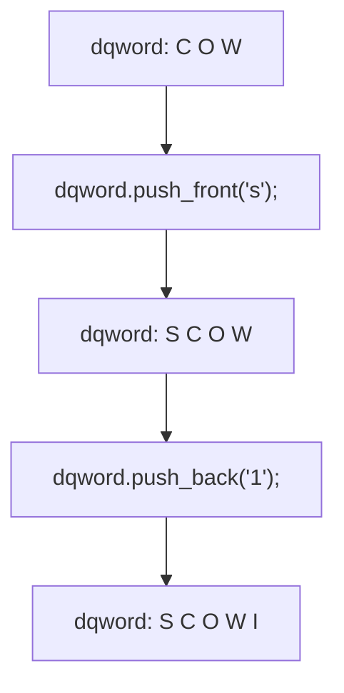

```txt
iterator tmp = *this;
    pt = pt->p_next;
    return tmp;
}
// ... operator==(), operator!=(), etc.
};
```

为区分++运算符的前缀版本和后缀版本，C++将 operator++作为前缀版本，将 operator++（int）作为后缀版本；其中的参数永远也不会被用到，所以不必指定其名称。

这里重点不是如何定义 iterator 类，而是有了这样的类后，第二个 find 函数就可以这样编写:

```c
iterator find_ll(iterator head, const double & val)
{
    iterator start;
    for (start = head; start!= 0; ++start)
        if (*start == val)
            return start;
    return 0;
}
```

这和 find\_ar() 几乎相同，差别在于如何谓词已到达最后一个值。find\_ar() 函数使用超尾迭代器，而 find\_ll() 使用存储在最后一个节点中的空值。除了这种差别外，这两个函数完全相同。例如，可以要求链表的最后一个元素后面还有一个额外的元素，即让数组和链表都有超尾元素，并在迭代器到达超尾位置时结束搜索。这样，find\_ar() 和 find\_ll() 检测数据尾的方式将相同，从而成为相同的算法。注意，增加超尾元素后，对迭代器的要求变成了对容器类的要求。

STL 遵循上面介绍的方法。首先，每个容器类（vector、list、deque 等）定义了相应的迭代器类型。对于其中的某个类，迭代器可能是指针；而对于另一个类，则可能是对象。不管实现方式如何，迭代器都将提供所需的操作，如\*和++（有些类需要的操作可能比其他类多）。其次，每个容器类都有一个超尾标记，当迭代器递增到超越容器的最后一个值后，这个值将被赋给迭代器。每个容器类都有 begin() 和 end() 方法，它们分别返回一个指向容器的第一个元素和超尾位置的迭代器。每个容器类都使用++操作，让迭代器从指向第一个元素逐步指向超尾位置，从而遍历容器中的每一个元素。

使用容器类时，无需知道其迭代器是如何实现的，也无需知道超尾是如何实现的，而只需知道它有迭代器，其begin()返回一个指向第一个元素的迭代器，end()返回一个指向超尾位置的迭代器即可。例如，假设要打印vector&lt;double&gt;对象中的值，则可以这样做:

```txt
vector<double>::iterator pr;
for (pr = scores.begin(); pr != scores.end(); pr++)
    cout << *pr << endl;
```

其中，下面的代码行将 pr 的类型声明为 vector&lt;double&gt;类的迭代器:

```txt
vector<double> class:
vector<double>::iterator-pr;
```

如果要使用 list&lt;double&gt;类模板来存储分数，则代码如下:

```cpp
list<double>::iterator pr;
for (pr = scores.begin(); pr != scores.end(); pr++)
    cout << *pr << endl;
```

唯一不同的是 pr 的类型。因此，STL 通过为每个类定义适当的迭代器，并以统一的风格设计类，能够对内部表示绝然不同的容器，编写相同的代码。

使用 C++11 新增的自动类型推断可进一步简化:对于矢量或列表，都可使用如下代码:

```javascript
for (auto pr = scores.begin(); pr != scores.end(); pr++)
    cout << *pr << endl;
```

实际上，作为一种编程风格，最好避免直接使用迭代器，而应尽可能使用 STL 函数（如 for\_each()）来处理细节。也可使用 C++11 新增的基于范围的 for 循环:

```javascript
for (auto=x : scores) cout << x << endl;
```

来总结一下STL方法。首先是处理容器的算法，应尽可能用通用的术语来表达算法，使之独立于数据类型和容器类型。为使通用算法能够适用于具体情况，应定义能够满足算法需求的迭代器，并把要求加到容器设计上。即基于算法的要求，设计基本迭代器的特征和容器特征。

## 16.4.2 迭代器类型

不同的算法对迭代器的要求也不同。例如，查找算法需要定义++运算符，以便迭代器能够遍历整个容器；它要求能够读取数据，但不要求能够写数据（它只是查看数据，而并不修改数据）。而排序算法要求能够随机访问，以便能够交换两个不相邻的元素。如果iter是一个迭代器，则可以通过定义+运算符来实现随机访问，这样就可以使用像iter+10这样的表达式了。另外，排序算法要求能够读写数据。

STL 定义了 5 种迭代器，并根据所需的迭代器类型对算法进行了描述。这 5 种迭代器分别是输入迭代器、输出迭代器、正向迭代器、双向迭代器和随机访问迭代器。例如，find()的原型与下面类似:

```txt
template<class InputIterator, class T>
InputIterator find(InputIterator first, InputIterator last, const T& value);
```

这指出，这种算法需要一个输入迭代器。同样，下面的原型指出排序算法需要一个随机访问迭代器:

```cpp
template<class RandomAccessIterator>
void sort(RandomAccessIterator first, RandomAccessIterator last);
```

对于这 5 种迭代器，都可以执行解除引用操作（即为它们定义了\*运算符），也可进行比较，看其是相等（使用==运算符，可能被重载了）还是不相等（使用!=运算符，可能被重载了）。如果两个迭代器相同，则对它们执行解除引用操作得到的值将相同。即如果表达式 iter1 == iter2 为真，则下述表达式也为真:

```txt
iter1 == iter2
is true, then the following is also true:
*iter1 == *iter2
```

当然，对于内置运算符和指针来说，情况也是如此。因此，这些要求将指导您如何对迭代器类重载这些运算符。下面来看迭代器的其他特征。

## 1. 输入迭代器

术语 “输入” 是从程序的角度说的，即来自容器的信息被视为输入，就像来自键盘的信息对程序来说是输入一样。因此，输入迭代器可被程序用来读取容器中的信息。具体地说，对输入迭代器解除引用将使程序能够读取容器中的值，但不一定能让程序修改值。因此，需要输入迭代器的算法将不会修改容器中的值。

输入迭代器必须能够访问容器中所有的值，这是通过支持++运算符（前缀格式和后缀格式）来实现的。如果将输入迭代器设置为指向容器中的第一个元素，并不断将其递增，直到到达超尾位置，则它将依次指向容器中的每一个元素。顺便说一句，并不能保证输入迭代器第二次遍历容器时，顺序不变。另外，输入迭代器被递增后，也不能保证其先前的值仍然可以被解除引用。基于输入迭代器的任何算法都应当是单通行（single-pass）的，不依赖于前一次遍历时的迭代器值，也不依赖于本次遍历中前面的迭代器值。

注意，输入迭代器是单向迭代器，可以递增，但不能倒退。

## 2. 输出迭代器

STL 使用术语 “输出” 来指用于将信息从程序传输给容器的迭代器，因此程序的输出就是容器的输入。输出迭代器与输入迭代器相似，只是解除引用让程序能修改容器值，而不能读取。也许您会感到奇怪，能够写，却不能读。发送到显示器上的输出就是如此，cout 可以修改发送到显示器的字符流，却不能读取屏幕上的内容。STL 足够通用，其容器可以表示输出设备，因此容器也可能如此。另外，如果算法不用读取作容器的内容就可以修改它（如通过生成要存储的新值），则没有理由要求它使用能够读取内容的迭代器。

简而言之，对于单通行、只读算法，可以使用输入迭代器；而对于单通行、只写算法，则可以使用输出迭代器。

## 3. 正向迭代器

与输入迭代器和输出迭代器相似，正向迭代器只使用++运算符来遍历容器，所以它每次沿容器向前移动一个元素；然而，与输入和输出迭代器不同的是，它总是按相同的顺序遍历一系列值。另外，将正向迭代器递增后，仍然可以对前面的迭代器值解除引用（如果保存了它），并可以得到相同的值。这些特征使得多次通行算法成为可能。

正向迭代器既可以使得能够读取和修改数据，也可以使得只能读取数据:

```cpp
int * pirw;      // read-write iterator
const int * pir;  // read-only iterator
```

## 4. 双向迭代器

假设算法需要能够双向遍历容器，情况将如何呢？例如，reverse函数可以交换第一个元素和最后一个元素、将指向第一个元素的指针加1、将指向第二个元素的指针减1，并重复这种处理过程。双向迭代器具有正向迭代器的所有特性，同时支持两种（前缀和后缀）递减运算符。

## 5. 随机访问迭代器

有些算法（如标准排序和二分检索）要求能够直接跳到容器中的任何一个元素，这叫做随机访问，需要随机访问迭代器。随机访问迭代器具有双向迭代器的所有特性，同时添加了支持随机访问的操作（如指针增加运算）和用于对元素进行排序的关系运算符。表16.3列出了除双向迭代器的操作外，随机访问迭代器还支持的操作。其中，X表示随机迭代器类型，T表示被指向的类型，a和b都是迭代器值，n为整数，r为随机迭代器变量或引用。

表16.3

随机访问迭代器操作

| 表达式 | 描述 |
| --- | --- |
| a+n | 指向a所指向的元素后的第n个元素 |
| n+a | 与a+n相同 |
| a-n | 指向a所指向的元素前的第n个元素 |
| r+=n | 等价于r=r+n |
| r-=n | 等价于r=r-n |
| a[n] | 等价于*(a+n) |
| b-a | 结果为这样的n值,即b=a+n |
| a如果b-a>0,则为真 | 如果b-a>0,则为真 |
| a>b | 如果b&lt;a,则为真 |
| a>=b | 如果!(a&lt;b),则为真 |
| a&lt;=b | 如果!(a>b),则为真 |

像 a+n 这样的表达式仅当 a 和 a+n 都位于容器区间（包括超尾）内时才合法，

## 16.4.3 迭代器层次结构

您可能已经注意到，迭代器类型形成了一个层次结构。正向迭代器具有输入迭代器和输出迭代器的全部功能，同时还有自己的功能；双向迭代器具有正向迭代器的全部功能，同时还有自己的功能；随机访问迭代器具有正向迭代器的全部功能，同时还有自己的功能。表 16.4 总结了主要的迭代器功能。其中，i 为迭代器，n 为整数。

表 16.4 迭代器性能

| 迭代器功能 | 输入 | 输出 | 正向 | 双向 | 随机访问 |
| --- | --- | --- | --- | --- | --- |
| 解除引用读取 | 有 | 无 | 有 | 有 | 有 |
| 解除引用写入 | 无 | 有 | 有 | 有 | 有 |
| 固定和可重复排序 | 无 | 无 | 有 | 有 | 有 |
| ++i i++ | 有 | 有 | 有 | 有 | 有 |
| --i i-- | 无 | 无 | 无 | 有 | 有 |
| i[n] | 无 | 无 | 无 | 无 | 有 |
| i+n | 无 | 无 | 无 | 无 | 有 |
| i-n | 无 | 无 | 无 | 无 | 有 |
| i+=n | 无 | 无 | 无 | 无 | 有 |
| i-=n | 无 | 无 | 无 | 无 | 有 |

根据特定迭代器类型编写的算法可以使用该种迭代器，也可以使用具有所需功能的任何其他迭代器。所以具有随机访问迭代器的容器可以使用为输入迭代器编写的算法。

为何需要这么多迭代器呢？目的是为了在编写算法尽可能使用要求最低的迭代器，并让它适用于容器的最大区间。这样，通过使用级别最低的输入迭代器，find()函数便可用于任何包含可读取值的容器。而sort()函数由于需要随机访问迭代器，所以只能用于支持这种迭代器的容器。

注意，各种迭代器的类型并不是确定的，而只是一种概念性描述。正如前面指出的，每个容器类都定义了一个类级 typedef 名称——iterator，因此 vector&lt;int&gt; 类的迭代器类型为 vector&lt;int&gt;::iterator。然而，该类的文档将指出，矢量迭代器是随机访问迭代器，它允许使用基于任何迭代器类型的算法，因为随机访问迭代器具有所有迭代器的功能。同样，list&lt;int&gt; 类的迭代器类型为 list&lt;int&gt;::iterator。STL 实现了一个双向链表，它使用双向迭代器，因此不能使用基于随机访问迭代器的算法，但可以使用基于要求较低的迭代器的算法。

## 16.4.4 概念、改进和模型

STL有若干个用C++语言无法表达的特性，如迭代器种类。因此，虽然可以设计具有正向迭代器特征的类，但不能让编译器将算法限制为只使用这个类。原因在于，正向迭代器是一系列要求，而不是类型。所设计的迭代器类可以满足这种要求，常规指针也能满足这种要求。STL算法可以使用任何满足其要求的迭代器实现。STL文献使用术语概念（concept）来描述一系列的要求。因此，存在输入迭代器概念、正向迭代器概念，等等。顺便说一句，如果所设计的容器类需要迭代器，可考虑STL，它包含用于标准种类的迭代器模板。

概念可以具有类似继承的关系。例如，双向迭代器继承了正向迭代器的功能。然而，不能将 C++ 继承机制用于迭代器。例如，可以将正向迭代器实现为一个类，而将双向迭代器实现为一个常规指针。因此，对 C++ 而言，这种双向迭代器是一种内置类型，不能从类派生而来。然而，从概念上看，它确实能够继承。有些 STL 文献使用术语改进（refinement）来表示这种概念上的继承，因此，双向迭代器是对正向迭代器概念的一种改进。

概念的具体实现被称为模型（model）。因此，指向 int 的常规指针是一个随机访问迭代器模型，也是一个正向迭代器模型，因为它满足该概念的所有要求。

## 1. 将指针用作迭代器

迭代器是广义指针，而指针满足所有的迭代器要求。迭代器是STL算法的接口，而指针是迭代器，因此STL算法可以使用指针来对基于指针的非STL容器进行操作。例如，可将STL算法用于数组。假设

Receipts 是一个 double 数组，并要按升序对它进行排序:

```dart
const int SIZE = 100;
double Receipts[SIZE];
```

STL sort()函数接受指向容器第一个元素的迭代器和指向超尾的迭代器作为参数。&Receipts[0]（或Receipts）是第一个元素的地址，&Receipts[SIZE]（或 Receipts + SIZE）是数组最后一个元素后面的元素的地址。因此，下面的函数调用对数组进行排序:

```txt
sort(Receipts, Receipts + SIZE);
```

C++确保了表达式 Receipts + n 是被定义的，只要该表达式的结果位于数组中。因此，C++支持将超尾概念用于数组，使得可以将 STL 算法用于常规数组。由于指针是迭代器，而算法是基于迭代器的，这使得可将 STL 算法用于常规数组。同样，可以将 STL 算法用于自己设计的数组形式，只要提供适当的迭代器（可以是指针，也可以是对象）和超尾指示器即可。

```txt
copy( )、ostream_iterator 和 istream_iterator
```

STL 提供了一些预定义迭代器。为了解其中的原因，这里先介绍一些背景知识。有一种算法（名为copy()）可以将数据从一个容器复制到另一个容器中。这种算法是以迭代器方式实现的，所以它可以从一种容器到另一种容器进行复制，甚至可以在数组之间复制，因为可以将指向数组的指针用作迭代器。例如，下面的代码将一个数组复制到一个矢量中:

```txt
int casts[10] = {6, 7, 2, 9 ,4 , 11, 8, 7, 10, 5};
vector<int> dice[10];
copy(casts, casts + 10, dice.begin());   // copy array to vector
```

copy()的前两个迭代器参数表示要复制的范围，最后一个迭代器参数表示要将第一个元素复制到什么位置。前两个参数必须是（或最好是）输入迭代器，最后一个参数必须是（或最好是）输出迭代器。Copy()函数将覆盖目标容器中已有的数据，同时目标容器必须足够大，以便能够容纳被复制的元素。因此，不能使用copy()将数据放到空矢量中——至少，如果不采用本章后面将介绍的技巧，则不能这样做。

现在，假设要将信息复制到显示器上。如果有一个表示输出流的迭代器，则可以使用 copy()。STL 为这种迭代器提供了 ostream\_iterator 模板。用 STL 的话说，该模板是输出迭代器概念的一个模型，它也是一个适配器（adapter）——一个类或函数，可以将一些其他接口转换为 STL 使用的接口。可以通过包含头文件 iterator（以前为 iterator.h）并作下面的声明来创建这种迭代器:

```c
#include <iterator>
...
ostream_iterator<int, char> out_iter(cout, " ");
```

out\_iter 迭代器现在是一个接口，让您能够使用 cout 来显示信息。第一个模板参数（这里为 int）指出了被发送给输出流的数据类型；第二个模板参数（这里为 char）指出了输出流使用的字符类型（另一个可能的值是 wchar\_t）。构造函数的第一个参数（这里为 cout）指出了要使用的输出流，它也可以是用于文件输出的流（参见第 17 章）；最后一个字符串参数是在发送给输出流的每个数据项后显示的分隔符。

可以这样使用迭代器:

```txt
*out_iter++ = 15; // works like cout << 15 << " ";
```

对于常规指针，这意味着将 15 赋给指针指向的位置，然后将指针加 1。但对于该 ostream\_iterator，这意味着将 15 和由空格组成的字符串发送到 cout 管理的输出流中，并为下一个输出操作做好了准备。可以将 copy() 用于迭代器，如下所示:

```javascript
copy(dice.begin(), dice.end(), out_iter); //copy_vector to output stream
```

这意味着将 dice 容器的整个区间复制到输出流中，即显示容器的内容。

也可以不创建命名的迭代器，而直接构建一个匿名迭代器。即可以这样使用适配器:

```javascript
copy(dice.begin(), dice.end(+), ostream_iterator<int; char>(cout,"")) );
```

iterator 头文件还定义了一个 istream\_iterator 模板，使 istream 输入可用作迭代器接口。它是一个输入迭

代器概念的模型，可以使用两个 istream\_iterator 对象来定义 copy() 的输入范围:

```txt
copy(istream_iterator<int, char>(cin),
    istream_iterator<int, char>(), dice.begin());
```

与 ostream\_iterator 相似，istream\_iterator 也使用两个模板参数。第一个参数指出要读取的数据类型，第二个参数指出输入流使用的字符类型。使用构造函数参数 cin 意味着使用由 cin 管理的输入流，省略构造函数参数表示输入失败，因此上述代码从输入流中读取，直到文件结尾、类型不匹配或出现其他输入故障为止。

## 2. 其他有用的迭代器

除了 ostream\_iterator 和 istream\_iterator 之外，头文件 iterator 还提供了其他一些专用的预定义迭代器类型。它们是 reverse\_iterator、back\_insert\_iterator、front\_insert\_iterator 和 insert\_iterator。

我们先来看 reverse iterator 的功能。对 reverse\_iterator 执行递增操作将导致它被递减。为什么不直接对常规迭代器进行递减呢？主要原因是为了简化对已有的函数的使用。假设要显示 dice 容器的内容，正如刚才介绍的，可以使用 copy() 和 ostream\_iterator 来将内容复制到输出流中:

```txt
ostream_iterator<int, char> out_iter(cout, " ");
copy(dice.begin(), dice.end(), out_iter); // display in forward order
```

现在假设要反向打印容器的内容（可能您正在从事时间反演研究）。有很多方法都不管用，但与其在这里耽误工夫，不如来看看能够完成这种任务的方法。vector 类有一个名为 rbegin() 的成员函数和一个名为 rend() 的成员函数，前者返回一个指向超尾的反向迭代器，后者返回一个指向第一个元素的反向迭代器。因为对迭代器执行递增操作将导致它被递减，所以可以使用下面的语句来反向显示内容:

```javascript
copy(dice.rbegin(), dice.rend(), out_iter); // display in reverse order
```

甚至不必声明反向迭代器。

注意:rbegin()和end()返回相同的值（超尾），但类型不同（reverse\_iterator和iterator）。同样，rend()和begin()也返回相同的值（指向第一个元素的迭代器），但类型不同。

必须对反向指针做一种特殊补偿。假设 rp 是一个被初始化为 dice.rbegin() 的反转指针。那么 \*rp 是什么呢？因为 rbegin() 返回超尾，因此不能对该地址进行解除引用。同样，如果 rend() 是第一个元素的位置，则 copy() 必须提早一个位置停止，因为区间的结尾处不包括在区间中。

反向指针通过先递减，再解除引用解决了这两个问题。即\*rp将在\*rp的当前值之前对迭代器执行解除引用。也就是说，如果rp指向位置6，则\*rp将是位置5的值，依次类推。程序清单16.10演示了如何使用copy()、istream迭代器和反向迭代器。

程序清单 16.10 copyit.cpp

```cpp
// copyit.cpp -- copy() and iterators
#include <iostream>
#include <iterator>
#include <vector>

int main()
{
    using namespace std;

    int casts[10] = {6, 7, 2, 9 ,4 , 11, 8, 7, 10, 5};
    vector<int> dice(10);
    // copy from array to vector
    copy(casts, casts + 10, dice.begin());
    cout << "Let the dice be cast!\n";
```

```cpp
// create an ostream iterator
ostream_iterator<int, char> out_iter(cout, " ");
// copy from vector to output
copy(dice.begin(), dice.end(), out_iter);
cout << endl;
cout <<"Implicit use of reverse iterator.\n";
copy(dice.rbegin(), dice.rend(), out_iter);
cout << endl;
cout <<"Explicit use of reverse iterator.\n";
vector<int>::reverse_iterator ri;
for (ri = dice.rbegin(); ri != dice.rend(); ++rf)
    cout << *ri << ' ';
cout << endl;          _ _
return_0;
}
```

程序清单 16.10 中程序的输出如下:

```txt
Let the dice be cast!
6 7 2 9-4 11 8 7 10_5
Implicit use of reverse iterator.
5 10 7 8 11 4_9 2 7 6 _
Explicit use of reverse iterator.
5 10 7 8 11 4 9-2 7 6
```

如果可以在显式声明迭代器和使用STL函数来处理内部问题（如通过将rbegin()返回值传递给函数）之间选择，请采用后者。后一种方法要做的工作较少，人为出错的机会也较少。

另外三种迭代器（back\_insert\_iterator、front\_insert\_iterator 和 insert\_iterator）也将提高 STL 算法的通用性。很多 STL 函数都与 copy() 相似，将结果发送到输出迭代器指示的位置。前面说过，下面的语句将值复制到从 dice.begin() 开始的位置:

```javascript
copy(casts, casts + 10, dice.begin());
```

这些值将覆盖 dice 中以前的内容，且该函数假设 dice 有足够的空间，能够容纳这些值，即 copy() 不能自动根据发送值调整目标容器的长度。程序清单 16.10 考虑到了这种情况，将 dice 声明为包含 10 个元素。然而，如果预先并不知道 dice 的长度，该如何办呢？或者要将元素添加到 dice 中，而不是覆盖已有的内容，又该如何办呢？

三种插入迭代器通过将复制转换为插入解决了这些问题。插入将添加新的元素，而不会覆盖已有的数据，并使用自动内存分配来确保能够容纳新的信息。back\_insert\_iterator 将元素插入到容器尾部，而 front insert\_iterator 将元素插入到容器的前端。最后，insert\_iterator 将元素插入到 insert\_iterator 构造函数的参数指定的位置前面。这三个插入迭代器都是输出容器概念的模型。

这里存在一些限制。back\_insert\_iterator 只能用于允许在尾部快速插入的容器（快速插入指的是一个时间固定的算法，将在本章后面的“容器概念”一节做进一步讨论），vector 类符合这种要求。front\_insert\_iterator 只能用于允许在起始位置做时间固定插入的容器类型，vector 类不能满足这种要求，但 queue 满足。insert\_iterator 没有这些限制，因此可以用它把信息插入到矢量的前端。然而，front\_insert\_iterator 对于那些支持它的容器来说，完成任务的速度更快。

提示:可以用 insert\_iterator 将复制数据的算法转换为插入数据的算法。

这些迭代器将容器类型作为模板参数，将实际的容器标识符作为构造函数参数。也就是说，要为名为dice的vector&lt;int&gt;容器创建一个back\_insert\_iterator，可以这样做:

```txt
back_insert_iterator<vector<int> > back_iter(dice);
```

必须声明容器类型的原因是，迭代器必须使用合适的容器方法。back insert iterator 的构造函数将假设传递给它的类型有一个 push\_back() 方法。copy() 是一个独立的函数，没有重新调整容器大小的权限。但前面的声明让 back\_iter 能够使用方法 vector&lt;int&gt;::push\_back()，该方法有这样的权限。

声明 front\_insert\_iterator 的方式与此相同。对于 insert\_iterator 声明，还需一个指示插入位置的构造函数参数:

```txt
insert_iterator<vector<int> > insert_iter(dice, dice.begin() );
```

程序清单 16.11 演示了这两种迭代器的用法，还使用 for\_each()而不是 ostream 迭代器进行输出。

程序清单 16.11 inserts.cpp

```cpp
// inserts.cpp -- copy() and insert iterators
#include <iostream>
#include <string>
#include <iterator>
#include <vector>
#include <algorithm>

void output(const std::string & s) {std::cout << s << " ";}

int main()
{
    using namespace std;
    string s1[4] = {"fine", "fish", "fashion", "fate"};
    string s2[2] = {"busy", "bats"};
    string s3[2] = {"silly", "singers"};
    vector<string> words(4);
    copy(s1, s1 + 4, words.begin());
    for_each(words.begin(), words.end(), output);
    cout << endl;
// construct anonymous-back_insert_iterator object
    copy(s2, s2 + 2, back_insert_iterator<vector<string>>(words));
    for_each(words.begin(), words.end(), output);
    cout << endl;

// construct anonymous insert_iterator object
    copy(s3, s3 + 2, insert_iterator<vector<string>>(words,
                             words.begin()));
    for_each(words.begin(), words.end(), output);
    cout << endl;
    return 0;
}
```

程序清单16.11中程序的输出如下:

```txt
fine fish fashion fate
fine fish fashion fate busy bats
silly singers fine fish fashion fate busy bats—
```

第一个 copy() 从 s1 中复制 4 个字符串到 words 中。这之所以可行，在某种程度上说是由于 words 被声明为能够存储 4 个字符串，这等于被复制的字符串数目。然后，back\_insert\_iterator 将 s2 中的字符串插入到 words 数组的末尾，将 words 的长度增加到 6 个元素。最后，insert\_iterator 将 s3 中的两个字符串插入到 words 的第一个元素的前面，将 words 的长度增加到 8 个元素。如果程序试图使用 words.end() 和 words.begin() 作为迭代器，将 s2 和 s3 复制到 words 中，words 将没有空间来存储新数据，程序可能会由于内存违规而异常终止。

如果您被这些迭代器搞晕，则请记住，只要使用就会熟悉它们。另外还请记住，这些预定义迭代器提高了STL算法的通用性。因此，copy()不仅可以将信息从一个容器复制到另一个容器，还可以将信息从容器复制到输出流，从输入流复制到容器中。还可以使用copy()将信息插入到另一个容器中。因此使用同一个函数可以完成很多工作。copy()只是是使用输出迭代器的若干STL函数之一，因此这些预定义迭代器也增加了这些函数的功能。

## 16.4.5 容器种类

STL 具有容器概念和容器类型。概念是具有名称（如容器、序列容器、关联容器等）的通用类别；容器类型是可用于创建具体容器对象的模板。以前的 11 个容器类型分别是 deque、list、queue、priority\_queue、stack、vector、map、multimap、set、multiset 和 bitset（本章不讨论 bitset，它是在比特级处理数据的容器）；C++11 新增了 forward\_list、unordered\_map、unordered\_multimap、unordered\_set 和 unordered\_multiset，且不将 bitset 视为容器，而将其视为一种独立的类别。因为概念对类型进行了分类，下面先讨论它们。

## 1. 容器概念

没有与基本容器概念对应的类型，但概念描述了所有容器类都通用的元素。它是一个概念化的抽象基类——说它概念化，是因为容器类并不真正使用继承机制。换句话说，容器概念指定了所有 STL 容器类都必须满足的一系列要求。

容器是存储其他对象的对象。被存储的对象必须是同一种类型的，它们可以是 OOP 意义上的对象，也可以是内置类型值。存储在容器中的数据为容器所有，这意味着当容器过期时，存储在容器中的数据也将过期（然而，如果数据是指针的话，则它指向的数据并不一定过期）。

不能将任何类型的对象存储在容器中，具体地说，类型必须是可复制构造的和可赋值的。基本类型满足这些要求；只要类定义没有将复制构造函数和赋值运算符声明为私有或保护的，则也满足这种要求。C++11改进了这些概念，添加了术语可复制插入（CopyInsertable）和可移动插入（MoveInsertable），但这里只进行简单的概述。

基本容器不能保证其元素都按特定的顺序存储，也不能保证元素的顺序不变，但对概念进行改进后，则可以增加这样的保证。所有的容器都提供某些特征和操作。表16.5对一些通用特征进行了总结。其中，X表示容器类型，如vector；T表示存储在容器中的对象类型:a和b表示类型为X的值；r表示类型为X&的值；u表示类型为X的标识符（即如果X表示vector&lt;int&gt;，则u是一个vector&lt;int&gt;对象）。

表 16.5

一些基本的容器特征

| 表达式 | 返回类型 | 说明 | 复杂度 |
| --- | --- | --- | --- |
| X::iterator | 指向T的迭代器类型 | 满足正向迭代器要求的任何迭代器 | 编译时间 |
| X::value_type | T | T的类型 | 编译时间 |
| X u; |  | 创建一个名为u的空容器 | 固定 |
| X( ); |  | 创建一个匿名的空容器 | 固定 |
| X u(a); |  | 调用复制构造函数后u==a | 线性 |
| X u = a; |  | 作用同X u(a); | 线性 |
| r = a; | X&amp; | 调用赋值运算符后r==a | 线性 |
| (&amp;a)->~X( ) | void | 对容器中每个元素应用析构函数 | 线性 |
| a.begin( ) | 迭代器 | 返回指向容器第一个元素的迭代器 | 固定 |
| a.end( ) | 迭代器 | 返回超尾值迭代器 | 固定 |
| a.size( ) | 无符号整型 | 返回元素个数,等价于a.end( )-a.begin( ) | 固定 |
| a.swap(b) | void | 交换a和b的内容 | 固定 |
| a == b | 可转换为bool | 如果a和b的长度相同,且a中每个元素都等于(==为真)b中相应的元素,则为真 | 线性 |
| a != b | 可转换为bool | 返回!(a==b) | 线性 |

表 16.5 中的 “复杂度” — 列描述了执行操作所需的时间。这个表列出了 3 种可能性，从快到慢依次为:

编译时间:
- ● … 固定时间；
- 线性时间。

如果复杂度为编译时间，则操作将在编译时执行，执行时间为0。固定复杂度意味着操作发生在运行阶段，但独立于对象中的元素数目。线性复杂度意味着时间与元素数目成正比。即如果a和b都是容器，则 $a = b$ 具有线性复杂度，因为 $=$ 操作必须用于容器中的每个元素。实际上，这是最糟糕的情况。如果两个容器的长度不同，则不需要作任何的单独比较。

## 固定时间和线性时间复杂度

\- 假设有一个装满大包裹的狭长盒子，包裹一字排开，而盒子只有一端是打开的。假设任务是从打开的一端取出一个包裹，则这将是一项固定时间任务。不管在打开的一端后面有10个还是1000个包裹，都没有区别。

现在假设任务是取出盒子中没有打开的一端的那个包裹，则这将是线性时间任务。如果盒子里有10个包裹，则必须取出10个包裹才能拿到封口端的那个包裹；如果有100个包裹，则必须取出100个包裹。假设是一个不知疲倦的工人来做，每次只能取出1个包裹，则需要取10次或更多。

现在假设任务是取出任意一个包裹，则可能取出第一个包裹。然而，通常必须移动的包裹数目仍旧与容器中包裹的数目成正比，所以这种任务依然是线性时间复杂度。

如果盒子各边都可打开，而不是狭长的，则这种任务的复杂度将是固定时间的，因为可以直接取出想要的包裹，而不用移动其他的包裹。

时间复杂度概念描述了容器长度对执行时间的影响，而忽略了其他因素。如果超人从一端打开的盒子中取出包裹的速度比普通人快100倍，则他完成任务时，复杂度仍然是线性时间的。在这种情况下，他取出封闭盒子中包裹（一端打开，复杂度为线性时间）的速度将比普通人取出开放盒子中包裹（复杂度为固定时间）要快，条件是盒子里没有太多的包裹。

复杂度要求是 STL 特征，虽然实现细节可以隐藏，但性能规格应公开，以便程序员能够知道完成特定操作的计算成本。

## 2. C++11 新增的容器要求

表 16.6-列出了 C++11 新增的通用容器要求。在这个表中，rv 表示类型为 X 的非常量右值，如函数的返回值。另外，在表 16.5 中，要求 X::iterator 满足正向迭代器的要求，而以前只要求它不是输出迭代器。

表 16.6

C++11 新增的基本容器要求

| 表达式 | 返回类型 | 说明 | 复杂度 |
| --- | --- | --- | --- |
| X u(rv); |  | 调用移动构造函数后,u的值与rv的原始值相同 | 线性 |
| X u = rv; |  | 作用同 X u(rv); |  |
| a = rv; | X&amp; | 调用移动赋值运算符后,u的值与rv的原始值相同 | 线性 |
| a.cbegin() | const_iterator | 返回指向容器第一个元素的 const 迭代器 | 固定 |
| a.cend() | const_iterator | 返回超尾值 const 迭代器 | 固定 |

复制构造和复制赋值以及移动构造和移动赋值之间的差别在于，复制操作保留源对象，而移动操作可修改源对象，还可能转让所有权，而不做任何复制。如果源对象是临时的，移动操作的效率将高于常规复制。第18章将更详细地介绍移动语义。

## 3. 序列

可以通过添加要求来改进基本的容器概念。序列（sequence）是一种重要的改进，因为7种STL容器类型（deque、C++11 新增的 forward\_list、list、queue、priority\_queue、stack 和 vector）都是序列（本书前面说过，队列让您能够在队尾添加元素；在队首删除元素。deque 表示的双端队列允许在两端添加和删除元素）。序列概念增加了迭代器至少是正向迭代器这样的要求，这保证了元素将按特定顺序排列，不会在两次迭代之间发生变化。array 也被归类到序列容器，虽然它并不满足序列的所有要求。

序列还要求其元素按严格的线性顺序排列，即存在第一个元素、最后一个元素，除第一个元素和最后一个元素外，每个元素前后都分别有一个元素。数组和链表都是序列，但分支结构（其中每个节点都指向两个子节点）不是。

因为序列中的元素具有确定的顺序，因此可以执行诸如将值插入到特定位置、删除特定区间等操作。表16.7列出了这些操作以及序列必须完成的其他操作。该表格使用的表示法与表16.5相同，此外，t表示类型为T（存储在容器中的值的类型）的值，n表示整数，p、q、i和j表示迭代器。

表 16.7 序列的要求

| 表达式 | 返回类型 | 说明 |
| --- | --- | --- |
| $Xa(n, t)$ |  | 声明一个名为a的由n个t值组成的序列 |
| $X(n, t)$ |  | 创建一个由n个t值组成的匿名序列 |
| $Xa(i, j)$ |  | 声明一个名为a的序列,并将其初始化为区间[i, j)的内容 |
| $X(i, j)$ |  | 创建一个匿名序列,并将其初始化为区间[i, j)的内容 |
| a.insert(p, t) | 迭代器 | 将t插入到p的前面 |
| a.insert(p, n, t) | void | 将n个t插入到p的前面 |
| a.insert(p, i, j) | void | 将区间[i, j)中的元素插入到p的前面 |
| a.erase(p) | 迭代器 | 删除p指向的元素 |
| a.erase(p, q) | 迭代器 | 删除区间[p, q)中的元素 |
| a.clear( ) | void | 等价于erase(begin( ), end( )) |

因为模板类 deque、list、queue、priority\_queue、stack 和 vector 都是序列概念的模型，所以它们都支持表 16.7 所示的运算符。除此之外，这 6 个模型中的一些还可使用其他操作。在允许的情况下，它们的复杂度为固定时间。表 16.8 列出了其他操作。

表 16.8 序列的可选要求

| 表达式 | 返回类型 | 含义 | 容器 |
| --- | --- | --- | --- |
| a.front() | T&amp; | *a.begin() | vector、list、deque |
| a.back() | T&amp; | *-a.end() | vector、list、deque |
| a.push_front(t) | void | a.insert(a.begin(),t) | list、deque |
| a.push_back(t) | void | a.insert(a.end(),t) | vector、list、deque |
| a.pop_front(t) | void | a.erase(a.begin()) | list、deque |
| a.pop_back(t) | void | a.erase(-a.end()) | vector、list、deque |
| a[n] | T&amp; | *(a.begin()+n) | vector、deque |
| a.at(t) | T&amp; | *(a.begin()+n) | vector、deque |

表 16.8 有些需要说明的地方。首先，a[n] 和 a.at(n) 都返回一个指向容器中第 n 个元素（从 0 开始编号）的引用。它们之间的差别在于，如果 n 落在容器的有效区间外，则 a.at(n) 将执行边界检查，并引发 out\_of\_range 异常。其次，可能有人会问，为何为 list 和 deque 定义了 push\_front()，而没有为 vector 定义？假设要将一个新值插入到包含 100 个元素的矢量的最前面。要腾出空间，必须将第 99 个元素移到位置 100，然后把第 98 个元素移动到位置 99，依此类推。这种操作的复杂度为线性时间，因为移动 100 个元素所需的时间为移动单个元素的 100 倍。但表 16.8 的操作被假设为仅当其复杂度为固定时间时才被实现。链表和双端队列的设计允许将元素添加到前端，而不用移动其他元素，所以它们可以以固定时间的复杂度来实现 push\_front()。图 16.4 说明了 push\_front() 和 push\_back()。

下面详细介绍这7种序列容器类型。

```javascript
char word[4] = "cow";
deque<char>dword(word, word+3);
```

## (1) vector

前面介绍了多个使用 vector 模板的例子，该模板是在 vector 头文件中声明的。简单地说，vector 是数组的一种类表示，它提供了自动内存管理功能，可以动态地改变 vector 对象的长度，并随着元素的添加和删除而增大和缩小。它提供了对元素的随机访问。在尾部添加和删除元素的时间是固定的，但在头部或中间插入和删除元素的复杂度为线性时间。

除序列外，vector 还是可反转容器（reversible container）概念的模型。这增加了两个类方法:rbegin()和rend()，前者返回一个指向反转序列的第一个元素的迭代器，后者返回反转序列的超尾迭代器。因此，如果 dice 是一个 vector&lt;int&gt;容器，而 Show(int) 是显示一个整数的函数，则下面的代码将首先正向显示 dice 的内容，然后反向显示:


<details>
<summary>flowchart</summary>


</details>

图 16.4 push\_front() 和 push\_back()

```rust
for_each(dice.begin(), dice.end(), Show); // display in order
cout << endl;
for_each(dice.rbegin(), dice.rend(), Show); // display in reversed order
cout << endl;
```

这两种方法返回的迭代器都是类级类型 reverse\_iterator。对这样的迭代器进行递增，将导致它反向遍历可反转容器。

vector 模板类是最简单的序列类型，除非其他类型的特殊优点能够更好地满足程序的要求，否则应默认使用这种类型。

## (2) deque

deque 模板类（在 deque 头文件中声明）表示双端队列（double-ended queue），通常被简称为 deque。在 STL 中，其实现类似于 vector 容器，支持随机访问。主要区别在于，从 deque 对象的开始位置插入和删除元素的时间是固定的，而不像 vector 中那样是线性时间的。所以，如果多数操作发生在序列的起始和结尾处，则应考虑使用 deque 数据结构。

为实现在 deque 两端执行插入和删除操作的时间为固定的这一目的，deque 对象的设计比 vector 对象更为复杂。因此，尽管二者都提供对元素的随机访问和在序列中部执行线性时间的插入和删除操作，但 vector 容器执行这些操作时速度要快些。

## (3).list

list 模板类（在 list 头文件中声明）表示双向链表。除了第一个和最后一个元素外，每个元素都与前后的元素相链接，这意味着可以双向遍历链表。list 和 vector 之间关键的区别在于，-list 在链表中任一位置进行插入和删除的时间都是固定的（vector 模板提供了除结尾处外的线性时间的插入和删除，在结尾处，它提供了固定时间的插入和删除）。因此，vector 强调的是通过随机访问进行快速访问，而 list 强调的是元素的快速插入和删除。

与 vector 相似，list 也是可反转容器。与 vector 不同的是，list 不支持数组表示法和随机访问。与矢量迭代器不同，从容器中插入或删除元素之后，链表达代器指向元素将不变。我们来解释一下这句话。例如，假设有一个指向 vector 容器第 5 个元素的迭代器，并在容器的起始处插入一个元素。此时，必须移动其他所有元素，以便腾出位置，因此插入后，第 5 个元素包含的值将是以前第 4 个元素的值。因此，迭代器指向的位置不变，但数据不同。然后，在链表中插入新元素并不会移动已有的元素，而只是修改链接信息。指向某个元素的迭代器仍然指向该元素，但它链接的元素可能与以前不同。

除序列和可反转容器的函数外，list 模板类还包含了链表专用的成员函数。表 16.9 列出了其中一些（有关 STL 方法和函数的完整列表，请参见附录 G）。通常不必担心 Alloc 模板参数，因为它有默认值。

表 16.9

list 成员函数

| 函数 | 说明 |
| --- | --- |
| void merge(list&amp; x) | 将链表x与调用链表合并。两个链表必须已经排序。合并后的经过排序的链表保存在调用链表中,x为空。这个函数的复杂度为线性时间 |
| void remove(const T &amp; val) | 从链表中删除val的所有实例。这个函数的复杂度为线性时间 |
| void sort() | 使用&lt;运算符对链表进行排序:N个元素的复杂度为NlogN |
| void splice(iterator pos, listx) | 将链表x的内容插入到pos的前面,x将为空。这个函数的的复杂度为固定时间 |
| void unique() | 将连续的相同元素压缩为单个元素。这个函数的复杂度为线性时间 |

程序清单 16.12 演示了这些方法和 insert() 方法（所有模拟序列的 STL 类都有这种方法）的用法。

程序清单 16.12 list.cpp

```cpp
// list.cpp -- using a list
#include <iostream>
#include <list>
#include <iterator>
#include <algorithm>

void outint(int n) {std::cout << n << " ";}

int main()
{
    using namespace std;
    list<int> one(5, 2); // list of 5 2s
    int stuff[5] = {1,2,4,8, 6};
    list<int> two;
    two.insert(two.begin(),stuff, stuff + 5 );
    int more[6] = {6, 4, 2, 4, 6, 5};
    list<int> three(two);
    three.insert(three.end(), more, more + 6);

    cout << "List one: ";
    for_each(one.begin(),one.end(), outint);
    cout << endl << "List two: ";
    for_each(two.begin(), two.end(), outint);
    cout << endl << "List three: ";
    for_each(three.begin(), three.end(), outint);
    three.remove(2);
    cout << endl << "List three minus 2s: ";
    for_each(three.begin(), three.end(), outint);
    three.splice(three.begin(), one);
    cout << endl << "List three after splice: ";
    for_each(three.begin(), three.end(), outint);
    cout << endl << "List one: ";
    for_each(one.begin(), one.end(), outint);
    three.unique();
    cout << endl << "List three after unique: ";
    for_each(three.begin(), three.end(), outint);
    three.sort();
```

```txt
three.unique();
    cout << endl << "List three after sort & unique: ";
    for_each(three.begin(), three.end(), outint);
    two.sort();
    three.merge(two);
    cout << endl << "Sorted two merged into three: ";
    for_each(three.begin(), three.end(), outint);
    cout << endl;

    return 0;
}
```

下面是程序清单 16.12 中程序的输出:

```txt
List one: 2 2 2 2 2
List two: 1 2 4 8 6
List three: 1 2 4 8 6 6 4 2 4 6 5
List three minus 2s: 1 4 8 6 6 4 4 6 5
List three after splice: 2 2 2 2 2 1 4 8 6 6 4 4 6 5
List one:
List three after unique: 2 1 4 8 6 4 6 5
List three after sort & unique: 1 2 4 5 6 8
Sorted two merged into three: 1 1 2 2 4 4 5 6 6 8 8
```

## (4) 程序说明

程序清单 16.12 中程序使用了 for\_each()算法和 outint()函数来显示列表。在 C++11 中，也可使用基于范围的 for 循环:

```txt
for (auto x : three) cout << x << " ";
```

insert()和splice()之间的主要区别在于:insert()将原始区间的副本插入到目标地址，而splice()则将原始区间移到目标地址。因此，在one的内容与three合并后，one为空。(splice()方法还有其他原型，用于移动单个元素和元素区间)。splice()方法执行后，迭代器仍有效。也就是说，如果将迭代器设置为指向one中的元素，则在splice()将它重新定位到元素three后，该迭代器仍然指向相同的元素。

注意，unique()只能将相邻的相同值压缩为单个值。程序执行three.unique()后three中仍包含不相邻的两个4和两个6。但应用sort()后再应用unique()时，每个值将只占一个位置。

还有非成员 sort() 函数（程序清单 16.9），但它需要随机访问迭代器。因为快速插入的代价是放弃随机访问功能，所以不能将非成员函数 sort() 用于链表。因此，这个类中包括了一个只能在类中使用的成员版本。

## (5) list 工具箱

list 方法组成了一个方便的工具箱。例如，假设有两个邮件列表要整理，则可以对每个列表进行排序，合并它们，然后使用 unique() 来删除重复的元素。

sort()、merge()和unique()方法还各自拥有接受另一个参数的版本，该参数用于指定用来比较元素的函数。同样，remove()方法也有一个接受另一个参数的版本，该参数用于指定用来确定是否删除元素的函数。这些参数都是谓词函数，将稍后介绍。

## (6) forward\_list (C+E+11)

C++E1 新增了容器类 forward\_list，它实现了单链表。在这种链表中，每个节点都只链接到下一个节点，而没有链接到前一个节点。因此 forward\_list 只需要正向迭代器，而不需要双向迭代器。因此，不同于 vector 和 list, forward\_list 是不可反转的容器。相比于 list, forward\_list 更简单、更紧凑，但功能也更少。

## (7) queue

queue 模板类（在买文件 queue（以前为 queue.h）中声明）是一个适配器类。由前所述，ostream\_iterator 模板就是一个适配器，让输出流能够使用迭代器接口。同样，queue 模板让底层类（默认为 deque）展示典型的队列接口。

queue 模板的限制比 deque 更多。它不仅不允许随机访问队列元素，甚至不允许遍历队列。它把使用限制在定义队列的基本操作上，可以将元素添加到队尾、从队首删除元素、查看队首和队尾的值、检查元素数目和测试队列是否为空。表 16.10 列出了这些操作。

表 16.10 queue 的操作

| 方法 | 说明 |
| --- | --- |
| bool empty()const | 如果队列为空,则返回 true;否则返回 false |
| size_type size()const | 返回队列中元素的数目 |
| T&amp; front() | 返回指向队首元素的引用 |
| T&amp; back() | 返回指向队尾元素的引用 |
| void push(const T&amp; x) | 在队尾插入 x |
| void pop() | 删除队首元素 |

注意，pop()是一个删除数据的方法，而不是检索数据的方法。如果要使用队列中的值，应首先使用front()来检索这个值，然后使用pop()将它从队列中删除。

## (8) priority\_queue

priority\_queue 模板类（在 queue 头文件中声明）是另一个适配器类，它支持的操作与 queue 相同。两者之间的主要区别在于，在 priority\_queue 中，最大的元素被移到队首（生活不总是公平的，队列也一样）。内部区别在于，默认的底层类是 vector。可以修改用于确定哪个元素放到队首的比较方式，方法是提供一个可选的构造函数参数:

```txt
priority_queue<int> pq1;          // default version
priority_queue<int> pq2(greater<int>);  // use greater<int> to order
```

greater<>()函数是一个预定义的函数对象，本章稍后将讨论它。

## (9)-stack

与 queue 相似，stack（在头文件 stack——以前为 stack.h——中声明）也是一个适配器类，它给底层类（默认情况下为 vector）提供了典型的栈接口。

stack 模板的限制比 vector 更多。它不仅不允许随机访问栈元素，甚至不允许遍历栈。它把使用限制在定义栈的基本操作上，即可以将压入推到栈顶、从栈顶弹出元素、查看栈顶的值、检查元素数目和测试栈是否为空。表 16.11 列出了这些操作。

表 16.11 stack 的操作

| 方法 | 说明 |
| --- | --- |
| bool empty()const | 如果栈为空,则返回 true;否则返回 false |
| size_type size()const | 返回栈中的元素数目 |
| T&amp; top() | 返回指向栈顶元素的引用 |
| void push(const T&amp; x) | 在栈顶部插入 x |
| void pop() | 删除栈顶元素 |

与qucue相似，如果要使用栈中的值，必须首先使用top()来检索这个值，然后使用pop()将它从栈中删除。

## (10) array (C++11)

第 4 章介绍过，模板类 array 是否头文件 array 中定义的，它并非 STL 容器，因为其长度是固定的。因此，array 没有定义调整容器大小的操作，如 push\_back() 和 insert()，但定义了对它来说有意义的成员函数，如 operator[]() 和 at()。可将很多标准 STL 算法用于 array 对象，如 copy() 和 for\_each()。

## 16.4.4 关联容器

关联容器（associative container）是对容器概念的另一个改进。关联容器将值与键关联在一起，并使用键来查找值。例如，值可以是表示雇员信息（如姓名、地址、办公室号码、家庭电话和工作电话、健康计划等）的结构，而键可以是唯一的员工编号。为获取雇员信息，程序将使用键查找雇员结构。前面说过，对于容器 X，表达式 X::value\_type 通常指出了存储在容器中的值类型。对于关联容器来说，表达式 X::key\_type 指出了键的类型。

关联容器的优点在于，它提供了对元素的快速访问。与序列相似，关联容器也允许插入新元素，但不能指定元素的插入位置。原因是关联容器通常有用于确定数据放置位置的算法，以便能够快速检索信息。

关联容器通常是使用某种树实现的。树是一种数据结构，其根节点链接到一个或两个节点，而这些节点又链接到一个或两个节点，从而形成分支结构。像链表一样，节点使得添加或删除数据项比较简单；但相对于链表，树的查找速度更快。

STL 提供了 4 种关联容器:set、multiset、map 和 multimap。前两种是在头文件 set（以前分别为 set.h 和 multiset.h）中定义的，而后两种是在头文件 map（以前分别为 map.h 和 multimap.h）中定义的。

最简单的关联容器是 set，其值类型与键相同，键是唯一的，这意味着集合中不会有多个相同的键。确实，对于 set 来说，值就是键。multiset 类似于 set，只是可能有多个值的键相同。例如，如果键和值的类型为 int，则 multiset 对象包含的内容可以是 1、2、2、2、3、5、7、7。

在 map 中，值与键的类型不同，键是唯一的，每个键只对应一个值。multimap 与 map 相似，只是一个键可以与多个值相关联。

有关这些类型的信息很多，无法在本章全部列出（但附录 G 列出了方法），这里只介绍一个使用 set 的简单例子和一个使用 multimap 的简单例子。

## 1. set 示例

STL set 模拟了多个概念，它是关联集合，可反转，可排序，且键是唯一的，所以不能存储多个相同的值。与 vector 和 list 相似，set 也使用模板参数来指定要存储的值类型:

```rust
set<string> A;  // a set of string objects
```

第二个模板参数是可选的，可用于指示用来对键进行排序的比较函数或对象。默认情况下，将使用模板 less<>(稍后将讨论)。老式 C++ 实现可能没有提供默认值，因此必须显式指定模板参数:

```txt
set<string, less<string> > A;  // older implementation
```

请看下面的代码:

```txt
const int N = 6;
string s1[N] = {"buffoon", "thinkers", "for", "heavy", "can", "for"};
set<string> A(s1, s1 + N); // initialize set_A using a range from array
ostream_iterator<string, char> out(cout, " ");
copy(A.begin(), A.end(), out);
```

与其他容器相似，set 也有一个将迭代器区间作为参数的构造函数（参见表 16.6）。这提供了一种将集合初始化为数组内容的简单方法。请记住，区间的最后一个元素是超尾，s1+N 指向数组 s1 尾部后面的一个位置。上述代码片段的输出表明，键是唯一的（字符串 “for” 在数组中出现了 2 次，但在集合中只出现 1 次），且集合被排序:

```txt
buffoon can for heavy thinkers
```

数学为集合定义了一些标准操作，例如，并集包含两个集合合并后的内容。如果两个集合包含相同的值，则这个值将在并集中只出现一次，这是因为键是唯一的。交集包含两个集合都有的元素。两个集合的差是第一个集合减去两个集合都有的元素。

STL 提供了支持这些操作的算法。它们是通用函数，而不是方法，因此并非只能用于 set 对象。然而，所有 set 对象都自动满足使用这些算法的先决条件，即容器是经过排序的。set\_union() 函数接受 5 个迭代器参数。前两个迭代器定义了第一个集合的区间，接下来的两个定义了第二个集合区间，最后一个迭代器是输出迭代器，指出将结果集合复制到什么位置。例如，要显示集合 A 和 B 的并集，可以这样做:

```erlang
set_union(A.begin(), A.end(), B.begin(), B.end(),
        ostream_iterator<string, char> out(cout, " "");
```

假设要将结果放到集合 C 中，而不是显示它，则最后一个参数应是一个指向 C 的迭代器。显而易见的选择是 C.begin()，但它不管用，原因有两个。首先，关联集合将键看作常量，所以 C.begin() 返回的迭代器是常量迭代器，不能用作输出迭代器。不直接使用 C.begin() 的第二个原因是，与 copy() 相似，set\_union() 将覆盖容器中已有的数据，并要求容器有足够的空间容纳新信息。C 是空的，不能满足这种要求。但前面讨论的模板 insert\_iterator 可以解决这两个问题。前面说过，它可以将复制转换为插入。另外，它还模拟了输出迭代器概念，可以用它将信息写入容器。因此，可以创建一个匿名 insert\_iterator，将信息复制给 C。前面说过，其构造函数将容器名称和迭代器作为参数:

```rust
set_union(A.begin(), A.end(), B.begin(), B.end(),
            insert_iterator<set<string> >(C, C.begin()));
```

函数 set\_intersection() 和 set\_difference() 分别查找交集和获得两个集合的差，它们的接口与 set\_union() 相同。

两个有用的 set 方法是 lower\_bound() 和 upper\_bound()。方法 lower\_bound() 将键作为参数并返回一个迭代器，该迭代器指向集合中第一个不小于键参数的成员。同样，方法 upper\_bound() 将键作为参数，并返回一个迭代器，该迭代器指向集合中第一个大于键参数的成员。例如，如果有一个字符串集合，则可以用这些方法获得一个这样的区间，即包含集合中从 “b” 到 “f” 的所有字符串。

因为排序决定了插入的位置，所以这种类包含只指定要插入的信息，而不指定位置的插入方法。例如，如果 A 和 B 是字符串集合，则可以这样做:

```txt
string s("tennis");
A.insert(s);                      // insert a value
B.insert(A.begin(), A.end());   // insert a range
```

程序清单 16.13 演示了集合的这些用途。

程序清单 16.13 setops.cpp

```cpp
// setops.cpp--- some set operations
#include <iostream>
#include <string>
#include <set>
#include <algorithm>
#include <iterator>

int main()
{
    using namespace std;
    const int N = 6;
    string s1[N] = {"buffoon", "thinkers", "for", "heavy", "can", "for"};
    string s2[N] = {"metal", "any", "food", "elegant", "deliver", "for"};

    set<string> A(s1, s1 + N);
    set<string> B(s2, s2 + N);

    ostream_iterator<string, char> out(cout, " ");
    cout << "Set A: ";
    copy(A.begin(), A.end(), out);
    cout << endl;
    cout << "Set B: ";
    copy(B.begin(), B.end(), out);
    cout << endl;
```

```txt
cout << "Union of A and B:\n";
set_union(A.begin(), A.end(), B.begin(), B.end(), out);
cout << endl;

cout << "Intersection of A and B:\n";
set_intersection(A.begin(), A.end(), B.begin(), B.end(), out);
cout << endl;

cout << "Difference of A and B:\n";
set_difference(A.begin(), A.end(), B.begin(), B.end(), out);
cout << endl;

set<string> C;
cout << "Set C:\n";
set_union(A.begin(), A.end(), B.begin(), B.end(),
    insert_iterator<set<string> >(C, C.begin()));
copy(C.begin(), C.end(), out);
cout << endl;

string s3("grungy");
C.insert(s3);
cout << "Set C after insertion:\n";
copy(C.begin(), C.end(),out);
cout << endl;

cout << "Showing a range:\n";
copy(C.lower_bound("ghost"),C.upper_bound("spook"), out);
cout << endl;

return 0;
}
```

下面是程序清单 16.13 中程序的输出:

```txt
Set A: buffoon can for heavy thinkers
Set B: any deliver elegant food for metal
Union of A and B:
any buffoon can deliver elegant food for heavy metal thinkers
Intersection of A and B:
for
Difference of A and B:
buffoon can heavy thinkers
Set C:
any buffoon can deliver elegant food for heavy metal thinkers
Set C after insertion:
any buffoon can deliver elegant food for grungy heavy metal thinkers
Showing a range:
grungy heavy metal
```

和本章中大多数示例一样，程序清单 16.13 在处理名称空间 std 时采取了偷懒的方式:

```txt
using namespace std;
```

这样做旨在简化表示方式。这些示例使用了名称空间 std 中非常多的元素，如果使用 using 声明或作用域运算符，代码将变得混乱:

```cpp
std::set<std::string> B(s2, s2 + N);
std::ostream_iterator<std::string, char> out(std::cout, " ");
```

```txt
std::cout << "Set A: ";
std::copy{A.begin(), A.end(), out};
```

## 2. multimap 示例

与 set 相似，multimap 也是可反转的、经过排序的关联容器，但键和值的类型不同，且同一个键可能与多个值相关联。

基本的 multimap 声明使用模板参数指定键的类型和存储的值类型。例如，下面的声明创建一个multimap对象，其中键类型为 int，存储的值类型为 string:

```rust
multimap<int,string> codes;
```

第 3 个模板参数是可选的，指出用于对键进行排序的比较函数或对象。在默认情况下，将使用模板 less<>（稍后将讨论），该模板将键类型作为参数。老式 C++ 实现可能要求显式指定该模板参数。

为将信息结合在一起，实际的值类型将键类型和数据类型结合为一对。为此，STL 使用模板类 pair&lt;class T, class U&gt;将这两种值存储到一个对象中。如果 keytype 是键类型，而 datatype 是存储的数据类型，则值类型为 pair&lt;const keytype, datatype&gt;。例如，前面声明的 codes 对象的值类型为 pair&lt;const int, string&gt;。

例如，假设要用区号作为键来存储城市名（这恰好与 codes 声明一致，它将键类型声明为 int，数据类型声明为 string），则一种方法是创建一个 pair，再将它插入:

```txt
pair<const int, string> item(213, "Los Angeles");
codes.insert(item);
```

也可使用一条语句创建匿名 pair 对象并将它插入:

```typescript
codes.insert(pair<const int, string> (213, "Los Angeles"));
```

因为数据项是按键排序的，所以不需要指出插入位置。

对于 pair 对象，可以使用 first 和 second 成员来访问其两个部分了:

```typescript
pair<const int, string> item(213, "Los Angeles");
cout << item.first << ' ' << item.second << endl;
```

如何获得有关multimap对象的信息呢？成员函数count()接受键作为参数，并返回具有该键的元素数目。成员函数lower\_bound()和upper\_bound()将键作为参数，且工作原理与处理set时相同。成员函数equal\_range()用键作为参数，且返回两个迭代器，它们表示的区间与该键匹配。为返回两个值，该方法将它们封装在一个pair对象中，这里pair的两个模板参数都是迭代器。例如，下面的代码打印codes对象中区号为718的所有城市:

```cpp
pair<multimap<KeyType, string>::iterator,
    multimap<KeyType, string>::iterator> range
        = codes.equal_range(718);
cout << "Cities with area code 718:\n";
std::multimap<KeyType, std::string>::iterator it;
for (it = range.first; it != range.second; ++it)
    cout << (*it).second   << endl;
```

在声明中可使用 C++11 自动类型推断功能，这样代码将简化为如下所示:

```cpp
auto range = codes.equal_range(718);
cout << "Cities with area code 718:\n";
for (auto it = range.first; it != range.second; ++it)
    cout << (*it).second   << endl;
```

程序清单 16.14 演示了上述大部分技术，它也使用 typedef 来简化代码:

## 程序清单 16.14 multimap.cpp

```cpp
// multmap.cpp -- use a multimap
#include <iostream>
#include <string>
```

```cpp
#include <map>
#include <algorithm>

typedef int KeyType;
typedef std::pair<const KeyType, std::string> Pair;
typedef std::multimap<KeyType, std::string> MapCode;

int main()
{
    using namespace std;
    MapCode codes;

    codes.insert(Pair(415, "San Francisco"));
    codes.insert(Pair(510, "Oakland"));
    codes.insert(Pair(718, "Brooklyn"));
    codes.insert(Pair(718, "Staten Island"));
    codes.insert(Pair(415, "San Rafael"));
    codes.insert(Pair(510, "Berkeley"));

    cout << "Number of cities with area code 415: "
           << codes.count(415) << endl;
    cout << "Number of cities with area code 718: "
           << codes.count(718) << endl;
    cout << "Number of cities with area code 510: "
           << codes.count(510) << endl;
    cout << "Area Code   City\n";
    MapCode::iterator it;
    for (it = codes.begin(); it != codes.end(); ++it)
        cout << "      " << (*it).first << "      "
               << (*it).second   << endl;

    pair<MapCode::iterator, MapCode::iterator> range
        = codes.equal_range(718);
    cout << "Cities with area code 718:\n";
    for (it = range.first; it != range.second; ++it)
        cout <<  (*it).second   << endl;

    return 0;
}
```

下面是程序清单 16.14 中程序的输出:

```txt
Number of cities with area code 415: 2
Number of cities with area code 718: 2
Number of cities with area code 510: 2
Area Code    City
    415      San Francisco
    415      San Rafael
    510      Oakland
    510      Berkeley
    718      Brooklyn
    718      Staten Island
Cities with area code 718:
Brooklyn
Staten Island
```

## 16.4.5 无序关联容器（C++11）

无序关联容器是对容器概念的另一种改进。与关联容器一样，无序关联容器也将值与键关联起来，并使用键来查找值。但底层的差别在于，关联容器是基于树结构的，而无序关联容器是基于数据结构哈希表的，这旨在提高添加和删除元素的速度以及提高查找算法的效率。有4种无序关联容器，它们是unordered\_set、unordered\_multiset、unordered\_map和unordered\_multimap，将在附录G更详细地介绍。

## 16.5 函数对象

很多 STL 算法都使用函数对象——也叫函数符（functor）。函数符是可以以函数方式与( )结合使用的任意对象。这包括函数名、指向函数的指针和重载了( )运算符的类对象（即定义了函数 operator( )( )的类）。例如，可以像这样定义一个类:

```cpp
class Linear
{
private:
    double slope;
    double y0;
public:
    Linear(double s1_ = 1, double y_ = 0)
        : slope(s1_), y0(y_) {}
    double operator()(double x) {return y0 + slope * x; }
};
```

这样，重载的()运算符将使得能够像函数那样使用 Linear 对象:

```c
Linear f1;
Linear f2(2.5, 10.0);
double y1 = f1(12.5);   // right-hand side is f1.operator()(12.5)
double y2 = f2(0.4);
```

其中 y1 将使用表达式  $0 + 1 * 12.5$  来计算，y2 将使用表达式  $10.0 + 2.5 * 0.4$  来计算。在表达式  $y0 + slope * x$  中，y0 和 slope 的值来自对象的构造函数，而 x 的值来自 operator()() 的参数。

还记得函数 for\_each 吗？它将指定的函数用于区间中的每个成员:

```txt
for_each(books.begin(), books.end(), ShowReview);
```

通常，第3个参数可以是常规函数，也可以是函数符。实际上，这提出了一个问题:如何声明第3个参数呢？不能把它声明为函数指针，因为函数指针指定了参数类型。由于容器可以包含任意类型，所以预先无法知道应使用哪种参数类型。STL通过使用模板解决了这个问题。for each的原型看上去就像这样:

```txt
template<class InputIterator, class Function>
Function for_each(InputIterator first, InputIterator last, Function f);
```

ShowReview()的原型如下:

```typescript
void ShowReview(const Review &);
```

这样，标识符 ShowReview 的类型将为 void(\*)(const Review &)，这也是赋给模板参数 Function 的类型。对于不同的函数调用，Function 参数可以表示具有重载的()运算符的类类型。最终，for\_each()代码将具有一个使用 f() 的表达式。在 ShowReview() 示例中，f 是指向函数的指针，而 f() 调用该函数。如果最后的 for\_each() 参数是一个对象，则 f() 将是调用其重载的()运算符的对象。

## 16.5.1 函数符概念

正如 STL 定义了容器和迭代器的概念一样，它也定义了函数符概念。

④ 生成器（generator）是不用参数就可以调用的函数符。
- 一元函数（unary function）是用一个参数可以调用的函数符。
二元函数（binary function）是用两个参数可以调用的函数符。

例如，提供给 for\_each() 的函数符应当是一元函数，因为它每次用于一个容器元素。

当然，这些概念都有相应的改进版:

- 返回 bool 值的一元函数是谓词（predicate）;
- 返回 bool值的二元函数是二元谓词（binary predicate）。

一些STL函数需要谓词参数或二元谓词参数。例如，程序清单16.9使用了sort()的这样一个版本，即将二元谓词作为其第3个参数:

```typescript
bool WorseThan(const Review & r1, const Review & r2);
...
sort(books.begin(), books.end(), WorseThan);
```

list 模板有一个将谓词作为参数的 remove\_if() 成员。该函数将谓词应用于区间中的每个元素，如果谓词返回 true，则删除这些元素。例如，下面的代码删除链表 three 中所有大于 100 的元素:

```txt
bool-tooBig(int n){ return n > 100; }
hist<int> scores;
...
scores.remove_if{tooBig};
```

最后这个例子演示了类函数符适用的地方。假设要删除另一个链表中所有大于200的值。如果能将取舍值作为第二个参数传递给tooBig()，则可以使用不同的值调用该函数，但谓词只能有一个参数。然而，如果设计一个TooBig类，则可以使用类成员而不是函数参数来传递额外的信息:

```cpp
template<class-T>
class TooBig
{
private:
    T cutoff;
public:
    TooBig(const T & t) : cutoff(t) {}
    bool operator()(const T & v) { return v > cutoff; }
};
```

这里，一个值（V）作为函数参数传递，而第二个参数（cutoff）是由类构造函数设置的。有了该定义后，就可以将不同的 TooBig 对象初始化为不同的取舍值，供调用 remove\_if() 时使用。程序清单 16.15 演示了这种技术。

程序清单 16.15 functor.cpp

```cpp
// functor.cpp -- using a-functor
#include <iostream>
#include <list>
#include <iterator>
#include <algorithm>

template<class T>  // functor class defines operator()()
class_TooBig
{
private:
    T cutoff;
publ%:
    TooBig(const T & t) : cutoff(t) {}
    bool operator() {const T & v} { return v-> cutoff; }
```

```cpp
};

void outint(int n) {std::cout << n << " ";}
int main()
{
    using std::list;
    using std::cout;
    using std::endl;

    TooBig<int> f100(100); // limit =-100=
    int vals[10] = {50, 100, 90, 180, 60, 210, 415, 88, 188, 201};
    List<int> yadayada{vals, vals + 10}; // range constructor
    List<int> etcetera{vals, vals + 10};
// C++11 can use the-foFlowing instead
// list<int> yadayada = {50, 100, 90, 180, 60, 210, 415, 88, 188, 201};
// list<int> etcetera {50, 100, 90, 180, 60, 210, 415, 88, 188, 201};
    cout << "Original lists:\n";
    for_each(yadayada.begin(), yadayada.end(), outint);
    cout << endl;
    for_each(etcetera.begin(), etcetera.end(), outint);
    cout << endl;
    yadayada.remove_if(f100);          // use a named function object
    etcetera.remove_if(TooBig<int>(200));   // construct a function object
    cout <<"Trimmed lists:\n";
    for_each(yadayada.begin(), yadayada.end(), outint);
    cout << endl;
    for_each(etcetera.begin(), etcetera.end(), outint);
    cout << endl;
    return 0;
}
```

一个函数符（f100）是一个声明的对象，而另一个函数符（TooBig&lt;int&gt;(200)）是一个匿名对象，它是由构造函数调用创建的。下面是程序清单 16.15 中程序的输出:

```txt
Original lists:
50 100 90 180 60 210 415 88 188 201
50 100 90 180 60 210 415 88 188 201
Trimmed lists:
50 100 90 60 88
50 100 90 180 60 88 188
```

假设已经有了一个接受两个参数的模板函数:

```cpp
template <class T>
bool tooBig(const T & val, const T & lim)
{
    return val > lim;
}
```

则可以使用类将它转换为单个参数的函数对象:

```txt
template<class T>
class TooBig2
{
private:
    T cutoff;
public:
    TooBig2(const T & t) : cutoff(t) {}
```

```txt
bool-operator()(const T & v)_ { return tooBig<T>(v, cutoff); }
};
```

即可以这样做:

```txt
TooBig2<int> tB100(100);
int_x;
cin >> x;
if (tB100(x)) // same as if (tooBig(x,100))
```

因此，调用 tB100(x) 相当于调用 tooBig(x, 100)，但两个参数的函数被转换为单参数的函数对象，其中第二个参数被用于构建函数对象。简而言之，类函数符 TooBig2 是一个函数适配器，使函数能够满足不同的接口。

在该程序清单中，可使用 C++11 的初始化列表功能来简化初始化。为此，可将如下代码:

```c
int_vals[10] = {50, 100, 90, 180, 60, 210, 415, 88, 188, 201};
list<int> yadayada(vals, vals + 10); // range constructor
list<int> etcetera(vals, vals + 10);
```

替换为下述代码:

```txt
list<int> yadayada= {50, 100, 90, 180, 60, 210, 415, 88, 188, 20F};
Fist<int> etcetera {50, 100, 90, 180, 60, 210, 415, 88, 188, 201};
```

## 16.5.2 预定义的函数符

STL 定义了多个基本函数符，它们执行诸如将两个值相加、比较两个值是否相等操作。提供这些函数对象是为了支持将函数作为参数的 STL 函数。例如，考虑函数 transform()。它有两个版本。第一个版本接受 4 个参数，前两个参数是指定容器区间的迭代器（现在您应该已熟悉了这种方法），第 3 个参数是指定将结果复制到哪里的迭代器，最后一个参数是一个函数符，它被应用于区间中的每个元素，生成结果中的新元素。例如，请看下面的代码:

```txt
const int LIM = 5;
double arrI[LIM] = {36, 39, 42, 45, 48};
vector<double> gr8(arr1, arr1 + LIM);
ostream_iterator<double, char> out(cout, " ");
transform(gr8.begin(), gr8.end(), out, sqrt);
```

上述代码计算每个元素的平方根，并将结果发送到输出流。目标迭代器可以位于原始区间中。例如，将上述示例中的 out 替换为 gr8.begin() 后，新值将覆盖原来的值。很明显，使用的函数符必须是接受单个参数的函数符。

第 2 种版本使用一个接受两个参数的函数，并将该函数用于两个区间中元素。它用另一个参数（即第 3 个）标识第二个区间的起始位置。例如，如果 m8 是另一个 vector&lt;double&gt;对象，mean（double，double）返回两个值的平均值，则下面的的代码将输出来自 gr8 和 m8 的值的平均值:

```javascript
transform(gr8.begin(), gr8.end(), m8.begin(), out, mean);
```

现在假设要将两个数组相加。不能将+作为参数，因为对于类型 double 来说，+是内置的运算符，而不是函数。可以定义一个将两个数相加的函数，然后使用它:

```javascript
double add(double x, double y) { return x + y; }
...
transform(gr8.begin(), gr8.end(), m8.begin(), out, add);
```

然而，这样必须为每种类型单独定义一个函数。更好的办法是定义一个模板（除非STL已经有一个模板了，这样就不必定义）。头文件functional（以前为function.h）定义了多个模板类函数对象，其中包括plus<>()。

可以用 plus<>类来完成常规的相加运算:

```txt
#include <functional>
```

```cpp
plus<double> add; // create a plus<double> object
double y = add(2, 2, 3, 4); // using plus<double>::operator().()
```

它使得将函数对象作为参数很方便:

```javascript
transform(gr8.begin(), gr8.end(), m8.begin(), out, plus<double>());
```

这里，代码没有创建命名的对象，而是用 plus&lt;double&gt;构造函数构造了一个函数符，以完成相加运算（括号表示调用默认的构造函数，传递给 transform() 的是构造出来的函数对象）。

对于所有内置的算术运算符、关系运算符和逻辑运算符，STL 都提供了等价的函数符。表 16.12 列出了这些函数符的名称。它们可以用于处理 C++ 内置类型或任何用户定义类型（如果重载了相应的运算符）。

表 16.12

运算符和相应的函数符

| 运算符 | 相应的函数符 |
| --- | --- |
| + | plus |
|  | minus_ |
|  | multiplies |
|  | divides |
| % | modulus |
|  | negate |
| == | equal_to |
| != | not_equal_to |
| > | greater |
| &lt;- | less_ |
| >= | greater_equal |
| &lt;= | less_equal |
| &amp;&amp; | logical_and |
| \|\| | logical_or |
| ! | logical_not |

警告:老式 C++ 实现使用函数符名 times，而不是 multiplies。

## 16.5.3 自适应函数符和函数适配器

表 16.12 列出的预定义函数符都是自适应的。实际上 STL 有 5 个相关的概念:自适应生成器（adaptable generator）、自适应一元函数（adaptable unary function）、自适应二元函数（adaptable binary function）、自适应谓词（adaptable predicate）和自适应二元谓词（adaptable binary predicate）。

使函数符成为自适应的原因是，它携带了标识参数类型和返回类型的 typedef 成员。这些成员分别是 result\_type、first\_argument\_type 和 second\_argument\_type，它们的作用是不言自明的。例如，plus&lt;int&gt;对象的返回类型被标识为 plus&lt;int&gt;::result\_type，这是 int 的 typedef。

函数符自适应性的意义在于:函数适配器对象可以使用函数对象，并认为存在这些typedef成员。例如，接受一个自适应函数符参数的函数可以使用result\_type成员来声明一个与函数的返回类型匹配的变量。

STL 提供了使用这些工具的函数适配器类。例如，假设要将矢量 gr8 的每个元素都增加 2.5 倍，则需要使用接受一个一元函数参数的 transform() 版本，就像前面的例子那样:

```javascript
transform(gr8.begin(), gr8.end(), out, sqrt);
```

multiplies()函数符可以执行乘法运行，但它是二元函数。因此需要一个函数适配器，将接受两个参数的函数符转换为接受 1 个参数的函数符。前面的 TooBig2 示例提供了一种方法，但 STL 使用 binder1st 和 binder2nd 类自动完成这一过程，它们将自适应二元函数转换为自适应一元函数。

来看 binder1st。假设有一个自适应二元函数对象 f2()，则可以创建一个 binder1st 对象，该对象与一个将被用作 f2() 的第一个参数的特定值（val）相关联:

```javascript
binder1st(f2, val) f1;
```

这样，使用单个参数调用 $f1(x)$ 时，返回的值与将 val 作为第一参数、将 $f1()$ 的参数作为第二参数调用 $f2()$ 返回的值相同。即 $f1(x)$ 等价于 $f2(val, x)$，只是前者是一元函数，而不是二元函数。$f2()$ 函数被适配。同样，仅当 $f2()$ 是一个自适应函数时，这才能实现。

看上去有点麻烦。然而，STL 提供了函数 bind1st()，以简化 binder1st 类的使用。可以问其提供用于构建 binder1st 对象的函数名称和值，它将返回一个这种类型的对象。例如，要将二元函数 multiplies() 转换为将参数乘以 2.5 的一元函数，则可以这样做:

```txt
bind1st(multiplies<double>(), 2.5)
```

因此，将 gr8 中的每个元素与 2.5 相乘，并显示结果的代码如下:

```txt
transform(gr8.begin(), gr8.end(), out,
    bind1st(multiplies<double Chad, 2.5));
```

binder2nd 类与此类似，只是将常数赋给第二个参数，而不是第一个参数。它有一个名为 bind2nd 的助手函数，该函数的工作方式类似于 bind1st。

程序清单 16.16 将一些最近的示例合并成了一个小程序。

程序清单 16.16 funadap.cpp

```cpp
// funadap.cpp -- using function adapters
#include <iostream>
#include <vector>
#include <iterator>
#include <algorithm>
#include <functional>

void Show(double);
const int LIM = 6;
int main()
{
    using namespace std;
    double arr1[LIM] = {28, 29, 30, 35, 38, 59};
    double arr2[LIM] = {63, 65, 69, 75, 80, 99};
    vector<double> gr8(arr1, arr1 + LIM);
    vector<double> m8(arr2, arr2 + LIM);
    cout.setf(ios_base::fixed);
    cout.precision(1);
    cout << "gr8:\t";
    for_each(gr8.begin(), gr8.end(), Show);
    cout << endl;
    cout << "m8: \t";
    for_each(m8.begin(), m8.end(), Show);
    cout << endl;

    vector<double> sum(LIM);
    transform(gr8.begin(), gr8.end(), m8.begin(), sum.begin(),
           plus<double>());
    cout << "sum:\t";
    for_each(sum.begin(), sum.end(), Show);
```

```cpp
cout << endl;

    vector<double> prod(LIM);
    transform(gr8.begin(), gr8.end(), prod.begin(),
           bind1st(multiplies<double>(), 2.5));
    cout << "prod:\t";
    for_each(prod.begin(), prod.end(), Show);
    cout << endl;

    return 0;
}
void-Show(double v)
{
    std::cout.width(6);
    std::cout << v << ! */
}
```

程序清单 16-16 中程序的输出如下:

```yaml
gr8:         28.0   29.0   30.0   35.0   38.0   59.0
m8:         63.0   65.0   69.0   75.0   80.0=   99.0
sum:         91.0   94.0   99.0   110.0   118.0=   158.0
prod:         70.0   72.5   75.0   87.5=   95.0=   147.5
```

C++11 提供了函数指针和函数符的替代品——lambda 表达式，这将在第 18 章讨论。

## 16.6 算法

STL 包含很多处理容器的非成员函数，前面已经介绍过其中的一些:sort()、copy()、find()、random\_shuffle()、set\_union()、set\_intersection()、set\_difference()和transform()。可能已经注意到，它们的总体设计是相同的，都使用迭代器来标识要处理的数据区间和结果的放置位置。有些函数还接受一个函数对象参数，并使用它来处理数据。

对于算法函数设计，有两个主要的通用部分。首先，它们都使用模板来提供泛型；其次，它们都使用迭代器来提供访问容器中数据的通用表示。因此，copy()函数可用于将double值存储在数组中的容器、将string值存储在链表中的容器，也可用于将用户定义的对象存储在树结构中（如set所使用的）的容器。因为指针是一种特殊的迭代器，因此诸如copy()等STL函数可用于常规数组。

统一的容器设计使得不同类型的容器之间具有明显关系。例如，可以使用copy()将常规数组中的值复制到vector对象中，将vector对象中的值复制到list对象中，将list对象中的值复制到set对象中。可以用==来比较不同类型的容器，如deque和vector。之所以能够这样做，是因为容器重载的==运算符使用迭代器来比较内容，因此如果deque对象和vector对象的内容相同，并且排列顺序也相同，则它们是相等的。

## 16.6.1 算法组

STL 将算法库分成 4 组:

- 非修改式序列操作；
● 修改式序列操作:
- 排序和相关操作；—
- 通用数字运算。

前 3 组在头文件 algorithm（以前为 algo.h）中描述，第 4 组是专用于数值数据的，有自己的买文件，称为 numeric（以前它们也位于 algol.h 中）。

非修改式序列操作对区间中的每个元素进行操作。这些操作不修改容器的内容。例如，find()和for\_each()就属于这一类。

修改式序列操作也对区间中的每个元素进行操作。然而，顾名思义，它们可以修改容器的内容。可以修改值，也可以修改值的排列顺序。transform()、random\_shuffle()和copy()属于这一类。

排序和相关操作包括多个排序函数（包括 sort()）和其他各种函数，包括集合操作。

数字操作包括将区间的内容累积、计算两个容器的内部乘积、计算小计、计算相邻对象差的函数。通常，这些都是数组的操作特性，因此 vector 是最有可能使用这些操作的容器。

## 16.6.2 算法的通用特征

正如您多次看到的，STL函数使用迭代器和迭代器区间。从函数原型可知有关迭代器的假设。例如，copy()函数的原型如下:

```typescript
template<class InputIterator, class OutputIterator>
OutputIterator copy(InputIterator first, InputIterator last,
        OutputIterator result);
```

因为标识符 InputIterator 和 OutputIterator 都是模板参数，所以它们就像 T 和 U 一样。然而，STL 文档使用模板参数名称来表示参数模型的概念。因此上述声明告诉我们，区间参数必须是输入迭代器或更高级别的迭代器，而指示结果存储位置的迭代器必须是输出迭代器或更高级别的迭代器。

对算法进行分类的方式之一是按结果放置的位置进行分类。有些算法就地完成工作，有些则创建拷贝。例如，在 sort() 函数完成时，结果被存放在原始数据的位置上，因此，sort() 是就地算法（in-place algorithm）；而 copy() 函数将结果发送到另一个位置，所以它是复制算法（copying algorithm）。transform() 函数可以以这两种方式完成工作。与 copy() 相似，它使用输出迭代器指示结果的存储位置；与 copy() 不同的是，transform() 允许输出迭代器指向输入区间，因此它可以用计算结果覆盖原来的值。

有些算法有两个版本:就地版本和复制版本。STL 的约定是，复制版本的名称将以\_copy 结尾。复制版本将接受一个额外的输出迭代器参数，该参数指定结果的放置位置。例如，函数 replace() 的原型如下:

```cpp
template<class ForwardIterator, class T>
void replace(ForwardIterator first, ForwardIterator last,
                    const T& old_value, const T& new_value);
```

它将所有的 old\_value 替换为 new\_value，这是就地发生的。由于这种算法同时读写容器元素，因此迭代器类型必须是 ForwardIterator 或更高级别的。复制版本的原型如下:

```cpp
template<class InputIterator, class OutputIterator, class T>
OutputIterator replace_copy(InputIterator first, InputIterator last,
        OutputIterator result,
        const T& old_value, const T& new_value);
```

在这里，结果被复制到 result 指定的新位置，因此对于指定区间而言，只读输入迭代器足够了。

注意，replace\_copy()的返回类型为 OutputIterator。对于复制算法，统一的约定是:返回一个迭代器，该迭代器指向复制的最后一个值后面的一个位置。

另一个常见的变体是:有些函数有这样的版本，即根据将函数应用于容器元素得到的结果来执行操作。这些版本的名称通常以\_if结尾。例如，如果将函数用于旧值时，返回的值为true，则replace\_if()将把旧值替换为新的值。下面是该函数的原型:

```cpp
template<class ForwardIterator, class Predicate class T>
void replace_if(ForwardIterator first, ForwardIterator last,
    Predicate pred, const T& new_value);
```

如前所述，谓词是返回 bool 值的一元函数。还有一个 replace\_copy\_if() 版本，您不难知道其作用和原型。

与 InputIterator 一样，Predicate 也是模板参数名称，可以为 T 或 U。然而，STL 选择用 Predicate 来提醒用户，实参应模拟 Predicate 概念。同样，STL 使用诸如 Generator 和 BinaryPredicate 等术语来指示必须模拟其他函数对象概念的参数。请记住，虽然文档可指出迭代器或函数符需求，但编译器不会对此进行检查。如果您使用了错误的迭代器，则编译器试图实例化模板时，将显示大量的错误消息。

## 16.6.3 STL 和 string 类

string 类虽然不是 STL 的组成部分，但设计它时考虑到了 STL。例如，它包含 begin()、end()、rbegin() 和 rend() 等成员，因此可以使用 STL 接口。程序清单 16.17 用 STL 显示了使用一个词的字母可以得到的所有排列组合。排列组合就是重新安排容器中元素的顺序。next\_permutation() 算法将区间内容转换为下一种排列方式。对于字符串，排列按照字母递增的顺序进行。如果成功，该算法返回 true；如果区间已经处于最后的序列中，则该算法返回 false。要得到区间内容的所有排列组合，应从最初的顺序开始，为此程序使用了 STL 算法 sort()。

程序清单 16.17 strgst1.cpp

```cpp
// prost1.cpp -- applying the STL to a string
#include <iostream>
#include <string>
#include <algorithm>

int main()
{
    using namespace std;
    string letters;
    cout << "Enter the letter grouping (quit to quit): ";
    while (cin >> letters && letters != "quit")
    {
        cout << "Permutations of " << letters << endl;
        sort(letters.begin(), letters.end());
        cout << letters << endl;
        while (next_permutation(letters.begin(), letters.end()))
            cout << letters << endl;
        cout << "Enter next sequence (quit to quit): ";
    }
    cout << "Done.\n";
    return 0;
}
```

程序清单 16.17 中程序的运行情况如下:

```txt
Enter the letter grouping (quit to quit): awl
Permutations of awl
alw
awl
law
lwa
wal
wla
Enter next sequence (quit to quit): all
Permutations of all
all
lal
lla
Enter next sequence (quit to quit): quit
Done.
```

注意，算法 next\_permutation() 自动提供唯一的排列组合，这就是输出中 “awl” 一词的排列组合比 “all” （它有重复的字母）的排列组合要多的原因。

## 16.6.4 函数和容器方法

有时可以选择使用 STL 方法或 STL 函数。通常方法是更好的选择。首先，它更适合于特定的容器；其次，作为成员函数，它可以使用模板类的内存管理工具，从而在需要时调整容器的长度。

例如，假设有一个由数字组成的链表，并要删除链表中某个特定值（例如4）的所有实例。如果la是一个list&lt;int&gt;对象，则可以使用链表的remove()方法:

```txt
la.remove(4); // remove all-4s from the list
```

调用该方法后，链表中所有值为 4 的元素都将被删除，同时链表的长度将被自动调整。

还有一个名为 remove() 的 STL 算法（见附录 G），它不是由对象调用，而是接受区间参数。因此，如果 lb 是一个 list&lt;int&gt; 对象，则调用该函数的代码如下:

```javascript
remove(lb.begin(), lb.end(), '4);
```

然而，由于该 remove() 函数不是成员，因此不能调整链表的长度。它将没被删除的元素放在链表的开始位置，并返回一个指向新的超尾值的迭代器。这样，便可以用该迭代器来修改容器的长度。例如，可以使用链表的 erase() 方法来删除一个区间，该区间描述了链表中不再需要的部分。程序清单 16.18 演示了这是如何进行的。

程序清单 16.18 - listrmv.cpp

```cpp
// listrmv.cpp -- applying the STL to a string
#include <iostream>
#include <list>
#include <algorithm>
void Show(int);
const int LIM = 10;
int main()
{
    using_namespace std;
    int ar[LIM] = {4, 5, 4, 2, 2, 3, 4, 8, 1, 4};
    list<int> la(ar, ar + LIM);
    list<int> lb(la);
    cout << "Original list contents:\n\t";
    for_each(la.begin(), la.end(), Show);
    cout << endl;
    la.remove(4);
    cout << "After using the remove() method:\n";
    cout << "la:\t";
    for_each(la.begin(), la.end(), Show);
    cout << endl;
    list<int>::iterator last;
    last = remove(lb.begin(), lb.end(), 4);
    cout << "After using the remove() function:\n";
    cout << "lb:\t";
    for_each(lb.begin(), lb.end(), Show);
    cout << endl;
    lb.erase(last, lb.end());
    cout << "After using the erase() method:\n";
    cout << "lb:\t";
    for_each(lb.begin(), lb.end(), Show);
    cout << endl;
```

```cpp
return 0;
}
void Show(int v)
{
    std::cout << y << ' ';
}
```

下面是程序清单16.18中程序的输出:

```python
Original list contents:
    4 5 4 2 2 3 4 8 1 4
After using the remove() method:
la: 5 2 2 3 8 1
After using the remove() function:
lb: 5 2 2 3 8 1 4 8 1 4
After using the erase() method:
lb: 5 2 2 3 8 1
```

从中可知，remove()方法将链表1a从10个元素减少到6个元素。但对链表1b应用remove()后，它仍然包含10个元素。最后4个元素可任意处理，因为其中每个元素要么为4，要么与已经移到链表开头的值相同。

尽管方法通常更适合，但非方法函数更通用。正如您看到的，可以将它们用于数组、string对象、STL容器，还可以用它们来处理混合的容器类型，例如，将矢量容器中的数据存储到链表或集合中。

## 16.6.5 使用STL

STL 是一个库，其组成部分被设计成协同工作。STL 组件是工具，但也是创建其他工具的基本部件。我们用一个例子说明。假设要编写一个程序，让用户输入单词。希望最后得到一个按输入顺序排列的单词列表、一个按字母顺序排列的单词列表（忽略大小写），并记录每个单词被输入的次数。出于简化的目的，假设输入中不包含数字和标点符号。

输入和保存单词列表很简单。可以按程序清单 16.8 和程序清单 16.9 那样创建一个 vector&lt;string&gt;对象，并用 push\_back() 将输入的单词添加到矢量中:

```txt
vector<string> words;
string input;
while (cin->.input=&&_Input != "quit")
    words.push_back(input);
```

如何得到按字母顺序排列的单词列表呢？可以使用 sort()，然后使用 unique()，但这种方法将覆盖原始数据，因为 sort() 是就地算法。有一种更简单的方法，可以避免这种问题:创建一个 set&lt;string&gt;对象，然后将矢量中的单词复制（使用插入迭代器）到集合中。集合自动对其内容进行排序，因此无需调用 sort()；集合只允许同一个键出现一次，因此无需调用 unique()。这里要求忽略大小写，处理这种情况的方法之一是使用 transform() 而不是 copy()，将矢量中的数据复制到集合中。使用一个转换函数将字符串转换成小写形式。

```txt
set<string> wordset;
transform(words.begin(), words.end(),
    insert_iterator<set<string> > (wordset, wordset.begin(Y), ToLower);
```

ToLower()函数很容易编写，只需使用 transform()将 tolower()函数应用于字符串中的各个元素，并将字符串用作源和目标。记住，string 对象也可以使用 STE 函数。将字符串按引用传递和返回意味着算法不必复制字符串，而可以直接操作原始字符串。下面是函数 ToLower()的代码:

```cpp
string & ToLower(string & st)
{
    transform(st.begin(), st.end(), st.begin(), tolower);
    return st;
}
```

一个可能出现的问题是:tolower()函数被定义为 int tolower（int），而一些编译器希望函数与元素类型（即 char）匹配。一种解决方法是，使用 toLower 代替 tolower，并提供下面的定义:

```javascript
char toLower(char ch): { return tolower(ch); }
```

要获得每个单词在输入中出现的次数，可以使用 count() 函数。它将一个区间和一个值作为参数，并返回这个值在区间中出现的次数。可以使用 vector 对象来提供区间，并使用 set 对象来提供要计算其出现次数的单词列表。即对于集合中的每个词，都计算它在矢量中出现的次数。要将单词与其出现的次数关联起来，可将单词和计数作为 pair&lt;const string, int&gt;对象存储在 map 对象中。单词将作为键（只出现一次），计数作为值。这可以通过一个循环来完成:

```rust
map<string, int> wordmap;
set<string>::iterator si;
for (si = wordtbegin(); si != wordtend(); si++)
    wordmap.insert(pair<string, int>|(*si, count(words.begin(), words.end(), *si)));
```

map 类有一个有趣的特征:可以用数组表示法（将键用作索引）来访问存储的值。例如，wordmap["the"] 表示与键“the”相关联的值，这里是字符串“the”出现的次数。因为 wordset 容器保存了 wordmap 使用的全部键，所以可以用下面的代码来存储结果，这是一种更具吸引力的方法:

```javascript
for-(si = wordset.begin(); si != wordset.end(); si++)
    wordmap[*si] = count(words.begin(), words.end(), *si);
```

因为 si 指向 wordset 容器中的一个字符串，所以 \*si 是一个字符串，可以用作 wordmap 的键。上述代码将键和值都放到 wordmap 映象中。

同样，也可以使用数组表示法来报告结果:

```javascript
for (si = wordset.begin(); si != wordset.end(); si++)
    cout << *si << ": " << wordmap[*si] << endl;
```

如果键无效，则对应的值将为0。

程序清单 16.19 把这些想法组合在一起，同时包含了用于显示 3 个容器（包含输入内容的矢量、包含单词列表的集合和包含单词计数的映象）内容的代码。

程序清单 16.19 usealgo.cpp

```cpp
//usealgo.cpp -- using several STL elements
#include <iostream>
#include <string>
#include <vector>
#include <set>
#include <map>
#include <iterator>
#include <algorithm>
#include <cctype>
using namespace std;

char toLower(char ch) { return tolower(ch); }
string & ToLower(string & st);
void display(const string & s);

int main()
{
    vector<string> words;
    cout << "Enter words (enter quit to quit):\n";
    string input;
    while (cin >> input && input != "quit")
```