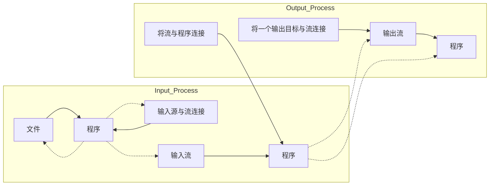
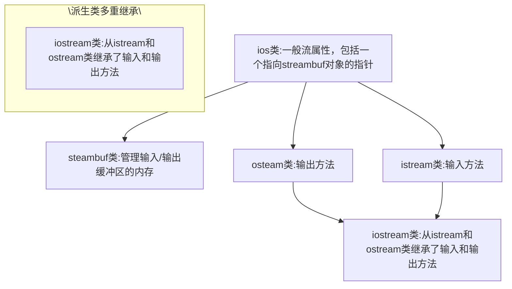

```cpp
words.push_back(input);

cout << "You entered the following words:\n";
for_each(words.begin(), words.end(), display);
cout << endl;

// place words in set, converting to lowercase
set<string> wordset;
transform(words.begin(), words.end(),
    insert_iterator<set<string> > (wordset, wordset.begin()),
    ToLower);
cout << "\nAlphabetic list of words:\n";
for_each(wordset.begin(), wordset.end(), display);
cout << endl;

// place word and frequency in map
map<string, int> wordmap;
set<string>::iterator si;
for (si = wordset.begin(); si != wordset.end(); si++)
    wordmap[*si] = count(words.begin(), words.end(), *si);

// display map contents
cout << "\nWord frequency:\n";
for (si = wordset.begin(); si != wordset.end(); si++)
    cout << *si << ": " << wordmap[*si] << endl;

return 0;
}

string & ToLower(string & st)
{
    transform(st.begin(), st.end(), st.begin(), toLower);
    return st;
}

void display(const string & s)
{
    cout << s << " ";
}
```

程序清单 16.19 中程序的运行情况如下:

```txt
Enter words (enter quit to quit):
The dog saw the cat and thought the cat fat
The cat thought the cat perfect
quit
You entered the following words:
The dog saw the cat and thought the cat fat The cat thought the cat perfect

Alphabetic list of words:
and cat dog fat perfect saw the thought

Word frequency:
and: 1
cat: 4
dog: 1
```

```textproto
fat: 1
perfect: 1
saw: 1
the: 5
thought: 2
```

这里的寓意在于，使用 STL 时应尽可能减少要编写的代码。STL 通用、灵活的设计将节省大量工作。另外，STL 设计者就是非常关心效率的算法人员，算法是经过仔细选择的，并且是内联的。

## 16.7 其他库

C++还提供了其他一些类库，它们比本章讨论前面的例子更为专用。例如，头文件 complex 为复数提供了类模板 complex，包含用于 float、long 和 long double 的具体化。这个类提供了标准的复数运算及能够处理复数的标准函数。C++11 新增的头文件 random 提供了更多的随机数功能。

第 14 章介绍了头文件 valarray 提供的模板类 valarray。这个类模板被设计成用于表示数值数组，支持各种数值数组操作，例如将两个数组的内容相加、对数组的每个元素应用数学函数以及对数组进行线性代数运算。

## 16.7.1 vector、valarray 和 array

您可能会问，C++为何提供三个数组模板:vector、valarray 和 array。这些类是由不同的小组开发的，用于不同的目的。vector 模板类是一个容器类和算法系统的一部分，它支持面向容器的操作，如排序、插入、重新排列、搜索、将数据转移到其他容器中等。而 valarray 类模板是面向数值计算的，不是 STL 的一部分。例如，它没有 push\_back() 和 insert() 方法，但为很多数学运算提供了一个简单、直观的接口。最后，array 是为替代内置数组而设计的，它通过提供更好、更安全的接口，让数组更紧凑，效率更高。Array 表示长度固定的数组，因此不支持 push\_back() 和 insert()，但提供了多个 STL 方法，包括 begin()、end()、rbegin() 和 rend()，这使得很容易将 STL 算法用于 array 对象。

例如，假设有如下声明:

```txt
vector<double> ved1(10), ved2(10), ved3(10);
array<double, f0> vod1, vod2, vod3;
valarray<double> vad1(10), vad2(10), vad3(10);
```

同时，假设 ved1、ved2、vod1、vod2、vad1 和 vad2 都有合适的值。要将两个数组中第一个元素的和赋给第三个数组的第一个元素，使用 vector 类时，可以这样做:

```rust
transform(ved1.begin(), ved1.end(), ved2.begin(), ved3.begin(),
        plus<double>());
```

对于 array 类，也可以这样做:

```txt
transform(vod1.begin(), vod1.end(), vod2.begin(), vod3.begin(),
        plus<double>());
```

然而，valarray 类重载了所有算术运算符，使其能够用于 valarray 对象，因此您可以这样做:

```javascript
vad3 = vad1 + vad2;      // + overloaded
```

同样，下面的语句将使 vad3 中每个元素都是 vad1 和 vad2 中相应元素的乘积:

```javascript
vad3 = vad1 * vad2;    // * overloaded
```

要将数组中每个元素的值扩大 2.5 倍，STL 方法如下:

```typescript
transform(ved3.begin(), ved3.end(), ved3.begin(),
           bind1st(multiplies<double>(), 2.5));
```

valarray 类重载了将 valarray 对象乘以一个值的运算符，还重载了各种组合赋值运算符，因此可以采取

下列两种方法之一:

```txt
vad3 = 2.5 *.vad3;      // * overloaded
vad3 *= 2.5;                 // *= overloaded
```

假设您要计算数组中每个元素的自然对数，并将计算结果存储到另一个数组的相应元素中，STL 方法如下:

```typescript
transform(ved1.begin(), ved1.end(), ved3.begin(),
    log);
```

valarray 类重载了这种数学函数，使之接受一个 valarray 参数，并返回一个 valarray 对象，因此您可以这样做:

```javascript
vad3 = log(vad1);      // log()-overloaded
```

也可以使用 apply() 方法，该方法也适用于非重载函数:

```javascript
vad3 = vad1.apply(log);
```

方法 apply() 不修改调用对象，而是返回一个包含结果的新对象。

执行多步计算时，valarray 接口的简单性将更为明显:

```javascript
vad3 = 10.0* ((vad1 + vad2) / 2.0 + vad1 * cos(vad2));
```

有关使用 STL vector 来完成上述计算的代码留给您去完成。

valarray 类还提供了方法 sum()（计算 valarray 对象中所有元素的和）、size()（返回元素数）、max()（返回最大的元素值）和 min()（返回最小的元素值）。

正如您看到的，对于数学运算而言，valarray 类提供了比 vector 更清晰的表示方式，但通用性更低。valarray 类确实有一个 resize() 方法，但不能像使用 vector 的 push\_back 时那样自动调整大小。没有支持插入、排序、搜索等操作的方法。总之，与 vector 类相比，valarray 类关注的东西更少，但这使得它的接口更简单。

valarray 的接口更简单是否意味着性能更高呢？在大多数情况下，答案是否定的。简单表示法通常是使用类似于您处理常规数组时使用的循环实现的。然而，有些硬件设计允许在执行矢量操作时，同时将一个数组中的值加载到一组寄存器中，然后并行地进行处理。从原则上说，valarray 操作也可以实现成利用这样的设计。

可以将 STL 功能用于 valarray 对象吗？通过回答这个问题，可以快速地复习一些 STL 原理。假设有一个包含 10 个元素的 valarray&lt;double&gt;对象:

```txt
valarray<double> vad(10);
```

使用数字填充该数组后，能够将 STL sort()函数用于该数组吗？valarray 类没有 begin()和 end()方法，因此不能将它们用作指定区间的参数:

```javascript
sort(vad.begin(), vad.end());  // NO, no begin(), end()
```

另外，vad 是一个对象，而不是指针，因此不能像处理常规数组那样，使用 vad 和 vad + 10 作为区间参数，即下面的代码不可行:

```javascript
sort(vad, vad + 10); // NO, vad an object, not an address
```

可以使用地址运算符:

```txt
sort(&vad[0], &vad[10]); // maybe?
```

但 valarray 没有定义下标超过尾部一个元素的行为。这并不一定意味着使用&vadp[10]不可行。事实上，使用 6 种编译器测试上述代码时，都是可行的；但这确实意味着可能不可行。为让上述代码不可行，需要一个不太可能出现的条件，如让数组与预留给堆的内存块相邻。然而，如果 3.85 亿的交易命悬于您的代码，您可能不想冒代码出现问题的风险。

为解决这种问题，C++11 提供了接受 valarray 对象作为参数的模板函数 begin() 和 end()。因此，您将使用 begin(vad)而不是 vad.begin。这些函数返回的值满足 STL 区间需求:

```javascript
sort(begin(vad), end(vad)); // C++11 fix!
```

程序清单 16.20 演示了 vector 和 valarray 类各自的优势。它使用 vector 的 push\_back() 方法和自动调整大小的功能来收集数据，然后对数字进行排序后，将它们从 vector 对象复制到一个同样大小的 valarray 对象中，再执行一些数学运算。

程序清单 16:20 valvect.cpp

```cpp
// valvect.cpp -- comparing vector and valarray
#include <iostream>
#include <valarray>
#include <vector>
#include <algorithm>
int_main()
{
    using namespace std;
    vector<double>-data;
    double temp;

    cout << "Enter numbers(<=0 to quit):\n";
    while (cIn >> temp && temp > 0) _
        data.push_back(temp);
    sort(data.begin(), data.end());
    int size = data.size();
    valarray<double> numbers(size);
    int i;
    for (i = 0; i < size; i++)
        numbers[i] = data[i];
    valarray<double> sq_rts(size);
    sq_rts_ = sqrt(numbers);
    valarray<double> results(size);
    results = numbers + 2.0 * sq_rts;
    cout.setf(ios_base::fixed);
    cout.precision(4);
    for (i = 0; i < size; i++)
    {
        cout.width(8);
        cout << numbers[i] << ": ";
        cout.width(8);
        cout << results[i] << endl;
    }
    cout << "done\n";
    return 0;
}
```

下面是程序清单 16.20 中程序的运行情况:

```yaml
Enter numbers (<=0 to quit):
3.3 1.8 5.2 10 14.4 21.6 26.9 0
 1.8000:    4.4833
 3.3000:    6.9332
 5.2000:    9.7607
10.0000: 16.3246
14.4000: 21.9895
21.6000: 30.8952
26.9000: 37.2730
done
```

除前面讨论的外，valarray 类还有很多其他特性。例如，如果 numbers 是一个 valarray&lt;double&gt;对象，则下面的语句将创建一个 bool 数组，其中 vbool[i]被设置为 numbers[i] > 9 的值，即 true 或 false:

```txt
valarray<bool> vbool = numbers > 9;
```

还有扩展的下标指定版本，来看其中的一个——slice 类。slice 类对象可用作数组索引，在这种情况下，它表的不是一个值而是一组值。slice 对象被初始化为三个整数值:起始索引、索引数和跨距。起始索引是第一个被选中的元素的索引，索引数指出要选择多少个元素，跨距表示元素之间的间隔。例如，slice(1, 4, 3) 创建的对象表示选择 4 个元素，它们的索引分别是 1、4、7 和 10。也就是说，从起始索引开始，加上跨距得到下一个元素的索引，依此类推，直到选择了 4 个元素。如果 varint 是一个 valarray&lt;int&gt;对象，则下面的语句将把第 1、4、7、10 个元素都设置为 10:

```javascript
varint[slice(1,4,3)] = 10;  // set selected elements to 10
```

这种特殊的下标指定功能让您能够使用一个一维 valarray 对象来表示二维数据。例如，假设要表示一个 4 行 3 列的数组，可以将信息存储在一个包含 12 个元素的 valarray 对象中，然后使用一个 slice(0, 3, 1) 对象作为下标，来表示元素 0、1 和 2，即第 1 行。同样，下标 slice(0, 4, 3) 表示元素 0、3、6 和 9，即第一列。程序清单 16.21 演示了 slice 的一些特性。

程序清单 16.21 vslice.cpp

```cpp
// vslice.cpp -- using valarray slices
#include <iostream>
#include <valarray>
#include <cstdlib>

const int SIZE = 12;
typedef std::valarray<int> vint;      // simplify declarations
void show(const vint & v, int cols);
int main()
{
    using std::slice;                 // from <valarray>
    using std::cout;
    vint valint(SIZE);             // think of as 4 rows of 3

    int i;
    for (i = 0; i < SIZE; ++i)
        valint[i] = std::rand() % 10;
    cout << "Original array:\n";
    show(valint, 3);                // show in 3 columns
    vint vcol(valint[slice(1,4,3)]); // extract 2nd column
    cout << "Second column:\n";
    show(vcol, 1);                  // show in 1 column
    vint vrow(valint[slice(3,3,1)]); // extract 2nd row
    cout << "Second row:\n";
    show(vrow, 3);
    valint[slice(2,4,3)] = 10;       // assign to 2nd column
    cout << "Set last column to 10:\n";
    show(valint, 3);
    cout << "Set first column to sum of next two:\n";
    // + not defined for slices, so convert to valarray<int>
    valint[slice(0,4,3)] = vint(valint[slice(1,4,3)])
                                + vint(valint[slice(2,4,3)]);
    show(valint, 3);
    return 0;
}
```

```cpp
void show(const-vint & v, int_cols)
{
    using std::cout;
    using std::endl;

    int lim== v.size();
    for(int i = 0; i < lim; ++i)
    {
        cout.width(3);
        cout<< v[i];
        if (i % cols == cols - 1)
            cout << endl;
        else
            cout << ' ';
    }
    if (lim % cols != 0)
        cout << endl;
}
```

对于 valarray 对象（如 valint）和单个 int 元素（如 valint[1]），定义了运算符+；但正如程序清单 16.2 指出的，对于使用 slice 下标指定的 valarray 单元，如 valint[slice(8, 4, 3)，并没有定义运算符+。因此程序使用 slice 指定的元素创建一个完整的 valint 对象，以便能够执行加法运算:

vint(valint[slice(1,4,3)]) // calls a slice-based constructor

valarray 类提供了用于这种目的的构造函数。

下面是程序清单 16.21 中程序的运行情况:

```txt
Original array:
  0   3   3
  2   9   0
  8   2   6
  6   9   1
Second column:
  3
  9
  2
  9
Second row:
  2   9   0
Set last column to 10:
  0   3   10
  2   9   10
  8   2   10
  6   9   10
Set first column to sum of next two:
 13   3   10
 19   9   10
 12   2   10
 19   9   10
```

由于元素值是使用 rand() 设置的，因此不同的 rand() 实现将设置不同的值。

另外，使用 gslice 类可以表示多维下标，但上述内容应足以让您对 valarray 有一定了解。

## 16.7.2 模板 initializer\_list (C++11)

模板 initializer\_list 是 C++11 新增的。您可使用初始化列表语法将 STL 容器初始化为一系列值:

```rust
std::vector<double> payments {45.99, 39.23, 19.95, 89.01};
```

这将创建一个包含 4 个元素的容器，并使用列表中的 4 个值来初始化这些元素。这之所以可行，是因为容器类现在包含将 initializer\_list&lt;T&gt;作为参数的构造函数。-例如，vector&lt;double&gt;包含一个将 initializer\_list&lt;double&gt;作为参数的构造函数，因此上述声明与下面的代码等价:

```txt
std::vector<double> payments({45.99, 39.23, 19.95, 89.01});
```

这里显式地将列表指定为构造函数参数。

通常，考虑到 C++11-新增的通用初始化语法，可使用表示法()而不是()来调用类构造函数:

```txt
shared_ptr<double> pd={new double}; // ok to use {} instead-of ()
```

但如果类也有接受 initializer\_list 作为参数的构造函数，这将带来问题:

```cpp
std::vector<int> vi{10};     // ??
```

这将调用哪个构造函数呢？

```cpp
std::vector<int> vi(10);    // case A: 10 uninitialized elements
std::vector<int> vi( {10});   // case B: 1 element set to 10
```

答案是，如果类有接受 initializer\_list 作为参数的构造函数，则使用语法{}将调用该构造函数。因此在这个示例中，对应的是情形 B。

所有 initializer\_list 元素的类型都必须相同，但编译器将进行必要的转换:

```rust
std::vector<double> payments {45.99, 39.23, 19, 89};
// same as std::vector<double> payments {45.99, 39.23, 19.0, 89.0};
```

在这里，由于 vector 的元素类型为 double，因此列表的类型为 initializer\_list&lt;double&gt;，所以 19 和 89 被转换为 double。

但不能进行隐式的窄化转换:

```cpp
std::vector<int> values = {10, 8, 5.5}; // narrowing, compile-time error
```

在这里，元素类型为 int，不能隐式地将 5.5 转换为 int。

除非类要用于处理长度不同的列表，否则让它提供接受 initializer\_list 作为参数的构造函数没有意义。例如，对于存储固定数目值的类，您不想提供接受 initializer\_list 作为参数的构造函数。在下面的声明中，类包含三个数据成员，因此没有提供 initializer\_list 作为参数的构造函数:

```cpp
class- Position
{
private:
    int x;
    int y;
    int z;
public:
    Position(int xx = 0, int yy = 0, int zz = 0)
        : x(xx), y(yy), z (zz) = {}
    // no initializer_list constructor
    ...
};
```

这样，使用语法{}时将调用构造函数 Position(int, int, int):

```javascript
Position A = {20, -3}; // uses Position(20,-3,0)
```

## 16.7.3 使用 initializer\_list

要在代码中使用 initializer\_list 对象，必须包含类文件 initializer\_list。这个模板类包含成员函数 begin() 和 end()，您可使用这些函数来访问列表元素。它还包含成员函数 size()，该函数返回元素数。程序清单 16.22 是一个简单的 initializer\_list 使用示例，它要求编译器支持 C++11 新增的 initializer\_list。

程序清单 16.22 ilist.cpp

```cpp
// ilist.cpp -- use initializer_list (C++11 feature)
#include <iostream>
#include <initializer_list>

double sum(std::initializer_list<double> il);
double average(const std::initializer_list<double> & ril);

int main()
{
    using std::cout;

    cout << "List 1: sum = " << sum({2,3,4})
        <<", ave = " << average({2,3,4}) << '\n';
    std::initializer_list<double> dl = {1.1, 2.2, 3.3, 4.4, 5.5};
    cout << "List 2: sum = " << sum(dl)
        <<", ave = " << average(dl) << '\n';
    dl = {16.0, 25.0, 36.0, 40.0, 64.0};
    cout << "List 3: sum = " << sum(dl)
        <<", ave = " << average(dl) << '\n';
    return 0;
}

double sum(std::initializer_list<double> il)
{
    double tot = 0;
    for (auto p = il.begin(); p !=il.end(); p++)
        tot += *p;
    return tot;
}

double average(const std::initializer_list<double> & ril)
{
    double tot = 0;
    int n = ril.size();
    double ave = 0.0;
    if (n > 0)
    {
        for (auto p = ril.begin(); p !=ril.end(); p++)
            tot += *p;
        ave = tot / n;
    }
    return ave;
}
```

该程序的输出如下:

```txt
List 1: sum = 9, ave = 3
List 2: sum = 16.5, ave = 3.3
List 3: sum = 181, ave = 36.2
```

## 程序说明

可按值传递 initializer\_list 对象，也可按引用传递，如 sum() 和 average() 所示。这种对象本身很小，通常是两个指针（一个指向开头，一个指向末尾的下一个元素），也可能是一个指针和一个表示元素数的整数，因此采用的传递方式不会带来重大的性能影响。STL 按值传递它们。

函数参数可以是 initializer\_list 字面量，如  $\{2, 3, 4\}$ ，也可以是 initializer\_list 变量，如 dl。

initializer\_list 的迭代器类型为 const，因此您不能修改 initializer\_list 中的值:

```typescript
*dl.begin() = 2011.6; // not allowed
```

但正如程序清单 16.22 演示的，可以将一个 initializer\_list 赋给另一个 initializer\_list:

```javascript
d1 = {16.0, 25.0, 36.0, 40.0, 64.0}; // allowed
```

然而，提供 initializer\_list 类的初衷旨在让您能够将一系列值传递给构造函数或其他函数。

## 16.8 总结

C++提供了一组功能强大的库，这些库提供了很多常见编程问题的解决方案以及简化其他问题的工具。string 类为将字符串作为对象来处理提供了一种方便的方法。string 类提供了自动内存管理功能以及众多处理字符串的方法和函数。例如，这些方法和函数让您能够合并字符串、将一个字符串插入到另一个字符串中、反转字符串、在字符串中搜索字符或子字符串以及执行输入和输出操作。

诸如 auto\_ptr 以及 C++11 新增的 shared\_ptr 和 unique\_ptr 等智能指针模板使得管理由 new 分配的内存更容易。如果使用这些智能指针（而不是常规指针）来保存 new 返回的地址，则不必在以后使用删除运算符。智能指针对象过期时，其析构函数将自动调用 delete 运算符。

STL 是一个容器类模板、迭代器类模板、函数对象模板和算法函数模板的集合，它们的设计是一致的，都是基于泛型编程原则的。算法通过使用模板，从而独立于所存储的对象的类型；通过使用迭代器接口，从而独立于容器的类型。迭代器是广义指针。

STL 使用术语 “概念” 来描述一组要求。例如，正向迭代器的概念包含这样的要求，即正向迭代器能够被解除引用，以便读写，同时能够被递增。概念真正的实现方式被称为概念的 “模型”。例如，正向迭代器概念可以是常规指针或导航链表的对象。基于其他概念的概念叫作 “改进”。例如，双向迭代器是正向迭代器概念的改进。

诸如 vector 和 set 等容器类是容器概念（如容器、序列和关联容器）的模型。STL 定义了多种容器类模板:vector、deque、list、set、multiset、map、multimap 和 bitset；还定义了适配器类模板 queue、priority\_queue 和 stack；这些类让底层容器类能够提供适配器类模板名称所建议的特性接口。因此，stack 虽然在默认情况下是基于 vector 的，但仍只允许在栈顶进行插入和删除。C++11 新增了 forward\_list、unordered\_set、unordered\_multiset、unordered\_map 和 unordered\_multimap。

有些算法被表示为容器类方法，但大量算法都被表示为通用的、非成员函数，这是通过将迭代器作为容器和算法之间的接口得以实现的。这种方法的一个优点是:只需一个诸如 for\_each() 或 copy(.) 这样的函数，而不必为每种容器提供一个版本；另一个优点是:STL 算法可用于非 STL 容器，如常规数组、string 对象、array 对象以及您设计的秉承 STL 迭代器和容器规则的任何类。

容器和算法都是由其提供或需要的迭代器类型表征的。应当检查容器是否具备支持算法要求的迭代器概念。例如，for\_each()算法使用一个输入迭代器，所有的STL容器类类型都满足其最低要求；而sort()则要求随机访问迭代器，并非所有的容器类都支持这种迭代器。如果容器类不能满足特定算法的要求，则可能提供一个专用的方法。例如，list类包含一个基于双向迭代器的sort()方法，因此它可以使用该方法，而不是通用函数。

STL 还提供了函数对象（函数符），函数对象是重载了()运算符（即定义了 operator()()方法）的类。可以使用函数表示法来调用这种类的对象，同时可以携带额外的信息。自适应函数符有 typedef 语句，这种语句标识了函数符的参数类型和返回类型。这些信息可供其他组件（如函数适配器）使用。

通过表示常用的容器类型，并提供各种使用高效算法实现的常用操作（全部是通用的方式实现的），

STL 提供了一个非常好的可重用代码源。可以直接使用 STL 工具来解决编程问题，也可以把它们作为基本部件，来构建所需的解决方案。

模板类 complex 和 valarray 支持复数和数组的数值运算。

## 16.9 复习题

1. 考虑下面的类声明:

```cpp
class RQ1
{
private:
    char * st;          // points to C-style string
public:
    RQ1() { st = new char [1]; strcpy(st,""); }
    RQ1(const char * s)
    {st = new char [strlen(s) + 1]; strcpy(st, s); }
    RQ1(const RQ1 & rq)
    {st = new char [strlen(rq.st) + 1]; strcpy(st, rq.st); }
    ~RQ1() {delete [] st};
    RQ & operator=(const RQ & rq);
    // more stuff
};
```

将它转换为使用 string 对象的声明。哪些方法不再需要显式定义？

2. 在易于使用方面，指出 string 对象至少两个优于 C-风格字符串的地方。
3. 编写一个函数，用 string 对象作为参数，将 string 对象转换为全部大写。
4. 从概念上或语法上说，下面哪个不是正确使用 auto\_ptr 的方法（假设已经包含了所需的头文件）？

```txt
auto_ptr<int> pia(new int[20]);
auto_ptr<string> (new string);
int rigue = 7;
auto_ptr<int>pr(&rigue);
auto_ptr dbl (new double);
```

5. 如果可以生成一个存储高尔夫球棍（而不是数字）的栈，为何它（从概念上说）是一个坏的高尔夫袋子？
6. 为什么说对于逐洞记录高尔夫成绩来说，set 容器是糟糕的选择？
7. 既然指针是一个迭代器，为什么 STL 设计人员没有简单地使用指针来代替迭代器呢？
8. 为什么STL设计人员仅定义了迭代器基类，而使用继承来派生其他迭代器类型的类，并根据这些迭代器类来表示算法？
9. 给出 vector 对象比常规数组方便的 3 个例子。
10. 如果程序清单 16.9 是使用 list（而不是 vector）实现的，则该程序的哪些部分将是非法的？非法部分能够轻松修复吗？如果可以，如何修复呢？
11. 假设有程序清单 16.15 所示的函数符 TooBig，下面的代码有何功能？赋给 bo 的是什么值？

```txt
bool bo = TooBig<int>(10)(15);
```

## 16.10 编程练习

1. 回文指的是顺读和逆读都一样的字符串。例如，“tot”和“otto”都是简短的回文。编写一个程序，让用户输入字符串，并将字符串引用传递给一个 bool 函数。如果字符串是回文，该函数将返回 true，否则返回 false。此时，不要担心诸如大小写、空格和标点符号这些复杂的问题。即这个简单的版本将拒绝“Otto”和“Madam，I'm Adam”。请查看附录 F 中的字符串方法列表，以简化这项任务。

2. 与编程练习1中给出的问题相同，但要考虑诸如大小写、空格和标点符号这样的复杂问题。即“Madam, I'm Adam”将作为回文来测试。例如，测试函数可能会将字符串缩略为“madamimadam”，然后测试倒过来是否一样。不要忘了有用的cctype库，您可能从中找到几个有用的STL函数，尽管不一定非要使用它们。
3. 修改程序清单 16.3，使之从文件中读取单词。一种方案是，使用 vector&lt;string&gt;对象而不是 string 数组。这样便可以使用 push\_back() 将数据文件中的单词复制到 vector&lt;string&gt;对象中，并使用 size() 来确定单词列表的长度。由于程序应该每次从文件中读取一个单词，因此应使用运算符 >> 而不是 getline()。文件中包含的单词应该用空格、制表符或换行符分隔。
4. 编写一个具有老式风格接口的函数，其原型如下:

```javascript
int reduce(long ar[], int n);
```

实参应是数组名和数组中的元素个数。该函数对数组进行排序，删除重复的值，返回缩减后数组中的元素数目。请使用STL函数编写该函数（如果决定使用通用的unique()函数，请注意它将返回结果区间的结尾）。使用一个小程序测试该函数。

5. 问题与编程练习4相同，但要编写一个模板函数:

```txt
template <class T>
int reduce(T ar[], int n);
```

在一个使用 long 实例和 string 实例的小程序中测试该函数。

6. 使用 STL queue 模板类而不是第 12 章的 Queue 类，重新编写程序清单 12.12 所示的示例。

7. 彩票卡是一个常见的游戏。卡片上是带编号的圆点，其中一些圆点被随机选中。编写一个 lotto() 函数，它接受两个参数。第一个参数是彩票卡上圆点的个数，第二个参数是随机选择的圆点个数。该函数返回一个 vector&lt;int&gt;对象，其中包含（按排列后的顺序）随机选择的号码。例如，可以这样使用该函数:

```txt
vector<int> winners;
winners = Lotto(51,6);
```

这样将把一个矢量赋给 winner，该矢量包含 1\~51 中随机选定的 6 个数字。注意，仅仅使用 rand() 无法完成这项任务，因它会生成重复的值。提示:让函数创建一个包含所有可能值的矢量，使用 random shuffle()，然后通过打乱后的矢量的第一个值来获取值。编写一个小程序来测试这个函数。

8. Mat 和 Pat 希望邀请他们的朋友来参加派对。他们要编写一个程序完成下面的任务。

- 让 Mat 输入他朋友的姓名列表。姓名存储在一个容器中，然后按排列后的顺序显示出来。
- 让 Pat 输入她朋友的姓名列表。姓名存储在另一个容器中，然后按排列后的顺序显示出来。
- 创建第三个容器，将两个列表合并，删除重复的部分，并显示这个容器的内容。

9. 相对于数组，在链表中添加和删除元素更容易，但排序速度更慢。这就引出了一种可能性:相对于使用链表算法进行排序，将链表复制到数组中，对数组进行排序，再将排序后的结果复制到链表中的速度可能更快；但这也可能占用更多的内存。请使用如下方法检验上述假设。

a. 创建大型 vector&lt;int&gt;对象 vi0，并使用 rand() 给它提供初始值。
b. 创建 vector&lt;int&gt;对象 vi 和 list&lt;int&gt;对象 li，它们的长度都和初始值与 vi0 相同。
c. 计算使用 STL 算法 sort() 对 vi 进行排序所需的时间，再计算使用 list 的方法 sort() 对 li 进行排序所需的时间。
d. 将 li 重置为排序的 vi0 的内容，并计算执行如下操作所需的时间:将 li 的内容复制到 vi 中，对 vi 进行排序，并将结果复制到 li 中。

要计算这些操作所需的时间，可使用-ctime库中的clock()。正如程序清单5.14演示的，可使用下面的语句来获取开始时间:

```javascript
clock t start = clock();
```

再在操作结束后使用下面的语句获取经过了多长时间:

```txt
clock_t end = clock();
cout << (double)(end - start)/CLOCKS_PER_SEC;
```

这种测试并非绝对可靠，因为结果取决于很多因素，如可用内存量、是否支持多处理以及数组（列表）的长度（随着要排序的元素数增加，数组相对于列表的效率将更明显）。另外，如果编译器提供了默认生成方式和发布生成方式，请使用发布生成方式。鉴于当今计算机的速度非常快，要获得有意义的结果，可能需要使用尽可能大的数组。例如，可尝试包含100000、1000000和10000000个元素。

10. 请按如下方式修改程序清单 16.9（vect3.cpp）。

a. 在结构 Review 中添加成员 price。
b. 不使用 vector&lt;Review&gt;来存储输入，而使用 vector<shared\_ptr&lt;Review&gt;>。别忘了，必须使用 new 返回的指针来初始化 shared\_ptr。
c. 在输入阶段结束后，使用一个循环让用户选择如下方式之一显示书籍:按原始顺序显示、按字母表顺序显示、按评级升序显示、按评级降序显示、按价格升序显示、按价格降序显示、退出。

下面是一种可能的解决方案:获取输入后，再创建一个 shared\_ptr 矢量，并用原始数组初始化它。定义一个对指向结构的指针进行比较的 operator<()函数，并使用它对第二个矢量进行排序，让其中的 shared\_ptr 按其指向的对象中的书名排序。重复上述过程，创建按 rating 和 price 排序的 shared\_ptr 矢量。请注意，通过使用 rbegin()和 rend()，可避免创建按相反的顺序排列的 shared\_ptr 矢量。


<details>
<summary>seal</summary>

鄭孝船
就乎
</details>

## 第17章 输入、输出和文件

## 本章内容包括:

- C++角度的输入和输出。
- iostream 类系列。
- 重定向。
- ostream 类方法。
- 格式化输出。
- istream 类方法。
- 流状态。
- 文件 I/O。
- 使用 ifstream 类从文件输入。
- 使用 ofstream 类输出到文件。
- 使用fstream类进行文件输入和输出。
- 命令行处理。
- 二进制文件。
- 随机文件访问。
- 内核格式化。

对 C++ 输入和输出（简称 I/O）的讨论提出了一个问题。一方面，几乎每个程序都要使用输入和输出，因此了解如何使用它们是每个学习计算机语言的人面临的首要任务；另一方面，C++ 使用了很多较为高级的语言特性来实现输入和输出，其中包括类、派生类、函数重载、虚函数、模板和多重继承。因此，要真正理解 C++ I/O，必须了解 C++ 的很多内容。为了帮助您起步，本书的开始儿童介绍了使用 istream 类对象 cin 和 ostream 类对象 cout 进行输入和输出的基本方法，同时使用了 ifstream 和 ofstream 对象进行文件输入和输出。本章将更详细地介绍 C++ 的输入和输出类，看看它们是如何设计的，学习如何控制输出格式（如果您跳过很多章，直接学习高级格式，可浏览一下讨论该主题的一些小节，注意其中的技术，而忽略解释）。

用于文件输入和输出的 C++ 工具都是基于 cin 和 cout 所基于的基本类定义，因此本章以对控制台 I/O（键盘和屏幕）的讨论为跳板，来研究文件 I/O。

ANSI/ISO C++标准委员会的工作是让 C++ I/O 与现有的 C I/O 更加兼容，这给传统的 C++做法带来了一些变化。

## 17.1 C++输入和输出概述

多数计算机语言的输入和输出是以语言本身为基础实现的。例如，从诸如 BASIC 和 Pascal 等语言的关键字列表中可知，PRINT 语句、Writeln 语句以及其他类似的语句都是语言词汇表的组成部分，但 C 和 C++ 都没有将输入和输出建立在语言中。这两种语言的关键字包括 for 和 if，但不包括与 I/O 有关的内容。C 语言最初把 I/O 留给了编译器实现人员。这样做的一个原因是为了让实现人员能够自由的设计 I/O 函数，使之最适合于目标计算机的硬件要求。实际上，多数实现人员都把 I/O 建立在最初为 UNIX 环境开发的库函数的基础之上。ANSI C 正式承认这个 I/O 软件包时，将其称为标准输入/输出包，并将其作为标准 C 库不可或缺的组成部分。C++也认可这个软件包，因此如果熟悉 stdio.h 文件中声明的 C 函数系列，则可以在 C++ 程序中使用它们（较新的实现使用头文件 cstdio 来支持这些函数）。

然而，C++依赖于 C++ 的 I/O 解决方案，而不是 C 语言的 I/O 解决方案，前者是在头文件 iostream（以前为 iostream.h）和 fstream（以前为 fstream.h）中定义一组类。这个类库不是正式语言定义的组成部分（cin 和 istream 不是关键字）；毕竟计算机语言定义了如何工作（例如如何创建类）的规则，但没有定义应按照这些规则创建哪些东西。然而，正如 C 实现自带了一个标准函数库一样，C++也自带了一个标准类库。首先，标准类库是一个非正式的标准，只是由头文件 iostream 和 fstream 中定义的类组成。ANSI/ISO-C++委员会决定把这个类正式作为一个标准类库，并添加其他一些标准类，如第 16 章讨论的那些类。本章将讨论标准 C++ I/O。但首先看一看 C++ I/O 的概念框架。

## 17.1.1 流和缓冲区

C++程序把输入和输出看作字节流。输入时，程序从输入流中抽取字节；输出时，程序将字节插入到输出流中。对于面向文本的程序，每个字节代表一个字符，更通俗地说，字节可以构成字符或数值数据的二进制表示。输入流中的字节可能来自键盘，也可能来自存储设备（如硬盘）或其他程序。同样，输出流中的字节可以流向屏幕、打印机、存储设备或其他程序。流充当了程序和流源或流目标之间的桥梁。这使得C++程序可以以相同的方式对待来自键盘的输入和来自文件的输入。C++程序只是检查字节流，而不需要知道字节来自何方。同理，通过使用流，C++程序处理输出的方式将独立于其去向。因此管理输入包含两步:

- 将流与输入去向的程序关联起来。
- 将流与文件连接起来。

换句话说，输入流需要两个连接，每端各一个。文件端部连接提供了流的来源，程序端连接将流的流出部分转储到程序中（文件端连接可以是文件，也可以是设备，如键盘）。同样，对输出的管理包括将输出流连接到程序以及将输出目标与流关联起来。这就像将字节（而不是水）引入到水管中（参见图17.1）。


<details>
<summary>flowchart</summary>


</details>

图17.1 C++输入和输出

通常，通过使用缓冲区可以更高效地处理输入和输出。缓冲区是用作中介的内存块，它是将信息从设备传输到程序或从程序传输给设备的临时存储工具。通常，像磁盘驱动器这样的设备以512字节（或更多）的块为单位来传输信息，而程序通常每次只能处理一个字节的信息。缓冲区帮助匹配这两种不同的信息传输速率。例如，假设程序要计算记录在硬盘文件中的金额。程序可以从文件中读取一个字符，处理它，再从文件中读取下一个字符，再处理，依此类推。从磁盘文件中每次读取一个字符需要大量的硬件活动，速度非常慢。缓冲方法则从磁盘上读取大量信息，将这些信息存储在缓冲区中，然后每次从缓冲区里读取一个字节。因为从内存中读取单个字节的速度比从硬盘上读取快很多，所以这种方法更快，也更方便。当然，到达缓冲区尾部后，程序将从磁盘上读取另一块数据。这种原理与水库在暴风雨中收集几兆加仑流量的水，然后以比较文明的速度给您家里供水是一样的（见图17.2）。输出时，程序首先填满缓冲区，然后把整块数据传输给硬盘，并清空缓冲区，以备下一批输出使用。这被称为刷新缓冲区（flushing the buffer）。


<details>
<summary>text_image</summary>

用数据块填充缓冲区
流逐字节地进入程序
用下一个数据块填满缓冲区
</details>

图17.2. 有缓冲区的流

键盘输入每次提供一个字符，因此在这种情况下，程序无需缓冲区来帮助匹配不同的数据传输速率。然而，对键盘输入进行缓冲可以让用户在将输入传输给程序之前返回并更正。C++程序通常在用户按下回车键时刷新输入缓冲区。这是为什么本书的例子没有一开始就处理输入，而是等到用户按下回车键后再处理的原因。对于屏幕输出，C++程序通常在用户发送换行符时刷新输出缓冲区。程序也可能会在其他情况下刷新输入，例如输入即将到来时，这取决于实现。也就是说，当程序到达输入语句时，它将刷新输出缓冲区中当前所有的输出。与ANSI C一致的C++实现是这样工作的。

## 17.1.2 流、缓冲区和iostream 文件

管理流和缓冲区的工作有点复杂，但iostream（以前为iostream.h）文件中包含一些专门设计用来实现、管理流和缓冲区的类。C++98 版本 C++ I/O 定义了一些类模板，以支持 char 和 wchar\_t 数据；C++11 添加了 char16\_t 和 char32\_t 具体化。通过使用 typedef 工具，C++使得这些模板 char 具体化能够模仿传统的非模板 I/O 实现。下面是其中的一些类（见图 17.3）:


<details>
<summary>flowchart</summary>


</details>

图 17.3 一些 I/O 类

- streambuf 类为缓冲区提供了内存，并提供了用于填充缓冲区、访问缓冲区内容、刷新缓冲区和管理缓冲区内存的类方法；
- ios\_base 类表示流的一般特征，如是否可读取、是二进制流还是文本流等；
- ios 类基于 ios\_base，其中包括了一个指向 streambuf 对象的指针成员；
- ostream 类是从 ios 类派生而来的，提供了输出方法；
- istream 类也是从 ios 类派生而来的，提供了输入方法；
- iostream 类是基于 istream 和 ostream 类的，因此继承了输入方法和输出方法。

要使用这些工具，必须使用适当的类对象。例如，使用 ostream 对象（如 cout）来处理输出。创建这样的对象将打开一个流，自动创建缓冲区，并将其与流关联起来，同时使得能够使用类成员函数。

## 重定义I/O

ISO/ANSI 标准 C++98 对 I/O 作了两方面的修订。首先是从 ostream.h 到 ostream 的变化，用 ostream 将类放到 std 名称空间中。其次，I/O 类被重新编写。为成为国际语言，C++ 必须能够处理需要 16 位的国际字符集或更宽的字符类型。因此，该语言在传统的 8 位 char（“窄”）类型的基础上添加了 wchar\_t（“宽”）字符类型；而 C++11 添加了类型 char16\_t 和 char32\_t。每种类型都需要有自己的 I/O 工具。标准委员会并没有开发两套（现在为 4 套）独立的类，而是开发了 1 套 I/O 类模板，其中包括 basic\_istream<charT, traits&lt;charT&gt;>和 basic\_ostream<charT, traits&lt;charT&gt;>。traits&lt;charT&gt;模板是一个模板类，为字符类型定义了具体特性，如如何比较字符是否相等以及字符的 EOF 值等。该 C++11 标准提供了 I/O 的 char 和 wchar\_t 具体化。例如，istream 和 ostream 都是 char 具体化的 typedef。同样，wistream 和 wostream 都是 wchar\_t 具体化。例如，wcout 对象用于输出宽字符流。头文件 ostream 中包含了这些定义。

ios基类中的一些独立于类型的信息被移动到新的ios\_base类中，这包括各种格式化常量，例如ios::fixed（现在为ios\_base::fixed）。另外，ios\_base还包含了一些老式ios中没有的选项。

C++的 iostream 类库管理了很多细节。例如，在程序中包含 iostream 文件将自动创建 8 个流对象（4 个用于窄字符流，4 个用于宽字符流）。

- cin对象对应于标准输入流。在默认情况下，这个流被关联到标准输入设备（通常为键盘）。wcin对象与此类似，但处理的是wchar t类型。
- cout对象与标准输出流相对应。在默认情况下，这个流被关联到标准输出设备（通常为显示器）。wcout对象与此类似，但处理的是wchar t类型。
- cerr 对象与标准错误流相对应，可用于显示错误消息。在默认情况下，这个流被关联到标准输出设备（通常为显示器）。这个流没有被缓冲，这意味着信息将被直接发送给屏幕，而不会等到缓冲区填满或新的换行符。wcerr 对象与此类似，但处理的是 wchar\_t 类型。
- clog对象也对应着标准错误流。在默认情况下，这个流被关联到标准输出设备（通常为显示器）。这个流被缓冲。wclog对象与此类似，但处理的是wchar t类型。
- 对象代表流——这意味着什么呢？当iostream文件为程序声明一个cout对象时，该对象将包含存储子与输出有关的信息的数据成员，如显示数据时使用的字段宽度、小数位数、显示整数时采用的计数方法以及描述用来处理输出流的缓冲区的streambuf对象的地址。下面的语句通过指向的streambuf对象将字符串“Bjarna free”中的字符放到cout管理的缓冲区中:

```txt
cout << "Bjarne free";
```

ostream 类定义了上述语句中使用的 \_operator<<() 函数, ostream 类还支持 cout 数据成员以及其他大量的类方法（如本章稍后将讨论的那些方法）。另外，C++ 注意到，来自缓冲区的输出被导引到标准输出（通常是显示器，由操作系统提供）。总之，流的一端与程序相连，另一端与标准输出相连，cout 对象凭借 streambuf 对象的帮助，管理着流中的字节流。

## 17.1.3 重定向

标准输入和输出流通常连接着键盘和屏幕。但很多操作系统（包括UNIX、Linux和Windows）都支持重定向，这个工具使得能够改变标准输入和标准输出。例如，假设有一个名为counter.exe的、可执行的Windows命令提示符C++程序，它能够计算输入中的字符数，并报告结果（在大多数Windows系统中，可以选择“开始”>“程序”，再单击“命令提示符”来打开命令提示符窗口）。该程序的运行情况如下:

```txt
C>counter _
Hello
and goodbye!
Control-Z      << simulated end-of-file
Input contained 19 characters.
C>
```

其中的输入来自键盘，输出的被显示到屏幕上。

通过输入重定向（<）和输出重定向（>），可以使用上述程序计算文件 oklahoma 中的字符数，并将结果放到 cow\_cnt 文件中:

```txt
cow_cnt file:
C>counter <oklahoma->cow_cnt
C>
```

命令行中的&lt;oklahoma 将标准输入与 oklahoma 文件关联起来，使 cin 从该文件（而不是键盘）读取输入。换句话说，操作系统改变了输入流的流入端连接，而流出端仍然与程序相连。命令行中的&gt;cow\_cnt 将标准输出与 cow\_cnt 文件关联起来，导致 cout 将输出发送给文件（而不是屏幕）。也就是说，操作系统改变了输出流的流出端连接，而流入端仍与程序相连。DOS、Windows 命令提示符模式、Linux 和 UNIX 能自动识别这种重定向语法（除早期的 DOS 外，其他操作系统都允许在重定向运算符与文件名之间加上可选

的空格）。

cout 代表的标准输出流是程序输出的常用通道。标准错误流（由 cerr 和 clog 代表）用于程序的错误消息。默认情况下，这 3 个对象都被发送给显示器。但对标准输出重定向并不会影响 cerr 或 clog，因此，如果使用其中一个对象来打印错误消息，程序将在屏幕上显示错误消息，即使常规的 cout 输出被重定向到其他地方。例如，请看下面的代码片段:

```cpp
if (success)
    std::cout << "Here come the goodies!\n";
else
{
    std::cerr << "Something horrible has happened.\n";
    exit(1);
}
```

如果重定向没有起作用，则选定的消息都将被显示在屏幕上。然而，如果程序输出被重定向到一个文件，则第一条消息（如果被选定）将被发送到文件中，而第二条消息（如果被选定）将被发送到屏幕。顺便说一句，有些操作系统也允许对标准错误进行重定向。例如，在 UNIX 和 Linux 中，运算符 2>重定向标准错误。

## 17.2 使用cout进行输出

正如前面指出的，C++将输出看作字节流（根据实现和平台的不同，可能是8位、16位或32位的字节，但都是字节），但在程序中，很多数据被组织成比字节更大的单位。例如，int类型由16位或32位的二进制值表示；double值由64位的二进制数据表示。但在将字节流发送给屏幕时，希望每个字节表示一个字符值。也就是说，要在屏幕上显示数字-2.34，需要将5个字符（-、2、..、3和4），而不是这个值的64位内部浮点表示发送到屏幕上。因此，ostream类最重要的任务之一是将数值类型（如int或float）转换为以文本形式表示的字符流。也就是说，ostream类将数据内部表示（二进制位模式）转换为由字符字节组成的输出流（以后会有仿生移植物，使得能够直接翻译二进制数据。我们把这种开发作为一个练习，留给您）。为执行这些转换任务，ostream类提供了多个类方法。现在就来看看它们，总结本书使用的方法，并介绍能够更精密地控制输出外观的其他方法。

## 17.2.1 重载的<<运算符

本书常结合使用 cout 和<<运算符（插入（insertion）运算符）:

```txt
int clients = 22;
cout << clients;
```

在 C++ 中，与 C 一样，<<运算符的默认含义是按位左移运算符（参见附录 E）。表达式 x<<3 的意思，将 x 的二进制表示中所有的位向左移动 3 位。显然，这与输出的关系不大。但 ostream 类重新定义了<<运算符，方法是将其重载为输出。在这种情况下，<<叫作插入运算符，而不是左移运算符（左移运算符由于其外观（像向左流动的信息流）而获得这种新角色）。插入运算符被重载，使之能够识别 C++ 中所有的基本类型:

- unsigned char;
- signed char;
- char;
short;
- unsigned short;
- int;

- unsiged int;
- long;
- unsigned long;
● long long (C++1|-);
- unsigned long long (C++11);
float;
double;
long double.

对于上述每种数据类型，ostream 类都提供了 operator<<()函数的定义（第 II 章讨论过，名称中包含运算符的函数用于重载该运算符）。因此，如果使用下面这样一条语句，而 value 是前面列出的类型之一，则 C++ 程序将其对应于有相应的特征标的运算符函数:

```txt
cout << value;
```

例如，表达式 cout<<88 对应于下面的方法原型:

```javascript
ostream & operator<<(int);
```

该原型表明，operator<<()函数接受一个 int 参数，这与上述语句中的 88 匹配。该原型还表明，函数返回一个指向 ostream 对象的引用，这使得可以将输出连接起来，如下所示:

```html
cout << "I'm feeling sedimental over=" << boundary << "\n"
```

如果您是 C 语言程序员，深受%类型说明符过多、说明符类型与值不匹配时将发生问题等痛苦，则使用 cout 非常简单（当然，由于有 cin，C++输入也非常简单）。

## 1. 输出和指针

ostream 类还为下面的指针类型定义了插入运算符函数:

- const signed char \*;
- const unsigned char \*;
- const char \*;
void \*。

不要忘了，C++用指向字符串存储位置的指针来表示字符串。指针的形式可以是 char 数组名、显式的 char 指针或用引号括起的字符串。因此，下面所有的 cout 语句都显示字符串:

```txt
char name[20] = "Dudly Diddlemore";
char * pn = "Violet D'Amore";
cout << "Hello!";
cout << name;
cout << pn;
```

方法使用字符串中的终止空字符来确定何时停止显示字符。

对于其他类型的指针，C++将其对应于 void \*，并打印地址的数值表示。如果要获得字符串的地址，则必须将其强制转换为其他类型，如下面的代码片段所示:

```cpp
int eggs = 12;
char * amount = "dozen";
cout << &eggs;          // prints address of eggs variable
cout << amount;          // prints the string "dozen"
cout << (void *) amount;   // prints the address of the "dozen" string
```

## 2. 拼接输出

插入运算符的所有化身的返回类型都是ostream &。也就是说，原型的格式如下:

```javascript
ostream & operator<<(type);
```

（其中，type 是要显示的数据的类型）返回类型 ostream & 意味着使用该运算符将返回一个指向 ostream.

对象的引用。哪个对象呢？函数定义指出，引用将指向用于调用该运算符的对象。换句话说，运算符函数的返回值为调用运算符的对象。例如，cout << “potluck” 返回的是 cout 对象。这种特性使得能够通过插入来连接输出。例如，请看下面的语句:

```txt
cout << "We have " << count << " unhatched chickens.\n";
```

表达式 cout << “We have” 将显示字符串，并返回 cout 对象。至此，上述语句将变为:

```txt
cout << count << " unhatched chickens.\n";
```

表达式 cout<<count 将显示 count 变量的值，并返回 cout。然后 cout 将处理语句中的最后一个参数（参见图 17.4）。这种设计技术确实是一项很好的特性，这也是前几章中重载<<运算符的示例模仿了这种技术的原因所在。


<details>
<summary>flowchart</summary>

This flowchart illustrates the syntax for a conditional logic in a Java command, specifically defining the conditional logic based on character and output conditions.
</details>

图 17.4 拼接输出

## 17.2.2 其他ostream方法

除了各种 operator<<()函数外，ostream 类还提供了 put()方法和 write()方法，前者用于显示字符，后者用于显示字符串。

最初，put()方法的原型如下:

```javascript
ostream & put(char);
```

当前标准与此相同，但被模板化，以适用于 wchar\_t。可以用类方法表示法来调用它:

```javascript
cout.put('W');      // display the W character
```

其中，cout 是调用方法的对象，put() 是类成员函数。和<<运算符函数一样，该函数也返回一个指向调用对象的引用，因此可以用它将拼接输出:

```javascript
cout.put('I').put('t'); // displaying It with two put() calls
```

函数调用 cout.put('T') 返回 cout，cout 然后被用作 put('t') 调用的调用对象。

在原型合适的情况下，可以将数值型参数（如 int）用于 put()，让函数原型自动将参数转换为正确 char 值。例如，可以这样做:

```txt
cout.put(65); // display the A character
cout.put(66.3); // display the B character
```

第一条语句将 int 值 65 转换为一个 char 值，然后显示 ASCII 码为 65 的字符。同样，第二条语句将 double 值 66.3 转换为 char 值 66，并显示对应的字符。

这种行为在 $\mathbf{C}++2.0$ 之前可派上用场。在这些版本中，$\mathbf{C}++$ 语言用 int 值表示字符常量。因此，下面的语句将 'W' 解释为一个 int 值，因此将其作为整数 87（即该字符的 ASCII 值）显示出来:

```txt
cout << '-W';
```

然而，下面这条语句能够正常工作:

```javascript
cout.put('W!);
```

因为当前的 C++ 将 char 常量表示为 char 类型，因此现在可以使用上述任何一种方法。

一些老式编译器错误地为 char、unsigned char 和 signed char 3 种参数类型重载了 put()。这使得将 int 参数用于 put() 时具有二义性，因为 int 可被转换为这 3 种类型中的任何一种。

write()方法显示整个字符串，其模板原型如下:

```txt
basic_ostream<charT,traits>& write(const char_type* s, streamsize -n);
```

write()的第一个参数提供了要显示的字符串的地址，第二个参数指出要显示多少个字符。使用cout调用write()时，将调用char具体化，因此返回类型为ostream &。程序清单17.1演示了write()方法是如何工作的。

程序清单 17.1: write.cpp

```cpp
// write.cpp -- using cout.write()
#include <iostream>
#include <cstring>:: // or else string.h
int main()
{
    using std::cout;
    using std::endl;
    const char * state1 = "Florida";
    const char * state2 = "Kansas";
    const_char * state3 = "Euphoria";
    int len = std::strlen(state2);
    cout << "Increasing loop index:\n";
    int i;
    for (i = 1; i <= len; i++)
    {
        cout.write(state2,i);
        cout << endl;
    }
// concatenate output
    cout << "Decreasing loop index:\n";
    for (i = len; i > 0; i--)
        cout.write(state2,i) << endl;

// exceed string length
    cout << "Exceeding string length:\n";
    cout.write(state2, len + 5) << endl;

    return 0;
}
```

有些编译器可能指出该程序定义了数组 state1 和 state3 但没有使用它们。这不是什么问题，因为这两个数组只是用于提供数组 state2 前面和后面的数据，以便您知道程序错误地存取 state2 时发生的情况。下面是程序清单 17.1 中程序的输出:

```txt
Increasing loop index:
K
Ka
Kan          -
Kans          -
Kansa      -
Kansas          -
Decreasing loop index:
Kansas          -
Kansa      -
Kans
Kan          -
Ka          -
K
Exceeding string length:
Kansas Euph
```

注意，cout.write()调用返回cout对象。这是因为write()方法返回一个指向调用它的对象的引用，这里调用它的对象是cout。

这使得可以将输出拼接起来，因为 cout.write() 将被其返回值 cout 替换:

```txt
cout.write(state2, i) << endl;
```

还需要注意的是，write()方法并不会在遇到空字符时自动停止打印字符，而只是打印指定数目的字符，即使超出了字符串的边界！在这个例子中，在字符串“kansas”的前后声明了另外两个字符串，以便相邻的内存包含数据。编译器在内存中存储数据的顺序以及调整内存的方式各不相同。例如，“Kansas”占用6个字节，而该编译器使用4个字节的倍数调整字符串，因此“Kansas”被填充成占用8个字节。由于编译器之间的差别，因此输出的最后一行可能不同。

write()方法也可用于数值数据，您可以将数字的地址强制转换为 char \*，然后传递给它:

```javascript
long val = 560031841;
cout.write( (char *) &val, sizeof (long));
```

这不会将数字转换为相应的字符，而是传输内存中存储的位表示。例如，4字节的long值（如560031841）将作为4个独立的字节被传输。输出设备（如显示器）将把每个字节作为ASCII码进行解释。因此在屏幕上，560031841将被显示为4个字符的组合，这很可能是乱码（也可能不是，请试试看）。然而，write()确实为将数值数据存储在文件中提供了一种简洁、准确的方式，这将在本章后面进行介绍。

## 17.2.3 刷新输出缓冲区

如果程序使用cout将字节发送给标准输出，情况将如何？由于ostream类对cout对象处理的输出进行缓冲，所以输出不会立即发送到目标地址，而是被存储在缓冲区中，直到缓冲区填满。然后，程序将刷新（flush）缓冲区，把内容发送出去，并清空缓冲区，以存储新的数据。通常，缓冲区为512字节或其整数倍。当标准输出连接的是硬盘上的文件时，缓冲可以节省大量的时间。毕竟，不希望程序为发送512个字节，而存取磁盘512次。将512个字节收集到缓冲区中，然后一次性将它们写入硬盘的效率要高得多。

然而，对于屏幕输出来说，首先填充缓冲区的重要性要低得多。如果必须重述消息“Press any key to continue”以便使用512个字节来填充缓冲区，实在是太不方便了。所幸的是，在屏幕输出时，程序不必等到缓冲区被填满。例如，将换行符发送到缓冲区后，将刷新缓冲区。另外，正如前面指出的，多数C++实现都会在输入即将发生时刷新缓冲区。也就是说，假设有下面的代码:

```txt
cout << "Enter a number: ";
float num;
cin >> num;
```

程序期待输入这一事实，将导致它立刻显示 cout 消息（即刷新 “Enter a number: ” 消息），即使输出字符串中没有换行符。如果没有这种特性，程序将等待输入，而无法通过 cout 消息来提示用户。

如果实现不能在所希望时刷新输出，可以使用两个控制符中的一个来强行进行刷新。控制符 flush 刷新缓冲区，而控制符 endl 刷新缓冲区，并插入一个换行符。这两个控制符的使用方式与变量名相同:

```txt
cout << "Hello, good-looking! " << flush;
cout << "Wait just a moment, please." << endl;
```

事实上，控制符也是函数。例如，可以直接调用 flush() 来刷新 cout 缓冲区:

```javascript
flush(cout);
```

然而，ostream 类对<<插入运算符进行了重载，使得下述表达式将被替换为函数调用 flush(cout):
cout << flush

因此，可以用更为方便的插入表示法来成功地进行刷新。

## 17.2.4 用cout进行格式化

ostream 插入运算符将值转换为文本格式。在默认情况下，格式化值的方式如下。

- 对于 char 值，如果它代表的是可打印字符，则将被作为一个字符显示在宽度为一个字符的字段中。
● 对于数值整型，将以十进制方式显示在一个刚好容纳该数字及负号（如果有的话）的字段中。
- 字符串被显示在宽度等于该字符串长度的字段中。

浮点数的默认行为有变化。下面详细说明了老式实现和新实现之间的区别。

- 新式:浮点类型被显示为6位，末尾的0不显示（注意，显示的数字位数与数字被存储时精度没有任何关系）。数字以定点表示法显示还是以科学计数法表示（参见第3章），取决于它的值。具体来说，当指数大于等于6或小于等于-5时，将使用科学计数法表示。另外，字段宽度恰好容纳数字和负号（如果有的话）。默认的行为对应于带%g说明符的标准C库函数fprintf()。
- 老式:浮点类型显示为带6位小数，末尾的0不显示（注意，显示的数字位数与数字被存储时的精度没有任何关系）。数字以定点表示法显示还是以科学计数法表示（参见第3章），取决于它的值。另外，字段宽度恰好容纳数字和负号（如果有的话）。

因为每个值的显示宽度都等于它的长度，因此必须显式地在值之间提供空格；否则，相邻的值将不会被分开。

程序清单 17.2 演示默认的输出情况，它在每个值后面都显示一个冒号（:），以便可以知道每种情况下的字段宽度。该程序使用表达式 1.0/9.0 来生成一个无穷小数，以便能够知道打印了多少位。

注意:并非所有的编译器都能生成符合当前 C++ 标准格式的输出。另外，当前标准允许区域性变化。例如，欧洲实现可能遵循欧洲人的风格:使用逗号而不是句点来表示小数点。也就是说，2.54 将被写成 2, 54。区域库（头文件 locale）提供了用特定的风格影响（imbuing）输入或输出流的机制，所以同一个编译器能够提供多个区域选项。本章使用美国格式。

程序清单 17.2 defaults.cpp

```cpp
// defaults.cpp -- cout default formats
#include <iostream>

int main()
{
    using std::cout;
    cout << "12345678901234567890\n";
```

```txt
char ch = 'K';
int t = 273;
cout << ch << ":\n";
cout << t << ":\n";
cout << -t <<":\n";

double f1 = 1.200;
cout << f1 << ":\n";
cout << (f1 + 1.0 / 9.0) << ":\n";

double f2 = 1.67E2;
cout << f2 << ":\n";
f2 += 1.0 / 9.0;
cout << f2 << ":\n";
cout << {f2 * 1.0e4} << ":\n";

double f3 = 2.3e-4;
cout << f3 << ":\n";
cout << f3 / 10 << ":\n";

return 0;
}
```

程序清单 17.2 中程序的输出如下:

```yaml
12345678901234567890
K:
273:
-273:
1.2:
1.31111:
167:
167.111:
1.67111e+006:
0.00023:
2.3e-005:
```

每个值都填充自己的字段。注意，1.200末尾的0没有显示出来，但末尾不带0的浮点值后面将有6个空格。另外，该实现将指数显示为3位，而其他实现可能为两位。

## 1. 修改显示时使用的计数系统

ostream 类是从 ios 类派生而来的，而后者是从 ios\_base 类派生而来的。ios\_base 类存储了描述格式状态的信息。例如，一个类成员中某些位决定了使用的计数系统，而另一个成员则决定了字段宽度。通过使用控制符（manipulator），可以控制显示整数时使用的计数系统。通过使用 ios\_base 的成员函数，可以控制字段宽度和小数位数。由于 ios\_base 类是 ostream 的间接基类，因此可以将其方法用于 ostream 对象（或子代），如 cout。

注意:ios\_base 类中的成员和方法以前位于 ios 类中。现在，ios\_base 是 ios 的基类。在新系统中，ios 是包含 char 和 wchar\_t 具体化的模板，而 ios\_base 包含了非模板特性。

来看如何设置显示整数时使用的计数系统。要控制整数以十进制、十六进制还是八进制显示，可以使用 dec、hex 和 oct 控制符。例如，下面的函数调用将 cout 对象的计数系统格式状态设置为十六进制:

```javascript
hex(cout);
```

完成上述设置后，程序将以十六进制形式打印整数值，直到将格式状态设置为其他选项为止。注意，控制符不是成员函数，因此不必通过对象来调用。

虽然控制符实际上是函数，但它们通常的使用方式为:

```txt
cout << hex;
```

ostream 类重载了<<运算符，这使得上述用法与函数调用 hex（cout）等价。控制符位于名称空间 std 中。程序清单 17.3 演示了这些控制符的用法，它以 3 种不同的计数系统显示了一个整数的值极其平方。注意，可以单独使用控制符，也可将其作为一系列插入的组成部分。

程序清单 17.3 manip.cpp

```cpp
// manip.cpp -- using format manipulators
#include <iostream>
int main()
{
    using namespace std;
    cout << "Enter an integer: ";
    int n;
    cin >> n;

    cout << "n      n*n\n";
    cout << n << "      " << n * n << " (decimal)\n";
// set to hex mode
    cout << hex;
    cout << n << "      ";
    cout << n * n << " (hexadecimal)\n";

// set to octal mode
    cout << oct << n << "      " << n * n << " (octal)\n";

// alternative way to call a manipulator
    dec(cout);
    cout << n << "      " << n * n << " (decimal)\n";

    return 0;
}
```

下面程序清单 17.3 中程序的运行情况:

```txt
Enter an integer: 13
n       n*n
13     169 (decimal)
d     a9 (hexadecimal)
15     251 (octal)
13     169 (decimal)
```

## 2. 调整字段宽度

您可能已经注意到，在程序清单 17.3 的输出中各列并没有对齐，这是因为数字的字段宽度不相同。可以使用 width 成员函数将长度不同的数字放到宽度相同的字段中，该方法的原型为:

```c
int width();
int width(int i);
```

第一种格式返回字段宽度的当前设置；第二种格式将字段宽度设置为 i 个空格，并返回以前的字段宽度值。这使得能够保存以前的值，以便以后恢复宽度值时使用。

width()方法只影响将显示的下一个项目，然后字段宽度将恢复为默认值。例如，请看下面的语句:

```txt
cout << '#';
cout.width(12);
cout << 12 << "#" << 24 << "#\n";
```

由于 width() 是成员函数，因此必须使用对象（这里为 cout）来调用它。输出语句生成的输出如下:

```txt
# _ _ _ . 12#24#
```

12 被放到宽度为 12 个字符的字段的最右边，这被称为右对齐。然后，字段宽度恢复为默认值，并将两个#符号以及 24 放在宽度与它们的长度相等的字段中。

警告:width()方法只影响接下来显示的一个项目，然后字段宽度将恢复为默认值。

C++永远不会截短数据，因此如果试图在宽度为2的字段中打印一个7位值，C++将增宽字段，以容纳该数据（在有些语言中，如果数据长度与字段宽度不匹配，将用星号填充字段。C/C++的原则是:显示所有的数据比保持列的整洁更重要。C++视内容重于形式）。程序清单17.4演示了width()成员函数是如何工作的。

程序清单 17.4 width.cpp

```cpp
// width.cpp -- using the width method
#include <iostream>

int-main()
{
    using std::cout;
    int w = cout.width(30);
    cout << "default field width = " << w << ":\n";
    cout.width(5);
    cout << "N" <<':';
    cout.width(8);
    cout << "N * N" << ":\n";

    for (long l = 1; i <= 100; i *= 10)
    {
        cout.width(5);
        cout << i <<';
        cout.width(8);
        cout << i * i << ":\n";
    }

    return 0;
}
```

程序清单17.4中程序的输出如下:

```txt
default field width = 0:
N: - N * N:
1: - 1:
10: - 100:
100: - 10000: -
```

在上述输出中，值在字段中右对齐。输出中包含空格，也就是说，cout 通过加入空格来填满整个字段。右对齐时，空格被插入到值的左侧。用来填充的字符叫做填充字符（fill character）。右对齐是默认的。

注意，在程序清单17.4中，第一条cout语句显示字符串时，字段宽度被设置为30，但在显示w的值时，字段宽度不是30。这是由于width()方法只影响接下来被显示的一个项目。另外，w的值为0。这是由于cout.width（30）返回的是以前的字段宽度，而不是刚设置的值。W为0表明，默认的字段宽度为0。由于 C++总会增长字段，以容纳数据，因此这种值适用于所有的数据。最后，程序使用 width() 来对齐列标题和数据，方法是将第 1 列宽度设置为 5 个字符，将第 2 列的宽度设置为 8 个字符。

## 3. 填充字符

在默认情况下，cout 用空格填充字段中未被使用的部分，可以用 fill() 成员函数来改变填充字符。例如，下面的函数调用将填充字符改为星号:

```javascript
cout.fill('*');
```

这对于检查打印结果，防止接收方添加数字很有用。程序清单 17.5 演示了该成员函数的用法。

程序清单 17.5 fill.cpp

```cpp
// fill.cpp -- changing fill character for fields
#include <iostream>

int main()
{
    using std::cout;
    cout.fill('*');
    const char * staff[2] = { "Waldo Whipsnade", "Wilmarie Wooper" };
    long bonus[2] = {900, 1350};

    for (int i = 0; i < 2; i++)
    {
        cout << staff[i] << ": \$";
        cout.width(7);
        cout << bonus[i] << "\n";
    }
    return 0;
}
```

下面是程序清单 17.5 中程序的输出:

```txt
Waldo Whipsnade: $****900
Wilmarie Wooper: $***1350
```

注意，与字段宽度不同的是，新的填充字符将一直有效，直到更改它为止。

## 4. 设置浮点数的显示精度

浮点数精度的含义取决于输出模式。在默认模式下，它指的是显示的总位数。在定点模式和科学模式下（稍后将讨论），精度指的是小数点后面的位数。已经知道，C++的默认精度为6位（但末尾的0将不显示）。precision()成员函数使得能够选择其他值。例如，下面语句将cout的精度设置为-2:

```txt
cout.precision(2);
```

和 width() 的情况不同，但与 fill() 类似，新的精度设置将一直有效，直到被重新设置。程序清单 17.6 准确地说明了这一点。

程序清单 17.6 precise.cpp

```cpp
// precise.cpp -- setting the precision
#include <iostream>

int main() _
{
    using std::cout;
```

```txt
float price1 = 20.40;
float price2 = 1.9 + 8.0 / 9.0;

cout << "\"Furry Friends\" is \$" << price1 << "!\n";
cout << "\"Fiery Fiends\" is \$" << price2 << "!\n";

cout.precision(2);
cout << "\"Furry Friends\" is \$" << price1 << "!\n";
cout << "\"Fiery Fiends\" is \$" << price2 << "!\n";

return 0;
}
```

下面是程序清单17.6中程序的输出:

```txt
"Furry Friends" is $20.4!
"Fiery Fiends" is $2.78889!
"Furry Friends" is $20!
"Fiery Fiends" is $2.8!
```

注意，第3行没有打印小数点及其后面的内容。另外，第4行显示的总位数为2位。

## 5. 打印末尾的0和小数点

对于有些输出（如价格或栏中的数字），保留末尾的 0 将更为美观。例如，对于程序清单 17.6 的输出，\$20.40 将比\$20.4 更美观。iostream 系列类没有提供专门用于完成这项任务的函数，但 ios\_base 类提供了一个 setf() 函数（用于 set 标记）；能够控制多种格式化特性。这个类还定义了多个常量，可用作该函数的参数。例如，下面的函数调用使 cout 显示末尾小数点:

```rust
cout.setf(ios_base::showpointF;
```

使用默认的浮点格式时，上述语句还将导致末尾的0被显示出来。也就是说，如果使用默认精度（6位）时，cout不会将2.00显示为2，而是将它显示为2.000000。程序清单17.7在程序清单17.6中添加了这条语句。

您可能对表示法 ios\_base::showpoint 有疑问，showpoint 是 ios\_base 类声明中定义的类级静态常量。类级意味着如果在成员函数定义的外面使用它，则必须在常量名前面加上作用域运算符（::）。因此 ios\_base::showpoint 指的是在 ios\_base 类中定义的一个常量。

程序清单 17.7 showpt.cpp

```cpp
// showpt.cpp -- setting the precision, showing trailing point
#include <iostream>

int main()
{
    using std::cout;
    using std::ios_base;

    float price1 = 20.40;
    float price2 = 1.9 + 8.0 / 9.0;

    cout.setf(ios_base::showpoint);
    cout << "\"Furry Friends\" is \$" << price1 << "!\n";
    cout << "\"Fiery Fiends\" is \$" << price2 << "!\n";

    cout.precision(2);
    cout << "\"Furry Friends\" is \$" << price1 << "!\n";
```

```txt
cout << "\"Fiery Fiends\" is \$" << price2 << "!\n";

    return 0;
}
```

下面是使用当前 C++ 格式时，程序清单 17.7 中程序的输出:

```txt
"Furry Friends" is $20.4000!
"Fiery Fiends" is $2.78889!
"Furry Friends" is $20.!
"Fiery Fiends" is $2.8!
```

在上述输出中，第一行显示了；第三行显示了小数点，但没有显示末尾的0，这是因为精度被设置为2，而小数点前面已经包含两位。

## 6. 再谈 setf()

setf()方法控制了小数点被显示时其他几个格式选项，因此来仔细研究一下它。ios\_base 类有一个受保护的数据成员，其中的各位（这里叫作标记）分别控制着格式化的各个方面，例如计数系统、是否显示末尾的 0 等。打开一个标记称为设置标记（或位），并意味着相应的位被设置为 1。位标记是编程开关，相当于设置 DIP 开关以配置计算机硬件。例如，hex、dec 和 oct 控制符调整控制计数系统的 3 个标记位。setf()函数提供了另一种调整标记位的途径。

setf()函数有两个原型。第一个为:

fmtflags setf(fmtflags);

其中，fmtflags 是 bitmask 类型（参见后面的“注意”）的 typedef 名，用于存储格式标记。该名称是在 ios\_base 类中定义的。这个版本的 setf() 用来设置单个位控制的格式信息。参数是一个 fmtflags 值，指出要设置哪一位。返回值是类型为 fmtflags 的数字，指出所有标记以前的设置。如果打算以后恢复原始设置，则可以保存这个值。应给 setf() 传递什么呢？如果要第 11 位设置为 1，则可以传递一个第 11 位为 1 的数字。返回值的第 11 位将被设置为 1。对位进行跟踪好像单调乏味（实际上也是这样）。然而，您不必作做这项工作，ios\_base 类定义了代表位值的常量，表 17.1 列出了其中的一些定义。

表 17.1 格式常量

| 常量 | 含义 |
| --- | --- |
| ios_base ::boolalpha | 输入和输出 bool 值,可以为 true 或 false |
| ios_base ::showbase | 对于输出,使用 C++基数前缀(0,0x) |
| ios_base ::showpoint | 显示末尾的小数点 |
| ios_base ::uppercase | 对于 16 进制输出,使用大写字母,E 表示法 |
| ios_base ::showpos | 在正数前面加上+ |

注意:bitmask 类型是一种用来存储各个位值的类型。它可以是整型、枚举，也可以是 STL bitset 容器。这里的主要思想是，每一位都是可以单独访问的，都有自己的含义。iostream 软件包使用 bitmask 来存储状态信息。

由于这些格式常量都是在 ios\_base 类中定义，因此使用它们时，必须加上作用域解析运算符。也就是说，应使用 ios\_base ::uppercase，而不是 uppercase。如果不想使用 using 编译指令或 using 声明，可以使用作用域运算符来指出这些名称位于名称空间 std 中。修改将一直有效，直到被覆盖为止。程序清单 17.8 演示了如何使用其中一些常量。

## 程序清单 17.8 setf.cpp

```cpp
// setf.cpp -- using setf() to control formatting
#include <iostream>
```

```cpp
int main()
{
    using std::cout;
    using std::endl;
    using std::ios_base;

    int temperature = 63;
    cout << "Today's water temperature: ";
    cout.setf(ios_base::showpos);   // show plus sign
    cout << temperature << endl;

    cout << "For our programming friends, that's\n";
    cout << std::hex << temperature << endl; // use hex
    cout.setf(ios_base::uppercase);   // use uppercase in hex
    cout.setf(ios_base::showbase);   // use 0X prefix for hex
    cout << "or\n";
    cout << temperature << endl;
    cout << "How " << true << "! oops -- How ";
    cout.setf(ios_base::boolalpha);
    cout << true << "!\n";

    return 0;
}
```

下面是程序清单 17.8 中程序的输出:

```txt
Today's water temperature: +63
For our programming friends, that's
3f
or
0X3F
How 0X1!  oops -- How true!
```

注意，仅当基数为 10 时才使用加号。C++将十六进制和八进制都视为无符号的，因此对它们，无需使用符号（然而，有些 C++实现可能仍然会显示加号）。

第二个 setf()原型接受两个参数，并返回以前的设置:

fmtflags setf(fmtflags , fmtflags );

函数的这种重载格式用于设置由多位控制的格式选项。第一参数和以前一样，也是一个包含了所需设置的 fmtflags 值。第二参数指出要清除第一个参数中的哪些位。例如，将第 3 位设置为 1 表示以 10 为基数，将第 4 位设置为 1 表示以 8 为基数，将第 5 位设置为 1 表示以 16 为基数。假设输出是以 10 为基数的，而要将它设置为以 16 为基数，则不仅需要将第 5 位设置为 1，还需要将第 3 位设置为 0——这叫作清除位（clearing the bit）。聪明的十六进制控制符可自动完成这两项任务。使用函数 setf()时，要做的工作多些，因为要用第二参数指出要清除哪些位，用第一参数指出要设置哪位。这并不像听上去那么复杂，因为 ios\_base 类为此定义了常量（如表 17.2 所示）。具体地说，要修改基数，可以将常量 ios\_base::basefield 用作第二参数，将 ios\_base ::hex 用作第一参数。也就是说，下面的函数调用与使用十六进制控制符的作用相同:

cout.setf(ios\_base::hex, ios\_base::basefield);

表17.2

setf(long, long)的参数

<table><tr><td>第二个参数</td><td>第一个参数</td><td>含义</td></tr><tr><td rowspan="3">ios_base ::basefield</td><td>ios_base ::dec</td><td>使用基数 10</td></tr><tr><td>ios_base ::oct</td><td>使用基数 8</td></tr><tr><td>ios_base ::hex</td><td>使用基数 16</td></tr><tr><td rowspan="2">ios_base ::floatfield</td><td>ios_base ::fixed</td><td>使用定点计数法</td></tr><tr><td>ios_base ::scientific</td><td>使用科学计数法</td></tr><tr><td rowspan="3">ios_base ::adjustfield</td><td>ios_base ::left</td><td>使用左对齐</td></tr><tr><td>ios_base ::right</td><td>使用右对齐</td></tr><tr><td>ios_base ::internal</td><td>符号或基数前缀左对齐,值右对齐</td></tr></table>

ios\_base 类定义了可按这种方式处理的 3 组格式标记。每组标记都由一个可用作第二参数的常量和两三个可用作第一参数的常量组成。第二参数清除一批相关的位，然后第一参数将其中一位设置为 1。表 17.2 列出了用作 setf() 的第二参数的常量的名称、可用作第一参数的相关常量以及它们的含义。例如，要选择左对齐，可将 ios\_base ::adjustfield 用作第二参数，将 ios\_base ::left 作为第一参数。左对齐意味着将值放在字段的左端，右对齐则表示将值放在字段的右端。内部对齐表示将符号或基数前缀放在字段左侧，余下的数字放在字段的右侧（遗憾的是，C++ 没有提供自对齐模式）。

定点表示法意味着使用格式 123.4 来表示浮点值，而不管数字的长度如何，科学表示法则意味着使用格式 1.23e04，而不考虑数字的长度。如果您熟悉 C 语言中 printf() 的说明符，则可能知道，默认的 C++ 模式对应于 %g 说明符，定点表示法对应于 %f 说明符，而科学表示法对应于 %e 说明符。

在 C++ 标准中，定点表示法和科学表示法都有下面两个特征:

- 精度指的是小数位数，而不是总位数；
- 显示末尾的0。

setf()函数是 ios\_base 类的一个成员函数。由于这个类是 ostream 类的基类，因此可以使用 cout 对象来调用该函数。例如，要左对齐，可使用下面的调用:

```rust
ios_base::fmtflags old = cout.setf(ios::left, ios::adjustfield);
```

要恢复以前的设置，可以这样做:

```javascript
cout.setf(old, ios::adjustfield);
```

程序清单 17.9 是一个使用两个参数的 setf() 的示例。

注意:程序清单 17.9 中的程序使用了一个数学函数，有些 C++ 系统不自动搜索数学库。例如，有些 UNIX 系统要求这样做:

```txt
$ CC setf2.C -lm
```

-lm 选项命令链接程序搜索数学库。同样，有些使用 g++ 的 Linux 系统也要求这样做。

程序清单 17.9 setf2.cpp

```cpp
// setf2.cpp -- using setf() with 2 arguments to control formatting
#include <iostream>
#include <cmath>

int main()
{
    using namespace std;
    // use left justification, show the plus sign, show trailing
    // zeros, with a precision of 3
    cout.setf(ios_base::left, ios_base::adjustfield);
    cout.setf(ios_base::showpos);
    cout.setf(ios_base::showpoint);
    cout.precision(3);
    // use e-notation and save old format setting
```

```cpp
ios_base::fmtflags old = cout.setf(ios_base::scientific,
        'ios_base::floatfield);
    cout << "Left Justification:\n";
    long n;
    for (n = 1; n <= 41; n+= 10)
    {
        cout.width(4);
        cout << n << "|";
        cout.width(12);
        cout << sqrt(double(n)) << "|\n";
    }

    // change to internal justification
    cout.setf(ios_base::internal, ios_base::adjustfield);
    // restore default floating-point display style
    cout.setf(old, ios_base::floatfield);

    cout << "Internal Justification:\n";
    for (n = 1; n <= 41; n+= 10)
    {
        cout.width(4);
        cout << n << "|";
        cout.width(12);
        cout << sqrt(double(n)) << "|\n";
    }

    // use right justification, fixed notation
    cout.setf(ios_base::right, ios_base::adjustfield);
    cout.setf(ios_base::fixed, ios_base::floatfield);
    cout << "Right Justification:\n";
    for (n = 1; n <= 41; n+= 10)
    {
        cout.width(4);
        cout << n << "|";
        cout.width(12);
        cout << sqrt(double(n)) << "|\n";
    }

    return 0;
}
```

下面是程序清单17.9中程序的输出:

```diff
Left Justification:
+1 | +1.000e+00 |
+11 | +3.317e+00 |
+21 | +4.583e+00 |
+31 | +5.568e+00 |
+41 | +6.403e+00
Internal Justification:
+ 1 | +      1.00 |
+ 11 | +      3.32 |
+ 21 | +      4.58 |
+ 31 | +      5.57 |
+ 41 | +      6.40 |
```