# 数据结构与算法分析 C++语言描述 第4版

MinerU 4.0.12 Advanced；FULL 视图保留页眉、页脚、页码和边栏。

国外计算机科学教材系列

P

Pearson

# 数据结构与算法分析

# —— C++语言描述（第四版）

## Data Structures and Algorithm Analysis in C++ Fourth Edition


<details>
<summary>text_image</summary>

MARK ALLEN WEISS
DATA STRUCTURES
AND
ALGORITHM ANALYSIS
IN
C++
FOURTH EDITION
</details>

[美] Mark Allen Weiss 著

冯舜玺 译

同

中国工信出版集团

SPHES

電子工業出版社.

PUBLISHING HOUSE OF ELECTRONICS INDUSTRY

http://www.phei.com.cn

---

权威经典

## 数据结构与算法分析

## —— C++语言描述（第四版）

## Data Structures and Algorithm Analysis in C++ Fourth Edition

本书是数据结构和算法分析的经典教材，书中使用主流程序设计语言C++的新标准C++11作为具体的实现语言。内容包括表、栈、队列、树、散列表、优先队列、排序、不相交集算法、图论算法、算法分析、算法设计、摊还分析、查找树算法、后缀数组、后缀树、k-d树和配对堆等。本书把算法分析与C++程序的开发有机地结合起来，深入分析每种算法，内容全面、缜密严格，并细致讲解精心构造程序的方法。

## 第四版新增内容

第4章包含AVL树删除算法的实现。
第5章包含两个更新的算法:杜鹃散列法和跳房子散列法。
第6章二叉堆的实现用到了C++11版引入的移动操作。
第7章增加了基数排序的内容，以及论述下界的证明，多数排序算法的程序用到C++11版中的移动操作。
第8章使用新的union/find分析，并证明了 $O(M \propto (M, N))$ 界，以代替前面各版较弱的 $O(M \log^{*} N)$ 界。
第12章添加了论述后缀树和后缀数组的内容。
全书所出现的代码均用C++11进行了更新。

本书可供教辅:习题解答，插图文件，源代码，具体申请方式请参见书末的“教学支持说明”。

其他数据结构

相关教材

请扫二维码↓


<details>
<summary>text_image</summary>

Pearson
ALWAYS LEARNING ALWAYS LEARNING ALWAYS LEARNING
</details>


策划编辑:冯小贝

责任编辑:周宏敏

责任美编:孙焱津欢迎登录免费获取本书教学资源http://www.hxedu.com.cn


<details>
<summary>text_image</summary>

ISBN 978-7-121-29057-2
9 787121 290572 >
</details>

定价:89.00元

---

国外计算机科学教材系列

# 数据结构与算法分析

# ——C++语言描述

# (第四版)

## Data Structures and Algorithm Analysis in C++ Fourth Edition

[美] Mark Allen Weiss 著
冯舜玺 译

電子工業出版社

Publishing House of Electronics Industry

北京·BEIJING

---

## 内容简介

本书是数据结构和算法分析的经典教材，书中使用主流程序设计语言 C++ 的新标准 C++ 11 作为具体的实现语言。内容包括表、栈、队列、树、散列表、优先队列、排序、不相交集算法、图论算法、算法分析、算法设计、摊还分析、查找树算法、后缀数组、后缀树、k-d 树和配对堆等。本书把算法分析与 C++ 程序的开发有机地结合起来，深入分析每种算法，内容全面、缜密严格，并细致讲解精心构造程序的方法。

本书概念清楚，逻辑性强，内容新颖，适合作为大专院校计算机软件与计算机应用等相关专业的教材或参考书，也适合计算机工程技术人员参考。

Authorized translation from the English language edition, entitled Data Structures and Algorithm Analysis in C++, Fourth Edition, 9780132847377 by Mark Allen Weiss, published by Pearson Education, Inc., publishing as Addison-Wesley, Copyright©2014 Pearson Education Inc.

All rights reserved. No part of this book may be reproduced or transmitted in any form or by any means, electronic or mechanical, including photocopying, recording or by any information storage retrieval system, without permission from Pearson Education, Inc.

CHINESE SIMPLIFIED language edition published by PEARSON EDUCATION ASIA LTD., and PUBLISHING HOUSE OF ELECTRONICS INDUSTRY Copyright ©2016.

本书中文简体字版专有出版权由 Pearson Education（培生教育出版集团）授予电子工业出版社。未经出版者预先书面许可，不得以任何方式复制或抄袭本书的任何部分。

本书贴有 Pearson Education（培生教育出版集团）激光防伪标签，无标签者不得销售。

版权贸易合同登记号 图字:01-2013-7213

## 图书在版编目(CIP)数据

数据结构与算法分析:C++语言描述:第四版/(美)M.A.韦斯(Mark Allen Weiss)著；冯舜玺译.

北京:电子工业出版社，2016.8

书名原文:Data Structures and Algorithm Analysis in C++, Fourth Edition

国外计算机科学教材系列

ISBN 978-7-121-29057-2

I. ①数… II. ①M… ②冯… III. ①数据结构—高等学校—教材 ②算法分析—高等学校—教材 ③C语言—程序设计—高等学校—教材 IV. ①TP311.12 ②TP312

中国版本图书馆 CIP 数据核字(2016)第 131907 号

策划编辑:冯小贝

责任编辑:周宏敏

印刷:三河市华成印务有限公司

装 订:三河市华成印务有限公司

出版发行:电子工业出版社

北京市海淀区万寿路 173 信箱 邮编 100036

开 本:787×1092 1/16 印张:31.75 字数:833 千字

版次:2016年8月第1版(原著第4版)

印 次:2016年8月第1次印刷

定 价:89.00 元

凡所购买电子工业出版社图书有缺损问题，请向购买书店调换。若书店售缺，请与本社发行部联系，联系及邮购电话:(010)88254888，88258888。

质量投诉请发邮件至 zlts@phei.com.cn，盗版侵权举报请发邮件至 dbqq@phei.com.cn。

本书咨询联系方式:fengxiaobei@phei.com.cn。

---

## 前言

## 目的/目标

本书是《数据结构与算法分析——C++语言描述》的第四版，论述组织大量数据的方法——数据结构，以及算法运行时间的估计——算法分析。随着计算机的速度越来越快，对于能够处理大量输入数据的程序需求变得日益急迫。可是，由于在输入量很大时程序的低效率显得非常突出，因此又要求对效率问题给予更加严密的关注。通过在实际编程之前对算法进行分析，学生们可以确定一个特定的解决方案是否可行。例如，在本书中学生可查阅一些特定的问题并看到精心的实现怎样能够把处理大量数据的时间限制从若干个世纪减至不到一秒。因此，若无运行时间的阐释，就不会有算法和数据结构的提出。在某些情况下，对于影响实现的运行时间的一些微小细节都需要认真的探究。

一旦解法被确定，接着就要编写程序。随着计算机功能的日益强大，它们必须解决的问题就变得更加庞大和复杂，这就要求开发更加复杂的程序。本书的目标是同时教授学生良好的程序设计技巧和算法分析能力，使他们开发的程序能够具有最高的效率。

本书适合于高等数据结构课程或是算法分析第一年的研究生课程。学生应该具有中等程度的程序设计知识，包括指针、递归以及面向对象程序设计这样一些内容，此外还要具有一些离散数学的基础。

## 处理方法

虽然本书的内容大部分都与语言无关，但是，程序设计还是需要使用某种特定的语言。正如书名指出的，我们为本书选择了 C++。

C++已经成为主流系统编程语言。除修复 C 语言的许多语法漏洞之外，C++还提供一些直接结构(类和模板)来实现作为抽象数据类型的泛型数据结构。

编写本书最困难的部分是决定 C++ 所占的篇幅。使用太多 C++ 的特性将使本书难以理解，使用太少又会使读者得不到比支持类的 C 语言教材更多的收获。

我们所采取的做法是以一种基于对象的处理方式展示书中的内容。这样，本书几乎不存在对继承的使用。书中以类模板描述泛型数据结构。一般我们避免深奥的 C++特性，但是使用了 vector 类和 string 类，如今它们已是 C++标准的一部分。本书以前各版通过把类模板接口从其实现中分离出来已经做到了对类模板的实现。虽然这是有争议的首选方式，但它揭示出编译器使读者难以具体使用代码的一些问题。因此，这一版中联机代码把类模板作为一个独立的单元来介绍，无需接口与实现的分离。第 1 章提供了用于全书的 C++特性的综述，并描述了我们对类模板的处理方式。附录 A 阐述如何能够重写类模板以使用分离式编译。

以 C++ 和 Java 二者描述的数据结构的完全版可在互联网上获得。我们使用类似的编码约定以使得这两种语言间平行的结构表现得更加明显。

· 3 ·

---

## 第四版最重要的变化概述

本书第四版吸收了大量对错误的修正，书中许多部分经过修订以增加表述的清晰度。此外:

- 第4章包含AVL树删除算法的实现，它是一个常常被读者提出的论题。
- 第 5 章已被广泛修订和扩展，现已包含两个更新的算法:杜鹃散列和跳房子散列。此外，还添加了论述通用散列的新的一节。对 C++ 中引入的 unordered\_set 和 unordered\_map 两个类模板的简要讨论也是新加的内容。

\- 第 6 章基本没有变化，不过，二叉堆的实现用到了 C++11 版引入的移动操作(move operation)。

\- 第7章增加了基数排序的内容，并添加了新的一节，论述下界的证明。排序的程序用到C++11版中引入的移动操作。

\- 第8章使用由Seidel和Sharir所做的新的union/find分析，并证明了 $O(M\alpha (M,N))$ 的界以代替前面各版较弱的 $O(M\log^{*}N)$ 界。

\- 第12章添加了论述后缀树和后缀数组的材料, 包括Karkkainen 和 Sanders 的后缀数组线性时间构建算法(及其实现)。删除了讨论确定性跳跃表和 AA 树的两节。

\- 全书所出现的代码均用 C++11 做了更新。值得注意的是，这意味着 C++11 新特性的使用，包括 auto 关键字、范围 for 循环、移动构造和赋值，以及统一初始化 (uniform initialization)。

## 内容提要

第 1 章包含离散数学和递归的一些复习材料。我相信熟练处置递归唯一的办法是反复不断地研读一些好的用法。因此，除第 5 章外，递归遍及本书每一章的例子之中。另外，第 1 章还介绍了一些材料，作为对基本 C++ 的回顾，包括在 C++ 类设计中对模板和一些重要结构的讨论。

第 2 章处理算法分析。这一章阐述渐近分析和它的主要弱点。这里提供了许多例子，包括对对数运行时间的深入解释。通过直观地把一些简单递归程序转变成迭代程序而对它们进行分析。介绍了更复杂的分治程序，不过有些分析(求解递推关系)将推迟到第 7 章再详细阐述。

第 3 章包括表、栈和队列。这一章包括对 STL 中 vector 类和 list 类的讨论，其中涉及到迭代器的一些材料，并提供对 STL 中 vector 类和 list 类的重要子集的实现。

第 4 章讨论树，重点在查找树，包括外部查找树(B 树)。UNIX 文件系统和表达式树是作为例子来使用的。本章还介绍了 AVL 树和伸展树。关于查找树实现细节的更详细的处理放在第 12 章介绍。树的另外一些内容，如文件压缩和博弈树，推迟至第 10 章讨论。外部媒体上的数据结构作为几章中的最后论题来考虑。STL 中 set 类和 map 类的讨论也在本章进行，其中包括一个重要的例子，该例使用 3 个分离的映射高效地解决一个问题。

第 5 章讨论散列表，包括诸如分离链接法以及线性探测法和平方探测法这样一些经典算法，此外还有几个新算法，即杜鹃散列和跳房子散列。通用散列也在这里讨论，而对可扩散列的讨论则放在本章末尾进行。

第 6 章是关于优先队列的。二叉堆也安排在这里，还有些额外的材料论述优先队列某些理论上有趣的实现。斐波那契堆在第 11 章讨论，配对堆在第 12 章讨论。

· 4 ·

---

第 7 章是排序。它是关于编程细节和分析的非常特殊的一章。所有重要的通用排序算法均被讨论并进行了比较。详细分析了 4 种算法:插入排序，希尔排序，堆排序，以及快速排序。本版新增加了基数排序和一些与选择相关问题的下界证明。外部排序的讨论安排在本章的末尾进行。

第 8 章讨论不相交集算法并证明其运行时间。这是短小且特殊的一章，如果不讨论 Kruskal 算法则该章可以跳过。

第 9 章讲授图论算法。图论算法的趣味性不仅因为它们在实践中经常发生，而且还因为它们的运行时间强烈地依赖于数据结构的恰当使用。实际上，所有标准算法都是和相应的数据结构、伪代码以及运行时间的分析一起介绍的。为把这些问题放在一个适当的上下文环境下，本章对复杂性理论(包括 NP 完全性和不可判定性)进行了简要的讨论。

第 10 章通过考查一些常见问题的求解技巧来讨论算法设计。这一章通过大量实例而得到强化。这里及后面各章使用的伪代码使得学生对一个算法实例的理解不至于被实现的细节所困扰。

第 11 章处理摊还分析。对来自第 4 章和第 6 章的 3 种数据结构以及本章介绍的斐波那契堆进行了分析。

第 12 章讨论查找树算法、后缀树和后缀数组、k-d 树、配对堆。不同于其他各章，本章为查找树和配对堆提供了完全和审慎的实现。材料的安排使得教师可以把一些内容整合到其他各章的讨论中。例如，第 12 章中的自顶向下红黑树可以和 AVL 树(第 4 章的)一起讨论。

第 1 章～第 9 章为大多数一学期的数据结构课程提供了足够的材料。如果时间允许，那么第 10 章也可以包括进来。研究生的算法分析课程可以使用第 7 章～第 11 章的内容。在第 11 章所分析的高级数据结构可以容易地在前面各章中查到。第 9 章中对 NP 完全性的讨论太过简单，以至于不足以用于这样的一门算法分析课程。读者将会发现，参阅一些论述 NP 完全性的著述对深化本书内容大有裨益。

## 练习

在每章末尾提供的练习与正文中讲授内容的顺序相匹配。最后的一些练习是把一章作为一个整体来处理而不是针对特定的某一节来考虑的。难做的练习标以一个星号，更难的练习标注两个星号。

## 参考文献

参考文献列于每章的最后。一般来说，这些参考文献或者是历史性质的，代表着书中材料的原始来源，或者阐述对正文中给出结果的扩展和改进。有些文献提供一些练习的解法。

## 补充材料

所有读者均可从网站http://cssupport.pearsoncmg.com/上获取下列补充资料:

\- 例子程序的源代码①

\- 勘误表

<small><span class="docvortex-page-footnote" data-block-type="page_footnote" style="color:#6b7280">① 也可登录华信教育资源网(www.hxedu.con.cn)免费注册下载。</span></small>

· 5 ·

---

此外，下列材料只提供给 Pearson Instructor Resource Center (www.pearsonhighered.com/irc) 上有资格的教师。如欲获取这些资料，可访问 IRC 或 Pearson Education 销售代表。 $^{①}$

- 书中挑选的一些练习的解答
- 本书中的一些图示
- 勘误表

## 致谢

在该丛书几部著作的准备过程中作者得到了许许多多朋友的帮助，有些人在本书的其他版本中列出。谢谢所有诸位。

如同往常一样，Pearson 专家们的努力使得本书的写作过程更加轻松。我愿意借此机会感谢我的编辑 Tracy Johnson，以及制作编辑 Marilyn Lloyd。贤妻 Jill 因其所做的每一件工作应该得到我特别的感谢。

最后，我还要感谢广大的读者，他们发送 E-mail 信息并指出较早各版的错误和矛盾之处。我的网站www.cis.fiu.edu/\~weiss也将包含更新后(C++和 Java)的源代码，一个勘误表，以及到提交问题报告的一个链接。

M. A. W.

Miami, Florida

<small><span class="docvortex-page-footnote" data-block-type="page_footnote" style="color:#6b7280">① 教辅申请方式请参见书末的“教学支持说明”。</span></small>

· 6 ·

---

## 教学支持说明

McGraw-Hill Education，麦格劳-希尔教育出版公司，美国著名图书出版与教育服务机构，以出版经典、高质量的理工科、经济管理、计算机、生命科学以及人文社科类高校教材享誉全球，更以丰富的网络化、数字化教学辅助资源深受高校教师的欢迎。

为了更好地服务于中国教育发展，提升教学质量，2003年麦格劳-希尔教师服务中心在北京成立。在您确认将本书作为指定教材后，请您填好以下表格并经系主任签字盖章后寄回，麦格劳-希尔教师服务中心将免费向您提供相应教学课件或网络化课程管理资源。如果您需要订购或参阅本书的英文原版，我们也会竭诚为您服务。

## 证明

兹证明\_\_\_\_大学\_\_\_\_系/院\_\_\_\_专业\_\_\_\_学年（学期）开设的\_\_\_\_课程，共\_\_\_\_学时，现采用电子工业出版社出版的英文原版/简体中文版\_\_\_\_（书名/作者）\_\_\_\_作为主要教材。任课教师为\_\_\_\_，学生\_\_\_\_个班共\_\_\_\_人。

任课教师需要与本书配套的教师指导手册和习题解答。

电话:\_\_\_\_

传真:\_\_\_\_

E-mail: \_\_\_\_

联系地址:\_\_\_\_

邮 编:\_\_\_\_

建议和要求:

系/院主任:\_\_\_\_（签字）

(系/院办公室章)

\_\_\_\_年\_\_\_\_月\_\_\_\_日

## 请与我们联络

Publishing House of Electronics Industry

电子工业出版社:www.phei.com.cn

www.hxedu.com.cn

联系电话:010-88254555

传真:010-88254560

E-mail: Te\_service@phei.com.cn

麦格劳-希尔教育出版公司教师服务中心

北京市海淀区 清华科技园 创业大厦 907 室

北京 100084

传真: 8610-62790292

教师服务热线:800-810-1936

教师服务信箱:instructor\_cn@mcgraw-hill.com

网址:http://www.mcgraw-hill.com.cn

---

## 反侵权盗版声明

电子工业出版社依法对本作品享有专有出版权。任何未经权利人书面许可，复制、销售或通过信息网络传播本作品的行为；歪曲、篡改、剽窃本作品的行为，均违反《中华人民共和国著作权法》，其行为人应承担相应的民事责任和行政责任，构成犯罪的，将被依法追究刑事责任。

为了维护市场秩序，保护权利人的合法权益，我社将依法查处和打击侵权盗版的单位和个人。欢迎社会各界人士积极举报侵权盗版行为，本社将奖励举报有功人员，并保证举报人的信息不被泄露。

举报电话:（010）88254396；（010）88258888

传真:(010) 88254397

E-mail: dbqq@phei.com.cn

通信地址:北京市海淀区万寿路173信箱

电子工业出版社总编办公室

邮编:100036

---

## 目录

## 第1章 程序设计:综述 …… 1

1.1 本书讨论的内容……1
1.2 数学知识复习……2

1.2.1 指数(exponent) 2
1.2.2 对数 (logarithm) …… 2
1.2.3 级数(series) 3
1.2.4 模运算(modular arithmetic) …… 4
1.2.5 证明方法……5

1.3 递归简论……7
1.4 C++类 10

1.4.1 基本的 class 语法 …… 10
1.4.2 构造函数的附加语法和访问函数 …… 11
1.4.3 接口与实现的分离 …… 13
1.4.4 vector 类和 string 类 …… 16

1.5 C++细节 17

1.5.1 指针(pointer) 18
1.5.2 左值、右值和引用 …… 19
1.5.3 参数传递……21
1.5.4 返回值传递 23
1.5.5 std::swap 和 std::move …… 25
1.5.6 五大函数:析构函数，拷贝构造函数，移动构造函数，拷贝赋值 operator=，移动赋值 operator=…26
1.5.7 C 风格数组和字符串 …… 30

1.6 模板 31

1.6.1 函数模板……31
1.6.2 类模板 32
1.6.3 Object、Comparable 和一个例子 …… 33
1.6.4 函数对象……34
1.6.5 类模板的分离式编译……37

1.7 使用矩阵……37

1.7.1 数据成员、构造函数和基本访问函数……38
1.7.2 operator[]....38
1.7.3 五大函数....39

小结 39

练习 …… 39

参考文献……41

## 第2章 算法分析 42

2.1 数学基础……42
2.2 模型....44
2.3 要分析的问题……44
2.4 运行时间计算 47

2.4.1 一个简单的例子……47
2.4.2 一般法则....47
2.4.3 最大子序列和问题的求解 …… 49
2.4.4 运行时间中的对数……54
2.4.5 最坏情形分析的局限性……57

小结 58

练习 …… 58

参考文献……63

## 第 3 章 表、栈和队列 …… 64

3.1 抽象数据类型(ADT) …… 64
3.2 表 ADT 64

3.2.1 表的简单数组实现……65
3.2.2 简单链表 65

3.3 STL中的vector和list……67

3.3.1 迭代器 …… 68
3.3.2 例子:对表使用 erase …… 69
3.3.3 const\_iterators 70

3.4 vector 的实现....72
3.5 list 的实现 76
3.6 栈 ADT....86

· 7 ·

---

3.6.1 栈模型 86
3.6.2 栈的实现……86
3.6.3 应用 87

## 3.7 队列 ADT 93

3.7.1 队列模型……93
3.7.2 队列的数组实现……93
3.7.3 队列的应用 95

## 小结 96

## 练习 96

## 第 4 章 树……100

## 4.1 预备知识…… 100

4.1.1 树的实现…… 101
4.1.2 树的遍历及应用…… 102

## 4.2 二叉树 …… 105

4.2.1 实现 105
4.2.2 一个例子——表达式树 …… 105

## 4.3 查找树 ADT——二叉查找树 … 108

4.3.1 contains 110
4.3.2 findMin 和 findMax …… 111
4.3.3 insert 112
4.3.4 remove 113
4.3.5 析构函数和拷贝构造函数……115
4.3.6 平均情况分析……115

## 4.4 AVL 树....118

4.4.1 单旋转 …… 119
4.4.2 双旋转 121

## 4.5 伸展树 …… 128

4.5.1 一个简单的想法(不能直接使用).... 128
4.5.2 展开 130

## 4.6 树的遍历.... 134

## 4.7 B 树.... 135

## 4.8 标准库中的容器 set 和 map……140

4.8.1 集合容器 set …… 140
4.8.2 映射容器 map 141
4.8.3 set 和 map 的实现…… 142
4.8.4 使用多个 map 的示例 …… 142

## 小结 147

练习 …… 147
参考文献……153

## 第 5 章 散列……155

5.1 一般想法....155
5.2 散列函数.... 155
5.3 分离链接法....157
5.4 不用链表的散列表 …… 161

5.4.1 线性探测法……161
5.4.2 平方探测法……163
5.4.3 双散列 166

5.5 再散列....167
5.6 标准库中的散列表 …… 169
5.7 以最坏情形 $O(1)$ 访问的散列表·170

5.7.1 完美散列 170
5.7.2 杜鹃散列 172
5.7.3 跳房子散列……181

5.8 通用散列....184
5.9 可扩散列....186

小结 188

练习 …… 189
参考文献……193

## 第 6 章 优先队列(堆) …… 196

6.1 模型.... 196
6.2 一些简单的实现 …… 197
6.3 二叉堆....197

6.3.1 结构性质.... 197
6.3.2 堆序性质....198
6.3.3 基本的堆操作 …… 199
6.3.4 其他的堆操作 …… 203

## 6.4 优先队列的应用 …… 206

6.4.1 选择问题 …… 206
6.4.2 事件模拟 …… 207

## 6.5 d 堆 208

## 6.6 左式堆 209

6.6.1 左式堆的性质 …… 209
6.6.2 左式堆操作……210

## 6.7 斜堆 215

## 6.8 二项队列....216

· 8 ·

---

6.8.1 二项队列构建……216
6.8.2 二项队列操作……217
6.8.3 二项队列的实现……219

## 6.9 标准库中的优先队列 …… 224

小结 225

练习 225

参考文献 …… 229

## 第 7 章 排序……232

7.1 预备知识……232
7.2 插入排序…… 233

7.2.1 算法 …… 233
7.2.2 插入排序的STL实现 233
7.2.3 插入排序的分析…… 235

7.3 一些简单排序算法的下界 …… 235
7.4 希尔排序……236

7.4.1 希尔排序的最坏情形分析 …… 237

7.5 堆排序 …… 239
7.5.1 堆排序的分析……241
7.6 归并排序……242
7.6.1 归并排序的分析……245

7.7 快速排序……247

7.7.1 选取枢纽元 …… 249
7.7.2 分割策略…… 250
7.7.3 小数组 252
7.7.4 实际的快速排序例程……252
7.7.5 快速排序的分析……254
7.7.6 选择问题的线性期望时间算法 …… 256

7.8 排序算法的一般下界 …… 258
7.8.1 决策树 258

7.9 选择问题的决策树下界 …… 260
7.10 对手下界(adversary lower bounds) 262

7.11 线性时间排序:桶式排序和基数排序 …… 265
7.12 外部排序…… 269

7.12.1 为什么需要一些新的算法 … 269
7.12.2 外部排序模型 …… 269

7.12.3 简单算法 …… 269
7.12.4 多路合并 …… 270
7.12.5 多相合并 …… 271
7.12.6 替换选择 272

小结 273
练习题……273
参考文献……278

## 第 8 章 不相交集类 …… 281

8.1 等价关系……281
8.2 动态等价性问题 …… 281
8.3 基本数据结构 …… 283
8.4 灵巧求并算法 …… 286
8.5 路径压缩 288
8.6 按秩求并和路径压缩的最坏
情形……289

8.6.1 缓慢增长的函数……289
8.6.2 通过递归分解进行的分析 …… 290
8.6.3 一个 $O(M\log^{*}N)$ 界……295
8.6.4 一个 $O(M\alpha (M,N))$ 界 …… 296

8.7 一个应用 …… 297
小结 299
练习 …… 299
参考文献……301

## 第 9 章 图论算法 …… 303

9.1 若干定义 …… 303
9.1.1 图的表示……304

9.2 拓扑排序……305
9.3 最短路径算法 …… 308

9.3.1 无权最短路径 …… 309
9.3.2 Dijkstra 算法 …… 312
9.3.3 具有负边值的图 …… 317
9.3.4 无圈图 …… 318
9.3.5 所有顶点对间的最短路径 …… 320
9.3.6 最短路径的例 …… 320

9.4 网络流问题 322
9.4.1 一个简单的最大流算法……323

9.5 最小生成树 326

9.5.1 Prim算法 327

·9·

---

9.5.2 Kruskal 算法……329

## 9.6 深度优先搜索的应用 …… 330

9.6.1 无向图 …… 331

9.6.2 双连通性……332

9.6.3 欧拉回路…… 335

9.6.4 有向图 …… 338

9.6.5 查找强分支 339

## 9.7 NP 完全性介绍……340

9.7.1 难与易 341

9.7.2 NP 类.... 341

9.7.3 NP 完全问题 342

小结 344

练习 344

参考文献 …… 350

## 第 10 章 算法设计技巧……353

## 10.1 贪婪算法……353

10.1.1 一个简单的调度问题 …… 354

10.1.2 哈夫曼编码……355

10.1.3 近似装箱问题 359

## 10.2 分治算法……366

10.2.1 分治算法的运行时间 …… 367

10.2.2 最近点问题……369

10.2.3 选择问题……371

10.2.4 一些算术问题的理论改进 … 374

## 10.3 动态规划……377

10.3.1 用表代替递归 …… 377

10.3.2 矩阵乘法的顺序安排 …… 379

10.3.3 最优二叉查找树 382

10.3.4 所有点对最短路径…… 384

## 10.4 随机化算法……386

10.4.1 随机数发生器 …… 387

10.4.2 跳跃表 392

10.4.3 素性测试 393

## 10.5 回溯算法……396

10.5.1 收费公路重建问题……396

10.5.2 博弈 400

小结 405

练习 406

参考文献……413

## 第 11 章 摊还分析 …… 418

11.1 一个无关的智力问题……418

11.2 二项队列....419

11.3 斜堆 423

11.4 斐波那契堆 425

11.4.1 切除左式堆中的节点 …… 425

11.4.2 二项队列的懒惰合并 …… 427

11.4.3 斐波那契堆操作 …… 429

11.4.4 时间界的证明……430

11.5 伸展树....432

小结 436

练习 436

参考文献……437

## 第 12 章 高级数据结构及其实现……439

12.1 自顶向下伸展树 …… 439

12.2 红黑树 445

12.2.1 自底向上的插入 …… 446

12.2.2 自顶向下红黑树 447

12.2.3 自顶向下删除……452

12.3 treap 树 453

12.4 后缀数组和后缀树 456

12.4.1 后缀数组 456

12.4.2 后缀树……458

12.4.3 后缀数组和后缀树的线性
时间构建 …… 461

12.5 k-d 树……471

12.6 配对堆 474

小结 479

练习 479

参考文献……483

## 附录 A 类模板的分离式编译 …… 486

## 索引 489

· 10 ·

---

## 第1章 程序设计:综述

我们在这一章里阐述本书的目的和目标，并简要复习离散数学以及程序设计的一些概念。我们将要

- 看到程序对于合理的大量输入的运行性能与其在适量输入下运行性能的同等重要性。
● 概括本书其余部分所需要的基本的数学基础。
- 简要复习递归。
● 概括用于本书的 C++ 语言的某些重要特点。

## 1.1 本书讨论的内容

设有一组 $N$ 个数而要确定其中第 $k$ 个最大者，我们称之为选择问题(selection problem)。大多数学习过一两门程序设计课程的学生编写一个解决这种问题的程序不会有什么困难。“直观的”解决方法是相当多的。

该问题的一种解法就是将这 N 个数读进一个数组中，再通过某种简单的算法，比如冒泡排序法(bubble sort)，以递减顺序将数组排序，然后返回位置 k 上的元素。

稍微好一点的算法可以先把前 $k$ 个元素读入数组并(以递减的顺序)对其排序。然后，将剩下的元素再逐个读入。当新元素被读到时，如果它小于数组中的第 $k$ 个元素则忽略之，否则就将其放到数组中的正确位置上，同时将原数组中的最后一个元素挤出数组。当算法终止时，位于第 $k$ 个位置上的元素作为答案返回。

这两种算法编码都很简单，建议读者试一试。此时我们自然要问:哪个算法更好？而更重要的是，两个算法都足够好吗？使用3000万个元素的随机文件和 $k = 15000000$ 进行模拟指出，两个算法在合理的时间量内均不能结束计算；每种算法都需要计算机处理若干天才能算完(不过最终还是给出了正确的答案)。在第7章中将讨论另一种算法，该算法将在1秒种左右给出问题的解。因此，虽然我们提出的两个算法都能算出结果，但是它们不能看作是好的算法，因为对于第三种算法能够在合理的时间内处理的输入数据量而言，这两种算法是完全不切实际的。

第二个问题是解决一个流行的字谜(word puzzle)游戏。输入由一些字母构成的二维数组

和一个单词表组成。目标是要找出字谜中的单词，这些单词可能是水平、垂直或在对角线上以任何方向放置的。作为例子，图1.1所示的字谜由单词this、two、fat和that组成。单词this从第一行第一列的位置即(1,1)处开始并延伸至(1,4)；单词two从(1,1)到(3,1)；fat从(4,1)到(2,3)；而that则从(4,4)到(1,1)。

|  | 1 | 2 | 3 | 4 |
| --- | --- | --- | --- | --- |
| 1 | t | h | i | s |
| 2 | w | a | t | s |
| 3 | o | a | h | g |
| 4 | f | g | d | t |

图1.1 字谜示例

现在至少也有两种直观的算法来求解这个问题。对单词表中的

每个单词，我们检查每一个有序三元组(行，列，方向)，验证是否有单词存在。这需要大量嵌套的 for 循环，但它基本上是直观的算法。

---

2

数据结构与算法分析——C++语言描述(第四版)

也可以这样，对于每一个尚未越出迷板边缘的有序四元组(行，列，方向，字符数)，我们可以检测是否所指的单词在单词表中。这也导致使用大量嵌套的 for 循环。如果任意单词中的最大字符数已知，那么该算法有可能节省一些时间。

上述两种方法相对来说都不难编码，并可求解通常发表于杂志上的许多现实的字谜游戏。这些字谜通常有16行、16列以及40个左右的单词。然而，假设我们把字谜变成只给出迷板(puzzle board)而单词表基本上是一本英语词典，则上面提出的两种解法均需要相当可观的时间来解决这个字谜问题，因而这两种方法都是不可接受的。不过，这样的问题仍有可能快速解决，甚至单词表可以很大。

一个重要的观念是，在许多问题中，只写出一个工作的程序并不够。如果这个程序在大数据集上运行，那么运行时间就成了重要的问题。我们将在本书看到对于大量的输入如何估计程序的运行时间，尤其重要的是，如何在尚未具体编码的情况下比较两个程序的运行时间。我们还将看到显著改进程序速度以及确定程序瓶颈的方法，这些方法将使我们能够找到那些需要集中精力去努力优化的代码段。

## 1.2 数学知识复习

这一节列出一些需要读者记忆或是能够推导出的基本公式，并复习基本的证明方法。

## 1.2.1 指数(exponent)

$$
X ^ {A} X ^ {B} = X ^ {A + B}
$$

$$
\frac {X ^ {A}}{X ^ {B}} = X ^ {A - B}
$$

$$
(X ^ {A}) ^ {B} = X ^ {A B}
$$

$$
X ^ {N} + X ^ {N} = 2 X ^ {N} \neq X ^ {2 N}
$$

$$
2 ^ {N} + 2 ^ {N} = 2 ^ {N + 1}
$$

## 1.2.2 对数 (logarithm)

在计算机科学中，除非有特别的声明，所有的对数都是以2为底的。

定义 1.1

$X^{A} = B$ ，当且仅当 $\log_X B = A$ 。

由该定义可以得到几个方便的等式。

定理1.1

$$
\log_ {A} B = \frac {\log_ {C} B}{\log_ {C} A}; A, B, C > 0, A \neq 1
$$

证明:

令 $X = \log_C B, Y = \log_C A$，以及 $Z = \log_A B$。此时由对数的定义，$C^X = B, C^Y = A$，以及 $A^Z = B$。联合这三个等式则得到 $B = C^X = (C^Y)^Z$。因此，$X = YZ$，这意味着 $Z = X / Y$，定理得证。

---

第1章 程序设计:综述

3

定理1.2

$$
\log A B = \log A + \log B; A, B > 0
$$

证明:

令 $X = \log A, Y = \log B$，以及 $Z = \log AB$。此时由于假设默认的底为 2，$2^{X} = A, 2^{Y} = B$，以及 $2^{Z} = AB$。联合最后的三个等式则有 $2^{X}2^{Y} = 2^{Z} = AB$。因此 $X + Y = Z$，从而证明了该定理。

其他一些有用的公式如下，它们都能够用类似的方法推导。

$$
\log A / B = \log A - \log B
$$

$$
\log (A ^ {B}) = B \log A
$$

$\log X < X$  对所有的 X > 0 成立。

$$
\log 1 = 0, \log 2 = 1, \log 1 0 2 4 = 1 0, \log 1 0 4 8 5 7 6 = 2 0.
$$

## 1.2.3 级数(series)

最容易记忆的公式是

$$
\sum_ {i = 0} ^ {N} 2 ^ {i} = 2 ^ {N + 1} - 1
$$

和

$$
\sum_ {i = 0} ^ {N} A ^ {i} = \frac {A ^ {N + 1} - 1}{A - 1}
$$

在第二个公式中，如果 $0 < A < 1$ ，则

$$
\sum_ {i = 0} ^ {N} A ^ {i} \leqslant \frac {1}{1 - A}
$$

当 $N$ 趋于 $\infty$ 时该和趋向于 $1 / (1 - A)$ 。这些公式是“几何级数(geometric series)”公式。我们可以用下面的方法推导关于 $\sum_{i=0}^{\infty} A^{i} (0 < A < 1)$ 的公式。令 $S$ 是其和，此时

$$
S = 1 + A + A ^ {2} + A ^ {3} + A ^ {4} + A ^ {5} + \dots
$$

于是

$$
A S = A + A ^ {2} + A ^ {3} + A ^ {4} + A ^ {5} + \dots
$$

如果将这两个方程相减(这种运算只允许对收敛级数进行)，等号右边所有的项相消，只留下1:

$$
S - A S = 1
$$

这就是说

$$
S = \frac {1}{1 - A}
$$

可以用相同的方法计算 $\sum_{i=1}^{\infty} i / 2^i$，它是一个经常出现的和。我们把它写成

---

4

数据结构与算法分析——C++语言描述(第四版)

$$
S = \frac {1}{2} + \frac {2}{2 ^ {2}} + \frac {3}{2 ^ {3}} + \frac {4}{2 ^ {4}} + \frac {5}{2 ^ {5}} + \dots
$$

用2乘两边得到

$$
2 S = 1 + \frac {2}{2} + \frac {3}{2 ^ {2}} + \frac {4}{2 ^ {3}} + \frac {5}{2 ^ {4}} + \frac {6}{2 ^ {5}} + \dots
$$

将这两个等式相减得到

$$
S = 1 + \frac {1}{2} + \frac {1}{2 ^ {2}} + \frac {1}{2 ^ {3}} + \frac {1}{2 ^ {4}} + \frac {1}{2 ^ {5}} + \dots
$$

因此， $S = 2$ 。

分析中另一种常用类型的级数是算术级数(arithmetic series)。任何这样的级数都可以从下面的基本公式计算其值:

$$
\sum_ {i = 1} ^ {N} i = \frac {N (N + 1)}{2} \approx \frac {N ^ {2}}{2}
$$

例如，为求出和 $2 + 5 + 8 + \dots + (3k - 1)$，将其改写为 $3(1 + 2 + 3 + \dots + k) - (1 + 1 + 1 + \dots + 1)$，显然，它就是 $3k(k + 1)/2 - k$。另一种记忆的方法则是将第一项与最后一项相加（和为 $3k + 1$），第二项与倒数第二项相加（和也是 $3k + 1$），等等。由于有 $k/2$ 个这样的数对，因此总和就是 $k(3k + 1)/2$，这与前面的答案相同。

现在介绍下面两个公式，不过它们就没有那么常见了。

$$
\begin{array}{l} \sum_ {i = 1} ^ {N} i ^ {2} = \frac {N (N + 1) (2 N + 1)}{6} \approx \frac {N ^ {3}}{3} \\ \sum_ {i = 1} ^ {N} i ^ {k} \approx \frac {N ^ {k + 1}}{| k + 1 |}, \quad k \neq - 1 \\ \end{array}
$$

当 $k = -1$ 时，后一个公式不成立。此时我们需要下面的公式，这个公式在计算机科学中的使用要远比在数学其他学科中用得频繁。数 $H_{N}$ 叫作调和数(harmonic number)，其和叫作调和和(harmonic sum)。下面近似式中的误差趋向于 $\gamma \approx 0.57721566$ ，称为欧拉常数(Euler's constant)。

$$
H _ {N} = \sum_ {i = 1} ^ {N} \frac {1}{i} \approx \log_ {e} N
$$

以下两个公式只不过是一般的代数运算:

$$
\begin{array}{l} \sum_ {i = 1} ^ {N} f (N) = N f (N) \\ \sum_ {i = n _ {0}} ^ {N} f (i) = \sum_ {i = 1} ^ {N} f (i) - \sum_ {i = 1} ^ {n _ {0} - 1} f (i) \\ \end{array}
$$

## 1.2.4 模运算(modular arithmetic)

如果 $N$ 整除 $A - B$, 那么我们就说 $A$ 与 $B$ 模 $N$ 同余 (congruent), 记为 $A \equiv B (\bmod N)$ 。直观地看, 这意味着无论 $A$ 还是 $B$ 被 $N$ 去除, 所得余数都是相同的。于是, $81 \equiv 61 \equiv 1 (\bmod 10)$ 。如同等式的情形一样, 若 $A \equiv B (\bmod N)$, 则 $A + C \equiv B + C (\bmod N)$, 以及 $AD \equiv BD (\bmod N)$ 。

---

第1章 程序设计:综述

5

N 常常为素数，对此，我们有 3 个重要的定理:

首先，如果 $N$ 是素数，那么 $ab \equiv 0 (\bmod N)$ 成立当且仅当 $a \equiv 0 (\bmod N)$ 或 $b \equiv 0 (\bmod N)$。换句话说，如果一个素数 $N$ 整除两个数的乘积，那么它至少整除这两个数中的一个。

其次，如果 N 是素数，那么方程  $ax \equiv 1 \pmod{N}$  对于所有的 0 < a < N 有一个唯一的解 (mod N)。这个解 x 就是乘法逆元 (multiplicative inverse)，其中 x 满足:0 < x < N。

再次, 如果 $N$ 是素数, 那么方程 $x^{2} \equiv a \pmod{N}$ 对于所有的 $0 < a < N$ 或者有两个解 $(\bmod N)$, 或者没有解。

有许多的定理适用模运算，其中有些需要用到数论来证明。我们将谨慎地使用模运算，这样，上面的一些定理也就足够了。

## 1.2.5 证明方法

证明数据结构分析结论的两个最常用的方法是归纳法证明和反证法证明(偶尔不得已也用到只有教授们才使用的胁迫式证明(proof by intimidation) $^{①}$ )。证明一个定理不成立的最好方法是举出一个反例。

## 归纳法证明

由归纳法(induction)进行的证明有两个标准的部分。第一步是证明基准情形(base case)，就是确定定理对于某个(某些)小的(通常是退化的)值的正确性。这一步几乎总是很简单的。接着，进行归纳假设(inductive hypothesis)。一般说来，它指的是假设定理对直到某个有限数 $k$ 的所有情况都是成立的。然后使用这个假设证明定理对下一个值(通常是 $k + 1$)也是成立的。至此定理得证(在 $k$ 是有限的情形下)。

来看一个例子, 我们证明斐波那契数 (Fibonacci number), $F_{0} = 1, F_{1} = 1, F_{2} = 2, F_{3} = 3, F_{4} = 5, \cdots, F_{i} = F_{i-1} + F_{i-2}$, 满足对 $i \geqslant 1$, 有 $F_{i} < (5/3)^{i}$。(有些定义规定 $F_{0} = 0$, 这只不过将该级数做了一次平移。)为了证明这个不等式, 我们首先验证定理对平凡的情形成立。容易验证 $F_{1} = 1 < 5/3$ 及 $F_{2} = 2 < 25/9$。这就证明了基准情形。假设定理对于 $i = 1, 2, \cdots, k$ 成立。这就是归纳假设。为了证明定理, 我们需要证明 $F_{k+1} < (5/3)^{k+1}$。根据定义有

$$
F _ {k + 1} = F _ {k} + F _ {k - 1}
$$

将归纳假设用于等号右边，得到

$$
\begin{array}{l} F _ {k + 1} <   (5 / 3) ^ {k} + (5 / 3) ^ {k - 1} \\ <   (3 / 5) (5 / 3) ^ {k + 1} + (3 / 5) ^ {2} (5 / 3) ^ {k + 1} \\ = (3 / 5) (5 / 3) ^ {k + 1} + (9 / 2 5) (5 / 3) ^ {k + 1} \\ \end{array}
$$

化简后为

$$
\begin{array}{l} F _ {k + 1} <   (3 / 5 + 9 / 2 5) (5 / 3) ^ {k + 1} \\ = (2 4 / 2 5) (5 / 3) ^ {k + 1} \\ <   (5 / 3) ^ {k + 1} \\ \end{array}
$$

这就证明了该定理。

<small><span class="docvortex-page-footnote" data-block-type="page_footnote" style="color:#6b7280">① 这是一个主要用在数学中的诙谐短语，指的是“显然”的却一般未必那么显然的证明方式，听众为免尴尬只得暂时承认结论。在本书的不少地方，因条件所限作者也只能使用这样一种证明方式。——译者注</span></small>

---

6

数据结构与算法分析——C++语言描述(第四版)

我们的第二个例子是证明下面的定理。

定理 1.3

如果 $N \geqslant 1$，则 $\sum_{i=1}^{N} i^2 = \frac{N(N+1)(2N+1)}{6}$。

证明:用数学归纳法证明。对于基准情形，容易看到，定理当 $N = 1$ 时成立。对于归纳假设，设定理对 $1 \leqslant k \leqslant N$ 成立。下面将在该假设下证明定理对于 $N + 1$ 也是成立的。我们有

$$
\sum_ {i = 1} ^ {N + 1} i ^ {2} = \sum_ {i = 1} ^ {N} i ^ {2} + (N + 1) ^ {2}
$$

应用归纳假设得到

$$
\begin{array}{l} \sum_ {i = 1} ^ {N + 1} i ^ {2} = \frac {N (N + 1) (2 N + 1)}{6} + (N + 1) ^ {2} \\ = (N + 1) \left[ \frac {N (2 N + 1)}{6} + (N + 1) \right] \\ = (N + 1) \frac {2 N ^ {2} + 7 N + 6}{6} \\ = \frac {(N + 1) (N + 2) (2 N + 3)}{6} \\ \end{array}
$$

因此

$$
\sum_ {i = 1} ^ {N + 1} i ^ {2} = \frac {(N + 1) [ (N + 1) + 1 ] [ 2 (N + 1) + 1 ]}{6}
$$

定理得证。

## 通过反例证明

公式 $F_{k} \leqslant k^{2}$ 不成立。证明这个结论的最容易的方法就是计算 $F_{11} = 144 > 11^{2}$。

## 反证法证明

反证法证明(proof by contradiction)是通过假设定理不成立，然后证明该假设导致某个已知的性质不成立来进行的，从而原假设是错误的。一个经典的例子是证明存在无穷多个素数。为了证明这个结论，我们假设定理不成立。于是，存在某个最大的素数 $P_{k}$ 。令 $P_{1}, P_{2}, \dots, P_{k}$ 是依序排列的所有素数并考虑

$$
N = P _ {1} P _ {2} P _ {3} \dots P _ {k} + 1
$$

显然，N 是比  $P_{k}$  大的数，根据假设 N 不是素数。可是， $P_{1}, P_{2}, \cdots, P_{k}$  都不能整除 N，因为除得的结果总有余数 1。这就产生一个矛盾，因为每一个整数或者是素数，或者是素数的乘积。因此， $P_{k}$  是最大素数的原假设是不成立的，这正意味着定理成立。

---

第1章 程序设计:综述

7

## 1.3 递归简论

我们熟悉的大多数数学函数都是由一个简单公式来描述的。例如，可以利用公式

$$
C = 5 (F - 3 2) / 9
$$

把华氏温度转换成摄氏温度。有了这个公式，写一个 C++ 函数就太简单了。除去程序中的说明和花括号外，这一行的公式正好翻译成一行 C++ 程序。

有时候数学函数以不太标准的形式来定义。例如，可以在非负整数集上定义一个函数 $f$，它满足 $f(0) = 0$ 且 $f(x) = 2f(x - 1) + x^2$。从这个定义我们看到 $f(1) = 1, f(2) = 6, f(3) = 21$，以及 $f(4) = 58$。一个用其自身来定义的函数就称为递归 (recursive) 的。C++允许函数是递归的。①但重要的是要记住，C++提供的仅仅是遵循递归思想的一种尝试。不是所有的数学递归函数都能被有效地 (或正确地) 由 C++的递归模拟来实现的。其想法在于，递归函数 $f$ 应该只用几行就能表示出来，正如非递归函数一样。图 1.2 给出了函数 $f$ 的递归实现。

```txt
int f( int x )
{
    if( x == 0 )
        return 0;
    else
        return 2 * f( x - 1 ) + x * x;
}
```

图1.2 一个递归函数

第3行和第4行处理所谓的基准情形(base case)，即此时函数的值可以直接算出而不用求助递归。正如若没有 $f(0) = 0$ 则宣称 $f(X) = 2f(X - 1) + X^2$ 在数学上没有意义一样，C++的递归方法若无基准情形也是毫无意义的。第6行执行的是递归调用。

关于递归，有几个重要并且可能会被搞乱的概念。一个常见的问题是:它是否就是循环推理(circular logic)？答案是:虽然我们定义一个函数用的是这个函数本身，但是我们并没有用函数本身定义该函数的一个特定的实例。换句话说，通过使用 $f(5)$ 来得到 $f(5)$ 的值才是循环的。通过使用 $f(4)$ 得到 $f(5)$ 的值不是循环的，当然，除非 $f(4)$ 的求值又要用到对 $f(5)$ 的计算。两个最重要的问题恐怕就是如何递归和为什么递归的问题了。如何和为什么的问题将在第3章正式解决。这里，我们将给出一个不完全的描述。

实际上，递归调用在处理上与其他的调用没有什么不同。如果以参数4的值调用函数 $f$ 那么程序的第6行要求计算 $2^{*}f(3) + 4^{*}4$ 。这样，就要执行一个计算 $f(3)$ 的调用，而这又导致计算 $2^{*}f(2) + 3^{*}3$ 。因此，又要执行另一个计算 $f(2)$ 的调用，而这意味着必须求出 $2^{*}f(1) + 2^{*}2$ 的值。为此，通过计算 $2^{*}f(0) + 1^{*}1$ 而得到 $f(1)$ 。此时，必须要算出 $f(0)$ 的值来。由于这属于基准情形，因此我们事先知道 $f(0) = 0$ 。从而 $f(1)$ 的计算得以完成，其结果为1。然后，$f(2)$、$f(3)$ 以及最后 $f(4)$ 的值都能够计算出来。跟踪挂起的函数调用（这些调用已经开始但是正等待着递归调用来完成）以及它们的变量的记录工作都是由计算机自动完成的。然而，重要的问题在于，递归调用将持续进行直到基准情形出现。例如，计算 $f(-1)$ 的值将导致调用 $f(-2)$、$f(-3)$，

<small><span class="docvortex-page-footnote" data-block-type="page_footnote" style="color:#6b7280">① 对于数值计算使用递归通常不是个好主意。我们这么做是为了解释基本论点。</span></small>

---

8

数据结构与算法分析——C++语言描述(第四版)

等等。由于这将不可能出现基准情形，因此程序也就不可能算出答案(它并没有被明确定义)。偶尔还可能发生更加微妙的错误，我们将其展示在图1.3中。图1.3中程序的这种错误是第6行上的bad(1)定义为bad(1)。显然，实际上bad(1)究竟是多少，这个定义给不出任何线索。因此，计算机将会反复调用bad(1)以期解出它的值。最后，计算机簿记系统将占满内存空间，程序崩溃。一般来说，我们会说该函数对一个特殊情形无效，而在其他情形是正确的。但此处这么说则不正确，因为bad(2)调用bad(1)。因此，bad(2)也不能求出值来。不仅如此，bad(3)、bad(4)和bad(5)都要调用bad(2)，bad(2)算不出值，它们的值也就不能求出。事实上，除了0之外，这个程序对n的任何非负值都无效。对于递归程序，不存在这样的“特殊情形”。

```txt
int bad( int n )
{
    if( n == 0 )
        return 0;
    else
        return bad( n / 3 + 1 ) + n - 1;
}
```

图1.3 无终止递归函数

上面的讨论导致递归的前两个基本法则:

1. 基准情形(base cases)。必须总要有某些基准的情形，它们不用递归就能求解。
2. 要有进展(making progress)。对于那些要被递归求解的情形，递归调用必须总能够朝着一个基准情形进展。

在本书中我们将用递归解决一些问题。作为非数学应用的一个例子，考虑一本大词典。词典中的词都是用其他的词定义的。当查询一个单词的时候，我们不是总能读懂对该词的解释，于是我们不得不再查询解释中的一些词。同样，对这些词中的某些我们又不理解，因此还要继续这种查找。因为词典是有限的，所以实际上或者(1)，我们最终要查到一处，明白了此处解释中所有的单词(从而理解这里的解释，并按照我们查找的路径回查其余的解释)；或者(2)，我们发现这些解释是循环的，再查下去已经于事无补，或者在解释中需要我们理解的某个单词不在这本词典里。

我们理解单词的递归策略如下:如果我们知道一个单词的含义，那么就算成功了；否则，就在词典里查找这个单词。如果我们理解对该词解释中的所有的单词，那么又算成功了；否则，通过递归地查找一些我们不认识的单词来“算出”对该单词解释的含义。如果词典编纂得完美无暇，那么这个过程就能够终止；如果其中一个单词没有查到或是循环定义，那么这个过程则循环不止。

## 打印输出整数

设有一个正整数 $n$ 并希望把它打印出来。例程的名字为 printOut(n)。假设仅有的现成 I/O 例程将只处理单个数字并将其输出到终端。我们给这种例程命名为 printDigit。例如，printDigit(4) 将输出一个 4 到终端。

递归将对该问题提供一个非常清晰的解法。为打印 76234，我们需要首先打印出 7623，然后再打印出 4。第二步用语句 printDigit(n%10) 很容易完成，但是第一步却不比原问题简单多少。它实际上是同一个问题，因此可以用语句 printOut(n/10) 递归地解决它。

---

第 1 章 程序设计:综述

9

这告诉我们如何去解决一般的问题，不过我们仍然需要确保程序不是循环不止的。由于我们尚未定义一个基准情形，因此很清楚，仍然还有些事情要做。如果 $0 \leqslant n < 10$，那么我们的基准情形就是 printDigit(n)。现在，printOut(n) 已对每一个从 0 到 9 的正整数定义，而更大的正整数则用较小的正整数定义。因此，不存在循环的问题。整个函数在图 1.4 中给出。

```lisp
void printOut( int n )  // 打印非负整数n
{
    if( n >= 10 )
        printOut( n / 10 );
    printDigit( n % 10 );
}
```

图1.4 打印整数的递归例程

我们没有努力去高效地做这件事。这里本可以避免使用 mod 例程(它是非常耗时的)，因为对于正整数 n 来说， $n\%10 = n - \left\lfloor n/10\right\rfloor * 10$ 。 $^{①}$

## 递归和归纳

让我们稍微严格地证明上述递归的整数打印程序是可行的。为此，我们将使用归纳法证明。

## 定理1.4

递归的整数打印算法对  $n \geqslant 0$  是正确的。

## 证明(通过对 n 所含数字的个数进行的归纳法证明)

首先, 如果 $n$ 只有一位数字, 那么程序显然是正确的, 因为它只是调用一次 printDigit。然后, 设 printOut 对所有 $k$ 个或更少个数字的数均能正常工作。我们知道, $k+1$ 位数字的数可以通过其前 $k$ 位数字后跟一位最低位数字来表示。但是前 $k$ 位数字形成的数恰好是 $\lfloor n/10 \rfloor$, 由归纳假设它能够被正确地打印出来, 而最后的一位数字是 $n \bmod 10$, 因此该程序能够正确打印出任意 $k+1$ 位数字的数。于是, 根据归纳法, 所有的数都能被正确地打印出来。$\square$

这个证明看起来可能有些奇怪，它实际上相当于是算法的描述。证明阐明了在设计递归程序时同一问题的所有较小实例均可以假设运行正确，递归程序只需要把这些较小问题的解（它们通过递归而奇迹般地得到）结合起来而形成当前问题的解。其数学根据则是归纳法的证明。由此，我们给出递归的第三个法则。

## 3. 设计法则 (design rule)。假设所有的递归调用都能运行。

这一条法则很重要，因为它意味着，当设计递归程序时一般没有必要知道簿记管理的细节，我们不必试图追踪大量的递归调用。追踪具体的递归调用的序列常常是非常困难的。当然，在许多情况下，这正是使用递归好处的体现，因为计算机能够算出复杂的细节。

递归的主要问题是隐含的簿记开销。虽然这些开销几乎总是合理的(因为递归程序不仅简化了算法设计，而且也有助于给出更加简洁的代码)，但是递归绝不应该作为简单 for 循环的替代物。我们将在 3.6 节更仔细地讨论递归涉及的系统开销。

<small><span class="docvortex-page-footnote" data-block-type="page_footnote" style="color:#6b7280">① $\lfloor x\rfloor$ 是小于或等于 $x$ 的最大整数。</span></small>

---

10

数据结构与算法分析——C++语言描述(第四版)

编写递归例程时，关键是要牢记递归的4条基本法则:

1. 基准情形。必须总要有某些基准情形，它无须递归就能解出。
2. 要有进展。对于那些需要递归求解的情形，每一次递归调用都必须要使状况朝向一种基准情形推进。
3. 设计法则。假设所有的递归调用都能运行。
4. 合成效益法则 (compound interest rule)。在求解一个问题的同一实例时，切勿在不同的递归调用中做重复性的工作。

第 4 条法则(连同它的名称一起)将在后面的章节证明是合理的，而使用递归计算诸如斐波那契数之类简单数学函数的值的思路一般来说不是一个好主意，其道理正是根据的第 4 条法则。只要在头脑中记住这些法则，递归程序设计就应该是简单明了的。

## 1.4 C++类

我们将在本书中写出许多的数据结构。所有的数据结构都将是存储数据(通常是一些相同类型的项的集合)的对象，并且它们还将提供处理这些数据的函数。在 $\mathrm{C}++$ (以及其他的语言)中，这是通过类(class)来完成的。本节介绍 $\mathrm{C}++$ 类。

## 1.4.1 基本的class语法

C++中的类(class)是由它的成员(members)组成的。这些成员可以是数据, 也可以是函数, 此时的函数叫作成员函数(member function)。类的每一个实例都是一个对象(object)。每一个对象都包含有由类所指定的数据成分(除非这些数据成分是 static 型的, 否则是一个当下可以暂时安全忽略的细节)。成员函数用于处理对象。成员函数也常常被叫作方法(method)。

例如, 图1.5是IntCell类。在这个IntCell类中, IntCell的每一个实例(即IntCell对象)都包含一个叫作 storedValue 的数据成员。在这个特定的类中还有方法。该类共有4个方法, 其中的两个方法是 read 和 write。另外的两个是特殊的方法, 叫作构造函数(constructor)。下面介绍一些关键的特性。

首先注意两个访问权限修饰符 public 和 private，它们确定了类成员的可见性。本例中除数据成员 storedValue 外，其余成员都是 public 的，而 storedValue 则是 private 的。public 成员可以被任何类中的任何方法访问，而 private 成员则只能被它所在的类中的方法访问。典型的情况是数据成员被声明为 private 型，这样可以限制访问类的内部细节，而为一般用途所设计的方法则被声明成 public 型的，这叫作信息隐藏 (information hiding)。通过使用 private 型的数据，我们可以改变对象的内部表示，而不影响程序中该对象其他部分的使用。这是因为对象是通过 public 成员函数来访问的，它的可见行为是不变的。类的使用者不需要知道该类实现的内部细节。在许多情况下，这种访问会引起一些麻烦。例如，在使用 month、day、year 存储日期的类中，通过让 month、day、year 为 private，可防止外部把这些数据成员修改成非法日期，如 2013 年 2 月 29 日。然而，有些方法可以只为内部使用从而可以是 private 的。在一个类中，所有的成员默认都是 private 的，因此，初始的 public 是不可选的。

---

第1章 程序设计:综述

11

其次，再来看两个构造函数(constructor)。构造函数就是一个描述如何构建类的实例的方法。如果没有显式定义的构造函数，那么，使用语言默认功能，将数据成员初始化的构造函数会自动生成。这里的 IntCell 类定义了两个构造函数。如果不指定参数，则第一个构造函数会被调用。如果提供一个 int 型的参数，则第二个构造函数会被调用，并使用该 int 型的量初始化数据成员 storedValue。

```cpp
/**
 * 一个模拟整数内存单元的类.
 */
class IntCell
{
    public:
        /**
         * 构建 IntCell对象.
         * 初始值为0.
         */
        IntCell( )
        { storedValue = 0; }

        /**
         * 构建 IntCell对象.
         * 初始值为 initialValue.
         */
        IntCell( int initialValue )
        { storedValue = initialValue; }

        /**
         * 返回所存储的值.
         */
        int read( )
        { return storedValue; }

        /**
         * 将所存储的值改为x.
         */
        void write( int x )
        { storedValue = x; }

    private:
        int storedValue;
};
```

图 1.5 一个 IntCell 类的完整声明

## 1.4.2 构造函数的附加语法和访问函数

虽然类能够按照所写的代码运行，但是还有些附加的语法有助于生成更好的代码。图 1.6 的 IntCell 类出现了 4 个变化(为简洁起见这里略去评述)。这些区别如下。

## 默认参数

下面的 IntCell 构造函数通过图例说明一个默认参数 (default parameter)。因此，仍然定义两个 IntCell 构造函数。一个构造函数接收参数 initialValue，而另一个则是零参数

---

12

数据结构与算法分析——C++语言描述(第四版)

构造函数，它是隐式的，因为单参数构造函数说的是 InitialValue 是可选的。0 这个默认值意味着如果没有参数提供给构造函数，那么它就使用 0 作为参数。默认参数可以用于任何函数，但最常见的还是用在构造函数上。

```txt
/**
 * 一个模拟整数内存单元的类.
 */
class IntCell
{
    public:
        explicit IntCell( int initialValue = 0 )
            : storedValue{ initialValue } { }
        int read( ) const
            { return storedValue; }
        void write( int x )
            { storedValue = x; }

    private:
        int storedValue;
};
```

图1.6 经过修订的IntCell类

## 初始化表列

IntCell 构造函数在其函数体前(图 1.6 的第 8 行)使用了初始化表列(initialization list)，直接将数据成员初始化。在图 1.6 中，用初始化表列代替函数体中的赋值语句几乎没有什么区别，但是对于数据成员是类类型其初始化过程非常复杂的情况，使用初始化表列就节省时间了。有些情况下这是必需的。例如，如果数据成员为 const 型(即当对象被构建之后该 const 数据成员将不可改变)，那么该数据成员的值只能在初始化表列中被初始化。再有，如果数据成员本身就是一个类类型，而该类型又没有 0 作为参数的构造函数，那么这个成员必须在初始化表列中被初始化。

图 1.6 的第 8 行用到语法:

```typescript
: storedValue{ initialValue } { }
```

而不是传统的

```txt
: storedValue( initialValue ) { }
```

使用花括号代替圆括号在 C++ 11 版中是新规定，并且是该版更大尝试的一部分，以提供给各处使用初始化的地方一个统一的语法标准。一般说来，在任何能够初始化的地方，我们都可以这么做，即把初始化用花括号括起来(不过，有一个重要的例外是在 1.4.4 节，它涉及向量)。

## explicit 构造函数

这里的 IntCell 构造函数是 explicit 型的。我们应该使所有的单参数构造函数为 explicit 的，以避免后台类型转换 (behind-the-scenes type conversions)。否则，就会有些宽松的法则允许不带显式强制转换操作的类型转换。通常，这不是我们想要的行为，因为它破坏了强类型化 (strong typing) 并且可能导致一些难以发现的故障。例如，考虑下面的代码:

---

第1章 程序设计:综述

13

```javascript
IntCell obj;      // obj是IntCell型对象
obj = 37;          // 不应编译：类型不匹配
```

上面这段代码构造一个 IntCell 对象 obj，然后执行一个赋值语句。但是赋值语句应该是行不通的，因为赋值运算符的右边不是 IntCell 型的。应该调用 obj 的 write 方法取代它。不过，C++有一些宽松的法则。正常情况下，单参数构造函数定义了一个隐式类型转换 (implicit type conversion)，在隐式类型转换中创建一个临时对象，这个对象使得赋值 (或函数参数) 兼容。此时，编译器将把

```txt
obj = 37;          // 不应该编译：类型不匹配
```

转换成

```txt
IntCell temporary = 37;
obj = temporary;
```

注意，temporary 的构建可以通过使用单参数构造函数完成，而 explicit 的使用意味着，单参数构造函数不能用来生成显式的 temporary。因此，由于 IntCell 的构造函数声明是 explicit 的，编译器将会正确地指出这种类型不匹配的问题。

## 常成员函数

一个检查但不改变其对象状态的成员函数叫作访问函数(accessor)，而改变状态的函数叫作修改函数(mutator)，因为它修改了对象的状态。例如，在典型的集合类中，isEmpty就是一个访问函数，而makeEmpty则是修改函数。

在 C++中，我们可以把每个函数标记为访问函数或修改函数。这种做法是设计过程的重要组成部分，不应该简单地看成是一种注释。它确实存在重要的语义学意义。例如，修改函数不能用于常对象上。默认情况下，所有的成员函数都是修改函数。要使得成员函数成为访问函数，则必须在终止参数类型表列的封闭圆括号的后面加上关键字 const。这种常态性(const-ness) 是特征(signature) 的一部分。const 可以以许多不同的含义来使用。函数声明在 3 种不同的环境下可以使用 const，而只有 const 用于封闭的圆括号之后才意味着函数是一个访问函数。其他用法将在 1.5.3 节和 1.5.4 节中讨论。

在 IntCell 类中，很清楚，read 是一个访问函数:它并不改变 IntCell 的状态。因此，在第 9 行上我们使它成为一个常成员函数。如果一个成员函数被标记成访问函数，而又有改变数据成员的值的操作，那么就会产生一个编译错误。 $^{①}$

## 1.4.3 接口与实现的分离

图 1.6 中的类包含了所有正确的语法结构。然而，在 C++ 中，把类接口与其实现分开更为常见。接口列出类和它的(数据和函数)成员，而实现则提供函数的实现。

图 1.7 展示了 IntCell 类的接口，图 1.8 提供了类接口的实现，而图 1.9 则给出了一个用到 IntCell 的 main 例程。这里有些要点分述如下。

## 预处理命令

典型情况下，接口放在以.h结尾的头文件中。需要接口知识的源代码必须要#include这个接口文件。这里的实例中就是实现文件和包含main的文件。偶尔一个复杂的项目会有

<small><span class="docvortex-page-footnote" data-block-type="page_footnote" style="color:#6b7280">① 数据成员可以标记为可变的(mutable)，以指出常态性(const-ness)不应该用于它们。</span></small>

---

14

数据结构与算法分析——C++语言描述(第四版)

一些包含其他文件的文件，而在编译一个文件的过程中存在着一个接口可能被读两次的危险。这可能是非法的。为防止这种情况，当类接口被读入时每一个头文件都要使用预处理程序定义一个符号，如图 1.7 的前两行所示。符号名 IntCell\_H 不应该出现在任何其他文件中:通常这个符号名都是由文件名来构建的。接口文件的第 1 行检测这个符号是否是未定义的。如果是，那么就可以处理该文件。否则，不对文件进行处理(通过跳到 #endif)，因为我们知道这个文件已经被读过了。

```cpp
#ifndef IntCell_H
#define IntCell_H

/**
 * 一个模拟整数单元的类.
 */
class IntCell
{
    public:
        explicit IntCell( int initialValue = 0 );
        int read( ) const;
        void write( int x );

    private:
        int storedValue;
};

#endif
```

图 1.7 文件 IntCell.h 中的 IntCell 类接口

```cpp
#include "IntCell.h"

/**
 * 用initialValue构建IntCell 对象
 */
IntCell::IntCell( int initialValue ) : storedValue{ initialValue }
{
}

/**
 * 返回所存储的值.
 */
int IntCell::read( ) const
{
    return storedValue;
}

/**
 * 存储 x.
 */
void IntCell::write( int x )
{
    storedValue = x;
}
```

图 1.8 文件 IntCell.cpp 中的 IntCell 类实现

---

第1章 程序设计:综述

15

```cpp
#include <iostream>
#include "IntCell.h"
using namespace std;

int main( )
{
    IntCell m;

    m.write( 5 );
    cout << "Cell contents: " << m.read( ) << endl;

    return 0;
}
```

图 1.9 用到文件 TestIntCell.cpp 中的 IntCell 的程序

## 作用域解析运算符

在通常以.cpp、.cc 或.C 结尾的实现文件中，每个成员函数必须与它所在的类关联。否则，该函数就要被假设是全局范围的（从而导致大量的错误）。与类关联的语法是 ClassName::member。符号::称作作用域解析运算符(scope resolution operator).

## 特征必须完全匹配

一个被实现的成员函数的特征(signature)必须完全匹配在类接口中列出的特征。我们知道，一个成员函数不管是访问函数(凭借在其尾部的标记 const)还是修改函数，都是特征的一部分。因此，例如，要是在例 1.7 和例 1.8 的两个 read 特征中恰好删去一个 read 的 const，则将产生一个错误。注意，一些默认的参数只有在接口中被指定，它们在实现中是省略的。

## 对象的声明同于基本类型

在传统 C++ 中，声明一个对象就像声明一个基本类型一样。于是，下列 IntCell 对象的声明都是合法的:

```txt
IntCell obj1;          // 零参数构造函数
IntCell obj2( 12 );   // 单参数构造函数
```

而另一方面，下列声明都是不正确的:

```txt
IntCell obj3 = 37;    // 构造函数是explicit的
IntCell obj4( );      // 函数声明
```

obj3 的声明是非法的，因为单参数构造函数是 explicit 的。否则，这个声明就合法了。（换句话说，在传统的 C++ 中，用到单参数构造函数的声明必须使用圆括号把初始值括起来。）obj4 的声明指出它是一个函数（在别处定义的），不带参数且返回一个 IntCell 型的对象。

obj4 的混乱现象是使用花括号统一初始化语法的一个原因。在构造函数初始化表列(图 1.6 第 8 行)中使用零参数初始化将需要无参数的圆括号, 但这样的语法到别处(如对于 obj4) 是非法的, 因此, 这里使用圆括号不妥。在 C++11 中, 可以改写成这样:

```txt
IntCell obj1;          // 零参数构造函数，同前
IntCell obj2{ 12 };   // 单参数构造函数，同前
IntCell obj4{ };       // 零参数构造函数
```

obj4 的声明更好，因为零参数构造函数的初始化不再是特殊的语法情况，初始化的风格是统一的。

---

16

数据结构与算法分析——C++语言描述(第四版)

## 1.4.4 vector 类和 string 类

C++标准定义了两个类:vector 类和 string 类。vector 用来代替引起无限麻烦的内置 C++数组 (build-in C++ array)。内置 C++数组的问题在于，其行为不同于第一类对象 (first-class object)。例如，内置数组不能用 = 来复制，一个内置数组并不记忆它能够存储多少项，而且它的下标运算符 (indexing operator) 也不检查下标是否合法。内置的字符串就是一个字符数组，因此也就妨碍它再添加一些字符的操作。例如，==就不能正确地比较两个内置字符串。

STL(标准模板库)中的 vector 类和 string 类把数组和串处理成第一类对象。一个 vector 对象知道它本身有多大。两个字符串对象可以通过==、<等运算符进行比较。vector 和 string 均可使用=来复制。如果可能，则应避免使用内置的 C++ 的数组和字符串。我们到第 3 章在指出如何实现 vector 的背景下讨论内置数组。

vector 和 string 很容易使用。图 1.10 的程序创建一个 vector 对象，它存储 100 个完全平方数并将它们输出。还要注意，这里的 size 是个方法，它返回 vector 对象的大小。我们将在第 3 章探讨 vector 的一个优良特点，即它容易改变其本身的大小。在许多情况下，vector 对象的初始大小为 0，它随着需要而增长。

```cpp
#include <iostream>
#include <vector>
using namespace std;

int main( )
{
    vector<int> squares( 100 );

    for( int i = 0; i < squares.size( ); ++i )
        squares[ i ] = i * i;

    for( int i = 0; i < squares.size( ); ++i )
        cout << i << " " << squares[ i ] << endl;

    return 0;
}
```

图1.10 使用vector类:存储100个平方数并输出之

$\mathrm{C + + }$ 早就允许内置 $\mathrm{C + + }$ 数组的初始化:

```javascript
int daysInMonth[ ] = { 31, 28, 31, 30, 31, 30, 31, 31, 30, 31, 30, 31 };
```

恼人的是，这个语法对 vector 是不成立的。在老版的 C++ 中，vector 对象要么初始大小为 0，要么可能指定一个大小。因此，譬如可以写成:

```javascript
vector<int> daysInMonth( 12 );  // 在C++11以前没有花括号{}  
daysInMonth[ 0 ] = 31; daysInMonth[ 1 ] = 28; daysInMonth[ 2 ] = 31;  
daysInMonth[ 3 ] = 30; daysInMonth[ 4 ] = 31; daysInMonth[ 5 ] = 30;  
daysInMonth[ 6 ] = 31; daysInMonth[ 7 ] = 31; daysInMonth[ 8 ] = 30;  
daysInMonth[ 9 ] = 31; daysInMonth[ 10 ] = 30; daysInMonth[ 11 ] = 31;
```

当然，这就留下需要改进的空间。C++11 调整了这个问题，它允许:

---

第1章 程序设计:综述

17

```javascript
vector<int> daysInMonth = { 31, 28, 31, 30, 31, 30, 31, 31, 30, 31, 30, 31 };
```

由于现在我们将要不得不记住何时适合使用 =，因此需要初始化中的=违反统一初始化的精神。所以 C++11 也允许(而有些人更愿意):

```javascript
vector<int> daysInMonth { 31, 28, 31, 30, 31, 30, 31, 31, 30, 31, 30, 31 };
```

不过，歧义也就伴随着语法出现了，从下面的声明看到

```txt
vector<int> daysInMonth { 12 };
```

这是一个大小为 12 的 vector 对象呢，还是一个只是在位置 0 上有一个元素 12 的其大小为 1 的 vector 对象呢？C++11 给了初始化表列优先权，因此，这实际上是在位置 0 上有唯一一个元素 12 的大小为 1 的 vector 对象，如果想要初始化大小为 12 的一个 vector，那就必须使用用圆括号括起来的老的 C++语法:

```txt
vector<int> daysInMonth( 12 );   // 必须使用()来调用填写大小的构造函数
```

string 也易于使用，并且拥有比较两个字符串状态的所有关系运算符和相等运算符。于是，如果两个字符串 str1 和 str2 的值相同，那么 str1 == str2 就是 true。此外，string 还有一个 length 方法，该方法返回字符串的长度。

如图 1.10 所示，对数组的基本操作就是用[]确定下标。于是，平方和可以如下计算:

```txt
int sum = 0;
for( int i = 0; i < squares.size( ); ++i )
    sum += squares[ i ];
```

在像数组或 vector 这样的集合中，依序访问每一个元素的格式是必不可少的操作，而为此目的使用数组下标操作不能清楚地表示出这种特色。C++11 为了达到这种目的，在语法中添加了范围 for 语句 (range for) 的概念。上面的程序段可以改写如下:

```txt
int sum = 0;
for( int x : squares )
    sum += x;
```

在许多情况下, 范围 for 语句内的类型声明是不需要的。如果 squares 是一个 vector&lt;int&gt; 对象, 那么显然, x 就得是一个 int 型量。因此, C++11 也允许使用保留字 auto 以表示编译器将会自动推断出适当的类型:

```txt
int sum = 0;
for( auto x : squares )
    sum += x;
```

只要每一项都被陆续访问并且不需要下标，则范围 for 循环 (range for loop) 就适用。由此可知，图 1.10 中的两个循环不能改写成范围 for 循环，因为下标 i 还在用于其他的目的。正如所示，迄今为止范围 for 循环只允许对项的查看，对项进行修改可以使用 1.5.4 节中描述的语法来完成。

## 1.5 C++细节

像任何一种语言一样，C++也有它自己的细节和语言特色，我们将其中的一部分放在本节讨论。

---

18

数据结构与算法分析——C++语言描述(第四版)

## 1.5.1 指针(pointer)

指针变量 (pointer variable) 是一种存放另一对象所占用的地址的变量。它是用于许多数据结构的基本机制。例如，为了存储若干项，我们可以使用一个连续的数组，但在该连续数组的中间进行插入操作则有许多的项需要重新定位。通常我们不是把一个集合存储到一个数组中，而是把每一项存储到分离的、不连续的内存片 (piece of memory) 中，这块内存片在程序运行时分配给集合的各项。与每个对象相联系的是通向下一个对象的链接。这种链接是一个指针变量，因为它存储的是另一个对象的内存地址。这就是传统的链表，我们将在第 3 章对其进行更为详细的讨论。

为了阐述适用于指针的操作，我们把图 1.9 改写成为 IntCell 动态地分配地址。必须强调，对于这么一个简单的 IntCell 类，我们并没有充分的理由以这种方式编写 C++代码。之所以这么做，只是为了说明简单环境下的动态内存分配。后面我们将看到一些更为复杂的类，在那里这些技巧是有用的，也是必要的。新的做法如图 1.11 所示。

```cpp
int main( )
{
    IntCell *m;

    m = new IntCell{ 0 };
    m->write( 5 );
    cout << "Cell contents: " << m->read( ) << endl;

    delete m;
    return 0;
}
```

图 1.11 使用指向 IntCell 的指针的程序(这么做并不存在令人信服的理由)

## 声明

第 3 行是关于 m 的声明。星号\*表明 m 是一个指针变量，允许它指向一个 IntCell 对象。m 的值是它所指向的对象的地址，此刻的 m 尚未被初始化。在 C++ 中，并不检验 m 在使用之前是否被赋值(不过，有些商家的产品是进行一些附加检验的，包括这种检验)。未经初始化指针的使用通常会使程序崩溃，因为它们常导致对不存在的内存单元的访问。一般来说，给指针提供一个初始值是个好主意，或者通过把第 3 行和第 5 行连接起来的方式，或者通过把 m 初始化成空指针 nullptr 的方式。

## 对象的动态创建

第 5 行指出对象如何被动态地创建。在 C++ 中，操作符 new 返回一个指向新创建对象的指针。C++ 有几种方法使用其零参数构造函数创建一个对象。下列各方法都是合法的:

```javascript
m = new IntCell( );      // OK
m = new IntCell{ };       // C++11
m = new IntCell;          // 本书首选
```

由于1.4.3节中通过obj4所阐释的问题，我们一般使用最后一种方法。

---

第1章 程序设计:综述

19

## 垃圾收集与 delete

有些语言当一个对象不再被引用时则自动进行垃圾回收，编程人员不必担心垃圾回收问题。C++不进行垃圾回收。当一个通过 new 操作符被分配地址的对象不再被引用时，必须(通过一个指针)对该对象应用 delete 操作。否则，该对象使用的内存就会丢失(直到程序终止)。这就叫作内存漏洞(memory leak)。遗憾的是，内存漏洞在许多 C++ 程序中普遍存在。不过，许多内存漏洞源(souces of memory leaks)可以自动被审慎地清除。一个重要的规则是，在能够使用自动变量(automatic variable)的时候不要使用 new 操作符。在我们的原始程序中，IntCell 对象不是由 new 来分配地址，而是作为局部变量被分配地址的。在这种情况下，当声明 IntCell 型对象的函数返回时，该 IntCell 对象所占内存就被自动回收。delete 操作符如图 1.11 的第 9 行所示。

## 指针的赋值和比较

在 C++ 中，指针变量的赋值和比较是基于指针的值，也即基于指针所存储的内存地址进行的。于是，如果它们指向相同的对象，两个指针变量相等。如果它们指向不同的对象，那么这两个指针变量是不相等的，即使所指向的两个对象本身是相等的。如果 lhs 和 rhs 是两个(相容类型的)指针变量，那么 lhs = rhs 则使得 lhs 指向 rhs 所指向的同一个对象。 $^{①}$

## 通过指针访问对象的成员

如果一个指针变量指向一个类类型的对象，那么所指对象的(可见)成员能够通过->操作符被访问，如图1.11的第6行和第7行所示。

## 取地址操作符(&)

一个重要的操作符就是取地址操作符(address-of operator) &。该操作符返回一个对象所占用的内存地址，并对实现别名(alias)测试是有用的，我们将在1.5.6节详加讨论。

## 1.5.2 左值、右值和引用

除指针类型外，C++还定义了引用类型(reference type)。C++11的主要变化之一是新的引用类型的创建，叫作右值引用(rvalue reference)。为了讨论右值引用，以及更标准的左值引用，我们需要讨论右值(rvalue)和左值(lvalue)的概念。注意，准确的法则颇为繁杂，我们这里仅提供一个一般的描述，而不纠结在一些琐碎细节上。当然，这些细节对于编程语言说明书和编译器的编制者都很重要。

一个左值(lvalue)是一个标识非临时性对象的表达式。一个右值(rvalue)是一个标识临时性对象的表达式，或者是一个不与任何对象相联系的值(如字面值常数)。

例如，考虑下列代码:

```matlab
vector<string> arr( 3 );
const int x = 2;
int y;
...
int z = x + y;
string str = "foo";
vector<string> *ptr = &arr;
```

<small><span class="docvortex-page-footnote" data-block-type="page_footnote" style="color:#6b7280">① 本书中，我们用 lhs 和 rhs 表示二元(二目)操作符的左边和右边。</span></small>

---

20

数据结构与算法分析——C++语言描述(第四版)

根据这些声明可知，arr、str、arr[x]、&x、y、z、ptr、\*ptr、(\*ptr)[x]都是左值。此外，x也是一个左值，不过它不是一个可修改的左值。一般的法则是，如果程序中有一个变量名，那么它就是一个左值，而不管该变量是否可被修改。

对于上面的声明，其中的 2、“foo”、x+y、str.substr(0,1) 都是右值，因为它们均为字面值 (literal)。直观地看，x+y 是一个右值，因为它的值是临时的；它当然不是 x 也不是 y，但是，在被赋值给 z 之前它要被存放在某个地方。类似的道理也适用于 str、substr(0,1)。

注意，有一点很重要，像 cin>>x>>y 和其他一些能够成为右值的操作结果一样，也存在函数调用或运算(操作)符调用的结果可以是左值的情况(因为\*ptr 和 arr[x]生成左值)。因此，C++语言的语法允许函数调用或运算(操作)符重载在返回值类型中指定为左值，这方面的讨论将在 1.5.4 节中进行。直观上看，如果函数调用计算一个其值在调用前不存在并且一旦调用终止就不再存在的表达式，那么它很可能是一个右值，除非它在别处被复制。

引用类型允许我们为一个已存在的值定义一个新的名字。在传统 C++ 中，引用一般只能是一个左值的名字，因为若有一个对临时量的引用，则将导致对理论上已经声明不再需要的对象的访问的能力，这样就可能让它的资源被声明为另外的对象所用。然而在 C++11 中，可以有两种类型的引用:左值引用和右值引用。

在 C++11 中，左值引用 (lvalue reference) 的声明是通过在某个类型后放置一个符号&来进行的。此时，一个左值引用成为了它所引用的对象的同义词(即另一个名字)。例如:

```txt
string str = "hell";
string & rstr = str;          // rstr 是 str 的另一个名字
rstr += 'o';                  // 把 str 改成 "hello"
bool cond = (&str == &rstr);     // true; str 和 rstr 是同一对象
string & bad1 = "hello";         // 非法: "hello" 不是可修改的左值
string & bad2 = str + "";             // 非法: str+"" 不是左值
string & sub = str.substr( 0, 4 ); // 非法: str.substr( 0, 4 )不是左值
```

在 C++11 中，右值引用 (rvalue reference) 是通过在某个类型后放置一个符号 && 而被声明的。右值引用与左值引用具有相同的特征，不过有一点不同于左值引用的是，右值引用也可以引用一个右值 (即一个临时量)。例如:

```txt
string str = "hell";
string && bad1 = "hello";          // 合法
string && bad2 = str + "";            // 合法
string && sub = str.substr( 0, 4 ); // 合法
```

但是，左值引用在 $\mathrm{C}++$ 中有几个明显的用途，而右值引用的功用则不那么明显。现在我们就来讨论左值引用的几个用途，右值引用放到1.5.3节讨论。

## 左值引用的用途 1:给结构复杂的名称起别名

我们将在第 5 章看到，最简单的应用是单独使用一个局部引用变量以达到重新命名一个被复杂表达式所知晓的对象的目的。我们将要看到的代码与下列代码类似:

```matlab
auto & whichList = theLists[ myhash( x, theLists.size( ) ) ];
if( find( begin( whichList ), end( whichList ), x ) != end( whichList ) )
    return false;
whichList.push_back( x );
```

这里使用了一个引用变量使得复杂得多的表达式 theLists[myhash(x,theLists.size())]

---

第1章 程序设计:综述

不必书写(然后再赋值)4次。但直接写成

```javascript
auto whichList = theLists[ myhash( x, theLists.size( )) ];
```

行不通。它将建立一个拷贝，然后在最后一行上的 push\_back 操作将会用于该拷贝，而不是用在原始对象上。

## 左值引用的用途 2: 范围 for 循环

第 2 个用途是在范围 for 语句上。设我们想要让一个 vector 对象所有的值都增 1，这用 for 循环很容易做到:

```txt
for( int i = 0; i < arr.size( ); ++i )
    ++arr[ i ];
```

当然, 使用范围 for 循环会更简洁。遗憾的是, 这种自然的代码做不到, 因为 x 要担任 vector 中每一个值的拷贝。

```txt
for( auto x : arr )  // 行不通
++x;
```

我们真正想要的实际上是让 x 是 vector 中每个值的另一个名字，如果 x 是一个引用，那么这很容易做到:

```txt
for( auto & x : arr ) // 行得通
++x;
```

## 左值引用的用途 3: 避免复制

假设有一个函数 findMax，它返回一个 vector 对象或其他大集合中的最大值。此时给定一个 vector arr，如果调用 findMax，那么自然会写

```javascript
auto x = findMax( arr );
```

可是要注意，如果这个 vector 存储的是一些大的对象，那么 x 就将是 arr 中最大值的一个拷贝。如果出于某种原因我们需要一个拷贝，那这样就很好；然而在很多实例中，我们只需要这个值，并不想让 x 发生任何变化。此时，声明 x 为 arr 中最大值的另一个名字将会更有效，因此我们声明 x 为一个引用(auto 将推导出常态性(constness)；若我们不使用 auto，则通常用 const 明确规定一个不可更改的引用):

```javascript
auto & x = findMax( arr );
```

正常情况下，这意味着 findMax 还要指定一个标示引用变量的返回类型(见 1.5.4 节)。

该行代码阐述两个重要的概念:

1. 引用变量常常用于避免越过函数调用界限复制对象(不管是在函数调用中还是函数返回中)。
2. 为了使用引用代替复制能够进行传递和返回，在函数声明和返回中是需要语法的。

## 1.5.3 参数传递

许多语言，包括 C 和 Java，都是用传值调用 (call-by-value) 传递所有参数的:把实参复制到形参。但是，C++ 中的参数可能是些大的复杂的对象，这些对象复制起来效率很低。再说，

---

22

数据结构与算法分析——C++语言描述(第四版)

有时候我们还希望能够改变传递过来的值。这就造成 C++历史上产生 3 种不同的传递参数的方法，而 C++11 又添加了第 4 种。我们先描述传统 C++中的 3 种参数传递机制，然后再解释最近又添加进来的新的参数传递机制。

为了看清传值调用为什么不足以作为 $\mathrm{C}++$ 中唯一的参数传递机制的原因，考虑下面3个函数声明:

```txt
double average( double a, double b );    // 返回a和b的平均值
void swap( double a, double b );      // 交换a和b; 参数类型错误
string randomItem( vector<string> arr ); // 返回arr中的一个随机项；低效
```

average 解释了传值调用的一个理想的用法。如果我们进行调用

```txt
double z = average( x, y );
```

则传值调用把 x 复制到 a，把 y 复制到 b，然后执行在别处完全规定好了的 average 函数定义的代码。假定 x 和 y 对于 average 是不可访问的局部变量，于是保证在 average 返回时 x 和 y 是不变的，这是非常理想的性质。可是，正是这个理想的性质恰恰是传值调用对于函数 swap 执行无效的原因。如果进行调用

```txt
swap( x, y );
```

那么传值调用保证，无论函数 swap 如何实现，x 和 y 都将保持不变。现在我们需要的是声明 a 和 b 为引用型参数:

```txt
void swap( double & a, double & b ); // 交换 a 和 b; 参数类型正确
```

根据这个特征，a 是 x 的同义词，b 是 y 的同义词。于是，在 swap 的实现中对 a 和 b 的改变就是对 x 和 y 的改变。在 C++ 中，这种形式的参数传递一直被叫作传引用调用 (call-by-reference)。而在 C++11 中，它被更为技术性地称为传左值引用调用 (call-by-lvalue-reference)，不过，我们还是在本书始终使用传引用调用来表示这种形式的参数传递。

传值调用的第 2 个问题以函数 randomItem 进行阐释。该函数要从 vector arr 中返回一个随机项。原则上，这是一个快速操作，它由在 0 和 arr.size()-1 之间“随机”数的生成组成，包括确定数组的下标并将这个随机选取的数组下标对应的数组元素返回。但是，使用传值调用作为参数传递机制迫使在调用 randomItem(vec) 中对 vector vec 的复制。这比起计算和返回一个随机选取的数组下标的开销来却是一个极其昂贵的操作，完全没有必要。通常，复制一个拷贝的唯一原因是对拷贝进行修改，而保留原始的数据。但是 randomItem 根本不想做任何的改变，它只是要看一看 arr。因此，我们可以通过声明 arr 为对 vec 的常量引用以避免复制而达到相同的语义效果。这里，arr 是 vec 的同义词，不用复制，而由于它是 const 的，因此又不能被修改。这本质上提供了与传值调用相同的可见行为，其特征为

```txt
string randomItem( const vector<string> & arr ); // 返回 arr 中的一个随机项
```

这种形式的参数传递在C++中叫作传对常量引用的调用(call-by-reference-to-a-constant)，但是，由于它过于冗长并且const在&之前，因此，我们也用简单的术语传常量引用调用(call-by-constant reference)称呼它。

于是，这种先于 $\mathrm{C}++11$ 的 $\mathrm{C}++$ 参数传递机制一般可以通过两部分测试决定:

1. 如果想要形参能够改变实参的值，就必须使用传引用调用。

---

第1章 程序设计:综述

23

2. 否则，就是想要实参的值不能被形参改变。如果类型为基本类型，则使用传值调用。若不是基本类型，则类型就是类类型，并且一般使用传常量引用调用，除非实参是一个非常小且可容易复制的类型(即存储两个或更少的基本类型)。

## 换句话说:

1. 对于小的不应被函数改变的对象，采取传值调用是合适的。
2. 对于大的不应被函数改变且复制代价昂贵的对象，采取传常量引用调用是合适的。
3. 对于所有可以被函数改变的对象，采取传引用调用是合适的。

因为 C++11 增加了右值引用，所以又有了第 4 种传递参数的方式:传右值引用调用 (call-by-rvalue-reference)。其核心概念在于，由于右值存储的是要被销毁的临时量，像 x=rval 这样的表达式(其中 rval 是一个右值)可以通过移动(move)而不是复制来实现。移动一个对象的状态常常比复制它要容易得多，因为这可能就涉及一次简单的指针改变。我们这里看到的是，如果 y 是一个左值，那么 x=y 可以是一次复制，但是，如果 y 是一个右值，那就得使用一次移动。这就给出一个基于参数是左值还是右值而重载函数的基本使用情况，诸如:

```txt
string randomItem( const vector<string> & arr );  // 返回左值arr中的随机项
string randomItem( vector<string> && arr );      // 返回右值arr中的随机项
```

```txt
vector<string> v { "hello", "world" };
cout << randomItem( v ) << endl;                      // 调用左值的方法
cout << randomItem( { "hello", "world" } ) << endl; // 调用右值的方法
```

如上所示，容易检验，所写的两个函数，第2次重载对右值进行，而第1次是对左值进行的。这种做法最常见的使用是用在定义 $=$ 的行为以及编写构造函数上，具体讨论放到1.5.6节进行。

## 1.5.4 返回值传递

在 C++ 中，对于从函数返回有几种不同的机制。所使用的最直接的机制是传值返回 (return-by-value)，如下所述:

```txt
double average( double a, double b );          // 返回a和b的平均值
LargeType randomItem( const vector<LargeType> & arr );   // 潜在低效
vector<int> partialSum( const vector<int> & arr );       // 在C++11中高效
```

这些特征都表达了一个基本的想法:函数返回一个可以被调用者使用的适当类型的对象；在所有情况下函数调用的结果都是一个右值。然而，对 randomItem 的调用却含有潜在的低效风险。对 partialSum 的调用同样隐含有低效风险，尽管在 C++11 中这种调用很可能是非常有效的。

首先，考虑 rendomItem 的两种实现。第 1 种实现如图 1.12 的第 1～4 行所示，使用的是传值返回。结果，具有随机的数组下标的 LargeType 型对象将作为返回序列的一部分被复制。这种复制之所以进行，是因为一般说来返回表达式可能是右值（例如返回 x+4），因此，到函数调用在第 13 行返回时逻辑上它是不存在的。可是，在这种情况下，返回类型是一个左值，它在函数调用返回以后将长期存在，因为 arr 是与 vec 相同的。第 2 种实现利用这一点，并使用传常量引用返回 (return-by-constant-reference) 以避免直接复制，如图中第 6～9 行所示。不过，调用者必须也使用常量引用以存取这个返回值，如第 15 行所示；否则，仍将存在一个拷贝。常量引用意味着，我们不想让调用者通过使用返回值制造变化；此时需要这样，因为 arr 本身就是一个不可修改的 vector 对象。另一种做法是在第 15 行使用 auto &声明 Item3。

---

24

数据结构与算法分析——C++语言描述(第四版)

```txt
LargeType randomItem1( const vector<LargeType> & arr )
{
    return arr[ randomInt( 0, arr.size( ) - 1 ) ];
}

const LargeType & randomItem2( const vector<LargeType> & arr )
{
    return arr[ randomInt( 0, arr.size( ) - 1 ) ];
}

vector<LargeType> vec;
...
LargeType item1 = randomItem1( vec );          // 复制
LargeType item2 = randomItem2( vec );          // 复制
const LargeType & item3 = randomItem2( vec );   // 不复制
```

图 1.12 获得数组中的一个随机项的两种版本；第 2 种版本避免了临时 LargeType 对象的创建，但只能是当调用者用一个常量引用访问它时可行

图 1.13 阐释了一种类似的情况，即在传统的 C++ 中，由于拷贝的创建和最终的清除，传值调用是低效的。从历史上看，C++ 编程者以一种不自然的方式重写他们的代码，使用的技巧涉及到指针或一些额外的参数，降低了可读性和可维护性，最终导致编程错误。在 C++11 中，对象可以定义当看到传值返回时可以使用的移动语义。实际上，所得到的 vector 对象将被移至 sums，而该 vector 的实现则被优化以完成同样的工作，可是开销的代价却不比改变指针多多少。这意味着，可以期望图 1.13 所示的 partialSum 避免不必要的复制并且不需要任何的改变。移动语义实现的细节在 1.5.6 节讨论，vector 的实现在 3.4 节讨论。注意，移动语义可以用在图 1.13 第 9 行的结果上，但不能用在图 1.12 第 3 行的返回表达式上。这是临时和非临时之间以及左值引用和右值引用之间的差别造成的。

```cpp
vector<int> partialSum( const vector<int> & arr )
{
    vector<int> result( arr.size( ) );

    result[ 0 ] = arr[ 0 ];
    for( int i = 1; i < arr.size( ); ++i )
        result[ i ] = result[ i - 1 ] + arr[ i ];

    return result;
}

    vector<int> vec;
    ...
    vector<int> sums = partialSum( vec ); // 在老的C++中是复制；在C++11中是移动
```

图1.13 在 $\mathrm{C}++11$ 中返回栈分配的右值

除传值返回和传常量引用返回外，函数还可以使用传引用返回(return-by-reference)。这个术语用在一些允许函数调用者有权修改类的内部数据表示的地方。本书中传引用返回在1.7.2节中讨论，我们在那里介绍一种简单矩阵类的实现。

---

第 1 章 程序设计:综述

25

## 1.5.5 std::swap 和 std::move

整个这一节将讨论一些实例, 在这些实例中 C++11 允许程序员很容易地使用 move(移动)取代昂贵的复制。这方面的另一个例子是 swap 例程的实现。如图 1.14 所示, 使用 3 次复制可以容易地实现两个 double 型数据的交换。然而, 尽管同样的做法也能完成对两个类型更大的数据的交换, 但它是通过巨大的代价得到的: 此时的复制非常昂贵! 不过容易看到, 没有必要复制, 我们实际想要的是移动而不是复制。在 C++11 中, 如果赋值运算符的右边 (或构造函数) 是一个右值, 那么当对象支持移动操作时我们能够自动地避免复制。换句话说, 如果 vector&lt;string&gt; 支持高效的移动, 而且第 10 行上的 x 又是一个右值, 那么 x 就可以移动到 tmp; 类似地, 如果第 11 行上的 y 是一个右值, 那么它可以移动到 x。事实上, vector 真的确实支持移动; 不过, 第 10、11、12 行上的 x、y 和 tmp 却都是左值 (记住, 如果对象有名字, 那么它就是一个左值)。图 1.15 指出了这个问题是如何解决的: swap 在第 1\~6 行上的实现说明, 我们可以用一次强制转换来处理作为右值的第 10\~12 行的右边。这种静态强制转换的语法规则令人生畏; 幸运的是, 存在函数 std::move, 它能够把任何左值 (或右值)转换成右值。注意, 这里的名字有误导性; std::move 并不移动任何数据。确切地说, 它使一个值易于移动。std::move 的使用在图 1.15 的第 8\~13 行 wap 经过修改的实现中也得到了证明。交换函数 std::swap 也是标准库的一部分, 它可对任何类型的数据进行交换。

```lisp
void swap( double & x, double & y )
{
    double tmp = x;
    x = y;
    y = tmp;
}

void swap( vector<string> & x, vector<string> & y )
{
    vector<string> tmp = x;
    x = y;
    y = tmp;
}
```

图 1.14 通过 3 次复制的交换

```cpp
void swap( vector<string> & x, vector<string> & y )
{
    vector<string> tmp = static_cast<vector<string> &&>( x );
    x = static_cast<vector<string> &&>( y );
    y = static_cast<vector<string> &&>( tmp );
}

void swap( vector<string> & x, vector<string> & y )
{
    vector<string> tmp = std::move( x );
    x = std::move( y );
    y = std::move( tmp );
}
```

图 1.15 通过 3 次移动进行交换。第 1 种交换通过强制类型转换实现，第 2 种交换使用的是 std::move

---

26

数据结构与算法分析——C++语言描述(第四版)

## 1.5.6 五大函数:析构函数，拷贝构造函数，移动构造函数，拷贝赋值 operator=，移动赋值 operator=

在 C++11 中，类是和 5 个特殊的函数紧密相关的，上面已经写出。它们是析构函数 (destructor)、拷贝构造函数 (copy constructor)、移动构造函数 (move constructor)、拷贝赋值运算符 (copy assignment operator) 和移动赋值运算符 (move assignment operator)。整体上总称它们为五大函数 (big-five)。在许多情况下我们能够接受由编译器对五大函数所提供的默认行为，可有时候则不能。

## 析构函数

只要一个对象运行越出范围，或经受一次 delete，则析构函数就要被调用。典型情况下，析构函数的唯一责任就是释放掉在对象使用期间获得的资源，包括关于任意的 new 操作调用对应的 delete，关闭任何打开的文件，等等。默认做法是对每个数据成员应用析构函数。

## 拷贝构造函数和移动构造函数

有两个特殊的构造函数用来构造一个新的对象，它被初始化为与另一个同样类型对象相同的状态。如果这个已存在的对象是一个左值，那么就用拷贝构造函数；而如果这个已存在的对象是一个右值(即一个迟早要被删除的临时量)，那么就用移动构造函数。对于任意对象，例如 IntCell 这样的对象，在下述实例中将调用拷贝构造函数或移动构造函数:

\- 带有初始化的声明，如

```txt
IntCell B = C;    // 若C是左值则调用拷贝构造函数；若C是右值则调用移动构造函数
IntCell B { C }; // 若C是左值则调用拷贝构造函数；若C是右值则调用移动构造函数
```

但不适用于

```txt
B = C; // 赋值运算符，将在后面讨论
```

- 前面提到过，使用传值调用(而不是通过&或 const &)所传递的对象很少这么做。
- 传值返回(而不是通过&或 const & 返回)的对象。同样，如果返回的对象是一个左值，则调用拷贝构造函数；如果是一个右值，则调用移动构造函数。

默认情况下，拷贝构造函数的实现是通过将拷贝构造函数依次应用到每个数据成员来完成的。对于基本类型的数据成员(例如 int、double 或指针)，进行简单的赋值即可。我们的 IntCell 类的数据成员 storedValue 就属于这种情况。对于本身就是类对象的数据成员，则对于每个这样的数据成员的类，拷贝构造函数或移动构造函数将视情况被用于它们的数据成员上。

## 拷贝赋值和移动赋值(operator=)

当 $=$ 用于两个先前均被构造过的对象时，则调用赋值运算符。lhs=rhs 是要拷贝 rhs 的状态到 lhs 上。如果 rhs 是一个左值，那么这可通过使用拷贝赋值运算符完成；如果 rhs 是一个右值(即一个将要被回收的临时量)，那么这可通过使用移动赋值运算符做到。默认时，拷贝赋值运算符是通过依次把拷贝赋值运算符用于每一个数据成员而被实现的。

## 默认情形

如果考查 IntCell 类，我们会发现默认值完全可以接受，因此也就不必再做任何工作。

---

第1章 程序设计:综述

27

情况常常是这样。如果一个类由一些数据成员组成，而这些数据成员只是一些基本类型的数据以及对其进行默认处理有意义的对象，那么这个类的默认值通常是有意义的。于是，一个其数据成员是 int、double、vector&lt;int&gt;、string 甚至 vector&lt;string&gt; 的类均可接受默认情形。

主要的问题发生在包含有指针作为数据成员的类中。我们将在第3章详细地描述和解决这个问题，现在，我们先概述这个问题。设该类包含一个数据成员，它是个指针。这个指针指向一个动态定址的对象。默认的析构函数对那些指针类型的数据成员无能为力(最佳理由——回忆:我们必须delete我们自己)。不仅如此，拷贝构造函数和拷贝赋值运算符均复制指针的值而不是指针所指向的对象。这样，我们将有两个类实例，它们都包含指针，而指针又都指向相同的对象。这就是所谓的浅拷贝(shallow copy)。但典型的情况是我们应该得到深拷贝(deep copy)，从而得到整个对象的复制品。因此结果是，当一个类包含指针作为数据成员时，重要的是深层语义，一般我们必须自己实现析构函数、拷贝赋值和拷贝构造函数。这么做排除了移动的默认情形，因此还必须实现移动赋值和移动构造函数。作为一般法则，或者我们接受对所有5种操作的默认处理，或者应该声明并显式定义所有5个函数的默认情形(使用关键字default)，或者每个都不予接受(使用关键字delete)。一般来说，我们对所有的5个函数都给出定义。

对于 IntCell，这些操作的形式是

```txt
~IntCell( );                                // 析构函数
IntCell( const IntCell & rhs );                 // 拷贝构造函数
IntCell( IntCell && rhs );                    // 移动构造函数
IntCell & operator= ( const IntCell & rhs );          // 拷贝赋值
IntCell & operator= ( IntCell && rhs );              // 移动赋值
```

operator=的返回类型是对调用对象的一个引用，以便允许链式赋值 a=b=c。虽然返回类型似乎应该是一个常量引用，以便禁止像  $(a=b)=c$  这样的谬误，但这样的表达式事实上在 C++ 中甚至对整型量都是允许的。因此，习惯上是使用引用返回类型（而不是常引用返回类型）的，但却不是语言规范所严格要求的。

如果编写五大函数中的任一个，那么显式地考虑所有其他的几个会是个好习惯，因为默认值可能非法或不当。在一个简单的例子里，调试代码放在析构函数中，这就保证不会产生默认的移动操作。虽然产生一些未指明的拷贝操作，但这种保证还是会遭到反对从而不可能出现在语言未来的版本中。因此，最好是再次显式地列出拷贝和移动操作:

```txt
~IntCell( ) { cout << "Invoking destructor" << endl; }      // 析构函数
IntCell( const IntCell & rhs ) = default;                 // 拷贝构造函数
IntCell( IntCell && rhs ) = default;                    // 移动构造函数
IntCell & operator= ( const IntCell & rhs ) = default;     // 拷贝赋值
IntCell & operator= ( IntCell && rhs ) = default;         // 移动赋值
```

另一种做法是不允许对 IntCell 对象的所有复制和移动:

```javascript
IntCell( const IntCell & rhs ) = delete;          // 无拷贝构造函数
IntCell( IntCell && rhs ) = delete;            // 无移动构造函数
IntCell & operator= ( const IntCell & rhs ) = delete;     // 无拷贝赋值
IntCell & operator= ( IntCell && rhs ) = delete;         // 无移动赋值
```

如果在编写的例程中默认操作有意义，那么我们将总是接受它们。然而，如果这些默认操作

---

28

数据结构与算法分析——C++语言描述(第四版)

没有意义，那么就需要实现析构函数、拷贝和移动构造函数，以及拷贝和移动赋值运算符。当默认操作不起作用时，拷贝赋值运算符一般能够通过使用拷贝构造函数创建一个拷贝然后将其与现有的对象交换来实现。移动赋值运算符一般可以通过逐项交换成员来实现。

## 当默认操作不起作用时

最常见的默认操作不起作用的情况出现在数据成员为指针类型，并且指针由某个对象成员函数(譬如构造函数)定址的时候。例如，设我们通过动态定址一个 int 型变量来实现 IntCell，如图 1.16 所示。为简单起见，我们不把接口和实现分开。

```cpp
class IntCell
{
    public:
        explicit IntCell( int initialValue = 0 )
            { storedValue = new int{ initialValue }; }

        int read( ) const
        { return *storedValue; }
        void write( int x )
            { *storedValue = x; }

    private:
        int *storedValue;
};
```

图1.16 数据成员为一指针，默认操作有问题

现在有很多问题在图 1.17 中暴露了出来。首先，输出是 3 个 4，可是逻辑上只有 a 应该是 4。问题在于，默认的拷贝赋值运算符和拷贝构造函数复制了指针 storedValue。于是，a.storedValue、b.storedValue、c.storedValue 都指向同一个 int 量。这些复制均为浅拷贝 (shallow copy)，被复制的是这些指针而不是被指向的对象。其次，不太明显的问题是内存漏洞。由 a 的构造函数初始定位的 int 型变量依旧定位不变但需要被回收。由 c 的构造函数定位的 int 型变量不再被任何指针变量引用，它也需要回收，但我们不再有指针指向它。

```txt
int f( )
{
    IntCell a{ 2 };
    IntCell b = a;
    IntCell c;

    c = b;
    a.write( 4 );
    cout << a.read( ) << endl << b.read( ) << endl << c.read( ) << endl;

    return 0;
}
```

图1.17 揭示图1.16中问题的简单函数

为了解决这些问题, 我们实现五大函数。结果(还是不用将接口与实现分离)如图 1.18 所示。可以看到, 一旦析构函数被实现, 浅拷贝就将导致一个编程错误: 两个 IntCell 对象使它们的 storedValue 指向同一个 int 对象。一旦第 1 个 IntCell 对象的析构函数被调用以回收

---

第1章 程序设计:综述

29

其 storedValue 指针正在关注的对象，第 2 个 IntCell 对象拥有的 storedValue 指针就过时了。这就是为什么即使写出析构函数，C++11 也要反对前面允许默认拷贝操作的原因。

```cpp
class IntCell
{
    public:
        explicit IntCell( int initialValue = 0 )
            { storedValue = new int{ initialValue }; }

        ~IntCell( )
            { delete storedValue; }

        IntCell( const IntCell & rhs )
            { storedValue = new int{ *rhs.storedProcedure }; }

        IntCell( IntCell && rhs ) : storedValue{ rhs.storedProcedure }
            { rhs.st HuluValue = nullptr; }

        IntCell & operator= ( const IntCell & rhs )
            {
                if( this != &rhs )
                    *storedValue = *rhs.st HuluValue;
                return *this;
            }

        IntCell & operator= ( IntCell && rhs )
            {
                std::swap( storedValue, rhs.st HuluValue );
                return *this;
            }

        int read( ) const
        { return *storedValue; }
        void write( int x )
            { *storedValue = x; }

    private:
        int *storedValue;
};
```

图1.18 数据成员是指针；写出五大函数

在第 16～21 行上的拷贝赋值运算符用到一个检测第 18 行上混乱现象(即自我赋值，客户端正在调用 obj=obj)的标准格式，然后在需要时依次复制每个数据域。在结束的时刻，使用 \*this 返回对它自己的引用。在 C++11 中，常常使用拷贝和交换格式(copy-and-swap idiom)编写拷贝赋值，导致另一种实现方法:

```cpp
IntCell & operator= ( const IntCell & rhs )          // 拷贝赋值
{
    IntCell copy = rhs;
    std::swap( *this, copy );
    return *this;
}
```

第 18 行上利用拷贝构造函数将 rhs 的一个拷贝置入 copy。然后, 这个 copy 被交换到 \*this 中, 而把老内容放入 copy。在返回时刻, 为 copy 调用析构函数, 清理旧内存。对于 IntCell 这有些低效, 但对其他类型, 特别是那些拥有许多复杂的互相影响的数据成员的类型来说, 这是相当不错的默认操作。注意, 如果 swap 是使用图 1.14 中基本的拷贝算法来实现的, 那

---

30

数据结构与算法分析——C++语言描述(第四版)

么拷贝和交换格式(copy-and-swap idiom)将行不通，因为这里存在一个相互无终止的递归。在C++11中有一个基本预期，即交换运算或者使用3次移动实现，或者通过逐项交换成员实现。

在第 13 行和第 14 行的移动构造函数把数据表示从 rhs 移动到 \*this，然后设置 rhs 的原始数据(包括指针)到合法但容易被销毁的状态。注意，如果存在非原始数据，那么这些数据必须被移入初始化表列中。例如，如果还有 vector&lt;string&gt; items，则此时构造函数将是:

```txt
IntCell( IntCell && rhs ) : storedValue{ rhs.storedValue },          // 移动构造函数
            items{ std::move( rhs.items ) }
{ rhs.storedValue = nullptr; }
```

最后，第 23～27 行上的移动赋值运算符是通过逐项成员交换实现的。注意，有时候它是以与拷贝赋值运算符相同的方式作为一次对象交换实现的，但是，这只有当交换本身作为逐项成员交换实现时才行得通。如果交换由 3 次移动实现，那么我们将会陷入相互无休止的递归之中。

## 1.5.7 C 风格数组和字符串

C++语言提供了一个内置的 C 风格数组类型。为声明由 10 个整数组成的数组 arr1，我们可以写成:

```txt
int arr1[ 10 ];
```

arr1 实际上是一个指向大到足以存储 10 个 int 型量的内存的指针，而不是一个第一类数组类型。于是，将=用于数组即企图拷贝两个指针的值而非整个数组，由上面的声明可知这是非法的，因为 arr1 是一个常量指针。当 arr1 被传递到函数时，传递的只是指针的值，而关于指针大小的信息就丢失了。因此，数组大小必须作为一个附加的参数被传递过去。因为大小是未知的，所以不存在下标范围的检测。

在上面的声明中，数组的大小在编译时必须要知道。不能让一个变量取代10。如果大小未知，那么必须显式地声明一个指针并通过new[]安排内存。例如，

```txt
int *arr2 = new int[ n ];
```

现在 arr2 的表现像 arr1，但它不是常量指针。于是，它可以指向一大块内存。可是，由于内存是被动态地分配的，因此在某个时刻必须使用 delete[] 将其释放:

```sql
delete [] arr2;
```

否则，内存漏洞将会产生，而且如果数组很大，所产生的漏洞就相当可观了。

内置 C 风格字符串 (build-in C-style string) 是作为字符数组来实现的。为避免传递字符串长度，我们让特殊的空终止符 (null-terminator) '\0' 作为一个字符用于表示字符串的逻辑结尾。字符串通过 strcpy 进行复制，使用 strcmp 进行比较，而其长度则由 strlen 确定。单个的字符可以通过数组下标操作符来访问。这些字符串都有与数组相关的问题，包括困难的内存管理，而下面的事实更使问题严重化:当字符串被复制时，是假设目标字符串大到足以容纳下复制的结果的。当容纳不下时，常常因为没有空间容纳空终止符而不得不进行困难的调试。

标准的 vector 类和 string 类通过隐藏内置 C 风格数组和字符串的行为来实现。第 3 章讨论 vector 类的实现。使用 vector 和 string 类几乎总是更好一些，但是，当与设计使用 C 和 C++ 工作的库例程交互时我们不得不使用 C 风格。在为提高速度而必须进行优化的代码段中使用 C 风格有时候(但只是偶尔)也是需要的。

---

第1章 程序设计:综述

31

## 1.6 模板

考虑在一个数组中查找最大项的问题。一个简单的算法就是顺序扫描，在扫描中我们依序考查每一项，保持对最大值的跟踪。作为许多算法的典型，顺序扫描算法是类型无关的。所谓类型无关(type independent)，这里指的是算法的逻辑不依赖存储在数组中的项的类型。同样的逻辑对于整数数组、浮点数数组，或能够有意义地定义比较操作的任何类型的数组都能使用。

本书中，我们将描述类型无关的算法和数据结构。当为一个类型无关的算法或数据结构编写 C++代码时，我们更愿意把代码编写一次，而不是对每个不同的类型都重新编码。

在这一节里，我们将描述类型无关的算法 [也称为泛型算法(generic algorithm)] 如何通过 C++ 使用模板(template) 编写。我们从讨论函数模板开始，然后再考查类模板。

## 1.6.1 函数模板

一般说来，函数模板很容易编写。一个函数模板(function template)不是一个具体的函数，而是可以变成一个函数的型式。图1.9阐释了一个函数模板 findMax。其中包含template声明的那一行指出，Comparable是一个模板参数:它可能被任何类型替代而生成一个函数。例如，如果用vector&lt;string&gt;作为参数对findMax进行调用，那么通过用string代替Comparable将生成一个函数。

```txt
/**
 * 返回数组 a 中的最大项.
 * 假设 a.size( ) > 0.
 * 可比较的对象必须提供 operator<和 operator=
 */
template <typename Comparable>
const Comparable & findMax( const vector<Comparable> & a )
{
    int maxIndex = 0;

    for( int i = 1; i < a.size( ); ++i )
        if( a[ maxIndex ] < a[ i ] )
            maxIndex = i;
    return a[ maxIndex ];
}
```

图1.19 findMax函数模板

图 1.20 解释函数模板在需要时可自动展开。应该注意到，每个新类型的展开都会产生附加的代码，当它发生在大的项目中的时候，就叫作代码膨胀(code bloat)。还要注意，调用 findMax(v4) 将导致编译时错误(compile-time error)。这是因为当 Comparable 被 IntCell 替换时，图 1.19 的第 12 行变成非法的了，不存在为 IntCell 定义的 < 函数。于是，习惯上在任何模板之前要安排一些注释，解释关于(一些)模板参数都有哪些假设，包括关于需要一些什么类型的构造函数。

因为模板参数可以假设为任意的类类型，所以在决定参数传递和返回传递的约定时，应该假定模板参数不是基本类型。这就是为什么我们采用常量引用返回的原因。

毫不奇怪，存在许多神秘的法则处理函数模板。大部分的问题出现在模板不能为参数提供

---

32

数据结构与算法分析——C++语言描述(第四版)

准确匹配但可以(通过隐式类型转换)接近它的时候。必须有一些方法以解决歧义问题，而相关规则是相当复杂的。注意，如果存在一个非模板和一个模板且都匹配，那么非模板有优先权。还要注意，如果出现两个同等近似程度的匹配，那么代码非法并且编译程序将宣示二义性。

```cpp
int main( )
{
    vector<int>      v1( 37 );
    vector<double> v2( 40 );
    vector<string> v3( 80 );
    vector<IntCell> v4( 75 );

    // 填入到未显示的那些 vector 中的附加代码

    cout << findMax( v1 ) << endl;  // OK: Comparable = int
    cout << findMax( v2 ) << endl;  // OK: Comparable = double
    cout << findMax( v3 ) << endl;  // OK: Comparable = string
    cout << findMax( v4 ) << endl;  // 非法; operator<未定义

    return 0;
}
```

图 1.20 findMax 函数模板的使用

## 1.6.2 类模板

在最简单版本的情形下，类模板的工作很像函数模板。图 1.21 显示的是 MemoryCell 模板。假设 Object 有一个零参数构造函数、一个拷贝构造函数和一个拷贝赋值运算符，MemoryCell 虽像 IntCell 类，但是却为任何类型的 Object 工作。

```cpp
/**
 * 一个模拟内存单元的类.
 */
template <typename Object>
class MemoryCell
{
    public:
        explicit MemoryCell( const Object & initialValue = Object{ } )
            : storedValue{ initialValue } { }
        const Object & read( ) const
            { return storedValue; }
        void write( const Object & x )
            { storedValue = x; }
    private:
        Object storedValue;
};
```

图1.21 接口和实现未分离的MemoryCell类模板

注意, Object 是通过常量引用传递的。还要注意, 构造函数的默认参数不是 0 , 因为 0 不可能是一个合理的 Object 对象。取而代之的, 默认参数则是使用零参数构造函数构造一个 Object 对象所得的结果。

---

第1章 程序设计:综述

33

图 1.22 显示出 MemoryCell 如何能够用来既存储基本类型又存储类类型的对象。注意，MemoryCell 不是一个类；它只是一个类模板。MemoryCell&lt;int&gt; 和 MemoryCell &lt;string&gt; 才是两个具体的类。

```cpp
int main( )
{
    MemoryCell<int>    m1;
    MemoryCell<string> m2{ "hello" };

    m1.write( 37 );
    m2.write( m2.read( ) + "world" );
    cout << m1.read( ) << end1 << m2.read( ) << end1;

    return 0;
}
```

图1.22 使用MemoryCell类模板的程序

如果把类模板作为一个单一的整体来实现, 那么几乎没有什么语法负担 (syntax baggage)。实际上, 许多类模板就是使用这种方式实现的, 因为当前模板的分离式编译在许多平台上都不是工作得很好。因此, 在许多情形下, 整个的类连同它的实现必须放在一个 .h 文件中。STL 流行的实现方法遵循的就是这个策略。

另一个做法是将类模板的接口和实现分离，见附录 A 中的讨论。这就添加了额外的语法和负担，并且从历史上看一直难以使编译器干净地进行处理。为使本书避免额外的语法，我们在必要时以在线代码的形式提供不进行接口和实现分离的类模板。在图中所显示的接口恰像使用了分离编译，但所示成员函数的实现又像是在避免分离式编译。这就使我们回避了对语法的纠缠。

## 1.6.3 Object、Comparable 和一个例子

在本书中，Object 和 Comparable 作为泛型类型被反复使用。假设 Object 有一个零参数构造函数、一个 operator=，以及一个拷贝构造函数。Comparable 正如在 findMax 例中所建议的，有一个以 operator<的形式用于提供全序的附加功能。 $^{①}$

图 1.23 显示了一个类类型的例子，它实现了对 Comparable 要求的功能，同时阐释了运算符重载 (operator overloading)。运算符重载使我们能够为内置运算符重新定义一个含义。Square 类通过存储边长来表示一个正方形并定义了 operator<。该 Square 类还提供了零参数构造函数、operator=以及拷贝构造函数(均为默认)。这样，它足以作为 findMax 中的 Comparable 对象来使用。

图 1.23 显示了一个最小的实现，并且还阐释了为一个新的类类型提供输出函数而广泛使用的模式。该模式是要提供一个叫作 print 的 public 型成员函数，该函数接收 ostream 对象作为其参数。此后，这个 public 型的函数可以被一个全局的、非类类型的函数 operator<<调用，而这个函数接收一个 ostream 对象和一个将要输出的对象。

<small><span class="docvortex-page-footnote" data-block-type="page_footnote" style="color:#6b7280">① 在第 12 章的一些数据结构除 operator<外还使用 operator==。注意，为了达到提供全序的目的，如果 a>b 和 a<b 都不成立，则 a==b。因此，operator==的使用就是为了方便。</span></small>

---

34

数据结构与算法分析——C++语言描述(第四版)

```cpp
class Square
{
    public:
        explicit Square( double s = 0.0 ) : side{ s }
        { }

        double getSide( ) const
        { return side; }
        double getArea( ) const
        { return side * side; }
        double getPerimeter( ) const
        { return 4 * side; }

        void print( ostream & out = cout ) const
        { out << "(square " << getSide( ) << ")"; }
        bool operator< ( const Square & rhs ) const
        { return getSide( ) < rhs.getSide( ); }

    private:
        double side;
};

// 为Square定义一个输出操作符
ostream & operator<< ( ostream & out, const Square & rhs )
{
    rhs.print( out );
    return out;
}

int main( )
{
    vector<Square> v = { Square{ 3.0 }, Square{ 2.0 }, Square{ 2.5 } };

    cout << "Largest square: " << findMax( v ) << endl;

    return 0;
}
```

图1.23 Comparable可以是一个类类型，如Square

## 1.6.4 函数对象

在 1.6.1 节中，我们展示了函数模板如何能够用于编写泛型算法。作为一个例子，图 1.19 中的函数模板可以用来找出数组中的最大项。

然而，模板有一个重要的局限:它只对那些定义了 operator<函数的对象有效，这个 operator<是模板用来作为所有比较判断的基础的。在许多情况下，这种处理不是可行的。例如，假设 Rectangle 类将实现 operator<运算，但即使实现了，它所含有的 compareTo 方法也许还不是我们想要的。比如，给定一个  $2 \times 10$  的矩形和一个  $5 \times 5$  的矩形，哪个是更大的矩形呢？答案要看我们使用的是面积还是长度来决定。或许我们正在试图把矩形装入一个洞口中，那么，更大的矩形就是具有更大的最小边长的矩形。作为第 2 个例子，如果我们想要

---

第1章 程序设计:综述

35

找出字符串数组中最大的字符串(以字典序位于最后者)，那么默认的 operator<不能忽视字符的大小写区别，于是，“ZEBRA”应该考虑以字典序位于“alligator”之前，而这可能并不是我们想要的。第3个例子发生在有一个指向对象的指针数组的情况中(在利用所谓的继承特性的高级 C++程序中这种情况会经常出现，我们不打算在本书里过多地使用它)。

在这些情况下的解决办法是重写 findMax 函数来接收两个参数:一个是对象的数组，另一个是解释如何决定两个对象中哪个更大、哪个更小的比较函数。实际上，数组对象不再知道如何比较它们自己，这个信息完全从数组里的对象中分离了。

一种将函数作为参数传递的灵巧方法是考虑到一个对象既包含数据又包含成员函数，于是我们可以定义没有数据而只有一个函数的类，并传递该类的一个实例。实际上，是通过把函数放入一个对象之内来传递它。这个对象通常被称为函数对象(function object)。

图 1.24 展示函数对象想法的最简单的实现。findMax 接收的第 2 个参数是一个泛型类型。为使 findMax 模板展开而不出错误，这个泛型类型必须要有一个叫作 isLessThan 的成员函数，它需要第一个泛型类型 (Object) 的两个参数，并返回一个 bool 值。否则，当编译器企图展开模板时将在第 9 行上产生一个错误。在第 25 行上，我们看到，findMax 通过传递一个字符串数组以及一个包含带有两个字符串作为参数的 isLessThan 方法的对象而被调用。

```cpp
// 泛型findMax, 带有一个函数对象, Version #1
// 前提: a.size( ) > 0
template <typename Object, typename Comparator>
const Object & findMax( const vector<Object> & arr, Comparator cmp )
{
    int maxIndex = 0;

    for( int i = 1; i < arr.size( ); ++i )
        if( cmp.isLessThan( arr[ maxIndex ], arr[ i ] ) )
            maxIndex = i;

    return arr[ maxIndex ];
}

class CaseInsensitiveCompare
{
    public:
        bool isLessThan( const string & lhs, const string & rhs ) const
        { return strcasecmp( lhs.c_str( ), rhs.c_str( )) < 0; }
};

int main( )
{
    vector<string> arr = { "ZEBRA", "alligator", "crocodile" };
    cout << findMax( arr, CaseInsensitiveCompare{ }) << endl;

    return 0;
}
```

图 1.24 使用函数对象作为 findMax 的第 2 个参数的最简单思路，输出为 ZEBRA

C++函数对象使用这种基本思路来实现，但是用到一个奇特的语法。首先，我们不是使用

---

36

数据结构与算法分析——C++语言描述(第四版)

带有名字的函数，而是使用运算符重载。不是使用作为函数的 isLessThan 方法，而是使用 operator()。其次，当调用 operator() 时，cmp.operator()(x,y) 可以简写成 cmp(x,y) [换句话说，它看起来像是函数调用，因而 operator() 被称为函数调用操作符(function call operator)]。结果，参数名可以改成更有意义的 isLessThan，而调用则是 isLessThan(x,y)。再次，我们可以提供一个不用函数对象就能工作的 findMax 版本。它的实现用到标准库函数对象模板 less(定义于头文件 functional 中) 以生成一个强制使用正常默认顺序的函数对象。

图 1.25 展示使用更为典型的、多少有些隐秘的 C++ 风格的实现。

```cpp
// 泛型 findMax, 用到一个函数对象, C++ 风格
// 前提: a.size( ) > 0
template <typename Object, typename Comparator>
const Object & findMax( const vector<Object> & arr, Comparator isLessThan )
{
    int maxIndex = 0;

    for( int i = 1; i < arr.size( ); ++i )
        if( isLessThan( arr[ maxIndex ], arr[ i ] ) )
            maxIndex = i;

    return arr[ maxIndex ];
}

// 泛型findMax, 使用默认的排序
#include <functional>
template <typename Object>
const Object & findMax( const vector<Object> & arr )
{
    return findMax( arr, less<Object>{ } );
}

class CaseInsensitiveCompare
{
    public:
        bool operator( )( const string & lhs, const string & rhs ) const
        { return strcasecmp( lhs.c_str( ), rhs.c_str( )) < 0; }
};

int main( )
{
    vector<string> arr = { "ZEBRA", "alligator", "crocodile" };

    cout << findMax( arr, CaseInsensitiveCompare{ } ) << endl;
    cout << findMax( arr ) << endl;

    return 0;
}
```

图1.25 使用一个 $\mathrm{C + + }$ 风格函数对象，用到findMax的第2个版本。输出为ZEBRA，然后输出crocodile

在第 4 章将给出一个类的例子，它需要把其所存放的项排序。我们将用 Comparable 编写大部分代码，并展示使用函数对象所需要的调整。在本书其他地方，我们将避免函数对象的细节以保持代码尽可能简单，因为我们知道，以后把函数对象添加进去并不困难。

---

第1章 程序设计:综述

37

## 1.6.5 类模板的分离式编译

像正规的类一样，类模板或者可以完全在它们的声明中实现，或者可以把接口从实现中分离出去。然而，模板分离式编译的编译器支持从历史上看一直不足而且需要特殊的平台。因此，在很多情形下，整个类模板和它的实现一起被放到单一的头文件中。标准库(Standard Library)的流行实现方法都遵循这种策略来实现类模板。

附录 A 描述模板分离编译中涉及到的机制。模板接口的声明正是我们期望的:成员函数以一个分号结尾，不提供实现。但如附录 A 所示，成员函数的实现能够导致看起来相当复杂的语法，特别是像 operator=这样复杂的函数。更糟的是，当编译时，编译器常常报出丢失函数的错误，而避免这个问题需要特殊平台去解决。

因此，在伴随本书的在线代码中，我们实现所有类模板完全都是在它们单一头文件的声明中进行的。之所以这么做，是因为它似乎是避免跨平台编译问题的唯一方法。在本书中，当阐释代码时，我们提供的类接口就像分离编译是依序进行，因为它易于展现，而实现则如在线代码所示。在一个特殊平台方式下，如果需要，可以机械地把我们的单独头文件实现转换成分离式编译实现。参见附录 A 的某些不同的方案，它们也许适用。

## 1.7 使用矩阵

第 10 章中的几个算法用到二维数组，一般称之为矩阵(matrix)。C++库不提供 matrix 类。不过，合理的 matrix 类能够很快地被写出来。其基本想法是使用一些向量的向量来完成。这个工作需要操作符重载的附加知识。对于 matrix 类，我们为其定义 operator[]，即数组下标运算符(array-indexing operator)。matrix 类在图 1.26 中给出。

```cpp
#ifndef MATRIX_H
#define MATRIX_H

#include <vector>
using namespace std;

template <typename Object>
class matrix
{
    public:
        matrix( int rows, int cols ) : array( rows )
        {
            for( auto & thisRow : array )
                thisRow.resize( cols );
        }

        matrix( vector<vector<Object>> v ) : array{ v }
        { }
        matrix( vector<vector<Object>> && v ) : array{ std::move( v ) }
        { }
```

图1.26 一个完整的matrix类

---

38

数据结构与算法分析——C++语言描述(第四版)

```cpp
const vector<Object> & operator[]( int row ) const
        { return array[ row ]; }
        vector<Object> & operator[]( int row )
        { return array[ row ]; }

        int numrows( ) const
        { return array.size( ); }
        int numcols( ) const
        { return numrows( ) ? array[ 0 ].size( ) : 0; }
    private:
        vector<vector<Object>> array;
};
#endif
```

图 1.26(续) 一个完整的 matrix 类

## 1.7.1 数据成员、构造函数和基本访问函数

矩阵通过 array 型数据成员来表示，该数据成员被声明为 vector&lt;Object&gt;的一个 vector 类的对象。构造函数首先把 array 构造成具有 rows 个元素，每个元素都是 vector&lt;Object&gt;类型对象，而这些对象均是由零参数构造函数构造而得的向量。因此，我们有 rows 个零长度的 Object 的向量。

然后进入构造函数的函数体，每行的大小被调整为有 cols 个列位置。于是，构造函数随着二维数组的显现而终止。此时，numrows 和 numcols 两个访问函数就很容易地实现了，如图 1.26 所示。

## 1.7.2 operator[]

operator[]的思路是这样,如果我们有一个矩阵m,那么m[i]就应该返回对应matrix m的第i行的向量。若是这样,则经过正常的vector的下标运算,m[i][j]将给出向量m[i]中位置j上的元素。因此, matrix的operator[]返回一个vector&lt;Object&gt;类型的实体,而不是Object对象。

现在我们知道，operator[]应该返回一个vector&lt;Object&gt;类型的实体。那么我们应该使用传值返回、传引用返回还是传常量引用返回呢？传值返回可以立即被排除，因为返回的实体是大的，而在调用后是保证存在的。于是，下面我们再看传引用返回或传常量引用返回。考虑下面的方法(忽略矩阵大小不同或不兼容的可能性，它们都不影响算法):

```txt
void copy( const matrix<int> & from, matrix<int> & to )
{
    for( int i = 0; i < to.numrows( ); ++i )
        to[ i ] = from[ i ];
}
```

在 copy 函数中，我们试图将 matrix from 的每一行复制到 matrix to 对应的行上。很清楚，如果 operator[] 返回一个常量引用，那么 to[i] 就不能出现在赋值语句的左边。于是，operator[] 就应该返回一个引用。可是，要是我们真的这么做，则像 from[i]=to[i] 这样的表达式就会编译，因为即使 from 是常量矩阵，from[i] 也不会是一个常向量。在完善的设计中这是不能允许的。

---

第1章 程序设计:综述

39

因此，我们实际需要的是让 operator[] 返回一个 from 的常量引用，而不是 to 的简单引用。换句话说，我们需要两种版本的 operator[]，它们只是在返回类型上不同。这是不允许的。然而，这里有一线生机:由于成员函数的定常性(const-ness)(即一个函数是否是访问函数或是修改函数)是特征的一部分，因此我们能够让 operator[] 的访问函数版返回一个常量引用，并让修改函数版返回一个简单的引用。这样，问题全部解决，如图 1.26 所示。

## 1.7.3 五大函数

这 5 个函数均可被自动地处理，因为 vector 已经对其做了处理。因此，这里所列出的就是一个完整功能的 matrix 类所需要的全部代码。

## 小结

本章为本书其余部分搭建了一个舞台。面对大量的输入，一个算法所花费的时间将是决定其是否是好算法的重要标准。（当然，正确性是最重要的。）我们将从下一章开始处理这些问题，并将利用本章讨论过的数学知识来建立一个正式的模型。

## 练习

1.1 编写一个程序解决选择问题 (selection problem)。令 k = N/2。画出表格显示所编程序对于 N 的各种不同值的运行时间。
1.2 编写一个程序求解字谜游戏问题(word puzzle problem)。
1.3 只使用处理 I/O 的 printDigit 方法, 编写函数以输出一个任意的 double 型量(可以是负的)。
1.4 C++允许拥有形如
#include filename
的语句，它将 filename 读入并将其内容插入并替换 include 语句。include 语句可以嵌套。换句话说，文件 filename 本身还可以包含 include 语句，但是显然一个文件在任何链接中都不能包含它自己。编写一个程序，读入一个文件并且输出这个被一些 include 语句修整后的文件。
1.5 编写一个递归函数 (recursive function)，它返回数 $N$ 的二进制表示中 1 的个数。利用如下事实:如果 $N$ 是奇数，那么它等于 $N/2$ 的二进制表示中 1 的个数加 1。
1.6 编写带有下列声明的两个例程:
void permute( const string & str );
void permute( const string & str, int low, int high );
第一个例程是个驱动程序，它调用第二个例程并显示 string str 中的字符的所有排列。如果 str 是"abc"，则输出的那些字符串则是 abc, acb, bac, bca, cab 和 cba。第二个例程使用递归 (recursion)。
1.7 证明下列公式:

a.  $\log X < X$  对所有的 X > 0 成立

---

40

数据结构与算法分析——C++语言描述(第四版)

b. $\log (A^B) = B\log A$

1.8 计算下列各和:

a.  $\sum_{i=0}^{\infty}\frac{1}{4^{i}}$

b.  $\sum_{i=0}^{\infty}\frac{i}{4^{i}}$

\*c.  $\sum_{i=0}^{\infty}\frac{i^{2}}{4^{i}}$

\*\*d. $\sum_{i=0}^{\infty}\frac{i^{N}}{4^{i}}$

1.9 估计

$$
\sum_ {i = \lfloor N / 2 \rfloor} ^ {N} \frac {1}{i}
$$

\*1.10 $2^{100}$ (mod 5)是多少?

1.11 令  $F_{i}$  是在 1.2 节中定义的斐波那契数 (Fibonacci number)。证明下列各式:

a. $\sum_{i=1}^{N-2} F_i = F_N - 2$

b. $F_{N} <   \phi^{N}$ ，其中 $\phi = (1 + \sqrt{5}) / 2$

\*\*c. 给出  $F_{N}$  准确的封闭形式的表达式。

1.12 证明下列公式:

a. $\sum_{i=1}^{N}(2i-1)=N^{2}$

b. $\sum_{i=1}^{N} i^3 = \left( \sum_{i=1}^{N} i \right)^2$

1.13 设计一个类模板 Collection，以存储(在一个数组中的)Object 对象的集合，以及该集合的当前大小。提供 public 函数 isEmpty、makeEmpty、insert、remove 以及 contains。contains(x) 返回 true，当且仅当在该集合中存在等于 x 的 Object。

1.14 设计一个类模板 OrderedCollection，以存储(在一个数组中的)Comparable对象的集合，以及该集合的当前大小。提供 public 函数 isEmpty、makeEmpty、insert、remove、findMin 以及 findMax。findMin 和 findMax 分别返回集合中最小项和最大项的引用。如果这些操作在一个空集合上运行，解释它们能做什么。

1.15 定义 Rectangle 类，该类提供函数 getLength 和 getWidth。利用图 1.25 中的 findMax 例程，写出主函数 main，该函数创建一个 Rectangle 的数组，并首先根据面积，然后再根据周长分别找出最大的 Rectangle 对象。

1.16 对于 matrix 类，添加成员函数 resize，以及零参数构造函数。

---

第 1 章 程序设计:综述

41

## 参考文献

有许多优秀的教科书涵盖了本章所复习的数学内容，而[1]、[2]、[3]、[9]、[14]和[16]仅为其中的一小部分。参考文献[9]是特别配合算法分析的教材，它是三卷本丛书的第一卷，并将在本书随处引用。更深入的材料含于[6]中。

本书全书将假设读者具备 $\mathrm{C}++$ 的知识。对于本章中的大部分材料，[15]介绍了 $\mathrm{C}++11$ 的标准出版稿，同时，由于是由 $\mathrm{C}++$ 的原设计者所写，它仍然是最权威的著作。另一部标准的参考文献是[10]。$\mathrm{C}++$ 中一些深入的课题在[5]中讨论。二部(two-part)系列丛书[11, 12]对 $\mathrm{C}++$ 中的陷阱和易犯错误给出了大量的讨论。遍及本书都在讨论的标准模板库(Standard Template Library)在[13]中做了描述。我们将1.4节～1.7节中的材料作为本书用到的要点的概括。我们还假设读者熟悉指针和递归(本章中关于递归的总结是对递归的快速回顾)，在书中适当的地方将提供使用它们的一些提示。不熟悉这些内容的读者应该参考[17]或任何一本好的中等水平的程序设计教材。

一般的程序设计风格在多部著作均有所讨论，其中一些经典的文献如[4]、[7]和[8]。

1. M. O. Albertson and J. P. Hutchinson, Discrete Mathematics with Algorithms, John Wiley & Sons, New York, 1988.
2. Z. Bavel, Math Companion for Computer Science, Reston Publishing Co., Reston, Va., 1982.
3. R. A. Brualdi, Introductory Combinatorics, 5th ed., Pearson, Boston, Mass, 2009.
4. E. W. Dijkstra, A Discipline of Programming, Prentice Hall, Englewood Cliffs, N.J., 1976.
5. B. Eckel, Thinking in C++, 2d ed., Prentice Hall, Englewood Cliffs, N.J., 2002.
6. R. L. Graham, D. E. Knuth, and O. Patashnik, Concrete Mathematics, Addison-Wesley, Reading, Mass., 1989.
7. D. Gries, The Science of Programming, Springer-Verlag, New York, 1981.
8. B. W. Kernighan and P. J. Plauger, The Elements of Programming Style, 2d ed., McGraw-Hill, New York, 1978.
9. D. E. Knuth, The Art of Computer Programming, Vol. 1: Fundamental Algorithms, 3d ed., Addison-Wesley, Reading, Mass., 1997.
10. S. B. Lippman, J. Lajoie, and B. E. Moo, C++ Primer, 5th ed., Pearson, Boston, Mass., 2013.
11. S. Meyers, 50 Specific Ways to Improve Your Programs and Designs, 3d ed., Addison-Wesley, Boston, Mass., 2005.
12. S. Meyers, More Effective C++: 35 New Ways to Improve Your Programs and Designs, Addison-Wesley, Reading, Mass., 1996.
13. D. R. Musser, G. J. Durge, and A. Saini, STL Tutorial and Reference Guide: C++ Programming with the Standard Template Library, 2d ed., Addison-Wesley, Reading, Mass., 2001.
14. F. S. Roberts and B. Tesman, Applied Combinatorics, 2d ed., Prentice Hall, Englewood Cliffs, N.J., 2003.
15. B. Stroustrop, The C++ Programming Language, 4th ed., Pearson, Boston, Mass., 2013.
16. A. Tucker, Applied Combinatorics, 6th ed., John Wiley & Sons, New York, 2012.
17. M. A. Weiss, Algorithms, Data Structures, and Problem Solving with $C++$, 2nd ed., Addison-Wesley, Reading, Mass., 2000.

---

## 第2章 算法分析

算法(algorithm)是为求解一个问题需要遵循的、被清楚地指定的简单指令的集合。对于一个问题，一旦某种算法给定并且(以某种方式)被确定是正确的，那么重要的一步就是确定该算法将需要多少诸如时间或空间等的资源量的问题。如果一个问题的求解算法竟然需要长达一年的时间，那么这种算法就很难能有什么用处。同样，一个需要若干个吉字节(GB)内存的算法在当前的大多数机器上也是没法使用的。

在这一章，我们将讨论

- 如何估计一个程序所需要的时间。
- 如何将一个程序的运行时间从天或年降低到少于1秒。
- 盲目地使用递归的后果。

\- 使一个数自乘得到其幂，以及计算两个数的最大公因数的非常有效的算法。

## 2.1 数学基础

估计算法资源消耗所需的分析一般说来是一个理论问题，因此需要一套正式的系统架构。我们先从某些数学定义开始。

本书将使用下列4个定义:

定义 2.1:如果存在正常数 c 和  $n_{0}$  使得当  $N \geqslant n_{0}$  时  $T(N) \leqslant cf(N)$ ，则记为  $T(N) = O(f(N))$ 。

定义 2.2: 如果存在正常数 c 和  $n_{0}$  使得当  $N \geqslant n_{0}$  时  $T(N) \geqslant cg(N)$ ，则记为  $T(N) = \Omega(g(N))$ 。

定义 2.3:  $T(N)=\Theta(h(N))$  当且仅当  $T(N)=O(h(N))$  且  $T(N)=\Omega(h(N))$ 。

定义 2.4: 如果对每一正常数 c 存在常数  $n_{0}$  使得当  $N > n_{0}$  时  $T(N) < cp(N)$ ，则  $T(N) = o(p(N))$ 。也可简述为，如果  $T(N) = O(p(N))$  且  $T(N) \neq \Theta(p(N))$ ，则  $T(N) = o(p(N))$ 。

这些定义的目的是要在函数间建立一种相对的级别。给定两个函数，通常存在一些点，在这些点上一个函数的值小于另一个函数的值，因此，一般的宣称，比如宣称 $f(N) < g(N)$，是没有什么意义的。于是，我们比较它们的相对增长率(relative rates of growth)。当将相对增长率应用到算法分析的时候，我们将会明白为什么它是重要的度量。

虽然对于 $N$ 的小的值 $1000N$ 要比 $N^2$ 大，但 $N^2$ 以更快的速度增长，因此 $N^2$ 最终将是更大的函数。在这种情况下，$N = 1000$ 是转折点。第一个定义是说，最后总会存在某个点 $n_0$，从它以后 $c \cdot f(N)$ 总是至少与 $T(N)$ 一样大，从而若忽略常数因子，则 $f(N)$ 至少与 $T(N)$ 一样大。在我们的例子中，$T(N) = 1000N$，$f(N) = N^2$，$n_0 = 1000$ 而 $c = 1$。我们也可以让 $n_0 = 10$ 而 $c = 100$。因此，我们可以说 $1000N = O(N^2)$（$N$ 平方级）。这种记法称为大O标记法（Big-Oh notation）。人们常常不说“…级的”，而是说“大O…”。

如果我们用传统的不等式来计算增长率，那么第一个定义是说 $T(N)$ 的增长率小于或等于 $(\leqslant)f(N)$ 的增长率。第二个定义 $T(N) = \Omega (g(N))$ （读成“omega”）是说 $T(N)$ 的增长率大于

---

第2章 算法分析

43

或等于 $g(N)$ 的增长率。第三个定义 $T(N) = \Theta(h(N))$ （读成“theta”）说的是 $T(N)$ 的增长率等于 $(=)h(N)$ 的增长率。最后一个定义 $T(N) = o(p(N))$ （读成“小o”）说的则是 $T(N)$ 的增长率小于 $(<)p(N)$ 的增长率。它不同于大O，因为大O包含增长率相同这种可能性。

为了证明某个函数 $T(N) = O(f(N))$，我们通常不是形式化地使用这些定义，而是使用一些已知的结果。一般说来，这就意味着证明(或判定假设不成立)是非常简单的计算而不应涉及微积分，除非遇到特殊的情况(不可能在算法分析中发生)。

当我们说 $T(N) = O(f(N))$ 时，我们是在保证函数 $T(N)$ 是以不快于 $f(N)$ 的速度增长，因此 $f(N)$ 是 $T(N)$ 的一个上界 (upper bound)。由于这意味着 $f(N) = \Omega(T(N))$，于是我们说 $T(N)$ 是 $f(N)$ 的一个下界 (lower bound)。

作为一个例子，$N^3$ 增长比 $N^2$ 快，因此我们可以说 $N^2 = O(N^3)$ 或 $N^3 = \Omega(N^2)$。$f(N) = N^2$ 和 $g(N) = 2N^2$ 以相同的速率增长，从而 $f(N) = O(g(N))$ 和 $f(N) = \Omega(g(N))$ 都是正确的。当两个函数以相同的速率增长时，是否需要使用记号 $\Theta$（）表示可能依赖于具体的上下文。直观地说，如果 $g(N) = 2N^2$，那么 $g(N) = O(N^4)$，$g(N) = O(N^3)$ 和 $g(N) = O(N^2)$ 从技术上看都是成立的，但最后一个选择是最好的答案。写法 $g(N) = \Theta(N^2)$ 不仅表示 $g(N) = O(N^2)$，而且还表示结果尽可能地好（严密）。

我们需要掌握的重要结论有:

法则 1:

如果 $T_{1}(N) = O(f(N))$ 且 $T_{2}(N) = O(g(N))$ ，那么

(a)  $T_{1}(N) + T_{2}(N) = O(f(N) + g(N))$  （可直观和方便地写成  $O(\max(f(N), g(N))))$ ;

(b)  $T_{1}(N)*T_{2}(N)=O(f(N)*g(N))$ 。

法则 2:

如果 $T(N)$ 是一个 $k$ 次多项式，则 $T(N) = \Theta (N^k)$。

法则 3:

对任意常数 $k$ ， $\log^k N = O(N)$ 。它告诉我们对数增长得非常缓慢。

这些信息足以按照增长率对大部分常见的函数进行分类(见图2-1)。

有几点需要注意。首先，将常数或低阶项放进大O是非常坏的习惯。不要说 $T(N) = O(2N^2)$ 或 $T(N) = O(N^2 + N)$ 。在这两种情形下，正确的形式是 $T(N) = O(N^2)$ 。这就是说，在需要大O表示的任何分析结果中，各种简化都是可能发生的。低阶项一般可以被忽略，而常数因子也可以弃掉。此时，要求的精度是很粗的。

第二，我们总能够通过计算极限 $\lim_{N\to \infty}f(N) / g(N)$ 来确定两个函数 $f(N)$ 和 $g(N)$ 的相对增长率，必要的时候可以使用洛必达法则。①该极限可以有4种可能的值:

| 函数 | 名称 |
| --- | --- |
| c | 常数 |
| Log N | 对数 |
| $Log^2N$ | 对数平方 |
| N | 线性 |
| N logN |  |
| $N^2$ | 二次 |
| $N^3$ | 三次 |
| $2^N$ | 指数 |

图2.1 典型的增长率

- 极限是0:意味着 $f(N) = o(g(N))$。
- 极限是 $c \neq 0$:意味着 $f(N) = \Theta(g(N))$。
$\bullet$ 极限是 $\infty$ :意味着 $g(N) = 0(f(N))$ 。

<small><span class="docvortex-page-footnote" data-block-type="page_footnote" style="color:#6b7280">① 洛必达法则(L'Hôspital's rule)说的是, 若 $\lim_{N\to \infty}f(N) = \infty$ 且 $\lim_{N\to \infty}g(N) = \infty$, 则 $\lim_{N\to \infty}f(N) / g(N) = \lim_{N\to \infty}f'(N) / g'(N)$, 而 $f'(N)$ 和 $g'(N)$ 分别是 $f(N)$ 和 $g(N)$ 的导数。</span></small>

---

44

数据结构与算法分析——C++语言描述(第四版)

\- 极限不存在:二者无关(在本书中将不会发生这种情形)。

使用这种方法几乎总能足以算出相对增长率，但过于复杂。通常，两个函数 $f(N)$ 和 $g(N)$ 间的关系可以用简单的代数方法就能得到。例如，如果 $f(N) = N\log (N)$ 和 $g(N) = N^{1.5}$，那么为了确定 $f(N)$ 和 $g(N)$ 哪个增长得更快，实际上就是确定 $\log N$ 和 $N^{0.5}$ 哪个增长更快。这与确定 $\log^2 N$ 和 $N$ 哪个增长更快是一样的，而后者是个简单的问题，因为我们已经知道，$N$ 的增长要快于 $\log$ 的任意的幂。因此，$g(N)$ 的增长快于 $f(N)$ 的增长。

另外，在风格上还应注意:不要说成 $f(N) \leqslant O(g(N))$，因为定义已经隐含有不等式了。写成 $f(N) \geqslant O(g(N))$ 是错误的，它没有意义。

作为演示分析的典型类型例子之一，考虑在互联网上下载一个文件的问题。设有初始3秒的延迟(以建立连接)，此后下载以1.5MB/s进行。可以推出，如果文件为N个MB，则下载时间由公式 $T(N)=N/1.5+3$ 表示。这是一个线性函数(linear function)。注意，下载一个1500MB的文件所用时间(1003秒)近似(但不是精确的)为下载750MB文件所用时间(503秒)的2倍。这是典型的线性函数。还要注意，如果连接的速度快两倍，那么两种时间都要减少，但1500MB的文件的下载仍然花费大约下载750MB文件的时间的2倍。这是线性时间算法的典型特点，这就是为什么我们写 $T(N)=O(N)$ 而忽略常数因子的原因。（虽然使用大Θ会更精确，但是一般给出的是大O答案。）

还要看到，这种行为不是对所有的算法都成立。对于1.1节描述的第一个选择算法，运行时间由执行一次排序所花费的时间来控制。对诸如所提出的冒泡排序这样的简单排序算法，当输入量增加到2倍的时候，则对大量输入的运行时间增加到4倍。这是因为这些算法不是线性的，我们将看到，当讨论排序时，简易的排序算法是 $O(N^{2})$ 的，或叫作二次的。

## 2.2 模型

为了在正式的构架下分析算法，我们需要一个计算模型。我们的模型基本上是一台标准的计算机，在机器中指令被顺序地执行。该模型有一个标准的简单指令系统，如加法、乘法、比较和赋值等。但不同于实际计算机情况的是，模型机做任一件简单的工作都恰好花费一个时间单元。为了合理起见，我们将假设我们的模型像一台现代计算机那样有固定大小（比如32比特）的整数并且不存在如矩阵求逆或排序那样代价高昂的复杂操作，它们显然不能在一个时间单位内完成。我们还假设模型具有无限的内存。

显然，这个模型有些缺点。很明显，在现实生活中不是所有的操作都恰好花费相同的时间。特别地，在我们的模型中，一次磁盘读入按一次加法一样计时，虽然加法一般要快几个数量级。还有，由于假设有无限的内存，我们忽略由于大量的内存需求减慢内存速度而增加内存访问开销这样的事实。

## 2.3 要分析的问题

要分析的最重要的资源一般说来就是运行时间。有几个因素影响着程序的运行时间。有些因素如所使用的编译器和计算机显然超出了任何理论模型的范畴，因此，虽然它们是重要的，但是我们在这里还是不能处理它们。剩下的主要因素则是所使用的算法以及对该算法的输入。

---

第2章 算法分析

45

典型的情形是，输入的大小是主要的考虑方面。我们定义两个函数 $T_{\mathrm{avg}}(N)$ 和 $T_{\mathrm{worst}}(N)$，分别为算法对于输入大小为 $N$ 所花费的平均情形和最坏情形的运行时间。显然，$T_{\mathrm{avg}}(N) \leqslant T_{\mathrm{worst}}(N)$。如果存在多于一个的输入，那么这些函数可以有多于一个的变量。

偶尔也分析一个算法最好情形的性能。不过，通常这没有什么重要意义，因为它不代表典型的行为。平均情形的性能常常反映典型的行为，而最坏情形的性能则代表对任何可能的输入性能的一种保障。还要注意，虽然在这一章我们分析的是 C++ 程序，但所得到的界实际上是算法的界而不是程序的界。程序是算法以一种特殊编程语言的实现，程序设计语言的细节几乎总是不影响大 O 的答案。如果一个程序比算法分析提出的速度慢得多，那么可能存在低效的实现。这可能出现在 C++ 中，比如，数组可能当作整体而被漫不经心地复制，而不是由引用来传递。在 12.6 节的最后两段有一个极其微妙的例子说明了这个问题。因此，在以后各章我们将分析算法而不是分析程序。

一般说来，若无其他的指定，则所要求的量是最坏情况的运行时间。其原因之一是它对所有的输入提供了一个界限，包括特别坏的输入，而平均情况分析不提供这样的界。另一个原因是平均情况的界计算起来通常要困难得多。在某些情况下，“平均”的定义可能影响分析的结果。（例如，什么是下面问题的平均输入？）

作为一个例子，我们将在下一节考虑下述问题:

## 最大的子序列和问题

给定(可能有负的)整数 $A_{1},A_{2},\cdots,A_{N}$ ，求 $\sum_{k=i}^{j}A_{k}$ 的最大值。(为方便起见，如果所有整数均为负数，则最大子序列的和为0)。

例:

对于输入-2,11,-4,13,-5,-2，答案为20(从 $A_{2}$ 到 $A_{4}$ )。

这个问题之所以有吸引力，主要是因为存在很多求解它的算法，而这些算法的性能又差异很大。我们将讨论求解该问题的4种算法。这4种算法在某些计算机上(究竟是哪一台具体的计算机并不重要)的运行时间在图2.2中给出。

<table><tr><td rowspan="2">输入大小</td><td colspan="4">算法时间</td></tr><tr><td>1 $O(N^3)$ </td><td>2 $O(N^2)$ </td><td>3 $O(N \log N)$ </td><td>4 $O(N)$ </td></tr><tr><td>N=100</td><td>0.000 159</td><td>0.000 006</td><td>0.000 005</td><td>0.000 002</td></tr><tr><td>N=1000</td><td>0.095 857</td><td>0.000 371</td><td>0.000 060</td><td>0.000 022</td></tr><tr><td>N=10 000</td><td>86.67</td><td>0.033 322</td><td>0.000 619</td><td>0.000 222</td></tr><tr><td>N=100 000</td><td>NA</td><td>3.33</td><td>0.006 700</td><td>0.002 205</td></tr><tr><td>N=1 000 000</td><td>NA</td><td>NA</td><td>0.074 870</td><td>0.022 711</td></tr></table>

图 2.2 关于最大子序列和的几个算法的运行时间(秒)

在图中有几个重要的情况值得注意。对于小量的输入，这些算法都在眨眼之间完成，因此如果只是小量输入的情形，那么花费大量的努力去设计聪明的算法恐怕就太不值得了。另一方面，近来对于重写那些基于不再合理的小输入量假设而在5年以前编写的程序确实存在着巨大的市场。现在看来，这些程序太慢了，因为它们用的是些低劣的算法。对于大量的输入，算法4显然是最好的选择(不过，算法3也还是可用的)。

其次，图中所给出的时间不包括读入数据所需要的时间。对于算法4，仅仅从磁盘读入数

---

46

数据结构与算法分析——C++语言描述(第四版)

据所用的时间很可能在数量级上比求解上述问题所需要的时间还要多。这是许多有效算法中的典型特点。数据的读入一般是个瓶颈，一旦数据读入，问题就会迅速解决。但是，对于低效率的算法情况就不同了，它必然要占用大量的计算机资源。因此只要可能，使得算法足够有效而不至成为问题的瓶颈是非常重要的。

注意，对于算法4，它是线性的，若问题的大小增长10倍，运行时间也增长10倍。算法2是二次的，不展现这样的行为；输入增长10倍导致运行时间大致增长百倍 $(10^{2})$ 。而算法1是三次的，其运行时间则产生千倍的增长 $(10^{3})$ 。对于 $N = 100000$ ，我们预期算法1花费大约9000秒(或两个半小时)完成计算。类似地，算法2大致花费333秒完成对 $N = 1000000$ 的计算。然而，由于 $N = 1000000$ 在现代计算机上还可能引起比 $N = 100000$ 更慢的内存访问，因此算法2完成计算可能要花费稍长些的时间，这要依内存cache的大小而定。

图2.3指出这4种算法运行时间的增长率。尽管该图只包含 $N$ 从10到100的值，但是相对增长率还是很明显的。虽然 $O(N\log N)$ 算法的图看起来是线性的，但是用直尺的边(或是一张纸)容易验证它并不是直线。虽然 $O(N)$ 算法的图看似常数，但这只是因为对于小的 $N$ 值其中的常数项大于线性项造成的。图2.4显示了对于更大值的性能，该图戏剧性地描述了对于即使是适度大小的输入量低效算法是多么的无能。


<details>
<summary>line</summary>

| 输入大小 (N) | 线性 | O(N log N) | 二次 | 三次 |
| --- | --- | --- | --- | --- |
| 0 | ~0.1 | ~0.1 | ~0.1 | ~0.1 |
| 10 | ~0.2 | ~0.3 | ~0.2 | ~0.4 |
| 20 | ~0.3 | ~0.5 | ~0.4 | ~1.5 |
| 30 | ~0.4 | ~0.7 | ~0.6 | >4 |
| 40 | ~0.5 | ~0.9 | ~0.8 | — |
| 50 | ~0.6 | ~1.1 | ~1.1 | — |
| 60 | ~0.7 | ~1.3 | ~1.4 | — |
| 70 | ~0.8 | ~1.5 | ~1.8 | — |
| 80 | ~0.9 | ~1.7 | ~2.3 | — |
| 90 | ~1.0 | ~1.9 | ~3.0 | — |
| 100 | ~1.1 | ~2.1 | >4 | — |
</details>

图2.3 各种计算最大子序列和算法(N与时间之间)的图示


<details>
<summary>line</summary>

| 输入大小 (N) | 运行时间::二次 | 运行时间::三次 |
| --- | --- | --- |
| 0 | 0 | 0 |
| ~1000 | ~1000 | >1000 |
| ~2000 | — | — |
| ~3000 | — | — |
| ~4000 | — | — |
| ~5000 | — | — |
| ~6000 | — | — |
| ~7000 | — | — |
| ~8000 | — | — |
| ~9000 | — | — |
| 10000 | — | — |
</details>

图2.4 各种计算最大子序列和算法(N与时间之间)的图示

---

第2章 算法分析

47

## 2.4 运行时间计算

有几种方法估计一个程序的运行时间。前面的表是凭经验得到的。如果认为两个程序花费大致相同的时间，要确定哪个程序更快的最好方法很可能就是将它们编码并运行。

一般来说，存在几种算法思路，而我们总愿意尽早排除那些不好的思路，因此，通常需要对算法进行分析。不仅如此，进行分析的能力常常提供对于设计有效算法的洞察能力。一般说来，分析还能准确确定瓶颈，这些地方值得仔细编码。

为了简化分析，我们将采纳如下的约定:不存在特定的时间单位。因此，我们抛弃一些前导的常数。我们还将抛弃低阶项，因此实际要做的就是计算大O运行时间。由于大O是一个上界，因此我们必须仔细，绝不要低估程序的运行时间。实际上，分析的结果为程序在一定的时间范围内能够终止运行提供了保障。程序可以提前结束，但绝不能错后。

## 2.4.1 一个简单的例子

这里是计算 $\sum_{i=1}^{N} i^3$ 的一个简单的程序片段:

```c
int sum( int n )
{
    int partialSum;

    partialSum = 0;
    for( int i = 1; i <= n; ++i )
        partialSum += i * i * i;
    return partialSum;
}
```

对这个程序段的分析是简单的。所有的声明均不计时间。第1行和第4行各占一个时间单元。第3行每执行一次占用4个时间单元(两次乘法、一次加法和一次赋值)，而执行 $N$ 次共占用 $4N$ 个时间单元。第2行在初始化 $i$ 、测试 $i \leqslant N$ 和对 $i$ 的自增运算隐含着开销。所有这些的总开销是初始化1个时间单元，所有的测试为 $N + 1$ 个时间单元，而所有的自增运算为 $N$ 个时间单元，共 $2N + 2$ 个时间单元。我们忽略调用函数和返回的开销，得到总量是 $6N + 4$ 个时间单元。因此，我们说该函数是 $O(N)$ 。

如果每次分析一个程序都要演示所有这些工作, 那么这项任务很快就会变成不可行的负担。幸运的是, 由于我们有了大 $O$ 的结果, 因此就存在许多可以采取的捷径并且不影响最后的结果。例如, 第 3 行 (每次执行时) 显然是 $O(1)$ 语句, 因此精确计算它究竟是 2 个、3 个还是 4 个时间单元就愚笨了, 因为这无关紧要。第 1 行与 for 循环相比显然是不重要的, 所以在这里花费时间也是不明智的。这使我们得到若干一般法则。

## 2.4.2 一般法则

## 法则 1——for 循环

一个 for 循环的运行时间至多是该 for 循环内部那些语句(包括测试)的运行时间乘以迭代的次数。

---

48

数据结构与算法分析——C++语言描述(第四版)

## 法则 2——嵌套的循环

从里向外分析这些循环。在一组嵌套循环内部的一条语句总的运行时间为该语句的运行时间乘以该组所有的 for 循环的大小的乘积。

例如，下列程序片段为  $O(N^{2})$ :

```txt
for( i = 0; i < n; ++i )
    for( j = 0; j < n; ++j )
        ++k;
```

## 法则 3——顺序语句

将各个语句的运行时间求和即可(这意味着，其中的最大值就是所得的运行时间，见2.1节中的法则1)。

例如，下面的程序片段先是花费 $O(N)$，接着是 $O(N^2)$，因此总量也是 $O(N^2)$:

```txt
for( i = 0; i < n; ++i )
    a[ i ] = 0;
for( i = 0; i < n; ++i )
    for( j = 0; j < n; ++j )
        a[ i ] += a[ j ] + i + j;
```

## 法则 4——if/else 语句

对于程序片段

```txt
if( condition )
    S1
else
    S2
```

一个 if/else 语句的运行时间从不超过判断的运行时间再加上 S1 和 S2 中运行时间长者的总的运行时间。

显然在某些情形下这么估计有些过高，但绝不会估计过低。

其他的法则都是显然的，但是，分析的基本策略是从内部(或最深层部分)向外展开工作的。如果有函数调用，那么这些调用要首先分析。如果有递归函数，那么存在几种选择。若递归实际上只是被表象掩盖的 for 循环，则分析通常是很简单的。例如，下面的函数实际上就是一个简单的循环，从而其运行时间为 $O(N)$:

```lisp
long factorial( int n )
{
    if( n <= 1 )
        return 1;
    else
        return n * factorial( n - 1 );
}
```

这个例子实际上对递归的使用并不好。当递归被正常使用时，将其转换成一个简单的循环结构是相当困难的。在这种情况下，分析将涉及求解一个递推关系。为了观察到这种可能发生的情形，考虑下列程序，实际上它对递归使用的效率低得令人惊诧。

```txt
long fib( int n )
{
    if( n <= 1 )
```

---

第2章 算法分析

49

```lua
return 1;
    else
        return fib( n - 1 ) + fib( n - 2 );
}
```

初看起来，该程序似乎对递归的使用非常聪明。可是，如果将程序编码并对 $N$ 在40左右的值运行，那么这个程序让人感到效率低得吓人。分析是十分简单的。令 $T(N)$ 为调用函数 $\mathrm{fib}(\mathrm{n})$ 的运行时间。如果 $N = 0$ 或 $N = 1$ ，则运行时间是某个常数值，即第1行上做判断以及返回所用的时间。因为常数并不重要，所以我们可以说 $T(0) = T(1) = 1$ 。对于 $N$ 的其他值的运行时间，则相对于基准情形的运行时间来度量。若 $N > 2$ ，则执行该函数的时间是第1行上的常数工作加上第3行上的工作。第3行由一次加法和两次函数调用组成。由于函数调用不是简单的运算，必须用它们自己来对它们进行分析。第一次函数调用是 $\mathrm{fib}(\mathrm{n - 1})$ ，从而按照 $T$ 的定义它需要 $T(N - 1)$ 个时间单元。类似的论证指出，第二次函数调用需要 $T(N - 2)$ 个时间单元。此时总的时间需求为 $T(N - 1) + T(N - 2) + 2$ ，其中2指的是第1行上的工作加上第3行上的加法。于是对于 $N \geqslant 2$ 我们有下列关于 $\mathrm{fib}(\mathrm{n})$ 的运行时间公式:

$$
T (N) = T (N - 1) + T (N - 2) + 2
$$

由于  $\mathrm{fib}(n)=\mathrm{fib}(n-1)+\mathrm{fib}(n-2)$ ，因此由归纳法容易证明  $T(N)\geqslant\mathrm{fib}(n)$ 。在 1.2.5 节我们证明过  $f\mathrm{ib}(N)<(5/3)^{N}$ ，类似的计算可以证明（对于 N>4） $f\mathrm{ib}(N)\geqslant(3/2)^{N}$ ，从而这个程序的运行时间以指数的速度增长。这大致是最坏的情况。通过保留一个简单的数组并使用一个 for 循环，运行时间可以显著降低。

这个程序之所以缓慢，是因为存在大量多余的工作要做，违反了在1.3节中叙述的递归的第四条主要法则(合成效益法则)。注意，在第3行上的第一次调用，即fib(n-1)，实际上在某处计算了fib(n-2)。这个信息被抛弃，而在第3行上的第二次调用时又重新计算了一遍。抛弃的信息量递归地合成起来并导致巨大的运行时间。这或许是格言“计算任何事情不要超过一次”的最好的实例，但它不应吓得我们远离递归而不敢使用。本书中将随处看到对递归的精彩的使用。

## 2.4.3 最大子序列和问题的求解

现在我们将要叙述 4 个算法来求解早先提出的最大子序列和问题。第一个算法在图 2.5 中描述，它只是穷举式地尝试所有的可能。for 循环中的循环变量反映 C++ 中数组从 0 开始而不是从 1 开始这样一个事实。再有，本算法并不计算具体的子序列，实际的计算还要添加一些额外的代码。

该算法肯定会正确运行(这用不着花太多的时间去证明)。运行时间为  $O(N^{3})$ ，这完全取决于第 13 行和第 14 行，它们由一个包含于三重嵌套 for 循环中的  $O(1)$  语句组成。第 8 行上的循环大小为 N。

第2个循环大小为 $N - i$ ，它可能要小，但也可能是 $N$ 。我们必须假设最坏的情况，而这可能会使得最终的界有些大。第3个循环的大小为 $j - i + 1$ ，我们也要假设它的大小为 $N$ 。因此总数为 $O(1\cdot N\cdot N\cdot N) = O(N^3)$ 。第6行总共的开销只是 $O(1)$ ，而第16和17行也只不过总共开销 $O(N^{2})$ ，因为它们只是两层循环内部的简单表达式。

---

50

数据结构与算法分析——C++语言描述(第四版)

```txt
/**
 * 最大相连子序列和的立方级（即三次的）算法.
 */
int maxSubSum1( const vector<int> & a )
{
    int maxSum = 0;

    for( int i = 0; i < a.size( ); ++i )
        for( int j = i; j < a.size( ); ++j )
        {
            int thisSum = 0;

            for( int k = i; k <= j; ++k )
                thisSum += a[ k ];

            if( thisSum > maxSum )
                maxSum = thisSum;
        }

    return maxSum;
}
```

图2.5 算法1

事实上，考虑到这些循环的实际大小，更精确的分析指出答案是 $\Theta (N^3)$，而我们上面的估计是精确分析的6倍(不过这并无大碍，因为常数不影响数量级)。一般说来，在这类问题中上述结论是正确的。精确的分析由和 $\sum_{i=0}^{N-1} \sum_{j=i}^{N-1} \sum_{k=i}^{j} 1$ 得到，该和指出程序的第14行被执行了多少次。使用1.2.3节中的公式可以对该和从内到外求值。特别地，我们将用到前 $N$ 个整数求和以及前 $N$ 个平方数求和的公式。首先我们有

$$
\sum_ {k = i} ^ {j} 1 = j - i + 1
$$

接着，得到

$$
\sum_ {j = i} ^ {N - 1} (j - i + 1) = \frac {(N - i + 1) (N - i)}{2}
$$

这个和数是对前 $N - i$ 个整数求和而算得的。为完成全部计算，我们有

$$
\begin{array}{l} \sum_ {i = 0} ^ {N - 1} \frac {(N - i + 1) (N - i)}{2} = \sum_ {i = 1} ^ {N} \frac {(N - i + 1) (N - i + 2)}{2} \\ = \frac {1}{2} \sum_ {i = 1} ^ {N} i ^ {2} - \left(N + \frac {3}{2}\right) \sum_ {i = 1} ^ {N} i + \frac {1}{2} (N ^ {2} + 3 N + 2) \sum_ {i = 1} ^ {N} 1 \\ = \frac {1}{2} \frac {N (N + 1) (2 N + 1)}{6} - \left(N + \frac {3}{2}\right) \frac {N (N + 1)}{2} + \frac {N ^ {2} + 3 N + 2}{2} N \\ = \frac {N ^ {3} + 3 N ^ {2} + 2 N}{6} \\ \end{array}
$$

我们可以通过撤除一个 for 循环来避免 3 次的运行时间。不过这不总是可能的，在这种情况下算法中出现大量不必要的计算。纠正这种低效率的改进算法可以通过观察

---

第2章 算法分析

51

$\sum_{k = i}^{j}A_{k} = A_{j} + \sum_{k = i}^{j - 1}A_{k}$ 而看出，因此算法1中第13行和第14行上的计算过分地耗费了。图2.6指出一种改进的算法。算法2显然是 $O(N^{2})$ ，对它的分析甚至比前面的分析还简单。

```txt
/**
 * 最大相连子序列和的平方级（即二次的）算法.
 */
int maxSubSum2( const vector<int> & a )
{
    int maxSum = 0;

    for( int i = 0; i < a.size( ); ++i )
    {
        int thisSum = 0;
        for( int j = i; j < a.size( ); ++j )
        {
            thisSum += a[ j ];

            if( thisSum > maxSum )
                maxSum = thisSum;
        }
    }

    return maxSum;
}
```

图2.6 算法2

对这个问题有一个递归和相对复杂的 $O(N \log N)$ 解法, 我们现在就来描述它。要是真的没出现 $O(N)$ (线性的)解法, 这个算法就会是体现递归威力的极好的范例了。该方法采用一种“分治(divide-and-conquer)”策略。其想法是把问题分成两个大致相等的子问题, 然后递归地对它们求解, 这是“分”的部分。“治”阶段将两个子问题的解修补到一起并可能再做些小量的附加工作, 最后得到整个问题的解。

在我们的例子中，最大子序列和可能在 3 处出现:或者整个出现在输入数据的左半部，或者整个出现在右半部，或者跨越输入数据的中部从而位于左右两半部分之中。前两种情况可以递归求解。第三种情况的最大和可以通过求出前半部分(包含前半部分最后一个元素)的最大和以及后半部分(包含后半部分第一个元素)的最大和而得到。然后将这两个和加在一起。作为一个例子，考虑下列输入:

<table><tr><td></td><td colspan="3">前半部分</td><td colspan="4">后半部分</td></tr><tr><td>4</td><td>-3</td><td>5</td><td>-2</td><td>-1</td><td>2</td><td>6</td><td>-2</td></tr></table>

其中，前半部分的最大子序列和为6(从元素 $A_{1}$ 到 $A_{3}$ )，而后半部分的最大子序列和为8(从元素 $A_{6}$ 到 $A_{7}$ )。

前半部分包含其最后一个元素的最大和是4(从元素 $A_{1}$ 到 $A_{4}$ )，而后半部分包含其第一个元素的最大和是7(从元素 $A_{5}$ 到 $A_{7}$ )。因此，横跨这两部分且通过中间的最大和为 $4+7=11$ （从元素 $A_{1}$ 到 $A_{7}$ ）。

我们看到，在形成本例中的最大和子序列的 3 种方式中，最好的方式是包含两部分的元素。于是，答案为 11。图 2.7 提出了这种策略的一种实现手段。

---

52

数据结构与算法分析——C++语言描述(第四版)

```lisp
/**
 * 相连最大子序列和的递归算法.
 * 找出生成[left..right]的子数组中的最大和.
 * 不试图保留具体的最佳序列.
 */
int maxSumRec( const vector<int> & a, int left, int right )
{
    if( left == right ) // 基准情形
        if( a[ left ] > 0 )
            return a[ left ];
        else
            return 0;

    int center = ( left + right ) / 2;
    int maxLeftSum = maxSumRec( a, left, center );
    int maxRightSum = maxSumRec( a, center + 1, right );

    int maxLeftBorderSum = 0, leftBorderSum = 0;
    for( int i = center; i >= left; --i )
    {
        leftBorderSum += a[ i ];
        if( leftBorderSum > maxLeftBorderSum )
            maxLeftBorderSum = leftBorderSum;
    }

    int maxRightBorderSum = 0, rightBorderSum = 0;
    for( int j = center + 1; j <= right; ++j )
    {
        rightBorderSum += a[ j ];
        if( rightBorderSum > maxRightBorderSum )
            maxRightBorderSum = rightBorderSum;
    }

    return max3( maxLeftSum, maxRightSum,
                    maxLeftBorderSum + maxRightBorderSum );
}

/**
 * 相连最大子序列和分治算法
 * 的驱动程序.
 */
int maxSubSum3( const vector<int> & a )
{
    return maxSumRec( a, 0, a.size( ) - 1 );
}
```

图2.7 算法3

有必要对算法 3 的程序进行一些说明。递归函数调用的一般形式是传递输入的数组以及左边界和右边界，它们界定了数组要被处理的部分。单行驱动程序通过传递数组以及边界 0 和 N-1 而将函数 maxSumRec 启动。

第 8 行至第 12 行处理基准情况。如果 left == right，那么只有一个元素，并且当该元

---

第2章 算法分析

53

素非负时它就是最大子序列。left>right 的情况是不可能出现的，除非 N 是负数(不过，程序中的小的扰动有可能致使这种乱象产生)。第 15 行和第 16 行执行两个递归调用。可以看到，递归调用总是对小于原问题的问题进行，不过程序中的小扰动有可能破坏这个特性。第 18 行至第 24 行以及第 26 行至第 32 行计算达到中间分界处的两个最大和的和数。这两个值的和为扩展到左右两部分的最大和。例程 max3(未表示出) 返回这 3 个可能的最大和中的最大者。

显然，算法 3 需要比前面两种算法付出更多的编程努力。然而，程序短并不总意味着程序好。正如我们在前面显示算法运行时间的表中已经看到的，除最小的输入外，该算法比前两个算法明显要快。

对运行时间的分析方法与在分析计算斐波那契数程序时的方法类似。令 $T(N)$ 是求解大小为 $N$ 的最大子序列和问题所花费的时间。如果 $N = 1$，则算法3执行程序第8行到第12行花费某个常数时间量，我们称之为一个时间单元。于是，$T(1) = 1$。否则，程序必须运行两个递归调用，即在第19行和第32行之间的两个for循环，以及某个小的簿记量，如第14行和第34行。这两个for循环共接触到子数组的每一个元素，而在这些循环内部的工作量是常量，因此，在第19行到第32行花费的时间为 $O(N)$。在第8行到第14行，第18、26和34行上的程序的工作量都是常量，从而与 $O(N)$ 相比可以忽略。其余就是第15、16行上运行的工作。这两行求解大小为 $N / 2$ 的子序列问题（假设 $N$ 是偶数）。因此，这两行每行花费 $T(N / 2)$ 个时间单元，共花费 $2T(N / 2)$ 个时间单元。算法3花费的总的时间为 $2T(N / 2) + O(N)$。我们得到方程组

$$
T (1) = 1
$$

$$
T (N) = 2 T (N / 2) + O (N)
$$

为了简化计算，可以用 $N$ 代替上面方程中的 $O(N)$ 项。由于 $T(N)$ 最终还是要用大 $\mathbf{O}$ 来表示的，因此这么做并不影响答案。在第7章，我们将会看到如何严格地求解这个方程。至于现在，如果 $T(N) = 2T(N / 2) + N$ ，且 $T(1) = 1$ ，那么 $T(2) = 4 = 2 * 2$ ，$T(4) = 12 = 4 * 3$ ，$T(8) = 32 = 8 * 4$ ，以及 $T(16) = 80 = 16 * 5$ 。其形式是显然的并且可以得到，即若 $N = 2^k$ ，则 $T(N) = N * (k + 1) = N\log N + N = O(N\log N)$ 。

这个分析假设 $N$ 是偶数，因为否则 $N / 2$ 就不确定了。通过该分析的递归性质可知，实际上只有当 $N$ 是2的幂时结果才是合理的，因为否则我们最终要得到大小不是偶数的子问题，方程就是无效的了。当 $N$ 不是2的幂时，多少需要更加复杂一些的分析，但是大O的结果是不变的。

在后面几章中，我们将会看到递归的几个漂亮的应用。这里，我们还是介绍求解最大子序列和的第四种方法，该算法实现起来要比递归算法简单而且更为有效，它在图2.8中给出。

不难理解为什么时间的界是正确的，但是要明白为什么算法是正确可行的会费些思考。为了分析原因，注意，像算法1和算法2一样，j代表当前序列的终点，而i代表当前序列的起点。碰巧的是，如果我们不需要知道具体最佳的子序列在哪里，那么i的使用可以从程序上被优化掉，不过在设计算法的时候还是假设i是需要的，而且我们想要改进算法2。一个结论是，如果a[i]是负的，那么它不可能代表最优序列的起点，因为任何包含a[i]作为起点的子序列都可以通过用 $a[i+1]$ 作起点而得到改进。类似地，任何负的子序列不可能是最优子序列的前缀(原理相同)。如果在内循环中我们检测到从a[i]到a[j]的子序列是负的，那么可以推进i。关键的结论是，我们不仅能够把i推进到 $i+1$ ，而且实际上还可以把它一

---

54

数据结构与算法分析——C++语言描述(第四版)

直推进到 $j + 1$ 。为了看清楚这一点，令 $p$ 为 $i + 1$ 和 $j$ 之间的任一下标。开始于下标 $p$ 的任意子序列都不大于在下标 $i$ 开始并包含从 $a[i]$ 到 $a[p - 1]$ 的子序列的对应的子序列，因为后面这个子序列不是负的（$j$ 是使得从下标 $i$ 开始其值成为负值的序列的第一个下标）。因此，把 $i$ 推进到 $j + 1$ 是没有风险的，我们一个最优解也不会错过。

```txt
/**
 * 线性时间最大相连子序列和算法.
 */
int maxSubSum4( const vector<int> & a )
{
    int maxSum = 0, thisSum = 0;

    for( int j = 0; j < a.size( ); ++j )
    {
        thisSum += a[ j ];

        if( thisSum > maxSum )
            maxSum = thisSum;
        else if( thisSum < 0 )
            thisSum = 0;
    }

    return maxSum;
}
```

图2.8 算法4

这个算法是许多聪明算法的典型:运行时间是明显的，但正确性则不那么容易看出来。对于这些算法，正式的正确性证明(比上面的分析更正式)几乎总是需要的。然而，即使到那时，许多人仍然还是不信服。此外，许多这类算法需要更有技巧的编程，这导致更长的开发过程。但是，当这些算法正常工作时，它们运行得很快，而我们将它们和一个低效(但容易实现)的蛮力算法通过小规模的输入进行比较可以测试到大部分的程序原理。

该算法的一个附带的优点是，它只对数据进行一次扫描，一旦 a[i] 被读入并被处理，它就不再需要被记忆。因此，如果数组在磁盘上或通过互联网传送，那么它就可以被顺序读入，在主存中不必存储数组的任何部分。不仅如此，在任意时刻，算法都能对它已经读入的数据给出子序列问题的正确答案（其他算法不具有这个特性）。具有这种特性的算法叫作联机算法（on-line algorithm）。仅需要常量空间并以线性时间运行的联机算法几乎是完美的算法。

## 2.4.4 运行时间中的对数

分析算法最混乱的方面大概集中在对数上面。我们已经看到，某些分治算法(divide-and-conquer algorithm)将以 $O(N \log N)$ 时间运行。此外，除分治算法外，对数最常出现的规律可概括为下列一般法则:如果一个算法用常数 $(O(1))$ 时间将问题的大小削减为其一部分（通常是 $1/2$），那么该算法就是 $O(\log N)$ 。另一方面，如果使用常数时间只是把问题减少一个常数的数量（如将问题减少1），那么这种算法就是 $O(N)$ 的。

显然，只有一些特殊种类的问题才能够呈 $O(\log N)$ 型。例如，若输入 $N$ 个数，则一个算

---

第2章 算法分析

55

法只要把这些数读入就必须耗费  $\Omega(N)$  的时间量。因此，当谈到这类问题的  $O(\log N)$  算法时，通常都是假设输入数据已经提前读入。下面，我们提供具有对数特点的 3 个例子。

## 折半查找

第一个例子通常叫作折半查找(binary search)。

## 折半查找:

给定一个整数 $X$ 和整数 $A_0, A_1, \dots, A_{N-1}$，后者已经预先排序并已在内存中，求下标 $i$ 使得 $A_i = X$，如果 $X$ 不在数据中，则返回 $i = -1$。

明显的解法是从左到右扫描数据，其运行花费线性时间。然而，这个算法没有用到该表已经排序的事实，这就使得算法很可能不是最好的。一个好的策略是验证 X 是否是居中的元素。如果是，则答案就找到了。如果 X 小于居中元素，则可以应用同样的策略于居中元素左边已排序的子序列；同理，如果 X 大于居中元素，则检查数据的右半部分。（同样，也存在可能会终止的情况。）图 2.9 列出了折半查找的程序（其答案为 mid）。图中的程序同样也反映了 C++ 语言数组下标从 0 开始的惯例。

```c
/**
 * 每次循环使用两次比较以执行标准的折半查找.
 * 找到时返回所求项的下标，找不到则返回-1.
 */
template <typename Comparable>
int binarySearch( const vector<Comparable> & a, const Comparable & x )
{
    int low = 0, high = a.size( ) - 1;

    while( low <= high )
    {
        int mid = ( low + high ) / 2;

        if( a[ mid ] < x )
            low = mid + 1;
        else if( a[ mid ] > x )
            high = mid - 1;
        else
            return mid;   // 已找到
    }
    return NOT_FOUND;     // NOT_FOUND 被定义为-1
}
```

图2.9 折半查找

显然，每次迭代在循环内全部工作的花费是 $O(1)$，因此分析需要确定循环的次数。循环从 high-low = N - 1 开始并在 high-low $\leqslant$ -1 结束。每次循环后 high-low 的值至少将该次循环前的值折半。于是，循环的次数最多为 $\lceil \log (N - 1) \rceil + 2$。（例如，若 high-low = 128，则在各次迭代后 high-low 的最大值是 64, 32, 16, 8, 4, 2, 1, 0, -1）因此，运行时间是 $O(\log N)$。等价地，也可以写出运行时间的递推公式，不过，当我们理解实际在做什么以及为什么的原理时这种强行写公式的做法通常没有必要。

---

56

数据结构与算法分析——C++语言描述(第四版)

折半查找可以看作是我们的第一种数据结构的实现，它以 $O(\log N)$ 时间支持 contains 操作，但是所有其他操作(特别是 insert 操作)均需要 $O(N)$ 时间。在数据是稳定(即不允许插入操作和删除操作)的应用中，这种实现可能是非常有用的。此时输入数据需要一次排序，但是此后的访问会很快。有个例子是一个程序，它需要保留(产生于化学和物理中的)元素周期表的信息。这个表是相对稳定的，因为很少会加进新的元素。元素名可以始终是排序的。由于只有大约 118 种元素，因此找出一个元素最多需要存取 8 次。要是执行顺序查找就会需要多得多的访问次数。

## 欧几里得算法

第二个例子是计算最大公因数的欧几里得算法。两个整数的最大公因数(gcd)是同时整除二者的最大整数。于是，$\gcd(50, 15) = 5$。图2.10中的算法计算 $\gcd(M, N)$，假设 $M \geqslant N$。（如果 $N > M$，则循环的第一次迭代将它们互相交换。）

```lisp
long long gcd( long long m, long long n )
{
    while( n != 0 )
    {
        long long rem = m % n;
        m = n;
        n = rem;
    }
    return m;
}
```

图 2.10 欧几里得算法

算法通过连续计算余数直到余数是0为止，最后的非零余数就是最大公因数。因此，如果 $M = 1989$ 和 $N = 1590$ ，则余数序列是399,393,6,3,0。从而， $\gcd (1989,1590) = 3$ 。正如例子所表明的，这是一个快速算法。

如前所述，估计算法的整个运行时间依赖于确定余数序列究竟有多长。虽然 $\log N$ 看似理想中的答案，但是余数的值按照常数因子递减的规律根本就不明显，因为我们看到，例中的余数从399仅仅降到393。事实上，在一次迭代中余数并不按照一个常数因子递减。然而，我们可以证明，在两次迭代以后，余数最多是原始值的一半。这就说明，迭代次数至多是 $2\log N = O(\log N)$，从而得到算法的运行时间。这个证明并不难，因此我们将它放在这里，它可从下列定理直接推出。

定理2.1 如果 $M > N$ ，则 $M\mathrm{mod}N < M / 2$ 。

证明:存在两种情形。如果 $N \leqslant M / 2$ ，则由于余数小于 $N$ ，故定理在这种情形下成立。另一种情形是 $N > M / 2$ 。但是此时 $M$ 仅含有一个 $N$ 从而余数为 $M - N < M / 2$ ，定理得证。

从上面的例子来看，由于 $2\log N$ 大约为20，而我们仅进行了7次运算，因此有人会怀疑这是不是可能的最好的界。事实上，这个常数在最坏的情况下还可以稍微改进成 $1.44\log N$ （如$M$ 和 $N$ 是两个相邻的斐波那契数时就是这种情况）。欧几里得算法在平均情况下的性能需要大量篇幅的高度复杂的数学分析，实际上，其迭代的平均次数约为 $(12\ln 2\ln N) / \pi^2 +1.47$ 。

---

第2章 算法分析

57

## 幂运算

我们在本节的最后一个例子是处理一个整数的幂(它还是一个整数)。由取幂运算得到的数一般都是相当大的，因此，我们只能在假设有一台机器能够存储这样一些大整数(或有一个编译程序能够模拟它)的情况下进行分析。我们将用乘法的次数作为运行时间的度量。

计算 $X^{N}$ 的明显的算法是使用 $N - 1$ 次乘法自乘。有一种递归算法效果更好。$N \leqslant 1$ 是这种递归的基准情形。否则，若 $N$ 是偶数，我们有 $X^{N} = X^{N/2} \cdot X^{N/2}$；如果 $N$ 是奇数，则 $X^{N} = X^{(N-1)/2} \cdot X^{(N-1)/2} \cdot X$。

例如，为了计算 $X^{62}$，算法将如下进行，它只用到9次乘法:

$$
X ^ {3} = (X ^ {2}) X, X ^ {7} = (X ^ {3}) ^ {2} X, X ^ {1 5} = (X ^ {7}) ^ {2} X, X ^ {3 1} = (X ^ {1 5}) ^ {2} X, X ^ {6 2} = (X ^ {3 1}) ^ {2}
$$

显然，所需要的乘法次数最多是  $2\log N$ ，因为把问题分半最多需要两次乘法(如果 N 是奇数)。这里，我们又可写出一个递推公式并将其解出。简单的直觉避免了盲目的强行处理。

图 2.11 实现了这个想法。有时候看一看程序能够进行多大的调整而不影响其正确性倒是很有意思的。在图 2.11 中，第 5 行到第 6 行实际上不是必需的，因为如果 N 是 1，那么第 10 行将做同样的事情。第 10 行还可以写成

```txt
return pow( x, n - 1 ) * x;

    long long pow( long-long x, int n )
    {
        if( n == 0 )
            return 1;
        if( n == 1 )
            return x;
        if( isEven( n ) )
            return pow( x * x, n / 2 );
    else
        return pow( x * x, n / 2 ) * x;
}
```

图 2.11 高效率的幂运算

而不影响程序的正确性。事实上，程序仍将以  $O(\log N)$  运行，因为乘法的序列同以前一样。然而，下面所有对第 8 行的修改都是不可取的，虽然它们看起来似乎都正确:

```txt
return pow( pow( x, 2 ), n / 2 );
    return pow( pow( x, n / 2 ), 2 );
    return pow( x, n / 2 ) * pow( x, n / 2 );
```

8a 和 8b 两行都是不正确的，因为当 N 是 2 的时候递归调用 pow 中有一个是以 2 作为第 2 个参数。这样，程序产生一个无限循环，将不能往下继续进行（最终导致程序非正常终止）。

使用 8c 行影响程序的效率，因为此时有两个大小为 N/2 的递归调用而不是一个。分析指出，其运行时间不再是  $O(\log N)$ 。我们把它作为练习留给读者去确定这个新的运行时间。

## 2.4.5 最坏情形分析的局限性

有的时候经验表明，分析结果会估计得过大。如果这种情况发生，那么或者需要把分析收紧(一般通过精细的观察)，或者可能是平均运行时间显著小于最坏情形的运行时间，而且

---

58

数据结构与算法分析——C++语言描述(第四版)

不可能对所得的界再加以改进。对于许多复杂的算法，最坏情形的界通过某个坏的输入是可以达到的，但在实践中它通常是估计过大的。遗憾的是，对于大多数这类问题，平均情形的分析极其复杂(在许多情形下还是悬而未决的)，而最坏情形的界尽管过分悲观，但却是最好的已知解析结果。

## 小结

本章对如何分析程序的复杂性给出了一些提示。遗憾的是，它并不是完善的分析指南。简单的程序通常给出简单的分析，但是情况也并不总是如此。作为一个例子，在本书稍后我们将看到一个排序算法(希尔排序，第7章)和一个保持不相交集的算法(第8章)，它们大约都需要20行的程序代码。希尔排序(Shellsort)的分析仍然不完善，而不相交集算法有一个直到最近还是极其困难的分析，需要许多页错综复杂的计算。不过，我们在这里遇到的大部分的分析都是简单的，它们涉及到对循环的计数。

一类有趣的分析是下界分析，我们尚未接触到。在第7章将会看到这方面的一个例子，例中证明了，任何仅通过使用比较来进行排序的算法在最坏的情形下只需要 $\Omega (N\log N)$ 次比较。下界的证明一般是最困难的，因为它们不只适用求解某个问题的一个算法，而是适用求解该问题的一类算法。

在本章结束前，让我们指出这里所描述的某些算法在实际生活中的应用。gcd 算法(gcd algorithm)和求幂算法均用于密码学中。特别地，600 位数字的数自乘至一个大的幂次(通常为另一个 600 位数字的数)，而在每乘一次后只有低 600 位左右的数字保留下来。由于这种计算需要处理 600 位数字的数，因此效率显然是非常重要的。求幂运算的直接相乘会需要大约 $10^{600}$ 次乘法，而上面描述的算法在最坏情形下只需要大约 4000 次乘法。

## 练习

2.1 按增长率排列下列函数: $N, \sqrt{N}, N^{1.5}, N^2, N \log N, N \log \log N, N \log^2 N, N \log (N^2), 2/N, 2^N, 2^{N/2}, 37, N^2 \log N, N^3$ 。指出哪些函数以相同的增长率增长。

2.2 设 $T_{1}(N) = O(f(N))$ 和 $T_{2}(N) = O(f(N))$ 。下列等式哪些成立？

a. $T_{1}(N) + T_{2}(N) = O(f(N))$
b. $T_{1}(N) - T_{2}(N) = o(f(N))$
c. $\frac{T_1(N)}{T_2(N)} = O(1)$
d. $T_{1}(N) = O(T_{2}(N))$

2.3 哪个函数增长得更快: $N\log N$ ，还是 $N^{1 + \varepsilon /\sqrt{\log N}}$ ， $\varepsilon >0?$

2.4 证明对任意常数 k， $\log^{k}N = o(N)$ 。

2.5 求两个函数 $f(N)$ 和 $g(N)$，使它们既不满足 $f(N) = O(g(N))$，又不满足 $g(N) = O(f(N))$。

2.6 在最近的一次法庭审理案件中，一位法官因蔑视罪传讯一个城市并命令第一天交纳罚金\$2，以后每天的罚金都是上一天的罚金数额平方，直到该城市服从该法官的命

---

第2章 算法分析

59

令为止(即，罚金上升如下:\$2,\$4,\$16,\$256,\$65536,…)。

a. 在第 N 天罚金将是多少？
b. 使罚金达到 D 美元需要多少天？(大 O 的答案即可。)

2.7 对于下列 6 个程序片段中的每一个:

a. 给出运行时间分析(使用大 O 即可)。
b. 用你选择的语言编程，并对 N 的几个具体值给出运行时间。
c. 用实际的运行时间与你的分析进行比较。

(1) sum = 0;
for( i = 0; i < n; ++i )
    ++sum;
sum = 0;
for( i = 0; i < n; ++i )
    for( j = 0; j < n; ++j )
        ++sum;
sum = 0;
for( i = 0; i < n; ++i )
    for( j = 0; j < n \* n; ++j )
        ++sum;
sum = 0;
for( i = 0; i < n; ++i )
    for( j = 0; j < i; ++j )
        ++sum;
sum = 0;
for( i = 0; i < n; ++i )
    for( j = 0; j < i \* i; ++j )
        for( k = 0; k < j; ++k )
            ++sum;
sum = 0;
for( i = 1; i < n; ++i )
    for( j = 1; j < i \* i; ++j )
        if( j % i == 0 )
            for( k = 0; k < j; ++k )
                ++sum;

2.8 假设我们需要生成前 $N$ 个整数的一个随机排列。例如，$\{4,3,1,5,2\}$ 和 $\{3,1,4,2,5\}$ 就是合法的排列，但 $\{5,4,1,2,1\}$ 则不是，因为数1出现两次而数3却没出现。这个程序常常用于模拟一些算法。假设存在一个随机数生成器 $r$，它有方法randInt(i,j)，该方法以相同的概率生成i和j之间的整数。下面是3个算法:

1. 如下填入从 a[0] 到 a[n-1] 的数组 a。为了填入 a[i]，生成随机数直到它不同于已经生成的 a[0]，a[1]，…，a[i-1] 时再将其填入 a[i]。
2. 同算法 1，但是要保存一个附加的数组，称之为 used 数组。当一个随机数 ran 最初被放入数组 a 的时候，置 used[ran]=true。这就是说，当用一个随机数填入 a[i] 时，可以用一步来测试是否该随机数已经被使用，而不是像第一个算法那样(可能)用 i 步测试。
3. 填写该数组使得 $a[i] = i + 1$，然后

---

60

数据结构与算法分析——C++语言描述(第四版)

```txt
for( i = 1; i < n; ++i )
    swap( a[ i ], a[ randInt( 0, i ) ] );
```

a. 证明这 3 个算法都生成合法的排列，并且所有的排列都是等可能的。
b. 对每一个算法给出你能够得到的尽可能准确的期望运行时间分析(用大 O)。
c. 分别写出程序来执行每个算法 10 次，得出一个好的平均值。对 N = 250, 500, 1000, 2000 运行程序 1；对 N = 25000, 50000, 100000, 200000, 400000, 800000 运行程序 2；对 N = 100000, 200000, 400000, 800000, 1600000, 3200000, 6400000 运行程序 3。
d. 将实际的运行时间与你的分析进行比较。
e. 每个算法的最坏情形的运行时间是多少？

2.9 用运行时间的估计值完成图 2.2 中的表，这些运行时间太长而无法模拟。插入这些算法的运行时间，并估计计算 100 万个数的最大子序列和所需要的时间。你作了哪些假设？

2.10 对于手工进行计算所使用的一些典型算法，分别确定以下操作的运行时间。

a. 将两个 N 位数字的整数相加。
b. 将两个 N 位数字的整数相乘。
c. 将两个 N 位数字的整数相除。

2.11 一个算法对于大小为 100 的输入花费 0.5ms(毫秒)。如果运行时间

a. 是线性的
b. 为 $O(N \log N)$
c. 是二次的
d. 是三次的

则解决输入大小为 500 的问题该算法需要花费多长的时间(设低阶项可以忽略)?

2.12 一个算法对于大小为 100 的输入花费 0.5ms(毫秒)。如果运行时间

a. 是线性的
b. 为 $O(N \log N)$
c. 是二次的
d. 是三次的

则该算法用 1 分钟可以解决多大的问题(设低阶项可以忽略)。

2.13 计算  $f(x)=\sum_{i=0}^{N}a_{i}x^{i}$  :

a. 用简单的例程执行取幂运算。
b. 使用 2.4.4 节的例程计算。

分别需要多少时间？

2.14 考虑下述算法(称为 Horner 法则(Horner's rule))计算 $f(X) = \sum_{i=0}^{N} a_i x^i$ 的值:

```txt
poly = 0;
for( i = n; i >= 0; --i )
    poly = x * poly + a[i];
```

a. 对 $x = 3, f(x) = 4x^4 + 8x^3 + x + 2$ 指出该算法的各步是如何进行的。

---

第2章 算法分析

61

b. 解释该算法为什么能够正确运行。
c. 该算法的运行时间是多少?

2.15 给出一个有效的算法来确定在整数  $A_{1} < A_{2} < A_{3} < \cdots < A_{N}$  的数组中是否存在整数 i 使得  $A_{i} = i$ 。你的算法的运行时间是多少？

2.16 基于下列各结论编写另外的 gcd 算法(其中 a > b)。

a. $\gcd(a, b) = 2\gcd(a/2, b/2)$

若 $a$ 和 $\mathsf{b}$ 均为偶数。

b. $\gcd (a,b) = \gcd (a / 2,b)$

若 a 为偶数，b 为奇数。

c. $\gcd(a, b) = \gcd(a, b/2)$

若 $a$ 为奇数，$b$ 为偶数

d. $\gcd(a, b) = \gcd((a + b)/2, (a - b)/2)$

若 $a$ 和 $b$ 均为奇数。

2.17 给出有效的算法(及其运行时间分析)来:

a. 找出最小子序列和。
\*b. 找出最小的正子序列和。
\*c. 找出最大子序列乘积。

2.18 数值分析中一个重要的问题是对某个任意的函数 $f$ 找出方程 $f(X) = 0$ 的一个解。如果该函数是连续的并有两个点 low 和 high 使得 $f(\text{low})$ 和 $f(\text{high})$ 符号相反，那么在 low 和 high 之间必然存在一个根，并且这个根可以通过折半查找求得。写出一个函数，以 $f$、low 和 high 为参数，并且解出一个零点。为保证能够正常终止，你必须要做什么？

2.19 正文中最大相连子序列和算法均不给出具体序列的任何指示。对这些算法进行修改，使得它们以单个对象的形式返回最大子序列的值以及具体序列的那些相应的下标。

2.20 a. 编写一个程序来确定正整数 N 是否是素数。

b. 你的程序在最坏情形下的运行时间是多少(用 N 表示)? (应该能够以  $O(\sqrt{N})$  来完成这项工作。)
c. 令 B 等于 N 的二进制表示法中的位数。B 的值是多少？
d. 你的程序在最坏情形下的运行时间是什么(用 B 表示)?
e. 比较确定一个 20(二进制)位的数是否是素数和确定一个 40(二进制)位的数是否是素数的运行时间。
f. 以 N，或者以 B，给出运行时间更合理吗？为什么？

\*2.21 厄拉多塞筛(Sieve of Erastothenes)是一种用于计算小于 $N$ 的所有素数的方法。我们从制作整数2到 $N$ 的表开始。找出最小的未被删除的整数 $i$，打印 $i$，然后删除 $i$，$2i$，$3i$，…。当 $i > \sqrt{N}$ 时，算法终止。该算法的运行时间是多少？

2.22 证明  $X^{62}$  可以只用 8 次乘法算出。
2.23 不用递归，写出快速求幂的程序。
2.24 给出快速求幂例程中所用乘法次数的精确计数。(提示:考虑 N 的二进制表示。)
2.25 程序 A 和 B 经分析发现其最坏情形运行时间分别不大于  $150N \log_{2} N$  和  $N^{2}$ 。如果可能，请回答下列问题:

a. 对于 N 的大值  $(N > 10\ 000)$ ，哪一个程序的运行时间有更好的保障？
b. 对于 N 的小值  $(N < 100)$ ，哪一个程序的运行时间有更好的保障？
c. 对于 N=1000，哪一个程序平均运行得更快？

---

62

数据结构与算法分析——C++语言描述(第四版)

d. 对于所有可能的输入，程序 B 是否总能够比程序 A 运行得更快？

2.26 大小为 $N$ 的数组 $A$, 其主元素 (majority element) 是一个出现超过 $N/2$ 次的元素 (从而这样的元素最多有一个)。例如, 数组

$$
3, 3, 4, 2, 4, 4, 2, 4, 4
$$

有一个主元素4，而数组

$$
3, 3, 4, 2, 4, 4, 2, 4
$$

没有主元素。如果没有主元素，那么你的程序应该指出来。下面是求解该问题的一个算法的概要:

首先，找出主元素的一个候选元(这是困难的部分)。这个候选元是唯一有可能是主元素的元素。第二步确定是否该候选元实际上就是主元素。这正好是对数组的一次顺序搜索。为找出数组 $A$ 的一个候选元，构造第二个数组 $B$ 。然后比较 $A_{1}$ 和 $A_{2}$ 。如果它们相等，则取其中之一加到数组 $B$ 中；否则什么也不做。然后比较 $A_{3}$ 和 $A_{4}$，同样，如果它们相等，则取其中之一加到 $B$ 中；否则什么也不做。以该方式继续下去直到读完整个数组。然后，递归地寻找数组 $B$ 中的候选元；它也是 $A$ 的候选元（为什么？）。

a. 递归如何终止？

\*b. 当 N 是奇数时的情形如何处理？

\*c. 该算法的运行时间是多少?

d. 我们如何能够避免使用附加数组 B?

\*e. 编写一个程序求解主元素。

2.27 输入是一个  $N \times N$  数字矩阵并且已经读入内存。每一行均从左到右递增，每一列均从上到下递增。给出一个  $O(N)$  最坏情形算法以确定是否数 X 在该矩阵中。

2.28 使用正数的数组 a 设计有效的算法来确定:

a.  $a[j]+a[i]$  的最大值，其中  $j \geqslant i$ 。

b.  $a[j]-a[i]$  的最大值，其中  $j \geqslant i$ 。

c.  $a[j]*a[i]$  的最大值，其中  $j \geqslant i$ 。

d. a[j]/a[i]的最大值，其中  $j \geqslant i$ 。

\*2.29 在我们的计算机模型中假设整数具有固定长度，这个假设为什么是重要的？

2.30 考虑第1章1.1节中描述的字谜游戏问题。假设我们固定最长单词的大小为10个字符。

a. 设 R、C 和 W 分别表示字谜游戏中的行数、列数和单词个数，那么在第 1 章所描述的那些算法用 R、C 和 W 表示的运行时间是多少？

b. 设单词表是预先排序过的。指出如何使用折半查找得到一个具有好得多的运行时间的算法。

2.31 设在折半查找例程的第 15 行的语句是 low=mid 而不是 low=mid+1。这个程序还能正确运行吗？

2.32 实现折半查找，使得在每次迭代中只执行一次二路比较(two-way comparison)。

2.33 设算法 3(图 2.7) 的第 15 行和第 16 行由

---

第2章 算法分析

63

    int maxLeftSum = maxSumRec( a, left, center - 1 );
    int maxRightSum = maxSumRec( a, center, right );

代替，这个程序还能正确运行吗？

\*2.34 立方级的最大子序列和算法的内循环执行 $N(N + 1)(N + 2) / 2$ 次最内层代码的迭代，相应平方级的算法执行 $N(N + 1) / 2$ 次迭代，而线性算法执行 $N$ 次迭代。哪种模式是显然的？你能给出这种现象的组合学解释吗？

## 参考文献

算法的运行时间分析最初因 Knuth 在其三卷本丛书[5]、[6]和[7]中使用而流行。gcd 算法的分析出现在[6]中。这方面的另一本早期著作见[1]。

大 O，大Ω，大Θ，以及小 o 记号由 Knuth 在[8]中提倡。但是对于这些记号尚无统一的规定，特别是在使用 Θ() 时。许多人更愿意使用 O()，虽然它表达的精度要差得多。此外，当需要用到Ω() 时，迫不得已还用 O() 表示下界。

最大子序列和问题出自[3]。丛书[2]、[3]和[4]指出如何优化程序以提高它的运行速度。

1. A. V. Aho, J. E. Hopcroft, and J. D. Ullman, The Design and Analysis of Computer Algorithms, Addison-Wesley, Reading, Mass., 1974.
2. J. L. Bentley, Writing Efficient Programs, Prentice Hall, Englewood Cliffs, N.J., 1982.
3. J. L. Bentley, Programming Pearls, Addison-Wesley, Reading, Mass., 1986.
4. J. L. Bentley, More Programming Pearls, Addison-Wesley, Reading, Mass., 1988.
5. D. E. Knuth, The Art of Computer Programming, Vol 1: Fundamental Algorithms, 3d ed., Addison-Wesley, Reading, Mass., 1997.
6. D. E. Knuth, The Art of Computer Programming, Vol 2: Seminumerical Algorithms, 3d ed., Addison-Wesley, Reading, Mass., 1998.
7. D. E. Knuth, The Art of Computer Programming, Vol 3: Sorting and Searching, 2d ed., Addison-Wesley, Reading, Mass., 1998.
8. D. E. Knuth, "Big Omicron and Big Omega and Big Theta," ACM SIGACT News, 8 (1976), 18–23.

---

## 第3章 表、栈和队列

本章讨论最简单和最基本的 3 种数据结构。实际上，每一个有意义的程序都将显式地至少使用一种这样的数据结构，而栈则在程序中总是要被间接地用到，不管我们是否进行了声明。在本章中，我们将重点

- 介绍抽象数据类型(ADT)的概念。
- 阐述如何有效地执行对表的操作。
- 介绍栈 ADT 及其在实现递归方面的应用。

\- 介绍队列 ADT 及其在操作系统和算法设计中的应用。

在这一章，我们提供实现两个库类 vector 和 list 的重要子集的代码。

## 3.1 抽象数据类型(ADT)

抽象数据类型(Abstract Data Type, ADT)是带有一组操作的一些对象的集合。抽象数据类型是数学的抽象，在ADT的定义中没有地方提到关于这组操作是如何实现的任何解释。诸如表、集合、图以及与它们各自的操作一起形成的这些对象都可以被看作是抽象数据类型，这就像整数、实数、布尔数都是数据类型一样。整数、实数和布尔数各自都有与之相关的操作，而抽象数据类型也是如此。对于集合ADT，我们可以有像add(添加)、remove(删除)、size(大小)以及contains(包含)这样一些操作。当然，我们也可以只要两种操作union(并)和find(查找)，而这两种操作又在这个集合上定义了另一种不同的ADT。

C++的类也考虑到 ADT 的实现, 不过适当地隐藏了实现的细节。这样, 程序中需要对 ADT 实施操作的任何其他部分都可以通过调用适当的方法来进行这样的操作。如果由于某种原因需要改变实现的细节, 那么通过仅仅改变执行这些 ADT 操作的例程应该是很容易做到的。在理想情况下, 这种改变对于程序的其余部分是完全透明的。

对于每种 ADT 并不存在什么法则来告诉我们必须要有哪些操作，这是一个设计决策。对错误的处理和结构的调整(在适当的地方)一般也取决于程序的设计者。在本章中将要讨论的这 3 种数据结构是 ADT 最基本的例子。我们将会看到它们中的每一种是如何以多种方式实现的，不过，当它们被正确地实现以后，使用它们的程序却没有必要知道它们是使用哪种方式实现的。

## 3.2 表 ADT

我们将处理形如  $A_{0}, A_{2}, A_{3}, \cdots, A_{N-1}$  的一般的表 (list)。我们说，这个表的大小是 N。我们将称大小为 0 的特殊的表为空表 (empty list)。

对于除空表外的任何表,我们说 $A_{i}$ 后继 $A_{i-1}$ (或继 $A_{i-1}$ 之后, $i<N$ )并称 $A_{i-1}$ 前驱 $A_{i}(i>0)$ 。

---

第3章 表、栈和队列

65

表中的第一个元素是 $A_0$ ，而最后一个元素是 $A_{N - 1}$ 。我们将不定义 $A_0$ 的前驱元，也不定义 $A_{N - 1}$ 的后继元。元素 $A_{i}$ 在表中的位置(position)为 $i$ 。为了简单起见，我们在整个讨论中将假设表中的元素是整数，但一般说来任意的复杂元素也是允许的(并且容易被类模板处理)。

与这些“定义”相关的是我们要在表 ADT 上进行操作的集合。printList 和 makeEmpty 是常用的操作，其功能显而易见；find 返回某一项首次出现的位置；insert 和 remove 一般是从表的某个位置插入和删除某个元素；而 findKth 则返回（作为参数而被指定的）某个位置上的元素。如果 34, 12, 52, 16, 12 是一个表，则 find(52) 会返回 2；insert(x,2) 可把表变成 34,12,x,52,16,12（如果我们插入到给定位置上的话）；而 remove(52) 则又将该表变为 34,12,x,16,12。

当然，一个函数的功能怎样才算恰当，完全要由程序设计员来确定，就像对特殊情况的处理那样(例如，上述 find(1) 返回什么？)。我们还可以添加一些操作，比如 next 和 previous，它们会取一个位置作为参数并分别返回其后继元和前驱元的位置。

## 3.2.1 表的简单数组实现

所有上面提到的操作都可以通过数组来实现。虽然数组由固定容量所创建，但 vector 类(其内部存储一个数组)在需要的时候可以使其容量成倍地增长。这就解决了由于使用数组而产生的最严重的问题，即从历史上看为了使用一个数组，需要对表的大小进行估计的问题。这种估计现在不再需要。

数组实现可使 printList 以线性时间运行，而 findKth 操作则花费常数时间，这正是我们所期望的。然而，插入和删除却潜藏着昂贵的开销，这要看插入和删除操作发生在什么地方。最坏的情形下，在位置 0 的插入(换句话说，是在表的前端插入)首先需要将整个数组后移一个位置以空出空间来，而删除第一个元素则需要将表中的所有元素前移一个位置，因此这两种操作的最坏情况为 $O(N)$ 。平均来看，这两种操作都需要移动表的一半的元素，因此仍然需要线性时间。另一方面，如果所有的操作都发生在表的尾端(high end of the list)，那就没有元素需要移动，此时添加和删除则只花费 $O(1)$ 的时间。

存在许多情形，在这些情形下的表是通过在尾端(high end)进行插入操作建成的，此后只发生对数组的访问(即只有findKth操作)。在这种情况下，数组是表的一种恰当的实现。然而，如果插入和删除操作遍及整个的表，特别是对表的前端进行，那么数组就不是一种好的选择。下一节介绍表的另一种实现:链表(linked list)。

## 3.2.2 简单链表

为了避免插入和删除的线性开销，我们需要保证表可以不连续存储，因为否则表的每个部分都可能需要整体移动。图 3.1 指出链表 (linked list) 的一般思路。


<details>
<summary>flowchart</summary>

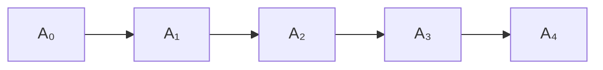
</details>

图3.1 一个链表

链表由一系列节点组成，这些节点不必在内存中相连。每一个节点均含有表元素和一个链(link)，该链指向包含该元素后继元的另一个节点。我们称之为 next 链(next link)。最后一个单元的 next 链指向 nullptr。

---

66

数据结构与算法分析——C++语言描述(第四版)

为了执行 printList() 或 find(x)，我们只要从表的第一个节点开始然后用一些后继的 next 链遍历该表即可。这种操作显然是线性时间的，和在数组实现时一样，不过其中的常数可能会比用数组实现时要大。findKth 操作不如数组实现时的效率高；findKth(i) 花费 O(i) 的时间并通过以明显的方式遍历链表而完成操作。在实践中这个界是保守的，因为调用 findKth 常常是以(按 i)排序后的方式进行。例如，findKth(2)、findKth(3)、findKth(4) 以及 findKth(6) 可通过对表的一次扫描同时实现。

remove 方法可以通过修改一个 next 指针来实现。图 3.2 给出在原表中删除第三个元素的结果。


<details>
<summary>flowchart</summary>


</details>

图3.2 从链表中删除

insert 方法需要使用 new 操作符从系统取得一个新节点，此后执行两次 next 指针的调整。其一般想法在图 3.3 中给出，其中的虚线表示原来的指针。


<details>
<summary>flowchart</summary>

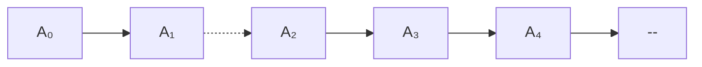
</details>

图3.3 向链表插入

可以看到，原则上如果知道变动将要发生的地方，那么插入或从链表中删除一项的操作不需要移动很多的项，而只涉及常数个节点链的改变。

在表的前端添加项或删除第一项的特殊情形此时也属于常数时间的操作，当然假设要保留到链表前端的链。只要我们保留到链表最后节点的链，那么在链表末尾进行添加操作的特殊情形(即让新的项成为最后一项)可以花费常数时间。因此，典型的链表拥有到该表两端的链。删除最后一项比较复杂，因为必须找出指向最后节点的项，把它的 next 链改成 nullptr，此时指向最后节点的链得到更新。在经典的链表中，每个节点均存储指向其下一节点的链，而让指向最后节点的链不提供关于最后节点的前驱节点的任何信息。

保留指向最后节点的前驱节点的第 3 个链的想法是行不通的，因为它在删除操作期间也需要更新。我们的做法是，让每一个节点持有一个指向它在表中的前驱节点的链，如图 3.4 所示，我们称这样的表为双向链表(doubly linked list)。


<details>
<summary>flowchart</summary>


</details>

图3.4 双向链表

---

第3章 表、栈和队列

67

## 3.3 STL中的vector和list

C++语言在其库中包含一些常用数据结构的实现。该语言这一部分通常叫作标准模板库(Standard Template Library, STL)。表 ADT(List ADT)是在 STL 中实现的数据结构之一。我们将在第 4 章和第 5 章看到其他一些数据结构。一般说来，这些数据结构被称为集合(collection)或容器(container)。

表 ADT 有两种流行的实现方法。vector 提供表 ADT 的一种可增长的数组实现。使用 vector 的优点在于它是以常数时间可索引(indexable)的。缺点是插入新项和删除现有项的代价高昂，除非变化发生在 vector 的尾端。而 list 则提供表 ADT 的双向链表实现。使用 list 的优点是插入新项和删除现有项代价低廉，但假设变动的位置是已知的。缺点是 list 不容易被索引。vector 和 list 两者在执行查找时都是低效的。在我们整个的讨论中，list 指的是 STL 中的双向链表，而 list 指的是更一般的表 ADT。

vector 和 list 两者均为类模板，它们用其所存储的项的类型来实例化而成为具体的类。二者有几个方法是共有的。下面所示的前 3 种方法实际上对所有的 STL 容器都是可用的:

- int size()const: 返回容器中元素的个数。
- void clear(): 从容器中删除所有元素。
- bool empty() const: 若容器不含有元素则返回 true，否则返回 false。

vector 和 list 两者都支持以常数时间向表的尾端添加和从表的尾端删除的操作。vector 和 list 两者都支持以常数时间访问表的前端项。这些操作是:

- void push back(const Object & x): 把 x 添加到表的尾端。
- void pop back(): 删除位于表的尾端的对象。
- const Object & back()const: 返回位于表的尾端处的对象(还提供一个返回引用的修改函数)。
- const Object & front()const: 返回位于表的前端处的对象(还提供一个返回引用的修改函数)。

因为双向链表在其前端可以进行高效的改动，而 vector 却不能，所以下列两个方法只对 list 是可用的:

- void push front(const Object & x): 把 x 添加到表的前端。
- void pop front(): 删除位于表的前端处的对象。

vector 有它自己的方法集，这些方法 list 不具备。有两个方法可以进行高效的索引操作，而其余的两个方法允许程序员查看和改变内部容量。这些方法是:

- Object & operator[](int idx): 返回 vector 中下标为 idx 的对象，不带界限检验(还提供一个返回常量引用的访问函数)。
- Object & at(int idx): 返回 vector 中下标为 idx 的对象，带有界限检验(还提供一个返回常量引用的访问函数)。
- int capacity()const: 返回 vector 的内部容量。(详见 3.4 节。)

---

68

数据结构与算法分析——C++语言描述(第四版)

\- void reserve(int newCapacity): 设置新的容量。如果有好的估计可用，那么它可以用于避免扩展 vector。(详见 3.4 节。)

## 3.3.1 迭代器

对表的一些操作，尤其那些在表的中间进行精密的插入和删除的操作，需要位置的概念。在 STL 中，位置由内嵌类型 iterator 来表示。特别是，对于 list&lt;string&gt;，位置由类型 list&lt;string&gt;::iterator 表示；对于 vector&lt;int&gt;，位置由 vector&lt;int&gt;::iterator 类表示，等等。在描述一些方法时，我们将直接使用 iterator 作为简记，但在编写代码时还是使用具体的内嵌类名。

首先，有 3 个问题需要处理:第一，如何获取一个迭代器 (iterator)；第二，迭代器本身能够执行什么操作；第三，哪些表 ADT 方法需要迭代器作为参数。

## 获取迭代器

对于第一个问题，STL表(以及所有其他的STL容器)定义了一对方法:

- iterator begin(): 返回一个适当的迭代器，表示容器中的第一项。
- iterator end(): 返回一个适当的迭代器，表示容器中的尾端(终端)标记(endmarker)(即容器中最后一项之后的位置)。

end 方法有些不同寻常，因为它返回一个“越界”的迭代器。为了理解这个概念，考虑下列在引入 C++11 中基于范围 for 循环之前通常用于打印 vector v 中的项的代码:

```txt
for( int i = 0; i != v.size( ); ++i )
    cout << v[ i ] << endl;
```

如果我们想使用迭代器重新改写这段代码, 那么会看到一个与 begin 方法和 end 方法自然的对应:

```txt
for( vector<int>::iterator itr = v.begin( ); itr != v.end( ); itr.??? )
    cout << itr.??? << endl;
```

在循环终止测试中，i!=v.size()和itr!=v.end()两者都要测试循环计数器是否“越界”。这段代码也给我们带来了第二个问题，即迭代器必须拥有与其相关的方法(这些未知的方法由???表示)。

## 迭代器方法

基于上面的代码片段，显然，迭代器可以用!=和==进行比较，并且可能需要定义一些拷贝构造函数(copy constructor)和 operator=函数。因此，迭代器有些方法，其中许多方法用到运算符重载。除复制外，对迭代器通常使用的大部分操作一般包括如下:

- itr++和++itr: 将迭代器推进到下一个位置。前缀形式和后缀形式都是可以使用的。
- \*itr: 返回对存储在迭代器 itr 的位置上对象的引用。所返回的引用可以允许修改，也可以不允许修改(这些细节将在稍后讨论)。
- itr1==itr2: 若 itr1 和 itr2 指向同一个位置则返回 true，否则返回 false。
- itr1!=itr2: 若 itr1 和 itr2 指向不同的位置则返回 true，否则返回 false。

使用这些操作的打印代码将是

---

第3章 表、栈和队列

69

```cpp
for( vector<int>::iterator itr = v.begin( ); itr != v.end( ); ++itr )
    cout << *itr << endl;
```

运算符重载的使用使我们能够访问当前项，此时使用\*itr++可以推进到下一项。于是，上面的代码片段又可以写成

```cpp
vector<int>::iterator itr = v.begin( );
while( itr !=v.end( ) )
    cout << *itr++ << endl;
```

## 需要迭代器的容器操作

最后一个问题，需要迭代器的3个最流行的方法是那些从表(或vector，或list)的指定位置上进行添加或删除的操作:

- iterator insert( iterator pos, const Object & x): 把 x 添加到表中由迭代器 pos 所给定的位置之前的位置上。这是对 list(但不是对 vector) 的常数时间的操作。返回值是指向被插入项的位置的一个迭代器。
- iterator erase(iterator pos): 删除由迭代器所给定的位置上的对象。这是对 list(但不是对 vector)的常数时间的操作。返回值是调用之前 pos 的后继元素所在的位置。该操作使 pos 失效，现在它是多余的了，因为它正在指向的容器项已经被删除。
- iterator erase(iterator start, iterator end): 删除从位置 start 开始直到(但不包括)位置 end，为止的所有的项。注意，整个表可以通过调用 c.erase(c.begin(), c.end())而被删除。

## 3.3.2 例子:对表使用 erase

作为一个例子，我们给出一个例程，从初始项开始，每隔一项删除表中的一项。于是，如果表包含6,5,1,4,2，那么在方法被调用之后，它将只包含5,4。我们通过遍历该表并对每个第2项使用erase方法完成操作。对于list，这将是一个线性时间的例程，因为每次调用erase都花费常数时间，但是，对于vector，全部例程将花费二次的时间，因为每次调用erase都是低效的，需要时间 $O(N)$ 。因此，我们通常只为list编写代码。然而为了实验的目的，我们编写一个一般的函数模板，它将对list和list都能正常运行。然后，再提供计时信息。这个函数模板如图3.5所示。

```cpp
template <typename Container>
void removeEveryOtherItem( Container & lst )
{
    auto itr = lst.begin( );      // itr 是一个 Container::iterator

    while( itr != lst.end( ) )
    {
        itr = lst.erase( itr );
        if( itr != lst.end( ) )
            ++itr;
    }
}
```

图 3.5 使用迭代器隔项删除表(vector 或 list)中的项。对 list 是高效的，但对 vector 则不是

第 4 行上 auto 的使用是 C++11 的一个特色, 它使我们避免了更长的类型 Container::

---

70

数据结构与算法分析——C++语言描述(第四版)

iterator。如果运行这个程序，传递一个 list&lt;int&gt;，那么对于 800 000 项的 list 它将花费 0.039 秒，而对于 1 600 000 项的 list 将花费 0.073 秒。很清楚，这是一个线性例程，因为运行时间是按照与输入大小的相同增长因子增长的。当我们传递一个 vector&lt;int&gt;时，该例程对于 800 000 项的 vector 则花费几乎 5 分钟的时间，而对于 1 600 000 项的 vector 花费大约 20 分钟。当输入增长 2 倍时运行时间增长 4 倍，这和二次的行为是一致的。

## 3.3.3 const\_iterators

\*itr 的结果不只是迭代器正在指向的项的值，而且还有该项本身。这个特点使得迭代器非常强大，不过也带来一些副作用。为了理解它的好处，假设我们想要把一个集合中的所有项改成一个特定的值。下列例程对于 vector 和 list 都是高效的并且是以线性时间运行的，它是编写一般的、类型无关代码的完美示例。

```cpp
template <typename Container, typename Object>
void change( Container & c, const Object & newValue )
{
    typename Container::iterator itr = c.begin();
    while( itr != c.end( ) )
        *itr++ = newValue;
}
```

要想看清潜在的问题，假设 Container c 是使用常量引用调用被传递到例程的。这意味着，我们不想对 c 做任何的改变，而编译器将通过禁止调用 c 的任何修改函数来保证这一点。考虑下列代码，它打印由一些整数构成的 list 而且还试图对 list 进行隐蔽的修改:

```cpp
void print( const list<int> & lst, ostream & out = cout )
{
    typename Container::iterator itr = lst.begin( );
    while( itr != lst.end( ) )
    {
        out << *itr << endl;
        *itr = 0;   // 问题在此!!!
        ++itr;
    }
}
```

如果这段程序是合法的，那么 list 的定常性(const-ness)就将毫无意义，因为它太容易被绕开了。该程序段不合法，将不会被编译。STL 提供的解决方案是，每一个集合容器不仅包含一个内嵌类型 iterator，而且还有一个内嵌类型的 const\_iterator。在 iterator 和 const\_iterator 之间的主要区别在于，对于 const\_iterator, operator\* 返回一个常量引用，因而对于 const\_iterator 的 \*itr 不能出现在赋值语句的左边。

不仅如此，编译器还将要求我们使用 const\_iterator 来遍历一个常量集合。它通过提供两种版本的 begin 和两种版本的 end 来完成遍历:

- iterator begin()
- const\_iterator begin()const
- iterator end()
- const\_iterator end()const

这两种形式的 begin 可以在同一个类中只是因为方法的定常性(const-ness)(即，是访问

---

第3章 表、栈和队列

71

函数还是修改函数)被认为是特征(signature)的一部分。我们在1.7.2节中见过这种技巧，而我们还将在3.4节再次见到它，两者均出现在重载operator[]的环境中。

如果是对非常量容器调用 begin，那么返回一个 iterator 的“修改函数”版的 begin 被调用。然而，如果对常量容器调用 begin，那么所返回的则是 const\_iterator，并且返回值不可赋给 iterator。如果我们试图赋给它，那么将会产生一个编译错误。一旦 itr 是一个 const iterator 类型的量，则 \*itr=0 就会很容易地被检查出是非法的。

如果使用 auto 声明迭代器，则编译器将推算出它代替的是 iterator 还是 const\_iterator。这在很大程度上缓解了程序员必须牢记正确的迭代器类型的负担，这也正是 auto 的预期使用目的之一。再有，诸如 vector 和 list 这样一些如上所述提供迭代器的库类，与基于范围的 for 循环是兼容的，就像用户定义的那些类一样。

C++11 一个附加的特性是, 允许编写即使 Container 类型没有 begin 和 end 成员函数也能正常运行的程序。非成员的自由函数 begin 和 end 的定义让我们在任何允许使用 c.begin() 的地方使用 begin(c)。使用 begin(c) 而不是使用 c.begin() 编写泛型代码具有下述优点: 它使得泛型代码能够在有 begin/end 作为成员函数的容器上正常运行, 而且对那些没有 begin/end 但以后可能用一些适当的非成员函数来扩充功能的容器也能正常运行。作为 C++11 中的自由函数, begin 和 end 的加入通过添加语言特色 auto 和 decltype 而成为可能, 如下述代码所示。

```cpp
template<typename Container>
auto begin( Container & c ) -> decltype( c.begin( ) )
{
    return c.begin( );
}

template<typename Container>
auto begin( const Container & c ) -> decltype( c.begin( ) )
{
    return c.begin( );
}
```

在这段代码中，begin 的返回类型经推导是 c.beging() 的类型。

图3.6中的程序利用auto来声明迭代器(如图3.5所示)并用到了非成员函数begin和end。

```cpp
template <typename Container>
void print( const Container & c, ostream & out = cout )
{
    if( c.empty( ) )
        out << "(empty)";
    else
    {
        auto itr = begin( c );  // itr 是一个Container::const_iterator

        out << "[ " << *itr++;  // 打印第一项

        while( itr != end( c ) )
            out << ", " << *itr++;
        out << " ]" << endl;
    }
}
```

图 3.6 打印任意容器

---

72

数据结构与算法分析——C++语言描述(第四版)

## 3.4 vector 的实现

在这一节，我们提供一个可用的 vector 类模板的实现。这个 vector 将是第一类类型 (first-class type)，其含义为，不同于 C++ 中的原始数组 (primitive array)，该 vector 的对象可以被复制，并且其所用内存可以 (通过它的析构函数) 被自动回收。在 1.5.7 节中描述了 C++ 原始数组的一些重要特性:

- 数组就是指向一块内存块的指针变量；数组的具体大小必须由程序员单独确定。
- 内存块可以通过 new[] 分配，但此后必须通过 delete[] 释放。
- 内存块不能重新调整大小(但可以获得一个新的、根据推测可能更大的内存块，并利用原来的内存块初始化，然后将原内存块释放)。

为避免与相关库类相混，我们将把这个类模板命名为 Vector。在考查 Vector 的代码之前，概述其主要细节如下:

1. 我们的 Vector 将(通过一个指向所分配的内存块的指针变量)保留原始的数组、数组容量以及数组当时存储在 Vector 中的项数。
2. 该 Vector 将实现五大函数以提供为拷贝构造函数和 oprator=的深层拷贝 (deep-copy) 功能，并将提供一个析构函数以回收原始数组。此外，它还将实现 C++11 的移动功能。
3. Vector 将提供改变 Vector 的大小(一般改成更大的数)的 resize 例程, 以及 reserve 例程, 后者将改变 Vector 的容量(一般是个更大的数)。这个容量通过为原始数组获取新的内存块、把老内存块复制到新内存块并回收老内存块而得以更新。
4. Vector 将提供 operator[] 的实现(如 1.7.2 节所述, operator[] 一般通过访问函数和修改函数的形式实现)。
5. Vector 还将提供诸如 size、empty、clear(通常它们都是一行代码)、back、pop\_back、和 push\_back 等基本的例程。如果大小和容量相同，则 push\_back 例程将调用 reserve 函数。
6. 对于内嵌类型 iterator 和 const\_iterator, Vector 也将提供支持，并提供相关联的 begin 方法和 end 方法。

图3.7和图3.8显示了Vector类。正如其在STL中相应的类，这里也只有有限的错误检测。后面我们将扼要讨论如何能够提供对错误的检测。

如图中第 118～120 行所示，Vector 把大小、容量以及原始数组作为其数据成员存储。第 7～9 行上的构造函数允许用户指定初始大小，其默认值为 0。然后用比大小稍大些的容量初始化数据成员，因此有些 push\_back 不用改变容量就能够被执行。

如第 $11\sim 17$ 行所示，拷贝构造函数构建了一个新的Vector对象，然后被用在operator=的不经意的实现中，而后者在一次复制中用到了标准的交换定式。这个定式只在通过移动完成交换时有效，它本身要求移动构造函数和移动operator=的实现，如第 $29\sim$ 44行所示。这些又用到了非常标准的定式。使用拷贝构造函数和交换所实现的拷贝赋值

---

第3章 表、栈和队列

73

operator=虽然简单，但却不是最有效的方法，特别是在两个 Vector 对象具有同样大小的情况下。在这种可以被测试到的特殊情况下，使用 Object 的 operator=直接逐个拷贝每个元素会更有效。

```cpp
#include <algorithm>

template <typename Object>
class Vector
{
    public:
        explicit Vector( int initSize = 0 ) : theSize{ initSize },
            theCapacity{ initSize + SPARE_CAPACITY }
        { objects = new Object[ theCapacity ]; }

        Vector( const Vector & rhs ) : theSize{ rhs.theSize },
            theCapacity{ rhs.theCapacity }, objects{ nullptr }
        {
            objects = new Object[ theCapacity  ];
            for( int k = 0; k < theSize; ++k )
                objects[ k ] = rhs.objects[ k ];
        }

        Vector & operator= ( const Vector & rhs )
        {
            Vector copy = rhs;
            std::swap( *this, copy );
            return *this;
        }

        ~Vector( )
        { delete [] objects; }

        Vector( Vector && rhs ) : theSize{ rhs.theSize },
            theCapacity{ rhs.theCapacity }, objects{ rhs.objects }
        {
            rhs.objects = nullptr;
            rhs.theSize = 0;
            rhs.theCapacity = 0;
        }

        Vector & operator= ( Vector && rhs )
        {
            std::swap( theSize, rhs.theSize );
            std::swap( theCapacity, rhs.theCapacity );
            std::swap( objects, rhs.objects );

            return *this;
        }
```

图 3.7 vector 类(1/2)

---

74

数据结构与算法分析——C++语言描述(第四版)

```cpp
void resize( int newSize )
{
    if( newSize > theCapacity )
        reserve( newSize * 2 );
    theSize = newSize;
}

void reserve( int newCapacity )
{
    if( newCapacity < theSize )
        return;

    Object *newArray = new Object[ newCapacity ];
    for( int k = 0; k < theSize; ++k )
        newArray[ k ] = std::move( objects[ k ] );

    theCapacity = newCapacity;
    std::swap( objects, newArray );
    delete [] newArray;
}
```

图 3.7(续) vector 类(1/2)

```cpp
Object & operator[]( int index )
{ return objects[ index ]; }
const Object & operator[]( int index ) const
{ return objects[ index ]; }

bool empty( ) const
{ return size( ) == 0; }
int size( ) const
{ return theSize; }
int capacity( ) const
{ return theCapacity; }

void push_back( const Object & x )
{
if( theSize == theCapacity )
reserve( 2 * theCapacity + 1 );
objects[ theSize++ ] = x;
}

void push_back( Object && x )
{
if( theSize == theCapacity )
reserve( 2 * theCapacity + 1 );
objects[ theSize++ ] = std::move( x );
}

void pop_back( )
{
```

图 3.8 vector 类(2/2)

---

第3章 表、栈和队列

75

```cpp
--theSize;
    }

    const Object & back ( ) const
    {
        return objects[ theSize - 1 ];
    }

    typedef Object * iterator;
    typedef const Object * const_iterator;

    iterator begin( )
        { return &objects[ 0 ]; }
    const_iterator begin( ) const
        { return &objects[ 0 ]; }
        iterator end( )
            { return &objects[ size( ) ]; }
        const_iterator end( ) const
            { return &objects[ size( ) ]; }

        static const int SPARE_CAPACITY = 16;

    private:
        int theSize;
        int theCapacity;
        Object * objects;
};
```

图 3.8(续) vector 类(2/2)

resize 例程如第 46～51 行所示。该段代码直接设置 theSize 数据成员，但却是在有可能扩展容量之后进行。容量扩展的代价是非常高昂的。因此，如果容量被扩展，那么它就要变成原来容量的两倍大，以避免容量的再次改变，除非大小戏剧性地增加(这里的+1 用于大小为 0 的情形)。扩展容量是通过 reserve 例程完成的，如第 53 至 65 诸行所示。它是由第 58 行上的分配新数组、第 59 行和第 60 行上移动老内容以及第 64 行上老数组的回收组成的。如第 55～56 行所述，reserve 例程也可以用于收缩原数组，不过，只能在指定的新容量至少和原大小相同的情况下才可行。若非如此，则 reserve 的要求被忽略。

operator[]这里的两个版本并不复杂(事实上,与1.7.2节中matrix类的operator[]的实现非常相似),如图中第67\~70诸行所示。通过确保index不越出0和size()-1的范围,包括不在该范围则抛出异常,我们很容易添加对错误的检测。

一些短例程，即 empty、size、capacity、push\_back、pop\_back 和 back，在第 72～101 行上实现。在第 83 和 90 行上，我们看到前缀++运算符的使用，它用到 theSize 给数组确定下标，然后使 theSize 增 1。在讨论迭代器 \*itr++ 时我们见过与此相同的格式:\*itr++ 使用 itr 来决定指向哪一项，然后推进 itr。++ 的定位很重要:在前缀++ 运算符下，\*++itr 先推进 itr，然后使用新的 itr 来确定指向哪一项，同样，objects[++theSize] 将使 theSize 增 1，然后使用所得到的新值来给数组确定下标(但这不是我们想要的)。pop\_back 和 back 通过错误检验得以实现，而当大小为 0 时则会抛出一个异常。

---

76

数据结构与算法分析——C++语言描述(第四版)

最后，在第 103～113 行上，我们看到 iterator 和 const\_iterator 内嵌类型的声明以及两个 begin 方法和两个 end 方法。这段代码利用到下述事实:在 C++ 中，指针变量拥有我们对 iterator 期望的所有相同的运算符。指针变量可以被复制和比较；\*运算符得到指针所指向的对象，而最特别的是，当++用于指针变量时，指针变量则指向顺序存储的下一个对象:如果指针正在指向数组内部，则增加指针的位置使它指向数组的下一元素。对于指针的这些规定可以追溯到 20 世纪 70 年代早期，当时使用的是 C 程序设计语言，它是 C++ 发展的基础。STL 迭代器机制在某种程度上是模拟指针操作而设计的。

因此，我们在第 103 行和第 104 行看到 typedef 语句指出 iterator 和 const\_iterator 就是指针变量的另外的名字，而 begin 和 end 需要分别返回代表第一个数组位置和第一个非法数组位置的内存地址。

对于 vector 类型在迭代器和指针之间的一致性意味着，不使用 C++ 数组而使用 vector，资源消耗可能稍高。正如我们说过的，其不足之处在于程序没有对错误的检测。如果迭代器 itr 冲过终点标记，++itr 和 \*itr 均不必发出错误信号。要想修正这个问题，就需要 iterator 和 const\_iterator 均为内嵌类类型而不是简单的指针变量。使用内嵌类类型要普遍得多，而这正是我们在 3.5 节的 list 类中将要看到的。

## 3.5 list 的实现

本节我们提供可用的 list 类模板的实现。和 vector 类的情形一样，这里的表类将被命名为 List，以避免与库类产生歧义。

我们知道, List 类将作为双向链表被实现, 而且我们将需要保留指向表两端的两个指针。这样就使得只要每次操作都发生在已知的位置上, 那就总是花费常数时间的开销。这个已知位置可以在表的端点, 也可以在迭代器指定的位置上。

在考虑设计时，我们需要提供如下4个类:

1. List 类本身，它包含连接到表两端的链、表的大小，以及一些方法。
2. Node 类，它很可能是一个私有的内嵌类。一个节点包含数据和指向前后两个节点的两个指针，以及一些适当的构造函数。
2. const\_iterator 类, 它抽象了位置的概念, 而且是一个公有的内嵌类。该 const\_iterator 存储一个指向 “当前” 节点的指针, 并提供基本迭代器操作的实现, 所有的操作, 像 =、==、!= 和 ++ 等, 均以重载运算符的形式出现。
3. iterator 类，它抽象了位置的概念，而且是一个公有的内嵌类。该 iterator 有着与 const\_iterator 相同的功能，但 operator\*返回的是所指项的引用，而不是对该项的常量引用。一个重要的技术问题是，iterator 可以用在任何需要 const\_iterator 的例程中，但反之不真。换句话说，iterator 是一个 const iterator。

因为迭代器类存储一个指向“当前节点”的指针，并且终端标记是一个合法的位置，所以在表的终端创建一个表示终端标记(endmarker)的附加节点是有意义的。此外，还可以在表的前端创建一个附加节点，逻辑上代表开始标志。这些附加节点有时候称为标记节点(sentinel node)；特别地，前端节点有时候也叫作头节点(header node)，而在尾端的节点有时候就叫作尾节点(tail node)。

---

第3章 表、栈和队列

77

使用这些附加节点的好处在于，它们通过排除一些特殊情况大大地简化了编码过程。例如，如果我们不使用头节点，那么删除第一个节点就变成了一种特殊情形，因为我们在删除期间必须重新安置链表对第一个节点的连接，还因为删除算法一般需要访问正在被删除的节点前面的节点(而没有头节点，则第一个节点就没有在它前面的节点)。图 3.9 显示了一个带有头节点和尾节点的双向链表。图 3.10 则显示的是一个空链表。


<details>
<summary>flowchart</summary>

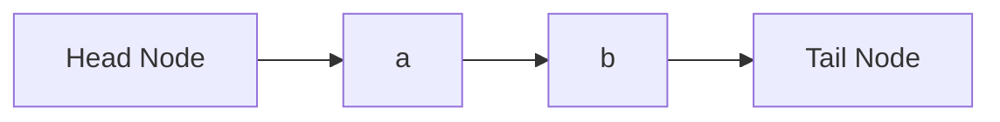
</details>

图 3.9 带有头节点和尾节点的双向链表


<details>
<summary>text_image</summary>

头节点
尾节点
</details>

图 3.10 带有头节点和尾节点的空的双向链表

图 3.11 和图 3.12 显示了 List 类的架构以及部分的实现。

我们在第 5 行可以看到私有内嵌的节点类声明的开头部分。这里并没有使用 class 关键词，而是使用的 struct。在 C++ 中，struct 是 C 语言遗留下来的术语。C++ 中的 struct 基本上就是 class，不过其中的成员默认为公有的。我们知道，class 中的成员默认为私有的。显然，struct 这个关键词不是必需的，但是我们将会常常看到它，并且程序员一般使用它来表示一种主要包含直接被存取而不是通过方法访问的数据的类。在我们这里的 Node 类中，让各成员是公有的将不是个问题，因为 Node 类本身是私有的，而 List 类的外部是不可对其访问的。

在第 9 行我们看到公有内嵌 const\_iterator 类的声明的起始部分，以及第 12 行上的公有内嵌 iterator 类的声明的开头。这里的继承 (inheritance) 是个特殊的句法，它是一个强有力的结构，本书的其他地方尚未用到。这个继承句法说的是，iterator 具有和 const\_iterator 完全相同的功能，并且可以用在任何需要 const\_iterator 的地方。在后面看到具体实现的时候我们将讨论这些细节。

第 80 行到第 82 行包含 List 的两个数据成员，即指向头节点的指针和指向尾节点的指针。我们还要跟踪一个数据成员的大小，以便 size 方法能够以常数时间被实现。

List 类的其余部分由构造函数、五大函数及一些方法组成。许多方法就是一行的代码。begin 和 end 返回相应的迭代器；第 30 行上的调用是典型的实现方式，它返回一个构造的迭代器(这样，iterator 类和 const\_iterator 类每个都有一个构造函数，该构造函数接受指向 Node 的指针作为它的参数)。

第 43～47 行上的 clear 方法通过反复删除成员项直至 List 为空来完成清除工作。使用这种策略使得 clear 避免染指回收节点的工作，因为节点的回收如今已经归入 pop\_front 处理了。第 48～67 行上的几个方法都是通过获得并使用适当的迭代器来工作的。我们知道，insert 方法是在一个位置之前插入，因此，在需要时，push\_back 是在终端标记之前进行插入。注意在 pop\_back 中 erase(--end()) 创建了一个对应终端标记的临时迭代器，后撤该临时迭代器，并使用这个迭代器执行 erase。类似的行为同样发生在 back 中。还要注意，在 pop\_front 操作和 pop\_back 操作的情况下，我们再一次避免了处理节点回收的工作。

图 3.13 显示的是 Node 类，该类由所存储的项、指向前一节点的指针、指向下一节点的指针以及构造函数组成。所有的数据成员都是公有的。

---

78

数据结构与算法分析——C++语言描述(第四版)

```cpp
template <typename Object>
class List
{
    private:
        struct Node
            { /* 见图 3.13 */ };

    public:
        class const_iterator
            { /* 见图 3.14 */ };

        class iterator : public const_iterator
            { /* 见图 3.15 */ };

    public:
        List( )
            { /* 见图 3.16 */ }
        List( const List & rhs )
            { /* 见图 3.16 */ }
        ~List( )
            { /* 见图 3.16 */ }
        List & operator= ( const List & rhs )
            { /* 见图 3.16 */ }
        List( List && rhs )
            { /* 见图 3.16 */ }
        List & operator= ( List && rhs )
            { /* 见图 3.16 */ }

        iterator begin( )
            { return { head->next }; }
        const_iterator begin( ) const
            { return { head->next }; }
        iterator end( )
            { return { tail }; }
        const_iterator end( ) const
            { return { tail }; }

        int size( ) const
            { return theSize; }
        bool empty( ) const
            { return size( ) == 0; }

        void clear( )
        {
            while( !empty( ) )
                pop_front( );
        }
```

图 3.11 List 类 (1/2)

---

第3章 表、栈和队列

79

```c
Object & front( )
{ return *begin( ); }
const Object & front( ) const
{ return *begin( ); }
Object & back( )
{ return *--end( ); }
const Object & back( ) const
{ return *--end( ); }
void push_front( const Object & x )
{ insert( begin( ), x ); }
void push_front( Object && x )
{ insert( begin( ), std::move( x ) ); }
void push_back( const Object & x )
{ insert( end( ), x ); }
void push_back( Object && x )
{ insert( end( ), std::move( x ) ); }
void pop_front( )
{ erase( begin( ) ); }
void pop_back( )
{ erase( --end( ) ); }

iterator insert( iterator itr, const Object & x )
{ /* 见图 3.18 */ }
iterator insert( iterator itr, Object && x )
{ /* 见图 3.18 */ }

iterator erase( iterator itr )
{ /* 见图 3.20 */ }
iterator erase( iterator from, iterator to )
{ /* 见图 3.20 */ }

private:
int theSize;
Node *head;
Node *tail;

void init( )
{ /* 见图 3.16 */ }
};
```

图 3.12 List 类(2/2)

```cpp
struct Node
{
    Object data;
    Node *prev;
    Node *next;

    Node( const Object & d = Object{ }, Node * p = nullptr,
                          Node * n = nullptr )
        : data{ d }, prev{ p }, next{ n } { }

    Node( Object && d, Node * p = nullptr, Node * n = nullptr )
        : data{ std::move( d ) }, prev{ p }, next{ n } { }
};
```

图 3.13 List 类的内嵌 Node 类

1
2
3
4
5
6
7
8
9
10
11
12
13

---

80

数据结构与算法分析——C++语言描述(第四版)

图 3.14 显示的是 const\_iterator 类，而图 3.15 则是 iterator 类。正如我们早先提到过的，图 3.15 中第 39 行上的语法指出一个高级特性，叫作继承 (inheritance)，意味着 iterator 就是一个 const\_iterator。当 iterator 类以这种方式写出时，它就继承了 const\_iterator 的所有数据和方法。它可以添加新的数据、新的方法，还可以覆盖 (即重新定义) 现有的方法。在最一般的情况下，将会出现严重的语法负担 (常常导致关键词 virtual 出现在代码中)。

```cpp
class const_iterator
{
    public:
        const_iterator( ) : current{ nullptr }
        { }

        const Object & operator* ( ) const
        { return retrieve( ); }

        const_iterator & operator++ ( )
        {
            current = current->next;
            return *this;
        }

        const_iterator operator++ ( int )
        {
            const_iterator old = *this;
            ++( *this );
            return old;
        }

        bool operator== ( const const_iterator & rhs ) const
        { return current == rhs.current; }
        bool operator!= ( const const_iterator & rhs ) const
        { return !( *this == rhs ); }

    protected:
        Node *current;

        Object & retrieve( ) const
        { return current->data; }

        const_iterator( Node *p ) : current{ p }
        { }

        friend class List<Object>;
};
```

图 3.14 List 类的内嵌 const\_iterator 类

然而在这里，我们可以避免许多的语法束缚，因为我们不添加新的数据，也不打算改变现有方法的行为。不过，我们在 iterator 类中添加一些新方法(与 const\_iterator 类中

---

第3章 表、栈和队列

81

的现存方法有非常相似的特征)。这样, 我们就能够避免使用 virtual。即使如此, 在 const\_iterator 中还是存在相当多的语法技巧。

```cpp
class iterator : public const_iterator
{
    public:
        iterator( )
            { }

        Object & operator* ( )
            { return const_iterator::retrieve( ); }
        const Object & operator* ( ) const
            { return const_iterator::operator*( ); }

        iterator & operator++ ( )
        {
            this->current = this->current->next;
            return *this;
        }

        iterator operator++ ( int )
        {
            iterator old = *this;
            ++( *this );
            return old;
        }

    protected:
        iterator( Node *p ) : const_iterator{ p }
            { }

    friend class List<Object>;
};
```

图3.15 List类的嵌套iterator类

在第 28 行和第 29 行，const\_iterator 存储一个指向 “当前” 节点的指针作为它单独的数据成员。正常情况下，该成员将是私有的，然而如果它私有，那么 iterator 就无权访问它了。把 const\_iterator 的成员标记为 protected 使得从 const\_iterator 继承来的那些类有权访问这些成员，但不允许其他类有这种访问权。

在第 34 行和第 35 行，我们看到在 List 类中 begin 和 end 的实现用过的 const\_iterator 的构造函数。我们不想让所有的类看到这个构造函数(从指针变量显式地构造迭代器是不允许的)，因此它不能是公有的，可是我们还想要 iterator 类看到它，所以，逻辑上这个构造函数我们让它是 protected 的。然而，这并未给 List 对该构造函数的访问权。解决方法是第 37 行上的 friend 声明(friend declaration)，这就赋予了 List 类访问 const\_iterator 的非公有成员的权利。

const\_iterator 中的公有方法都用到了运算符重载。operator==、operator!=以及 operator\*都很简单。在第 10\~21 行我们看到 operator++ 的实现。我们知道，operator++

---

82

数据结构与算法分析——C++语言描述(第四版)

的前缀形式和后缀形式在语义(以及优先级)上是完全不同的，因此我们需要为每种形式分别编写例程。由于它们有相同的名字，从而它们必须要有不同的特征以便区分。C++规定，我们通过为前缀形式指定空参数表而为后缀形式指定(匿名的)单参数 int 来赋予它们不同的特征。于是，++itr 调用零参数的 operator++, 而 itr++则调用单参数 operator++。参数 int 从未被使用，它的出现只是为了给出不同的特征。这种实现指出，在存在选用前缀或后缀 operator++的许多场合下，前缀形式要比后缀形式更快。

在 operator 类中, 第 64 行上的保护型构造函数用到一个初始化表列来初始化继承来的当前节点。我们不必再重新实现 operator==和 operator!=，因为它们是继承的、不变的。我们的确提供了一对新的 operator++ 的实现 (因为返回类型改变了)，这两个实现隐藏了 const\_operator 中的原始实现，而且我们还为 operator\* 提供了一对访问函数/修改函数。在第 47 行和第 48 行列出的访问函数 operator\* 直接使用与在 const\_iterator 中相同的实现。这个访问函数显式地在 iterator 中实现，因为否则原始的实现会被新添加的新版修改函数所隐藏。

图 3.16 显示的是构造函数和五大函数。因为零参数构造函数和拷贝构造函数二者都必须配置头节点和尾节点，所以我们提供了私有的 init 例程。init 创建一个空的 List。析构函数回收头节点和尾节点；当析构函数调用 clear 时，所有其他节点均被回收。类似地，拷贝构造函数通过调用一些公有方法而不是通过尝试低水平的指针操作而实现。

图 3.17 阐释包含 x 的新节点是如何拼接到由 p 所指向的节点和节点 p.prev 之间的。对节点指针的赋值可以描述如下:

```txt
Node *newNode = new Node{ x, p->prev, p }; // 第1步和第2步
p->prev->next = newNode; // 第3步
p->prev = newNode; // 第4步
```

可以将第3步和第4步合并，只得到如下两行:

```txt
Node *newNode = new Node{ x, p->prev, p }; // 第1步和第2步
p->prev = p->prev->next = newNode;          // 第3步和第4步
```

不过，此时这两行还可以合并，得到:

```javascript
p->prev = p->prev->next = new Node{ x, p->prev, p };
```

这就缩短了图3.18中的insert例程。

图 3.19 显示删除一个节点的思路。如果 p 指向要被删除的节点，则只要改变两个指针就可回收这个节点:

```txt
p->prev->next = p->next;
p->next->prev = p->prev;
delete p;
```

图3.20显示的是一对erase例程。erase的第1个版本包含上述3行代码以及返回iterator的代码，这个iterator代表被删除元素的后面的项。和insert一样，erase必须更新theSize。erase的第2个版本直接使用iterator来调用第1个版本的erase。注意，我们不能在第16行的for循环中直接使用itr++并忽略第17行上erase的返回值。itr的值在调用erase后马上就过时了，这就是为什么erase返回一个iterator的原因。

---

第3章 表、栈和队列

83

```cpp
List( )
    { init( ); }

~List( )
{
    clear( );
    delete head;
    delete tail;
}

List( const List & rhs )
{
    init( );
    for( auto & x : rhs )
        push_back( x );
}

List & operator= ( const List & rhs )
{
    List copy = rhs;
    std::swap( *this, copy );
    return *this;
}

List( List && rhs )
    : theSize{ rhs.theSize }, head{ rhs.head }, tail{ rhs.tail }
    {
        rhs.theSize = 0;
        rhs.head = nullptr;
        rhs.tail = nullptr;
    }

List & operator= ( List && rhs )
{
    std::swap( theSize, rhs.theSize );
    std::swap( head, rhs.head );
    std::swap( tail, rhs.tail );

    return *this;
}

void init( )
{
    theSize = 0;
    head = new Node;
    tail = new Node;
    head->next = tail;
    tail->prev = head;
}
```

图3.16 List类的构造函数、五大函数和私有init例程

---

84

数据结构与算法分析——C++语言描述(第四版)


<details>
<summary>flowchart</summary>

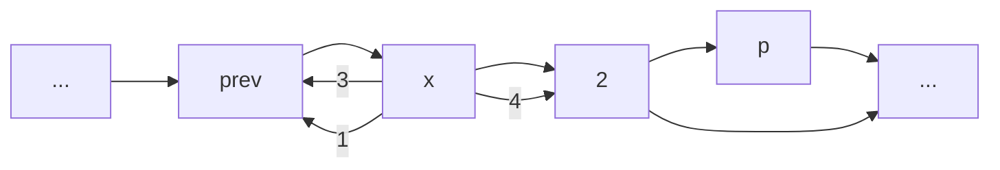
</details>

图 3.17 通过获取一个新节点然后以所指出的顺序修改指针而将新节点插入双向链表

```cpp
// 在itr前插入x
iterator insert( iterator itr, const Object & x )
{
    Node *p = itr.current;
    thenSize++;
    return { p->prev = p->prev->next = new Node{ x, p->prev, p } };
}

// 在itr前插入x
iterator insert( iterator itr, Object && x )
{
    Node *p = itr.current;
    thenSize++;
    return { p->prev = p->prev->next
        = new Node{ std::move( x ), p->prev, p } };
}
```

图3.18 List类的insert例程


<details>
<summary>flowchart</summary>

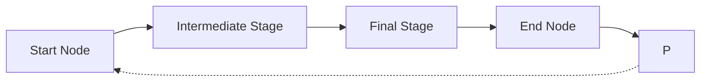
</details>

图 3.19 从双向链表中删除由 p 所指定的节点

```c
// 删除在itr处的项
iterator erase( iterator itr )
{
    Node *p = itr.current;
    iterator retVal{ p->next };
    p->prev->next = p->next;
    p->next->prev = p->prev;
    delete p;
    theSize--;

    return retVal;
}

iterator erase( iterator from, iterator to )
{
    for( iterator itr = from; itr != to; )
        itr = erase( itr );

    return to;
}
```

图3.20 List类的两个erase例程

---

第3章 表、栈和队列

85

考查代码，我们能够看到一些可能发生的错误，这里没有提供对它们的检验。例如，传递给 erase 和 insert 的迭代器可能是未被初始化的，或初始化用的是错误的表。当迭代器已经指向终端标志或尚未初始化时，不排除对其使用++或\*操作的可能。

未被初始化的迭代器将会让 current 指向 nullptr，以便条件容易得到检测。终端标记的 next 指针指向 nullptr，因此对于终端标记条件进行++或\*操作的测试也很容易。然而，为了确定传递给 erase 或 insert 的迭代器是否是正确的表的迭代器，这个迭代器必须存储一个额外的表示指向 List 的指针的数据成员，其中的 List 就是构造迭代器所用的双向链表。

我们将概述基本思路，而把细节留作练习。在 const\_iterator 类中，添加一个指向 List 的指针，并且修改受保护的构造函数以该 List 作为一个参数。我们还可以添加一些方法，它们在某些要求得不到满足时将抛出异常。程序经过修订的受保护部分看起来有些像图 3.21 给出的代码。此时所有对 iterator 和 const\_iterator 构造函数的调用本来以前它们只需要一个参数的，但现在都需要两个参数，如在 List 的 begin 方法中所示。

```cpp
const_iterator begin( ) const
{
    const_iterator itr{ *this, head };
    return ++itr;
}

protected:
    const List<Object> *theList;
    Node *current;

    const_iterator( const List<Object> & lst, Node *p )
        : theList{ &lst }, current{ p }
    {
    }

    void assertIsValid( ) const
    {
        if( theList == nullptr || current == nullptr || current == theList->head )
            throw IteratorOutOfBoundsException{ };
    }
```

图 3.21 const\_iterator 经修订后的受保护部分代码，添加了执行附加的错误检测的能力

insert 方法可以修改成图 3.22 所示代码的样子。我们把修改的细节留作练习。

```txt
// 在 itr前插入x
iterator insert( iterator itr, const Object & x )
{
    itrHexerIsValid( );
    if( itr.theList != this )
        throw IteratorMismatchException{ };

    Node *p = itr.current;
    theSize++;
    return { *this, p->prev = p->prev->next = new Node{ x, p->prev, p } };
}
```

图 3.22 带有附加错误检测的 List 的 insert 函数

---

86

数据结构与算法分析——C++语言描述(第四版)

## 3.6 栈 ADT

栈(stack)是一个带有限制的表，它的插入和删除只能在一个位置上进行，即只能在表的末端进行，这个末端叫作栈顶(top)。

## 3.6.1 栈模型

对栈的基本操作就是 push(进栈)和 pop(出栈)，前者等价于一次插入，而后者则是删除最近插入的元素。最近插入的元素在执行 pop 之前可以通过使用 top 例程进行考查。在栈 ADT 中，对空栈执行 pop 或 top 一般均被认为是一个错误。另一方面，执行 push 时空间用尽是一个实现限制，但不是 ADT 错误。

栈有时又叫作 LIFO(后进先出)表(Last in, First out list)。在图 3.23 中描述的模型只表示 push 是输入操作而 pop 和 top 是输出操作。普通的清空栈的操作和判断是否空栈的测试都是栈的操作指令系统的一部分，但是，我们对栈所能够做的基本上也就是 push 和 pop 操作。

图3.24展示了在进行若干操作后的一个抽象的栈。一般的模型是，存在某个元素位于栈顶，而该元素是唯一的可见元素。


<details>
<summary>flowchart</summary>

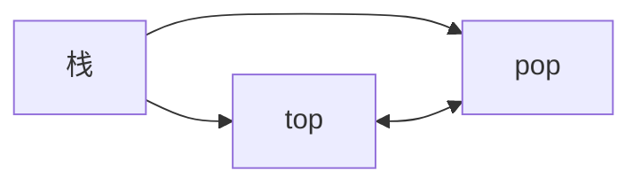
</details>

图 3.23 栈模型:通过 push 向栈输入，通过 pop 和 top 从栈输出


<details>
<summary>text_image</summary>

top
2
4
1
3
6
</details>

图3.24 栈模型:只有栈顶元素是可访问的

## 3.6.2 栈的实现

由于栈是一个表，因此任何实现表的方法都能实现栈。显然，list 和 vector 都支持栈操作，99% 的时间它们都是最合理的选择。偶尔设计一种特殊目的的实现可能会更快。因为栈操作是常数时间操作，所以，除非在非常独特的环境下，否则是不可能产生任何明显的改进的。

对于这些特殊的时机，我们将给出栈的两种流行的实现，一种实现使用链接结构，而另一种则使用数组，二者均简化了在 vector 和 list 中的思路，因此我们不提供代码。

## 栈的链表实现

栈的第一种实现是使用单链表。我们通过在表的前端插入来实施 push 操作，通过删除表前端元素实施 pop 操作。top 操作只是考查表前端的元素并返回它的值。有时也把 pop 操作和 top 操作合二为一。

## 栈的数组实现

栈的另一种实现避免了链而且可能是更流行的解决方案。它用到来自 vector 的 back、

---

第 3 章 表、栈和队列

87

push\_back 和 pop\_back，因此实现起来很简单。与每个栈相关联的是 theArray 和 topOfStack，对于空栈它是-1(这就是空栈的初始化做法)。为将某个元素 x 推入栈中，我们使 topOfStack 增 1 然后置 theArray[topOfStack]=x。为了弹出栈元素，我们置返回值为 theArray[topOfStack]，然后使 topOfStack 减 1。

注意，这些操作不仅以常数时间运行，而且是以非常快的常数时间运行。在某些机器上，若在带有自增和自减寻址功能的寄存器上操作，则(整数的)push 和 pop 都可以写成一条机器指令。最现代化的计算机将栈操作作为它的指令系统的一部分，这个事实强化了这样一种理念，即栈很可能是在计算机科学中在数组之后的最基本的数据结构。

## 3.6.3 应用

毫不奇怪，如果我们把操作限制在对一个表进行，那么这些操作会执行得很快。然而，令人惊奇的是，这些不多的操作却非常强大和重要。在栈的诸多应用中，我们给出3个例子，第三个实例深刻阐释程序是如何组织的。

## 平衡符号

编译器检查程序的语法错误，但是常常由于缺少一个符号(如遗漏一个花括号或是注释起始符)而引起编译器列出上百行的诊断，可是真正的错误并没有找出。

在这种情况下一个有用的工具就是检验是否每件事情都能成对出现的程序。于是，每一个右花括号、右方括号及右圆括号必然对应其相应的左括号。序列[()]是合法的，但[()）是错误的。显然，不值得为此编写一个大型程序，事实上检验这些事情是很容易的。为简单起见，我们仅就圆括号、方括号和花括号进行检验并忽略出现的任何其他字符。

这个简单的算法用到一个栈，兹叙述如下:

做一个空栈。读入字符直到文件尾。如果字符是一个开放符号，则将其推入栈中。如果字符是一个封闭符号，则当栈空时报错。否则，将栈元素弹出。如果弹出的符号不是对应的开放符号，则报错。在文件尾，如果栈非空则报错。

我们应该能够确信这个算法是会正确运行的。很清楚，它是线性的，事实上它只须对输入进行一趟检验。因此，它是联机(on-line)的，而且是相当快的。当报错时决定如何处理可能需要做一些附加的工作——例如判断可能的原因。

## 后缀表达式

假设我们有一个便携计算器并想要计算一趟外出购物的花费。为此，我们将一列数据相加并将结果乘以1.06，它是所购物品的价格以及附加的地方销售税。如果购物各项花销为4.99、5.99和6.99，那么输入这些数据的自然的方式将是

$$
4. 9 9 + 5. 9 9 + 6. 9 9 * 1. 0 6 =
$$

随着计算器的不同，这个结果或者是所要的答案 19.05，或者是科学答案 18.39。最简单的四功能计算器都将给出第一个答案，但是许多先进的计算器是知道乘法的优先级高于加法的。

另一方面，有些项是需要上税的，而有些项则不是，因此，如果只有第一项和最后一项是要上税的，那么计算的顺序

---

88

数据结构与算法分析——C++语言描述(第四版)

$$
4. 9 9 * 1. 0 6 + 5. 9 9 + 6. 9 9 * 1. 0 6 =
$$

将在科学计算器上给出正确的答案(18.69)而在简单计算器上给出错误的答案(19.37)。科学计算器一般包含括号，因此我们总可以通过加括号的方法得到正确的答案，但是使用简单计算器时需要记住一些中间结果。

该例的典型计算顺序可以是将4.99和1.06相乘并存为 $A_{1}$，然后将5.99和 $A_{1}$ 相加，再将结果存入 $A_{1}$；我们再将6.99和1.06相乘并将答案存为 $A_{2}$，最后将 $A_{1}$ 和 $A_{2}$ 相加并将最后答案放入 $A_{1}$。可以将这种操作顺序书写如下:

$$
4. 9 9 1. 0 6 * 5. 9 9 + 6. 9 9 1. 0 6 * +
$$

这个记法叫作后缀记法(postfix notation)记法或逆波兰记法(reverse Polish notation)，其求值过程恰好就是上面所描述的过程。计算这个问题最容易的方法是使用一个栈。当见到一个数时就把它推入栈中；在遇到一个运算符时该运算符就作用于从该栈弹出的两个数(符号)上，再将所得结果推入栈中。例如，后缀表达式

$$
6 5 2 3 + 8 * + 3 + *
$$

计算如下:

前4个字符放入栈中，此时栈变成


<details>
<summary>text_image</summary>

topOfStack →
3
2
5
6
</details>

下面读到一个“+”号，所以3和2从栈中弹出并且它们的和5被压入栈中。


<details>
<summary>text_image</summary>

topOfStack →
5
5
6
</details>

接着，8进栈。


<details>
<summary>text_image</summary>

topOfStack →
8
5
5
6
</details>

现在见到一个“\*”号，因此8和5弹出并且 $5 * 8 = 40$ 进栈。


<details>
<summary>text_image</summary>

topOfStack →
40
5
6
</details>

接下来又见到一个“+”号，因此40和5被弹出并且 $5 + 40 = 45$ 进栈。

---

第3章 表、栈和队列

89


<details>
<summary>text_image</summary>

topOfStack →
45
6
</details>

现在，将3压入栈中。


<details>
<summary>text_image</summary>

topOfStack →
3
45
6
</details>

然后，“+”使得3和45从栈中弹出并将 $45+3=48$ 压入栈中。


<details>
<summary>text_image</summary>

topOfStack →
48
6
</details>

最后，见到一个“\*”号，从栈中弹出48和6；将结果 $6 * 48 = 288$ 压进栈中。


<details>
<summary>text_image</summary>

topOfStack → 288
</details>

计算一个后缀表达式花费的时间是 $O(N)$，因为对输入中的每个元素的处理都是由一些栈操作组成从而花费常数的时间。该算法的计算非常简单。注意，当一个表达式以后缀记号给出时，没有必要知道任何优先的规则。这是一个明显的优点。

## 中缀到后缀的转换

栈不仅可以用来计算后缀表达式(postfix expression)的值，而且还可以用栈将一个标准形式的表达式(或叫作中缀式(infix))转换成后缀式(postfix)。我们通过只允许操作+、\*、（、），并坚持普通的优先级法则而将一般的问题浓缩成小规模的问题。同时还要进一步假设表达式是合法的。设欲将中缀表达式

$$
a + b * c + (d * e + f) * g
$$

转换成后缀表达式。正确的答案是 $abc* + de*f + g* +$。

当读到一个操作数的时候，立即把它放到输出中。但运算符并不立即输出，而是必须先存在某个地方。正确的做法是将已经见到的运算符放进栈中而不是放到输出中。当遇到左圆括号时也要将其推入栈中。计算从一个空栈开始。

如果见到一个右括号，那么就将栈元素弹出，将弹出的符号写出直至遇到一个(对应的)左括号为止，但是这个左括号只被弹出并不输出。

---

90

数据结构与算法分析——C++语言描述(第四版)

如果见到任何其他的符号 [如+、\*、（]，那么我们从栈中弹出栈元素直到发现优先级更低的元素为止。有一个例外:除非是在处理一个)的时候，否则我们绝不从栈中移走(。对于这种操作，+的优先级最低，而(的优先级最高。当从栈弹出元素的工作完成后，我们再将运算符压入栈中。

最后，如果读到输入的末尾，则将栈元素弹出直到该栈变成空栈，再将这些符号写到输出中。

这个算法的思路是，当看到一个运算符的时候，先把它放到栈中。栈代表挂起的运算符。然而，栈中有些具有高优先级的运算符现在知道需要完成使用，应该被弹出，它们将不再处于挂起的状态。这样，在把当前运算符放入栈中之前，那些在栈中并在当前操作符之前要完成使用的运算符要被弹出。详细的解释见下表:

| 表达式 | 在处理第3个运算符时的栈 | 动作 |
| --- | --- | --- |
| a*b-c+d | - | -完成,+进栈 |
| a/b+c*d | + | 没有运算符完成操作,*进栈 |
| a-b*c/d | -* | *完成,/进栈 |
| a-b*c+d | -* | *和-完成,+进栈 |

圆括号增加了额外的复杂性。当左括号是一个输入符号时可以把它看成是一个高优先级的运算符(这样，挂起的那些操作符仍是挂起的)，而当它在栈中时把它看成是低优先级的运算符（从而不会被一个操作符意外地删除）。右括号被处理成特殊的情况。

为了理解这种算法的运行机制，我们将把上面长的中缀表达式转换成后缀形式。首先，符号 a 被读入，于是它被传向输出。然后，“+”被读入并被放入栈中。接下来 b 被读入并传向输出。这一时刻的状态如下:


栈


输出

接着\*号被读入。运算符栈的栈顶元素比\*的优先级低，故没有输出且\*进栈。接着，c 被读入并输出。至此，我们有


栈


输出

后面的符号是一个+号。检查一下栈发现，我们需要将\*从栈弹出并把它放到输出中；再弹出栈中剩下的+号，该算符不比刚刚遇到的+号优先级低而是有相同的优先级；然后，将刚刚遇到的+号压入栈中。


栈


输出

---

第3章 表、栈和队列

91

下一个被读到的符号是一个(，由于有最高的优先级，因此它被放进栈中。然后，读入 d 并输出。


栈


输出

继续进行，我们又读到一个\*。由于除非正在处理闭括号否则开括号不会从栈中弹出，因此没有输出。下一个字符是e，它被读入并输出。


栈


输出

再往后读到的符号是+。我们将\*弹出并输出，然后将+压入栈中。这以后，我们读到f并输出。


栈


输出

这回，我们读到的是一个)，因此将栈元素直到(都弹出，我们输出一个+号。


栈


输出

下面又读到一个\*；该算符被压入栈中。然后，g 被读入并输出。


栈


输出

现在输入为空，因此我们将栈中的符号全部弹出并输出，直到栈变成空栈。


栈


输出

与前面相同，这种转换工作只需要 $O(N)$ 的时间并经过一趟输入后完成。可以通过指定减法和加法有相同的优先级以及乘法和除法有相同的优先级而将减法和除法添加到指令集中去。需要注意的是，表达式 $\mathrm{a - b - c}$ 应转换成 $\mathrm{ab - c - }$ 而不是转换成 $\mathrm{abc - - }$ 。我们的算法做得正确，因为这些操作符是从左到右结合的。一般情况未必如此，比如下面的表达式就是从右到左结合的: $2^{2^3} = 2^8 = 256$ ，而不是 $4^{3} = 64$ 。我们将把取幂运算添加到运算符指令集中的问题留作练习。

---

92

数据结构与算法分析——C++语言描述(第四版)

## 函数调用

检测平衡符号的算法提出一种在编译的过程语言和面向对象的语言中实现函数调用的方式。这里的问题是，当调用一个新函数时，主调例程的所有局部变量需要由系统存储起来，因为否则被调用的新函数将会重写由主调例程的变量所使用的内存。不仅如此，主调例程的当前位置必须要存储，以便在新函数运行完成之后知道向哪里转移。这些变量一般由编译器指派给机器的一些寄存器，但存在某些冲突(通常所有的函数都是获取指定给1号寄存器的某些变量)，特别是涉及递归的时候。该问题类似于平衡符号，其原因在于，函数调用和函数返回基本上类似于开括号和闭括号，因此二者相同的思路都应该是行得通的。

当存在函数调用的时候,需要存储的所有重要信息,诸如寄存器的值(对应一些变量的名字)和返回地址(它可从程序计数器得到,一般情况是在一个寄存器中)等,都要以抽象的方式存在“一张纸上”并被置于一个堆(pile)的顶部。然后控制转移到新函数,这样就可以自由地用它的一些值替换这些寄存器。如果它又进行其他的函数调用,那么也遵循相同的过程。当该函数要返回时,它查看堆(pile)顶部的那张“纸”并复原所有的寄存器,然后进行返回转移。

显然，全部工作均可由一个栈来完成，而这正是在实现递归的每一种程序设计语言中实际发生的事实。所存储的信息或称为活动记录(activation record)，或叫作栈帧(stack frame)。在典型情况下，需要做轻微的调整:当前环境由栈顶描述。因此，一条返回语句就可给出前面的环境(不用复制)。在实际计算机中的栈常常是从内存分区的高端向下增长，而在许多的系统中是不检测溢出的。由于有太多的同时在运行着的函数，因此用尽栈空间的情况总是可能发生的。显而易见，用尽栈空间常是致命的错误。

在不进行栈溢出检测的语言和系统中，程序将会崩溃而没有明显的说明。在正常情况下我们不应该越出栈空间，发生这种情况通常是失控递归(忘记基准情形)产生的迹象。另一方面，某些完全合法并且表面上无害的程序也可以越出栈空间。图3.25中的例程打印一个容器，该例程完全合法，实际上是正确的。它正常地处理空容器的基准情形，并且递归也没问题。可以证明这个程序是正确的。然而遗憾的是，如果这个容器含有200 000个元素要打印，那么就要有表示第11行上嵌套调用的200 000个活动记录的一个栈。一般这些活动记录由于它们包含的全部信息而特别庞大，因此这个程序很可能要越出栈空间。(如果200 000个元素还不足以使程序崩溃，那么可用更大的数代替它。)

```c
/**
 * 从起点开始打印容器直到尾端，但不包括尾端.
 */
template <typename Iterator>
void print( Iterator start, Iterator end, ostream & out = cout )
{
    if( start == end )
        return;

    out << *start++ << endl;   // 打印并推进起点
    print( start, end, out );
}
```

图 3.25 递归的不当使用:打印一个容器

这个程序是称为尾递归(tail recursion)的使用极为不当的例子。尾递归指的是在最后一行

---

第3章 表、栈和队列

93

进行的递归调用。尾递归可以手工消除，做法是通过将代码放到一个 while 循环体中并借助每次对函数参数的一次赋值代替递归调用。它模拟了递归调用，因为什么也不需要存储。在递归调用结束之后，实际上没有必要知道那些存储的值。因此，我们就可以带着在一次递归调用中本应用过的那些值转移到函数的顶部。图 3.26 中的函数显示该算法生成的、改进后的程序。尾递归的去除是如此简单，以至于某些编译器能够自动地完成。但是即使如此，最好还是不要让我们自己的程序带着尾递归。

```txt
/**
 * 从起点开始打印容器到尾端但不包括尾端.
 */
template <typename Iterator>
void print( Iterator start, Iterator end, ostream & out = cout )
{
    while( true )
    {
        if( start == end )
            return;

        out << *start++ << endl;  // 打印并推进起点
    }
}
```

图3.26 不用递归打印一个容器，编译器可以做到(但不应你去做)

递归总能够被彻底去除(编译器是在转变成汇编语言时完成递归去除的)，但是这么做是相当冗长乏味的。一般做法是要求使用一个栈，而且仅当能够把最低限度的最小值放到栈上时这个方法才值得一用。我们将不对此做进一步的详细讨论，只是指出，虽然非递归程序一般说来确实比等价的递归程序要快，但是速度优势的代价却是由于去除递归而使得程序清晰性受到了影响。

## 3.7 队列 ADT

像栈一样，队列(queue)也是一种表。然而，使用队列时插入在一端进行而删除则在另一端进行。

## 3.7.1 队列模型

队列的基本操作是 enqueue(入队)，它是在表的末端(叫作队尾(rear))插入一个元素，以及 dequeue(出队)，它是删除(并返回)在表的开头(叫作队头(front))的元素。图 3.27 显示了一个队列的抽象模型。


<details>
<summary>flowchart</summary>

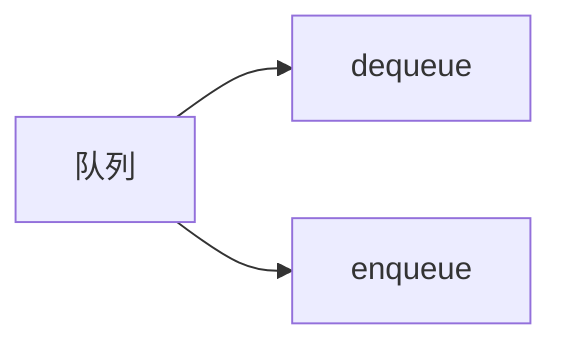
</details>

图3.27 队列模型

## 3.7.2 队列的数组实现

如同栈的情形一样，对于队列而言，任何表的实现都是合法的。像栈一样，对于每一种操作，链表实现和数组实现都给出快速的 $O(1)$ 运行时间。队列的链表实现简单直接，我们留作练习。下面讨论队列的数组实现。

---

94

数据结构与算法分析——C++语言描述(第四版)

对于每一个队列数据结构，我们保留一个数组 theArray 以及位置 front 和 back，它们代表队列的两端。我们还要记录实际存在于队列中的元素的个数 currentSize。下图表示处于某个中间状态的一个队列。

<table><tr><td></td><td></td><td></td><td>5</td><td>2</td><td>7</td><td>1</td><td></td><td></td><td></td></tr><tr><td colspan="5"> $\uparrow$ front</td><td colspan="5"> $\uparrow$ back</td></tr></table>

操作应该是清楚的。为使一个元素 x 入队(即执行 enqueue)，我们让 currentSize 和 back 增 1，然后置 theArray[back]=x。若使一个元素 dequeue(出队)，我们置返回值为 theArray[front]，且 currentSize 减 1，然后使 front 增 1。也可以有些其他方法(将在后面讨论)。现在论述对错误的检测。

上述实现存在一个潜在的问题。经过 10 次 enqueue 后队列似乎是满了，因为 back 现在是数组的最后一个下标，而下一次再 enqueue 就会是一个不存在的位置。然而，队列中也许只存在几个元素，因为若干元素可能已经出队了。像栈一样，即使在有许多操作的情况下队列也常常不是很大。

简单的解决方法是，只要 front 或 back 到达数组的尾端，它就又绕回到开头。下面诸图显示在某些操作期间的队列情况。这叫作循环数组 (circular array) 实现。

实施回绕所需要的附加代码是极小的(不过它可能使得运行时间加倍)。如果 front 或 back 增 1 导致超越了数组，那么其值就要重置到数组的第一个位置。

初始状态

<table><tr><td></td><td></td><td></td><td></td><td></td><td></td><td></td><td></td><td>2</td><td>4</td></tr><tr><td colspan="10"> $\uparrow$ front  $\uparrow$ back</td></tr></table>

经过 enqueue(1) 后

<table><tr><td>1</td><td></td><td></td><td></td><td></td><td></td><td></td><td></td><td>2</td><td>4</td></tr><tr><td colspan="7"> $\uparrow$ back</td><td colspan="3"> $\uparrow$ front</td></tr></table>

经过 enqueue(3) 后

<table><tr><td>1</td><td>3</td><td></td><td></td><td></td><td></td><td></td><td></td><td>2</td><td>4</td></tr><tr><td colspan="7"> $\uparrow$ back</td><td colspan="3"> $\uparrow$ front</td></tr></table>

经过dequeue并返回2后

<table><tr><td>1</td><td>3</td><td></td><td></td><td></td><td></td><td></td><td></td><td>2</td><td>4</td></tr><tr><td colspan="8"> $\uparrow$ back</td><td colspan="2"> $\uparrow$ front</td></tr></table>

经过dequeue并返回4后

<table><tr><td>1</td><td>3</td><td></td><td></td><td></td><td></td><td></td><td></td><td>2</td><td>4</td></tr><tr><td> $\uparrow$ front</td><td colspan="9"> $\uparrow$ back</td></tr></table>

---

第 3 章 表、栈和队列

95

经过dequeue并返回1后

<table><tr><td>1</td><td>3</td><td></td><td></td><td></td><td></td><td></td><td></td><td>2</td><td>4</td></tr><tr><td colspan="10"> $\uparrow$ backfront</td></tr></table>

经过dequeue并返回3后

同时使队列为空

<table><tr><td>1</td><td>3</td><td></td><td></td><td></td><td></td><td></td><td></td><td>2</td><td>4</td></tr><tr><td colspan="10"> $\uparrow$  back  $\uparrow$  front</td></tr></table>

有些程序设计员使用不同的方式表示队列的队头和队尾。例如，有人不使用一项来记录大小，因为他们依赖于当队列为空时 back=front-1 的基准情形。队列的大小通过比较 back 和 front 隐式地算出。这是一种非常隐秘的方法，因为存在某些特殊的情形，因此，如果想修改用这种方法编写的代码，那就要特别小心。如果 currentSize 不作为明确的数据成员被保留，那么当存在 theArray.capacity()-1 个元素时队列就满了，因为只有 theArray.capacity() 个不同的大小可被区分，而 0 又是其中的一个。可以采用任意一种我们喜欢的风格，但要确保我们的所有例程都是一致的。由于实现方法有多种选择，因此如果不使用 currentSize 这个数据成员，那就很可能有必要在代码中进行一些注释。

在确保 enqueue 的次数不会大于队列容量的应用中, 使用回绕是没有必要的。像栈一样, 除非主调例程肯定队列非空, 否则 dequeue 很少执行。因此对这种操作, 只要不是关键的代码, 错误的检测常常被跳过。一般说来这并不是无可非议的, 因为这样可能得到的时间节省量是极小的。

## 3.7.3 队列的应用

有许多算法使用队列给出高效运行时间。它们当中有些可以在图论中找到，我们将在第9章讨论它们。这里，先给出某些使用队列的简单例子。

当作业送交给一台打印机的时候，它们就以到达的顺序被排列起来。因此，被送往打印机的作业基本上被放到一个队列中。 $^{①}$

事实上，每一个实际生活中的排队都(应该)是一个队列。例如，在一些售票口排列的队伍都是队列，因为服务的顺序是先来到的先买票。

另一个例子是关于计算机网络的。有许多种 PC 的网络设置，其中磁盘是放在一台叫作文件服务器 (file server) 的机器上的。使用其他计算机的用户是按照先到先使用的原则访问文件的，因此其数据结构是一个队列。

进一步的例子如下:

- 当所有的接线员忙不开的时候，对大公司的呼叫一般都被放到一个队列中。
● 在大型的大学里，如果所有的终端都被占用，由于资源有限，学生们必须在一个等待

<small><span class="docvortex-page-footnote" data-block-type="page_footnote" style="color:#6b7280">① 我们说基本上是因为作业可以被除去。这等于从队列的中间进行的一次删除，它违反了队列的严格定义。</span></small>

---

96

数据结构与算法分析——C++语言描述(第四版)

表上签字登记。在终端上待得时间最长的学生将首先被强制离开，而等待时间最长的学生则将是下一个被允许使用终端的用户。

称为排队论(queueing theory)的整个数学分支处理用概率的方法计算用户预计要排队等待多长时间才会得到服务、等待服务的队伍能够排多长，以及其他一些诸如此类的问题。问题的答案依赖于用户参与排队的频繁程度，以及一旦用户得到服务时处理服务花费的时间。这两个参数作为概率分布函数给出。在一些简单的情况下，答案可以解析地算出。一种简单情况的例子是一条电话线有一个接线员。如果接线员忙，打来的电话就被放到一个等待队列中(一直放到某个最大的限度为止)。这个问题在商业上很重要，因为研究表明，人们会很快挂上电话。

如果有 $k$ 个接线员，那么这个问题解决起来要困难得多。解析求解困难的问题往往使用模拟的方法进行。此时，我们需要使用一个队列来进行模拟。如果 $k$ 很大，那么还需要其他一些数据结构来使得模拟更有效地进行。在第6章将会看到这种模拟是如何进行的。那时我们将对 $k$ 的若干值进行模拟并选择能够给出合理等待时间的最小的 $k$。

队列还有其他丰富的用途，正如栈一样，这样一种简单的数据结构竟然能够如此重要，实在令人惊奇。

## 小结

本章描述了一些 ADT 的概念，并且利用 3 种最常见的抽象数据类型阐述了这种概念。主要目的就是将 ADT 的具体实现与它们的功能分开。程序必须知道操作都做些什么，但是如果不知道如何去做那就更好。

表、栈和队列或许在全部计算机科学中是 3 个基本的数据结构，大量的例子证明了它们广泛的用途。特别地，我们看到栈是如何用来记录函数调用的，以及递归实际上是如何实现的。这对于我们的理解非常重要，其原因不只因为它使得过程语言成为可能，而且还因为知道递归的实现从而消除了围绕其使用的大量迷团。虽然递归非常强大，但它并不是完全随意操作的，递归的误用和乱用可能导致程序崩溃。

## 练习

3.1 给定一个表 L 和另一个表 P，它们包含以升序排列的整数。操作 printLots(L, P) 将打印 L 中那些由 P 所指定的位置上的元素。例如，如果 P = 1, 3, 4, 6，那么，L 中位于第 1 个、第 3 个、第 4 个和第 6 个位置上的元素被打印出来。写出过程 printLots(L, P)。只可使用公有型 STL 容器操作。该过程的运行时间是多少？

3.2 通过只调整链(而不是数据)来交换两个相邻的元素, 分别使用

a. 单链表。

b. 双向链表。

3.3 实现 STL 的 find 例程，该例程返回一个 iterator，后者包含从 start 开始并扩展到(但不包括)end 的范围内第 1 次出现的 x。若没发现 x，则返回 end。这是一个非类(全局)函数，其特征如下:

---

第3章 表、栈和队列

97

```typescript
template <typename Iterator, typename Object>
iterator find( Iterator start, Iterator end, const Object & x );
```

3.4 给定两个已排序的表 $L_{1}$ 和 $L_{2}$，只使用基本的表操作编写计算 $L_{1} \cap L_{2}$ 的过程。

3.5 给定两个已排序的表 $L_{1}$ 和 $L_{2}$，只使用基本的表操作编写计算 $L_{1} \cup L_{2}$ 的过程。

3.6 Josephus 问题 (Josephus problem) 是下面的游戏: $N$ 个人编号 $1 \sim N$, 围坐成一个圆圈。从 1 号人开始传递一个热土豆。经过 $M$ 次传递后拿着热土豆的人被清除离座, 围坐的圆圈缩紧, 由坐在被清除人后面的人拿起热土豆继续进行游戏。最后剩下的人获胜。因此, 如果 $M = 0$ 和 $N = 5$, 则游戏人依序被清除, 5 号游戏人获胜。如果 $M = 1$ 和 $N = 5$, 那么被清除的人的顺序是 2, 4, 1, 5。

a. 编写一个程序解决在 M 和 N 为一般的值下的 Josephus 问题，应使所编程序尽可能地高效率，要确保各个单元都能被清除。
b. 这个程序的运行时间是多少？
c. 如果 $M = 1$，这个程序的运行时间又是多少？对于 $N$ 的一些大值 $(N > 100000)$，delete 例程如何影响该程序的速度？

3.7 修改 Vector 类以添加索引的越界检测。

3.8 把 insert 和 erase 添加到 Vector 类中。

3.9 按照 C++ 标准，对于本章中的 vector，调用 push\_back、pop\_back、insert 或 erase 都将使所有指向 vector 的迭代器失效(潜在地使迭代器过期而不再适用)。为什么？

3.10 通过使用迭代器类类型而不是指针变量来修改 Vector 类以提供严格的迭代器检测。最困难的部分是处理过期的迭代器，详见练习 3.9。

3.11 假设单链表使用一个头节点来实现，但无尾节点，并假设它只保留指向头节点的指针。编写一个类，包含以下一些方法:

a. 返回该链表的大小。
b. 打印该链表。
c. 测试是否值 x 含于该链表。
d. 如果值 x 尚未含于该链表，把值 x 添加到该链表中。
e. 如果值 x 含于该链表，将 x 从该链表中删除。

3.12 以排序的顺序保持单链表，重复练习 3.11。

3.13 对 List 迭代器类添加对 operator-的支持。

3.14 在 STL 的迭代器中向前搜索需要用到 operator++ 的操作，这样将会依次推进该迭代器。不过在有些情况下不用推进迭代器而查看表的下一项可能更可取。使用下述声明:

```txt
const_iterator operator+( int k ) const;
```

编写成员函数以在一般情形下简化操作。二元运算符 operator+返回一个对应当前位置前 k 个位置的迭代器。

3.15 将 splice 操作添加到 List 类中。该方法声明

```txt
void splice( iterator position, List<T> & lst );
```

将所有的项从 lst 中删除，把它们放到 List \*this 中的 position 之前，而 lst 和 \*this 必须是两个不同的表，所编写的程序必须以常数时间运行。

---

98

数据结构与算法分析——C++语言描述(第四版)

3.16 将反向迭代器 (reverse iterator) 添加到 STL List 类的实现中。定义 reverse\_iterator 和 const\_reverse\_iterator。添加 rbegin 方法和 rend 方法以返回适当的反向迭代器，分别表示尾端标记前的位置和头节点的位置。反向迭代器内在地反转++操作和--操作的含义。通过使用代码

```cpp
List<Object>::reverse_iterator itr = L.rbegin( );
while( itr != L.rend( ) )
    cout << *itr++ << endl;
```

应该能够反向打印表 L。

3.17 修改 List 类，通过使用在 3.5 节末尾提出的想法来提供严格的迭代器检测。
3.18 当一个 erase 方法用于 list 类对象时, 它将使得正在指向被删除的节点的任何 iterator 失效。这样的迭代器就称为过期(stale)的。描述一种高效的算法, 保证对过期迭代器的操作就好像迭代器的 current 是 nullptr。注意, 可能存在多个过期迭代器。为了实现你的算法, 必须解释哪些类需要重新编写。
3.19 不使用头节点和尾节点重写 List 类，并描述该类与 3.5 节提供的类之间的区别。
3.20 不同于我们已经给出的删除方法，另一种思路是使用懒惰删除(lazy deletion)的删除方法。为了删除一个元素，我们只是标记上该元素被删除(使用一个附加的位域(bit field))。表中被删除和未被删除元素的个数作为数据结构的一部分被保留。如果被删除元素和未被删除元素一样多，则遍历整个表，对所有被标记的节点执行标准的删除算法。

a. 列出懒惰删除的优点和缺点。
b. 编写使用懒惰删除实现标准链表操作的相应例程。

3.21 用下列语言编写检测平衡符号的程序:

a. Pascal(begin/end,(), [], {} )。
b. C++(/\* \*/, (), [], {} )。
\*c. 解释如何打印出一条错误信息，该信息极有可能反映出错的原因。

3.22 编写一个程序计算后缀表达式的值。

3.23 a. 写出一个程序，将包含 $(,), +, -, *, /$ 等符号的中缀表达式转换成后缀表达式。

b. 将取幂运算符添加到你的指令系统中。
c. 编写一个程序将后缀表达式转换成中缀表达式。

3.24 编写只用一个数组而实现两个栈的例程。这些栈例程不应该声明溢出，除非数组中的每个单元都被使用。

3.25 \*a. 提出一种数据结构，支持栈 push 和 pop 操作以及第 3 种操作 findMin，它返回该数据结构中的最小元素。所有操作均以 O(1) 最坏情形时间运行。

\*b. 证明，如果添加找出并删除最小元素的第4种操作 deleteMin，那么至少有一种操作必然花费 $\Omega (\log N)$ 时间。（本题需要阅读第7章。）

\*3.26 指出如何用一个数组实现三个栈结构。
3.27 在 2.4 节中用于计算斐波那契数的递归例程如果对 N = 50 运行，栈空间有可能用完吗？为什么？

---

第3章 表、栈和队列

99

3.28 双端队列(deque)是由一些项的一个表组成的数据结构, 对该数据结构可以进行下列操作:

push(x): 将项 x 插入到双端队列的前端。

pop(): 从双端队列中删除前端项并将其返回。

inject(x): 将项 x 插入到双端队列的尾端。

eject(): 从双端队列中删除尾端项并将其返回。

编写支持双端队列的例程，其中的每种操作均花费  $O(1)$  的时间。

3.29 编写以倒序打印单链表的算法，只使用常数的附加空间。本题意味着，不能使用递归但可以假设该算法是表的一个成员函数。如果该例程是一个常量成员函数，那么这样的一种算法还能不能写出？

3.30 a. 写出自调整表(self-adjusting list)的数组实现。在自调整表中，所有的插入都在前端进行。自调整表添加一个 find 操作，当一个元素被 find 访问时，它就被移到表的前端但并不改变其余的项的相对顺序。

b. 写出自调整表的链表实现。

\*c. 设每个元素都有其被访问的固定的概率  $p_{i}$ 。证明那些具有最高访问概率的元素都有望靠近表的前端。

3.31 使用单链表高效实现栈类，但不用头节点和尾节点。

3.32 使用单链表高效实现队列类，但不用头节点和尾节点。

3.33 使用循环数组(circular array)高效实现队列类。可以使用一个 vector(而不是使用原始数组)作为底层数组结构。

3.34 如果从某个节点 $p$ 开始，接着跟有足够数目的 next 链将把我们带回到节点 $p$，那么这个链表包含一个循环。$p$ 不必是该表的第一个节点。假设给定一个链表，它包含 $N$ 个节点，但 $N$ 的值是未知的。

a. 设计一个  $O(N)$  算法以确定是否该表包含有循环。可以使用  $O(N)$  的附加空间。

\*b. 重复(a)部分，但是只使用 O(1) 的附加空间。(提示:使用两个迭代器，它们最初在表的开始处，但以不同的速度推进。)

3.35 实现队列的一种方法是使用一个循环链表(circular linked list)。在循环链表中，最后一个节点的 next 指针指向第 1 个节点。假设该链表不包含头节点，并假设最多可以保留一个迭代器，它对应链表中的一个节点。对于下列的哪种表示方式，所有的基本队列操作都可以以常数最坏情形时间执行？证明你的答案是正确的。

a. 保留一个迭代器，它对应该链表的第一项。

b. 保留一个迭代器，它对应该链表的最后一项。

3.36 设有一个指针指向单链表的一个节点，而这个节点保证不是该表的最后的节点。我们没有指向任何其他节点的指针(除非通过后面的一些链)。描述一个 $O(1)$ 算法，该算法逻辑上从该链表删除存储在这样一个节点上的值，同时保持链表的完整性。(提示:涉及下一个节点。)

3.37 设单链表是用一个头节点和一个尾节点实现的。描述下述操作的常数时间算法:

a. 在位置 p (该位置由一个迭代器给出) 前插入一项 x。

b. 删除存储在位置 p (该位置由一个迭代器给出) 的项。

---

## 第4章 树

对于大量的输入数据，链表的线性访问耗时过多，不便使用。本章讨论一种简单的数据结构，其大部分操作的运行时间平均为 $O(\log N)$ 。我们还要简述对这种数据结构在概念上的简单的修改，它保证在最坏情形下的上述时间界。此外，还将讨论第二种修改，对于长的指令序列它实质上给出每种操作的 $O(\log N)$ 运行时间。

我们涉及到的这种数据结构叫作二叉查找树 (binary search tree)。二叉查找树是两种库集合类 set 和 map 实现的基础，它们用于许多应用之中。总的来说，在计算机科学中树 (tree) 是非常有用的抽象概念，因此，我们将讨论树在其他更一般应用中的使用。在这一章，我们将

- 看到树是如何被用于实现几种流行操作系统的文件系统的。
● 看到树如何能够用来计算算术表达式的值。
- 指出如何利用树来支持以 $O(\log N)$ 平均时间进行的各种搜索操作, 以及如何细化以得到最坏情形时间界 $O(\log N)$ 。我们还将看到当数据被存放在磁盘上时如何来实现这些操作。
- 讨论并使用 set 类和 map 类。

## 4.1 预备知识

树(tree)可以用几种方式定义。定义树的一种自然的方式是递归的方式。一棵树是一些节点(node)的集合。这个集合可以是空集；若不是空集，则树由称做根(root)的节点 $r$ 以及0个或多个非空的(子)树 $T_{1}, T_{2}, \cdots, T_{k}$ 组成，这些子树中每一棵的根都被来自根 $r$ 的一条有向的边(edge)所连接。

每一棵子树的根叫作根 $r$ 的儿子(child)，而 $r$ 是每一棵子树的根的父亲(parent)。图4.1显示了用递归定义的典型的树。


<details>
<summary>flowchart</summary>

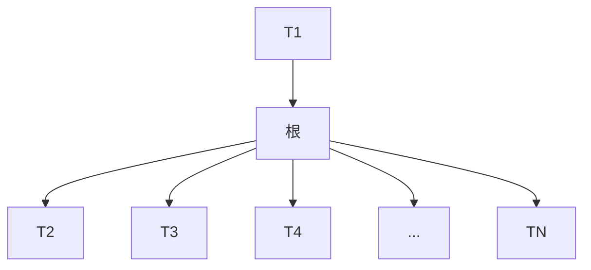
</details>

图4.1 一般的树

从递归定义中我们发现，一棵树是 $N$ 个节点和 $N - 1$ 条边的集合，其中的一个节点叫作根。存在 $N - 1$ 条边的结论是由下面的事实得出的:每条边都将某个节点连接到它的父亲，而除去根节点外每一个节点都有一个父亲(见图4.2)。

在图 4.2 的树中，节点 A 是根。节点 F 有一个父亲 A 并且有儿子 K、L 和 M。每一个节点可以有任意多个儿子，也可能是零个儿子。没有儿子的节点称为树叶 (leaf)，图 4.2 中的树

---

第4章 树

101

叶是 B、C、H、I、P、Q、K、L、M 和 N。具有相同父亲的节点为兄弟(siblings)。因此，K、L 和 M 都是兄弟。用类似的方法可以定义祖父(grandparent)和孙子(grandchild)关系。


<details>
<summary>flowchart</summary>

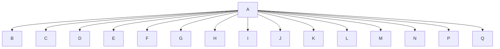
</details>

图4.2 一棵树

从节点 $n_1$ 到 $n_k$ 的路径(path)定义为节点 $n_1, n_2, \dots, n_k$ 的一个序列，使得对于 $1 \leqslant i < k$ 的节点 $n_i$ 是 $n_{i+1}$ 的父亲。这条路径的长(length)是该路径上的边的条数，即 $k-1$ 。从每一个节点到它自己有一条长为0的路径。注意，在一棵树中从根到每个节点恰好存在一条路径。

对任意节点 $n_i$，$n_i$ 的深度 (depth) 为从根到 $n_i$ 的唯一路径的长。因此，根的深度为 0。节点 $n_i$ 的高 (height) 是从 $n_i$ 到一片树叶的最长路径的长。因此所有树叶的高都是 0。一棵树的高 (height of a tree) 等于它的根的高。对于图 4.2 中的树，E 的深度为 1 而高为 2；F 的深度为 1 而高也是 1；该树的高为 3。一棵树的深度 (depth of a tree) 等于其最深的树叶的深度，该深度总是等于这棵树的高。

如果存在从 $n_1$ 到 $n_2$ 的一条路径，那么 $n_1$ 是 $n_2$ 的一位祖先 (ancestor)，而 $n_2$ 是 $n_1$ 的一个后裔 (descendant)。如果 $n_1 \neq n_2$，那么 $n_1$ 是 $n_2$ 的真祖先 (proper ancestor)，而 $n_2$ 是 $n_1$ 的真后裔 (proper descendant)。

## 4.1.1 树的实现

实现树的一种方法是在每一个节点除数据外还要有一些链，使得该节点的每一个儿子都被一个链所链接。然而，由于每个节点的儿子数可以变化很大并且事先不知道，因此在数据结构中建立到各(儿)子节点直接的链接是不可行的，因为这样会产生太多浪费的空间。实际上解决方法很简单:将每个节点的所有儿子都放在树节点的链表中。图4.3中的声明就是典型的声明。

图 4.4 指出一棵树是如何用这种实现方法表示的。图中向下的箭头是些指向 firstChild 的链，而从左向右的水平箭头是指向 nextSibling 的链。因为空链 (null link) 太多，所以图中没有把它们画出。

在图 4.4 的树中，节点 E 有一个链指向兄弟 (F)，另一个链指向儿子 (I)，而有的节点这两种链都没有。

```c
struct TreeNode
{
    Object element;
    TreeNode *firstChild;
    TreeNode *nextSibling;
};
```

图 4.3 树节点的声明


<details>
<summary>flowchart</summary>

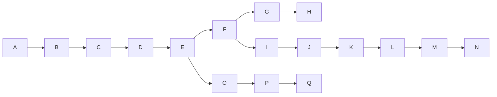
</details>

图 4.4 图 4.2 所示树的第一儿子/下一兄弟表示法

---

102

数据结构与算法分析——C++语言描述(第四版)

## 4.1.2 树的遍历及应用

树有很多应用。流行的用途之一是许多常用操作系统中的目录结构，包括 UNIX 和 DOS 在内。图 4.5 是 UNIX 文件系统中一个典型的目录。


<details>
<summary>flowchart</summary>

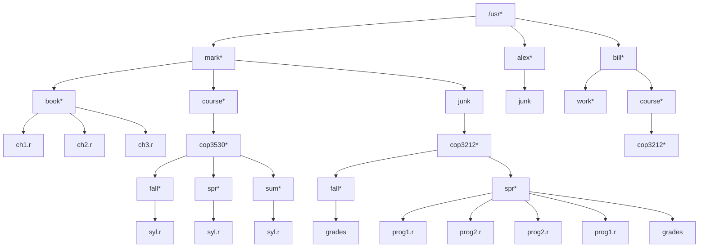
</details>

图4.5 UNIX目录

这个目录的根是/usr。（名字后面的星号指出/usr本身就是一个目录。）/usr有3个儿子:mark、alex和bill，它们本身也都是目录。因此，/usr包含3个目录而且没有正规的文件。文件名/usr/mark/book/ch1.r先后3次通过最左边的子节点而得到。在第一个/后的每个/都表示一条边，结果为一完整路径名(pathname)。这个分级文件系统非常流行，因为它能够使得用户逻辑地组织数据。不仅如此，在不同目录下的两个文件还可以享有相同的名字，因为它们必然有从根开始的不同的路径从而具有不同的路径名。在UNIX文件系统中的目录就是含有它的所有儿子的一个文件，因此，这些目录几乎是完全按照上述的类型声明构造的 $^{①}$ 。事实上，按照UNIX的某些版本，如果将打印一个文件的标准命令应用到一个目录上，那么在该目录中的这些文件名能够在(与其他非ASCII信息一起的)输出中被看到。

设我们想要列出目录中所有文件的名字，输出格式将是:深度为 $d_{i}$ 的文件将被 $d_{i}$ 次跳格(tab)缩进后打印其名。该算法在图4.6中以伪码给出。

```rust
void FileSystem::listAll( int depth = 0 ) const
{
    printName( depth );  // 打印对象的名字
    if( isDirectory( ) )
        for each file c in this directory (for each child)
            c.listAll( depth + 1 );
}
```

图4.6 列出分级文件系统中目录的伪码例程

为了显示根时不进行缩进，这里的递归函数 listAll 需要从深度 0 开始。此处的深度是一个内部簿记变量，而不是主调例程能够期望知道的那种参数。因此，给 depth 提供的默认值为 0。

算法思路简单易懂。文件对象的名字随着适当次数的跳格而被打印出来。如果它是一个目录，那么我们递归地一个一个地处理所有的儿子。这些儿子均处在下一层的深度上，因此需要缩进一个附加的间隔。整个输出显示在图4.7中。

<small><span class="docvortex-page-footnote" data-block-type="page_footnote" style="color:#6b7280">① 在 UNIX 文件系统中每个目录还有一项指向该目录本身，以及另一项指向该目录的父目录。因此，从技术上说，UNIX 文件系统不是树，而是类树 (treelike)。</span></small>

---

第4章 树

103


<details>
<summary>text_image</summary>

/usr
    mark
        book
            ch1.r
            ch2.r
            ch3.r
        course
            cop3530
                fall
                    syl.r
                spr
                    syl.r
                sum
                    syl.r
        junk
alex
    junk
bill
    work
    course
        cop3212
            fall
                grades
                prog1.r
                prog2.r
                spr
                    prog2.r
                    prog1.r
                    grades
</details>

图 4.7 （先序）目录列表

这种遍历策略叫作先序遍历(preorder traversal)。在先序遍历中，对节点的处理工作是在它的诸儿子节点被处理之前(pre)进行的。当该程序运行时，显然第1行对每个节点恰好执行一次，因为每个名字只输出一次。由于第1行对每个节点最多执行一次，因此第2行也必然对每个节点执行一次。不仅如此，对于每个节点的每一个子节点第4行最多只能被执行一次。不过，儿子的个数恰好比节点的个数少1。最后，第4行每执行一次，for循环就迭代一次，每当循环结束时再加上一次。因此，每个节点总的工作量是常数。如果有N个文件名需要输出，则运行时间就是 $O(N)$ 。

另一种遍历树的常用方法是后序遍历(postorder traversal)。在后序遍历中，一个节点处的工作是在它的诸子节点被计算后进行的。例如，图4.8表示的是与前面相同的目录结构，其中圆括号内的数代表每个文件占用的磁盘区块(disk block)的个数。

由于目录本身也是文件，因此它们也有大小。设我们想要计算被该树所有文件占用的磁盘块的总数。最自然的做法是找出含于子目录/usr/mark(30)、/usr/alex(9)和/usr/bill(32)的块的个数。于是，磁盘块的总数就是子目录中的块的总数(71)再加上/usr使用的一个块，共72个块。图4.9中的伪码方法size实现的就是这种遍历策略。

如果当前对象不是一个目录，那么 size 只返回它在当前对象中所占用的块数。否则，被该目录占用的块数将被加到在其所有子节点(递归地)中发现的块数上去。为了区别后序遍历策略和先序遍历策略之间的不同，图 4.10 显示了每个目录或文件的大小是如何由该算法算出的。

---

104

数据结构与算法分析——C++语言描述(第四版)


<details>
<summary>flowchart</summary>

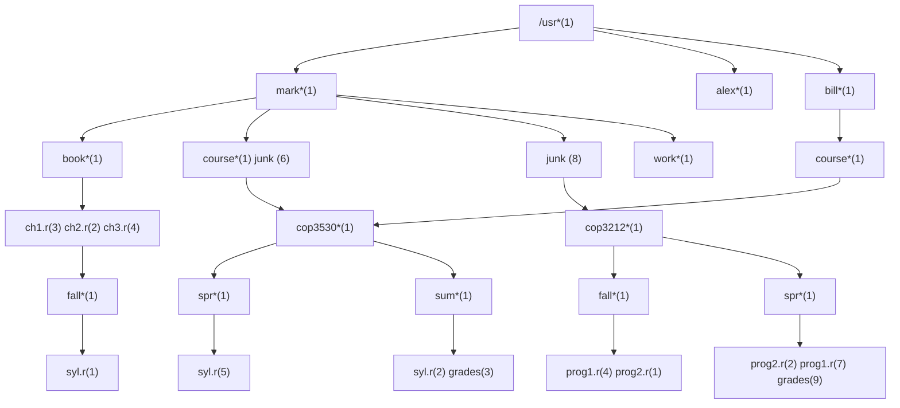
</details>

图 4.8 经由后序遍历得到的带有文件大小的 UNIX 目录

```cpp
int FileSystem::size( ) const
{
    int totalSize = sizeofThisFile( );

    if( isDirectory( ) )
        for each file c in this directory (for each child)
            totalSize += c.size( );

    return totalSize;
}
```

图 4.9 计算一个目录大小的伪码例程

```asm
ch1.r                     3
    ch2.r                     2
    ch3.r                     4
    book                    10
        syl.r     1
        fall                 2
            syl.r     5
        spr                   6
            syl.r     2
        sum                   3
    cop3530             12
    course                   13
    junk                   6
mark                            30
    junk                   8
alex                            9
    work                   1
        grades     3
        prog1.r   4
        prog2.r   1
        fall                 9
            prog2.r   2
            prog1.r   7
            grades     9
        spr                   19
    cop3212             29
    course                   30
bill                        32
/usr                         72
```

图 4.10 函数 size 的印迹

---

第4章 树

105

## 4.2 二叉树

二叉树(binary tree)是一棵树，其中每个节点都不能有多于两个的儿子。

图4.11显示，一棵二叉树由一个根和两棵子树 $T_{L}$ 和 $T_{R}$ 组成， $T_{L}$ 和 $T_{R}$ 均可能为空。

二叉树的一个性质是平均二叉树的深度要比节点个数 $N$ 小得多，这个性质有时很重要。分析表明，其平均深度为 $O(\sqrt{N})$ ，而对于特殊类型的二叉树，即二叉查找树(binary search tree)，其深度的平均值是 $O(\log N)$ 。遗憾的是，正如图4.12中的例子所示，这个深度是可以大到 $N - 1$ 的。


<details>
<summary>text_image</summary>

根
T_L
T_R
</details>

图 4.11 一般二叉树


<details>
<summary>flowchart</summary>

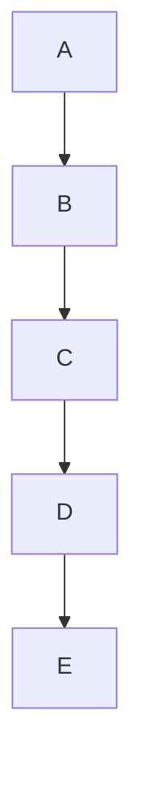
</details>

图 4.12 最坏情形的二叉树

## 4.2.1 实现

因为一个二叉树节点最多有两个儿子，所以我们可以保存直接链接到它们的链。树节点的声明在结构上类似于双向链表的声明，因为一个节点就是由 element 的信息加上两个指向其他节点的指针(left 和 right)组成的结构(见图 4.13)。

```c
struct BinaryNode
{
    Object      element;      // 节点上的数据
    BinaryNode *left;          // 左儿子
    BinaryNode *right;       // 右儿子
};
```

图 4.13 二叉树节点类(伪代码)

我们是可以用在画链表时习惯使用的矩形框画出二叉树的，不过，树一般画成圆圈并用一些直线连接起来，因为它们实际上就是图(graph)。当涉及到树时，我们也不显式地画出nullptr链，因为每一棵具有 $N$ 个节点的二叉树都需要 $N + 1$ 个nullptr链。

二叉树有许多与搜索无关的重要应用。二叉树的主要用处之一是在编译器设计领域，我们现在就来探索这个问题。

## 4.2.2 一个例子——表达式树

图 4.14 显示的是一个表达式树 (expression tree) 的例子。表达式树的树叶是操作数 (operand)，如常数或变量名字，而其他的节点为操作符 (operator)。由于这里所有的操作都是二元 (二目) 的，因此这棵特定的树正好是二叉树。虽然这是最简单的情况，但是节点还是有可能含有多于两个的儿子的。一个节点也有可能只有一个儿子，如具有一目减运算符 (unary

---

106

数据结构与算法分析——C++语言描述(第四版)

minus operator)的情形。我们可以将通过递归计算左子树和右子树所得到的值应用在根处的运算符上而算出表达式树 $T$ 的值。在我们的例子中，左子树的值是 $a + (b*c)$，右子树的值是 $((d*e) + f)*g$，因此整个树表示为 $(a + (b*c)) + (((d*e) + f)*g)$。


<details>
<summary>flowchart</summary>

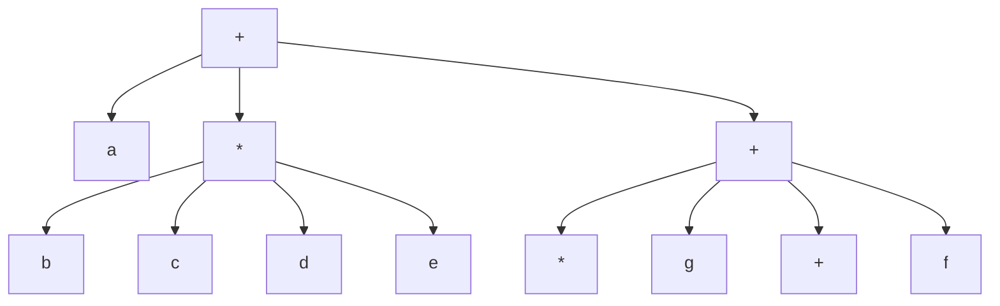
</details>

图4.14 $(a + b*c) + ((d*e + f)*g)$ 的表达式树

我们可以通过递归地产生一个带括号的左表达式，然后打印出在根处的运算符，最后再递归地产生一个带括号的右表达式而得到一个(对两个括号整体进行运算的)中缀表达式(infix expression)。这种一般的方法(左，节点，右)称为中序遍历(inorder traversal)。由于其产生的表达式类型，这种遍历很容易记忆。

另一种遍历策略是递归地打印出左子树、右子树，然后打印运算符。如果应用这种策略于上面的树，则输出将是  $abc*+de*f+g*+$ 。容易看出，它就是 3.6.3 节中的后缀表示法。这种遍历策略一般称为后序遍历(postorder traversal)。我们已在 4.1 节见过这种遍历方法。

第三种遍历策略是先打印出运算符，然后递归地打印出左子树和右子树。此时得到的表达式++a\*bc\*++\*defg 是不太常用的前缀 (prefix) 记法，这种遍历策略为先序遍历 (preorder traversal)，我们也在 4.1 节见过它。以后，我们还要讨论这些遍历方法。

## 构造一棵表达式树

现在给出一种算法来把后缀表达式转变成表达式树。由于已经有了将中缀表达式转变成后缀表达式的算法，因此我们能够从这两种常用类型的输入生成表达式树。这里所描述的方法酷似3.6.3节的后缀求值算法。我们一次一个符号地读入表达式。如果符号是操作数，那么就建立一个单节点树并将指向它的指针推入栈中。如果符号是操作符，那么就从栈中弹出指向两棵树 $T_{1}$ 和 $T_{2}$ （的两个指针） $(T_{1}$ 的先弹出)并形成一棵新的树，该树的根就是操作符，它的左、右儿子分别是 $T_{2}$ 和 $T_{1}$ 。然后将指向这棵新树的指针压入栈中。

来看一个例子。设输入为

$$
\mathrm{a} \mathrm{b} + \mathrm{c} \mathrm{d} \mathrm{e} + * *\left. \right.
$$

前两个符号是操作数，因此创建两棵单节点树并将它们压入栈中。 $^{①}$


<details>
<summary>flowchart</summary>

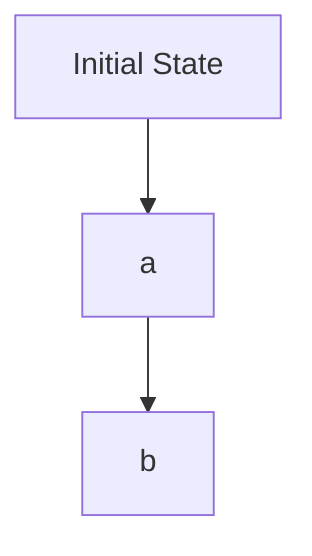
</details>

<small><span class="docvortex-page-footnote" data-block-type="page_footnote" style="color:#6b7280">① 为了方便起见，我们将让图中的栈从左到右增长。</span></small>

---

第4章 树

107

接着，+被读入，因此指向两棵树的指针被弹出，一棵新的树形成，指向新树的指针被压入栈中。


<details>
<summary>flowchart</summary>

```mermaid
graph TD
  A[""] --> B{"+"}
  B --> C["a"]
  B --> D["b"]
```
</details>

然后，c、d 和 e 被读入，在每个单节点树创建后，对应的指向树的指针被压入栈中。


<details>
<summary>flowchart</summary>

```mermaid
graph TD
  A[""] --> B["+"]
  B --> C["c"]
  B --> D["d"]
  B --> E["e"]
  B --> F["a"]
  B --> G["b"]
```
</details>

接下来读入+号，因此右边的两棵树合并。


<details>
<summary>flowchart</summary>

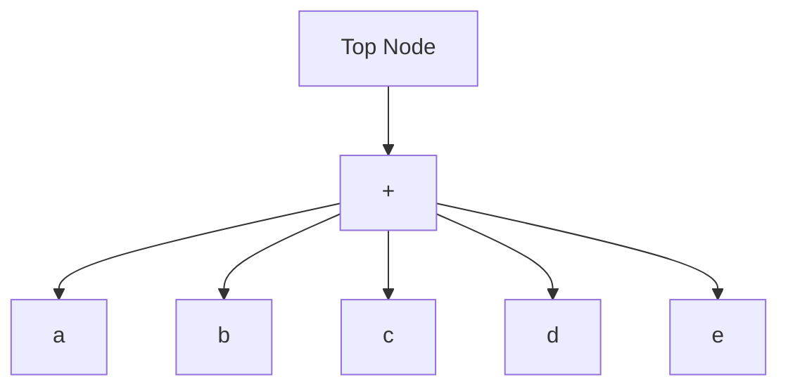
</details>

继续进行，读入\*号，因此，我们弹出两棵树的两个指针并形成一棵新的树，\*号是它的根。


<details>
<summary>flowchart</summary>

```mermaid
graph TD
  A[""] --> B{"+"}
  B -->|a| C["a"]
  B --> D["b"]
  B --> E["*"]
  D --> F["b"]
  E --> G["c"]
  E --> H["d"]
  E --> I["e"]
  G --> J{"+"}
  H --> J
  I --> J
```
</details>

最后，读入最后一个符号，两棵树合并，而指向最后的树的指针被留在栈中。

---

108

数据结构与算法分析——C++语言描述(第四版)


<details>
<summary>flowchart</summary>

```mermaid
graph TD
  A[""] --> B["*"]
  B --> C["+"]
  B --> D["*"]
  C --> E["a"]
  C --> F["b"]
  D --> G["c"]
  D --> H["d"]
  D --> I["e"]
```
</details>

## 4.3 查找树 ADT——二叉查找树

二叉树的一个重要的应用是它们在搜索中的使用。假设树中的每个节点存储一项数据。在我们的例子中，虽然任意复杂的项在 $\mathrm{C}++$ 中都容易处理，但为简单起见还是假设它们都是整数。我们还将假设，所有的项彼此互异，以后再处理有重复项的情况。

使二叉树成为二叉查找树的性质是，对于树中的每个节点 $X$ ，它的左子树中所有项的值均小于 $X$ 中的项，而它的右子树中所有项的值均大于 $X$ 中的项。注意，这意味着，该树所有的元素可以用某种一致的方式排序。在图4.15中，左边的树是二叉查找树，但右边的树不是。右边的树在其项是6的节点(该节点正好是根节点)的左子树中，有一个节点的项是7。


图 4.15 两棵二叉树(只有左边的树是查找树)

现在给出通常对二叉查找树进行的操作的简要描述。注意，由于树的递归定义，通常是递归地编写这些操作的例程。因为二叉查找树的平均深度是 $O(\log N)$，所以一般不必担心栈空间被用尽。

图 4.16 显示的是 BinarySearchTree 类模板的接口。这里有几项要注意的事情。查找是基于操作符<的，它必须被定义成特定的 Comparable 类型。特别地，如果 x<y 和 y<x 均为 false，那么项 x 匹配项 y。这使得 Comparable 可以是一个复杂的类型（比如雇员的记录），不过，比较功能只在类型的一部分上定义（如社会保险号数据成员或工资）。1.6.3 节阐释设计能够用作 Comparable 的类的一般方法。在 4.3.1 节描述的另一种方法适用于函数对象。

数据成员是一个指向根结点的指针。对于空树，这个指针为 nullptr。public 成员函数使用一般的技巧调用 private 的递归函数。图 4.17 中显示了一个例子，说明对于 contains、insert 和 remove，这种技巧是如何实施的。

---

第4章 树

109

```cpp
template <typename Comparable>
class BinarySearchTree
{
    public:
        BinarySearchTree( );
        BinarySearchTree( const BinarySearchTree & rhs );
        BinarySearchTree( BinarySearchTree && rhs );
        ~BinarySearchTree( );

        const Comparable & findMin( ) const;
        const Comparable & findMax( ) const;
        bool contains( const Comparable & x ) const;
        bool isEmpty( ) const;
        void printTree( ostream & out = cout ) const;

        void makeEmpty( );
        void insert( const Comparable & x );
        void insert( Comparable && x );
        void remove( const Comparable & x );

        BinarySearchTree & operator=( const BinarySearchTree & rhs );
        BinarySearchTree & operator=( BinarySearchTree && rhs );

private:
    struct BinaryNode
    {
        Comparable element;
        BinaryNode *left;
        BinaryNode *right;

        BinaryNode( const Comparable & theElement, BinaryNode *lt, BinaryNode *rt )
            : element{ theElement }, left{ lt }, right{ rt } { }

        BinaryNode( Comparable && theElement, BinaryNode *lt, BinaryNode *rt )
            : element{ std::move( theElement ) }, left{ lt }, right{ rt } { }
    };

    BinaryNode *root;

    void insert( const Comparable & x, BinaryNode * & t );
    void insert( Comparable && x, BinaryNode * & t );
    void remove( const Comparable & x, BinaryNode * & t );
    BinaryNode * findMin( BinaryNode *t ) const;
    BinaryNode * findMax( BinaryNode *t ) const;
    bool contains( const Comparable & x, BinaryNode *t ) const;
    void makeEmpty( BinaryNode * & t );
    void printTree( BinaryNode *t, ostream & out ) const;
    BinaryNode * clone( BinaryNode *t ) const;
};
```

图 4.16 二叉查找树类架构

几个 private 型成员函数通过传引用调用(call-by-reference)使用传递指针变量的技巧。这使得 public 型成员函数能够把指向根结点的指针传递给 private 型的递归成员函数。这些递归函数此时可以改变根的值，使得 root 指向另外的节点。当考查 insert 的代码时，我们将详细描述这种技巧。

---

110

数据结构与算法分析——C++语言描述(第四版)

现在，我们可以描述一些 private 型的方法了。

```c
/**
 * 如果在树中找到 x，则返回true.
 */
bool contains( const Comparable & x ) const
{
    return contains( x, root );
}

/**
 * 将x插入到树中;忽略重复元.
 */
void insert( const Comparable & x )
{
    insert( x, root );
}

/**
 * 将x从树中删除。如果没找到x，则什么也不做。
*/
void remove( const Comparable & x )
{
    remove( x, root );
}
```

图 4.17 公有成员函数调用私有递归函数的图示

## 4.3.1 contains

如果在树 $T$ 中存在含有项 $X$ 的节点，那么这个操作需要返回 true，如果这样的节点不存在则返回 false。树的结构使得这种操作很简单。如果 $T$ 是空集，那么可以直接返回 false。否则，如果存储在 $T$ 处的项是 $X$，那么可以返回 true。否则，我们对树 $T$ 的左子树或右子树进行一次递归调用，这依赖于 $X$ 与存储在 $T$ 中的项的关系。图4.18中的代码就是对这种策略的一种实现。

```c
/**
 * 测试一项是否在子树上的内部方法.
 * x 是要查找的项.
 * t 是作为该子树的根的节点.
 */
bool contains( const Comparable & x, BinaryNode *t ) const
{
    if( t == nullptr )
        return false;
    else if( x < t->element )
        return contains( x, t->left );
    else if( t->element < x )
        return contains( x, t->right );
    else
        return true;   // 匹配
}
```

图 4.18 二叉查找树的 contains 操作

---

第 4 章 树

111

注意测试的顺序。关键的问题是首先要对是否空树进行测试，因为否则就会产生一个企图通过 nullptr 指针访问数据成员的运行时错误。剩下的测试使得最不可能的情况安排在最后进行。还要注意，这里的两个递归调用事实上都是尾递归并且可以用一个 while 循环很容易地将它们替换掉。尾递归的使用在这里是合理的，因为算法表达式的简明性是以速度的降低为代价的，而这里所使用的栈空间的量也只不过是 $O(\log N)$ 而已。

图 4.19 显示了一些简单的变化，它们需要使用一个函数对象而不是要求这些项是 Comparable 的。程序模仿了 1.6.4 节的风格。

```cpp
template <typename Object, typename Comparator=less<Object>>
class BinarySearchTree
{
    public:
        // 方法相同，但用 Object 代替Comparable

    private:
        BinaryNode *root;
        Comparator isLessThan;

        // 方法相同，但用 Object 代替Comparable

        /**
         * 检测一项是否在子树上的内部方法.
         * x 是要查找的项.
         * t 是作为子树的根的节点.
         */
        bool contains( const Object & x, BinaryNode *t ) const
        {
            if( t == nullptr )
                return false;
            else if( isLessThan( x, t->element ) )
                return contains( x, t->left );
            else if( isLessThan( t->element, x ) )
                return contains( x, t->right );
            else
                return true;   // 匹配
        }
};
```

图4.19 对使用函数对象实现二叉查找树的图示

## 4.3.2 findMin 和 findMax

这两个 private 例程分别返回指向树中包含最小元素和包含最大元素的节点的指针。为执行 findMin，从根开始并且只要有左儿子就向左查找。终止点就是最小的元素。findMax 例程除分支朝向右儿子外其余过程相同。

许多程序设计员不厌其烦地使用递归。我们用递归的方法将 finMin 写成例程(见图 4.20)，并用非递归的方法将 findMax 写成例程(见图 4.21)。

---

112

数据结构与算法分析——C++语言描述(第四版)

```c
/**
 * 找出子树 t 中最小项的内部方法.
 * 返回包含最小项的节点.
 */
BinaryNode * findMin( BinaryNode *t ) const
{
    if( t == nullptr )
        return nullptr;
    if( t->left == nullptr )
        return t;
    return findMin( t->left );
}
```

图 4.20 对二叉查找树 findMin 的递归实现

```c
/**
 * 找出子树 t 上最大项的内部方法.
 * 返回包含最大项的节点.
 */
BinaryNode * findMax( BinaryNode *t ) const
{
    if( t != nullptr )
        while( t->right != nullptr )
            t = t->right;
    return t;
}
```

图 4.21 对二叉查找树 findMax 的非递归实现

注意，我们是如何小心地处理空树的退化情况的。虽然这么做总是重要的，但是特别在递归程序中它尤其重要。此外，还要注意，在 findMax 中对 t 的改变是安全的，因为我们只用到指针的拷贝来进行工作。不管怎么说，还是应该随时特别小心，因为像 t->right=t->right->right 这样的语句将会产生一些变化。

## 4.3.3 insert

实现插入的例程在概念上是简单的。为了将 $X$ 插入到树 $T$ 中，可以像 contains 那样沿着树查找。如果找到 $X$，则什么也不用做。否则，将 $X$ 插入到所遍历的路径的最后一点上。图 4.22 显示了实际的插入情况。为了插入 5，我们就好像在运行 contains 一样遍历该树。在带有项 4 的节点处，我们需要向右行进，但右边不存在子树，因此 5 不在这棵树上，从而这个位置就是插入 5 的正确位置。


图 4.22 插入 5 以前和以后的二叉查找树

---

第4章 树

113

重复元的插入可以通过在节点记录中保留一个附加域以指示发生的频率来处理。这对整个的树增加了某些附加空间，但是，却比将重复元放到树中要好(它将使树的深度变得很大)。当然，如果操作符<用到的关键字只是一个更大结构的一部分，那么这种方法行不通。此时可以把具有相同关键字的所有结构保留在一个辅助数据结构中，譬如表或另一棵查找树。

图 4.23 显示了插入例程的程序。第 12 行和第 14 行递归地将 x 插入到相应的子树中。注意，在递归例程中，唯一一次 t 变化的时刻是在一片新树叶创建的时候。此时意味着，递归例程已经从某个其他的节点 p 处被调用，而这个节点将是新建树叶的父亲。该调用将是 insert(x, p->left) 或 insert(x, p->right)。不管哪种方法，t 现在都是对 p->left 或 p->right 的引用，这就意味着，p->left 或 p->right 将改变以指向新的节点。总的来说，方法简明巧妙。

```cpp
/**
 * 向子树插入元素的内部方法.
 * x 是要插入的项.
 * t 为该子树的根节点.
 * 置子树的新根.
 */
void insert( const Comparable & x, BinaryNode * & t )
{
    if( t == nullptr )
        t = new BinaryNode{ x, nullptr, nullptr };
    else if( x < t->element )
        insert( x, t->left );
    else if( t->element < x )
        insert( x, t->right );
    else
        ; // 重复元; 什么也不做
}

/**
 * 向子树插入元素的内部方法.
 * x 是通过移动实现要插入的项.
 * t 为该子树的根.
 * 置子树的新根.
 */
void insert( Comparable && x, BinaryNode * & t )
{
    if( t == nullptr )
        t = new BinaryNode{ std::move( x ), nullptr, nullptr };
    else if( x < t->element )
        insert( std::move( x ), t->left );
    else if( t->element < x )
        insert( std::move( x ), t->right );
    else
        ; // 重复元; 什么也不做
}
```

图 4.23 向二叉查找树进行插入的例程

## 4.3.4 remove

正如许多数据结构一样，最困难的操作是删除。一旦发现要被删除的节点，我们就需要考虑几种可能的情况。

---

114

数据结构与算法分析——C++语言描述(第四版)

如果节点是一片树叶，那么它可以被立即删除。如果节点有一个儿子，则该节点可以在其父节点调整它的链以绕过该节点后被删除(为了清楚起见，我们将明确地画出链的指向)，见图4.24。


<details>
<summary>flowchart</summary>

```mermaid
graph LR
  A["1"] --> B["2"]
  C["3"] --> D["4"]
  E["6"] --> F["8"]
  B --> G["1"]
  B --> H["2"]
  D --> I["3"]
  F --> J["6"]
  G --> K["1"]
  H --> L["2"]
  I --> M["4"]
  J --> N["6"]
  K --> O["1"]
  L --> P["2"]
  M --> Q["3"]
  N --> R["8"]
```
</details>

图4.24 具有一个儿子的节点(4)删除前后的情况

复杂的是处理具有两个儿子的节点的情况。一般的删除策略是用其右子树的最小的数据(很容易找到)代替该节点的数据并递归地删除那个节点(现在它是空的)。因为右子树中的最小的节点不可能有左儿子，所以第二次 remove 要容易。图 4.25 显示一棵初始的树及其中一个节点被删除后的结果。要被删除的节点是根的左儿子，其关键字的值为 2。它被右子树中的最小数据 (3) 所代替，然后关键字是 3 的原节点如前例那样被删除。


<details>
<summary>flowchart</summary>

```mermaid
graph TD
  A["6"] --> B["2"]
  A --> C["8"]
  B --> D["1"]
  B --> E["5"]
  E --> F["3"]
  F --> G["4"]
  C --> H["6"]
  H --> I["8"]
  J["3"] --> K["1"]
  J --> L["5"]
  L -.-> M["3"]
  M --> N["4"]
  I --> O["6"]
  O --> P["8"]
```
</details>

图 4.25 删除具有两个儿子的节点(2)前后的情况

图 4.26 中的程序实施删除的工作，但它的效率并不高，因为它沿该树进行两趟搜索以查找和删除右子树中最小的节点。通过写一个特殊的 removeMin 方法可以容易地克服这种效率不高的缺点，我们这里将它略去只是为了简明。

如果预计删除的次数不多，则通常使用的策略是懒惰删除(lazy deletion):当一个元素要被删除时，它仍然留在树中，而是只作了个被删除的标记。这特别是在有重复项时很流行，因为此时记录出现频率数的域可以减1。如果树中的实际节点数和“被删除”的节点数相同，那么树的深度预计只上升一个小的常数(为什么？)，因此，存在一个与懒惰删除相关的非常小的时间损耗。再有，如果被删除的项被重新插入，那么分配一个新单元的开销也就避免了。

---

第4章 树

115

```c
/**
 * 从一棵子树删除一项的内部方法.
 * 参数 x 是要被删除的项.
 * 参数 t 为该子树的根节点.
 * 置该子树的新的根.
 */
void remove( const Comparable & x, BinaryNode * & t )
{
    if( t == nullptr )
        return;   // 项没找到; 什么也不做
    if( x < t->element )
        remove( x, t->left );
    else if( t->element < x )
        remove( x, t->right );
    else if( t->left != nullptr && t->right != nullptr ) // 有两个儿子
    {
        t->element = findMin( t->right )->element;
        remove( t->element, t->right );
    }
    else
    {
        BinaryNode *oldNode = t;
        t = ( t->left != nullptr ) ? t->left : t->right;
        delete oldNode;
    }
}
```

图4.26 二叉查找树的删除例程

## 4.3.5 析构函数和拷贝构造函数

通常，析构函数调用 makeEmpty。这个公有的 makeEmpty 函数(未显示)直接调用私有递归版本的 makeEmpty 函数。如图 4.27 所示，在递归地处理 t 的子节点之后，则对 t 调用 delete 函数。因此，所有的节点都将被递归地回收。注意，最后，t 从而 root 改为指向 nullptr。拷贝构造函数如图 4.28 所示，遵循通常的过程，首先初始化 root 为 nullptr，然后复制 rhs 的拷贝。我们使用一个非常成熟的递归函数来处理所有这些苦活，这个递归函数名为 clone。

## 4.3.6 平均情况分析

直观上, 我们期望这一节描述的所有操作(除makeEmpty和复制外)都应该花费 $O(\log N)$ 时间, 因为我们以常数时间在树中降低了一层, 这样一来, 现在对树进行的操作大致减小一半左右。实际上, 所有操作的运行时间(除makeEmpty和复制外)都是 $O(d)$, 其中 $d$ 是包含所访问项的节点的深度(在remove的情形, 它可能是两个儿子情形的替代节点)。

我们在本节要证明，在所有的插入序列都是等可能的假设下，则树的所有节点的平均深度为 $O(\log N)$。

一棵树的所有节点的深度之和称为内部路径长 (internal path length)。我们现在将要计算二叉查找树的平均内部路径长，其中的平均是对向二叉查找树中所有可能的插入序列进行的。

---

116

数据结构与算法分析——C++语言描述(第四版)

```c
/**
 * 二叉查找树的析构函数
 */
~BinarySearchTree( )
{
    makeEmpty( );
}
/**
 * 使子树为空的内部方法.
 */
void makeEmpty( BinaryNode * & t )
{
    if( t != nullptr )
    {
        makeEmpty( t->left );
        makeEmpty( t->right );
        delete t;
    }
    t = nullptr;
}
```

图 4.27 析构函数与递归成员函数 makeEmpty

```txt
/**
 * 拷贝构造函数
 */
BinarySearchTree( const BinarySearchTree & rhs ) : root{ nullptr }
{
    root = clone( rhs.root );
}

/**
 * 克隆子树的内部方法.
 */
BinaryNode * clone( BinaryNode *t ) const
{
    if( t == nullptr )
        return nullptr;
    else
        return new BinaryNode{ t->element, clone( t->left ), clone( t->right ) };
}
```

图 4.28 拷贝构造函数与递归成员函数 clone

令 $D(N)$ 是具有 $N$ 个节点的某棵树 $T$ 的内部路径长，$D(1) = 0$。一棵 $N$ 节点树是由一棵 $i$ 节点左子树和一棵 $(N - i - 1)$ 节点右子树以及深度 0 处的一个根节点组成的，其中 $0 \leqslant i < N, D(i)$ 为根的左子树的内部路径长。但是在原树中，所有这些节点都要加深一层。同样的结论对于右子树也是成立的。由此，我们得到递推关系:

$$
D (N) = D (i) + D (N - i - 1) + N - 1
$$

如果所有子树的大小都是等可能地出现，这对于二叉查找树(但对于二叉树不)是成立的(因为子树的大小只依赖于第一个插入到树中的元素相对的秩(rank))，那么 $D(i)$ 和 $D(N - i - 1)$ 的

---

第4章 树

117

平均值都是 $(1 / N)\sum_{j = 0}^{N - 1}D(j)$ 。于是得到

$$
D (N) = \frac {2}{N} \left[ \sum_ {j = 0} ^ {N - 1} D (j) \right] + N - 1
$$

在第7章将遇到并求解这个递推式，得到的平均值为 $D(N) = O(N \log N)$ 。因此，任意节点的期望深度为 $O(\log N)$ 。作为一个例子，图4.29所示随机生成的500个节点的树的节点期望深度为9.98。

但是，上来就断言这个结果意味着上一节讨论的所有操作的平均运行时间是 $O(\log N)$ 颇有诱惑力，但这并不完全正确。原因在于删除操作，我们并不清楚是否所有的二叉查找树都是等可能出现的。特别是，上面描述的删除算法有助于使得左子树比右子树深度深，因为我们总是用右子树的一个节点来代替删除的节点。这种方法的准确的效果仍然是未知的，但它似乎只是理论上的悬念。业已证明，如果交替插入和删除 $\Theta (N^2)$ 次，那么树的期望深度将是 $\Theta (\sqrt{N})$ 。在进行25万次随机insert/remove对操作后，图4.29中有些右沉的树在图4.30中看起来就变得太不平衡了(平均深度 $= 12.51$ )。


<details>
<summary>natural_image</summary>

Abstract line drawing of branching, tree-like structures with no text or symbols
</details>

图 4.29 一棵随机生成的二叉查找树


<details>
<summary>natural_image</summary>

Line drawing of a long, curved, leaf-like structure with no text or symbols
</details>

图4.30 在 $\Theta(N^2)$ 次 insert/remove 对操作后的二叉查找树

在删除操作中, 可以通过随机选取右子树的最小元素或左子树的最大元素来代替被删除的元素以消除这种不平衡问题。这种做法明显地消除了上述偏向并使树保持平衡, 但是, 没有人实际上证明过这一点。无论如何, 这种现象似乎主要是理论上的问题, 因为对于小的树上述效果根本显示不出来, 甚至更奇怪, 如果使用 $o(N^{2})$ insert/remove 对操作, 那么树似乎可以得到平衡。

上面的讨论主要是说明，决定“平均”意味着什么一般是极其困难的，可能需要一些假设，而这些假设可能合理，也可能不合理。不过，在没有删除或是使用懒惰删除的情况下，我们可以断言:上述那些操作的平均运行时间都是 $O(\log N)$ 。除像上面讨论的一些个别情形外，这个结果与实际观察到的情形是非常一致的。

如果向一棵树输入预先排序的数据，那么一连串 insert 操作将花费二次的(quadratic)时间，而链表实现的代价会非常巨大，因为此时的树将只由那些没有左儿子的节点组成。一种解决办法就是要有一个称为平衡(balance)的附加结构条件:任何节点的深度均不得过深。

有许多一般的算法实现平衡树。但是，大部分算法都要比标准的二叉查找树复杂得多，而且更新要平均花费更长的时间。不过，它们确实防止了处理起来非常麻烦的一些简单情形。下面将介绍最老的一种平衡查找树，即 AVL 树 (AVL tree)。

第二种方法是放弃平衡条件，允许树有任意的深度，但是在每次操作之后要使用一个调

---

118

数据结构与算法分析——C++语言描述(第四版)

整规则进行调整，使得后面的操作效率要高。这种类型的数据结构一般属于自调整(self-adjusting)类结构。在二叉查找树的情况下，对于任意单次操作我们不再保证 $O(\log N)$ 的时间界，但是可以证明任意连续 $M$ 次操作在最坏的情形下花费时间 $O(M\log N)$ 。一般这足以防止令人棘手的最坏情形。我们将要讨论的这种数据结构叫作伸展树(splay tree)，它的分析相当复杂，我们将在第11章讨论。

## 4.4 AVL 树

AVL (Adelson-Velskii 和 Landis) 树是带有平衡条件 (balance condition) 的二叉查找树。这

个平衡条件必须要容易保持，而且它保证树的深度是 $O(\log N)$ 。最简单的想法是要求左右子树具有相同的高度。如图4.31所示，这种想法并不强求树的深度要浅。

另一种平衡条件是要求每个节点都必须要有相同高度的左子树和右子树。如果空子树的高度定义为-1（通常就是这么定义），那么只有具有 $2^{k} - 1$ 个节点的理想平衡树(perfectly balanced tree)满足这个标准。因此，虽然这种平衡条件保证了树的深度小，但是它太严格了以至难以使用，需要把它放宽。


<details>
<summary>flowchart</summary>

```mermaid
graph TD
  A["Start Node"] --> B["Intermediate Node 1"]
  B --> C["Intermediate Node 2"]
  C --> D["Intermediate Node 3"]
  D --> E["Intermediate Node 4"]
  E --> F["Intermediate Node 5"]
  F --> G["End Node"]
```
</details>

图 4.31 一棵坏的二叉树。只要求在根节点平衡是不够的

一棵 AVL 树 (AVL tree) 是其每个节点的左子树和右子树的高度最多差 1 的二叉查找树。(空树的高度定义为 -1。) 在图 4.32 中, 左边的树是 AVL 树, 但右边的树不是。每一个节点 (在其节点结构中) 保留高度信息。可以证明, 粗略地说, 一棵 AVL 树的高度最多为 $1.44 \log (N + 2) - 1.328$, 而实际上的高度只比 $\log N$ 稍微多一些。作为例子, 图 4.33 显示一棵具有最少节点 (143) 高度为 9 的 AVL 树。这棵树的左子树是高度为 7 且大小最小的 AVL 树, 右子树是高度为 8 且大小最小的 AVL 树。它告诉我们, 在高度为 $h$ 的 AVL 树中, 最少节点数 $S(h)$ 由 $S(h) = S(h - 1) + S(h - 2) + 1$ 给出。对于 $h = 0, S(h) = 1$; 而当 $h = 1$ 时, $S(h) = 2$ 。函数 $S(h)$ 与斐波那契数 (Fibonacci number) 密切相关, 由此推出上面提到的关于 AVL 树的高度的界。


图 4.32 两棵二叉查找树，只有左边的树是 AVL 树

因此，除去可能的插入和删除外，所有的树操作都可以以时间 $O(\log N)$ 执行。当进行插入操作时，我们需要更新通向根节点路径上那些节点的所有平衡信息，而插入操作隐含着困难的原因在于，插入一个节点可能破坏AVL树的特性。（例如，将6插入到图4.32的AVL树中将会破坏关键字为8的节点处的平衡条件。）如果发生这种情况，那么就要在考虑这一步插入完成之前恢复平衡的性质。事实上，这总可以通过对树进行简单的修正来做到，我们称其为旋转(rotation)。

---

第4章 树

119


<details>
<summary>natural_image</summary>

Abstract geometric tree-like structure composed of interconnected nodes and lines, no text or symbols present
</details>

图4.33 高度为9的最小的AVL树

在一次插入之后，只有那些从插入点到根节点的路径上的节点的平衡可能被改变，因为只有这些节点的子树可能发生变化。当沿着这条路径上行到根并更新平衡信息时，我们可以发现一个节点，它的新平衡破坏了 AVL 条件。我们将指出如何在第一个这样的节点(即最深的节点)重新平衡这棵树，并证明，这一重新平衡保证整个树满足 AVL 性质。

我们把必须重新平衡的节点叫作 $\alpha$ 。由于任意节点最多有两个儿子，因此出现高度不平衡就需要 $\alpha$ 点的两棵子树的高度差2。容易看出，这种不平衡可能出现在下面4种情况中:

1. 对 $\alpha$ 的左儿子的左子树进行一次插入。
2. 对 $\alpha$ 的左儿子的右子树进行一次插入。
3. 对 $\alpha$ 的右儿子的左子树进行一次插入。
4. 对 $\alpha$ 的右儿子的右子树进行一次插入。

情形 1 和 4 是关于  $\alpha$  点的镜像对称 (mirror image symmetry)，而情形 2 和 3 也是关于  $\alpha$  点的镜像对称。因此，理论上只有两种基本情况，当然从编程的角度来看还是 4 种情形。

第一种情况是插入发生在“外边”的情况(即左-左的情况或右-右的情况)，该情况通过对树的一次单旋转(single rotation)而完成调整。第二种情况是插入发生在“内部”的情形(即左右的情况或右-左的情况)，该情况通过稍微复杂些的双旋转(double rotation)来处理。我们将会看到，这些都是对树的基本操作，它们多次用在一些平衡树算法中。本节其余部分将描述这些旋转，证明它们足以保持树的平衡，并顺便给出 AVL 树的一种非正式的实现。第 12 章描述其他的平衡树方法，这些方法着眼于 AVL 树的更仔细的实现。

## 4.4.1 单旋转

图 4.34 显示单旋转如何调整情形 1。旋转前的图在左边，而旋转后的图在右边。让我们来仔细分析具体的做法。节点 $k_{2}$ 不满足 AVL 平衡性质，因为它的左子树比右子树深 2 层（图中间的几条虚线标示树的各层）。该图所描述的情况只是情形 1 的一种可能的情况，在插入之前 $k_{2}$ 满足 AVL 性质，但在插入之后这种性质被破坏了。子树 $X$ 已经长出一层，这使得它比子树 $Z$ 深出 2 层。$Y$ 不可能与新 $X$ 在同一水平上，因为那样 $k_{2}$ 在插入以前就已经失去平衡了；$Y$ 也不可能与 $Z$ 在同一层上，因为那样 $k_{1}$ 就会是在通向根的路径上破坏 AVL 平衡条件的第一个节点。

---

120

数据结构与算法分析——C++语言描述(第四版)


<details>
<summary>flowchart</summary>

```mermaid
graph LR
  A["k1"] --> B["k2"]
  A --> C["X"]
  A --> D["Y"]
  A --> E["Z"]
  B --> F["k1"]
  B --> G["k2"]
  C --> F
  C --> G
  D --> F
  D --> G
  E --> F
  E --> G
```
</details>

图4.34 调整情形1的单旋转

为使树恢复平衡，我们把 $X$ 上移一层，并把 $Z$ 下移一层。注意，此时实际上超出了 AVL 性质的要求。为此，我们重新安排节点以形成一棵等价的树，如图 4.34 的第二部分所示。抽象地形容就是:把树形象地看成是柔软灵活的，抓住子节点 $k_{1}$，闭上你的双眼，使劲摇动它，在重力作用下，$k_{1}$ 就变成了新的根。二叉查找树的性质告诉我们，在原树中 $k_{2} > k_{1}$，于是在新树中 $k_{2}$ 变成了 $k_{1}$ 的右儿子，$X$ 和 $Z$ 仍然分别是 $k_{1}$ 的左儿子和 $k_{2}$ 的右儿子。子树 $Y$ 包含原树中介于 $k_{1}$ 和 $k_{2}$ 之间的那些项的节点，可以将它放在新树中 $k_{2}$ 的左儿子的位置上，这样，所有对顺序的要求都得到满足。

这样的操作只需要一部分指针改变，结果我们得到另外一棵二叉查找树，它是一棵 AVL 树，因为 X 向上移动了一层，Y 停在原来的水平上，而 Z 下移一层。 $k_{2}$  和  $k_{1}$  不仅满足 AVL 要求，而且它们的子树都恰好处在同一高度上。不仅如此，整个树的新高度恰恰与插入前原树的高度相同，而插入操作却使得子树 X 升高了。因此，通向根节点的路径的高度不需要进一步的修正，因而也不需要进一步的旋转。图 4.35 显示在将 6 插入左边原始的 AVL 树后节点 8 便不再平衡。于是，我们在节点 7 和 8 之间做一次单旋转，结果得到右边的树。


图 4.35 插入 6 破坏了 AVL 性质，而后经过单旋转又将性质恢复

正如我们较早提到的，情形4代表一种对称的情形。图4.36指出单旋转是如何使用的。让我们演示一个更长一些的例子。假设从初始的空AVL树开始插入关键字3、2和1，然后依序插入 $4\sim 7$ 。在插入关键字1时第一个问题出现了，AVL性质在根处被破坏。我们在根与其左儿子之间施行单旋转修正这个问题。下面是旋转之前和之后的两棵树:


<details>
<summary>flowchart</summary>

```mermaid
graph LR
  A["k1"] --> B["k2"]
  C["X"] --> A
  D["Y"] --> A
  E["Z"] --> A
  B --> F["k1"]
  G["X"] --> F
  H["Y"] --> F
  I["Z"] --> F
  F --> J["k2"]
```
</details>

图 4.36 单旋转修复情形 4

---

第4章 树

121


<details>
<summary>flowchart</summary>

```mermaid
graph LR
  A["1"] --> B["2"]
  B -.-> C["3"]
  D["2"] --> E["2"]
  E --> F["1"]
  E --> G["3"]
  C --> H["→"]
  F --> H
  G --> H
```
</details>

图中虚线连接两个节点，它们是旋转的主体。下面插入关键字为 4 的节点，这没有问题，但插入 5 破坏了在节点 3 处的 AVL 性质，而通过单旋转又将其修正。除旋转引起的局部变化外，编程人员必须记住:树的其余部分必须被告知该变化。如本例中节点 2 的右儿子必须重新设置以链接到 4 来代替 3。这一点很容易忘记，从而导致树被破坏(4 就会是不可访问的)。


<details>
<summary>flowchart</summary>

```mermaid
graph LR
  A["1"] --> B["2"]
  B --> C["3"]
  C -.-> D["4"]
  D --> E["5"]
  F["1"] --> G["2"]
  G --> H["4"]
  H --> I["3"]
  H --> J["5"]
```
</details>

下面插入 6。这在根节点产生一个平衡问题，因为它的左子树高度是 0 而右子树高度为 2。因此我们在根处于 2 和 4 之间实施一次单旋转。


<details>
<summary>flowchart</summary>

```mermaid
graph LR
  A["1"] --> B["2"]
  B -.-> C["4"]
  C --> D["3"]
  C --> E["5"]
  C --> F["6"]
  D --> G["2"]
  E --> G
  F --> G
  G --> H["4"]
  G --> I["5"]
  G --> J["6"]
```
</details>

旋转是通过使节点 2 是 4 的一个儿子而 4 原来的左子树变成节点 2 的新的右子树来完成的。在该子树上的每一个关键字均在 2 和 4 之间，因此这个变换是成立的。我们插入的下一个关键字是 7，它导致了另外的旋转:


<details>
<summary>flowchart</summary>

```mermaid
graph LR
  subgraph sg["\"之前\""]
  A["1"] --> B["2"]
  B --> C["3"]
  C --> D["4"]
  D --> E["5"]
    E -.-> F["6"]
  F --> G["7"]
  end
  subgraph sg_2["\"之后\""]
  H["1"] --> I["2"]
  I --> J["3"]
  J --> K["4"]
  K --> L["5"]
  L --> M["6"]
  M --> N["7"]
  end
```
</details>

## 4.4.2 双旋转

上面描述的算法有一个问题:如图 4.37 所示，对于情形 2 和情形 3 上面的做法无效。问题在于子树 Y 太深，单旋转没有减低它的深度。解决这个问题的双旋转 (double rotation) 如图 4.38 所示。

在图 4.37 中的子树 Y 已经有一项插入其中，这个事实保证它是非空的。因此，可以假设它有一个根和两棵子树。于是，可以把整棵树看成是 4 棵子树由 3 个节点连接。如图所示，

---

122

数据结构与算法分析——C++语言描述(第四版)

恰好树 B 或树 C 中有一棵比 D 深两层(除非它们都是空的)，但是我们不能肯定是哪一棵。事实上这并不要紧，在图 4.38 中 B 和 C 都被画成比 D 低  $1\frac{1}{2}$  层。


<details>
<summary>flowchart</summary>

This diagram illustrates a hierarchical decomposition or transformation process where two nodes (k1 and k2) are split into two sub-nodes (X, Y, Z), with arrows indicating the direction of transformation.
</details>

图 4.37 单旋转不能修复情形 2


<details>
<summary>flowchart</summary>

```mermaid
graph LR
  A["A"] --> K1["k1"]
  B["B"] --> K2["k2"]
  C["C"] --> K2
  D["D"] --> K3["k3"]
  K1 --> K1
  K1 --> K2
  K2 --> K3
  K3 --> K1
```
</details>

图 4.38 左-右双旋转变修复情形 2

为了重新平衡，我们看到，不能再让 $k_{3}$ 作根了，而图4.34所示的在 $k_{3}$ 和 $k_{1}$ 之间的旋转又解决不了问题，唯一的选择就是把 $k_{2}$ 用作新的根。这迫使 $k_{1}$ 成为 $k_{2}$ 的左儿子，$k_{3}$ 成为它的右儿子，从而完全确定了这4棵树的最终位置。容易看出，最后得到的树满足AVL树的性质，与单旋转的情形一样，我们也把树的高度恢复到插入以前的水平，这就保证所有的重新平衡和高度更新是完善的。图4.39指出，对称情形3也可以通过双旋转得以修正。在这两种情形下，其效果与先在 $\alpha$ 的儿子和孙子之间旋转而后再在 $\alpha$ 和它的新儿子之间旋转的效果是相同的。


<details>
<summary>flowchart</summary>

```mermaid
graph LR
  A["A"] --> K1["k1"]
  B["B"] --> K2["k2"]
  C["C"] --> K3["k3"]
  D["D"] --> K1
  K1 --> K2
  K2 --> K3
  K3 --> L["k1"]
  L --> M["k2"]
  M --> N["k3"]
  N --> O["k3"]
  O --> P["A"]
  O --> Q["B"]
  O --> R["C"]
  O --> S["D"]
```
</details>

图 4.39 右-左双旋转变修复情形 3

我们继续在前面例子的基础上以倒序插入关键字 $10\sim 16$ ，接着插入8，然后再插入9。插入16容易，因为它并不破坏平衡性质，但是插入15就会引起在节点7处的高度不平衡。这属于情形3，需要通过一次右-左双旋转来解决。在我们的例子中，这个右-左双旋转将涉及7、16和15。此时， $k_{1}$ 是具有项7的节点， $k_{3}$ 是具有项16的节点，而 $k_{2}$ 是具有项15的节点。子树 $A$ 、 $B$ 、 $C$ 和 $D$ 都是空树。


<details>
<summary>flowchart</summary>

```mermaid
graph LR
  A["1"] --> B["2"]
  B --> C["4"]
  D["3"] --> E["6"]
  F["5"] --> G["7"]
  H["k1"] -.-> I["k3"]
  J["16"] -.-> K["k2"]
  L["15"] -.-> M["k3"]
  N["2"] --> O["4"]
  P["3"] --> Q["6"]
  R["5"] --> S["15"]
  T["k1"] --> U["7"]
  V["16"] --> W["k3"]
```
</details>

---

第4章 树

123

下面插入 14，它也需要一个双旋转。此时修复该树的双旋转还是右-左双旋转，它将涉及 6、15 和 7。在这种情况下， $k_{1}$ 是具有项 6 的节点， $k_{2}$ 是具有项 7 的节点，而 $k_{3}$ 是具有项 15 的节点。子树 A 的根在项为 5 的节点上，子树 B 是空子树，它是项 7 的节点原先的左儿子，子树 C 置根于项 14 的节点上，最后，子树 D 的根在项为 16 的节点上。


<details>
<summary>flowchart</summary>

```mermaid
graph LR
  subgraph sg["\"之前\""]
  A["1"] --> B["2"]
  B --> C["4"]
  C --> D["6"]
    D -.-> E["k₁"]
  E --> F["5"]
  F --> G["15"]
  G --> H["7"]
  H --> I["16"]
  I --> J["14"]
  end
  subgraph sg_2["\"之后\""]
  K["1"] --> L["2"]
  L --> M["4"]
  M --> N["7"]
  N --> O["k₂"]
  O --> P["k₁"]
  P --> Q["6"]
  Q --> R["15"]
  R --> S["5"]
  S --> T["14"]
  T --> U["16"]
  end
  style A fill:#f9f,stroke:#333
  style K fill:#f9f,stroke:#333
  style L fill:#f9f,stroke:#333
  style M fill:#f9f,stroke:#333
  style N fill:#f9f,stroke:#333
  style O fill:#f9f,stroke:#333
  style P fill:#f9f,stroke:#333
  style Q fill:#f9f,stroke:#333
  style R fill:#f9f,stroke:#333
  style S fill:#f9f,stroke:#333
  style T fill:#f9f,stroke:#333
  style U fill:#f9f,stroke:#333
```
</details>

如果现在插入 13，那么在根处就会产生一个不平衡。由于 13 不在 4 和 7 之间，因此我们知道一次单旋转就能完成修正的工作。


<details>
<summary>flowchart</summary>

```mermaid
graph LR
  subgraph Before_Process["\"Before Process\""]
  A["1"] --> B["2"]
  B --> C["3"]
    C -.-> D["4"]
  D --> E["7"]
  E --> F["6"]
  F --> G["5"]
  G --> H["15"]
  H --> I["14"]
  I --> J["13"]
  J --> K["16"]
  end
  subgraph After_Process["\"After Process\""]
  L["1"] --> M["2"]
  M --> N["3"]
  N --> O["5"]
  O --> P["6"]
  P --> Q["15"]
  Q --> R["7"]
  R --> S["14"]
  S --> T["13"]
  T --> U["16"]
  U --> V["15"]
  V --> W["16"]
  end
```
</details>

12 的插入也需要一次单旋转:


<details>
<summary>flowchart</summary>

```mermaid
graph LR
  subgraph Before["之前"]
  A["1"] --> B["2"]
  B --> C["3"]
  C --> D["5"]
    D -.-> E["13"]
  E --> F["12"]
  F --> G["4"]
  G --> H["7"]
  I["15"] --> J["14"]
  J --> K["16"]
  end
  subgraph After["之后"]
  L["1"] --> M["2"]
  M --> N["3"]
  N --> O["5"]
  O --> P["6"]
  P --> Q["13"]
  Q --> R["12"]
  R --> S["14"]
  S --> T["15"]
  U["16"] --> V["7"]
  V --> W["4"]
  W --> X["15"]
  X --> Y["16"]
  end
```
</details>

为了插入 11，还需要进行一次单旋转，对于其后的 10 的插入也需要这样的旋转。不过插入 8 不用进行旋转，这样就建立了一棵近乎理想的平衡树。


<details>
<summary>flowchart</summary>

```mermaid
graph TD
  A["7"] --> B["4"]
  A --> C["13"]
  B --> D["2"]
  B --> E["6"]
  B --> F["11"]
  C --> G["15"]
  C --> H["10"]
  C --> I["12"]
  C --> J["14"]
  C --> K["16"]
  D --> L["1"]
  D --> M["3"]
  D --> N["5"]
  E --> O["8"]
```
</details>

---

124

数据结构与算法分析——C++语言描述(第四版)

最后，我们插入9以演示双旋转的对称情形。注意，9引起含有10的节点产生不平衡。由于9在10和8之间(8在10通向9的路径上是节点10的儿子)，因此需要进行一个双旋转，我们得到下面的树:


<details>
<summary>flowchart</summary>

```mermaid
graph TD
  A["7"] --> B["4"]
  A --> C["13"]
  B --> D["2"]
  B --> E["6"]
  C --> F["15"]
  C --> G["11"]
  C --> H["12"]
  C --> I["14"]
  C --> J["16"]
  D --> K["1"]
  D --> L["3"]
  D --> M["5"]
  E --> N["9"]
  F --> O["8"]
  G --> P["10"]
  H --> Q["11"]
  I --> R["12"]
  J --> S["13"]
  K --> T["之后"]
  L --> T
  M --> T
  N --> U["8"]
  P --> V["10"]
```
</details>

现在让我们对上面的讨论做个总结。除几种情形外，编程的细节是相当简单的。为将项是 $X$ 的一个新节点插入到一棵 AVL 树 $T$ 中, 我们递归地将 $X$ 插入到 $T$ 的相应的子树 (称为 $T_{\mathrm{LR}}$) 中。如果 $T_{\mathrm{LR}}$ 的高度不变, 那么插入完成。否则, 如果在 $T$ 中出现高度不平衡, 那么根据 $X$ 以及 $T$ 和 $T_{\mathrm{LR}}$ 中的项做适当的单旋转或双旋转, 更新这些高度 (并解决好与树的其余部分的链接), 从而完成插入。由于一次旋转总能足以解决问题, 因此, 仔细地编写非递归的程序一般说来要比编写递归程序快, 但对于现代编译器, 这种差别不像过去那么显著。但是, 要想把非递归程序编写正确是相当困难的, 而简便的递归实现却简单易读。

另一个效率问题涉及到高度信息的存储。由于真正需要的实际上就是子树高度的差，应该保证它很小。如果我们真的尝试这一点，则可用两个二进制位(代表+1,0,-1)表示这个差。这么做将避免平衡因子的重复计算，但是却丧失了某些简明性。最后的程序多多少少要比在每一个节点存储高度复杂。如果编写递归程序，那么速度恐怕不是主要考虑的问题。此时，通过存储平衡因子所得到的些微速度优势很难抵消清晰性和相对简明性的损失。不仅如此，由于大部分机器存储的最小单位是8个二进制位，因此所用的空间量不可能有任何差别。一个8位(带符号)的char将使我们存储高达127的绝对高度。既然树是平衡的，当然也就不可想象这会少到不够用(见练习)。

有了上面的讨论，现在准备编写 AVL 树的一些例程。不过，这里我们只想做一部分工作，其余的在线提供。首先，我们需要 AvlNode 类，它在图 4.40 中给出。我们还需要一个快速的函数来返回节点的高度，这个函数必须处理 nullptr 指针的恼人情形。该例程在图 4.41 中给出。基本的插入例程(见图 4.42)只在最后添加了一行，调用一个平衡方法。这个平衡方法在需要时用到单旋转或双旋转，更新高度，并返回所得到的树。

对于图 4.43 中的那些树，函数 rotateWithLeftChild 把左边的树变成右边的树，并返回指向新根的指针。函数 routateWithRightChild 是对称的，程序如图 4.44 所示。

类似地，图4.45中描述的双旋转可以通过图4.46所示的代码来实现。

---

第4章 树

125

```cpp
struct AvlNode
{
    Comparable element;
    AvlNode *left;
    AvlNode *right;
    int height;

    AvlNode( const Comparable & ele, AvlNode *lt, AvlNode *rt, int h = 0 )
    : element{ ele }, left{ lt }, right{ rt }, height{ h } { }

    AvlNode( Comparable && ele, AvlNode *lt, AvlNode *rt, int h = 0 )
    : element{ std::move( ele ) }, left{ lt }, right{ rt }, height{ h } { }
};
```

图 4.40 AVL 树的节点声明

```c
/**
 * 返回节点t的高度，如果是nullptr则返回-1.
 */
int height( AvlNode *t ) const
{
    return t == nullptr ? -1 : t->height;
}
```

图 4.41 计算 AVL 节点的高度的方法

```c
/**
 * 向一棵子树进行插入的内部方法.
 * x 是要插入的项.
 * t 为该子树的根节点.
 * 设置子树的新根.
 */
void insert( const Comparable & x, AvlNode * & t )
{
    if( t == nullptr )
        t = new AvlNode{ x, nullptr, nullptr };
    else if( x < t->element )
        insert( x, t->left );
    else if( t->element < x )
        insert( x, t->right );

    balance( t );
}

static const int ALLOWED_IMBALANCE = 1;

// 假设t是平衡的，或与平衡相差不超过1
void balance( AvlNode * & t )
{
    if( t == nullptr )
        return;
```

图 4.42 向 AVL 树进行插入的例程

---

126

数据结构与算法分析——C++语言描述(第四版)

```c
if( height( t->left ) - height( t->right ) > ALLOWED_IMBALANCE )
    if( height( t->left->left ) >= height( t->left->right ) )
        rotateWithLeftChild( t );
    else
        doubleWithLeftChild( t );
else
if( height( t->right ) - height( t->left ) > ALLOWED_IMBALANCE )
    if( height( t->right->right ) >= height( t->right->left ) )
        rotateWithRightChild( t );
    else
        doubleWithRightChild( t );

t->height = max( height( t->left ), height( t->right ) ) + 1;
}
```

图 4.42(续) 向 AVL 树进行插入的例程


<details>
<summary>flowchart</summary>

```mermaid
graph LR
  A["k1"] --> B["k2"]
  A --> C["X"]
  A --> D["Y"]
  A --> E["Z"]
  B --> F["k1"]
  B --> G["k2"]
  C --> F
  C --> G
  D --> F
  D --> G
  E --> F
  E --> G
```
</details>

图4.43 单旋转

```c
/**
 * 用左儿子旋转二叉树的节点.
 * 这是对 AVL 树在情形1的一次单旋转.
 * 更新高度，然后设置新根.
 */
void rotateWithLeftChild( AvlNode * & k2 )
{
    AvlNode *k1 = k2->left;
    k2->left = k1->right;
    k1->right = k2;
    k2->height = max( height( k2->left ), height( k2->right ) ) + 1;
    k1->height = max( height( k1->left ), k2->height ) + 1;
    k2 = k1;
}
```

图 4.44 执行单旋转的例程


<details>
<summary>flowchart</summary>

```mermaid
graph LR
  A["A"] --> B["k1"]
  B --> C["k2"]
  C --> D["k3"]
  E["D"] --> F["k1"]
  G["B"] --> H["k2"]
  I["C"] --> J["k3"]
  K["A"] --> L["k1"]
  M["B"] --> N["k2"]
  O["C"] --> P["k3"]
  Q["D"] --> R["k1"]
  S["A"] --> T["k1"]
  U["B"] --> V["k2"]
  W["C"] --> X["k3"]
  Y["D"] --> Z["k1"]
  AA["A"] --> AB["k1"]
  AC["B"] --> AD["k2"]
  AE["C"] --> AF["k3"]
  AG["D"] --> AH["k1"]
  AI["A"] --> AJ["k2"]
  AK["B"] --> AL["k3"]
  AM["C"] --> AN["k1"]
  AO["D"] --> AP["k2"]
  AQ["A"] --> AR["k3"]
  AS["B"] --> AT["k1"]
  AU["C"] --> AV["k2"]
  AW["D"] --> AX["k3"]
  AZ["A"] --> BA["k1"]
  BA --> BC["k2"]
  BD["C"] --> BE["k3"]
  BF["D"] --> BG["k1"]
  BH["A"] --> BI["k2"]
  BJ["B"] --> BK["k3"]
  BL["C"] --> BM["k1"]
  BN["D"] --> BO["k2"]
  BP["A"] --> BR["k3"]
  BR --> BC
  BD["B"] --> BD
  BE["C"] --> BF
  BF --> BG
  BH["A"] --> BH
  BI["B"] --> BI
  BK["C"] --> BK
  BM["D"] --> BM
  BN["A"] --> BN
  BI["B"] --> BI
  BK["C"] --> BK
  BM["D"] --> BM
  BN["A"] --> BN
  BI["B"] --> BI
  BK["C"] --> BK
  BM["D"] --> BM
  BN["A"] --> BN
  BI["B"] --> BI
  BK["C"] --> BK
  BM["D"] --> BM
  BN["A"] --> BN
  BI2["BI“”"] --> BI
  BI" --> BI
  BI" --> BI
  BI" --> BI
  BI" --> BI
  BI" --> BI
  BI" --> BI
  BI" --> BI
  BI" --> BI
  BI" --> BI
  BI" --> BI
  BI" --> BI
  BI" --> BI
  BI" --> BI
  BI" --> BI
  BI" --> BI
  BI" --> BI
  BI" --> BI
    B -.-> F
    C -.-> F
    D -.-> F
    E -.-> F
    F -.-> G
    G -.-> H
    H -.-> I
    J -.-> I
    K -.-> L
    L -.-> M
    M -.-> N
    O -.-> N
    P -.-> Q
    Q -.-> R
    S -.-> S
    T -.-> T
    U -.-> U
    V -.-> V
    W -.-> W
    X -.-> X
    Y -.-> Y
```
</details>

图 4.45 双旋转

由于在二叉查找树中进行删除多少要比插入复杂，因此可以假设，在 AVL 树中的删除也会更复杂。理想情形下，我们希望将图 4.26 中的删除例程能够通过将最后一行改为在调用 balance 方法之后再返回而轻易地完成修改，这和前面对插入例程曾做过的修改是一样的。由

---

第4章 树

127

此得到图 4.47 的代码。它改善了删除的结果。一次删除能够造成树的一边变成比另一边浅了 2 层。具体的分析类似于由插入引起的不平衡，但又不完全一样。例如，图 4.34 中的情形 1，现在应该表达从树 Z 中进行一次删除（而不是向 X 进行一次插入），必须考虑树 Y 可能与树 X 具有同样深度的可能性。即使如此，仍然容易看到，旋转平衡了这种情形以及图 4.36 中的对称情形 4。于是，图 4.42 中第 28 行和第 34 行的平衡代码使用了 $> =$ 而不是 $>$，特别保证了在这些情形下使用单旋转而不是双旋转。我们把验证其余两种情形的工作留作练习。

```c
/**
 * 双旋转二叉树的节点: 首先左儿子和它的右儿子进行.
 * 然后节点k3和新的左儿子进行.
 * 这是对AVL树情形2的一次双旋转.
 * 更新高度, 然后设置新根.
 */
void doubleWithLeftChild( AvlNode * & k3 )
{
    rotateRightChild( k3->left );
    rotateLeftChild( k3 );
}
```

图 4.46 执行双旋转的例程

```c
/**
 * 从子树实施删除的内部方法.
 * x 是要被删除的项.
 * t 为该子树的根节点.
 * 设置该子树的新根.
 */
void remove( const Comparable & x, AvlNode * & t )
{
    if( t == nullptr )
        return;  // 没发现要删除的项；什么也不做

    if( x < t->element )
        remove( x, t->left );
    else if( t->element < x )
        remove( x, t->right );
    else if( t->left != nullptr && t->right != nullptr ) // 两个儿子
    {
        t->element = findMin( t->right )->element;
        remove( t->element, t->right );
    }
    else
    {
        AvlNode *oldNode = t;
        t = ( t->left != nullptr ) ? t->left : t->right;
        delete oldNode;
    }

    balance( t );
}
```

图 4.47 AVL 树中的删除例程

---

128

数据结构与算法分析——C++语言描述(第四版)

## 4.5 伸展树

现在描述一种相对简单的数据结构，叫作伸展树(splay tree)，它保证从空树开始任意连续 $M$ 次对树的操作最多花费 $O(M \log N)$ 时间。不过这种保证并不排除任意单次操作花费 $\Theta(N)$ 时间的可能，而且这样的界也不如每次操作最坏情形的界为 $O(\log N)$ 那么强，但实际效果却是一样的:不存在坏的输入序列。一般说来，当 $M$ 次的操作序列总的最坏情形运行时间为 $O(Mf(N))$ 时，我们就说它的摊还运行时间(amortized running time)为 $O(f(N))$ 。因此，一棵伸展树每次操作的摊还代价是 $O(\log N)$ 。经过长系列的操作，有的操作可能花费时间多一些，有的可能要少一些。

伸展树是基于这样的事实:对于二叉查找树来说，每次操作最坏情形时间 $O(N)$ 并不坏，只要它相对不常发生就行。任何一次访问，即使花费 $\Theta (N)$，仍然可能非常快。二叉查找树的问题在于，虽然一系列访问整体都是坏的操作有可能发生，但是很罕见。此时，累积的运行时间很重要。具有最坏情形运行时间 $O(N)$ 但保证对任意 $M$ 次连续操作最多花费 $O(M\log N)$ 运行时间的查找树数据结构确实可以满意了，因为不存在坏的操作序列。

如果任意特定操作可以有最坏时间界 $O(N)$, 而我们仍然想要一个 $O(\log N)$ 的摊还时间界, 那么很清楚, 只要一个节点被访问, 它就必须被移动。否则, 一旦发现一个深层的节点, 我们就有可能不断对它进行访问。如果这个节点不改变位置, 而每次访问又花费 $\Theta(N)$, 那么 $M$ 次访问就要花费 $\Theta(M \cdot N)$ 的时间。

伸展树的基本想法是，当一个节点被访问后，它就要经过一系列 AVL 树旋转向根推进。注意，如果一个节点很深，那么在其路径上就存在许多的节点也相对较深，通过重新构造可以使对所有这些节点的进一步访问所花费的时间变少。因此，如果节点过深，那么我们要求这种重新构造应具有平衡这棵树(到某种程度)的副作用。除在理论上给出好的时间界外，这种方法还可能有实际的效用，因为在许多应用中，若一个节点被访问，它就很可能不久再被访问。研究表明，这种情况的发生比人们预料的要频繁得多。另外，伸展树还不要求保留高度或平衡信息，因此它在某种程度上节省空间并简化代码(特别是当实现例程经过审慎考虑而被写出的时候)。

## 4.5.1 一个简单的想法(不能直接使用)

实施上面描述的重新构造的一种方法是执行单旋转，从底向上进行。这意味着我们将在访问路径上的每一个节点和它们的父节点实施旋转。作为例子，考虑在下面的树中对 $k_{1}$ 进行一次访问(一次find)之后所发生的情况。


<details>
<summary>flowchart</summary>

```mermaid
graph LR
  A["A"] --> k2["k2"]
  k2 --> k3["k3"]
  k3 --> k4["k4"]
  k4 --> k5["k5"]
  k1["k1"] --> k1
  k1 --> B["B"]
  k1 --> C["C"]
  k3 -.-> D["D"]
  k4 -.-> E["E"]
  k5 -.-> F["F"]
```
</details>

---

第4章 树

129

虚线是访问的路径。首先，我们在 $k_{1}$ 和它的父节点之间实施一次单旋转，得到下面的树:


<details>
<summary>flowchart</summary>

```mermaid
graph LR
  k2["k2"] --> k1["k1"]
  k1 --> k3["k3"]
  k3 --> k4["k4"]
  k4 --> k5["k5"]
  k5 --> F["F"]
  k2 --> A["A"]
  k2 --> B["B"]
  k1 -.-> D["D"]
  k3 -.-> E["E"]
```
</details>

然后，在 $k_{1}$ 和 $k_{3}$ 之间执行旋转，得到下一棵树:


<details>
<summary>flowchart</summary>

```mermaid
graph LR
  k1["k1"] --> k2["k2"]
  k2 --> A["A"]
  k2 --> B["B"]
  k2 --> k3["k3"]
  k3 --> C["C"]
  k3 --> D["D"]
  k4["k4"] -.-> k5["k5"]
  k5 --> F["F"]
```
</details>

此后，再实行两次旋转直到 $k_{1}$ 到达树根:


这些旋转的效果是将 $k_{1}$ 一直推向树根，使得对 $k_{1}$ 的进一步访问很容易(暂时的)。不足的是，它把另外一个节点 $(k_{3})$ 几乎推向和 $k_{1}$ 以前那么深。而对那个节点的访问又将把另外的节点向深处推进，如此等等。虽然这个策略使得对 $k_{1}$ 的访问花费时间减少，但是它并没有明显地改善(原始)访问路径上其他节点的状况。事实上可以证明，使用这种策略将会存在一系列$M$ 个操作共需要 $\Omega (M\cdot N)$ 的时间，因此这个想法还不够好。说明这个问题最简单的方法是考

---

130

数据结构与算法分析——C++语言描述(第四版)

虑向初始的空树插入关键字 1,2,3,…,N 所形成的树(请将这个例子算出)。由此得到一棵树，这棵树只由一些左儿子构成。由于建立这棵树总共花费时间为 O(N)，因此这未必就有多坏。问题在于访问关键字为 1 的节点花费 N 个单元的时间，其中在访问路径上的每个节点则按 1 个时间单元计。在这些旋转完成以后，对关键字为 2 的节点的一次访问花费 N 个单元的时间，对关键字为 3 的节点的访问花费 N-1 个单元的时间，等等。依序访问所有关键字的总时间是 $N+\sum_{i=2}^{N}i=\Omega(N^{2})$ 。在它们都被访问以后，该树转变回原始状态，而且我们可能重复这个访问顺序。

## 4.5.2 展开

展开(splaying)的思路类似于上面介绍的旋转的想法，不过在旋转如何实施上我们稍微有些选择的余地。我们仍然从底部向上沿着访问路径旋转。令 $X$ 是在访问路径上的一个(非根)节点，我们将在这个节点上实施旋转操作。如果 $X$ 的父节点是树的根，那么只要旋转 $X$ 和根即可。这就是沿着访问路径上的最后的旋转。否则，$X$ 就有父亲 $(P)$ 和祖父 $(G)$，于是存在两种情况外加对称的情形要考虑。第一种情况是之字形情形(zig-zag case)(见图4.48)。这里，$X$ 是右儿子，$P$ 是左儿子(反之亦然)。如果是这种情况，那么执行一次就像AVL双旋转那样的双旋转。否则，出现另一种情形即一字形情形(zig-zig case): $X$ 和 $P$ 都是左儿子(或者其对称的情形，都是右儿子)。在这种情况下，我们把图4.49左边的树变换成右边的树。


<details>
<summary>flowchart</summary>

```mermaid
graph LR
  A["A"] --> B["P"]
  B --> C["G"]
  D["D"] --> E["X"]
  F["B"] --> G["C"]
  E --> H["P"]
  H --> I["X"]
  J["C"] --> K["G"]
  L["D"] --> M["G"]
```
</details>

图 4.48 之字形情形


<details>
<summary>flowchart</summary>

```mermaid
graph LR
  A["X"] --> P["P"]
  P --> G["G"]
  G --> D["D"]
  A --> X["X"]
  X --> P
  P --> G
  G --> A
  G --> B
  G --> C
  G --> D
```
</details>

图4.49 一字形情形

作为例子，考虑最后的例子中的树，对 $k_{1}$ 执行一次 contains:


<details>
<summary>flowchart</summary>

```mermaid
graph LR
  A["A"] --> k2["k2"]
  k2 --> k3["k3"]
  k3 --> k4["k4"]
  k4 --> k5["k5"]
  k3 -.-> k1["k1"]
  k1 --> B["B"]
  k1 --> C["C"]
  k4 -.-> E["E"]
  k5 -.-> F["F"]
```
</details>

---

第4章 树

131

展开的第一步是在 $k_{1}$，显然这是一个之字形，因此我们用 $k_{1}, k_{2}$ 和 $k_{3}$ 执行一次标准的 AVL 双旋转，得到如下的树:


<details>
<summary>flowchart</summary>

```mermaid
graph LR
  k1["k1"] --> k2["k2"]
  k2 --> A["A"]
  k2 --> B["B"]
  k2 --> C["C"]
  k2 --> D["D"]
  k3["k3"] --> E["E"]
  k3 --> F["F"]
  k4["k4"] -.-> F
  k5["k5"] --> F
```
</details>

在 $k_{1}$ 的下一步展开是一个一字形，因此我们用 $k_{1}, k_{4}$ 和 $k_{5}$ 做一字形旋转，得到最后的树:


<details>
<summary>flowchart</summary>

```mermaid
graph TD
  k1["k1"] --> k2["k2"]
  k2 --> A["A"]
  k2 --> B["B"]
  k2 --> k3["k3"]
  k3 --> C["C"]
  k3 --> D["D"]
  k4["k4"] --> k5["k5"]
  k5 --> E["E"]
  k5 --> F["F"]
```
</details>

虽然从小的例子很难看出来，但是展开操作不仅将访问的节点移动到根处，而且还有把访问路径上的大部分节点的深度大致减少一半的效果(某些浅的节点最多向下推后两层)。

为了看出展开与简单旋转的差别，再来考虑将 $1, 2, 3, \dots, N$ 各项插入到初始空树中去的效果。如前所述可知共花费 $O(N)$ 时间，并产生与一些简单旋转结果相同的树。图4.50指出在项为1的节点展开的结果。区别在于，在对项为1的节点访问(花费 $N$ 个单元的时间)之后，对项为2的节点的访问只花费 $N/2$ 个时间单元而不是 $N$ 个时间单元，不存在像以前那么深层的节点。


<details>
<summary>flowchart</summary>

```mermaid
graph LR
  A["1"] --> B["2"]
  B --> C["3"]
  C --> D["4"]
  D --> E["5"]
  E --> F["6"]
  F --> G["7"]
  H["1"] --> I["2"]
  I --> J["3"]
  K["5"] --> L["6"]
  L --> M["7"]
  N["1"] --> O["2"]
  O --> P["3"]
  Q["4"] --> R["5"]
  R --> S["6"]
  T["1"] --> U["2"]
  U --> V["3"]
  W["6"] --> X["7"]
  Y["1"] --> Z["2"]
  Z --> AA["3"]
  AB["4"] --> AC["5"]
  AC --> AD["6"]
  AE["7"] --> AF["8"]
```
</details>

图4.50 在节点1展开的结果

对项为 2 的节点的访问将把诸节点带到距根 N/4 的深度之内，并且如此进行下去直到深度大约为  $\log N(N=7$  的例子太小，不能很好地看清这种效果）。图 4.51～图 4.59 显示在 32 个节点的树中访问项 1～9 的结果，这棵树最初只含有左儿子。我们从伸展树得不到在简单旋转策略中常见的那种低效率的坏现象。（实际上，这个例子只是一种非常好的情况。有一个相当复杂的证明指出，对于这个例子，N 次访问共耗费  $O(N)$  的时间。）

这些图着重强调了伸展树基本和关键的性质。当访问路径长而导致长于正常查找时间的时候，这些旋转将对未来的操作有益。当访问耗时很少的时候，这些旋转则不那么有益甚至有害。极端的情形是经过若干插入而形成的初始树。所有的插入都是花费常数时间的操作，

---

132

数据结构与算法分析——C++语言描述(第四版)

它们导致坏的初始树形成。此时，我们会得到一棵很差的树，但是运行却比预计的快，从而总的较少运行时间补偿了损失。这样，少数真正麻烦的访问却留给我们一棵几乎是平衡的树，其代价是必须返还某些已经省下的时间。在第11章将证明的主要定理指出，平均每个操作决不会落后 $O(\log N)$ 这个时间:我们总是遵守这个时间，即使偶尔有些坏的操作。


<details>
<summary>flowchart</summary>

```mermaid
graph TD
  1["1"] --> 32["32"]
  2["2"] --> 4["4"]
  3["3"] --> 5["5"]
  4["6"] --> 7["7"]
  6["8"] --> 9["9"]
  7["9"] --> 10["10"]
  8["11"] --> 11["11"]
  9["11"] --> 12["12"]
  10["13"] --> 13["13"]
  11["13"] --> 14["14"]
  12["15"] --> 15["15"]
  13["15"] --> 16["16"]
  14["17"] --> 17["17"]
  15["17"] --> 18["18"]
  16["18"] --> 19["19"]
  17["19"] --> 20["20"]
  18["20"] --> 21["21"]
  19["21"] --> 22["22"]
  20["22"] --> 23["23"]
  21["23"] --> 24["24"]
  22["24"] --> 25["25"]
  23["25"] --> 26["26"]
  24["26"] --> 27["27"]
  25["27"] --> 28["28"]
  26["28"] --> 29["29"]
  27["29"] --> 30["30"]
  28["30"] --> 31["31"]
  29["31"] --> n30["30"]
  30["30"] --> n31["31"]
```
</details>

图4.51 一棵均为左儿子的树在节点1展开的结果


<details>
<summary>flowchart</summary>

```mermaid
graph TD
  1["1"] --> 2["2"]
  n2["2"] --> 32["32"]
  4["3"] --> 4["4"]
  6["5"] --> 6["6"]
  7["7"] --> 7["7"]
  8["8"] --> 8["8"]
  10["9"] --> 10["10"]
  11["11"] --> 11["11"]
  12["12"] --> 12["12"]
  13["13"] --> 13["13"]
  14["14"] --> 14["14"]
  15["15"] --> 15["15"]
  16["16"] --> 16["16"]
  17["17"] --> 17["17"]
  18["18"] --> 18["18"]
  19["19"] --> 19["19"]
  20["20"] --> 20["20"]
  21["21"] --> 21["21"]
  22["22"] --> 22["22"]
  23["23"] --> 23["23"]
  24["24"] --> 24["24"]
  25["25"] --> 25["25"]
  26["26"] --> 26["26"]
  27["27"] --> 27["27"]
  28["28"] --> 28["28"]
  29["29"] --> 29["29"]
  30["30"] --> 30["30"]
  31["31"] --> 31["31"]
```
</details>

图4.52 将前面的树在节点2展开的结果


<details>
<summary>flowchart</summary>

```mermaid
graph TD
  1["1"] --> 3["3"]
  2["2"] --> n3["3"]
  n3 --> 28["28"]
  n3 --> 32["32"]
  4["4"] --> 12["12"]
  n4["4"] --> 8["8"]
  n4 --> 6["6"]
  n4 --> 5["5"]
  n4 --> 7["7"]
  n4 --> 9["9"]
  n4 --> 10["10"]
  n4 --> 11["11"]
  n12["12"] --> 20["20"]
  n12 --> 16["16"]
  n12 --> 14["14"]
  n12 --> 13["13"]
  n16["16"] --> 24["24"]
  n16 --> 18["18"]
  n16 --> 15["15"]
  n16 --> 17["17"]
  n16 --> 19["19"]
  n20["20"] --> 22["22"]
  n20 --> 24["24"]
  n20 --> 26["26"]
  n20 --> 21["21"]
  n22["22"] --> 25["25"]
  n22 --> 23["23"]
  n26["26"] --> 27["27"]
  30["30"] --> n32["32"]
  n30["30"] --> 29["29"]
  n30 --> 31["31"]
```
</details>

图4.53 将前面的树在节点3展开的结果

---

第4章 树

133


<details>
<summary>flowchart</summary>

```mermaid
graph TD
  1["1"] --> 4["4"]
  2["2"] --> 3["3"]
  n3["3"] --> n4["4"]
  n4 --> 28["28"]
  n4 --> 32["32"]
  n28["28"] --> 30["30"]
  n28 --> 29["29"]
  n30["30"] --> 31["31"]
  12["12"] --> 8["8"]
  n12["12"] --> 20["20"]
  n8["8"] --> 6["6"]
  n8 --> 10["10"]
  n8 --> 5["5"]
  n8 --> 7["7"]
  n8 --> 9["9"]
  n8 --> 11["11"]
  16["16"] --> 24["24"]
  n16["16"] --> 14["14"]
  n16 --> 18["18"]
  n16 --> 13["13"]
  n18["18"] --> 22["22"]
  n18 --> 15["15"]
  n18 --> 17["17"]
  n18 --> 19["19"]
  n24["24"] --> 26["26"]
  n24 --> 21["21"]
  n24 --> 23["23"]
  n26["26"] --> 25["25"]
  n26 --> 27["27"]
```
</details>

图4.54 将前面的树在节点4处展开的结果


<details>
<summary>flowchart</summary>

```mermaid
graph TD
  1["1"] --> 2["2"]
  n2["2"] --> 3["3"]
  n3["3"] --> 4["4"]
  n4["4"] --> 5["5"]
  n5["5"] --> 6["6"]
  n6["6"] --> 7["7"]
  n6 --> 8["8"]
  n7["7"] --> 9["9"]
  n8["8"] --> 10["10"]
  n9["9"] --> 11["11"]
  12["12"] --> 16["16"]
  n16["16"] --> 18["18"]
  n18["18"] --> 20["20"]
  n20["20"] --> 22["22"]
  n22["22"] --> 24["24"]
  n24["24"] --> 26["26"]
  n26["26"] --> 29["29"]
  28["28"] --> 30["30"]
  n30["30"] --> 32["32"]
  13["13"] --> 14["14"]
  15["15"] --> 16["16"]
  17["17"] --> 18["18"]
  19["19"] --> 20["20"]
  21["21"] --> 22["22"]
  23["23"] --> 24["24"]
  25["25"] --> 26["26"]
  27["27"] --> 29["29"]
  30["30"] --> 31["31"]
```
</details>

图 4.55 将前面的树在节点 5 处展开的结果


<details>
<summary>flowchart</summary>

```mermaid
graph TD
  1["1"] --> 2["2"]
  n2["2"] --> 3["3"]
  n3["3"] --> 4["4"]
  n4["4"] --> 5["5"]
  n5["5"] --> 6["6"]
  n6["6"] --> 7["7"]
  n7["7"] --> 8["8"]
  n8["8"] --> 9["9"]
  n8 --> 10["10"]
  n9["9"] --> 11["11"]
  12["12"] --> 13["13"]
  n13["13"] --> 14["14"]
  n14["14"] --> 15["15"]
  n15["15"] --> 16["16"]
  n16["16"] --> 17["17"]
  n17["17"] --> 18["18"]
  n18["18"] --> 19["19"]
  n19["19"] --> 20["20"]
  n20["20"] --> 21["21"]
  n21["21"] --> 22["22"]
  n22["22"] --> 23["23"]
  n23["23"] --> 24["24"]
  n24["24"] --> 25["25"]
  n25["25"] --> 26["26"]
  n26["26"] --> 27["27"]
  n27["27"] --> 28["28"]
  n28["28"] --> 29["29"]
  n29["29"] --> 30["30"]
  n30["30"] --> 31["31"]
  n31["31"] --> 32["32"]
```
</details>

图 4.56 将前面的树在节点 6 处展开的结果


<details>
<summary>flowchart</summary>

```mermaid
graph TD
  1["1"] --> 2["2"]
  n2["2"] --> 3["3"]
  n3["3"] --> 4["4"]
  n4["4"] --> 5["5"]
  n5["5"] --> 6["6"]
  n6["6"] --> 7["7"]
  n7["7"] --> 8["8"]
  n8["8"] --> 12["12"]
  9["9"] --> 10["10"]
  10["10"] --> 11["11"]
  n12["12"] --> 28["28"]
  n28["28"] --> 32["32"]
  13["13"] --> 14["14"]
  14["14"] --> 16["16"]
  15["15"] --> n16["16"]
  16["16"] --> 18["18"]
  17["17"] --> n18["18"]
  18["18"] --> 20["20"]
  20["20"] --> 24["24"]
  24["24"] --> 26["26"]
  26["26"] --> 29["29"]
  27["27"] --> 30["30"]
  29["30"] --> 31["31"]
  30["30"] --> n32["32"]
  31["32"] --> n32
```
</details>

图 4.57 将前面的树在节点 7 处展开的结果


<details>
<summary>flowchart</summary>

```mermaid
graph TD
  1["1"] --> 2["2"]
  n2["2"] --> 3["3"]
  n3["3"] --> 4["4"]
  n4["4"] --> 5["5"]
  n5["5"] --> 6["6"]
  n6["6"] --> 7["7"]
  n7["7"] --> 8["8"]
  n8["8"] --> 9["9"]
  n8 --> 10["10"]
  n8 --> 11["11"]
  n8 --> 12["12"]
  n12["12"] --> 20["20"]
  n20["20"] --> 21["21"]
  n20 --> 22["22"]
  n20 --> 23["23"]
  n20 --> 24["24"]
  n20 --> 25["25"]
  n20 --> 26["26"]
  n20 --> 27["27"]
  n20 --> 30["30"]
  n20 --> 31["31"]
  28["28"] --> 32["32"]
  n32["32"] --> n30["30"]
  n30 --> n31["31"]
```
</details>

图 4.58 将前面的树在节点 8 处展开的结果

---

134

数据结构与算法分析——C++语言描述(第四版)


<details>
<summary>flowchart</summary>

```mermaid
graph TD
  1["1"] --> 2["2"]
  n2["2"] --> 3["3"]
  n3["3"] --> 4["4"]
  n4["4"] --> 5["5"]
  n5["5"] --> 6["6"]
  n6["6"] --> 7["7"]
  n7["7"] --> 8["8"]
  n8["8"] --> 9["9"]
  n9["9"] --> 10["10"]
  n10["10"] --> 11["11"]
  n11["11"] --> 12["12"]
  n12["12"] --> 28["28"]
  n28["28"] --> 32["32"]
  n32["32"] --> 30["30"]
  n30["30"] --> 29["29"]
  n29["29"] --> 31["31"]
  20["20"] --> 16["16"]
  n20["20"] --> 24["24"]
  n20 --> 18["18"]
  n16["16"] --> 14["14"]
  n16 --> 13["13"]
  n18["18"] --> 17["17"]
  n18 --> 19["19"]
  n24["24"] --> 22["22"]
  n24 --> 23["23"]
  n26["26"] --> 25["25"]
  n26 --> 27["27"]
```
</details>

图 4.59 将前面的树在节点 9 处展开的结果

可以通过访问要被删除的节点执行删除的操作。这种操作将节点上推到根处。如果删除该节点，则得到两棵子树 $T_{L}$ 和 $T_{R}$ （左子树和右子树）。如果找到 $T_{L}$ 中的最大的元素(这很容易)，那么这个元素就被旋转到 $T_{L}$ 的根下，此时 $T_{L}$ 将有一个没有右儿子的根。我们可以使 $T_{R}$ 为右儿子从而结束删除。

对伸展树的分析很困难，因为必须要考虑树的经常变化的结构。另一方面，伸展树的编程要比大部分平衡查找树简单得多，这是因为要考虑的情形少并且没有平衡信息需要保留。一些实际经验指出，在实践中它可以转化成更快的程序代码，不过这种状况离完善还很远。最后，我们指出，伸展树有几种变化，它们在实践中甚至运行得更好。有一种变化在第12章中已被完全编成程序。

## 4.6 树的遍历

由于二叉查找树中对信息进行了排序, 因此按照排序的顺序列出所有的项很简单, 图 4.60 中的递归函数进行的就是这项工作。

```cpp
/**
 * 按排序顺序打印树的内容.
 */
void printTree( ostream & out = cout ) const
{
    if( isEmpty( ) )
        out << "Empty tree" << endl;
    else
        printTree( root, out );
}

/**
 * 以排序顺序打印根在 t 处的子树的内部方法.
 */
void printTree( BinaryNode *t, ostream & out ) const
{
    if( t != nullptr )
    {
        printTree( t->left, out );
        out << t->element << endl;
        printTree( t->right, out );
    }
}
```

图 4.60 按顺序打印二叉查找树的例程

---

第4章 树

135

毫无疑问，这个函数能够解决将各项排序列出的问题。正如我们前面看到的，这类例程当用于树的时候则称为中序遍历(inorder traversal)(由于它依序列出各项，因此是有意义的)。中序遍历的一般方法是首先处理左子树，然后处理当前的节点，最后处理右子树。这个算法的有趣部分除了它的简单性之外，还在于其总的运行时间是 $O(N)$ 。这是因为在树的每一个节点处进行的工作是常数时间的。每一个节点均被访问一次，而在每一个节点进行的工作是:检测是否 nullptr、建立两个函数调用并执行一个输出语句。由于在每个节点的工作花费常数时间而总共有 $N$ 个节点，因此运行时间为 $O(N)$ 。

有时需要先处理两棵子树然后才能处理当前节点。例如，为了计算一个节点的高度，首先需要知道它的子树的高度。图4.61中的程序就是这样计算高度的。由于检验一些特殊的情况总是有益的——当涉及递归时尤其如此，因此要注意这个例程将声明树叶的高度为零，这是正确的。这种一般的遍历顺序叫作后序遍历(postorder traversal)，我们在前面也见到过。因为在每个节点的工作花费常数时间，所以总的运行时间也是 $O(N)$ 。

```c
/**
 * 计算根在t处子树的高度的内部方法.
 */
int height( BinaryNode *t )
{
    if( t == nullptr )
        return -1;
    else
        return 1 + max( height( t->left ), height( t->right ) );
}
```

图4.61 使用后序遍历计算树的高度的例程

我们见过的第三种常用的遍历方案为先序遍历(preorder traversal)。这里，当前节点是在其子节点之前处理。这种遍历是有用的，比如，如果要想用其深度标记每一个节点，那么就会用到这种遍历。

所有这些例程有一个共同的思路，那就是首先处理 nullptr 的情形，然后才是其余的工作。注意，此处缺少一些附加的变量。这些例程仅仅传递指向作为子树的根的节点的指针，并没有声明或是传递任何附加的变量。程序越紧凑，一些愚蠢的错误出现的可能就越小。第四种遍历不常使用，这种遍历叫作层序遍历 (level-order traversal)，我们尚未见到过。在层序遍历中，所有深度为 $d$ 的节点要在深度 $d+1$ 的节点之前进行处理。层序遍历与其他类型的遍历不同的地方在于它不是递归地实施的，它用到队列，而不使用递归所默认的栈。

## 4.7 B树

迄今为止，我们始终假设可以把整个数据结构存储到计算机的主存中。可是，如果数据太多主存装不下，那么就意味着必须把数据结构放到磁盘上。此时，因为大O模型不再适用，所以导致游戏规则发生了变化。

问题在于，大 O 分析假设所有的操作都是相等的。然而，现在这么假设就不合适了，特别是涉及到磁盘 I/O 时。现代计算机每秒执行数十亿条指令。这是相当快的，主要是因为速度很大程度上依赖于电的特性。另一方面，磁盘是机械运动装置，它的速度主要依赖于转动磁

---

136

数据结构与算法分析——C++语言描述(第四版)

盘和移动磁头的时间。许多磁盘以 7200RPM(Revolutions Per Minute)旋转。就是说，它 1 分钟转 7200 转。因此，1 转占用 1/120 秒，或即 8.3 毫秒。平均可以认为磁盘转到一半的时候发现我们要寻找的信息，但这可通过移动磁盘磁头的时间抵消，因此我们得到一次访问时间为 8.3 毫秒。(这是非常宽松的估计；9～11 毫秒的访问时间更为普通。)因此，我们每秒大约可以进行 120 次磁盘访问。若不和处理器的速度比较，那么这听起来还是相当不错的。可是考虑到处理器的速度，数十亿条指令却花费相当于 120 次磁盘访问的时间。当然，这里每一个数据都是粗略的计算，不过相对速度还是相当清楚的:磁盘访问的代价太高了。不仅如此，处理器的速度还在以比磁盘速度快得多的速度增长(增长相当快的是磁盘容量的大小)。因此，为了节省一次磁盘访问，我们愿意进行大量的计算。几乎在所有的情况下，控制运行时间的都是磁盘访问的次数。于是，如果把磁盘访问次数减少一半，那么运行时间也将减少一半。

在磁盘上，典型的查找树执行如下:设我们想要访问佛罗里达州公民的驾驶记录。假设我们有1000万项，每一个关键字是32字节(代表一个名字)，而一个记录是256字节。假设这些数据不能都装入主存，我们是正在系统上的20个用户中的一个(因此我们有1/20的资源)。这样，在1秒内，我们可以执行几百万次指令，或者执行6次磁盘访问。

不平衡的二叉查找树是一个灾难。在最坏情形下它有线性的深度，从而可能需要1000万次磁盘访问。平均来看，一次成功的查找可能需要 $1.38\log N$ 次磁盘访问，由于 $\log 10000000 \approx 24$ ，因此平均一次查找需要32次磁盘访问，或5秒的时间。在一棵典型的随机构造的树中，我们预料会有一些节点的深度要深3倍。它们需要大约100次磁盘访问，或16秒的时间。AVL树多少要好一些。 $1.44\log N$ 的最坏情形不可能发生，典型的情形是非常接近于 $\log N$ 。这样，一棵AVL树平均将使用大约25次磁盘访问，需要的时间是4秒。

我们想要把磁盘访问次数减小到一个非常小的常数，比如3次或4次；而且我们愿意写一个复杂的程序来做这件事，因为只要我们不无理到荒谬的地步，机器指令基本上是不占时间的。由于典型的AVL树接近到最优的高度，因此应该清楚的是，二叉查找树是不可行的。使用二叉查找树不可能低于 $\log N$ 。解法直觉上看是简单的:如果我们有更多的分支，那么就有更少的高度。这样，31个节点的理想二叉树(perfect binary tree)有5层，而31个节点的5叉树则只有3层，如图4.62所示。一棵 $M$ 叉查找树(M-ary search tree)可以有 $M$ 路分支。随着分支增加，树的深度在减少。一棵完全二叉树(complete binary tree)的高度大约为 $\log_2N$ ，而一棵完全 $M$ 叉树(complete M-ary tree)的高度大约是 $\log_M N$ 。


<details>
<summary>flowchart</summary>

```mermaid
graph TD
  A["Node 1"] --> B["Node 2"]
  B --> C["Node 3"]
  C --> D["Node 4"]
  D --> E["Node 5"]
  E --> F["Node 6"]
  F --> G["Node 7"]
```
</details>

图4.62 31个节点的5叉树只有3层

我们可以以与建立二叉查找树大致相同的方式建立 $M$ 叉查找树。在二叉查找树中，我们需要一个关键字来决定两个分支到底取用哪个分支；而在 $M$ 叉查找树中我们需要 $M - 1$ 个关键字来决定选取哪个分支。为使这种方案在最坏的情形下有效，我们需要保证 $M$ 叉查找树以某种方式得到平衡。否则，像二叉查找树，它可能退化成一个链表。实际上，我们甚至想要更具限制性的平衡条件。就是说，我们不想要 $M$ 叉查找树退化到甚至是二叉查找树，因为那样又将无法摆脱 $\log N$ 次访问了。

---

第4章 树

137

实现这种想法的一种方式是使用 B 树。这里描述基本的 B 树。 $^{①}$  已知还有许多的变种和改进，但实现起来多少要复杂些，因为有相当多的情形需要考虑。不过，容易看到，原则上 B 树保证只有少数的磁盘访问。

阶为 $M$ 的 $\mathbf{B}$ 树(B-tree)是一棵具有下列特性的 $M$ 叉树:②

1. 数据项存储在树叶上。
2. 非叶节点存储直到 M-1 个关键字以指示搜索的方向；关键字 i 代表子树  $i+1$  中的最小的关键字。
3. 树的根或者是一片树叶，或者其儿子数在 2 和 M 之间。
4. 除根外，所有非叶节点的儿子数在 $[M/2]$ 和 M 之间。
5. 所有的树叶都在相同的深度上，并且每片树叶拥有的数据项其个数在 $\lceil L / 2 \rceil$ 和 $L$ 之间，$L$ 的确定稍后描述。

图 4.63 给出了 5 阶 B 树的一个例子。注意, 所有的非叶节点的儿子数都在 3 和 5 之间 (从而有 2\~4 个关键字); 根可能只有两个儿子。这里, 我们让 $L = 5$ 。在这个例子中 $L$ 和 $M$ 恰好是相同的, 但这不是必须的。由于 $L$ 是 5 , 因此每片树叶有 3\~5 个数据项。要求节点一半满将保证 B 树不致退化成简单的二叉树。虽然存在改变该结构的各种 B 树的定义, 但大部分在一些次要的细节上变化, 而我们这个定义是流行形式中的一种。


<details>
<summary>flowchart</summary>

```mermaid
graph TD
  Root["Top Node"] --> A["Left Branch"]
  Root --> B["Middle Branch"]
  Root --> C["Right Branch"]
  
  A --> A1["8"]
  A --> A2["18"]
  A --> A3["26"]
  A --> A4["35"]
  A --> A5["48"]
  A --> A6["51"]
  A --> A7["54"]
  A --> A8["72"]
  A --> A9["78"]
  A --> A10["83"]
  A --> A11["92"]
  
  B --> B1["48"]
  B --> B2["51"]
  B --> B3["54"]
  B --> B4["72"]
  B --> B5["78"]
  B --> B6["83"]
  B --> B7["92"]
  B --> B8["97"]
  
  C --> C1["66"]
  C --> C2["68"]
  C --> C3["72"]
  C --> C4["78"]
  C --> C5["83"]
  C --> C6["87"]
  C --> C7["92"]
  C --> C8["97"]
  
  D["Bottom Left Branch"] --> D1["2\n4\n6"]
  D --> D2["8\n10\n12\n14\n16"]
  D --> D3["18\n20\n22\n24"]
  D --> D4["26\n28\n30\n31\n32"]
  D --> D5["35\n36\n37\n38\n39"]
  D --> D6["41\n42\n44\n46"]
  D --> D7["48\n49\n50"]
  D --> D8["51\n52\n53"]
  D --> D9["54\n56\n58\n59"]
  D --> D10["66\n68\n69\n70"]
  D --> D11["72\n73\n74\n76"]
  D --> D12["78\n79\n81"]
  D --> D13["83\n84\n85"]
  
  E["Bottom Right Branch"] --> E1["87\n89\n90"]
  E --> E2["92\n93\n95"]
  E --> E3["97\n98\n99"]
```
</details>

图4.63 5阶B树

每个节点代表一个磁盘区块，于是我们根据所存储的项数的多少选择 $M$ 和 $L$ 。例如，设一个区块容纳8192字节。在上面的佛罗里达例子中，每个关键字使用32个字节。在一棵 $M$ 阶B树中，我们有 $M - 1$ 个关键字，总数为 $32M - 32$ 字节，再加上 $M$ 个分支。由于每个分支基本上都是另外的一些磁盘区块，因此可以假设一个分支是4个字节。这样，这些分支共用$4M$ 字节。一个非叶节点总的内存需求为 $36M - 32$ 字节。使得不超过8192字节的 $M$ 的最大值是228。因此，我们选择 $M = 228$ 。由于每个数据记录是256字节，因此我们能够把32个记录装入一个区块中。于是，我们选择 $L = 32$ 。这样就保证每片树叶有 $16\sim 32$ 个数据记录以及每个内部节点(除根外)至少以114种方式分叉。由于有1000万个记录，因此至多存在625000片树叶。由此得知，在最坏情形下树叶将在第4层上。更具体地说，最坏情形的访问次数近似地由 $\log_{M / 2}N$ 给出，这个数可以有1的误差(例如，根及其下一层可以存放在主存的高速缓存中，使得经过长时间运行后只需要对第3层或更深层进行磁盘访问)。

<small><span class="docvortex-page-footnote" data-block-type="page_footnote" style="color:#6b7280">① 这里所描述的是通常称为  $B^{+}$ 树的树。</span></small>

<small><span class="docvortex-page-footnote" data-block-type="page_footnote" style="color:#6b7280">② 法则 3 和 5 对于前 L 次插入必须要放宽。</span></small>

---

138

数据结构与算法分析——C++语言描述(第四版)

剩下的问题是如何向 B 树添加项和从 B 树删除项的问题，下面将概述所涉及的想法。注意，许多重复的论题以前都曾见到过。

我们首先考查插入。设我们想要把 57 插入到图 4.63 的 B 树中。沿树向下查找揭示出它不在树中。此时我们把它作为第 5 项添加到树叶上。注意，我们可能要为此重新组织该树叶上的所有数据。然而，与磁盘访问相比(在这种情况下它还包含一次磁盘写入)，这么做的开销是可以忽略的。

当然，这次是相对简单的，因为该树叶还没有被装满。设现在我们想要插入55。图4.64显示了一个问题:55想要插入其中的那片树叶已经满了。解决方案并不复杂:由于我们现在有 $L + 1$ 项，因此把它们分成两片树叶，这两片树叶保证都有所需最小个数的记录。我们形成两片树叶，每叶3项。写这两片树叶需要两次磁盘访问，更新它们的父节点需要第3次磁盘访问。注意，在父节点中关键字和分支均发生了变化，但这种变化是以容易计算的受控方式处理的。最后得到的B树在图4.65中示出。虽然分裂节点是耗时的，因为它至少需要两次附加的磁盘写，但它相对很少发生。例如，如果 $L$ 是32，那么当节点被分裂时，具有16和17项的两片树叶分别被建立。对于有17项的那片树叶，我们可以再执行15次插入而不用另外的分裂。换句话说，对于每次分裂，大致存在 $L / 2$ 次非分裂的插入。


<details>
<summary>flowchart</summary>

```mermaid
graph TD
  A["Input Values"] --> B["Intermediate Step 1"]
  A --> C["Intermediate Step 2"]
  A --> D["Intermediate Step 3"]
  A --> E["Intermediate Step 4"]
  A --> F["Intermediate Step 5"]
```
</details>

图4.64 将57插入到图4.63的树中后的B树


<details>
<summary>flowchart</summary>

```mermaid
graph TD
  Root["Top Node"] --> Branch1["Branch 1"]
  Root --> Branch2["Branch 2"]
  Root --> Branch3["Branch 3"]
  Branch1 --> Node1_8["8"]
  Branch1 --> Node1_18["18"]
  Branch1 --> Node1_26["26"]
  Branch1 --> Node1_35["35"]
  Branch2 --> Node2_4["2"]
  Branch2 --> Node2_8["8"]
  Branch2 --> Node2_10["10"]
  Branch2 --> Node2_12["12"]
  Branch2 --> Node2_14["14"]
  Branch2 --> Node2_16["16"]
  Branch3 --> Node3_4["48"]
  Branch3 --> Node3_51["51"]
  Branch3 --> Node3_54["54"]
  Branch3 --> Node3_57["57"]
  Branch4 --> Node4_42["42"]
  Branch4 --> Node4_49["49"]
  Branch4 --> Node4_50["50"]
  Branch4 --> Node4_51["51"]
  Branch4 --> Node4_52["52"]
  Branch4 --> Node4_53["53"]
  Branch4 --> Node4_54["54"]
  Branch4 --> Node4_55["55"]
  Branch4 --> Node4_56["56"]
  Branch4 --> Node4_57["57"]
  Branch4 --> Node4_58["58"]
  Branch4 --> Node4_59["59"]
  Branch5 --> Node5_72["72"]
  Branch5 --> Node5_78["78"]
  Branch5 --> Node5_83["83"]
  Branch5 --> Node5_66["66"]
  Branch5 --> Node5_68["68"]
  Branch5 --> Node5_69["69"]
  Branch5 --> Node5_70["70"]
  Branch5 --> Node5_72["72"]
  Branch5 --> Node5_73["73"]
  Branch5 --> Node5_74["74"]
  Branch5 --> Node5_76["76"]
  Branch5 --> Node5_78["78"]
  Branch5 --> Node5_79["79"]
  Branch5 --> Node5_81["81"]
  Branch5 --> Node5_83["83"]
  Branch5 --> Node5_84["84"]
  Branch5 --> Node5_85["85"]
  Branch6["Bottom Node"] --> Node6_92["92"]
  Branch6 --> Node6_97["97"]
  Branch6 --> Node6_98["98"]
  Branch6 --> Node6_99["99"]
```
</details>

图4.65 将55插入到图4.64的B树中导致分裂成两片树叶

前面例子中的节点分裂之所以行得通是因为其父节点的儿子个数尚未满员。可是，如果满员了又会怎样呢？例如，假设想要把40插入到图4.65的B树中，此时必须把包含关键字35～39而现在又要包含40的树叶分裂成两片树叶。但是这将使父节点有6个儿子，可是它只能有5个儿子。因此，解法就要分裂这个父节点。结果在图4.66中给出。当父节点被分裂时，我们必须更新那些关键字以及父节点的父亲的值，这样就招致额外的两次磁盘写（从而这次插入花费5次磁盘写）。然而，虽然由于有大量的情况要考虑而使得程序确实不那么简单，但这些关键字还是以完全受控的方式变化的。

---

第4章 树

139


<details>
<summary>flowchart</summary>

```mermaid
graph TD
  Root["Top Node"] --> Branch1["Branch 1"]
  Root --> Branch2["Branch 2"]
  Root --> Branch3["Branch 3"]
  Root --> Branch4["Branch 4"]
  Root --> Branch5["Branch 5"]
```
</details>

图 4.66 把 40 插入到图 4.65 的 B 树中，这将引起树叶被分裂成两片，然后又造成父节点的分裂

正如这里的情形所示，当一个非叶节点分裂时，它的父节点得到了一个儿子。如果父节点的儿子个数已经达到规定的限度怎么办呢？在这种情况下，我们继续沿树向上分裂节点直到或者找到一个父节点它不需要再分裂，或者到达树根。如果分裂树根，那么就得到两个树根。显然这是不可接受的，但我们可以建立一个新的根，这个根以分裂得到的两个树根作为它的两个儿子。这就是为什么准许树根可以最少有两个儿子的特权的原因。这也是 B 树增加高度的唯一的方式。不用说，一路向上分裂直到根的情况是一种特别少见的异常事件，因为一棵具有 4 层的树意味着其根在整个插入序列中已经被分裂了 3 次(假设没有删除发生)。事实上，任何非叶节点的分裂也是相当少见的。

还有其他一些方法处理儿子过多的情况。一种方法是在相邻节点有空间时把一个儿子交给该邻节点领养。例如，为了把29插入到图4.66的B树中，可以把32移到下一片树叶而为29腾出一个空间。这种方法要求对父节点进行修改，因为有些关键字受到了影响。然而，它趋向于使得节点更满从而在长时间运行中节省空间。

我们可以通过查找需要被删除的项并在找到后删除它来执行删除操作。问题在于，如果被删元素所在的树叶的数据项数已经是最小值，那么删除后它的项数就低于最小值了。我们可以通过在相邻节点本身没有达到最小值时领养一个邻项来矫正这种状况。如果邻节点也已达到最小值，那么可以与相邻节点联合以形成一片满叶。可是，这意味着其父节点失去一个儿子。如果失去儿子的结果又引起父节点的儿子数低于最小值，那么我们使用相同的策略继续进行后面的工作。这个过程可以一直上行到根。根不可能只有一个儿子(要是允许根有一个儿子那可就不明智了)。如果这个领养过程的结果使得根只剩下一个儿子，那么删除该根并让它的这个儿子作为树的新根。这是 B 树降低高度的唯一方式。例如，假设我们想要从图 4.66 的 B 树中删除 99。由于那片树叶只有两项而它的邻居已经是最小值 3 项了，因此我们把这些项合并成有 5 项的一片新的树叶。结果，它们的父节点只有两个儿子了。不过，该父节点可以从它的邻节点领养，因为邻节点有 4 个儿子。领养的结果使得双方都有 3 个儿子，结果如图 4.67 所示。


<details>
<summary>flowchart</summary>

```mermaid
graph TD
  Root["26 41 66 83"] --> Node1["8 18"]
  Root --> Node2["35 38"]
  Root --> Node3["48 51 54 57"]
  Root --> Node4["72 78"]
  Root --> Node5["87 92"]

  Node1 --> Left1["2 4 6\n8 10 12 14 16\n18 20 22 24"]

  Node2 --> Left2["26 28 30 31 32\n35 36 37\n38 39 40"]

  Node3 --> Left3["41 42 44 46\n48 49 50\n51 52 53\n54 55 56\n57 58 59"]

  Node4 --> Left4["66 68 69 70\n72 73 74 76\n78 79 81"]

  Node5 --> Right1["83 84 85\n87 89 90\n92 93 95 97 98"]
```
</details>

图 4.67 在从图 4.66 的 B 树中删除 99 后的 B 树

---

140

数据结构与算法分析——C++语言描述(第四版)

## 4.8 标准库中的容器 set 和 map

在第 3 章中讨论过的 STL 容器即 vector 和 list 用于查找时效率很低。因此，STL 提供了两个附加容器 set 和 map，它们能够保证对诸如插入、删除和查找等基本操作的对数开销。

## 4.8.1 集合容器 set

set 是一个不允许重复元的有序容器。用于访问 vector 和 list 的项的许多做法也对 set 适用。特别是，嵌套在 set 中的 iterator 和 const\_iterator 类型允许对 set 的遍历，而来自 vector 和 list 的几个方法在 set 中拥有相同的名称，包括 begin、end、zise 和 empty。在图 3.6 中描述的 print 函数模板如果传送一个 set 也将会正常工作。

由 set 所要求的一些特有的操作是一些插入、删除以及(有效地)执行基本查找的能力。

插入例程自然地被命名为 insert。然而，由于 set 不允许有重复元，因此 insert 就有可能招致插入失败。这样一来，我们就要使返回类型能够通过布尔变量指出这一点。可是，insert 拥有比布尔量更为复杂的返回类型。这是因为，insert 也返回一个 iterator，它代表当 insert 返回时项 x 所在的位置。这个 iterator 或者表示一个新插入的项，或者表示造成 insert 失败的已有的项，而且这样做很有必要，因为知道该项的位置使我们避免查找而直接达到包含该项的节点，从而能够更有效地删除它。

STL 定义了一个类模板叫作 pair, 比 struct 稍微复杂些, 它使用 first 成员和 second 成员来访问 pair 中对应的两项。下面是两个不同的 insert 例程:

```txt
pair<iterator,bool> insert( const Object & x );
pair<iterator,bool> insert( iterator hint, const Object & x );
```

单参数 insert 的行为上面做了描述。双参数 insert 有一个提示说明，指示项 x 应该插入的位置。如果提示准确，那么插入就迅速，常常是 $O(1)$ 时间。如果不准确，那么插入就用常规算法进行，执行起来与单参数 insert 类似。例如，下述代码使用双参数 insert 可能比单参数 insert 更快:

```txt
set<int> s;
for( int i = 0; i < 1000000; ++i )
    s.insert( s.end( ), i );

erase 有如下几个版本:
int erase( const Object & x );
iterator erase( iterator itr );
iterator erase( iterator start, iterator end );
```

第一个单参数 erase 删除 x(如果找到的话)，并且返回实际删除的项数，显然它不是 0 就是 1。第 2 个单参数 erase 的行为与 vector 和 list 中的一样，它删除由 iterator 给定位置上的对象，且返回一个 iterator，表示调用 erase 之前直接位于 itr 后面的元素，并使 itr 失效，不能再使用。双参数 erase 的行为与 vector 和 list 中的相同，删除所有从 start 开始的项，直到但不包括 end 处的项。

对于查找，set 不使用返回布尔变量的 contains 例程，而是提供一个 find 例程，它返回一个表示该项位置的 iterator(或在查找失败时返回终端标记)。这提供了更多的信息，而且不占用运行时间。find 的格式为

---

第4章 树

141

iterator find( const Object & x ) const;

默认情况下，排序用到 less&lt;Object&gt;函数对象，它本身通过为 Object 调用 operator<来实现。另一种排序可以通过实例化带有一个函数对象类型的 set 模板来指定。例如，我们可以创建一个存储 string 对象的 set，通过使用图 1.25 中编写的 CaseInsensitiveCompare 函数对象忽略大小写。在下面的代码中，sets 的大小为 1。

```txt
set<string,CaseInsensitiveCompare> s;
s.insert( "Hello" ); s.insert( "HeLLo" );
cout << "The size is: " << s.size( ) << endl;
```

## 4.8.2 映射容器 map

map 用来存储由关键字和它们的值构成的一些有序项的集合。关键字必须是唯一的，但多个关键字可能映射到一些相同的值。这样，值可不必唯一。map 中的关键字保持逻辑上的有序状态。

map 的行为就像是用 pair 实例化的 set，其比较函数只涉及到关键字。 $^{①}$  因此，它支持 begin、end、size 和 empty，但其基础迭代器是一个关键字-值对。换句话说，对于 iteratoritr，\*itr 为 pair&lt;KeyType,ValueType&gt;类型。map 还支持 insert、find 和 erase。对于 insert，我们必须提供一个 pair&lt;KeyType,ValueType&gt;对象。虽然 find 只要求一个关键字，但是它返回的 iterator 却引用一个 pair。只使用这些操作常常是不划算的，因为语法代价可能会很高昂。

所幸的是，map 有一个重要的附加操作，这个操作会带来简单的语法。对 map 来说，其数组索引运算符重载如下:

ValueType & operator[] ( const KeyType & key );

operator[]语义如下。如果在 map 中出现 key，那么对应值的引用就被返回。如果在 map 中 key 不出现，那么它就和一个默认值一起被插入到 map 中，然后返回所插入的默认值的引用。这个默认值通过应用零参数构造函数获得，对于一些基本类型它的值为零。语法不允许访问函数版本的 operator[]，因此 operator[] 不能用在常量的 map 上。例如，如果一个 map 通过常量引用传递，那么在例程内部 operator[] 是不可用的。

图 4.68 中的代码片段阐释访问 map 中的项的两种方法。首先，在第 3 行上左边调用 operator[]，如此，将"Pat"和 double 型的值 0 插入到 map 中，并返回对该 double 型量的引用。然后，赋值操作将 map 内的 double 型量改为 75000。第 4 行输出 75000。不过，第 5 行将"Jan"和工资 0.0 插入到 map 然后将其输出。这可能是应该要做的工作，也可能不是，它依赖于具体的应用。如果区分位于 map 中的项和不在 map 中的项很重要，或如果不 insert 到 map 中(因为它是不可改变的)很重要，那么可以使用在 7\~12 行上显示的另一种处理方法。这时我们看到对 find 的一次调用。如果没有找到关键字，那么 iterator 就是终端标记并可被测试到。如果找到关键字，那么就可以访问由 iterator 所引用的对偶中的第 2 项，该项即与所找到的关键字相关的值。如果 itr 是一个 iterator 对象而不是 const\_iterator 对象，那么也可以输出 itr->second。

<small><span class="docvortex-page-footnote" data-block-type="page_footnote" style="color:#6b7280">① 像 set 一样，一个可选的模板参数可以被用来指定不同于 less&lt;KeyType&gt; 的比较函数。</span></small>

---

142

数据结构与算法分析——C++语言描述(第四版)

```cpp
map<string,double> salaries;

salaries[ "Pat" ] = 75000.00;
cout << salaries[ "Pat" ] << endl;
cout << salaries[ "Jan" ] << endl;

map<string,double>::const_iterator itr;
itr = salaries.find( "Chris" );
if( itr == salaries.end( ) )
    cout << "Not an employee of this company!" << endl;
else
    cout << itr->second << endl;
```

图4.68 访问map中的值

## 4.8.3 set 和 map 的实现

C++要求 set 和 map 以对数最坏情形时间支持基本的 insert、erase 和 find 操作。因此，基础的实现方法就是平衡二叉查找树。一般说来，我们并不使用 AVL 树，而经常使用一些自顶向下的红黑树，它们将在 12.2 节讨论。

实现 set 和 map 的一个重要问题是提供对迭代器类的支持。当然，在内部，迭代器保留在迭代中指向 “当前” 节点的一个指针。困难的部分是高效地到下一个节点的推进。存在几种可能的解决方案，其中的一些方案列出如下:

1. 在构造迭代器时，让每个迭代器把包含 set 的项的数组作为该迭代器的数据存储。但这行不通:在修改 set 以后，高效地实现返回迭代器的任何例程都是不可能的，譬如某些版本的 erase 和 insert。
2. 让迭代器保留一个栈，存储通向当前节点的路径上的那些节点。根据该信息，我们可以推出迭代中的下一个节点，它或者是当前节点的包含最小项的右子树上的节点，或者包含其左子树当前节点的最近的祖先。这使得迭代器多少有些大，并使得迭代器的代码笨拙。
3. 让查找树中的每个节点除存储其子节点外还要存储它的父节点。此时迭代器不至于那么大，但是在每个节点上需要额外的内存，并且迭代的代码仍然笨拙。
4. 让每个节点保留两个附加的链:一个通向下一个更小的节点，另一个通向下一个更大的节点。这要占用空间，不过迭代执行起来非常简单，并且保留这些链也容易。
5. 只对那些具有 nullptr 左链或 nullptr 右链的节点保留附加的链，做法是通过使用附加的布尔变量让例程判断是一个左链正在被用作标准二叉查找树的左链，还是一个指向下一个更小节点的链，对右链的做法类似(练习 4.49)。这种做法叫作线索树(threaded tree)，并用于许多 STL 的实现中。

## 4.8.4 使用多个 map 的示例

许多单词都和另外一些单词相似。例如，通过改变第1个字母，单词wine可以变成dine、fine、line、mine、nine、pine或vine。通过改变第3个字母，wine可以变成wide、wife、wipe或wire，以及其他一些单词。通过改变第4个字母wine可以变成wind、wing、

---

第4章 树

143

wink 或 wins，以及其他一些单词。这样我们就得到 15 个不同的单词，它们仅仅通过改变 wine 中的一个字母而得到。实际上，存在 20 多个不同的单词，其中有些单词更生僻。我们想要编写一个程序来找出通过单个字母的替换可以变成至少 15 个其他的单词的单词。假设有一本词典，由大约 89 000 个各种长度的不同单词组成。大部分单词在 6 和 11 个字母之间。其中 6 字母单词有 8205 个，7 字母单词有 11 989 个，8 字母单词 13672 个，9 字母单词 13 014 个，10 字母单词 11 297 个，11 字母单词 8617 个。（实际上，一些最易互变的单词是 3 字母、4 字母和 5 字母单词，而更长的单词检查起来更耗费时间。）

最直接的策略是使用一个 map 对象，其中的关键字是单词，而相应的值是用单字母替换能够从关键字变换得到的一些单词组成的向量。图 4.69 中的例程显示最后得到的（我们必须写出这部分的代码）map 如何能够用来打印所要求的答案。该程序使用一个范围 for 循环 (range for loop) 遍历 map 并查验由一个单词和一列单词的 vector 组成的序偶。第 4 行和第 6 行上的常量引用用来代替复杂的表达式以及避免不必要的复制。

```txt
void printHighChangeables( const map<string,vector<string>> & adjacentWords,
                          int minWords = 15 )
{
    for( auto & entry : adjacentWords )
    {
        const vector<string> & words = entry.second;

        if( words.size( ) >= minWords )
        {
            cout << entry.first << " (" << words.size( ) << "):";
            for( auto & str : words )
                cout << " " << str;
            cout << endl;
        }
    }
}
```

图4.69 给定一个map，它包含一些单词作为关键字，和只在一个字母上彼此互异的一些单词的vector对象作为其值，输出那些具有minWords个或更多的通过单字母替换所得单词中的单词

主要的问题是如何从包含 89 000 个单词的数组构造 map 对象。图 4.70 中的例程是一个简单函数，测试除一个单字母替换外两个单词是否相等。我们可以使用该例程来提供最简单的 map 构造算法，它是所有单词对的蛮力测试。这个算法如图 4.71 所示。

如果发现一对单词只在一个字母上不同，则可在第 12 行和第 13 行上更新 map。在第 12 行我们使用的约定是，adjWords[str] 代表除一个字母外其余部分与 str 相同的单词的 vector。如果我们之前见过 str，那么它就在 map 中，而我们只需要把新的单词添加到 map 中的 vector 内，这项工作是通过调用 push\_back 完成的。如果我们之前从未见过 str，那么使用 operator[] 将它放入 map 中，且 vector 大小为 0，并返回该 vector，于是 push\_back 将 vector 的大小更新为 1。总之，这是一种超精辟的做法，它保持 map 使其中的值为一个集合。

这个算法的问题在于，它的速度太慢，在我们的计算机上用时97秒。一个明显的改进是避免比较不同长度的单词。我们可以通过按照长度将单词分组来做到这一点，然后在每个分组上运行上面的算法。

---

144

数据结构与算法分析——C++语言描述(第四版)

```txt
// 如果word1和word2具有相同的长度
// 并且只有一个字母不同，则返回true
bool oneCharOff( const string & word1, const string & word2 )
{
    if( word1.length( ) != word2.length( ))
        return false;

    int diffs = 0;

    for( int i = 0; i < word1.length( ); ++i )
        if( word1[ i ] != word2[ i ] )
            if( ++diffs > 1 )
                return false;

    return diffs == 1;
}
```

图 4.70 检测两个单词是否只在一个字母上不同的例程

```cpp
// 计算 map 对象，其中关键字为单词而值则是一些只在一个字母上
// 与对应的关键字不同单词组成的向量
// 使用一个二次的算法
map<string,vector<string>> computeAdjacentWords( const vector<string> & words )
{
    map<string,vector<string>> adjWords;

    for( int i = 0; i < words.size( ); ++i )
        for( int j = i + 1; j < words.size( ); ++j )
            if( oneCharOff( words[ i ], words[ j ] ) )
            {
                adjWords[ words[ i ] ].push_back( words[ j ] );
                adjWords[ words[ j ] ].push_back( words[ i ] );
            }

    return adjWords;
}
```

图 4.71 计算 map 对象的函数，该对象以一些单词作为关键字而以只在一个字母处互异的一列单词的 vector 作为其值。该函数对一个 89000 单词的词典运行 1.5 分钟

为此，可以使用第 2 个 map。此时，关键字是一个代表单词长度的整数，而值则是具有该长度的所有单词的集合。我们可以用 vector 存储每个集合，而相同的做法同样适用。代码如图 4.72 所示。第 8 行上显示的是第 2 个 map 的声明，第 11 行和第 12 行向这个 map 中添加成员，然后使用一个附加的循环对每个单词组进行迭代。与第 1 个算法相比，第 2 个算法只在边缘上编码困难而运行则只用了 18 秒，大约是改进前的 6 倍快。

我们的第 3 个算法更复杂，它使用了一些附加的 map。和前面一样，将单词按照长度分组，然后分别对每组进行处理。为理解这个算法是如何工作的，假设我们的工作对长度为 4 的单词进行。首先，要找出像 wine 和 nine 这样的单词对，它们除第 1 个字母外完全相同。一种做法是:对于长度为 4 的每一个单词，删除第 1 个字母，剩下一个 3 字母单词代表 (representative)。这样就形成一个 map，其中的关键字为该代表，而值则是包含该代表的所有

---

第4章 树

145

单词的一个 vector。例如，在考虑 4 字母单词组的第 1 个字母时，代表"ine"对应"dine"、"fine"、"wine"、"nine"、"mine"、"vine"、"pine"、"line"。代表"oot"对应"boot"、"foot"、"hoot"、"loot"、"soot"、"zoot"。每一个作为最新 map 的值的 vector 对象形成单词的一个团(clique)，其中任何一个单词均可以通过单字母替换变成另一个单词，因此在这个最新的 map 构成之后，遍历它以及添加一些项到正在被计算的原 map 中很容易。然后，我们再使用一个新的 map 来处理这个 4 字母单词组的第 2 个字母。此后处理第 3 个字母，最后处理第 4 个字母。

```txt
// 计算map对象，其中关键字为单词，而值则是单词组成的向量
// 向量中的单词只在一个字母上与对应的关键字不同
// 使用一个二次算法，通过保留一个附加的map加速处理过程
// 这个附加的map按长度将单词分组
map<string,vector<string>> computeAdjacentWords( const vector<string> & words )
{
    map<string,vector<string>> adjWords;
    map<int,vector<string>> wordsByLength;

    // 按长度将单词分组
    for( auto & thisWord : words )
        wordsByLength[ thisWord.length( ) ].push_back( thisWord );

    // 对每组分别进行处理
    for( auto & entry : wordsByLength )
    {
        const vector<string> & groupsWords = entry.second;

        for( int i = 0; i < groupsWords.size( ); ++i )
            for( int j = i + 1; j < groupsWords.size( ); ++j )
                if( oneCharOff( groupsWords[ i ], groupsWords[ j ] ) )
                {
                    adjWords[ groupsWords[ i ] ].push_back( groupsWords[ j ] );
                    adjWords[ groupsWords[ j ] ].push_back( groupsWords[ i ] );
                }
            }

        return adjWords;
    }
```

图 4.72 计算一个 map 对象的函数，这个 map 使用其中的单词作为关键字，而把只在一个字母上互异的那些单词构成的 vector 作为其值。按照单词的长度把单词分组。该算法对 89000 单词的词典运行耗时 18 秒总的处理轮廓如下:

```typescript
for each group g, containing words of length len
    for each position p (ranging from 0 to len-1)
    {
        Make an empty map<string,vector<string>> repsToWords
        for each word w
        {
            Obtain w's representative by removing position p
            Update repsToWords
        }
        Use cliques in repsToWords to update adjWords map
    }
```

---

146

数据结构与算法分析——C++语言描述(第四版)

图 4.73 包含该算法的一种实现，其运行时间改进到 2 秒。虽然这些附加的 map 使得算法更快，而且语法结构也相对清晰，但是程序没有利用到该 map 的这些关键字保持有序排列的事实，注意到这一点很有意思。

```txt
// 计算map对象，其中关键字为单词，值为单词的vector
// vector中的这些单词只在一个字母上不同于对应的关键字
// 使用一个高效的算法，该算法用到一个map运行时间为0(N log N)
map<string,vector<string>> computeAdjacentWords( const vector<string> & words )
{
    map<string,vector<string>> adjWords;
    map<int,vector<string>> wordsByLength;

    // 将单词按照它们的长度分组
    for( auto & str : words )
        wordsByLength[ str.length( ) ].push_back( str );

    // 对每组分别处理
    for( auto & entry : wordsByLength )
    {
        const vector<string> & groupsWords = entry.second;
        int groupNum = entry.first;

        // 对每组的每一个位置进行处理
        for( int i = 0; i < groupNum; ++i )
        {
            // 删除特定位置上的字母，算出代表
            // 具有相同代表的单词是相邻的；填充map ...
            map<string,vector<string>> repToWord;

            for( auto & str : groupsWords )
            {
                string rep = str;
                rep.erase( i, 1 );
                repToWord[ rep ].push_back( str );
            }

            // 然后查找那些具有多于一个串的map值
            for( auto & entry : repToWord )
            {
                const vector<string> & clique = entry.second;
                if( clique.size( ) >= 2 )
                    for( int p = 0; p < clique.size( ); ++p )
                        for( int q = p + 1; q < clique.size( ); ++q )
                        {
                            adjWords[ clique[ p ] ].push_back( clique[ q ] );
                            adjWords[ clique[ q ] ].push_back( clique[ p ] );
                        }
                    }
                }
            }
        return adjWords;
}
```

图 4.73 计算 map 的函数，该 map 包含单词作为关键字，以及只有一个字母不同的那些单词的 vector 作为其值。该算法对 89 000 单词的词典运行耗时 2 秒钟

---

第4章 树

147

同样，有一种支持 map 的操作但不保证有序排列的数据结构可能运行得更快，因为它被要求做的更少。第 5 章探索这种可能性，并讨论隐藏在另一种 map 实现背后的想法，C++ 将其添加到标准库 (Standard Library) 中，叫作 unordered\_map。无序映射 (unordered map) 将实现的运行时间从 2 秒减少到 1.5 秒。

## 小结

我们已经看到树在操作系统、编译器设计以及搜索中的应用。表达式树是更一般结构即所谓的分析树 (parse tree) 的一个小例子，分析树是编译器设计中的核心数据结构。分析树不是二叉树，而是表达式树相对简单的扩充 (可是，建立分析树的算法却不是那么简单)。

查找树在算法设计中是非常重要的。它几乎支持所有有用的操作，而其对数平均开销很小。查找树的非递归实现多少要快一些，但是递归实现更巧妙、更简练，而且更易于理解和除错。查找树的问题在于，其性能严重地依赖于随机的输入。如果情况不是这样，则运行时间会显著增加，使得查找树成为昂贵的链表。

我们看到了处理这个问题的几个方法。AVL 树要求所有节点的左子树与右子树的高度相差最多是 1。这就保证了树不至于太深。那些不改变树的操作(但插入操作使树改变)都可以使用标准二叉查找树的程序。改变树的操作必须将树恢复。这多少有些复杂，特别是在删除的情况。我们介绍了在以 $O(\log N)$ 时间插入后如何将树恢复。

我们还考察了伸展树。伸展树中的节点可以达到任意深度，但是在每次访问之后树又以多少有些神秘的方式被调整。实际效果在于，任意连续 $M$ 次操作花费 $O(M\log N)$ 时间，它与平衡树花费的时间相同。

与2路树或二叉树不同，B树是平衡 $M$ 路树，它能很好地适应磁盘；一种特殊情形是2-3树 $(M = 3)$，它是实现平衡查找树的另一种方法。

在实践中，所有平衡树方案的运行时间对于插入和删除操作(除查找稍微快一些外)都不如简单二叉查找树省时(差一个常数因子)，但考虑到从防止轻易得到最坏情形的输入来看，这一般说来还是可以接受的。第12章讨论某些另外的查找树数据结构并给出一些详细的实现方法。

最后注意:通过将一些元素插入到查找树然后执行一次中序遍历，我们得到的是排过顺序的元素。这给出排序的一种 $O(N\log N)$ 算法，如果使用任何成熟的查找树则它就是最坏情形的界。我们将在第7章介绍一些更好的方法，不过这些方法的时间界都不可能更低。

## 练习

4.1 对于图 4.74 中的树:

a. 哪个节点是根？
b. 哪些节点是树叶？

4.2 对于图 4.74 树上的每一个节点:

a. 指出它的父节点。
b. 列出它的儿子。
c. 列出它的兄弟。
d. 计算它的深度。

---

148

数据结构与算法分析——C++语言描述(第四版)

e. 计算它的高度。

4.3 图 4.74 中树的深度是多少?


<details>
<summary>flowchart</summary>

```mermaid
graph TD
  A["A"] --> B["B"]
  B --> D["D"]
  B --> E["E"]
  D --> G["G"]
  D --> H["H"]
  E --> I["I"]
  E --> J["J"]
  J --> L["L"]
  J --> M["M"]
  C["C"] --> F["F"]
  F --> K["K"]
```
</details>

图 4.74 练习 4.1～练习 4.3 所用到的树

4.4 证明在 $N$ 个节点的二叉树中，存在 $N + 1$ 个 nullptr 链，它们代表 $N + 1$ 个儿子。
4.5 证明在高度为 h 的二叉树中，节点的最大个数是  $2^{h+1}-1$ 。
4.6 满节点(full node)是具有两个儿子的节点。证明满节点的个数加1等于非空二叉树的树叶的个数。
4.7 设二叉树在深度 $d_{1}, d_{2}, \ldots, d_{M}$ 处分别有树叶 $l_{1}, l_{2}, \ldots, l_{M}$。证明，$\sum_{i=1}^{M} 2^{-d_{i}} \leqslant 1$ 并确定何时等号成立。
4.8 给出对应图 4.75 中的树的前缀表达式、中缀表达式以及后缀表达式。


<details>
<summary>flowchart</summary>

```mermaid
graph TD
  A["a"] --> B["*"]
  C["b"] --> B
  D["c"] --> E["+"]
  F["d"] --> E
  G["*"] --> E
  H["-"] --> I["e"]
```
</details>

图 4.75 练习 4.8 中的树

4.9 a. 指出将 3, 1, 4, 6, 9, 2, 5, 7 插入到初始为空的二叉查找树中的结果。

b. 指出删除根后的结果。

4.10 令 $f(N)$ 为 $N$ 节点二叉查找树中满节点的平均个数。

a. 确定  $f(0)$  和  $f(1)$  的值。
b. 证明对于 $N > 1$

$$
f (N) = \frac {N - 2}{N} + \frac {1}{N} \sum_ {i = 0} ^ {N - 1} (f (i) + f (N - i - 1))
$$

c. 通过归纳法证明， $f(N) = (N - 2)/3$ 是问题(b)中方程的一个解，其初始条件在问题(a)中。
d. 使用练习 4.6 的结果确定一棵 N 节点二叉查找树中树叶的平均数。

---

第4章 树

149

4.11 编写 set 类的实现程序，其中相关的迭代器使用二叉查找树。在每个节点上添加一个指向其父节点的链。

4.12 通过存储类型 set<Pair&lt;KeyType,ValueType&gt;>的一个数据成员编写实现 map 类的程序。

4.13 编写 set 类的实现程序，其中相关的迭代器使用二叉查找树。在每个节点上添加通向下一个最小节点和下一个最大节点的链。为使所写代码更简单，添加头节点和尾节点，它们不是二叉查找树的一部分，但有助于使得代码的链表部分更简单。

4.14 设欲做一个实验来验证由随机 insert/remove 操作对可能引起的问题。这里有一个策略，它虽不是完全随机的，但却足够接近随机。通过插入从 1 到 $M = \alpha N$ 之间随机选出的 $N$ 个元素来建立一棵具有 $N$ 个元素的树。然后执行 $N^2$ 对先插入后删除的操作。假设存在例程 randomInteger(a,b)，它返回一个在 a 和 b 之间（包括 a、b）的均匀随机整数。

a. 解释如何生成在 1 和 M 之间的一个随机整数，该整数不在这棵树上（从而随机插入可以进行）。用 N 和  $\alpha$  来表示这个操作的运行时间。

b. 解释如何生成在 1 和 M 之间的一个随机整数，该整数已经存在于这棵树上(从而随机删除可以进行)。这个操作的运行时间是多少？

c. α的好的选择是什么？为什么？

4.15 编写一个程序，凭经验计算下列删除具有两个儿子的节点的各方法的值:

a. 用  $T_{L}$  中最大节点 X 来代替，递归地删除 X。

b. 交替地用  $T_{L}$  中最大的节点以及  $T_{R}$  中最小的节点来代替，并递归地删除相应的节点。

c. 随机地选用  $T_{L}$  中最大的节点或  $T_{R}$  中最小的节点来代替(递归地删除适当的节点)。哪种方法给出最好的平衡？哪种在处理整个操作过程中花费最少的 CPU 时间？

4.16 重做二叉查找树类以实现懒惰删除。务必注意，这将影响所有的例程。特别具有挑战性的是 findMin 和 findMax，它们现在必须递归地完成。

\*\*4.17 证明，随机二叉查找树的深度(即最深的节点的深度)平均为 $O(\log N)$。

4.18 \*a. 给出高度为 h 的 AVL 树中节点最少个数的精确表达式。

b. 高度为 15 的 AVL 树中节点的最小个数是多少？

4.19 指出将 2, 1, 4, 5, 9, 3, 6, 7 插入到初始空 AVL 树后的结果。

\*4.20 依次将关键字 1, 2, ..., $2^{k}-1$ 插入到一棵初始空 AVL 树中。证明所得到的树是理想平衡 (perfectly balanced) 的。

4.21 写出实现 AVL 单旋转和双旋转的其余的过程。

4.22 设计一个线性时间算法, 该算法检验 AVL 树中的高度信息是否被正确保留并且平衡性质是否成立。

4.23 写出向 AVL 树进行插入的非递归函数。

4.24 证明图 4.47 中的删除算法是正确的。

4.25 a. 为了存储一棵 $N$ 节点的 AVL 树中一个节点的高度，每个节点需要多少比特位 (bit)? b. 使 8 比特高度计数器溢出的最小 AVL 树是什么样的树？

4.26 写出执行双旋转的函数，其效率要超过做两个单旋转。

4.27 指出依序访问图 4.76 的伸展树中关键字 3、9、1、5 后的结果。

---

150

数据结构与算法分析——C++语言描述(第四版)


<details>
<summary>flowchart</summary>

```mermaid
graph TD
  1["1"] --> 2["2"]
  n2["2"] --> 3["3"]
  4["4"] --> 6["6"]
  n4["4"] --> 10["10"]
  n6["6"] --> 5["5"]
  8["8"] --> 7["7"]
  n8["8"] --> 9["9"]
  n10["10"] --> 11["11"]
  n11["11"] --> 12["12"]
  n12["12"] --> 13["13"]
```
</details>

图 4.76 练习 4.27 中的树

4.28 指出在前一个练习所得到的伸展树中删除具有关键字 6 的元素后的结果。

4.29 a. 证明如果按顺序访问伸展树中的所有节点，则所得到的树由一连串的左儿子组成。

\*\*b. 证明如果依序访问伸展树中的所有节点，则总的访问时间是 $O(N)$，与初始树无关。

4.30 编写一个程序对伸展树执行一些随机操作。计算所执行的总的旋转次数。与 AVL 树和非平衡二叉查找树相比，其运行时间如何？

4.31 编写一些高效率的函数，只使用一个指向二叉树 $T$ 的根的指针，并计算:

a. T 中节点的个数。

b. T 中树叶的片数。

c. T 中满节点的个数。

所编写的函数的运行时间是多少？

4.32 设计一个递归的线性时间算法，该算法测试一棵二叉树是否在每一个节点都满足查找树的序的性质。

4.33 编写一个递归函数，该函数使用指向树 T 根节点的指针，并返回指向从 T 删除所有树叶所得到的树的根节点的指针。

4.34 写出生成一棵 $N$ 节点随机二叉查找树的函数，该树具有从1直到 $N$ 互异的关键字。该函数的运行时间是多少？

4.35 写出生成具有最少节点高度为 $h$ 的 AVL 树的函数，该函数的运行时间是多少？

4.36 编写一个函数,生成一棵具有关键字从 1 直到 $2^{h+1}-1$ 且高为 $h$ 的理想平衡二叉查找树 (perfectly balanced binary search tree)。该函数运行时间是多少?

4.37 编写一个函数，以二叉查找树 $T$ 和两个有序的关键字 $k_{1}$ 和 $k_{2}$ 作为输入，其中 $k_{1} \leqslant k_{2}$，并打印树中所有满足 $k_{1} \leqslant \operatorname{Key}(X) \leqslant k_{2}$ 的元素 $X$。除去可以被排序外，不对关键字的类型做任何假设。所写的程序应该以平均时间 $O(K + \log N)$ 运行，其中 $K$ 是所打印的关键字的个数。确定该算法的运行时间界。

4.38 本章中一些更大的二叉树是由一个程序自动生成的。这可以通过给树的每一个节点指定坐标 $(x, y)$，围绕每个坐标点画一个圆圈（在某些图片中这可能很难看清），并将每个节点连到它的父节点上来完成。假设在存储器中存有一棵二叉查找树（或许是由上面的一个例程生成的）并设每个节点都有两个附加的域存放坐标。

a. $x$ 坐标可以通过指定中序遍历数来计算。写出一个例程对树中的每个节点做这项工作。

---

第4章 树

151

b. y 坐标可以通过使用节点深度的负值算出。写出一个例程对树中的每个节点做这项工作。
c. 若使用某个虚拟的单位表示，则所画图形的具体尺寸是多少？如何调整单位使得所画的树总是高大约为宽的 2/3？
d. 证明，使用这个系统没有线出现交叉，同时，对于任意节点 X，X 的左子树的所有元素都出现在 X 的左边，X 的右子树的所有元素都出现在 X 的右边。

4.39 编写一个通用的画树程序，该程序将把一棵树转变成下列的图-汇编语言指令:

a. Circle $(X, Y)$
b. DrawLine(i, j)

第一个指令在 $(X, Y)$ 处画一个圆，而第二个指令则连接第i个圆和第j个圆（圆以所画的顺序编号）。你或者把它写成一个程序并定义某种输入语言，或者把它写成一个函数，该函数可以被任何程序调用。你的程序的运行时间是多少？

4.40 编写一个例程以层序(level-order)列出二叉树的节点。先列出根，然后列出深度为1的那些节点，再列出深度为2的节点，等等。必须要在线性时间内完成这个工作。证明所编例程的时间界。
4.41 \*a. 写出向一棵 B 树进行插入的例程。

\*b. 写出从一棵 B 树执行删除的例程。当一个项被删除时，是否有必要更新内部节点的信息？
\*c. 修改所编的插入例程，使得如果想要向一个已经有 M 项的节点添加元素，则在分裂该节点以前要执行搜索具有少于 M 个儿子的兄弟的工作。

4.42 $M$ 阶 $\mathbf{B}^{*}$ 树 $(\mathbf{B}^{*}$-tree) 是其每个内部节点的儿子数在 $2M/3$ 和 $M$ 之间的 $\mathbf{B}$ 树。描述一种向 $\mathbf{B}^{*}$ 树执行插入的方法。
4.43 指出如何用儿子/兄弟链的实现来表示图 4.77 中的树。


<details>
<summary>flowchart</summary>

```mermaid
graph TD
  A["A"] --> B["B"]
  B --> D["D"]
  B --> E["E"]
  D --> H["H"]
  D --> I["I"]
  E --> J["J"]
  F["F"] --> K["K"]
  F --> L["L"]
  F --> M["M"]
  G["G"] --> N["N"]
  C["C"] --> F
  C --> M
  O["O"] --> L
  P["P"] --> Q["Q"]
  R["R"] --> M
```
</details>

图4.77 练习4.43中的树

4.44 编写一个过程遍历一棵用儿子/兄弟链存储的树。
4.45 如果两棵二叉树或者都是空树，或者非空且具有相似的左子树和右子树，则这两棵二叉树是相似(similar)的。编写一个函数以确定两棵二叉树是否相似。所编函数的运行时间是多少？
4.46 如果树 $T_{1}$ 通过交换其(某些)节点的左右儿子变换成树 $T_{2}$，则称树 $T_{1}$ 和 $T_{2}$ 是同构(isomorphic)的。例如，图4.78中的两棵树是同构的，因为交换 $A$、$B$、$G$ 的儿子而不交换其他节点后这两棵树是相同的。

a. 给出一个多项式时间算法以决定是否两棵树是同构的。

---

152

数据结构与算法分析——C++语言描述(第四版)


<details>
<summary>flowchart</summary>

```mermaid
graph LR
  A["A"] --> B["B"]
  A["A"] --> C["C"]
  B["B"] --> D["D"]
  B["B"] --> E["E"]
  B["B"] --> F["F"]
  C["C"] --> G["G"]
  C["C"] --> H["H"]
  D["D"] --> I["I"]
  E["E"] --> J["J"]
  F["F"] --> K["K"]
  G["G"] --> L["L"]
  H["H"] --> M["M"]
  I["I"] --> N["N"]
  J["J"] --> O["O"]
  K["K"] --> P["P"]
  L["L"] --> Q["Q"]
  M["M"] --> R["R"]
  N["N"] --> S["S"]
  O["O"] --> T["T"]
  P["P"] --> U["U"]
  Q["Q"] --> V["V"]
  R["R"] --> W["W"]
  S["W"] --> X["X"]
  Y["Y"] --> Z["Z"]
```
</details>

图 4.78 两棵同构的树

\*b. 所编程序的运行时间是多少(存在线性的解决方案)?

4.47 \*a. 证明，经过一些 AVL 单旋转，任意二叉查找树 $T_{1}$ 可以变换成另一棵(具有相同项的)查找树 $T_{2}$。

\*b. 给出一个算法平均用 $O(N \log N)$ 次旋转完成这种变换。

\*\*c. 证明该变换在最坏情形下可以用 $O(N)$ 次旋转完成。

4.48 设我们想要把操作 findKth 添加到指令集中去。该操作 findKth(k) 返回树中第 k 个最小项。假设所有的项都是互异的。解释如何修改二叉查找树以平均  $O(\log N)$  时间支持这种运算，而又不影响任何其他操作的时间界。

4.49 由于具有 $N$ 个节点的二叉查找树有 $N + 1$ 个 nullptr 指针, 因此在二叉查找树中为指针信息分配的空间有一半被浪费了。设若一个节点有一个 nullptr 左儿子, 我们使它的左儿子链接到它的中序前驱元 (inorder predecessor), 若一个节点有一个 nullptr 右儿子, 我们让它的右儿子链接到它的中序后继元 (inorder successor)。这就叫作线索树 (threaded tree), 而附加的链就叫作线索 (thread)。

a. 我们如何能够将线索从真儿子的指针中区分出来？

b. 编写执行向由上面描述的方式形成的线索树进行插入的例程和删除的例程。

c. 使用线索树的优点是什么？

4.50 编写一个程序, 该程序读入 C++源代码文件并以字母顺序输出所有的标识符(即变量名而非关键字, 并且这些变量名还不是从注释和串常数中找出的)。每个标识符要和它所在的那些行的行号一起输出。

4.51 为一本书生成一个索引。输入文件由一组索引项组成。每行由串 IX:组成，其后跟着一个索引项的名字(封在花括号内)，后面是封在花括号内的页号。在索引项名字中的每个!代表一个子层(sublevel)。符号|(代表一个范围的开始，而)|则代表这个范围的结束。偶尔这个范围是在同一页上。在这种情形下只输出一个单页的页号。在其他情况下不要套叠，否则就扩大了范围。例如，图 4.79 显示了一个样本输入，而图 4.80 则显示出对应的输出。


<details>
<summary>text_image</summary>

IX: {Series|()          {2}
IX: {Series!geometric|()  {4}
IX: {Euler's constant}      {4}
IX: {Series!geometric|})  {4}
IX: {Series!arithmetic|() {4}
IX: {Series!arithmetic|})  {5}
IX: {Series!harmonic|()   {5}
IX: {Euler's constant}      {5}
IX: {Series!harmonic|})  {5}
IX: {Series|})          {5}
</details>

图 4.79 练习 4.51 的样本输入

---

第4章 树

153

```yaml
Euler's constant: 4, 5
Series: 2-5
    arithmetic: 4-5
    geometric: 4
    harmonic: 5
```

图4.80 练习4.51的样本输出

## 参考文献

关于二叉查找树的更多的信息,特别是树的数学性质,可以在 Knuth 的两本书([22]和[23])中找到。

有几篇论文处理由在二叉查找树中的有偏删除算法(biased deletion algorithm)引起的平衡不足问题。Hibbard的论文[19]提出原始删除算法并确立一次删除保持树的随机性的结果。文献[20]和[5]分别对只有3个节点的树和4个节点的树进行了全面的分析。Eppinger的论文[14]提供了非随机性的早期经验性的证据，而Culberson和Munro的论文[10]和[11]则提供了某些解析论证(但不是对混杂插入和删除的一般情形的完整证明)。

AVL 树由 Adelson-Velskii 和 Landis $^{[1]}$ 提出。最近有人证明了，对于 AVL 树，如果只对插入执行再平衡而不对删除进行，则在某些情况下所得到的结构仍然保持 $O(\log M)$ 的深度，其中 M 是插入的次数 $^{[28]}$ 。AVL 树的模拟结果以及高度的不平衡允许最多到 k（的不同的值）的各种变化在文献 $^{[21]}$ 中讨论。AVL 树的删除算法可以在文献 $^{[23]}$ 中找到。在 AVL 树中平均查找开销的分析是不完全的，不过，文献 $^{[24]}$ 中得到了某些结果。

文献[3]和[8]考虑了类似本书4.5.1节类型的自调整树。伸展树在文献[29]中作了描述。

B 树首先出现在文献[6]中。这篇原始论文所描述的实现允许数据既能存储在内部节点也能存储在树叶上。我们描述过的数据结构有时叫作 $\mathrm{B}^{+}$树。文献[9]对不同类型的 B 树进行了综合分析。文献[17]报告了各种方案的经验性结果。2-3 树和 B 树的分析可以在文献[4]、[13]以及[32]中找到。

练习 4.17 使人误以为很难。一种解法可以在文献[15]中找到。练习 4.29 取自文献[32]。在练习 4.42 中描述的 B\*树的信息可以在文献[12]中找到。练习 4.46 取自文献[2]。练习 4.47 的解法使用 2N-6 次旋转，该解法在文献[30]中给出。按照练习 4.49 的方式使用的线索 (threads) 首先在文献[27]中提出。处理多维数据的 k-d 树首先在文献[7]中提出，并在本书第 12 章进行了讨论。

另外一些流行的平衡查找树是红黑树 $^{[18]}$ 和赋权平衡树 $^{[26]}$ 。更多的平衡树方案可以在文献 $[16]$ 和 $[25]$ 中找到。

1. G. M. Adelson-Velskii and E. M. Landis, "An Algorithm for the Organization of Information," Soviet. Mat. Doklady, 3 (1962), 1259–1263.
2. A. V. Aho, J. E. Hopcroft, and J. D. Ullman, The Design and Analysis of Computer Algorithms, Addison-Wesley, Reading, Mass., 1974.
3. B. Allen and J. I. Munro, "Self Organizing Search Trees," Journal of the ACM, 25 (1978), 526–535.
4. R. A. Baeza-Yates, "Expected Behaviour of $B^{+}$-trees under Random Insertions," Acta Informatica, 26 (1989), 439-471.
5. R. A. Baeza-Yates, "A Trivial Algorithm Whose Analysis Isn't: A Continuation," BIT, 29 (1989), 88–113.

---

154

数据结构与算法分析——C++语言描述(第四版)

6. R. Bayer and E. M. McCreight, "Organization and Maintenance of Large Ordered Indices," Acta Informatica, 1 (1972), 173–189.
7. J. L. Bentley, "Multidimensional Binary Search Trees Used for Associative Searching," Communications of the ACM, 18 (1975), 509–517.
8. J. R. Bitner, "Heuristics that Dynamically Organize Data Structures," SIAM Journal on Computing, 8 (1979), 82–110.
9. D. Comer, "The Ubiquitous B-tree," Computing Surveys, 11 (1979), 121-137.
10. J. Culberson and J. I. Munro, "Explaining the Behavior of Binary Search Trees under Prolonged Updates: A Model and Simulations," Computer Journal, 32 (1989), 68–75.
11. J. Culberson and J. I. Munro, "Analysis of the Standard Deletion Algorithms in Exact Fit Domain Binary Search Trees," Algorithmica, 5 (1990), 295–311.
12. K. Culik, T. Ottman, and D. Wood, "Dense Multiway Trees," ACM Transactions on Database Systems, 6 (1981), 486–512.
13. B. Eisenbath, N. Ziviana, G. H. Gonnet, K. Melhorn, and D. Wood, "The Theory of Fringe Analysis and Its Application to 2–3 Trees and B-trees," Information and Control, 55 (1982), 125–174.
14. J. L. Eppinger, "An Empirical Study of Insertion and Deletion in Binary Search Trees," Communications of the ACM, 26 (1983), 663–669.
15. P. Flajolet and A. Odlyzko, "The Average Height of Binary Trees and Other Simple Trees," Journal of Computer and System Sciences, 25 (1982), 171–213.
16. G. H. Gonnet and R. Baeza-Yates, Handbook of Algorithms and Data Structures, 2d ed., Addison-Wesley, Reading, Mass., 1991.
17. E. Gudes and S. Tsur, "Experiments with B-tree Reorganization," Proceedings of ACM SIGMOD Symposium on Management of Data (1980), 200–206.
18. L. J. Guibas and R. Sedgewick, "A Dichromatic Framework for Balanced Trees," Proceedings of the Nineteenth Annual IEEE Symposium on Foundations of Computer Science (1978), 8–21.
19. T. H. Hibbard, "Some Combinatorial Properties of Certain Trees with Applications to Searching and Sorting," Journal of the ACM, 9 (1962), 13–28.
20. A. T. Jonassen and D. E. Knuth, "A Trivial Algorithm Whose Analysis Isn't," Journal of Computer and System Sciences, 16 (1978), 301–322.
21. P. L. Karlton, S. H. Fuller, R. E. Scroggs, and E. B. Kaehler, "Performance of Height Balanced Trees," Communications of the ACM, 19 (1976), 23–28.
22. D. E. Knuth, The Art of Computer Programming: Vol. 1: Fundamental Algorithms, 3d ed., Addison-Wesley, Reading, Mass., 1997.
23. D. E. Knuth, The Art of Computer Programming: Vol. 3: Sorting and Searching, 2d ed., Addison-Wesley, Reading, Mass., 1998.
24. K. Melhorn, "A Partial Analysis of Height-Balanced Trees under Random Insertions and Deletions," SIAM Journal of Computing, 11 (1982), 748–760.
25. K. Melhorn, Data Structures and Algorithms 1: Sorting and Searching, Springer-Verlag, Berlin, 1984.
26. J. Nievergelt and E. M. Reingold, "Binary Search Trees of Bounded Balance," SIAM Journal on Computing, 2 (1973), 33–43.
27. A. J. Perlis and C. Thornton, "Symbol Manipulation in Threaded Lists," Communications of the ACM, 3 (1960), 195–204.
28. S. Sen and R. E. Tarjan, "Deletion Without Rebalancing in Balanced Binary Trees," Proceedings of the Twentieth Symposium on Discrete Algorithms (2010), 1490–1499.
29. D. D. Sleator and R. E. Tarjan, "Self-adjusting Binary Search Trees," Journal of the ACM, 32 (1985), 652–686.
30. D. D. Sleator, R. E. Tarjan, and W. P. Thurston, "Rotation Distance, Triangulations, and Hyperbolic Geometry," Journal of the AMS (1988), 647–682.
31. R. E. Tarjan, "Sequential Access in Splay Trees Takes Linear Time," Combinatorica, 5 (1985), 367–378.
32. A. C. Yao, "On Random 2-3 Trees," Acta Informatica, 9 (1978), 159-170.

---

## 第5章 散列

我们在第 4 章讨论了查找树 ADT，它允许对元素的集合进行各种操作。本章讨论散列表 (hash table) ADT，不过它只支持二叉查找树所允许的一部分操作。

散列表的实现常常叫作散列(hashing)。散列是一种用于以常数平均时间执行插入、删除和查找的技术。但是，那些需要元素间任何序信息的树操作在这里将不会得到有效的支持。因此，诸如 findMin、findMax 以及以线性时间将排过序的整个表进行打印的操作都是散列所不支持的。

本章的中心数据结构是散列表(hash table)。我们将

- 看到实现散列表的几种方法。
- 解析地比较这些方法。
- 介绍散列的多种应用。
- 将散列表与二叉查找树进行比较。

## 5.1 一般想法

理想的散列表数据结构只不过是一个包含一些项(item)的具有固定大小的数组。第4章讨论过，查找一般是对项的某个部分(即数据域)进行。这部分就叫作关键字(key)。例如，一项可以由一个字符串(它可以作为关键字)和一些附加的数据成员(例如姓名，它是大型雇员结构的一部分)组成。我们把表的大小记作TableSize，并将其理解为散列数据结构的一部分而不仅

仅是浮动于全局的某个变量。通常的习惯是让表从 0 到 TableSize - 1 变化，稍后我们就会明白为什么要这样。

每个关键字被映射到从0到TableSize-1这个范围中的某个数，并且被放到适当的单元中。这个映射就叫作散列函数(hash function)，理想情况下它应该算起来简单并且应该保证任何两个不同的关键字都要映射到不同的单元。但是，这显然是不可能的，因为单元的数目是有限的，而关键字实际上是用不完的。因此，我们寻找一个散列函数，该函数要在单元之间均匀地分配关键字。图5.1是一个典型的完美情况。在这个例子中，john散列到3，phil散列到4，dave散列到6，mary散列到7。


<details>
<summary>text_image</summary>

0

1

2

3
john 25000
4
phil 31250
5

6
dave 27500
7
mary 28200
8

9
</details>

图5.1 一个理想的散列表

这就是散列的基本想法。剩下的问题就是要选择一个函数，决定当两个关键字散列到同一个值的时候(这叫作冲突(collision))应该做什么以及如何确定散列表的大小。

## 5.2 散列函数

如果输入的关键字是整数，则一般合理的方法就是直接返回 Key mod TableSize，除非 Key 碰巧具有某些不理想的性质。在这种情况下，散列函数的选择需要仔细地考虑。例如，若表

---

156

数据结构与算法分析——C++语言描述(第四版)

的大小是 10 而关键字都以 0 为个位，则此时上述标准的散列函数就是一个坏的选择。其原因将在后面看到。而为了避免上面那样的情况，好的办法通常是保证表的大小是素数。当输入的关键字是随机整数时，这个函数此时不仅算起来非常简单而且关键字的分配也很均匀。

通常，关键字是字符串。在这种情形下，散列函数需要仔细选择。

一种选择方法是把字符串中字符的 ASCII 码值加起来。图 5.2 中的例程实现的就是这种策略。

图 5.2 中描述的散列函数实现起来简单而且能够很快地算出答案。不过，如果表过大，则函数将不会很好地分配关键字。例如，设 TableSize = 10 007 (10 007 是素数)，并设所有的关键字均为 8 个或更少个字符长。由于 ASCII 字符的值最多是 127，因此散列函数只能假设值在 0 和 1016 之间，其中 1016 为 127\*8。显然这不是一种合理的分配。

```c
int hash( const string & key, int tableSize )
{
    int hashVal = 0;

    for( char ch : key )
        hashVal += ch;

    return hashVal % tableSize;
}
```

图5.2 一个简单的散列函数

另一个散列函数由图 5.3 表示。这个散列函数假设 Key 至少有 3 个字符。值 27 表示英文字母表的字母外加一个空格的个数，而 729 是 $27^{2}$ 。该函数只考查前 3 个字符，但是，假如它们是随机的，而表的大小像前面那样还是 10007，那么我们就会得到一个合理的均衡分布。可不巧的是，英文不是随机的。虽然 3 个字符（忽略空格）有 $26^{3} = 17576$ 种可能的组合，但查验合理的足够大的联机词典却揭示:3 个字母的不同组合数实际只有 2851。即使这些组合没有冲突，也不过只有表的 $28\%$ 被真正散列到。因此，虽然很容易计算，但是，如果散列表就算大小适当，那么这个函数也还是不合适的。

```c
int hash( const string & key, int tableSize )
{
    return ( key[ 0 ] + 27 * key[ 1 ] + 729 * key[ 2 ] ) % tableSize;
}
```

图5.3 另一个可能的散列函数——不是太好

图5.4列出了散列函数的第3种尝试。这个散列函数涉及到关键字中的所有字符，并且一般可以分布得很好(它计算 $\sum_{i=0}^{\text{KeySize-1}}\text{Key}\ [KeySize-i-1]\cdot 37^i$，并将结果限制在适当的范围)。程序根据Horner法则计算一个(37的)多项式函数。例如，计算 $h_k = k_0 + 37k_1 + 37^2k_2$ 的另一种方式是借助于公式 $h_k = ((k_2)*37 + k_1)*37 + k_0$ 进行。Horner法则将其扩展到用于 $n$ 次多项式。

这个散列函数利用到以下事实:允许溢出，同时用到 unsigned int 型量以避免引进负数。

图 5.4 所描述的散列函数就表的分布而言未必是最好的,但是确实具有极其简单的优点而且速度也很快。如果关键字特别长,那么该散列函数计算起来将会花费过多的时间。在这种情况下通常的经验是不使用所有的字符。此时关键字的长度和性质将影响选择。例如,关键

---

第5章 散列

157

字可能是完整的街道地址，散列函数可以包括街道地址的几个字符，也许还有城市名和邮政区码的几个字符。有些程序设计人员通过只使用奇数位置上的字符来实现他们的散列函数，这里有这么一层想法:用计算散列函数节省下的时间来补偿轻微地不均匀分布的函数。

剩下的主要编程细节是解决冲突的消除问题。如果当一个元素被插入时与一个已经插入的元素散列到相同的值，那么就产生一个冲突(collision)，这个冲突需要消除。解决这种冲突的方法有几种，我们将讨论其中最简单的两种:分离链接法和开放定址法；然后再考查一些最近发现的可供选择的方法。

```c
/**
 * 字符串对象的散列例程.
 */
unsigned int hash( const string & key, int tableSize )
{
    unsigned int hashVal = 0;

    for( char ch : key )
        hashVal = 37 * hashVal + ch;

    return hashVal % tableSize;
}
```

图5.4 一个好的散列函数

## 5.3 分离链接法

解决冲突的第一种方法通常叫作分离链接法(separate chaining)，其做法是将散列到同一个值的所有元素保留到一个链表中。我们可以使用标准库(Standard Library)中表的实现方法。如果空间很紧，则更可取的方法是避免使用它们(因为这些表双向链接并且浪费空间)。本节

假设关键字是前 10 个完全平方数并设散列函数就是  $hash(x) = x \mod 10$ 。（表的大小不是素数，用在这里是为了简单。）图 5.5 显示的是最后得到的分离链接散列表。

为执行一次 search，我们使用散列函数来确定究竟遍历哪个链表。然后再在适当的链表中执行一次查找。为执行 insert，我们检查相应的链表看看该元素是否已经处在相应的位置（如果允许插入重复元，那么通常要留出一个额外的数据成员，当出现匹配事件时这个数据成员增 1）。如果这个元素是个新的元素，那么它将被插入到链表的前端，这不仅因为方便，而且还因为常常发生这样的事实:新近插入的元素最有可能不久又被访问。

实现分离链接法所需要的类接口在图 5.6 中表出。散列表存储一个链表数组，它们在构造函数中被指定。


<details>
<summary>flowchart</summary>

```mermaid
graph LR
  A["0"] --> B["0"]
  B --> C["81"]
  C --> D["1"]
  D --> E["64"]
  E --> F["4"]
  F --> G["25"]
  G --> H["36"]
  H --> I["16"]
  I --> J["49"]
  J --> K["9"]
```
</details>

图5.5 分离链接散列表

类接口阐释一个语法要点:在 C++11 之前，在 theLists 的声明中，两个>之间需要一个空格。因为>>是一个 C++记号，而且比>长，所以>>总是被当作一个记号。但是在 C++11 中，情况则不再是这样。

---

158

数据结构与算法分析——C++语言描述(第四版)

```cpp
template <typename HashedObj>
class HashTable
{
    public:
        explicit HashTable( int size = 101 );

        bool contains( const HashedObj & x ) const;

        void makeEmpty( );
        bool insert( const HashedObj & x );
        bool insert( HashedObj && x );
        bool remove( const HashedObj & x );

    private:
        vector<list<HashedObj>> theLists;      // 链表的数组
        int currentSize;

        void rehash( );
        size_t myhash( const HashedObj & x ) const;
};
```

图 5.6 分离链接散列表的类型声明

就像二叉查找树只对那些 Comparable 的对象有效一样，本章中的散列表只对提供散列函数和等号操作符(equality operator)(operator==或 operator!=，或二者同时提供)的对象适用。

我们让散列函数只用对象作为参数并返回适当的整型量，而不再要求散列函数采用对象和表的大小同时作为参数。此时标准的做法是使用函数对象，以及在 C++11 中引进的散列表协议。特别地，在 C++11 中，散列函数可以通过函数对象模板来表示:

```cpp
template <typename Key>
class hash
{
    public:
        size_t operator() ( const Key & k ) const;
};
```

这个模板的默认实现均被提供给诸如 int 和 string 这样的标准类型。这样，图 5.4 所描述的散列函数可以实现如下:

```cpp
template <>
class hash<string>
{
    public:
        size_t operator()( const string & key )
        {
            size_t hashVal = 0;

            for( char ch : key )
                hashVal = 37 * hashVal + ch;

            return hashVal;
        }
};
```

---

第5章 散列

159

类型 size\_t 是无符号整型，用于表示对象的大小。因此，保证能够存储数组下标。一个实现散列表算法的类此时可以使用对泛型散列函数对象的调用，以生成整型的 size\_t，然后将结果换算成适当的数组下标。在我们的散列表中，这清楚地显示在私有成员函数 myhash 中，见图 5.7。

```cpp
size_t myhash( const HashedObj & x ) const
    {
        static hash<HashedObj> hf;
        return hf( x ) % theLists.size( );
    }
```

图5.7 散列表的myhash成员函数

图 5.8 阐释了一个 Employee 类，它可以被存储在泛型散列表中，使用 name 成员作为关键字。Employee 类通过提供相等操作符和散列函数对象来实现 HashedObj 的要求。

```cpp
// 一个 Employee 类的例
class Employee
{
    public:
        const string & getName( ) const
            { return name; }

        bool operator==( const Employee & rhs ) const
            { return getName( ) == rhs.getName( ); }
        bool operator!=( const Employee & rhs ) const
            { return !( *this == rhs; }

        // 其余公有成员没再列出

    private:
        string name;
        double salary;
        int     seniority;

        // 其余的私有成员没再列出
};

template<>
class hash<Employee>
{
    public:
        size_t operator()( const Employee & item )
        {
            static hash<string> hf;
            return hf( item.getName( ) );
        }
};
```

图 5.8 可以用作 HashedObj 的类的例子

实现 makeEmpty、contains 和 remove 的代码如图 5.9 所示。

接下来就是插入例程。如果被插入的项已经存在，那么我们就什么也不做；否则，我们将其放入表中(见图 5.10)。该元素可以被放到表中的任何位置。在这里的情形下使用 push\_back 是最方便的。whichList 是一个引用变量，见 1.5.2 节关于引用变量这种用法的讨论。

---

160

数据结构与算法分析——C++语言描述(第四版)

```txt
void makeEmpty( )
{
    for( auto & thisList : theLists )
        thisList.clear( );
}

bool contains( const HashedObj & x ) const
{
    auto & whichList = theLists[ myhash( x ) ];
    return find( begin( whichList ), end( whichList ), x ) != end( whichList );
}

bool remove( const HashedObj & x )
{
    auto & whichList = theLists[ myhash( x ) ];
    auto itr = find( begin( whichList ), end( whichList ), x );

    if( itr == end( whichList ) )
        return false;

    whichList.erase( itr );
    --currentSize;
    return true;
}
```

图 5.9 分离链接散列表的 makeEmpty、contains 和 remove 例程

```txt
bool insert( const HashedObj & x )
{
    auto & whichList = theLists[ myhash( x ) ];
    if( find( begin( whichList ), end( whichList ), x ) != end( whichList ) )
        return false;
    whichList.push_back( x );

    // 再散列; 见 5.5节
    if( ++currentSize > theLists.size( ) )
        rehash( );

    return true;
}
```

图 5.10 分离链接散列表的 insert 例程

除链表外，任何合理的方案也都可以解决冲突现象，一棵二叉查找树或甚至另一个散列表都将胜任这个工作，但是我们期望，如果散列表是大的并且散列函数是好的，那么所有的链表都应该是短的，从而基本的分离链接法就没有必要再尝试任何复杂的手段了。

我们定义散列表的装填因子(load factor) $\lambda$ 为散列表中的元素个数对该表大小的比。在上面的例子中， $\lambda=1.0$ 。链表的平均长度为 $\lambda$ 。执行一次查找所需要的代价，是计算散列函数值所需要的常数时间加上遍历链表所用的时间。在一次不成功的查找中，要考查的节点数平均为 $\lambda$ 。一次成功的查找则需要遍历大约 $1+(\lambda/2)$ 个链。为了看清这一点，注意被搜索的链表包含一个存储匹配值的节点再加上0个或更多其他的节点。在N个元素的散列表以及M个链表中，

---

第5章 散列

161

“其他节点”的期望个数为 $(N-1)/M=\lambda-1/M$ ，它基本上就是 $\lambda$ ，因为假设M是大的。平均看来，一半的“其他”节点被搜索，再结合匹配节点，我们得到 $1+\lambda/2$ 个节点的平均查找代价。这个分析指出，散列表的大小实际上并不重要，而装填因子才是重要的。分离链接散列法的一般法则是让表的大小大致与预料的元素个数差不多(换句话说，让 $\lambda\approx1$ )。在图5.10的程序中，如果装填因子超过1，那么我们通过调用在第10行上的rehash函数扩大散列表的大小。rehash将在5.5节讨论。正如前面提到的，使表的大小是素数以保证一个好的分布，这也是一个好想法。

## 5.4 不用链表的散列表

分离链接散列算法的缺点是使用一些链表。由于给新单元分配地址需要时间(特别是在其他语言中)，因此这就导致算法的速度有些减慢，同时算法实际上还要求对第二种数据结构的实现。另外一种不用链表解决冲突的方法是尝试另外一些单元，直到找出空的单元为止。更一般地，单元 $h_0(x), h_1(x), h_2(x), \cdots$ 相继被试选，其中 $h_i(x) = (\text{hash}(x) + f(i)) \mod \text{TableSize}$，且 $f(0) = 0$。函数 $f$ 是冲突解决方法。因为所有的数据都要置入表内，所以这种解决方案所需要的表要比分离链接散列的表大。一般说来，对于不使用分离链接的散列表来说，其装填因子应该低于 $\lambda = 0.5$。我们把这样的表叫作探测散列表(probing hash table)。现在我们就来考察3种通常的冲突解决方案。

## 5.4.1 线性探测法

在线性探测法中，函数 $f$ 是 $i$ 的线性函数，典型的情形是 $f(i) = i$ 。这相当于相继探测逐个单元(必要时可以回绕)以查找出一个空单元。图5.11显示使用与前面相同的散列函数将诸关键字{89, 18, 49, 58, 69}插入到一个散列表中的情况，而此时的冲突解决方法就是 $f(i) = i$ 。

|  | 空表 | 插入89后的表 | 插入18后的表 | 插入49后的表 | 插入58后的表 | 插入69后的表 |
| --- | --- | --- | --- | --- | --- | --- |
| 0 |  |  |  | 49 | 49 | 49 |
| 1 |  |  |  |  | 58 | 58 |
| 2 |  |  |  |  |  | 69 |
| 3 |  |  |  |  |  |  |
| 4 |  |  |  |  |  |  |
| 5 |  |  |  |  |  |  |
| 6 |  |  |  |  |  |  |
| 7 |  |  |  |  |  |  |
| 8 |  |  | 18 | 18 | 18 | 18 |
| 9 |  | 89 | 89 | 89 | 89 | 89 |

图5.11 使用线性探测法得到的散列表，每次插入后的情况

第一个冲突在插入关键字 49 时产生，它被放入下一个空闲位置，即位置 0，该位置是开放的。关键字 58 先与 18 冲突，再与 89 冲突，然后又和 49 冲突，试选 3 次之后才找到一个空位置。对 69 的冲突用类似的方法处理。只要表足够大，总能够找到一个空闲位置，但是如此花费的时间是相当多的。更糟的是，即使表相对较空，这样占据的位置也会开始形成一些区块，其结果称为一次聚集 (primary clustering)，就是说，散列到区块中的任何关键字都需要多次试选单元才能够解决冲突，然后该关键字被添加到相应的区块中。

虽然我们不在这里进行具体计算，但是可以证明，使用线性探测的期望探测次数对于插

---

162

数据结构与算法分析——C++语言描述(第四版)

入和不成功的查找来说大约为 $\frac{1}{2} (1 + 1 / (1 - \lambda)^2)$，而对于成功的查找来说则是 $\frac{1}{2} (1 + 1 / (1 - \lambda))$。相关的一些计算多少有些复杂。从程序中容易看出，插入和不成功查找需要相同次数的探测。略加思考不难得出，成功查找应该比不成功查找平均花费较少的时间。

如果聚集不成为问题，那么对应的公式相当容易得到。我们将假设有一个很大的散列表，并设每次探测都与前面的探测无关。对于随机冲突解决方法而言，这些假设是成立的，并且当 $\lambda$ 不是非常接近于1时也是合理的。首先，我们导出在一次不成功查找中探测的期望次数，而这正是直到我们找到一个空闲位置探测的期望次数。由于空单元所占的份额为 $1 - \lambda$ ，因此我们预计要探测的位置数是 $1 / (1 - \lambda)$ 。一次成功查找的探测次数等于该特定元素插入时所需要的探测次数。当一个元素被插入时，可以看成进行一次不成功查找的结果。因此，我们可以使用一次不成功查找的开销来计算一次成功查找的平均开销。

需要指出，$\lambda$ 是从0到其当前值之间变化，因此越早的插入操作开销越少，从而将平均开销拉低。例如，在上面的表5.11中，$\lambda = 0.5$，访问18的开销是在18被插入时确定的，此时 $\lambda = 0.2$。由于18是插入到一个相对空的散列表中，因此对它的访问应该比新近插入的元素(比如69)的访问更容易。可以通过使用积分计算插入时间的平均值的方法来估计平均值，如此得到:

$$
I (\lambda) = \frac {1}{\lambda} \int_ {0} ^ {\lambda} \frac {1}{1 - x} \mathrm{d} x = \frac {1}{\lambda} \ln \frac {1}{1 - \lambda}
$$

这些公式显然优于线性探测那些相应的公式。聚集不仅是理论上的问题，而且实际上也发生在具体的实现中。

图5.12 把线性探测的性能(虚曲线)与从更随机的冲突解决方法中期望的性能进行了比较。成功查找用 $S$ 标示，不成功查找和插入分别用 $U$ 和 $I$ 标记。


<details>
<summary>line</summary>

| X | U,I (dashed) | S (solid) | Solid Line |
| --- | --- | --- | --- |
| 0.10 | ~0.8 | ~0.8 | ~0.8 |
| 0.20 | ~1.2 | ~1.0 | ~1.0 |
| 0.30 | ~1.8 | ~1.2 | ~1.2 |
| 0.40 | ~2.5 | ~1.4 | ~1.4 |
| 0.50 | ~3.5 | ~1.6 | ~1.6 |
| 0.60 | ~5.0 | ~1.8 | ~1.8 |
| 0.70 | ~7.5 | ~2.2 | ~2.2 |
| 0.80 | ~12.0 | ~3.0 | ~2.5 |
| 0.90 | — | ~6.0 | ~3.0 |
| 0.95 | — | ~15.0 | ~3.5 |
</details>

图 5.12 对线性探测(虚线)和随机方法的装填因子画出的探测次数(S为成功查找，U为不成功查找，而I为插入)

如果 $\lambda = 0.75$ ，那么上面的公式指出，对在线性探测中的一次插入预计用到8.5次探测。如果 $\lambda = 0.9$ ，则预计为50次探测，这就有些离谱了。假如聚集不是问题，那么这可与相应装填因子下的4次和10次探测相比。从这些公式看到，如果表可以有多于一半被填满的话，那么线性探测就不是个好办法。然而，如果 $\lambda = 0.5$ ，那么插入操作平均只需要2.5次探测，并且对于成功的查找平均只需要1.5次探测。

---

第5章 散列

163

## 5.4.2 平方探测法

平方探测是消除线性探测中一次聚集问题的冲突解决方法。平方探测是我们通常预期的——冲突函数为二次的探测方法。流行的选择是 $f(i)=i^{2}$ 。图5.13显示了与前面线性探测例子相同的输入使用该冲突函数所得到的散列表。

|  | 空表 | 插入89后的表 | 插入18后的表 | 插入49后的表 | 插入58后的表 | 插入69后的表 |
| --- | --- | --- | --- | --- | --- | --- |
| 0 |  |  |  | 49 | 49 | 49 |
| 1 |  |  |  |  |  |  |
| 2 |  |  |  |  | 58 | 58 |
| 3 |  |  |  |  |  | 69 |
| 4 |  |  |  |  |  |  |
| 5 |  |  |  |  |  |  |
| 6 |  |  |  |  |  |  |
| 7 |  |  |  |  |  |  |
| 8 |  |  | 18 | 18 | 18 | 18 |
| 9 |  | 89 | 89 | 89 | 89 | 89 |

图 5.13 利用平方探测得到的散列表，每次插入后的情况

当 49 与 89 冲突时，其下一个位置为下一个单元，该位置是空的，因此 49 就被放在那里。接着，58 在位置 8 处产生冲突，其后相邻的位置经探测得知发生了另外的冲突。下一个探测的位置在距位置 8 为 $2^{2} = 4$ 远处，这个位置是个空闲位置。因此，关键字 58 就放在位置 2 处。对于关键字 69，处理的过程也一样。

对于线性探测，让散列表几乎填满元素并不是个好主意，因为此时表的性能会降低。对于平方探测情况甚至更糟:一旦表被填满超过一半，当表的大小不是素数时甚至在表被填满一半之前，就不能保证找到空的位置了。这是因为最多有表的一半可以用作解决冲突的备选位置。

现在就来证明，如果表有一半是空的，并且表的大小是素数，那么我们保证总能够插入一个新的元素。

## 定理 5-1

如果使用平方探测, 且表的大小是素数, 那么当表至少有一半是空的时候, 总能够插入一个新的元素。

证明:

令表的大小TableSize是一个大于3的(奇)素数。我们证明，前「TableSize/2」个备选位置(包括初始位置 $h_0(x)$ )都是互异的。 $h(x) + i^2$ (mod TableSize)和 $h(x) + j^2$ (mod TableSize)是这些位置中的两个，其中 $0\leqslant i,j\leqslant \lfloor \text{TableSize} / 2\rfloor$ 。为推出矛盾，假设这两个位置相同，但 $i\neq j$ 。于是

$$
h (x) + i ^ {2} = h (x) + j ^ {2} \pmod {\text {TableSize}}
$$

$$
i ^ {2} = j ^ {2} \quad (\mathrm{modTableSize})
$$

$$
i ^ {2} - j ^ {2} = 0 \quad (\mathrm{modTableSize})
$$

$$
(i - j) (i + j) = 0 \quad (\mathrm{modTableSize})
$$

由于TableSize是素数，因此，或者 $(i - j)$ 等于0(modTableSize)或者 $(i + j)$ 等于0(modTableSize)。既然 $i$ 和 $j$ 是互异的，那么第一个选择是不可能的。但 $0\leqslant i,j\leqslant \lfloor \text{TableSize} / 2\rfloor$ ，因此第二个选择也是不可能的。从而，前「TableSize/2」个备选位置是互异的。如果最多有$\lfloor \text{TableSize} / 2\rfloor$ 个位置被使用，那么空单元总能够找到。

---

164

数据结构与算法分析——C++语言描述(第四版)

如果哪怕表有比一半多一个的位置被填满，那么插入都有可能失败(虽然这是非常难以见到的)。因此，把它记住很重要。另外，表的大小是素数也非常重要。 $^{①}$  如果表的大小不是素数，则备选单元的个数可能会锐减。例如，若表的大小是16，那么备选单元只能在距散列值1、4或9远处。

在探测散列表中标准的删除操作不能施行，因为相应的单元可能已经引起过冲突，元素绕过它存在了别处。例如，如果我们删除 89，那么实际上所有剩下的 find 操作都将失败。因此，探测散列表需要懒惰删除，虽然在这种情况下实际上并不存在所意味的懒惰。

实现探测散列表所需要的类接口如图 5.14 中所示。这里，我们不用链表数组，而是使用散列表项单元的数组。内嵌类 HashEntry 存储 info 成员中一项的状态，这个状态或者是 ACTIVE，或者是 EMPTY，或者是 DELETED。

```cpp
template <typename HashedObj>
class HashTable
{
    public:
        explicit HashTable( int size = 101 );

        bool contains( const HashedObj & x ) const;

        void makeEmpty( );
        bool insert( const HashedObj & x );
        bool insert( HashedObj && x );
        bool remove( const HashedObj & x );

        enum EntryType { ACTIVE, EMPTY, DELETED };

    private:
        struct HashEntry
        {
            HashedObj element;
            EntryType info;

            HashEntry( const HashedObj & e = HashedObj{ }, EntryType i = EMPTY )
                : element{ e }, info{ i } { }
            HashEntry( HashedObj && e, EntryType i = EMPTY )
                : element{ std::move( e ) }, info{ i } { }
        };

        vector<HashEntry> array;
        int currentSize;

        bool isActive( int currentPos ) const;
        int findPos( const HashedObj & x ) const;
        void rehash( );
        size_t myhash( const HashedObj & x ) const;
};
```

图5.14 使用探测方法的散列表的类接口，包括内嵌的HashEntry类

<small><span class="docvortex-page-footnote" data-block-type="page_footnote" style="color:#6b7280">① 如果表的大小是形如 $4k + 3$ 的素数，且使用的平方冲突解决方法为 $f(i) = \pm i^2$ ，那么整个表均可被探测到。其代价则是例程要略微复杂些。</span></small>

---

第 5 章 散 列

165

我们使用标准的枚举类型:

```txt
enum EntryType { ACTIVE, EMPTY, DELETED };
```

散列表的构建(见图 5.15)通过对每个单元设置 info 成员为 EMPTY 组成。图 5.16 中所示的 contains(x) 调用私有成员函数 isActive 和 findPos。这里的 private 成员函数 findPos 实施对冲突的解决。我们肯定在 insert 例程中散列表至少为该表中元素个数的两倍大，这样平方探测解决方案总可以实现。在图 5.16 的实现中，标记为删除的那些元素被认为还在表内。这可能引起一些问题，因为该表可能提前过满。我们现在就来讨论它。

```txt
explicit HashTable( int size = 101 ) : array( nextPrime( size ) )
        { makeEmpty( ); }

    void makeEmpty( )
    {
        currentSize = 0;
        for( auto & entry : array )
            entry.info = EMPTY;
    }
```

图5.15 初始化平方探测散列表的例程

```txt
bool contains( const HashedObj & x ) const
{ return isActive( findPos( x ) ); }

int findPos( const HashedObj & x ) const
{
    int offset = 1;
    int currentPos = myhash( x );

    while( array[ currentPos ].info != EMPTY &&
        array[ currentPos ].element != x )
    {
        currentPos += offset; // 计算第i次探测
        offset += 2;
        if( currentPos >= array.size( ) )
            currentPos -= array.size( );
    }

    return currentPos;
}

bool isActive( int currentPos ) const
{ return array[ currentPos ].info == ACTIVE; }
```

图 5.16 使用平方探测进行散列的 contains 例程(和它的 private 支撑例程)

第 12 行～第 15 行为进行平方探测的快速方法。由平方消解函数 (quadratic resolution function) 的定义可知， $f(i)=f(i-1)+2i-1$ ，因此，下一个要尝试的单元离上一个被试过的单元有一段距离，而这个距离在连续探测中增 2。如果新的定位越过数组，那么可以通过减去 TableSize 把它拉回到数组范围内。这比那种明显的方法要快，因为它避免了看似需要的乘法和除法。注意一条重要的警告:第 9 行和第 10 行的测试顺序很重要，切勿改变它！

---

166

数据结构与算法分析——C++语言描述(第四版)

最后的例程是插入。正如分离链接散列方法那样，若 x 已经存在，则我们就什么也不做。还有些工作只是简单的修改。否则，我们就把要插入的元素放在 findPos 例程指出的地方。程序如图 5.17 所示。如果装填因子超过 0.5，则表是满的，需要将该散列表放大。这称为再散列 (rehashing)，我们将在 5.5 节进行讨论。图 5.17 还列出了 remove 例程。

```c
bool insert( const HashedObj & x )
{
    // 将 x 作为 active 插入
    int currentPos = findPos( x );
    if( isActive( currentPos ) )
        return false;

    array[ currentPos ].element = x;
    array[ currentPos ].info = ACTIVE;

    // 再散列; 见 5.5 节
    if( ++currentSize > array.size( ) / 2 )
        rehash( );

    return true;
}

bool remove( const HashedObj & x )
{
    int currentPos = findPos( x );
    if( !isActive( currentPos ) )
        return false;

    array[ currentPos ].info = DELETED;
    return true;
}
```

图5.17 使用平方探测的散列表的某个insert例程和remove例程

虽然平方探测排除了一次聚集，但是散列到同一位置上的那些元素将探测相同的备选单元。这叫作二次聚集(secondary clustering)。二次聚集是理论上的一个小缺憾。模拟结果指出，对每次查找，它一般要引起另外的少于半次的探测。下面的技术将会排除这个缺憾，不过这要付出计算一个附加的散列函数的开销。

## 5.4.3 双散列

我们将要考察的最后一个冲突解决方案是双散列(double hashing)。对于双散列，一种流行的选择是 $f(i)=i\ hash_{2}(x)$ 。这个公式是说，我们将第二个散列函数应用到x并在距离 $hash_{2}(x)$ ， $2hash_{2}(x)$ ，…等处探测。 $hash_{2}(x)$ 选择得不好将会是灾难性的。例如，若把99插入到前面那些例子中的输入中去，则明显的选择 $hash_{2}(x)=x\mod9$ 将不起作用。因此，这个函数一定不要算得0值。另外，确保所有的单元都能被探测到(在下面的例子中这是不可能的，因为表的大小不是素数)也是很重要的。诸如 $hash_{2}(x)=R-(x\mod R)$ 这样的函数将起到良好的作用，其中R为小于TableSize的素数。如果选择R=7，则图5.18显示出插入与前面相同的那些关键字的结果。

---

第5章 散列

167

|  | 空表 | 插入89后的表 | 插入18后的表 | 插入49后的表 | 插入58后的表 | 插入69后的表 |
| --- | --- | --- | --- | --- | --- | --- |
| 0 |  |  |  |  |  | 69 |
| 1 |  |  |  |  |  |  |
| 2 |  |  |  |  |  |  |
| 3 |  |  |  |  | 58 | 58 |
| 4 |  |  |  |  |  |  |
| 5 |  |  |  |  |  |  |
| 6 |  |  |  | 49 | 49 | 49 |
| 7 |  |  |  |  |  |  |
| 8 |  |  | 18 | 18 | 18 | 18 |
| 9 |  | 89 | 89 | 89 | 89 | 89 |

图 5.18 使用双散列方法散列表，每次插入后的情况

第一个冲突发生在49被插入的时候。 $hash_{2}(49)=7-0=7$ ，故49被插入到位置6。 $hash_{2}(58)=7-2=5$ ，于是58被插入到位置3。最后，69产生冲突，从而被插入到距离为 $hash_{2}(69)=7-6=1$ 远的地方。如果我们试图将60插入到位置0处，那么就会产生一个冲突。由于 $hash_{2}(60)=7-4=3$ ，因此我们尝试位置3,6,9，然后是2，直到找出一个空的位置。一般是有可能发现某个坏情形的，不过这里没有太多这样的情形。

前面已经提到，上面的散列表实例的大小不是素数。我们这么做是为了计算散列函数时方便，但是，有必要了解在使用双散列时为什么保证表的大小为素数是重要的。如果想要把23插入到表中，那么它就会与58发生冲突。由于 $hash_{2}(23)=7-2=5$ ，且该表大小是10，因此实际上只有一个备选位置，而这个位置已经使用了。因此，如果表的大小不是素数，那么备选单元就有可能过早地用完。然而，如果双散列正确实现，则模拟表明，探测的期望次数几乎和随机冲突解决方法的情形相同。这使得双散列理论上很有吸引力。不过，平方探测不需要使用第二个散列函数，从而在实践中使用起来可能更简单并且更快，特别对于像字符串这样的关键字，计算它们的散列函数是相当耗时的。

## 5.5 再散列

对于使用平方探测的开放定址散列法(open addressing hashing)，如果散列表填得太满，那么操作的运行时间将消耗过长，且插入操作可能失败。这可能发生在有太多的删除和插入混杂的场合。此时，一种解决方法是建立另外一个大约两倍大的表(而且使用一个相关的新散列函数)，扫描整个原始散列表，计算每个(未删除的)元素的新散列值并将其插入到新表中。

例如，设将元素13，15，24和6插入到大小为7的线性探测散列表中。散列函数是 $h(x) = x \bmod 7$ 。插入结果得到的散列表如图5.19所示。

如果将 23 插入表中，那么图 5.20 中插入后的表将有超过 70% 的单元是满的。因为散列表如此地满，所以我们建立一个新的表。该表大小之所以为 17，是因为 17 是原表大小两倍后的第一个素数。此时新的散列函数为  $h(x)=x \mod 17$ 。扫描原来的表，并将元素 6、15、23、24 以及 13 插入到新表中。最后得到的表见图 5.21。

上述的整个操作就叫作再散列(rehashing)。显然这是一种非常昂贵的操作，其运行时间为 $O(N)$，因为有 $N$ 个元素要再散列而表的大小约为 $2N$，不过，由于不是经常发生，因此实际效果没有这么差。特别是，在最后的再散列之前必然已经存在 $N/2$ 次 insert，因此添加到

---

168

数据结构与算法分析——C++语言描述(第四版)

每个插入上的开销基本上是一个常数开销。这就是为什么新表要做成老表两倍大的原因。如果这种数据结构是程序的一部分，那么其影响是不明显的。另一方面，如果再散列作为交互系统的一部分运行，那么由于插入而引起再散列的不幸用户将会感受到速度的减慢。


<details>
<summary>bar_stacked</summary>

| Category | Value |
| --- | --- |
| 0 | 6 |
| 1 | 15 |
| 2 | — |
| 3 | 24 |
| 4 | — |
| 5 | — |
| 6 | 13 |
</details>

图5.19 使用线性探测法输入13、15、6、24的散列表


<details>
<summary>bar</summary>

| Category | Value |
| --- | --- |
| 0 | 6 |
| 1 | 15 |
| 2 | 23 |
| 3 | 24 |
| 4 | — |
| 5 | — |
| 6 | 13 |
</details>

图5.20 使用线性探测法插入23后的散列表


<details>
<summary>bar</summary>

| Category | Value |
| --- | --- |
| 0 | — |
| 1 | — |
| 2 | — |
| 3 | — |
| 4 | — |
| 5 | — |
| 6 | 6 |
| 7 | 23 |
| 8 | 24 |
| 9 | — |
| 10 | — |
| 11 | — |
| 12 | — |
| 13 | 13 |
| 14 | — |
| 15 | 15 |
| 16 | — |
</details>

图5.21 再散列之后的散列表

再散列可以用平方探测以多种方法实现。一种做法是只要表满到一半就再散列。另一种极端的做法是只有当插入失败时才再散列。第三种方法即所谓的途中策略 (middle-of-the-road strategy): 当散列表到达某一特定的装填因子时进行再散列。由于随着装填因子的增长散列表的性能确实在下降，因此，以好的截止手段实现的第三种策略可能是最好的策略。

对于分离链接散列表其再散列是类似的。图 5.22 指出再散列实现起来是简单的，并且还提供了对分离链接再散列的实现。

```txt
/**
 * 对平方探测散列表的再散列.
 */
void rehash( )
{
    vector<HashEntry> oldArray = array;

    // 创建新的两倍大小的空表
    array.resize( nextPrime( 2 * oldArray.size( )) );
    for( auto & entry : array )
        entry.info = EMPTY;

    // 复制整个表
    currentSize = 0;
    for( auto & entry : oldArray )
        if( entry.info == ACTIVE )
```

图 5.22 对分离链接散列表和探测散列表的再散列

---

第5章 散列

169

```cpp
insert( std::move( entry.element ) );
}
/**
 * 对分离链接散列表的再散列.
 */
void rehash( )
{
    vector<list<HashedObj>> oldLists = theLists;

    // 创建两倍大的空表
    theLists.resize( nextPrime( 2 * theLists.size( )) );
    for( auto & thisList : theLists )
        thisList.clear( );

    // 复制整个表
    currentSize = 0;
    for( auto & thisList : oldLists )
        for( auto & x : thisList )
            insert( std::move( x ) );
}
```

图 5.22(续) 对分离链接散列表和探测散列表的再散列

## 5.6 标准库中的散列表

在 C++11 中, 标准库 (Standard Library) 包括有集合和映射的散列表实现, 即 unordered\_set 和 unordered\_map, 它们平行于 set 和 map。unordered\_set 中的项 (或 unordered\_map 中的关键字) 必须提供一个重载的 operator==和一个 hash 函数, 如我们在 5.3 节所描述的那样。正如 set 和 map 模板也能够用一个提供 (或重载一个默认的) 比较函数的函数对象来实例化一样, unordered\_set 和 unordered\_map 可以用提供散列函数和等号运算符的函数对象来实例化。因此, 例如图 5.23 就阐释了如何能够建立一个大小写不敏感字符串的无序集合, 这里假设某些字符串操作是在别处被实现的。

```cpp
class CaseInsensitiveStringHash
{
    public:
        size_t operator( ) ( const string & s ) const
        {
            static hash<string> hf;
            return hf( toLower( s ) );          // toLower 在别处实现
        }

        bool operator( ) ( const string & lhs, const string & rhs ) const
        {
            return equallyIgnoreCase( lhs, rhs );  // equallyIgnoreCase在别处实现
        }
};
unordered_set<string,CaseInsensitiveStringHash,CaseInsensitiveStringHash> s;
```

图 5.23 创建一个大小写不敏感的 unordered\_set

---

170

数据结构与算法分析——C++语言描述(第四版)

如果表项是否依有序方式可见并不重要，那么这些无序类就可以被使用。例如，在4.8节的单词变换例子中，存在3种映射:

1. 其中关键字为单词长度，而对应的值是长为该单词长度的所有单词的集合的映射。
2. 关键字是一个代表(representative)，而对应的值是拥有该代表的所有单词集合的映射。
3. 关键字是一个单词，而对应的值是与该单词只有一个字母不同的所有单词集合的映射。

因为单词长度被处理的顺序并不重要，所以第1个映射可以是unordered\_map。而由于第2个映射建立以后甚至不需要代表，因此第2个映射可以是unordered\_map。第3个映射也可以是unordered\_map，除非我们想要printHighChangeables依字母顺序列出那些可以被变换成大量其他单词的单词的子集。

unordered\_map 的性能常常可以超越 map 的性能，不过，若不按两种方式编写代码很难有把握肯定二者的优劣。

## 5.7 以最坏情形 $O(1)$ 访问的散列表

迄今为止我们考查的散列表都有这样一个性质，即在合理的装填因子和适当的散列函数下，可以预期对于插入、删除和查找等操作平均花费 $O(1)$ 的开销。但是，假设散列函数性能良好，那么一次查找期望的最坏情形又会如何呢？

对于分离链接法，如果装填因子是1，那么这就是某种形式的经典球-箱问题(balls and bins problem):设 $N$ 个球被随机(均匀)地放入 $N$ 个箱子里，则放球最多的箱子中球的期望个数是多少？答案即熟知的 $\Theta (\log N / \log \log N)$，就是说，平均看来，我们预期某些查寻接近花费对数时间。对于探测散列表中最长的期望探测序列的长度，其类似类型的界也可观察到(或可证明)。

我们想要得到 $O(1)$ 最坏情形的开销。在一些应用中，诸如路由器和内存高速缓存的查找表的硬件实现，尤其重要的是查找要有一个确定的(即常数的)完成时间量。假设 $N$ 提前已知，那就不需要再散列。如果在插入时允许重新安排被插入的项，那么查找的 $O(1)$ 最坏情形开销是可以达到的。

本节的剩余部分将介绍该问题的最早解决方案，即完美散列(perfect hashing)，然后是两个最近的新方法，看来它们为已经流行多年的经典散列方案提供了颇有前途的选择。

## 5.7.1 完美散列

为简化起见，设全部 $N$ 项是提前已知的。如果分离链接法的实现能够保证每一个链表的项数最多有常数个，则问题得解。我们知道，当建立更多链表的时候，这些链表平均将会更短，因此理论上如果我们有足够的链表，则可以以相当高的概率期望完全没有冲突。

但是，这种方法存在两个基本问题:首先，链表的个数可能过多；其次，即使链表很多，可能仍然避免不了冲突的发生。

第二个问题原则上相对容易处理。设我们选择链表的个数为 $M$ (即TableSize为 $M$)，该数充分大，足以保证至少以1/2概率不存在冲突。如果此时发现冲突，那么我们直接清空该散列表，并再次尝试使用与第一个无关的不同的散列函数。如果仍然有冲突，那么再尝试第三个散列函数，等等。尝试的期望次数将最多为2(因为成功的概率为1/2)，并且都被纳入到插入的开销。5.8节讨论如下关键问题:如何得到这些额外的散列函数。

---

第 5 章 散 列

171

这样就留给我们确定链表的个数 $M$ 需要多大的问题。很遗憾，$M$ 需要相当大；明确地说，$M = \Omega(N^2)$ 。然而，如果 $M = N^2$ ，则可以证明，散列表是以最少1/2的概率不发生冲突的，这个结果可以用于修正我们的基本方法。

定理5.2 如果 $N$ 个球被放入 $M = N^2$ 个箱子中，那么没有箱子装有多于1个球的概率大于 $1 / 2$。

证明:

如果一对球 $(i,j)$ 被放入同一个箱子中，则我们称之为一次冲突。令 $C_{i,j}$ 为由任意两个球 $(i,j)$ 产生的冲突的期望个数。显然，任意两个特定的球冲突的概率是 $1 / M$ ，即 $C_{i,j} = 1 / M$ ，因为涉及球对 $(i,j)$ 的冲突次数不是0就是1。于是，整个散列表中冲突的期望次数则为$\sum_{(i,j),i <   j}C_{i,j}$ 。由于共有 $N(N - 1) / 2$ 个球对，因此该和为 $N(N - 1) / (2M) = N(N - 1) / (2N^2) <   1 / 2.$ 既然冲突的期望次数低于1/2，因此，存在哪怕是1次冲突的概率必然也低于1/2。

当然，使用  $N^{2}$  个链表是不切实际的。不过，上面的分析提出如下的选择方案:只使用 N 个箱子，但通过使用散列表而不是链表来解决每个箱子中的冲突。其想法在于，因为我们期望每个箱子只有少数几项，所以每个箱子所用的散列表以箱内项数表示可以是二次的。图 5.24 显示了基本结构。这里，主散列表有 10 个箱子。箱子 1、3、5、7 都是空的。箱子 0、4、8 都只有一项，从而它们可以借助 1 个位置的二级散列表来解决冲突。箱子 2 和 6 都有 2 项，因此它们将通过带有 4（即  $2^{2}$ ）个位置的二级散列表解决。箱子 9 有 3 项，因此它将使用带有 9（即  $3^{2}$ ）个位置的二级散列表。


<details>
<summary>text_image</summary>

0
1
2
3
4
5
6
7
8
9
2² = 4
2² = 4
3² = 9
</details>

图 5.24 用到二级散列表的完美散列表

与原始的想法一样，每个二级散列表都将使用不同的散列函数构造直至没有冲突发生。如果所产生的冲突次数大于要求，则主散列表还可以构造多次。这种方法称为完美散列(perfect hashing)。剩下的问题就是要证明，这些二级散列表的总大小的确是所期望的线性的。

定理5.3 如果将 $N$ 项放入包含 $N$ 个箱子的主散列表中，那么，二级散列表的总大小的期望值最多为 $2N$。

证明:

使用与定理 5.2 证明相同的思路，成对冲突的期望数最多为 $N(N-1)/(2N)$，即 $(N-1)/2$。令 $b_i$ 是散列到主散列表位置 $i$ 上的项数。注意到对于该单元在二级散列表中有 $b_i^2$ 个可用的空位，而其成对冲突数为 $b_i(b_i-1)/2$，我们把它记作 $c_i$。于是，用于第 $i$ 个二级散列表的空位量 $b_i^2$ 就是 $2c_i + b_i$。此时总的空位则是 $2\sum c_i + \sum b_i$。而总的冲突数是 $(N-1)/2$（得自本证明的第 1 个结论）。当然，总的项数为 $N$，因此，我们得到二级散列表总的空位需求为 $2(N-1)/2 + N < 2N$。

于是, 总的二级空位需求大于 $4N$ 的概率最多为 $1/2$ (因为否则的话, 期望值就将大于 $2N$), 所以可以继续为主表选择散列函数, 直至得到合适的二级空位需求。一旦到此程度, 每个二

---

172

数据结构与算法分析——C++语言描述(第四版)

级散列表本身都将只需要平均两次尝试以消除冲突。在这些散列表建成之后，任何查找都能够在两次探测之内解决。

如果所有的项均在事先得知，那么完美散列是行之有效的。存在一些动态方案能够实施插入和删除(动态完美散列，dynamic perfect hashing)，不过我们将考察两个更加新颖的方案，它们在实践中与经典的散列算法相比似乎更具有竞争力，而动态完美散列就不再介绍了。

## 5.7.2 杜鹃散列

从前面的讨论中我们可以知道，在球-箱问题中，如果将 $N$ 项随机抛入 $N$ 个箱子中，那么含球最多的箱子的期望球数为 $\Theta (\log N / \log \log N)$ 。由于这个界早为人们所知，而且该问题已被数学家们透彻地研究过，因此当在20世纪90年代中期证明了下述结论时，该结果引起人们的惊奇:如果在每次投掷中随机选取两个箱子且将被投项投入(在那一刻)较空的箱子中，则最大箱子的球数只是 $\Theta (\log \log N)$，这是一个显著的更小的数。很快，许多可能的算法和数据结构从“双选威力(power of two choices)”的新概念中被激发出来。

其中的一种做法就是杜鹃散列(cuckoo hashing)。在杜鹃散列中，假设我们有 $N$ 项。我们保持两个散列表，每个都多于半空，并且我们有两个独立的散列函数，它们可将每一项分配给每个表中的一个位置。杜鹃散列保持下述不变性:一项总是被存储在它的两个位置之一中。

例如，图 5.25 显示一个 6 项的可能的杜鹃散列表，其中的两个表大小为 5（这两个表太小了，但作为例子还是足够说明问题的）。基于随机选择的两个散列函数，项 A 可以在表 1 的位置 0 处，也可在表 2 的位置 2 处。项 F 可以在表 1 的位置 3 处，也可在表 2 的位置 4 处，如此等等。我们立刻得知，这意味着在杜鹃散列表中的一次查找最多需要两次表访问，而且一旦项被定位，删除很简单（现在不再需要懒惰删除）。


<details>
<summary>text_image</summary>

表1
0	B
1	C
2
3	E
4
表2
0	D
1
2	A
3
4	F
A:0,2
B:0,0
C:1,4
D:1,0
E:3,2
F:3,4
</details>

图 5.25 可能的杜鹃散列表。两个散列函数列于右侧。对于这里的 6 项，在表 1 中只存在 3 个合理的位置，且表 2 中也只存在 3 个合理的位置，因此不清楚安置结果能否很容易被找到

不过, 这里有一个重要的细节: 散列表是怎么构建的? 例如, 在图 5.25 中, 对于这 6 项, 在第 1 个表中只有 3 个可用的位置, 而对于这 6 项在第 2 个散列表中也只有 3 个可用的位置。于是, 这 6 项只有 6 个可用的位置, 因此我们必须找到这 6 项和空位间一个理想的匹配。很清楚, 如果存在第 7 项 G, 以及它在表 1 的位置 1 和表 2 的位置 2, 那么任何算法都不能将它插入表中 (这 7 项将争夺 6 个表位置)。人们可能会说表太过载了 (G 将产生 0.70 的装填因子), 可是同时, 如果该表有成千上万项, 而且负载轻, 我们让 A、B、C、D、E、F、G 占用这些散列位置, 那么插入所有这 7 项仍然是不可能的。因此, 这个方案根本看不出能够安排得可以正常解决问题。这种情况的答案在于另一个散列函数的选择, 而只要这种情况不太可能出现, 则散列函数的选择就是成功的。

杜鹃散列算法本身很简单:要想插入新项 $x$ ，首先确认它不在表中。然后使用第1个散列

---

第5章 散列

173

函数，而如果这(第1)个表位置是空的，则该项即可置入。图5.26所示为将A插入到空散列表中的结果。

设我们现在想要插入 B，它在表 1 和表 2 中的散列位置都是位置 0。对算法的其余部分，我们将使用  $(h_{1}, h_{2})$  来指定这两个位置，故 B 的两个位置由  $(0, 0)$  给出。表 1 的位置 0 已经被占用。此时存在两种选择:一是转向表 2。问题在于，表 2 的位置 0 也可能被占用。刚好在这种情况下它没被占用，但是标准杜鹃散列表使用的算法并不忙着去看表 2。取而代之地，它抢先把新项 B 放在表 1 中。为此，它必须替换 A，故 A 移至表 2，使用它在表 2 的散列位置，即位置 2。结果如图 5.27 所示。C 的插入很容易，见图 5.28。


<details>
<summary>text_image</summary>

表1
0	A
1
2
3
4
表2
0
1
2
3
4
A: 0, 2
</details>

图5.26 插入A后的杜鹃散列表


<details>
<summary>text_image</summary>

表1
0	B
1
2
3
4
表2
0
1
2	A
3
4
A:0,2
B:0,0
</details>

图 5.27 插入 B 之后的杜鹃散列表

下面我们想要使用散列位置(1, 0)插入 D。但是，表 1 位置(位置 1)已经被占用。还要注意，表 2 的位置尚未用到，不过我们并不查看那里。取而代之的是，我们让 D 代替 C，然后 C 去到表 2 的位置 4，这正是 C 的第 2 个散列函数所指出的位置。结果得到的两个表如图 5.29 所示。


<details>
<summary>text_image</summary>

表1
0	B
1	C
2
3
4
表2
0
1
2	A
3
4
A:0,2
B:0,0
C:1,4
</details>

图 5.28 插入 C 后的杜鹃散列表


<details>
<summary>text_image</summary>

表1
0	B
1	D
2
3	E
4
表2
0	
1	
2	A
3	
4	C
A:0,2
B:0,0
C:1,4
D:1,0
E:3,2
</details>

图 5.29 插入 D 后的杜鹃散列表

此后，E很容易被插入。迄今为止，一切顺利，可是现在我们还能插入F吗？图5.30～图5.33指出，通过替换E，然后替换A，最后再替换B，该算法成功地将F插入。


<details>
<summary>text_image</summary>

表1
0 B
1 C
2
3 F
4
表2
0 
1 
2 A
3 
4 C
A: 0, 2
B: 0, 0
C: 1, 4
D: 1, 0
E: 3, 2
F: 3, 4
</details>

图 5.30 开始将 F 插入到图 5.29 的表后的杜鹃散列表。首先，F 替换 E


<details>
<summary>text_image</summary>

表1
0	B
1	D
2
3	F
4
表2
0	
1	
2	E
3	
4	C
A:0,2
B:0,0
C:1,4
D:1,0
E:3,2
F:3,4
</details>

图 5.31 继续将 F 插入到图 5.29 的表中。接下来，E 替换 A

显然，正如前面提到的，我们不能用散列位置(1,2)将G成功插入。假如想尝试的话，那就先替换D，再替换B，然后是A、E、F和C，然后C试图回到表1的位置1，替换G，而

---

174

数据结构与算法分析——C++语言描述(第四版)

G 是在一开始就放在那里的。这样我们得到图 5.34。于是，现在 G 就该尝试它在表 2 的另一个备选位置(位置 2)，此时替换 A，A 替换 B，B 替换 D，D 替换 C，C 则替换 F，F 替换 E，现在 E 又要从位置 2 上把 G 替换掉。这时，G 则陷入循环之中。

|  |  |
| --- | --- |
| 0 | A |
| 1 | D |
| 2 |  |
| 3 | F |
| 4 |  |

|  |  |
| --- | --- |
| 0 |  |
| 1 |  |
| 2 | E |
| 3 |  |
| 4 | C |

| A: 0, 2 |
| --- |
| B: 0, 0 |
| C: 1, 4 |
| D: 1, 0 |
| E: 3, 2 |
| F: 3, 4 |

图 5.32 继续将 F 插入到图 5.29 的表中。接下来，A 替换 B

|  |  |
| --- | --- |
| 0 | A |
| 1 | D |
| 2 |  |
| 3 | F |
| 4 |  |

|  |  |
| --- | --- |
| 0 | B |
| 1 |  |
| 2 | E |
| 3 |  |
| 4 | C |

| A: 0, 2 |
| --- |
| B: 0, 0 |
| C: 1, 4 |
| D: 1, 0 |
| E: 3, 2 |
| F: 3, 4 |

图 5.33 继续将 F 插入到图 5.29 的表中。B 奇迹般地（?）在表 2 中找到一个空位置

|  |  |
| --- | --- |
| 0 | B |
| 1 | C |
| 2 |  |
| 3 | E |
| 4 |  |

|  |  |
| --- | --- |
| 0 | D |
| 1 |  |
| 2 | A |
| 3 |  |
| 4 | F |

| A: 0, 2 |
| --- |
| B: 0, 0 |
| C: 1, 4 |
| D: 1, 0 |
| E: 3, 2 |
| F: 3, 4 |
| G: 1, 2 |

图 5.34 将 G 插入到图 5.33 的表中。G 替换 D，D 替换 B，B 再替换 A，A 替换 E，E 替换 F，F 再替换 C，C 又替换 G。这还不能说不行，因为当 G 被替换时我们可以在位置 2 上尝试另一个散列表。然而，虽然这样一般可能会获得成功，但是在这里此时存在一个循环，插入将无法终止

此时的中心议题涉及到:存在阻止插入完成的循环的概率是多少，以及对于成功插入，所需要的位置替换的期望次数是多少？幸运的是，如果散列表的装填因子低于0.5，则分析指出，循环存在的概率非常低，而位置替换的期望次数是一个很小的常数，并指出，需要多于 $O(\log N)$ 次位置替换的成功插入是极其罕见的。如遇这种情况，在一定次数的位置替换之后可以直接用一组新散列函数重建散列表。更准确地说，可以让需要一组新的散列函数来进行插入操作的概率小到 $O(1/N^{2})$ 。这些新散列函数本身又产生N次插入以重建散列表，不过即使如此，这还是意味着重建的开销极小。然而，如果散列表的装填因子为0.5或更大，那么循环的概率将急剧走高，该算法根本不可能会很正常地进行。

在杜鹃散列发表以后，许多推广被提出来。例如，我们可以不用两个表，而是使用更多的表，譬如3个或4个。这就增加了查找的开销，而且还急剧增加了理论空间的利用。在一些应用中，通过不同的散列函数的查找可以并行进行，这样的代价极小从而无需额外的时间。另一个推广是让每个散列表存储多个关键字。同样，这可能增加空位的利用并使得插入操作更容易进行，还可以更加缓存友好(cache-friendly)。各种组合都是可能的，如图5.35所示。最后，杜鹃散列表常常作为拥有两个(或更多的)散列函数的一个大表来实现，这些散列函数探测整个大表。如果存在一个可用的位置，那么一些变化的做法则是尝试把一项立即置入二级散列表中，而不是开始一系列的位置替换。

---

第 5 章 散 列

175

|  | 每单元1项 | 每单元2项 | 每单元4项 |
| --- | --- | --- | --- |
| 2个散列函数 | 0.49 | 0.86 | 0.93 |
| 3个散列函数 | 0.91 | 0.97 | 0.98 |
| 4个散列函数 | 0.97 | 0.99 | 0.999 |

图 5.35 杜鹃散列法变种的最大装填因子

## 杜鹃散列表的实现

实现杜鹃散列法需要一组散列函数。直接使用 hashCode 生成这组散列函数没有意义，因为任何 hashCode 冲突都将导致所有散列函数中的冲突。图 5.36 给出了一个简单接口，它能够用来发出多簇散列函数到杜鹃散列表。

```cpp
template <typename AnyType>
class CuckooHashFamily
{
    public:
        size_t hash( const AnyType & x, int which ) const;
        int getNumberOfFunctions( );
        void generateNewFunctions( );
};
```

图 5.36 为杜鹃散列生成泛型 HashFamily 接口

图 5.37 为杜鹃散列提供了类接口。我们将编写一个变体，它允许(由 HashFamily 模板参数类型指定的)任意个数的散列函数，该变体例程使用一个数组，这个数组通过所有这些散列函数来访问。于是，这里的实现不同于两个分离的可寻址散列表的传统概念。通过对代码进行一些相对轻微的修改，我们可以实现传统的版本；然而，本节提供的版本在使用简单散列函数的测试中似乎效果更好。

在图 5.37 中, 我们指定散列表的最大负载为 0.4。如果表的装填因子快要超越这个限度时, 那么该表将自动进行扩张。我们还定义了一个 ALLOWED\_REHASHES, 它规定如果逐出 (evictions) 花费太长那么将进行多少次再散列。理论上, ALLOWED\_REHASHE 可以是无限的, 因为我们只期望需要小常数次的再散列; 在实践中, 再散列可能显著减慢操作的节奏, 这依赖于几个因素, 诸如散列函数的个数、散列函数的质量、装填因子等, 尽管这样将会付出空间的开销, 但散列表的扩张还是值得的。杜鹃散列表的数据表示比较直接: 我们存储一个简单数组、当前大小以及几组散列函数, 它们以 HashFamily 的实例表示。此外, 还要保留散列函数的个数, 尽管它总可以从 HashFamily 实例中得到。

图 5.38 给出了构造函数和 makeEmpty 方法，而这些都很简单。图 5.39 给出了一对私有方法。第 1 个私有方法 myHash 用于选取适当的散列函数，然后把它换算成合法的数组下标。第 2 个私有方法 findPos 查阅所有的散列函数以返回包含项 x 的下标，如果 x 没找到则返回 -1。此后 findPos 分别用于图 5.40 和图 5.41 中的 contains 和 remove，我们可以看到，这些方法很容易实现。

困难的例程是插入。在图 5.42 中可以看到，基本方案是查看被插入项是否已经存在，如果是，则返回。否则，我们查看散列表是否满负载，如果是，则将其进行扩张。最后，所有的杂活我们调用助手例程去完成。

---

176

数据结构与算法分析——C++语言描述(第四版)

```cpp
template <typename AnyType, typename HashFamily>
class CuckooHashTable
{
    public:
        explicit CuckooHashTable( int size = 101 );

        void makeEmpty( );
        bool contains( const AnyType & x ) const;

        bool remove( const AnyType & x );
        bool insert( const AnyType & x );
        bool insert( AnyType && x );

    private:
        struct HashEntry
        {
            AnyType element;
            bool isActive;

            HashEntry( const AnyType & e = AnyType( ), bool a = false )
                : element{ e }, isActive{ a } { }
            HashEntry( AnyType && e, bool a = false )
                : element{ std::move( e ) }, isActive{ a } { }
        };

        bool insertHelper1( const AnyType & xx );
        bool insertHelper1( AnyType && xx );
        bool isActive( int currentPos ) const;

        size_t myhash( const AnyType & x, int which ) const;
        int findPos( const AnyType & x ) const;
        void expand( );
        void rehash( );
        void rehash( int新三Size );

        static const double MAX_LOAD = 0.40;
        static const int ALLOWED_REHASHES = 5;

        vector<HashEntry> array;
        int currentSize;
        int numHashFunctions;
        int rehashes;
        UniformRandom r;
        HashFamily hashFunctions;
};
```

图5.37 杜鹃散列的类接口

插入的助手例程如图 5.43 所示。我们声明变量 rehashes 来记忆在该次插入中尝试了多少次再散列。这里的插入例程是互递归 (mutually recursive) 的:如果需要，则 insert 最后调用 rehash，而它又最终回调 insert。因此，为了代码的简明性，声明 rehashes 在外部范围进行。

---

第5章 散列

177

```txt
explicit HashTable( int size = 101 ) : array( nextPrime( size ) )
    {
        numHashFunctions = hashFunctionsNumberOfFunctions( );
        rehashes = 0;
        makeEmpty( );
    }

    void makeEmpty( )
    {
        currentSize = 0;
        for( auto & entry : array )
            entry.isActive = false;
    }
```

图 5.38 初始化并清空杜鹃散列表的例程

```c
/**
 * 使用特定函数计算x的散列代码.
 */
int myhash( const AnyType & x, int which ) const
{
    return hashFunctions.hash( x, which ) % array.size( );
}

/**
 * 查找所有散列函数的位置
 * 返回查找终止的位置，若找不到则返回 -1.
 */
int findPos( const AnyType & x ) const
{
    for( int i = 0; i < numHashFunctions; ++i )
    {
        int pos = myhash( x, i );

        if( isActive( pos ) && array[ pos ].element == x )
            return pos;
    }

    return -1;
}
```

图 5.39 查找在杜鹃散列表中一项的位置的例程，以及计算给定散列表的散列代码的例程

```c
/**
     * 如果找到 x 则返回 true.
     */
bool contains( const AnyType & x ) const
{
    return findPos( x ) != -1;
}
```

图 5.40 搜索杜鹃散列表的例程

---

178

数据结构与算法分析——C++语言描述(第四版)

```txt
/**
 * 从散列表中删除x.
 * 若项 x 被找到且被删除则返回true.
 */
bool remove( const AnyType & x )
{
    int currentPos = findPos( x );
    if( !isActive( currentPos ) )
        return false;

    array[ currentPos ].isActive = false;
    --currentSize;
    return true;
}
```

图 5.41 从杜鹃散列表进行删除的例程

```txt
bool insert( const AnyType & x )
{
    if( contains( x ) )
        return false;

    if( currentSize >= array.size( ) * MAX_LOAD )
        expand( );

    return insertHelper1( x );
}
```

图 5.42 杜鹃散列中公有的插入例程

```cpp
static const int ALLOWED_REHASHES = 5;

bool insertHelper1( const AnyType & xx )
{
    const int COUNT_LIMIT = 100;
    AnyType x = xx;

    while( true )
    {
        int lastPos = -1;
        int pos;

        for( int count = 0; count < COUNT_LIMIT; ++count )
        {
            for( int i = 0; i < numHashFunctions; ++i )
            {
                pos = myhash( x, i );

                if( !isActive( pos ) )
                {
                    array[ pos ] = std::move( HashEntry{ std::move( x ), true } );
                    ++currentSize;
```

图 5.43 杜鹃散列的插入例程使用不同的算法，该算法随机选择要逐出的项，但不再试图重新逐出最后的项。如果存在太多的逐出项则散列表将尝试选取新的散列函数(再散列)，而若有太多的再散列则散列表将扩张

---

第5章 散列

179

```txt
return true;
        }
    }

    // 无可用位置. 逐出一个随机项
    int i = 0;
    do
    {
        pos = myhash( x, r.nextInt( numHashFunctions ) );
        } while( pos == lastPos && i++ < 5 );

        lastPos = pos;
        std::swap( x, array[ pos ].element );
    }

    if( ++rehashes > ALLOWED_REHASHES )
    {
        expand( );      // 使散列表扩大
        rehashes = 0;   // 重置 rehashes 的计数
    }
    else
        rehash( );      // 表大小相同, 散列函数都是新的
}
}
```

图 5.43(续) 杜鹃散列的插入例程使用不同的算法，该算法随机选择要逐出的项，但不再试图重新逐出最后的项。如果存在太多的逐出项则散列表将尝试选取新的散列函数(再散列)，而若有太多的再散列则散列表将扩张

这里的基本思路不同于传统方案。我们已经测试到所要插入的项没出现。在第15行到第25行上，我们查看是否合法的位置中有空位。若有，则将被插入项置入第1个可用的位置上，插入完成。否则，逐出一个已存在的项。然而，这里存在一些复杂的问题:

- 逐出第1项在实验中效果并不理想。
- 逐出最后1项在实验中效果也不理想。
- 依序逐出各项(即第1次逐出使用散列函数0，下一次逐出使用散列函数1，等等)在实验中运行得也不理想。
- 完全随机地逐出项在实验中运行也有问题，特别是只用两个散列函数时有产生循环的趋向。

为了缓解最后一个问题，我们保留最后被逐出的位置，如果随机项是最后逐出的项，那么就选择一个新的随机项。如果使用两个散列函数，且碰巧这两个散列函数又都探测到相同的位置，该位置此前又被逐出，那么这将永远循环下去，因此，我们限制循环只能反复5次(故意使用一个奇数)。

expand 和 rehash 的代码如图 5.44 所示。expand 创建一个大数组但使用那些相同的散列函数。零-参数 rehash 保留数组的大小不变，但却创建一个新的数组，该数组使用那些新选出的散列函数填充。

最后，图 5.45 显示了 StringHashFamily 类，该类为字符串提供一组简单的散列函数。这些散列函数利用随机选取的数（不必是素数）替换图 5.4 中的常数 37。

---

180

数据结构与算法分析——C++语言描述(第四版)

```cpp
void expand( )
{
    rehash( static_cast<int>( array.size( ) / MAX_LOAD ) );
}

void rehash( )
{
    hashFunctions.generateNewFunctions( );
    rehash( array.size( ) );
}

void rehash( int newSize )
{
    vector<HashEntry> oldArray = array;

    // 创建新的双倍大小的空散列表
    array.resize( nextPrime( newSize ) );
    for( auto & entry : array )
        entry.isActive = false;

    // 复制整个表
    currentSize = 0;
    for( auto & entry : oldArray )
        if( entry.isActive )
            insert( std::move( entry.element ) );
}
```

图 5.44 杜鹃散列表的再散列和扩张程序

```cpp
template <int count>
class StringHashFamily
{
    public:
        StringHashFamily( ) : MULTIPLIERS( count )
        {
            generateNewFunctions( );
        }

        int getNumberOfFunctions( ) const
        {
            return count;
        }

        void generateNewFunctions( )
        {
            for( auto & mult : MULTIPLIERS )
                mult = r.nextInt( );
        }
```

图 5.45 杜鹃散列法的非正式字符串散列。这些散列函数并未验证满足杜鹃散列所需的要求，但如果散列表不是高度负载的，并且使用图 5.43 的插入例程，那么它却提供了相当不错的性能

---

第5章 散列

181

```cpp
size_t hash( const string & x, int which ) const
    {
        const int multiplier = MULTIPLIERS[ which ];
        size_t hashVal = 0;

        for( auto ch : x )
            hashVal = multiplier * hashVal + ch;

        return hashVal;
    }

    private:
    vector<int> MULTIPLIERS;
    UniformRandom r;
};
```

图 5.45(续) 杜鹃散列法的非正式字符串散列。这些散列函数并未验证满足杜鹃散列所需的要求，但如果散列表不是高度负载的，并且使用图 5.43 的插入例程，那么它却提供了相当不错的性能

杜鹃散列的好处包括最坏情形常数查找和删除次数，避免懒惰删除和额外的数据，以及并行处理的可能。然而，杜鹃散列对散列函数的选择非常敏感。杜鹃散列表的发明者们宣称，他们所尝试的许多标准散列函数在试验中均表现拙劣。此外，虽然只要装填因子低于1/2，插入的用时期望为常数时间，但是，对于带有两个分离的散列表(它们的装填因子均为 $\lambda$ )的传统杜鹃散列期望的插入开销，业已证明其界大致为 $1/(1-(4\lambda^{2})^{1/3})$ ，它随着装填因子逐渐接近1/2而急速恶化(当 $\lambda$ 等于或超过1/2时公式本身无意义)。看来，使用较小的装填因子或多于两个的散列函数似乎是合理的选择。

## 5.7.3 跳房子散列

跳房子散列是一个新算法，它尝试改进经典的线性探测算法。回忆在线性探测法中，单元从散列位置开始依序被尝试。由于一次聚集和二次聚集，尝试的序列随着散列表的负载增加可能平均很长，于是诸如平方探测、双散列等许多改进方法被提出，以减少冲突的次数。然而，对于某些现代体系结构，通过探测相邻单元而产生的局部性是比一些附加的探测更为重要的因素，线性探测可能仍然是实用的，甚至是最好的选择。

跳房子散列法(hopscotch hashing)的思路是:通过预先确定的、在计算机结构体系的基础上优化的常数，来为探测序列的最大长度定界。这么做将给出在最坏情形下常数时间的查找，并且像杜鹃散列一样，查找或许与同时检测可能位置的有界集是并行的。

如果一次插入将一个新项放置得离它的散列位置太远，那么我们向该散列位置有效地回返，逐出那些可能的潜在项。若我们细心，则这些逐出可能很快完成，并保证被逐出的各项不会放到离它们的散列位置太远处。该算法是确定的，因为给定一个散列函数，这些项或者可能被逐出，或者不能被逐出。后者意味着，散列表可能太拥挤，再散列势在必行，不过这只能在超过0.9的极高的装填因子的情形下进行。对于一个装填因子为1/2的散列表，失败的概率几乎为0(练习5.23)。

令 MAX\_DIST 为对最大探测序列所选定的界。这意味着，项 x 必须在以 hash(x), hash(x) + 1, …, hash(x) + (MAX\_DIST - 1) 列出的 MAX\_DIST 个位置中的某个位置上被找到。为了有效

---

182

数据结构与算法分析——C++语言描述(第四版)

地处理逐出，我们保留这样的信息，即对每个位置 $x$ ，它能够指出备选位置上的项是否被散列到位置 $x$ 的一个元素所占据。

例如，图 5.46 显示了一个相当拥挤的跳房子散列表，使用的是 MAX\_DIST=4。位置 6 上的比特位组指出，只有位置 6 有一个具有散列值 6 的项 (C):Hop[6] 上只有第 1 个比特位被置 1。Hop[7] 的前两位置 1，意味着位置 7 和位置 8 (A 和 D) 被散列值是 7 的项占据。Hop[8] 只有第 3 个比特位置 1，意味着位置 10 (E) 上的项散列值是 8。如果 MAX\_DIST 不大于 32，那么 Hop 数组实际上就是一些 32 比特位整数构成的数组，于是额外的空间需求并不大。如果对某个 pos，Hop[pos] 包含的全是 1，那么企图插入散列值为 pos 的项显然是要失败的，因为现在有 MAX\_DIST+1 项试图占据在 pos 的 MAX\_DIST 个位置——这是不可能的。

<table><tr><td></td><td>项</td><td>Hop</td></tr><tr><td colspan="3">…</td></tr><tr><td>6</td><td>C</td><td>1000</td></tr><tr><td>7</td><td>A</td><td>1100</td></tr><tr><td>8</td><td>D</td><td>0010</td></tr><tr><td>9</td><td>B</td><td>1000</td></tr><tr><td>10</td><td>E</td><td>0000</td></tr><tr><td>11</td><td>G</td><td>1000</td></tr><tr><td>12</td><td>F</td><td>1000</td></tr><tr><td>13</td><td></td><td>0000</td></tr><tr><td>14</td><td></td><td>0000</td></tr><tr><td colspan="3">…</td></tr></table>

| A: 7 |
| --- |
| B: 9 |
| C: 6 |
| D: 7 |
| E: 8 |
| F: 12 |
| G: 11 |

图5.46 跳房子散列表。这些Hop值告诉我们，区块中哪些位置被含有该散列值的那些单元所占据。于是，$\mathrm{Hop}[8] = 0010$ 表明当前只有位置10包含那些散列值为8的项，而位置8、9和11则不含这样的项

现在假设在这个例子中我们插入散列值是 9 的项 H。正常的线性探测法试图把它放到位置 13，但是它离 9 的散列值太远，因此改为查看能否逐出一项并把其重新安置在 13。去到位置 13 的项只有散列值是 10、11、12、13 的各项。如果考察 Hop[10]，那么就会看到没有散列值是 10 的候选项。可是 Hop[11]通过值 11 产生一个候选项 G，它可以被放到位置 13 处。由于位置 11 现在足够接近 H 的散列值，因此现在插入 H。这些步骤以及对 Hop 信息的改动都显示在图 5.47 中。


<details>
<summary>text_image</summary>

项 Hop
...
6 C 1000
7 A 1100
8 D 0010
9 B 1000
10 E 0000
11 G 1000
12 F 1000
13 0000
14 0000
...
→
项 Hop
...
6 C 1000
7 A 1100
8 D 0010
9 B 1000
10 E 0000
11 0010
12 F 1000
13 G 0000
14 0000
...
→
项 Hop
...
6 C 1000
7 A 1100
8 D 0010
9 B 1010
10 E 0000
11 H 0010
12 F 1000
13 G 0000
14 0000
...
A: 7
B: 9
C: 6
D: 7
E: 8
F: 12
G: 11
H: 9
</details>

图 5.47 跳房子散列表。试图插入 H。线性探测得出的是位置 13，但这个位置太远，因此我们从位置 11 逐出 G 从而为 H 找到一个更近的位置

---

第 5 章 散 列

183

最后，我们想要插入 I，它的散列值是 6。线性探测指出位置 14，显然这个位置太远。于是，我们查看 Hop[11]，它告诉我们 G 可以向下移而空出位置 13。既然 13 是空的，那么我们可以查看 Hop[10] 内部，以找出另一个要被逐出的元素。可是，Hop[10] 的前 3 个位置都是 0，因此不存在能够被移动的其散列值是 10 的项。于是考察 Hop[11]，在那里我们发现前两个位置都是 0。

因此尝试 Hop[12]，此处我们需要第 1 个位置是 1，而它就是 1。这样，F 可以向下移动。这两步显示在图 5.48 中。注意，假如情况不是这样，那么——譬如要是 hash(F) 不是 12 而是 9 的话——我们就被卡住而不得不再散列。但是，这不是我们算法的问题，而是不存在将 C、I、A、D、E、B、H、F 都置入表中的方法（如果 F 的散列值是 9 的话）；这些项的散列值就会都在 6 和 9 之间，从而也就需要被放置在 6 和 12 之间的 7 个位置上。可是，那就要造成在 7 个位置上有 8 项的局面——这是不可能的。然而，由于我们的例子不是这种情况，我们已经从位置 12 逐出了一项，因此现在我们还能继续下去。图 5.49 显示了从位置 9 剩下的逐出以及其后对 I 的放置。


<details>
<summary>text_image</summary>

项 Hop
...
6 C 1000
7 A 1100
8 D 0010
9 B 1010
10 E 0000
11 H 0010
12 F 1000
13 G 0000
14 0000
...
项 Hop
...
6 C 1000
7 A 1100
8 D 0010
9 B 1010
10 E 0000
11 H 0001
12 F 1000
13 0000
14 G 0000
...
项 Hop
...
6 C 1000
7 A 1100
8 D 0010
9 B 1010
10 E 0000
11 H 0001
12 0100
13 F 0000
14 G 0000
...
A: 7
B: 9
C: 6
D: 7
E: 8
F: 12
G: 11
H: 9
I: 6
</details>

图 5.48 跳房子散列表。试图插入 I。线性探测得出的是位置 14，但它太远；查阅 Hop[11] 我们看到，G 可以下移，把位置 13 空出来。查阅 Hop[10] 提不出什么结果来。而 Hop[11] 对二者又无能为力（为什么？），于是 Hop[12] 建议下移 F


<details>
<summary>text_image</summary>

项 Hop
...
6 C 1000
7 A 1100
8 D 0010
9 B 1010
10 E 0000
11 H 0001
12 
13 F 0000
14 G 0000
...
项 Hop
...
6 C 1000
7 A 1100
8 D 0010
9 
10 E 0000
11 H 0001
12 B 0100
13 F 0000
14 G 0000
...
项 Hop
...
6 C 1001
7 A 1100
8 D 0010
9 I 0011
10 E 0000
11 H 0001
12 B 0100
13 F 0000
14 G 0000
...
A: 7
B: 9
C: 6
D: 7
E: 8
F: 12
G: 11
H: 9
I: 6
</details>

图 5.49 跳房子散列表。继续插入 I:接着，B 被逐出，最后得到一处距散列值足够接近的位置，I 可被插入到此处

---

184

数据结构与算法分析——C++语言描述(第四版)

跳房子散列是相对新的算法，但是，初始的一些试验结果还是非常有前途的，特别是对那些利用多处理器以及要求并行性和协同性(concurrency)的应用而言。杜鹃散列或跳房子散列是否能够作为传统分离链接和线性/平方探测方案的实用备选方案而出现，我们将拭目以待。

## 5.8 通用散列

虽然散列表非常有效，并且在适当的装填因子的假设下每次操作花费常数平均开销，但是它们的分析和性能却依赖于具有如下两个基本性质的散列函数:

1. 散列函数必须是常数时间内可计算的(即，与散列表中的项数无关)。
2. 散列函数必须在数组所包含的位置之间均匀地分布表项。

特别是，如果散列函数很差，那么所有的希望就会落空，每次操作的开销可能是线性的。在这一小节，我们讨论通用散列函数(universal hash functions)，它使我们以上面的条件2得以满足的方式随机选择散列函数。正如5.7节那样，我们用 $M$ 代表TableSize。虽然使用通用散列函数的强烈动机是为用于传统散列表分析的假设提供理论依据，但是这些函数还是可以用在需要高水平健壮性的应用中的，其中最坏情形(或者本质上被降低了的)性能实在让人不能容忍，这样的性能或许基于由破坏者或电脑黑客生成的输入而造成。

如5.7节那样，我们用 $M$ 代表TableSize。

定义5.1 如果对任意 $x \neq y$，散列函数簇 $H$ 中使得 $h(x) = h(y)$ 的散列函数 $h$ 的个数最多为 $|H| / M$，则称散列函数簇 $H$ 是通用的(universal)。

注意，这个定义对于每两项都成立，而不是对所有的项对取平均而言。该定义意味着，如果从通用簇 $H$ 中随机选择一个散列函数，那么在任意两个不同的项间发生冲突的概率最多是 $1 / M$ ，而当把 $N$ 项添加到一个散列表中时，在初始时刻发生冲突的概率最多为 $N / M$ ，或是表的装填因子。

对分离链接法或跳房子散列法使用通用散列函数将充分满足用于分析这些数据结构的假设。然而，它对杜鹃散列法却不是充分的，需要一个更强的无关性概念。在杜鹃散列中，首先要看是否存在一个空位置；如果不存在，那就进行一次逐出，此时在寻找空位过程中涉及一个不同的项。重复该过程直到发现一个空位或者决定再散列为止（一般在 $O(\log N)$ 步之内）。为了使分析工作能够进行，使用满足散列函数的不同的项 $x$ ，每一步必须要有一个独立的冲突概率 $N / M$ 。我们可以把这个独立性需求形式化成下面的定义。

定义 5.2 散列函数簇 H 是 k 通用的 (k-universal)，如果对于任意的  $x_{1} \neq y_{1}, x_{2} \neq y_{2}, \cdots, x_{k} \neq y_{k}$ ，簇 H 中满足  $h(x_{1}) = h(y_{1}), h(x_{2}) = h(y_{2}), \cdots, h(x_{k}) = h(y_{k})$  的散列函数 h 的个数最多为  $|H| / M^{k}$ 。

由这个定义看到，杜鹃散列需要一个 $O(\log N)$-通用散列函数(在如此多次的逐出之后，我们放弃继续并进行再散列)。本节将只考察通用散列函数。

为了设计一个简单的通用散列函数，首先假设把非常大的整数映射到从0到 $M - 1$ 的较小整数。令 $p$ 是一个比最大的输入关键字还要大的素数。

---

第5章 散列

185

我们的通用簇 H 由下列一组函数组成，其中 a 和 b 是随机选出的:

$$
H = \{H _ {a, b} (x) = ((a x + b) \bmod p) \bmod M, \text {其中} 1 \leqslant a \leqslant p - 1, 0 \leqslant b \leqslant p - 1 \}
$$

例如，在这个函数簇中， $a$ 和 $b$ 的3个可能的随机选择产生3个不同的散列函数:

$$
\begin{array}{l} H _ {3, 7} (x) = ((3 x + 7) \bmod p) \bmod M \\ H _ {4, 1} (x) = ((4 x + 1) \bmod p) \bmod M \\ H _ {8, 0} (x) = ((8 x) \bmod p) \bmod M \\ \end{array}
$$

可以看出，存在 $p(p - 1)$ 个可以被选出的可能的散列函数。

定理5.4 散列函数簇 $H = \{H_{a,b}(x) = ((ax + b)\bmod p)\bmod M,$ 其中 $1\leqslant a\leqslant p - 1,0$ $\leqslant b\leqslant p - 1\}$ 是通用的。

证明:令 x 和 y 是使得  $H_{a,b}(x)=H_{a,b}(y)$  成立的两个互异的值，且 x>y。

显然，如果 $(ax + b) \bmod p$ 等于 $(ay + b) \bmod p$，则将产生一个冲突。可是，这是不可能发生的:两式相减得到 $a(x - y) \equiv 0 \bmod p$，它意味着 $p$ 整除 $a$ 或 $p$ 整除 $x - y$，因为 $p$ 是素数。但是由于 $a$ 和 $x - y$ 都在 1 和 $p - 1$ 之间，这两种情形均不会发生。

于是，令 $r = (ax + b) \mod p$ 以及 $s = (ay + b) \mod p$，由上面的论证可知 $r \neq s$。如此则存在 $r$ 的 $p$ 个可能的值，并对每个 $r$ 存在 $s$ 的 $p - 1$ 个可能的值，总共有 $p(p - 1)$ 个可能的 $(r, s)$ 对。注意，$(a, b)$ 对的个数与 $(r, s)$ 对的个数是相等的，因此，若能够用 $r$ 和 $s$ 表示 $(a, b)$，则每个 $(r, s)$ 对将恰好对应一个 $(a, b)$ 对。可是这并不难做到:就像上面所做的那样，两个等式相减得到 $a(x - y) \equiv (r - s) (\mod p)$，这意味着，通过用 $(x - y)$ 唯一的乘法逆元乘式的两边（这个逆元必然存在，因为 $x - y$ 非零且 $p$ 是素数），我们得到用 $r$ 和 $s$ 表示的 $a$。然后得到 $b$ 由 $r$ 与 $s$ 的表示。

最后，上述结果意味着 $x$ 和 $y$ 冲突的概率等于 $r \equiv s (\bmod M)$ 的概率，上面的分析使我们假设，$r$ 和 $s$，而非 $a$ 和 $b$，是随机选取的。简单的直觉会把这个概率置为 $1 / M$，但只有当 $p$ 正好是 $M$ 的倍数，且所有可能的 $(r, s)$ 对都是等可能的时候，它才为真。既然 $p$ 是素数，且 $r \neq s$，那这样它就不保证成立了，因此需要更仔细的分析。

对于给定的 $r$，那个经 $\mod M$ 可产生冲突的 $s$ 的值最多是 $[p / M] - 1$ 个（这里的-1是因为 $r \neq s$）。容易看出，它最多是 $(p - 1) / M$。于是，$r$ 和 $s$ 产生冲突的概率最多为 $1 / M$（我们用 $p - 1$ 除之，因为，正如前面在证明中提到的，给定 $r$ 后，$s$ 只存在 $p - 1$ 种选择）。这意味着上述散列簇是通用的。

这个散列函数的实现看来需要两次 mod 运算:第 1 个是 mod p，第 2 个是 mod M。图 5.50 以 C++ 显示了一种简单的实现，假设 M 比  $2^{31}-1$  小得多。因为现在计算必须准确地按照规定的进行，并且不再接受溢出，所以我们提升到 long long 型来计算，它至少是 64 个比特位。

```txt
int universalHash( int x, int A, int B, int P, int M )
{
    return static_cast<int>(( ( static_cast<long long>( A ) * x ) + B ) % P ) % M;
}
```

图 5.50 通用散列的简单实现

然而，我们可以选择任意素数 $p$ ，只要它大于 $M$ 。因此，选择一个最有利于计算的素数

---

186

数据结构与算法分析——C++语言描述(第四版)

是有意义的。 $p=2^{31}-1$  就是一个这样的素数。这种形式的素数叫作 Mersenne 素数 (Mersenne prime); 其他一些 Mersenne 素数包括  $2^{5}-1$ 、 $2^{61}-1$  和  $2^{89}-1$ 。正像用诸如 31 这样的 Mersenne 素数进行乘法可以通过一次移位和一次减法实现一样，涉及 Mersenne 素数的模运算 (mod operation) 也可以通过一次移位和一次减法实现:

设 $r \equiv y (\bmod p)$ 。若用 $(p + 1)$ 去除 $y$ ，则 $y = q'(p + 1) + r'$，其中 $q'$ 和 $r'$ 分别为商和余数。因此，$r \equiv q'(p + 1) + r' (\bmod p)$ 。而由于 $(p + 1) \equiv 1 (\bmod p)$，于是得到 $r \equiv q' + r' (\bmod p)$ 。

图 5.51 实现了这个想法，它被称为 Carter-Wegman 技巧(Carter-Wegman trick)。在第 8 行上，移位操作计算用  $(p+1)$  去除所得的商，而按位与则计算它的余数。因为  $(p+1)$  是 2 的一个准确的幂，所以这些位操作能够得到所要的结果。由于余数可能几乎与 p 一样大，因此结果所得到的和可能比 p 还要大，于是我们在第 9 行和第 10 行可以再把它减下来。

```txt
const int DIGS = 31;
const int mersennep = (1<<DIGS) - 1;

int universalHash( int x, int A, int B, int M )
{
    long long hashVal = static_cast<long long>( A ) * x + B;

    hashVal = ( ( hashVal >> DIGS ) + ( hashVal & mersennep ) );
    if( hashVal >= mersennep )
        hashVal -= mersennep;

    return static_cast<int>( hashVal ) % M;
}
```

图5.51 通用散列的简单实现

通用散列函数对于字符串也是存在的。首先，选取大于 $M$ 的任意素数 $p$ (并大于最大的字符代码)。然后，使用我们标准的字符串散列函数，在1和 $p - 1$ 之间随机选择乘数，并返回在0和 $p - 1$ (包括0和 $p - 1$) 之间的中间散列值。最后，应用一个通用散列函数来生成在0和$M - 1$ 之间的最终的散列值。

## 5.9 可扩散列

本章最后的论题处理数据量太大以至于装不进主存的情况。正如我们在第 4 章看到的，此时主要的考虑是检索数据所需的磁盘存取次数。

与前面一样，假设在任一时刻都有 $N$ 个记录要存储，$N$ 的值随时间而变化。此外，最多可把 $M$ 个记录放入一个磁盘区块。本节将设 $M = 4$。

如果使用探测散列或分离链接散列，那么主要的问题在于，在一次查找操作期间冲突可能引起多个区块被考察，甚至对于理想分布的散列表也在所难免。不仅如此，当散列表变得过满的时候，必须执行代价极为巨大的再散列这一步，它需要  $O(N)$  次磁盘访问。

一种聪明的选择叫作可扩散列(extendible hashing)，它使得用两次磁盘访问执行一次查找。插入操作也需要很少的磁盘访问。

回忆第4章，B树具有 $O(\log_{M / 2}N)$ 的深度。随着 $M$ 的增加，B树的深度降低。理论上我

---

第5章 散列

187

们可以选择 M 如此的大，使得 B 树的深度为 1。此时，在第一次以后的任何查找都将花费一次磁盘访问，因为根节点可能存在主存中。这种方法的问题在于分支系数 (branching factor) 太高，以至于为了确定数据在哪片树叶上要进行大量的处理工作。如果运行这一步的时间可以减缩，那么我们就将有一个实用的方案。这正是可扩散列使用的思路。

现在让我们假设，数据由几个6位(比特)整数组成。图5.52显示了这些数据的可扩散列格式。这里“树”的根含有4个指针，它们由这些数据最高的两个比特位确定。每片树叶有直到$M = 4$ 个元素。碰巧这里每片树叶中数据的前两个比特都是相同的，它们由圆括号内的数指出。为了更正式，用 $D$ 代表根所使用的比特数，有时称其为目录(directory)。于是，目录中的项数为 $2^{D}$ 。 $d_{L}$ 为树叶 $L$ 所有元素共有的最高位的比特位数。 $d_{L}$ 将依赖于特定的树叶，因此 $d_{L} \leqslant D$ 。

设欲插入关键字 100100。它将进入第三片树叶，但是第三片树叶已经满了，没有空间存放它。因此我们将这片树叶分裂成两片树叶，它们由前 3 位确定。这需要将目录的大小增加到 3。这些变化由图 5.53 反映出来。


<details>
<summary>flowchart</summary>

```mermaid
graph TD
  A["00"] --> B["(2)\n000100\n001000\n001010\n001011"]
  B --> C["(2)\n010100\n011000"]
  C --> D["(2)\n100000\n101000\n101100\n101110"]
  D --> E["(2)\n111000\n111001"]
```
</details>

图 5.52 可扩散列:原始数据


<details>
<summary>flowchart</summary>

```mermaid
graph TD
  A["000"] --> B["(2)\n000100\n001000\n001010\n001011"]
  B --> C["(2)\n010100\n011000"]
  C --> D["(3)\n100000\n100100"]
  D --> E["(3)\n101000\n101100\n101110"]
  E --> F["(2)\n111000\n111001"]
```
</details>

图5.53 可扩散列:在100100插入及目录分裂之后

注意，所有在分裂中未涉及到的树叶现在各由两个相邻目录项所指。因此，虽然整个目录被重写，但是其他树叶都没有被实际访问。

如果现在插入关键字 000000，那么第一片树叶就要被分裂，生成 $d_{L} = 3$ 的两片树叶。由于 $D = 3$，故在目录中所作的唯一变化是 000 和 001 两个指针的更新，见图 5.54。


<details>
<summary>flowchart</summary>

```mermaid
graph TD
  A["000"] --> B["(3)\n000000\n000100"]
  B --> C["(3)\n001000\n001010\n001011"]
  C --> D["(2)\n010100\n011000"]
  D --> E["(3)\n100000\n100100"]
  E --> F["(3)\n101000\n101100\n101110"]
  F --> G["(2)\n111000\n111001"]
```
</details>

图 5.54 可扩散列:在 000000 插入及树叶分裂之后

这个非常简单的方法提供了对大型数据库 insert 操作和查找操作的快速存取时间。这里，还有一些重要细节尚未考虑。

---

188

数据结构与算法分析——C++语言描述(第四版)

首先，有可能当一片树叶的元素有多于 $D + 1$ 个前导比特位相同时需要多个目录分裂。例如，从原例开始，$D = 2$，如果插入111010，111011，并在最后插入111100，那么目录大小必须增加到4以区分5个关键字。这是一个容易考虑到的细节，但是千万不要忘记它。其次，存在重复关键字(duplicate keys)的可能性。若存在多于 $M$ 个重复关键字，则该算法根本无效。此时，需要做出某些其他的安排。

上述可能性指出，这些比特充分随机是相当重要的，我们可以通过把这些关键字散列到合理的长整数(从而是名字)来完成。

最后，介绍可扩散列的某些性能，这些性能是经过非常困难的分析后得到的。这些结果基于合理的假设:位模式(bit pattern)是均匀分布的。

树叶的期望个数为 $(N / M)\log_2e$ 。因此，平均树叶满的程度为 $\ln 2 = 0.69$ 。这和B树是一样的，其实这完全不奇怪，因为对于这两种数据结构都是当第 $(M + 1)$ 项被添加进来时一些新的节点被创建。

更惊奇的结果是，目录的期望大小(换句话说即 $2^{D}$)为 $O(N^{1 + 1 / M} / M)$ 。如果 $M$ 很小，那么目录可能过大。在这种情况下，可以让树叶包含指向记录的指针而不是实际的记录，从而增加 $M$ 的值。为了维持更小的目录，可以对每个查找操作添加第二次磁盘访问。如果目录太大装不进主存，那么第二次磁盘访问不管怎么说也还是需要的。

## 小结

散列表可以用来以常数平均时间实现 insert 和 contains 操作。当使用散列表时注意诸如装填因子这样的细节是特别重要的，因为否则时间界将不再有效。当关键字不是短的字符串或整数时，仔细选择散列函数也是很重要的。

对于分离链接散列法，虽然装填因子不是特别大时性能并不明显降低，但装填因子还是应该接近于1。对于探测散列算法，除非完全不可避免，否则装填因子不应该超过0.5。如果使用线性探测，那么性能随着装填因子接近于1将急速下降。再散列算法可以通过使散列表增长(和收缩)来实现，这样将会保持一个合理的装填因子。这对于空间紧缺并且不可能声明巨大散列表的情况是很重要的。

其他一些方法，诸如杜鹃散列和跳房子散列，也能够产生好的结果。因为所有这些算法都是常数时间的，所以强调哪个散列表的实现“最佳”是困难的。最近的模拟结果提供了对于冲突的指导和建议:算法的性能可能严重依赖于所处理的项的类型、底层计算机硬件和程序设计语言。

二叉查找树也可以用来实现 insert 和 contains 运算。虽然平均时间界为 $O(\log N)$，但是二叉查找树还支持那些需要序从而功能更强大的例程。使用散列表不可能找出最小元素。除非知道准确的字符串，否则散列表也不可能有效地查找它。二叉查找树可以迅速找到在一定范围内的所有项，而散列表是做不到的。此外，$O(\log N)$ 这个时间界也未必比 $O(1)$ 大那么多，这特别是因为使用查找树不需要乘法和除法的缘故。

另一方面，散列的最坏情况一般来自于实现的错误，而有序的输入却可能使二叉树运行得很差。平衡查找树实现的代价相当高，因此，如果不需要序的信息以及对输入是否被排序持有怀疑，那么就应该选择散列这种数据结构。

散列有着丰富的应用。编译器使用散列表跟踪源代码中声明的变量。这种数据结构叫作

---

第5章 散列

189

符号表(symbol table)。散列表是这种问题的理想应用。标识符一般都不长，因此其散列函数能够迅速被算出，而按字母顺序排列变量通常没有必要。

散列表对于任何图论问题都是有用的，在图论问题中，节点都有实际的名字而不是数字。这里，当输入被读进的时候，顶点则按照它们出现的顺序从1开始被指定一些整数。再有，输入很可能有一组一组依字母顺序排列的项。例如，顶点可以是计算机。此时，如果一个特定的计算中心把它的计算机列表，成为ibm1, ibm2, ibm3, …，那么，若使用查找树则在效率方面可能会产生戏剧性的效果。

散列表第三种常见的用途是在为游戏编制的程序中。当程序搜索游戏不同的行时，它跟踪通过计算基于位置的散列函数而看到的一些位置(并把对于该位置的移动存储起来)。如果同样的位置再出现，程序通常通过移动的简单变换来避免昂贵的重复计算。所有游戏程序的这种一般特点叫作置换表(transposition table)。

散列的另一个用途是在线拼写检验程序。如果错拼检测(与纠正相比)更重要，那么整个词典可以预先被散列，单词则可以以常数时间被检测。散列表很适合这项工作，因为以字母顺序排列单词并不重要，而以它们在文件中出现的顺序显示拼写错误当然是可接受的。

在软件(例如，互联网浏览器中的高速缓存)和硬件(例如，现代计算机中的内存高速缓冲区)方面，散列表常常用于实现高速缓冲存储区。它们还用在路由器的硬件实现中。

我们通过返回到第1章的字谜问题来结束这一章。如果使用第1章中描述的第二个算法，并且假设最大单词的大小是某个小的常数，那么读入包含 $W$ 个单词的词典并把它放入散列表的时间是 $O(W)$ 。这个时间很可能由磁盘I/O而不是由那些散列例程起支配作用。算法的其余部分将对每一个四元组(行，列，方向，字符数)测试一个单词是否出现。由于每次查询时间为 $O(1)$，而只存在常数个方向(8)和每个单词的字符，因此这一阶段的运行时间为 $O(R \cdot C)$ 。总的运行时间是 $O(R \cdot C + W)$，它是对原始 $O(R \cdot C \cdot W)$ 明显的改进。我们还可以做进一步的优化，它能够降低实际的运行时间。这些将在练习中描述。

## 练习

5.1 给定输入{4371, 1323, 6173, 4199, 4344, 9679, 1989}和散列函数 $h(x) = x (\bmod 10)$，指出下列结果:

a. 分离链接散列表。
b. 使用线性探测的散列表。
c. 使用平方探测的散列表。
d. 二级散列函数为  $h_{2}(x)=7-x\pmod{7}$  的散列表。

5.2 指出将练习 5.1 中的散列表再散列的结果。
5.3 编写一个程序，计算使用线性探测、平方探测以及双散列的长的随机插入序列所需要的冲突次数。
5.4 在分离链接散列表中进行大量的删除可能造成表非常稀疏，浪费空间。在这种情况下，可以再散列一个表，为原表的一半大。设当存在相当于表大小的2倍那么多的元素时，我们再散列到一个更大的表。该表应该有多么稀疏我们才能再散列到一个更小的表？
5.5 使用单链表的一个 vector 而不是多个 vector 重新实现分离链接散列表。

---

190

数据结构与算法分析——C++语言描述(第四版)

5.6 平方探测的 isEmpty 例程还没有写出，你能通过返回表达式 currentSize==0 实现它吗？

5.7 在平方探测散列表中，设我们把一个新元素插入到搜索路径上第一个非活动的单元而不是把它插入到由 findPos 指定的位置(这样，能够回收一个标记为 “deleted” 的单元，潜在地节省了空间)。

a. 使用上述思路重新编写插入算法。通过使用一个附加变量让 findPos 保留它遇到的第一个非活动单元的位置来完成重写的工作。
b. 解释使得重写的算法快于原来算法的环境。重写的算法可能会更慢吗？

5.8 设我们不用平方探测而改用“立方探测”，此处第 $i$ 次探测是在 $\text{hash}(x) + i^3$ 处。立方探测改进平方探测了吗？

5.9 使用一本标准词典，且散列表的大小接近装填因子 1，比较由图 5.4 的散列函数和图 5.55 中的散列函数产生的冲突的次数。

```c
/**
 * 字符串对象的 FNV-1a 散列例程.
 */
unsigned int hash( const string & key, int tableSize )
{
    unsigned int hashVal = 2166136261;

    for( char ch : key )
        hashVal = ( hashVal ^ ch )* 16777619;

    return hashVal % tableSize;
}
```

图5.55 练习5.9中的另一个散列函数

5.10 各种冲突解决方案的优点和缺点是什么？

5.11 假设为了减轻二次聚集的影响，我们使用 $f(i) = i \cdot r(\text{hash}(x))$ 作为冲突解决函数，其中 $\text{hash}(x)$ 为32比特位的散列值(尚未化成适当的数组下标)，而 $r(y) = |48271y (\text{mod } (2^{31} - 1))| \mod \text{TableSize}$。(10.4.1节描述一种执行这种计算而不溢出的方法，不过，在这种情况下溢出是不太可能的。)解释为什么这种方法趋向于避免二次聚集，并将这种方法与双散列和平方探测进行比较。

5.12 再散列要求对散列表中的所有项重新计算散列函数。由于计算散列函数代价昂贵，因此设对象提供它们自己的散列成员函数，而每个对象在散列函数第 1 次被计算时将把结果存入一个附加的数据成员中。指出这种方案如何用于图 5.8 中的 Employee 类，并解释在什么样的情况下所记忆的散列值在每个 Employee 中仍然有效。

5.13 编写一个程序, 实现下面将大小分别为 M 和 N 的两个稀疏多项式 (sparse polynomial)  $P_{1}$  和  $P_{2}$  相乘的策略。每个多项式表示成为由一个系数和一个幂组成的一系列对象。我们用  $P_{2}$  的项乘以  $P_{1}$  的每一项，总数为 MN 次运算。一种方法是将这些项排序并合并同类项，但是，这需要排序 MN 个记录，代价可能很高，特别是在小内存环境下。另一种方案，我们可在多项式的项进行计算时将它们合并，然后将结果排序。

a. 编写一个程序实现第二种方案。

---

第5章 散列

191

b. 如果输出多项式大约有 $O(M + N)$ 项，两种方法的运行时间各是多少？

\*5.14 描述一个避免初始化散列表的过程(以内存消耗为代价)。

5.15 设欲找出在长输入串 $A_{1}A_{2}\cdots A_{N}$ 中串 $P_{1}P_{2}\cdots P_{k}$ 的第一次出现。我们可以通过散列模式串(pattern string)得到一个散列值 $H_{p}$，并将该值与从 $A_{1}A_{2}\cdots A_{k}, A_{2}A_{3}\cdots A_{k+1}, A_{3}A_{4}\cdots A_{k+2}$，等等，直到 $A_{N-k+1}A_{N-k+2}\cdots A_{N}$ 形成的散列值比较来解决这个问题。如果得到散列值的一个匹配，那么再一个字符一个字符地对串进行比较以检验这个匹配。如果实际上两个字符串确实匹配，那么返回其(在 $A$ 中的)位置，而在匹配失败这种不大可能的情况下继续进行查找。

\*a. 证明如果 $A_{i}A_{i+1}\cdots A_{i+k-1}$ 的散列值已知，那么 $A_{i+1}A_{i+2}\dots A_{i+k}$ 的散列值可以以常数时间算出。

b. 证明运行时间为  $O(k+N)$  加上排除错误匹配所耗费的时间。

\*c. 证明错误匹配的期望次数是微不足道的。

d. 编写一个程序实现该算法。

\*\*e. 描述一个算法，其最坏情形的运行时间为 $O(k + N)$。

\*\*f. 描述一个算法，其平均运行时间为  $O(N/k)$ 。

5.16 一个非标准的 C++ 扩展添加了这样的语法:允许开关语句 (switch statement) 使用 string 类型 (而不是基本整数类型)。解释编译器如何能够使用散列表实现语言附加功能。

5.17 一个(老式的)BASIC 程序由一系列按递增顺序编号的语句组成。控制是通过使用 goto 或 gosub 和一个语句编号实现的。编写一个程序读进合法的 BASIC 程序并给语句重新编号，使得第一句在序号 F 处开始并且每一个语句的序号比前一语句高 D。可以假设 N 条语句的上限，但是在输入中这些语句序号可以大到一个 32 比特的整数。所编的程序必须以线性时间运行。

5.18 a. 利用本章末尾描述的算法实现字谜程序。

b. 通过存储每一个单词 $W$ 以及 $W$ 的所有前缀，可以大大加快运行速度。（如果 $W$ 的一个前缀刚好是词典中的一个单词，那么就把它作为实际的单词来存储。）虽然这看起来似乎极大地增加了散列表的大小，但实际上并不，因为许多单词有相同的前缀。当以某个特定的方向执行一次扫描的时候，如果被查找的单词甚至作为前缀都不在散列表中，那么在这个方向上的扫描可以及早终止。利用这种想法编写一个改进的程序来解决字谜游戏问题。

c. 如果我们愿意牺牲散列表 ADT 的纯洁性, 那么可以在 (b) 部分使程序加速: 例如, 如果我们刚刚计算出 “excel” 的散列函数, 那么就不必再从头开始计算 “excels” 的散列函数。调整散列函数使得它能够利用前面的计算。

d. 在第 2 章我们建议使用折半查找。把使用前缀的想法结合到你的折半查找算法中。
修改工作应该是简单的。哪个算法更快？

5.19 在某些假设下，向带有二次聚集的散列表进行的一次插入操作的期望开销由 $1 / (1 - \lambda) - \lambda -\ln (1 - \lambda)$ 给出。遗憾的是，这个公式对于平方探测并不精确。但这里我们假设它是准确的，确定:

a. 一次不成功查找的期望开销。

---

192

数据结构与算法分析——C++语言描述(第四版)

b. 一次成功查找的期望开销。

5.20 实现支持 insert 操作和 lookup 操作的泛型 Map。该实现将存储(关键字, 定义)对的散列表。你将通过提供一个关键字来查找(lookup)一个定义。图 5.56 提供了 Map 的说明(去掉某些细节)。

```cpp
template <typename HashedObj, typename Object>
class Pair
{
    HashedObj key;
    Object    def;
    // 一些适当的构造函数，等等
};

template <typename HashedObj, typename Object>
class Dictionary
{
    public:
        Dictionary();
        void insert( const HashedObj & key, const Object & definition );
        const Object & lookup( const HashedObj & key ) const;
        bool isEmpty() const;
        void makeEmpty();

    private:
        HashTable<Pair<HashedObj,Object>> items;
};
```

图5.56 练习5.20的词典架构

5.21 通过使用散列表实现一个拼写检查程序。设词典来自两个来源:一本现有的大词典以及包含一本个人词典的第二个文件。输出所有错拼的单词和这些单词出现的行号。再有，对于每个错拼的单词，列出应用下列任一种法则所能够得到的词典中的任何单词:

a. 添加一个字符。
b. 去掉一个字符。
c. 交换两个相邻的字符。

5.22 证明 Marcov 不等式 (Markov's Inequality): 如果 X 是任一个随机变量而 a>0，那么  $\Pr(|X|\geqslant a)\leqslant E(|X|)/a$ 。指出这个不等式如何用于定理 5.2 和定理 5.3。
5.23 如果带有参数 MAX\_DIST 的跳房子散列表的装填因子为 0.5，那么一次插入需要再散列的近似概率是多少？
5.24 实现一个跳房子散列表，并比较它和线性探测、分离链接以及杜鹃散列各方法的性能。
5.25 实现拥有两个单独散列表的传统杜鹃散列表。最简单的做法是使用一个数组，并修改散列函数以访问其上半部分或下半部分。
5.26 推广传统的杜鹃散列表，使得能够使用 $d$ 个散列函数。
5.27 指出将关键字 10111101、00000010、10011011、10111110、01111111、01010001、10010110、00001011、11001111、10011110、11011011、00101011、01100001、11110000、01101111 插入到一个空的初始可扩散列数据结构中的结果，其中 M=4。

---

第5章 散列

193

5.28 编写一个程序实现可扩散列法。如果散列表小到足可装入内存，那么它的性能与分离链接法和开放定址散列法相比如何？

## 参考文献

尽管散列方法具有显而易见的简单特性，然而对它的很多分析还是相当困难的，而且仍然留有许多未解决的问题，也还存在诸多有趣的理论议题。

散列方法至少可以追溯到1953年，当时H.P.Luhn写了一篇内部IBM备忘录，其中用到分离链接散列方法。早期论述散列的论文为文献[11]和[32]。关于该论题的大量信息，包括对在完全随机且独立散列的假设下使用线性探测进行散列的分析，可在文献[25]中找到。更近的结果指出，线性探测方法只需要5个独立的散列函数[31]。文献[28]是对早期传统散列表方法的极好的综述；文献[29]则包含对选择散列函数提出的一些建议、易犯的错误。对分离链接、线性探测、平方探测和双散列的精确分析和模拟结果可见于文献[19]。然而，由于计算机体系结构和编译器的变化(改进)，模拟结果常常很快就过时了。

对双散列的分析可见于文献[20]和[27]。另外一种冲突解决方案是联合散列(coalesced hashing)，文献[33]对此做了描述。Yao[37]业已证明，关于一次成功查找的开销，假设各项一旦置入表中便不可移动，则均匀散列(uniform hashing)是最优的，在这种散列中不存在聚集。

通用散列函数首先在文献[5]和[35]中描述，后者介绍了使用Mersenne素数以避免昂贵的mod运算的“Carter-Wegman技巧”。完美散列在文献[16]中做了描述，完美散列的动态版在文献[8]中述及。文献[12]是某些传统动态散列方案的综述。

分离链接中最长链表的长度的界 $\Theta (\log N / \log \log N)$ 在文献[18]中(以精确的形式)证明。指出当选择两个随机选出的链表中较短的链表时, 最长链表的长度的界低至只有 $\Theta (\log \log N)$ 的“双选威力”首先在文献[2]中描述。双选威力一个早期的例子见于文献[4]。对杜鹃散列的经典工作在文献[30]进行。自从这篇初始论文以后, 大量的新结果发表, 它们分析了散列函数所需要的独立性的全部含义, 并描述了多种实现方案$^{[7,34,15,10,23,24,1,6,9,17]}$。跳房子散列出自于文献[21]。

可扩散列发表于文献[13]，分析见于文献[14]和[36]。

练习 5.15(a～d) 取自文献[22]，(e) 部分取自文献[26]，而 (f) 部分取自文献[3]。在练习 5.9 中描述的 FNV-1a 散列函数属于 Fowler、Noll 和 Vo。

1. Y. Arbitman, M. Naor, and G. Segev, "De-Amortized Cuckoo Hashing: Provable Worst-Case Performance and Experimental Results," Proceedings of the 36th International Colloquium on Automata, Languages and Programming (2009), 107–118.
2. Y. Azar, A. Broder, A. Karlin, and E. Upfal, "Balanced Allocations," SIAM Journal of Computing, 29 (1999), 180–200.
3. R. S. Boyer and J. S. Moore, "A Fast String Searching Algorithm," Communications of the ACM, 20 (1977), 762–772.
4. A. Broder and M. Mitzenmacher, "Using Multiple Hash Functions to Improve IP Lookups," Proceedings of the Twentieth IEEE INFOCOM (2001), 1454–1463.
5. J. L. Carter and M. N. Wegman, "Universal Classes of Hash Functions," Journal of Computer and System Sciences, 18 (1979), 143–154.
6. J. Cohen and D. Kane, "Bounds on the Independence Required for Cuckoo Hashing," preprint.

---

194

数据结构与算法分析——C++语言描述(第四版)

7. L. Devroye and P. Morin, "Cuckoo Hashing: Further Analysis," Information Processing Letters, 86 (2003), 215–219.
8. M. Dietzfelbinger, A. R. Karlin, K. Melhorn, F. Meyer auf der Heide, H. Rohnert, and R. E. Tarjan, "Dynamic Perfect Hashing: Upper and Lower Bounds," SIAM Journal on Computing, 23 (1994), 738–761.
9. M. Dietzfelbinger and U. Schellbach, "On Risks of Using Cuckoo Hashing with Simple Universal Hash Classes," Proceedings of the Twentieth Annual ACM-SIAM Symposium on Discrete Algorithms (2009), 795–804.
10. M. Dietzfelbinger and C. Weidling, "Balanced Allocation and Dictionaries with Tightly Packed Constant Size Bins," Theoretical Computer Science, 380 (2007), 47–68.
11. I. Dumey, "Indexing for Rapid Random-Access Memory," Computers and Automation, 5 (1956), 6–9.
12. R. J. Enbody and H. C. Du, "Dynamic Hashing Schemes," Computing Surveys, 20 (1988), 85–113.
13. R. Fagin, J. Nievergelt, N. Pippenger, and H. R. Strong, "Extendible Hashing—A Fast Access Method for Dynamic Files," ACM Transactions on Database Systems, 4 (1979), 315–344.
14. P. Flajolet, "On the Performance Evaluation of Extendible Hashing and Trie Searching," Acta Informatica, 20 (1983), 345–369.
15. D. Fotakis, R. Pagh, P. Sanders, and P. Spirakis, "Space Efficient Hash Tables with Worst Case Constant Access Time," Theory of Computing Systems, 38 (2005), 229–248.
16. M. L. Fredman, J. Komlos, and E. Szemeredi, "Storing a Sparse Table with O(1) Worst Case Access Time," Journal of the ACM, 31 (1984), 538–544.
17. A. Frieze, P. Melsted, and M. Mitzenmacher, "An Analysis of Random-Walk Cuckoo Hashing," Proceedings of the Twelfth International Workshop on Approximation Algorithms in Combinatorial Optimization (APPROX) (2009), 350–364.
18. G. Gonnet, "Expected Length of the Longest Probe Sequence in Hash Code Searching," Journal of the Association for Computing Machinery, 28 (1981), 289–304.
19. G. H. Gonnet and R. Baeza-Yates, Handbook of Algorithms and Data Structures, 2d ed., Addison-Wesley, Reading, Mass., 1991.
20. L. J. Guibas and E. Szemeredi, "The Analysis of Double Hashing," Journal of Computer and System Sciences, 16 (1978), 226–274.
21. M. Herlihy, N. Shavit, and M. Tzafrir, "Hopscotch Hashing," Proceedings of the Twenty-Second International Symposium on Distributed Computing (2008), 350–364.
22. R. M. Karp and M. O. Rabin, "Efficient Randomized Pattern-Matching Algorithms," Aiken Computer Laboratory Report TR-31-81, Harvard University, Cambridge, Mass., 1981.
23. A. Kirsch and M. Mitzenmacher, "The Power of One Move: Hashing Schemes for Hardware," Proceedings of the 27th IEEE International Conference on Computer Communications (INFOCOM) (2008), 106–110.
24. A. Kirsch, M. Mitzenmacher, and U. Wieder, "More Robust Hashing: Cuckoo Hashing with a Stash," Proceedings of the Sixteenth Annual European Symposium on Algorithms (2008), 611–622.
25. D. E. Knuth, The Art of Computer Programming, Vol. 3: Sorting and Searching, 2d ed., Addison-Wesley, Reading, Mass., 1998.
26. D. E. Knuth, J. H. Morris, and V. R. Pratt, "Fast Pattern Matching in Strings," SIAM Journal on Computing, 6 (1977), 323–350.
27. G. Lueker and M. Molodowitch, "More Analysis of Double Hashing," Proceedings of the Twentieth ACM Symposium on Theory of Computing (1988), 354–359.
28. W. D. Maurer and T. G. Lewis, "Hash Table Methods," Computing Surveys, 7 (1975), 5–20.
29. B. J. McKenzie, R. Harries, and T. Bell, "Selecting a Hashing Algorithm," Software—Practice and Experience, 20 (1990), 209–224.

---

第5章 散列

195

30. R. Pagh and F. F. Rodler, "Cuckoo Hashing," Journal of Algorithms, 51 (2004), 122–144.
31. M. Pătrașcu and M. Thorup, "On the k-Independence Required by Linear Probing and Minwise Independence," Proceedings of the 37th International Colloquium on Automata, Languages, and Programming (2010), 715–726.
32. W. W. Peterson, "Addressing for Random Access Storage," IBM Journal of Research and Development, 1 (1957), 130–146.
33. J. S. Vitter, "Implementations for Coalesced Hashing," Communications of the ACM, 25 (1982), 911–926.
34. B. Vöcking, "How Asymmetry Helps Load Balancing," Journal of the ACM, 50 (2003), 568–589.
35. M. N. Wegman and J. Carter, "New Hash Functions and Their Use in Authentication and Set Equality," Journal of Computer and System Sciences, 22 (1981), 265–279.
36. A. C. Yao, "A Note on the Analysis of Extendible Hashing," Information Processing Letters, 11 (1980), 84–86.
37. A. C. Yao, "Uniform Hashing Is Optimal," Journal of the ACM, 32 (1985), 687–693.

---

## 第6章 优先队列(堆)

虽然发送到打印机的作业一般被放到队列中，但这未必总是最好的做法。例如，可能有一项作业特别重要，因此希望打印机只要一有空闲就来处理这项作业。反过来，若在打印机空闲时正好有多个单页的作业及一项100页的作业等待打印，则更合理的做法也许是最后处理长的作业，尽管它不是最后提交上来的。（遗憾的是，大多数的系统并不这么做，有时可能特别令人懊恼。）

类似地，在多用户环境中，操作系统调度程序必须决定在若干进程中运行哪个进程。一般一个进程只能被允许运行一个固定的时间片。一种算法是使用一个队列。开始时作业被放到队列的末尾。调度程序将反复提取队列中的第一个作业并运行它，直到或者运行完毕，或者该作业的时间片用尽，并在作业未被运行完毕时把它放到队列的末尾。这种策略一般并不太合适，因为一些很短的作业由于一味等待运行而要花费很长的时间去处理。一般说来，短的作业要尽可能快地结束，这一点很重要，因此在已经被运行的作业当中这些短作业应该拥有优先权。此外，有些作业虽不短小但很重要，也应该拥有优先权。

这种特殊的应用似乎需要一类特殊的队列, 我们称之为优先队列 (priority queue)。在本章, 我们将讨论:

- 优先队列 ADT 的有效实现。
- 优先队列的使用。
- 优先队列的高级实现。

我们将看到的这类数据结构属于计算机科学中最精致的一种。

## 6.1 模型

优先队列是允许至少下列两种操作的数据结构:insert(插入)，它的作用是显而易见的；以及 deleteMin(删除最小者)，它的工作是找出、返回并删除优先队列中最小的元素。 $^{①}$  insert 操作等价于 enqueue(入队)，而 deleteMin 则是队列运算 dequeue(出队)在优先队列中的等价操作。

如同大多数数据结构那样，有时可能要添加一些其他的操作，但这些添加的操作属于扩展的操作，而不是图 6.1 所描述的基本模型的一部分。


<details>
<summary>flowchart</summary>

```mermaid
graph LR
  A["deleteMin"] --> B["优先队列"]
  B --> C["insert"]
```
</details>

图6.1 优先队列的基本模型

除了操作系统外，优先队列还有许多的应

用。在第 7 章，我们将看到优先队列如何用于外部排序。在贪婪算法的实现方面优先队列也是重要的，该算法通过反复找出最小元来进行计算。在第 9 章和第 10 章我们将看到一些特殊的例子，本章将介绍优先队列在离散事件模拟中的一个应用。

<small><span class="docvortex-page-footnote" data-block-type="page_footnote" style="color:#6b7280">① C++代码提供两种版本的 deleteMin。一种是删除最小值；而另一种不仅删除最小值，而且还把删去的值存储到由引用传递的对象中。</span></small>

---

第 6 章 优先队列(堆)

197

## 6.2 一些简单的实现

有几种明显的方法实现优先队列。我们可以使用一个简单链表在表头以 $O(1)$ 执行插入操作，并且遍历该链表以删除最小元，但这需要 $O(N)$ 时间。另一种方法是，始终让链表保持排序状态，这使得插入代价高昂 $(O(N))$ 而deleteMin花费低廉 $(O(1))$ 。基于deleteMin的操作从不多于插入操作的事实，因此前者恐怕是更好的想法。

再一种实现优先队列的方法是使用二叉查找树，它对这两种操作的平均运行时间都是 $O(\log N)$ 。尽管插入是随机的，而删除则不是，但这个结论还是成立的。记住我们删除的唯一元素是最小元。反复除去左子树中的节点似乎损害树的平衡，使得右子树加重。然而，右子树是随机的。在最坏的情形，即 deleteMin 将左子树删空的情形下，右子树拥有的元素最多也就是它应具有的元素数的两倍。这只是在它的期望深度上加了一个小常数。注意，通过使用平衡树，可以把这个界变成最坏情形的界，这将防止出现坏的插入序列。

使用查找树可能有些过头，因为它支持许许多多并不需要的操作。我们将要使用的基本的数据结构不需要链，它以最坏情形时间 $O(\log N)$ 支持上述两种操作。插入操作实际上将平均花费常数时间，若无删除操作的干扰，该结构的实现将以线性时间建立一个具有 $N$ 项的优先队列。然后，我们将讨论如何实现优先队列以支持有效的合并。这个附加的操作似乎有些复杂，它显然需要使用链接的结构。

## 6.3 二叉堆

我们将要使用的这种工具叫作二叉堆(binary heap)，它的使用对于优先队列的实现是如此的普遍，以至于当堆(heap)这个词不加修饰地用在优先队列的上下文中时，一般都是指的数据结构的这种实现。在本小节，我们把二叉堆只叫作堆。像二叉查找树一样，堆也有两个性质，即结构性和堆序性。恰似AVL树，对堆的一次操作可能破坏这两个性质中的一个，因此，堆的操作必须到堆的所有性质都被满足时才能终止。事实上这并不难做到。

## 6.3.1 结构性质

堆是一棵被完全填满的二叉树，有可能的例外是在底层，底层上的元素从左到右填入。这样的树称为完全二叉树 (complete binary tree)。图 6.2 给出了一个例子。


<details>
<summary>flowchart</summary>

```mermaid
graph TD
  A["A"] --> B["B"]
  B --> D["D"]
  B --> E["E"]
  B --> F["F"]
  C["C"] --> G["G"]
  D --> H["H"]
  D --> I["I"]
  D --> J["J"]
```
</details>

图 6.2 一棵完全二叉树

---

198

数据结构与算法分析——C++语言描述(第四版)

容易证明，一棵高为 $h$ 的完全二叉树有 $2^{h}$ 到 $2^{h + 1} - 1$ 个节点。这意味着，完全二叉树的高是 $\lfloor \log N\rfloor$ ，显然它是 $O(\log N)$ 。

一个重要的观察发现，因为完全二叉树这么有规律，所以它可以用一个数组表示而不需要使用链。图6.3中的数组对应图6.2中的堆。


<details>
<summary>text_image</summary>

A B C D E F G H I J 
0 1 2 3 4 5 6 7 8 9 10 11 12 13
</details>

图6.3 完全二叉树的数组实现

对于数组中任一位置 $i$ 上的元素, 其左儿子在位置 $2i$ 上, 右儿子在左儿子后的单元 $(2i + 1)$ 中, 它的父亲则在位置 $\lfloor i / 2 \rfloor$ 上。因此, 这里不仅不需要链, 而且遍历该树所需要的操作也极为简单, 在大部分计算机上运行很可能都非常快。这种实现的唯一问题在于, 最大的堆大小需要事先估计, 但一般这并不成问题 (而且如果需要, 可以重新调整大小)。在图6.3中, 堆大小的限界是13个元素。该数组有一个位置0, 后面将详细叙述。

因此，一个堆结构将由一个(Comparable对象的)数组和一个代表当前堆的大小的整数组成。图6.4显示了一个优先队列接口。

本章将始终把堆画成树，这意味着，具体的实现将使用简单的数组。

```cpp
template <typename Comparable>
class BinaryHeap
{
    public:
        explicit BinaryHeap( int capacity = 100 );
        explicit BinaryHeap( const vector<Comparable> & items );

        bool isEmpty( ) const;
        const Comparable & findMin( ) const;

        void insert( const Comparable & x );
        void insert( Comparable && x );
        void deleteMin( );
        void deleteMin( Comparable & minItem );
        void makeEmpty( );

    private:
        int            currentSize;  // 堆中元素的个数
        vector<Comparable> array;      // 堆的数组

        void buildHeap( );
        void percolateDown( int hole );
};
```

图6.4 优先队列的类接口

## 6.3.2 堆序性质

使操作被快速执行的性质是堆序性质(heap-order property)。由于我们想要能够快速地找出最小元，因此最小元应该在根上。如果考虑任意子树也应该是一个堆，那么任意节点就应该小于它的所有后裔。

---

第 6 章 优先队列(堆)

199

应用这个逻辑，我们得到堆序性质。在一个堆中，对于每一个节点 $X$ ， $X$ 的父亲中的关键字小于(或等于) $X$ 中的关键字，根节点除外(它没有父亲)。①在图6.5中左边的树是一个堆，但是，右边的树则不是(虚线表示堆的有序性被破坏)。


<details>
<summary>flowchart</summary>

```mermaid
graph LR
  subgraph Left Diagram
  A["13"] --> B["21"]
  A --> C["16"]
  B --> D["24"]
  B --> E["31"]
  C --> F["19"]
  C --> G["68"]
  D --> H["65"]
  D --> I["26"]
  D --> J["32"]
  end
  subgraph Right Diagram
  K["13"] --> L["21"]
  K --> M["16"]
    L -.-> N["6"]
  L --> O["31"]
  M --> P["19"]
  M --> Q["68"]
  N --> R["65"]
  N --> S["26"]
  N --> T["32"]
  end
```
</details>

图 6.5 两棵完全树(只有左边的树是堆)

根据堆序性质，最小元总可以在根处找到。因此，我们以常数时间得到附加操作 findMin。

## 6.3.3 基本的堆操作

无论从概念上还是实际上考虑，执行这两个所要求的操作都是容易的。所有的工作需要保证始终保持堆序性质。

insert(插入)

为将一个元素 $X$ 插入到堆中，我们在下一个可用位置创建一个空穴(hole)，因为否则该堆将不是完全树。如果 $X$ 可以放在该空穴中而并不破坏堆的序，那么插入完成。否则，我们把空穴的父节点上的元素移入该空穴中，这样，空穴就朝着根的方向上冒一步。继续该过程直到 $X$ 能被放入空穴中为止。图6.6表示，为了插入14，我们在堆的下一个可用位置建立一个空穴。由于将14插入空穴破坏了堆序性质，因此将31移入该空穴。在图6.7中继续这种策略，直到找出置入14的正确位置。


<details>
<summary>flowchart</summary>

```mermaid
graph LR
  subgraph Left Diagram
  A["13"] --> B["21"]
  B --> C["16"]
  C --> D["24"]
  D --> E["31"]
    E -.-> F[""]
  G["19"] --> H["68"]
  I["65"] --> J["26"]
  J --> K["32"]
  K --> L[""]
  end
  subgraph Right Diagram
  B --> M["13"]
  M --> N["21"]
  N --> O["16"]
  O --> P["68"]
  Q["19"] --> R["24"]
  R --> S["65"]
  S --> T["26"]
  T --> U["32"]
    U -.-> V["31"]
  W["65"] --> X["26"]
  X --> Y["32"]
  Y --> Z["68"]
  end
```
</details>

图 6.6 尝试插入 14:创建一个空穴，再将空穴上冒

这种一般的策略叫作上滤(percolate up)。新元素在堆中上滤直到找出正确的位置。使用图6.8所示的代码很容易实现插入。

其实我们本可以在 insert 例程中通过反复实施交换操作直至建立正确的序来实现上滤过程，可是一次交换需要 3 条赋值语句。如果一个元素上滤 $d$ 层，那么由于交换而实施的赋值的次数就达到 $3d$，而我们这里的方法却只用到 $d + 1$ 次赋值。

<small><span class="docvortex-page-footnote" data-block-type="page_footnote" style="color:#6b7280">① 类似地，我们可以声明一个(max)堆，它使我们通过改变堆序性质能够有效地找出和删除最大元。因此，优先队列可以用来找出最大元或最小元，但这需要提前决定。</span></small>

---

200

数据结构与算法分析——C++语言描述(第四版)


<details>
<summary>flowchart</summary>

```mermaid
graph LR
  subgraph Left Diagram
  A["13"] --> B["24"]
  A --> C["16"]
  B --> D["24"]
  B --> E["21"]
  C --> F["19"]
  C --> G["68"]
  D --> H["65"]
  D --> I["26"]
  D --> J["32"]
  D --> K["31"]
  end
  subgraph Right Diagram
  L["14"] --> M["24"]
  L --> N["13"]
  L --> O["16"]
  M --> P["65"]
  M --> Q["26"]
  M --> R["32"]
  M --> S["31"]
  N --> T["19"]
  N --> U["68"]
  O --> V["19"]
  end
```
</details>

图 6.7 将 14 插入到前面的堆中剩余的两步

```cpp
/**
 * 将项x插入，允许重复元.
 */
void insert( const Comparable & x )
{
    if( currentSize == array.size( ) - 1 )
        array.resize( array.size( ) * 2 );

    // 上滤
    int hole = ++currentSize;
    Comparable copy = x;

    array[ 0 ] = std::move( copy );
    for( ; x < array[ hole / 2 ]; hole /= 2 )
        array[ hole ] = std::move( array[ hole / 2 ] );
    array[ hole ] = std::move( array[ 0 ] );
}
```

图6.8 插入到一个二叉堆的过程

如果要插入的元素是新的最小值，那么它将一直被推向顶端。这样会在某一时刻 hole 将是 1，并且需要程序跳出循环。当然，可以用明显的测试做到这一点，或者把对被插入项的一个拷贝放到位置 0 处以使循环得以终止。我们选择把 X 放到位置 0 处。

如果欲插入的元素是新的最小元从而一直上滤到根处，那么这种插入的时间将长达 $O(\log N)$ 。平均看来，上滤终止得要早。业已证明，执行一次插入平均需要2.607次比较，因此平均insert将元素上移1.607层。

## deleteMin(删除最小元)

deleteMin 以类似于插入的方式处理。找出最小元是容易的，困难的是删除它。当删除一个最小元时，要在根节点建立一个空穴。由于现在的堆少了一个元素，因此堆中最后一个元素 X 必须移动到该堆的某个地方。如果 X 可以被放到空穴中，那么 deleteMin 完成。不过这一般不太可能，因此我们将空穴的两个儿子中较小者移入空穴，这样就把空穴向下推了一层。重复该步骤直到 X 可以被放入空穴中。因此，我们的做法是将 X 置入沿着从根开始包含最小儿子的一条路径上的一个正确的位置。

在图 6.9 中左边的图显示 deleteMin 之前的堆。删除 13 后，我们必须试图正确地将 31 放到堆中。31 不能放在空穴中，因为这将破坏堆序性质。于是，我们把较小的儿子 14 置入空穴，同时空穴下滑一层(见图 6.10)。重复该过程，由于 31 大于 19，因此把 19 置入空穴，在

---

第 6 章 优先队列(堆)

201

更下一层上建立一个新的空穴。然后，因为 31 还是太大，于是再把 26 置入空穴，在底层又建立一个新的空穴。最后，我们得以将 31 置入空穴中(见图 6.11)。这种一般的策略叫作下滤(percolate down)。在其实现例程中我们使用类似于在 insert 例程中用过的技巧来避免进行交换操作。


<details>
<summary>flowchart</summary>

```mermaid
graph LR
  subgraph Left Diagram
  A["13"] --> B["14"]
  B --> C["16"]
  C --> D["19"]
  D --> E["21"]
  E --> F["19"]
  F --> G["68"]
    H["65"] -.-> A
    I["26"] -.-> B
    J["32"] -.-> E
    K["31"] -.-> E
  end
  subgraph Right Diagram
  L["14"] --> M["16"]
  M --> N["19"]
  N --> O["21"]
  O --> P["19"]
  P --> Q["68"]
    R["65"] -.-> L
    S["26"] -.-> L
    T["32"] -.-> L
    U["31"] -.-> M
  end
```
</details>

图6.9 在根处建立空穴


<details>
<summary>flowchart</summary>

This image displays two tree diagrams illustrating a transformation process. The left diagram shows a hierarchical tree structure with nodes labeled 14, 16, 19, 21, 32, and 65, while the right diagram shows a simplified version of the same structure with nodes labeled 14, 16, 19, 21, 32, 65, 19, and 68.
</details>

图 6.10 在 deleteMin 中的下两步操作


<details>
<summary>flowchart</summary>

```mermaid
graph LR
  subgraph InitialState
  A["14"] --> B["19"]
  B --> C["26"]
  C --> D["65"]
    B -.-> E["31"]
    C -.-> F["○"]
  F --> G["32"]
  E --> H["19"]
  G --> I["21"]
  H --> J["16"]
  I --> K["68"]
  end
  subgraph IntermediateState
  L["14"] --> M["19"]
  M --> N["26"]
  N --> O["65"]
    M -.-> P["31"]
  N --> Q["21"]
  Q --> R["32"]
  P --> S["19"]
  Q --> T["68"]
  R --> U["16"]
  S --> V["68"]
  end
```
</details>

图 6.11 deleteMin 中最后的两步操作

在堆的实现中经常发生的错误是当堆中存在偶数个元素的时候，此时将遇到一个节点只有一个儿子的情况。我们必须以节点不总有两个儿子为前提，因此这就涉及到一个附加的测试。在图 6.12 描述的程序中，在第 40 行已经进行了这种测试。一种极其巧妙的解决方法是始终保证算法把每一个节点都看成有两个儿子。为了实施这种解法，当堆的大小为偶数时在每个下滤开始处，可将其值大于堆中任何元素的标记放到堆的终端后面的位置上。我们必须在深思熟滤以后再这么做，而且必须插入一个是否确实使用这种技巧的评判。虽然这不再需要测试右儿子的存在性，但还是需要测试何时到达底层，因为对每一片树叶算法将需要一个标记。

这种操作最坏情形运行时间为 $O(\log N)$ 。平均而言，被放到根处的元素几乎下滤到堆的底层(即它所来自的那层)，因此平均运行时间为 $O(\log N)$ 。

---

202

数据结构与算法分析——C++语言描述(第四版)

```cpp
/**
 * 删除最小项.
 * 如果为空则抛出 UnderflowException 异常.
 */
void deleteMin( )
{
    if( isEmpty( ) )
        throw UnderflowException{ };

    array[ 1 ] = std::move( array[ currentSize-- ] );
    percolateDown( 1 );
}

/**
 * 删除最小项并将其放在 minItem 处.
 * 若为空则抛出UnderflowException异常.
 */
void deleteMin( Comparable & minItem )
{
    if( isEmpty( ) )
        throw UnderflowException{ };

    minItem = std::move( array[ 1 ] );
    array[ 1 ] = std::move( array[ currentSize-- ] );
    percolateDown( 1 );
}

/**
 * 在堆中进行下滤的内部方法.
 * 空穴是下滤开始处的下标.
 */
void percolateDown( int hole )
{
    int child;
    Comparable tmp = std::move( array[ hole ] );

    for( ; hole * 2 <= currentSize; hole = child )
    {
        child = hole * 2;
        if( child != currentSize && array[ child + 1 ] < array[ child ] )
            ++child;
        if( array[ child ] < tmp )
            array[ hole ] = std::move( array[ child ] );
        else
            break;
    }
    array[ hole ] = std::move( tmp );
}
```

图 6.12 在二叉堆中执行 deleteMin 的方法

---

第 6 章 优先队列(堆)

203

## 6.3.4 其他的堆操作

注意，虽然查找最小值的操作可以以常数时间完成，但是，按照求最小元设计的堆(也称作最小堆(min heap))在求最大元方面却无能为力。事实上，一个堆所蕴涵的序信息很少，因此，若不对整个堆进行线性搜索，是没有办法找出任何特定的元素的。为说明这一点，考虑图6.13所示的大型堆结构(具体元素没有标出)，我们在这里看到，关于最大值的元素所知道的唯一信息是:该元素在树叶上。但是，半数的元素位于树叶上，因此该信息实际上是没什么用途的。由于这个原因，如果重要的是要知道元素都在什么地方，那么除堆之外，还必须用到诸如散列表等某些其他的数据结构。(回忆:该模型并不允许查看堆内部。)

如果假设通过某种其他方法得知每一个元素的位置，那么就有几种其他操作的开销变小。下述前三种操作均以对数最坏情形时间运行。


<details>
<summary>natural_image</summary>

Abstract geometric pattern composed of interconnected nodes and lines, no text or symbols present
</details>

图 6.13 一棵巨大的完全二叉树

## decreaseKey(降低关键字的值)

decreaseKey $(p, \Delta)$ 操作降低在位置 $p$ 处的项的值，降值的幅度为正的量 $\Delta$ 。由于这可能破坏堆序性质，因此必须通过上滤对堆进行调整。该操作对系统管理程序是有用的:系统管理程序能够使它们的程序以最高的优先级来运行。

## increaseKey(增加关键字的值)

increaseKey(p,Δ)操作增加在位置p处的项的值，增值的幅度为正的量Δ。这可以用下滤来完成。许多调度程序自动地降低正在过多地消耗CPU时间的进程的优先级。

## remove(删除)

remove(p) 操作删除堆中位置 p 上的节点。该操作通过首先执行 decreaseKey(p,∞) 然后再执行 deleteMin() 来完成。当一个进程被用户中止(而不是正常终止)时，它必须从优先队列中被除去。

## buildHeap(构建堆)

有时二叉堆是由一些项的一个初始集合构造而得的，这种构造函数以 $N$ 项作为输入，并把它们放到一个堆中。显然，这可以使用 $N$ 个相继的 insert 操作来完成。由于每个 insert

---

204

数据结构与算法分析——C++语言描述(第四版)

将花费 $O(1)$ 平均时间以及 $O(\log N)$ 的最坏情形时间，因此该算法的总的运行时间平均是 $O(N)$ 时间，而最坏情形则是 $O(M\log N)$ 时间。由于这是一种特殊的指令，没有其他操作干扰，而且我们已经知道该指令能够以线性平均时间实施，因此，期望能够保证线性时间界的考虑是合乎情理的。

一般的算法是将 $N$ 项以任意顺序放入树中，保持结构特性。此时，如果percolateDown(i)从节点i下滤，那么图6.14中的buildHeap例程则可以由构造函数用于创建一棵堆序的树(heap-ordered tree)。

```txt
explicit BinaryHeap( const vector<Comparable> & items )
    : array( items.size( ) + 10 ), currentSize{ items.size( ) }
{
    for( int i = 0; i < items.size( ); ++i )
        array[ i + 1 ] = items[ i ];
    buildHeap( );
}

/**
 * 从项的任一排列建立堆序性质
 * 以线性时间运行.
 */
void buildHeap( )
{
    for( int i = currentSize / 2; i > 0; --i )
        percolateDown( i );
}
```

图6.14 buildHeap和构造函数

图6.15中的第一棵树是无序树。图6.15～图6.18中其余7棵树表示出7个percolteDown中每一个的执行结果。每条虚线对应两次比较:一次是找出较小的子节点，另一次是将较小的儿子与该节点进行比较。注意，在整个算法中只有10条虚线(可能已经存在第11条——在哪里？)，它们对应20次比较。


<details>
<summary>funnel</summary>

| Node | Left Structure Value | Right Structure Value |
| --- | --- | --- |
| 1 | 150 | 150 |
| 2 | 80 | 80 |
| 3 | 30 | 30 |
| 4 | 10 | 10 |
| 5 | 60 | 90 |
| 6 | 50 | 60 |
| 7 | 120 | 50 |
| 8 | 140 | 120 |
| 9 | 130 | 140 |
| 10 | — | 130 |
</details>

图 6.15 左:初始堆；右:在 percolateDown(7) 后


<details>
<summary>dendrogram</summary>

| Node | Left Structure Value | Right Structure Value |
| --- | --- | --- |
| 1 | 150 | 150 |
| 2 | 80 | 80 |
| 3 | 30 | 30 |
| 4 | 10 | 10 |
| 5 | 70 | 60 |
| 6 | 120 | 70 |
| 7 | 140 | 120 |
| 8 | 130 | 140 |
| 9 | — | 130 |
| 10 | — | 110 |
| 11 | — | 110 |
| 12 | — | 110 |
| 13 | — | 110 |
| 14 | — | 110 |
| 15 | — | 110 |
| 16 | — | 110 |
| 17 | — | 110 |
| 18 | — | 110 |
| 19 | — | 110 |
| 20 | — | 110 |
| 21 | — | 110 |
| 22 | — | 110 |
| 23 | — | 110 |
| 24 | — | 110 |
| 25 | — | 110 |
| 26 | — | 110 |
| 27 | — | 110 |
| 28 | — | 110 |
| 29 | — | 110 |
| 30 | — | 110 |
| 31 | — | 110 |
| 32 | — | 110 |
| 33 | — | 110 |
| 34 | — | 110 |
| 35 | — | 110 |
| 36 | — | 110 |
| 37 | — | 110 |
| 38 | — | 110 |
| 39 | — | 110 |
| 40 | — | 110 |
| 41 | — | 110 |
| 42 | — | 110 |
| 43 | — | 110 |
| 44 | — | 110 |
| 45 | — | 110 |
| 46 | — | 110 |
| 47 | — | 110 |
| 48 | — | 110 |
| 49 | — | 110 |
| 50 | — | 110 |
| 51 | — | 110 |
| 52 | — | 110 |
| 53 | — | 110 |
| 54 | — | 110 |
| 55 | — | 110 |
| 56 | — | 110 |
| 57 | — | 110 |
| 58 | — | 110 |
| 59 | — | 110 |
| 60 | — | 110 |
| 61 | — | 110 |
| 62 | — | 110 |
| 63 | — | 110 |
| 64 | — | 110 |
| 65 | — | 110 |
| 66 | — | 110 |
| 67 | — | 110 |
| 68 | — | 110 |
| 69 | — | 110 |
| 70 | — | 110 |
| 71 | — | 110 |
| 72 | — | 110 |
| 73 | — | 110 |
| 74 | — | 110 |
| 75 | — | 110 |
| 76 | — | 110 |
| 77 | — | 110 |
| 78 | — | 110 |
| 79 | — | 110 |
| 80 | — | 80 |
| 81 | — | 40 |
</details>

图6.16 左:在percolateDown(6)后；右:在percolateDown(5)后

---

第 6 章 优先队列(堆)

205


<details>
<summary>dendrogram</summary>

| Node | Left Structure Value | Right Structure Value |
| --- | --- | --- |
| 1 | 150 | 150 |
| 2 | 80 | 80 |
| 3 | 20 | 20 |
| 4 | 10 | 10 |
| 5 | 100 | 100 |
| 6 | 30 | 30 |
| 7 | 90 | 90 |
| 8 | 60 | 60 |
| 9 | 70 | 60 |
| 10 | 120 | 70 |
| 11 | 140 | 120 |
| 12 | 130 | 140 |
| 13 | — | 130 |
| 14 | — | 110 |
| 15 | — | 40 |
| 16 | — | 40 |
| 17 | — | 110 |
| 18 | — | 50 |
| 19 | — | 110 |
| 20 | — | 20 |
| 21 | — | 10 |
| 22 | — | 100 |
| 23 | — | 30 |
| 24 | — | 90 |
| 25 | — | 60 |
| 26 | — | 70 |
| 27 | — | 120 |
| 28 | — | 140 |
| 29 | — | 130 |
</details>

图 6.17 左:在 percolateDown(4) 后 右:在 percolateDown(3) 后


<details>
<summary>dendrogram</summary>

| Node | Left Structure Value | Right Structure Value |
| --- | --- | --- |
| 1 | 150 | 10 |
| 2 | 10 | 40 |
| 3 | 20 | 20 |
| 4 | 100 | 100 |
| 5 | 30 | 150 |
| 6 | 90 | 90 |
| 7 | 80 | 80 |
| 8 | 70 | 70 |
| 9 | 120 | 120 |
| 10 | 140 | 140 |
| 11 | 130 | 130 |
| 12 | 50 | 50 |
| 13 | 110 | 110 |
| 14 | — | 130 |
| 15 | — | 130 |
| 16 | — | 120 |
| 17 | — | 140 |
| 18 | — | 130 |
| 19 | — | 80 |
| 20 | — | 60 |
| 21 | — | 60 |
| 22 | — | 60 |
| 23 | — | 60 |
| 24 | — | 60 |
| 25 | — | 60 |
| 26 | — | 60 |
| 27 | — | 60 |
| 28 | — | 60 |
| 29 | — | 60 |
| 30 | — | 60 |
| 31 | — | 60 |
| 32 | — | 60 |
| 33 | — | 60 |
| 34 | — | 60 |
| 35 | — | 60 |
| 36 | — | 60 |
| 37 | — | 60 |
| 38 | — | 60 |
| 39 | — | 60 |
| 40 | — | 60 |
| 41 | — | 60 |
| 42 | — | 60 |
| 43 | — | 60 |
| 44 | — | 60 |
| 45 | — | 60 |
| 46 | — | 60 |
| 47 | — | 60 |
| 48 | — | 60 |
| 49 | — | 60 |
| 50 | — | 60 |
| 51 | — | 60 |
| 52 | — | 60 |
| 53 | — | 60 |
| 54 | — | 60 |
| 55 | — | 60 |
| 56 | — | 60 |
| 57 | — | 60 |
| 58 | — | 60 |
| 59 | — | 60 |
| 60 | — | 60 |
| 61 | — | 60 |
| 62 | — | 60 |
| 63 | — | 60 |
| 64 | — | 60 |
| 65 | — | 60 |
| 66 | — | 60 |
| 67 | — | 60 |
| 68 | — | 60 |
| 69 | — | 60 |
| 70 | — | 60 |
| 71 | — | 60 |
| 72 | — | 60 |
| 73 | — | 60 |
| 74 | — | 60 |
| 75 | — | 60 |
| 76 | — | 60 |
| 77 | — | 60 |
| 78 | — | 60 |
| 79 | — | 60 |
| 80 | — | 60 |
| 81 | — | 60 |
| 82 | — | 60 |
| 83 | — | 60 |
| 84 | — | 60 |
| 85 | — | 60 |
| 86 | — | 60 |
| 87 | — | 60 |
| 88 | — | 60 |
| 89 | — | 60 |
| 90 | — | 60 |
| 91 | — | 60 |
| 92 | — | 60 |
| 93 | — | 60 |
| 94 | — | 60 |
| 95 | — | 60 |
| 96 | — | 60 |
| 97 | — | 60 |
| 98 | — | 60 |
| 99 | — | 60 |
</details>

图 6.18 左:在 percolateDown(2) 后 右:在 percolateDown(1) 后

为了确定 buildHeap 的运行时间的界，必须确定虚线的条数的界。这可以通过计算堆中所有节点的高度的和来得到，它是虚线的最大条数。现在我们想要说明的是:该和为  $O(N)$ 。

## 定理6.1

包含 $2^{h + 1} - 1$ 个节点高为 $h$ 的理想二叉树(perfect binary tree)的节点的高度的和为 $2^{h + 1} - 1 - (h + 1)$ 。

证明:

容易看出，该树由高度 $h$ 上的1个节点、高度 $h - 1$ 上的2个节点、高度 $h - 2$ 上的 $2^{2}$ 个节点以及一般地在高度 $h - i$ 上的 $2^{i}$ 个节点等组成。于是，所有节点的高度的和为

$$
\begin{array}{l} S = \sum_ {i = 0} ^ {h} 2 ^ {i} (h - i) \\ = h + 2 (h - 1) + 4 (h - 2) + 8 (h - 3) + 1 6 (h - 4) + \dots + 2 ^ {h - 1} (1) \tag {6.1} \\ \end{array}
$$

两边乘以 2 得到方程

$$
2 S = 2 h + 4 (h - 1) + 8 (h - 2) + 1 6 (h - 3) + \dots + 2 ^ {h} (1) \tag {6.2}
$$

将这两个方程相减得到式(6.3)。我们发现, 非常数项差不多都消去了, 例如, $2h - 2(h - 1) = 2, 4(h - 1) - 4(h - 2) = 4$, 等等。式(6.2)的最后一项 $2^{h}$ 在式(6.1)中不出现, 因此, 它出现在式(6.3)中。式(6.1)中的第一项 $h$ 在式(6.2)中不出现, 因此, $-h$ 出现在式(6.3)中。我们得到

$$
S = - h + 2 + 4 + 8 + \dots + 2 ^ {h - 1} + 2 ^ {h} = (2 ^ {h + 1} - 1) - (h + 1) \tag {6.3}
$$

这就证明了该定理。

一棵完全树 (complete tree) 不是理想二叉树 (perfect binary tree), 但是我们得到的结果却是一棵完全树的节点高度的和的上界。由于一棵完全树节点数在 $2^{h}$ 和 $2^{h+1}$ 之间, 因此该定理意味着这个和是 $O(N)$, 其中 $N$ 是节点的个数。

虽然我们得到的结果对证明 buildHeap 是线性的而言是充分的，但高度和的界却不是

---

206

数据结构与算法分析——C++语言描述(第四版)

尽可能强的界。对于具有 $N = 2^{h}$ 个节点的完全树，我们得到的界大致是 $2N$ 。由归纳法可以证明，高度的和是 $N - b(N)$，其中 $b(N)$ 是在 $N$ 的二进制表示法中1的个数。

## 6.4 优先队列的应用

我们已经提到优先队列如何用于操作系统的设计中。在第 9 章将看到优先队列如何用在有效地实现几个图论算法中。此处，我们介绍如何应用优先队列来得到两个问题的解答。

## 6.4.1 选择问题

我们将要考察的第一个问题是来自第1章1.1节的选择问题(selection problem)。回忆当时的输入是 $N$ 个元素以及一个整数 $k$，这 $N$ 个元素可以是全序的(totally ordered)。该选择问题是要找出第 $k$ 个最大的元素。

在第 1 章中给出了两个算法，不过它们都不是很有效的算法。第一个算法我们将称其为 1A，是把这些元素读入数组并将它们排序，返回适当的元素。假设使用的是简单的排序算法，则运行时间为 $O(N^{2})$ 。另一个算法叫作 1B，是将 $k$ 个元素读入一个数组并将其排序。这些元素中的最小者在第 $k$ 个位置上。我们一个一个地处理其余的元素。当一个元素被读入时，它先与数组中第 $k$ 个元素比较，如果该元素大，那么将第 $k$ 个元素除去，而这个新元素则被放在其余 $k-1$ 个元素间的正确的位置上。当算法结束时，第 $k$ 个位置上的元素就是问题的解答。该方法的运行时间为 $O(N \cdot k)$（为什么？）。如果 $k = \lceil N / 2 \rceil$，那么这两种算法都是 $O(N^{2})$。注意，对于任意的 $k$，我们可以求解对称的问题:找出第 $(N - k + 1)$ 个最小的元素，从而 $k = \lceil N / 2 \rceil$ 实际上是这两个算法最困难的情况。这刚好也是最有趣的情形，因为 $k$ 的这个值称为中位数 (median)。

我们在这里给出两个算法，在 $k = \lceil N / 2\rceil$ 的极端情形它们均以 $O(N\log N)$ 运行，这是明显的改进。

## 算法6A

为了简单起见，假设只考虑找出第 $k$ 个最小的元素。该算法很简单。我们将 $N$ 个元素读入一个数组。然后对该数组应用 buildHeap 算法。最后，执行 $k$ 次 deleteMin 操作。从该堆最后提取的元素就是我们的答案。显然，只要改变堆序性质，就可以求解原始的问题:找出第 $k$ 个最大的元素。

这个算法的正确性应该是显然的。如果使用 buildHeap，构造堆的最坏情形用时是 $O(N)$，而每次 deleteMin 用时 $O(\log N)$。由于有 $k$ 次 deleteMin，因此得到总的运行时间为 $O(N + k \log N)$。如果 $k = O(N / \log N)$，那么运行时间取决于 buildHeap 操作，即 $O(N)$。对于大的 $k$ 值，运行时间为 $O(k \log N)$。如果 $k = \lceil N / 2 \rceil$，那么运行时间则为 $\Theta(N \log N)$。

注意，如果对 $k = N$ 运行该程序并在元素离开堆时记录它们的值，那么实际上已经对输入文件以时间 $O(N\log N)$ 做了排序。在第7章，我们将细化该想法，得到一种快速的排序算法，叫作堆排序(heapsort)。

## 算法 6B

关于第2个算法，我们回到原始问题，找出第 $k$ 个最大的元素。我们使用算法1B的思路。

---

第 6 章 优先队列(堆)

207

在任一时刻我们都将保留 $k$ 个最大元素的集合 $S$ 。在前 $k$ 个元素读入以后，当再读入一个新的元素时，该元素将与第 $k$ 个最大元素进行比较，记这第 $k$ 个最大的元素为 $S_{k}$ 。注意，$S_{k}$ 是 $S$ 中最小的元素。如果新的元素更大，那么用新元素代替 $S$ 中的 $S_{k}$ 。此时，$S$ 将有一个新的最小元素，它可能是新添加进的元素，也可能不是。在输入终了时，我们找到 $S$ 中最小的元素，将其返回，它就是答案。

这基本上与第1章中描述的算法相同。不过，这里使用一个堆来实现 $S$ 。前 $k$ 个元素通过调用一次buildHeap以总时间 $O(k)$ 被置入堆中。处理每个其余的元素的时间为 $O(1)$，用于检测是否元素进入 $S$，再加上时间 $O(\log k)$，用于在必要时删除 $S_{k}$ 并插入新元素。因此，总的时间是 $O(k + (N - k)\log k) = O(N\log k)$ 。该算法也给出找出中位数的时间界 $\Theta(N\log N)$ 。

在第7章，我们将看到如何以平均时间 $O(N)$ 解决这个问题。在第10章，我们将看到一个以 $O(N)$ 最坏情形时间求解该问题的算法，虽然不实用但却很精妙。

## 6.4.2 事件模拟

第3章3.7.3节描述了一个重要的排队问题。回忆在那里我们有一个系统，比如银行，顾客们到达并站队等在那里直到 $k$ 个出纳员有一个腾出手来。顾客的到达情况由概率分布函数控制，服务时间(一旦出纳员腾出时间用于服务的时间量)也是如此。我们的兴趣在于一位顾客平均必须要等多久或所排的队伍可能有多长这类统计问题。

对于某些概率分布以及 $k$ 的一些值，答案都可以精确地计算出来。然而随着 $k$ 的变大，分析明显地变得困难，因此使用计算机模拟银行的运作很有吸引力。用这种方法，银行官员可以确定为保证合理的通畅服务需要多少出纳员。

模拟由处理中的事件组成。这里的两个事件是:(a)一位顾客的到达；(b)一位顾客的离去，从而腾出一名出纳员。

我们可以使用概率函数来生成一个输入流，它由每位顾客的到达时间和服务时间的序偶组成，并通过到达时间排序。我们不必使用一天中的准确时间，而是使用一份单位时间量，我们称之为一个滴答(tick)。

进行这种模拟的一种方法是启动处在 0 滴答处的一台模拟钟表。我们让钟表一次走一个滴答，同时查看是否有一个事件发生。如果有，那么我们处理这个(些)事件，搜集统计资料。当没有顾客留在输入流且所有的出纳员都被腾出而闲在的时候，模拟结束。

这种模拟策略的问题是，它的运行时间不依赖顾客数或事件数(每位顾客有两个事件)，但是却依赖滴答数，而后者实际又不是输入的一部分。为了看清为什么问题在于此，假设将钟表的单位改成毫滴答(millitick)，即千分之一滴答，并将输入中的所有时间乘以1000，则结果将是:模拟用时长1000倍。

避免这种问题的关键是在每一个阶段让钟表直接走到下一个事件时间。从概念上看这是容易做到的。在任一时刻，可能出现的下一事件或者是(a)在输入文件中下一顾客的到达，或者是(b)在一名出纳员处一位顾客离开。由于事件将要发生的所有时间都是可以达到的，因此只需找出在最近的将来发生的事件并处理这个事件。

如果事件是离开，那么处理过程包括搜集离开的顾客的统计资料以及检验队伍(队列)看是否还有别的顾客在等待。如果有，则加上这位顾客，处理需要的统计资料，计算顾客将要离开的时间，并将离开加到等待发生的事件集中去。

---

208

数据结构与算法分析——C++语言描述(第四版)

如果事件是到达，则检查闲在的出纳员。如果没有，则把该到达放到队伍(队列)中去；否则，我们分配给顾客一个出纳员，计算顾客的离开时间，并将离开添加到等待发生的事件集中去。

正在等待的顾客队伍可以实现为一个队列。由于需要找到最近的将来发生的事件，因此合适的办法是将等待发生离开的集合编入一个优先队列中。下一事件是下一个到达或下一个离开(哪个先发生就是哪个)，它们都容易达到。

现在就可以为模拟编写例程了，不过很可能要耗费些时间。如果有 $C$ 个顾客(因此有2C个事件)和 $k$ 个出纳员，那么模拟的运行时间将会是 $O(C\log (k + 1))$ ，因为计算和处理每个事件花费 $O(\log H)$ ，其中 $H = k + 1$ 为堆的大小。①

## 6.5 $d$ 堆

二叉堆是如此简单，以至于它们几乎总是用在需要优先队列的时候。 $d$ 堆 $(d$-heap) 是二叉堆的简单推广，它恰像一个二叉堆，只是所有的节点都有 $d$ 个儿子（因此，二叉堆是2堆）。

图 6.19 表示的是一个 3 堆。注意，d 堆要比二叉堆浅得多，它将 insert 操作的运行时间改进为  $O(\log_{d} N)$ 。然而，对于大的 d，deleteMin 操作费时得多，因为虽然树是浅了，但是 d 个儿子中的最小者是必须要找出的，如使用标准的算法，这会花费 d-1 次比较，于是将操作的用时提高到  $O(d \log_{d} N)$ 。如果 d 是常数，那么当然两者的运行时间都是  $O(\log N)$ 。虽然仍然可以使用一个数组，但是，现在找出儿子和父亲的乘法和除法都有个因子 d，除非 d 是 2 的幂，否则将会大大地增加运行时间，因为我们不能再通过一次二进制移位来实现除法了。d 堆在理论上很有趣，因为存在许多算法，其插入次数比 deleteMin 的次数多很多（从而理论上的加速是可能的）。当优先队列太大不能完全装入主存的时候，d 堆也是很有用的。在这种情况下，d 堆能够以与 B 树大致相同的方式发挥作用。最后，有证据显示，在实践中 4 堆可以胜过二叉堆。


<details>
<summary>flowchart</summary>

```mermaid
graph TD
  1["1"] --> 2["2"]
  1["1"] --> 3["3"]
  1["1"] --> 5["5"]
  2["2"] --> 4["4"]
  2["2"] --> 7["7"]
  2["2"] --> 10["10"]
  3["3"] --> 13["13"]
  3["3"] --> 15["15"]
  3["3"] --> 6["6"]
  5["5"] --> 8["8"]
  5["5"] --> 17["17"]
  5["5"] --> 9["9"]
  11["11"] --> n4["4"]
  9["9"] --> n4
```
</details>

图6.19 一个 $d$ 堆 $(d = 3)$

除不能实施 find 外，堆实现的最明显的缺点是:将两个堆合并成一个堆是困难的操作。这种附加的操作叫作合并(merge)。存在许多实现堆的方法使得一次 merge 操作的运行时间是 $O(\log N)$ 。现在我们就来讨论 3 种复杂程度不一的数据结构，它们都有效地支持 merge 操作。我们将把复杂的分析推迟到第 11 章讨论。

<small><span class="docvortex-page-footnote" data-block-type="page_footnote" style="color:#6b7280">① 我们用 $O(C\log (k + 1))$ 而不用 $O(C\log k)$ 以避免 $k = 1$ 情形出现的混乱。</span></small>

---

第6章 优先队列(堆)

209

## 6.6 左式堆

设计一种堆结构有效地支持合并操作(即以 $o(N)$ 时间处理一次 merge)而且像二叉堆那样只使用一个数组似乎很困难。原因在于，合并似乎需要把一个数组复制到另一个数组中去，对于相同大小的堆这将花费时间 $\Theta (N)$ 。正因为如此，所有支持有效合并的高级数据结构都需要使用链式数据结构。实践中，我们预计这将可能使得所有其他的操作变慢。

左式堆(leftist heap)像二叉堆那样也具有结构性和有序性。事实上，和所有使用的堆一样，左式堆具有相同的堆序性质，该性质我们已经看到过了。不仅如此，左式堆也是二叉树。左式堆和二叉堆唯一的区别是:左式堆不是理想平衡的(perfectly balanced)，而实际上是趋向于非常的不平衡。

## 6.6.1 左式堆的性质

我们把任一节点 $X$ 的零路径长 (null path length) $\mathrm{npl}(X)$ 定义为从 $X$ 到一个不具有两个儿子的节点的最短路径的长。因此，具有 0 个或 1 个儿子的节点的 $\mathrm{npl}$ 为 0，而 $\mathrm{npl}(\mathrm{nullptr}) = -1$ 。在图 6.20 给出的树中，零路径长标记在树的节点内。


<details>
<summary>flowchart</summary>

```mermaid
graph TD
  A["1"] --> B["1"]
  A --> C["0"]
  B --> D["0"]
  B --> E["0"]
  D --> F["0"]
  E --> F
```
</details>


<details>
<summary>flowchart</summary>

```mermaid
graph TD
  A["1"] --> B["1*"]
  A --> C["0"]
  B --> D["0"]
  B --> E["1"]
  E --> F["0"]
  E --> G["0"]
```
</details>

图6.20 两棵树的零路径长；只有左边的树是左式的

注意，任一节点的零路径长比它的诸儿子节点的零路径长的最小值多1。这个结论也适用少于两个儿子的节点，因为 nullptr 的零路径长是-1。

左式堆性质是:对于堆中的每一个节点 $X$ ，左儿子的零路径长至少与右儿子的零路径长一样。图6.20中只有一棵树，即左边的那棵树满足该性质。这个性质实际上超出了它确保树不平衡的要求，因为它显然偏重于使树向左增加深度。确实有可能存在由左节点形成的长路径构成的树(而且实际上更便于合并操作)——因此，我们就有了名称左式堆(leftist heap)。

因为左式堆趋向于加深左路径，所以右路径应该短。事实上，沿左式堆往下的右路径确实是该堆中最短的路径。否则，就会存在过某个节点 $X$ 的一条路径通达它的左儿子，此时 $X$ 就破坏了左式堆的性质。

## 定理6.2

在右路径上有 $r$ 个节点的左式树必然至少有 $2^{r} - 1$ 个节点。

证明:

数学归纳法证明。如果 $r = 1$，则必然至少存在一个树节点。其次，设定理对 1、2、…、 $r$ 个节点成立。考虑在右路径上有 $r + 1$ 个节点的左式树。此时，根具有在右路径上含 $r$ 个节

---

210

数据结构与算法分析——C++语言描述(第四版)

点的右子树，以及在右路径上至少含 $r$ 个节点的左子树(否则它就不是左式的)。对这两棵树应用归纳假设，得知在每棵树上最少有 $2^{r} - 1$ 个节点，再加上根节点，于是在该树上至少有 $2^{r + 1} - 1$ 个节点，定理得证。

从这个定理立刻得到，N 个节点的左式树有一条最多含有  $\left\lfloor \log(N+1) \right\rfloor$  个节点的右路径。对左式堆操作的一般思路是将所有的工作放到右路径上进行，它保证树深度短。唯一的棘手部分在于，对右路径的 insert 和 merge 可能会破坏左式堆性质。事实上，恢复该性质是非常容易的。

## 6.6.2 左式堆操作

对左式堆的基本操作是合并。注意，插入只是合并的特殊情形，因为可以把插入看成是单节点堆与一个更大的堆的 merge。首先，我们给出一个简单的递归解法，然后介绍如何能够非递归地施行该解法。我们的输入是两个左式堆 $H_{1}$ 和 $H_{2}$，见图6.21。读者应该验证，这两个堆确实是左式堆。注意，最小的元素在根处。除数据、左指针和右指针所用空间外，每个节点还要有一个指示零路径长的项。

如果这两个堆中有一个堆是空的，则可以返回另外一个堆。否则，为了合并这两个堆，可比较它们的根。首先，我们递归地将具有较大的根值的堆与具有较小的根值的堆的右子堆合并。在本例中这就是说，我们递归地将 $H_{2}$ 与 $H_{1}$ 的根在8处的右子堆合并，得到图6.22中的堆。


图6.21 两个左式堆 $H_{1}$ 和 $H_{2}$


<details>
<summary>flowchart</summary>

```mermaid
graph TD
  A["6"] --> B["12"]
  A --> C["7"]
  B --> D["18"]
  B --> E["24"]
  B --> F["33"]
  C --> G["8"]
  C --> H["37"]
  G --> I["17"]
  G --> J["18"]
  G --> K["26"]
```
</details>

图6.22 将 $H_{2}$ 与 $H_{1}$ 的右子堆合并的结果

由于这棵树是递归地形成的，而我们尚未对算法描述完毕，因此现在还不能说明该堆是如何得到的。不过，有理由假设，最后得到的树是一个左式堆，因为它是通过递归的步骤得到的。这很像归纳法证明中的归纳假设。既然我们能够处理基准情形(发生在一棵树是空的时候)，当然可以假设，只要我们能够完成合并，那么递归步骤就是成立的。这是递归法则3，我们在第1章中讨论过它。现在，我们让这个新的堆成为 $H_{1}$ 的根的右儿子(见图6.23)。

虽然最后得到的堆满足堆序性质，但它不是左式堆，因为根的左子树的零路径长为1而根的右子树的零路径长为2。因此，左式的性质在根处被破坏。不过，容易看到，树的其余部分必然是左式的。由于递归步骤，根的右子树是左式的。根的左子树没有变化，当然它也必然还是左式的。这样一来，我们只要对根进行调整就可以了。使整个树是左式的做法如下:只要交换根的左儿子和右儿子(见图6.24)并更新零路径长，就完成了merge，新的零路径长

---

第 6 章 优先队列(堆)

211

是新的右儿子的零路径长加 1。注意，如果零路径长不更新，那么所有的零路径长都将是 0，而堆将不是左式的，只是随机的。在这种情况下，算法仍然成立，但是，我们宣称的时间界将不再有效。


<details>
<summary>flowchart</summary>

```mermaid
graph TD
  A["3"] --> B["10"]
  A --> C["21"]
  A --> D["14"]
  A --> E["23"]
  B --> F["6"]
  B --> G["12"]
  B --> H["18"]
  B --> I["24"]
  B --> J["33"]
  B --> K["7"]
  B --> L["8"]
  B --> M["17"]
  B --> N["18"]
  B --> O["26"]
  B --> P["37"]
```
</details>

图6.23 将前面图中的左式堆作为 $H_{1}$ 的右儿子接上后的结果


<details>
<summary>flowchart</summary>

```mermaid
graph TD
  3["3"] --> 10["10"]
  3["3"] --> 6["6"]
  6["6"] --> 12["12"]
  6["6"] --> 7["7"]
  6["6"] --> 8["8"]
  6["6"] --> 18["18"]
  6["6"] --> 24["24"]
  6["6"] --> 33["33"]
  6["6"] --> 17["17"]
  6["6"] --> 18["18"]
  6["6"] --> 26["26"]
  10["10"] --> 21["21"]
  10["10"] --> 14["14"]
  10["10"] --> 23["23"]
```
</details>

图 6.24 交换  $H_{1}$  的根的儿子得到的结果

将算法的描述直接翻译成代码。除了增加 npl(零路径长)数据成员外, 节点类(见图 6.25)与二叉树是相同的。左式堆把指向根的指针作为其数据成员存储。我们在第 4 章已经看到, 当一个元素被插入到一棵空的二叉树时, 由根引用的节点将需要改变。我们使用通常的实现 private 递归方法的技巧进行合并。该类的架构也在图 6.25 中示出。

两个 merge 例程(见图 6.26)是些被设计成消除一些特殊情形并保证 $H_{1}$ 有较小根的驱动程序。实际的合并操作在 merge1 中进行(见图 6.27)。公有的 merge 方法将 rhs 合并到控制堆中。rhs 变为空。在这个公有方法中的别名测试不接受 h.merge(h)。

执行合并所用的时间与右路径的长的和成正比，因为在递归调用期间对每一个被访问的节点花费的是常数工作量。因此，我们得到合并两个左式堆的时间界为 $O(\log N)$ 。我们也可以分两趟来非递归地实施该操作。在第一趟中，通过合并两个堆的右路径建立一棵新的树。为此，我们以排序的方式安排 $H_{1}$ 和 $H_{2}$ 右路径上的节点，保持它们各自的左儿子不变。在我们的例子中，新的右路径是3，6，7，8，18，而最后得到的树如图6.28所示。第二趟构建堆，儿子的交换工作在左式堆性质被破坏的那些节点上进行。在图6.28中，在节点7和3各有一

---

212

数据结构与算法分析——C++语言描述(第四版)

次交换，并得到与前面相同的树。非递归的做法更容易理解，但编程困难。我们留给读者去证明:递归过程和非递归过程的结果是相同的。

```cpp
template <typename Comparable>
class LeftistHeap
{
    public:
        LeftistHeap( );
        LeftistHeap( const LeftistHeap & rhs );
        LeftistHeap( LeftistHeap && rhs );

        ~LeftistHeap( );

        LeftistHeap & operator=( const LeftistHeap & rhs );
        LeftistHeap & operator=( LeftistHeap && rhs );

        bool isEmpty( ) const;
        const Comparable & findMin( ) const;

        void insert( const Comparable & x );
        void insert( Comparable && x );
        void deleteMin( );
        void deleteMin( Comparable & minItem );
        void makeEmpty( );
        void merge( LeftistHeap & rhs );

private:
    struct LeftistNode
    {
        Comparable element;
        LeftistNode *left;
        LeftistNode *right;
        int npl;

        LeftistNode( const Comparable & e, LeftistNode *lt = nullptr,
            LeftistNode *rt = nullptr, int np = 0 )
        : element{ e }, left{ lt }, right{ rt }, npl{ np } { }

        LeftistNode( Comparable && e, LeftistNode *lt = nullptr,
            LeftistNode *rt = nullptr, int np = 0 )
        : element{ std::move( e ) }, left{ lt }, right{ rt }, npl{ np } { }
    };

    LeftistNode *root;

    LeftistNode * merge( LeftistNode *h1, LeftistNode *h2 );
    LeftistNode * merge1( LeftistNode *h1, LeftistNode *h2 );

    void swapChildren( LeftistNode *t );
    void reclaimMemory( LeftistNode *t );
    LeftistNode * clone( LeftistNode *t ) const;
};
```

图 6.25 左式堆类型声明

---

第 6 章 优先队列(堆)

213

```c
/**
 * 将rhs合并到优先队列.
 * rhs变为空。rhs必须不同于this。
 */
void merge( LeftistHeap & rhs )
{
    if( this == &rhs )    // 避免别名问题
        return;

    root = merge( root, rhs.root );
    rhs.root = nullptr;
}

/**
 * 合并两个根的内部方法。
 * 处理不正常情形并调用递归的merge1.
 */
LeftistNode * merge( LeftistNode *h1, LeftistNode *h2 )
{
    if( h1 == nullptr )
        return h2;
    if( h2 == nullptr )
        return h1;
    if( h1->element < h2->element )
        return merge1( h1, h2 );
    else
        return merge1( h2, h1 );
}
```

图 6.26 合并左式堆的驱动例程

```c
/**
 * 合并两个根的内部方法.
 * 假设树非空，并设 h1 的根包含最小项.
 */
LeftistNode * merge1( LeftistNode *h1, LeftistNode *h2 )
{
    if( h1->left == nullptr )  // 单节点
        h1->left = h2;          // h1中其他的域已经精确
    else
    {
        h1->right = merge( h1->right, h2 );
        if( h1->left->npl < h1->right->npl )
            swapChildren( h1 );
        h1->npl = h1->right->npl + 1;
    }
    return h1;
}
```

图 6.27 合并左式堆的实际例程

上面提到，可以通过把被插入项看成单节点堆并执行一次 merge 来完成插入。为了执行 deleteMin，我们只要除掉根而得到两个堆，然后再将这两个堆合并。因此，执行一次 deleteMin 的时间为 $O(\log N)$ 。这两个例程在图 6.29 和图 6.30 中给出。

---

214

数据结构与算法分析——C++语言描述(第四版)


<details>
<summary>flowchart</summary>

```mermaid
graph TD
  A["3"] --> B["6"]
  B --> C["7"]
  C --> D["8"]
  D --> E["17"]
  E --> F["26"]
  B --> G["12"]
  G --> H["18"]
  G --> I["24"]
  I --> J["33"]
  J --> K["14"]
  K --> L["23"]
  L --> M["21"]
  M --> N["10"]
  N --> A
```
</details>

图6.28 合并 $H_{1}$ 和 $H_{2}$ 的右路径的结果

```txt
/**
     * 插入 x；允许项重复.
     */
    void insert( const Comparable & x )
    {
        root = merge( new LeftistNode{ x }, root );
    }
```

图 6.29 左式堆的插入例程

```c
/**
 * 删除最小项.
 * 若为空，则抛出异常UnderflowException.
 */
void deleteMin( )
{
    if( isEmpty( ) )
        throw UnderflowException{ };

    LeftistNode *oldRoot = root;
    root = merge( root->left, root->right );
    delete oldRoot;
}

/**
 * 删除最小项并将其放入minItem.
 * 若为空，则抛出异常UnderflowException.
 */
void deleteMin( Comparable & minItem )
{
    minItem = findMin( );
    deleteMin( );
}
```

图6.30 左式堆的deleteMin例程

最后，可以通过建立一个二叉堆(显然使用链接实现)来以 $O(N)$ 时间建立一个左式堆。尽

---

第 6 章 优先队列(堆)

215

管二叉堆显然是左式的，但这未必是最佳解决方案，因为我们得到的堆可能是最差的左式堆。不仅如此，以相反的层序遍历树也不像用一些链那么容易。buildHeap 的效果可以通过递归地建立左右子树然后将根下滤而达到。练习中包括另一个解决方案。

## 6.7 斜堆

斜堆(skew heap)是左式堆的自调节形式，实现起来极其简单。斜堆和左式堆间的关系类似于伸展树和 AVL 树间的关系。斜堆是具有堆序的二叉树，但是不存在对树的结构限制。不同于左式堆，关于任意节点的零路径长的任何信息都不再保留。斜堆的右路径在任何时刻都可以任意长，因此，所有操作的最坏情形运行时间均为 $O(N)$ 。然而，正如同伸展树，可以证明(见第 11 章)对任意 $M$ 次连续操作，总的最坏情形运行时间是 $O(M \log N)$ 。因此，斜堆每次操作的摊还开销(amortized cost)为 $O(\log N)$ 。

与左式堆相同，斜堆的基本操作也是合并操作。merge 例程还是递归的，我们执行与以前完全相同的操作，但有一个例外，即:对于左式堆，我们查看是否左儿子和右儿子满足左式堆结构性质并在不满足该性质时将它们交换。但对于斜堆，交换是无条件的，除那些右路径上所有节点的最大者不交换它的左右儿子的例外之外，我们都要进行这种交换。这个例外就是在自然递归实现时所发生的情况，因此它实际上根本不算是特殊情形。此外，证明时间界也是不必要的，但是，由于这样的节点肯定没有右儿子，因此执行交换赋予它一个右儿子是不明智的。（在我们的例子中，该节点没有儿子，因此不必为此担心。）另外，仍设我们的输入是与前面相同的两个堆，见图 6.31。


图6.31 两个斜堆 $H_{1}$ 和 $H_{2}$

如果递归地将 $H_{2}$ 与 $H_{1}$ 的根在8处的子堆合并，那么将得到图6.32中的堆。

这又是递归地完成的，因此，根据递归的第三个法则(见1.3节)，我们不必担心它是如何得到的。这个堆碰巧是左式的，不过不能保证情况总是如此。我们使这个堆成为 $H_{1}$ 的新的左儿子，而 $H_{1}$ 的老的左儿子变成了新的右儿子(见图6.33)。

整个树是左式的，但容易看到这并不总是成立的:将 15 插入到新堆中将破坏左式性质。


<details>
<summary>flowchart</summary>

```mermaid
graph TD
  A["6"] --> B["7"]
  B --> C["8"]
  B --> D["37"]
  B --> E["12"]
  E --> F["18"]
  E --> G["24"]
  E --> H["33"]
  C --> I["18"]
  C --> J["17"]
  C --> K["26"]
```
</details>

图6.32 将 $H_{2}$ 与 $H_{1}$ 的右子堆合并的结果

---

216

数据结构与算法分析——C++语言描述(第四版)


<details>
<summary>flowchart</summary>

```mermaid
graph TD
  A["3"] --> B["6"]
  B --> C["7"]
  C --> D["8"]
  C --> E["37"]
  B --> F["12"]
  F --> G["18"]
  F --> H["24"]
  F --> I["33"]
  B --> J["10"]
  J --> K["21"]
  J --> L["14"]
  J --> M["23"]
  D --> N["18"]
  D --> O["17"]
  D --> P["26"]
```
</details>

图6.33 合并斜堆 $H_{1}$ 和 $H_{2}$ 的结果

我们也可像左式堆那样非递归地进行所有的操作:合并右路径，除最后的节点外交换右路径上每个节点的左儿子和右儿子。经过几个例子之后，事情变得很清楚，由于除去右路径上最后的节点外的所有节点都将它们的儿子交换，因此纯效果是它变成了新的左路径(为了确信，请参见前面的例子)。这使得合并两个斜堆非常容易。 $^{①}$

斜堆的实现留作(平凡的)练习。注意，因为右路径可能很长，所以递归实现可能由于缺乏栈空间而失败，不过在其他方面性能还是可接受的。斜堆有一个优点，即不需要附加的空间保留路径长以及不需要测试以确定何时交换儿子。精确确定左式堆和斜堆的右路径长的期望值是一个尚未解决的问题(后者无疑更为困难)。这样的比较将更容易确定平衡信息的轻微损失是否可由缺少的测试来补偿。

## 6.8 二项队列

虽然左式堆和斜堆都在每次操作以 $O(\log N)$ 时间有效地支持合并、插入和deleteMin，但还是有改进的余地，因为我们知道，二叉堆以每次操作平均花费常数时间支持插入。二项队列支持所有这三种操作，每次操作的最坏情形运行时间为 $O(\log N)$，但插入操作平均花费常数时间。

## 6.8.1 二项队列构建

二项队列(binomial queue)不同于我们已经看到的所有优先队列的实现之处在于，一个二项队列不是一棵堆序的树，而是一组堆序树(heap-ordered tree)，称为森林(forest)。堆序树中的每一棵都是有约束的形式，叫作二项树(binomial tree，后面将看到该名称的由来是显然的)。每一个高度上至多存在一棵二项树。高度为0的二项树是一棵单节点树，高度为 $k$ 的二项树$B_{k}$ 通过将一棵二项树 $B_{k - 1}$ 附接到另一棵二项树 $B_{k - 1}$ 的根上而构成。图6.34显示出二项树 $B_{0}$ 、$B_{1}$ 、 $B_{2}$ 、 $B_{3}$ 以及 $B_{4}$ 。

<small><span class="docvortex-page-footnote" data-block-type="page_footnote" style="color:#6b7280">① 这与递归实现不完全一样(但服从相同的时间界)。如果一个堆的右路径用完而导致右路径合并终止，而我们只交换终止的那一点上面的右路径上那些节点的儿子，那么将得到与递归做法相同的结果。</span></small>

---

第 6 章 优先队列(堆)

217


<details>
<summary>flowchart</summary>

```mermaid
graph TD
  B0["B0"] --> A1["A1"]
  B1["B1"] --> A2["A2"]
  B2["B2"] --> A3["A3"]
  B3["B3"] --> A4["A4"]
  B4["B4"] --> A5["A5"]
  A5 --> B1
  A5 --> B2
  A5 --> B3
  A5 --> B4
  A5 --> B5
```
</details>

图6.34 二项树 $B_{0}, B_{1}, B_{2}, B_{3}$ 以及 $B_{4}$

从图中看到，二项树  $B_{k}$  由一个带有儿子  $B_{0}, B_{1}, \cdots, B_{k-1}$  的根组成。高度为 k 的二项树恰好有  $2^{k}$  个节点，而在深度 d 处的节点个数是二项系数  $\binom{k}{d}$ 。如果把堆序施加到二项树上并允许任意高度上最多一棵二项树，那么我们就能够用二项树的集合表示任意大小的优先队列。

例如，大小为 13 的优先队列可以用森林  $B_{3}, B_{2}, B_{0}$  表示。我们可以把这种表示写成 1101，它不仅以二进制表示了 13，而且也表示这样的事实:在上述表示中， $B_{3}, B_{2}, B_{0}$  出现，而  $B_{1}$  则没有。

作为一个例子，6 个元素的优先队列可以表示为图 6.35 中的形状。


<details>
<summary>flowchart</summary>

```mermaid
graph LR
  A["16"] --> B["18"]
  C["12"] --> D["21"]
  D --> E["24"]
  E --> F["65"]
```
</details>

图6.35 具有6个元素的二项队列 $H_{1}$

## 6.8.2 二项队列操作

此时，最小元可以通过搜索所有的树的根来找出。由于最多有 $\log N$ 棵不同的树，因此最小元可以时间 $O(\log N)$ 找到。另外，如果我们记住当最小元在其他操作期间变化时更新它，那么也可以保留最小元的信息并以 $O(1)$ 时间执行这种操作。

合并两个二项队列在概念上是一个容易的操作，我们将通过例子描述它。考虑两个二项


<details>
<summary>text_image</summary>

H₁:
16
18
12
21
24
65
H₂:
13
14
26
23
51
24
65
</details>

图 6.36 两个二项队列  $H_{1}$  和  $H_{2}$

队列  $H_{1}$  和  $H_{2}$ ，它们分别具有 6 个和 7 个元素，见图 6.36。

合并操作基本上是通过将两个队列加到一起来完成的。令 $H_{3}$ 是新的二项队列。由于 $H_{1}$ 没有高度为0的二项树而 $H_{2}$ 有，因此我们就用 $H_{2}$ 中高度为0的二项树作为 $H_{3}$ 的一部分。然后，将两个高度为1的二项树相加。由于 $H_{1}$ 和 $H_{2}$ 都有高度为1的二项树，因此可以将它们合并，让大的根成为小的根的子树，从而建立高度为2的二项树，见图6.37。这样，$H_{3}$ 将没有高度为1的二项树。现在存在3棵高度为2的二项树，即 $H_{1}$ 和 $H_{2}$ 原有

的两棵二项树以及由上一步形成的一棵二项树。我们将一棵高度为2的二项树放到 $H_{3}$ 中，并

---

218

数据结构与算法分析——C++语言描述(第四版)

合并其他两棵二项树，得到一棵高度为3的二项树。由于 $H_{1}$ 和 $H_{2}$ 都没有高度为3的二项树，因此该二项树就成为 $H_{3}$ 的一部分，合并结束。最后得到的二项队列如图6.38所示。


图6.37 $H_{1}$ 和 $H_{2}$ 中两棵 $B_{1}$ 树的合并

图6.38 二项队列 $H_{3}$ :合并 $H_{1}$ 和 $H_{2}$ 的结果

由于几乎使用任意合理的实现方法合并两棵二项树均花费常数时间，而总共存在 $O(\log N)$ 棵二项树，因此合并操作在最坏情形下花费时间 $O(\log N)$ 。为使该操作更有效，需要将这些树放到按照高度排序的二项队列中，当然这做起来是件简单的事情。

插入实际上就是特殊情形的合并，因为我们只要创建一棵单节点树并执行一次合并即可。这种操作的最坏情形运行时间也是 $O(\log N)$ 。更准确地说，如果在优先队列中不存在的最小的二项树是 $B_{i}$，那么将元素插入其中的运行时间与 $i + 1$ 成正比。例如，$H_{3}$（见图6.38）缺少高度为1的二项树，因此插入将进行两步终止。由于二项队列中的每棵树均以概率1/2出现，于是我们预计插入在两步后终止，因此，平均时间是常数。不仅如此，分析将指出，对一个初始为空的二项队列进行 $N$ 次insert将花费 $O(N)$ 最坏情形时间。事实上，只用 $N - 1$ 次比较就有可能进行该操作，我们把它留作练习。

作为一个例子，我们用图 6.39～图 6.45 演示通过依序插入 1～7 来构成一个二项队列。4 的插入展现一种坏的情形。我们把 4 与 $B_{0}$ 合并，得到一棵新的高度为 1 的树。然后将该树与 $B_{1}$ 合并，得到一棵高度为 2 的树，它是新的优先队列。我们把这些算作 3 步（两次树的合并再加上终止情形）。在插入 7 以后的下一次插入又是一个坏情形，需要 3 次树的合并操作。


图6.39 在1插入之后


图6.42 在4插入之后


图6.40 在2插入之后


图6.43 在5插入之后


图6.41 在3插入之后


<details>
<summary>flowchart</summary>

```mermaid
graph LR
  1["1"] --> 2["2"]
  1["1"] --> 3["3"]
  2["2"] --> 3["3"]
  3["3"] --> 4["4"]
  5["5"] --> 6["6"]
```
</details>

图6.44 在6插入之后

deleteMin 可以通过首先找出一棵具有最小根的二项树来完成。令该树为 $B_{k}$，并令原始的优先队列为 $H$。我们从 $H$ 的树的森林中删除二项树 $B_{k}$，形成新的二项队列 $H'$。再在 $B_{k}$ 中删除它的根，得到二项树 $B_{0}, B_{1}, \cdots, B_{k-1}$，它们形成优先队列 $H''$。合并 $H'$ 和 $H''$，操作结束。

作为例子，设对 $H_{3}$ 执行一次 deleteMin，它也在图6.46中给出。最小的根是12，因此得到图6.47和图6.48中的两个优先队列 $H'$ 和 $H''$ 。合并 $H'$ 和 $H''$ 得到的二项队列是最后的答案，如图6.49所示。

为了分析，首先注意，deleteMin 操作将原二项队列一分为二。找出含有最小元素的树并创建队列 $H'$ 和 $H''$，花费时间 $O(\log N)$。合并这两个队列又花费 $O(\log N)$ 时间，因此，整个 deleteMin 操作花费时间 $O(\log N)$。

---

第 6 章 优先队列 (堆)

219


<details>
<summary>text_image</summary>

⑦ ⑤ ⑥
① ② ③ ④
H₃: ⑬
</details>

图6.45 在7插入之后


图 6.47 二项队列  $H'$ ，包含  $H_{3}$  中除  $B_{3}$  外所有的二项树


<details>
<summary>flowchart</summary>

```mermaid
graph LR
  A["23"] --> B["51"]
  A --> C["24"]
  A --> D["65"]
  B --> E["12"]
  C --> E
  E --> F["21"]
  E --> G["24"]
  E --> H["65"]
  F --> I["14"]
  G --> I
  I --> J["26"]
  I --> K["16"]
  J --> L["18"]
```
</details>

图6.46 二项队列 $H_{3}$


<details>
<summary>text_image</summary>

H": 21 24 65 14 26 16 18
</details>

图 6.48 二项队列  $H''$ :删除 12 后的  $B_{3}$


<details>
<summary>flowchart</summary>

```mermaid
graph LR
  A["23"] --> B["51"]
  A --> C["24"]
  A --> D["65"]
  E["13"] --> F["21"]
  E --> G["24"]
  E --> H["65"]
  F --> I["14"]
  G --> I
  I --> J["26"]
  I --> K["16"]
  J --> L["18"]
```
</details>

图6.49 对 $H_{3}$ 应用deleteMin的结果

## 6.8.3 二项队列的实现

deleteMin 操作需要快速找出根的所有子树的能力，因此，需要一般树的标准表示:每个节点的儿子都留在一个链表中，而且每个节点都有一个指针指向它的第一个儿子(如果有的话)。该操作还要求诸儿子按照它们子树的大小排序。我们还需要保证合并两棵树容易。当两棵树被合并时，其中的一棵树作为儿子被加到另一棵树上。由于这棵新树将是最大的子树，因此，以大小递减的方式保持这些子树是有意义的。只有这时才能够有效地合并两棵二项树从而合并两个二项队列。二项队列将是二项树的数组。

总而言之，二项树的每一个节点都将包含数据、第一个儿子以及右兄弟。二项树中的诸儿子以递减次序排列。

图 6.51 解释了如何表示图 6.50 中的二项队列。图 6.52 显示了二项树中节点的类型声明以及二项队列的类接口。


<details>
<summary>flowchart</summary>

```mermaid
graph LR
  A["23"] --> B["51"]
  A --> C["24"]
  A --> D["65"]
  E["12"] --> F["21"]
  E --> G["24"]
  E --> H["65"]
  I["14"] --> J["26"]
  I --> K["16"]
  I --> L["18"]
```
</details>

图 6.50 画成森林的二项队列  $H_{3}$


<details>
<summary>flowchart</summary>

```mermaid
graph LR
  A[""] --> B["12"]
  B --> C["14"]
  C --> D["16"]
  D --> E["26"]
  E --> F["18"]
  F --> C
  C --> G["24"]
  G --> H["21"]
  H --> I["65"]
  I --> C
  C --> J["23"]
  J --> K["24"]
  K --> L["51"]
  L --> M["65"]
  M --> K
  J --> N["13"]
```
</details>

图 6.51 二项队列  $H_{3}$  的表示方式

---

220

数据结构与算法分析——C++语言描述(第四版)

```cpp
template <typename Comparable>
class BinomialQueue
{
    public:
        BinomialQueue( );
        BinomialQueue( const Comparable & item );
        BinomialQueue( const BinomialQueue & rhs );
        BinomialQueue( BinomialQueue && rhs );

        ~BinomialQueue( );

        BinomialQueue & operator=( const BinomialQueue & rhs );
        BinomialQueue & operator=( BinomialQueue && rhs );

        bool isEmpty( ) const;
        const Comparable & findMin( ) const;

        void insert( const Comparable & x );
        void insert( Comparable && x );
        void deleteMin( );
        void deleteMin( Comparable & minItem );

        void makeEmpty( );
        void merge( BinomialQueue & rhs );

    private:
        struct BinomialNode
        {
            Comparable element;
            BinomialNode *leftChild;
            BinomialNode *nextSibling;

            BinomialNode( const Comparable & e, BinomialNode *lt, BinomialNode *rt )
                : element{ e }, leftChild{ lt }, nextSibling{ rt } { }

            BinomialNode( Comparable && e, BinomialNode *lt, BinomialNode *rt )
                : element{ std::move( e ) }, leftChild{ lt }, nextSibling{ rt } { }
        };

        const static int DEFAULT_TREES = 1;

        vector<BinomialNode *> theTrees; // 树根组成的数组
        int currentSize;                 // 优先队列中的项数

        int findMinIndex( ) const;
        int capacity( ) const;
        BinomialNode * combineTrees( BinomialNode *t1, BinomialNode *t2 );
        void makeEmpty( BinomialNode * & t );
        BinomialNode * clone( BinomialNode * t ) const;
};
```

图 6.52 二项队列类接口及节点定义

为了合并两个二项队列，我们需要一个例程来合并两棵同样大小的二项树。图 6.53 指出两棵二项树合并时链是如何变化的。合并同样大小的两棵二项树的程序很简单，见图 6.54。

---

第 6 章 优先队列 (堆)

221


<details>
<summary>flowchart</summary>

```mermaid
graph LR
  A["12"] --> B["24"]
  B --> C["21"]
  C --> D["65"]
  B --> E["16"]
  E --> F["26"]
  F --> G["18"]
  E --> H["14"]
  H --> I["26"]
  I --> J["16"]
  J --> K["26"]
  K --> L["14"]
  L --> M["24"]
  M --> N["21"]
  N --> O["12"]
  M --> P["65"]
  O --> Q["18"]
```
</details>

图 6.53 合并两棵二项树

```c
/**
 * 返回合并t1和t2的结果，其中t1和t2大小相同.
 */
BinomialNode * combineTrees( BinomialNode *t1, BinomialNode *t2 )
{
    if( t2->element < t1->element )
        return combineTrees( t2, t1 );
    t2->nextSibling = t1->leftChild;
    t1->leftChild = t2;
    return t1;
}
```

图 6.54 合并同样大小的两棵二项树的例程

现在介绍 merge 例程的简单实现。 $H_{1}$  由当前的对象表示而  $H_{2}$  用 rhs 表示。该例程将  $H_{1}$  和  $H_{2}$  合并，把合并结果放入  $H_{1}$  中，并清空  $H_{2}$ 。在任意时刻我们在处理的是秩 (rank) 为 i 的那些树。t1 和 t2 分别是  $H_{1}$  和  $H_{2}$  中的树，而 carry 是从上一步得来的树（它可能是 nullptr）。从秩为 i 的树以及秩为  $i+1$  的 carry 的树所得到的树的形成，依赖于 8 种可能情形中的每一种。这个过程从秩 0 开始直至所得出的二项队列中最后的秩。程序见图 6.55。对程序的改进在练习 6.35 中提出。

```javascript
/**
 * 将rhs合并到优先队列中.
 * rhs 变为空。rhs 必须不同于 this.
 * 为使该操作更为高效，需要用到练习6.35。
 */
void merge( BinomialQueue & rhs )
{
    if( this == &rhs )    // 避免别名问题
        return;

    currentSize += rhs.currentSize;

    if( currentSize > capacity() )
    {
        int oldNumTrees = theTrees.size( );
        int newNumTrees = max( theTrees.size( ), rhs.theTrees.size( )) + 1;
        theTrees.resize( newNumTrees );
        for( int i = oldNumTrees; i < newNumTrees; ++i )
            theTrees[ i ] = nullptr;
    }
}
```

图 6.55 合并两个优先队列的例程

---

222

数据结构与算法分析——C++语言描述(第四版)

```txt
BinomialNode *carry = nullptr;
for( int i = 0, j = 1; j <= currentSize; ++i, j *= 2 )
{
    BinomialNode *t1 = theTrees[ i ];
    BinomialNode *t2 = i < rhs.theTrees.size( ) ? rhs.theTrees[ i ]
                      : nullptr;
    int whichCase = t1 == nullptr ? 0 : 1;
    whichever += t2 == nullptr ? 0 : 2;
    whichCase += carry == nullptr ? 0 : 4;

    switch( whichCase )
    {
        case 0: /*无树的情形*/
        case 1: /* 只有this的情形 */
            break;
        case 2: /* 只有 rhs 的情形 */
            theTrees[ i ] = t2;
            rhs.theTrees[ i ] = nullptr;
            break;
        case 4: /* 只有 carry 的情形 */
            theTrees[ i ] = carry;
            carry = nullptr;
            break;
        case 3: /* this 和rhs的情形 */
            carry = combineTrees( t1, t2 );
            theTrees[ i ] = rhs.theTrees[ i ] = nullptr;
            break;
        case 5: /* this 和 carry 的情形 */
            carry = combineTrees( t1, carry );
            theTrees[ i ] = nullptr;
            break;
        case 6: /* rhs 和carry 的情形 */
            carry = combineTrees( t2, carry );
            rhs.theTrees[ i ] = nullptr;
            break;
        case 7: /* 全体树的情形 */
            theTrees[ i ] = carry;
            carry = combineTrees( t1, t2 );
            rhs.theTrees[ i ] = nullptr;
            break;
        }
    }

    for( auto & root : rhs.theTrees )
        root = nullptr;
    rhs.currentSize = 0;
}
```

图 6.55(续) 合并两个优先队列的例程

二项队列的 deleteMin 例程见图 6.56。

---

第 6 章 优先队列(堆)

223

```txt
/**
 * 删除最小项并把它放入 minItem.
 * 若为空，则抛出UnderflowException 异常.
 */
void deleteMin( Comparable & minItem )
{
    if( isEmpty( ) )
        throw UnderflowException{ };

    int minIndex = findMinIndex( );
    minItem = theTrees[ minIndex ]->element;

    BinomialNode *oldRoot = theTrees[ minIndex ];
    BinomialNode *deletedTree = oldRoot->leftChild;
    delete oldRoot;

    // 构建 H''
    BinomialQueue deletedQueue;
    deletedQueue.theTrees.resize( minIndex + 1 );
    deletedQueue.currentSize = ( 1 << minIndex ) - 1;
    for( int j = minIndex - 1; j >= 0; --j )
    {
        deletedQueue.theTrees[ j ] = deletedTree;
        deletedTree = deletedTree->nextSibling;
        deletedQueue.theTrees[ j ]->nextSibling = nullptr;
    }

    // 构建 H'
    theTrees[ minIndex ] = nullptr;
    currentSize -= deletedQueue.currentSize + 1;

    merge( deletedQueue );
}

/**
 * 找出包含优先队列中最小项的树的下标.
 * 这个优先队列必须不空.
 * 返回包含最小项的树的下标.
 */
int findMinIndex( ) const
{
    int i;
    int minIndex;

    for( i = 0; theTrees[ i ] == nullptr; ++i )
        ;

    for( minIndex = i; i < theTrees.size( ); ++i )
        if( theTrees[ i ] != nullptr &&
            theTrees[ i ]->element < theTrees[ minIndex ]->element )
            minIndex = i;

    return minIndex;
}
```

图 6.56 二项队列的 deleteMin

---

224

数据结构与算法分析——C++语言描述(第四版)

当受到影响的元素的位置已知时，我们可以将二项队列扩展到支持二叉堆所允许的某些非标准的操作，诸如 decreaseKey 和 remove 等。decreaseKey 就是一趟 percolateUp，如果在每个节点上添加一个数据成员，存储其父链，那么这个操作可以时间  $O(\log N)$  完成。一次任意的 remove 可以通过联合 decreaseKey 和 deleteMin 而以时间  $O(\log N)$  完成。

## 6.9 标准库中的优先队列

STL 中的二叉堆是通过名为 priority\_queue 的类模板实现的，我们可以在标准的头文件 queue 中找到它。不过，STL 实现的是最大堆 (max-heap) 而不是最小堆 (min-heap)，因此，要处理的是最大项而不是最小项。核心的成员函数是:

```javascript
void push( const Object & x );
const Object & top( ) const;
void pop( );
bool empty( );
void clear( );
```

push 是把 x 添加到优先队列中，top 是返回优先队列中的最大元素，而 pop 则从优先队列中删除最大元素。这里是允许重复元存在的。如果同时有几个最大元素，则只有其中的一个被删除。

优先队列模板用项的类型、容器类型(几乎总是要用 vector 对象来存储这些项)以及比较器来实例化。对于最后的两个参数是允许默认的，且默认产生的是最大堆。使用 greater 函数对象作为比较器则得到最小堆。

图 6.57 显示了一个测试程序，它阐释 priority\_queue 类模板如何能够用来作为既是默认的最大堆又是最小堆。

```cpp
#include <iostream>
#include <vector>
#include <queue>
#include <functional>
#include <string>
using namespace std;

// 清空优先队列并打印它的内容
template <typename PriorityQueue>
void dumpContents( const string & msg, PriorityQueue & pq )
{
    cout << msg << ":" << endl;
    while( !pq.empty( ) )
    {
        cout << pq.top( ) << endl;
        pq.pop( );
    }
}

//(在 dumpContents 内) 进行一些插入和删除的操作
int main( )
```

图 6.57 演示 STL priority\_queue 的例程。注释指明输出的预期顺序

---

第6章 优先队列(堆)

225

```cpp
{
    priority_queue<int> maxPQ;
    priority_queue<int,vector<int>,greater<int>> minPQ;

    minPQ.push( 4 ); minPQ.push( 3 ); minPQ.push( 5 );
    maxPQ.push( 4 ); maxPQ.push( 3 ); maxPQ.push( 5 );

    dumpContents( "minPQ", minPQ ); // 3 4 5
    dumpContents( "maxPQ", maxPQ ); // 5 4 3

    return 0;
}
```

图 6.57(续) 演示 STL priority\_queue 的例程。注释指明输出的预期顺序

## 小结

在这一章，我们看到优先队列 ADT 的各种实现和使用。标准的二叉堆实现由于简单和快速从而很便捷。它不需要链，只需要常量的附加空间，而且有效地支持优先队列的操作。

我们考虑了附加的 merge 操作，开发了 3 种实现方法，每种都有它自己的独到之处。左式堆是体现递归威力的完美实例。斜堆由于缺省了平衡原则从而代表一种重要的数据结构。它的分析本身颇为有趣，我们将在第 11 章讨论。二项队列表明，一个简单的想法如何能够用来达到好的时间界。

我们还看到优先队列的几个用途，从操作系统的工作调度到事件模拟。在第7章、第9章和第10章还会再次看到它们的应用。

## 练习

6.1 操作 insert 和 findMin 都能以常数时间实现吗?

6.2 a. 写出一次一个地将 10、12、1、14、6、5、8、15、3、9、7、4、11、13 和 2 插入到一个初始为空的二叉堆中的结果。
b. 写出使用相同的输入通过线性时间算法建立二叉堆的结果。

6.3 写出对上面练习中的堆执行 3 次 deleteMin 操作的结果。

6.4 N 个元素的完全二叉树用到数组位置 1～N。设我们试图使用数组表示一棵非完全的二叉树。对于下列的情况确定数组必须要多大:

a. 一棵有两个附加层(即它是非常轻微地不平衡)的二叉树。
b. 在深度  $2 \log N$  处有一个最深的节点的二叉树。
c. 在深度  $4.1 \log N$  处有一个最深的节点的二叉树。
d. 最坏情形的二叉树。

6.5 通过把被插入项的拷贝放在位置 0 处重写 BinaryHeap 的 inset 例程。

6.6 在图 6.13 中的大的堆中有多少节点？

6.7 a. 证明对于二叉堆，buildHeap 至多在元素间进行 2N-2 次比较。

---

226

数据结构与算法分析——C++语言描述(第四版)

b. 证明 8 个元素的堆可以通过堆元素间的 8 次比较构成。

\*\*c. 给出一个算法，使以 $\frac{13}{8} N + O(\log N)$ 次元素比较构建一个二叉堆。

6.8 证明下列关于堆中最大项的结论:

a. 它必然在一片树叶上。
b. 恰好存在 $N/2$ 片树叶。
c. 为找出它必须考查每一片树叶。

\*\*6.9 证明，在一个大的完全堆(可以假设 $N = 2^{k} - 1$ )中第 $k$ 个最小元的期望深度以 $\log k$ 为界。

6.10 \*a. 给出一个算法以找出二叉堆中小于某个值 $X$ 的所有节点。你的算法应该以 $O(K)$ 运行，其中，$K$ 是输出的节点的个数。

b. 你的算法可以扩展到本章讨论过的任意其他堆结构吗？

\*c. 给出一个算法，最多使用大约 3N/4 次比较找出二叉堆中的任意一项 X。

\*\*6.11 提出一个算法，使以 $O(M + \log N\log \log N)$ 时间将 $M$ 个节点插入到 $N$ 个元素的二叉堆中。证明算法的时间界。

6.12 编写一个程序输入 N 个元素并

a. 将它们一个一个地插入到一个堆中。
b. 以线性时间建立一个堆。

比较两个算法对于已排序、反序以及随机输入的运行时间。

6.13 每个 deleteMin 操作在最坏情形下使用  $2 \log N$  次比较。

\*a. 提出一种方案使得 deleteMin 操作只使用  $\log N + \log \log N + O(1)$  次元素间的比较。这并不意味着较少的数据移动。
\*\*b. 扩展在(a)部分中的方案，使得只执行  $\log N + \log \log \log N + O(1)$  次比较。
\*\*c. 你能够把这种想法推向多远？
d. 在比较中节省下的资源能否补偿算法所增加的复杂度？

6.14 如果一个 $d$ 堆作为一个数组存储，对位于位置 $i$ 处的项，其父亲和儿子都在哪里？
6.15 设一个 $d$ 堆初始时有 $N$ 个元素，而我们需要对其执行 $M$ 次 percolateUp 和 $N$ 次 deleteMin。

a. 用 M、N 和 d 表示的所有操作的总的运行时间是多少？
b. 如果 d=2，所有的堆操作的运行时间是多少？
c. 如果  $d = \Theta(N)$ ，总的运行时间是多少？
\*d. 对 d 做什么样的选择将使总的运行时间最小?

6.16 设二叉堆用显式链表示。给出一个简单算法来找出位于隐式位置 $i$ 上的树节点。
6.17 设二叉堆用显式链表示。考虑将二叉堆 lhs 和 rhs 合并的问题。假设这两个二叉堆均为完美二叉树 (perfect binary tree)，分别包含  $2^{l}-1$  和  $2^{r}-1$  个节点。

a. 若 l = r，则给出合并这两个堆的  $O(\log N)$  算法。
b. 若 $|l - r| = 1$，则给出合并这两个堆的 $O(\log N)$ 算法。
\*c. 给出合并这两个堆的与 l 和 r 无关的  $O(\log^{2} N)$  算法。

6.18 最小-最大堆(min-max heap)是支持两种操作 deleteMin 和 deleteMax 的数据结

---

第 6 章 优先队列(堆)

227

构，每个操作均用时  $O(\log N)$ 。该结构与二叉堆相同，不过，其堆序性质为:对于在偶数深度上的任意节点 X，存储在 X 上的元素小于它的父亲但是大于它的祖父（当这是有意义的时候），对于奇数深度上的任意节点 X，存储在 X 上的元素大于它的父亲但是小于它的祖父，见图 6.58。

a. 如何找到最小元和最大元？

\*b. 给出一个算法将一个新节点插入到该最小-最大堆中。

\*c. 给出一个算法执行 deleteMin 和 deleteMax。

\*d. 能否以线性时间建立一个最小-最大堆?

\*\*e. 设我们想要支持操作 deleteMin、deleteMax 以及 merge。提出一种数据结构以时间 $O(\log N)$ 支持所有的操作。


<details>
<summary>funnel</summary>

| Node | Value |
| --- | --- |
| Top | 6 |
| Root | 87 |
| Top | 14 |
| Top | 81 |
| Top | 17 |
| Bottom | 71 |
| Bottom | 25 |
| Bottom | 80 |
| Bottom | 20 |
| Bottom | 52 |
| Bottom | 78 |
| Bottom | 31 |
| Bottom | 42 |
| Bottom | 31 |
| Bottom | 59 |
| Bottom | 16 |
| Bottom | 24 |
| Bottom | 79 |
| Bottom | 63 |
| Bottom | 18 |
| Bottom | 19 |
| Bottom | 32 |
| Bottom | 13 |
| Bottom | 15 |
| Bottom | 48 |
</details>

图 6.58 最小-最大堆

6.19 合并图 6.59 中的两个左式堆。


<details>
<summary>flowchart</summary>

```mermaid
graph LR
  A["12"] --> B["11"]
  B --> C["2"]
  B --> D["17"]
  D --> E["18"]
  C --> F["5"]
  F --> G["8"]
  G --> H["15"]
  H --> I["4"]
  J["31"] --> K["18"]
  K --> L["9"]
  L --> M["10"]
  M --> N["6"]
  O["21"] --> P["11"]
  P --> Q["4"]
```
</details>

图 6.59 练习 6.19 和练习 6.26 的输入

6.20 写出依序将关键字 1\~15 插入到一个初始为空的左式堆中的结果。

6.21 证明下述结论成立或证明其不成立:如果将关键字 $1 \sim 2^{k} - 1$ 依序插入到一个初始为空的左式堆中，那么结果形成一棵理想平衡树(perfectly balanced tree)。

6.22 给出生成最佳左式堆的输入的例子。

6.23 a. 左式堆能否有效地支持 decreaseKey?

b. 完成该功能(如果可能的话)，需要做出哪些改变？

6.24 从左式堆中一个已知位置删除节点的一种方法是使用懒惰策略。为了删除一个节点，只要将其标记为删除即可。当执行一个 findMin 或 deleteMin 时，若根节点被标记删除则存在一个潜在的问题，因为此时该节点必须确实被删除且需要找到实际的

---

228

数据结构与算法分析——C++语言描述(第四版)

最小元，这可能涉及到删除其他一些已做标记的节点。在该策略中，这些 remove 花费一个单位的开销，但一次 deleteMin 或 findMin 的开销却依赖于被做了删除标记的节点的个数。设在一次 deleteMin 或 findMin 后做标记的节点比操作前少了 k 个。

\*a. 说明如何以 $O(k \log N)$ 时间执行 deleteMin。

\*\*b. 提出一种实现方法，通过分析证明执行 deleteMin 的时间为 $O(k \log (2N / k))$。

6.25 我们可以以线性时间对一些左式堆执行 buildHeap 操作:把每个元素当作是单节点左式堆，把所有这些堆放到一个队列中，之后，让两个堆出队，把它们合并，再将合并结果入队，直到队列中只有一个堆为止。

a. 证明该算法在最坏情形下为  $O(N)$ 。

b. 为什么该算法优于正文中描述的算法？

6.26 合并图 6.59 中的两个斜堆。

6.27 写出将关键字 1\~15 依序插入到一斜堆内的结果。

6.28 证明下述结论成立或不成立:如果将关键字 $1 \sim 2^{k} - 1$ 依序插入到一个初始为空的斜堆中，那么结果形成一棵理想平衡树(perfectly balanced tree)。

6.29 使用标准的二叉堆算法可以建立一个 N 个元素的斜堆。我们能否将练习 6.25 中描述的同样的合并策略用于斜堆而得到  $O(N)$  运行时间？

6.30 证明二项树  $B_{k}$  以二项树  $B_{0}, B_{1}, \cdots, B_{k-1}$  作为其根的儿子。

6.31 证明高度为 $k$ 的二项树在深度 $d$ 处有 $\binom{k}{d}$ 个节点。

6.32 将图 6.60 中的两个二项队列合并。


<details>
<summary>flowchart</summary>

```mermaid
graph TD
  13["13"] --> 23["23"]
  13["13"] --> 51["51"]
  13["13"] --> 24["24"]
  13["13"] --> 65["65"]
  12["12"] --> 21["21"]
  12["12"] --> 24["24"]
  12["12"] --> 65["65"]
  14["14"] --> 26["26"]
  14["14"] --> 16["16"]
  14["14"] --> 18["18"]
  4["4"] --> 15["15"]
  4["4"] --> 18["18"]
  2["2"] --> 11["11"]
  2["2"] --> 29["29"]
  2["2"] --> 55["55"]
```
</details>

图6.60 练习6.32的输入

6.33 a. 证明:向初始为空的二项队列进行 $N$ 次 insert 在最坏情形下花费 $O(N)$ 的时间。
b. 给出一个算法来建立有 N 个元素的二项队列，在元素间最多使用 N-1 次比较。
\*c. 提出一个算法, 以 $O(M + \log N)$ 最坏情形运行时间将 $M$ 个节点插入到 $N$ 个元素的二项队列中。证明该算法的界。

6.34 写出一个高效的例程使用二项队列来完成 insert 操作，不要调用 merge。

6.35 对于二项队列:

a. 若没有树留在  $H_{2}$  中且 carry 树为 nullptr，则修改 merge 例程以终止合并。
b. 修改 merge 使得较小的树总被合并到较大的树中。

\*\*6.36 假设将二项队列扩展为允许每个结构同一高度至多有两棵树。我们能否在保留其他操作为 $O(\log N)$ 时得到插入为 $O(1)$ 的最坏情形时间？

---

第 6 章 优先队列(堆)

229

6.37 设有许多盒子, 每个盒子都能容纳总重量 C 而物品  $i_{1}, i_{2}, i_{3}, \cdots, i_{N}$  分别重  $w_{1}, w_{2}, w_{3}, \cdots, w_{N}$ 。现在想要把所有的物品包装起来, 但任一盒子都不能放置超过其容量的重物, 而且要使用尽量少的盒子。例如, 若 C = 5, 物品分别重 2, 2, 3, 3, 则可用两个盒子解决该问题。

一般说来，这个问题很困难，尚不知有高效的解决方案。编写程序高效地实现下列各近似方法:

\*a. 将重物放入能够承受其重量的第一个盒子内(如果没有盒子拥有足够的容量就开辟一个新的盒子)。(该方法以及后面所有的方法都将得出3个盒子, 这不是最优的结果。)

b. 把重物放入对其有最大空间的盒子内。

\*c. 把重物放入能够容纳下它而又不过载的装填得最满的盒子中。

\*\*d. 这些方法有通过将重物按重量预先排序而功能得到增强的吗？

6.38 设我们想要将操作 decreaseAllKeys( $\Delta$ ) 添加到堆的指令系统中去。该操作的结果是:堆中所有的关键字都将它们的值减少量 $\Delta$ 。对于你所选择的堆的实现方法，解释所做的必要的修改使得所有其他操作均保持它们的运行时间而 decreaseAllKeys 以 O(1) 运行。

6.39 两个选择算法中哪个具有更好的时间界？

6.40 对于左式堆，标准的拷贝构造函数和makeEmpty可能由于用到太多的递归调用而失败。虽然这对二叉查找树成立，但对左式堆却问题不少，因为尽管它对基本操作具有较好的最坏情形性能，可左式堆可能会非常深。因此，拷贝构造函数和makeEmpty函数需要重新实现，以避免在左式堆中的深层递归。我们的做法如下:

a. 重新整理递归例程，使得对 t->left 的递归调用置于对 t->right 递归调用之后。

b. 将各个例程重写，使得最后的语句是对左子树的递归调用。

c. 消除尾递归。

d. 这些函数仍然是递归的。给出所剩递归的精确的深度之界。

\*e. 解释如何为斜堆重写拷贝构造函数和 makeEmpty 函数。

## 参考文献

二叉堆首先在文献[28]中描述。构造它的线性时间算法取自文献[14]。

$d$ 堆最初的描述见于文献[19]。最近的结果提出，4叉堆在某些情形下可以改进二叉堆[22]。左式堆由Crane[11]发现并在Knuth[21]中描述。斜堆由Sleator和Tarjan[24]开发。二项队列由Vuillemin[27]发明；Brown提供了详细的分析和经验性的研究，指出若能仔细地实现则它们在实践中性能很好[4]。

练习6.7(b)和(c)取自文献[17]。练习6.10(c)源于文献[6]。平均使用大约 $1.52N$ 次比较构造二叉堆的方法在文献[23]中描述。左式堆中的懒惰删除(练习6.24)出自文献[10]。练习6.36的一种解法可在文献[8]中找到。

最小-最大堆(练习6.18)原始描述见于文献[1]。这些操作的更有效的实现在文献[18]和[25]

---

230

数据结构与算法分析——C++语言描述(第四版)

中给出。双端优先队列(double-ended priority queues)的另外一些表示形式是deap和diamond deque。细节可见于文献[5]、[7]和[9]。练习6.18(e)的解法在文献[12]和[20]中给出。

理论上有趣的优先队列表示法是斐波那契堆(Fibonacci heap) $^{[16]}$ ，我们将在第11章给出详细描述。斐波那契堆使得所有的操作均以O(1)摊还时间执行，但删除操作除外，它是 $O(\log N)$ 。松堆(relaxed heaps) $^{[13]}$ 得到最坏情形下完全相同的界(但merge除外)。文献 $[3]$ 的过程对所有操作均得到最佳的最坏情形界。另外一种有趣的实现是配对堆(pairing heap) $^{[15]}$ ，它将在第12章描述。最后，当数据由一些小的整数组成时仍能正常工作的优先队列在文献 $[2]$ 和 $[26]$ 中描述。

1. M. D. Atkinson, J. R. Sack, N. Santoro, and T. Strothotte, "Min-Max Heaps and Generalized Priority Queues," Communications of the ACM, 29 (1986), 996–1000.
2. J. D. Bright, "Range Restricted Mergeable Priority Queues," Information Processing Letters, 47 (1993), 159–164.
3. G. S. Brodal, "Worst-Case Efficient Priority Queues," Proceedings of the Seventh Annual ACM-SIAM Symposium on Discrete Algorithms (1996), 52–58.
4. M. R. Brown, "Implementation and Analysis of Binomial Queue Algorithms," SIAM Journal on Computing, 7 (1978), 298–319.
5. S. Carlsson, "The Deap—A Double-Ended Heap to Implement Double-Ended Priority Queues," Information Processing Letters, 26 (1987), 33–36.
6. S. Carlsson and J. Chen, "The Complexity of Heaps," Proceedings of the Third Symposium on Discrete Algorithms (1992), 393–402.
7. S. Carlsson, J. Chen, and T. Strothotte, "A Note on the Construction of the Data Structure 'Deap'," Information Processing Letters, 31 (1989), 315–317.
8. S. Carlsson, J. I. Munro, and P. V. Poblete, "An Implicit Binomial Queue with Constant Insertion Time," Proceedings of First Scandinavian Workshop on Algorithm Theory (1988), 1–13.
9. S. C. Chang and M. W. Due, "Diamond Deque: A Simple Data Structure for Priority Deques," Information Processing Letters, 46 (1993), 231–237.
10. D. Cheriton and R. E. Tarjan, "Finding Minimum Spanning Trees," SIAM Journal on Computing, 5 (1976), 724–742.
11. C. A. Crane, "Linear Lists and Priority Queues as Balanced Binary Trees," Technical Report STAN-CS-72-259, Computer Science Department, Stanford University, Stanford, Calif., 1972.
12. Y. Ding and M. A. Weiss, "The Relaxed Min-Max Heap: A Mergeable Double-Ended Priority Queue," Acta Informatica, 30 (1993), 215–231.
13. J. R. Driscoll, H. N. Gabow, R. Shrairman, and R. E. Tarjan, "Relaxed Heaps: An Alternative to Fibonacci Heaps with Applications to Parallel Computation," Communications of the ACM, 31 (1988), 1343–1354.
14. R. W. Floyd, "Algorithm 245: Treesort 3," Communications of the ACM, 7 (1964), 701.
15. M. L. Fredman, R. Sedgewick, D. D. Sleator, and R. E. Tarjan, "The Pairing Heap: A New Form of Self-adjusting Heap," Algorithmica, 1 (1986), 111–129.
16. M. L. Fredman and R. E. Tarjan, "Fibonacci Heaps and Their Uses in Improved Network Optimization Algorithms," Journal of the ACM, 34 (1987), 596–615.
17. G. H. Gonnet and J. I. Munro, "Heaps on Heaps," SIAM Journal on Computing, 15 (1986), 964–971.
18. A. Hasham and J. R. Sack, "Bounds for Min-max Heaps," BIT, 27 (1987), 315–323.
19. D. B. Johnson, "Priority Queues with Update and Finding Minimum Spanning Trees," Information Processing Letters, 4 (1975), 53–57.

---

第6章 优先队列(堆)

231

20. C. M. Khoong and H. W. Leong, "Double-Ended Binomial Queues," Proceedings of the Fourth Annual International Symposium on Algorithms and Computation (1993), 128–137.
21. D. E. Knuth, The Art of Computer Programming, Vol. 3: Sorting and Searching, 2d ed., Addison-Wesley, Reading, Mass., 1998.
22. A. LaMarca and R. E. Ladner, "The Influence of Caches on the Performance of Sorting," Proceedings of the Eighth Annual ACM-SIAM Symposium on Discrete Algorithms (1997), 370–379.
23. C. J. H. McDiarmid and B. A. Reed, "Building Heaps Fast," Journal of Algorithms, 10 (1989), 352–365.
24. D. D. Sleator and R. E. Tarjan, "Self-adjusting Heaps," SIAM Journal on Computing, 15 (1986), 52–69.
25. T. Strothotte, P. Eriksson, and S. Vallner, "A Note on Constructing Min-max Heaps," BIT, 29 (1989), 251–256.
26. P. van Emde Boas, R. Kaas, and E. Zijlstra, "Design and Implementation of an Efficient Priority Queue," Mathematical Systems Theory, 10 (1977), 99–127.
27. J. Vuillemin, "A Data Structure for Manipulating Priority Queues," Communications of the ACM, 21 (1978), 309–314.
28. J. W. J. Williams, "Algorithm 232: Heapsort," Communications of the ACM, 7 (1964), 347–348.

---

## 第7章 排序

在这一章，我们讨论将元素的数组排序的问题。为简单起见，假设在我们的例子中数组只包含整数，当然我们的程序也允许更一般的对象。对于本章的大部分内容，我们还假设整个排序工作能够在主存中完成，因此，元素的个数相对来说比较小(小于几百万)。当然，不能在主存中完成而必须在磁盘或磁带上完成的排序也相当重要。这种类型的排序叫作外部排序(external sorting)，将在本章末尾进行讨论。

我们对内部排序的考查将指出:

- 存在几种容易的算法以 $O(N^2)$ 排序，如插入排序。
- 有一种算法叫作希尔排序(Sellsort)，它编程非常简单，以 $o(N^2)$ 运行，而且在实践中很有效。
- 存在一些稍微复杂的 $O(N \log N)$ 的排序算法。
- 任何通用的排序算法均需要 $\Omega (N\log N)$ 次比较。

本章的其余部分将描述和分析各种排序算法。这些算法包含一些有趣和重要的代码优化和算法设计思想。排序也是使得分析能够精确进行的实例。预先说明，在时机适当的时候，我们将尽可能多地做一些分析。

## 7.1 预备知识

我们描述的算法都将是可以互换的。每个算法都要接收包含一些元素的数组，假设数组的所有位置都包含要被排序的数据。我们还假设 N 是传递到排序例程的元素个数。

我们的再一个假设是存在操作符“<”和“>”，它们可以用于对输入数据赋予一个一致的顺序。除赋值运算符外，这是仅有的允许对输入数据进行的操作。在这些条件下的排序叫作基于比较的排序(comparison-based sorting)。

这里的接口不同于 STL 中的排序算法。在 STL 中，排序是通过使用函数模板 sort 完成的。sort 的参数代表容器(中某个范围)的开始和终端标记(endmarker)以及一个可选的比较器:

```txt
void sort( Iterator begin, Iterator end );
void sort( Iterator begin, Iterator end, Comparator cmp );
```

迭代器必须支持随机访问。sort 算法并不保证相等的项保持它们原有的顺序(若这很重要，则可使用 stable\_sort 而不用 sort)。

例如，在

```cpp
std::sort( v.begin( ), v.end( ) );
std::sort( v.begin( ), v.end( ), greater<int>{ } );
std::sort( v.begin( ), v.begin( ) + ( v.end( ) - v.begin( )) / 2 );
```

中第一个调用是将整个容器 v 以非降顺序排序，第二个调用是将整个容器以非增顺序排序，第三个调用则将容器的前半部分以非降顺序排序。

---

第7章 排序

233

所使用的算法一般是快速排序(quicksort)，我们将在7.7节描述它。在7.2节，我们将实现最简单的排序算法，使用的是传递可比较项的数组的方式和由STL所支持的接口的传递方式。前者生成最直接的代码，而后者则需要更多的代码。

## 7.2 插入排序

最简单的排序算法之一是插入排序(insertion sort)。

## 7.2.1 算法

插入排序由 $N - 1$ 趟排序组成。对于 $p = 1$ 到 $N - 1$ 趟，插入排序保证从位置0到位置 $p$ 上的元素为已排序状态。插入排序利用了这样的事实:已知位置0到位置 $p - 1$ 上的元素已经处于排过序的状态。图7.1显示一个数组样例在每一趟插入排序后的情况。

| 原始数组 | 34 | 8 | 64 | 51 | 32 | 21 | 移动的位置数 |
| --- | --- | --- | --- | --- | --- | --- | --- |
| 在$p=1$之后 | 8 | 34 | 64 | 51 | 32 | 21 | 1 |
| 在$p=2$之后 | 8 | 34 | 64 | 51 | 32 | 21 | 0 |
| 在$p=3$之后 | 8 | 34 | 51 | 64 | 32 | 21 | 1 |
| 在$p=4$之后 | 8 | 32 | 34 | 51 | 64 | 21 | 3 |
| 在$p=5$之后 | 8 | 21 | 32 | 34 | 51 | 64 | 4 |

图7.1 每趟后的插入排序

图 7.1 表达了一般的思路。在第 p 趟，我们将位置 p 上的元素向左移动直至找到它在前 p + 1 个元素中的正确位置为止。图 7.2 中的程序实现了这种思路。第 11～14 行实现数据移动而没有明显使用交换。位置 p 上的元素移动到 tmp，而 (在位置 p 之前) 所有更大的元素都被向右移动一个位置。然后 tmp 被置于正确的位置上。这与在二叉堆实现时所用到的技巧相同。

```cpp
/**
 * 简单的插入排序.
 */
template <typename Comparable>
void insertionSort( vector<Comparable> & a )
{
    for( int p = 1; p < a.size( ); ++p )
    {
        Comparable tmp = std::move( a[ p ] );

        int j;
        for( j = p; j > 0 && tmp < a[ j - 1 ]; --j )
            a[ j ] = std::move( a[ j - 1 ] );
        a[ j ] = std::move( tmp );
    }
}
```

图7.2 插入排序例程

## 7.2.2 插入排序的STL实现

在 STL 中，排序例程并不使用其各项之间可以进行比较的数组作为单参数，而是接收一对迭代器作为参数，它们代表一个范围的开始和尾标记。2-参数排序例程就使用这对迭代器，并假设所处理的项是可被排序的，而 3-参数排序例程则用一个函数对象作为第三个参数。

---

234

数据结构与算法分析——C++语言描述(第四版)

将图 7.2 中的算法转换成使用 STL 则会产生几个问题。明显的问题是:

1. 必须编写一个 2-参数的排序和一个 3-参数的排序。恐怕 2-参数排序还要调用 3-参数的排序，且使用 less&lt;Object&gt;{}作为第三个参数。
2. 数组访问必须转换成迭代器访问。
3. 原代码的第 9 行要求我们创建 tmp，而它在新的代码中将是 Object 类类型。

第一个问题最为棘手，因为 2-参数排序的模板类型参数(即泛型类型)都是 Iterator; 可是，Object 不是一个泛型类型参数。在 C++11 之前，人们只能编写一些额外的例程来解决这个问题。但 C++11 引入了 decltype，它清楚地表达了这个意图，如图 7.3 所示。

```c
/*
 * 2-参数版排序调用 3-参数版排序,
 * 用到C++11中的decltype
 */
template <typename Iterator>
void insertionSort( const Iterator & begin, const Iterator & end )
{
    insertionSort( begin, end, less<decltype(*begin)>{ } );
}
```

图 7.3 2-参数排序通过 C++11 的 decltype 调用 3-参数排序

图 7.4 显示主要的排序代码，它使用迭代器来代替数组下标，并用对 lessThan 函数对象的调用来代替对 operator<的调用。

```cpp
template <typename Iterator, typename Comparator>
void insertionSort( const Iterator & begin, const Iterator & end,
                          Comparator lessThan )
{
    if( begin == end )
        return;

    Iterator j;

    for( Iterator p = begin+1; p != end; ++p )
    {
        auto tmp = std::move( *p );
        for( j = p; j != begin && lessThan( tmp, *( j-1 ) ); --j )
            *j = std::move( *(j-1) );
        *j = std::move( tmp );
    }
}
```

图 7.4 使用迭代器的 3-参数排序

我们注意到，一旦对 insertionSort 算法进行具体的编码，则原代码中的每一条语句都要被直接使用迭代器和函数对象的新代码的相应语句所代替。可是，原代码读起来要简单得多，这就是为什么在这里给排序算法编码时，此处使用我们更简单的接口而不使用 STL 的接口的原因。

---

第7章 排序

235

## 7.2.3 插入排序的分析

由于嵌套循环中的每一个都可能用到 $N$ 次迭代，因此插入排序为 $O(N^2)$，而且这个界还是精确的，因为以反序的输入可以达到该界。精确计算指出，在图7.2的内循环中测试次数对于每个 $p$ 值最多是 $p + 1$ 次。对所有的 $p$ 求和得到总数为

$$
\sum_ {i = 2} ^ {N} i = 2 + 3 + 4 + \dots + N = \Theta (N ^ {2})
$$

另一方面，如果输入数据已预先排序，那么运行时间为 $O(N)$，因为内层 for 循环中的检测总是立即失败而使下一语句得不到执行。事实上，如果输入几乎被排序（该术语将在下一节更严格地定义），那么插入排序将运行得很快。由于这种变化差别很大，因此值得我们去分析该算法平均情形的行为。实际上，和各种其他排序算法一样，插入排序的平均情形也是 $\Theta(N^2)$，详见下节的分析。

## 7.3 一些简单排序算法的下界

成员为数的数组的一个逆序(inversion)即具有性质 $i < j$ 但 $a[i] > a[j]$ 的序偶(ordered pair) $(a[i], a[j])$ 。在上节的例子中，输入数据34,8,64,51,32,21有9个逆序，即(34,8)，(34,32)，(34,21)，(64,51)，(64,32)，(64,21)，(51,32)，(51,21)，以及(32,21)。注意，这正好是需要由插入排序(隐含)执行的交换次数。情况总是这样，因为交换两个不按顺序排列的相邻元素恰好消除一个逆序，而一个排过序的数组没有逆序。由于算法中还有 $O(N)$ 项其他的工作，因此插入排序的运行时间是 $O(I + N)$，其中 $I$ 为原始数组中的逆序数。于是，若逆序数是 $O(N)$，则插入排序以线性时间运行。

我们可以通过计算排列的平均逆序数而得出插入排序平均运行时间的精确的界。如往常一样，定义平均是一个困难的课题。我们将假设不存在重复元素(如果允许重复，那么甚至连重复元的平均次数究竟是什么都不清楚)。利用该假设，可设输入数据是前 $N$ 个整数的某个排列(因为只有相对顺序才是重要的)并设所有的排列都是等可能的。在这些假设下，我们有如下定理:

## 定理7.1

N个互异元素的数组的平均逆序数是 $N(N-1)/4$。

证明:

对于元素构成的任一表 $L$，考虑以相反顺序形成的表 $L_{r}$。如上例34,8,64,51,32,21中的反序表是21,32,51,64,8,34。考虑表中由任意两个元素如下构成的序偶 $(x,y)$，$y > x$。显然，在且只在 $L$ 和 $L_{r}$ 的一个中存在该序偶的一个逆序 $(y,x)$。在表 $L$ 和它的反序表 $L_{r}$ 中这样的序偶 $(x,y)$ 的总个数为 $N(N - 1)/2$。因此，平均来看，表的逆序数应为该量的一半，即 $N(N - 1)/4$ 个逆序。

这个定理意味着插入排序平均是二次的，同时也提供了只交换相邻元素的任何算法的一个很强的下界。

---

236

数据结构与算法分析——C++语言描述(第四版)

## 定理 7.2

通过交换相邻元素进行排序的任何算法平均都需要 $\Omega (N^2)$ 时间。

## 证明:

初始时平均逆序数是 $N(N - 1) / 4 = \Omega (N^2)$，而每次交换只减少一个逆序，因此需要 $\Omega (N^2)$ 次交换。

这是证明下界的一个例子，它不仅对隐含地实施相邻元素交换的插入排序有效，而且对诸如冒泡排序和选择排序等其他一些简单算法也是有效的，不过这些算法将不在这里描述。事实上，它对一整类只进行相邻元素交换的排序算法，包括那些未被发现的算法，都是有效的。正因为如此，这个证明在经验上是不能被认可的。虽然这个下界的证明非常简单，但是一般说来证明下界要比证明上界复杂得多，在某些情形下甚至有些像变魔术。

这个下界告诉我们，为了使一个排序算法以亚二次(subquadratic)或 $o(N^2)$ 时间运行，必须执行一些比较，特别是要对相距较远的元素进行交换。一个排序算法通过删除逆序得以向前进行，而为了有效地进行，它必须使每次交换删除不止一个逆序。

## 7.4 希尔排序

希尔排序(Shellsort)的名称源于它的发明者 Donald Shell，该算法是冲破二次的时间屏障的第一批算法之一，不过，直到它最初被发现的若干年后才证明了它的亚二次时间界。正如上节所提到的，它通过比较相距一定间隔的元素来工作。各趟比较所用的距离随着算法的进行而减小，直到只比较相邻元素的最后一趟排序为止。由于这个原因，希尔排序有时也叫作缩减增量排序(diminishing increment sort)。

希尔排序使用一个序列 $h_1, h_2, \dots, h_t$，叫作增量序列 (increment sequence)。只要 $h_1 = 1$，任何增量序列都是可行的，不过，有些增量序列比另外一些增量序列更好（后面将讨论这个问题）。在使用增量 $h_k$ 的一趟排序之后，对于每一个 $i$ 我们都有 $a[i] \leqslant a[i + h_k]$（这里该不等号是有意义的），所有相隔 $h_k$ 的元素都被排序。此时称文件是 $h_k$ 排序的 ($h_k$-sorted)。例如，图7.5显示在几趟希尔排序后数组的情况。希尔排序的一个重要性质（我们只叙述而不证明）是:一个 $h_k$ 排序的文件（此后将是 $h_{k-1}$ 排序的）保持它的 $h_k$ 排序性。事实上，假如情况不是这样的话，那么该算法很可能也就没什么价值了，因为前面各趟排序的成果就会被后面各趟排序给打乱。

| 原始数组 | 81 | 94 | 11 | 96 | 12 | 35 | 17 | 95 | 28 | 58 | 41 | 75 | 15 |
| --- | --- | --- | --- | --- | --- | --- | --- | --- | --- | --- | --- | --- | --- |
| 在5排序后 | 35 | 17 | 11 | 28 | 12 | 41 | 75 | 15 | 96 | 58 | 81 | 94 | 95 |
| 在3排序后 | 28 | 12 | 11 | 35 | 15 | 41 | 58 | 17 | 94 | 75 | 81 | 96 | 95 |
| 在1排序后 | 11 | 12 | 15 | 17 | 28 | 35 | 41 | 58 | 75 | 81 | 94 | 95 | 96 |

图 7.5 希尔排序每趟之后的情况

$h_{k}$  排序的一般策略是, 对于  $h_{k}, h_{k}+1,\cdots,N-1$  中的每一个位置 i, 把其上的元素放到  $i, i-h_{k}, i-2h_{k}, \cdots$  中的正确位置上。虽然这并不影响最终结果, 但是仔细的观察指出, 一趟  $h_{k}$  排序的作用就是对  $h_{k}$  个独立的子数组执行一次插入排序。当我们分析希尔排序的运行时间时, 这个观察结果将是很重要的。

增量序列的一个流行(但是不好)的选择是使用 Shell 建议的序列: $h_t = \lfloor N / 2 \rfloor$ 和 $h_k$

---

第7章 排序

237

$= \left\lfloor h_{k + 1} / 2 \right\rfloor$ 。图7.6包含一个使用该序列实现希尔排序的函数。后面我们将看到，存在一些递增的序列，它们对该算法的运行时间给出了重要的改进，即使是一个小的改变都可能剧烈地影响着算法的性能(见练习7.10)。

图 7.6 中的程序避免明显地使用交换, 所用的方法与我们在实现插入排序时所用过的方法相同。

```cpp
/**
 * 使用希尔（不理想）增量的希尔排序.
 */
template <typename Comparable>
void shellsort( vector<Comparable> & a )
{
    for( int gap = a.size( ) / 2; gap > 0; gap /= 2 )
        for( int i = gap; i < a.size( ); ++i )
        {
            Comparable tmp = std::move( a[ i ] );
            int j = i;

            for( ; j >= gap && tmp < a[ j - gap ]; j -= gap )
                a[ j ] = std::move( a[ j - gap ] );
            a[ j ] = std::move( tmp );
        }
}
```

图 7.6 使用希尔增量的希尔排序例程(可能有更好的增量)

## 7.4.1 希尔排序的最坏情形分析

虽然希尔排序编程简单，但是，其运行时间的分析则完全是另外一回事。希尔排序的运行时间依赖于增量序列的选择，而证明可能相当复杂。希尔排序的平均情形分析，除最平凡的一些增量序列外，是一个长期未解决的问题。我们将对两个特别的增量序列证明最坏情形精确的界。

## 定理7.3

使用希尔增量时希尔排序的最坏情形运行时间为 $\Theta(N^{2})$ 。

证明:证明不仅需要指出最坏情形运行时间的上界，而且还需要指出存在某个输入实际上正好花费 $\Omega (N^2)$ 时间运行。首先通过构造一个坏情形来证明下界。我们首先选择 $N$ 是2的幂。这使得除最后一个增量是1外所有的增量都是偶数。现在，我们给出一个数组作为输入，它的偶数位置上有 $N / 2$ 个同是最大的数，而在奇数位置上有 $N / 2$ 个同为最小的数(对该证明，第一个位置是位置1)。由于除最后一个增量外所有的增量都是偶数，因此，当进行最后一趟排序前，$N / 2$ 个最大的元素仍然在偶数位置上，而 $N / 2$ 个最小的元素也还是在奇数位置上。于是，在最后一趟排序开始之前第 $i$ 个最小的数 $(i\leqslant N / 2)$ 在位置 $2i - 1$ 上。将第 $i$ 个元素恢复到其正确位置需要在数组中移动 $i - 1$ 个间隔。这样，仅仅将 $N / 2$ 个最小的元素放到正确的位置上就需要至少 $\sum_{i = 1}^{N / 2}i - 1 = \Omega (N^2)$ 的工作。作为一个例子，图7.7显示一个 $N = 16$ 时的坏(但不是最坏)的输入。在2-排序后的逆序数一直保持恰好为 $1 + 2 + 3 + 4 + 5 + 6 + 7 = 28$ ，因此，最后一趟排序将花费相当多的时间。

---

238

数据结构与算法分析——C++语言描述(第四版)

现在我们证明上界 $O(N^{2})$ 以结束本证明。前面我们已经观察到，带有增量 $h_k$ 的一趟排序由大约 $N / h_k$ 个元素的 $h_k$ 次插入排序组成。由于插入排序是二次的，因此一趟排序总的开销是 $O(h_k(N / h_k)^2) = O(N^2 /h_k)$ 。对所有各趟排序求和则给出总的界为 $O(\sum_{i = 1}^{t}N^{2} / h_{i}) = O(N^{2}\sum_{i = 1}^{t}1 / h_{i})$ 。因为这些增量形成一个几何级数，其公比为2，而该级数中的最大项是 $h_1 = 1$ ，因此， $\sum_{i = 1}^{t}1 / h_{i} <   2$ 。于是，我们得到总的界 $O(N^{2})$ 。

| 开始的状态 | 1 | 9 | 2 | 10 | 3 | 11 | 4 | 12 | 5 | 13 | 6 | 14 | 7 | 15 | 8 | 16 |
| --- | --- | --- | --- | --- | --- | --- | --- | --- | --- | --- | --- | --- | --- | --- | --- | --- |
| 在8排序后 | 1 | 9 | 2 | 10 | 3 | 11 | 4 | 12 | 5 | 13 | 6 | 14 | 7 | 15 | 8 | 16 |
| 在4排序后 | 1 | 9 | 2 | 10 | 3 | 11 | 4 | 12 | 5 | 13 | 6 | 14 | 7 | 15 | 8 | 16 |
| 在2排序后 | 1 | 9 | 2 | 10 | 3 | 11 | 4 | 12 | 5 | 13 | 6 | 14 | 7 | 15 | 8 | 16 |
| 在1排序后 | 1 | 2 | 3 | 4 | 5 | 6 | 7 | 8 | 9 | 10 | 11 | 12 | 13 | 14 | 15 | 16 |

图 7.7 具有希尔增量的希尔排序的坏情形(位置从 1 到 16 编号)

希尔增量的问题在于，这些增量对未必互素，因此较小的增量可能影响很小。Hibbard 提出一个稍微不同的增量序列，它在实践中(并且理论上)给出更好的结果。他的增量形如 1, 3, 7, …, $2^{k} - 1$ 。虽然这些增量几乎是相同的，但关键的区别是相邻的增量没有公因子。现在我们就来分析使用这个增量序列的希尔排序的最坏情形运行时间，这个证明相当复杂。

定理7.4 使用Hibbard增量的希尔排序的最坏情形运行时间为 $\Theta (N^{3 / 2})$ 。

证明:

我们只证明上界而将下界的证明留作练习。这个证明需要堆垒数论(additive number theory)中某些众所周知的结果。本章末提供了这些结果的参考资料。

和前面一样，对于上界，我们还是计算每一趟排序运行时间的界然后对各趟求和。对于那些 $h_k > N^{1/2}$ 的增量，我们将使用前一定理得到的界 $O(N^2 / h_k)$ 。虽然这个界对于其他增量也是成立的，但是它太大，用不上。直观地看，必须利用这个增量序列是特殊的这样一个事实。需要证明的是，对于位置 $p$ 上的任意元素 $a[p]$，当要执行 $h_k$-排序时，只有几个元素在位置 $p$ 的左边且大于 $a[p]$。

当对输入数组进行 $h_k$-排序时, 我们知道它已经是 $h_{k+1}$-排序和 $h_{k+2}$-排序的了。在 $h_k$-排序以前, 考虑位置 $p$ 和 $p - i$ 上的两个元素, 其中 $i \leqslant p$ 。如果 $i$ 是 $h_{k+1}$ 或 $h_{k+2}$ 的倍数, 那么显然 $a[p - i] < a[p]$ 。不仅如此, 如果 $i$ 可以表示为 $h_{k+1}$ 和 $h_{k+2}$ 的线性组合 (以非负整数的形式), 那么也有 $a[p - i] < a[p]$ 。作为一个例子, 当我们进行 3-排序时, 文件已经是 7-排序和 15-排序的了。52 可以表示为 7 和 15 的线性组合: $52 = 1 \times 7 + 3 \times 15$ 。因此, $a[100]$ 不可能大于 $a[152]$, 因为 $a[100] \leqslant a[107] \leqslant a[122] \leqslant a[137] \leqslant a[152]$ 。

现在， $h_{k + 2} = 2h_{k + 1} + 1$ ，因此 $h_{k + 1}$ 和 $h_{k + 2}$ 没有公因子。在这种情形下，可以证明，至少和$(h_{k + 1} - 1)(h_{k + 2} - 1) = 8h_k^2 +4h_k$ 一样大的所有整数都可以表示为 $h_{k + 1}$ 和 $h_{k + 2}$ 的线性组合(见本章末尾的参考文献）。

这就告诉我们，最内层 for 循环体对于这些 $N - h_k$ 位置上的每一个最多被执行 $8h_k + 4 = O(h_k)$ 次。于是得到每趟的界 $O(Nh_k)$。

利用大约一半的增量满足 $h_k < \sqrt{N}$ 的事实，并假设 $t$ 是偶数，那么总的运行时间为

---

第7章 排序

239

$$
O \left(\sum_ {k = 1} ^ {t / 2} N h _ {k} + \sum_ {k = t / 2 + 1} ^ {t} N ^ {2} / h _ {k}\right) = O \left(N \sum_ {k = 1} ^ {t / 2} h _ {k} + N ^ {2} \sum_ {k = t / 2 + 1} ^ {t} 1 / h _ {k}\right)
$$

因为两个和都是几何级数，并且 $h_{t / 2} = \Theta (\sqrt{N})$ ，所以上式简化为

$$
= O (N h _ {t / 2}) + O \left(\frac {N ^ {2}}{h _ {t / 2}}\right) = O (N ^ {3 / 2})
$$

使用Hibbard增量的希尔排序平均情形运行时间基于模拟的结果被认为是 $O(N^{5/4})$ ，但是没有人能够证明该结果。Pratt证明了， $\Theta (N^{3/2})$ 的界适用于广泛的增量序列。

Sedgewick 提出了几种增量序列，其最坏情形运行时间(也是可以达到的)为  $O(N^{4/3})$  。对于这些增量序列的平均运行时间猜测为  $O(N^{7/6})$  。经验研究指出，在实践中这些序列的运行要比 Hibbard 的好得多，其中最好的是序列  $\{1, 5, 19, 41, 109, \cdots\}$ ，该序列中的项或者是  $9 \cdot 4^{i} - 9 \cdot 2^{i} + 1$  的形式，或者是  $4^{i} - 3 \cdot 2^{i} + 1$  的形式。该算法通过将这些值放到一个数组中最容易实现。虽然有可能或许存在某个增量序列使得能够对希尔排序的运行时间给出重大改进，但是，上述这个增量序列在实践中还是最为人们称道的。

关于希尔排序还有几个其他结果, 它们一般需要数论和组合数学中一些困难的定理而且主要是在理论上有用。希尔排序是算法非常简单且又分析起来极其复杂的一个好例子。

希尔排序的性能在实践中是完全可以接受的，即使是对于数以万计的 N 仍是如此。编程的简单特性使得它成为对适度的大量的输入数据经常选用的算法。

## 7.5 堆排序

正如第6章提到的，优先队列可以用于以 $O(N\log N)$ 时间的排序。基于该想法的算法叫作堆排序(heapsort)，并给出我们至今所见到的最佳的大O运行时间。

回忆在第6章，其基本策略是建立 $N$ 个元素的二叉堆，这个阶段花费 $O(N)$ 时间。然后执行 $N$ 次 deleteMin 操作。按照顺序，最小的元素先离开堆。通过将这些元素记录到第二个数组然后再将数组复制回来，我们得到将 $N$ 个元素的排序。由于每次 deleteMin 花费时间 $O(\log N)$，因此总的运行时间是 $O(N \log N)$。

该算法的主要问题在于它使用了一个附加的数组。因此，存储需求增加一倍。在某些实例中这可能是个问题。注意，将第二个数组复制回第一个数组的附加时间消耗只是 $O(N)$，这不可能显著影响运行时间。这里的问题是空间的问题。

回避使用第二个数组的聪明方法是利用这样的事实:在每次 deleteMin 之后，堆减少了 1 个位置。因此，位于堆中最后的单元可以用来存放刚刚删去的元素。例如，设我们有一个堆，它含有 6 个元素。第一次 deleteMin 产生个 $a_1$ 。现在该堆只有 5 个元素，因此可以把 $a_1$ 放在位置 6 上。下一次 deleteMin 产生个 $a_2$ ，由于该堆现在只有 4 个元素，因此把 $a_2$ 放在位置 5 上。

使用这种策略，在最后一次 deleteMin 后，该数组将以递减的顺序包含这些元素。如果想要这些元素排成更典型的递增顺序，那么可以改变堆序的特性使得父亲的元素大于儿子的元素。这样我们就得到一个 (max) 堆。

在我们的实现方法中将使用一个(max)堆，但由于速度的原因避免实际的ADT。照通常的

---

240

数据结构与算法分析——C++语言描述(第四版)

习惯，每一件事都是在数组中完成的。第一步以线性时间建立一个堆。然后通过每次将堆中的最后元素与第一个元素交换，执行 $N - 1$ 次deleteMax操作，每次将堆的大小缩减1并进行下滤。当算法终止时，数组则以排成的顺序包含这些元素。例如，考虑输入序列31,41,59,26,53,58,97，最后得到的堆如图7.8所示。

图 7.9 显示了在第一次 deleteMax 之后的堆。从图中看出，堆中的最后元素是 31；97 已经被放在堆数组的从技术上说不再属于该堆的部分上。在此后的 5 次 deleteMax 操作之后，该堆实际上只有一个元素，而在堆数组中留下的元素将是排序的顺序。


<details>
<summary>funnel</summary>

| Node | Value |
| --- | --- |
| 1 | 97 |
| 2 | 53 |
| 3 | 59 |
| 4 | 26 |
| 5 | 41 |
| 6 | 58 |
| 7 | 31 |
| 8 | — |
| 9 | — |
| 10 | — |
</details>

图 7.8 在 buildHeap 阶段之后的 (max) 堆


<details>
<summary>funnel</summary>

| Level | Value |
| --- | --- |
| Top | 59 |
| Second | 53 |
| Third | 26 |
| Fourth | 41 |
| Fifth | 31 |
| Bottom | 59, 53, 58, 26, 41, 31, 97, 0, 1, 2, 3, 4, 5, 6, 7, 8, 9, 10 |
</details>

图 7.9 在第一次 deleteMax 后的堆

执行堆排序的代码在图 7.10 中给出。稍微有些复杂的是，这里不像二叉堆，二叉堆时的数据在数组下标 1 处开始，而此处堆排序的数组包含位置 0 处的数据。因此，这时的程序与二叉堆的代码有些不同，不过变化很小。

```cpp
/**
 * 标准的堆排序.
 */
template <typename Comparable>
void heapsort( vector<Comparable> & a )
{
    for( int i = a.size( ) / 2 - 1; i >= 0; --i ) /* buildHeap */
        percDown( a, i, a.size( ) );
    for( int j = a.size( ) - 1; j > 0; --j )
    {
        std::swap( a[ 0 ], a[ j ] );          /* deleteMax */
        percDown( a, 0, j );
    }
}

/**
 * 堆排序的内部方法.
 * i 是堆中一项的下标.
 * 返回左儿子的下标.
 */
inline int leftChild( int i )
{
```

图7.10 堆排序

---

第 7 章 排 序

241

```cpp
return 2 * i + 1;
}

/**
 * 在deleteMax 和 buildHeap 中用到的堆排序的内部方法.
 * i 是开始下滤的位置.
 * n 是二叉堆的逻辑大小.
 */
template <typename Comparable>
void percDown( vector<Comparable> & a, int i, int n )
{
    int child;
    Comparable tmp;

    for( tmp = std::move( a[ i ] ); leftChild( i ) < n; i = child )
    {
        child = leftChild( i );
        if( child != n - 1 && a[ child ] < a[ child + 1 ] )
            ++child;
        if( tmp < a[ child ] )
            a[ i ] = std::move( a[ child ] );
        else
            break;
    }
    a[ i ] = std::move( tmp );
}
```

图 7.10(续) 堆排序

## 7.5.1 堆排序的分析

我们在第6章看到，第一阶段构建堆用到少于 $2N$ 次的比较。在第二阶段，第 $i$ 次deleteMax最多用到少于 $2\left\lfloor \log (N - i + 1)\right\rfloor$ 次比较，总数最多为 $2N\log N - O(N)$ 次比较（设 $N\geqslant 2$）。因此，在最坏的情形下堆排序最多使用 $2N\log N - O(N)$ 次比较。练习7.13要求证明对于所有的deleteMax操作有可能同时达到它们的最坏情形。

经验指出，堆排序的性能极其稳定:平均它使用的比较只比最坏情形界指出的略少。多年来，还没有人能够指出堆排序平均运行时间的非平凡界。似乎问题在于连续的 deleteMax 操作破坏了堆的随机性，使得概率论证非常复杂。终于，另一种处理方法进行了成功的证明。

## 定理 7.5

对 $N$ 个互异项的随机排列进行堆排序所用比较的平均次数为 $2N\log N - O(N\log \log N)$。

证明:

构建堆的阶段平均使用 $\Theta(N)$ 次比较，因此只需要证明第二阶段的界。假设有 $\{1,2,\cdots,N\}$ 的一个排列。

设第 $i$ 次 deleteMax 将根元素向下推低 $d_{i}$ 层。此时它使用了 $2d_{i}$ 次比较。对于任意输入数据的堆排序, 存在一个开销序列 (cost sequence) $D: d_{1}, d_{2}, \cdots, d_{N}$, 它确定了第二阶段的开销, 该开销由 $M_{D} = \sum_{i=1}^{N} d_{i}$ 给出, 因此所使用的比较次数是 $2M_{D}$ 。

---

242

数据结构与算法分析——C++语言描述(第四版)

令 $f(N)$ 是 N 项的堆的个数。可以证明(练习 7.58)，$f(N) > (N/(4e))^{N}$，其中，$e = 2.71828\cdots$。我们将证明，只有这些堆中指数上很小的部分(特别是 $(N/16)^{N}$ )的开销小于 $M = N(\log N - \log \log N - 4)$。当该结论得证时可以推出，$M_{D}$ 的平均值至少是 M 减去大小为 $o(1)$ 的一项，这样，比较的平均次数至少是 2M。因此，我们的基本目标则是证明存在很少的堆，它们具有小的开销序列。

因为第 $d_{i}$ 层上最多有 $2^{d_{i}}$ 个节点，所以对于任意的 $d_{i}$ 存在根元素可能去到的 $2^{d_{i}}$ 个可能的位置。于是，对任意的序列 $D$ ，对应deleteMax的互异序列的个数最多是

$$
S _ {D} = 2 ^ {d _ {1}} 2 ^ {d _ {2}} \dots 2 ^ {d _ {N}}
$$

简单的代数处理指出，对一个给定的序列 $D$

$$
S _ {D} = 2 ^ {M _ {D}}
$$

因为每个 $d_{i}$ 可取1和 $\lfloor \log N\rfloor$ 之间的任一值，所以最多存在 $(\log N)^{N}$ 个可能的序列 $D$ 。由此可知，需要花费的开销恰好为 $M$ 的互异deleteMax序列的个数最多是总开销为 $M$ 的开销序列的个数乘以每个这种开销序列的deleteMax序列的个数。这样就立刻得到界 $(\log N)^{N}2^{M}$ 。

开销序列小于 $M$ 的堆的总数最多为

$$
\sum_ {i = 1} ^ {M - 1} (\log N) ^ {N} 2 ^ {i} <   (\log N) ^ {N} 2 ^ {M}
$$

如果选择 $M = N(\log N - \log \log N - 4)$，那么开销序列小于 $M$ 的堆的个数最多为 $(N / 16)^{N}$，根据前面的评述，定理得证。

通过更复杂的论证，可以证明，堆排序总是使用至少 $N\log N - O(N)$ 次比较，而且存在能够达到这个界的输入。而平均情形分析也可以改进为 $2N\log N - O(N)$ 次比较(而不是定理7.5中非线性的第二项）。

## 7.6 归并排序

现在我们把注意力转向归并排序(mergesort)。归并排序以 $O(N\log N)$ 最坏情形时间运行，而所使用的比较次数几乎是最优的。它是递归算法的一个很好的实例。

这个算法中基本的操作是合并两个已排序的表。因为这两个表是已排序的，所以若将输出放到第3个表中，则该算法可以通过对输入的一趟排序来完成。基本的合并算法是取两个输入数组 $A$ 和 $B$ ，一个输出数组 $C$ ，以及3个计数器Actr, Bctr, Cctr，它们初始置于对应数组的开始端。A[Actr]和B[Bctr]中的较小者被复制到 $C$ 中的下一个位置，相关的计数器向前推进一步。当两个输入表有一个用完的时候，则将另一个表中剩余部分复制到 $C$ 中。合并例程工作情况的例子见下面各图。


<details>
<summary>text_image</summary>

1 13 24 26
↑
Actr
2 15 27 38
↑
Bctr
↑
Cctr
</details>

如果数组 $A$ 含有1、13、24、26，数组 $B$ 含有2、15、27、38，那么该算法进行如下:首先，比较在1和2之间进行，1被添加到 $C$ 中，然后13和2进行比较。

---

第7章 排序

243


<details>
<summary>text_image</summary>

1 13 24 26
↑
Actr
2 15 27 38
↑
Bctr
1
Cctr
↑
</details>

2 被添加到 C 中，然后 13 和 15 进行比较。


<details>
<summary>text_image</summary>

1 13 24 26
↑
Actr
2 15 27 38
↑
Bctr
1 2 
↑
Cctr
</details>

13 被添加到 $C$ 中，接下来比较 24 和 15，这样一直进行到 26 和 27 进行比较。


<details>
<summary>text_image</summary>

1 13 24 26
↑
Actr
2 15 27 38
↑
Bctr
1 2 13
↑
Cctr
1 13 24 26
↑
Actr
2 15 27 38
↑
Bctr
1 2 13 15
↑
Cctr
1 13 24 26
↑
Actr
2 15 27 38
↑
Bctr
1 2 13 15 24
↑
Cctr
</details>

将26添加到 $C$ 中，数组 $A$ 已经用完。


<details>
<summary>text_image</summary>

1 13 24 26
↑
Actr Bctr
2 15 27 38
↑
Cctr
</details>

然后将数组 $B$ 的剩余部分复制到 $C$ 中。


<details>
<summary>text_image</summary>

1 13 24 26
↑
Actr
2 15 27 38
↑
Bctr
1 2 13 15 24 26 27 38
↑
Cctr
</details>

合并两个已排序的表的时间显然是线性的，因为最多进行了 $N - 1$ 次比较，其中 $N$ 是元素的总数。为了看清这一点，注意每次比较都是把一个元素添加到 $C$ 中，但最后的比较除外，它至少添加两个元素。

因此，归并排序算法很容易描述。如果 $N = 1$ ，那么只有一个元素需要排序，答案是显然的。否则，递归地将前半部分数据和后半部分数据各自归并排序，得到排序后的两部分数据，然后使用上面描述的合并算法再将这两部分合并到一起。例如，欲将8元素数组24,13,26,1,2,27,38,15排序，我们递归地将前4个数据和后4个数据分别排序，得到1,13,24,26,2,15,27,38。然后，像上面那样将这两部分合并，得到最后的表1,2,13,15,24,26,27,38。该算法是经典的分治(divide-and-conquer)策略，它将问题分(divide)成一些小的问题然后递归求解，而治(conquer)的阶段则将分的阶段解得的各答案修补在一起。分治是递归非常有效的用法，我们将会多次遇到。

归并排序的一种实现在图 7.11 中给出。其中单参数的 mergeSort 正是 4-参数递归 mergeSort 的一个驱动程序。

merge 例程很精妙。如果对 merge 的每个递归调用均局部声明一个临时数组，那么在任一时刻就可能有 $\log N$ 个临时数组处在活动期。精密的考察指出，由于 merge 是 mergeSort 的最后一行，因此在任一时刻只需要一个临时数组在活动，而且这个临时数组可以在 public

---

244

数据结构与算法分析——C++语言描述(第四版)

型的 mergeSort 驱动程序中建立。不仅如此，我们还可以使用该临时数组的任意部分；我们将使用与输入数组 a 相同的部分，这就达到本节末尾描述的改进。图 7.12 实现了这个 merge 例程。

```c
/**
 * 归并排序算法 (驱动程序).
 */
template <typename Comparable>
void mergeSort( vector<Comparable> & a )
{
    vector<Comparable> tmpArray( a.size( ) );

    mergeSort( a, tmpArray, 0, a.size( ) - 1 );
}

/**
 * 进行递归调用的内部方法.
 * a 为 Comparable 项的数组.
 * tmpArray 为放置归并结果的数组.
 * left 为子数组最左元素的下标.
 * right 为子数组最右元素的下标.
 */
template <typename Comparable>
void mergeSort( vector<Comparable> & a,
                     vector<Comparable> & tmpArray, int left, int right )
{
    if( left < right )
    {
        int center = ( left + right ) / 2;
        mergeSort( a, tmpArray, left, center );
        mergeSort( a, tmpArray, center + 1, right );
        merge( a, tmpArray, left, center + 1, right );
    }
}
```

图 7.11 归并排序例程

```txt
/**
 * 合并子数组已排序两半部分的内部方法.
 * a 为Comparable 项的数组.
 * tmpArray 为放置归并结果的数组.
 * leftPos 为子数组最左元素的下标.
 * rightPos 为后半部分起点的下标.
 * rightEnd 为子数组最右元素的下标.
 */
template <typename Comparable>
void merge( vector<Comparable> & a, vector<Comparable> & tmpArray,
           int leftPos, int rightPos, int rightEnd )
{
    int leftEnd = rightPos - 1;
    int tmpPos = leftPos;
```

图 7.12 merge 例程

---

第7章 排序

245

```cpp
int numElements = rightEnd - leftPos + 1;

// 主循环
while( leftPos <= leftEnd && rightPos <= rightEnd )
    if( a[ leftPos ] <= a[ rightPos ] )
        tmpArray[ tmpPos++ ] = std::move( a[ leftPos++ ] );
    else
        tmpArray[ tmpPos++ ] = std::move( a[ rightPos++ ] );

while( leftPos <= leftEnd )    // 复制前半部分的剩余元素
    tmpArray[ tmpPos++ ] = std::move( a[ leftPos++ ] );

while( rightPos <= rightEnd )  // 复制后半部分的剩余元素
    tmpArray[ tmpPos++ ] = std::move( a[ rightPos++ ] );

// 将tmpArray复制回原数组a
for( int i = 0; i < numElements; ++i, --rightEnd )
    a[ rightEnd ] = std::move( tmpArray[ rightEnd ] );
}
```

图 7.12(续) merge 例程

## 7.6.1 归并排序的分析

归并排序是用于分析递归例程技巧的经典实例:我们必须给运行时间写出一个递推关系。假设 $N$ 是2的幂，从而我们总可以将它分裂成相等的两部分。对于 $N = 1$ ，归并排序所用时间是常数，我们将其记为1。否则，对 $N$ 个数归并排序的用时等于完成两个大小为 $N / 2$ 的递归排序所用的时间再加上合并的时间，后者是线性的。下述方程给出准确的表示:

$$
T (1) = 1
$$

$$
T (N) = 2 T (N / 2) + N
$$

这是一个标准的递推关系，它可以用多种方法求解。我们将介绍两种方法。第一种方法是用 N 去除递推关系的两边，很快就会发现其明显的道理。相除后得到

$$
\frac {T (N)}{N} = \frac {T (N / 2)}{N / 2} + 1
$$

该方程对作为2的幂的任意的 $N$ 是成立的，于是我们还可以写成

$$
\frac {T (N / 2)}{N / 2} = \frac {T (N / 4)}{N / 4} + 1
$$

和

$$
\frac {T (N / 4)}{N / 4} = \frac {T (N / 8)}{N / 8} + 1
$$

$$
\frac {T (2)}{2} = \frac {T (1)}{1} + 1 \quad \vdots
$$

将所有这些方程相加，就是说，将等号左边的所有各项相加并使结果等于右边所有各项的和。

---

246

数据结构与算法分析——C++语言描述(第四版)

项 $T(N / 2) / (N / 2)$ 出现在等号两边可以消去。事实上，实际出现在两边的项均被消去，我们称之为叠缩(telescoping)求和。在所有的加法完成之后，最后的结果为

$$
\frac {T (N)}{N} = \frac {T (1)}{1} + \log N
$$

这是因为所有其余的项均被消去而方程的个数是 $\log N$ 个，故而将各方程末尾的1相加得到$\log N$ 。再将两边同乘 $N$ ，得到最后的答案:

$$
T (N) = N \log N + N = O (N \log N)
$$

注意，假如在求解开始时不是通除以 $N$ ，那么两边的和也就不可能叠缩。这就是为什么要在两边通除以 $N$ 的缘故。

另一种方法是在右边连续地代入递推关系。我们得到

$$
T (N) = 2 T (N / 2) + N
$$

由于可以将 $N / 2$ 代入到主方程中:

$$
2 T (N / 2) = 2 (2 (T (N / 4)) + N / 2) = 4 T (N / 4) + N
$$

因此得到

$$
T (N) = 4 T (N / 4) + 2 N
$$

再将 $N / 4$ 代入主方程，我们看到:

$$
4 T (N / 4) = 4 (2 T (N / 8) + N / 4) = 8 T (N / 8) + N
$$

因此有

$$
T (N) = 8 T (N / 8) + 3 N
$$

将这种方式继续下去，得到

$$
T (N) = 2 ^ {k} T (N / 2 ^ {k}) + k N
$$

利用 $k = \log N$ ，得到

$$
T (N) = N T (1) + N \log N = N \log N + N
$$

选择使用哪种方法是风格问题。第一种方法引起一些琐碎的工作，把它写到一张 $8\frac{1}{2} \times 11$ 的纸上可能更好，这样会少出些数学错误，不过需要用到一定的经验。第二种方法更偏重于使用蛮力计算。

回忆我们已经假设 $N = 2^{k}$ 。分析可以精化以处理 $N$ 不是2的幂的情形。事实上，答案几乎是一样的(通常出现的就是这样的情形)。

虽然归并排序的运行时间是 $O(N\log N)$，但是它有一个明显的问题，即合并两个已排序的表用到线性附加内存。在整个算法中还要花费将数据复制到临时数组再复制回来这样一些附加的工作，它明显地减慢了排序的速度。这种复制可以通过在递归的那些交替层次上审慎地交换a和tmpArray的角色得以避免。归并排序的一种变形也可以非递归地实现（见练习7.16）。

与其他的  $O(N \log N)$  排序算法比较，归并排序的运行时间严重依赖于比较元素和在数组（以及临时数组）中移动元素的相对开销。这些开销是与语言相关的。

---

第7章 排序

247

例如，在 Java 中，当执行一次范型排序(使用 Comparator)时，进行一次元素比较可能是昂贵的(因为比较可能不容易内联(inlined)使用，从而动态调度的开销可能会减慢执行的速度)，但是移动元素则是省时的(因为它们是引用的赋值，而不是庞大对象的拷贝)。归并排序使用所有流行的排序算法中最少的比较次数，因此它是 Java 通用排序算法中的上好选择。事实上，它就是标准 Java 库中范型排序所使用的算法。

另一方面，在传统 C++ 的范型排序中，如果对象庞大，那么拷贝对象可能要昂贵，而由于编译器主动执行内联 (inline) 优化的能力，因此对象比较常常是相对省时的。在这种情形下，如果还能够使用少得多的数据移动，那么有理由让一个算法使用更多一些比较。我们将在下一节讨论的快速排序达到了这种权衡，并且是 C++ 库中通常一直在使用的排序例程。如今，新的 C++11 移动语义可能改变这种动态，于是剩下的就要看快速排序是否还将继续作为 C++ 库中使用的排序算法了。

## 7.7 快速排序

顾名思义, 对于 $\mathrm{C}++$, 快速排序 (quicksort) 历史上一直是实践中已知最快的泛型排序算法, 它的平均运行时间是 $O(N \log N)$ 。该算法之所以特别快, 主要是由于非常精练和高度优化的内部循环。它的最坏情形性能为 $O(N^2)$, 但经过稍许努力可使这种情形极难出现。通过将快速排序和堆排序结合, 由于堆排序的最坏情形运行时间是 $O(N \log N)$, 因此可以对几乎所有的输入都能达到快速排序的快速运行时间。练习 7.27 描述的就是这种方法。

虽然多年来快速排序算法曾被认为是理论上高度优化而在实践中不可能正确编程的一种算法，但是如今该算法简单易懂并且容易证明是正确的。像归并排序一样，快速排序也是一种分治的递归算法。

让我们用下面简单的排序算法将一个表进行排序作为开始。随意选取表中任一项，则表中元素此时形成3组:比所选项小的一组、等于所选项的一组以及大于所选项的元素的一组。递归地将第1组和第3组排序，然后再将这3组联接起来。递归的基本原则保证所得结果就是原始初表的有序排列。该算法的直接实现如图7.13所示，而它的性能一般说来对绝大部分输入都是相当理想的。事实上，如果被排序的表包含的大部分是相同的项而互异项相对很少，那么此时的性能将表现极好。

我们所描述的算法构成了快速排序的基础。然而，通过递归地构建一些附加的表，很难看出我们对归并排序的改进。事实上，到现在为止，我们真的尚未做出改进。为了做得更好，必须避免使用大量附加内存，并且要有干净的内部循环。这样，快速排序通常以避免创建第二个(相等的项的)组的方式编写，算法拥有多处影响着算法性能的精妙细节，一些难点也在这里。

现在我们描述快速排序最普通的实现——“经典快速排序”，此时的输入是一个数组，而且该算法并没有创建任何附加的数组。

将数组 $S$ 排序的经典快速排序算法由下列简单的4步组成:

1. 如果 S 中元素个数是 0 或 1，则返回。
2. 取 S 中任一元素 v，称之为枢纽元(pivot)。

---

248

数据结构与算法分析——C++语言描述(第四版)

```cpp
template <typename Comparable>
void SORT( vector<Comparable> & items )
{
    if( items.size( ) > 1 )
    {
        vector<Comparable> smaller;
        vector<Comparable> same;
        vector<Comparable> larger;

        auto chosenItem = items[ items.size( ) / 2 );

        for( auto & i : items )
        {
            if( i < chosenItem )
                smaller.push_back( std::move( i ) );
            else if( chosenItem < i )
                larger.push_back( std::move( i ) );
            else
                same.push_back( std::move( i ) );
        }

        SORT( smaller );      // 递归调用
        SORT( larger );      // 递归调用

        std::move( begin( smaller ), end( smaller ), begin( items ) );
        std::move( begin( same ), end( same ), begin( items ) + smaller.size( ) );
        std::move( begin( larger ), end( larger ), end( items ) - larger.size( ) );
    }
}
```

图 7.13 简单的递归排序算法

3. 将 $S - \{v\}$ (即 $S$ 中其余元素) 划分成两个不相交的集合: $S_{1} = \{x \in S - \{v\} \mid x \leqslant v\}$, $S_{2} = \{x \in S - \{v\} \mid x \geqslant v\}$。
4. 返回 $\{quicksort(S_{1})$ ，后跟 v，继而再 quicksort $(S_{2})$ 。

由于在对那些等于枢纽元的元素的处理上，第3步分割的描述不是唯一的，因此这就成了一种设计决策。一部分好的实现方法是将这种情形尽可能高效地处理。直观地看，我们希望把等于枢纽元的大约一半的元素分到 $S_{1}$ 中，而另外的一半分到 $S_{2}$ 中，这很像我们希望二叉查找树保持平衡的情形。

图 7.14 解释了快速排序对一个数集的做法。这里的枢纽元(随机地)选为 65，集合中其余元素分成两个更小的集合。递归地将较小的数的集合排序得到 0, 13, 26, 31, 43, 57(递归法则 3)，较大的数的集合类似地排序，此时整个集合排序后的排列很容易得到。

很清楚，该算法是成立的，但不清楚的是为什么它比归并排序快。如同归并排序那样，快速排序递归地解决两个子问题并需要线性的附加工作(第3步)，不过，与归并排序不同，这两个子问题并不保证具有相等的大小，这是个潜在的隐患。快速排序更快的原因在于，第3步分割成两组实际上是在适当的位置进行并且非常有效，它的高效率不仅可以弥补大小不等的递归调用的不足，而且还能有所超出。

---

第7章 排序

249


<details>
<summary>flowchart</summary>

```mermaid
graph TD
  A["选取枢纽元"] --> B["划分"]
  B --> C["将较小的数进行快速排序"]
  B --> D["将较大的数进行快速排序"]
```
</details>

图 7.14 以图例说明快速排序的各步

迄今为止对该算法的描述尚缺少许多细节，我们现在就来补足它们。实现第 2 步和第 3 步有许多方法，这里介绍的方法是大量分析和经验研究的结果，它代表实现快速排序的非常有效的方式，哪怕即使是对该方法最微小的偏离都可能招致意想不到的坏结果。

## 7.7.1 选取枢纽元

虽然上面描述的算法无论选择哪个元素作为枢纽元都能完成排序工作，但是有些选择显然优于其他的选择。

## 一种错误的方法

常见的、无知的选择是将第一个元素用作枢纽元。如果输入是随机的，那么这是可以接受的，但如果输入是预排序的或是反序的，那么这样的枢纽元就产生一个劣质的分割，因为所有的元素不是都被划入 $S_{1}$ 就是都被划入 $S_{2}$ 。更为糟糕的是，这种情况毫无例外地发生在所有的递归调用中。实际上，如果第一个元素用作枢纽元而且输入是预先排序的，那么快速排序花费的时间将是二次的，但实际效果却是枢纽元根本没干什么事，这是相当尴尬的。可是，预排序的输入(或具有一大段预排序数据的输入)又是相当常见的，因此，使用第一个元素作为枢纽元是绝对可怕的坏主意，应该立即放弃这种想法。另一种想法是选取前两个互异的关键字中的较大者作为枢纽元，但这和只选取第一个元素作为枢纽元具有相同的害处。不要使用这两种选取枢纽元的策略。

---

250

数据结构与算法分析——C++语言描述(第四版)

## 一种安全的做法

一种安全的方针是随机选取枢纽元。一般来说这种策略非常安全，除非随机数发生器有问题（它并不像我们可能想象的那么罕见），因为随机的枢纽元不可能总在接连不断地产生劣质的分割。另一方面，随机数的生成一般说来开销显著，根本减少不了算法其余部分的平均运行时间。

## 三数中值分割法(Median-of-Three Partitioning)

一组 $N$ 个数的中值(median)是第 $\lceil N / 2 \rceil$ 个最大的数。枢纽元的最好的选择是数组的中值。遗憾的是，这很难算出且明显减慢快速排序的速度。该中值一个比较好的估计值可以通过随机选取三个元素并用它们的中值作为枢纽元而得到。事实上，随机性并没有太大的帮助，因此一般的做法是使用左端、右端和中心位置上的三个元素的中值作为枢纽元。例如，输入为8,1,4,9,6,3,7,5,2,0，它的左端元素是8，右端元素是0，中心位置（$\lfloor (left + right) / 2 \rfloor$）上的元素是6。于是枢纽元则是 $v = 6$ 。显然使用三数中值分割法消除了预排序输入的坏情形(在这种情形下，这些分割都是一样的)，并且实际减少了 $14\%$ 的比较次数。

## 7.7.2 分割策略

有几种分割策略用于实践，而此处描述的分割策略已被证实能够给出好的结果。我们将会看到，这么做很容易出错或低效，但使用一种已知方法是安全的。该法的第一步是通过将枢纽元与最后的元素交换使得枢纽元离开要被分割的数据段。i从第一个元素开始而j从倒数第二个元素开始。如果原始输入与前面一样，那么下面的图表示当前的状态。

| 8 | 1 | 4 | 9 | 0 | 3 | 5 | 2 | 7 | 6 |
| --- | --- | --- | --- | --- | --- | --- | --- | --- | --- |
| ↑ |  |  |  |  |  |  |  | ↑ |  |
| i |  |  |  |  |  |  |  | j |  |

我们暂时假设所有的元素互异，后面我们将着重考虑在出现重复元素时应该怎么办。作为有限的情况，如果所有的元素都相同，那么我们的算法必须做该做的事。然而奇怪的是，此时做错事却特别地容易。

分割阶段要做的就是把所有小元素移到数组的左边而把所有大元素移到数组的右边。当然，“小”和“大”是相对于枢纽元而言的。

当 i 在 j 的左边时，我们将 i 右移，移过那些小于枢纽元的元素，并将 j 左移，移过那些大于枢纽元的元素。当 i 和 j 停止时，i 指向一个大元素而 j 指向一个小元素。如果 i 在 j 的左边，那么将这两个元素互换，其效果是把一个大元素推向右边而把一个小元素推向左边。在上面的例子中，i 不移动，而 j 滑过一个位置，情况如下图。

| 8 | 1 | 4 | 9 | 0 | 3 | 5 | 2 | 7 | 6 |
| --- | --- | --- | --- | --- | --- | --- | --- | --- | --- |
| ↑ |  |  |  |  |  |  | ↑ |  |  |
| i |  |  |  |  |  |  | j |  |  |

然后我们交换由i和j指向的元素，重复该过程直到i和j彼此交错为止。

第1次交换后

| 2 | 1 | 4 | 9 | 0 | 3 | 5 | 8 | 7 | 6 |
| --- | --- | --- | --- | --- | --- | --- | --- | --- | --- |
| ↑ |  |  |  |  |  |  | ↑ |  |  |
| i |  |  |  |  |  |  | j |  |  |

---

第7章 排序

251


<details>
<summary>flowchart</summary>

```mermaid
graph TD
  subgraph Phase1["第2次交换前"]
  A["2"] --> B["1"]
  B --> C["4"]
  C --> D["9"]
  D --> E["0"]
  E --> F["3"]
  F --> G["5"]
  G --> H["8"]
  H --> I["7"]
  I --> J["6"]
  end

  subgraph Phase2["第2次交换后"]
  K["2"] --> L["1"]
  L --> M["4"]
  M --> N["5"]
  N --> O["0"]
  O --> P["3"]
  P --> Q["9"]
  Q --> R["8"]
  R --> S["7"]
  S --> T["6"]
  end

  subgraph Phase3["第3次交换前"]
  U["2"] --> V["1"]
  V --> W["4"]
  W --> X["5"]
  X --> Y["0"]
  Y --> Z["3"]
  Z --> AA["9"]
  AA --> AB["8"]
  AB --> AC["7"]
  AC --> AD["6"]
  end

  style A fill:#f9f9f9,stroke:#333
  style L fill:#f9f9f9,stroke:#333
  style M fill:#f9f9f9,stroke:#333
  style U fill:#f9f9f9,stroke:#333
  style U fill:#f9f9f9,stroke:#333
  style U fill:#f9f9f9,stroke:#333
  style U fill:#f9f9f9,stroke:#333
  style U fill:#f9f9f9,stroke:#333
  style U fill:#f9f9f9,color:#e1f5fe\nj fill:#ffb00,color:#fff\ni fill:#ffb00,color:#fff\nj fill:#ffb00,color:#fff\ni fill:#ffb00,color:#fff\nj fill:#ffb00,color:#fff\ni fill:#ffb00,color:#fff\nj fill:#ffb00,color:#fff\ni fill:#ffb00,color:#fff\nj fill:#ffb00,color:#fff\ni fill:#ffb00,color:#fff\nj fill:#ffb00,color:#fff",
```
</details>

此时，i 和 j 已经交错，故不再交换。分割的最后一步是将枢纽元与 i 所指向的元素交换。


<details>
<summary>text_image</summary>

与枢纽元交换后
2 1 4 5 0 3 6 8 7 9
↑
↑
i pivot
</details>

在最后一步当枢纽元与 i 所指向的元素交换时, 我们知道在位置 $p < \mathrm{i}$ 的每一个元素都必然是小元素, 这是因为或者位置 $p$ 包含一个从它开始移动的小元素, 或者位置 $p$ 上原来的大元素在交换期间被置换了。类似的论断指出, 在位置 $p > \mathrm{i}$ 上的元素必然都是大元素。

我们必须考虑的一个重要的细节是如何处理那些等于枢纽元的元素。问题在于当 i 遇到一个等于枢纽元的元素时是否应该停止以及当 j 遇到一个等于枢纽元的元素时是否应该停止。直观地看，i 和 j 应该做相同的工作，因为否则分割将出现偏向一方的倾向。例如，如果 i 停止而 j 不停，那么所有等于枢纽元的元素都将被分到  $S_{2}$  中。

为了搞清怎么办更好，我们考虑数组中所有的元素都相等的情况。如果 i 和 j 都停止，那么在相等的元素间将有很多次交换。虽然这似乎没有什么意义，但是其正面的效果则是 i 和 j 将在中间交错，因此当枢纽元被替代时，这种分割建立了两个几乎相等的子数组。归并排序的分析告诉我们，此时总的运行时间为 $O(N \log N)$。

如果 i 和 j 都不停止，而且有相应的程序代码防止 i 和 j 越出数组的端点，那就将不存在交换的问题。虽然这样似乎不错，但是正确的实现方法还是要把枢纽元交换到 i 最后到过的位置，这个位置是倒数第二个位置（或最后的位置，这依赖于精确的实现）。这样的做法将会产生两个非常不均衡的子数组。如果所有的元素都是相同的，那么运行时间就是 $O(N^2)$ 。对于预排序的输入而言，其效果与使用第一个元素作为枢纽元相同。它花费的时间是二次的，可是却什么事也没干。

这样我们就发现，进行不必要的交换建立两个均衡的子数组要比蛮干冒险得到两个不均衡的子数组好。因此，如果 i 和 j 遇到等于枢纽元的关键字，那么我们就让 i 和 j 都停止。对于这种输入，这实际上是 4 种可能性中唯一的一种不花费二次时间的可能。

初看起来，过多考虑具有相同元素的数组似乎有些愚蠢。难道有人偏要对500000个相同的元素排序吗？为什么？可是要知道，快速排序是递归的。设有10000000个元素，其中有

---

252

数据结构与算法分析——C++语言描述(第四版)

500 000 个是相同的(或更可能，其排序关键字都是相等的复杂元素)。最终，快速排序将对这 500 000 个元素进行递归调用。此时，真正重要的在于确保这 500 000 个相同的元素能够被高效地排序。

## 7.7.3 小数组

对于很小的数组 $(N\leq20)$ ，快速排序不如插入排序好。不仅如此，因为快速排序是递归的，所以这样的情形还经常发生。通常的解决方法是对于小的数组不递归地使用快速排序，而代之以诸如插入排序这样的对小数组有效的排序算法。使用这种策略实际上可以节省大约15%(相对于不用截止的做法而自始至终使用快速排序时)的运行时间。一种好的截止范围(cutoff range)是N=10，不过在5\~20之间任一截止范围都有可能产生类似的结果。这种做法也避免了一些有害的退化情形，比如当只有一个或两个元素时却取3个元素的中值这样的情况。

## 7.7.4 实际的快速排序例程

快速排序的驱动程序见图 7.15。

```txt
/**
 * 快速排序算法（驱动程序）.
 */
template <typename Comparable>
void quicksort( vector<Comparable> & a )
{
    quicksort( a, 0, a.size( ) - 1 );
}
```

图 7.15 快速排序的驱动程序

例程的一般形式将是传递数组以及被排序数组的范围(left 和 right)。要处理的第一个例程是枢纽元的选取。选取枢纽元最容易的方法是对 a[left]、a[right]、a[center] 适当地排序。这种方法还有额外的好处，即该三元素中的最小者被分在 a[left]，而这正是分割阶段应该将它放到的位置。三元素中的最大者被分在 a[right]，这也是正确的位置，因为它大于枢纽元。因此，我们可以把枢纽元放到 a[right-1] 并在分割阶段将 i 和 j 初始化到 left+1 和 right-2。因为 a[left] 比枢纽元小，所以将它用作 j 的警戒标记，这是另一个好处。此时，我们不必担心 j 跑过端点。由于 i 将停在那些等于枢纽元的元素处，故将枢纽元存储在 a[right-1] 则为 i 提供了一个警戒标记。图 7.16 中的程序进行三数中值分割，它具有上面描述的所有额外的好处。似乎使用不对 a[left]、a[right]、a[center] 实际排序的方法计算枢纽元只不过效率稍微降低一些，但是很奇怪，这将产生糟糕结果(见练习 7.51)。

图 7.17 的程序是快速排序真正的核心，它包括分割和递归调用。这里的实现中有几件事情值得注意。第 16 行将 i 和 j 初始化为比它们的正确值均越过 1 个位置，这样就使得不存在特殊情况需要考虑。此处的初始化依赖于三数中值分割法有一些额外好处的事实。如果按照简单的枢纽元策略使用该程序而不进行修正，那么这个程序是不能正确运行的，原因在于 i 和 j 开始于错误的位置而不再存在 j 的警戒标志。

---

第7章 排序

253

```cpp
/**
 * 返回left、center 和 right 三项的中值.
 * 将它们排序并隐匿枢纽元.
 */
template <typename Comparable>
const Comparable & median3( vector<Comparable> & a, int left, int right )
{
    int center = ( left + right ) / 2;

    if( a[ center ] < a[ left ] )
        std::swap( a[ left ], a[ center ] );
    if( a[ right ] < a[ left ] )
        std::swap( a[ left ], a[ right ] );
    if( a[ right ] < a[ center ] )
        std::swap( a[ center ], a[ right ] );

    // 将枢纽元置于 right - 1 处
    std::swap( a[ center ], a[ right - 1 ] );
    return a[ right - 1 ];
}
```

图 7.16 执行三数中值分割的代码

```cpp
/**
 * 进行递归调用的内部快速排序方法.
 * 使用三数中值分割法，以及截止范围是10的截止技术.
 * a 是 Comparable 项的数组.
 * left 为子数组最左元素的下标.
 * right 为子数组最右元素的下标.
 */
template <typename Comparable>
void quicksort( vector<Comparable> & a, int left, int right )
{
    if( left + 10 <= right )
    {
        const Comparable & pivot = median3( a, left, right );

        // 开始分割
        int i = left, j = right - 1;
        for( ; ; )
        {
            while( a[ ++i ] < pivot ) { }
            while( pivot < a[ --j ] ) { }
            if( i < j )
                std::swap( a[ i ], a[ j ] );
            else
                break;
        }

        std::swap( a[ i ], a[ right - 1 ] ); // 恢复枢纽元

        quicksort( a, left, i - 1 );      // 将小于等于枢纽元的元素排序
        quicksort( a, i + 1, right );     // 将大于等于枢纽元的元素排序
    }
    else  // 对子数组进行一次插入排序
        insertionSort( a, left, right );
}
```

图 7.17 快速排序的主例程

---

254

数据结构与算法分析——C++语言描述(第四版)

第 22 行的交换动作为了速度上的考虑有时显式地写出。为使算法速度快，需要迫使编译器以内联(inline)的方式编译这些代码。如果 swap 使用关键字 inline 进行声明，则许多编译器都会自动这么做，但对于不这么做的编译器，差别可能会很明显。

最后，从第19行和第20行可以看出为什么快速排序这么快。算法的内部循环由一个增1/减1运算(运算很快)、一个测试以及一个转移组成。该算法没有像在归并排序中那样的额外技巧，不过，这个程序仍然出奇地巧妙。颇具诱惑力的做法是将第 $16\sim 25$ 行用图7.18中的语句代替，可是这不能正确运行，因为若 $a[i] = a[j] = \text{pivot}$ 则会产生一个无限循环。

```cpp
int i = left + 1, j = right - 2;
    for( ; ; )
    {
        while( a[ i ] < pivot ) i++;
        while( pivot < a[ j ] ) j--;
        if( i < j )
            std::swap( a[ i ], a[ j ] );
        else
            break;
    }
```

图7.18 对快速排序小的改动，它将中断该算法

## 7.7.5 快速排序的分析

与归并排序一样，快速排序也是递归的。因此，它的分析需要求解一个递推公式。我们将对快速排序进行这种分析，假设有一个随机的枢纽元(不是用三数中值分割法求出的)并对一些小数组不设截止范围。正如归并排序所做的那样，取 $T(0)=T(1)=1$ 。快速排序的运行时间，等于两个递归调用的运行时间加上花费在分割上的线性时间(枢纽元的选取仅花费常数时间)。这就给出了基本的快速排序关系:

$$
T (N) = T (i) + T (N - i - 1) + c N \tag {7.1}
$$

其中， $i = |S_1|$ 是 $S_{1}$ 中元素的个数。我们将考察3种情况。

## 最坏情形的分析

枢纽元始终是最小元素。此时 $i = 0$ ，如果忽略无关紧要的 $T(0) = 1$ ，那么递推关系为

$$
T (N) = T (N - 1) + c N, N > 1 \tag {7.2}
$$

反复使用式(7.2)，得到

$$
T (N - 1) = T (N - 2) + c (N - 1) \tag {7.3}
$$

$$
T (N - 2) = T (N - 3) + c (N - 2) \tag {7.4}
$$

: : :

$$
T (2) = T (1) + c (2) \tag {7.5}
$$

将所有这些方程相加，得到

$$
T (N) = T (1) + c \sum_ {i = 2} ^ {N} i = \Theta (N ^ {2}) \tag {7.6}
$$

这正是我们前面宣布的结果。为了看出这是最坏的可能情形，注意，在深度 $d$ 上的递归调用

---

第7章 排序

255

中所有分割的总开销必然最大是 $N$ 。因为递归的深度最多到 $N$ ，这就得到快速排序最坏情形的界 $O(N^{2})$ 。

## 最好情形的分析

在最好的情况下，枢纽元正好位于中间。为了简化数学推导，假设两个子数组恰好各为原数组的一半大小，虽然这会给出稍微过高的估计，但是由于我们只关心大 O 答案，因此结果还是可以接受的。

$$
T (N) = 2 T (N / 2) + c N \tag {7.7}
$$

用 $N$ 去除式(7.7)的两边:

$$
\frac {T (N)}{N} = \frac {T (N / 2)}{N / 2} + c \tag {7.8}
$$

我们反复套用这个方程，得到

$$
\frac {T (N / 2)}{N / 2} = \frac {T (N / 4)}{N / 4} + c \tag {7.9}
$$

$$
\frac {T (N / 4)}{N / 4} = \frac {T (N / 8)}{N / 8} + c \tag {7.10}
$$

$$
\frac {T (2)}{2} = \frac {T (1)}{1} + c \tag {7.11}
$$

将从式(7.8)到式(7.11)的方程加起来，并注意到它们共有 $\log N$ 个，于是

$$
\frac {T (N)}{N} = \frac {T (1)}{1} + c \log N \tag {7.12}
$$

由此得到

$$
T (N) = c N \log N + N = \Theta (N \log N) \tag {7.13}
$$

注意，这和归并排序的分析完全相同。因此，我们得到相同的答案。这是7.8节诸多结果中的最佳情形。

## 平均情形的分析

这是最困难的部分。对于平均情况，假设对于 $S_{1}$，每个大小都是等可能的，因此它们均有 $1 / N$ 的概率。这个假设对于我们这里的枢纽元选取和分割策略实际上是合理的，不过，对于某些其他情况它并不合理。不保持子数组随机性的分割策略不能使用这种分析方法。有趣的是，这些策略看来会导致那些在实际中花费更长时间运行的程序。

由该假设可知， $T(i)$ 从而 $T(N - i - 1)$ 的平均值均为 $(1 / N)\sum_{j = 0}^{N - 1}T(j)$ 。此时式(7.1)变成

$$
T (N) = \frac {2}{N} \left[ \sum_ {j = 0} ^ {N - 1} T (j) \right] + c N \tag {7.14}
$$

如果用 $N$ 乘以式(7.14)，则有

$$
N T (N) = 2 \left[ \sum_ {j = 0} ^ {N - 1} T (j) \right] + c N ^ {2} \tag {7.15}
$$

---

256

数据结构与算法分析——C++语言描述(第四版)

我们需要除去和号以简化计算。注意，可以再一次套用式(7.15)，得到

$$
(N - 1) T (N - 1) = 2 \left[ \sum_ {j = 0} ^ {N - 2} T (j) \right] + c (N - 1) ^ {2} \tag {7.16}
$$

若从式(7.15)减去式(7.16)，则得到

$$
N T (N) - (N - 1) T (N - 1) = 2 T (N - 1) + 2 c N - c \tag {7.17}
$$

移项、合并，并舍去右边无关紧要的项-c，得到

$$
N T (N) = (N + 1) T (N - 1) + 2 c N \tag {7.18}
$$

现在我们有了一个只用  $T(N-1)$  表示  $T(N)$  的公式。再用叠缩公式的思路，不过式(7.18)的形式不适合。为此，用  $N(N+1)$  除式(7.18):

$$
\frac {T (N)}{N + 1} = \frac {T (N - 1)}{N} + \frac {2 c}{N + 1} \tag {7.19}
$$

现在进行叠缩:

$$
\frac {T (N - 1)}{N} = \frac {T (N - 2)}{N - 1} + \frac {2 c}{N} \tag {7.20}
$$

$$
\frac {T (N - 2)}{N - 1} = \frac {T (N - 3)}{N - 2} + \frac {2 c}{N - 1} \tag {7.21}
$$

$$
\frac {T (2)}{3} = \frac {T (1)}{2} + \frac {2 c}{3} \tag {7.22}
$$

将式(7.19)～式(7.22)相加，得到

$$
\frac {T (N)}{N + 1} = \frac {T (1)}{2} + 2 c \sum_ {i = 3} ^ {N + 1} \frac {1}{i} \tag {7.23}
$$

该和大约为 $\log_e(N + 1) + \gamma -3 / 2$ ，其中 $\gamma \approx 0.577$ 叫作欧拉常数(Euler's constant)，于是

$$
\frac {T (N)}{N + 1} = O (\log N) \tag {7.24}
$$

从而

$$
T (N) = O (N \log N) \tag {7.25}
$$

虽然这里的分析看似复杂，但是实际上并不复杂——一旦看出某些递推关系，这些步骤是很自然的。该分析实际上还可以再进一步。上面描述的高度优化的版本也已经被分析过了，而这个结果的获得非常困难，涉及到一些复杂的递归和高深的数学。相等元素的效果也被仔细地进行了分析，实际上我们所介绍的程序就是这么做的。

## 7.7.6 选择问题的线性期望时间算法

可以修改快速排序以解决选择问题(selection problem)，该问题在第1章和第6章已经见过。当时，通过使用优先队列，我们能够以时间 $O(N + k\log N)$ 找到第 $k$ 个最大(或最小)元。对于查找中值的特殊情形，它给出一个 $O(N\log N)$ 算法。

---

第7章 排序

257

由于我们能够以 $O(N\log N)$ 时间给数组排序，因此可以期望为选择问题得到一个更好的时间界。我们介绍的查找集合 $S$ 中第 $k$ 个最小元的算法几乎与快速排序相同。事实上，其前三步是一样的。我们将把这种算法叫作快速选择(quickselect)。令 $|S_i|$ 为 $S_{i}$ 中元素的个数。快速选择的步骤如下:

1. 如果 $|S| = 1$，那么 k = 1 并将 S 中的元素作为答案返回。如果正在使用小数组的截止 (cutoff) 方法且 $|S| \leqslant \text{CUTOFF}$，则将 S 排序并返回第 k 个最小元素。
2. 选取一个枢纽元 $v \in S$。
3. 将集合 $S - \{v\}$ 分割成 $S_{1}$ 和 $S_{2}$，就像我们在快速排序中所做的那样。
4. 如果 $k \leqslant |S_1|$，那么第 $k$ 个最小元必然在 $S_1$ 中。在这种情况下，返回 quickselect $(S_1, k)$。如果 $k = 1 + |S_1|$，那么枢纽元就是第 $k$ 个最小元，我们将它作为答案返回。否则，这第 $k$ 个最小元就在 $S_2$ 中，它是 $S_2$ 中的第 $(k - |S_1| - 1)$ 个最小元。我们进行一次递归调用并返回 quickselect $(S_2, k - |S_1| - 1)$。

与快速排序对比，快速选择只做一次递归调用而不是两次。快速选择的最坏情况和快速排序的相同，也是 $O(N^{2})$ 。直观看来，这是因为快速排序的最坏情况是在 $S_{1}$ 和 $S_{2}$ 有一个是空的时候的情况，于是，快速选择也就不是真的节省一次递归调用。不过，它的平均运行时间是 $O(N)$ 。具体分析类似于快速排序的分析，我们将它留作一道练习题。快速选择的实现甚至比抽象描述的还要简单，其程序见图7.19。当算法终止时，第 $k$ 个最小元就在位置 $k - 1$ 上(因为数组开始于下标0)。算法破坏了数组原来的排序；如果不希望这样，那么必须要做一份拷贝。

```cpp
/**
 * 进行递归调用的内部选择方法.
 * 使用三数中值分割法以及截止范围是10的截止技术.
 * 把第k个最小项放在a[k-1]处.
 * a 为Comparable 项的数组.
 * left 是子数组最左元素的下标.
 * right 为子数组最右元素的下标.
 * k是在整个数组中想要的排位(1是最小元素的下标).
 */
template <typename Comparable>
void quickSelect( vector<Comparable> & a, int left, int right, int k )
{
    if( left + 10 <= right )
    {
        const Comparable & pivot = median3( a, left, right );

        // 开始分割
        int i = left, j = right - 1;
        for( ; ; )
        {
            while( a[ ++i.] < pivot ) { }
            while( pivot < a[ --j ] ) { }
            if( i < j )
                std::swap( a[ i ], a[ j ] );
```

图 7.19 快速选择的主例程

---

258

数据结构与算法分析——C++语言描述(第四版)

```cpp
else
            break;
    }

    std::swap( a[ i ], a[ right - 1 ] ); // 恢复枢纽元

        // 实施递归；只有这部分发生变化
    if( k <= i )
        quickSelect( a, left, i - 1, k );
    else if( k > i + 1 )
        quickSelect( a, i + 1, right, k );
}
else // 对子数组实施一次插入排序
insertionSort( a, left, right );
}
```

图 7.19(续) 快速选择的主例程

使用三数中值选取枢纽元的方法使得最坏情形发生的机会几乎是微不足道的。然而，通过仔细选择枢纽元，可以消除二次的最坏情况而保证算法是 $O(N)$ 的。可是这么做的总开销相当大，因此所得到的算法主要在于理论上的意义。在第10章中我们将考查选择问题的线性时间最坏情形算法，我们还将看到选取枢纽元的一个有趣的技巧，它导致在实践中多少要更快一些的选择算法。

## 7.8 排序算法的一般下界

虽然我们得到一些 $O(N\log N)$ 的排序算法，但是，尚不清楚是否还能做得更好。本节证明，任何只用到比较的排序算法在最坏情况下都需要 $\Omega (N\log N)$ 次比较（从而需要 $\Omega (N\log N)$ 时间），因此归并排序和堆排序在一个常数因子范围内是最优的。该证明可以扩展到证明对只用到比较的任意排序算法都需要 $\Omega (N\log N)$ 次比较，甚至平均情况也是如此。这意味着，快速排序在相差一个常数因子的范围内平均是最优的。

特别地, 我们将证明下列结果: 只用到比较的任何排序算法在最坏情况下都需要 $\lceil \log (N!) \rceil$ 次比较, 而平均则需要 $\log (N!)$ 次比较。我们将假设, 所有 $N$ 个元素是互异的, 因为任何排序算法都必须要在这种情况下正常运行。

## 7.8.1 决策树

决策树(decision tree)是用于证明下界的抽象概念。在这里，决策树是一棵二叉树。每个节点代表在元素之间一组可能的排序，它与已经做出的比较一致。比较的结果是树的边。

图 7.20 中的决策树表示将 3 个元素 a, b 和 c 排序的算法。算法的初始状态在根处。（我们将可互换地使用术语状态 (state) 和节点 (node)）。由于尚未进行比较，因此所有的顺序都是合法的。这个特定的算法进行的第一次比较是比较 a 和 b。两种比较的结果导致两种可能的状态。如果 a < b，那么只有 3 种可能性被保留。如果算法到达节点 2，那么它将比较 a 和 c。其他算法所做的工作可能会有所不同，不同的算法可能有不同的决策树。若 a > c，则算法进入状态 5。由于只存在一种相容的顺序，因此算法可以终止并报告它已经完成了排序。若 a < c，则算

---

第7章 排序

259

法尚不能终止，因为存在两种可能的顺序，它还不能肯定哪种是正确的。在这种情况下，算法还将再需要一次比较。

通过只使用比较进行排序的每一种算法都可以用决策树表示。当然，只有输入数据非常少的情况画决策树才是可行的。排序算法所使用的比较次数等于最深的树叶的深度。在我们的例子中，该算法在最坏的情况下使用3次比较。所使用的比较的平均次数等于树叶的平均深度。由于决策树很大，因此必然存在一些长的路径。为了证明下界，所有需要证明的就是树的某些基本性质。


<details>
<summary>flowchart</summary>

```mermaid
graph TD
  Root["a < b < c\na < c < b\nb < a < c\nb < c < a\nc < a < b\nc < b < a"] --> Branch1{"1"}
  Root --> Branch2{"2"}
  Root --> Branch3{"3"}
  
  Branch1 -->|"a < b"| Node1
  Branch1 -->|"b < a"| Node2
  
  Node1["a < b < c\na < c < b\nc < a < b"] --> Branch2
  
  Branch2 -->|"a < c"| Node3
  Branch2 -->|"c < a"| Node4
  Branch2 -->|"a < c"| Node5
  
  Node3 -->|"b < c"| Node6
  Node3 -->|"c < b"| Node7
  
  Node4["a < b < c\na < c < b"] --> Branch4
  Node4 -->|"b < c"| Node8
  Node4 -->|"c < b"| Node9
  
  Node5["c < a < b"] --> Branch3
  Node5 -->|"c < a"| Node10
  Node5 -->|"b < c"| Node11
  
  Node6["b < a < c\nb < c < a"] --> Branch6
  Node6 -->|"a < c"| Node10
  Node6 -->|"c < a"| Node11
```
</details>

图7.20 三元素排序的决策树

## 引理7.1

令 $T$ 是深度为 $d$ 的二叉树，则 $T$ 最多有 $2^{d}$ 片树叶。

证明:

用数学归纳法证明。如果 $d = 0$ ，则最多存在一片树叶，因此基准情况为真。若 $d > 0$ ，则我们有一个根，它不可能是树叶，其左子树和右子树中每一个的深度最多是 $d - 1$ 。由归纳假设，每一棵子树最多有 $2^{d - 1}$ 片树叶，因此总数最多 $2^{d}$ 片树叶。这就证明了该引理。

## 引理7.2

具有 $L$ 片树叶的二叉树的深度至少是 $\lceil \log L \rceil$。

证明:

由前面的引理立即推出。

## 定理7.6

只使用元素间比较的任何排序算法在最坏情况下至少需要 $\lceil \log (N!) \rceil$ 次比较。

---

260

数据结构与算法分析——C++语言描述(第四版)

证明:

对 N 个元素排序的决策树必然有 N! 片树叶。从上面的引理即可推出该定理。

定理7.7

只使用元素间比较的任何排序算法均需要 $\Omega(N\log N)$ 次比较。

证明:

由前面的定理可知，需要 $\log (N!)$ 次比较。

$$
\begin{array}{l} \log (N!) = \log (N (N - 1) (N - 2) \dots (2) (1)) \\ = \log N + \log (N - 1) + \log (N - 2) + \dots + \log 2 + \log 1 \\ \geqslant \log N + \log (N - 1) + \log (N - 2) + \dots + \log (N / 2) \\ \geqslant \frac {N}{2} \log \frac {N}{2} \\ \geqslant \frac {N}{2} \log N - \frac {N}{2} \\ = \Omega (N \log N) \\ \end{array}
$$

这种类型的下界论断, 当用于证明最坏情形结果时, 有时叫作信息-理论下界 (information-theoretic lower bound)。一般定理说的是, 如果存在 $P$ 种不同的可能情况要区分, 而问题又都是 YES/NO 的形式, 那么通过任何算法求解该问题在某种情形下总需要 $\lceil \log P \rceil$ 个问题。对于任何基于比较的排序算法的平均情形运行时间, 证明类似的结果也是可能的。这个结果由下列引理导出, 我们将它留作练习: 具有 $L$ 片树叶的任意二叉树的平均深度至少为 $\log L$ 。

## 7.9 选择问题的决策树下界

7.8 节从决策树的观点证明了基本下界: 任何基于比较的排序算法必然使用大约 $M\log N$ 次比较。在这一节, 我们要证明 $N$ 元素集合选择问题的一些附加下界, 特别是

1. 找出最小项需要 $N - 1$ 次比较。
2. 找出两个最小项需要 $[N+\log N]-2$ 次比较。
3. 找出中位数(median)需要 $[3N/2]-O(\log N)$ 次比较。

除查找中位数外，所有这些问题的下界都是严紧的(tight):恰好使用特定比较次数的算法是存在的。在下面所有的证明中，我们假设所有的项都是唯一的。

引理 7.3

如果决策树中所有的树叶都在深度 d 或更高处，则决策树必然至少有  $2^{d}$  片树叶。

证明

注意到决策树上所有的非叶节点都有两个子节点，则该证明由归纳法和引理7.1立得。□

找出最小项的第1个下界最容易且证明也最简单。

定理7.8

任何查找最小元素的基于比较的算法必然至少使用 N-1 次比较。

---

第7章 排序

261

证明:

这是因为，除最小项外，每一个元素 $x$ 都必然要涉及到与某个别的元素 $y$ 进行的一次比较，且比较的结果是 $x$ 大于 $y$ 。否则，假如有两个不同的元素每一个都不大于任何其他元素的话，那么这两个元素就同时都是最小的。

引理7.4

查找 $N$ 个元素中最小元素的决策树必然至少有 $2^{N - 1}$ 片树叶。

证明:

由定理7.8可知，该决策树上的所有树叶都在深度 $N - 1$ 或更高处。此时该引理由引理7.3立得。

选择问题的界稍微有些复杂，需要用到决策树的结构。它将使我们得以证明前面列出的问题2和问题3的下界。

引理 7.5

查找 $N$ 个元素中第 $k$ 个最小元素的决策树必然至少含有 $\binom{N}{k-1}2^{N-k}$ 片树叶。

证明:

注意, 任何正确识别第 $k$ 个最小元素 $t$ 的算法必然能够证明所有其他元素 $x$ 或者大于 $t$, 或者小于 $t$ 。否则, 无论 $x$ 大于 $t$ 还是小于 $t$, 都将给出相同的答案, 而答案在这两种情况下不可能是相同的。因此, 树上的每片树叶除确定第 $k$ 个最小元外, 还确定已经被识别出的 $k - 1$ 个最小项。

令 $T$ 为这棵决策树。考虑两个集合: $S = \{x_{1}, x_{2}, \cdots, x_{k-1}\}$, 代表 $k-1$ 个最小项, 而 $R$ 为所有其余的项的集合, 其中也包括第 $k$ 个最小项。通过排除 $T$ 中 $S$ 的元素和 $R$ 的元素之间的比较, 我们得到一棵新的树 $T'$ 。由于 $S$ 中的任一元素都小于 $R$ 中的元素, 因此, 树节点与其右子树的比较可以从决策树 $T$ 中剪除而不会损失任何信息。图7.21显示出这些节点被修剪的过程。


<details>
<summary>flowchart</summary>

```mermaid
graph LR
  A["b < f\nyes\nno"] --> B["T\nY"]
  A --> C["T_N"]
  B --> D["树 T"]
  C --> E["树 T'"]
  D --> F["树 T'"]
```
</details>

图 7.21 最小的 3 个元素是  $S=\{a,b,c\}$ ; 最大的 4 个元素是  $R=\{d,e,f,g\}$ ; 对 R 和 S 的这种选择, b 和 f 间的比较在形成树  $T'$  时可以被淘汰

$R$ 提供给 $T'$ 的任一种排列都沿着节点的相同路径, 并且通向与对应的序列相一致的树叶; 这个对应的序列由 $S$ 的一个排列后跟 $R$ 的相应的排列组成。既然 $T$ 确定了第 $k$ 个最小元, 而 $R$ 中的最小元正是这个元素, 这就推出 $T'$ 确定了 $R$ 中的这个最小元。因此, $T'$ 必然至少有 $2^{|R|-1}=$

---

262

数据结构与算法分析——C++语言描述(第四版)

$2^{N - k}$ 片树叶。 $T^{\prime}$ 中的这些树叶直接对应代表 $S$ 的那 $2^{N - k}$ 片树叶。由于 $S$ 有 $\binom{N}{k - 1}$ 个选择，因此 $T$ 中必然至少存在 $\binom{N}{k - 1}2^{N - k}$ 片树叶。

引理 7.5 的直接应用使我们能够证明查找第 2 个最小元和中位数的下界。

定理7.9

任何查找第 $k$ 个最小元的基于比较的算法都必然至少要用到 $N - k + \left\lceil \log \binom{N}{k - 1} \right\rceil$ 次比较。

证明:

由引理 7.5 和引理 7.2 立得。

定理 7.10

任何查找第2个最小元的基于比较的算法都必然至少要用到 $N + \lceil \log N \rceil - 2$ 次比较。

证明:

应用定理 7.9，令 k=2，则有  $N-2+\lceil\log N\rceil$ 。

定理 7.11

任何查找中位数的基于比较的算法都必然至少要用到 $\left[3N/2\right]-O(\log N)$ 次比较。

证明:

令  $k=\lceil N/2\rceil$ ，则由定理 7.9 即可推出。

选择问题的下界既不严紧，又不广为人知。要想了解细节，请查阅我们列出的参考文献。

## 7.10 对手下界(adversary lower bounds)

虽然决策树论证能够使我们证明排序和某些选择问题的下界，但是一般说来，所得到的这种界不那么严紧(tight)，有时候没太大价值。

例如，考虑查找最小项的问题。由于最小项有 $N$ 个可能的选择，因此通过决策树论证得到的信息理论下界只是 $\log N$ 。在定理7.8中，我们能够证明下界 $N - 1$ ，它本质上是通过对手论证(adversary argument)完成的。在这一节，我们进一步阐述这种论证方法，并利用它来证明下面的下界:

4. 同时找出最小项和最大项需要 $[3N/2]-2$ 次比较。

回忆我们的证明:任何查找最小项的算法都至少需要 N-1 次比较。

每一个元素 $x$，除最小元素外，均涉及到与某个其他元素 $y$ 的一次比较，且比较的结果是 $x$ 大于 $y$。否则，如果存在两个不同的元素，它们都不大于任何其他的元素，那么它们两个就都是最小的。

这就是对手论证的基本想法，它有如下基本的几步:

1. 确立:某些基本的信息量必须通过解决一个问题的任一算法得到。

---

第7章 排序

263

2. 在算法的每一步，对手都将持有一个输入，这个输入与此前已经被该算法所提供的所有答案一致。

3. 论证，通过一些不充分的步骤，存在多个一致性的输入，它们将提供给算法一些不同的答案；因此，算法尚未做到足够的步数，因为如果算法此刻提供一个答案，那么对手就能够出示一个输入，对于这个输入，算法提供的答案是错的。

为了理解基本想法是如何工作的，我们将使用上述证明模式，重新证明查找最小元的下界。

## 定理 7.8(重述)

任何基于比较的查找最小元的算法都必然至少使用 N-1 次比较。

## 新的证明:

通过把每一项都标记为 $U$ (代表未知, 即 Unknown 的首字母) 开始。当得知一项大于另一项时, 我们把前者的标记改成 $E$ (代表淘汰, Eliminated 的首字母)。这个改变代表一个信息单位。初始时, 每个未知项的值都是 0 , 但是, 一直没有比较发生, 因此, 此时的排序与之前的答案都是一致的。

两项之间的比较或者在两个未知项之间进行，或者至少涉及已经从最小项淘汰的一项。图 7.22 指出，我们的对手将是如何根据提问构建一些输入值的。

<table><tr><td>x</td><td>y</td><td>答案</td><td>信息</td><td>新x</td><td>新y</td></tr><tr><td>U</td><td>U</td><td>x1没变化将y标记为E把y变成淘汰的项数#elim</td><td>1</td><td>没变化</td><td>将y标记为E把y变成淘汰的项数#elim</td></tr><tr><td colspan="2">所有其余项</td><td>一致</td><td>0</td><td>没变化</td><td>没变化</td></tr></table>

图 7.22 当算法运行时，对手为查找最小项构建输入

如果比较是在两个未知项之间进行, 那么, 当得知第 1 项更小时, 第 2 项则自动被淘汰, 这就提供出一个信息单位。然后指定给第 2 项一个大于 0 的数 (不能撤销)。最方便的做法就是采用被淘汰项的项数。如果比较是在一个被淘汰数和一个未知项之间进行, 那么, 被淘汰的数 (由前面的论述, 它是大于 0 的) 将被认为更大, 因此不存在任何变化发生, 没有淘汰,也没有新信息得到。如果两个被淘汰数进行比较, 此时, 它们将是不同的数, 提供的答案是一致的, 此时仍没有变化发生, 也没有信息可提供。

最终，我们需要得到 $N - 1$ 个信息单位，而每次比较最多只能提供一个信息单位，因此，至少需要 $N - 1$ 次比较。

## 查找最小项和最大项的下界

我们可以使用同样的技巧，来建立同时查找最小项和最大项的一个下界。注意，除一项之外，所有的项都必然是从最小项淘汰出来的，而且除一项之外，所有的项都必然是从最大项淘汰出来的，于是，任何算法必须获得的全部信息均为 $2N - 2$ 。可是，一次比较 $x < y$ ，既从最大项淘汰 $x$ ，又从最小项淘汰 $y$ 。这样，一次比较可以提供出2个信息单位。因此，该论证只产生平凡的下界 $N - 1$ 。我们的对手需要做更多的工作，以保证不交出多于它需要给出的2个单位的信息。

为达到这个目的，每一项初始时都将是未被标记的。如果一项“赢得”一次比较(即宣布

---

264

数据结构与算法分析——C++语言描述(第四版)

该项大于某项)，那么它就得到一个 $W$ 。如果“输掉”一次比较(即宣布该项小于某项)，那么它就得到一个 $L$ 。最后，除去两项外，所有的项都将是 $WL$ 。我们的对手将保证，如果正在比较两个未被标记的项，那么它只能交出两个单位的信息。这只可能发生 $[N / 2]$ 次。此时，其余的信息只能一次一个单位地得到，这就建立了我们所要的下界。

## 定理7.12

任何同时查找最小项和最大项的基于比较的算法，必然至少使用 $[3N / 2] - 2$ 次比较。

## 证明:

基本思路是，如果两项均未被标记，那么对手必须交出两个信息。否则，两项中的一项或者有一个 $W$ ，或者有一个 $L$ （或许两个都有）。在这种情况下，只要适当仔细，对手就能够避免交出两个单位的信息。例如，如果一项 $x$ 有一个 $W$ ，而另一项 $y$ 尚未被标记，那么对手通过宣称 $x > y$ 就能让 $x$ 再次获胜。这给出关于 $y$ 的一个单位的信息，但没有关于 $x$ 的新信息。容易看到，如果最多有一个尚未标记的项涉及到比较，那么原则上就不存在对手必须交出多于一个信息单位的理由。

剩下的就是要证明，对手能够保留那些与它的答案一致的值。如果两项均未被标记，那么显然它们可以安全地获得与比较答案一致的值。这种情况产生两个单位的信息。

否则，如果涉及到一次比较的两项中的一项尚未被标记，那么它就可以首次被赋予一个值，与此次比较中的另一项一致。这种情况产生1个单位的信息。

否则，涉及到比较的两项均被标记。如果两个都是 WL，那么可以使用与当前的赋值一致的应答，此时不产生任何信息。 $^{①}$

否则，至少其中的一项只有一个 $L$ 或只有一个 $W$ 。我们将让这一项进行冗余比较（如果它是 $L$ ，那么它就再次输掉；如果它是 $W$ ，那么它就再次赢得），基于比较中的另一项，如果需要，它的值可以很容易地调整（$L$ 可以如所需要调低，$W$ 可以如所需要调高）。这对于比较中的另一项最多产生一个单位的信息，很可能是零。图7.23总结了对手的行为，其中让 $y$ 是主要元素，它的值在所有情形下都有变化。

<table><tr><td>x</td><td>y</td><td>答案</td><td>信息</td><td>新x</td><td>新y</td></tr><tr><td>-</td><td>-</td><td>x2L0W1</td><td>2</td><td>L0</td><td>W1</td></tr><tr><td>L</td><td>-</td><td>x1L不变WX+1</td><td>1</td><td>L不变</td><td>WX+1</td></tr><tr><td>W或WL</td><td>-</td><td>x1W或WL不变Lx-1</td><td>1</td><td>W或WL不变</td><td>Lx-1</td></tr><tr><td>W或WL</td><td>W</td><td>x1或0WL不变Wmax(x+1,y)</td><td>1或0</td><td>WL不变</td><td>Wmax(x+1,y)</td></tr><tr><td>L或W或WL</td><td>L</td><td>x1或0或0WL或W或WL不变Lmax(x-1,y)</td><td>1或0或0</td><td>WL或W或WL不变</td><td>Lmax(x-1,y)</td></tr><tr><td>WL</td><td>WL</td><td>相容</td><td>0</td><td>不变</td><td>不变</td></tr><tr><td>--LLW</td><td>WWL</td><td colspan="4">与上面一种情形对称</td></tr></table>

图 7.23 当算法运行时，为找出最大项和最小项对手构建的输入

<small><span class="docvortex-page-footnote" data-block-type="page_footnote" style="color:#6b7280">① 有可能两项的当前赋值是相同的数。在这样的情况下，可以使其当前值比 $y$ 大的所有项都加上2，然后给 $y$ 加1以打破平衡。</span></small>

---

第7章 排序

265

产生两个信息单位的最多用到 $\lfloor N / 2\rfloor$ 次比较，这就意味着，其余的信息即 $2N - 2 - 2\lfloor N / 2\rfloor$ 个单位的信息，必然每个单位都是通过比较一次得到一个的方式获得的。因此，所需要的总的比较次数至少是 $2N - 2 - \lfloor N / 2\rfloor = \lceil 3N / 2\rceil -2$ 。

容易看出，这个界是可以达到的。将元素都结成对，并在每对间进行一次比较，然后查找赢得者中间的最大者以及输掉者中间的最小者。

## 7.11 线性时间排序:桶式排序和基数排序

虽然在7.8节证明了只使用比较的任意一般排序算法在最坏情形下都需要 $\Omega (N\log N)$ 时间，但是记住，在某些特殊情形下，以线性时间进行排序仍然是可能的。

一个简单的例子就是桶式排序 (bucket sort)。要使桶式排序能够正常运行，必须要有一些附加的信息。输入 $A_{1}, A_{2}, \cdots, A_{N}$ 必须只由小于 $M$ 的正整数构成（显然对其进行扩展是可能的）。如果是这种情况，那么算法很简单:使用一个大小为 $M$ 的叫作 count 的数组，它被初始化为全 0。于是，count 有 $M$ 个单元或称桶 (bucket)，初始时这些桶均为空。当读入 $A_{i}$ 时，count $[A_{i}]$ 增 1。在所有的输入数据读入后，扫描数组 count，打印出排序后的数据。该算法用时 $O(M + N)$，其证明留作练习。如果 $M$ 为 $O(N)$，那么总量就是 $O(N)$。

虽然这个算法似乎违反了下界，但事实上并没有，因为它使用了比简单比较更为强大的操作。通过使适当的桶增值，算法在单位时间内实质上执行了一个 $M$ 路比较(M-way comparison)。这类似于用在可扩散列上的策略(见节5.9)。显然这不属于那种下界业已证明的模型。

不过，该算法确实提出了用于证明下界的模型的合理性问题。这个模型实际上是一个强模型，因为通用的排序算法不能对于它可以期望见到的输入类型做假设，而是必须仅仅基于排序信息做一些决策。很自然，如果存在额外的可用信息，我们应该有望找到更为有效的算法，否则这额外的信息就被浪费了。

尽管桶式排序看似太一般而用处不大，但是实际上却存在许多其输入只是一些小的整数的情况，使用像快速排序这样的排序方法真的是小题大作了。基数排序(radix sort)就是这样一个例子。

基数排序有时候也称为卡片排序(card sort)，因为在现代计算机出现之前它一直用于分类老式穿孔卡片。假设有10个在 $0\sim 999$ 范围内的数，我们想要对它们排序。一般来说，这是在 $0\sim b^{p} - 1$ 范围内的 $N$ 个数，其中 $p$ 是某个常数。显然，我们不能使用桶式排序，因为那样桶就太多了。诀窍在于使用几趟桶式排序。自然的算法是通过最高有效位(基底为 $b$ )进行的桶式排序，然后再对下一个最高位进行，等等。不过，更简单的做法是以反序进行桶式排序，首先从最低有效位开始。当然，可能不止一个数会落入同一个桶中，而且不像原始的桶式排序，这些数可能是不同的，因此我们把它们放到一个表中。每一趟都是稳定的:与当前数字一致的那些项保持着前面各趟中确定的排序。图7.24中的跟踪图(trace)显示将64,8,216,512,27,729,0,1,343,125排序的结果，这是随机排列的前10个立方数(我们用0补位使得十位数字和百位数字更清楚)。在第一趟排序之后，各项按最低有效位被排序，一般来说，在第 $k$ 趟排序后，各项按第 $k$ 最低有效位被排序。于是最后各项被彻底排完序。事实上，该算法是正确有效的。为了看清楚这一点，我们注意，只有两个数以错误的顺序出自同一个桶的情况下

---

266

数据结构与算法分析——C++语言描述(第四版)

才有可能发生失败。但是，前一趟排序保证，当多个数进入一个桶的时候，它们是按照第 $k - 1$ 位有效数字排序的顺序进行的。算法的运行时间为 $O(p(N + b))$ ，其中，$p$ 是排序进行的趟数，$N$ 是被排序的元素的个数，而 $b$ 则为桶的个数。

```txt
初始的项: 064,008,216,512,027,729,000,001,343,125  
个位数字的排序: 000,001,512,343,064,125,216,027,008,729  
十位数字的排序: 000,001,008,512,216,125,027,729,343,064  
百位数字的排序: 000,001,008,027,064,125,216,343,512,729
```

图 7.24 基数排序的跟踪图

基数排序的一个应用是字符串的排序。如果所有的字符串长度相同，均为 $L$ ，那么通过对每个字符使用桶式排序，我们可以以 $O(NL)$ 时间实现基数排序。进行这种排序最直接的方式如图7.25所示。在我们的程序中，假设所有的字符均为ASCII码，位于Unicode字符集的前256个位置。在每一趟排序中，我们添加一项到相应的桶中，当所有的桶被填入相应的字符串之后，我们走遍各桶，将桶中内容全部倒回到数组中。注意，当一个桶被填入相应的项并在下一趟被清空时，当前趟的序是被保留的。

```cpp
/*
 * 对 String 类对象的数组 (array of Strings) 进行的基数排序
 * 假设全部为ASCII码
 * 并设所有字符串都有相同的长度
 */
void radixSortA( vector<string> & arr, int stringLen )
{
    const int BUCKETS = 256;
    vector<vector<string>> buckets( BUCKETS );

    for( int pos = stringLen - 1; pos >= 0; --pos )
    {
        for( string & s : arr )
            buckets[ s[ pos ] ].push_back( std::move( s ) );

        int idx = 0;
        for( auto & thisBucket : buckets )
        {
            for( string & s : thisBucket )
                arr[ idx++ ] = std::move( s );

            thisBucket.clear( );
        }
    }
}
```

图 7.25 字符串基数排序的简单实现，用到桶的 ArrayList 数组

计数基数排序(counting radix sort)是基数排序的另一种实现, 它避免使用一些 vector 对象来表示桶, 而是保留进入每一个桶有多少项的计数。可以把这些信息放到一个数组 count 中, 使得 count[k] 就是位于第 k 个桶内的项数。然后, 再使用另一个数组 offset, 使得 offset[k] 代表其值严格小于 k 的项数。此时, 当在最后扫描中第一次遇到值 k 时,

---

第7章 排序

267

offset[k]告诉我们一个可以将其写入(不过只能使用一个临时数组进行写入)的合法的数组位置，并在写完以后 offset[k] 可增 1。这样，计数基数排序就避免了保留表的需求。我们进一步的优化是，通过重用 count 数组以避免使用数组 offset。这次修改是这样:初始时我们让 count[k+1] 表示位于第 k 个桶内的项的项数。在这个信息被计算之后，从最小下标到最大下标扫描 count 数组，并将 count[k] 增加 count[k-1]。容易验证，在这次扫描之后，计数数组恰好存储与原本存储在 offset 中相同的信息。

图 7.26 显示了计数基数排序的实现。第 18～27 行实现上述思路，假设这些项存储在数组 in 中，而单趟的结果被放在数组 out 中。初始时，in 代表 arr 而 out 代表临时数组 buffer。在每趟排序之后，我们交换 in 和 out 的角色。如果有偶数趟，那么，最后的 out 引用的是 arr，因此排序完成。否则，我们必须从 buffer 移回到 arr。

```cpp
/*
 * 对String类对象的数组 ( array of Strings) 进行的计数基数排序
 * 假设全部为ASCII码
 * 并设所有字符串都有相同的长度
 */
void countingRadixSort( vectro<string> & arr, int stringLen )
{
    const int BUCKETS = 256;

    int N = arr.size( );
    vector<string> buffer( N );

    vector<string> *in = &arr;
    vector<string> *out = &buffer;

    for( int pos = stringLen - 1; pos >= 0; --pos )
    {
        vector<int> count( BUCKETS + 1 );

        for( int i = 0; i < N; ++i )
            ++count[ (*in)[ i ] [ pos ] + 1 ];


        for( int b = 1; b <= BUCKETS; ++b )
            count[ b ] += count[ b - 1 ];


        for( int i = 0; i < N; ++i )
            (*out)[ count[ (*in)[ i ] [ pos ] ]++ ] = std::move( (*in)[ i ] );

        // 交换in和out的角色
        std::swap( in, out );
    }

    // 如果是奇数趟，in为buffer，而out则是arr；从而用move再将*in传给*out
    if( stringLen % 2 == 1 )
        for( int i = 0; i < arr.size( ); ++i )
            (*out)[ i ] = std::move( (*in)[ i ] );
}
```

图 7.26 固定长度字符串的计数基数排序

---

268

数据结构与算法分析——C++语言描述(第四版)

一般来说，计数基数排序比使用 vector 存储桶更为可取，但是，它受制于杂乱的定位(out 是被非顺序地装填的)，因此很奇怪，它并不总是比使用由 vector 对象组成的 vector 更快。

两种版本的基数排序均可被扩充到对变长字符串来进行。基本的算法是，首先按照长度将字符串排序，然后只看那些我们知道足够长的字符串，而根本不去查看所有的字符串。由于字符串长度是些小的整数，因此初始按照长度排序可以由桶式排序进行。图 7.27 显示了基数排序的这种实现，其中使用 vector 来存储这些桶。这里，在第 13 行和第 14 行上单词按照长度分组被置入桶中，然后，在第 16～19 行又被放回到数组。第 26 和 27 行通过利用在第 21 和 24 行上得到的变量 startingIndex，只查看那些有一个字符在位置 pos 上的字符串。除此之外，图 7.27 中的第 21～37 行与图 7.25 中的第 11～24 行相同。

```cpp
/*
 * 将String类对象的数组(array of Strings)进行基数排序
 * 设所有字符均为ASCII码
 * 设所有字符串的长度均以maxLen为界
 */
void radixSort( vector<string> & arr, int maxLen )
{
    const int BUCKETS = 256;

    vector<vector<string>> wordsByLength( maxLen + 1 );
    vector<vector<string>> buckets( BUCKETS );

    for( string & s : arr )
        wordsByLength[ s.length( ) ].push_back( std::move( s ) );

    int idx = 0;
    for( auto & wordList : wordsByLength )
        for( string & s : wordList )
            arr[ idx++ ] = std::move( s );

    int startingIndex = arr.size( );
    for( int pos = maxLen - 1; pos >= 0; --pos )
    {
        startingIndex -= wordsByLength[ pos + 1 ].size( );

        for( int i = startingIndex; i < arr.size( ); ++i )
            buckets[ arr[ i ][ pos ] ].push_back( std::move( arr[ i ] ) );

        idx = startingIndex;
        for( auto & thisBucket : buckets )
        {
            for( string & s : thisBucket )
                arr[ idx++ ] = std::move( s );

            thisBucket.clear( );
        }
    }
}
```

图 7.27 可变长字符串的基数排序

---

第7章 排序

269

该版基数排序的运行时间对于所有字符串中的总字符数而言是线性的(每个字符恰好在第27行出现一次，而第33行的语句正好执行与第27行相同的次数)。当字符串中的字符取自适当的小的字母表并且当字符串不是相对较短就是非常相似的时候，字符串的基数排序将运行得特别好。因为基于比较的 $O(M\log N)$ 排序算法一般在每次字符串比较中将只看少数的字符，所以，一旦平均字符串长度开始变大，则基数排序的优点会急剧缩减甚至完全消失。

## 7.12 外部排序

迄今为止，我们考查过的所有算法都需要将输入数据装入内存。然而，存在一些应用程序，它们的输入数据量太大装不进内存。本节将讨论一些外部排序算法 (external sorting algorithm)，它们是被设计用来处理数据量很大的输入的。

## 7.12.1 为什么需要一些新的算法

大部分内部排序算法都用到内存可直接寻址的事实。希尔排序用一个时间单位比较元素 $a[i]$ 和 $a[i - h_k]$ 。堆排序用一个时间单位比较元素 $a[i]$ 和 $a[i*2 + 1]$ 。使用三数中值分割法的快速排序以常数个时间单位比较 $a[\text{left}]$ 、 $a[\text{center}]$ 和 $a[\text{right}]$ 。如果输入数据在磁带上，那么所有这些操作就失去了它们的效率，因为磁带上的元素只能被顺序访问。即使数据在磁盘上，由于转动磁盘和移动磁头所需的延迟，仍然存在实际上的效率损失。

为了看到外部访问究竟有多慢，可建立一个大的随机文件，但不要太大以至装不进内存。将该文件读入并用一种有效的算法对其排序。将该输入数据进行排序所花费的时间与将其读入内存所花费的时间相比必然是无足轻重的，尽管排序是 $O(N\log N)$ 操作而读入数据只不过花费 $O(N)$ 时间。

## 7.12.2 外部排序模型

各种各样的海量存储装置使得外部排序比内部排序对设备的依赖性要严重得多。我们将考虑的一些算法在磁带上工作，而磁带可能是最受限制的存储媒体。由于访问磁带上一个元素需要把磁带转动到正确的位置，因此磁带只有以(两个方向上)连续的顺序才能够被有效地访问。

假设至少有3个磁带驱动器进行排序工作，我们需要两个驱动器执行有效的排序，而第三个驱动器进行简化的工作。如果只有一个磁带驱动器可用，那么我们不得不说:任何算法都将需要 $\Omega (N^2)$ 次磁带访问。

## 7.12.3 简单算法

基本的外部排序算法使用归并排序中的合并算法。设我们有4盘磁带， $T_{a1}, T_{a2}, T_{b1}, T_{b2}$ ，它们是两盘输入磁带和两盘输出磁带。根据算法的特点，磁带a和磁带b或者用作输入磁带，或者用作输出磁带。设数据最初在 $T_{a1}$ 上，并设内存可以一次容纳(和排序)M个记录。一种自然的第一步做法是从输入磁带一次读入M个记录，在内部将这些记录排序，然后再把这些排过序的记录交替地写到 $T_{b1}$ 或 $T_{b2}$ 上。我们将把每组排过序的记录叫作一个顺串(run)。做完这些之后，倒回所有的磁带。设我们的输入与希尔排序的例子中的输入数据相同。

---

270

数据结构与算法分析——C++语言描述(第四版)

| $T_{a1}$ | 81 | 94 | 11 | 96 | 12 | 35 | 17 | 99 | 28 | 58 | 41 | 75 | 15 |
| --- | --- | --- | --- | --- | --- | --- | --- | --- | --- | --- | --- | --- | --- |
| $T_{a2}$ |  |  |  |  |  |  |  |  |  |  |  |  |  |
| $T_{b1}$ |  |  |  |  |  |  |  |  |  |  |  |  |  |
| $T_{b2}$ |  |  |  |  |  |  |  |  |  |  |  |  |  |

如果 $M = 3$ ，那么在这些顺串构造以后，磁带将包含下图所指出的数据。

<table><tr><td> $T_{a1}$ </td><td colspan="3"></td><td colspan="3"></td><td></td></tr><tr><td> $T_{a2}$ </td><td colspan="3"></td><td colspan="3"></td><td></td></tr><tr><td> $T_{b1}$ </td><td>11</td><td>81</td><td>94</td><td>17</td><td>28</td><td>99</td><td>15</td></tr><tr><td> $T_{b2}$ </td><td>12</td><td>35</td><td>96</td><td>41</td><td>58</td><td>75</td><td></td></tr></table>

现在 $T_{b1}$ 和 $T_{b2}$ 包含一组顺串。我们将每个磁带的第一个顺串取出并将二者合并，把结果写到 $T_{a1}$ 上，该结果是一个2倍长的顺串。注意，合并两个排过序的表是简单的操作，我们几乎不需要内存，因为合并是在 $T_{b1}$ 和 $T_{b2}$ 前进时进行的。然后，再从每盘磁带取出下一个顺串，合并，并将结果写到 $T_{a2}$ 上。继续这个过程，交替使用 $T_{a1}$ 和 $T_{a2}$，直到 $T_{b1}$ 或 $T_{b2}$ 为空。此时，或者 $T_{b1}$ 和 $T_{b2}$ 均为空，或者剩下一个顺串。对于后者，我们把剩下的顺串复制到适当的磁带上。将全部4盘磁带倒回，并重复相同的步骤，这一次用两盘 $a$ 磁带作为输入，两盘 $b$ 磁带作为输出，结果得到一些 $4M$ 的顺串。我们继续这个过程直到得到长为 $N$ 的一个顺串。

该算法将需要 $\left\lceil\log(N/M)\right\rceil$ 趟进行合并，外加一趟初始的顺串构造。例如，若我们有1000万个记录，每个记录128字节，并有4兆字节的内存，则第一趟将建立320个顺串。然后我们还需要9趟以完成排序。我们的例子再需要 $\left\lceil\log13/3\right\rceil=3$ 趟，如下列各图所示:

| $T_{a1}$ | 11 | 12 | 35 | 81 | 94 | 96 | 15 |  |  |  |  |  |
| --- | --- | --- | --- | --- | --- | --- | --- | --- | --- | --- | --- | --- |
| $T_{a2}$ | 17 | 28 | 41 | 58 | 75 | 99 |  |  |  |  |  |  |
| $T_{b1}$ |  |  |  |  |  |  |  |  |  |  |  |  |
| $T_{b2}$ |  |  |  |  |  |  |  |  |  |  |  |  |
| $T_{a1}$ |  |  |  |  |  |  |  |  |  |  |  |  |
| $T_{a2}$ |  |  |  |  |  |  |  |  |  |  |  |  |
| $T_{b1}$ | 11 | 12 | 17 | 28 | 35 | 41 | 58 | 75 | 81 | 94 | 96 | 99 |
| $T_{b2}$ | 15 |  |  |  |  |  |  |  |  |  |  |  |
| $T_{a1}$ | 11 | 12 | 15 | 17 | 28 | 35 | 41 | 58 | 75 | 81 | 94 | 96 |
| $T_{a2}$ |  |  |  |  |  |  |  |  |  |  |  |  |
| $T_{b1}$ |  |  |  |  |  |  |  |  |  |  |  |  |
| $T_{b2}$ |  |  |  |  |  |  |  |  |  |  |  |  |

## 7.12.4 多路合并

如果我们有额外的磁带，则可以减少将输入数据排序所需要的趟数，通过将基本的(2路)合并扩充为 $k$ 路合并 $(k$-way merge) 就能做到这一点。

两个顺串的合并操作通过将每一个输入磁带转到每个顺串的开头来进行。此时，找到较小的元素，把它放到输出磁带上，并将相应的输入磁带向前推进。如果有 $k$ 盘输入磁带，那么这种策略以相同的方式工作，唯一的区别在于，发现 $k$ 个元素中最小的元素稍微复杂一些。我们可以通过使用一个优先队列找出这些元素中的最小元。为了得出下一个写到输出磁带上的元素，我们执行一次 deleteMin 操作。将相应的输入磁带向前推进，如果在输入磁带上

---

第7章 排序

271

的顺串尚未完成，则将新元素 insert 到优先队列中。仍然利用前面的例子，我们将输入数据分配到 3 盘磁带上。

<table><tr><td> $T_{a1}$ </td><td colspan="3"></td><td colspan="3"></td></tr><tr><td> $T_{a2}$ </td><td colspan="3"></td><td colspan="3"></td></tr><tr><td> $T_{a3}$ </td><td colspan="3"></td><td colspan="3"></td></tr><tr><td> $T_{b1}$ </td><td>11</td><td>81</td><td>94</td><td>41</td><td>58</td><td>75</td></tr><tr><td> $T_{b2}$ </td><td>12</td><td>35</td><td>96</td><td>15</td><td></td><td></td></tr><tr><td> $T_{b3}$ </td><td>17</td><td>28</td><td>99</td><td></td><td></td><td></td></tr></table>

此时，我们还需要两趟3路合并(three-way merging)以完成该排序。

| $T_{a1}$ | 11 | 12 | 17 | 28 | 35 | 81 | 94 | 96 | 99 |  |  |  |
| --- | --- | --- | --- | --- | --- | --- | --- | --- | --- | --- | --- | --- |
| $T_{a2}$ | 15 | 41 | 58 | 75 |  |  |  |  |  |  |  |  |
| $T_{a3}$ |  |  |  |  |  |  |  |  |  |  |  |  |
| $T_{b1}$ |  |  |  |  |  |  |  |  |  |  |  |  |
| $T_{b2}$ |  |  |  |  |  |  |  |  |  |  |  |  |
| $T_{b3}$ |  |  |  |  |  |  |  |  |  |  |  |  |
| $T_{a1}$ |  |  |  |  |  |  |  |  |  |  |  |  |
| $T_{a2}$ |  |  |  |  |  |  |  |  |  |  |  |  |
| $T_{a3}$ |  |  |  |  |  |  |  |  |  |  |  |  |
| $T_{b1}$ | 11 | 12 | 15 | 17 | 28 | 35 | 41 | 58 | 75 | 81 | 94 | 96 |
| $T_{b2}$ |  |  |  |  |  |  |  |  |  |  |  |  |
| $T_{b3}$ |  |  |  |  |  |  |  |  |  |  |  |  |

在初始顺串构造阶段之后，使用 $k$ 路合并所需要的趟数为 $\lceil \log_k(N / M) \rceil$，因为在每趟合并中顺串达到 $k$ 倍大小。对于上面的例子，公式成立，因为 $\lceil \log_3 13/3 \rceil = 2$。如果有 10 盘磁带，那么 $k = 5$，而前一节的大例子需要的趟数将是 $\lceil \log_5 320 \rceil = 4$。

## 7.12.5 多相合并

上一节讨论的 $k$ 路合并方案需要使用 $2k$ 盘磁带，这对某些应用极为不便。通过只使用 $k + 1$ 盘磁带也有可能完成排序的工作。作为例子，我们阐述只用3盘磁带如何完成2路合并。

设有 3 盘磁带  $T_{1}$ 、 $T_{2}$  和  $T_{3}$ ，在  $T_{1}$  上有一个输入文件，它将产生 34 个顺串。一种做法是在  $T_{2}$  和  $T_{3}$  的每一盘磁带中放入 17 个顺串。然后可以将结果合并到  $T_{1}$  上，得到一盘有 17 个顺串的磁带。由于所有的顺串都在一盘磁带上，因此现在必须把其中的一些顺串放到  $T_{2}$  上以进行另一次合并。执行该合并的逻辑方式是将前 8 个顺串从  $T_{1}$  复制到  $T_{2}$  然后进行合并。这样的效果是对于我们所做的每一趟合并又附加了另外的半趟工作。

另一种做法是把原始的34个顺串不均衡地分成两份。设我们把21个顺串放到 $T_{2}$ 上而把13个顺串放到 $T_{3}$ 上。然后，将13个顺串合并到 $T_{1}$ 上之后磁带 $T_{3}$ 就变成了空磁带。此时，可以倒回磁带 $T_{1}$ 和 $T_{3}$，然后将具有13个顺串的 $T_{1}$ 和8个顺串的 $T_{2}$ 合并到 $T_{3}$ 上。此时，我们合并8个顺串直到 $T_{2}$ 用完为止，这样，在 $T_{1}$ 上将留下5个顺串而在 $T_{3}$ 上则有8个顺串。然后，再合并 $T_{1}$ 和 $T_{3}$，等等。下面的图表显示在每趟合并之后每盘磁带上的顺串的个数:

|  | 初始顺串个数 | $T_3 + T_2$之后 | $T_1 + T_2$之后 | $T_1 + T_3$之后 | $T_2 + T_3$之后 | $T_1 + T_2$之后 | $T_1 + T_3$之后 | $T_2 + T_3$之后 |
| --- | --- | --- | --- | --- | --- | --- | --- | --- |
| $T_1$ | 0 | 13 | 5 | 0 | 3 | 1 | 0 | 1 |
| $T_2$ | 21 | 8 | 0 | 5 | 2 | 0 | 1 | 0 |
| $T_3$ | 13 | 0 | 8 | 3 | 0 | 2 | 1 | 0 |

---

272

数据结构与算法分析——C++语言描述(第四版)

顺串最初的分配有很大的关系。例如，若22个顺串放在 $T_{2}$ 上，12个在 $T_{1}$ 上，则第一趟合并后得到 $T_{3}$ 上12个顺串以及 $T_{2}$ 上的10个顺串。在下一次合并后，$T_{1}$ 上有10个顺串而 $T_{3}$ 上有2个顺串。此时，进展的速度慢了下来，因为在 $T_{3}$ 用完之前我们只能合并两组顺串。这时 $T_{1}$ 有8个顺串而 $T_{2}$ 有两个顺串。同样，我们只能合并两组顺串，结果 $T_{1}$ 有6个顺串且 $T_{3}$ 有2个顺串。再经过3趟合并之后，$T_{2}$ 还有2个顺串而其余磁带均已没有任何内容。我们必须将一个顺串复制到另外一盘磁带上，然后结束合并。

事实上，我们给出的第一次分配是最优的。如果顺串的个数是一个斐波那契数(Fibonacci number) $F_{N}$，那么分配这些顺串最好的方式是把它们分裂成两个斐波那契数 $F_{N-1}$ 和 $F_{N-2}$。否则，为了将顺串的个数补足成一个斐波那契数就必须用一些哑顺串(dummy runs)来填补磁带。这里把如何将一组初始顺串分放到磁带上的具体做法留作练习。

可以把上面的做法扩充到 k 路合并，此时需要 k 阶斐波那契数用来分配顺串，其中 k 阶斐波那契数 (kth order Fibonacci number) 定义为  $F^{(k)}(N)=F^{(k)}(N-1)+F^{(k)}(N-2)+\cdots+F^{(k)}(N-k)$ ，辅以适当的初始条件  $F^{(k)}(N)=0,0\leqslant N\leqslant k-2,F^{(k)}(k-1)=1$ 。

## 7.12.6 替换选择

最后我们将要考虑的是顺串的构造。迄今已经用到的策略是所谓的最简可能(the simplest possible): 读入尽可能多的记录并将它们排序, 再把结果写到某个磁带上。这看起来像是可能的最佳处理, 可是我们之后意识到, 只要第一个记录被写到输出磁带上, 它所使用的内存就可以被另外的记录使用。如果输入磁带上的下一个记录比我们刚刚输出的记录大, 那么它就可以被放入顺串中。

利用这种想法，我们可以给出产生顺串的一个算法，该方法通常称为替换选择(replacement selection)。开始时，$M$ 个记录被读入内存并被放到一个优先队列中。我们执行一次 deleteMin，把最小(值)的记录写到输出磁带上，再从输入磁带读入下一个记录。如果它比刚刚写出的记录大，那么可以把它添加到优先队列中，否则，它不能进入当前的顺串。由于优先队列少一个元素，因此，可以把这个新元素存入优先队列的死区(dead space)，直到顺串完成构建，而用这个元素作为下一个顺串的成员。将一个元素存入死区的做法类似于在堆排序中的做法。我们继续这样的步骤直到优先队列的大小为零，此时该顺串已经用完。我们使用死区中的所有元素通过建立一个新的优先队列开始构建一个新的顺串。图7.28解释了我们一直在使用的这个小例子的顺串构建过程，其中 $M = 3$ 。死元素以星号标示。

<table><tr><td rowspan="2"></td><td colspan="3">堆数组中的3个元素</td><td rowspan="2">输出</td><td rowspan="2">下一个读入的元素</td></tr><tr><td>h[1]</td><td>h[2]</td><td>h[3]</td></tr><tr><td rowspan="5">顺串1</td><td>11</td><td>94</td><td>81</td><td>11</td><td>96</td></tr><tr><td>81</td><td>94</td><td>96</td><td>81</td><td>12*</td></tr><tr><td>94</td><td>96</td><td>12*</td><td>94</td><td>35*</td></tr><tr><td>96</td><td>35*</td><td>12*</td><td>96</td><td>17*</td></tr><tr><td>17*</td><td>35*</td><td>12*</td><td>顺串终</td><td>重建堆</td></tr><tr><td rowspan="8">顺串2</td><td>12</td><td>35</td><td>17</td><td>12</td><td>99</td></tr><tr><td>17</td><td>35</td><td>99</td><td>17</td><td>28</td></tr><tr><td>28</td><td>99</td><td>35</td><td>28</td><td>58</td></tr><tr><td>35</td><td>99</td><td>58</td><td>35</td><td>41</td></tr><tr><td>41</td><td>99</td><td>58</td><td>41</td><td>15*</td></tr><tr><td>58</td><td>99</td><td>15*</td><td>58</td><td>磁带终</td></tr><tr><td>99</td><td></td><td>15*</td><td>99</td><td></td></tr><tr><td></td><td></td><td>15*</td><td>顺串终</td><td>重建堆</td></tr><tr><td>顺串3</td><td>15</td><td></td><td></td><td>15</td><td></td></tr></table>

图7.28 顺串构建的例子

---

第7章 排序

273

在这个例子中，替换选择只产生3个顺串，这与通过排序得到5个顺串不同。正因为如此，3路合并经过一趟而非两趟合并而结束。如果输入数据是随机分布的，那么可以证明替换选择产生平均长度为 $2M$ 的顺串。对于我们所举的大例子，预计为160个顺串而不是320个顺串，因此，5路合并需要进行4趟。在这种情况下，我们一趟也没有节省，虽然在幸运时是可以节省的，我们可能有125或更少的顺串。由于外部排序花费的时间太多，因此节省的每一趟都可能对运行时间产生显著的影响。

我们已经看到，有可能替换选择做得并不比标准算法更好。然而，输入数据常常从已排序或几乎被排序开始的，在这种情况下，替换选择仅仅产生少数非常长的顺串。这种类型的输入对外部排序来说是常见的，这就使得替换选择具有特别的价值。

## 小结

排序是计算技术中最古老和得到充分研究的问题之一。对于最一般的内部排序应用，插入排序、希尔排序、归并排序或快速排序是经常选用的方法。究竟使用哪个方法依赖于输入的大小和底层的环境。插入排序适用于非常少量的输入。对于适量输入的排序，希尔排序是上佳选择，对于适当的增量序列，它表现出极好的性能且只有几行的代码。归并排序具有 $O(N\log N)$ 最坏情形性能，但是需要额外的空间。然而，其所使用的比较次数几乎是最优的，因为任何只使用元素比较的排序算法必然至少要用到对输入序列的 $\lceil \log (N!) \rceil$ 次比较。快速排序本身并不提供这种最坏情形的性能保证，但算法的编码非常巧妙。然而，它具有几乎是必然的 $O(N\log N)$ 性能，并且能够与堆排序结合而给出 $O(N\log N)$ 的最坏情形性能保证。字符串可以通过使用基数排序而以线性时间完成排序，对在一些实例中基于比较的排序方案这可能是一种实用性的选择。

## 练习题

7.1 使用插入排序将序列 3, 1, 4, 1, 5, 9, 2, 6, 5 排序。
7.2 如果所有的元素都相等，那么插入排序的运行时间是多少？
7.3 设我们交换元素 a[i] 和 a[i+k]，它们最初是无序的。证明被去掉的逆序最少为 1 个最多为 2k-1 个。
7.4 写出使用增量 $\{1,3,7\}$ 对输入数据9,8,7,6,5,4,3,2,1运行希尔排序得到的结果。
7.5 a. 使用 2 增量序列  $\{1,2\}$  的希尔排序的运行时间是多少?
b. 证明，对任意的 N，存在一个 3 增量序列，使得希尔排序以  $O(N^{5/3})$  时间运行。
c. 证明，对任意的 N，存在一个 6 增量序列，使得希尔排序以  $O(N^{3/2})$  时间运行。

7.6 \*a. 证明，使用形如  $1, c, c^{2}, \cdots, c^{i}$  的增量，希尔排序的运行时间为  $\Omega(N^{2})$ ，其中，c 为任意整数。

\*\*b. 证明，对于这些增量，平均运行时间为 $\Theta(N^{3/2})$ 。

\*7.7 证明，若一个 $k$ 排序的文件然后被 $h$ 排序，则它仍保持是 $k$ 排序的。

\*\*7.8 证明，使用由Hibbard建议的增量序列的希尔排序在最坏情形下的运行时间是$\Omega (N^{3 / 2})$。（提示:可以证明当所有的元素不是0就是1时希尔排序这种特殊情形的

---

274

数据结构与算法分析——C++语言描述(第四版)

时间界。)如果 i 可以表为  $h_{t}, h_{t-1}, \cdots, h_{\lfloor t/2 \rfloor + 1}$  的线性组合，则可置  $a[i] = 1$ ，否则置为 0。

7.9 确定希尔排序对于下述情况的运行时间:

a. 排过序的输入数据。

\*b. 反序排列的输入数据。

7.10 下述两种对图 7.6 所编写的希尔排序例程的修改影响最坏情形的运行时间吗？

a. 如果 gap 是偶数，则在第 8 行前从 gap 减 1。

b. 如果 gap 是偶数，则在第 8 行前往 gap 加 1。

7.11 指出堆排序如何处理输入数据 142, 543, 123, 65, 453, 879, 572, 434, 111, 242, 811, 102。

7.12 对于预排序的输入，堆排序的运行时间是多少？

\*7.13 证明存在这样的输入,它使得堆排序中的每一个percolateDown一直行进到树叶。(提示:向后进行。)

7.14 重写堆排序，使得只对从 low 到 high 范围的项进行排序，其中 low 和 high 作为附加参数被传递。

7.15 用归并排序将 3, 1, 4, 1, 5, 9, 2, 6 排序。

7.16 不使用递归如何实现归并排序?

7.17 确定下列情况下归并排序的运行时间:

a. 已排序的输入。
b. 反序排列的输入。
c. 随机的输入。

7.18 在归并排序的分析中是不考虑常数的。证明，归并排序在最坏情形下用于比较的次数为  $N^{\lceil \log N \rceil} - 2^{\lceil \log N \rceil} + 1$ 。

7.19 用三数中值分割以及截止为3的快速排序将3,1,4,1,5,9,2,6,5,3,5排序。

7.20 使用本章中快速排序的实现，确定下列输入数据的快速排序运行时间:

a. 已排序的输入。
b. 反序排列的输入。
c. 随机的输入。

7.21 当枢纽元被选作下列元素时重做练习 7.20。

a. 第一个元素。
b. 前两个不同元素中的最大者。
c. 一个随机元素。
\*d. 集合中所有元素的平均值。

7.22 a. 对于本章中快速排序的实现，当所有的关键字都相等时它的运行时间是多少？

b. 假设改变分割策略, 使得当找到一个与枢纽元有相同关键字的元素时 i 和 j 都不停止。为了保证快速排序正常工作, 需要对程序做哪些修改? 当所有的关键字都相等时, 运行时间是多少?

c. 假设改变分割策略，使得在一个与枢纽元有相同关键字的元素处 i 停止，但是 j 在类似的情形下却不停止。为了保证快速排序正常工作需要对程序做哪些修改？当所有的关键字都相等时，快速排序的运行时间是多少？

---

第7章 排序

275

7.23 设我们选择数组中间位置上的元素作为枢纽元。这是否使得快速排序将不可能需要二次时间？

7.24 构造 20 个元素的一个排列，使得对于三数中值分割且截止为 3 的快速排序，该排列尽可能地差。

7.25 正文中的快速排序使用两个递归调用。删除一个调用如下:

a. 重写程序使得第 2 个递归调用无条件地成为快速排序的最后一行。通过颠倒 if/else 并在对 insertionSort 调用之后返回以做到这一点。

b. 通过写一个 while 循环并改变 left 来除去尾递归。

7.26 继续练习 7.25，在 a.问之后:

a. 执行一次测试，使得较小的子数组由第一个递归调用处理，而较大的子数组由第二个递归调用处理。

b. 通过写一个 while 循环并在必要时更改 left 或 right 以除去尾递归。

c. 证明递归调用的次数在最坏情形下是对数级的量。

7.27 设递归快速排序从驱动程序接收 int 型参数 depth，它的初始值近似为  $2 \log N$ 。

a. 修改递归快速排序使其在递归的层达到 depth 时对当前的子数组调用 heapsort。（提示:当进行递归调用时使 depth 减 1；当它为 0 时切换到堆排序。）
b. 证明该算法最坏情形运行时间为 $O(N \log N)$。
c. 通过实验确定对 heapsort 调用的频繁程度。
d. 连同使用练习 7.25 中的删除尾递归一起实现本题的方法。
e. 解释为什么练习 7.26 中的做法不再是必需的。

7.28 当实现快速排序时，如果数组包含许多重复元，那么更好的方法可能是执行 3 路划分(划分成小于、等于以及大于枢纽元的三部分元素)以进行更小的递归调用。假设采用 3 路比较(three-way comparisons)。

a. 给出一个算法，该算法只使用 N-1 次 3 路比较，而将一个 N 元素子数组实施 3 路原位划分 (three-way in-place partition)。如果有 d 项等于枢纽元，则可以使用 d 次附加的 Comparable 交换、多于 2 路分割算法。(提示:随着 i 和 j 彼此相向移动，保持 5 组元素如下):


b. 证明，使用上面的算法将只含有 $d$ 个不同值的 $N$ 元素数组排序花费 $O(dN)$ 时间。

7.29 编写一个程序实现选择算法。
7.30 求解下列递推关系: $T(N) = (1/N)\left[\sum_{i=0}^{N-1}T(i)\right] + cN,\quad T(0) = 0$ 。
7.31 如果一切具有相等关键字的元素都保持它们在输入中出现的顺序，那么这种排序算法就叫作稳定(stable)的。本章中的排序算法哪些是稳定的？哪些不是？为什么？
7.32 设给定 $N$ 个元素的已排序的表，后面跟有 $f(N)$ 个随机顺序的元素。如果 $f(N)$ 是下列情况，那么如何将整个表排序？

a.  $f(N) = O(1)$
b. $f(N)=O(\log N)$

---

276

数据结构与算法分析——C++语言描述(第四版)

$$
\mathrm{c.} f (N) = O (\sqrt {N})
$$

\*d. $f(N)$ 能够多大，使得整个表仍然是以 $O(N)$ 时间可排序的？

7.33 证明，在 $N$ 个元素已排序的表中查找一个元素 $X$ 的任何算法都需要 $\Omega (\log N)$ 次比较。

7.34 利用Stirling公式 $N! \approx (N / \mathrm{e})^N\sqrt{2\pi N}$ 给出 $\log (N!)$ 的精确估计。

7.35 \*a. 两个已排序的 $N$ 元素数组可以有多少种合并的方法？

\*b. 通过采用上面 a 问的答案中的算法，给出合并两个 N 元素的已排序的表所需要的比较次数的非平凡下界。

7.36 证明，合并两个 N 项已排序数组至少需要 2N-1 次比较。必须要证明，如果在已合并的表中两个元素相邻，而且来自不同的表，那么它们必须进行比较。

7.37 考虑下列将 6 个数排序的算法:

- 使用算法 $A$ 将前3个数排序。
- 使用算法 $B$ 将后3个数排序。
- 使用算法 $C$ 将两个已排序的数组合并。

证明这个算法是次最优(suboptimal)的，而与算法A、B、C的选择无关。

7.38 写出一个程序，读入平面上的 $N$ 个点，并输出任一组4个或更多共线的点(即在同一条直线上的点)。明显的蛮力算法需要 $O(N^4)$ 时间。然而，存在一种利用排序的更好的算法，它以 $O(N^{2}\log N)$ 时间运行。

7.39 证明，在 $N$ 个元素中的两个最小元素可以以 $N + \lceil \log (N) \rceil - 2$ 次比较找到。

\*7.40 为了同时查找最大元和最小元，提出了下列分治算法:如果仅有一项，那么它就是最大元和最小元；如果只有两项，那么将它们进行比较，用一次比较就可以找到最大元和最小元。否则，将输入分裂成两部分，尽可能分割均匀(如果 $N$ 是奇数，那么其中有一半要比另一半多一个元素)。递归地查找每一半的最大元和最小元，然后用两次附加的比较得到整个问题的最大元和最小元。

a. 设 $N$ 为2的幂。由本算法所使用的准确的比较次数是多少？
b. 设 $N$ 呈 $3 \cdot 2^{k}$ 的形式。由该算法所使用的准确的比较次数是多少？
c. 如下修改本算法:当 $N$ 是偶数但不能被4整除时，将输入分割成大小为 $N / 2 - 1$ 和 $N / 2 + 1$ 的两部分。此时算法所用到的准确的比较次数是多少？

7.41 设我们想要把 $N$ 项划分成大小均为 $N / G$ 的 $G$ 组，使得最小的 $G / N$ 项在第1组，次最小的 $N / G$ 项在第2组，等等。这些组本身不必是已排序的。为简单起见，可以假设 $N$ 和 $G$ 都是2的幂。

a. 给出一个  $O(N \log G)$  算法求解该问题。
b. 证明使用基于比较的算法求解该问题的  $\Omega(M\log G)$  下界。

\*7.42 给出一个线性时间算法将 $N$ 个分数排序，它们的分子和分母都是在1和 $N$ 之间的整数。
7.43 设数组 A 和 B 都是已排序的并且均含有 N 个元素。给出一个  $O(\log N)$  算法找出  $A \cup B$  的中值。
7.44 设有 $N$ 个元素的数组，只包含两个不同的关键字 true 和 false。给出一个 $O(N)$ 算法重新排列这些元素，使得所有 false 的元素都排在 true 的元素的前面。要求只能使用常数附加空间。
7.45 设有 $N$ 个元素的数组，包含3个不同的关键字true、false和maybe。给出一个

---

第7章 排序

277

$O(N)$ 算法重新排列这些元素，使得所有 false 的元素都排在 maybe 元素的前面，而 maybe 元素又都在 true 元素的前面。要求只能使用常数附加空间。

7.46 a. 证明，任何基于比较的算法将 4 个元素排序均需 5 次比较。

b. 给出一种算法用 5 次比较将 4 个元素排序。

7.47 a. 证明，使用任何基于比较的算法将 5 个元素排序都需要 7 次比较。

\*b. 给出一个算法用 7 次比较将 5 个元素排序。

7.48 写出一个高效的希尔排序算法，并比较当使用下列增量序列时的性能:

a. 希尔的原始序列。

b. Hibbard 的增量。

c. Knuth 的增量:  $h_{i}=\frac{1}{2}(3^{i}+1)$ 。

d. Gonnet 的增量: $h_t = \left\lfloor \frac{N}{2.2} \right\rfloor$, 而 $h_k = \left\lfloor \frac{h_{k+1}}{2.2} \right\rfloor$ (若 $h_2 = 2$ 则 $h_1 = 1$)。

e. Sedgewick 的增量。

7.49 实现优化的快速排序算法并用下列组合进行实验。

a. 枢纽元:第一个元素，中间的元素，随机的元素，三数中值，五数中值。

b. 截止值从 0 到 20。

7.50 编写一个例程，读入两个以字母序表示的文件并将它们合并到一起，形成第三个文件也是用字母序表示的。

7.51 设我们实现三数中值例程如下:找出 a[left]、a[center] 和 a[right] 的中值，并将它与 a[right] 交换。以通常的分割步骤进行，开始时 i 在 left 处且 j 在 right-1 处（而不是 left+1 和 right-2）。

a. 设输入为  $2, 3, 4, \cdots, N-1, N, 1$ 。对于该输入，这种快速排序算法的运行时间是多少？

b. 设输入数据呈反序排列，对于这样的输入，该快速排序算法的运行时间又是多少？

7.52 证明，任何基于比较的排序算法平均都需要 $\Omega (N\log N)$ 次比较。

7.53 给定一个数组，该数组包含 $N$ 个元素。我们想要确定是否存在两个数，它们的和等于给定的数 $K$ 。例如，如果输入是8，4，1，6而 $K$ 是10，则答案为yes(4和6)。一个数可以被使用两次。解答下列各问:

a. 给出求解该问题的  $O(N^{2})$  算法。

b. 给出求解该问题的  $O(N \log N)$  算法。(提示:首先将各项排序。然后，可以以线性时间解决该问题。)

c. 将两种方案编码并比较算法的运行时间。

7.54 对于 4 个数重复练习 7.53。尝试设计一个 $O(N^2 \log N)$ 算法。（提示:计算两个元素的所有可能的和。把这些可能的和排序。然后按练习 7.53 来处理。）

7.55 对于3个数重复练习7.53。尝试设计一个 $O(N^{2})$ 算法。

7.56 考虑下面 percolateDown 的做法:我们在节点 $X$ 有一个空穴(hole)。正规的例程是比较 $X$ 的儿子，然后把比我们企图要放置的元素大的儿子上移到 $X$ 处(在(max)堆的情形下)，由此将空穴下推，当把新元素安全地放到空穴中时终止算法。另一种做法是将元素上移且空穴尽可能地下移，不用测试新单元是否能够被插入。这将使

---

278

数据结构与算法分析——C++语言描述(第四版)

得新单元被放置到一片树叶上并可能破坏堆序性质。为了修复堆序，以正规的方式将新单元上滤。写出包含该想法的例程，并与堆排序的标准实现的运行时间进行比较。

7.57 提出一种算法，只用两盘磁带对一个大型文件进行排序。

7.58 a. 通过 buildHeap 最多使用 $2N$ 次比较的事实，证明堆个数的下界为 $N! / 2^{2N}$。b. 利用 Stirling 公式将该界展开。

7.59 $M$ 是一个 $N$ 行 $N$ 列矩阵，其中，每行上的元素以增序出现，而每列上的元素（从上到下）以增序出现。使用3路比较(即，$x$ 与 $M[i][j]$ 的一次比较将决定 $x$ 是小于、等于还是大于 $M[i][j]$，考虑确定是否 $x$ 在 $M$ 中的问题。

a. 给出一个算法，最多使用 2N-1 次比较。
b. 证明，任何算法都必然至少使用 2N-1 次比较。

7.60 有一奖项藏在一个盒子中，奖项的值为1和N之间的一个正整数，而N是给定的。为了赢得该奖项，需要猜出它的值。我们的目的是用尽可能少的次数猜出值来。不过，我们最多只可以有g次猜出过高的值。这个g的值将在游戏开始的时候指定，如果猜出过高的值超出g次，那么我们就输掉了这个游戏。因此，例如，若g=0，则可以直接用如下的猜测序列在N次猜测之内猜出奖项的值而获胜:1，2，3，…。

a. 设  $g=\left\lceil\log N\right\rceil$ 。什么样的策略能够将猜测的次数极小化？
b. 设 $g = 1$ 。证明我们总可以以 $O(N^{1/2})$ 次猜测获胜。
c. 设 $g = 1$ 。证明，任何赢得奖项的算法都必然使用 $\Omega(N^{1/2})$ 次猜测。

\*d. 给出一个算法，并对任意常数 $g$ 给出匹配的下界。

## 参考文献

Knuth 的著作[16]是一本关于排序的综合参考文献。Gonnet 和 Baeza-Yates$^{[5]}$包含更多的结果，以及大量的文献目录。

详细论述希尔排序的原始论文是文献[29]。Hibbard的论文[9]建议使用增量 $2^{k} - 1$ 并通过避免交换紧缩了代码。定理7.4源自文献[19]。Pratt的下界可以在文献[22]中找到，他用到的方法比正文中提到的方法要复杂。改进的增量序列和上界出现在论文[13]、[28]和[31]中；匹配的下界在文献[32]中证明。业已证明，没有增量序列能够给出 $O(N\log N)$ 的最坏情形运行时间[20]。希尔排序的平均情形运行时间仍然没有解决。Yao[34]对3增量情形进行了极其复杂的分析。其结果尚需扩展到更多增量，不过已经稍微有所改进[14]。Jiang、Li、Vityani的论文[15]证明了 $p$ 趟希尔排序的平均情形运行时间的一个下界 $\Omega (pN^{1 + 1 / p})$ 。对各种增量序列的试验见于论文[30]。

堆排序由 Williams 发现 $^{[33]}$ ; Floyd $^{[4]}$ 提供了构建堆的线性时间算法。定理 7.5 取自文献 $^{[23]}$ 。

归并排序精确的平均情形分析在文献[7]中描述。不用附加空间且以线性时间执行合并的算法在文献[12]中介绍。

快速排序源于 $\mathrm{Hoare}^{[10]}$ 。这篇论文分析了基本算法，描述了大多数的改进，并且还包含有选择算法。详细的分析和经验性的研究曾是Sedgewick专题论文[27]的主题。许多重要的结果出现在三篇论文[24]、[25]和[26]中。文献[1]提供了详细的C实现并包括某些附加的改进，它还指出UNIX的qsort库例程的一些老的实现方法容易导致二次的行为。练习7.27取自文献[18]。

决策树和排序优化在 Ford 和 Johnson 的论文 $^{[5]}$ 中讨论。这篇论文还提供了一个算法，它几

---

第7章 排序

279

乎符合用比较(而不是其他操作)次数表示的下界。该算法最终由Manacher[17]指出稍逊于最优。

在定理7.9中得到的那些选择下界来自论文[6]。同时查找最大元和最小元的下界出自Pohl[21]。查找中位数的当前最佳下界稍大于 $2N$ 次比较，由Dor和Zwick[3]得到；他们还得到最佳上界，大约是 $2.95N$ 次比较[2]。

外部排序详细地含盖于文献[16]。在练习7.31中描述的稳定排序算法已由Horvath[11]处理。

1. J. L. Bentley and M. D. McElroy, "Engineering a Sort Function," Software—Practice and Experience, 23 (1993), 1249–1265.
2. D. Dor and U. Zwick, "Selecting the Median," SIAM Journal on Computing, 28 (1999), 1722–1758.
3. D. Dor and U. Zwick, "Median Selection Requires $(2 + \varepsilon)n$ Comparisons," SIAM Journal on Discrete Math, 14 (2001), 312-325.
4. R. W. Floyd, "Algorithm 245: Treesort 3," Communications of the ACM, 7 (1964), 701.
5. L. R. Ford and S. M. Johnson, "A Tournament Problem," American Mathematics Monthly, 66 (1959), 387–389.
6. F. Fussenegger and H. Gabow, "A Counting Approach to Lower Bounds for Selection Problems," Journal of the ACM, 26 (1979), 227–238.
7. M. Golin and R. Sedgewick, "Exact Analysis of Mergesort," Fourth SIAM Conference on Discrete Mathematics, 1988.
8. G. H. Gonnet and R. Baeza-Yates, Handbook of Algorithms and Data Structures, 2d ed., Addison-Wesley, Reading, Mass., 1991.
9. T. H. Hibbard, "An Empirical Study of Minimal Storage Sorting," Communications of the ACM, 6 (1963), 206–213.
10. C. A. R. Hoare, "Quicksort," Computer Journal, 5 (1962), 10–15.
11. E. C. Horvath, "Stable Sorting in Asymptotically Optimal Time and Extra Space," Journal of the ACM, 25 (1978), 177–199.
12. B. Huang and M. Langston, "Practical In-place Merging," Communications of the ACM, 31 (1988), 348–352.
13. J. Incerpi and R. Sedgewick, "Improved Upper Bounds on Shellsort," Journal of Computer and System Sciences, 31 (1985), 210–224.
14. S. Janson and D. E. Knuth, "Shellsort with Three Increments," Random Structures and Algorithms, 10 (1997), 125–142.
15. T. Jiang, M. Li, and P. Vitanyi, "A Lower Bound on the Average-Case Complexity of Shellsort," Journal of the ACM, 47 (2000), 905–911.
16. D. E. Knuth, The Art of Computer Programming. Volume 3: Sorting and Searching, 2d ed., Addison-Wesley, Reading, Mass., 1998.
17. G. K. Manacher, "The Ford-Johnson Sorting Algorithm Is Not Optimal," Journal of the ACM, 26 (1979), 441–456.
18. D. R. Musser, "Introspective Sorting and Selection Algorithms," Software—Practice and Experience, 27 (1997), 983–993.
19. A. A. Papernov and G. V. Stasevich, "A Method of Information Sorting in Computer Memories," Problems of Information Transmission, 1 (1965), 63–75.
20. C. G. Plaxton, B. Poonen, and T. Suel, "Improved Lower Bounds for Shellsort," Proceedings of the Thirty-third Annual Symposium on the Foundations of Computer Science (1992), 226–235.
21. I. Pohl, "A Sorting Problem and Its Complexity," Communications of the ACM, 15 (1972), 462–464.
22. V. R. Pratt, Shellsort and Sorting Networks, Garland Publishing, New York, 1979. (Originally presented as the author's Ph.D. thesis, Stanford University, 1971.)
23. R. Schaffer and R. Sedgewick, "The Analysis of Heapsort," Journal of Algorithms, 14 (1993), 76–100.

---

280

数据结构与算法分析——C++语言描述(第四版)

24. R. Sedgewick, "Quicksort with Equal Keys," SIAM Journal on Computing, 6 (1977), 240–267.
25. R. Sedgewick, "The Analysis of Quicksort Programs," Acta Informatica, 7 (1977), 327–355.
26. R. Sedgewick, "Implementing Quicksort Programs," Communications of the ACM, 21 (1978), 847–857.
27. R. Sedgewick, Quicksort, Garland Publishing, New York, 1978. (Originally presented as the author's Ph.D. thesis, Stanford University, 1975.)
28. R. Sedgewick, "A New Upper Bound for Shellsort," Journal of Algorithms, 7 (1986), 159–173.
29. D. L. Shell, "A High-Speed Sorting Procedure," Communications of the ACM, 2 (1959), 30–32.
30. M. A. Weiss, "Empirical Results on the Running Time of Shellsort," Computer Journal, 34 (1991), 88–91.
31. M. A. Weiss and R. Sedgewick, "More on Shellsort Increment Sequences," Information Processing Letters, 34 (1990), 267–270.
32. M. A. Weiss and R. Sedgewick, "Tight Lower Bounds for Shellsort," Journal of Algorithms, 11 (1990), 242–251.
33. J. W. J. Williams, "Algorithm 232: Heapsort," Communications of the ACM, 7 (1964), 347–348.
34. A. C. Yao, "An Analysis of (h, k, 1) Shellsort," Journal of Algorithms, 1 (1980), 14–50.

---

## 第8章 不相交集类

在这一章，我们描述解决等价问题的一种有效的数据结构。这种数据结构实现起来简单，每个例程只需要几行代码，而且可以使用一个简单的数组。它的实现还非常快，每种操作只需要常数平均时间。从理论上看，这种数据结构又是非常有趣的，因为对它的分析极其困难。最坏情形的函数形式不同于我们已经见过的任何形式。对于这种不相交集数据结构，我们将

- 讨论如何能够以最少的编程代价实现。
- 只使用两个简单的观察结果就能极大地增加它的速度。
- 分析一种快速的实现方法的运行时间。
- 介绍一个简单的应用。

## 8.1 等价关系

称关系(relation) $R$ 定义在集合 $S$ 上，如果对于 $a, b \in S$ 的每一对元素 $(a, b)$，$aRb$ 或者为 true 或者为 false。如果 $aRb$ 是 true，那么就说 $a$ 与 $b$ 有关系。

等价关系(equivalence relation)是满足下列3个性质的关系 $R$

1. (自反性)对于所有的  $a \in S$ , aRa。
2. (对称性)aRb 当且仅当 bRa。
3. (传递性) 若 aRb 且 bRc，则 aRc。

下面考虑几个例子。

关系 $\leqslant$ 不是等价关系。虽然它是自反的，即 $a\leqslant a$ ，可传递的，即由 $a\leqslant b$ 和 $b\leqslant c$ 得出 $a\leqslant c$ ，但它却不是对称的，因为从 $a\leqslant b$ 并不能得出 $b\leqslant a$ 。

电气连通性(electrical connectivity)是一个等价关系，其中所有的连接都是通过金属导线完成的。该关系显然是自反的，因为任何元件都是自身相连的。如果 $a$ 电气连接到 $b$ ，那么 $b$ 必然也电气连接到 $a$ 。最后，如果 $a$ 连接到 $b$ ，而 $b$ 又连接到 $c$ ，那么 $a$ 连接到 $c$ 。因此，电气连接是一个等价关系。

如果两个城市位于同一个国家，那么定义它们是有关系的。容易验证这是一个等价关系。如果能够通过公路从城镇 $a$ 旅行到 $b$ ，则设 $a$ 与 $b$ 有关系。如果所有的道路都是双向行驶的，那么这种关系也是一个等价关系。

## 8.2 动态等价性问题

给定一个等价关系～，一个自然的问题是，对任意的 $a$ 和 $b$ ，确定是否 $a \sim b$ 。如果将等价关系存储为布尔变量的一个二维数组，那么当然这个问题可以以常数时间解决。可是，关系通常不是明显而是相当隐秘地定义的。

---

282

数据结构与算法分析——C++语言描述(第四版)

作为一个例子，设在5个元素的集合 $\{a_1, a_2, a_3, a_4, a_5\}$ 上定义一个等价关系。此时，存在25对元素，它们的每一对或者有关系或者没有关系。然而，信息 $a_1 \sim a_2, a_3 \sim a_4, a_5 \sim a_1, a_4 \sim a_2$ 意味着每一对元素都是有关系的。我们希望能够迅速推断出这些关系。

一个元素 $a \in S$ 的等价类(equivalence class)是 $S$ 的一个子集，它包含所有与 $a$ 有(等价)关系的元素。注意，等价类形成对 $S$ 的一个划分:$S$ 的每一个成员恰好出现在一个等价类中。为确定是否 $a \sim b$，我们只须验证 $a$ 和 $b$ 是否都在同一个等价类中。这给我们提供了解决等价问题的思路。

输入数据最初是 $N$ 个集合组成的类(collection)，每个集合含有一个元素。初始的表述是所有的关系均为false(自反的关系除外)。每个集合都有一个不同的元素，从而 $S_{i} \cap S_{j} = \varnothing$ 。这使得这些集合不相交(disjoint)。

此时，有两种操作允许进行。第一种操作是 find，它返回包含给定元素的集合(即等价类)的名字。第二种操作是添加关系。如果我们想要添加关系 $a \sim b$，那么首先要看是否 $a$ 和 $b$ 已经有关系。这可以通过对 $a$ 和 $b$ 执行 find 并检验它们是否在同一个等价类中来完成。如果它们不在同一等价类中，那么使用求并操作 union，① 这种操作把含有 $a$ 和 $b$ 的两个等价类合并成一个新的等价类。从集合的观点来看，$\cup$ 的结果是建立一个新集合 $S_k = S_i \cup S_j$，去掉原来两个集合，同时保持所有的集合的不相交性。由于这个原因，常常把做这项工作的算法叫作不相交集合的 union/find 算法(disjoint set union/find algorithm)。

该算法是动态(dynamic)的，因为在算法执行的过程中，集合可以通过union操作而发生改变。这个算法还必然是联机(online)操作:当find执行时，它必须给出答案，然后算法才能继续进行。另一种可能是脱机(offline)算法，这种算法需要观察全部的union和find序列。它对每个find给出的答案必须和所有被执行到该find的union一致，但是该算法在看到所有这些问题以后才能够给出它的所有答案。这种差别类似于参加一次笔试(它一般是脱机的——你只能在规定的时间用完之前给出答卷)和一次口试(它是联机的，因为你必须回答当前的问题，然后才能继续下一个问题)。

注意，我们不进行任何比较元素相关的值的操作，而是只需要知道它们的位置。由于这个原因，可以假设所有的元素均已从0到N-1顺序编号，并且假设编号方法容易由某个散列方案确定。这样，开始时我们有 $S_{i}=\{i\}, i=0\sim N-1$ 。 $^{②}$

我们的第二个观察结果是，由 find 返回的集合的名字实际上是相当任意的。真正重要的关键在于:find(a)==find(b)为 true 当且仅当 a 和 b 在同一个集合中。

这两种操作在许多图论问题中都是重要的，在一些处理等价(或类型)声明的编译程序中也很重要。我们将在后面讨论一个应用。

有两种方案解决这个问题。一种方案保证指令 find 能够以常数的最坏情形运行时间执行，而另一种方案则保证指令 union 能够以常数最坏情形运行时间执行。最近已经证明，二者不能同时以常数最坏情形运行时间执行。

现在简要讨论第一种处理方法。为使 find 操作快，可以在一个数组中保存每个元素的等价类的名字。此时，find 就是简单的 $O(1)$ 查找。设我们想要执行 union(a,b)，并设 a

<small><span class="docvortex-page-footnote" data-block-type="page_footnote" style="color:#6b7280">① union 在 C++ 中是一个很少使用的保留字。我们在描述 union/find 算法时使用它，但当编写代码时，成员函数将被命名为 unionSets。</span></small>

<small><span class="docvortex-page-footnote" data-block-type="page_footnote" style="color:#6b7280">② 这反映数组下标从 0 开始的事实。</span></small>

---

第8章 不相交集类

283

在等价类 i 中而 b 在等价类 j 中。此时我们扫描该数组，将所有的 i 都改变成 j。不过，这次扫描要花费  $\Theta(N)$  时间。于是，连续 N-1 次 union 操作（这是最大值，因为此时每个元素都在一个集合中）就要花费  $\Theta(N^{2})$  的时间。如果存在  $\Omega(N^{2})$  次 find 操作，那么这个性能很好，因为在整个算法进行过程中对于每个 union 或 find 操作的总的运行时间为  $O(1)$ 。如果 find 操作没有那么多，那么这个界是不可接受的。

一种想法是将所有在同一个等价类中的元素放到一个链表中。这在更新的时候会节省时间，因为我们不必搜索整个数组。但是由于在算法过程中仍然有可能执行 $\Theta (N^2)$ 次等价类的更新，因此它本身并不能单独减少渐近运行时间。

如果我们还要跟踪每个等价类的大小，并在执行 union 时将较小的等价类的名字改成较大的等价类的名字，那么对于 N-1 次合并的总的时间开销为  $O(N \log N)$ 。其原因在于，每个元素可能让它的等价类最多改变  $\log N$  次，因为每次它的等价类改变时它的新的等价类至少是其原来等价类的两倍大。使用这种方法，任意顺序的 M 次 find 和直到 N-1 次的 union 最多花费  $O(M + N \log N)$  时间。

在本章的其余部分，我们将考查union/find问题的另一种解法，其中union操作容易但find操作要困难。即使如此，任意顺序的最多 $M$ 次find和直到 $N - 1$ 次union的运行时间将只比 $O(M + N)$ 多一点。

## 8.3 基本数据结构

记住，我们的问题不要求 find 操作返回任何特定的名字，而只是要求当且仅当两个元素属于相同的集合时作用在这两个元素上的 find 返回相同的答案。一种想法是可以使用树来表示每一个集合，因为树上的每一个元素都有相同的根。这样，该根就可以用来命名所在的集合。我们将用树表示每一个集合。（我们知道，树的集合叫作森林（forest）。）开始时每个集合含有一个元素。我们将要使用的这些树不一定必须是二叉树，但是表示它们要容易，因为我们需要的唯一信息就是一个父链(parent link)。集合的名字由根处的节点给出。由于只需要父节点的名字，因此可以假设这棵树被非显式地存储在一个数组中:数组的每个成员 s[i] 表示元素 i 的父亲。如果 i 是根，那么 s[i]=-1。在图 8.1 的森林中，对于 $0 \leqslant i < 8$，s[i]=-1。正如在二叉堆中那样，我们也将显式地画出这些树，注意，此时正在使用的是一个数组。图 8.1 表达了这种显式的表示方法，为方便起见，我们将把根的父链垂直画出。


<details>
<summary>text_image</summary>

0
1
2
3
4
5
6
7
</details>

图8.1 8个元素，初始时在不同的集合中

为了执行两个集合的 union 运算，我们通过使一棵树的根的父链链接到另一棵树的根节点。显然，这种操作花费常数时间。图 8.2、图 8.3 和图 8.4 分别表示在 union(4,5)、union(6,7) 和 union(4,6) 每一个操作之后的森林，其中，我们采纳了在 union(x,y) 后新的根是 x 的约定。最后的森林的非显式表示见图 8.5。

对元素 $x$ 的一次 find(x) 操作通过返回包含 $x$ 的树的根而完成。执行这次操作花费的时间与代表 $x$ 的节点的深度成正比，当然这要假设我们以常数时间找到表示 $x$ 的节点。使用上

---

284

数据结构与算法分析——C++语言描述(第四版)

面的方法，能够建立一棵深度为 $N - 1$ 的树，因此一次 find 的最坏情形运行时间是 $\Theta(N)$。一般情况下，运行时间是对连续混合使用 $M$ 个指令来计算的。在这种情况下，$M$ 次连续操作在最坏情形下可能花费 $\Theta(MN)$ 时间。


<details>
<summary>flowchart</summary>

```mermaid
graph LR
  A["0"] --> B["1"]
  B --> C["2"]
  C --> D["3"]
  D --> E["4"]
  E --> F["5"]
  F --> E
  G["6"] --> H["7"]
```
</details>

图8.2 在union(4,5)之后


<details>
<summary>flowchart</summary>

```mermaid
graph LR
  0["0"] --> 1["1"]
  n1["1"] --> 2["2"]
  n2["2"] --> 3["3"]
  n3["3"] --> 4["4"]
  n4["4"] --> 5["5"]
  n5["5"] --> 6["6"]
  n6["6"] --> 7["7"]
```
</details>

图8.3 在union(6,7)之后


<details>
<summary>flowchart</summary>

This diagram illustrates a directed graph or network flow with seven nodes (0-7), where arrows indicate the direction of movement from node 0 to node 4, which then connects to node 6 and finally node 7.
</details>

图8.4 在union(4,6)之后


<details>
<summary>text_image</summary>

-1	-1	-1	-1	-1	4	4	6
0	1	2	3	4	5	6	7
</details>

图 8.5 前面树的隐式表示

图 8.6～图 8.9 中的程序表示基本算法的实现，假设差错检验已经执行过。在我们的例程中，各 union 是在这些树的根上进行的。有时候操作是通过传递任意两个元素，并让 union 执行两次 find 以确定它们的根来完成的。前面见到的数据结构中，find 总是一个访问函数，从而是一个 const 成员函数。8.5 节描述了一个更为有效的修改函数版的做法。两种版本同时都可以使用。除非控制对象是不可修改的，否则被调用的总是修改函数。

```cpp
class DisjSets
{
    public:
        explicit DisjSets( int numElements );

        int find( int x ) const;
        int find( int x );
        void unionSets( int root1, int root2 );

    private:
        vector<int> s;
};
```

图8.6 不相交集合的类接口

---

第8章 不相交集类

285

```txt
/**
  * 构造不相交集对象.
  * numElements 为不相交集的初始个数.
  */
DisjSets::DisjSets( int numElements ) : s{ numElements, - 1 }
{
}
```

图 8.7 不相交集合的初始化例程

```cpp
/**
 * 合并两个不相交集合.
 * 为简明起见，我们假设 root1 和 root2 是互异的
 * 并各代表一个集合的名字.
 * root1 为集合1的根.
 * root2 为集合2的根.
 */
void DisjSets::unionSets( int root1, int root2 )
{
    s[ root2 ] = root1;
}
```

图 8.8 union(不是最好的方式)

```cpp
/**
 * 执行一次 find.
 * 为简单起见，再次忽略差错检验.
 * 返回包含x的集合.
 */
int DisjSets::find( int x ) const
{
    if( s[ x ] < 0 )
        return x;
    else
        return find( s[ x ] );
}
```

图8.9 简单不相交集的find算法

对平均情形的分析是相当困难的。最起码的问题是答案依赖于如何定义(对 union 操作而言的)平均。例如，在图 8.4 的森林中，我们可以说，由于有 5 棵树，因此下一个 union 就存在 $5 \cdot 4 = 20$ 个等可能的结果(因为任意两棵不同的树都可能被 union)。当然，这个模型的含义在于，只存在 $\frac{2}{5}$ 的机会使得下一次 union 涉及到大树。另一种模型可能会认为在不同树上的任意两个元素间的所有 union 都是等可能的，因此大树比小树更有可能在下一次 union 中涉及到。在上面的例子中，大树有 $\frac{8}{11}$ 的机会在下一次 union 中会被涉及到，因为(忽略对称性)存在 6 种方式合并 $\{0,1,2,3\}$ 中的两个元素以及 16 种方式将 $\{4,5,6,7\}$ 中的一个元素与 $\{0,1,2,3\}$ 中的一个元素合并。还存在更多的模型，而在何者为最好的问题上没有一般的一致见解。平均运行时间依赖于模型。对于 3 种不同的模型，时间界 $\Theta(M)$、$\Theta(M \log N)$ 以及 $\Theta(MN)$ 实际上已经证明，不过，最后的那个界被认为更现实些。

对一系列操作的二次(quadratic)运行时间一般是不可接受的。所幸的是，有几种方法容易保证这样的运行时间不会发生。

---

286

数据结构与算法分析——C++语言描述(第四版)

## 8.4 灵巧求并算法

上面 union 的实施是相当任意的，它通过使第二棵树成为第一棵树的子树而完成合并。对其进行简单改进是借助任意的方法打破现有的随意性，使得总让较小的树成为较大的树的子树。我们把这种方法叫作按大小求并(union by size)。前面例子中 3 次 union 的对象大小都是一样的，因此可以认为它们都是按照大小执行的。假如下一次运算是 union(3,4)，那么结果将形成图 8.10 中的森林。倘若没有对大小进行探测而直接 union，那么结果将会形成更深的树(见图 8.11)。


<details>
<summary>flowchart</summary>

```mermaid
graph TD
  A["0"] --> B["4"]
  C["1"] --> B
  D["2"] --> B
  E["3"] --> B
  F["5"] --> B
  G["6"] --> B
  H["7"] --> G
  B --> I["4"]
  B --> J["5"]
  B --> K["6"]
```
</details>

图 8.10 按大小求并的结果


<details>
<summary>flowchart</summary>

```mermaid
graph LR
  0["0"] --> 3["3"]
  1["1"] --> n3["3"]
  2["2"] --> n3
  3["3"] --> 4["4"]
  4["4"] --> 6["6"]
  5["5"] --> n4["4"]
  6["6"] --> 7["7"]
```
</details>

图8.11 一次任意union的结果

可以证明, 如果这些 union 都是按照大小进行的, 那么任何节点的深度均不会超过 $\log N$。为了看清这一点, 首先注意, 初始时节点处于深度 0 的位置。当它的深度随着一次 union 的结果而增加的时候, 该节点则被置于至少是它以前所在树两倍大的一棵树上。因此, 它的深度最多可以增加 $\log N$ 次。(我们在 8.2 节末尾的快速查找算法中用过这个论断。) 这意味着, find 操作的运行时间是 $O(\log N)$, 而连续 $M$ 次操作则花费 $O(M \log N)$。图 8.12 中的树指出在 16 次 union 后有可能得到这种最坏的树, 而且如果所有的 union 都对相等大小的树进行, 那么这样的树是会得到的 (这种最坏情形的树是在第 6 章讨论过的二项树)。

为了实现这种按大小求并的算法，我们需要记住每一棵树的大小。由于实际上只使用一个数组，因此可以让每个作为数组元素的根包含它的树大小的负值。这样一来，初始时树的数组表示就都是-1了。当一次union被执行时，要检查树的大小，新的大小是老的大小的和。这样，按大小求并的实现根本不存在困难，并且不需要额外的空间，其速度平均也很快。对于真正所有合理的模型，业已证明，若使用按大小求并，则连续 $M$ 次运算需要 $O(M)$ 平均时间。这是因为当随机的诸union执行时，整个算法一般只有一些很小的集合(通常含一个元素)与大集合合并。

---

第 8 章 不相交集类

287


<details>
<summary>flowchart</summary>

```mermaid
graph LR
  0["0"] --> 1["1"]
  0["0"] --> 2["2"]
  0["0"] --> 3["3"]
  0["0"] --> 4["4"]
  0["0"] --> 5["5"]
  0["0"] --> 6["6"]
  0["0"] --> 7["7"]
  8["8"] --> 9["9"]
  8["8"] --> 10["10"]
  8["8"] --> 11["11"]
  8["8"] --> 12["12"]
  12["12"] --> 13["13"]
  12["12"] --> 14["14"]
  14["14"] --> 15["15"]
```
</details>

图 8.12 N=16 时最坏情形的树

另外一种实现方法为按高度求并(union-by-height)，它同样保证所有的树的深度最多也是 $O(\log N)$ 。我们跟踪每棵树的高度而不是大小，并执行那些union使得浅的树成为深的树的子树。这是一种平缓的算法，因为只有当两棵相等深度的树求并时树的高度才增加(此时树的高度增1)。这样，按高度求并是按大小求并的简单修改。由于零的高度不是负的，因此我们实际上存储高度的负值，减去一个附加的1。初始时所有的项都是-1。

图 8.13 显示的是按大小求并和按高度求并隐式表示的森林。图 8.14 的代码实现的是按高度求并的算法。


<details>
<summary>flowchart</summary>

```mermaid
graph LR
  A["0"] --> B["4"]
  C["1"] --> B
  D["2"] --> B
  E["3"] --> B
  F["5"] --> B
  G["6"] --> B
  H["7"] --> G
  B --> I["4"]
  B --> J["5"]
  B --> K["6"]
```
</details>


<details>
<summary>flowchart</summary>

```mermaid
graph LR
  A["-1"] --> B["-1"]
  B --> C["-1"]
  C --> D["4"]
  D --> E["-5"]
  E --> F["4"]
  F --> G["4"]
  G --> H["6"]
  I["0"] --> J["1"]
  J --> K["2"]
  K --> L["3"]
  L --> M["4"]
  M --> N["5"]
  N --> O["6"]
  P["7"] -.-> Q["7"]
```
</details>

图 8.13 按大小求并和按高度求并隐式表示的森林

```cpp
/**
 * 合并两个不相交集合.
 * 为简单起见，假设root1和root2是互异的
 * 并且均代表集合的名字.
 * root1 是 set 1的根.
 * root2 是 set 2的根.
 */
void DisjSets::unionSets( int root1, int root2 )
{
    if( s[ root2 ] < s[ root1 ] )  // root2 更深
        s[ root1 ] = root2;      // 使root2 为新的根
    else
    {
        if( s[ root1 ] == s[ root2 ] )
            --s[ root1 ];          // 如果相同，则更新高度
        s[ root2 ] = root1;      // 使root1 为新的根
    }
}
```

图 8.14 按高度(秩(rank))求并的代码

---

288

数据结构与算法分析——C++语言描述(第四版)

## 8.5 路径压缩

迄今所描述的 union/find 算法对于大多数情形都是完全可以接受的，它非常简单，而且对于连续 M 个指令(在所有的模型下)平均是线性的。不过， $O(M\log N)$  的最坏情况还是可能相当容易和自然地发生的。例如，如果把所有的集合放到一个队列中并反复地让前两个集合出队而让它们的并入队，那么最坏的情形就会发生。如果运算 find 比 union 多很多，那么其运行时间就逊于快速查找算法(quick-find algorithm)的用时。而且我们应该清楚，对于 union 算法恐怕没有更多改进的可能。这是基于这样的观察:执行合并操作的任何算法都将产生相同的最坏情形的树，因为它必然会随意打破树间的均衡。因此，无须对整个数据结构重新加工而使算法加速的唯一方法是对 find 操作做些更聪明的工作。

这种聪明的操作叫作路径压缩(path compression)。路径压缩在一次 find 操作期间执行而与用来执行 union 的方法无关。设操作为 find(x)，此时路径压缩的效果是，从 x 到根的路径上的每一个节点都使它的父节点变成根。图 8.15 显示在对图 8.12 给出的常见的最坏的树执行 find(14) 后路径压缩的效果。


<details>
<summary>flowchart</summary>

```mermaid
graph LR
  0["0"] --> 1["1"]
  0["0"] --> 2["2"]
  0["0"] --> 3["3"]
  0["0"] --> 4["4"]
  0["0"] --> 5["5"]
  0["0"] --> 6["6"]
  0["0"] --> 7["7"]
  0["0"] --> 8["8"]
  0["0"] --> 9["9"]
  0["0"] --> 10["10"]
  0["0"] --> 11["11"]
  0["0"] --> 12["12"]
  0["0"] --> 13["13"]
  0["0"] --> 14["14"]
  0["0"] --> 15["15"]
```
</details>

图8.15 路径压缩的一个例子

路径压缩的效果是，由于额外两次的链变化，节点12和节点13现在离根近了一个位置，而节点14和节点15现在离根近了两个位置。因此，对这些节点未来的快速访问将(我们希望)由于花费额外的工作来进行路径压缩而得到补偿。

正如图 8.16 中的程序所指出的，路径压缩对基本的 find 算法只进行了不大的改变。对 find 例程来说，(除不再是 const 成员函数外) 唯一的变化是使得 s[x] 等于由 find 返回的值。这样，在集合的根被递归地找到以后，x 的父链就引用它。这对通向根的路径上的每一个节点递归地出现，因此实现了路径压缩。

```cpp
/**
 * 利用路径压缩执行一次 find.
 * 为简单起见，再次忽略差错检验.
 * 返回包含 x 的集合.
 */
int DisjSets::find( int x )
{
    if( s[ x ] < 0 )
        return x;
    else
        return s[ x ] = find( s[ x ] );
}
```

图8.16 用路径压缩对不相交集进行find操作的代码

---

第8章 不相交集类

289

当任意执行一些 union 操作的时候, 路径压缩是一个好的想法, 因为有许多的深层节点, 它们通过路径压缩被移近到根节点。业已证明, 在这种情况下进行路径压缩时, 连续 $M$ 次运算最多需要 $O(M \log N)$ 的时间。不过, 在这种情形下确定平均情况的性能如何仍然是一个尚未解决的问题。

路径压缩与按大小求并完全兼容，这就使得两个例程可以同时实现。由于单独进行按大小求并要以线性时间执行连续 $M$ 次运算，因此还不清楚在路径压缩中涉及的额外一趟工作平均地看是否值得。这个问题实际上仍然没有解决。不过后面我们将会看到，路径压缩与灵巧求并法则的结合，将保证在所有情况下都将产生非常有效的算法。

路径压缩不完全与按高度求并兼容，因为路径压缩可以改变树的高度。我们根本不清楚如何有效地去重新计算它们。答案就是不去计算！此时，对于每棵树所存储的高度就变成了估计的高度(有时称为秩(rank))，但实际上按秩求并(union by rank)(它正是现在已经变成的样子)理论上和按大小求并效率是一样的。不仅如此，高度的更新也不如大小的更新频繁。与按大小求并一样，我们也不清楚路径压缩平均是否值得。下一节将证明，两种求并试探法无论使用哪一种，都能使路径压缩显著地减少最坏情形运行时间。

## 8.6 按秩求并和路径压缩的最坏情形

当使用两种试探方法时，算法在最坏情形下几乎是线性的。特别地，在最坏情形下需要的时间是 $\Theta (M\alpha (M,N))$ （假设 $M\geqslant N$ ），其中， $\alpha (M,N)$ 是一个增长极为缓慢的函数，不管是什么样的目的和问题，该函数顶多也就达到5。然而，这个 $\alpha (M,N)$ 却不是常数，因此，运行时间不是线性的。

在本节的其余部分，首先考察一些增长很慢的函数，然后，在8.6.2节～8.6.4节，我们建立一个对 $N$ 元素全体最多实施连续 $N - 1$ 次求并和 $M$ 次查找操作的最坏情形的界，其中，求并是按秩求并，而查找则用到路径压缩。如果以按大小求并代替按秩求并，那么相同的界仍然是成立的。

## 8.6.1 缓慢增长的函数

考虑如下递推式:

$$
T (N) = \left\{ \begin{array}{c c} 0 & N \leqslant 1 \\ T (\lfloor f (N) \rfloor) + 1 & N > 1 \end{array} \right. \tag {8.1}
$$

在这个方程中， $T(N)$  代表次数，从 N 开始，我们必须反复应用  $f(N)$ ，直到达到 1（或更小）为止。假设  $f(N)$  是一个严格定义的缩减 N 的函数。称这个方程的解为  $f^{*}(N)$ 。

在分析折半查找时我们已经遇到过这种递推关系。当时是 $f(N)=N/2$ ，每一步均将N减半。我们知道，这最多能够发生 $\log N$ 次，直到N达到1为止。于是有 $f^{*}(N)=\log N$ （这里忽略低阶项，等等）。注意，对上面这种情况， $f^{*}(N)$ 要比 $f(N)$ 小得多。

图8.17显示了 $T(N)$ 对于各种不同 $N$ 时的解。此处，我们最

| $f(N)$ | $f^{*}(N)$ |
| --- | --- |
| N-1 | N-1 |
| N-2 | N/2 |
| N-c | N/c |
| N/2 | logN |
| N/c | $\log_{c} N$ |
| $\sqrt{N}$ | log logN |
| logN | $\log^{*} N$ |
| $\log^{*} N$ | $\log^{**} N$ |
| $\log^{**} N$ | $\log^{***} N$ |

图8.17 迭代函数不同的值

---

290

数据结构与算法分析——C++语言描述(第四版)

感兴趣的是 $f(N)=\log(N)$ 。解 $T(N)=\log^{*}N$ 叫作迭代对数(iterated logarithm)。这个迭代对数是个增长极慢的函数，它代表对数需要被反复使用直到达到1为止的迭代次数。注意， $\log^{*}2=1,\log^{*}4=2,\log^{*}16=3,\log^{*}65\ 536=4$ ，而 $\log^{*}2^{65\ 536}=5$ 。但是要记住， $2^{65\ 536}$ 是个20 000位数字的数。因此，当 $\log^{*}N$ 作为一个增长函数时，在所有情况下，它最多为5。然而，我们仍然能够制造出更慢的函数。例如，若 $f(N)=\log^{*}N$ ，那么， $T(N)=\log^{**}N$ 就增长得更慢。事实上，我们可以随意添加星号来产生增长越来越慢的函数。

## 8.6.2 通过递归分解进行的分析

现在,我们为连续进行  $M=\Omega(N)$  次 union/find 操作的运行时间建立一个严紧的界(tight bound)。这里的 union 和 find 可以以任意顺序出现,不过,union 是按秩进行的合并,而 find 则是使用路径压缩来完成的查找。

我们通过建立涉及秩的性质的两个引理开始。图 8.18 给出了两个引理的一个直观图示。


<details>
<summary>flowchart</summary>

```mermaid
graph LR
  5["5"] --> 0["0"]
  5["5"] --> 1["1"]
  5["5"] --> 2["2"]
  5["5"] --> 3["3"]
  5["5"] --> 4["4"]
  5["5"] --> 0["0"]
  5["5"] --> 1["1"]
  5["5"] --> 0["0"]
  5["5"] --> 1["1"]
  5["5"] --> 0["0"]
  3["3"] --> 0["0"]
  3["3"] --> 1["1"]
  3["3"] --> 2["2"]
  3["3"] --> 0["0"]
  3["3"] --> 1["1"]
  3["3"] --> 0["0"]
  4["4"] --> 0["0"]
  4["4"] --> 1["1"]
  4["4"] --> 2["2"]
  4["4"] --> 0["0"]
  4["4"] --> 1["1"]
  4["4"] --> 0["0"]
  3["3"] --> 0["0"]
  3["3"] --> 1["1"]
  3["3"] --> 2["2"]
  3["3"] --> 0["0"]
  3["3"] --> 1["1"]
  3["3"] --> 0["0"]
  2["2"] --> 0["0"]
  2["2"] --> 1["1"]
  2["2"] --> 2["2"]
  2["2"] --> 0["0"]
  2["2"] --> 1["1"]
  2["2"] --> 0["0"]
  1["1"] --> 0["0"]
  1["1"] --> 1["1"]
  1["1"] --> 2["2"]
  1["1"] --> 0["0"]
  1["1"] --> 1["1"]
  1["1"] --> 0["0"]
  0["0"] --> N("N")
  N --> O("O")
```
</details>

图 8.18 一棵大的不相交集的树(节点下方的数为秩)

引理8.1

当执行一系列 union 指令时，一个秩为 r>0 的节点必然至少有秩为 0, 1, …, r-1 的儿子。

证明:

数学归纳法。对于基准情形 $r = 1$ 引理显然成立。当节点从秩 $r - 1$ 长到 $r$ 时，它得到一个秩为 $r - 1$ 的儿子。根据归纳假设，它已经有秩为 $0, 1, \dots, r - 2$ 的儿子，由此引理得证。$\square$

下面的引理似乎多少有些明显，但它隐式地用于分析中。

引理8.2

在 union/find 算法的任一时刻，从树叶到根的路径上的节点的秩单调增加。

证明:

如果没有路径压缩，那么引理显然成立。如果在路径压缩之后，某个节点 $v$ 是节点 $w$ 的后裔，那么显然，当只考虑union时 $v$ 必然还是 $w$ 的后裔。因此，$v$ 的秩小于 $w$ 的秩。

假设有算法 A 和算法 B 两个算法。算法 A 工作正常，并且能够正确计算出所有的答案，但算法 B 却不能正确进行计算，甚至算不出有用的答案。尽管如此，我们还是要假设算法 A 中的每一步都能够映射到算法 B 中相应的等价的一步。此时容易看出，算法 B 的运行时间完全准确地描述了算法 A 的运行时间。

---

第8章 不相交集类

291

下面可以使用这个思路来分析不相交集数据结构的运行时间。我们将描述一个算法 B，它的运行时间恰好与不相交集结构的相同，然后描述算法 C，它的运行时间恰好与算法 B 的相同。这样一来，算法 C 的任一个界都将是不相交集数据结构的一个界。

## 部分路径压缩

算法 A 是我们按秩求并和用路径压缩操作进行查找的标准序列。我们设计一个算法 B，它将执行恰好与算法 A 相同的那些路径压缩操作。不过，在算法 B 中，我们执行所有的合并是在任意的查找之前进行。此后，算法 A 中的每次查找操作都被算法 B 中的部分查找 (partial find) 所代替。部分查找操作指定搜索项以及路径压缩要执行到的那个节点。这个将被用到的节点，就是在算法 A 中执行相对应的查找时作为根的那个节点。

图 8.19 指出，算法 A 和算法 B 最终将得到等价的树(森林)。容易看出，算法 A 所执行的查找使父节点改变的量恰好与算法 B 执行的部分查找所产生的改变量相同。但是算法 B 分析起来应该更简单，因为我们已经把合并和查找的混合做法从方程中去除了。所要分析的基本量就是可能在任意部分查找序列中出现的父节点改变的次数，因为在任意使用路径压缩的查找中，除去顶部的两个节点外，所有的节点都将得到新的父亲。


<details>
<summary>flowchart</summary>

```mermaid
graph LR
  A["a"] --> B["b"]
  B --> C["d"]
  C --> D["e"]
  D --> E["f"]
  E --> F["h"]
  F --> G["g"]
  H["Find (c)"] --> I["a"]
  I --> J["b"]
  J --> K["c"]
  K --> L["d"]
  L --> M["e"]
  M --> N["f"]
  N --> O["h"]
  O --> P["g"]
  Q["Union (b, f)"] --> R["a"]
  R --> S["b"]
  S --> T["c"]
  T --> U["d"]
  U --> V["e"]
  V --> W["f"]
  W --> X["h"]
  X --> Y["g"]
  Z["Partial find (c, b)"] --> AA["a"]
  AA --> AB["b"]
  AB --> AC["c"]
  AC --> AD["d"]
  AD --> AE["e"]
  AE --> AF["f"]
  AF --> AG["h"]
  AG --> AH["g"]
```
</details>

图 8.19 合并和查找操作序列用合并和部分查找操作的等价开销代替

## 递归分解

下面我们想要做的是把每棵树分成两部分:上半部分和下半部分。然后，我们想要确保，上半部分的部分查找操作的次数加上下半部分的部分查找操作的次数，正好和部分查找操作的总次数相同。然后，我们还要写出一个公式，以上半部分路径压缩的开销加上下半部分路径压缩的开销表示树中总的路径压缩开销。不用详述如何决定哪些节点在上半部分，哪些节点在下半部分，通过图8.20、图8.21和图8.22就可以看出大部分我们想要做的如何能够立即完成。


<details>
<summary>text_image</summary>

顶部
底部
x
y
</details>

图 8.20 递归分解，情形 1:部分查找整个位于底部

---

292

数据结构与算法分析——C++语言描述(第四版)


<details>
<summary>text_image</summary>

顶部
底部
x
y
</details>

图 8.21 递归分解，情形 2:部分查找整个位于顶部


<details>
<summary>text_image</summary>

顶部
底部
x
y
</details>

图 8.22 递归分解，情形 3:部分查找从底部走到顶部

在图 8.20 中，部分查找全部处于下半部分。于是，下半部分的一次部分查找对应一次原始的部分查找，而产生的开销可以递归地计入下半部分。

在图8.21中，部分查找整个位于上半部分。因此，上半部分的一次部分查找对应一次原始的部分查找，而开销可以计入上半部分。

然而，当达到图8.22时，我们遇到了许多麻烦。这里， $x$ 处在下半部分，而 $y$ 则在上半部分。路径压缩要求从 $x$ 到 $y$ 的儿子的所有节点都以 $y$ 作为它们的父亲。对于上半部分的节点，这没有问题，但是对于下半部分的节点，这就是个大问题了:任何对下半部分的递归变化都必须使每个事件发生在下半部分。于是，如图8.23所示，可以执行上半部分的路径压缩，但是，下半部分的某些节点也将需要新的父亲，尚不清楚应该怎么办，因为这些底部节点的新父亲不能是顶部的节点，而这些新父亲也不能是底部其他的节点。


<details>
<summary>text_image</summary>

顶部
底部
x
z
y
</details>

图 8.23 递归分解，情形 3:路径压缩可以对顶部执行，但是，底部节点必须得到它们的新父亲。这些父亲不能是顶部的节点，也不能是底部其他的节点

---

第 8 章 不相交集类

293

唯一的选择是在那些其父亲就是它们自己的节点上画一个环，并确保这些父亲的变化开销正确划到我们的计算中。虽然这是一个新算法，因为它不再用于生成相同的树，但是我们不需要相同的树。我们唯一需要的，是保证每一个原始的部分查找能够映射到新的部分查找操作，并且所用开销是相同的。图 8.24 显示了新树的形状，因此，剩下的大问题就是计算开销的问题。


<details>
<summary>flowchart</summary>

This diagram illustrates a hierarchical process or workflow with nodes labeled x through y, showing directional flow from bottom to top.
</details>

图8.24 递归分解，情形3:底部节点的新父亲是这些节点自己

从图 8.24 中看到，从 x 到 y 的路径压缩开销可以分成 3 部分:首先是从 z（上行通向 y 的上半部分首个节点）到 y 的路径压缩。显然，这些开销已经被递归地计入了。然后，是从下半部分最上方的节点 w 到 z 的开销。但这个开销只是一个单位，而且每次路径压缩最多只能有一个这样的开销。事实上，我们还可以做得稍好一些:对上半部分每次部分查找操作最多只能有一个这样的开销。可是，我们如何计算从 x 到 w 路径上父节点变化的开销呢？一种想法主张这些变化恰好就像从 x 到 w 部分查找的开销。但是论证起来有一个大问题:把原始的部分查找转化成上半部分的部分查找加上下半部分的部分查找，这意味着操作次数 M 不再是相同的了。不过，幸运的是，有一个更简单的观点:既然下半部分的每一个节点均只有一次能够让它的父节点设为它自己，因此，开销的计算次数被其父节点也在下半部分的下半部分节点（即 w 除外）的个数所限定。

这里有一个重要的细节必须核实。鉴于我们的新公式把 $x$ 和 $w$ 之间的节点从到 $y$ 的路径中分离出来，我们能在其后给定的部分查找上陷入困境吗？答案是否定的。在原始的部分查找中，设 $x$ 和 $w$ 之间的任一节点均涉及其后的原始部分查找。在这种情况下，它将与 $y$ 的一个祖先节点一起，这些节点中的任一个在我们的新公式中都将是最上方的“底部节点”。于是，对于其后的部分查找，原始部分查找的父节点变化在我们的新公式中将有一个相应的一个单位开销计入。

现在可以继续进行分析了。令 $M$ 为原始部分查找操作的总次数。令 $M_{t}$ 为专门对上半部分执行的部分查找操作的总次数，并令 $M_{b}$ 为专门对下半部分执行的部分查找操作的总次数。令 $N$ 为节点的总个数。令 $N_{t}$ 为上半部分节点的总个数，而令 $N_{b}$ 为下半部分节点的总个数，并令 $N_{nrb}$ 为非根底部节点的总数（即其父节点在任何部分查找之前也是底部节点的那些底部节点的总个数）。

引理8.3

$$
M = M _ {t} + M _ {b}
$$

---

294

数据结构与算法分析——C++语言描述(第四版)

证明:

在情形 1 和情形 3，每次原始部分查找操作都被上半部分的部分查找操作所代替，而在情形 2，每次原始部分查找又被下半部分的部分查找所代替。因此，每次部分查找恰好被对上半部分或下半部分进行的一次部分查找操作所代替。

我们的基本思路是想把节点做一次划分，使得所有秩为 $s$ 或更低的节点都在下半部分，而其余的节点都在上半部分。$s$ 的选择将在后面的证明中做出。下一个引理指出，通过把操作的开销分成上部和下部两组，可以提供一个父节点变化次数的递推公式。关键的一点在于，递推公式不仅以 $M$ 和 $N$ 的形式写出，这比较明显，而且还以组中最大秩的形式写出。

引理8.4

令 $C(M,N,r)$ 为对最大秩是 $r$ 的 $N$ 项实施带有路径压缩的连续 $M$ 次查找操作的父节点变化的次数。设我们进行划分使得秩为 $s$ 或更低的所有节点都位于底部，而其余节点均在顶部。假设适当的初始条件成立，则

$$
C (M, N, r) <   C (M _ {t}, N _ {t}, r) + C (M _ {b}, N _ {b}, s) + M _ {t} + N _ {n r b}
$$

证明:

在3种情况下的每一种所执行的路径压缩均含于 $C(M_{t},N_{t},r) + C(M_{b},N_{b},s)$ 中。在情形3中的节点 $w$ 由 $M_{t}$ 计入开销。最后，处于路径上的所有其他底部节点均为非根节点，它们在整个连续的压缩中可以最多有一次让它们的父节点就是它们自己，这部分由 $N_{nrb}$ 计入开销。

如果使用按秩求并，那么根据引理8.1可知，在部分查找操作开始之前每个顶部节点都有秩为0，1，…，s的子节点。这些节点中的每一个肯定都是底部的根节点(它们的父节点是顶部节点)。因此，对于每一个顶部节点，有 $s + 2$ 个节点 $(s + 1$ 个儿子，再加上顶部节点自己)肯定不包括在 $N_{nrb}$ 中。于是，可以将引理8.4改进如下。

引理8.5

令 $C(M,N,r)$ 为对最大秩是 $r$ 的 $N$ 项实施连续 $M$ 次带有路径压缩的查找操作的父节点变化的次数。设我们进行划分使得秩为 $s$ 或更低的所有节点都位于底部，而其余节点均在顶部。假设适当的初始条件成立，则

$$
C (M, N, r) <   C (M _ {t}, N _ {t}, r) + C (M _ {b}, N _ {b}, s) + M _ {t} + N - (s + 2) N _ {t}
$$

证明:

将 $N_{nrb} < N - (s + 2)N_t$ 代入引理8.4立得。

从引理8.5看出， $C(M,N,r)$ 是由两个较小的实例递归定义的。此时我们的基本目标是通过给其中一个实例提供一个界而将它除去。我们想要做的是除去 $C(M_{t},N_{t},r)$ 。为什么？因为如果这么做，留下的则是 $C(M_b,N_b,s)$ 。在这种情况下，我们得到一个递推公式，而在这个公式中 $r$ 将被减少到 $s$ 。若 $s$ 足够小，则可以利用式(8.1)中的一个变式，即下式

$$
T (N) = \left\{ \begin{array}{c c} 0 & N \leqslant 1 \\ T (\lfloor f (N) \rfloor) + M & N > 1 \end{array} \right. \tag {8.2}
$$

的解为 $O(Mf^{*}(N))$ 。因此，让我们从 $C(M,N,r)$ 的一个简单的界开始:

---

第 8 章 不相交集类

295

定理8.1

$$
C (M, N, r) <   M + N \log r
$$

证明

我们从引理8.5:

$$
C (M, N, r) <   C \left(M _ {t}, N _ {t}, r\right) + C \left(M _ {b}, N _ {b}, s\right) + M _ {t} + N - (s + 2) N _ {t} \tag {8.3}
$$

开始。注意，在上半部分只有秩为  $s+1, s+2, \cdots, r$  的节点，因此，没有能够让其父节点超过  $(r-s-2)$  次改变的节点。这就产生  $C(M_{t}, N_{t}, r)$  的一个简单的界  $N_{t}(r-s-2)$ 。于是

$$
C (M, N, r) <   N _ {t} (r - s - 2) + C \left(M _ {b}, N _ {b}, s\right) + M _ {t} + N - (s + 2) N _ {t} \tag {8.4}
$$

合并相关项:

$$
C (M, N, r) <   N _ {t} (r - 2 s - 4) + C \left(M _ {b}, N _ {b}, s\right) + M _ {t} + N \tag {8.5}
$$

选择 $s = \lfloor r / 2\rfloor$ ，此时 $r - s - 4 <   0$ ，于是

$$
C (M, N, r) <   C \left(M _ {b}, N _ {b}, \lfloor r / 2 \rfloor\right) + M _ {t} + N \tag {8.6}
$$

等价地，由于按照引理8.3有 $M = M_{b} + M_{t}$ （本证明缺它是完成不了的），则

$$
C (M, N, r) - M <   C \left(M _ {b}, N _ {b}, \lfloor r / 2 \rfloor\right) - M _ {b} + N \tag {8.7}
$$

令 $D(M,N,r) = C(M,N,r) - M$ ，则有

$$
D (M, N, r) <   D \left(M _ {b}, N _ {b}, \lfloor r / 2 \rfloor\right) + N \tag {8.8}
$$

这意味着 $D(M,N,r) < N\log r$ 。由此得到 $C(M,N,r) < M + N\log r$

定理8.2

任何连续 N-1 次合并和 M 次带有路径压缩的查找操作，均在查找期间最多产生  $M+N \log \log N$  次父节点的改变。

证明:

由于  $r \leqslant \log N$ ，因此由定理 8.1 立即得到本定理的界。

## 8.6.3 一个 $O(M \log^{*} N)$ 界

定理 8.2 中的界相当不错，但是稍加努力，我们甚至可以做得更好。前面提到，递归分解的中心思想是选择 s 要尽可能地小。可是要想这么做，其他的项也必须要小，随着 s 的变小，我们希望  $C(M_{t}, N_{t}, r)$  变大。但  $C(M_{t}, N_{t}, r)$  的界用的是原始的估计，而现在定理 8.1 本身就可以用来对这一项给出一个更好的估计。由于  $C(M_{t}, N_{t}, r)$  的估计现在将要更低，因此我们将能够使用一个更低的 s。

定理8.3

$$
C (M, N, r) <   2 M + N \log^ {*} r
$$

证明

从引理8.5我们得到

$$
C (M, N, r) <   C \left(M _ {t}, N _ {t}, r\right) + C \left(M _ {b}, N _ {b}, s\right) + M _ {t} + N - (s + 2) N _ {t} \tag {8.9}
$$

而由定理8.1， $C(M_{t},N_{t},r) < M_{t} + N_{t}\log r$ 。因此

---

296

数据结构与算法分析——C++语言描述(第四版)

$$
C (M, N, r) <   M _ {t} + N _ {t} \log r + C (M _ {b}, N _ {b}, s) + M _ {t} + N - (s + 2) N _ {t} \tag {8.10}
$$

合并同类项并重新排列右边各项:

$$
C (M, N, r) <   C \left(M _ {b}, N _ {b}, s\right) + 2 M _ {t} + N - (s - \log r + 2) N _ {t} \tag {8.11}
$$

选择 $s = \lfloor \log r\rfloor$ 。显然，这个选择意味着 $(s - \log r + 2) > 0$ ，于是得到

$$
C (M, N, r) <   C \left(M _ {b}, N _ {b}, \lfloor \log r \rfloor\right) + 2 M _ {t} + N \tag {8.12}
$$

像定理 8.1 那样，重排各项，得到

$$
C (M, N, r) - 2 M <   C \left(M _ {b}, N _ {b}, \lfloor \log r \rfloor\right) - 2 M _ {b} + N \tag {8.13}
$$

这次，令 $D(M,N,r) = C(M,N,r) - 2M$ ，则

$$
D (M, N, r) <   D (M _ {b}, N _ {b}, \lfloor \log r \rfloor) + N \tag {8.14}
$$

这意味着 $D(M,N,r) < N\log^* r$ 。由此得到 $C(M,N,r) < 2M + N\log^* r$

## 8.6.4 一个 $O(Ma(M, N))$ 界

并不奇怪的是，我们现在可以利用定理 8.3 来改进定理 8.3 了。

定理 8.4

$$
C (M, N, r) <   3 M + N \log^ {* *} r
$$

证明:

按照定理 8.3 的证明步骤，我们有

$$
C (M, N, r) <   C \left(M _ {t}, N _ {t}, r\right) + C \left(M _ {b}, N _ {b}, s\right) + M _ {t} + N - (s + 2) N _ {t} \tag {8.15}
$$

再由定理8.3， $C(M_{t},N_{t},r) <   2M_{t} + N_{t}\log^{*}r$ 。于是，

$$
C (M, N, r) <   2 M _ {t} + N _ {t} \log^ {*} r + C (M _ {b}, N _ {b}, s) + M _ {t} + N - (s + 2) N _ {t} \tag {8.16}
$$

重新排列且合并相关项，得到

$$
C (M, N, r) <   C (M _ {b}, N _ {b}, s) + 3 M _ {t} + N - (s - \log^ {*} r + 2) N _ {t} \tag {8.17}
$$

因此，选择 $s = \log^* r$ ，得到

$$
C (M, N, r) <   C (M _ {b}, N _ {b}, \log^ {*} r) + 3 M _ {t} + N \tag {8.18}
$$

如定理 8.1 和定理 8.3，重排各项，则有

$$
C (M, N, r) - 3 M <   C (M _ {b}, N _ {b}, \log^ {*} r) - 3 M _ {b} + N \tag {8.19}
$$

这次，令 $D(M,N,r) = C(M,N,r) - 3M$ ，则

$$
D (M, N, r) <   D (M _ {b}, N _ {b}, \log^ {*} r) + N \tag {8.20}
$$

这就是说， $D(M,N,r) < N \log^{**} r$，从而 $C(M,N,r) < 3M + N \log^{**} r$。

当然，我们可以将其无限进行下去。这样，稍用一些数学常识，则得到关于界的一系列进展:

$$
C (M, N, r) <   2 M + N \log^ {*} r
$$

$$
C (M, N, r) <   3 M + N \log^ {* *} r
$$

$$
C (M, N, r) <   4 M + N \log^ {* * *} r
$$

---

第 8 章 不相交集类

297

$$
C (M, N, r) <   5 M + N \log^ {* * *} r
$$

$$
C (M, N, r) <   6 M + N \log^ {* * * *} r
$$

这些界中，每一个似乎都比前一个更好，因为毕竟 $^{*}$ 号越多， $\log^{***}r$ 增长得越慢。然而，此处忽略了这样一个事实，即，当 $\log^{****}r$ 比 $\log^{****}r$ 小的时候，6M可不比5M小。

因此，我们想要做的是优化所用到的 $^{*}$ 号的数目。

定义  $\alpha(M,N)$  代表将要用到的\*号的最优个数。特别地，

$$
\alpha (M, N) = \min \{i \geqslant 1 \mid \log^ {\overbrace {* * * *} ^ {i \text {次}}} (\log N) \leqslant (M / N) \}
$$

此时，union/find 算法运行时间的界可以由  $O(Ma(M,N))$  确定。

## 定理8.5

任意 N-1 次合并和 M 次带有路径压缩的查找在查找期间最多产生

$$
(i + 1) M + \log^ {\overbrace {* * *} ^ {i \mathrm{次}}} (\log N)
$$

次父节点的变更。

证明:

从上面的讨论以及  $r \leqslant \log N$  的事实推得。

## 定理8.6

任意 $N - 1$ 次合并和 $M$ 次带有路径压缩的查找在查找期间最多产生 $M\alpha (M,N) + 2M$ 次父节点的变化。

证明

在定理8.5中，选择 $i$ 为 $\alpha(M, N)$ 。于是，我们得到界 $(i + 1)M + N(M / N)$，或 $M\alpha(M, N) + 2M$。

## 8.7 一个应用

一个应用 union/find 数据结构的例子是迷宫的生成，如图 8.25 所示就是这样一个迷宫。在图 8.25 中，开始点位于图的左上角，而终止点是在图的右下角。我们可以把这个迷宫看成是由  $50 \times 88$  个单元组成的矩形，在该矩形中，左上角的单元被连通到右下角的单元，而且这些单元与相邻的单元通过墙壁分离开来。


<details>
<summary>natural_image</summary>

Abstract geometric pattern composed of interlocking black lines on white background (no text or symbols)
</details>

图 8.25 一个  $50 \times 88$  的迷宫

---

298

数据结构与算法分析——C++语言描述(第四版)

生成迷宫的一个简单算法是从各处的墙壁开始(除入口和出口之外)。此时，我们不断地随机选择一面墙，如果被该墙分割的单元彼此不连通，那么就把这面墙拆掉。如果重复这个过程直到开始单元和终止单元连通，那么就得到一个迷宫。实际上不断地拆掉墙壁直到每一个单元都可以从每个其他单元达到就更好(这就会使迷宫产生更多误导的路径)。

我们用 $5 \times 5$ 迷宫叙述这个算法。图8.26显示初始的状态。我们用union/find数据结构代表彼此互连的单元的那些集合。开始的时候，各处都有墙，而每个单元都在其自己的等价类中。


<details>
<summary>text_image</summary>

0 1 2 3 4
5 6 7 8 9
10 11 12 13 14
15 16 17 18 19
20 21 22 23 24
{0} {1} {2} {3} {4} {5} {6} {7} {8} {9} {10} {11} {12} {13} {14} {15} {16} {17} {18} {19} {20} {21}
{22} {23} {24}
</details>

图 8.26 初始状态:所有的墙都存在，所有的单元都在其自己的集合中

图 8.27 显示了算法此后的一个阶段，这是在一些墙被拆掉之后的状态。设在该阶段连接单元 8 和 13 的墙被随机地选作目标。因为单元 8 和 13 已经连通(它们在相同的集合中)，所以我们也就不拆掉这面墙，拆掉它就使得迷宫简单化了。设单元 18 和 13 是随机选出的下一个目标。通过执行两次 find 操作我们看到它们是在不同的集合中，因此单元 18 和 13 还没有连通。于是我们把隔开它们的墙拆掉，如图 8.28 所示。注意，这次操作的结果是包含 18 和 13 的两个集合通过 union 操作被连在一起。这是因为连通到单元 18 的每个单元现在已经连通到与 13 连通的每个单元。该算法结束时各个单元之间都是连通的，构建迷宫的工作完成，如图 8.29 所示。


<details>
<summary>treemap</summary>

| Row | Column 1 | Column 2 | Column 3 | Column 4 |
| --- | --- | --- | --- | --- |
| 1 | 0 | 1 | 2 | 3 |
| 2 | 5 | 6 | 7 | 8 |
| 3 | 10 | 11 | 12 | 13 |
| 4 | 15 | 16 | 17 | 18 |
| 5 | 20 | 21 | 22 | 23 |
| 6 | — | — | — | 24 |
</details>

{0,1} {2} {3} {4,6,7,8,9,13,14} {5} {10,11,15} {12} {16,17,18,22} {19} {20} {21} {23} {24}

图 8.27 在算法的某个时刻:几面墙被拆掉，集合合并

如果这个时刻在单元8和13之间的墙被随机地选定，那么这面墙将不拆掉，因为单元8和13已经是连通的。

这个算法的运行时间由 union/find 的开销控制。union/find 总体的大小等于单元的个数。find 操作的次数与单元的个数成正比，因为拆掉的墙的数目比单元的个数少 1，而仔细观察可以发现，开始时墙的数目大约只有单元个数的两倍。因此，如果 N 是单元的个数，由于每

---

第8章 不相交集类

299

面随机选择的墙有两次 find，那么整个算法的 find 操作次数估计(大致)在 2N 和 4N 之间。因此，算法的运行时间可以取为  $O(N \log^{*} N)$ ，这个算法将会很快地生成一个迷宫。


<details>
<summary>treemap</summary>

| Row | Column 1 | Column 2 | Column 3 | Column 4 |
| --- | --- | --- | --- | --- |
| 1 | 0 | 1 | 2 | 3 |
| 2 | 5 | 6 | 7 | 8 |
| 3 | 10 | 11 | 12 | 13 |
| 4 | 15 | 16 | 17 | 18 |
| 5 | 20 | 21 | 22 | 23 |
| 6 | — | — | — | 9 |
| 7 | — | — | — | 14 |
| 8 | — | — | — | 19 |
| 9 | — | — | — | 24 |
</details>

{0, 1} {2} {3} {4, 6, 7, 8, 9, 13, 14, 16, 17, 18, 22} {5} {10, 11, 15} {12} {19} {20} {21} {23} {24}

图 8.28 在图 8.27 中单元 18 和 13 之间的墙被随机地选定。这面墙被拆掉，因为单元 18 和 13 还没有连通。它们所在的集合被合并


<details>
<summary>treemap</summary>

| Row | Column 1 | Column 2 | Column 3 | Column 4 |
| --- | --- | --- | --- | --- |
| 1 | 0 | 1 | 2 | 3 |
| 2 | 5 | 6 | 7 | 8 |
| 3 | 10 | 11 | 12 | 13 |
| 4 | 15 | 16 | 17 | 18 |
| 5 | 20 | 21 | 22 | 23 |
| 6 | — | — | — | 24 |
</details>

{0, 1, 2, 3, 4, 5, 6, 7, 8, 9, 10, 11, 12, 13, 14, 15, 16, 17, 18, 19, 20, 21, 22, 23, 24}

图 8.29 最后，24 面墙被拆掉，所有的元素都在同一个集合中

## 小结

我们已经看到保持不相交集合的非常简单的数据结构。当 union 操作执行时，就正确性而言，哪个集合保留它的名字是无关紧要的。这里，有必要注意，当某一特定的步骤尚未完全指定的时候，考虑选择方案可能是非常重要的。步骤 union 是灵活的。利用这一优点，我们能够得到一个有效得多的算法。

路径压缩是自调整(self-adjustment)的最早形式之一，我们已经在别的一些地方(伸展树，斜堆)见到过。它的使用极为有趣，特别是从理论的观点来看，因为它是算法简单但最坏情形分析却并不那么简单的第一批例子之一。

## 练习

8.1 指出下列一系列指令的结果:union(1,2), union(3,4), union(3,5), union (1,7), union(3,6), union(8,9), union(1,8), union(3,10), union(3,11), union(3,12), union(3,13), union(14,15), union(16,0), union(14,16), union(1,3), Union(1,14), 其中, union 是

---

300

数据结构与算法分析——C++语言描述(第四版)

a. 任意进行的。
b. 按高度进行的。
c. 按大小进行的。

8.2 对于上题中的每一棵树，用对最深节点的路径压缩执行一次 find。

8.3 编写一个程序来确定路径压缩法和各种求 union 方法的效果。所编程序应该使用所有 6 种可能的方法处理一系列等价操作。

8.4 证明，如果 union 按照高度进行，那么任意树的深度均为  $O(\log N)$ 。

8.5 设 $f(N)$ 是一个严格定义的函数，它把 $N$ 减到一个更小的整数。具有适当初始条件的递推式 $T(N) = (N / f(N))T(f(N)) + N$ 的解是什么？

8.6 a. 证明:如果 $M = N^2$ ，那么 $M$ 次union/find操作的运行时间是 $O(M)$ 。
b. 证明，如果 $M = N\log N$ ，那么 $M$ 次union/find操作的运行时间是 $O(M)$ 。
\*c. 设 $M = \Theta (N\log \log N)$，则 $M$ 次 union/find 操作的运行时间是多少？
\*d. 设 $M = \Theta (N\log^{*}N)$，则 $M$ 次 union/find 操作的运行时间是多少？

8.7 Tarjan 对 union/find 算法的原始界定义  $\alpha(M,N)=\min\{i\geqslant1|(A(i,\lfloor M/N\rfloor))>\log N)\}$ ，其中

$$
A (1, j) = 2 ^ {j} \quad j \geqslant 1
$$

$$
A (i, 1) = A (i - 1, 2) \quad i \geqslant 2
$$

$$
A (i, j) = A (i - 1, A (i, j - 1)) \quad i, j \geqslant 2
$$

这里， $A(m,n)$ 是Ackermann函数(Ackermann function)的一种版本。 $\alpha$ 的这两种定义渐近等价吗？

8.8 证明:对于由 8.7 节中的算法生成的迷宫，从起点到终点的路径是唯一的。

8.9 设计一个生成迷宫的算法，这个迷宫不含有从起点到终点的路径，但却有一个性质，即拆除预先指定(prespecified)的一面墙后则建立一条唯一的路径。

\*8.10 假设我们想要添加一个附加的操作 deunion，它撤销尚未被撤销的最新的 union 操作。

a. 证明:如果按高度求并以及不用路径压缩进行 find，那么 deunion 操作容易进行，并且连续 M 次 union、find 和 deunion 操作花费  $O(M \log N)$  时间。
b. 为什么路径压缩使得 deunion 很难进行?

\*\*c. 指出如何实现所有这三种操作，使得连续 $M$ 次操作花费 $O(M \log N / \log \log N)$ 时间。

\*8.11 设我们想要添加一种额外的操作 remove(x)，该操作把 x 从当前的集合中除去并把它放到它自己的集合中。指出如何修改 union/find 算法使得连续 M 次 union、find 和 remove 操作的运行时间为 $O(M\alpha(M, N))$。

\*8.12 证明，如果所有的 union 都在 find 之前发生，那么，带有路径压缩的不相交集算法需要线性时间，甚至这些 union 操作可以任意地进行。

\*\*8.13 证明，如果诸 union 操作任意进行，但路径压缩是对那些 find 进行，那么最坏情形运行时间为  $\Theta(M \log N)$ 。

\*8.14 证明:如果 union 按大小进行且执行路径压缩，那么最坏情形运行时间为 $O(M\alpha(M, N))$。

---

第 8 章 不相交集类

301

8.15 在 8.6 节进行的不相交集分析还可以精化，以对小的 N 提供严紧的界 (tight bound)。

a. 证明 $C(M, N, 0)$ 和 $C(M, N, 1)$ 皆为0。
b. 证明 $C(M, N, 2)$ 最多为 $M$。
c. 令 $r \leqslant 8$ 。选择 $s = 2$ ，证明 $C(M, N, r)$ 最多为 $M + N$ 。

8.16 设我们实现对 find(i) 的部分路径压缩 (partial path compression) 是通过使在从 i 到根的路径上的每一个其他节点链接到其祖父 (当有意义时) 完成的。这叫作路径平分 (path halving)。

a.. 编写一个过程完成上述工作。
b. 证明，如果对诸 find 操作进行路径平分，并且或者使用按高度求并或者使用按大小求并，则其最坏情形运行时间为  $O(M\alpha(M,N))$ 。

8.17 编写一个能够生成任意大小的迷宫的程序。如果你正在使用带有分屏软件包 (windowing package) 的系统，那么就来生成一个类似于图 8.25 那样的迷宫。否则，将迷宫进行文本表述(例如，输出的每一行代表一个方格，并且含有关于哪些墙存在的信息)，并让你的程序生成一个迷宫图。

## 参考文献

求解 union/find 问题的各种方案可以在文献[6]、[9]和[11]中找到。Hopcroft 和 Ullman 使用非递归分解证明了一个 $O(M \log^{*} N)$ 界。Tarjan$^{[16]}$ 则得到界 $O(M \alpha(M, N))$，其中 $\alpha(M, N)$ 如练习 8.7 中的定义。对于 $M < N$ 的更精确 (但渐近恒等) 的界见于文献[2]和[19]。8.6 节中的分析取自 Seidel 和 Sharir$^{[15]}$。对路径压缩和 union 的各种其他方法也达到相同的界，详细细节见论文[19]。

由 Tarjan $^{[17]}$ 给出的一个下界指出，在一定的限制下处理 M 次 union/find 操作需要  $\Omega(M\alpha(M,N))$  时间。在一些较少的限制条件下文献 $^{[7]}$ 和 $^{[14]}$ 指出相同的界。

union/find 数据结构的应用见于文献[1]和[10]。union/find 问题的某些特殊情形可以以 $O(M)$ 时间解决，见文献[8]。这使得若干算法的运行时间得以降低一个 $\alpha(M, N)$ 因子，如文献[1]、图优势(graph dominance)以及可约性(见第9章的参考文献)。但另外一些问题并未受到影响，像文献[10]和下一章中的图连通性问题等。这篇论文列出了10个例子。Tarjan还对若干图论问题使用路径压缩得到一些有效的算法[18]。

union/find 问题一些平均情形的结果见于文献[5]、[12]、[22]和[3]。一些为任意单次操作确定运行时间界的结果(与整个运算序列不同)可在文献[4]和[13]中找到。

练习8.10在文献[21]中解决。一般的union/find结构在文献[20]中给出，这种结构支持更多的操作。

1. A. V. Aho, J. E. Hopcroft, and J. D. Ullman, "On Finding Lowest Common Ancestors in Trees," SIAM Journal on Computing, 5 (1976), 115–132.
2. L. Banachowski, "A Complement to Tarjan's Result about the Lower Bound on the Complexity of the Set Union Problem," Information Processing Letters, 11 (1980), 59–65.
3. B. Bollobás and I. Simon, "Probabilistic Analysis of Disjoint Set Union Algorithms," SIAM Journal on Computing, 22 (1993), 1053–1086.

---

302

数据结构与算法分析——C++语言描述(第四版)

4. N. Blum, "On the Single-Operation Worst-Case Time Complexity of the Disjoint Set Union Problem," SIAM Journal on Computing, 15 (1986), 1021–1024.
5. J. Doyle and R. L. Rivest, "Linear Expected Time of a Simple Union Find Algorithm," Information Processing Letters, 5 (1976), 146–148.
6. M. J. Fischer, "Efficiency of Equivalence Algorithms," in Complexity of Computer Computation (eds. R. E. Miller and J. W. Thatcher), Plenum Press, New York, 1972, 153–168.
7. M. L. Fredman and M. E. Saks, "The Cell Probe Complexity of Dynamic Data Structures," Proceedings of the Twenty-first Annual Symposium on Theory of Computing (1989), 345–354.
8. H. N. Gabow and R. E. Tarjan, "A Linear-Time Algorithm for a Special Case of Disjoint Set Union," Journal of Computer and System Sciences, 30 (1985), 209–221.
9. B. A. Galler and M. J. Fischer, "An Improved Equivalence Algorithm," Communications of the ACM, 7 (1964), 301–303.
10. J. E. Hopcroft and R. M. Karp, "An Algorithm for Testing the Equivalence of Finite Automata," Technical Report TR-71-114, Department of Computer Science, Cornell University, Ithaca, N.Y., 1971.
11. J. E. Hopcroft and J. D. Ullman, "Set Merging Algorithms," SIAM Journal on Computing, 2 (1973), 294–303.
12. D. E. Knuth and A. Schonhage, "The Expected Linearity of a Simple Equivalence Algorithm," Theoretical Computer Science, 6 (1978), 281–315.
13. J.A. LaPoutre, "New Techniques for the Union-Find Problem," Proceedings of the First Annual ACM-SIAM Symposium on Discrete Algorithms (1990), 54–63.
14. J. A. LaPoutre, "Lower Bounds for the Union-Find and the Split-Find Problem on Pointer Machines," Proceedings of the Twenty-second Annual ACM Symposium on Theory of Computing (1990), 34–44.
15. R. Seidel and M. Sharir, "Top-Down Analysis of Path Compression," SIAM Journal on Computing, 34 (2005), 515–525.
16. R. E. Tarjan, "Efficiency of a Good but Not Linear Set Union Algorithm," Journal of the ACM, 22 (1975), 215–225.
17. R. E. Tarjan, "A Class of Algorithms Which Require Nonlinear Time to Maintain Disjoint Sets," Journal of Computer and System Sciences, 18 (1979), 110–127.
18. R. E. Tarjan, "Applications of Path Compression on Balanced Trees," Journal of the ACM, 26 (1979), 690–715.
19. R. E. Tarjan and J. van Leeuwen, "Worst-Case Analysis of Set Union Algorithms," Journal of the ACM, 31 (1984), 245–281.
20. M. J. van Kreveld and M. H. Overmars, "Union-Copy Structures and Dynamic Segment Trees," Journal of the ACM, 40 (1993), 635–652.
21. J. Westbrook and R. E. Tarjan, "Amortized Analysis of Algorithms for Set Union with Backtracking," SIAM Journal on Computing, 18 (1989), 1–11.
22. A. C. Yao, "On the Average Behavior of Set Merging Algorithms," Proceedings of Eighth Annual ACM Symposium on the Theory of Computation (1976), 192–195.

---

## 第9章 图论算法

在这一章，我们讨论图论中几个普遍的问题。其中提到的一些算法不仅在实践中有用，而且还非常有趣，因为在许多实际的应用中，若不仔细注意数据结构的选择，则将导致这些算法速度过慢。本章我们将

● 介绍几个现实生活中发生的问题，它们可以转化成图论问题。

\- 给出一些算法以解决几个常见的图论问题。

\- 指出适当选择数据结构可以极大地降低这些算法的运行时间。

\- 介绍一个被称为深度优先搜索(depth-first search)的重要技巧，并指出它如何能够以线性时间求解若干表面看似复杂的问题。

## 9.1 若干定义

一个图(graph) $G = (V, E)$ 由顶点(vertex)的集 $V$ 和边(edge)的集 $E$ 组成。每一条边就是一付点对 $(v, w)$，其中 $v, w \in V$。有时也把边称作弧(arc)。如果点对是有序的，那么图就叫作有向(directed)的。有向的图有时也叫作有向图(digraph)。顶点 $w$ 邻接(adjacent)到 $v$ 当且仅当 $(v, w) \in E$。在一个具有边 $(v, w)$ 从而具有边 $(w, v)$ 的无向图(undirected graph)中，$w$ 邻接到 $v$ 且 $v$ 也邻接到 $w$。有时候边还具有第三种成分，称做权(weight)或值(cost)。

图中的一条路径(path)是一个顶点序列 $w_{1}, w_{2}, w_{3}, \cdots, w_{N}$，使得 $(w_{i}, w_{i+1}) \in E$，$1 \leqslant i < N$。这样一条路径的长(length of a path)为该路径上的边数，它等于 $N-1$。从一个顶点到它自身可以看成是一条路径。如果路径不包含边，那么路径的长为 0。这是定义特殊情形的一种方便的方法。如果图含有一条从一个顶点到它自身的边 $(v, v)$，那么路径 $v, v$ 有时候也叫作一个环(loop)。我们要讨论的图一般将是无环的。一条简单路径(simple path)是这样一条路径，其上的所有顶点都是互异的，但第一个顶点和最后一个顶点可能相同。

有向图中的圈 (cycle) 是满足 $w_{1} = w_{N}$ 且长至少为 1 的一条路径。如果这条路径是简单路径，那么这个圈就是简单圈 (simple cycle)。对于无向图，我们要求边是互异的。这些要求的根据在于无向图中的路径 $u, v, u$ 不应该被认为是圈，因为 $(u, v)$ 和 $(v, u)$ 是同一条边。但是在有向图中它们则是两条不同的边，因此称它们为圈是有意义的。如果一个有向图没有圈，则称其为无圈的 (acyclic)。一个有向无圈图有时也简称为 DAG。

如果在一个无向图中从每一个顶点到每个其他顶点都存在一条路径，则称该无向图是连通的 (connected)。具有这样性质的有向图称为是强连通的 (strongly connected)。如果一个有向图不是强连通的，但是它的基础图 (underlying graph) (即其弧上去掉方向所形成的图) 是连通的，那么该有向图称为是弱连通的 (weakly connected)。完全图 (complete graph) 是其每一对顶点间都存在一条边的图。

现实生活中能够用图进行模拟的一个例子是航空系统。每个机场都是一个顶点，在由两个顶点表示的机场间如果存在一条直达航线，那么这两个顶点就用一条边连接。边可以有一个权，表示飞

---

304

数据结构与算法分析——C++语言描述(第四版)

行的时间、距离或费用。有理由假设，这样的一个图是有向图，因为在不同的方向上飞行可能所用时间或所花的费用会不同(例如，依赖于地方税)。可能我们更愿意航空系统是强连通的，这样就总能够从任一机场飞到另外的任意一个机场。我们也可能愿意迅速确定任意两个机场之间的最佳航线。“最佳”可以是指最少边数的路径，也可以是对一种或所有的权重量度所算出的最佳者。

交通流可以用一个图来模型化。每一个街道交叉路口表示一个顶点，而每一条街道就是一条边。边的值可能代表速度限度，或是容量(车道的数目)，等等。此时我们可能需要找出一条最短路径，或用上述信息找出交通瓶颈最可能的位置。

在本章的其余部分，我们将考查图论的几个更多的应用，这些图中有许多可能是相当巨大的，因此我们使用的算法的效率非常重要。

## 9.1.1 图的表示

我们将考虑有向图(无向图可类似表示)。

现在假设我们可以从 1 开始对顶点编号。图 9.1 所示的图表示 7 个顶点和 12 条边。

表示图的一种简单的方法是使用一个二维数组，称为邻接矩阵(adjacent matrix)表示法。对于每条边 $(u, v)$，我们置 $A[u][v]$ 为 true；否则，数组的对应元素就是 false。如果边有一个权，那么我们可以置 $A[u][v]$ 等于该权，而使用一个很大或者很小的权作为标记表示不存在的边。例如，如果寻找最便宜的航空路线，那么可以用值 $\infty$ 来表示不存在的航线。如果出于某种原因我们寻找最昂贵的航空路线，那么可以用 $-\infty$ （或者也许使用 0）来表示不存在的边。

虽然这种表示的优点是非常简单，但是，它的空间需求则为 $\Theta(|V|^{2})$ ，如果图的边不是很多，那么这种表示的代价就太大了。若图是稠密(dense)的: $|E|=\Theta(|V|^{2})$ ，则邻接矩阵就是一种合适的表示方法。不过，在我们将要看到的大部分应用中，情况并不如此。例如，设用图表示一个街道地图，街道呈曼哈顿式的方向，其中几乎所有的街道或者南北向，或者东西向。因此，任一路口大致都有4条街道，于是，如果图是有向图且所有的街道都是双向的，则 $|E|\approx4|V|$ 。如果有3000个路口，那么我们就得到一个3000顶点的图，该图有12000条边，它们需要一个大小为9000000的数组。该数组的大部分元素将是0。直观看来这是很糟的，因为我们想要我们的数据结构表示那些实际存在的数据，而不是去表示不存在的数据。

如果图不是稠密的，换句话说，如果图是稀疏的(sparse)，则更好的解决方法是使用邻接表(adjacency list)表示。对每一个顶点，我们使用一个表存放所有邻接的顶点。此时的空间需求为 $O(|E| + |V|)$，它相对于图的大小而言是线性的。①这种抽象表示方法应该可以从图9.2清楚地看出。如果边有权，那么这一附加的信息也可以存储在邻接表中。


<details>
<summary>flowchart</summary>

```mermaid
graph LR
  1["1"] --> 2["2"]
  n1["1"] --> 3["3"]
  n1 --> 4["4"]
  n2["2"] --> 5["5"]
  n2 --> n4["4"]
  n2 --> n5["5"]
  n3["3"] --> 6["6"]
  n3 --> n6["6"]
  n4 --> n6
  n4 --> 7["7"]
  n5 --> n5
  n5 --> n7["7"]
  n6 --> n6
  n7 --> n6
```
</details>

图9.1 一个有向图


<details>
<summary>text_image</summary>

1 2,4,3
2 4,5
3 6
4 6,7,3
5 4,7
6 (空)
7 6
</details>

图 9.2 图的邻接表表示法

<small><span class="docvortex-page-footnote" data-block-type="page_footnote" style="color:#6b7280">① 当我们谈到线性时间图论算法的时候，要求运行时间为  $O(|E| + |V|)$ 。</span></small>

---

第9章 图论算法

305

邻接表是表示图的标准方法。无向图可以类似地表示。每条边 $(u, v)$ 出现在两个表中，因此空间的使用基本上是双倍的。在图论算法中通常需要找出与某个给定顶点 $v$ 邻接的所有的顶点。而这可以通过简单地扫描相应的邻接表来完成，所用时间与这些找到的顶点的个数成正比。

有几种方法保留邻接表。首先注意到，这些邻接表本身可以被保存在 vector 中或保存在 list 中。然而，对于稀疏的图，当使用 vector 时程序员可能需要用一个比默认更小的容量初始化每一个 vector 对象，否则可能造成明显的空间浪费。

因为对任一顶点，重要的关键在于能够迅速得到与该顶点邻接的那些顶点的表，所以两个基本的选择是，或者使用一个映射，在这个映射下，关键字是顶点而其值就是相应的邻接表，或者把每一个邻接表作为 Vertex 类的数据成员保存起来。第 1 个选择论证要简单，而第 2 个选择可能会更快，因为它避免了在映射下的重复查找。

在第 2 种选择下，如果顶点是一个 string(例如，一个机场名或街道路口名)，那么可以使用映射。在映射下，关键字是顶点名而关键字的值则是一个 Vertex(一般情况是一个指向 Vertex 的指针)，并且每个 Vertex 对象都保留那些指向邻接顶点的指针的一个表，或许还有原始的 string 类对象的名字。

在本章的大部分情况下我们均使用伪代码表示图论算法。这么做将节省空间，当然也使得算法的表达要清晰得多。在9.3节末尾，我们提供一个例程的 $\mathrm{C}++$ 实现，它基本利用最短路径算法以得到问题的答案。

## 9.2 拓扑排序

拓扑排序(topological sort)是对有向无圈图的顶点的一种排序，使得如果存在一条从 $v_{i}$ 到$v_{j}$ 的路径，那么在排序中 $v_{j}$ 就在 $v_{i}$ 的之后出现。在图9.3中的图表示迈阿密州立大学的课程先修结构(course prerequisite structure)。有向边 $(v,w)$ 表明课程 $v$ 必须在课程 $w$ 选修前修完。这些课程的拓扑排序是不破坏课程先修要求的任意的课程序列。


<details>
<summary>flowchart</summary>

```mermaid
graph LR
  MAC3311 --> MAD2104
  COP3210 --> MAD2104
  MAC3311 --> COP3210
  COP3210 --> COP3210
  COP3210 --> COP3337
  COP3337 --> COP3337
  COP3337 --> COP3530
  COP3337 --> COP4101
  COP3530 --> COP4540
  COP3530 --> COP5621
  COP3530 --> CIS4610
  COP3530 --> CDA4610
  COP3530 --> CDA4400
  COP3530 --> COP4555
  COP4101 --> COP4610
  COP4101 --> COP4225
```
</details>

图 9.3 表示课程先修结构的无圈图

显然，如果图含有圈，那么进行拓扑排序是不可能的，因为对于圈上的两个顶点 $v$ 和 $w$

---

306

数据结构与算法分析——C++语言描述(第四版)

$v$ 先于 $w$ 同时 $w$ 又先于 $v$。此外，拓扑排序不必是唯一的，任何合理的排序都是可以的。在图9.4中，$v_{1}, v_{2}, v_{5}, v_{4}, v_{3}, v_{7}, v_{6}$ 和 $v_{1}, v_{2}, v_{5}, v_{4}, v_{7}, v_{3}, v_{6}$ 两个都是拓扑排序。

一个简单的求拓扑排序的算法是先找出任意一个没有入边(incoming edge)的顶点。然后我们显示出该顶点，并将它和它的边一起从图中删除。然后，我们对图的其余部分继续应用这样的方法来处理。


<details>
<summary>flowchart</summary>

```mermaid
graph LR
  v1["v1"] --> v2["v2"]
  v1 --> v3["v3"]
  v2 --> v4["v4"]
  v2 --> v5["v5"]
  v3 --> v6["v6"]
  v3 --> v6
  v4 --> v6
  v4 --> v7["v7"]
  v5 --> v6
  v5 --> v7
  v6 --> v6
  v7 --> v6
```
</details>

图9.4 一个无圈图

为了将上述方法形式化，我们把顶点 $v$ 的入度(indegree)定义为边 $(u, v)$ 的条数。我们计算图中所有顶点的入度。假设每一个顶点的入度均被存储，并且图被读入一个邻接表中，则此时可以应用图9.5中的算法生成一个拓扑排序。

```cpp
void Graph::topsort( )
{
    for( int counter = 0; counter < NUM_VERTICES; counter++ )
    {
        Vertex v = findNewVertexOfIndegreeZero( );
        if( v == NOT_A_VERTEX )
            throw CycleFoundException{ };
        v.topNum = counter;
        for each Vertex w adjacent to v
            w.indegree--;
    }
}
```

图 9.5 简单拓扑排序的伪代码

函数 findNewVertexOfIndegreeZero 扫描数组, 寻找一个尚未被分配拓扑编号的入度为 0 的顶点。如果这样的顶点不存在, 那么它返回 NOT A VERTEX。这就说明该图有圈。

因为函数 findNewVertexOfIndegreeZero 是对顶点数组的一个简单的顺序扫描，所以每次对它的调用都花费 $O(|V|)$ 时间。由于有 $|V|$ 次这样的调用，因此该算法的运行时间为 $O(|V|^2)$。

通过更仔细地关注这样的数据结构，我们可以做得更好。产生如此差的运行时间的原因在于对顶点数组的顺序扫描。如果图是稀疏的，那么我们就可以预知，在每次迭代期间只有少数顶点的入度被更新。然而，虽然只有一小部分发生变化，但在搜索入度为 0 的顶点时我们(潜在地)查看了所有的顶点。

我们可以通过将所有(未分配拓扑编号)的入度为0的顶点放在一个特殊的盒子中而消除这种无效的劳动。此时 findNewVertexOfIndegreeZero 函数返回(并删除)该盒子中的任一顶点。当我们将它的邻接顶点的入度减1时，检查每一个顶点并在它的入度降为0时把它放入盒子中。

为实现这个盒子，可以使用一个栈或一个队列。我们将使用队列。首先，对每个顶点计算它的入度。然后，将所有入度为0的顶点放入一个初始为空的队列中。当队列不空时，删除一个顶点 $v$ ，并将邻接到 $\nu$ 的所有顶点的入度均减1。只要一个顶点的入度降为0，就把该顶点放入队列中。此时，拓扑排序就是顶点出队的顺序。图9.6显示了每一阶段之后的状态。

---

第9章 图论算法

307

<table><tr><td colspan="8">出队之前的入度</td></tr><tr><td>顶点</td><td>1</td><td>2</td><td>3</td><td>4</td><td>5</td><td>6</td><td>7</td></tr><tr><td> $v_1$ </td><td>0</td><td>0</td><td>0</td><td>0</td><td>0</td><td>0</td><td>0</td></tr><tr><td> $v_2$ </td><td>1</td><td>0</td><td>0</td><td>0</td><td>0</td><td>0</td><td>0</td></tr><tr><td> $v_3$ </td><td>2</td><td>1</td><td>1</td><td>1</td><td>0</td><td>0</td><td>0</td></tr><tr><td> $v_4$ </td><td>3</td><td>2</td><td>1</td><td>0</td><td>0</td><td>0</td><td>0</td></tr><tr><td> $v_5$ </td><td>1</td><td>1</td><td>0</td><td>0</td><td>0</td><td>0</td><td>0</td></tr><tr><td> $v_6$ </td><td>3</td><td>3</td><td>3</td><td>3</td><td>2</td><td>1</td><td>0</td></tr><tr><td> $v_7$ </td><td>2</td><td>2</td><td>2</td><td>1</td><td>0</td><td>0</td><td>0</td></tr><tr><td>入队</td><td> $v_1$ </td><td> $v_2$ </td><td> $v_5$ </td><td> $v_4$ </td><td> $v_3, v_7$ </td><td></td><td> $v_6$ </td></tr><tr><td>出队</td><td> $v_1$ </td><td> $v_2$ </td><td> $v_5$ </td><td> $v_4$ </td><td> $v_3$ </td><td> $v_7$ </td><td> $v_6$ </td></tr></table>

图 9.6 对图 9.4 中的图应用拓扑排序的结果

这个算法的伪代码实现在图 9.7 中给出。和前面一样，我们将假设图已经被读到一个邻接表中，并假设入度均被算出且和顶点一起被存储。我们还假设每个顶点有一个域，叫作 topNum，其中存放的是顶点的拓扑编号。

```cpp
void Graph::topsort( )
{
    Queue<Vertex> q;
    int counter = 0;

    q.makeEmpty( );
    for each Vertex v
        if( v.indegree == 0 )
            q.enqueue( v );

    while( !q.isEmpty( ) )
    {
        Vertex v = q.dequeue( );
        v.topNum = ++counter;  // 分配下一个拓扑编号

        for each Vertex w adjacent to v
            if( --w.indegree == 0 )
                q.enqueue( w );
    }

    if( counter != NUM_VERTICES )
        throw CycleFoundException{ };
}
```

图 9.7 实施拓扑排序的伪代码

如果使用邻接表，那么执行这个算法所用的时间为  $O(|E| + |V|)$ 。当认识到 for 循环体对每条边最多执行一次时，这个结果是显然的。入度的计算可以由下列代码完成。同样，计算的开销也是  $O(|E| + |V|)$ ，尽管这里存在一些嵌套的循环。

```matlab
for each Vertex v
    v.indegree = 0;

for each Vertex v
    for each Vertex w adjacent to v
        w.indegree++;
```

---

308

数据结构与算法分析——C++语言描述(第四版)

队列操作对每个顶点最多进行一次，而其他的初始化步骤，包括入度的计算，所花费的时间也与图的大小呈正比。

## 9.3 最短路径算法

这一节我们考查各种最短路径问题。输入是一个赋权图:与每条边 $(v_{i}, v_{j})$ 相联系的是穿越该边的开销(或称为值) $c_{i,j}$ 。一条路径 $v_{1}v_{2}\cdots v_{N}$ 的值是 $\sum_{i=1}^{N-1}c_{i,i+1}$ ，叫作赋权路径长(weighted path length)。而无权路径长(unweighted path length)只是路径上的边数，即N-1。

单源最短路径问题(Single-Source Shortest-Path Problem):

给定一个赋权图 $G = (V, E)$ 和一个特定顶点 $s$ 作为输入，找出从 $s$ 到 $G$ 中每一个其他顶点的最短赋权路径。

例如，在图9.8中，从 $v_{1}$ 到 $v_{6}$ 的最短赋权路径的值为6，它是从 $v_{1}$ 到 $v_{4}$ 到 $v_{7}$ 再到 $v_{6}$ 的路径。在这两个顶点间的最短无权路径长为2。一般说来，当不指明我们讨论的是赋权路径还是无权路径时，如果图是赋权的，那么路径就是赋权的。还要注意，在图9.8中，从 $v_{6}$ 到 $v_{1}$ 没有路径。

前面例子中的图没有负值的边。图 9.9 中的图指出负边可能产生的问题。从 $v_{5}$ 到 $v_{4}$ 的路径的值为 1，但是，通过下面的循环 $v_{5}, v_{4}, v_{2}, v_{5}, v_{4}$ 存在一条更短的路径，它的值是 -5。这条路径仍然不是最短的，因为我们可以任意长地滞留在循环中。因此，在这两个顶点间的最短路径问题是不确定的。类似地，从 $v_{1}$ 到 $v_{6}$ 的最短路径也是不确定的，因为我们可以进入同样的循环。这个循环叫作负值圈 (negative-cost cycle)。当它出现在图中时，最短路径问题就是不确定的。有负值的边未必就是坏事，但是它们的出现似乎使问题增加了难度。为方便起见，在没有负值圈时，从 $s$ 到 $s$ 的最短路径为 0。


<details>
<summary>flowchart</summary>

```mermaid
graph LR
  v1["v1"] -->|2| v2["v2"]
  v1 -->|1| v4["v4"]
  v2 -->|3| v4
  v2 -->|10| v5["v5"]
  v3["v3"] -->|4| v1
  v3 -->|2| v4
  v3 -->|5| v6["v6"]
  v4 -->|2| v5
  v4 -->|8| v6
  v4 -->|4| v7["v7"]
  v5 -->|6| v7
  v6 -->|1| v6
  v7 -->|10| v5
```
</details>

图9.8 一个有向图 $G$


<details>
<summary>flowchart</summary>

```mermaid
graph LR
  v1["v1"] -->|2| v2["v2"]
  v1 -->|1| v4["v4"]
  v2 -->|-10| v5["v5"]
  v3["v3"] -->|4| v1
  v3 -->|2| v6["v6"]
  v4 -->|5| v3
  v4 -->|6| v6
  v4 -->|2| v7["v7"]
  v5 -->|1| v4
  v5 -->|-10| v5
  v6 -->|1| v7
  v7 -->|6| v5
```
</details>

图9.9 带有负值圈的图

有许多的例子使我们可能要去求解最短路径问题。如果顶点代表计算机，边代表计算机间的链接，值表示通信的费用(每MB数据的电话费)，延迟成本(传输每MB所需要的秒数)，或它们与其他一些因素的组合，那么我们可能利用最短路算法来找出从一台计算机向一组其他计算机发送电子新闻的最便宜的方法。

我们可能使用图建立航线或其他大规模运输路线的模型，并利用最短路径算法计算两点间的最佳路线。在这样的以及许多实际的应用中，我们可能想要找出从一个顶点 $s$ 到另一个顶点 $t$ 的最短路径。当前，还不存在找出从 $s$ 到一个顶点的路径比找出从 $s$ 到所有顶点路径更快(快得超出一个常数因子)的算法。

---

第9章 图论算法

309

我们将考查求解该问题4种形态的算法。首先，要考虑无权最短路径问题，并指出如何以 $O(|E| + |V|)$ 时间求解它。其次，我们还要介绍，如果假设没有负边，那么如何求解赋权最短路径问题。这个算法在使用一些合理的数据结构实现时的运行时间为 $O(|E|\log |V|)$ 。

如果图有负边，那么我们将提供一个简单的解法，不过它的时间界不理想，为 $O(|E|\cdot |V|)$ 。最后，我们将以线性时间解决无圈图这种特殊情形的赋权问题。

## 9.3.1 无权最短路径

图9.10表示一个无权图 $G$ 。使用某个顶点 $s$ 作为输入参数，我们想要找出从 $s$ 到所有其他顶点的最短路径。我们只对包含在路径中的边数有兴趣，因此在边上不存在权。显然，这是赋权最短路径问题的特殊情形，因为可以为所有的边都赋以权1。

暂时假设我们只对最短路径的长而不是具体的路径本身有兴趣。记录实际的路径只不过是简单的簿记问题。

设我们选择 $s$ 为 $v_{3}$ 。此时立刻可以说出从 $s$ 到 $v_{3}$ 的最短路径是长为0的路径。把这个信息做个标记，得到图9.11。


<details>
<summary>flowchart</summary>

```mermaid
graph LR
  v1["v1"] --> v2["v2"]
  v1 --> v3["v3"]
  v2 --> v4["v4"]
  v2 --> v5["v5"]
  v3 --> v6["v6"]
  v3 --> v6
  v4 --> v6
  v4 --> v7["v7"]
  v4 --> v5
  v5 --> v7
  v6 --> v6
  v7 --> v6
```
</details>

图 9.10 一个无权有向图 G


<details>
<summary>flowchart</summary>

```mermaid
graph LR
  v1["v1"] --> v2["v2"]
  v1 --> v3["v3"]
  v2 --> v4["v4"]
  v2 --> v5["v5"]
  v3 --> v6["v6"]
  v3 --> v6
  v4 --> v6
  v4 --> v7["v7"]
  v4 --> v5
  v5 --> v7
  v6 --> v6
  v7 --> v6
```
</details>

图9.11 将开始节点标记为通过0条边可以到达的节点后的图

现在可以开始寻找所有从 $s$ 出发距离为1的顶点。这些顶点可以通过考查邻接到 $s$ 的那些顶点找到。此时我们看到，$v_{1}$ 和 $v_{6}$ 从 $s$ 出发只一边之遥，我们把它表示在图9.12中。

现在可以开始找出那些从 $s$ 出发最短路径恰为2的顶点，我们找出所有邻接到 $\nu_{1}$ 和 $\nu_{6}$ 的顶点(即距离为1处的顶点)，它们的最短路径还不知道。这次搜索告诉我们，到 $\nu_{2}$ 和 $\nu_{4}$ 的最短路径长为2。图9.13显示到现在为止已经做出的工作。


<details>
<summary>flowchart</summary>

```mermaid
graph LR
  v1["v1"] -->|1| v4["v4"]
  v2["v2"] -->|1| v4
  v3["v3"] -->|0| v6["v6"]
  v4 -->|1| v5["v5"]
  v4 -->|1| v6
  v4 -->|1| v7["v7"]
  v5 -->|1| v7
  v6 -->|1| v7
```
</details>

图9.12 找出所有从 $s$ 出发路径长为1的顶点之后的图


<details>
<summary>flowchart</summary>

```mermaid
graph LR
  v1["v1"] -->|"1"| v4["v4"]
  v2["v2"] -->|"2"| v5["v5"]
  v3["v3"] -->|"0"| v6["v6"]
  v4 -->|"2"| v7["v7"]
  v6 -->|"1"| v6
  v4 -->|"2"| v5
  v5 --> v7
```
</details>

图9.13 找出所有从 $s$ 出发路径长为2的顶点之后的图

最后，通过考查那些邻接到刚被赋值的 $v_{2}$ 和 $v_{4}$ 的顶点可以发现，$v_{5}$ 和 $v_{7}$ 各有一条三边的最短路径。现在所有的顶点都已经被计算，图9.14显示出算法的最后结果。

---

310

数据结构与算法分析——C++语言描述(第四版)

这种搜索图的方法称为广度优先搜索(breadth-first search)。该方法按层处理顶点:距开始点最近的那些顶点首先被求值，而最远的那些顶点最后被求值。这很像对树的层序遍历(level-order traversal)。

有了这种方法，我们必须把它翻译成代码。图 9.15 显示出算法将要用到的表的初始配置，该表记录算法的进行过程。


<details>
<summary>flowchart</summary>

```mermaid
graph LR
  v1["v1\n1"] --> v2["v2\n2"]
  v2 --> v4["v4\n2"]
  v3["v3\n0"] --> v1
  v3["v3\n0"] --> v6["v6\n1"]
  v4["v4\n2"] --> v5["v5\n3"]
  v4["v4\n2"] --> v7["v7\n3"]
  v5["v5\n3"] --> v7
  v6["v6\n1"] --> v6
  v7["v7\n3"] --> v6
```
</details>

图 9.14 最终得到的各条最短路径

| $\nu$ | known | ${d}_{\nu }$ | ${p}_{\nu }$ |
| --- | --- | --- | --- |
| ${v}_{1}$ | F | ∞ | 0 |
| ${v}_{2}$ | F | ∞ | 0 |
| ${v}_{3}$ | F | 0 | 0 |
| ${v}_{4}$ | F | ∞ | 0 |
| ${v}_{5}$ | F | ∞ | 0 |
| ${v}_{6}$ | F | ∞ | 0 |
| ${v}_{7}$ | F | ∞ | 0 |

图 9.15 用于无权最短路径计算的表的初始配置

对于每个顶点，我们将跟踪3条信息。首先，我们把从s开始到顶点的距离放到 $d_{v}$ 栏中。开始的时候，除s外所有的顶点都是不可达到的，而s的路径长为0。 $p_{v}$ 栏中的项为簿记变量，它将使我们能够显示出实际的路径。known栏中的项在顶点被处理以后置为true。最初，所有的项都不是known的，包括开始顶点。当一个顶点被标记为known时，我们就有了不会再找到更便宜的路径的保证，因此对该顶点的处理实质上已经完成。

基本的算法在图9.16中描述。图9.16中的算法模拟这些图表，它把距离 $d = 0$ 上的顶点声明为known的，然后声明 $d = 1$ 上的顶点为known，再声明 $d = 2$ 上的顶点为known，等等，并且将仍然是 $d_w = \infty$ 的所有邻接的顶点 $w$ 置为距离 $d_w = d + 1$ 。

```cpp
void Graph::unweighted( Vertex s )
{
    for each Vertex v
    {
        v.dist = INFINITY;
        v.known = false;
    }

    s.dist = 0;

    for( int currDist = 0; currDist < NUM_VERTICES; currDist++ )
        for each Vertex v
            if( !v.known && v.dist == currDist )
            {
                v.known = true;
                for each Vertex w adjacent to v
                    if( w.dist == INFINITY )
                    {
                        w.dist = currDist + 1;
                        w.path = v;
                    }
                }
}
```

图 9.16 无权最短路径算法的伪代码

---

第9章 图论算法

311

通过追溯  $p_{v}$  变量，可以显示具体的路径。在讨论赋权的情形时，我们将会看到算法是如何进行的。

由于双层嵌套的 for 循环, 因此该算法的运行时间为 $O(|V|^2)$ 。一个明显的低效之处在于, 尽管所有的顶点早就成为 known 了, 但是外层循环还是要继续, 直到 NUM\_VERTICES-1 为止。虽然额外的附加测试可以避免这种情形发生, 但是它并不能影响最坏情形运行时间, 在以点 $v_9$ 作为起点的图 9.17 中的图作为输入时, 通过概括所发生的情况即可看出这一点。


<details>
<summary>flowchart</summary>

```mermaid
graph LR
  A["v9"] --> B["v8"]
  B --> C["v7"]
  C --> D["v6"]
  D --> E["v5"]
  E --> F["v4"]
  F --> G["v3"]
  G --> H["v2"]
  H --> I["v1"]
```
</details>

图 9.17 使用图 9.16 的无权最短路径算法的坏情形

我们可以用非常类似于对拓扑排序所做的那样来排除这种低效性。在任一时刻，只存在两种类型其 $d_{\nu} \neq \infty$ 的 unknown 顶点。一些顶点的 $d_{\nu} = \text{currDist}$，而其余的则有 $d_{\nu} = \text{currDist} + 1$。由于这种附加的结构，因此搜索整个表以找出合适的顶点的做法是非常浪费的。

一种颇为简单但抽象的解决方案是保留两个盒子。1号盒将装有 $d_{v} = \mathrm{currDist}$ 的那些unknown顶点，而2号盒则装有 $d_{v} = \mathrm{currDist} + 1$ 的那些顶点。找出一个合适顶点 $\nu$ 的测试可以用查找1号盒内的任意顶点代替。在更新 $w$ (内层if语句块的内部)以后，我们可以把 $w$ 加到2号盒中。在外层for循环终止以后，1号盒是空的，而2号盒则可转换成1号盒以进行下一趟for循环。

这种想法也可以通过使用一个队列而被进一步精化。在迭代开始的时候，队列只含有距离为 currDist 的那些顶点。当我们添加那些距离为 currDist+1 的邻接顶点时，由于它们自队尾入队，因此这就保证它们直到所有距离为 currDist 的顶点都被处理之后才被处理。在距离为 currDist 处的最后一个顶点出队并被处理之后，队列只含有距离为 currDist+1 的顶点，因此该过程将会不断进行下去。我们只需要把开始的节点放入队列中以启动这个过程即可。

精练的算法如图 9.18 所示。在伪代码中，我们已经假设开始顶点 s 是作为参数被传递的。再有，如果某些顶点从开始节点出发是不可到达的，那么有可能队列会过早地变空。在这种情况下，将对这些节点报出 INFINITY(无穷) 距离，这是完全合理的。最后注意，known 数据成员没有使用；一个顶点一旦被处理，它就再不进入队列，因此，它不需要重新处理的事实就相当于被隐式做了标记。这样一来，known 数据成员可以去掉。图 9.19 指出，我们一直在使用的图上的值在算法期间是如何变化的。（该图还包括假如我们保留 known 成员，那么 known 将会发生的一些变化。）

使用与对拓扑排序进行的同样的分析, 我们看到, 只要使用邻接表, 则运行时间就是 $O(|E| + |V|)$ 。

```cpp
void Graph::unweighted( Vertex s )
{
    Queue<Vertex> q;

    for each Vertex v
        v.dist = INFINITY;

    s.dist = 0;
    q.enqueue( s );

    while( !q.isEmpty( ) )
```

图 9.18 无权最短路径算法的伪代码

---

312

数据结构与算法分析——C++语言描述(第四版)

```txt
{
    Vertex v = q.dequeue( );

    for each Vertex w adjacent to v
        if( w.dist == INFINITY )
        {
            w.dist = v.dist + 1;
            w.path = v;
            q.enqueue( w );
        }
}
}
```

图 9.18(续) 无权最短路径算法的伪代码

<table><tr><td rowspan="2"> $\nu$ </td><td colspan="3">初始状态</td><td colspan="3"> ${\nu }_{3}$ 出队</td><td colspan="3"> ${\nu }_{1}$ 出队</td><td colspan="3"> ${\nu }_{6}$ 出队</td></tr><tr><td>known</td><td> ${d}_{\nu }$ </td><td> ${p}_{\nu }$ </td><td>known</td><td> ${d}_{\nu }$ </td><td> ${p}_{\nu }$ </td><td>known</td><td> ${d}_{\nu }$ </td><td> ${p}_{\nu }$ </td><td>known</td><td> ${d}_{\nu }$ </td><td> ${p}_{\nu }$ </td></tr><tr><td> ${\nu }_{1}$ </td><td>F</td><td>∞</td><td>0</td><td>F</td><td>1</td><td> ${\nu }_{3}$ </td><td>T</td><td>1</td><td> ${\nu }_{3}$ </td><td>T</td><td>1</td><td> ${\nu }_{3}$ </td></tr><tr><td> ${\nu }_{2}$ </td><td>F</td><td>∞</td><td>0</td><td>F</td><td>∞</td><td>0</td><td>F</td><td>2</td><td> ${\nu }_{1}$ </td><td>F</td><td>2</td><td> ${\nu }_{1}$ </td></tr><tr><td> ${\nu }_{3}$ </td><td>F</td><td>0</td><td>0</td><td>T</td><td>0</td><td>0</td><td>T</td><td>0</td><td>0</td><td>T</td><td>0</td><td>0</td></tr><tr><td> ${\nu }_{4}$ </td><td>F</td><td>∞</td><td>0</td><td>F</td><td>∞</td><td>0</td><td>F</td><td>2</td><td> ${\nu }_{1}$ </td><td>F</td><td>2</td><td> ${\nu }_{1}$ </td></tr><tr><td> ${\nu }_{5}$ </td><td>F</td><td>∞</td><td>0</td><td>F</td><td>∞</td><td>0</td><td>F</td><td>∞</td><td>0</td><td>F</td><td>∞</td><td>0</td></tr><tr><td> ${\nu }_{6}$ </td><td>F</td><td>∞</td><td>0</td><td>F</td><td>1</td><td> ${\nu }_{3}$ </td><td>F</td><td>1</td><td> ${\nu }_{3}$ </td><td>T</td><td>1</td><td> ${\nu }_{3}$ </td></tr><tr><td> ${\nu }_{7}$ </td><td>F</td><td>∞</td><td>0</td><td>F</td><td>∞</td><td>0</td><td>F</td><td>∞</td><td>0</td><td>F</td><td>∞</td><td>0</td></tr><tr><td>Q:</td><td colspan="3"> ${\nu }_{3}$ </td><td colspan="3"> ${\nu }_{1},{\nu }_{6}$ </td><td colspan="3"> ${\nu }_{6},{\nu }_{2},{\nu }_{4}$ </td><td></td><td></td><td></td></tr><tr><td rowspan="2"> $\nu$ </td><td colspan="3"> ${\nu }_{3}$ 出队</td><td colspan="3"> ${\nu }_{4}$ 出队</td><td colspan="3"> ${\nu }_{5}$ 出队</td><td colspan="3"> ${\nu }_{7}$ 出队</td></tr><tr><td>known</td><td> ${dv}$ </td><td> ${pv}$ </td><td>known</td><td> ${dv}$ </td><td> ${pv}$ </td><td>known</td><td> ${dv}$ </td><td> ${pv}$ </td><td>known</td><td> ${dv}$ </td><td> ${pv}$ </td></tr><tr><td> ${\nu }_{1}$ </td><td>T</td><td>1</td><td> ${\nu }_{3}$ </td><td>T</td><td>1</td><td> ${\nu }_{3}$ </td><td>T</td><td>1</td><td> ${\nu }_{3}$ </td><td>T</td><td>1</td><td> ${\nu }_{3}$ </td></tr><tr><td> ${\nu }_{2}$ </td><td>T</td><td>2</td><td> ${\nu }_{1}$ </td><td>T</td><td>2</td><td> ${\nu }_{1}$ </td><td>T</td><td>2</td><td> ${\nu }_{1}$ </td><td>T</td><td>2</td><td> ${\nu }_{1}$ </td></tr><tr><td> ${\nu }_{3}$ </td><td>T</td><td>0</td><td>0</td><td>T</td><td>0</td><td>0</td><td>T</td><td>0</td><td>0</td><td>T</td><td>0</td><td>0</td></tr><tr><td> ${\nu }_{4}$ </td><td>F</td><td>2</td><td> ${\nu }_{1}$ </td><td>T</td><td>2</td><td> ${\nu }_{1}$ </td><td>T</td><td>2</td><td> ${\nu }_{1}$ </td><td>T</td><td>2</td><td> ${\nu }_{1}$ </td></tr><tr><td> ${\nu }_{5}$ </td><td>F</td><td>3</td><td> ${\nu }_{2}$ </td><td>F</td><td>3</td><td> ${\nu }_{2}$ </td><td>T</td><td>3</td><td> ${\nu }_{2}$ </td><td>T</td><td>3</td><td> ${\nu }_{2}$ </td></tr><tr><td> ${\nu }_{6}$ </td><td>T</td><td>1</td><td> ${\nu }_{3}$ </td><td>T</td><td>1</td><td> ${\nu }_{3}$ </td><td>T</td><td>1</td><td> ${\nu }_{3}$ </td><td>T</td><td>1</td><td> ${\nu }_{3}$ </td></tr><tr><td> ${\nu }_{7}$ </td><td>F</td><td>∞</td><td>0</td><td>F</td><td>3</td><td> ${\nu }_{4}$ </td><td>F</td><td>3</td><td> ${\nu }_{4}$ </td><td>T</td><td>3</td><td> ${\nu }_{4}$ </td></tr><tr><td>Q:</td><td colspan="3"> ${\nu }_{4},{\nu }_{5}$ </td><td colspan="3"> ${\nu }_{5},{\nu }_{7}$ </td><td colspan="3"> ${\nu }_{7}$ </td><td colspan="3">空</td></tr></table>

图 9.19 无权最短路算法期间数据变化情况

## 9.3.2 Dijkstra 算法

如果图是赋权图，那么问题(明显地)就变得困难了，不过此时仍然可以使用无权图情形时的思路。

我们保留所有与前面相同的信息。因此，每个顶点或者标记为 known，或者标记为 unknown。像以前一样，对每一个顶点保留一个尝试性的距离  $d_{v}$ 。这个距离实际上是只使用 known 顶点作为中间顶点从 s 到 v 的最短路径的长。和以前一样，我们记录  $p_{v}$ ，它是引起  $d_{v}$  变化的最后的顶点。

解决单源最短路径问题的一般方法叫作 Dijkstra 算法(Dijkstra's algorithm)。这个有 30 年历史的解法是贪婪算法(greedy algorithm)最好的实例。贪婪算法一般分阶段求解一个问题，在每个阶段它都把出现的当作是最好的去处理。例如，为了用美国货币找零钱，大部分人首先数出若干 25 分一个的硬币阔特(quarter)，然后是若干一角币，五分币，以及一分币。这种

---

第9章 图论算法

313

贪婪算法使用最少数目的硬币找零钱。贪婪算法主要的问题在于，该算法并不是总能够成功的。譬如，若添加12美分一个的货币，则找还15美分的零钱时，可破坏这种找零钱算法，因为此时它给出的答案(一个12分币和三个分币)不是最优的(一个角币和一个五分币)。

Dijkstra 算法按阶段进行，正像无权最短路径算法一样。在每个阶段，Dijkstra 算法选择一个顶点 $v$，它在所有 unknown 顶点中具有最小的 $d_v$，同时算法声明从 $s$ 到 $v$ 的最短路径是 known 的。阶段的其余部分由 $d_w$ 值的更新工作组成。

在无权的情形，若 $d_w = \infty$ 则置 $d_w = d_v + 1$ 。因此，若顶点 $\nu$ 能提供一条更短的路径，则实质上降低了 $d_w$ 的值。如果对赋权的情形应用同样的思路，那么当 $d_w$ 的新值 $d_v + c_{v,w}$ 是一个改进的值时我们就置 $d_w = d_v + c_{v,w}$ 。简言之，使用通向 $w$ 的路径上的顶点 $\nu$ 是不是一个好主意由算法决定。原始的值 $d_w$ 是不使用 $\nu$ 的值，上面算出的值是使用 $\nu$ （以及仅仅那些known的顶点）的最便宜的路径。

图9.20是一个例子。图9.21表示初始配置，这里假设开始节点 $s$ 是 $\nu_{1}$ 。第一个选择的顶点是 $\nu_{1}$，路径的长为0。该顶点标记为known。既然 $\nu_{1}$ 是known的，那么某些表项就需要调整。邻接到 $\nu_{1}$ 的顶点是 $\nu_{2}$ 和 $\nu_{4}$ 。这两个顶点的项得到调整，如图9.22所示。


<details>
<summary>flowchart</summary>

```mermaid
graph LR
  v1["v1"] -->|2| v2["v2"]
  v1 -->|1| v4["v4"]
  v2 -->|3| v4
  v2 -->|10| v5["v5"]
  v3["v3"] -->|4| v1
  v3 -->|2| v4
  v3 -->|5| v6["v6"]
  v4 -->|2| v5
  v4 -->|8| v6
  v4 -->|4| v7["v7"]
  v4 -->|6| v5
  v7 -->|1| v6
```
</details>

图9.20 有向图 $G$

| $v$ | known | ${d}_{v}$ | ${p}_{v}$ |
| --- | --- | --- | --- |
| ${v}_{1}$ | F | 0 | 0 |
| ${v}_{2}$ | F | ∞ | 0 |
| ${v}_{3}$ | F | ∞ | 0 |
| ${v}_{4}$ | F | ∞ | 0 |
| ${v}_{5}$ | F | ∞ | 0 |
| ${v}_{6}$ | F | ∞ | 0 |
| ${v}_{7}$ | F | ∞ | 0 |

图9.21 Dijkstra算法用表的初始配置

下一步，选取  $v_{4}$  并标记为 known。顶点  $v_{3}, v_{5}, v_{6}, v_{7}$  是邻接的顶点，而它们实际上都需要调整，如图 9.23 所示。

| $v$ | known | ${d}_{v}$ | ${p}_{v}$ |
| --- | --- | --- | --- |
| ${v}_{1}$ | T | 0 | 0 |
| ${v}_{2}$ | F | 2 | ${v}_{1}$ |
| ${v}_{3}$ | F | $\infty$ | 0 |
| ${v}_{4}$ | F | 1 | ${v}_{1}$ |
| ${v}_{5}$ | F | $\infty$ | 0 |
| ${v}_{6}$ | F | $\infty$ | 0 |
| ${v}_{7}$ | F | $\infty$ | 0 |

图9.22 在 $v_{1}$ 被声明为known后的表

| $v$ | known | ${d}_{v}$ | ${p}_{v}$ |
| --- | --- | --- | --- |
| ${v}_{1}$ | T | 0 | 0 |
| ${v}_{2}$ | F | 2 | ${v}_{1}$ |
| ${v}_{3}$ | F | 3 | ${v}_{4}$ |
| ${v}_{4}$ | T | 1 | ${v}_{1}$ |
| ${v}_{5}$ | F | 3 | ${v}_{4}$ |
| ${v}_{6}$ | F | 9 | ${v}_{4}$ |
| ${v}_{7}$ | F | 5 | ${v}_{4}$ |

图9.23 在 $v_{4}$ 被声明为known后的表

然后，选择 $v_{2}$ 。$v_{4}$ 是邻接的点，但已经是known的了，因此对它没有工作要做。$v_{5}$ 是邻接的点但不做调整，因为经过 $v_{2}$ 的值为 $2 + 10 = 12$ ，而一条长为3的路径已经是已知的。图9.24所示为在这些顶点被选取以后的表。

下一个被选取的顶点是 $v_{5}$, 其值为 3。$v_{7}$ 是唯一的邻接顶点, 但是它不用调整, 因为 $3 + 6 > 5$。然后选取 $v_{3}$, 对 $v_{6}$ 的距离下调到 $3 + 5 = 8$。结果如图 9.25 所示。

---

314

数据结构与算法分析——C++语言描述(第四版)

| $v$ | known | ${d}_{v}$ | ${p}_{v}$ |
| --- | --- | --- | --- |
| ${v}_{1}$ | T | 0 | 0 |
| ${v}_{2}$ | T | 2 | ${v}_{1}$ |
| ${v}_{3}$ | F | 3 | ${v}_{4}$ |
| ${v}_{4}$ | T | 1 | ${v}_{1}$ |
| ${v}_{5}$ | F | 3 | ${v}_{4}$ |
| ${v}_{6}$ | F | 9 | ${v}_{4}$ |
| ${v}_{7}$ | F | 5 | ${v}_{4}$ |

图 9.24 在  $v_{2}$  被声明为 known 后的表

| $v$ | known | ${d}_{v}$ | ${p}_{v}$ |
| --- | --- | --- | --- |
| ${v}_{1}$ | T | 0 | 0 |
| ${v}_{2}$ | T | 2 | ${v}_{1}$ |
| ${v}_{3}$ | T | 3 | ${v}_{4}$ |
| ${v}_{4}$ | T | 1 | ${v}_{1}$ |
| ${v}_{5}$ | T | 3 | ${v}_{4}$ |
| ${v}_{6}$ | F | 8 | ${v}_{3}$ |
| ${v}_{7}$ | F | 5 | ${v}_{4}$ |

图 9.25 在  $v_{5}$  然后  $v_{3}$  被声明为 known 后的表

再下一个选取的顶点是  $v_{7}$ ;  $v_{6}$  下调到  $5 + 1 = 6$ 。我们得到图 9.26 所示的表。

最后，我们选择  $v_{6}$ 。最后的表在图 9.27 中给出。图 9.28 以图形的形式演示在 Dijkstra 算法期间各边是如何标记为 known 的以及顶点是如何更新的。

| $v$ | known | ${d}_{v}$ | ${p}_{v}$ |
| --- | --- | --- | --- |
| ${v}_{1}$ | T | 0 | 0 |
| ${v}_{2}$ | T | 2 | ${v}_{1}$ |
| ${v}_{3}$ | T | 3 | ${v}_{4}$ |
| ${v}_{4}$ | T | 1 | ${v}_{1}$ |
| ${v}_{5}$ | T | 3 | ${v}_{4}$ |
| ${v}_{6}$ | F | 6 | ${v}_{7}$ |
| ${v}_{7}$ | T | 5 | ${v}_{4}$ |

图 9.26 在  $v_{7}$  被声明为 known 后的表

| $v$ | known | ${d}_{v}$ | ${p}_{v}$ |
| --- | --- | --- | --- |
| ${v}_{1}$ | T | 0 | 0 |
| ${v}_{2}$ | T | 2 | ${v}_{1}$ |
| ${v}_{3}$ | T | 3 | ${v}_{4}$ |
| ${v}_{4}$ | T | 1 | ${v}_{1}$ |
| ${v}_{5}$ | T | 3 | ${v}_{4}$ |
| ${v}_{6}$ | T | 6 | ${v}_{7}$ |
| ${v}_{7}$ | T | 5 | ${v}_{4}$ |

图 9.27 在  $v_{6}$  被声明为 known 之后，算法终止


图 9.28 Dijkstra 算法的各个阶段

---

第9章 图论算法

315

为了打印出从开始顶点到某个顶点 v 的实际路径，可以编写一个递归例程跟踪这些 p 变量中留下的踪迹。

现在我们给出实现 Dijkstra 算法的伪代码。每个 Vertex 存储算法中使用的各种数据成员。Vertex 类在图 9.29 中给出。

```c
/**
 * Vertex 结构的伪代码描述.
 * 以实际的 C++ 表示，路径通常为Vertex*型，
 * 而我们描述的许多代码段
 * 或者要求解引用操作符 *，或者使用
 * -> 操作符，而不用。操作符。
 * 显然，这不利于对基本算法思路的理解。
 */
struct Vertex
{
    List     adj;      // 邻接 list（表）
    bool     known;
    DistType  dist;   // DistType 很可能是int型量
    Vertex     path;   // 如上所述，很可能是Vertex*型
        // 其他数据和成员函数视需要而定
};
```

图 9.29 Dijkstra 算法中的 Vertex 类(伪代码)

利用图 9.30 中的递归例程可以打印出路径。该例程递归地打印路径上直到顶点 v 前面的顶点的路径，然后再打印顶点 v。这是没有问题的，因为路径是简单路径。

```cpp
/**
 * 假设到v的最短路径存在.
 * 在运行dijkstra算法之后打印该最短路径.
 */
void Graph::printPath( Vertex v )
{
    if( v.path != NOT_A_VERTEX )
    {
        printPath( v.path );
        cout << " to ";
    }
    cout << v;
}
```

图 9.30 打印具体最短路径的例程

图9.31列出了主算法，它就是一个使用贪婪选取法则填表的for循环。

通过反证法的证明将指出，只要没有边的值为负值，该算法总能够正常工作。如果任何一边出现负值，则算法可能得出错误的答案（见练习9.7(a)）。运行时间依赖于对顶点的处理方法，我们必须考虑。如果使用顺序扫描顶点以找出最小值 $d_{v}$ 这种明显的算法，那么每一步将花费 $O(|V|)$ 时间找到最小值，从而整个算法过程中查找最小值将花费 $O(|V|^2)$ 时间。每次更新 $d_w$ 的时间是常数，而每条边最多有一次更新，总计为 $O(|E|)$ 。因此，总的运行时间为 $O(|E| + |V|^2) = O(|V|^2)$ 。如果图是稠密的，边数 $|E| = \Theta (|V|^2)$，则该算法不仅简单而且实质上最优，因为它的运行时间与边数呈线性关系。

---

316

数据结构与算法分析——C++语言描述(第四版)

```txt
void Graph::dijkstra( Vertex s )
{
    for each Vertex v
    {
        v.dist = INFINITY;
        v.known = false;
    }

    s.dist = 0;

    while( there is an unknown distance vertex )
    {
        Vertex v = smallest unknown distance vertex;

        v.known = true;

        for each Vertex w adjacent to v
            if( !w.known )
            {
                DistType cvw = cost of edge from v to w;

                if( v.dist + cvw < w.dist )
                {
                    // 更新 w
                    decrease( w.dist to v.dist + cvw );
                    w.path = v;
                }
            }
        }
    }
}
```

图 9.31 dijkstra 算法的伪代码

如果图是稀疏的，边数 $|E| = \Theta(|V|)$，那么这种算法就太慢了。在这种情况下，距离需要存储在优先队列中。实际上有两种方法可以做到这一点，二者是类似的。

顶点 v 的选择是一次 deleteMin 操作，因为一旦未知的最小值顶点被找到，那么它就不再是未知的，必须从未来的考虑中除去。w 的距离的更新可以有两种方法实现。

一种方法是把更新处理成 decreaseKey 操作。此时，查找最小值的时间为 $O(\log |V|)$，就像执行那些更新的时间，它相当于那些 decreaseKey 操作。由此得出运行时间为 $O(|E|\log |V| + |V|\log |V|) = O(|E|\log |V|)$，它是对前面稀疏图的界的改进。由于优先队列不是有效地支持 find 操作，因此 $d_i$ 的每个值在优先队列的位置将需要保留，并当 $d_i$ 在优先队列中改变时更新。如果优先队列是用二叉堆实现的，那么这将很难办。如果使用配对堆 (pairing heap)（见第 12 章），则程序不会太差。

另一种方法是在每次 $w$ 的距离改变时把 $w$ 和新值 $d_w$ 插入到优先队列中去。这样，对在优先队列中的每个顶点就可能有多于一个的代表 (representative)。当 deleteMin 操作把最小的顶点从优先队列中删除时，必须检查以肯定它还不是 known 的。如果它是，则忽略它，并执行另一次 deleteMin。这种方法虽然从软件的观点看是优越的，而且编程确实容易得多，但是，队列的大小可能会达到 $|E|$ 这么大。由于 $|E| \leqslant |V|^2$ 意味着 $\log |E| \leqslant 2\log |V|$，因此这并不影响渐近时间界。这样，我们仍然得到一个 $O(|E| \log |V|)$ 算法。不过，空间需求的确增加了，在某些应用中这可能是严重的。不仅如此，因为该方法需要 $|E|$ 次而不是仅仅 $|V|$ 次 deleteMin，所以它在实践中很可能速度要减慢。

---

第9章 图论算法

317

注意，对于一些诸如计算机邮件和大型公交传输的典型问题，它们的图一般是非常稀疏的，因为大多数顶点只有少数几条边。因此，在许多应用中使用优先队列来解决这类问题是很重要的。

如果使用不同的数据结构，那么使用 Dijkstra 算法可能会有更好的时间界。在第 11 章，我们将看到另外的优先队列数据结构，叫作斐波那契堆 (Fibonacci heap)。使用这种数据结构的运行时间是 $O(|E| + |V| \log |V|)$ 。斐波那契堆具有良好的理论时间界，不过，它需要相当数量的系统开销。因此，尚不清楚在实践中是否使用斐波那契堆比使用带有二叉堆的 Dijkstra 算法更好。迄今为止，这种问题尚没有有意义的平均情形的结果。

## 9.3.3 具有负边值的图

如果图具有负的边值，那么 Dijkstra 算法是行不通的。问题在于，一旦一个顶点 $u$ 被声明是 known 的，那就可能从某个另外的 unknown 顶点 $v$ 有一条回到 $u$ 的很负的路径。在这样的情形下，选取从 $s$ 到 $v$ 再回到 $u$ 的路径要比从 $s$ 到 $u$ 但不过 $v$ 更好。练习 9.7(a) 要求构造一个明晰的例子。

一个颇具诱惑力的方案是将一个常数 $\Delta$ 加到每一条边的值上，如此除去负的边，再计算新图的最短路径问题，然后把结果用到原来的图上。这种方案的直接实现是行不通的，因为一些具有许多条边的路径变成比一些具有很少边的路径权重更重了。

把赋权的算法和无权的算法结合起来将会解决这个问题，但是要付出运行时间剧烈增长的代价。我们忘记了关于 known 的顶点的概念，因为我们的算法需要能够改变它的意向。开始，我们把 $s$ 放到队列中。然后，在每一阶段我们让一个顶点 $v$ 出队。找出所有邻接到 $v$ 使得 $d_w > d_v + c_{v,w}$ 的顶点 $w$ 。然后更新 $d_w$ 和 $p_w$ ，并在 $w$ 不在队列中的时候把它放到队列中。可以为每个顶点设置一个比特位(bit)以指示它在队列中出现与否。我们重复这个过程直到队列空为止。图9.32(几乎)实现了这个算法。

```cpp
void Graph::weightedNegative( Vertex s )
{
    Queue<Vertex> q;

    for each Vertex v
        v.dist = INFINITY;

    s.dist = 0;
    q.enqueue( s );

    while( !q.isEmpty( ) )
    {
        Vertex v = q.dequeue( );

        for each Vertex w adjacent to v
            if( v.dist + cvw < w.dist )
            {
                // 更新 w
                w.dist = v.dist + cvw;
                w.path = v;
                if( w is not already in q )
                    q.enqueue( w );
            }
        }
}
```

图9.32 带有负的边值的赋权最短路径算法的伪代码

---

318

数据结构与算法分析——C++语言描述(第四版)

虽然如果没有负值圈该算法能够正常运行，但是，内层 for 循环中的代码对每边只执行一次的情况不再成立。每个顶点最多可以出队 $|V|$ 次，因此，如果使用邻接表，则运行时间是 $O(|E|\cdot |V|)$ （练习 9.7(b)）。这比 Dijkstra 算法多很多，幸运的是，实践中边的值是非负的。如果负值圈存在，那么算法正如所写的那样将无限地循环下去。通过在任一顶点出队 $|V| + 1$ 次后停止算法运行，我们可以保证算法能够终止。

## 9.3.4 无圈图

如果知道图是无圈的，则可以通过改变声明顶点为 known 的顺序，或者叫作顶点选取法则，来改进 Dijkstra 算法。新法则是以拓扑顺序选择顶点的。由于选择和更新可以在拓扑排序实施的时候进行，因此算法能够一趟完成。

因为当一个顶点 v 被选取以后，按照拓扑排序的法则它没有从 unknown 顶点发出的入边，因此它的距离  $d_{v}$  可不再被降低，所以这种选择法则是行得通的。

使用这种选取法则不需要优先队列。由于选择花费常数时间，因此运行时间为 $O(|E| + |V|)$。

无圈图可以模拟某种下坡滑雪问题——我们想要从点 a 到点 b，但只能走下坡，显然不可能有圈。另一个可能的应用是(不可逆)化学反应模型。我们可以让每个顶点代表实验的一个特定的状态，让边代表从一种状态到另一种状态的转变，而边的权代表释放的能量。如果只允许从高能状态转变到低能状态，那么图就是无圈的。

无圈图的一个更重要的用途是关键路径分析法(critical path analysis)。我们将用图9.33作为例子。每个节点表示一个必须执行的动作以及完成动作所花费的时间。因此，该图叫作动作节点图(activity-node graph)。图中的边代表优先关系:一条边 $(v, w)$ 意味着动作 $v$ 必须在动作 $w$ 开始前完成。当然，这就意味着图必须是无圈的。我们假设任何(直接或间接)互相不依赖的动作可以由不同的服务器并行地执行。


<details>
<summary>flowchart</summary>

```mermaid
graph LR
  Start["开始"] --> A["A (3)"]
  Start --> B["B (2)"]
  A --> C["C (3)"]
  A --> D["D (2)"]
  B --> E["E (1)"]
  B --> F["F (3)"]
  C --> G["G (2)"]
  D --> H["H (1)"]
  E --> I["K (4)"]
  F --> H
  E --> H
  F --> H
  G --> H
  I --> H
  H --> End["完成"]
```
</details>

图9.33 动作节点图

这种类型的图可以(并常常)被用来模拟方案的构建。在这种情况下, 有几个重要的问题需要回答。首先, 方案最早完成时间是何时? 从图中可以看到, 沿路径 A, C, F, H 需要 10 个时间单位。另一个重要的问题是确定哪些动作可以延迟, 延迟多长, 而不至于影响最少完成时间。例如, 延迟 A, C, F, H 中的任一个都将使完成时间推迟到 10 个时间单位以后。另一方面, 动作 B 不那么关键, 可以被延迟两个时间单位而不至于影响最后完成时间。

为了进行这些运算，我们把动作节点图转化成事件节点图(event-node graph)。每个事件对应一个动作和所有相关的动作的完成。从事件节点图中节点 $v$ 可达到的那些事件只可在事

---

第9章 图论算法

319

件 v 完成后才能开始。这个图可以自动构造，也可以人工构造。在一个动作依赖于多个其他动作的情况下，可能需要插入哑边(dummy edge)和哑节点(dummy node)。为了避免引进假相关性(或相关性的假短缺)，这么做是必要的。对应图 9.33 的事件节点图如图 9.34 所示。


<details>
<summary>flowchart</summary>

```mermaid
graph LR
  1["1"] -->|A/3| 2["2"]
  n1["1"] -->|B/2| 3["3"]
  n2["2"] -->|C/3| 4["4"]
  n2 -->|0| 6'["6'"]
  n3["3"] -->|E/1| 5["5"]
  n6["6'"] -->|D/2| 6["6"]
  n62["6"] -->|0| 7'["7'"]
  n62 -->|0| 8'["8'"]
  n5["5"] -->|K/4| 9["9"]
  n7["7'"] -->|F/3| 7["7"]
  n72["7"] -->|0| 10'["10'"]
  n8["8"] -->|G/2| 8["8"]
  n8 -->|0| 10'["10'"]
  n9["9"] -->|0| 10'["10'"]
  n10["10'"] -->|H/1| 10["10"]
```
</details>

图9.34 事件节点图

为了找出方案的最早完成时间，我们只需要找出从第一个事件到最后一个事件的最长路径的长。对于一般的图，最长路径问题通常没有意义，因为可能有正值圈(positive-cost cycle)存在。这些正值圈等价于最短路问题中的负值圈。如果出现正值圈，则可以寻找最长的简单路径，不过，对于这个问题没有已知的满意解决方案。由于事件节点图是无圈图，因此不必担心圈的问题。在这种情况下，采纳最短路径算法计算图中所有节点的最早完成时间是容易的。如果  $EC_{i}$  是节点 i 的最早完成时间，那么可用的法则为

$$
\begin{array}{l} \mathrm{EC} _ {1} = 0 \\ \mathrm{EC} _ {\mathrm{w}} = \max _ {(v, w) \in E} (\mathrm{EC} _ {\mathrm{v}} + c _ {v, w}) \\ \end{array}
$$

图 9.35 显示在我们的例子的事件节点图中每个事件的最早完成时间。


<details>
<summary>flowchart</summary>

```mermaid
graph LR
  1["1"] -->|A/3| 2["2"]
  n1["1"] -->|B/2| 3["3"]
  n2["2"] -->|C/3| 4["4"]
  n2 -->|0| 6'["6'"]
  n3["3"] -->|E/1| 5["5"]
  n3 -->|0| 6'["6"]
  n6["6'"] -->|D/2| 6["6"]
  n62["6"] -->|0| 7'["7'"]
  n62 -->|0| 8'["8'"]
  n5["5"] -->|K/4| 9["9"]
  n5 -->|0| 8'["8'"]
  n7["7'"] -->|F/3| 7["7"]
  n72["7"] -->|0| 10'["10'"]
  n8["8'"] -->|G/2| 8["8"]
  n82["8"] -->|0| 10'["10'"]
  n9["9"] -->|0| 10'["10'"]
  H1["H/1"] -->|H/1| 10["10"]
  n72 -->|0| 10"["10""]
```
</details>

图 9.35 最早完成时间

我们还可以计算每个事件能够完成而又不影响最后完成时间的最晚时间 $\mathrm{LC}_i$ 。进行这项工作的公式为

$$
\begin{array}{l} \mathrm{LC} _ {n} = \mathrm{EC} _ {n} \\ \mathrm{LC} _ {v} = \min _ {(v, w) \in E} (\mathrm{LC} _ {w} - c _ {v, w}) \\ \end{array}
$$

对于每个顶点，通过保存一个所有邻接而且在先的顶点的表，这些值就可以以线性时间算出。各顶点的最早完成时间通过顶点的拓扑排序算出，而最晚完成时间则通过倒转它们的拓扑顺序来计算。最晚完成时间如图9.36所示。

事件节点图中每条边的松弛时间(slack time)代表对应动作可以被延迟而又不至于推迟整体完成的时间量。容易看出

$$
\mathrm{Slack} _ {(v, w)} = \mathrm{LC} _ {w} - \mathrm{EC} _ {v} - c _ {v, w}
$$

图 9.37 指出在事件节点图中每个动作的松弛时间(作为第三项被标示)。对于每个节点，其顶上的数字是最早完成时间，而底下的数字是最晚完成时间。

---

320

数据结构与算法分析——C++语言描述(第四版)


<details>
<summary>flowchart</summary>

```mermaid
graph LR
  1["1\n0"] -->|"A/3\n3\n0"| 2["2\n3\n0"]
  n1["1"] -->|"B/2\n4\n0"| 3["3\n4"]
  n2["2"] -->|"C/3\n6\n0"| 4["4\n6\n0"]
  n3["3"] -->|"E/1\n5\n0"| 5["5\n5"]
  n2 -->|"D/2\n6\n0"| 6["6\n6\n0"]
  n3 -->|"E/1\n7\n0"| 8["8'\n7\n0"]
  n2 -->|"D/2\n6\n0"| 7["7'\n6\nF/3"]
  n3 -->|"E/1\n9\n0"| 9["9\n9\n0"]
  n2 -->|"D/2\n6\n0"| n6["6"]
  n4["4"] -->|"C/3\n6\n0"| n7["7"]
  n4 -->|"C/3\n6\n0"| n8["8"]
  n6 -->|"D/2\n6\n0"| n8
  n6 -->|"D/2\n6\n0"| n7
  n6 -->|"D/2\n6\n0"| n8
  n7 -->|"F/3\n9\n0"| n7
  n7 -->|"F/3\n9\n0"| 10["10'\n9\nH/1"]
  n8 -->|"G/2\n9\n0"| n10["10"]
  n8 -->|"G/2\n9\n0"| n10
  n9["9"] -->|"K/4\n9\n0"| n10
  n10 -->|"H/1\n10\n0"| n10
```
</details>

图 9.36 最晚完成时间


<details>
<summary>flowchart</summary>

```mermaid
graph LR
  1["0\n1\n0"] -->|"A/3/0\nB/2/2"| 2["2\n3\n3"]
  n1["1"] -->|"B/2/2"| 3["3\n4\n2"]
  n2["2"] -->|"C/3/0"| 4["4\n6\n6"]
  n2 -->|"D/2/1"| 6'["6'\n4\n3"]
  n3["3"] -->|"E/1/2"| 5["5\n5\n3"]
  n6["6'"] -->|"D/2/1"| 6["6\n6\n5"]
  n6 -->|"D/2/1"| 7'["7'\n6\n6"]
  6" -->|"F/3/0"| 7["7\n9\n6"]
  6" -->|"F/3/0"| 8"["8'\n7\n5"]
  6" -->|"F/3/0"| 9"["9\n9\n7"]
  7" -->|"G/2/2"| 8"["8\n9\n7"]
  7" -->|"G/2/2"| 9"["9\n9\n7"]
  8" -->|"G/2/2"| 10"["10'\n9\n9"]
  8" -->|"G/2/2"| 10"["10\n9\n7"]
  9" -->|"H/1/0"| 10
  9" -->|"H/1/0"| 10
```
</details>

图 9.37 最早完成时间、最晚完成时间和松弛时间

某些动作的松弛时间为零，这些动作是关键性的动作，它们必须按计划结束。至少存在一条完全由零-松弛边组成的路径，这样的路径是关键路径(critical path)。

## 9.3.5 所有顶点对间的最短路径

有时重要的是要找出图中所有顶点对之间的最短路径。虽然可以运行 $|V|$ 次适当的单源(single-source)算法，但是如果要立即计算所有的信息，我们还是愿意有更快些的解法，尤其是对于稠密的图。

在第10章，我们将看到对赋权图求解这种问题的一个 $O(|V|^3)$ 算法。虽然对于稠密图它具有和运行 $|V|$ 次简单(非-优先队列)Dijkstra算法相同的时间界，但是它的循环非常紧凑，以至于这种专业化的所有顶点对算法很可能在实践中更快。当然，对于稀疏图，更快的是运行 $|V|$ 次用优先队列编码的Dijkstra算法。

## 9.3.6 最短路径的例

本节我们编写一些 C++ 例程来计算词梯 (word ladder) 游戏。在一个词梯中，每个单词均由其前面的单词改变一个字母而得到。例如，我们可以通过一系列单字母替换而将 zero 转换成 five: zero hero here hire fire five。

这是一个无权最短路径问题，其中每一个单词都是一个顶点，如果两个单词可以通过单字母替换而互相转换，那么它们之间就有边存在(在两个方向上)。

在 4.8 节，我们描述并编写了一个 C++ 例程，该例程创建一个 map，在这个 map 下，关键字是单词，相应的值是包含从单字母变换得到的那些单词的 vector 对象。这样一来，这个 map 代表一个以邻接表格式表示的图，我们只需编写一个例程来运行单源无权最短路径算法，而第 2 个例程则在单源最短路径算法计算完之后输出单词序列。这两个例程均在图 9.38 中写出。

第一个例程是 findChain，它采用 map 表示邻接表和两个要被连接的单词，同时返回一个 map 对象，其中的关键字是单词，而对应的值是位于从 first 开始的最短词梯上的关键字前面的那个单词。换句话说，在上面的例子中，如果开始的单词是 zero，那么关键字 five 的值就是 fire，关键字 fire 的值是 hire，关键字 hire 的值是 here，等等。显然，这给第 2 个例程 getChainFromPreviousMap 提供了足够的信息，后者以相反的方向运行。

---

第9章 图论算法

321

```c
// 从邻接映射 (adjacency map) 进行最短路径计算, 返回一个向量
// 该向量包含从 first 到 second 得到的单词相继变化
unordered_map<string,string>
findChain( const unordered_map<string,vector<string>> & adjacentWords,
                    const string & first, const string & second )
{
    unordered_map<string,string> previousWord;
    queue<string> q;

    q.push( first );

    while( !q.empty( ) )
    {
        string current = q.front( ); q.pop( );
        auto itr = adjacentWords.find( current );

        const vector<string> & adj = itr->second;
        for( string & str : adj )
            if( previousWord[ str ] == "" )
            {
                previousWord[ str ] = current;
                q.push( str );
            }
        }
        previousWord[ first ] = "";

        return previousWord;
}

// 在最短路径计算运行之后, 计算包含从 first 到 second 得到的
// 单词相继变化的vector对象
vector<string> getChainFromPreviousMap(
    const unordered_map<string,string> & previous, const string & second )
{
    vector<string> result;
    auto & prev = const_cast<unordered_map<string,string> &( previous );

    for( string current = second; current != ""; current = prev[ current ] )
        result.push_back( current );

    reverse( begin( result ), end( result ) );
    return result;
}
```

图 9.38 求词梯的 C++例程

findChain 是图 9.18 中伪码的直接实现。为简单起见，它假设 first 是 adjacentWords 中的一个关键字(这在调用之前很容易测试，或者可以在第 16 行上添加附加代码，使得在条件不满足时抛出异常)。基本循环不正确地为 first 前面的一项赋了值(在邻接到 first 的初始单词被处理时)，于是第 25 行将这一项进行了调整。

getChainFromPreviousMap 使用 prev 映射和参数 second，根据推测它是 map 中的一个关键字，并返回用于形成词梯的那些单词，其工作方式是通过 prev 向后进行。这将

---

322

数据结构与算法分析——C++语言描述(第四版)

产生反向的单词，因此 STL 中的 reverse 算法在这里用来修复这个问题。第 36 行上的强制转换是需要的，因为 operator[] 不能用在不可改变的 map 上。

我们可以把这个问题推广到允许包括删除一个字母和添加一个字母的单字母替换的情形。计算邻接表只需要多做稍许工作:在4.8节最后的算法中，每次组 $g$ 中的单词 $w$ 的代表被计算时，我们均检测这个代表是否是组 $g - 1$ 中的单词。如果是，那么这个代表就邻接到 $w$ (它是一个单字母删除)，而 $w$ 也邻接到这个代表(而这是单字母添加)。也可能指定一个值给字母的删除或插入(它高于简单的替换)，这将产生一个赋权最短路径问题，它可以用Dijkstra算法求解。

## 9.4 网络流问题

设给定有向图 $G = (V, E)$，其边容量为 $c_{v, w}$。这些容量可以代表通过一个管道的水的流量或在两个交叉路口之间马路上的交通流量。这里有两个顶点，一个是 $s$，称为发点 (source)，一个是 $t$，称为收点 (sink)。对于任一条边 $(v, w)$，最多有 $c_{v, w}$ 个单位的“流”可以通过。在既不是发点 $s$ 又不是收点 $t$ 的任一顶点 $v$，总的进入的流必须等于总的发出的流。最大流问题 (maximum-flow problem) 就是确定从 $s$ 到 $t$ 可以通过的最大流量。例如，对于图 9.39 中左边的图，最大流是 5，如右边的图所示。虽然该例子中的图是无圈的，但这不是必需的。即使图中有圈，我们 (最终) 的算法仍然有效。

正如问题叙述中所要求的，任何边承载的流均不超过它的容量。顶点 $a$ 有3个单位的流进入，它将这3个单位的流分转给 $c$ 和 $d$ 。顶点 $d$ 从 $a$ 和 $b$ 得到3个单位的流，并把它们结合起来发送到 $t$ 。一个顶点可以以它喜欢的任何方式结合和分发流，只要不超越边的容量以及保持流守恒(进入多少必须流出多少)即可。

从图中看到, 顶点 $s$ 有容量为 4 和 2 的两条边流出, 而顶点 $t$ 有容量为 3 和 3 的两条边进入。因此, 最大流也许可能是 6 而不是 5 。然而, 图 9.40 指出如何证明最大流就是 5 。我们把图切割成两部分: 一部分包含 $s$ 和其他一些顶点, 而另一部分包含顶点 $t$ 。既然流必须通过切口, 于是所有的边 $(u, v)$ 的总容量就是最大流的一个界, 其中 $u$ 位于 $s$ 所在的部分, 而 $v$ 位于 $t$ 所在的部分。这些边实际上就是 $(a, c)$ 和 $(d, t)$, 它们的总容量为 5 , 因此最大流不可能超过 5 。任何的图都有许多的切口, 而具有最小总容量的切口提供了最大流的一个上界, 正如我们看到 (但不是立即明显看出) 的, 最小的切口容量恰好等于最大流。


图 9.39 一个图(左边)和它的最大流


<details>
<summary>flowchart</summary>

```mermaid
graph TD
  a["a"] -->|4| s["s"]
  a -->|2| c["c"]
  a -->|1| b["b"]
  b -->|2| d["d"]
  b -->|2| d
  c -->|3| t["t"]
  d -->|3| t
```
</details>

图9.40 图 $G$ 中的一次切割把顶点 $s$ 和 $t$ 分到不同的两组。通过切口的总边值为5，证明值为5的流是最大流。

---

第9章 图论算法

323

## 9.4.1 一个简单的最大流算法

解决这种问题的首要想法是分阶段进行。我们从图 $G$ 开始并构造一个流图 (flow graph) $G_{f}$ 。$G_{f}$ 表示在算法的任意阶段已经达到的流。开始时 $G_{f}$ 的所有的边都没有流，我们希望当算法终止时 $G_{f}$ 包含最大流。另外，我们还构造一个图 $G_{r}$，称为残余图 (residual graph)，它表示对于每条边还能再添加上多少流。对于每一条边，可以从容量中减去当前的流而计算出残余的流。$G_{r}$ 的边叫作残余边 (residual edge)。

在每个阶段，我们寻找图 $G_{r}$ 中从 $s$ 到 $t$ 的一条路径，这条路径叫作增长通路(augmenting path)。这条路径上的最小边值就是可以添加到路径每一边上的流的量。我们通过调整 $G_{f}$ 和重新计算 $G_{r}$ 做到这一点。当发现在 $G_{r}$ 中没有从 $s$ 到 $t$ 的路径时，算法终止。这个算法是不确定的，因为我们是随便选择从 $s$ 到 $t$ 的任意路径。显然，有些选择会比另外一些选择更好，后面再处理这个问题。我们将对我们的例子运行这个算法。下面的图分别是 $G$ 、 $G_{f}$ 和 $G_{r}$ 。要记着这个算法有一个小缺欠。初始的配置见图9.41。


图9.41 图、流图以及残余图的初始阶段

在残余图中有许多从 $s$ 到 $t$ 的路径。假设选择 $s, b, d, t$ 。此时可以发送2个单位的流通过这条路径的每一边。我们将采取约定:一旦注满(使饱和)一条边，则这条边就要从残余图中除去。这样，我们得到图9.42。


图9.42 沿 $s, b, d, t$ 加入2个单位的流后的 $G, G_{f}, G_{r}$

下面，我们可以选择路径 $s$ 、 $a$ 、 $c$ 、 $t$ ，该路径也容许2个单位的流通过。进行必要的调整后，得到图9.43。

唯一剩下要选择的路径是 $s, a, d, t$，这条路径能够容纳一个单位的流通过。结果得到图9.44所示的3个图。

---

324

数据结构与算法分析——C++语言描述(第四版)


<details>
<summary>flowchart</summary>

```mermaid
graph LR
  subgraph Diagram_a
  A["a"] -->|4| S["s"]
  A -->|2| B["b"]
  A -->|2| C["c"]
  A -->|4| D["d"]
  A -->|3| E["t"]
  B -->|1| S
  B -->|2| D
  C -->|3| E
  end

  subgraph Diagram_b
  F["a"] -->|2| S
  F -->|0| B
  F -->|2| D
  F -->|2| C
  F -->|0| B
  F -->|2| E
  D -->|2| B
  D -->|2| C
  D -->|2| E
  end

  subgraph Diagram_c
  G["a"] -->|2| S
  G -->|1| B
  G -->|4| D
  G -->|1| E
  G -->|1| T["t"]
  end
```
</details>

图 9.43 沿 s, a, c, t 加入 2 个单位的流后的 G、 $G_{f}$ 、 $G_{r}$


<details>
<summary>flowchart</summary>

```mermaid
graph LR
  a["a"] -->|4| s["s"]
  a -->|2| b["b"]
  a -->|2| c["c"]
  b -->|1| s["s"]
  b -->|2| d["d"]
  c -->|3| t["t"]
  c -->|4| d["d"]
  d -->|2| b
  d -->|3| t
  s -->|0| a
  s -->|2| b
  c -->|2| t
  c -->|1| s
  b -->|1| a
  b -->|2| d
  c -->|1| t
  d -->|3| a
```
</details>

图9.44 沿 $s, a, d, t$ 加入1个单位的流后的 $G$ 、 $G_{f}$ 、 $G_{r}$ ——算法终止

由于 $t$ 从 $s$ 出发是不可达到的，因此算法到此终止。结果正好5个单位的流是最大值。为了看清问题的所在，设从初始图开始选择路径 $s, a, d, t$ ，这条路径容纳3个单位的流，因而好像是一种好的选择。可是选择的结果却使得在残余图中只剩下从 $s$ 到 $t$ 的一条路径，这条路径只能容许一个单位的流通过，因此，这个算法找不到最优解。这是贪婪算法行不通的一个例子。图9.45指出为什么算法失败的原因。


<details>
<summary>flowchart</summary>

```mermaid
graph TD
  subgraph Diagram1
  a -->|4| s
  a -->|2| b
  a -->|2| c
  a -->|4| d
  a -->|3| t
  b -->|2| d
  b -->|2| c
  b -->|3| t
  end
  subgraph Diagram2
  a -->|3| s
  a -->|0| b
  a -->|0| c
  a -->|3| t
  b -->|0| s
  b -->|0| d
  b -->|3| t
  end
  subgraph Diagram3
  a -->|1| s
  a -->|2| c
  a -->|1| b
  a -->|2| d
  b -->|1| s
  b -->|2| d
  b -->|3| t
  end
```
</details>

图 9.45 如果初始动作是沿 s, a, d, t 加入 3 个单位的流后得到 G、 $G_{f}$ 、 $G_{r}$ ——算法再经过一步之后终止，但解不是最优的

为了使得算法有效，需要让算法改变它的初衷。为此，对于流图中具有流 $f_{v,w}$ 的每一条边 $(v,w)$ ，我们将在残余图中添加一条容量为 $f_{v,w}$ 的边 $(w,v)$ 。事实上，可以通过以相反的方向发回一个流而使算法解除它原来的决定。通过例子最能看清这个问题。我们从原始的图开始，并选择增长通路s,a,d,t，得到图9.46。

注意, 残余图中有些边在 $a$ 和 $d$ 之间有两个方向。或者还有一个单位的流可以从 $a$ 流向 $d$, 或者有高达 3 个单位的流流向相反的方向——我们可以撤销流。现在算法找到流为 2 的增长通路 $s, b, d, a, c, t$。通过从 $d$ 到 $a$ 导入 2 个单位的流, 算法从边 $(a, d)$ 取走 2 个单位的流, 因此本质上改变了它的原意。图 9.47 显示出 3 个新的图。

---

第9章 图论算法

325


图9.46 使用正确的算法沿 $s, a, d, t$ 加入3个单位的流后的3个图


图9.47 使用正确算法沿 $s, b, d, a, c, t$ 加入2个单位的流后的图

在这个图中没有增长通路，因此算法终止。注意，如果在图9.46中选择增长通路 $s, a, c, t$ 它让1个单位的流通过，那么相同的结果仍会出现，因为此后的增长通路还能被找到。

容易看出，如果算法终止，那么它必然以最大流中止。终止意味着在残余图中没有从 $s$ 到 $t$ 的路径。于是，切割残余图，把从 $s$ 出发可达到的顶点放到一侧，而把从 $s$ 出发不可达到的顶点(包括 $t$) 放到另一侧。图 9.48 显示切口的情况。很清楚，原始图 $G$ 中通过切点的任何的边必然都是饱和的；否则就会有残余的流留在边上，那将意味着它是 $G_r$ 中(以错误的不允许的方向)通过切点的边。这就是说，$G$ 中的流恰好等于 $G$ 中切口的容量，因此我们得到了最大流。

如果图中边的值都是整数，那么算法必然终止；若每条增长通路添加1个单位的流，则最终就会达到最大流，不过这不能保证算法的高效率。特别地，如果容量均为整数，且最大流是 $f$ ，那么，由于每条增长通路使流的值至少增1，故 $f$ 个阶段足够完成算法，从而总的运行时间为 $O(f\cdot |E|)$ ，因为通过无权最短路径算法一条增长通路可以以 $O(|E|)$ 时间找到。说明为什么这是个坏的运行时间的经典例子如图9.49所示。


图 9.48 在残余图中，从 s 出发可达到的顶点形成切口的一侧，而那些不可达到的顶点形成切口的另一侧


<details>
<summary>flowchart</summary>

```mermaid
graph LR
  a["a"] -->|"1000000"| s["s"]
  s -->|"1000000"| b["b"]
  a -->|"1000000"| t["t"]
  b -->|"1000000"| t
```
</details>

图 9.49 增长通路经典的坏情形

---

326

数据结构与算法分析——C++语言描述(第四版)

最大流通过沿每条边发送 1 000 000 并查验到 2 000 000 而看出。随机的增长通路可以沿包含由 a 和 b 连接的边的路径连续增长。要是这种情况重复发生，那就需要 2 000 000 条增长通路，可是此时我们仅用 2 条增长通路就可得出最大流。

避免这个问题的简单方法是总选择容许在流中最大增长的增长通路。寻找这样一条路径类似于求解一个赋权最短路径问题，而对 Dijkstra 算法的单线(single-line)修改将会完成这项工作。如果  $cap_{max}$  为最大边容量，那么可以证明， $O(|E|\log\mathrm{cap}_{\mathrm{max}})$  条增长通路将足以找到最大流。在这种情况下，由于对于增长通路的每一次计算都需要  $O(|E|\log|V|)$  时间，因此总的时间界为  $O(|E|^{2}\log|V|\log\mathrm{cap}_{\mathrm{max}})$ 。如果容量均为小整数，则该界可以减为  $O(|E|^{2}\log|V|)$ 。

另一种选择增长通路的方法是总选取具有最少边数的路径，可以预期，通过以这种方式选择路径，不太可能使该路径上出现一条小的、限制流的边。使用这种法则，每一步增长均计算残余图中从 $s$ 到 $t$ 的最短无权路径，因此，可设图中每个顶点保留一个 $d_{\nu}$，代表残余图中从 $s$ 到 $\nu$ 的最短路径的距离。每一步增长都可添加一些新的边到残余图中，但显然这些 $d_{\nu}$ 都不会被缩减，因为边被添加到现有最短路径的相反方向上。

每一步增长都至少使一条边的流饱和。设边 $(u, v)$ 是饱和的边。此刻，$u$ 有距离 $d_u$ 而 $v$ 有距离 $d_v = d_u + 1$；然后，将边 $(u, v)$ 从残余图中删除，而把边 $(v, u)$ 添加进来。边 $(u, v)$ 不可能再出现在残余图中，除非(直到)边 $(v, u)$ 出现在未来的增长通路中。但是，如果出现，那么，这时到 $u$ 的距离必然是 $d_v + 1$，这将比边 $(u, v)$ 先前被删除的时候高出2个单位。

这意味着，每次边 $(u, v)$ 再出现，$u$ 的距离上涨 2 个单位。就是说，任何边都可以最多再出现 $|V| / 2$ 次。每次增长都会引起某条边的再出现，因此增长的次数是 $O(|E||V|)$ 。每步花费 $O(|E|)$，按照无权最短路径的计算，我们得到运行时间的一个界 $O(|E|^2 | V|)$ 。

有可能对这一算法进行进一步的数据结构改进，存在多个更加复杂的算法。长期以来对界的改进已经把该问题当前熟知的界降低到了 $O(|E||V|)$ 。还有许多在一些特殊情形下非常好的界。例如，若图除发点和收点外所有的顶点都有一条容量为1的入边或一条容量为1的出边，则该图的最大流可以以时间 $O(|E||V|^{1/2})$ 找到。这些图出现在许多的应用中。

产生这些界的那些分析过程是相当复杂的，并且还不清楚最坏情形的结果是如何与实际中用到的运行时间发生关系的。一个相关的、甚至更困难的问题是最小值流(min-cost flow)问题。每条边不仅有容量，而且还有每个单位流的(价)值，而问题则是在所有的最大流中找出一个最小值的流来。目前对这两个问题的研究正在积极地进行。

## 9.5 最小生成树

我们将要考虑的下一个问题是在一个无向图中找出一棵最小生成树的问题。这个问题对有向图也是有意义的，不过找起来更困难。大体上说来，一个无向图 $G$ 的最小生成树(minimum spanning tree)就是由该图的那些连接 $G$ 的所有顶点的边构成的树，且其总的值最低。最小生成树存在当且仅当 $G$ 是连通的。虽然一个强壮的算法应该指出 $G$ 不连通的情况，但是我们还是假设 $G$ 是连通的，而把算法的健壮性作为练习留给读者。

图9.50中的第二个图是第一个图的最小生成树(碰巧还是唯一的，但这并不代表一般情况)。注意，在最小生成树中边的条数为 $|V| - 1$ 。最小生成树是一棵树，因为它无圈。而由于最小生成树包含每一个顶点，因此它是生成树。此外，它显然是包含图的所有顶点的最小的

---

第9章 图论算法

327

树。如果我们需要用最少的电线给一所房子安装电路(假设没有其他关于电的限制)，那就需要解决最小生成树问题。


<details>
<summary>flowchart</summary>

```mermaid
graph TD
  v1["v1"] -->|2| v2["v2"]
  v1 -->|4| v3["v3"]
  v2 -->|3| v4["v4"]
  v2 -->|10| v5["v5"]
  v3 -->|2| v4
  v3 -->|5| v6["v6"]
  v4 -->|7| v5
  v4 -->|8| v6
  v4 -->|4| v7["v7"]
  v4 -->|1| v6
  v5 -->|6| v7
  v6 -->|1| v1["v1"]
  v6 -->|1| v2["v2"]
  v1 -->|2| v3["v3"]
  v2 -->|2| v3
  v3 -->|2| v4["v4"]
  v4 -->|1| v1
  v4 -->|4| v7["v7"]
  v5 -->|6| v5
  v6 -->|1| v7
```
</details>

图9.50 图 $G$ 和它的最小生成树

对于任一生成树 $T$，如果将一条不在 $T$ 中的边 $e$ 添加进来，则产生一个圈。如果从该圈中除去任意一条边，则又恢复生成树的特性。如果边 $e$ 的值比除去的边的值低，那么新的生成树的值就比原生成树的值低。如果在建立生成树时所添加的边在所有避免成圈的边中其值最小，那么最后得到的生成树的值不能再改进，因为任意一条替代边都将与已经存在于该生成树中的一条边至少具有相同的值。这说明，对于最小生成树问题，贪婪的做法是成立的。我们介绍两种算法，它们的区别在于最小(值的)边如何选取上。

## 9.5.1 Prim算法

计算最小生成树的一种方法是使其连续地一步步长成。在每一步，都要把一个节点当作根并往上加边，这样也就把相关联的顶点添加到增长中的树上。

在算法的任一时刻，我们都可以看到一组已经添加到树中的顶点，而其余顶点尚未加到树上。此时，算法在每一阶段都可以通过选择边 $(u, v)$，使得 $(u, v)$ 的值是所有 $u$ 在树上但 $v$ 不在树上的边的值中的最小者，从而找出一个新的顶点并把它添加到这棵树中。图9.51指出了该算法如何从 $v_{1}$ 开始构建最小生成树。开始时，$v_{1}$ 在构建中的树上，它作为树的根但是没有边。每一步添加一条边和一个顶点到树上。

可以看到，Prim算法(Prim's algorithm)基本上与求最短路径的Dijkstra算法相同。因此和前面一样，我们对每一个顶点保留值 $d_{\nu}$ 和 $p_{\nu}$ 以及一个指标，标示该顶点是known的还是unknown的。这里，$d_{\nu}$ 是连接 $\nu$ 到一个known顶点的最短边的权，而 $p_{\nu}$ 则是导致 $d_{\nu}$ 改变的最后的顶点。算法的其余部分完全一样，只有一点不同:由于 $d_{\nu}$ 的定义不同，因此它的更新法则也不同。对于这个问题，更新法则甚至比以前还简单:在每一个顶点 $\nu$ 被选取以后，对于每一个邻接到 $\nu$ 的unknown的 $w$ ，$d_{w} = \min (d_{w}, c_{w,\nu})$ 。

---

328

数据结构与算法分析——C++语言描述(第四版)


<details>
<summary>flowchart</summary>

```mermaid
graph LR
  Start["State V1"] --> Transition1["Transition 1"]
  Start --> Transition2["Transition 2"]
  Transition1 --> StateV3["State V3"]
  Transition2 --> StateV4["State V4"]
  Transition3["Transition 3"] --> Transition3["Transition 3"]
  Transition3 --> StateV5["State V5"]
  Transition4["Transition 4"] --> Transition4["Transition 4"]
  Transition5["Transition 5"] --> Transition5["Transition 5"]
  Transition6["Transition 6"] --> Transition6["Transition 6"]
  Transition7["Transition 7"] --> Transition7["Transition 7"]
```
</details>

图9.51 在每一步之后的Prim算法

表的初始配置由图9.52指出，其中 $v_{1}$ 被选取，而 $v_{2}, v_{3}, v_{4}$ 被更新。结果由图9.53指出。下一个顶点选取 $v_{4}$，每一个顶点都邻接到 $v_{4}$。$v_{1}$ 不考虑，因为它是known的。$v_{2}$ 不变，因为它的 $d_{v} = 2$ 而且从 $v_{4}$ 到 $v_{2}$ 的边的值是3；所有其他的顶点都被更新。图9.54给出了得到的结果。下一个要选取的顶点是 $v_{2}$，它并不影响任何距离。然后选取 $v_{3}$，它影响 $v_{6}$ 中的距离，见图9.55。选取 $v_{7}$ 得到图9.56，$v_{7}$ 的选取迫使 $v_{6}$ 和 $v_{5}$ 进行调整。然后选取 $v_{6}$ 再选 $v_{5}$，算法完成。

| $v$ | known | ${d}_{v}$ | ${p}_{v}$ |
| --- | --- | --- | --- |
| ${v}_{1}$ | F | 0 | 0 |
| ${v}_{2}$ | F | ∞ | 0 |
| ${v}_{3}$ | F | ∞ | 0 |
| ${v}_{4}$ | F | ∞ | 0 |
| ${v}_{5}$ | F | ∞ | 0 |
| ${v}_{6}$ | F | ∞ | 0 |
| ${v}_{7}$ | F | ∞ | 0 |

图9.52 在Prim算法中所使用的表的初始配置

| $v$ | known | ${d}_{v}$ | ${p}_{v}$ |
| --- | --- | --- | --- |
| ${v}_{1}$ | T | 0 | 0 |
| ${v}_{2}$ | F | 2 | ${v}_{1}$ |
| ${v}_{3}$ | F | 2 | ${v}_{4}$ |
| ${v}_{4}$ | T | 1 | ${v}_{1}$ |
| ${v}_{5}$ | F | 7 | ${v}_{4}$ |
| ${v}_{6}$ | F | 8 | ${v}_{4}$ |
| ${v}_{7}$ | F | 4 | ${v}_{4}$ |

图 9.54 在  $v_{4}$  声明为 known 后的表

| $v$ | known | ${d}_{v}$ | ${p}_{v}$ |
| --- | --- | --- | --- |
| ${v}_{1}$ | T | 0 | 0 |
| ${v}_{2}$ | F | 2 | ${v}_{1}$ |
| ${v}_{3}$ | F | 4 | ${v}_{1}$ |
| ${v}_{4}$ | F | 1 | ${v}_{1}$ |
| ${v}_{5}$ | F | ∞ | 0 |
| ${v}_{6}$ | F | ∞ | 0 |
| ${v}_{7}$ | F | ∞ | 0 |

图9.53 在 $v_{1}$ 声明为known后的表

| $v$ | known | ${d}_{v}$ | ${p}_{v}$ |
| --- | --- | --- | --- |
| ${v}_{1}$ | T | 0 | 0 |
| ${v}_{2}$ | T | 2 | ${v}_{1}$ |
| ${v}_{3}$ | T | 2 | ${v}_{4}$ |
| ${v}_{4}$ | T | 1 | ${v}_{1}$ |
| ${v}_{5}$ | F | 7 | ${v}_{4}$ |
| ${v}_{6}$ | F | 5 | ${v}_{3}$ |
| ${v}_{7}$ | F | 4 | ${v}_{4}$ |

图 9.55 在  $v_{2}$  和  $v_{3}$  先后声明为 known 后的表

最后的表在图9.57中给出。生成树的边可以从该表中读出: $(v_{2},v_{1}),(v_{3},v_{4}),(v_{4},v_{1}),(v_{5},$ $v_{7}),(v_{6},v_{7}),(v_{7},v_{4})$ 。生成树总的值是16。

---

第9章 图论算法

329

| $v$ | known | ${d}_{v}$ | ${p}_{v}$ |
| --- | --- | --- | --- |
| ${v}_{1}$ | T | 0 | 0 |
| ${v}_{2}$ | T | 2 | ${v}_{1}$ |
| ${v}_{3}$ | T | 2 | ${v}_{4}$ |
| ${v}_{4}$ | T | 1 | ${v}_{1}$ |
| ${v}_{5}$ | F | 6 | ${v}_{7}$ |
| ${v}_{6}$ | F | 1 | ${v}_{7}$ |
| ${v}_{7}$ | T | 4 | ${v}_{4}$ |

图 9.56 在  $v_{7}$  声明为 known 后的表

| $v$ | known | $d_v$ | $p_v$ |
| --- | --- | --- | --- |
| $v_1$ | T | 0 | 0 |
| $v_2$ | T | 2 | $v_1$ |
| $v_3$ | T | 2 | $v_4$ |
| $v_4$ | T | 1 | $v_1$ |
| $v_5$ | T | 6 | $v_7$ |
| $v_6$ | T | 1 | $v_7$ |
| $v_7$ | T | 4 | $v_4$ |

图 9.57 在  $v_{6}$  和  $v_{5}$  选取之后的表 (Prim 算法终止)

该算法整个的实现实际上和 Dijkstra 算法的实现是一样的，对于 Dijkstra 算法分析所做的每一件事都可以用到这里。不过要注意，Prim 算法是在无向图上运行的，因此当编写代码的时候要记住把每一条边都要放到两个邻接表中。不用堆时的运行时间为 $O(|V|^2)$，它对于稠密的图来说是最优的。使用二叉堆的运行时间是 $O(|E|\log |V|)$，对于稀疏的图它是一个好的界。

## 9.5.2 Kruskal 算法

第二种贪婪策略是连续地按照最小权的顺序选择边，并且当所选的边不产生圈时就把它作为所取定的边。该算法对于前面例子中的图的实施过程如图9.58所示。

形式上，Kruskal 算法(Kruskal's algorithm)是在处理一个森林——树的集合。开始的时候，存在|V|棵单节点树，而添加一边则将两棵树合并成一棵树。当算法终止的时候，就只有一棵树了，这棵树就是最小生成树。图 9.59 显示了边被添加到森林中的顺序。

| 边 | 权 | 动作 |
| --- | --- | --- |
| $(v_1, v_4)$ | 1 | 接受 |
| $(v_6, v_7)$ | 1 | 接受 |
| $(v_1, v_2)$ | 2 | 接受 |
| $(v_3, v_4)$ | 2 | 接受 |
| $(v_2, v_4)$ | 3 | 拒绝 |
| $(v_1, v_3)$ | 4 | 拒绝 |
| $(v_4, v_7)$ | 4 | 接受 |
| $(v_3, v_6)$ | 5 | 拒绝 |
| $(v_5, v_7)$ | 6 | 接受 |

图9.58 Kruskal算法施于图 $G$ 的情况


<details>
<summary>flowchart</summary>

This image displays a state transition diagram (a type of flowchart) showing the evolution of states v1 through v7 over time, with transitions marked by directional arrows indicating transitions between states.
</details>

图9.59 在每一步之后的Kruskal算法

算法在足够的边被添加进来时终止。实际上，算法就是要决定边 $(u,v)$ 应该添加还是应该放弃。第8章中的union/find算法是适用于这里的数据结构。

---

330

数据结构与算法分析——C++语言描述(第四版)

我们用到的一个恒定的事实是，在算法实施的任一时刻，两个顶点属于同一个集合当且仅当它们在当前的生成森林中连通。因此，每个顶点最初是在它自己的集合中。如果 $u$ 和 $v$ 在同一个集合中，那么连接它们的边就要放弃，因为由于它们已经连通了，因此再添加边 $(u, v)$ 就会形成一个圈。反之，如果这两个顶点不在同一个集合中，则将它们的边加入，并对包含顶点 $u$ 和 $v$ 的这两个集合实施一次 union。容易看到，这样将保持集合的不变性，因为一旦边 $(u, v)$ 添加到生成森林中，若 $w$ 连通到 $u$ 而 $x$ 连通到 $v$ ，则 $x$ 和 $w$ 必然是连通的，因此属于相同的集合。

固然，将边排序可便于选取，但是，用线性时间建立一个堆则是更好的想法。此时，deleteMin 将使得边依序得到测试。典型情况下，在算法终止前只有一小部分边需要测试，不过，必须尝试所有的边的可能性总是存在的。例如，假设还有一个顶点 $v_{8}$ 以及值为 100 的边 $(v_{5}, v_{8})$，那么所有的边就会都要考察到。图 9.60 中的函数 kruskal 将找出一棵最小生成树。

该算法的最坏情形运行时间为 $O(|E|\log |E|)$，它受堆操作控制。注意，由于 $|E| = O(|V|^2)$，因此这个运行时间实际上是 $O(|E|\log |V|)$。在实践中，该算法要比这个时间界指示的时间快得多。

```txt
vector<Edge> kruskal( vector<Edge> edges, int numVertices )
{
    DisjSets ds{ numVertices };
    priority_queue pq{ edges };
    vector<Edge> mst;

    while( mst.size( ) != numVertices - 1 )
    {
        Edge e = pq.pop( );          // 边e = (u, v)
        SetType uset = ds.find( e.getu( ) );
        SetType vset = ds.find( e.getv( ) );

        if( uset != vset )
        {
            // 接受该边
            mst.push_back( e );
            ds.union( uset, vset );
        }
    }

    return mst;
}
```

图 9.60 Kruskal 算法的伪代码

## 9.6 深度优先搜索的应用

深度优先搜索(depth-first search)是对先序遍历(preorder traversal)的推广。我们从某个顶点 $v$ 开始处理 $v$, 然后递归地遍历所有邻接到 $v$ 的顶点。如果这种过程是对一棵树进行, 那么, 由于 $|E| = \Theta(|V|)$, 因此该树的所有的顶点在总时间 $O(|E|)$ 内都将被系统地访问到。如果我们对任意的图进行该过程, 则需要小心仔细以避免圈的出现。为此, 当访问一个顶点 $v$ 的时候,

---

第9章 图论算法

331

由于我们当时已经到了该点处，因此可以标记该点是访问过的，并且对于尚未被标记的所有邻接顶点递归调用深度优先搜索。我们假设，对于无向图，每条边 $(v, w)$ 在邻接表中出现两次:一次是 $(v, w)$，另一次是 $(w, v)$。图9.61中的过程执行一次深度优先搜索（此外绝对什么也不做），从而是一个一般风格的模板。

```txt
void Graph::dfs( Vertex v )
{
    v.visited = true;
    for each Vertex w adjacent to v
        if( !w.visited )
            dfs( w );
}
```

图 9.61 深度优先搜索模板(伪代码)

对每一个顶点，其数据成员 visited 初始化成 false。通过只对那些尚未被访问的节点递归调用该过程，保证不会陷入无限的循环。如果图是无向的且不连通的，或是有向的但非强连通的，这种方法可能会访问不到某些节点。此时，我们搜索一个未被标记的节点，然后再应用深度优先遍历，并继续这个过程直到不存在未标记的节点为止。 $^{①}$  因为该方法保证每一条边只访问一次，所以只要使用邻接表，则执行遍历的总时间就是  $O(|E| + |V|)$ 。

## 9.6.1 无向图

无向图是连通的，当且仅当从任一节点开始的深度优先搜索访问到每一个节点。因为这项测试应用起来非常容易，所以我们将假设所处理的图都是连通的。如果它们不连通，那么可以找出所有的连通分支并将我们的算法依次应用于每个分支。

作为深度优先搜索的一个例子，设在图9.62中我们从A点开始。此时，标记A为访问过的并递归调用dfs(B)。dfs(B)标记B为访问过的并递归调用dfs(C)。dfs(C)标记C为访问过的并递归调用dfs(D)。dfs(D)遇到A和B，但是这两个节点都已经被标记过了，因此没有递归调用可以进行。dfs(D)也看到C是邻接的顶点，但C已标记过了，因此在这里也没有递归调用进行，于是dfs(D)返回到dfs(C)。dfs(C)看到B是邻接点，忽略它，并发现以前没看见的顶点E也是邻接点，因此调用dfs(E)。dfs(E)将E作标记，忽略A和C，并返回到dfs(C)。dfs(C)返回到dfs(B)。dfs(B)忽略A和D并返回。dfs(A)忽略D和E且返回。(我们实际上已经接触每条边两次，一次是作为边(v,w)，再一次是作为边(w,v)，但这实际上是每个邻接表项接触一次。)

我们以图形来描述深度优先生成树(depth-first spanning tree)的步骤。该树的根是A，是第一个被访问到的顶点。图中的每一条边 $(v, w)$ 都出现在树上。如果当处理 $(v, w)$ 时发现 $w$ 是未被标记的，或当处理 $(w, v)$ 时发现 $v$ 是未标记的，那么我们就用树的一条边来表示它。如果当处理 $(v, w)$ 时发现 $w$ 已被标记，并且当处理 $(w, v)$ 时发现 $v$ 也已有标记，那么我们就画一条虚线，并称之为背向边(back edge)，表示这条“边”实际上不是树的一部分。图9.62图的深度优先搜索在图9.63中表示出。

<small><span class="docvortex-page-footnote" data-block-type="page_footnote" style="color:#6b7280">① 其实现的一种高效方法是从  $v_{1}$  开始深度优先搜索。如果我们需要重新开始深度优先搜索，则对于一个未标记的顶点考查序列  $v_{k}, v_{k+1}, \cdots$ ，其中  $v_{k-1}$  是最后一次深度优先搜索开始时的顶点。这保证整个算法只花费  $O(|V|)$  时间查找那些使新的深度优先搜索树开始的顶点。</span></small>

---

332

数据结构与算法分析——C++语言描述(第四版)


<details>
<summary>flowchart</summary>

```mermaid
graph TD
  A["A"] --> B["B"]
  B["B"] --> D["D"]
  B["B"] --> C["C"]
  D["D"] --> C["C"]
  C["C"] --> E["E"]
  E["E"] --> A["A"]
  A["A"] --> E["E"]
```
</details>

图9.62 一个无向图


<details>
<summary>flowchart</summary>

```mermaid
graph TD
  A["A"] --> B["B"]
  B --> C["C"]
  C --> D["D"]
  C --> E["E"]
  E -.-> A
  E -.-> B
  D -.-> A
```
</details>

图9.63 图9.62的深度优先搜索

这棵树将模拟我们执行的遍历。只使用树的边对该树的先序编号(preorder numbering)告诉我们这些顶点被标记的顺序。如果图不是连通的，那么处理所有的节点(和边)则需要多次调用dfs，每次都生成一棵树，整个集合就是深度优先生成森林(depth-first spanning forest)。

## 9.6.2 双连通性

一个连通的无向图，如果不存在这样的顶点，即使得该顶点被删除之后剩下的图不再连通，那么这样的无向连通图就称为双连通(biconnected)的。上例图9.62是双连通的。如果例中的节点是计算机，边是链路，那么，若有任一台计算机出故障而不能运行，则网络邮件并不受影响，当然，与这台坏计算机有关的邮件除外。类似地，如果一个公共运输系统是双连

通的，那么，若某个站点被破坏，则用户总可选择另外的旅行路径。

如果一个图不是双连通的，那么，将其删除使图不再连通的那些顶点叫作割点(articulation point)。这些节点在许多应用中很重要。图 9.64 不是双连通的:顶点 C 和 D 是割点。删除顶点 C 将使顶点 G 断离，而删除顶点 D 则使 E 和 F 从图的其余部分分离。

深度优先搜索提供一种找出连通图中的所有割点的线性时间算法。首先，从图中任一顶点


<details>
<summary>flowchart</summary>

```mermaid
graph TD
  A["A"] --> B["B"]
  B --> C["C"]
  C --> D["D"]
  D --> E["E"]
  E --> F["F"]
  C --> G["G"]
  D --> F
```
</details>

图9.64 具有割点C和D的图

开始，执行深度优先搜索并在顶点被访问时给它们编号。对于每一个顶点 v，我们称其先序编号 (preorder number) 为 Num(v)。然后，对于深度优先搜索生成树上的每一个顶点 v，计算编号最低的顶点，我们称之为 Low(v)，该点可从 v 开始通过树的零条或多条边，且可能还有一条背向边而 (以该序) 达到。图 9.65 中的深度优先搜索树首先显示先序编号，然后指出在上述法则下可达到的最低编号顶点。

从 A、B 和 C 开始的可达到最低编号顶点为顶点 1(A)，因为它们都能够通过树的边到 D，然后再由一条背向边回到 A。我们可以通过对该深度优先生成树执行一次后序遍历有效地计算 Low。根据 Low 的定义可知 Low(v) 是下列各项中的最小者:

---

第9章 图论算法

333


<details>
<summary>flowchart</summary>

```mermaid
graph LR
  A["A, 1/1"] --> B["B, 2/1"]
  B --> C["C, 3/1"]
  C --> D["D, 4/1"]
  D --> E["E, 5/4"]
  E --> F["F, 6/4"]
  F -.-> D
  C --> G["G, 7/7"]
  D -.-> A
```
</details>

图 9.65 图 9.64 的深度优先树，节点标有 Num 和 Low

1. Num(v)。
2. 所有背向边 $(v, w)$ 中的最低 Num $(w)$ 。
3. 树的所有边 $(v, w)$ 中的最低  $\mathrm{Low}(w)$ 。

第一个条件是不选取边，第二种方法是不选取树的边而是选取一条背向边，第三种方法则是选择树的某些边以及可能还有一条背向边。第三种方法可用一个递归调用简明地描述。由于需要对 v 的所有子节点计算出 Low 值后才能计算  $\mathrm{Low}(v)$ ，因此这是一个后序遍历。对于任一条边  $(v, w)$ ，我们只要检查  $\mathrm{Num}(v)$  和  $\mathrm{Num}(w)$  就可以知道它是树的一条边还是一条背向边。因此， $\mathrm{Low}(v)$  容易计算:我们只需扫描 v 的邻接表，应用适当的法则，并记住最小者。所有的计算花费  $O(|E| + |V|)$  时间。

剩下要做的就是利用这些信息找出所有的割点。根是割点当且仅当它有多于一个的儿子，因为如果它有两个儿子，那么删除根则使得不同子树上的节点不连通；如果根只有一个儿子，那么除去该根只不过断离该根。对于任何其他顶点 $v$ ，它是割点当且仅当 $v$ 有某个儿子 $w$ 使得 $\operatorname{Low}(w) \geqslant \operatorname{Num}(v)$ 。注意，这个条件在根处总是满足的，因此，需要进行特别的测试。

当考查算法确定的割点, 即 C 和 D 时, 证明的当部分是明显的。D 有一个儿子 E, 且 Low(E) ≥ Num(D), 二者都是 4。因此, 对 E 来说只有一种方法到达 D 上面的任何一点, 那就是要通过 D。类似地, C 也是一个割点, 因为 Low(G) ≥ Num(C)。为了证明该算法正确, 我们必须证明论断的仅当部分成立 (即它找到所有的割点)。我们把它留作一道练习。作为第二个例子, 我们指出 (见图 9.66) 同样在这个图上应用该算法在顶点 C 开始深度优先搜索的结果。

最后，我们给出实现该算法的伪代码。设 Vertex 包含数据成员 visited(初始化为 false)、num、low 和 parent。为给先序遍历编号 num 赋值，我们还要有一个(Graph)类变量，叫作 counter，其初始化为 1。我们还将省略对根的容易实现的测试。

---

334

数据结构与算法分析——C++语言描述(第四版)


<details>
<summary>flowchart</summary>

```mermaid
graph TD
  C["C, 1/1"] --> D["D, 2/1"]
  D --> E["E, 3/2"]
  E --> F["F, 4/2"]
  D --> A["A, 5/1"]
  A --> B["B, 6/1"]
  B -.-> C
  C --> G["G, 7/7"]
```
</details>

图 9.66 在 C 开始深度优先搜索所得到的深度优先树

正如前面已经提到的，该算法可以通过执行一次先序遍历计算 Num，而后再执行一趟后序遍历计算 Low 来实现。第三趟遍历可以用来检验哪些顶点满足割点的标准。然而，执行三趟遍历是一种浪费。第一趟在图 9.67 中给出。

```cpp
/**
 * 给 num赋值并计算 parent.
 */
void Graph::assignNum( Vertex v )
{
    v.num = counter++;
    v.visited = true;
    for each Vertex w adjacent to v
        if( !w.visited )
        {
            w.parent = v;
            assignNum( w );
        }
}
```

图 9.67 对顶点的 Num 赋值的例程(伪代码)

第二趟和第三趟遍历都是后序遍历，可以通过图9.68中的代码来实现。最后的if语句处理一个特殊的情况。如果 $w$ 邻接到 $\nu$ ，那么对 $w$ 的递归调用将发现 $\nu$ 邻接到 $w$ 。这不是背向边，而只是一条已经考虑过且需要忽略的边。否则，该过程计算出不同的low项和num项的最小值，正如算法指定的那样。

```cpp
/**
 * 给 low 赋值；还要对割点进行检测.
 */
void Graph::assignLow( Vertex v )
{
    v.low = v.num;  // 法则 1
    for each Vertex w adjacent to v
    {
        if( w.num > v.num )  // 前向边
```

图 9.68 计算 Low 并检验是否割点的伪代码(忽略对根的检验)

---

第9章 图论算法

335

```txt
{
    assignLow( w );
    if( w.low >= v.num )
        cout << v << " is an articulation point" << endl;
    v.low = min( v.low, w.low );  // 法则 3
}
else
if( v.parent != w )  // 背向边
    v.low = min( v.low, w.num );  // 法则 2
}
}
```

图 9.68(续) 计算 Low 并检验是否割点的伪代码(忽略对根的检验)

不存在遍历必须是先序遍历或后序遍历的法则。在递归调用前和递归调用后进行处理都是有可能的。图 9.69 中的过程以一种直接的方式将两个例程 assignNum 和 assignLow 结合得到过程 findArt。

```txt
void Graph::findArt( Vertex v )
{
    v.visited = true;
    v.low = v.num = counter++;  // 法则 1
    for each Vertex w adjacent to v
    {
        if( !w.visited )  // 前向边
        {
            w.parent = v;
            findArt( w );
            if( w.low >= v.num )
                cout << v << " is an articulation point" << endl;
            v.low = min( v.low, w.low );  // 法则 3
        }
        else
        if( v.parent != w )  // 背向边
            v.low = min( v.low, w.num );  // 法则 2
    }
}
```

图 9.69 在一次深度优先搜索中对割点(忽略对根)的检测(伪代码)

## 9.6.3 欧拉回路

考虑图 9.70 中的 3 个图。一个流行的游戏是用钢笔重画这些图，每条线恰好画一次。在画图的时候钢笔不要从纸上离开。作为一个附加的问题是，要使钢笔在开始画图时的起点上完成画图。该游戏有一个极其简单的解法。如果你想尝试求解该问题，那么现在就可以停下来试一试。


<details>
<summary>natural_image</summary>

Three geometric diagrams showing connected polygons with intersecting diagonals (no text or symbols)
</details>

图 9.70 3 幅图形

---

336

数据结构与算法分析——C++语言描述(第四版)

第一个图仅当起点在左下角或右下角时可以画出，而且不可能结束在起点处。第二个图容易画出，它的终止点和起点相同，但是，第三个图在游戏的限制条件下根本画不出来。

我们可以通过给每个交点指定一个顶点而把这个问题转化成图论问题。此时，图的边可以自然的方式规定，如图 9.71 所示。


<details>
<summary>natural_image</summary>

Three abstract diagrams showing interconnected nodes with no text or symbols
</details>

图9.71 将游戏转化成图论中的图

将问题转化之后，我们必须在图中找出一条路径，使得该路径访问图的每条边恰好一次。如果要解决“附加的问题”，就必须找到一个圈，该圈经过每条边恰好一次。这个图论问题在1736年由欧拉解决，它标志着图论的诞生。根据特定问题的叙述不同，这种问题通常叫作欧拉路径(Euler path)(有时称欧拉环游(Euler tour))或欧拉回路(Euler circuit)问题。虽然欧拉环游和欧拉回路问题稍有不同，但是却有相同的基本解法。因此，在这一节我们将考虑欧拉回路问题。

能够得到的第一个观察结果是，其终点必须终止在起点上的欧拉回路只有当图是连通的并且每个顶点的度(即经过顶点的边的条数)是偶数时才有可能存在。这是因为，在欧拉回路中，一个顶点有边进入，则必然有边离开。如果任一顶点 $v$ 的度为奇数，那么实际上我们早晚将会达到这样的时刻，即只有一条进入 $v$ 的边尚未访问到，若沿该边进入 $v$ 点，那么我们只能停在顶点 $v$ ，不可能再出来。如果恰好有两个顶点的度是奇数，那么当我们从一个奇数度的顶点出发最后终止在另一个奇数度的顶点时，仍然有可能得到一条欧拉环游。这里，欧拉环游是必须访问图的每一边但最后不必回到起点的路径。如果奇数度的顶点多于两个，那么欧拉环游也是不可能存在的。

上一段的观察给我们提供了欧拉回路存在的一个必要条件。不过，它并未告诉我们满足该性质的所有的连通图是否必然有一条欧拉回路，也没有给出如何找出欧拉回路的具体指导。事实上，这个必要条件也是充分的。就是说，所有顶点的度均为偶数的任何连通图必然有欧拉回路。不仅如此，我们还可以以线性时间找出这样一条回路。

既然可以用线性时间检测这个充分必要条件，因此可以直接假设我们知道存在一条欧拉回路。此时，基本算法就是执行一次深度优先搜索。有大量“明显的”解决方案但是却都行不通，我们在练习中罗列了一些。

主要问题在于，我们可能只访问了图的一部分而提前返回到起点。如果从起点出发的所有边均已用完，那么图中就存在有的部分遍历不到。最容易的补救方法是找出含有尚未访问的边的路径上的第一个顶点，并执行另外一次深度优先搜索。这将得到另外一条回路，我们把它拼接到原来的回路上。继续该过程直到所有的边都被遍历到为止。

作为一个例子，考虑图9.72。容易看出，这个图有一个欧拉回路。设从顶点5开始，我们遍历5、4、10、5，此时我们已无路可走，图的大部分都还未遍历到。情况如图9.73所示。

---

第9章 图论算法

337


<details>
<summary>flowchart</summary>

```mermaid
graph LR
  1["1"] --> 3["3"]
  1["1"] --> 4["4"]
  3["3"] --> 6["6"]
  3["3"] --> 9["9"]
  4["4"] --> 7["7"]
  4["4"] --> 10["10"]
  5["5"] --> 11["11"]
  6["6"] --> 9["9"]
  7["7"] --> 10["10"]
  8["8"] --> 9["9"]
  9["9"] --> 12["12"]
  10["10"] --> 12["12"]
```
</details>

图 9.72 欧拉回路问题的图


<details>
<summary>flowchart</summary>

```mermaid
graph LR
  1["1"] --> 3["3"]
  n3["3"] --> 4["4"]
  n3 --> 6["6"]
  n3 --> 9["9"]
  n4["4"] --> 7["7"]
  n4 --> 10["10"]
  n6["6"] --> n9["9"]
  n7["7"] --> n10["10"]
  8["8"] --> n10
  n10 --> 12["12"]
  5["5"] --> 11["11"]
  n11["11"] --> n5["5"]
```
</details>

图 9.73 在访问 5, 4, 10, 5 后剩下的图

此时，我们从顶点 4 继续进行，它仍然还有没用到的边。结果，一次深度优先搜索又得到路径 4,1,3,7,4,11,10,7,9,3,4。如果把这条路径拼接到前面的路径 5,4,10,5 上，那么就得到一条新的路径 5,4,1,3,7,4,11,10,7,9,3,4,10,5。

此后，剩下的图如图 9.74 所示。注意，在这个图中，所有的顶点的度必然都是偶数，因此，我们保证能够找到一个圈再拼接上。剩下的图可能不是连通的，但这并不重要。具有未被访问的边的路径上的下一个顶点是顶点 3，此时可能的回路可以是 3,2,8,9,6,3。当拼接进来之后，我们得到路径 5,4,1,3,2,8,9,6,3,7,4,11,10,7,9,3,4,10,5。


<details>
<summary>flowchart</summary>

```mermaid
graph LR
  1["①"] --> 2["②"]
  n1["1"] --> 3["③"]
  n2["2"] --> 8["⑧"]
  n3["3"] --> 6["⑥"]
  n6["6"] --> 9["⑨"]
  7["⑦"] --> n9["9"]
  n8["8"] --> n9
  n9 --> 10["⑩"]
  n10["10"] --> 12["⑫"]
  11["⑪"] --> n10
```
</details>

图9.74 在遍历路径5，4，1，3，7，4，11，10，7，9，3，4，10，5之后剩下的图

剩下的图在图9.75中。在该路径上，具有未遍历边的下一个顶点是9，算法找到回路9,12,10,9。当把它拼接到当前路径中时，我们得到回路5,4,1,3,2,8,9,12,10,9,6,3,7,4,11,10,7,9,3,4,10,5。此时所有的边都被遍历到，算法终止，我们得到一条欧拉回路。


<details>
<summary>flowchart</summary>

```mermaid
graph TD
  1["①"] --> 9["⑨"]
  2["②"] --> 6["⑥"]
  3["③"] --> 7["⑦"]
  4["④"] --> 10["⑩"]
  5["⑤"] --> 11["⑪"]
  8["⑧"] --> n9["9"]
  n9 --> 12["⑫"]
  n10["10"] --> n12["12"]
```
</details>

图9.75 在路径5,4,1,3,2,8,9,6,3,7,4,11,10,7,9,3,4,10,5后剩下的图

---

338

数据结构与算法分析——C++语言描述(第四版)

为使算法更有效，必须使用适当的数据结构。我们将概述想法而把具体实现留作练习。为使拼接简单，应该把路径作为一个链表保留。为避免重复扫描邻接表，对于每个邻接表必须保留一个指针，该指针指向最后扫描到的边。当一个路径拼接进来时，必须从拼接点开始搜索新顶点，从这个新顶点再进行下一轮的深度优先搜索。这将保证在整个算法期间对顶点搜索阶段所进行的全部工作量为 $O(|E|)$ 。若使用适当的数据结构，则算法的运行时间为 $O(|E| + |V|)$ 。

一个非常相似的问题是在无向图中寻找一个简单圈，使该圈通过图的每一个顶点。这个问题称为哈密尔顿圈问题(Hamiltonian cycle problem)。虽然看起来这个问题似乎差不多和欧拉回路问题一样，但是，对它却没有已知的高效算法。我们将在9.7节中再次看到这个问题。

## 9.6.4 有向图

利用与无向图相同的思路，也可以通过深度优先搜索以线性时间遍历有向图。如果有向图不是强连通的，那么从某个节点开始的深度优先搜索可能访问不了所有的节点。在这种情况下，我们在某个未做标记的节点处开始，反复执行深度优先搜索，直到所有的节点都被访问到。作为例子，考虑图9.76所示的有向图。


<details>
<summary>flowchart</summary>

```mermaid
graph LR
  A["A"] --> B["B"]
  A --> D["D"]
  B --> C["C"]
  B --> C
  C --> D
  C --> E["E"]
  C --> F["F"]
  D --> E
  F --> F
  G["G"] --> H["H"]
  I["I"] --> H
  J["J"] --> H
  H --> F
```
</details>

图9.76 一个有向图

我们在顶点 B 任意地开始深度优先搜索。它访问顶点 B, C, A, D, E 和 F。然后，在某个未访问的顶点再重新开始。任意地，我们在顶点 H 处开始，访问 J 和 I。最后，在 G 点开始，它是最后一个需要访问的顶点。对应的深度优先搜索树如图 9.77 所示。


<details>
<summary>flowchart</summary>

```mermaid
graph LR
  A["A"] --> B["B"]
  D["D"] --> E["E"]
  C["C"] --> B
  C --> F["F"]
  B --> C
  F --> H["H"]
  I["I"] --> J["J"]
  J --> H
  H --> G["G"]
  G -.-> H
  H -.-> J
  J -.-> I
  C -.-> B
  C -.-> F
```
</details>

图9.77 图9.76的深度优先搜索

深度优先生成森林中虚线箭头是一些 $(v, w)$ 边，其中 $w$ 在考查时已经做了标记。在无向图中，它们总是一些背向边，但是我们可以看到，存在3种类型的边并不通向新的顶点。首先

---

第9章 图论算法

339

是一些背向边，如(A, B)和(I, H)。另外，还有一些前向边(forward edge)，如(C, D)和(C, E)，它们从树的一个节点通向一个后裔。最后就是一些交叉边(cross edge)，如(F, C)和(G, F)，它们把不直接相关的两个树节点连接起来。深度优先搜索森林一般通过把一些子节点和一些添加到森林中的新的树从左到右画出。在以这种方式画出的有向图的深度优先搜索中，交叉边总是从右到左行进的。

有些使用深度优先搜索的算法需要区别这 3 种类型的非树边。当进行深度优先搜索时这是容易检验的，我们把它留作一道练习题。

深度优先搜索的一种用途是检测一个有向图是否是无圈图，法则如下:一个有向图是无圈图当且仅当它没有背向边。（上面的图有背向边，因此它不是无圈图。）读者可能还记得，拓扑排序也可以用来确定一个图是否是无圈图。进行拓扑排序的另一种方法是通过深度优先生成森林的后序遍历给顶点指定拓扑编号 $N, N - 1, \cdots, 1$ 。只要图是无圈的，这种排序就是一致的。

## 9.6.5 查找强分支

通过执行两次深度优先搜索，我们可以测试一个有向图是否是强连通的，如果它不是强连通的，那么实际上可以得到顶点的一些子集，它们到其自身是强连通的。这也可以只用一次深度优先搜索做到，不过，这里所使用的方法理解起来要简单得多。

首先，在输入图 G 上执行一次深度优先搜索。通过对深度优先生成森林的后序遍历将 G 的顶点编号，然后再把 G 的所有的边反向，形成  $G_{r}$ 。图 9.78 代表图 9.76 所示的图 G 的  $G_{r}$ ，顶点用它们的编号表出。


<details>
<summary>flowchart</summary>

```mermaid
graph LR
  A["A,3"] --> C4["C,4"]
  B["B,6"] --> C4
  D["D,2"] --> C4
  E["E,1"] --> C4
  F["F,5"] --> H9["H,9"]
  G["G,10"] --> H9
  J["J,8"] --> H9
  I["I,7"] --> H9
```
</details>

图 9.78 通过对(图 9.76 中的)图 G 的后序遍历所编号的  $G_{r}$

该算法通过对 $\mathrm{G_r}$ 执行一次深度优先搜索而完成，新的深度优先搜索总是在编号最高的顶点开始。于是，我们在顶点G开始对 $\mathrm{G_r}$ 的深度优先搜索，G的编号为10。但该顶点不通向任何顶点，因此下一次搜索在H点开始。这次调用访问I和J。下一次调用在B点开始并访问A、C和F。此后的调用是dfs(D)及最终调用dfs(E)。结果得到的深度优先生成森林如图9.79所示。

在该深度优先生成森林中的每棵树(如果完全忽略所有的非树边, 那么这会更容易看出)均形成一个强连通的分支。因此, 对于我们的例子, 这些强连通分支为 $\{\mathrm{G}\}, \{\mathrm{H}, \mathrm{I}, \mathrm{J}\}, \{\mathrm{B}, \mathrm{A}, \mathrm{C}, \mathrm{F}\}, \{\mathrm{D}\}$ 和 $\{\mathrm{E}\}$ 。

---

340

数据结构与算法分析——C++语言描述(第四版)


<details>
<summary>flowchart</summary>

```mermaid
graph LR
  A["A"] --> B["B"]
  C["C"] --> D["D"]
  E["E"] --> F["F"]
  G["G"] --> H["H"]
  I["I"] --> J["J"]
  J --> H
  H --> F
  F --> C
  C -.-> A
  C -.-> B
  C -.-> D
  D -.-> E
  D -.-> F
  D -.-> G
  D -.-> H
  D -.-> A
```
</details>

图 9.79 ${\mathrm{G}}_{\mathrm{r}}$ 的深度优先搜索——强分支为 $\{ \mathrm{G}\} ,\{ \mathrm{H},\mathrm{I},\mathrm{J}\} ,\{ \mathrm{B},\mathrm{A},\mathrm{C},\mathrm{F}\} ,\{ \mathrm{D}\} ,\{ \mathrm{E}\}$

为了理解该算法为什么成立，首先注意到，如果两个顶点 $v$ 和 $w$ 在同一个强连通分支中，那么在原图 $\mathbf{G}$ 中就存在从 $v$ 到 $w$ 的路径和从 $w$ 到 $v$ 的路径，因此，它们在 $\mathrm{G_r}$ 中也存在。现在，如果两个顶点 $v$ 和 $w$ 不在 $\mathrm{G_r}$ 的同一个深度优先生成树中，那么显然它们也不可能在同一个强连通分支中。

为了证明该算法成立，我们必须指出，如果两个顶点 $v$ 和 $w$ 在 $\mathrm{G_r}$ 的同一个深度优先生成树中，那么必然存在从 $v$ 到 $w$ 的路径和从 $w$ 到 $v$ 的路径。等价地，我们可以证明，如果 $x$ 是 $\mathrm{G_r}$ 包含 $v$ 的深度优先生成树的根，那么存在一条从 $x$ 到 $v$ 和从 $v$ 到 $x$ 的路径。对 $w$ 应用相同的推理则得到从 $x$ 到 $w$ 路径和从 $w$ 到 $x$ 的路径。这些路径意味着(经过 $x$) 从 $v$ 到 $w$ 的路径和从 $w$ 到 $v$ 的路径。

由于 $v$ 是 $x$ 在 $\mathrm{G_r}$ 的深度优先生成树中的一个后裔, 因此存在 $\mathrm{G_r}$ 中一条从 $x$ 到 $v$ 的路径, 从而存在 $\mathrm{G}$ 中一条从 $v$ 到 $x$ 的路径。此外, 由于 $x$ 是根节点, 因此 $x$ 从第一次深度优先搜索得到更高的后序编号。于是, 在第一次深度优先搜索期间所有处理 $v$ 的工作都在 $x$ 的工作结束前完成。既然存在一条从 $v$ 到 $x$ 的路径, 因此 $v$ 必然是 $x$ 在 $\mathrm{G}$ 的生成树中的一个后裔——否则 $v$ 将在 $x$ 之后结束。这意味着 $\mathrm{G}$ 中从 $x$ 到 $v$ 有一条路径, 证明完成。

## 9.7 NP 完全性介绍

在这一章，我们已经看到各种各样图论问题的解法。所有这些问题都有一个多项式运行时间，除网络流问题外，运行时间或者是线性的，或者稍微比线性多一些 $(O(|E|\log|E|))$ 。顺便指出，我们还提到，对于某些问题，有些变化似乎比原问题要困难。

回忆欧拉回路问题，它要求找出一条经过图的每条边恰好一次的路径，该问题是线性时间可解的。哈密尔顿圈问题要求找出一个简单圈，该圈包含图的每一个顶点。对于这个问题，尚不知道有线性算法。

对于有向图的单源无权最短路径问题也是线性时间可解的。但对应的最长简单路径问题(longest-simple-path problem)尚不知有线性时间算法。

这些问题的变化，其情况实际上比我们描述的还要糟。对于这些变种问题不仅不知道线性算法，而且不存在保证以多项式时间运行的已知算法。这些问题的一些熟知算法对于某些输入可能要花费指数时间。

在这一节，我们将简要考查这类问题。这个论题相当复杂，因此我们只进行快速和非正式的探讨。这样一来，本节的讨论可能(必然地)在一些地方或多或少地有些不严密的缺憾。

我们将看到，存在大量重要的问题，它们在复杂性上大体是等价的。这些问题形成一个类，叫作 NP 完全问题(NP-complete problems)。这些 NP 完全问题精确的复杂度仍然有待确

---

第9章 图论算法

341

定，并且在计算机理论科学方面它仍然是最重要的开放性问题。或者所有这些问题都有多项式时间解法，或者它们都没有多项式时间解法。

## 9.7.1 难与易

在给问题分类时，第一步要考虑的是分界。我们已经看到，许多问题可以用线性时间求解。我们还看到某些 $O(\log N)$ 的运行时间，但是它们或者假定已做了某些预处理(如输入数据已读入或数据结构已建立)，或者出现在运算实例中。例如，gcd(最高公因数)算法，当用于两个数 $M$ 和 $N$ 时，花费 $O(\log N)$ 时间。由于这两个数分别由 $\log M$ 和 $\log N$ 个二进制位组成，因此 gcd 算法实际上花费的时间对于输入数据的量或大小而言是线性的。由此可知，当度量运行时间时，我们将把运行时间考虑成输入数据的量的函数。一般说来，我们不能期望运行时间比线性更好。

另一方面，确实存在某些真正难的问题。这些问题是如此的难，以至于它们不可能解出。但这并不意味着通常那种懊恼叹息，期待着天才来求解该问题。正如实数不足以表示 $x^{2} < 0$ 的解那样，可以证明，计算机不可能解决碰巧发生的每一个问题。这些“不可能”解决的问题叫作不可判定问题(undecidable problem)。

一个特殊的不可判定问题是停机问题(halting problem)。是否能够让你的 C++ 编译器拥有一个附加的特性，即不仅能够检查语法错误，而且还能够检查所有的无限循环？这似乎是一个难的问题，但是人们或许期望，假如某些非常聪明的程序员花上足够的时间，他们也许能够编制出这种增强型的编译器。

该问题是不可判定的直观原因在于，这样一个程序可能很难检查它自己。由于这个原因，有时这些问题叫作是递归不可判定的 (recursively undecidable)。

假如一个无限循环检测程序能够被写出，那么它肯定可以用于自检。假设此时我们可以编制出一个程序叫作 LOOP。LOOP 把一个程序 P 作为输入并使 P 对其自身运行。如果 P 自身运行时出现循环，则显示短语 YES。如果 P 自身运行时终止了，那么自然要做的事是显示 NO。现在，我们不显示 NO，而是让 LOOP 进入一个无限循环。

当 LOOP 将自身作为输入时会发生什么呢？或者 LOOP 停止，或者不停止。问题在于，这两种可能性均导致矛盾，与短语 “我的话是谎言” 产生的矛盾大致相同。

根据我们的定义，如果 P(P) 终止，则 LOOP(P) 进入一个无限循环。设当 P = LOOP 时，P(P) 终止。此时，按照 LOOP 程序，LOOP(P) 应该进入一个无限循环。因此，我们必须让 LOOP(LOOP) 终止并进入一个无限循环，显然这是不可能的。另一方面，设当 P = LOOP 时 P(P) 进入一个无限循环，则 LOOP(P) 必然终止，而我们得到同样的一组矛盾。因此，我们看到，程序 LOOP 不可能存在。

## 9.7.2 NP类

NP 类是在难度上逊于不可判定问题的类。NP(nondeterministic polynomial-time)代表非确定型多项式时间(nondeterministic polynomial-time)。确定型机器在每一时刻都在执行一条指令。根据这条指令，机器再去执行某条接下来的指令，这是唯一确定的。而一台非确定型机器(nondeterministic machine)对其后的步骤是有选择的。它可以自由进行它想要的任意的选择，如果这些后面的步骤中有一条导致问题的解，那么它将总是选择这个正确的步骤。因此，

---

342

数据结构与算法分析——C++语言描述(第四版)

非确定型机器具有非常好的猜测(优化)能力。这好像一台奇怪的模型，因为没有人能够构建一台非确定型计算机，还因为这台机器是对标准计算机的令人难以置信的改进(此时每一个问题都变成易解的了)。我们将看到，非确定性是非常有用的理论结构。此外，非确定性也不像人们想象得那么强大。例如，即使使用非确定性，不可判定问题仍然还是不可判定的。

检验一个问题是否属于 NP 的简单方法是将该问题用 “是/否(yes/no) 问题” 的语言描述。如果我们在多项式时间内能够证明一个问题的任意 “是” 的实例是正确的，那么该问题就属于 NP 类。我们不必担心 “否” 的实例，因为程序总是进行正确的选择。因此，对于哈密尔顿圈问题，一个 “是” 的实例就是图中任意一个包含所有顶点的简单回路。由于给定一条路径，验证它是否真的是哈密尔顿圈是一件简单的事情，因此哈密尔顿圈问题属于 NP。诸如 “存在长度 >K 的简单路径吗？” 这样一些恰当表述的问题也能够容易验证从而属于 NP。满足这条性质的任何路径均可容易地检验。

由于解本身显然提供了验证方法，因此，NP 类包括所有具有多项式时间解的问题。人们会预计，既然验证一个答案要比从头开始算出一个答案容易得多，因此在 NP 中就会存在不具有多项式时间解法的问题。这样的问题至今没有发现，于是，完全有可能非确定性并不是那么重要的改进，尽管有些专家很可能不这么认为。问题在于，证明指数下界是一项极其困难的工作。我们曾用来证明排序需要  $\Omega(N \log N)$  次比较的信息理论定界方法似乎还不足以完成这样的工作，因为决策树都远不够大。

还要注意，不是所有的可判定问题都属于 NP。考虑确定一个图是否没有哈密尔顿圈的问题。证明一个图有哈密尔顿圈是相对简单的一件事情——我们只需展示一个即可。然而却没有人知道如何以多项式时间证明一个图没有哈密尔顿圈。似乎人们只能枚举所有的圈并且将它们一个一个地验证才行。因此，无哈密尔顿圈的问题不知属于不属于 NP。

## 9.7.3 NP 完全问题

在已知属于 NP 的所有问题中, 存在一个子集, 叫作 NP 完全问题 (NP-complete problem), 它包含了 NP 中最难的问题。NP 完全问题有一个性质, 即 NP 中的任一问题都能被多项式归约 (polynomially reduced) 成 NP 完全问题。

一个问题 $P_{1}$ 可以归约成问题 $P_{2}$ 如下:设有一个映射，使得 $P_{1}$ 的任何实例都可以变换成$P_{2}$ 的一个实例。求解 $P_{2}$，然后将答案映射回原始的解答。作为一个例子，考虑把数用十进制输入到一个计算器。将这些十进制数转化成二进制数，所有的计算都用二进制进行。然后，再把最后答案转变成十进制显示。对于可多项式地归约成 $P_{2}$ 的 $P_{1}$，与变换相联系的所有工作必须以多项式时间完成。

NP 完全问题是最难的 NP 问题的原因在于，一个 NP 完全的问题基本上可以用作 NP 中任何问题的子例程，其花费只不过是多项式的开销量。因此，如果任意 NP 完全问题有一个多项式时间解，那么 NP 中的每一个问题必然都有一个多项式时间的解。这使得 NP 完全问题是所有 NP 问题中最难的问题。

设我们有一个 NP 完全问题 $P_{1}$, 并设 $P_{2}$ 已知属于 NP。再进一步假设 $P_{1}$ 多项式地归约成 $P_{2}$, 使得我们可以通过使用 $P_{2}$ 求解 $P_{1}$ 只多损耗了多项式时间。由于 $P_{1}$ 是 NP 完全的, NP 中的每一个问题都可多项式地归约成 $P_{1}$ 。应用多项式的封闭性, 我们看到, NP 中的每一个问题均可多项式地归约成 $P_{2}$: 我们把问题归约成 $P_{1}$, 然后再把 $P_{1}$ 归约成 $P_{2}$ 。因此, $P_{2}$ 是 NP 完全的。

---

第9章 图论算法

343

作为一个例子，设我们已经知道哈密尔顿圈问题是 NP 完全问题。巡回售货员问题 (traveling salesman problem) 表述如下。

## 巡回售货员问题:

给定一完全图 $G = (V,E)$ 、它的边的值以及整数 $K$ ，是否存在一个访问所有顶点并且总值$\leqslant K$ 的简单圈？

这个问题不同于哈密尔顿圈问题，因为全部 $|V|(V|-1)/2$ 条边都存在而且图是赋权图。该问题有很多重要的应用。例如，印刷电路板需要穿一些孔使得芯片、电阻器以及其他的电子元件可以置入。这是可以机械完成的。穿孔是快速的操作，时间耗费在给穿孔器定位上。定位所需要的时间依赖于从孔到孔间行进的距离。由于我们希望给每一个孔位穿孔（然后返回到开始位置以便给下一块电路板穿孔），并将钻头移动所耗费的总时间限制到最小，因此我们得到的是一个巡回售货员问题。

巡回售货员问题是 NP 完全的。容易看到，其解可以用多项式时间检验，当然它属于 NP。为了证明它是 NP 完全的，我们可多项式地将哈密尔顿圈问题归约为巡回售货员问题。为此，构造一个新的图 $G'$，$G'$ 和 $G$ 有相同的顶点。对于 $G'$ 的每一条边 $(v, w)$，如果 $(v, w) \in G$，那么它就有权 1，否则，它的权就是 2。我们选取 $K = |V|$，见图 9.80。


图9.80 哈密尔顿圈问题变换成巡回售货员问题

容易验证， $G$ 有一个哈密尔顿圈当且仅当 $G^{\prime}$ 有一个总权为 $|V|$ 的巡回售货员的巡回路线。

现在有许多已知是 NP 完全的问题。为了证明某个新问题是 NP 完全的，必须证明它属于 NP，然后将一个适当的 NP 完全问题变换到该问题。虽然到巡回售货员问题的变换是相当简单的，但是，大部分变换实际上却是相当复杂的，需要某些复杂的构造。一般说来，在考虑了多个不同的 NP 完全问题之后才考虑具体提供归约的问题。由于我们只关注一般的想法，因此也就不再讨论更多的变换，有兴趣的读者可以查阅本章后面的参考文献。

细心的读者可能想知道第一个 NP 完全问题是如何具体地被证明是 NP 完全的。由于证明一个问题是 NP 完全的需要从另外一个 NP 完全问题变换到它，因此必然存在某个 NP 完全问题，对于这个问题使用上述思路行不通。第一个被证明是 NP 完全的问题是可满足性问题 (satisfiability problem)。这个可满足性问题把一个布尔表达式作为输入，并提问是否该表达式对式中各变量的一次赋值取值 true。

可满足性当然属于 NP，因为容易计算一个布尔表达式的值并检查结果是否为真(true)。在 1971 年，Cook 通过直接证明 NP 中的所有问题都可以变换成可满足性问题而证明了可满足

---

344

数据结构与算法分析——C++语言描述(第四版)

性问题是 NP 完全的。为此，他用到了对 NP 中每一个问题都已知的事实:NP 中的每一个问题都可以用一台非确定型计算机在多项式时间内求解。计算机的这种形式化的模型称作图灵机 (Turing machine)。Cook 指出这台机器的动作如何能够用一个极其复杂但仍然是多项式的冗长的布尔公式来模拟。该布尔公式为真，当且仅当在由图灵机运行的程序对其输入得到一个“是”的答案。

一旦可满足性被证明是 NP 完全的, 则一大批新的 NP 完全问题, 包括某些最经典的问题, 也都被证明是 NP 完全的。

除了已经讨论过的可满足性问题、哈密尔顿回路问题、巡回售货员问题、最长路径问题，还有一些我们尚未讨论的更为著名的 NP 完全问题，它们是装箱(bin packing)问题、背包(knapsack)问题、图的着色(graph coloring)问题以及团(clique)的问题等。这些 NP 完全问题相当广泛，包括来自操作系统(调度与安全)、数据库系统、运筹学、逻辑学、特别是图论等不同领域的问题。

## 小结

在这一章，我们已经看到图是如何用来对许多现实的实际问题给出模型的。许多实际出现的图常常是非常稀疏的，因此，对用于实现这些图的数据结构给予足够的专注是很重要的。

我们还看到一类问题，它们似乎没有有效的解法。第10章将讨论处理这些问题的一些方法。

## 练习

9.1 找出图 9.81 中的一个拓扑排序。


<details>
<summary>flowchart</summary>

```mermaid
graph LR
  A["A"] -->|1| S["s"]
  A -->|2| B["B"]
  A -->|3| D["D"]
  B -->|2| C["C"]
  D -->|2| A
  D -->|3| E["E"]
  E -->|2| C
  E -->|3| F["F"]
  F -->|1| C
  F -->|3| I["I"]
  G["G"] -->|6| S
  G -->|2| D
  G -->|6| H["H"]
  H -->|2| E
  H -->|6| I
  I -->|4| t["t"]
  C -->|4| t
```
</details>

图9.81 练习9.1和练习9.11中使用的图

9.2 如果用一个栈代替 9.2 节中拓扑排序算法中的队列，是否得到不同的排序？为什么一种数据结构会给出“更好”的答案？

9.3 编写程序执行对一个图的拓扑排序。

9.4 使用标准的二重循环，一个邻接矩阵仅仅初始化就需要时间  $O(|V|^{2})$  。试提出一种方法将一个图存储在一个邻接矩阵中（使得测试一条边是否存在花费  $O(1)$  时间）但要避免二次的运行时间。

9.5 a. 找出图 9.82 中从 A 点到所有其他顶点的最短路径。

b. 找出图 9.82 中从 B 点到所有其他顶点的最短无权路径。

---

第9章 图论算法

345


<details>
<summary>flowchart</summary>

```mermaid
graph LR
  A["A"] -->|5| B["B"]
  B -->|1| G["G"]
  B -->|2| C["C"]
  B -->|3| E["E"]
  C -->|7| E
  D["D"] -->|6| F["F"]
  D -->|2| A
  C -->|7| E
  G -->|1| E
  F -->|1| E
```
</details>

图9.82 练习9.5使用的图

9.6 当用 d 堆实现时 (6.5 节)，Dijkstra 算法最坏情形的运行时间是多少？

9.7 a. 给出在有一条负边但无负值圈出现时 Dijkstra 算法得到错误答案的例子。

\*\*b. 证明，如果存在负权的边但无负值圈，则 9.3.3 节中提出的赋权最短路径算法是成立的，并证明该算法的运行时间为 $O(|E| \cdot |V|)$。

\*9.8 设一个图的所有边的权都是在 1 和 $|E|$ 之间的整数。Dijkstra 算法可以多快被实现？

9.9 编写一个程序来求解单源最短路径问题。

9.10 a. 解释如何修改 Dijkstra 算法以得到从 v 到 w 的不同最小路径的条数的计数。

b. 解释如何修改 Dijkstra 算法使得如果存在多于一条从 v 到 w 的最小路径，那么具有最少边数的路径将被选中。

9.11 找出图 9.81 中网络的最大流。

9.12 设  $G = (V, E)$  是一棵树，s 是它的根，并且我们添加一个顶点 t 以及从 G 中所有树叶到 t 的具有无穷容量的边。给出一个线性时间算法以找出从 s 到 t 的最大流。

9.13 一个二分图 (bipartite graph) $G = (V, E)$ 是把 $V$ 划分成两个子集 $V_{1}$ 和 $V_{2}$ 并且其每条边的两个顶点都不在同一个子集中的图。

a. 给出一个线性算法以确定一个图是否是二分图。

b. 二分匹配问题 (bipartite matching problem) 是找出 $E$ 的最大子集 $E'$, 使得没有顶点含在多于一条的边中。图 9.83 所示的是四条边的一个匹配 (由虚线表示)。存在一个五条边的匹配, 它是最大的匹配。

指出二分匹配问题如何能够用于解决下列问题:我们有一组教师、一组课程，以及每位教师有资格讲授的课程表。如果没有教师需要讲授多于一门的课程，而且只有一位教师可以教授一门给定的课程，那么可以提供开设的课程数是多少？

c. 证明网络流问题可以用来解决二分匹配问题。

d. 你对问题 b 的解法的时间复杂度如何？

\*9.14 a. 给出一个算法找出容许最大流通过的一条增长通路。

b. 令 f 是在残余图中剩余的流的量。证明，由本题 a 部分的算法所产生的增长通路容许容量为  $f/E|$  的路径通过。

c. 证明:经过 $|E|$ 次连续迭代后，在残余图中剩余的全部流从f减少到最多为f/e，其中 $e\approx2.71828$ 。

---

346

数据结构与算法分析——C++语言描述(第四版)

d. 证明: $|E|\ln f$ 次迭代足以得到最大流。

9.15 a. 使用 Prim 和 Kruskal 两种算法求出图 9.84 的最小生成树。

b. 这棵最小生成树是唯一的吗？为什么？


<details>
<summary>natural_image</summary>

Abstract diagram of interconnected nodes with solid and dotted lines, no text or symbols present
</details>

图9.83 一个二分图


<details>
<summary>flowchart</summary>

```mermaid
graph LR
  A["A"] -->|3| B["B"]
  A -->|4| D["D"]
  B -->|10| C["C"]
  B -->|2| E["E"]
  B -->|3| F["F"]
  C -->|1| G["G"]
  C -->|6| F
  C -->|11| F
  D -->|5| E
  D -->|6| H["H"]
  E -->|11| F
  E -->|2| H
  E -->|1| I["I"]
  F -->|2| G
  F -->|3| I
  F -->|11| J["J"]
  I -->|7| J
  J -->|8| G
  H -->|4| E
```
</details>

图 9.84 用于练习 9.15 的图

9.16 如果有一些负的边权，那么 Prim 算法或 Kruskal 算法还能行得通吗？

9.17 证明 V 个顶点的图可以有  $V^{y-2}$  棵最小生成树。

9.18 编写一个程序实现 Kruskal 算法。

9.19 如果一个图的所有边的权都在 1 和 $|E|$ 之间，那么能有多快算出最小生成树？

9.20 给出一个算法求解最大生成树(maximum spanning tree)。这比求解最小生成树更难吗？

9.21 求出图 9.85 的所有的割点。指出深度优先生成树以及每个顶点的 Num 和 Low 的值。

9.22 证明查找割点的算法能够正常运行。

9.23 a. 给出一种算法求出从一个无向图中被删除后使所得的图是无圈图所需要的最小的边数。

\*b. 证明:这个问题对有向图是 NP 完全的。

9.24 证明，在一个有向图的深度优先生成森林中，所有交叉边的方向都是从右到左的。

9.25 给出一个算法以确定在一个有向图的深度优先生成森林中的一条边 $(v, w)$ 是否是树、背向边、交叉边或前向边。

9.26 找出图 9.86 的强连通分支。


<details>
<summary>flowchart</summary>

```mermaid
graph LR
  A["A"] --> B["B"]
  A["A"] --> C["C"]
  A["A"] --> D["D"]
  B["B"] --> E["E"]
  C["C"] --> F["F"]
  D["D"] --> F
  E["E"] --> H["H"]
  E["E"] --> I["I"]
  E["E"] --> J["J"]
  F["F"] --> G["G"]
  F["F"] --> I
  H["H"] --> J
  I["I"] --> K["K"]
  J["J"] --> K
```
</details>

图 9.85 练习 9.21 所使用的图


<details>
<summary>flowchart</summary>

```mermaid
graph LR
  A["A"] --> B["B"]
  B --> G["G"]
  B --> C["C"]
  C --> E["E"]
  D["D"] --> F["F"]
  D --> E
  G --> E
  E --> F
  E -.-> D
```
</details>

图 9.86 练习 9.26 所使用的图

9.27 编写一个程序，使其找出有向图中的那些强连通分支。
\*9.28 给出一个算法只用一次深度优先搜索即可找出那些强连通分支。使用类似于双连通性算法(biconnectivity algorithm)的算法。
9.29 一个图 $G$ 的双连通分支(biconnected components)是把边分成一些集合的划分，使得

---

第9章 图论算法

347

每个边集所形成的图是双连通的。修改图 9.69 中的算法，使其能够找出双连通分支而不是找出割点。

9.30 设我们对一个无向图进行广度优先搜索(breadth-first search)并建立一棵广度优先生成树(breadth-first spanning tree)。证明该树所有的边或者是树边或者是交叉边。

9.31 给出一个算法以在一无向(连通)图中找出一条路径，使其在每个方向上恰好通过每条边一次。

9.32 a. 编写一个程序以找出图中的一条欧拉回路(如果存在的话)。

b. 编写一个程序以找出图中的一条欧拉环游(如果存在的话)。

9.33 有向图中的欧拉回路是一个圈，该圈中的每条边恰好被访问一次。

\*a. 证明:有向图有欧拉回路当且仅当它是强连通的并且每个顶点有相等的入度(indegree)和出度(outdegree)。

\*b. 给出一个线性时间算法，在存在欧拉回路的有向图中找出一条欧拉回路。

9.34 a. 考虑欧拉回路问题的下列解法:假设图是双连通的。执行一次深度优先搜索，只在万不得已的时候使用背向边。如果图不是双连通的，则对双连通分支递归地应用该算法。这个算法行得通吗？

b. 设当用到背向边时, 我们取用连接到最近祖先节点的背向边, 那么该算法是否行得通?

9.35 平面图(planar graph)是可以画在一个平面上而其任何两条边都不相交叉的图。

\*a. 证明图 9.87 中的两个图都不是平面图。

b. 证明:在平面图中，必然存在某个顶点与最多不超过 5 个顶点相连。

\*\*c. 证明在平面图中 $|E| \leqslant 3|V| - 6$。


<details>
<summary>natural_image</summary>

Two geometric diagrams showing interconnected nodes with lines, no text or symbols present
</details>

图 9.87 练习 9.35 使用的图

9.36 多重图(multigraph)是在其内的顶点对之间可以有多条边(multiple edges)的图。本章中哪些算法对于多重图不用修改就能正确运行？对其余的算法需要进行哪些修改？

\*9.37 令 $G = (V, E)$ 是一个无向图。使用深度优先搜索设计一个线性算法，把 $G$ 的每条边转换成有向边使得所得到的图是强连通的，或者确定这是不可能做到的。

9.38 给你一套棍共 N 根，它们以某种结构相互叠压摆放。每根棍由它的两个端点确定；每个端点是由 x、y 和 z 坐标确定的有序三元组，没有棍垂直摆放。一根棍仅当其上没有其他棍放置时可以取走。

a. 解释如何编写一个例程接收两根棍 a 和 b，并报告 a 是否在 b 上面、b 下面，或是与 b 无关。(本问与图论毫无关系。)

b. 给出一个算法确定是否能够取走所有的棍，如果能，那么提供完成这项工作的棍拾取次序。

---

348

数据结构与算法分析——C++语言描述(第四版)

9.39 如果一个图的每个顶点都可以给定 $k$ 种颜色之一，并且没有边连接相同颜色的顶点，则称该图是 $\pmb{k}$ 可着色(k-colorable)的。给出一个线性时间算法测试图的2可着色性。假设图以邻接表的形式存储；此时，必须指明任何所需要的附加的数据结构。

9.40 给出一种多项式时间算法，使得在任意的无向图中能够找出 $V/2$ 个顶点，这些顶点至少覆盖图的3/4的边。

9.41 指出如何修改拓扑排序算法，使得如果图不是无圈图，则该算法将显示出某个圈来。可以不使用深度优先搜索。

9.42 令 $G$ 为一有向图，该图有 $N$ 个顶点。如果对 $V$ 中每一个顶点 $v$，图 $G$ 存在边 $(v, s)$ 但是不存在形如 $(s, v)$ 的边，其中顶点 $s \neq v$，则顶点 $s$ 叫作收点 (sink)。给出一个 $O(N)$ 时间算法，确定 $G$ 是否有收点，假设 $G$ 由它的 $n \times n$ 邻接矩阵给定。

9.43 当把一个顶点和与它关联的边从一棵树中删除后，则剩下一组子树。给出一个线性时间算法，使能找出一个顶点，从 N 个顶点的树中删除该顶点将不会留下多于 N/2 个顶点的子树。

9.44 给出一个线性时间算法，确定无圈无向图(即树)中的最长无权路径。

9.45 考虑一个  $N \times N$  网格，网格中一些方格由黑色圆形占据。若两个方格同享一条公共边，则它们属于同一组。在图 9.88 中，有一组由 4 个黑圆占据的方格组成，有三组由 2 个黑圆占据的方格组成，还有两个由单个黑圆占据的方格。假设网格由 2 维数组表示，编写一个程序进行下列工作:

a. 当给出组中一个方格时计算该组的大小。

b. 计算不同的组的个数。

c. 列出所有的组。


<details>
<summary>text_image</summary>

Go game board position with black stones arranged in a grid, showing move sequence
</details>

图 9.88 练习 9.45 所用的网格

9.46 8.7 节描述了迷宫的生成。设我们想要输出迷宫中的路径。假设迷宫由一个矩阵表示，矩阵中的每个单元存储关于墙存在(或不存在)的信息。

a. 编写一个程序，计算输出迷宫中路径的足够的信息。以 SEN...(代表向南行进，然后向东行进，然后再向北行进，等等)的形式给出输出结果。

b. 如果你在使用带有视窗包(windowing package)的 C++ 编译器，那么就请编写一个画出迷宫的程序，并且在按下一个按钮时画出上述路径。

9.47 设迷宫中的墙可以推倒，但要受罚 P 个方块，P 为指定给算法的参数。（如果处罚是 0，那么问题是平凡的。）描述一种算法，解决这种类型的问题。该算法的运行时间是多少？

9.48 设迷宫可以有解也可以没有解。

a. 描述一个线性时间算法，该算法确定为了建立一个解而需要推倒的墙的最小面数。(提示:使用一个双端队列。)

b. 描述一个算法(不必是线性的)，该算法能够在推倒最小数目的墙之后找到最短路径。注意，问题 a 的解法给不出哪些面墙最好被推倒的信息。(提示: 用到练习 9.47。)

9.49 编写一个程序计算词梯，其中单字母替换取值为1，而单字母添加或删除取值 $p > 0$

---

第9章 图论算法

349

取值由用户指定。在 9.3.6 节末尾曾经提到，这本质上是一个赋权最短路径问题。解释下列每个问题(练习 9.50～练习 9.53)应用最短路径算法如何能够解出。然后设计一种表示输入的机制，并编写一个程序求解相应的问题。

9.50 输入是一组联赛成绩得分(没有平局)。如果所有的队至少有一场赢和一场输，那么可以通过愚蠢的传递性论证一般性地“证明”，任一队都比别的队强。例如，在6队联赛中，每队进行3局比赛，设我们有下列结果:A胜B和C；B胜C和F；C胜D；D胜E；E胜A；F胜D和E，此时可以证明A比F强，因为A胜B而B又胜了F。类似地，还可以证明F比A强，因为F胜E而E又胜了A。给定一组比赛得分和两支运动队X和Y，要么找出一个X比Y强的证明(若存在的话)，要么指出找不到这种形式的证明。

9.51 设输入为一组货币和它们的兑换率。是否存在一种兑换顺序能够立刻赚到钱？例如，如果货币是 $X$ ， $Y$ 和 $Z$ ，兑换率为 $1X$ 等于 $2Y$ ， $1Y$ 等于 $2Z$ ，而 $1X$ 等于 $3Z$ ，那么，$300Z$ 将买到 $100X$ ，而 $100X$ 又能买到 $200Y$ ，后者将换到 $400Z$ 。这样，我们就得到$33\%$ 的收益。

9.52 一名学生需要选修一定数量的课程才可获得学位，而课程的选取必须遵守选修顺序。假设每个学期都提供所有的课程，并设学生可以选修无限多门课程。给定提供的课程表和它们的先修课，计算出需要最少学期数的课程表。

9.53 Kevin Bacon 游戏(Kevin Bacon Game)的目标是通过一些分享的电影角色把电影演员和著名演员 Kevin Bacon 链接起来。链接的最小数目为演员的 Bacon 数。例如，Tom Hanks 的 Bacon 数为 1，他在 Apollo 13 中与 Kevin Bacon 分享角色。Sally Fields 的 Bacon 数是 2，因为她在电影 Forrest Gump 中与 Tom Hanks 分享角色，而后者又在电影 Apollo 13 中与 Kevin Bacon 分享角色。几乎所有著名演员的 Bacon 数都是 1 或者 2。假设你有一个广泛的演员表，且包含他们所演的角色， $^{①}$ 完成下列工作:

a. 解释如何查找演员的 Bacon 数。
b. 解释如何查找具有最高 Bacon 数的演员。
c. 解释如何查找任意两个演员之间的最小链接数目。

9.54 团问题(clique problem)可以叙述如下:给定无向图 $G = (V, E)$ 和一个整数 $K$，那么，$G$ 是否包含至少 $K$ 个顶点的完全子图？

顶点覆盖问题(vertex cover problem)可以叙述如下:给定无向图 $G = (V, E)$ 和一个整数 $K$，$G$ 是否包含一个子集 $V' \subset V$，使得 $|V'| \leqslant K$ 并且 $G$ 的每条边都有一个顶点在 $V'$ 中？团问题的证明可以多项式归约成顶点覆盖问题。

9.55 设哈密尔顿圈问题对无向图是 NP 完全的。

a. 证明哈密尔顿圈问题对有向图也是 NP 完全的。
b. 证明无权简单最长路径问题对有向图是 NP 完全的。

9.56 棒球卡收藏家问题 (baseball card collector problem) 如下: 给定卡片包 $P_{1}, P_{2}, \cdots, P_{M}$ 以及一个整数 $K$, 其中每个包包含年度棒球卡的一个子集, 问是否可能通过选择 $\leqslant K$ 个包而搜集到所有的棒球卡? 证明棒球卡收藏家问题是 NP 完全的。

<small><span class="docvortex-page-footnote" data-block-type="page_footnote" style="color:#6b7280">① 例如，可见 Internet Movie Database 文件:actors.list.gz 和 actress.list.gz，网址为 ftp://ftp.fu-berlin.de/pub/misc/movies/database。</span></small>

---

350

数据结构与算法分析——C++语言描述(第四版)

## 参考文献

好的图论教科书包括文献[9]、[14]、[24]和[39]。更深入的论题，包括对运行时间更为仔细的考虑，见文献[41]、[44]和[51]。

邻接表的使用在文献[26]中倡导。拓扑排序算法来自文献[31]，其描述如文献[36]。Dijkstra算法初现于文献[10]，使用 $d$ 堆和斐波那契堆所做的改进分别在文献[30]和[16]中描述。具有负的边权的最短路径算法归于 Bellman[3]；Tarjan[51]描述了一种更为有效的方法，以确保能够终止。

Ford 和 Fulkerson 关于网络流的开创性工作见文献[15]。沿最短路径增长或在容许最大流增加的路径上增长的想法源自文献[13]。对该问题的其他一些处理方法可在文献[11]、[34]、[23]、[7]、[35]、[22]和[43]中找到。关于最小-值(min-cost)流问题的一个算法可见于文献[20]。

早期的最小生成树算法可以在文献[4]中找到。Prim算法取自文献[45]，Kruskal算法出于文献[37]。两个 $O(|E|\log \log |V|)$ 算法见文献[6]和[52]。理论上一些最著名的算法出现在文献[16]、[18]、[32]和[5]。这些算法的经验性研究提出，用decreaseKey实现的Prim算法在实践中对于大多数图而言是最好的[42]。

关于双连通性的算法出自文献[47]。第一个线性时间强分支算法(练习9.28)也发表在这同一篇论文中。正文里介绍的算法归于Kosaraju(未发表)和Sharir[46]。深度优先搜索的另外一些应用见于文献[27]、[28]、[48]和[49](正如第8章提到的，文献[48]和[49]中的结果已被改进，但是基本算法没变)。

NP 完全问题理论经典的介绍性工作是文献[21]。在文献[1]中可以找到另外的材料。可满足性的 NP 完全性在文献[8]中(并且也被 Levin 独立地)证明。另一篇开创性的论文是文献[33]，它证明了 21 个问题的 NP 完全性。复杂性理论的一篇极好的概括性论述是文献[50]。巡回售货员问题的一个近似算法可见于文献[40]，它一般性地给出几近最优的结果。

练习9.8的解法可以在文献[2]中找到。对于练习9.13中二分匹配问题的解法可见于文献[25]和[38]。该问题可通过给边赋权并去掉图是二分的限制而得以推广。一般图的无权匹配问题的有效解法是相当复杂的，细节可以在文献[12]、[17]和[19]中找到。

练习 9.35 处理平面图，它通常产生于实践。平面图是非常稀疏的，许多困难问题以平面图的方式处理会更容易。有一个例子是图的同构问题，对于平面图它是线性时间可解的 $^{[29]}$ 。对于一般的图，尚不知有多项式时间算法。

1. A. V. Aho, J. E. Hopcroft, and J. D. Ullman, The Design and Analysis of Computer Algorithms, Addison-Wesley, Reading, Mass., 1974.
2. R. K. Ahuja, K. Melhorn, J. B. Orlin, and R. E. Tarjan, "Faster Algorithms for the Shortest Path Problem," Journal of the ACM, 37 (1990), 213–223.
3. R. E. Bellman, "On a Routing Problem," Quarterly of Applied Mathematics, 16 (1958), 87–90.
4. O. Borůvka, "Ojistém problému minimálním (On a Minimal Problem)," Práca Moravské Přirodo-vědecké Společnosti, 3 (1926), 37–58.
5. B. Chazelle, "A Minimum Spanning Tree Algorithm with Inverse-Ackermann Type Complexity," Journal of the ACM, 47 (2000), 1028–1047.
6. D. Cheriton and R. E. Tarjan, "Finding Minimum Spanning Trees," SIAM Journal on Computing, 5 (1976), 724–742.

---

第9章 图论算法

351

7. J. Cheriyan and T. Hagerup, "A Randomized Maximum-Flow Algorithm," SIAM Journal on Computing, 24 (1995), 203–226.
8. S. Cook, "The Complexity of Theorem Proving Procedures," Proceedings of the Third Annual ACM Symposium on Theory of Computing (1971), 151–158.
9. N. Deo, Graph Theory with Applications to Engineering and Computer Science, Prentice Hall, Englewood Cliffs, N.J., 1974.
10. E. W. Dijkstra, "A Note on Two Problems in Connexion with Graphs," Numerische Mathematik, 1 (1959), 269–271.
11. E. A. Dinic, "Algorithm for Solution of a Problem of Maximum Flow in Networks with Power Estimation," Soviet Mathematics Doklady, 11 (1970), 1277-1280.
12. J. Edmonds, "Paths, Trees, and Flowers," Canadian Journal of Mathematics, 17 (1965), 449–467.
13. J. Edmonds and R. M. Karp, "Theoretical Improvements in Algorithmic Efficiency for Network Flow Problems," Journal of the ACM, 19 (1972), 248–264.
14. S. Even, Graph Algorithms, Computer Science Press, Potomac, Md., 1979.
15. L. R. Ford, Jr., and D. R. Fulkerson, Flows in Networks, Princeton University Press, Princeton, N.J., 1962.
16. M. L. Fredman and R. E. Tarjan, "Fibonacci Heaps and Their Uses in Improved Network Optimization Algorithms," Journal of the ACM, 34 (1987), 596–615.
17. H. N. Gabow, "Data Structures for Weighted Matching and Nearest Common Ancestors with Linking," Proceedings of First Annual ACM-SIAM Symposium on Discrete Algorithms (1990), 434–443.
18. H. N. Gabow, Z. Galil, T. H. Spencer, and R. E. Tarjan, "Efficient Algorithms for Finding Minimum Spanning Trees on Directed and Undirected Graphs," Combinatorica, 6 (1986), 109–122.
19. Z. Galil, "Efficient Algorithms for Finding Maximum Matchings in Graphs," ACM Computing Surveys, 18 (1986), 23–38.
20. Z. Galil and E. Tardos, "An $O(n^{2}(m + n\log n)\log n)$ Min-Cost Flow Algorithm," Journal of the ACM, 35 (1988), 374-386.
21. M. R. Garey and D. S. Johnson, Computers and Intractability: A Guide to the Theory of NP-Completeness, Freeman, San Francisco, 1979.
22. A. V. Goldberg and S. Rao, "Beyond the Flow Decomposition Barrier," Journal of the ACM, 45 (1998), 783–797.
23. A. V. Goldberg and R. E. Tarjan, "A New Approach to the Maximum-Flow Problem," Journal of the ACM, 35 (1988), 921–940.
24. F. Harary, Graph Theory, Addison-Wesley, Reading, Mass., 1969.
25. J. E. Hopcroft and R. M. Karp, "An $n^{5/2}$ Algorithm for Maximum Matchings in Bipartite Graphs," SIAM Journal on Computing, 2 (1973), 225-231.
26. J. E. Hopcroft and R. E. Tarjan, "Algorithm 447: Efficient Algorithms for Graph Manipulation," Communications of the ACM, 16 (1973), 372–378.
27. J. E. Hopcroft and R. E. Tarjan, "Dividing a Graph into Triconnected Components," SIAM Journal on Computing, 2 (1973), 135–158.
28. J. E. Hopcroft and R. E. Tarjan, "Efficient Planarity Testing," Journal of the ACM, 21 (1974), 549–568.
29. J. E. Hopcroft and J. K. Wong, "Linear-Time Algorithm for Isomorphism of Planar Graphs," Proceedings of the Sixth Annual ACM Symposium on Theory of Computing (1974), 172–184.
30. D. B. Johnson, "Efficient Algorithms for Shortest Paths in Sparse Networks," Journal of the ACM, 24 (1977), 1–13.
31. A. B. Kahn, "Topological Sorting of Large Networks," Communications of the ACM, 5 (1962), 558–562.

---

352

数据结构与算法分析——C++语言描述(第四版)

32. D. R. Karger, P. N. Klein, and R. E. Tarjan, "A Randomized Linear-Time Algorithm to Find Minimum Spanning Trees," Journal of the ACM, 42 (1995), 321–328.
33. R. M. Karp, "Reducibility among Combinatorial Problems," Complexity of Computer Computations (eds. R. E. Miller and J. W. Thatcher), Plenum Press, New York, 1972, 85–103.
34. A. V. Karzanov, "Determining the Maximal Flow in a Network by the Method of Preflows," Soviet Mathematics Doklady, 15 (1974), 434–437.
35. V. King, S. Rao, and R. E. Tarjan, "A Faster Deterministic Maximum Flow Algorithm," Journal of Algorithms, 17 (1994), 447–474.
36. D. E. Knuth, The Art of Computer Programming, Vol. 1: Fundamental Algorithms, 3d ed., Addison-Wesley, Reading, Mass., 1997.
37. J. B. Kruskal, Jr., "On the Shortest Spanning Subtree of a Graph and the Traveling Salesman Problem," Proceedings of the American Mathematical Society, 7 (1956), 48–50.
38. H. W. Kuhn, "The Hungarian Method for the Assignment Problem," Naval Research Logistics Quarterly, 2 (1955), 83–97.
39. E. L. Lawler, Combinatorial Optimization: Networks and Matroids, Holt, Reinhart and Winston, New York, 1976.
40. S. Lin and B. W. Kernighan, "An Effective Heuristic Algorithm for the Traveling Salesman Problem," Operations Research, 21 (1973), 498–516.
41. K. Melhorn, Data Structures and Algorithms 2: Graph Algorithms and NP-completeness, Springer-Verlag, Berlin, 1984.
42. B. M. E. Moret and H. D. Shapiro, "An Empirical Analysis of Algorithms for Constructing a Minimum Spanning Tree," Proceedings of the Second Workshop on Algorithms and Data Structures (1991), 400–411.
43. J. B. Orlin, "Max Flows in O(nm) Time, or Better," Proceedings of the Forty-fifth Annual ACM Symposium on Theory of Computing (2013).
44. C. H. Papadimitriou and K. Steiglitz, Combinatorial Optimization: Algorithms and Complexity, Prentice Hall, Englewood Cliffs, N.J., 1982.
45. R. C. Prim, "Shortest Connection Networks and Some Generalizations," Bell System Technical Journal, 36 (1957), 1389–1401.
46. M. Sharir, "A Strong-Connectivity Algorithm and Its Application in Data Flow Analysis," Computers and Mathematics with Applications, 7 (1981), 67–72.
47. R. E. Tarjan, "Depth First Search and Linear Graph Algorithms," SIAM Journal on Computing, 1 (1972), 146–160.
48. R. E. Tarjan, "Testing Flow Graph Reducibility," Journal of Computer and System Sciences, 9 (1974), 355–365.
49. R. E. Tarjan, "Finding Dominators in Directed Graphs," SIAM Journal on Computing, 3 (1974), 62–89.
50. R. E. Tarjan, "Complexity of Combinatorial Algorithms," SIAM Review, 20 (1978), 457–491.
51. R. E. Tarjan, Data Structures and Network Algorithms, Society for Industrial and Applied Mathematics, Philadelphia, 1983.
52. A. C. Yao, "An $O(|E|\log \log |V|)$ Algorithm for Finding Minimum Spanning Trees," Information Processing Letters, 4 (1975), 21-23.

---

## 第10章 算法设计技巧

迄今，我们已经涉及到一些算法的有效的实现。我们看到，当一个算法给定时，具体的数据结构无须指定。为使运行时间尽可能地少，需要由编程人员来选择适当的数据结构。

本章我们将把注意力从算法的实现转向算法的设计上来。到现在为止，我们已经看到的大部分算法都是直接的和简单的。第9章包含的一些算法要深奥得多，有些需要(在有些情形下很长的)论证以证明它们确实是正确的。在这一章，我们将集中讨论用于求解问题的5种常见类型的算法。对于许多问题，很可能这些方法中至少有一种方法是可以解决问题的。特别地，对于每种类型的算法我们将

- 看到一般的处理方法。
● 考查几个例子(本章末尾的练习题提供了更多的例子)。
● 在适当的地方概括地讨论时间和空间复杂性。

## 10.1 贪婪算法

我们将要考查的第一种类型的算法是贪婪算法(greedy algorithm)。在第9章我们已经看到3个贪婪算法:Dijkstra算法、Prim算法和Kruskal算法。贪婪算法分阶段地工作。在每一个阶段，可以认为所作决定是好的，而不考虑将来的后果。一般地说，这意味着选择的是某个局部的最优。这种“眼下能拿就拿”的策略即是这类算法名称的由来。当算法终止时，我们希望局部最优等于全局最优。如果是这样的话，那么算法就是正确的；否则，算法得到的是一个次最优解(suboptimal solution)。如果不要求绝对最优答案，那么有时候可以用简单的贪婪算法来生成近似的答案，而不是使用一般说来产生准确答案所需要的复杂算法。

有几个现实的贪婪算法的例子，最明显的是货币找零钱问题。为了使用美国货币找零钱，我们反复地配发最大面额货币。于是，为了找出17美元61美分的零钱，我们拿出一张十美元钞，一张五美元钞，两张一美元钞，两个二十五分币，一个十分币，以及一个分币。这么做，我们保证使用最少的钞票和硬币。这个算法不是对所有的货币系统都行得通，但幸运的是，我们可以证明它对美国货币系统确实是正确的。事实上，即使允许使用两美元钞和五十美分币该算法仍然是可行的。

交通问题有一个例子，在这个例子中，进行局部最优选择不总是行得通的。例如，在迈阿密的某些交通高峰期间，即使一些主要马路看起来空荡荡的，你最好还是把车停在这些街道以外，因为交通将会沿着马路阻塞1英里长，你也就被堵在那里动弹不得了。有时甚至更糟，为了回避所有的交通瓶颈，最好是朝着你的目的地相反的方向临时绕道行驶。

本节其余部分，我们将考查几个使用贪婪算法的应用。第一个应用是简单的调度问题。实际上，所有的调度问题或者是 NP 完全的(或属于类似的难度)，或者是贪婪算法可解的。第二个应用处理文件压缩，它是计算机科学最早的成果之一。最后，我们将介绍一个贪婪近似算法的例子。

---

354

数据结构与算法分析——C++语言描述(第四版)

## 10.1.1 一个简单的调度问题

今有作业 $j_{1}, j_{2}, \cdots, j_{N}$，已知对应的运行时间分别为 $t_{1}, t_{2}, \cdots, t_{N}$，而处理器只有一个。为了把作业平均完成的时间最小化，调度这些作业最好的方式是什么？整个这一节我们将假设非

预占调度(nonpreemptive scheduling): 一旦开始一个作业，就必须把该作业运行到完成。

作为一个例子，设有4个作业和相关的运行时间如图10.1所示。一个可能的调度在图10.2中指出。因为 $j_{1}$ 用15(个时间单位)运行结束，$j_{2}$ 用23，$j_{3}$ 用26，而 $j_{4}$ 用36个时间单位，所以平均完成时间为25。一个更好的调度如图10.3所示，它产生的平均完成时间为17.75。

| 作业 | 时间 |
| --- | --- |
| $j_{1}$ | 15 |
| $j_{2}$ | 8 |
| $j_{3}$ | 3 |
| $j_{4}$ | 10 |

图10.1 作业和时间


<details>
<summary>text_image</summary>

j₁ | j₂ | j₃ | j₄
0 15 23 26 36
</details>

图10.2 1号调度


<details>
<summary>text_image</summary>

j₃ | j₂ | j₄ | j₁
0 3 11 21 36
</details>

图 10.3 2 号调度(最优)

图 10.3 给出的调度是按照最短的作业最先进行来安排的。我们可以证明这将总会产生一个最优的调度。令调度表中的作业是  $j_{i_{1}}, j_{i_{2}}, \cdots, j_{i_{N}}$  。第一个作业以时间  $t_{i_{1}}$  完成。第二个作业在  $t_{i_{1}} + t_{i_{2}}$  后完成，而第三个作业在  $t_{i_{1}} + t_{i_{2}} + t_{i_{3}}$  后完成。由此可以看到，该调度总的开销 C 为

$$
C = \sum_ {k = 1} ^ {N} (N - k + 1) t _ {i _ {k}} \tag {10.1}
$$

$$
C = (N + 1) \sum_ {k = 1} ^ {N} t _ {i _ {k}} - \sum_ {k = 1} ^ {N} k \cdot t _ {i _ {k}} \tag {10.2}
$$

注意，在方程(10.2)中第一个和与作业的排序无关，因此只有第二个和影响到总开销。设在一个排序中存在某个 $x > y$ 使得 $t_{i_x} < t_{i_y}$ 。此时，计算表明，交换 $j_{i_x}$ 和 $j_{i_y}$，第二个和增加，从而降低了总的开销。因此，其所用时间不是单调非减的任何作业调度必然是次最优的。剩下的只有那些其作业按照最小运行时间最先安排的调度才是所有调度方案中最优的。

## 多处理器的情况

可以把这个问题扩展到多个处理器的情形。我们还是有作业 $j_{1}, j_{2}, \cdots, j_{N}$ ，对应的运行时间分别为 $t_{1}, t_{2}, \cdots, t_{N}$ ，另有处理器P个。不失一般性，我们将假设作业是排了序的，最短的运行时间最先处理。作为一个例子，设P=3，而作业则如图10.4所示。

图 10.5 显示了一个最优的安排，它把平均完成时间优化到最小。作业  $j_{1}, j_{4}$  和  $j_{7}$  在处理器 1 上运行。处理器 2 处理作业  $j_{2}, j_{5}$  和  $j_{8}$，而处理器 3 运行其余的作业。总的完成时间为 165，平均是  $\frac{165}{9} = 18.33$。

这个结果指出了操作系统调度程序一般把优先权赋予那些更短的作业的原因。

| 作业 | 时间 |
| --- | --- |
| $j_{1}$ | 3 |
| $j_{2}$ | 5 |
| $j_{3}$ | 6 |
| $j_{4}$ | 10 |
| $j_{5}$ | 11 |
| $j_{6}$ | 14 |
| $j_{7}$ | 15 |
| $j_{8}$ | 18 |
| $j_{9}$ | 20 |

图10.4 作业和时间

---

第 10 章 算法设计技巧

355


<details>
<summary>text_image</summary>

j₁
j₄
j₇
j₂
j₅
j₈
j₃
j₆
j₉
0 3 5 6 13 16 20 28 34 40
</details>

图10.5 多处理器情形的一个最优解

解决多处理器情形的算法是按顺序开始作业，处理器之间轮换分配作业。不难证明，没有哪个其他的顺序能够做得更好，不过，当处理器个数 $P$ 能够整除作业数 $N$ 时存在多个最优的排序。对于每一个 $0 \leqslant i < N / P$ ，通过把从 $j_{iP + 1}$ 直到 $j_{(i + 1)P}$ 的每一个作业放到不同的处理器上，可以得到这样的结果。在我们的例子中，图10.6指出第二个最优解。


<details>
<summary>text_image</summary>

j₁ j₅ j₉
j₂ j₄ j₇
j₃ j₆ j₈
0 3 5 6 14 15 20 30 34 38
</details>

图10.6 多处理器情形的第二个最优解

即使 $P$ 不恰好整除 $N$ ，哪怕所有的作业时间是互异的，也还是仍然能够有许多的最优解。我们把进一步的考查留作练习。

## 将最后完成时间最小化

在本小节最后，考虑一个非常类似的问题。假设我们只关注最后的作业的结束时间。在上面的两个例子中，它们的完成时间分别是40和38。图10.7指出最少的最后完成时间是34，

而这个结果显然不能再改进了，因为每一个处理器都一直在忙着。

虽然这个调度没有最小平均完成时间，但是它有个优点，即整个序列的完成时间更早。如果同一个用户拥有所有这些作业，那么该调度是更可取的调度方法。虽然这些问题非常相似，但是这个新问题实际上是 NP 完全的，它


<details>
<summary>text_image</summary>

j2
j5
j8
j6
j9
j1
j3
j4
j7
0 3 5 9 14 16 19 34
</details>

图10.7 将最后完成时间最小化

恰是背包问题或装箱问题的另一种表述方式，我们在本节后面还将遇到它。因此，将最后完成时间最小化显然要比把平均完成时间最小化困难得多。

## 10.1.2 哈夫曼编码

在这一节，我们考虑贪婪算法的第二个应用，称为文件压缩(file compression)。

标准的 ASCII 字符集由大约 100 个 “可打印” 字符组成。为了把这些字符区分开来，需要  $\left\lceil \log 100 \right\rceil = 7$  个比特（二进制位）。但 7 个比特可以表示 128 个字符，因此 ASCII 字符还可以再加上一些其他的 “非打印” 字符。第 8 个比特位的加入用作奇偶校验位。然而，重要的问题在于，如果字符集的大小是 C，那么在标准的编码中就需要  $\left\lceil \log C \right\rceil$  个比特。

---

356

数据结构与算法分析——C++语言描述(第四版)

设有一个文件，它只包含字符 a, e, i, s, t，再加上一些空格 (blank space) 和换行符 (newline)。进一步设该文件有 10 个 a、15 个 e、12 个 i、3 个 s、4 个 t、13 个空格以及一个换行符。如图 10.8 所示，这个文件需要 174 个比特来表示，因为有 58 个字符而每个字符需要 3 个比特。

在现实当中，文件可能是相当大的。许多非常大的文件常为某个程序的输出，而在频率最大的字符和频率最小的字符之间通常存在很大的差别。例

| 字符 | 代码 | 频率 | 总比特数 |
| --- | --- | --- | --- |
| a | 000 | 10 | 30 |
| e | 001 | 15 | 45 |
| i | 010 | 12 | 36 |
| s | 011 | 3 | 9 |
| t | 100 | 4 | 12 |
| 空格 | 101 | 13 | 39 |
| 换行符 | 110 | 1 | 3 |
| 总计 |  |  | 174 |

图10.8 使用一个标准编码方案

如，许多巨大的文件都含有很多大量的数字、空格和换行符，但是 q 和 x 却很少。如果在慢速的电话线上传输这些信息，那么我们就会希望减少文件的大小。还有，由于实际上每一台机器上的磁盘空间都是非常珍贵的，因此人们就会想到是否有可能提供一种更好的编码以降低所需的总比特数。

答案是肯定的，一种简单的策略可以使典型的大型文件节省 25%，而使许多大型的数据文件节省多达 50%\~60%。这种一般的策略就是让代码的长度从字符到字符是变化不等的，同时保证经常出现的字符其代码要短。注意，如果所有的字符都以相同的频率出现，那么节省的问题是不可能存在的。

代表字母的二进制代码可以用二叉树来表示，如图 10.9 所示。


<details>
<summary>flowchart</summary>

```mermaid
graph TD
  A["a"] --> B["B"]
  B --> C["C"]
  C --> D["D"]
  C --> E["E"]
  E --> F["F"]
  F --> G["G"]
  G --> H["H"]
  H --> I["I"]
  I --> J["J"]
  J --> K["K"]
  K --> L["L"]
  L --> M["M"]
```
</details>

图10.9 树中原始代码的表示法

图 10.9 中的树只在树叶上有数据。每个字符通过从根节点开始以记录路径的方法表示出来，其中用 0 指示左分支，用 1 指示右分支。例如，s 通过从根向左走，然后向右，最后再向右而达到，于是它被编码成 011。这种数据结构有时叫作 trie 树 (trie)。如果字符  $c_{i}$  在深度  $d_{i}$  处并且出现  $f_{i}$  次，那么该字符代码的值 (cost of the code) 就等于  $\sum d_{i}f_{i}$ 。

一种比图10.9给出的代码更好的代码，可以利用换行符是一个仅有的儿子而得到。通过把换行符放到它的更高一层的父节点上，可得到图10.10所示的新的树。这棵新树的值是173，但该值仍然远没有达到最优。


<details>
<summary>flowchart</summary>

```mermaid
graph TD
  A[""] --> B[""]
  B --> C[""]
  C --> D[""]
  D --> E["nl"]
  C --> F["i"]
  F --> G["s"]
  G --> H["t"]
  H --> I["sp"]
```
</details>

图10.10 稍微好一些的树

---

第 10 章 算法设计技巧

357

注意，图 10.10 中的树是一棵满树(full tree):所有的节点要么是树叶，要么有两个儿子。一种最优的编码将总具有这个性质，因为否则，正如我们已经看到的，具有一个儿子的节点可以向上移动一层。

如果字符都只放在树叶上，那么任何比特序列总能够被毫不含糊地译码。例如，设编码串是0100111100010110001000111。0不是字符代码，01也不是字符代码，但010是i，于是第一个字符是i。然后跟着的是011，它是字符s。其后的11是个换行符。剩下的代码分别是a，空格，t, i, e，换行符。因此，这些字符代码的长度是否不同并不重要，只要没有字符代码是别的字符代码的前缀就行。这样一种编码叫作前缀码(prefix code)。相反，如果一个字符放在非树叶节点上，那就不再能够保证译码没有二义性了。

综上所述，我们看到，基本的问题在于找出(如上定义的)总值最小的满二叉树，其中所有的字符都位于树叶上。图10.11中的树显示该例样本字母表的最优树。从图10.12可以看到，这种编码只用了146个比特。


<details>
<summary>flowchart</summary>

```mermaid
graph LR
  A["s"] --> B["○"]
  C["nl"] --> B
  B --> D["○"]
  D --> E["○"]
  D --> F["a"]
  E --> G["○"]
  G --> H["○"]
  I["e"] --> G
  J["i"] --> K["○"]
  K --> L["○"]
  M["sp"] --> K
```
</details>

图10.11 最优前缀码

| 字符 | 代码 | 频率 | 总比特数 |
| --- | --- | --- | --- |
| a | 001 | 10 | 30 |
| e | 01 | 15 | 30 |
| i | 10 | 12 | 24 |
| s | 00000 | 3 | 15 |
| t | 0001 | 4 | 16 |
| 空格 | 11 | 13 | 26 |
| 换行符 | 00001 | 1 | 5 |
| 总计 |  |  | 146 |

图10.12 最优前缀码

注意，存在许多的最优编码。这些编码可以通过交换编码树中的子节点得到。此时，主要的未解决的问题是如何构造编码树。1952年Huffman给出一个算法解决了这个问题。因此，这种编码系统通常称为哈夫曼编码(Hufman code)。

## 哈夫曼算法

本小节将假设字符的个数为 $C$ 。哈夫曼算法(Huffman's algorithm)可以描述如下:算法对由树组成的森林进行。一棵树的权(weight of a tree)等于它的树叶出现的频率的和。任意选取最小权的两棵树 $T_{1}$ 和 $T_{2}$，并任意形成以 $T_{1}$ 和 $T_{2}$ 为子树的新树，将这样的过程进行 $C - 1$ 次。在算法的开始，存在 $C$ 棵单节点树——每个字符一棵。在算法结束时得到一棵树，这棵树就是最优哈夫曼编码树。

我们通过一个具体例子来搞清算法的操作。图10.13表示的是初始的森林，每棵树的权在根处以小号数字标出。将两棵权最低的树合并到一起，由此建立了图10.14中的森林。我们将新的根命名为 $T_{1}$，这样使得进一步的合并可以确切无误地表述。图中我们令s是左儿子，这里，令其为左儿子还是右儿子是任意的；注意可以使用哈夫曼算法描述中的两个任意性。新树的总的权正是两棵老树的权的和，因而也就很容易计算。由于建立新树只需得出一个新节点，建立左指针和右指针并把权记录下来，因此创建新树还是很简单的。


<details>
<summary>text_image</summary>

a 10 e 15 i 12 s 3 t 4 sp 13 nl 1
</details>

图10.13 哈夫曼算法的初始阶段

---

358

数据结构与算法分析——C++语言描述(第四版)


<details>
<summary>text_image</summary>

a 10
e 15
i 12
t 4
sp 13
T1 4
s
nl
</details>

图 10.14 第一次合并后的哈夫曼算法

现在有 6 棵树，我们再任意选取两棵权最小的树。这两棵树恰好就是 T1 和 t，然后将它们合并成一棵新树，树根在 T2，树的权是 8，见图 10.15。第三步将 T2 和 a 合并建立 T3，其权为  $10 + 8 = 18$ 。图 10.16 所示为这次操作的结果。


<details>
<summary>flowchart</summary>

```mermaid
graph LR
  a["a\n10"] --> b["e\n15"]
  b --> c["i\n12"]
  c --> d["sp\n13"]
  e["T1"] --> f["T2\n8"]
  f --> g["t"]
  h["s"] --> i["nl"]
  i --> j["n1"]
```
</details>

图 10.15 第二次合并后的哈夫曼算法


<details>
<summary>flowchart</summary>

```mermaid
graph LR
  T1["T1"] --> T2["T2"]
  T2 --> T3["T3"]
  T3 --> a["a"]
  T1 --> s["s"]
  T1 --> nl["nl"]
  T2 --> t["t"]
```
</details>

图 10.16 第三次合并后的哈夫曼算法

在第三次合并完成后，最低权的两棵树是代表 i 和空格的两个单节点树。图 10.17 所示为这两棵树是如何合并成根在 T4 的新树的。第五步是合并根为 e 和 T3 的两棵树，因为这两棵树的权最小。该步结果如图 10.18 所示。


<details>
<summary>flowchart</summary>

```mermaid
graph LR
  e["e\n15"] --> T4["T4\n25"]
  i["i"] --> T4
  sp["sp"] --> T4
  T1["T1"] --> T2["T2"]
  t["t"] --> T3["T3\n18"]
  s["s"] --> T1
  nl["nl"] --> T1
  T2 --> T3
  a["a"] --> T3
```
</details>

图 10.17 第四次合并后的哈夫曼算法


<details>
<summary>flowchart</summary>

```mermaid
graph LR
  subgraph Left
  A["i"] --> B["T4\n25"]
  B --> C["sp"]
  end
  subgraph Right
  D["s"] --> E["T1"]
  E --> F["nl"]
  F --> G["T2"]
  G --> H["t"]
  H --> I["T3"]
  I --> J["a"]
  J --> K["T5\n33"]
  K --> L["e"]
  end
```
</details>

图 10.18 第五次合并后的哈夫曼算法

最后，将仅有的两棵剩下的树合并得到图 10.11 所示的最优树。图 10.19 画出了这棵最优树，其根在 T6。

---

第 10 章 算法设计技巧

359


<details>
<summary>flowchart</summary>

```mermaid
graph LR
  s["s"] --> T1["T1"]
  nl["nl"] --> T1
  T1 --> T2["T2"]
  t["t"] --> T2
  T2 --> T3["T3"]
  a["a"] --> T3
  T3 --> T5["T5"]
  e["e"] --> T5
  T5 --> T6["T6"]
  i["i"] --> T4["T4"]
  sp["sp"] --> T4
  T6 --> T6
```
</details>

图 10.19 最后一次合并后的哈夫曼算法

我们将概述哈夫曼算法产生最优代码的证明思路，详细的细节将留作练习。首先，由反证法不难证明树必然是满的，因为我们已经看到一棵不满的树是如何改进成满树的。

其次，我们必须证明两个频率最小的字符 $\alpha$ 和 $\beta$ 必然是两个最深的节点(不过，其他节点也有可能同样的深)。这通过反证法同样容易证明，因为如果 $\alpha$ 或 $\beta$ 不是最深的节点，那么必然存在某个 $\gamma$ 是最深的节点(记住树是满的)。如果 $\alpha$ 的频率小于 $\gamma$ ，那么可以通过交换它们在树中的位置而改进权的值。

然后我们可以论证，在相同深度上任意两个节点处的字符可以交换而不影响最优性。这说明，总可以找到一棵最优树，它含有两个最不经常出现的符号作为兄弟，因此第一步没有错，是成立的。

证明可以通过归纳法论证完成。当树被合并时，我们认为新的字符集是在根上的那些字符。于是，在我们的例子中，经过 4 次合并以后，我们可以把字符集看成由 e 与元字符 (metacharacters) T3 和 T4 组成。这恐怕是证明最巧妙的部分，我们要求读者补足所有的细节。

该算法是贪婪算法的原因在于，在每一阶段我们都进行一次合并而没有进行全局的考虑。我们只是选择两棵最小的树。

如果我们依权排序将这些树保存在一个优先队列中，那么，由于在绝不会有超过 $C$ 个元素的优先队列上将进行一次 buildHeap，2C-2 次 deleteMin，和 $C-2$ 次 insert，因此运行时间为 $O(C \log C)$。若使用一个链表简单实现该队列，则将给出一个 $O(C^2)$ 算法。优先队列实现方法的选择取决于 $C$ 有多大。在 ASCII 字符集的典型情况下，$C$ 是足够小的，这使得二次的运行时间是可以接受的。在这样的应用中，实际上所有的运行时间都将耗费在读进输入文件和写出压缩文件所需要的磁盘 I/O 上。

有两个细节必须要考虑。首先，在压缩文件的开头必须要传送编码信息，因为否则将不可能译码。做这件事有几种方法，见练习 10.4。对于一些小文件，传送编码信息表的开销将超过压缩中任何可能的节省，最后的结果很可能是文件扩大。当然，这可以检测到且原文件可原样保留。对于大型文件，信息表的大小是无关紧要的。

第二个问题正如所描述的，该算法是一个两趟扫描算法。第一趟搜集频率数据，第二趟进行编码。显然，对于处理大型文件的程序来说，这个性质不是我们所希望的。某些另外的做法在参考文献中作了介绍。

## 10.1.3 近似装箱问题

在这一节，我们将考虑某些解决装箱问题(bin packing problem)的算法。这些算法将运行得很快，但未必产生最优解。然而，我们将证明所产生的解距最优解不太远。

---

360

数据结构与算法分析——C++语言描述(第四版)

设给定 N 项物品，大小为  $s_{1}, s_{2}, \cdots, s_{N}$ ，所有的大小都满足  $0 < s_{i} \leqslant 1$ 。问题是要把这些物品装到最小数目的箱子中去，已知每个箱子的容量是 1 个单位。作为例子，图 10.20 所示为把大小为 0.2, 0.5, 0.4, 0.7, 0.1, 0.3, 0.8 的一列物品最优装箱的方法。

有两种类型的装箱问题。第一种是联机装箱问题(online bin packing problem)。在这种问题中，每一件物品必须放入一个箱子之后才处理下一件物品。第二种是脱机装箱问题(offline bin packing problem)。在一个脱机算法中，我们做任何事都需要等到所有的输入数据全被读入之后才进行。联机算法和脱机算法之间的区别在8.2节讨论过。


<details>
<summary>bar_stacked</summary>

| Category | Value |
| --- | --- |
| B1 | 0.8 |
| B1 | 0.2 |
| B2 | 0.3 |
| B2 | 0.7 |
| B3 | 0.5 |
| B3 | 0.1 |
| B3 | 0.4 |
</details>

图 10.20 对 0.2, 0.5, 0.4, 0.7, 0.1, 0.3, 0.8 的最优装箱

## 联机算法

需要考虑的第一个问题是，一个联机算法即使在允许无限制计算的情况下是否实际上总能给出最优的解答。我们知道，即使允许无限制的计算，联机算法也必须先放入一项物品然后才能处理下一件物品，并且不能改变决定。

为了证明联机算法不总能够给出最优解，我们将给它一组特别难的数据来处理。考虑由大小为 $\frac{1}{2} -\varepsilon$ 的 $M$ 个小项和其后大小为 $\frac{1}{2} +\varepsilon$ 的 $M$ 个大项构成的序列 $I_{1}$ ，其中 $0 <   \varepsilon <  0.01$ 。显然，如果在每个箱子中放一个小项再放一个大项，那么这些项物品可以放入到 $M$ 个箱子中去。假设存在一个最优联机算法A可以进行这项装箱工作。考虑算法A对序列 $I_{2}$ 的操作，该序列只由大小为 $\frac{1}{2} -\varepsilon$ 的 $M$ 个小项组成。 $I_{2}$ 是可以装入 $\lceil M / 2\rceil$ 个箱子中的。然而，由于A对序列 $I_{2}$ 的处理结果必然和对 $I_{1}$ 的前半部分处理结果相同，而 $I_{1}$ 前半部分的输入又跟 $I_{2}$ 的输入完全相同，因此算法A将把每一项物品放到一个单独的箱子内。这说明A将使用 $I_{2}$ 最优解的两倍多的箱子。这样我们就证明了，对于联机装箱问题不存在最优算法。

上面的论述指出，联机算法从不知道输入何时会结束，因此它提供的任何性能保证必须在整个算法的每一瞬时成立。如果我们遵循上述策略，则可以证明下列定理。

## 定理 10.1

存在使得任意联机装箱算法至少使用 $\frac{4}{3}$ 最优箱子数的输入。

## 证明:

假设情况相反，为简单起见设 $M$ 是偶数。考虑任一运行在上面输入序列 $I_{1}$ 上的联机算法A。我们知道，该序列由 $M$ 个小项后接 $M$ 个大项组成。让我们考虑该算法在处理第 $M$ 项后都做了什么。设算法A已经用了 $b$ 个箱子。在算法的这一时刻，箱子的最优个数是 $M / 2$ ，因为我们可以在每个箱子里放入两件物品。于是我们知道，根据我们的好于 $\frac{4}{3}$ 的性能保证的假设，$2b / M < \frac{4}{3}$ 。

现在考虑在所有的物品都被装箱后算法A的性能。在第 $b$ 个箱子之后开辟的所有箱子每箱恰好包含一项物品，因为所有小物品都被放在了前 $b$ 个箱子中，而两个大项物品又装不进一个箱子中去。由于前 $b$ 个箱子每箱最多能有两项物品，而其余的箱子每箱都有一项物品，

---

第 10 章 算法设计技巧

361

因此我们看到，将 $2M$ 项物品装箱将至少需要 $2M - b$ 个箱子。但 $2M$ 项物品可以用 $M$ 个箱子最优装箱，因此我们的性能保障保证得到 $(2M - b) / M < \frac{4}{3}$ 。

第一个不等式意味着 $b / M < \frac{2}{3}$，而第二个不等式意味着 $b / M > \frac{2}{3}$，这是矛盾的。因此，没有联机算法能够保证使用小于 $\frac{4}{3}$ 的最优装箱数完成装箱。

有 3 种简单算法保证所用的箱子数不多于 2 倍的最优装箱数。也有颇多更为复杂的算法能够得到更好的结果。

## 下项适合算法

大概最简单的算法就属下项适合算法(next fit)了。当处理任何一项物品时，我们检查看它是否还能装进刚刚装进物品的同一个箱子中去。如果能够装进去，那么就把它放入该箱中；否则，就开辟一个新的箱子。这个算法实现起来出奇地简单，而且还以线性时间运行。图10.21显示对于与图10.20相同的输入所得到的装箱过程。

下项适合算法不仅编程简单，而且它的最坏情形的行为也容易分析。


<details>
<summary>bar_stacked</summary>

| Category | Segment 1 | Segment 2 | Segment 3 |
| --- | --- | --- | --- |
| B1 | 0.2 | 0.5 | 空 |
| B2 | 0.4 | 空 | — |
| B3 | — | 0.7 | 空 |
| B4 | — | 0.3 | 空 |
| B5 | — | — | 空 |
</details>

图10.21 对 $0.2, 0.5, 0.4, 0.7, 0.1, 0.3, 0.8$ 的下项适合算法

## 定理10.2

令 $M$ 是将一列物品 $I$ 装箱所需的最优装箱数，则下项适合算法所用箱子数绝不超过 $2M$。存在一些顺序使得下项适合算法用箱 $2M - 2$ 个。

## 证明:

考虑任何相邻的两个箱子 $B_{j}$ 和 $B_{j + 1}$ 。 $B_{j}$ 和 $B_{j + 1}$ 中所有物品的大小之和必然大于1，因为否则所有这些物品就会全部放入 $B_{j}$ 中。如果将该结果用于所有相邻的两个箱子，那么我们看到，顶多有一半的空间闲置。因此，下项适合算法最多使用2倍的最优箱子数。

为说明这个比率2是精确的，设 $N$ 项物品大小当 $i$ 是奇数时 $s_i = 0.5$ 而当 $i$ 是偶数时 $s_i = 2 / N$ 设 $N$ 可被4整除。图10.22所示的最优装箱由每个含有2件大小为0.5的物品的 $N / 4$ 个箱子，和一个含有 $N / 2$ 件大小为 $2 / N$ 的物品的箱子组成，总数为 $(N / 4) + 1$ 。图10.23表示下项适合算法使用 $N / 2$ 个箱子。因此，下项适合算法可以用到几乎2倍于最优装箱数的箱子。

## 首次适合算法

虽然下项适合算法有一个合理的性能保证，但是，它的效果在实践中却很差，因为在不需要开辟新箱子的时候它开辟了新箱子。在前面样例的运作中，本可以把大小为0.3的物品放入 $B_{1}$ 或 $B_{2}$ 而不是开辟一个新箱子。

---

362

数据结构与算法分析——C++语言描述(第四版)


<details>
<summary>text_image</summary>

0.5
0.5
B₁
0.5
B₂
...
0.5
Bₙ/₄
0.5
Bₙ/₄₊₁
2/N
2/N
2/N
...
2/N
2/N
2/N
空
空
2/N
0.5
0.5
B₁
B₂
...
空
2/N
0.5
Bₙ/₂
</details>

图 10.22 对 0.5, 2/N, 0.5, 2/N, 0.5, 2/N…的最优装箱方法

图 10.23 对 0.5, 2/N, 0.5, 2/N, 0.5, 2/N…的下项适合装箱法

首次适合算法(first fit)的策略是依序扫描这些箱子,并把新的一项物品放入足能盛下它的第一个箱子中。因此,只有当前面那些放置物品的箱子都容不下当前物品的时候,我们才开辟一个新箱子。图10.24显示对我们的标准输入进行首次适合算法的装箱结果。

实现首次适合算法的一个简单方法，是通过顺序扫描箱子序列处理每一项物品，这将花费  $O(N^{2})$  时间。有可能以  $O(N \log N)$  运行来实现首次适合算法，我们把它留作练习。

略加思索读者即可明白，在任一时刻最多有一个箱子其空出的部分大于箱子的一半，因为若有第二个这样的也空一半的箱子，则它的内容物就会装到第一个这样的箱子中了。因此我们可以立即断言:首次适合算法保证其解最多包含2倍的最优装箱数。

另一方面，我们在证明下项适合算法性能的界时所用到的最坏情况对首次适合算法不适用。因此，人们可能要问:是否能够证明更好的界呢？答案是肯定的，不过证明很复杂。

## 定理 10.3

令 $M$ 是将一列物品 $I$ 装箱所需要的最优箱子数，则首次适合算法使用的箱子数绝不多于 $\frac{17}{10} M + \frac{7}{10}$ 。存在使得首次适合算法使用 $\frac{17}{10}(M - 1)$ 个箱子的序列。

证明:

参阅本章末尾的参考文献。

一个由首次适合算法算出的例子如图 10.25 所示, 其结果和上面定理指出的结果几乎一样的差。图中的输入由 $6M$ 个大小为 $\frac{1}{7} + \varepsilon$ 的项, 后跟 $6M$ 个大小为 $\frac{1}{3} + \varepsilon$ 的项, 以及接续其后的 $6M$ 个大小为 $\frac{1}{2} + \varepsilon$ 的项组成。一种简单的装箱办法是将每种大小的各一项物品装到一个箱子中, 总共需要 $6M$ 个箱子。如用首次适合算法, 则需要 $10M$ 个箱子。


<details>
<summary>text_image</summary>

空
0.1
0.5
0.2
B₁
空
0.3
0.4
B₂
空
0.7
B₃
空
0.8
B₄
空
1/7+ε
1/7+ε
1/7+ε
1/7+ε
1/7+ε
B₁→BM
...
空
1/3+ε
1/3+ε
...
BM+1→BM
...
空
1/2+ε
B₄M+1→BM
</details>

图 10.24 对 0.2, 0.5, 0.4, 0.7, 0.1, 0.3, 0.8 的首次适合算法

图10.25 首次适合算法使用 $10M$ 个而不是 $6M$ 个箱子的情形

---

第 10 章 算法设计技巧

363

当首次适合算法对大量其大小均匀分布在 0 和 1 之间的物品进行运作时，经验结果指出，首次适合算法用到大约比最优装箱方法多 2% 的箱子。在许多情况下，这是完全可以接受的。

## 最佳适合算法

我们将要考查的第三种联机策略是最佳适合算法(best fit)。该法不是把一项新物品放入所发现的第一个能够容纳它的箱子，而是放到所有箱子中能够容纳它的最满的箱子中。典型的装箱方法如图10.26所示。

注意，大小为0.3的项不是放在 $B_{2}$ 而是放在了 $B_{3}$，此时它正好把 $B_{3}$ 填满。由于我们现在对箱子进行更细致的选择，因此人们可能认为算法性能保障会有所改善。但是情况并非如此，因为一般的坏情形是相同的。最佳适合算法绝不会超过最优算法的大约1.7倍，而且存在一些输入，对于这些输入该算法(几乎)达到这个界。不过，最佳适合算法编程还是简单的，特别是当需要 $O(N\log N)$ 算法的时候，而且该算法对随机的输入确实表现得更好。

## 脱机算法

如果能够通过观察全部物品以后再算出答案，那么我们应该会做得更好。事实也确实如此，由于通过彻底的搜索能够最终找到最优装箱方法，因此我们对联机情形已经有了理论上的改进。

所有联机算法的主要问题在于将大项物品装箱困难，特别是当它们在输入的后期出现时。围绕这个问题的自然方法是将各项物品排序，把最大的物品放在最先。此时可以应用首次适合算法或最佳适合算法，分别得到首次适合递减算法(first fit decreasing)和最佳适合递减算法(best fit decreasing)。图10.27指出在我们的例子中这会产生最优解(尽管在一般的情形下当然未必会如此)。


<details>
<summary>bar_stacked</summary>

| Block | Value |
| --- | --- |
| B1 (Top) | 0.1 |
| B1 (Bottom) | 0.5 |
| B1 (Bottom) | 0.2 |
| B2 (Top) | 空 |
| B2 (Bottom) | 0.4 |
| B3 (Top) | 0.3 |
| B3 (Bottom) | 0.7 |
| B4 (Top) | 空 |
| B4 (Bottom) | 0.8 |
</details>

图 10.26 对 0.2, 0.5, 0.4, 0.7, 0.1, 0.3, 0.8 的最佳适合算法


<details>
<summary>bar_stacked</summary>

| Category | Value |
| --- | --- |
| B1 | 0.2 |
| B1 | 0.8 |
| B2 | 0.3 |
| B2 | 0.7 |
| B3 | 0.1 |
| B3 | 0.4 |
| B3 | 0.5 |
</details>

图 10.27 对 0.8, 0.7, 0.5, 0.4, 0.3,
0.2, 0.1 的首次适合算法

本小节我们将处理首次适合递减算法。对于最佳适合递减算法，结果几乎是一样的。由于存在物品大小不是互异的可能，因此有些作者更愿意把首次适合递减算法叫作首次适合非增算法(first fit nonincreasing)。我们将沿用原始的名称。不失一般性，我们还要假设输入数据的大小已经被排序。

我们能够做的第一个评注是，首次适合算法使用 $10M$ 个而不是 $6M$ 个箱子的坏情形，对物品的各项被排序时不再适用。我们将证明，如果一种最优装箱法使用 $M$ 个箱子，那么首次适合递减算法使用的箱子数绝不超过 $(4M + 1)/3$。

---

364

数据结构与算法分析——C++语言描述(第四版)

这个结论依赖于两个观察结果。首先，所有权重大于 $\frac{1}{3}$ 的项将被放入前 $M$ 个箱子内。这意味着，在这 $M$ 个箱子之外附加的箱子中所有各项的权重最多是 $\frac{1}{3}$ 。第二个结果是，在附加箱子中物品的项数最多可以是 $M - 1$ 。把这两个结果结合起来我们发现，附加的箱子最多可能需要 $\lceil (M - 1) / 3 \rceil$ 个。现在我们证明这两个观察结果。

## 引理10.1

令 N 项物品的输入大小 (以递减顺序排序) 分别为  $s_{1}, s_{2}, \cdots, s_{N}$ ，并设最优装箱方法使用 M 个箱子。那么，首次适合递减算法放到 M 个箱子之外的附加箱子中的每件物品的大小最多为  $\frac{1}{3}$ 。

## 证明:

设第 $i$ 项物品是放入第 $M + 1$ 个箱子中的第一项。需要证明 $s_i \leqslant \frac{1}{3}$ 。我们将使用反证法证明这个结论。假设 $s_i > \frac{1}{3}$ 。

由于这些物品的大小是以排好序的顺序排列的，因此， $S_{1}, S_{2}, \cdots, S_{i-1} > \frac{1}{3}$ 。由此得知，所有的箱子 $B_{1}, B_{2}, \cdots, B_{M}$ 每个最多只有两项物品。

考虑在第 $i - 1$ 项物品被放入一个箱子后但第 $i$ 项物品尚未放入时系统的状态。现在我们想要证明(在 $s_i > \frac{1}{3}$ 的假设下)前 $M$ 个箱子排列如下:首先是有些箱子内恰好有一项物品，然后剩下的箱子内有两项物品。

设有两个箱子 $B_{x}$ 和 $B_{y}$ 使得 $1 \leqslant x < y \leqslant M$，其中 $B_{x}$ 有两项而 $B_{y}$ 有一项。令 $x_{1}$ 和 $x_{2}$ 是 $B_{x}$ 中的两项物品，并令 $y_{1}$ 是 $B_{y}$ 中的那一项物品。$x_{1} \geqslant y_{1}$，因为 $x_{1}$ 被放在较前的箱子中。根据类似的推理 $x_{2} \geqslant s_{i}$。因此，$x_{1} + x_{2} \geqslant y_{1} + s_{i}$。这意味着 $s_{i}$ 是应该可以放在 $B_{y}$ 中的。根据我们的假设，这是不可能的。因此，如果 $s_{i} > \frac{1}{3}$，那么在试图处理 $s_{i}$ 时，我们安排前 $M$ 个箱子使得前 $j$ 个箱子各装一项物品，而后 $M - j$ 个箱子各放两项物品。

为了证明该引理，我们将证明不存在将所有物品装入 $M$ 个箱子的方法，这和引理的假设矛盾。

显然，在 $s_1, s_2, \cdots, s_j$ 中使用任何算法都没有两项可以放入一个箱子中，因为如果能放，那么首次适合算法也能放。我们还知道，首次适合算法尚未把大小为 $s_{j+1}, s_{j+2}, \cdots, s_i$ 中的任一项放入前 $j$ 个箱子中，因此它们都不能再往前 $j$ 个箱子中放。这样，在任何装箱方法中，特别是最优装箱方法中，必然存在 $j$ 个箱子不包含这些项。由此可知，大小为 $s_{j+1}, s_{j+2}, \cdots, s_{i-1}$ 的项必然包含在其后的 $M-j$ 个箱子的某个集合中，考虑到前面的讨论，于是这些项的总数为 $2(M-j)$ 。①

注意, 如果 $s_i > \frac{1}{3}$, 那么只要证明 $s_i$ 没有办法放入这 $M$ 个箱子当中的任一个中去, 该引理的证明也就完成了。事实上, 显然它不能放入前 $j$ 个箱子中去, 因为假如能放入, 那么首次适合算法也能够这么做。为把它放入剩下的 $M - j$ 个箱子之一中, 需要把 $2(M - j) + 1$ 项物品分发到这 $M - j$ 个箱子中。因此, 某个箱子就不得不装入 3 件物品, 而它们中的每一件又都大于 $\frac{1}{3}$, 很明显, 这是不可能的。

<small><span class="docvortex-page-footnote" data-block-type="page_footnote" style="color:#6b7280">① 回忆首次适合算法把这些项物品装入 $M - j$ 个箱子并在每个箱子中放入两项物品，因此有 $2(M - j)$ 项。</span></small>

---

第 10 章 算法设计技巧

365

这与所有大小的物品都能够装入 $M$ 个箱子的事实矛盾，因此开始的假设肯定是不正确的，从而 $s_i \leqslant \frac{1}{3}$。

## 引理 10.2

放入附加箱子中的物品的个数最多是 $M - 1$。

证明:

假设放入附加箱子中的物品至少有 $M$ 个。我们知道 $\sum_{i=1}^{N} s_i \leqslant M$，因为所有的物品都可装入 $M$ 个箱子。设对于 $1 \leqslant j \leqslant M$，箱子 $B_j$ 装填的总量为 $W_j$。设前 $M$ 个附加箱子中的物品大小为 $x_1, x_2, \dots, x_M$。此时，由于前 $M$ 个箱子中的项加上前 $M$ 个附加箱子中的项是所有的项的一个子集，于是

$$
\sum_ {i = 1} ^ {N} s _ {i} \geqslant \sum_ {j = 1} ^ {M} W _ {j} + \sum_ {j = 1} ^ {M} x _ {j} = \sum_ {j = 1} ^ {M} (W _ {j} + x _ {j})
$$

现在 $W_{j} + x_{j} > 1$ ，因为否则对应于 $x_{j}$ 的项就已经放入 $B_{j}$ 中。因此

$$
\sum_ {i = 1} ^ {N} s _ {i} > \sum_ {j = 1} ^ {M} 1 > M
$$

若这 $N$ 项物品能被装入 $M$ 个箱子中，则上式不可能成立。因此，最多只能有 $M - 1$ 项放入附加箱子的物品。

## 定理10.4

令 $M$ 是将物品集 $I$ 装箱所需的最优箱子数, 则首次适合递减算法所用箱子数绝不超过 $(4M + 1)/3$。

证明:

最多存在 $M - 1$ 项附加箱子的物品，其每件的大小至多为 $\frac{1}{3}$ 。因此，最多可能存在 $\lceil (M - 1) / 3 \rceil$ 个其余的箱子。从而，由首次适合递减算法使用的箱子总数最多为 $\lceil (4M - 1) / 3 \rceil \leqslant (4M + 1) / 3$ 。

对于首次适合递减算法和下项适合递减算法都能够证明一个紧得多的界。

## 定理 10.5

令 $M$ 是将物品集 $I$ 装箱所需的最优箱子数，则首次适合递减算法所用箱子数绝不超过 $\frac{11}{9} M + \frac{6}{9}$ 。此外，存在使得首次适合递减算法用到 $\frac{11}{9} M + \frac{6}{9}$ 个箱子的序列。

证明:

上界需要非常复杂的分析。下界可以通过下述序列展示:先是大小为 $\frac{1}{2} +\varepsilon$ 的 $6k + 4$ 项，其后是大小为 $\frac{1}{4} +2\varepsilon$ 的 $6k + 4$ 项，接着是 $\frac{1}{4} +\varepsilon$ 的 $6k + 4$ 项，最后是大小为 $\frac{1}{4} -2\varepsilon$ 的 $12k + 8$ 项物品。图10.28指出最优装箱需要 $9k + 6$ 个箱子，但首次适合递减算法却用到 $12k + 8$ 个箱子。置 $M = 9k + 6$ ，由此得到定理的结果。

在实践中，首次适合递减算法的效果非常理想。如果物品大小在单位区间均匀选择，那么附加箱子的期望个数为 $\Theta (\sqrt{M})$ 。装箱算法是简单贪婪试探算法能够给出好结果的一个理想的实例。

---

366

数据结构与算法分析——C++语言描述(第四版)


<details>
<summary>text_image</summary>

最优装箱
1/4 - 2ε
1/4 + ε
1/2 + ε
B₁→B₆k+4
1/4 - 2ε
1/4 - 2ε
1/4 + 2ε
1/4 + 2ε
B₆k+5 → B₉k+6
空
1/4 + 2ε
1/2 + ε
B₁→B₆k+4
空
1/4 + ε
1/4 + ε
1/4 + ε
B₆k+5 → B₈k+5
空
1/4 - 2ε
1/4 - 2ε
B₈k+6
1/4 - 2ε
1/4 - 2ε
B₈k+7 → B₁₁k+7
空
1/4 - 2ε
B₁₁k+8
</details>

图10.28 首次适合递减算法使用 $11k + 8$ 个箱子，但只有 $9k + 6$ 个箱子就足够完成装箱的例子

## 10.2 分治算法

用于设计算法的另一种常用技巧为分治算法(divide and conquer)。分治算法由两部分组成:

分(divide): 递归解决较小的问题(当然, 基准情况除外)。

治(conquer): 然后, 从子问题的解构建原问题的解。

传统上，在其代码中至少含有两个递归调用的例程叫作分治算法，而代码中只含一个递归调用的例程不是分治算法。我们一般坚持子问题是不相交的(即基本上不重叠)。让我们回顾前文涉及到的某些递归算法。

我们已经看到几个分治算法。在2.4.3节，我们见过最大子序列和问题的一个 $O(N\log N)$ 解法。在第4章，我们看到一些线性时间的树的遍历方法。在第7章，我们见过分治算法的经典例子，即归并排序和快速排序，它们分别有 $O(N\log N)$ 的最坏情形以及平均情形的时间界。

我们还看到了一些递归算法的若干例子，在分类上它们很可能不算作分治算法，而只是化简到一个更简单的情况。在1.3节，我们看到过打印一个数的简单例程。在第2章，我们使用递归执行有效的取幂运算。在第4章，我们考察了二叉查找树一些简单的搜索例程。在6.6节，我们见过用于合并左式堆的简单的递归。在7.7节给出了一个花费线性平均时间解决选择问题的算法。第8章递归地写出了不相交集的find操作。第9章指出以Dijkstra算法重新找出最短路径的一些例程，以及对图进行深度优先搜索的其他过程。这些算法实际上都不是分治算法，因为只进行了一个递归调用。

我们在 2.4 节还看到计算斐波那契数的很差的递归例程。它倒是可以称为分治算法，但效率太低了，因为问题实际上根本没有被分割。

在这一节，我们将看到分治算法范例更多的实例。我们的第一个应用是计算几何(computational geometry)中的问题。给定平面上的 $N$ 个点，我们将证明最近的一对点可以在 $O(N \log N)$ 时间找到。本章后面的一些练习描述了计算几何中的另外一些问题，它们可以用分治算法求解。本节其余部分介绍极其有趣但主要是理论上的一些结果。我们提供一个算法以 $O(N)$ 最坏情形时间解决选择问题。我们还要证明，可以用 $o(N^2)$ 次操作将 2 个 $N$ 比特位的数相乘，并以 $o(N^3)$ 次操作将两个 $N \times N$ 矩阵相乘。遗憾的是，尽管这些算法比传统算法有着更好的最坏情形时间界，但除了对于非常庞大的输入外它们都并不实用。

---

第 10 章 算法设计技巧

367

## 10.2.1 分治算法的运行时间

我们将要看到的所有有效的分治算法都是把问题分成一些子问题，每个子问题都是原问题的一部分，然后进行某些附加的工作以算出最后的答案。作为一个例子，我们已经看到归并排序对两个问题进行运算，每个问题均为原问题大小的一半，然后用到 $O(N)$ 的附加工作。由此得到运行时间方程(带有适当的初始条件):

$$
T (N) = 2 T (N / 2) + O (N)
$$

我们在第 7 章看到，该方程的解为  $O(N \log N)$ 。下面的定理可以用来确定大部分分治算法的运行时间。

定理 10.6

方程 $T(N) = aT(N / b) + \Theta (N^k)$ 的解为

$$
T (N) = \left\{ \begin{array}{l l} O (N ^ {\log_ {b} a}) & \text {若} a > b ^ {k} \\ O (N ^ {k} \log N) & \text {若} a = b ^ {k} \\ O (N ^ {k}) & \text {若} a <   b ^ {k} \end{array} \right.
$$

其中 $a \geqslant 1$ 以及 $b > 1$。

证明:

根据第7章归并排序的分析，我们将假设 $N$ 是 $b$ 的幂。于是，可令 $N = b^{m}$ 。此时 $N / b = b^{m - 1}$ 及 $N^{k} = (b^{m})^{k} = b^{mk} = b^{km} = (b^{k})^{m}$ 。让我们假设 $T(1) = 1$ ，并忽略 $\Theta(N^k)$ 中的常数因子，则有

$$
T (b ^ {m}) = a T (b ^ {m - 1}) + (b ^ {k}) ^ {m}
$$

如果用 $a^m$ 除两边，则得到方程:

$$
\frac {T (b ^ {m})}{a ^ {m}} = \frac {T (b ^ {m - 1})}{a ^ {m - 1}} + \left\{\frac {b ^ {k}}{a} \right\} ^ {m} \tag {10.3}
$$

可以对 $m$ 的其他值应用该方程，得到

$$
\frac {T (b ^ {m} - 1)}{a ^ {m - 1}} = \frac {T (b ^ {m - 2})}{a ^ {m - 2}} + \left\{\frac {b ^ {k}}{a} \right\} ^ {m - 1} \tag {10.4}
$$

$$
\frac {T (b ^ {m} - 2)}{a ^ {m - 2}} = \frac {T (b ^ {m - 3})}{a ^ {m - 3}} + \left\{\frac {b ^ {k}}{a} \right\} ^ {m - 2} \tag {10.5}
$$

: : :

$$
\frac {T (b ^ {1})}{a ^ {1}} = \frac {T (b ^ {0})}{a ^ {0}} + \left\{\frac {b ^ {k}}{a} \right\} ^ {1} \tag {10.6}
$$

我们使用将式(10.3)～式(10.6)叠缩方程两边分别加起来的标准技巧，等号左边的所有项实际上与等号右边的前一项相消，由此得到

---

368

数据结构与算法分析——C++语言描述(第四版)

$$
\frac {T (b ^ {m})}{a ^ {m}} = 1 + \sum_ {i = 1} ^ {m} \left\{\frac {b ^ {k}}{a} \right\} ^ {i} \tag {10.7}
$$

$$
= \sum_ {i = 0} ^ {m} \left\{\frac {b ^ {k}}{a} \right\} ^ {i} \tag {10.8}
$$

因此

$$
T (N) = T (b ^ {m}) = a ^ {m} \sum_ {i = 0} ^ {m} \left\{\frac {b ^ {k}}{a} \right\} ^ {i} \tag {10.9}
$$

如果 $a > b^{k}$, 那么和就是一个公比小于 1 的几何级数。由于无穷级数的和收敛于一个常数, 因此该有限和也以一个常数为界, 从而式 (10.10) 成立:

$$
T (N) = O \left(a ^ {m}\right) = O \left(a ^ {\log_ {b} N}\right) = O \left(N ^ {\log_ {b} a}\right) \tag {10.10}
$$

如果 $a = b^{k}$，那么和中的每一项均为1。由于和含有 $1 + \log_b N$ 项而 $a = b^k$ 意味着 $\log_b a = k$，于是

$$
\begin{array}{l} T (N) = O \left(a ^ {m} \log_ {b} N\right) = O \left(N ^ {\log_ {b} a} \log_ {b} N\right) = O \left(N ^ {k} \log_ {b} N\right) \tag {10.11} \\ = O (N ^ {k} \log N) \\ \end{array}
$$

最后，如果 $a < b^{k}$，那么该几何级数中的项都大于1，且1.2.3节中的第二个公式成立。我们得到

$$
T (N) = a ^ {m} \frac {(b ^ {k} / a) ^ {m + 1} - 1}{(b ^ {k} / a) - 1} = O (a ^ {m} (b ^ {k} / a) ^ {m}) = O ((b ^ {k}) ^ {m}) = O (N ^ {k}) \tag {10.12}
$$

定理的最后一种情形得证。

例如，归并排序有 $a = b = 2$ 且 $k = 1$ 。第二种情形成立，因此答案为 $O(N\log N)$ 。如果我们求解3个问题，每个问题都是原始大小的一半，使用 $O(N)$ 的附加工作将各解联合起来，则 $a = 3, b = 2$ 而 $k = 1$ 。此处情形1成立，于是得到界 $O(N^{\log_23}) = O(N^{1.59})$ 。求解3个一半大小的问题但需要 $O(N^2)$ 工作以合并解的算法，其运行时间将是 $O(N^2)$，因为此时第三种情形成立。

有两个重要的情形定理 10.6 没有包括。我们再叙述两个定理，但把证明留作练习。定理 10.7 推广了前面的定理。

定理 10.7

方程 $T(N) = aT(N / b) + \Theta (N^k\log^p N)$ 的解为

$$
T (N) = \left\{ \begin{array}{l l} O (N ^ {\log_ {b} a}) & \text {若} a > b ^ {k} \\ O (N ^ {k} \log^ {p + 1} N) & \text {若} a = b ^ {k} \\ O (N ^ {k} \log^ {p} N) & \text {若} a <   b ^ {k} \end{array} \right.
$$

其中  $a \geqslant 1$ ，b > 1 且  $p \geqslant 0$ 。

定理 10.8

如果 $\sum_{i=1}^{k} \alpha_i < 1$，则方程 $T(N) = \sum_{i=1}^{k} T(\alpha_i N) + O(N)$ 的解为 $T(N) = O(N)$。

---

第 10 章 算法设计技巧

369

## 10.2.2 最近点问题

这里，第一个问题的输入是平面上的点集 $P$ 。如果 $p_1 = (x_1, y_1)$ 和 $p_2 = (x_2, y_2)$，那么 $p_1$ 和 $p_2$ 间的欧几里得距离为 $\left[(x_1 - x_2)^2 + (y_1 - y_2)^2\right]^{1/2}$ 。我们需要找出一对最近的点。有可能两个点位于相同的位置。在这种情形下这两个点就是最近的，它们的距离为零。

如果存在 $N$ 个点，那么就存在 $N(N - 1) / 2$ 对点间的距离。我们可以检查所有这些距离，得到一个很短的程序，不过这是一个花费 $O(N^2)$ 的算法。由于这种方法就是一种穷举搜索的方法，因此我们应该期望能够做得更好一些。

假设平面上这些点已经按照 x 的坐标排过序，这只不过顶多在最后的时间界上仅多加了  $O(N \log N)$  而已。由于将证明整个算法的  $O(N \log N)$  界，因此从复杂度的观点来看，该排序基本上没增加运行时间消耗的级别。

图 10.29 画出一个小的样本点集 P。既然这些点已按 x 坐标排序，那么我们就可以画一条想象的垂线，把点集分成两半: $P_{L}$  和  $P_{R}$ 。这做起来当然简单。现在得到的情形几乎和我们在 2.4.3 节的最大子序列和问题中见过的情形完全相同。最近的一对点或者都在  $P_{L}$  中，或者都在  $P_{R}$  中，或者一个点在  $P_{L}$  中而另一个在  $P_{R}$  中。让我们


<details>
<summary>natural_image</summary>

Abstract pattern of scattered circles on white background (no text or symbols)
</details>

图10.29 一个小规模的点集

把这3个距离分别叫作 $d_{L}$ 、 $d_R$ 和 $d_{C}$ 。图10.30显示出点集的划分和这3个距离。

我们可以递归地计算 $d_{L}$ 和 $d_{R}$ 。然后，问题就是计算 $d_{C}$ 。由于想要一个 $O(N\log N)$ 的解，因此必须能够只用 $O(N)$ 的附加工作计算出 $d_{C}$ 。我们已经看到，如果一个过程由两个一半大小的递归调用和附加的 $O(N)$ 工作组成，那么总的时间将是 $O(N\log N)$ 。

令 $\delta = \min (d_L, d_R)$ 。我们的第一个观察结果是，如果 $d_C$ 对 $\delta$ 有所改进，那么只需计算 $d_C$。如果 $d_C$ 是这样的一个距离，则决定 $d_C$ 的两个点必然在分割线的 $\delta$ 距离之内。我们将把这个条形区域叫作带 (strip)。如图 10.31 所示，这个观察结果消减了需要考虑的点的个数（此例中的 $\delta = d_R$）。


<details>
<summary>text_image</summary>

dL
dC
dR
</details>

图 10.30 被分成  $P_{L}$  和  $P_{R}$  的点集 P；图中显示了最短的距离


<details>
<summary>text_image</summary>

dL
p1 o p2
p3 o p4
dR
p5
p6 p7
δ δ
</details>

图 10.31 双道带区域，包含对于  $d_{C}$  带所考虑的全部点

有两种方法可以用来计算 $d_{C}$ 。对于均匀分布的大型点集，预计位于该带中的点的个数是

---

370

数据结构与算法分析——C++语言描述(第四版)

非常少的。事实上，容易论证，平均只有 $O(\sqrt{N})$ 个点在这个带中。因此，我们可以以 $O(N)$ 时间对这些点进行蛮力计算。图10.32中的伪代码实现了该想法，其中按照 $\mathbf{C}++$ 语言的约定，点的下标从0开始。

<div class="docvortex-algorithm" style="white-space: pre-wrap; font-family:monospace;">
// 代码中涉及的点均位于上述带状区域内
for( i = 0; i &lt; numPointsInStrip; i++ )
    for( j = i + 1; j &lt; numPointsInStrip; j++ )
        if( dist(pi, pj) &lt; δ )
            δ = dist(pi, pj);
</div>

图 10.32 min ( $\delta, d_{C}$ ) 的蛮力计算

在最坏情形下，所有的点可能都在这条带状区域内，因此这种方法不总能以线性时间运行。我们可以用下列的观察结果改进这个算法:确定 $d_{C}$ 的两个点的 $y$ 坐标之间相差最多是 $\delta$ 否则就会有 $d_{C} > \delta$ 。设带中的点按照它们的 $y$ 坐标排序。因此，如果 $p_i$ 和 $p_j$ 的 $y$ 坐标相差大于 $\delta$ ，则可以再去继续处理 $p_{i+1}$ 。图10.33实现了这个简单的修改。

// 代码中涉及的点均位于上述带状区域内，并且按坐标 y 排序

<div class="docvortex-algorithm" style="white-space: pre-wrap; font-family:monospace;">
for( i = 0; i &lt; numPointsInStrip; i++ )
    for( j = i + 1; j &lt; numPointsInStrip; j++ )
        if( p_i and p_j's y-coordinates differ by more than δ )
            break;          // 转向下一个 p_i.
        else
        if( dist(p_i, p_j) &lt; δ )
            δ = dist(p_i, p_j);
</div>

图 10.33  $\min(\delta, d_{C})$  的精化计算

这样的附加测试对运行时间有着显著的影响，因为对于每一个 $p_i$ ，在 $p_i$ 和 $p_j$ 的 $y$ 坐标相差大于 $\delta$ 并被迫退出内层for循环以前，只有少数的 $p_j$ 点被考查。例如，图10.34显示对于点 $p_3$ 只有两个点 $p_4$ 和 $p_5$ 落在垂直距离 $\delta$ 之内的带状区域中。

对于任意的点 $p_i$，在最坏的情形下最多有7个 $p_j$ 点被考虑。这是因为这些点必定落在该带状区域左半部分的 $\delta \times \delta$ 方块内或者落在该带状区域右半部分的 $\delta \times \delta$ 方块内。另一方面，在每个 $\delta \times \delta$ 方块内的所有这些点至少远离 $\delta$。在最坏的情形下，每个方块包含4个点，每个角上一个点。这些点中有一个是 $p_i$，最多还剩下7个点要考虑。最坏情形的状况如图10.35所示。注意，即使 $p_{L2}$ 和 $p_{R1}$ 有相同的坐标，但它们还可能是不同的点。对于具体的分析来说，唯一重要的是 $\lambda \times 2\lambda$ 的矩形区域中的点的个数为 $O(1)$，显然这很清楚。


<details>
<summary>text_image</summary>

p₁
p₂
p₃
p₄
dR
δ
p₅
p₆
p₇
δ
δ
</details>

图10.34 在第二个for循环内只有 $p_4$ 和 $p_5$ 被考虑

因为对于每个 $p_i$ 最多有7个点要考虑，所以计算比 $\delta$ 好的 $d_C$ 的时间是 $O(N)$ 。因此，基于两个一半大小的递归调用，外加联合两个结果的线性附加工作，看来我们似乎对最近点问题有一个 $O(N\log N)$ 解。然而，现在还没有真正得到 $O(N\log N)$ 的解。

---

第 10 章 算法设计技巧

371


<details>
<summary>text_image</summary>

pL1
pL2 pR1
pR2
左半部分 (λ × λ)
右半部分 (λ × λ)
pL3 pL4 pR3 pR4
</details>

图 10.35 最多有 8 个点在该矩形中；有两个坐标其中每个都由两个点分享

问题在于，我们已经假设这些点按照 $y$ 坐标排序是现成的。如果对于每个递归调用都执行这种排序，那么我们又有 $O(N \log N)$ 的附加工作:这就得到一个 $O(N \log^2 N)$ 算法。不过问题还不全这么糟，尤其在和蛮力 $O(N^2)$ 算法比较的时候。然而，不难把对于每个递归调用的工作简化到 $O(N)$，从而保证 $O(N \log N)$ 算法。

我们将保留两个表。一个是按照 $x$ 坐标排序的点的表，而另一个是按照 $y$ 坐标排序的点的表，并分别称它们为表 $P$ 和表 $Q$ 。这两个表可以通过一个预处理排序步骤花费 $O(N \log N)$ 得到，因此并不影响总的时间界。$P_L$ 和 $Q_L$ 是传递给左半部分递归调用的参数表，$P_R$ 和 $Q_R$ 是传递给右半部分递归调用的参数表。我们已经看到，$P$ 很容易在中间分开。一旦分割线已知，我们依序转到 $Q$ ，把每一个元素放入相应的 $Q_L$ 或 $Q_R$ 。容易看出，$Q_L$ 和 $Q_R$ 将自动地按照 $y$ 坐标排序。当递归调用返回时，扫描表 $Q$ 并删除其 $x$ 坐标不在带状区域内的所有的点。此时 $Q$ 只含有带中的点，而这些点保证是按照它们的 $y$ 坐标排序的。

这种做法保证整个算法是 $O(N\log N)$ 的，因为只执行了 $O(N)$ 的附加工作。

## 10.2.3 选择问题

选择问题 (selection problem) 要求我们找出 $N$ 个元素集合 $S$ 中的第 $k$ 个最小的元素。我们对找出按大小位于中间元素的特殊情况有着特别的兴趣，这种情况发生在 $\lceil k = N / 2 \rceil$ 的时候。

在第 1 章、第 6 章和第 7 章中我们已经看到过选择问题的几个解法。第 7 章中的解法用到快速排序的变体并以平均时间  $O(N)$  运行。事实上，它在 Hoare 论述快速排序的原始论文中已有描述。

虽然这个算法以线性平均时间运行，但是它有一个 $O(N^2)$ 的最坏情况。通过把元素排序，选择问题可以容易地以 $O(N \log N)$ 最坏情形时间解决，不过，长期以来不知道选择是否能够以 $O(N)$ 最坏情形时间完成。在7.7.6节概述的快速选择算法(quickselect algorithm)在实践中是相当有效的，因此，这个问题主要还是理论上的问题。

我们知道，基本算法是简单的递归策略。设 $N$ 大于截止点(cutoff point)，元素将从截止点开始进行简单的排序，$\nu$ 是选出的一个元素，叫作枢纽元(pivot)。其余的元素被放在两个集合 $S_{1}$ 和 $S_{2}$ 中。$S_{1}$ 含有那些保证不大于 $\nu$ 的元素，而 $S_{2}$ 则包含那些不小于 $\nu$ 的元素。最后，如果 $k \leqslant |S_{1}|$，那么 $S$ 中的第 $k$ 个最小的元素可以通过递归地计算 $S_{1}$ 中第 $k$ 个最小的元素而找到。如果 $k = |S_{1}| + 1$，则枢纽元就是第 $k$ 个最小的元素。否则，在 $S$ 中的第 $k$ 个最小的元素是 $S_{2}$ 中的第 $(k - |S_{1}| - 1)$ 个最小元素。这个算法和快速排序之间的主要区别在于，这里只有一个子问题而不是两个子问题要被求解。

---

372

数据结构与算法分析——C++语言描述(第四版)

为了得到一个线性算法，我们必须保证子问题只是原问题的一部分，而不仅仅只是比原问题少几个元素。当然，如果我们愿意花费一些时间查找的话，那么总能够找到这样一个元素。困难的问题在于我们不能花费太多的时间寻找枢纽元。

对于快速排序，我们看到枢纽元一种好的选择是选取3个元素并取它们的中位数(median)(或称中值或中项)。这就产生某种期望，认为枢纽元不太坏，但是，它并不提供一种保证。我们可以随机选取21个元素，以常数时间将它们排序，用第11个最大的元素作为枢纽元，而得到可能更好的枢纽元。然而，如果这21个元素是21个最大元，那么枢纽元仍然会不好。将这种想法扩展，我们可以使用直到 $O(N / \log N)$ 个元素，用堆排序以 $O(N)$ 总时间将它们排序，从统计的观点看几乎肯定得到一个好的枢纽元。可是，在最坏情形下，这种方法仍然有问题，因为我们可能选择了 $O(N / \log N)$ 个最大的元素，而此时的枢纽元则是第 $[N - O(N / \log N)]$ 个最大的元素，这不是 $N$ 的一个常数部分。

然而，基本想法还是有用的。的确，我们将看到，可以用它来改进快速选择所进行的期望比较次数。但是，为得到一个好的最坏情形，关键想法是再用一个间接层。我们不是从随机元素的样本中找出中值(median)，而是从一些中值的样本(sample of medians)中找出中值。

基本的枢纽元选择算法如下:

1. 把 N 个元素分成  $\lfloor N/5 \rfloor$  组，每组 5 个元素，忽略 (最多 4 个) 剩余的元素。
2. 找出每组的中值，得到  $\lfloor N/5 \rfloor$  个中值的表 M。
3. 再求出 M 的中值，将其作为枢纽元 v 返回。

我们将用术语五元中值组取中值分割法(median-of-median-of-five partitioning)描述使用上面给出的枢纽元选择法则的快速选择算法。现在我们证明，五元中值组取中值分割法保证每个递归子问题最多大约是原问题 $70\%$ 的大小。我们还要证明，对于整个选择算法，枢纽元可以足够快地算出以确保 $O(N)$ 的运行时间。

现在假设 $N$ 可以被5整除，因此不存在多余的元素。再设 $N / 5$ 为奇数，这样集 $M$ 就包含奇数个元素。我们将要看到，这将提供某种对称性。于是，为方便起见假设 $N$ 为 $10k + 5$ 的形式。我们还要假设所有的元素都是互异的。实际的算法必须保证能够处理该假设不成立的情况。图10.36指出当 $N = 45$ 时枢纽元是如何被选出的。


<details>
<summary>flowchart</summary>

This diagram illustrates a hierarchical sorting algorithm for calculating the value of 5 elements, showing how each element is sorted by their similarity to the total.
</details>

图10.36 枢纽元的选择

---

第10章 算法设计技巧

373

在图 10.36 中，v 代表该算法选出作为枢纽元的元素。由于 v 是 9 个元素的中项，而我们假设所有元素互异，因此必然有 4 个中值大于 v 以及 4 个中值小于 v。我们分别用 L 和 S 表示这些中值。考虑具有一个大中值 (L 型) 的五元素组。该组的中值小于组中的两个元素且大于组中的另两个元素。我们将令 H 代表那些巨型元素。它们是些已知大于一个大中项的元素。类似地，T 代表那些小于一个小中值 (S 型) 的微型元素。存在 10 个 H 型的元素:具有 L 型中值的每组中有两个，v 所在的组中有两个。类似地，存在 10 个 T 型元素。

L型元素或H型元素保证大于 $v$ ，而S型元素或T型元素保证小于 $v$ 。于是在我们的问题中保证有14个大元素和14个小元素。因此，递归调用最多可以对 $45 - 14 - 1 = 30$ 个元素进行。

让我们把分析推广到对形如 $10k + 5$ 的一般 $N$ 的情形。在这种情况下，存在 $k$ 个L型元素和 $k$ 个S型元素。存在 $2k + 2$ 个H型元素，还有 $2k + 2$ 个T型元素。因此，有 $3k + 2$ 个元素保证大于 $\nu$ 以及 $3k + 2$ 个元素保证小于 $\nu$ 。于是，在这种情况下递归调用最多可以包含 $7k + 2 < 0.7N$ 个元素。如果 $N$ 不是 $10k + 5$ 的形式，类似的论证仍可进行而不影响基本结果。

剩下的问题是确定得到枢纽元的运行时间的界。有两个基本的步骤。我们可以以常数时间找到5元素的中值。例如，不难用8次比较将5个元素排序。我们必须进行 $\lfloor N / 5\rfloor$ 次这样的运算，因此这一步花费 $O(N)$ 时间。然后，我们必须计算 $\lfloor N / 5\rfloor$ 元素组的中值。明显的做法是将该组排序并返回中间的元素。但这需要花费 $O(\lfloor N / 5\rfloor \log \lfloor N / 5\rfloor) = O(N\log N)$ 的时间，因此这么做是不行的。解决方法是对这 $\lfloor N / 5\rfloor$ 个元素递归地调用选择算法。

现在对基本算法的描述已经完成。如果想有一个实际的实现方法，那么还有某些细节仍然需要补充。例如，重复元必须要正确地处理，该算法需要截止点足够大以确保递归调用能够顺利进行。由于涉及到相当大量的系统开销，而且该算法根本不实用，因此我们将不再描述需要考虑的任何细节。即使如此，该算法从理论的角度来看仍然是一种突破，因为其运行时间在最坏情形下是线性的，这正如下面的定理所述。

## 定理 10.9

使用五元中值组取中值分割法的快速选择算法的运行时间为 $O(N)$。

证明:

该算法由大小为 $0.7N$ 和 $0.2N$ 的两个递归调用以及线性附加工作组成。根据定理10.8，其运行时间是线性的。

## 降低比较的平均次数

分治算法还可以用来降低选择算法所需要的期望比较次数。让我们看一个具体的例子。设有1000个数的集合 $S$ ，我们要寻找其中第100个最小的数 $X$ 。选择 $S$ 的子集 $S'$，它由100个数组成。我们期望 $X$ 的值在大小上类似于 $S'$ 的第10个最小的数。尤其是 $S'$ 的第5个最小的数几乎肯定小于 $X$ ，而 $S'$ 的第15个最小的数几乎肯定大于 $X$ 。

更一般地，从 $N$ 个元素选取 $s$ 个元素的样本 $S'$ 。令 $\delta$ 是某个数，后面我们将选择它使得把该过程所用的平均比较次数最小化。我们找出 $S'$ 中第 $(v_{1} = ks / N - \delta)$ 个和第 $(v_{2} = ks / N + \delta)$ 个最小的元素。几乎肯定 $S$ 中的第 $k$ 个最小元素将落在 $v_{1}$ 和 $v_{2}$ 之间，因此留给我们的是关于这 $2\delta$ 个元素的选择问题。第 $k$ 个最小元素以低概率不落在这个范围，而我们有大量的工作要做。不过，只要 $s$ 和 $\delta$ 选择得好，根据概率论的定律可以肯定，第二种情形对于整体工作不会有不利的影响。

如果进行分析，就会发现，若 $s = N^{2 / 3}\log^{1 / 3}N$ 和 $\delta = N^{1 / 3}\log^{2 / 3}N$ ，则期望的比较次数为 $N + k$

---

374

数据结构与算法分析——C++语言描述(第四版)

$+ O(N^{2/3}\log^{1/3}N)$ ，除低次项外它是最优的。（如果 k > N/2，那么我们可以考虑对称的问题:查找第  $(N - k)$  个最大元素。）

大部分的分析都容易进行。最后一项代表为确定 $v_{1}$ 和 $v_{2}$ 而执行两次选择的开销。假设采用适当灵巧的策略，则分割的平均开销等于 $N$ 加上 $v_{2}$ 在 $S$ 中的期望阶(expected rank)，即 $N + k + O(N\delta /s)$ 。如果第 $k$ 个元素在 $S'$ 中出现，那么结束算法的开销等于对 $S'$ 进行选择的开销，即 $O(s)$ 。如果第 $k$ 个最小元素不在 $S'$ 中出现，那么开销就是 $O(N)$ 。然而，$s$ 和 $\delta$ 已经被选取以保证这种情况以非常低的概率 $o(1 / N)$ 发生，因此该可能性的期望开销是 $o(1)$，它当 $N$ 越来越大时趋向于0。一种精确的计算留作练习10.21。

这个分析指出，找出中值平均大约需要 $1.5N$ 次比较。当然，该算法为计算 $s$ 需要浮点运算，这在一些机器上可能使算法减慢速度。不过即使是这样，经验业已证明，若能正确实现，则该算法优于第7章中快速选择的实现。

## 10.2.4 一些算术问题的理论改进

在这一节我们描述一个分治算法，该算法是将两个 $N$ 位数字的数相乘。前面的计算模型假设乘法是以常数时间完成，因为乘数很小。对于大的数，这个假设不再合理。如果我们以参加相乘的数的大小来衡量乘法，那么自然的乘法算法花费平方时间，而分治算法则以亚二次时间(subquadratic time)运行。我们还要介绍经典的分治算法，它以亚立方时间(subcubic time)将两个 $N \times N$ 矩阵相乘。

## 整数相乘

设我们想要将两个 $N$ 位数字的数 $X$ 和 $Y$ 相乘。如果 $X$ 和 $Y$ 恰好有一个是负的，那么结果就是负的；否则结果为正数。因此，我们可以进行这种检查，然后假设 $X, Y \geqslant 0$ 。几乎每一个人在手算乘法时使用的算法都需要 $\Theta(N^2)$ 次运算，这是因为 $X$ 中的每一位数字都要被 $Y$ 的每一位数字去乘的缘故。

如果 $X = 61438521$ 而 $Y = 94736407$ ，那么 $XY = 5820464730934047$ 。让我们把 $X$ 和 $Y$ 拆成两半，分别由最高几位和最低几位数字组成。此时，$X_{L} = 6143$ ，$X_{R} = 8521$ ，$Y_{L} = 9473$ ，$Y_{R} = 6407$ 。我们还有 $X = X_{L}10^{4} + X_{R}$ 以及 $Y = Y_{L}10^{4} + Y_{R}$ 。由此得到

$$
X Y = X _ {L} Y _ {L} 1 0 ^ {8} + (X _ {L} Y _ {R} + X _ {R} Y _ {L}) 1 0 ^ {4} + X _ {R} Y _ {R}
$$

注意，这个方程由4次乘法组成，即 $X_{L}Y_{L}$ 、 $X_{L}Y_{R}$ 、 $X_{R}Y_{L}$ 和 $X_{R}Y_{R}$，它们每一个都是原问题大小的一半(N/2位数字)。而用 $10^{8}$ 和 $10^{4}$ 进行乘法运算实际上就是添加一些0，这及其后的几次加法只是添加了 $O(N)$ 附加的工作。如果我们递归地使用该算法进行这4项乘法，并在一个适当的基准情形下停止，则得到递归

$$
T (N) = 4 T (N / 2) + O (N)
$$

从定理10.6看到， $T(N) = O(N^2)$，因此很不幸，我们没有改进这个算法。为了得到一个亚二次的算法，我们必须使用少于4次的递归调用。关键的观察结果是

$$
X _ {L} Y _ {R} + X _ {R} Y _ {L} = (X _ {L} - X _ {R}) (Y _ {R} - Y _ {L}) + X _ {L} Y _ {L} + X _ {R} Y _ {R}
$$

于是，我们不用两次乘法来计算 $10^{4}$ 的系数，而可以用一次乘法再加上已经完成的两次乘法的结果。图10.37显示如何只需求解3次递归的子问题。

---

第 10 章 算法设计技巧

375

| 函数 | 值 | 计算复杂度 |
| --- | --- | --- |
| XL | 6 143 | 赋值 |
| XR | 8 521 | 赋值 |
| YL | 9 473 | 赋值 |
| YR | 6 407 | 赋值 |
| D1=XL-XR | -2 378 | O(N) |
| D2=YR-YL | -3 066 | O(N) |
| XLYL | 58 192 639 | T(N/2) |
| XRYR | 54 594 047 | T(N/2) |
| D1D2 | 7 290 948 | T(N/2) |
| D3=D1D2+XLYL+XRYR | 120 077 634 | O(N) |
| XRYR | 54 594 047 | 上面已算出 |
| D310^4 | 1 200 776 340 000 | O(N) |
| XLYL10^8 | 5 819 263 900 000 000 | O(N) |
| XLYL10^8+D310^4+XRYR | 5 820 464 730 934 047 | O(N) |

图 10.37 分治算法的执行情况

容易看到，现在的递归方程满足

$$
T (N) = 3 T (N / 2) + O (N)
$$

从而得到 $T(N) = O(N^{\log_23}) = O(N^{1.59})$ 。为完成这个算法，必须还要有一个基准情况，该情况可以无须递归去解决。

当两个数都是一位数字时，可以通过查表进行乘法。若有一个乘数为 0，则直接返回 0。假如在实践中要用这种算法，那么我们就要把基准情况选择成对机器最方便的情况。

虽然这种算法比标准的二次算法有更好的渐近性能，但是它却很少使用，因为对于小的 N 它开销大，而对大的 N 甚至还存在更好的一些算法。那些算法也广泛利用了分治策略。

## 矩阵乘法

一个基本的数值问题是两个矩阵的乘法。图10.38给出了一个简单的 $O(N^3)$ 算法计算 $\mathbf{C} = \mathbf{AB}$，其中A、B和C均为 $N\times N$ 矩阵。该算法直接来自于矩阵乘法的定义。为了计算 $C_{i,j}$，我们计算A的第 $i$ 行和B的第 $j$ 列的点乘。按照通常的惯例，数组下标均从0开始。

```c
/**
 * 标准的矩阵乘法.
 * 数组下标均从 0 开始.
 * 假设 a 和 b 皆为方阵.
 */
matrix<int> operator*( const matrix<int> & a, const matrix<int> & b )
{
    int n = a.numrows( );
    matrix<int> c{ n, n };

    for( int i = 0; i < n; ++i )   // Initialization
        for( int j = 0; j < n; ++j )
            c[ i ][ j ] = 0;

    for( int i = 0; i < n; ++i )
```

图 10.38 简单的  $O(N^{3})$  矩阵乘法

---

376

数据结构与算法分析——C++语言描述(第四版)

```c
for( int j = 0; j < n; ++j )
            for( int k = 0; k < n; ++k )
                c[ i ][ j ] += a[ i ][ k ] * b[ k ][ j ];
    return c;
}
```

图 10.38(续) 简单的  $O(N^{3})$  矩阵乘法

长期以来曾认为矩阵乘法是需要工作量 $\Omega (N^3)$ 的。然而，在20世纪60年代末Strassen指出了如何打破 $\Omega (N^3)$ 的屏障。Strassen算法的基本想法是把每一个矩阵都分成4块，如图10.39所示。此时容易证明:

$$
C _ {1, 1} = A _ {1, 1} B _ {1, 1} + A _ {1, 2} B _ {2, 1}
$$

$$
C _ {1, 2} = A _ {1, 1} B _ {1, 2} + A _ {1, 2} B _ {2, 2}
$$

$$
C _ {2, 1} = A _ {2, 1} B _ {1, 1} + A _ {2, 2} B _ {2, 1}
$$

$$
C _ {2, 2} = A _ {2, 1} B _ {1, 2} + A _ {2, 2} B _ {2, 2}
$$

$$
\left[ \begin{array}{l l} A _ {1, 1} & A _ {1, 2} \\ A _ {2, 1} & A _ {2, 2} \end{array} \right] \left[ \begin{array}{l l} B _ {1, 1} & B _ {1, 2} \\ B _ {2, 1} & B _ {2, 2} \end{array} \right] = \left[ \begin{array}{l l} C _ {1, 1} & C _ {1, 2} \\ C _ {2, 1} & C _ {2, 2} \end{array} \right]
$$

图10.39 把 $\mathbf{AB} = \mathbf{C}$ 分解成4块乘法

例如，为了进行乘法 AB:

$$
\mathbf {A B} = \left[ \begin{array}{c c c c} 3 & 4 & 1 & 6 \\ 1 & 2 & 5 & 7 \\ 5 & 1 & 2 & 9 \\ 4 & 3 & 5 & 6 \end{array} \right] \left[ \begin{array}{c c c c} 5 & 6 & 9 & 3 \\ 4 & 5 & 3 & 1 \\ 1 & 1 & 8 & 4 \\ 3 & 1 & 4 & 1 \end{array} \right]
$$

我们定义下列 8 个  $N/2 \times N/2$  阶矩阵:

$$
\begin{array}{l} A _ {1, 1} = \left[ \begin{array}{l l} 3 & 4 \\ 1 & 2 \end{array} \right] \quad A _ {1, 2} = \left[ \begin{array}{l l} 1 & 6 \\ 5 & 7 \end{array} \right] \quad B _ {1, 1} = \left[ \begin{array}{l l} 5 & 6 \\ 4 & 5 \end{array} \right] \quad B _ {1, 2} = \left[ \begin{array}{l l} 9 & 3 \\ 3 & 1 \end{array} \right] \\ A _ {2, 1} = \left[ \begin{array}{l l} 5 & 1 \\ 4 & 3 \end{array} \right] \quad A _ {2, 2} = \left[ \begin{array}{l l} 2 & 9 \\ 5 & 6 \end{array} \right] \quad B _ {2, 1} = \left[ \begin{array}{l l} 1 & 1 \\ 3 & 1 \end{array} \right] \quad B _ {2, 2} = \left[ \begin{array}{l l} 8 & 4 \\ 4 & 1 \end{array} \right] \\ \end{array}
$$

此时，我们可以进行8个 $N / 2 \times N / 2$ 阶矩阵的乘法和4个 $N / 2 \times N / 2$ 阶矩阵的加法。这些矩阵加法花费 $O(N^{2})$ 时间。如果递归地进行矩阵乘法，那么运行时间满足

$$
T (N) = 8 T (N / 2) + O (N ^ {2})
$$

从定理 10.6 看到  $T(N) = O(N^{3})$ ，因此我们并没有做出改进。如同我们在整数乘法看到的，必须把子问题的个数简化到 8 个以下。Strassen 使用了一种类似于整数乘法分治算法的策略，指出如何通过仔细地安排计算而做到只使用 7 次递归调用。这 7 个乘法是

$$
M _ {1} = (A _ {1, 2} - A _ {2, 2}) (B _ {2, 1} + B _ {2, 2})
$$

$$
M _ {2} = (A _ {1, 1} + A _ {2, 2}) (B _ {1, 1} + B _ {2, 2})
$$

$$
M _ {3} = (A _ {1, 1} - A _ {2, 1}) (B _ {1, 1} + B _ {1, 2})
$$

$$
M _ {4} = (A _ {1, 1} + A _ {1, 2}) B _ {2, 2}
$$

$$
M _ {5} = A _ {1, 1} (B _ {1. 2} - B _ {2, 2})
$$

$$
M _ {6} = A _ {2, 2} (B _ {2, 1} - B _ {1, 1})
$$

$$
M _ {7} = (A _ {2, 1} + A _ {2, 2}) B _ {1, 1}
$$

---

第 10 章 算法设计技巧

377

一旦执行这些乘法，则最后答案可以通过下列8次加法得到:

$$
\begin{array}{l} C _ {1, 1} = M _ {1} + M _ {2} - M _ {4} + M _ {6} \\ C _ {1, 2} = M _ {4} + M _ {5} \\ C _ {2, 1} = M _ {6} + M _ {7} \\ C _ {2, 2} = M _ {2} - M _ {3} + M _ {5} - M _ {7} \\ \end{array}
$$

可以直接验证，这种机敏的安排产生了期望的效果。现在运行时间满足递推关系:

$$
T (N) = 7 T (N / 2) + O (N ^ {2})
$$

这个递推关系的解为  $T(N)=O(N^{\log_{2}7})=O(N^{2.81})$ 。

如往常一样，有些细节需要考虑，如当 $N$ 不是2的幂时的情况，不过这基本上都是些小麻烦。Strassen算法在 $N$ 不够大时不如矩阵直接乘法。它也不能推广到矩阵是稀疏(即含有许多的0元素)的情况，而且它还不容易并行化。当用浮点数运算时，在数值上它不如经典的算法稳定。因此，直到最近，它只有有限的适用性。然而，它却代表着重要的理论上的里程碑，并确实证明了，在计算机科学中像在许多其他领域一样，即使一个问题看似具有固有的复杂性，但在被证明之前却始终不可妄下定论。

## 10.3 动态规划

在前一节，我们看到数学上能够被递归表示的问题也可以表示成一个递归算法，在许多情形下对朴素的穷举搜索得到显著的性能改进。

任何数学递推公式都可以直接翻译成递归算法，但基本现实是:编译器常常不能正确对待递归算法，结果导致低效的程序。当怀疑很可能是这种情况时，我们必须再给编译器提供一些帮助，将递归算法重新写成非递归算法，让后者把那些子问题的答案系统地记录在一个表内。一种利用这种方法的技巧叫作动态规划(dynamic programming)。

## 10.3.1 用表代替递归

在第2章我们看到，计算斐波那契数的自然递归程序是非常低效的。回忆图10.40所示程序的运行时间 $T(N)$ 满足 $T(N) \geqslant T(N - 1) + T(N - 2)$ 。由于 $T(N)$ 作为斐波那契数满足同样的递推关系并具有同样的初始条件，因此，事实上 $T(N)$ 是以与斐波那契数相同的速度在增长，从而是指数级的。

```lisp
/**
 * 按第1章所述计算斐波那契数.
 */
long long fib( int n )
{
    if( n <= 1 )
        return 1;
    else
        return fib( n - 1 ) + fib( n - 2 );
}
```

图 10.40 计算斐波那契数的低效算法

---

378

数据结构与算法分析——C++语言描述(第四版)

另一方面，由于计算 $F_{N}$ 所需要的只是 $F_{N - 1}$ 和 $F_{N - 2}$，因此我们只需要记录最近算出的两个斐波那契数。这导致图10.41中的 $O(N)$ 算法。

```c
/**
 * 按照第1章所述计算斐波那契数.
 */
long long fibonacci( int n )
{
    if( n <= 1 )
        return 1;

    long long last = 1;
    long long last nextToLast = 1;
    long long answer = 1;

    for( int i = 2; i <= n; ++i )
    {
        answer = last + nextToLast;
        nextToLast = last;
        last = answer;
    }
    return answer;
}
```

图10.41 计算斐波那契数的线性算法

递归算法如此慢的原因在于算法模仿了递推公式。为了计算 $F(N)$，存在一个对 $F_{N-1}$ 和 $F_{N-2}$ 的调用。然而，由于 $F_{N-1}$ 递归地对 $F_{N-2}$ 和 $F_{N-3}$ 进行调用，因此存在两个单独计算 $F_{N-2}$ 的调用。如果跟踪整个算法，则可以发现，$F_{N-3}$ 被计算了3次，$F_{N-4}$ 计算了5次，而 $F_{N-5}$ 则是8次，等等。如图10.42所示，冗余计算的增长是爆炸性的。如果编译器的递归模拟算法要是能够保留一个所有预先算出的值的表，而对已经解过的子问题不再进行递归调用，那么这种指数式的爆炸增长就可以避免。这就是为什么图10.41中的程序如此有效得多的原因。


<details>
<summary>flowchart</summary>

```mermaid
graph LR
  F1["F1"] --> F2["F2"]
  F2 --> F3["F3"]
  F3 --> F4["F4"]
  F4 --> F5["F5"]
  F5 --> F6["F6"]
  F6 --> F4["F4"]
  F4 --> F2["F2"]
  F2 --> F3["F3"]
  F3 --> F1["F1"]
  F1 --> F0["F0"]
  F0 --> F2["F2"]
  F2 --> F3["F3"]
  F3 --> F1["F1"]
  F1 --> F0["F0"]
```
</details>

图10.42 跟踪斐波那契数的递归计算

作为第二个例子，我们看过在第7章中递推关系 $C(N) = (2 / N)\sum_{i = 0}^{N - 1}C(i) + N$ 是如何求解的，其中 $C(0) = 1$ 。假设我们想要检查所得到的解是否在数值上是正确的，此时可以编写图10.43中的简单程序来计算这个递归问题。

这里，递归调用又做了重复性的工作。在这种情况下，运行时间 $T(N)$ 满足 $T(N) = \sum_{i=0}^{N-1} T(i) + N$，因为如图 10.44 所示，对于从 0 到 $N-1$ 的每一个值都有一个（直接的）递归调用，外加 $O(N)$ 的附加工作（图 10.44 所示的树我们还在哪里看到过？）。对 $T(N)$ 求解发现，它的增长是指数式的。通过使用一个表，我们得到图 10.45 中的程序。这个程序避免了冗余的递归调用，从而以 $O(N^2)$ 运行。它并不是一个完美的程序，作为练习，读者应对它做些简单修改，把它的运行时间简化到 $O(N)$。

---

第 10 章 算法设计技巧

379

```lisp
double eval( int n )
{
    if( n == 0 )
        return 1.0;
    else
    {
        double sum = 0.0;

        for( int i = 0; i < n; ++i )
            sum += eval( i );
        return 2.0 * sum / n + n;
    }
}
```

图10.43 计算 $C(N) = 2 / N\sum_{i = 0}^{N - 1}C(i) + N$ 的值的递归函数


<details>
<summary>flowchart</summary>

```mermaid
graph LR
  C1["C1"] --> C2["C2"]
  C2 --> C3["C3"]
  C3 --> C4["C4"]
  C4 --> C5["C5"]
  C5 --> C3["C3"]
  C3 --> C5
  C5 --> C2["C2"]
  C2 --> C1["C1"]
  C1 --> C0["C0"]
  C0 --> C1
  C1 --> C2["C2"]
  C2 --> C1["C1"]
  C1 --> C0["C0"]
  C0 --> C1
  C1 --> C2
  C2 --> C3["C3"]
  C3 --> C5
  C5 --> C2["C2"]
  C2 --> C1["C1"]
  C1 --> C0["C0"]
  C0 --> C1
  C1 --> C2
  C2 --> C3
  C3 --> C5
```
</details>

图10.44 跟踪函数eval中的递归计算

```lisp
double eval( int n )
{
    vector<double> c( n + 1 );

    c[ 0 ] = 1.0;
    for( int i = 1; i <= n; ++i )
    {
        double sum = 0.0;

        for( int j = 0; j < i; ++j )
            sum += c[ j ];
        c[ i ] = 2.0 * sum / i + i;
    }

    return c[ n ];
}
```

图10.45 使用一个表来计算 $C(N) = 2 / N\sum_{i = 0}^{N - 1}C(i) + N$ 的值

## 10.3.2 矩阵乘法的顺序安排

设给定 4 个矩阵 A、B、C 和 D，A 的阶数 = 50 × 10，B 的阶数 = 10 × 40，C 的阶数 = 40 × 30，D 的阶数 = 30 × 5。虽然矩阵乘法运算是不可交换的，但它是可结合的，这就意味着矩阵的乘积 ABCD 可以以任意顺序添加括号然后再计算其值。将两个阶数分别为 $p \times q$ 和 $q \times r$ 的矩

---

380

数据结构与算法分析——C++语言描述(第四版)

阵以熟知的方法相乘，使用 pqr 次纯量乘法。（由于使用诸如 Strassen 算法这样的理论上优越的算法并没有明显地改变我们要考虑的问题，因此我们仍将采用这个性能界。）那么，计算 ABCD 需要执行的 3 个矩阵乘法的最好方式是什么？

在 4 个矩阵的情况下，通过穷举搜索求解这个问题是简单的，因为只有 5 种方式来给乘法排顺序。我们对每种情况计算如下。

\- (A((BC)D)): 计算 BC 需要 $10 \times 40 \times 30 = 12000$ 次乘法。计算 (BC) D 的值除需要 12000 次乘法计算 BC 外, 还要加上 $10 \times 30 \times 5 = 1500$ 次乘法, 合计 13500 次乘法。求 (A((BC)D)) 的值需要 13500 次乘法计算 (BC) D, 外加 $50 \times 10 \times 5 = 2500$ 次乘法, 总计 16000 次乘法。

● (A(B(CD))):计算 CD 需要  $40 \times 30 \times 5 = 6000$  次乘法。计算 B(CD) 的值除需要 6000 次乘法计算 CD 外，还要加上  $10 \times 40 \times 5 = 2000$  次乘法，合计 8000 次乘法。求 (A(B(CD))) 的值需要 8000 次乘法计算 B(CD)，外加  $50 \times 10 \times 5 = 2500$  次乘法，总计 10500 次乘法。

\- ((AB)(CD)): 计算 CD 需要 $40 \times 30 \times 5 = 6000$ 次乘法。计算 AB 需要 $50 \times 10 \times 40 = 20000$ 次乘法。求 ((AB)(CD)) 的值除需要 6000 次乘法计算 CD, 20000 次乘法计算 AB 外, 还要加上 $50 \times 40 \times 5 = 10000$ 次乘法, 总计 36000 次乘法。

\- (((AB)C)D): 计算 AB 需要 $50 \times 10 \times 40 = 20000$ 次乘法。计算 (AB)C 的值需要 20000 次乘法计算 AB，外加 $50 \times 40 \times 30 = 60000$ 次乘法，合计 80000 次乘法。求 ((AB)C)D)的值需要 80000 次乘法计算 (AB)C，外加 $50 \times 30 \times 5 = 7500$ 次乘法，总计 87500 次乘法。

\- ((A(BC))D): 计算 BC 需要 $10 \times 40 \times 30 = 12000$ 次乘法。计算 A(BC) 的值需要 12000 次乘法计算 BC，外加 $50 \times 10 \times 30 = 15000$ 次乘法，合计 27000 次乘法。求 ((A(BC))D) 的值需要 27000 次乘法计算 A(BC)，外加 $50 \times 30 \times 5 = 7500$ 次乘法，总计 34500 次乘法。

上面的计算表明,最好的排列顺序方法大约只用了最坏的排列顺序方法的1/9的乘法次数。因此,进行一些计算来确定最优顺序还是值得的。遗憾的是,一些明显的贪婪算法似乎都用不上,而且矩阵乘法可能顺序的个数增长得很快。设我们定义 $T(N)$ 为顺序的个数。此时, $T(1)=T(2)=1$, $T(3)=2$, 而 $T(4)=5$, 正如我们刚刚看到的。一般地,

$$
T (N) = \sum_ {i = 1} ^ {N - 1} T (i) T (N - i)
$$

为看清这一点，设矩阵为  $A_{1}, A_{2}, \cdots, A_{N}$ ，且最后进行的乘法是  $(\mathbf{A}_{1}\mathbf{A}_{2}\cdots\mathbf{A}_{i})(\mathbf{A}_{i+1}\mathbf{A}_{i+2}\cdots\mathbf{A}_{N})$ 。此时，有  $T(i)$  种方法计算  $(\mathbf{A}_{1}\mathbf{A}_{2}\cdots\mathbf{A}_{i})$  且有  $T(N-i)$  种方法计算  $(\mathbf{A}_{i+1}\mathbf{A}_{i+2}\cdots\mathbf{A}_{N})$ 。因此，对于每个可能的 i，存在  $T(i)T(N-i)$  种方法计算  $(\mathbf{A}_{1}\mathbf{A}_{2}\cdots\mathbf{A}_{i})(\mathbf{A}_{i+1}\mathbf{A}_{i+2}\cdots\mathbf{A}_{N})$ 。

这个递推式的解是著名的 Catalan 数，该数以指数方式增长。因此，对于大的 N，穷举搜索所有可能的排列顺序的方法是不可行的。然而，这种计数方法为一种解法提供了基础，该解法基本上是优于指数的。对于  $1 \leqslant i \leqslant N$ ，令  $c_{i}$  是矩阵  $A_{i}$  的列数。于是  $A_{i}$  有  $c_{i-1}$  行，因为否则矩阵无法进行乘法。我们将定义  $c_{0}$  为第一个矩阵  $A_{1}$  的行数。

设 $m_{\mathrm{Left,Right}}$ 是进行矩阵乘法 $\mathbf{A}_{\mathrm{Left}}\mathbf{A}_{\mathrm{Left} + 1}\dots \mathbf{A}_{\mathrm{Right - 1}}\mathbf{A}_{\mathrm{Right}}$ 所需要的乘法次数。为一致起见，$m_{\mathrm{Left,Left}} = 0$ 。设最后的乘法是 $(\mathbf{A}_{\mathrm{Left}}\dots \mathbf{A}_i)(\mathbf{A}_{i + 1}\dots \mathbf{A}_{\mathrm{Right}})$，其中 $\mathrm{Left}\leqslant i <   \mathrm{Right}$ 。此时所用的乘法次数为 $m_{\mathrm{Left},i} + m_{i + 1,\mathrm{Right}} + c_{\mathrm{Left - 1}}c_i c_{\mathrm{Right}}$ 。这三项分别代表计算 $(\mathbf{A}_{\mathrm{Left}}\dots \mathbf{A}_i)$ 、 $(\mathbf{A}_{i + 1}\dots \mathbf{A}_{\mathrm{Right}})$ 以及它们的乘积所需要的乘法。

---

第 10 章 算法设计技巧

381

如果我们定义  $M_{Left,Right}$  为在最优排列顺序下所需要的乘法次数，那么，若 Left < Right，则

$$
M _ {\text {Left,Right}} = \min _ {\text {Left} \leqslant i <   \text {Right}} \{M _ {\text {Left}, i} + M _ {i + 1, \text {Right}} + c _ {\text {Left-1}} c _ {i} c _ {\text {Right}} \}
$$

这个方程意味着,如果我们有矩阵乘法 $A_{Left}\cdots A_{Right}$ 的最优的乘法排列顺序,那么子问题 $A_{Left}\cdots A_{i}$ 和 $A_{i+1}\cdots A_{Right}$ 就不能次最优地执行。这是很清楚的,因为否则我们可以通过用最优的计算代替次最优计算而改进整个结果。

这个公式可以直接翻译成递归程序，不过，正如我们在上一节看到的，这样的程序将是明显低效的。然而，由于大约只有 $M_{\mathrm{Left,Right}}$ 的 $N^2 / 2$ 个值需要计算，因此显然可以用一个表来存放这些值。进一步的考查表明，如果 $\mathrm{Right} - \mathrm{Left} = k$ ，那么只有在 $M_{\mathrm{Left,Right}}$ 的计算中所需要的那些 $M_{x,y}$ 值满足 $y - x < k$ 。它告诉我们计算这个表所需要使用的顺序。

如果除最后答案 $M_{1,N}$ 外我们还想要显示实际的乘法顺序，则可以使用第9章中最短路径算法的思路。无论何时改变 $M_{\mathrm{Left,Right}}$ ，我们都要记录 $i$ 的值，这个值很关键。由此得到图10.46所示的简单程序。

```lisp
/**
 * 计算矩阵乘法的最优排序.
 * c 包含 n 个矩阵中每个矩阵的列数.
 * c[ 0 ] 为矩阵 1 的行数.
 * 乘法的最少次数置于 m[ 1 ][ n ] 中.
 * 具体的排序通过使用 lastChange 的另外的过程来计算.
 * m 和 lastChange 的下标从 1 开始，而不是从 0 开始.
 * 注意：m 和 lastChange 主对角线下方的元素无意义
 * 不用初始化.
 */
void optMatrix( const vector<int> & c,
                 matrix<int> & m, matrix<int> & lastChange )
{
    int n = c.size( ) - 1;

    for( int left = 1; left <= n; ++left )
        m[ left ][ left ] = 0;
    for( int k = 1; k < n; ++k )   // k 为 right - left
        for( int left = 1; left <= n - k; ++left )
        {
            // 对每一个位置进行
            int right = left + k;
            m[ left ][ right ] = INFINITY;
            for( int i = left; i < right; ++i )
            {
                int thisCost = m[ left ][ i ] + m[ i + 1 ][ right ]
                    + c[ left - 1 ] * c[ i ] * c[ right ];
                if( thisCost < m[ left ][ right ] ) // 更新 min
                {
                    m[ left ][ right ] = thisCost;
                    lastChange[ left ][ right ] = i;
                }
            }
        }
}
```

图 10.46 找出矩阵乘法最优排序的程序

---

382

数据结构与算法分析——C++语言描述(第四版)

虽然本章的重点不是编程，但我们还是要说，许多编程人员倾向于把变量名称减缩成一个字母。这里 c、i 和 k 是作为单字母变量使用的，因为它们与我们描述算法所使用的名字一致，是非常数学化的。不过，一般最好避免使用字母 1 作为变量名，因为 “1” 非常像 “1”，如果你犯了一个录入错误，那么可能会陷入非常困难的调试麻烦之中。

回到算法问题上来。这个程序包含三重嵌套循环，容易看出它以 $O(N^3)$ 时间运行。参考文献描述了一个更快的算法，但由于执行具体矩阵乘法的时间仍然很可能会比计算最优顺序的乘法的时间多得多，因此我们这个算法还是相当实用的。

## 10.3.3 最优二叉查找树

第二个动态规划的例子考虑下列输入:给定一列单词 $w_{1}, w_{2}, \cdots, w_{N}$ 和它们出现的固定的概率 $p_{1}, p_{2}, \cdots, p_{N}$。我们的问题是要用一种方法在一棵二叉查找树中安放这些单词使得总的期望存取时间最小。在一棵二叉查找树中，访问深度 $d$ 处的一个元素所需要的比较次数是 $d + 1$，因此，如果 $w_{i}$ 被放在深度 $d_{i}$ 上，那么我们就要将 $\sum_{i=1}^{N} p_{i}(1 + d_{i})$ 极小化。

作为一个例子，图10.47表示在某段正文中的7个单词以及它们出现的概率。图10.48显示3棵可能的二叉查找树。它们的查找开销如图10.49所示。

| 单词 | 出现的概率 |
| --- | --- |
| a | 0.22 |
| am | 0.18 |
| and | 0.20 |
| egg | 0.05 |
| if | 0.25 |
| the | 0.02 |
| two | 0.08 |

图10.47 最优二叉查找树问题的样本输入


<details>
<summary>flowchart</summary>

```mermaid
graph TD
  A["a"] --> B["if"]
  A --> C["and"]
  A --> D["two"]
  C --> E["am"]
  C --> F["egg"]
  D --> G["the"]
  B --> H["egg"]
  B --> I["the"]
  H --> J["am"]
  H --> K["and"]
  I --> L["if"]
  I --> M["two"]
  J --> N["a"]
  K --> O["and"]
  L --> P["egg"]
  M --> Q["the"]
  N --> R["a"]
  O --> S["and"]
  P --> T["if"]
  Q --> U["two"]
```
</details>

图10.48 对于图10.47中数据的3棵可能的二叉查找树

<table><tr><td colspan="2">输入</td><td colspan="2">1号树</td><td colspan="2">2号树</td><td colspan="2">3号树</td></tr><tr><td rowspan="2">单词 $w_i$ </td><td rowspan="2">概率 $p_i$ </td><td colspan="2">访问开销</td><td colspan="2">访问开销</td><td colspan="2">访问开销</td></tr><tr><td>一次</td><td>结果</td><td>一次</td><td>结果</td><td>一次</td><td>结果</td></tr><tr><td>a</td><td>0.22</td><td>2</td><td>0.44</td><td>3</td><td>0.66</td><td>2</td><td>0.44</td></tr><tr><td>am</td><td>0.18</td><td>4</td><td>0.72</td><td>2</td><td>0.36</td><td>3</td><td>0.54</td></tr><tr><td>and</td><td>0.20</td><td>3</td><td>0.60</td><td>3</td><td>0.60</td><td>1</td><td>0.20</td></tr><tr><td>egg</td><td>0.05</td><td>4</td><td>0.20</td><td>1</td><td>0.05</td><td>3</td><td>0.15</td></tr><tr><td>if</td><td>0.25</td><td>1</td><td>0.25</td><td>3</td><td>0.75</td><td>2</td><td>0.50</td></tr><tr><td>the</td><td>0.02</td><td>3</td><td>0.06</td><td>2</td><td>0.04</td><td>4</td><td>0.08</td></tr><tr><td>two</td><td>0.08</td><td>2</td><td>0.16</td><td>3</td><td>0.24</td><td>3</td><td>0.24</td></tr><tr><td>总计</td><td>1.00</td><td></td><td>2.43</td><td></td><td>2.70</td><td></td><td>2.15</td></tr></table>

图10.49 3棵二叉查找树的比较

第一棵树是使用贪婪方法形成的。存取概率最高的单词被放在根节点处。然后左右子树递归形成。第二棵树是理想平衡查找树。这两棵树都不是最优的，由第三棵树的存在可以证实。我们由此看到，两个明显的解法都是不可取的。

---

第 10 章 算法设计技巧

383

乍看有些奇怪，因为问题看起来很像是构造哈夫曼编码树，正如我们已经看到的，它能够用贪婪算法求解。构造一棵最优二叉查找树更困难，因为数据不只限于出现在树叶上，还因为树必须满足二叉查找树的性质。

动态规划解由两个观察结果得到。再次假设我们想要把(排序的)一些单词 $w_{\text{Left}}, w_{\text{Left}+1}, \cdots, w_{\text{Right}-1}, w_{\text{Right}}$ 放到一棵二叉查找树中。设最优二叉查找树以 $w_i$ 作为根，其中 $\text{Left} \leqslant i \leqslant \text{Right}$。

此时左子树必须包含  $v_{Left}, \cdots, w_{i-1}$ ，而右子树必须包含  $w_{i+1}, \cdots, w_{Right}$ （根据二叉查找树的性质）。再有，这两棵子树还必须是最优的，因为否则它们可以用最优子树代替，那将给出关于  $w_{Left}, \cdots, w_{Right}$  更好的解。这样，我们可以为最优二叉查找树的开销  $C_{Left, Right}$  编写一个公式。图 10.50 会对建立公式有些帮助。

如果 Left > Right，那么树的开销是 0。这就是 nullptr 的情形，对于二叉查找树我们


<details>
<summary>flowchart</summary>

```mermaid
graph TD
  A["w_i"] --> B["w_Left \to w_{i-1}"]
  A --> C["w_{i+1} \to w_Right"]
```
</details>

图10.50 最优二叉查找树的构造

总有这种情形。否则，根的开销是 $p_i$ 。左子树相对于它的根的开销为 $C_{\mathrm{Left},\mathrm{i - 1}}$ ，右子树相对于它的根的开销为 $C_{i + 1,\mathrm{Right}}$ 。如图10.50所示，这两棵子树的每个节点从 $w_{i}$ 开始都比从它们对应的根开始深一层，因此，我们必须加上 $\sum_{j = \text{Left}}^{i - 1}p_j$ 和 $\sum_{j = i + 1}^{\mathrm{Right}}p_j$ 。于是得到如下公式:

$$
\begin{array}{l} C _ {\mathrm{Left,Right}} = \min _ {\mathrm{Left} \leqslant i \leqslant \mathrm{Right}} \left\{p _ {i} + C _ {\mathrm{Left}, i - 1} + C _ {i + 1, \mathrm{Right}} + \sum_ {j = \mathrm{Left}} ^ {i - 1} p _ {j} + \sum_ {j = i + 1} ^ {\mathrm{Right}} p _ {j} \right\} \\ = \min _ {\text {Left} \leqslant i \leqslant \text {Right}} \left\{C _ {\text {Left}, i - 1} + C _ {i + 1, \text {Right}} + \sum_ {j = \text {Left}} ^ {\text {Right}} p _ {j} \right\} \\ \end{array}
$$

从这个方程可以直接编写一个程序来计算最优二叉查找树的开销。像通常一样，具体的查找树可以通过存储使 $C_{\mathrm{Left, Right}}$ 最小化的 $i$ 值而被保留。标准的递归例程可以用来打印具体的树。

图 10.51 显示将由算法所产生的表。对于单词的每个子区域，最优二叉查找树的开销和根都被保留。最底部的项计算输入中全部单词集合的最优二叉查找树。最优树是图 10.48 所示的第三棵树。


<details>
<summary>heatmap</summary>

| Iteration | Left=1::a..a | Left=2::am..am | Left=3::and..and | Left=4::egg..egg | Left=5::if..if | Left=6::the..the | Left=7::two..two |
| :--- | :--- | :--- | :--- | :--- | :--- | :--- | :--- |
| 1 | .22 | a | .18 | .20 | .05 | .25 | .02 |
| 2 | a..am | am..and | and..egg | egg..if | if..the | the..two | .08 |
| 3 | .58 | a | .56 | .30 | .35 | .29 | .12 |
| 4 | a..and | am..egg | and..if | egg..the | if..two | .47 | — |
| 5 | 1.02 | am | .66 | .80 | .39 | .47 | — |
| 6 | a..egg | am..if | and..the | egg..two | .57 | — | — |
| 7 | 1.17 | am | 1.21 | .84 | .57 | — | — |
| 8 | a..if | am..the | and..two | — | — | — | — |
| 9 | 1.83 | and | 1.27 | 1.02 | — | — | — |
| 10 | a..the | am..two | — | — | — | — | — |
| 11 | 1.89 | and | 1.53 | — | — | — | — |
| 12 | a..two | — | — | — | — | — | — |
| 13 | 2.15 | and | — | — | — | — | — |

Note: The values in the table are estimated based on gridlines as exact data labels are not present for all columns.
</details>

图10.51 对于样本输入的最优二叉查找树的计算

---

384

数据结构与算法分析——C++语言描述(第四版)

对于一个特定子区域即 am..if 的最优二叉查找树的精确计算如图 10.52 所示。它是通过计算最小开销树而得到的，而后者又是通过在根处放置 am, and, egg 和 if 得出的。例如，当 and 被放在根处的时候，左子树包含 am..am(通过前面的计算，值为 0.18)，右子树包含 egg..if(值 0.35)，而 $p_{\text{am}} + p_{\text{and}} + p_{\text{egg}} + p_{\text{if}} = 0.68$，总开销为 1.21。


图 10.52 对 am..if 的表项 (1.21, and) 的计算

这个算法的运行时间是 $O(N^3)$，因为当它实现的时候我们得到一个三重循环。对于这个问题的一种 $O(N^2)$ 算法在练习中做了概述。

## 10.3.4 所有点对最短路径

我们的第三个也是最后一个动态规划应用是计算有向图 $G = (V, E)$ 中每一点对间赋权最短路径的一个算法。在第9章我们看到单源最短路径(single-source shortest-path)问题的一个算法，该算法找出从某个任意的点 $s$ 到所有其他顶点的最短路径。这个(Dijkstra)算法对稠密的图以 $O(|V|^2)$ 时间运行，但是实际上对稀疏的图更快。我们将给出一个简短的算法解决对稠密图的所有点对的问题。这个算法的运行时间为 $O(|V|^3)$，它不是对Dijkstra算法|V次迭代的一种渐近改进，但对非常稠密的图可能更快，原因是它的循环更紧凑。如果存在一些负的边值但没有负值圈，那么这个算法也能正确运行；而Dijkstra算法此时是无效的。

让我们回忆 Dijkstra 算法的一些重要细节(读者可以复习 9.3 节)。Dijkstra 算法从顶点 $s$ 开始并分阶段工作。图中的每个顶点最终都要被选作中间顶点。如果当前所选的顶点是 $v$，那么对于每个 $w \in V$，置 $d_w = \min(d_w, d_v + c_{v,w})$。这个公式是说，(从 $s$) 到 $w$ 的最佳距离或者是前面知道的从 $s$ 到 $w$ 的距离，或者是从 $s$ (最优地) 到 $v$ 然后再直接从 $v$ 到 $w$ 的结果。

Dijkstra 算法为动态规划算法提供了这样的想法:我们按照顺序选择这些顶点。将定义 $D_{k,i,j}$ 为从 $v_i$ 到 $v_j$ 只使用 $v_1, v_2, \cdots, v_k$ 作为中间顶点的最短路径的权。根据这个定义，$D_{0,i,j} = c_{i,j}$，其中若 $(v_i, v_j)$ 不是该图的边则 $c_{i,j}$ 是 $\infty$ 。再有，根据定义，$D_{|V_i,i,j}$ 是图中从 $v_i$ 到 $v_j$ 的最短路径。

如图 10.53 所示，当 k > 0 时我们可以给  $D_{k,i,j}$  写一个简单公式。从  $v_{i}$  到  $v_{j}$  只使用  $v_{1}, v_{2}, \cdots, v_{k}$  作为中间顶点的最短路径，或者是根本不使用  $v_{k}$  作为中间顶点的最短路径，或者是由两条路径  $v_{i} \rightarrow v_{k}$  和  $v_{k} \rightarrow v_{j}$  合并而成的最短路径，其中的每条路径只使用前 k - 1 个顶点作为中间顶点。这导致下面的公式:

$$
D _ {k, i, j} = \min \{D _ {k - 1, i, j}, D _ {k - 1, i, k} + D _ {k - 1, k, j} \}
$$

---

第 10 章 算法设计技巧

385

时间需求还是  $O(|V|^{3})$  。跟前面的两个动态规划例子不同，这个时间界实际上尚未用另外的方法降低。

```lisp
/**
 * 计算所有点对的路径.
 * a 包含邻接矩阵, 其中
 * a[i][i] 假设为0.
 * d 包含最短路径的值.
 * 顶点从0开始编号; 所有的数组
 * 维数相等. 如果
 * d[i][i] 置为负值, 则负值圈存在.
 * 具体路径可以用 path[][] 来计算.
 * NOT_A_VERTEX 为 -1
 */
void allPairs( const matrix<int> & a, matrix<int> & d, matrix<int> & path )
{
    int n = a.numrows();

    // 初始化d 和 path
    for( int i = 0; i < n; ++i )
        for( int j = 0; j < n; ++j )
        {
            d[i][j] = a[i][j];
            path[i][j] = NOT_A_VERTEX;
        }

    for( int k = 0; k < n; ++k )
        // 把每个顶点看作为一个中间节点
        for( int i = 0; i < n; ++i )
            for( int j = 0; j < n; ++j )
                if( d[i][k] + d[k][j] < d[i][j] )
                {
                    // 更新最短路径
                    d[i][j] = d[i][k] + d[k][j];
                    path[i][j] = k;
                }
}
```

图 10.53 所有点对最短路径

因为第 $k$ 阶段只依赖于第 $(k - 1)$ 阶段，所以看来只有两个 $|V| \times |V|$ 矩阵需要保留。然而，在用 $k$ 开始或结束的路径上以 $k$ 作为中间顶点对结果没有改进，除非存在一个负的圈。因此只有一个矩阵是必需的，因为 $D_{k-1, i, k} = D_{k, i, k}$ 和 $D_{k-1, k, j} = D_{k, k, j}$，这意味着右边的项都不改变值且都不需要存储。这个观察结果导致了图10.53中的简单程序，为与 $\mathbf{C}++$ 的约定一致，该程序将顶点从0开始编号。

在一个完全图中，每一对顶点(在两个方向上)都是连通的，该算法几乎肯定要比Dijkstra算法的|V|次迭代快，因为这里的循环非常紧凑。第17～21行可以并行执行，第26～33行也可并行执行。因此，这个算法看来很适合并行计算。

动态规划是强大的算法设计技巧，给问题的解决提供了一个起点。它基本上是首先求解

---

386

数据结构与算法分析——C++语言描述(第四版)

一些更简单问题的分治算法的范例，重要的区别在于这些更简单的问题不是原问题的明晰的分割。因为一些子问题被重复求解，所以重要的是将它们的解记录在一个表中而不是去重新计算它们。在某些情况下，解可以被改进(不过，这当然不总是明显的而且常常是困难的)，在另一些情况下，动态规划方法则是已知最好的处理方法。

在某种意义上，如果你看出一个动态规划问题，那么你就看到了所有动态规划问题。动态规划更多的例子在一些练习和参考文献中可以找到。

## 10.4 随机化算法

假设你是一位教授，正在布置每周的程序设计作业。你想确保学生们自己完成自己的程序，或他们至少理解他们提交上来的程序。一种解决方案是在每个程序提交的当天进行一次测验。另一方面，这些测验占用课外的时间，因此，实际上恐怕只能对大约半数的程序可以这么做。你的问题是决定什么时候进行这些测验。

当然，如果事先宣布这些测验，那么可以解释为对得不到测验的 $50\%$ 程序的默许作弊。于是，可能采取不宣布对备选的程序进行测验的策略，但是学生们很快就会搞清楚这种策略。另一种可能是对看似重要的程序进行测验，而这又很可能随着学期的更替而导致雷同的测验规律。学生传播都考些什么样的题，这种方法很可能经过一个学期以后就没有什么价值了。

消除这些弊端的一种方法是使用一枚硬币。测验对每一个程序进行(举行测验远不如给测验评分消耗时间)，但在开始上课时教授将掷硬币来决定是否要举行测验。采用这种方式，在上课前不可能知道测验是否要发生，而测验的规律也不随着学期的更替而重复。这样，不管前面的面试都是什么规律，学生只能预计面试将以 $50\%$ 的概率发生。这种方法的缺点是有可能整个学期都没有测验，不过这不太可能发生，除非硬币有问题。每个学期测验的期望次数是程序数目的一半，并且测验的次数将以高概率不会太偏离这个数目。

这个例子叙述了我们称之为随机化算法(randomized algorithm)的方法。在算法期间，随机数至少有一次用于决策。该算法的运行时间不只依赖于特定的输入，而且还依赖于所出现的随机数。

一个随机化算法的最坏情形运行时间常常和非随机化算法的最坏情形运行时间相同。重要的区别在于，好的随机化算法没有坏的输入，而只有坏的随机数(相对于特定的输入)。这看起来好像只是哲学上的差别，但实际上它是相当重要的，正如下述例子所示。

考虑快速排序的两种变形。方法A用第一个元素作为枢纽元，而方法B使用随机选出的元素作为枢纽元。在这两种情形下，最坏情形运行时间都是 $\Theta (N^2)$，因为在每一步都有可能选取最大的元素作为枢纽元。两种最坏情形之间的区别在于，存在特定的输入总能够出现在A中并产生坏的运行时间。当每一次给定已排序数据时，方法A都将以 $\Theta (N^2)$ 时间运行。如果方法B以相同的输入运行两次，那么它将有两个不同的运行时间，这依赖于什么样的随机数出现。

在运行时间的计算中，我们通篇假设所有的输入都是等可能的。实际上这并不成立，因为例如几乎排序的输入常常要比统计上期望的出现多得多，而这会产生一些问题，特别是对快速排序和二叉查找树。通过使用随机化算法，特定的输入不再重要。重要的是随机数，我们可以得到一个期望运行时间(expected running time)，此时，我们是对所有可能的随机数取平均而不是对所有可能的输入求平均。使用随机枢纽元的快速排序算法是一个 $O(N \log N)$ 期

---

第 10 章 算法设计技巧

387

望时间算法。这就是说，对任意的输入，包括已经排序的输入，根据随机数统计学理论，运行时间的期望值为  $O(N \log N)$ 。期望运行时间界多少要强于平均时间界，不过，当然要比对应的最坏情形界弱。另一方面，正如我们在选择问题中所看到的，得到最坏情形时间界的那些解决方案常常不如得到平均情形时间界的解决方案那样实用。但是，随机化算法却通常都是实用的。

随机化算法隐式地用在了完美散列和通用散列(5.7节和5.8节)中。在这一节，我们将考查随机化的两个用途。首先，我们将介绍以 $O(\log N)$ 期望时间支持二叉查找树操作的新颖的方案。这意味着不存在坏的输入，只有坏的随机数。从理论的观点看，这并没有那么特别令人振奋，因为平衡查找树在最坏情形下达到了这个界。然而，随机化的使用导致了对查找、插入、特别是删除的相对简单的算法。

第二个应用是测试大数是否是素数的随机化算法。我们介绍的这种算法运行很快但偶尔会有错。不过，发生错误的概率可以小到忽略不计。

## 10.4.1 随机数发生器

由于我们的算法需要随机数，因此必须要有一种方法去生成它。实际上，真正的随机性在计算机上是不可能生成的，因为这些数将依赖于算法，从而不可能是随机的。一般说来，产生伪随机数(pseudorandom number)就足够了，伪随机数是看起来像是随机的数。随机数有许多已知的统计性质；伪随机数满足大部分的这些性质。令人惊奇的是，生成随机数说着容易，做起来可就难多了。

设我们只需要抛一枚硬币，这样，我们必然随机地生成0(正面)或1(反面)。一种做法是考查系统时钟。这个时钟可以把时间记录成整数，而这个整数是从某个起始时刻开始计数的秒数。此时我们可以使用最低的一位二进制位。问题在于，如果需要的是随机数序列，那么这种方法就不理想了。一秒是一个长的时间段，在程序运行时这个时钟可能根本没变化。即使时间用微妙的单位记录，如果程序自身正在运行，那么所生成的数的序列也远不是随机的，因为在对发生器的多次调用之间的时间在每次程序调用时可能都是一样的。此时我们看到，真正需要的是随机数的序列(sequence)。 $^{①}$ 这些数应该独立地出现。如果一枚硬币抛出后出现的是正面，那么下一次再抛出时出现正面或反面应该还是等可能的。

产生随机数的最简单的方法是线性同余数发生器(linear congruential generator)，它于1951年由Lehmer首先描述。数 $x_{1}, x_{2}, \cdots$ 的生成满足

$$
x _ {i + 1} = A x _ {i} \bmod M
$$

为了开始这个序列，必须给出 $x_0$ 的某个值。这个值叫作种子(seed)。如果 $x_0 = 0$ ，那么这个序列远不是随机的，但是如果 $A$ 和 $M$ 选择得正确，那么任何其他的 $1 \leqslant x_0 < M$ 都是同等有效的。如果 $M$ 是素数，那么 $x_i$ 就绝不会是0。作为一个例子，如果 $M = 11$ ，$A = 7$ ，而 $x_0 = 1$ ，那么所生成的数为

$$
7, 5, 2, 3, 1 0, 4, 6, 9, 8, 1, 7, 5, 2, \dots
$$

注意，在 $M - 1 = 10$ 个数以后，序列将重复。因此，这个序列的周期为 $M - 1$ ，它是尽可能地

<small><span class="docvortex-page-footnote" data-block-type="page_footnote" style="color:#6b7280">① 在本节的其余部分我们将使用术语随机代替伪随机。</span></small>

---

388

数据结构与算法分析——C++语言描述(第四版)

大(根据鸽巢原理)。如果 $M$ 是素数, 那么总存在对 $A$ 的一些选择能够给出全周期 (full period) $M - 1$ 。对 $A$ 的有些选择则得不到这样的周期; 如果 $A = 5$ 而 $x_0 = 1$, 那么序列有一个短周期 5。

$$
5, 3, 4, 9, 1, 5, 3, 4, \dots
$$

如果 $M$ 选择得很大, 比如 31 比特的素数, 那么对于大部分的应用来说周期应该是非常大的。Lehmer 建议使用 31 个比特的素数 $M = 2^{31} - 1 = 2147483647$ 。对于这个素数, $A = 48271$ 是给出全周期发生器的许多值中的一个。它的用途已经被深入研究并被这个领域的专家推荐。后面我们将看到, 对于随机数发生器, 贸然修改通常意味着失败, 因此, 直到有新的成果发布之前, 最好还是继续坚持使用这个公式。①

这像是一个实现起来简单的例程。一般来说，类变量用来存放 $x$ 的序列的当前值。当调试一个使用随机数的程序的时候，最好恐怕还是置 $x_0 = 1$ ，这使得总是出现相同的随机序列。当程序正常工作时，或者可以使用系统时钟，或者要求用户输入一个值作为种子。

返回一个位于开区间(0,1)的随机实数(0和1是不可能取的值)也是常见的情况，这可以通过除以 $M$ 得到。由此可知，在任意闭区间 $[\alpha, \beta]$ 的随机数可以通过规范化来计算。这将产生图10.54中“明显的”类，不过遗憾的是，这个类是不正确的。

```cpp
static const int A = 48271;
static const int M = 2147483647;

class Random
{
    public:
        explicit Random( int initialValue = 1 );

        int randomInt( );
        double random0_1( );
        int randomInt( int low, int high );

    private:
        int state;
};

/**
 * 用state的initialValue构造.
 */
Random::Random( int initialValue )
{
    if( initialValue < 0 )
        initialValue += M;

    state = initialValue;
    if( state == 0 )
        state = 1;
}
```

图 10.54 不能正常工作的随机数发生器

<small><span class="docvortex-page-footnote" data-block-type="page_footnote" style="color:#6b7280">① 例如， $x_{i + 1} = (48271x_i + 1)\bmod (2^{31} - 1)$ 看起来随机性可能会更好一些。但这却说明这些随机数发生器是多么脆弱:[48271$(179424105) + 1]\bmod (2^{31} - 1) = 179424105$ ，如果种子是179424105，那么发生器则陷入周期为1的循环之中。</span></small>

---

第 10 章 算法设计技巧

389

```cpp
/**
 * 返回伪随机的int型量，并改变
 * 内部变量state的值。不能正确工作
 * 正确的实现在图10.55中。
 */
int Random::randomInt( )
{
    return state = ( A * state ) % M;
}

/**
 * 返回开区间(0, 1)中的伪随机double型量
 * 并改变内部变量state的值。
 */
double Random::random0_1( )
{
    return static_cast<double>( randomInt( )) / M;
}
```

图 10.54(续) 不能正常工作的随机数发生器

这个类的问题是乘法可能溢出。虽然这不是一个错误，但是它影响计算的结果，从而影响伪随机性。虽然我们可以使用64比特的long long型整数，但它将减慢计算速度。Schrage给出一个过程，在这个过程中所有的计算均可在32位机上进行而不会溢出。我们计算 $M / A$ 的商和余数并把它们分别定义为 $Q$ 和 $R$ 。在上述情况下，$Q = 44488$，$R = 3399$，且 $R < Q$。我们有

$$
\begin{array}{l} x _ {i + 1} = A x _ {i} \bmod M = A x _ {i} - M \left\lfloor \frac {A x _ {i}}{M} \right\rfloor \\ = A x _ {i} - M \left\lfloor \frac {x _ {i}}{Q} \right\rfloor + M \left\lfloor \frac {x _ {i}}{Q} \right\rfloor - M \left\lfloor \frac {A x _ {i}}{M} \right\rfloor \\ = A x _ {i} - M \left\lfloor \frac {x _ {i}}{Q} \right\rfloor + M \left(\left\lfloor \frac {x _ {i}}{Q} \right\rfloor - \left\lfloor \frac {A x _ {i}}{M} \right\rfloor\right) \\ \end{array}
$$

由于 $x_{i} = Q\left\lfloor \frac{x_{i}}{Q}\right\rfloor +x_{i}\bmod Q$ ，因此可以代入到右边的第一个 $Ax_{i}$ 并得到

$$
\begin{array}{l} x _ {i + 1} = A \left(Q \left\lfloor \frac {x _ {i}}{Q} \right\rfloor + x _ {i} \bmod Q\right) - M \left\lfloor \frac {x _ {i}}{Q} \right\rfloor + M \left(\left\lfloor \frac {x _ {i}}{Q} \right\rfloor - \left\lfloor \frac {A x _ {i}}{M} \right\rfloor\right) \\ = (A Q - M) \left\lfloor \frac {x _ {i}}{Q} \right\rfloor + A (x _ {i} \bmod Q) + M \left(\left\lfloor \frac {x _ {i}}{Q} \right\rfloor - \left\lfloor \frac {A x _ {i}}{M} \right\rfloor\right) \\ \end{array}
$$

但 $M = AQ + R$ ，于是 $AQ - M = -R$ 。这样我们又得到

$$
x _ {i + 1} = A \left(x _ {i} \bmod Q\right) - R \left\lfloor \frac {x _ {i}}{Q} \right\rfloor + M \left(\left\lfloor \frac {x _ {i}}{Q} \right\rfloor - \left\lfloor \frac {A x _ {i}}{M} \right\rfloor\right)
$$

项 $\delta (x_{i}) = \left\lfloor \frac{x_{i}}{Q}\right\rfloor -\left\lfloor \frac{Ax_{i}}{M}\right\rfloor$ 不是0就是1，因为两项都是整数而它们的差在0和1之间。由此，我们有

$$
x _ {i + 1} = A \left(x _ {i} \bmod Q\right) - R \left\lfloor \frac {x _ {i}}{Q} \right\rfloor + M \delta (x _ {i})
$$

---

390

数据结构与算法分析——C++语言描述(第四版)

快速验证表明，因为 $R < Q$ ，故所有的余项均可计算而没有溢出(这就是选择 $A = 48271$ 的原因之一)。此外，仅当余项的值小于0时 $\delta (x_{i}) = 1$ 。因此 $\delta (x_{i})$ 不需要显式地计算，而是可以通过简单的测试来确定。这导致图10.55修正后的程序。

```cpp
static const int A = 48271;
static const int M = 2147483647;
static const int Q = M / A;
static const int R = M % A;

/**
 * 返回一个伪随机的 int 型量，并改变内部 state 的值.
 */
int Random::randomInt( )
{
    int tmpState = A * ( state % Q ) - R * ( state / Q );

    if( tmpState >= 0 )
        state = tmpState;
    else
        state = tmpState + M;

    return state;
}
```

图 10.55 在 32 位机上不溢出的随机数的改进

人们可能会想到采用让所有的机器在它们标准的库中都有一个至少像图 10.55 中的程序那么好的随机数发生器，但是很遗憾，情况并非如此。许多库中的发生器基于函数

$$
x _ {i + 1} = (A x _ {i} + C) \bmod 2 ^ {B}
$$

其中，B 的选取要匹配机器整数的比特位数，而 A 和 C 均为奇数。遗憾的是，这些发生器总是产生在奇偶之间交替的  $x_{i}$  的值——很难具有理想的性质。事实上，低 k 位（充其量）是以周期  $2^{k}$  循环的。许多其他随机数发生器要比图 10.55 所提供的随机数发生器的循环（周期）小得多。这些发生器不适合那些需要长的随机数序列的情况。UNIX 的 drand48 函数使用这种形式的一个发生器。不过，它们使用 48 比特线性同余发生器并且只返回高 32 比特，这样就避免了在低阶比特位上的循环问题。用到的常数是 A=25 214 903 917，B=48 以及 C=11。

C++为随机数的生成提供了一个非常一般的框架。在这个框架中，随机数的生成(即所用随机数发生器的类型)与所使用的具体分布(即这些数是在整数或实数的一个范围上均匀分布，还是遵循其他的分布，比如正态分布或泊松分布)是脱离的。

所提供的发生器包括线性同余发生器，带有类模板 linear\_congruential\_engine，允许对参数 A、C 和 M 进行类型说明，

```cpp
template <typename UnsignedType, UnsignedType A, UnsignedType C, UnsignedType M>
class linear_congruential_engine;
```

同时还包括下面的 typedef，它产生较早以前描述过的随机数发生器(the “minimal standard”):

```c
typedef linear_congruential_engine<unsigned int, 48271, 0, 2147483647> minstd_rand0;
```

此外，库中还提供了一个基于更新算法的发生器，叫作 Mersenne Twister，对它的描述

---

第 10 章 算法设计技巧

391

超出了本书的范围，同时提供的还有 typedef mt19937，此处用到了它的一些最常用的参数，以及第三种类型的随机数发生器，叫作“substract-with-carry”发生器。

图 10.56 阐释，一个随机数发生器引擎如何能够与分布(它是一个函数对象)结合，以提供一个易于为随机数的生成而使用的类。

```cpp
#include <chrono>
#include <random>
#include <functional>
using namespace std;

class UniformRandom
{
    public:
        UniformRandom( int seed = currentTimeSeconds( ) ) : generator{ seed }
        { }

        // 返回一个伪随机的 int
        int nextInt( )
        {
            static uniform_int_distribution<unsigned int> distribution;
            return distribution( generator);
        }

        // 返回一个在范围[0..high)之间的伪随机的 int
        int nextInt( int high )
        {
            return nextInt( 0, high - 1 );
        }

        // 返回一个在范围[low..high]之间的伪随机的 int
        int nextInt( int low, int high )
        {
            uniform_int_distribution<int> distribution( low, high );
            return distribution( generator );
        }

        // 返回一个在范围[0..1)之间的伪随机的 double
        double nextDouble( )
        {
            static uniform_real_distribution<double> distribution( 0, 1 );
            return distribution( generator);
        }

    private:
        mt19937 generator;
};

int currentTimeSeconds( )
{
    auto now = chrono::high_resolution_clock::now( ).time_since_epoch( );
    return (chrono::duration_cast<chrono::seconds>( now ) ).count( );
}
```

图 10.56 使用 C++11 随机数工具的类

---

392

数据结构与算法分析——C++语言描述(第四版)

## 10.4.2 跳跃表

随机化的第一个用途是以 $O(\log N)$ 期望时间支持查找和插入的数据结构。正如在本节介绍中所提到的，这意味着对于任意输入序列的每一次操作的运行时间都有期望值 $O(\log N)$，其中的期望是基于随机数发生器的。此外，还能够添加进来删除和所有涉及排序的操作，并且能够得到与二叉查找树的平均时间界相匹配的期望时间界。

最简单的支持查找的可能的数据结构是链表(linked list)。图10.57是一个简单的链表。执行一次查找的时间正比于必须考查的节点个数，这个数最多是 $N$ 。


<details>
<summary>flowchart</summary>

```mermaid
graph LR
  A[""] --> B["2"]
  B --> C["8"]
  C --> D["10"]
  D --> E["11"]
  E --> F["13"]
  F --> G["19"]
  G --> H["20"]
  H --> I["22"]
  I --> J["23"]
  J --> K["29"]
```
</details>

图 10.57 简单链表

图10.58表示一个链表，在该链表中，每隔一个节点有一个附加的链，链接到该节点在表中前两个位置上的节点。正因为如此，在最坏情形下最多考查 $\lceil N / 2\rceil +1$ 个节点。


<details>
<summary>flowchart</summary>

```mermaid
graph LR
  A["Start Node"] --> B["2"]
  B --> C["8"]
  C --> D["10"]
  D --> E["11"]
  E --> F["13"]
  F --> G["19"]
  G --> H["20"]
  H --> I["22"]
  I --> J["23"]
  J --> K["29"]
```
</details>

图10.58 带有链接到前面两个表元素的链的链表

将这种想法进行扩展，我们得到图10.59。这里，每隔3个节点都有一个链，链接到该节点前方第4个位置上的节点。所考查的节点只有 $\lceil N / 4\rceil +2$ 个。


<details>
<summary>flowchart</summary>

```mermaid
graph LR
  A["Start"] --> B["2"]
  B --> C["8"]
  C --> D["10"]
  D --> E["11"]
  E --> F["13"]
  F --> G["19"]
  G --> H["20"]
  H --> I["22"]
  I --> J["23"]
  J --> K["29"]
```
</details>

图10.59 带有链接到前面4个表元素的链的链表

跳跃幅度的一般情形如图 10.60 所示。每个第 $2^{i}$ 节点都有一个链链接到其前方第 $2^{i}$ 节点。链的总个数只是原始链表的 2 倍，但现在在一次查找期间最多只考查 $\lceil \log N \rceil$ 个节点。不难看到，一次查找总的时间消耗为 $O(\log N)$，这是因为查找由向前到一个新的节点或者在同一节点下降到低一级的链组成。在一次查找期间每一步最多消耗 $O(\log N)$ 的总时间。注意，在这种数据结构中的查找基本上是折半查找 (binary search)。


<details>
<summary>flowchart</summary>

```mermaid
graph LR
  A["Start"] --> B["2"]
  B --> C["8"]
  C --> D["10"]
  D --> E["11"]
  E --> F["13"]
  F --> G["19"]
  G --> H["20"]
  H --> I["22"]
  I --> J["23"]
  J --> K["29"]
```
</details>

图10.60 带有链接到前面 $2^{i}$ 个表元素的链的链表

这种数据结构的问题是过于僵硬，不能进行高效的插入。使这种数据结构实用的关键是稍微放松结构的条件。我们将带有 $k$ 个链的节点定义为 $\pmb{k}$ 阶节点(level $k$ node)。如图10.60所示，任意 $k$ 阶节点上的第 $i$ 个 $(k\geqslant i)$ 链链接的下一个节点至少具有 $i$ 阶。这是一个容易保留的性质；不过，图10.60显示的性质比它的限制性要强。于是，我们把第 $i$ 个链链接到前面第 $2^{i}$ 个节点这种限制去掉，而代之以上面稍松一些的限制条件。

当需要插入新元素的时候，我们为它分配一个新的节点。此时，必须决定该节点是多少

---

第 10 章 算法设计技巧

393

阶的。考查图 10.60 我们发现，大约一半的节点是 1 阶节点，大约 1/4 的节点是 2 阶节点，一般来说，大约 $1 / 2^i$ 的节点是 $i$ 阶节点。我们按照这个概率分布随机选择节点的阶数。最容易的方法是抛一枚硬币直到正面出现并把抛币的总次数用作该节点的阶数。图 10.61 显示了一个一般的跳跃表。


<details>
<summary>flowchart</summary>

```mermaid
graph LR
  A["Start"] --> B["2"]
  B --> C["8"]
  C --> D["10"]
  D --> E["11"]
  E --> F["13"]
  F --> G["19"]
  G --> H["20"]
  H --> I["22"]
  I --> J["23"]
  J --> K["29"]
```
</details>

图 10.61 一般的跳跃表

给出上面的分析以后，跳跃表算法的描述就简单了。为执行一次查找，我们在头节点从最高阶的链开始，沿着这个阶一直走，直至发现下一个节点大于我们正在寻找的节点(或者是nullptr)。这个时候，我们转到低一阶的阶并继续这种方法。当进行到一阶停止时，或者我们位于正在寻找的节点的前面，或者它不在这个表中。为了执行一次 insert，我们像在执行一次查找时那样进行，始终记住每一个使我们转到一个更低阶的节点。最后，将新节点(它的阶是随机确定的)拼接到链表中。操作见图 10.62。


<details>
<summary>flowchart</summary>

```mermaid
graph LR
  subgraph Top Diagram
  A["Input"] --> B["2"]
  B --> C["8"]
  C --> D["10"]
  D --> E["11"]
  E --> F["13"]
  F --> G["19"]
  G --> H["20"]
  H --> I["23"]
  I --> J["29"]
  end

  subgraph Bottom Diagram
  K["Input"] --> L["2"]
  L --> M["8"]
  M --> N["10"]
  N --> O["11"]
  O --> P["13"]
  P --> Q["19"]
  Q --> R["20"]
  R --> S["22"]
  S --> T["23"]
  T --> U["29"]
  end
```
</details>

图 10.62 插入前和插入后的跳跃表

粗略分析指出，由于在每一阶的节点的期望个数没有从原(非随机化的)算法改变，因此预计穿越同阶上的节点的总工作量是不变的。它告诉我们，这些操作具有 $O(\log N)$ 的期望开销。当然，更正式的证明是需要的，但它跟这里的描述没有太大的区别。

跳跃表类似于散列表，它们都需要估计将要出现在链表中的元素个数（从而可以确定阶的数目）。如果得不到这种估计，则可以采用一个大的数，或者使用一种类似于再散列(rehashing)的方法。经验表明，跳跃表如许多平衡查找树的实现一样有效，而用许多种语言实现当然都要简单得多。跳跃表还可以有效地并行实现，这一点与平衡二叉查找树不同。因此，它们在Java类库中已有提供，不过，这在C++中尚未做到。

## 10.4.3 素性测试

在这一节，我们考查确定一个大数是否是素数的问题。正如在第2章末尾谈到的，某些密码方案依赖于大数分解的困难性，比如将一个600位数分解成两个300位的素数相乘。为了实现这种方案，我们需要一种生成两个大素数的方法。如果 $d$ 是数 $N$ 中的数字的位数，那么测试能否被从3到 $\sqrt{N}$ 的奇数整除的明显方法大约需要 $\frac{1}{2}\sqrt{N}$ 次除法，它大约为 $2^{d/2}$ 次，可这对于600位的整数是完全不实际的方法。

---

394

数据结构与算法分析——C++语言描述(第四版)

在这一节，我们将给出一个可以测试素性的多项式时间算法。如果这个算法宣称一个数不是素数，那么我们可以肯定这个数不是素数。如果该算法宣称一个数是素数，那么，这个数将以高的概率，但不是 $100\%$ 地肯定是素数。错误的概率不依赖于被测试的特定的数，而是依赖于由算法做出的随机选择。因此，这个算法偶尔会出错，不过我们将会看到，我们可以让出错的比率任意小。

算法的关键是费马(Fermat)的著名定理。

定理 10.10

费马小定理(Fermat's Lesser Theorem): 如果 $P$ 是素数, 且 $0 < A < P$, 那么 $A^{P-1} \equiv 1 \pmod{P}$。

证明:

这个定理的证明可以在任何一本数论的教科书中找到。

例如，由于67是素数，因此 $2^{66} \equiv 1 (\bmod 67)$ 。这提出了测试一个数 $N$ 是否是素数的算法:只要检验一下是否 $2^{N - 1} \equiv 1 (\bmod N)$ 。如果 $2^{N - 1} \not\equiv 1 (\bmod N)$，那么可以肯定 $N$ 不是素数。另一方面，如果等式成立，那么 $N$ 很可能是素数。例如，满足 $2^{N - 1} \equiv 1 (\bmod N)$ 但不是素数的最小的 $N$ 是 $N = 341$ 。

这个算法偶尔会出错，但问题是它总出一些相同的错误。换句话说，存在 $N$ 的一个固定的集合，对于这个集合该方法行不通。我们可以尝试将该算法随机化如下:随机取 $A$ ，其中$1 < A < N - 1$ 。如果 $A^{N - 1}\equiv 1 (\mathrm{mod}N)$ ，则宣布 $N$ 可能是素数，否则宣布 $N$ 肯定不是素数。如果 $N = 341$ 而 $A = 3$ ，那么我们发现 $3^{340}\equiv 56 (\mathrm{mod}341)$ 。因此，如果算法碰巧选择 $A = 3$ ，那么它将对上面提到的 $N = 341$ 得到正确的答案。

虽然这看起来似乎没有问题，但是却存在一些数，对于 $A$ 的大部分选择它们甚至可以骗过该算法。一种这样的数集叫作Carmichael数(Carmichael number)。这些数不是素数，可是对所有与 $N$ 互素的 $A$ 却满足 $A^{N - 1} \equiv 1 (\bmod N)$，其中 $0 < A < N$。最小的这样的数是561。因此，我们还需要一个附加的测试来改进不出错的概率。

在第 7 章，我们证明过一个关于平方探测(quadratic probing)的定理。这个定理的特殊情形如下。

定理 10.11

如果 $P$ 是素数且 $0 < X < P$，那么 $X^{2} \equiv 1 (\bmod P)$ 仅有的两个解为 $X = 1, P - 1$。

证明:

$X^{2} \equiv 1 (\bmod P)$ 意味着 $X^{2} - 1 \equiv 0 (\bmod P)$ 。这就是说，$(X - 1)(X + 1) \equiv 0 (\bmod P)$ 。由于 $P$ 是素数，且 $0 < X < P$ ，因此 $P$ 必然是或者整除 $(X - 1)$，或者整除 $(X + 1)$，由此推出本定理。$\square$

因此，如果在计算 $A^{N - 1}(\mathrm{mod}N)$ 的任一时刻发现违背了该定理，那么可以断言 $N$ 肯定不是素数。如果使用2.4.4节的函数pow，那么我们看到将有几种机会来运用这种测试。我们修改执行 $\mathrm{mod}N$ 运算的例程并应用定理10.11的测试。这种方法在图10.63中以伪码实现。

我们知道，如果函数 witness 返回任何不是 1 的数，那么它就已经证明了 $N$ 不可能是素数，其证明是非构造性的，因为它并没有具体给出找到因子的方法。业已证明，对于任何 (充分大的) $N$，至多有 $(N - 9)/4$ 个 $A$ 的值会使该算法得出错误的结论。因此，如果 $A$ 是随机选取的，而且算法的结论是 $N$ (很可能) 为素数，那么算法至少有 $75\%$ 的可能是正确的。设函数

---

第 10 章 算法设计技巧

395

witness 运行 50 次，而算法一次得出错误结论的概率是  $\frac{1}{4}$  。因此，50 次独立的随机试验使算法出错的概率绝不会超过  $1/4^{50}=2^{-100}$  。实际上这是一个非常保守的估计，它只对 N 的某些选择成立。即使如此，人们更可能看到的是硬件的错误，而不是对于数的素性的不正确判断。

```c
/**
 * 实现基本的素性测试的函数.
 * 如果witness不返回1,那么n肯定是一个合数.
 * 这是通过计算a^i (mod n)并随时查看1的非平凡
 * 的平方根来做到的.
 */
HugeInt witness( const HugeInt & a, const HugeInt & i, const HugeInt & n )
{
    if( i == 0 )
        return 1;

    HugeInt x = witness( a, i / 2, n );
    if( x == 0 )   // 如果n递归地为合数,则停止
        return 0;

    // 若我们找到1的一个非平凡的平方根,则n不是素数
    HugeInt y = ( x * x ) % n;
    if( y == 1 && x != 1 && x != n - 1 )
        return 0;

    if( i % 2 != 0 )
        y = ( a * y ) % n;

    return y;
}

/**
 * 在随机化素性测试中所查询witness的次数.
 */
const int TRIALS = 5;

/**
 * 随机化素性测试.
 * 调整TRIALS以增加可信度.
 * n 是要测试的数.
 * 如果返回值为false,那么n肯定不是素数.
 * 如果返回值为true,那么n很可能是素数.
 */
bool isPrime( const HugeInt & n )
{
    Random r;

    for( int counter = 0; counter < TRIALS; ++counter )
        if( witness( r.randomHugeInt( 2, n - 2 ), n - 1, n ) != 1 )
            return false;

    return true;
}
```

图 10.63 一种概率素性测试算法

---

396

数据结构与算法分析——C++语言描述(第四版)

素性测试的随机化算法很重要，因为这些算法一直比那些最好的非随机化算法要明显地快。虽然随机化算法可能偶尔会产生错误的结果，但是其发生的机会可以限制到足够小，可以忽略不计。

多年以来，人们怀疑是否有可能以 $d$ 的多项式的时间测定一个 $d$ 位数字的数的素性，但是没有人知道这样的算法。不过最近，素性测试的确定性多项式时间算法已经被发现。虽然这些算法是极其令人兴奋的成果，但是它们尚不能与随机化算法竞争。参考文献的末尾提供了更多的信息。

## 10.5 回溯算法

我们将要考查的最后一个算法设计技巧是回溯(backtracking)算法。在许多情况下，回溯算法(backtracking algorithm)相当于穷举搜索的巧妙实现，但性能一般不理想。不过，情况也并不总是如此，即使是如此，在某些情形下它相对于蛮力(brute force)穷举搜索的工作量也有显著的节省。当然，性能是相对的:对于排序而言， $O(N^{2})$ 的算法是相当差的，但对旅行售货员(或任何NP完全)问题， $O(N^{5})$ 算法则是里程碑式的结果。

回溯算法的一个具体实例是在一套新房子里摆放家具的问题。存在许多尝试的可能性，但一般只有一部分可能是具体要考虑的。开始什么也不摆放，然后是每件家具被摆放在室内的某个部位。如果所有的家具都已摆好而且户主很满意，那么算法终止。如果摆到某一步，该步之后的所有家具摆放方法都不理想，那么我们必须撤销这一步并尝试该步另外的摆放方法。当然，这可能又要导致另一次的撤销摆放，等等。如果我们发现撤销了所有可能的第一步摆放，那么就不存在满意的家具摆放方法。否则，我们最终将终止在满意的摆放位置上。注意，虽然这个算法基本上是蛮力的，但是它并不直接尝试所有的可能。例如，考虑把沙发放进厨房的各种摆法是绝不会尝试的。许多其他明显不合适的摆放方法早就废弃了，因为令人讨厌的摆放的子集是知道的。在一步内删除一大组可能性的做法叫作裁剪(pruning)。

我们将看到回溯算法的两个例子。第一个是计算几何中的问题，第二个例子阐述在诸如国际象棋和西洋跳棋的对弈中计算机如何选取行棋的步骤。

## 10.5.1 收费公路重建问题

设给定 N 个点  $p_{1}, p_{2}, \cdots, p_{N}$ ，它们位于 x 轴上。 $x_{i}$  是点  $p_{i}$  的 x 坐标。进一步假设  $x_{1}=0$ ，并假设这些点从左到右给出。这 N 个点确定了在每一对点间的  $N(N-1)/2$  个形如  $|x_{i}-x_{j}|, i \neq j$  的（不必是唯一的）距离。显然，如果给定点集，那么容易以  $O(N^{2})$  时间构造距离的集合。这个集合将不是排好序的，但是，如果我们愿意花  $O(N^{2}\log N)$  时间界整理，那么这些距离也可以被排序。收费公路重建问题 (turnpike reconstruction problem) 是从这些距离重新构造出点集。它在物理学和分子生物学 (参见有关该信息更专门的参考文献) 中都有应用。这个名称得自于对美国东海岸公路上那些收费公路出口的模拟。正像大数分解比乘法困难一样，重建问题也比构建问题困难。没有人能够给出一个算法以保证用多项式时间完成计算。我们将要介绍的算法一般以  $O(N^{2}\log N)$  运行，但在最坏情形下可能要花费指数时间。

当然，若给定该问题的一个解，则可以通过对所有的点加上一个偏移量而构建无穷多其他的解。这就是为什么我们一定要将第一个点置于0处以及构成解的点集以非减顺序输出的原因。

---

第 10 章 算法设计技巧

397

令 $D$ 是距离的集合，并设 $|D| = M = N(N - 1) / 2$ 。作为例子，设

$$
D = \{1, 2, 2, 2, 3, 3, 3, 4, 5, 5, 5, 6, 7, 8, 1 0 \}
$$

由于 $|D|=15$ ，因此我们知道N=6。算法以置 $x_{1}=0$ 开始。显然， $x_{6}=10$ ，因为10是D中最大的元素。将10从D中删除，我们确定的点和剩下的距离如下图所示。

$$
\begin{array}{c c} \hline & \\ x _ {1} = 0 & \\ & D = \{1, 2, 2, 2, 3, 3, 3, 4, 5, 5, 5, 6, 7, 8 \} \\ & x _ {6} = 1 0 \end{array}
$$

剩下的距离中最大的是8，这就是说，或者 $x_{2} = 2$ ，或者 $x_{5} = 8$ 。由对称性，我们可以断定究竟选择哪个是不重要的，因为或者两个选择都引向解(它们互为镜像)，或者都不会引向最终的解，所以我们可置 $x_{5} = 8$ 而不至于影响问题的解。然后从 $D$ 中删除距离 $x_{6} - x_{5} = 2$ 和$x_{5} - x_{1} = 8$ ，得到

$$
\begin{array}{c c c c} \hline & & \mid & \\ x _ {1} = 0 & & x _ {5} = 8 & x _ {6} = 1 0 \\ & D = \{1, 2, 2, 3, 3, 3, 4, 5, 5, 5, 6, 7 \} \end{array}
$$

下一步就不明显了。由于7是 $D$ 中最大的数，因此或者 $x_{4} = 7$ ，或者 $x_{2} = 3$ 。如果 $x_{4} = 7$ 那么距离 $x_{6} - 7 = 3$ 和 $x_{5} - 7 = 1$ 也必须出现在 $D$ 中。我们一看便知它们确实在 $D$ 中。另一方面，如果我们置 $x_{2} = 3$ ，那么 $3 - x_{1} = 3$ 和 $x_{5} - 3 = 5$ 就必须在 $D$ 中。这两个距离也的确在 $D$ 中。因此，我们不对哪种选择做强求。这样，我们尝试其中的一种看它是否导致问题的解。如果它不行，那么我们退回来再尝试另外的那个选择。尝试第一个选择我们置 $x_{4} = 7$ ，得到

$$
\begin{array}{c c c c} \hline & \mid & \mid & \mid \\ x _ {1} = 0 & x _ {4} = 7 & x _ {5} = 8 & x _ {6} = 1 0 \\ & D = \{2, 2, 3, 3, 4, 5, 5, 5, 6 \} \end{array}
$$

此时，得到 $x_{1} = 0, x_{4} = 7, x_{5} = 8$ 和 $x_{6} = 10$ 。现在最大的距离是6，因此，或者 $x_{3} = 6$ ，或者 $x_{2} = 4$ 。可是，如果 $x_{3} = 6$ ，那么 $x_{4} - x_{3} = 1$ ，这是不可能的，因为1不再属于 $D$ 。另一方面，如果 $x_{2} = 4$ ，那么 $x_{2} - x_{0} = 4$ 且 $x_{5} - x_{2} = 4$ 。这也是不可能的，因为4只在 $D$ 中出现一次。因此，这个推理思路得不到解，我们需要回溯。

由于 $x_{4} = 7$ 不能产生解，因此尝试 $x_{2} = 3$ 。如果这也不行，那么我们放弃计算并报告无解。现在，我们有

$$
\begin{array}{c c c c} \hline & \mid & \mid & \mid \\ x _ {1} = 0 & x _ {2} = 3 & x _ {5} = 8 & x _ {6} = 1 0 \\ & D = \{1, 2, 2, 3, 3, 4, 5, 5, 6 \} \end{array}
$$

我们必须再一次在 $x_{4} = 6$ 和 $x_{3} = 4$ 之间选择。 $x_{3} = 4$ 是不可能的，因为 $D$ 只出现一个4，而该选择意味着要有两个。 $x_{4} = 6$ 是可能的，于是得到

$$
\begin{array}{c c c c c} \hline & \mid & \mid & \mid & \mid \\ x _ {1} = 0 & x _ {2} = 3 & x _ {4} = 6 & x _ {5} = 8 & x _ {6} = 1 0 \\ & D = \{1, 2, 3, 5, 5 \} \end{array}
$$

唯一剩下的选择是 $x_{3} = 5$ 。这是可以的，因为它使得 $D$ 成为空集，因此我们得到问题的一个解。

$$
\begin{array}{c c c c c c} \hline & \mid & \mid & \mid & \mid & \mid \\ x _ {1} = 0 & x _ {2} = 3 & x _ {3} = 5 & x _ {4} = 6 & x _ {5} = 8 & x _ {6} = 1 0 \\ & & D = \{\} \end{array}
$$

图 10.64 是一棵决策树，代表为得到解而采取的行动。这里，我们没有对分支作标记，而

---

398

数据结构与算法分析——C++语言描述(第四版)

是把标记放在了分支的目的节点上。带有一个星号的节点表示这些所选的点与给定的距离不一致；带有两个星号的节点其子节点都不可能合理地存在，因此表示一条不正确的路径。


<details>
<summary>flowchart</summary>

```mermaid
graph TD
  A["x1=0, x6=10"] --> B["x5=8"]
  B --> C["x4=7**"]
  C --> D["x3=6*"]
  C --> E["x2=4*"]
  B --> F["x2=3"]
  F --> G["x3=4*"]
  F --> H["x4=6"]
  H --> I["x3=5"]
```
</details>

图10.64 收费公路重建例子的决策树

实现这个算法的伪代码大部分都很简单。驱动例程 turnpike 如图 10.65 所示。它接收点的数组 x (不需要初始化)，距离的集合 D 和 N。 $^{①}$  如果找到一个解，则返回 true，答案将被放到 x 中，而 D 将是空集。否则，返回 false，x 将是不确定的，距离集合 D 将是未触及的。该例程如上所述设置了  $x_{1}, x_{N-1}$  和  $x_{N}$ ，修改了 D，并且调用了回溯算法 place 以放置其余的点。我们假设为保证  $|D| = N(N-1)/2$  已经进行了检验。

```txt
bool turnpike( vector<int> & x, DistSet d, int n )
{
    x[ 1 ] = 0;
    d.deleteMax( x[ n ] );
    d.deleteMax( x[ n - 1 ] );
    if( x[ n ] - x[ n - 1 ] ∈ d )
    {
        d.remove( x[ n ] - x[ n - 1 ] );
        return place( x, d, n, 2, n - 2 );
    }
    else
        return false;
}
```

图 10.65 收费公路重建算法:驱动例程(伪代码)

更困难的部分是算法的回溯部分，如图10.66所示。与大多数回溯算法一样，最方便的实现是递归方式。我们传递同样的参数以及界Left和Right； $x_{\mathrm{Left}},\cdots,x_{\mathrm{Right}}$ 是我们试图放置的点的x坐标。如果D是空集(或Left>Right)，那么解已经找到，我们可以返回。否则，我们首先尝试使 $x_{\mathrm{Right}}=D_{\mathrm{max}}$ 。如果所有适当的距离都(以正确的值)出现，那么尝试性地放上这一点，删除相应的距离，并尝试从Left到Right-1填入。如果这些距离不出现，或者从Left到Right-1填入尝试失败，那么再尝试置 $x_{\mathrm{Left}}=x_{N}-d_{\mathrm{max}}$ ，使用类似的做法。如果这样还不行，则问题无解；否则，一个解已经找到，而这个信息最终通过return语句和x数组传递回turnpike。

<small><span class="docvortex-page-footnote" data-block-type="page_footnote" style="color:#6b7280">① 为使所举的例子方便起见，我们使用了单字母变量名，一般说来这不是好习惯。为了简单，我们也不给出变量的类型。最后，我们让数组下标从1开始，而不是从0。</span></small>

---

第 10 章 算法设计技巧

399

```javascript
/**
 * 放置点 x[left] ... x[right] 的回溯算法
 * x[1]...x[left-1] 和 x[right+1]...x[n] 已经被尝试性放置
 * 如果place 返回true,那么 x[left]...x[right] 则被赋值
 */
bool place( vector<int> & x, DistSet d, int n, int left, int right )
{
    int dmax;
    bool found = false;

    if( d.isEmpty( ) )
        return true;

    dmax = d.findMax( );

    // 检测置 x[right] = dmax 是否可行
    if( | x[j] - dmax | ∈ d for all 1≤j<left and right<j≤n )
    {
        x[right] = dmax;                  // 尝试 x[right]=dmax
        for( 1≤j<left, right<j≤n )
            d.remove( | x[j] - dmax | );
        found = place( x, d, n, left, right-1 );

        if( !found )      // 回溯
            for( 1≤j<left, right<j≤n ) // 撤销删除
                d.insert( | x[j] - dmax | );
    }
    // 如果第一个尝试失败，则试图查看
    // 置x[left]=x[n]-dmax 是否可行
    if( !found && ( | x[n] - dmax - x[j] | ∈ d
                    for all 1≤j<left and right<j≤n ) )
    {
        x[left] = x[n] - dmax;      // 与前面做法相同
        for( 1≤j<left, right<j≤n )
            d.remove( | x[n] - dmax - x[j] | );
        found = place( x, d, n, left+1, right );

        if( !found )      // 回溯
            for( 1≤j<left, right<j≤n ) // 撤销删除
                d.insert( | x[n] - dmax - x[j] | );
    }

    return found;
}
```

图 10.66 收费公路重建算法:回溯的步骤(伪代码)

算法的分析涉及两个因素。设第9～11行以及第18～20行从未执行。我们可以把D作为平衡二叉查找(或伸展)树保存(当然，这需要对代码做些修改)。如果我们从未回溯，那么最多有 $O(N^{2})$ 次操作涉及D，如在第4行、第12行和第13行中蕴涵的删除和一些contains。显然这是对删除提出的，因为D有 $O(N^{2})$ 个元素而没有元素被重新插入。每次对place的

---

400

数据结构与算法分析——C++语言描述(第四版)

调用最多用到 $2N$ 次 contains，而由于 place 在该分析中从未回溯，因此最多可以有 $2N^2$ 次 contains 操作。于是，如果没有回溯，那么运行时间为 $O(N^2 \log N)$。

当然，回溯是要发生的。如果回溯反复发生，那么算法的性能就要受到影响。我们可以通过构建病态的情形迫使它发生。经验证明，如果这些点的整数坐标在 $[0, D_{\max}]$ 均匀地和随机地分布，其中 $D_{\max} = \Theta(N^2)$，那么在整个算法期间几乎肯定最多执行一次回溯。

## 10.5.2 博弈

作为最后一个应用，我们将考虑计算机可能用来进行战略游戏的策略，如西洋跳棋或国际象棋。作为一个例子，我们将使用简单得多的三连游戏棋(tic-tac-toe)，因为它使得我们的想法更容易表述。

如果双方都玩到最优，那么三连游戏棋就是平局。通过进行仔细的逐个情况的分析，构造一个从不输棋而且当机会出现时总能赢棋的算法并不是困难的事。之所以能够做到，是因为一些位置是已知的陷阱，可以通过查表来处理。另外一些策略，如当中央的方格可用时占据该方格，可以使得分析更简单。如果完成了分析，那么通过使用一个表我们总可以只根据当前位置选择一步棋。当然，这种方法需要程序员而不是计算机来进行大部分的思考。

## 极小极大策略

更一般的策略是使用一个赋值函数来给一个位置的“好坏”定值。能使计算机获胜的位置可以得到值+1；平局可得到0；使计算机输棋的位置得到值-1。通过考察盘面就能够确定输赢的位置叫作终端位置(terminal position)。

如果一个位置不是终端位置，那么该位置的值通过递归地假设双方最优棋步而确定。这叫作极小极大策略(minimax strategy)，因为下棋的一方(人)试图极小化这个位置的值，而另一方(计算机)却要使它的值达到极大。

位置 P 的后继位置 (successor position) 是通过再从 P 走一步棋可以达到的任何位置  $P_{s}$ 。如果在某个位置 P 计算机要走棋，那么它递归地求出所有的后继位置的值。计算机选择具有最大值的一步行棋，这就是 P 的值。为了得到任意后继位置  $P_{s}$  的值，要递归地算出  $P_{s}$  的所有后继位置的值，然后选取其中最小的值。这个最小值就代表行棋人的一方最赞成的应着。

图 10.67 中的程序使得计算机的策略更清楚。第 14～18 行直接给赢棋或平局赋值。如果这两个情况都不适用，那么这个位置就是非终端位置。我们知道，value 应该包含所有可能后继位置的最大值，第 21 行把它初始化为最小的可能的值，第 22～37 行的循环则为了改进而进行搜索。每一个后继位置递归地依次由第 26～28 行算出值来。正如我们将看到的，因为函数 findHumanMove 调用 findCompMove，所以这个过程是递归的。如果下棋人对一步棋的应着给计算机留下比计算机在前面最佳棋步所得到的位置更好的位置，那么 value 和 bestMove 将被更新。图 10.68 显示的是下棋人选择棋步的函数。除了行棋人选择的棋步导致最低值的位置外，所有的逻辑实际上都是相同的。事实上，通过传递一个附加的变量不难把这两个过程合并成一个，这个附加变量指出棋该轮到谁走。可是这样一来确实使得程序多少有些难以读懂了，因此我们就停留在两个分开的例程的阶段。

---

第 10 章 算法设计技巧

401

```cpp
/**
 * 找出计算机最佳着法的递归函数.
 * 将估值返回，并给bestMove 置值, 其范围
 * 从1到9，表示要占据的最佳方格.
 * 可能的估值满足COMP_LOSS < DRAW < COMP_WIN.
 * 对弈人的函数 findHumanMove 见图10.67.
 */
int TicTacToe::findCompMove( int & bestMove )
{
    int i, responsável;
    int dc;   // dc 意为无所谓 (don't care ); 其值用不到
    int value;

    if( fullBoard( ) )
        value = DRAW;
    else
    if( immediateCompWin( bestMove ) )
        return COMP_WIN;   // bestMove 将由immediateCompWin置值
    else
    {
        value = COMP_LOSS; bestMove = 1;
        for( i = 1; i <= 9; ++i )  // 尝试每个方格
        {
            if( isEmpty( i ) )
            {
                place( i, COMP );
                responsável = findHumanMove( dc );
                inplace( i );  // 恢复盘面

                if( responsável > value )
                {
                    // 更新最佳着棋
                    value = responsável;
                    bestMove = i;
                }
            }
        }
    }
    return value;
}
```

图 10.67 极小极大三连游戏棋算法:计算机的选择

我们把一些支撑例程留作一道练习。代价最高的计算是需要计算机开局的情形。由于在这个阶段棋局处于平局的形势，因此计算机选择方格1。 $^{①}$  需要考查的位置总共有97162个，计算要花费几秒完成。没有优化代码的打算。如果下棋人选择中央方格，那么当计算机第二次行棋时所要考查的位置数是5185个，当下棋人选择一个角上的方格时计算机所要考查的位置是9761个，而当下棋人选择边上非角的方格时计算机要考查13233个位置。

<small><span class="docvortex-page-footnote" data-block-type="page_footnote" style="color:#6b7280">① 我们将方格从棋盘左上角开始向右编号。不过，这只对支撑例程是重要的。</span></small>

---

402

数据结构与算法分析——C++语言描述(第四版)

```cpp
int TicTacToe::findHumanMove( int & bestMove )
{
    int i, responsável;
    int dc;  // dc意为无所谓 (don't care ); 它的值用不到
    int value;

    if( fullBoard( ) )
        value = DRAW;
    else
    if( immediateHumanWin( bestMove ) )
        return COMP_LOSS;
    else
    {
        value = COMP_WIN; bestMove = 1;
        for( i = 1; i <= 9; ++i ) // 尝试每个方格
        {
            if( isEmpty( i ) )
            {
                place( i, HUMAN );
                responsável = findCompMove( dc );
                inplace( i ); // 恢复盘面

                if( responsável < value )
                {
                    // 更新最佳着棋
                    value = responsável;
                    bestMove = i;
                }
            }
        }
    }
    return value;
}
```

图 10.68 极小极大三连游戏棋算法:人的选择

对于更复杂的游戏，如西洋跳棋和国际象棋，搜索到终端节点的全部棋步显然是不可行的。 $^{①}$  在这种情况下，我们在达到递归的某个深度之后只能停止搜索。递归停止处的节点则成为终端节点。这些终端节点的值由一个估计位置的值的函数计算得出。例如，在一个国际象棋程序中，求值函数计量诸如棋子和位置因素的相对的量和强度这样一些变量。求值函数对于成功是至关重要的，因为计算机的行棋选步是基于将这个函数极大化。最好的计算机下棋程序具有惊人复杂的求值函数。

然而，对于计算机下棋，一个最重要的因素看来是程序能够向前看出的棋步的数目。有时我们称之为层(ply)，它等于递归的深度。为了实现这个功能，需要给予搜索例程一个附加的参数。

在对弈程序中，增加向前看步因素的基本方法是提出一些方法，这些方法对更少的节点求值但却不丢失任何信息。我们已经看到的一种方法是使用一个表来记录所有已经被计算过值的位置。例如，在搜索第一步行棋的过程中，程序将考查图10.69中的一些位置。如果这些

<small><span class="docvortex-page-footnote" data-block-type="page_footnote" style="color:#6b7280">① 据估计，假如下棋实施这种搜索，那么至少开局的第一步行棋也要考查 $10^{100}$ 个位置。即使是本节稍后描述的改进方法结合使用，这个数字也不能降低到实用的水平。</span></small>

---

第 10 章 算法设计技巧

403

位置的值被存储了，那么一个位置在第二次出现时就不必再重新计算，它基本上变成了一个终端位置。记录这些信息的数据结构叫作置换表(transposition table)，它几乎总可通过散列来实现。在许多场合，这可以节省大量的计算。例如，在一盘棋的残局阶段，此时相对来说只有很少的棋子，时间的节省使得一步搜索可以进行到更深的若干层。


<details>
<summary>text_image</summary>

X
O X
X O X
...
X
O
X O X
...
</details>

图 10.69 到达同一位置的两种搜索

## $\alpha - \beta$ 裁剪

对于可能取得的最显著的改进一般称为 $\alpha -\beta$ 裁剪（ $\alpha -\beta$ pruning）。图10.70显示在一盘假想的棋局中用于给某个假设的位置求值的一些递归调用的踪迹。通常称之为博弈树（game tree）。（到现在为止我们一直回避使用这个术语，因为它多少有些误导:算法实际上并不构造任何的树。博弈树只是一个抽象的概念。）这棵博弈树的值为44。


<details>
<summary>dendrogram</summary>

| Node ID | Value |
| --- | --- |
| 42 | 42 |
| 42 | 25 |
| 42 | 7 |
| 42 | 72 |
| 42 | 86 |
| 42 | 9 |
| 42 | 44 |
| 42 | 50 |
| 42 | 68 |
| 42 | 73 |
| 42 | 31 |
| 42 | 78 |
| 42 | 17 |
| 42 | 79 |
| 42 | 37 |
| 42 | 73 |
| 42 | 23 |
| 42 | 30 |
| 42 | 40 |
| 42 | 19 |
| 42 | 27 |
| 42 | 64 |
| 42 | 87 |
| 42 | 57 |
| 42 | 68 |
| 42 | 29 |
| 42 | 36 |
| 42 | 5 |
| 42 | 55 |
| 42 | 12 |
| 42 | 36 |
| 27 | 27 |
| 27 | 27 |
| 27 | 86 |
| 27 | 44 |
| 27 | 68 |
| 27 | 73 |
| 27 | 78 |
| 27 | 79 |
| 27 | 73 |
| 27 | 40 |
| 27 | 27 |
| 27 | 87 |
| 27 | 68 |
| 27 | 36 |
| 27 | 55 |
| 27 | 36 |
| 44 | 44 |
| 44 | 78 |
| 44 | 78 |
| 44 | 40 |
| 44 | 36 |
| Max (Top) | 44 |
| Max (Middle) | 36 |
| Max (Bottom) | Max (Top) |
</details>

图 10.70 一棵假想的博弈树

图10.71显示同一棵博弈树的求值，它有一些(但不是所有可能的)未求值的节点。几乎有一半的终端节点尚未被检验。我们证明对它们的值的计算将不会改变树根的值。


<details>
<summary>dendrogram</summary>

| Level | Value |
| --- | --- |
| Max | 44 |
| Max | 40 |
| Max | 44 |
| Max | 68 |
| Max | 27 |
| Max | 40 |
| Max | 44 |
| Max | 68 |
| Max | 27 |
| Max | 40 |
| Max | 44 |
| Max | 68 |
| Max | 27 |
| Max | 40 |
| Max | 44 |
| Max | 68 |
| Max | 27 |
| Max | 40 |
| Max | 44 |
</details>

图 10.71 一棵被裁剪的博弈树

---

404

数据结构与算法分析——C++语言描述(第四版)

首先，考虑节点 D。图 10.72 显示在给 D 求值时已经搜集到的信息。此刻，我们仍然处在函数 findHumanMove 中并正在打算对 D 调用 findCompMove。然而，我们已经知道 findHumanMove 最多将返回 40，因为它是一个 min 节点。另一方面，它的 max 父节点已经找到一个保证 44 的序列。注意，D 无论是多少也不可能增加这个值。因此，D 不需要求值。该树的这个裁剪叫作 α 裁剪 (α prunning)。同样的情况也出现在节点 B。为了实现 α 裁减，findCompMove 将它的尝试性的极大值 (α) 传递给 findHumanMove。如果 findHumanMove 的尝试性的极小值低于这个值，那么 findHumanMove 立即返回。


<details>
<summary>flowchart</summary>

```mermaid
graph TD
  A["44"] --> B["≥44"]
  B --> C["<40"]
  C --> D["40"]
  D --> E["D?"]
```
</details>

图10.72 标记？的节点是不重要的

类似的情况也发生在节点 A 和 C 上。这一次，我们在 findCompMove 函数中，并且正要调用 findHumanMove 以计算 C 的值。图 10.73 显示在节点 C 遇到的情况。不过在 min 层上, 调用了函数 findCompMove 的 findHumanMove，已经确定它能够迫使其值最高到 44(注意，对于下棋人这一方低的值是好的)。由于 findCompMove 有一个尝试性的最大值 68，因此 C 在 min 层上怎么做也不会影响到这个 min 层。因此，没必要给 C 求值。这种类型的裁剪叫作 β 裁剪 (β prunning)，它是 α 裁剪的对称形式。当这两种方法结合起来时我们就得到 α-β 裁剪。


<details>
<summary>flowchart</summary>

```mermaid
graph TD
  A["44"] --> B{"≤44"}
  B --> C["≥68"]
  C --> D["68"]
  C --> E["C?"]
```
</details>

图10.73 标记？的节点是不重要的

实现 $\alpha-\beta$ 裁剪所需代码少得惊人。图 10.74 显示的是 $\alpha-\beta$ 裁剪方案的一半内容(类型说明除外)；另一半代码的编写读者应该不会遇到任何麻烦。

为了充分利用 $\alpha -\beta$ 裁剪，对弈程序通常尽量对非终端节点应用求值函数，力图把最好的棋步早一些放到搜索范围内。这样的结果甚至比人们从随机顺序的节点所期望的结果还要裁剪得多。其他一些方法，像在一些更活跃的行棋沿线进行更深入搜索的做法也在使用。

在实践中，$\alpha - \beta$ 裁剪把搜索限制在只有 $O(\sqrt{N})$ 个节点上，这里 $N$ 是整个博弈树的大小。这是巨大的节省，它意味着使用 $\alpha - \beta$ 裁剪的搜索与非裁剪树相比能够进行到两倍的深度。我们的三连游戏棋例子是不理想的，因为存在太多相同的值，但即使是这样，最初对97162个节点的搜索还是被减到了4493个节点。（这些计数包括非终端节点。）

---

第 10 章 算法设计技巧

405

```cpp
/**
 * 与前面的相同，但执行了α-β裁剪.
 * 主例程应该以
 * alpha = COMP_LOSS 和 beta = COMP_WIN 进行调用.
 */
int TicTacToe::findCompMove( int & bestMove, int alpha, int beta )
{
    int i, responsável;
    int dc;   // dc 意为无所谓（don't care）；其值用不到
    int value;

    if( fullBoard( ) )
        value = DRAW;
    else
    if( immediateCompWin( bestMove ) )
        return COMP_WIN;   // bestMove 将由 immediateCompWin 置值
    else
    {
        value = alpha; bestMove = 1;
        for( i = 1; i <= 9 && value < beta; ++i ) // 尝试每个方格
        {
            if( isEmpty( i ) )
            {
                place( i, COMP );
                responsável = findHumanMove( dc, value, beta );
                inplace( i ); // 恢复盘面

                if( responsável > value )
                {
                    // 更新最佳棋步
                    value = responsável;
                    bestMove = i;
                }
            }
        }
    }
    return value;
}
```

图10.74 带有 $\alpha -\beta$ 裁剪的极小极大三连游戏棋算法:计算机棋步的选择

在许多对弈领域，计算机跻身于世界最优秀棋手之列。所使用的方法是非常有趣的，而且可以应用到一些更严肃的问题上。更多的细节可见参考文献。

## 小结

这一章阐释了在算法设计中发现的 5 个最普通的方法。当面临一个问题的时候，花些时间考察一下这些方法能否适用还是值得的。算法的适当选择，结合数据结构的正确使用，常常能够迅速导致问题的高效解决。

---

406

数据结构与算法分析——C++语言描述(第四版)

## 练习

10.1 证明，使用贪婪算法将多处理器作业调度工作的平均完成时间最小化是可行的。
10.2 设输入为一组作业  $j_{1}, j_{2}, \cdots, j_{N}$ ，其中的每一个作业都要花一个时间单位来完成。如果每个作业  $j_{i}$  在时间限度  $t_{i}$  内完成，那么将挣得  $d_{i}$  美元，但若在时间限度以后完成则挣不到钱。

a. 给出一个  $O(N^{2})$  贪婪算法求解该问题。

\*\*b. 修改你的算法以得到 $O(N \log N)$ 的时间界。(提示: 时间界完全归因于将作业按照金额排序。算法的其余部分可以使用不相交集数据结构以 $o(N \log N)$ 实现。)

10.3 一个文件只包含冒号、空格、换行符、逗号和数字且以下列频率出现:冒号(100)，空格(605)，换行(100)，逗号(705)，0(431)，1(242)，2(176)，3(59)，4(185)，5(250)，6(174)，7(199)，8(205)，9(217)。构造其哈夫曼编码。

10.4 被编码的文件有一部分必须是指示哈夫曼编码的文件头。给出一种方法构建大小最多为  $O(N)$  的文件头(包括符号)，其中 N 是符号的个数。

10.5 完成哈夫曼算法生成最优前缀码的证明。

10.6 证明，如果符号是按照频率排序的，那么哈夫曼算法可以以线性时间实现。

10.7 用哈夫曼算法写出一个实现文件压缩(和解压缩)的程序。

\*10.8 证明，通过考虑下述项的序列可以迫使任意联机装箱算法至少使用 $\frac{3}{2}$ 最优箱子数:N项大小为 $\frac{1}{6}-2\varepsilon$ ，N项大小为 $\frac{1}{3}+\varepsilon$ ，N项大小为 $\frac{1}{2}+\varepsilon$ 。

10.9 当

a. 最小项的大小大于 $1 / 3$
\*b. 最小项的大小大于 1/4
\*c. 最小项的大小小于 2/11

时，分别给出简单的分析来证明首次适合递减装箱算法性能的界。

10.10 解释如何以时间 $O(N\log N)$ 实现首次适合算法和最佳适合算法。
10.11 指出在 10.1.3 节讨论的所有装箱方法对输入 0.42, 0.25, 0.27, 0.07, 0.72, 0.86, 0.09, 0.44, 0.50, 0.68, 0.73, 0.31, 0.78, 0.17, 0.79, 0.37, 0.73, 0.23, 0.30 的操作。
10.12 编写一个程序比较各种装箱试探方法(在时间上和所用箱子的数量上)的性能。
10.13 证明定理 10.7。
10.14 证明定理 10.8。

\*10.15 将 $N$ 个点放入一个单位方格中。证明最近一对点之间的距离为 $O(N^{-1/2})$。

\*10.16 论证对于最近点算法，在带内的平均点数是 $O(\sqrt{N})$。（提示:利用前一道练习的结果。）

10.17 编写一个程序实现最近点对算法。
10.18 使用三元中值组取中值分割法(median-of-median-of-three partitioning)方法，快速选择算法的渐近运行时间是多少？
10.19 证明七元中值组取中值分割法(median-of-median-of-seven partitioning)的快速选择算法是线性的。为什么七元中值组取中值的分割方法不用在证明中？

---

第 10 章 算法设计技巧

407

10.20 实现第 7 章中的快速选择算法，快速选择使用五元中值组取中值分割法，并实现 10.2.3 节末尾的抽样算法。比较它们的运行时间。

10.21 许多用于计算五元中值组取中值的信息都被扔掉了。指出通过更仔细地使用这些信息怎样能够减少比较的次数。

\*10.22 完成在 10.2.3 节末尾描述的抽样算法的分析，并解释 $\delta$ 和 $s$ 的值如何选择。

10.23 指出如何用递归乘算法计算 XY，其中 X = 1234, Y = 4321。要包括所有的递归计算。

10.24 指出如何只使用三次乘法将两个复数 $X = a + bi$ 和 $Y = c + di$ 相乘。

10.25 a. 证明

$$
X _ {L} Y _ {R} + X _ {R} Y _ {L} = (X _ {L} + X _ {R}) (Y _ {L} + Y _ {R}) - X _ {L} Y _ {L} - X _ {R} Y _ {R}
$$

b. 它给出进行 $N$ 比特数的乘法的 $O(N^{1.59})$ 算法。将该方法与正文中的解法进行比较。

10.26 \*a. 指出如何通过求解大约为原问题 1/3 大小的 5 个问题来完成两个数的乘法。

\*\*b. 将该问题推广得出一个 $O(N^{1 + \varepsilon})$ 的算法，其中 $\varepsilon > 0$ 为任意常数。

c. 在 b 中的算法比  $O(N \log N)$  好吗？

10.27 为什么 Strassen 算法在 $2 \times 2$ 矩阵的乘法中重要的是不使用可交换性？

10.28 两个 $70 \times 70$ 矩阵可以使用 143640 次乘法相乘。指出这如何能够用来改进由 Strassen 算法给出的界。

10.29 计算  $A_{1}A_{2}A_{3}A_{4}A_{5}A_{6}$  的最优方法是什么？其中，这些矩阵的阶数为  $A_{1}: 10 \times 20$ ， $A_{2}: 20 \times 1$ ， $A_{3}: 1 \times 40$ ， $A_{4}: 40 \times 5$ ， $A_{5}: 5 \times 30$ ， $A_{6}: 30 \times 15$ 。

10.30 证明下列使用链式矩阵乘法的贪婪算法都是行不通的。在每一步

a. 计算最节省的乘法。

b. 计算最昂贵的乘法。

c. 计算两个矩阵  $M_{i}$  和  $M_{i+1}$  之间的乘法，使得在  $M_{i}$  中的列数最小化（使用上面的法则之一）。

10.31 编写一个程序计算矩阵乘法的最佳排序。注意，要包括显示具体顺序的例程。

10.32 指出下列单词的最优二叉查找树，其中括号内是单词出现的频率:a(0.18)，and(0.19)，I(0.23)，it(0.21)，or(0.19)。

\*10.33 将最优二叉查找树算法扩展到可以对不成功的搜索进行。在这种情况下，$q_{j}$ 是对任意满足 $w_{j} < W < w_{j+1}$ 的单词 $W$ 执行一次查找的概率，其中 $1 \leqslant j < N$。$q_{0}$ 是对 $W < w_{1}$ 的单词 $W$ 执行一次查找的概率，而 $q_{N}$ 是对 $W > w_{N}$ 执行一次查找的概率。注意，$\sum_{i=1}^{N} p_{i} + \sum_{j=0}^{N} q_{j} = 1$。

\*10.34 设 $C_{i,i} = 0$ ，此外

$$
C _ {i, j} = W _ {i, j} + \min _ {i <   k \leqslant j} (C _ {i, k - 1} + C _ {k, j})
$$

设 W 满足四边形不等式 (quadrangle inequality)，即对所有的  $i \leqslant i' \leqslant j \leqslant j'$

$$
W _ {i, j} + W _ {i ^ {\prime}, j ^ {\prime}} \leqslant W _ {i ^ {\prime}, j} + W _ {i, j ^ {\prime}}
$$

进一步假设 W 是单调 (monotone) 的:如果  $i \leqslant i'$  及  $j \leqslant j'$ ，那么  $W_{i,j} \leqslant W_{i',j'}$ 。

a. 证明 C 满足四边形不等式。

---

408

数据结构与算法分析——C++语言描述(第四版)

b. 令 $R_{i,j}$ 是使达到最小值 $C_{i,k-1} + C_{k,j}$ 的最大的 $k$ (就是说，在相同的情形下选择最大的 $k$)。证明:

$$
R _ {i, j} \leqslant R _ {i, j + 1} \leqslant R _ {i + 1, j + 1}
$$

c. 证明 R 沿着每一行和每一列都是非减的。
d. 用它来证明，C 中所有的项均可以以  $O(N^{2})$  时间计算。
e. 使用这些技巧可以以  $O(N^{2})$  时间解决哪些动态规划算法？

10.35 编写一个例程从 10.3.4 节中的算法重新构建那些最短路径。
10.36 二项式系数 $C(N,k)$ 可以递归定义如下:$C(N,0) = 1$，$C(N,N) = 1$，且对于 $0 < k < N$，$C(N,k) = C(N - 1,k) + C(N - 1,k - 1)$。编写一个函数如下计算二项式系数并给出运行时间的分析:

a. 递归计算。
b. 使用动态规划算法计算。

10.37 编写在跳跃表中执行插入、删除及查找的例程。
10.38 给出正式证明，证明跳跃表操作的期望时间为  $O(\log N)$ 。
10.39 a. 考察你的系统中的随机数发生器。它的随机性如何？
b. 图 10.75 显示抛一枚硬币的例程，假设 random 返回一个整数(这在许多系统中常见)。如果随机数发生器使用形如  $M = 2^{B}$  的模(遗憾的是这在许多系统上流行)，那么各跳跃表算法的期望性能如何？

```txt
CoinSide flip( )
{
    if( ( random( ) % 2 ) == 0 )
        return HEADS;
    else
        return TAILS;
}
```

图 10.75 有问题的抛币器(程序)

10.40 a. 用取幂算法证明  $2^{340} \equiv 1 \pmod{341}$ 。
b. 指出随机化素性测试当 N=561 时对于 A 的几种选择是如何工作的。

10.41 实现收费公路重建算法。

10.42 如果两个点集产生相同的距离集合而不互相转换，那么这两个点集称为是同度的(homometric)。下列距离集合给出两个不同的点集:{1, 2, 3, 4, 5, 6, 7, 8, 9, 10, 11, 12, 13, 16, 17}。求出这两个点集。

10.43 推广重建算法，使给定一个距离集合找出所有的同度点集。
10.44 指出图 10.76 中树的  $\alpha-\beta$  裁剪的结果。
10.45 a. 图 10.74 中的程序实现  $\alpha$  裁剪还是  $\beta$  裁剪？

b. 实现与其互补的例程。

10.46 写出三连游戏棋其余的过程。
10.47 一维装圆问题(one-dimensional circle packing problem)如下:设有 $N$ 个半径分别是

---

第 10 章 算法设计技巧

409

$r_{1}, r_{2}, \cdots, r_{N}$ 的圆。将这些圆装到一个盒子中使得每个圆都与盒子的底边相切，圆的排列按原来的顺序。该问题是找出最小尺寸的盒子的宽度。图 10.77 显示了一个例子，各圆的半径分别为 2, 1, 2。最小尺寸盒子的宽度为 $4 + 4\sqrt{2}$ 。


<details>
<summary>dendrogram</summary>

| Level | Value |
| --- | --- |
| Max | 68 |
| Max | 65 |
| Max | 77 |
| Min | 68 |
| Min | 86 |
| Min | 38 |
| Min | 65 |
| Min | 65 |
| Min | 77 |
| Min | 33 |
| Max | 65 |
| Max | 86 |
| Max | 65 |
| Max | 77 |
| Max | 65 |
| Max | 65 |
| Max | 68 |
| Max | 65 |
| Max | 65 |
| Max | 68 |
| Max | 65 |
| Max | 65 |
| Max | 68 |
| Max | 65 |
| Max | 65 |
| Max | 68 |
| Max | 65 |
| Max | 65 |
| Max | 68 |
| Max | 65 |
| Max | 65 |
</details>

图 10.76 博弈树，该树可以裁剪

\*10.48 设无向图 $G$ 的边满足三角形不等式 (triangle inequality): $c_{u,v} + c_{v,w} \geqslant c_{u,w}$。指出如何计算其值最多为最优路径两倍的旅行售货员环游。(提示: 构造最小生成树。)

\*10.49 假设你是邀请赛的经理，需要安排 $N = 2^{k}$ 名运动员之间一轮罗宾邀请赛 (robin tournament)。在这次邀请赛上，每人每天恰好打一场比赛；$N - 1$ 天后，每对选手间均已进行了比赛。给出一个递归算法安排比赛。

10.50 \*a. 证明，在一轮罗宾邀请赛中总能够以顺序 $p_{i_1}, p_{i_2}, \cdots, p_{i_N}$ 安排运动员，使得对所有 $1 \leqslant j < N$，$p_{i_j}$ 赢得对 $p_{i_{j+1}}$ 的比赛。

b. 给出一个 $O(N \log N)$ 算法来找出一种这样的安排。你的算法可以作为 a 部分的证明。

\*10.51 给定平面上 $N$ 个点的集合 $P = p_1, p_2, \dots, p_N$。一个 Voronoi 图 (Voronoi diagram) 是将平面分成 $N$ 个区域 $R_i$ 的一个划分，使得 $R_i$ 中所有的点比 $P$ 中任何其余的点都更接近 $p_i$。图 10.78 显示 7 个 (精心安排的) 点的 Voronoi 图。给出一个 $O(N \log N)$ 算法构造 Voronoi 图。


<details>
<summary>text_image</summary>

9.656
2
1
2
</details>

图 10.77 装圆问题样例


<details>
<summary>natural_image</summary>

Geometric diagram of a hexagon with internal lines and dots, no text or symbols present
</details>

图 10.78 Voronoi 图

\*10.52 凸多边形(convex polygon)是具有如下性质的多边形: 端点位于多边形上的任意线段全部落在该多边形中。凸包(convex hull)问题是找出将平面上的一个点集围住的

---

410

数据结构与算法分析——C++语言描述(第四版)

(面积)最小的凸多边形。图 10.79 显示 40 个点的点集的凸包。给出找出凸包的一个  $O(N \log N)$  算法。

\*10.53 考虑正确调整一个段落的问题。段落由一系列长度分别为 $a_1, a_2, \cdots, a_N$ 的单词 $w_1, w_2, \cdots, w_N$ 组成，我们希望把它破成长度为 $L$ 的一些行。单词间由空白分隔，空白的理想长度是 $b$ (毫米)，但是空白在必要的时候可以伸长或收缩（不过必须 $>0$），使得一行 $w_i w_{i+1} \cdots w_j$ 的长度恰好是 $L$。然而，对于每一个空白 $b'$ 我们要装填 $|b' - b|$ 个丑点 (ugliness points)。


<details>
<summary>natural_image</summary>

Geometric diagram showing a pentagon with scattered dots inside, no text or symbols present
</details>

图10.79 凸包的例

但是，最后一行是例外，我们只在 $b' < b$ 的时候装填(换句话说，装填只在收缩的时候进行)，因为最后一行不需要调整。这样，如果 $b_i$ 是在 $a_i$ 和 $a_{i+1}$ 之间的空白的长度，那么任何一行(最后一行除外) $w_i w_{i+1} \cdots w_j (j > i)$ 的丑点设置为 $\sum_{k=i}^{j-1} |b_k - b| = (j - i) |b' - b|$，其中 $b'$ 是该行上空白的平均大小。这只有在 $b' < b$ 时对最后一行适用，否则，最后一行根本不必装填丑点。

a. 给出一个动态规划算法来找出将  $w_{1}, w_{2}, \cdots, w_{N}$  排成长度为 L 的一些行的最少的丑点设置。(提示:对于  $i = N, N - 1, \cdots, 1$ ，计算  $w_{i}, w_{i+1}, \cdots, w_{N}$  的最好的排版方式。)
b. 给出你的算法的时间和空间复杂度(作为单词个数 N 的函数)。
c. 考虑我们使用固定宽度字体的特殊情况，假设 b 的最优值为 1(空格(space))。在这种情况下，不允许空白收缩，因为下一个最小的空白空间(blank space)是 0。给出一个线性时间算法来生成在这种情形的最少的丑点设置。

\*10.54 最长递增子序列问题(longest increasing subsequence problem)如下:给定数 $a_1, a_2, \cdots, a_N$, 找出使得 $a_{i_1} < a_{i_2} < \cdots < a_{i_k}$ 且 $i_1 < i_2 < \cdots < i_k$ 的最大的 $k$ 值。例如, 如果输入为 3, 1, 4, 1, 5, 9, 2, 6, 5, 那么最大递增子序列的长度为 4 (该子列为 1, 4, 5, 9)。给出一个 $O(N^2)$ 算法求解最长递增子序列问题。

\*10.55 最长公共子序列问题(longest common subsequence problem)如下:给定两个序列 $A = a_{1}, a_{2}, \cdots, a_{M}$ 和 $B = b_{1}, b_{2}, \cdots, b_{N}$，找出 $A$ 和 $B$ 二者共有的(不必是连续的)最长子序列 $C = c_{1}, c_{2}, \cdots, c_{k}$ 的长度 $k$。例如，若

$$
A = \mathrm{d}, \mathrm{y}, \mathrm{n}, \mathrm{a}, \mathrm{m}, \mathrm{i}, \mathrm{c}
$$

和

$$
B = \mathrm{p}, \mathrm{r}, \mathrm{o}, \mathrm{g}, \mathrm{r}, \mathrm{a}, \mathrm{m}, \mathrm{m}, \mathrm{i}, \mathrm{n}, \mathrm{g},
$$

则它们的最长公共子序列为 a, m, i，其长度为 3。给出一个算法求解最长公共子序列问题。所给算法应该以  $O(MN)$  时间运行。

\*10.56 模式匹配问题(pattern matching problem)如下:给定文本中一个字符串 $S$ 和一种字型 $P$，找出 $P$ 在 $S$ 中的首次出现。近似模式匹配(approximate pattern matching)允许3种类型

1. 一个字符可以在 S 中但不在 P 中。
2. 一个字符可以在 P 中但不在 S 中。

---

第 10 章 算法设计技巧

411

3. P 和 S 可以在一个位置上不同。

的 k 次误匹配。例如，若我们在字符串 “data structures txtborpk” 中搜索 “textbook” 允许最多 3 次误匹配，则我们找到一个匹配（插入一个 e，将一个 r 改变成 o，删除一个 p）。给出一个 O(MN) 算法求解近似串匹配问题，其中 M = |P| 且 N = |S|。

\*10.57 背包问题(knapsack problem)的一种形式如下:给定一个整数集合 $A = a_{1}, a_{2}, \cdots, a_{N}$ 以及整数 $K$。是否存在 $A$ 的一个子集，其和恰好为 $K$?

a. 给出一个算法以时间  $O(NK)$  求解背包问题。

b. 为什么这并不证明 P = NP?

\*10.58 给你一个货币系统，它的硬币值  $c_{1}, c_{2}, \cdots, c_{N}$  分以递减顺序排列。

a. 给出一个算法以计算找 $K$ 分零钱所需硬币的最小枚数。

b. 给出一个算法以计算找 K 分零钱的不同的方法数。

\*10.59 考虑将8个皇后放到一张(8行8列的)棋盘上的问题。两个皇后被说成是互相对攻的，如果她们处在同一行、或同一列、或同一条(不必是主)对角线上。

a. 给出一个随机化算法将 8 个非对攻的皇后放到棋盘上。

b. 给出一个回溯算法求解同一问题。

c. 实现这两个算法，并比较它们的运行时间。

\*10.60 在国际象棋对弈中, 位于 R 行 C 列上的国王可以走到  $R'$  行和  $C'$  列处, 其中  $1 \leqslant R' \leqslant B$  和  $1 \leqslant C' \leqslant B$  (而 B 是棋盘的大小), 假设或者

$$
| R - R ^ {\prime} | = 2 \text {及} | C - C ^ {\prime} | = 1
$$

或者

$$
| R - R ^ {\prime} | = 1 \text {及} | C - C ^ {\prime} | = 2 _ {\circ}
$$

一次马的环游(knight's tour)是马在棋盘上的一系列跳行，它恰好访问所有的方格一次并且最后又回到开始的位置。

a. 如果 B 是奇数，证明马的环游不存在。
b. 给出一个回溯算法找出一次马的环游。

10.61 考虑图 10.80 中的递归算法，该算法在一个无圈图中找出从 s 到 t 的最短赋权路径。

```cpp
Distance Graph::shortest( s, t )
{
    Distance d_t, temp;

    if( s == t )
        return 0;

    d_t = ∞;
    for each Vertex v adjacent to s
    {
        tmp = shortest( v, t );
        if( c_{s,v} + tmp < d_t )
            d_t = c_{s,v} + tmp;
    }
    return d_t;
}
```

图 10.80 递归的最短路径算法(伪代码)

---

412

数据结构与算法分析——C++语言描述(第四版)

a. 这个算法对于一般的图为什么行不通？
b. 证明该算法对无圈图可以运行到结束。
c. 该算法的最坏情形运行时间是多少?

10.62 令 $A$ 为元素是0和1的 $N$ 行 $N$ 列矩阵。$A$ 的子矩阵 $S$ 由形成方阵的任意一组相邻项组成。

a. 设计一种 $O(N^2)$ 算法，以确定 $A$ 中 1 的最大子矩阵的阶数。例如，在下列矩阵中，这种最大的子矩阵是 4 行 4 列的方阵。

| 10111000 |
| --- |
| 00010100 |
| 00111000 |
| 00111010 |
| 00111111 |
| 01011110 |
| 01011110 |
| 00011110 |

\*\*b. 如果 $S$ 可以不只是方形而且还可以是矩形, 重复 a 部分的设计。此时, 最大的含义是由面积来度量的。

10.63 即使计算机有只走一步就能够立即赢棋的棋步，若它检测到另外一步也保证赢棋的棋，则它可能不走立即赢棋的棋步。一些早期的国际象棋程序在这一点上是有问题的，当检测到被迫的赢着时，这些程序则陷入重复位置上的循环，从而使得对方宣布和棋。在三连游戏棋中没有这个问题，因为程序最终将赢棋。修改三连游戏棋算法，使得当找到赢棋位置时，导致最快赢棋的棋步总是被采纳。做法是:通过把9-depth加到COMP\_WIN上使得最快的赢棋给出最高的值。

10.64 编写一个程序对弈 5 行 5 列的五连游戏棋，其中 4 个在一行则赢棋。你能搜索到终端节点吗？

10.65 Boggle 游戏由字母的网格和一个单词表组成。游戏的目标是找出网格中的一些单词，它们满足约束:两个相邻的字母必须在网格中也相邻，并且网格中的每一项最多每个单词使用一次。编写进行 Boggle 游戏的程序。

10.66 编写进行 MAXIT 游戏的程序。棋盘是 N 行 N 列的网格，游戏开始时将整数随即放入这些网格。指定一个位置为初始当前位置。游戏双方交替行棋。在每一轮，行棋方必须在当前的行或列上选取一个网格元素。所选位置的值则被加到游戏人的得分中去，并且这个位置就变成了当前位置不能再选用。游戏双方轮流下棋直到当前行和列上的所有网格元素都被选用过，此时游戏终止，得到高分的游戏人获胜。

10.67 奥赛罗棋在 6 行 6 列的棋盘上进行，而且总是黑方赢棋。编写一个程序证明之。如果双方都玩到最优，那么最后的得分是多少？

---

第 10 章 算法设计技巧

413

## 参考文献

哈夫曼编码的原始论文为文献[27]。该算法的各种变形在文献[35]、[36]和[39]中讨论。另一种流行的压缩方案是Ziv-Lempel编码[72,73]。这里的编码具有固定的长度，但它们代表串而不是字符。文献[10]和[41]是对一些常见压缩方案的优秀的综述。

装箱问题探测法的分析最初出现在 Johnson 的博士论文并以文献[28]为题发表。首次适合算法和首次适合递减算法界的可加常数的改进分别在文献[68]和[17]中给出。在练习 10.8 中给出的联机装箱问题改进的下界来自论文[69]，这个结果在文献[43]、[65]和[5]中得到进一步的改进。文献[58]则描述了联机装箱问题的另一种处理方法。

定理10.7取自文献[9]。最近点算法出于文献[60]。论文[62]描述了收费公路重建问题和它的应用。指数最坏情形的输入由文献[71]给出。计算几何方面的论著包括文献[18]、[49]、[50]和[54]。文献[2]包含了在麻省理工学院所教计算几何课程的讲稿，它包括一个广泛的文献目录。

线性时间选择算法出自论文[11]。选取中值的最佳界当前是\~2.95N次比较$^{[16]}$。文献[21]讨论以1.5N次期望比较找出中位数的取样方法。$O(N^{1.59})$的乘法来自[29]。在文献[12]和[31]中讨论了若干推广。Strassen算法出自短文[63]，这篇论文叙述了一些结果，此外没有太多的内容。$\mathrm{Pan}^{[51]}$给出了若干分治算法，包括练习10.28中的算法。Coppersmith和Winograd$^{[14]}$给出了一个$O(N^{2.376})$的算法，它是近20多年来最为著名的结果。这个界在2010年被Stothers默默地降低到$O(N^{2.3736})$，然后又被Vessilevska-Williams$^{[66]}$在2011年降低到$O(N^{2.3727})$。

动态规划的经典文献是著作[7]和[8]。矩阵排序问题最初在文献[23]中研究。论文[26]证明该问题可以以 $O(N\log N)$ 时间求解。

Knuth $^{[32]}$ 提供了一个 $O(N^{2})$ 算法构建最优二叉查找树。所有点对的最短路径算法出自Floyd $^{[20]}$ 。理论上更好的 $O(N^{3}(\log\log N/\log N)^{1/3})$ 算法由Fredman $^{[22]}$ 给出，不过它并不实用，这倒并不奇怪。稍微改进的界(指数为1/2而不是1/3)在文献 $[64]$ 给出，后来被降低到 $O(N^{3}\sqrt{\log\log N}/\log N)^{[74]}$ ，而最近又被降到 $O(N^{3}\log\log N/\log^{2}N)^{[25]}$ ，相关的结果也见于文献 $[4]$ 。对于无向图，所有点对问题可以以 $O(|E||V|\log\alpha(|E|,|V|))$ 解决，其中 $\alpha$ 见于前面第8章union/find的分析 $^{[53]}$ 。在某些条件下，动态规划的运行时间可以自动地改进N的一个因子或更多，这在练习10.34、论文 $[19]$ 和 $[70]$ 中均有讨论。

随机数发生器的讨论基于文献[52]。Park和Miller把轻便的实现方法归因于Schrage$^{[61]}$。Mersenne Twister发生器在文献[45]中提出；带进位减法(subtract with-carry)发生器由文献[44]描述。跳跃表由Pugh在文献[55]中讨论。另一种结构即treap树在第12章讨论。随机化素性测试算法属于Miller$^{[46]}$和Rabin$^{[57]}$。A的最多(N-9)/4个值将会使算法失误的定理源于Monier$^{[47]}$。在2002年，一种$O(d^{12})$的确定型多项式时间素性测试算法被发现$^{[3]}$，此后发现了一个改进的算法，其运行时间为$O(d^{6})$ [42]。然而，这些算法都要比随机化算法慢。另外一些随机化算法在文献[56]中讨论。随机化技巧更多的例子可在文献[26]、[30]和[48]中找到。

关于 $\alpha -\beta$ 裁剪更多的信息可以查阅文献[1]、[33]和[36]。一些对弈国际象棋、西洋跳棋、奥赛罗棋以及十五子棋的顶尖级程序在20世纪90年代均已达到世界级的状态。世界顶级西洋跳棋程序，Chinook，在2007年已经改进到很可能不输棋的地步[59]。文献[40]描述了一个奥

---

414

数据结构与算法分析——C++语言描述(第四版)

赛罗棋的程序。这篇论文出自计算机游戏(大部分是国际象棋)专刊，这个专刊是思想的金矿。其中有一篇论文描述当棋盘上只有少数棋子的时候使用动态规划彻底解决残局的下法。相关的研究已经导致在某些情况下50步规则在1989年的改变(而后于1992年废除)。

练习10.42在文献[10]中解决。确定没有重复距离的同度(homometric)点集对于 $N > 6$ 是否存在是一个尚未解决的问题。Christofides[14]给出了练习10.48的一种解法，此外还给出一个最多以 $\frac{3}{2}$ 倍的最优时间生成一个环游的算法。练习10.53在文献[34]中讨论。练习10.56在文献[67]中得到解决。一个 $O(kN)$ 算法在文献[37]中给出。练习10.58在文献[13]中讨论，不过不要被这篇论文的标题所误导。

1. B. Abramson, "Control Strategies for Two-Player Games," ACM Computing Surveys, 21 (1989), 137–161.
2. A. Aggarwal and J. Wein, Computational Geometry: Lecture Notes for 18.409, MIT Laboratory for Computer Science, 1988.
3. M. Agrawal, N. Kayal, and N. Saxena, "PRIMES is in P," Annals of Mathematics, 160 (2004), 781–793.
4. N. Alon, Z. Galil, and O. Margalit, "On the Exponent of the All-Pairs Shortest Path Problem," Proceedings of the Thirty-second Annual Symposium on the Foundations of Computer Science (1991), 569–575.
5. J. Balogh, J. Békési, and G. Galambos, "New Lower Bounds for Certain Classes of Bin-Packing Algorithms," Theoretical Computer Science, 440–441 (2012), 1–13.
6. T. Bell, I. H. Witten, and J. G. Cleary, "Modeling for Text Compression," ACM Computing Surveys, 21 (1989), 557–591.
7. R. E. Bellman, Dynamic Programming, Princeton University Press, Princeton, N. J., 1957.
8. R. E. Bellman and S. E. Dreyfus, Applied Dynamic Programming, Princeton University Press, Princeton, N.J., 1962.
9. J. L. Bentley, D. Haken, and J. B. Saxe, "A General Method for Solving Divide-and-Conquer Recurrences," SIGACT News, 12 (1980), 36–44.
10. G. S. Bloom, "A Counterexample to the Theorem of Piccard," Journal of Combinatorial Theory A (1977), 378–379.
11. M. Blum, R. W. Floyd, V. R. Pratt, R. L. Rivest, and R. E. Tarjan, "Time Bounds for Selection," Journal of Computer and System Sciences, 7 (1973), 448–461.
12. A. Borodin and J. I. Munro, The Computational Complexity of Algebraic and Numerical Problems, American Elsevier, New York, 1975.
13. L. Chang and J. Korsh, "Canonical Coin Changing and Greedy Solutions," Journal of the ACM, 23 (1976), 418–422.
14. N. Christofides, "Worst-case Analysis of a New Heuristic for the Traveling Salesman Problem," Management Science Research Report #388, Carnegie-Mellon University, Pittsburgh, Pa., 1976.
15. D. Coppersmith and S. Winograd, "Matrix Multiplication via Arithmetic Progressions," Proceedings of the Nineteenth Annual ACM Symposium on the Theory of Computing (1987), 1–6.
16. D. Dor and U. Zwick, "Selecting the Median," SIAM Journal on Computing, 28 (1999), 1722–1758.
17. G. Dosa, "The Tight Bound of First Fit Decreasing Bin-Packing Algorithm Is FFD(I)=(11/9)OPT(I)+6/9," Combinatorics, Algorithms, Probabilistic and Experimental Methodologies (ESCAPE 2007), (2007), 1–11.
18. H. Edelsbrunner, Algorithms in Combinatorial Geometry, Springer-Verlag, Berlin, 1987.
19. D. Eppstein, Z. Galil, and R. Giancarlo, "Speeding up Dynamic Programming," Proceedings

---

第 10 章 算法设计技巧

415

of the Twenty-ninth Annual IEEE Symposium on the Foundations of Computer Science (1988), 488–495.
20. R. W. Floyd, "Algorithm 97: Shortest Path," Communications of the ACM, 5 (1962), 345.
21. R. W. Floyd and R. L. Rivest, "Expected Time Bounds for Selection," Communications of the ACM, 18 (1975), 165–172.
22. M. L. Fredman, "New Bounds on the Complexity of the Shortest Path Problem," SIAM Journal on Computing, 5 (1976), 83–89.
23. S. Godbole, "On Efficient Computation of Matrix Chain Products," IEEE Transactions on Computers, 9 (1973), 864–866.
24. R. Gupta, S. A. Smolka, and S. Bhaskar, "On Randomization in Sequential and Distributed Algorithms," ACM Computing Surveys, 26 (1994), 7–86.
25. Y. Han and T. Takaoka, "An $O(n^{3}\log \log n / \log^{2}n)$ Time Algorithm for All Pairs Shortest Paths," Proceedings of the Thirteenth Scandinavian Symposium and Workshops on Algorithm Theory (2012), 131-141.
26. T. C. Hu and M. R. Shing, "Computations of Matrix Chain Products, Part I," SIAM Journal on Computing, 11 (1982), 362–373.
27. D. A. Huffman, "A Method for the Construction of Minimum Redundancy Codes," Proceedings of the IRE, 40 (1952), 1098–1101.
28. D. S. Johnson, A. Demers, J. D. Ullman, M. R. Garey, and R. L. Graham, "Worst-case Performance Bounds for Simple One-Dimensional Packing Algorithms," SIAM Journal on Computing, 3 (1974), 299–325.
29. A. Karatsuba and Y. Ofman, "Multiplication of Multi-digit Numbers on Automata," Doklady Akademii Nauk SSSR, 145 (1962), 293–294.
30. D. R. Karger, "Random Sampling in Graph Optimization Problems," Ph.D. thesis, Stanford University, 1995.
31. D. E. Knuth, The Art of Computer Programming, Vol. 2: Seminumerical Algorithms, 3d ed., Addison-Wesley, Reading, Mass., 1998.
32. D. E. Knuth, "Optimum Binary Search Trees," Acta Informatica, 1 (1971), 14–25.
33. D. E. Knuth, "An Analysis of Alpha-Beta Cutoffs," Artificial Intelligence, 6 (1975), 293–326.
34. D. E. Knuth, $T_{EX}$ and Metafont, New Directions in Typesetting, Digital Press, Bedford, Mass., 1981.
35. D. E. Knuth, "Dynamic Huffman Coding," Journal of Algorithms, 6 (1985), 163–180.
36. D. E. Knuth and R. W. Moore, "Estimating the Efficiency of Backtrack Programs," Mathematics of Computation, 29 (1975), 121–136.
37. G. M. Landau and U. Vishkin, "Introducing Efficient Parallelism into Approximate String Matching and a New Serial Algorithm," Proceedings of the Eighteenth Annual ACM Symposium on Theory of Computing (1986), 220–230.
38. L. L. Larmore, "Height-Restricted Optimal Binary Trees," SIAM Journal on Computing, 16 (1987), 1115–1123.
39. L. L. Larmore and D. S. Hirschberg, "A Fast Algorithm for Optimal Length-Limited Huffman Codes," Journal of the ACM, 37 (1990), 464–473.
40. K. Lee and S. Mahajan, "The Development of a World Class Othello Program," Artificial Intelligence, 43 (1990), 21–36.
41. D. A. Lelewer and D. S. Hirschberg, "Data Compression," ACM Computing Surveys, 19 (1987), 261–296.
42. H. W. Lenstra, Jr. and C. Pomerance, "Primality Testing with Gaussian Periods," manuscript (2003).
43. F. M. Liang, "A Lower Bound for On-line Bin Packing," Information Processing Letters, 10 (1980), 76–79.

---

416

数据结构与算法分析——C++语言描述(第四版)

44. G. Marsaglia and A. Zaman, "A New Class of Random-Number Generators," The Annals of Applied Probability, 1 (1991), 462–480.
45. M. Matsumoto and T. Nishimura, "Mersenne Twister: A 623-Dimensionally Equidistributed Uniform Pseudo-Random Number Generator," ACM Transactiona on Modeling and Computer Simulation (TOMACS), 8 (1998), 3–30.
46. G. L. Miller, "Riemann's Hypothesis and Tests for Primality," Journal of Computer and System Sciences, 13 (1976), 300–317.
47. L. Monier, "Evaluation and Comparison of Two Efficient Probabilistic Primality Testing Algorithms," Theoretical Computer Science, 12 (1980), 97-108.
48. R. Motwani and P. Raghavan, Randomized Algorithms, Cambridge University Press, New York, 1995.
49. K. Mulmuley, Computational Geometry: An Introduction through Randomized Algorithms, Prentice Hall, Englewood Cliffs, N.J., 1994.
50. J. O'Rourke, Computational Geometry in C, Cambridge University Press, New York, 1994.
51. V. Pan, "Strassen's Algorithm Is Not Optimal," Proceedings of the Nineteenth Annual IEEE Symposium on the Foundations of Computer Science (1978), 166–176.
52. S. K. Park and K. W. Miller, "Random-Number Generators: Good Ones Are Hard to Find," Communications of the ACM, 31 (1988), 1192–1201. (See also Technical Correspondence, in 36 (1993) 105–110.)
53. S. Pettie and V. Ramachandran, "A Shortest Path Algorithm for Undirected Graphs," SIAM Journal on Computing, 34 (2005), 1398–1431.
54. F. P. Preparata and M. I. Shamos, Computational Geometry: An Introduction, Springer-Verlag, New York, 1985.
55. W. Pugh, "Skip Lists: A Probabilistic Alternative to Balanced Trees," Communications of the ACM, 33 (1990), 668–676.
56. M. O. Rabin, "Probabilistic Algorithms," in Algorithms and Complexity, Recent Results and New Directions (J. F. Traub, ed.), Academic Press, New York, 1976, 21-39.
57. M. O. Rabin, "Probabilistic Algorithms for Testing Primality," Journal of Number Theory, 12 (1980), 128–138.
58. P. Ramanan, D. J. Brown, C. C. Lee, and D. T. Lee, "On-line Bin Packing in Linear Time," Journal of Algorithms, 10 (1989), 305–326.
59. J. Schaeffer, N. Burch, Y. Björnsson, A. Kishimoto, M. Müller, R. Lake, P. Lu, and S. Sutphen, "Checkers in Solved," Science, 317 (2007), 1518–1522.
60. M. I. Shamos and D. Hoey, "Closest-Point Problems," Proceedings of the Sixteenth Annual IEEE Symposium on the Foundations of Computer Science (1975), 151–162.
61. L. Schrage, "A More Portable FORTRAN Random-Number Generator," ACM Transactions on Mathematics Software, 5 (1979), 132–138.
62. S. S. Skiena, W. D. Smith, and P. Lemke, "Reconstructing Sets from Interpoint Distances," Proceedings of the Sixth Annual ACM Symposium on Computational Geometry (1990), 332–339.
63. V. Strassen, "Gaussian Elimination Is Not Optimal," Numerische Mathematik, 13 (1969), 354–356.
64. T. Takaoka, "A New Upper Bound on the Complexity of the All-Pairs Shortest Path Problem," Information Processing Letters, 43 (1992), 195–199.
65. A. van Vliet, "An Improved Lower Bound for On-Line Bin-Packing Algorithms," Information Processing Letters, 43 (1992), 277–284.
66. V. Vassilevska-Williams, "Multiplying Matrices Faster than Coppersmith-Winograd," Proceedings of the Forty-fourth Symposium on Theory of Computing (2012), 887–898.
67. R. A. Wagner and M. J. Fischer, "The String-to-String Correction Problem," Journal of the ACM, 21 (1974), 168–173.

---

第 10 章 算法设计技巧

417

68. B. Xia and Z. Tan, "Tighter Bounds of the First Fit Algorithm for the Bin-Packing Problem," Discrete Applied Mathematics, (2010), 1668–1675.
69. A. C. Yao, "New Algorithms for Bin Packing," Journal of the ACM, 27 (1980), 207–227.
70. F. F. Yao, "Efficient Dynamic Programming Using Quadrangle Inequalities," Proceedings of the Twelfth Annual ACM Symposium on the Theory of Computing (1980), 429–435.
71. Z. Zhang, "An Exponential Example for a Partial Digest Mapping Algorithm," Journal of Computational Molecular Biology, 1 (1994), 235–239.
72. J. Ziv and A. Lempel, "A Universal Algorithm for Sequential Data Compression," IEEE Transactions on Information Theory IT23 (1977), 337–343.
73. J. Ziv and A. Lempel, "Compression of Individual Sequences via Variable-Rate Coding," IEEE Transactions on Information Theory IT24 (1978), 530–536.
74. U. Zwick, "A Slightly Improved Sub-cubic Algorithm for the All-Pairs Shortest Paths Problem with Real Edge Lengths," Proceedings of the Fifteenth International Symposium on Algorithms and Computation (2004), 921–932.

---

## 第11章 摊还分析

这一章将对在第4章和第6章出现的几种高级数据结构的运行时间进行分析，特别是，我们将考虑任意顺序的 $M$ 次操作的最坏情形运行时间。这与更一般的分析有所不同，后者是对任意单次操作给出最坏情形的时间界。

例如，我们已经看到，AVL 树以每次操作 $O(\log N)$ 最坏情形时间支持标准的树操作。AVL 树在实现上多少有些复杂，这不仅是因为存在许多的情形要考虑，而且还因为高度平衡信息必须保留和正确地更新。使用 AVL 树的原因在于，对非平衡查找树的一系列 $\Theta(N)$ 操作可能需要 $\Theta(N^2)$ 时间，这样一来代价就高昂了。对于查找树来说，一次操作的 $O(N)$ 最坏情形运行时间并不是真正的问题，主要的问题是这种情形可能反复发生。伸展树(splay tree)提供一种可喜的方法。虽然任意操作可能仍然需要 $\Theta(N)$ 时间，但是这种退化行为不可能反复发生，而且可以证明，任意顺序的 $M$ 次操作(总共)花费 $O(M \log N)$ 最坏情形时间。因此，在长时间的运行中，这种数据结构的行为就像是每次操作花费 $O(\log N)$ 时间。我们把它称为摊还时间界(amortized time bound)。

摊还界比对应的最坏情形界弱，因为它对任意单次操作提供不了保障。由于这个问题一般来说并不重要，因此，如果能够对一系列操作保持相同的界同时又简化了数据结构，那么我们愿意牺牲单次操作的界。摊还界比相同的平均情形界要强。例如，二叉查找树每次操作的平均时间为 $O(\log N)$，但是对于连续 $M$ 次操作仍然可能花费 $O(MN)$ 时间。

因为获取摊还界需要查看整个操作序列而不仅仅是一次操作，所以我们期望我们的分析更具技巧性。我们将看到这种期望一般会实现。

本章将

- 分析二项队列操作。
- 分析斜堆。
- 介绍并分析斐波那契堆。
- 分析伸展树。

## 11.1 一个无关的智力问题

考虑下列问题:将两个小猫面对面放在足球场的两端，相距100码。它们以每分钟10码的速度相向行走。同时，这两个小猫的母亲在足球场的一端，她可以以每分钟100码的速度跑步。猫妈妈从一个小猫跑到另一只小猫，来回轮流跑而速度不减，一直跑到两个小猫（从而它们的猫妈妈也）在中场相遇。问猫妈妈跑了多远？

使用蛮力计算不难解决这个问题。我们把细节留给读者，不过，预计这个计算将涉及到计算无穷几何级数的和。虽然这种直接计算能够得到答案，但是实际上通过引入一个附加变量，即时间，可以得到简单得多的解法。

---

第11章 摊还分析

419

因为两个小猫相距 100 码远而且以每分钟 20 码的合速度互相接近，所以它们花 5 分钟即可到达中场。由于猫妈妈每分钟跑 100 码，因此她跑的总距离是 500 码。

这个问题阐释了一个思路，即有时候间接求解一个问题要比直接求解更容易。本节将进行的摊还分析要用到这个思路。我们将引入一个附加变量，叫作位势(potential)，它使我们能够证明一些结果，这些结果若不引入位势是很难建立的。

## 11.2 二项队列

本章将要考查的第一个数据结构是第6章中的二项队列，现在我们进行简要的复习。回忆可知，二项树(binomial tree) $B_{0}$ 是一棵单节点树，且对于 $k > 0$ ，二项树 $B_{k}$ 通过将两棵二项树 $B_{k - 1}$ 合并到一起而得到。二项树 $B_{0} \sim B_{4}$ 如图11.1所示。


<details>
<summary>flowchart</summary>

```mermaid
graph TD
  B0["B₀"] --> A1["A"]
  B1["B₁"] --> A2["A"]
  B2["B₂"] --> A3["A"]
  B3["B₃"] --> A4["A"]
  B4["B₄"] --> A5["A"]
  A5 --> B1
  A5 --> B2
  A5 --> B3
  A5 --> B4
  A5 --> B5
```
</details>

图 11.1 二项树  $B_{0}, B_{1}, B_{2}, B_{3}$  和  $B_{4}$

一棵二项树的节点的秩(rank)等于它的子节点的个数。特别地， $B_{k}$ 的根节点的秩为 $k$ 。二

项队列是堆序的二项树的集合，在这个集合中对于任意的 k 最多可以存在一棵二项树  $B_{k}$ 。图 11.2 显示了两个二项队列  $H_{1}$  和  $H_{2}$ 。

最重要的操作是 merge(合并)。为了合并两个二项队列，需要执行类似于二进制整数加法的操作:在任一阶段，我们可以有0、1、2或可能3棵 $B_{k}$ 树，它依赖于两个优先队列是否包含一棵 $B_{k}$ 树以及是否有一棵 $B_{k}$ 树从前一步转入。如果存在0棵或1棵 $B_{k}$ 树，那么它就作为一棵树被放到合并后的二项队列中；如果有两棵 $B_{k}$ 树，


<details>
<summary>text_image</summary>

H₁:
16
18
12
21
24
65
H₂:
13
14
26
23
51
24
65
</details>

图11.2 两个二项队列 $H_{1}$ 和 $H_{2}$

那么它们被合并成一棵  $B_{k+1}$  树并且被并入到结果中；如果有 3 棵  $B_{k}$  树，那么将一棵作为树放入到二项队列中，而其余两棵则合并成一棵  $B_{k+1}$  树且被并入到结果中。 $H_{1}$  和  $H_{2}$  合并的结果如图 11.3 所示。

插入操作通过创建一个单节点二项队列并执行一次 merge 来完成。做这项工作所用的时间为  $M + 1$ ，其中 M 代表不在该二项队列中的二项树  $B_{M}$  的最小型号。因此，向一个有一棵

---

420

数据结构与算法分析——C++语言描述(第四版)

$B_{0}$  树但没有  $B_{1}$  树的二项队列进行的插入操作需要两步。删除最小元的操作通过把最小元除去而将原二项队列分裂成两个二项队列，然后再将它们合并来完成。第 6 章给出了对这些操作的比较详细的解释。


<details>
<summary>flowchart</summary>

```mermaid
graph LR
  A["23"] --> B["51"]
  A --> C["24"]
  A --> D["65"]
  E["12"] --> F["21"]
  E --> G["24"]
  E --> H["65"]
  I["14"] --> J["26"]
  I --> K["16"]
  I --> L["18"]
```
</details>

图11.3 二项队列 $H_{3}$ :合并 $H_{1}$ 和 $H_{2}$ 的结果

首先考虑一个非常简单的问题。假设我们想要建立一个含有 $N$ 个元素的二项队列。我们知道，建立一个含有 $N$ 个元素的二叉堆可以以 $O(N)$ 时间完成，因此我们期望对于二项队列也有一个类似的界。

声明:

$N$ 个元素的二项队列可以通过 $N$ 次相继插入而以时间 $O(N)$ 建成。

这个声明如果成立，那么它就给出一个极其简单的算法。由于每次插入的最坏情形时间是 $O(\log N)$，因此，这个声明是否成立并不是显然的。前面讨论过，如果将该算法应用到二叉堆，则运行时间将是 $O(N\log N)$。

要想证明这个声明，我们可以直接进行计算。为了测量出运行时间，我们将每次插入的开销定义为一个时间单位加上每一步链接的一个附加单位。将所有插入的开销求和就得到总的运行时间。这个总的时间为 $N$ 个单位加上总的链接步数。第一、第三、第五以及所有编号为奇数的步不需要链接的步骤，因为在插入时 $B_{0}$ 不出现。因此，有一半的插入不需要链接，1/4的插入只需要一次链接(第二次、第六次、第十次插入等)，1/8的插入需要两次链接，等等。我们可以把所有这些加起来并确定用 $N$ 作为链接步数的界，从而证明该声明。不过，当试图分析一系列不仅仅是插入操作的时候，这种蛮力计算将无助于其后的进一步分析，因此我们将使用另外一种方法来证明这个结果。

考虑一次插入的结果。如果在插入时不出现 $B_{0}$ 树，那么使用与上面相同的计数方法可知，这次插入的总开销是一个时间单位。现在，插入的结果有了一棵 $B_{0}$ 树，这样，我们已经把一棵树添加到二项树的森林中。如果存在一棵 $B_{0}$ 树但是没有 $B_{1}$ 树，那么插入花费两个单位的时间。新的森林将有一棵 $B_{1}$ 树但不再有 $B_{0}$ 树，因此在森林中树的数目并没有变化。花费三个单位时间的一次插入将创建一棵 $B_{2}$ 树但消除一棵 $B_{0}$ 树和一棵 $B_{1}$ 树，这导致在森林中净减少一棵树。事实上，容易看到，一般说来花费 $c$ 个单位时间的一次插入导致在森林中净增加 $2 - c$ 棵树，这是因为创建了一棵 $B_{c - 1}$ 树而消除了所有的 $B_{i}$ 树，$0 \leqslant i < c - 1$ 。因此，代价高昂的插入操作删除一些树，而低廉的插入却创建一些树。

令 $C_i$ 是第 $i$ 次插入的开销。令 $T_i$ 为第 $i$ 次插入后树的棵数。$T_0 = 0$ 为树的初始棵数。此时我们得到不变式

$$
C _ {i} + (T _ {i} - T _ {i - 1}) = 2 \tag {11.1}
$$

于是

$$
C _ {1} + (T _ {1} - T _ {0}) = 2
$$

---

第11章 摊还分析

421

$$
\begin{array}{c} C _ {2} + (T _ {2} - T _ {1}) = 2 \\ \vdots \end{array}
$$

$$
C _ {N - 1} + (T _ {N - 1} - T _ {N - 2}) = 2
$$

$$
C _ {N} + (T _ {N} - T _ {N - 1}) = 2
$$

把这些方程相加，则大部分的  $T_{i}$  项被消去，最后剩下

$$
\sum_ {i = 1} ^ {N} C _ {i} + T _ {N} - T _ {0} = 2 N
$$

或等价地，

$$
\sum_ {i = 1} ^ {N} C _ {i} = 2 N - (T _ {N} - T _ {0})
$$

考虑到  $T_{0}=0$  以及 N 次插入后的树的棵数  $T_{N}$  确实非负，因此  $(T_{N}-T_{0})$  非负。于是

$$
\sum_ {i = 1} ^ {N} C _ {i} \leqslant 2 N
$$

这就证明了我们的声明。在 buildBinomialQueue 例程运行期间，每一次插入有一个最坏情形运行时间 $O(\log N)$，但是，由于整个例程最多用到 $2N$ 个单位的时间，因此这些插入的行为就像是每次使用不多于两个单位的时间。

这个例子阐明了我们将要使用的一般技巧。数据结构在任一时刻的状态由一个称为位势(potential)的函数给出。这个位势函数不是程序定义和使用的那种函数，而是一个计数装置，该装置将帮助我们进行分析。当一些操作花费少于我们允许它们使用的时间时，则没有用到的时间就以一个更高位势的形式“存储”起来。在我们的例子中，数据结构的位势就是树的棵数。在上面的分析中，当有一些插入只用到一个单位而不是规定的两个单位时，则这个额外的单位通过增加位势而被存储起来以备其后使用。当操作出现超出规定的时间时，则超出的时间通过位势的减少来支付。可以把位势看作是一个储蓄账户。如果一次操作使用了少于规定的时间，那么这个差额就被存储起来以备后面更高昂的操作使用。图11.4显示出由buildBinomialQueue对一系列插入操作所使用的累积的运行时间。可以看到，运行时间从不超过 $2N$ ，而且在任一次插入后二项队列中的位势记录着存储的量。


<details>
<summary>line</summary>

| X | 2N | 总时间 | 总位势 |
| --- | --- | --- | --- |
| 0 | 0 | 0 | 0 |
| 4 | ~10 | ~7 | ~1 |
| 8 | ~20 | ~16 | ~1 |
| 12 | ~30 | ~24 | ~2 |
| 16 | ~40 | ~33 | ~1 |
| 20 | ~50 | ~41 | ~2 |
| 24 | ~60 | ~49 | ~2 |
| 28 | ~70 | ~57 | ~3 |
| 32 | ~80 | ~65 | ~1 |
| 36 | ~90 | ~73 | ~2 |
| 40 | ~100 | ~81 | ~2 |
| 44 | ~110 | ~89 | ~3 |
</details>

图11.4 连续 $N$ 次 insert

---

422

数据结构与算法分析——C++语言描述(第四版)

一旦位势函数被选定，就可以写出主要的方程:

$$
T _ {\text {actual}} + \Delta \text {Potential} = T _ {\text {amortized}} \tag {11.2}
$$

$T_{actual}$ ，一次操作的实际时间，代表需要执行一次特定操作需要的精确时间量。例如在二叉查找树中，执行一次 find(x) 的实际时间是 1 加上包含 x 的节点的深度。如果对整个序列把基本方程加起来，并且最后的位势至少像初始位势一样大，那么摊还时间就是在操作序列执行期间所用到的实际时间的一个上界。注意，当  $T_{actual}$  在从一个操作到另一操作变化时， $T_{amortized}$  却是稳定的。

选择位势函数以确保一个有意义的界是一项艰难的工作，不存在一种实用的方法。一般说来，在尝试过许多位势函数以后才能够找到一个合适的函数。不过，上面的讨论提出了一些法则，这些法则告诉我们好的位势函数所具有的一些性质。位势函数应该:

- 总假设它的最小值位于操作序列的开始处。选择位势函数的一种常用方法是保证位势函数初始值为0，而且总是非负的。我们将要遇到的所有例子都使用这种方法。
- 消去实际时间中的一项。在我们的例子中，如果实际的开销是 $c$，那么位势改变为 $2 - c$。把这些加起来就得到摊还开销是 2，如图 11.5 所示。

现在，可以对二项队列操作进行完整的分析了。


<details>
<summary>line</summary>

| X | 插入开销 | 位势变化 |
| --- | --- | --- |
| 0 | ~1 | ~1 |
| 2 | ~2 | ~0 |
| 4 | ~3 | ~1 |
| 6 | ~2 | ~-1 |
| 8 | ~4 | ~1 |
| 10 | ~2 | ~-2 |
| 12 | ~3 | ~1 |
| 14 | ~2 | ~-1 |
| 16 | ~5 | ~-3 |
| 18 | ~2 | ~1 |
| 20 | ~3 | ~-1 |
| 22 | ~2 | ~1 |
| 24 | ~4 | ~-2 |
| 26 | ~2 | ~1 |
| 28 | ~3 | ~-1 |
| 30 | ~2 | ~1 |
| 32 | ~6 | ~-4 |
| 34 | ~2 | ~1 |
| 36 | ~3 | ~-1 |
| 38 | ~2 | ~1 |
| 40 | ~4 | ~-2 |
| 42 | ~2 | ~1 |
| 44 | ~3 | ~-1 |
| 46 | ~2 | ~1 |
| 48 | ~5 | ~-3 |
</details>

图 11.5 在一系列操作中每次操作的插入开销和位势变化

## 定理 11.1

insert、deletMin 及 merge 对于二项队列的摊还运行时间分别是 $O(1)$、$O(\log N)$ 和 $O(\log N)$。

## 证明:

位势函数是树的棵数。初始的位势函数为 0，且位势总是非负的，因此摊还时间是实际时间的一个上界。对 insert 的分析从上面的论证可以得到。对于 merge，假设两棵树分别有 $N_{1}$ 和 $N_{2}$ 个节点以及对应的 $T_{1}$ 和 $T_{2}$ 棵树。令 $N = N_{1} + N_{2}$ 。执行合并的实际时间为 $O(\log (N_{1}) + \log (N_{2})) = O(\log N)$ 。在合并之后，最多可能存在 $\log N$ 棵树，因此位势最多可以增加 $O(\log N)$ 。这就给出一个摊还的界 $O(\log N)$ 。deleteMin 操作的界可用类似的方法得到。

---

第11章 摊还分析

423

## 11.3 斜堆

二项队列的分析可以算是摊还分析一个相当容易的实例。现在我们来考察斜堆。像许多例子一样，一旦找到正确的位势函数，分析起来就容易了。困难的部分在于选择一个有意义的位势函数。

对于斜堆，我们知道关键的操作是合并。为了合并两个斜堆，我们把它们的右路径合并，并使之成为新的左路径。对于新路径上的每一个节点，除去最后一个外，其老的左子树作为右子树而附接到该节点上。在新的左路径上的最后节点已知没有右子树，因此给它一棵右子树就不理智了。我们所要考虑的界不依赖于这个例外，而如果例程是递归地编写的，那么这就是自然要发生的情况。图 11.6 显示出合并两个斜堆后的结果。


<details>
<summary>flowchart</summary>

```mermaid
graph LR
  A["Node 1"] --> B["Node 2"]
  A --> C["Node 3"]
  A --> D["Node 4"]
  A --> E["Node 5"]
  A --> F["Node 6"]
  A --> G["Node 7"]
  A --> H["Node 8"]
  A --> I["Node 9"]
  A --> J["Node 10"]
  A --> K["Node 11"]
  A --> L["Node 12"]
  A --> M["Node 13"]
  A --> N["Node 14"]
  A --> O["Node 15"]
  A --> P["Node 16"]
  A --> Q["Node 17"]
  B --> R["Node 1"]
  B --> S["Node 2"]
  B --> T["Node 3"]
  B --> U["Node 4"]
  B --> V["Node 5"]
  B --> W["Node 6"]
  B --> X["Node 7"]
  B --> Y["Node 8"]
  B --> Z["Node 9"]
  B --> AA["Node 10"]
  B --> AB["Node 11"]
  B --> AC["Node 12"]
  B --> AD["Node 13"]
  B --> AE["Node 14"]
  B --> AF["Node 15"]
  B --> AG["Node 16"]
  B --> AH["Node 17"]
  B --> AI["Node 18"]
  B --> AJ["Node 19"]
  B --> AK["Node 20"]
  B --> AL["Node 21"]
  B --> AM["Node 22"]
  B --> AN["Node 23"]
  B --> AO["Node 24"]
  B --> AP["Node 25"]
  B --> AQ["Node 26"]
  B --> AR["Node 27"]
  B --> AS["Node 28"]
  B --> AT["Node 29"]
  B --> AU["Node 30"]
  B --> AV["Node 31"]
  B --> AW["Node 32"]
  B --> AX["Node 33"]
  B --> AZ["Node 34"]
  B --> BA["Node 35"]
  B --> BB["Node 36"]
  B --> BC["Node 37"]
  B --> BD["Node 38"]
  B --> BE["Node 39"]
  B --> BF["Node 40"]
  B --> BG["Node 41"]
  B --> BH["Node 42"]
  B --> BI["Node 43"]
  B --> BJ["Node 44"]
  B --> BK["Node 45"]
  B --> BL["Node 46"]
  B --> BM["Node 47"]
  B --> BN["Node 48"]
  B --> BO["Node 49"]
  B --> BP["Node 50"]
```
</details>

图11.6 合并两个斜堆

设我们有两个堆 $H_{1}$ 和 $H_{2}$，并在各自的右路径上分别有 $r_1$ 和 $r_2$ 个节点。此时，执行合并的实际时间与 $r_1 + r_2$ 成正比，因此我们将省去大O记法而对右路径上的每一个节点取一个单位的时间。由于这些堆没有固定的结构，因此两个堆的所有节点都位于右路径上的情况是可能发生的，而这将给出合并两个堆的最坏情形的界 $\Theta(N)$（练习11.3要求构造一个例子）。下面将证明合并两个斜堆的摊还时间为 $O(\log N)$。

现在需要的是能够获取斜堆操作效果的某种类型的位势函数。我们知道，一次 merge 的效果是处在右路径上的每一个节点都被移到左路径上，而其原左儿子变成新右儿子。一种想法是把每一个节点算入为右节点或左节点来分类，这要看节点是右儿子还是不是右儿子来确定，这时我们把右节点的个数作为位势函数。虽然位势初始时为 0 并且总是非负的，但是问题在于这种位势在一次合并后并不减少从而不能恰当地反映在数据结构中的积蓄。因此，这样的位势函数不能够用来证明所要求的界。

一个类似的想法是把节点分成重节点或轻节点，这要看任一节点的右子树上的节点是否比左子树上的节点多来确定。

定义: 一个节点 $p$ 如果其右子树的后裔数至少是该 $p$ 节点的后裔总数的一半, 则称节点 $p$ 是重的 (heavy), 否则称之为轻的 (light)。注意, 一个节点的后裔个数包括该节点本身。

例如，图 11.7 表示一个斜堆。值为 15, 3, 6, 12 和 7 的节点是重节点 (heavy node)，而所有其他的节点都是轻节点 (light node)。

我们将要使用的位势函数是这些堆(的集合)中的重节点的个数。看起来这可能是一种好的选择，因为一条长的右路径将包含非常多的重节点。由于这条路径上的节点将要交换它们的子节点，因此这些节点将被转变成合并结果中的轻节点。

---

424

数据结构与算法分析——C++语言描述(第四版)


<details>
<summary>flowchart</summary>

```mermaid
graph TD
  A["3"] --> B["15"]
  A --> C["21"]
  A --> D["14"]
  A --> E["23"]
  B --> F["6"]
  F --> G["12"]
  F --> H["7"]
  G --> I["18"]
  G --> J["24"]
  G --> K["17"]
  H --> L["8"]
  H --> M["25"]
  H --> N["18"]
  J --> O["33"]
  J --> P["26"]
```
</details>

图 11.7 斜堆——其中的重节点是 3, 6, 7, 12 和 15

## 定理11.2

合并两个斜堆的摊还时间为  $O(\log N)$ 。

证明:

令 $H_{1}$ 和 $H_{2}$ 为两个堆，分别具有 $N_{1}$ 和 $N_{2}$ 个节点。设 $H_{1}$ 的右路径有 $l_{1}$ 个轻节点和 $h_1$ 个重节点，共有 $l_{1} + h_{1}$ 个节点。同样，$H_{2}$ 在其右路径上有 $l_{2}$ 个轻节点和 $h_2$ 个重节点，共有 $l_{2} + h_{2}$ 个节点。

如果我们采用约定:合并两个斜堆的开销是它们右路径上节点的总数，那么执行合并的实际时间就是 $l_{1} + h_{1} + l_{2} + h_{2}$ 。现在，其重/轻状态能够改变的节点只是那些最初位于右路径上的节点(并最后出现在左路径上)，因为再没有别的节点的子树被交换。这由图11.8中的例子表示出。


<details>
<summary>flowchart</summary>

```mermaid
graph LR
  A["Node 6"] --> B["Node 3"]
  B --> C["Node 8"]
  C --> D["Node 9"]
  D --> E["Node 10"]
  E --> F["Node 14"]
  F --> G["Node 16"]
  G --> H["Node 17"]
  I["Node 2"] --> J["Node 1"]
  J --> K["Node 5"]
  K --> L["Node 7"]
  L --> M["Node 11"]
  M --> N["Node 2"]
  O["Node 3"] --> P["Node 5"]
  P --> Q["Node 7"]
  Q --> R["Node 8"]
  R --> S["Node 9"]
  S --> T["Node 12"]
  U["Node 1"] --> V["Node 1"]
  V --> W["Node 2"]
```
</details>

图 11.8 合并后重/轻状态的变化

如果一个重节点最初是在右路径上，那么在合并后它必然成为一个轻节点。位于右路径上的其余那些节点是轻节点，它们可能变成也可能不变成重节点，但是由于我们要证明一个上界，因此必须假设最坏的情况，即它们都变成了重节点并使得位势增加。此时，重节点个数的净变化最多为 $l_{1} + l_{2} - h_{1} - h_{2}$ 。把实际时间和位势的变化(方程(11.2))加起来则得到一个摊还界 $2(l_{1} + l_{2})$ 。

现在必须证明 $l_{1} + l_{2} = O(\log N)$ 。由于 $l_{1}$ 和 $l_{2}$ 是原右路径上轻节点的个数，而一个轻节点的右子树小于以该轻节点为根的树的大小的一半，由此直接推出右路径上轻节点的个数最多为 $\log N_{1} + \log N_{2}$，这就是 $O(\log N)$。

注意到初始的位势为 0 而且位势总是非负的，我们的证明也就完成了。验证这一点很重要，因为否则摊还时间就不能成为实际时间的界，那也就没有意义了。

由于 insert 和 deleteMin 操作基本上就是一些 merge, 因此它们的摊还界也是  $O(\log N)$ 。

---

第11章 摊还分析

425

## 11.4 斐波那契堆

在9.3.2节，我们指出如何使用优先队列来改进Dijkstra最短路径算法粗略的运行时间$O(|V|^2)$。重要的观察结果是，运行时间被 $|E|$ 次decreaseKey操作和 $|V|$ 次insert和deleteMin操作所控制。这些操作发生在大小最多为 $|V|$ 的集合上。通过使用二叉堆，所有这些操作均花费 $O(\log |V|)$ 时间，因此Dijkstra算法最后的界可以减到 $O(|E|\log |V|)$ 。

为了降低这个时间界，必须改进执行 decreaseKey 操作所需要的时间。我们在 6.5 节所描述的 $d$ 堆 $(d$-heap) 给出对于 decreaseKey 操作以及 insert 操作的 $O(\log_d |V)$ 时间界，但对 deleteMin 的界则是 $O(d \log_d |V)$。通过选择 $d$ 来平衡带有 $|V|$ 次 deleteMin 操作的 $|E|$ 次 decreaseKey 操作的开销，并考虑到 $d$ 必须总是至少为 2，于是我们看到，$d$ 的一个好的选择是

$$
d = \max (2, \lfloor | E | / | V | \rfloor)
$$

它把Dijkstra算法的时间界改进到

$$
O (| E | \log_ {(2 + \lfloor | E | / | V | \rfloor)} | V |)
$$

斐波那契堆(Fibonacci heap)是以 $O(1)$ 摊还时间支持所有基本的堆操作的一种数据结构，但 deleteMin 和 remove 除外，它们花费 $O(\log N)$ 的摊还时间。我们立即得出，在 Dijkstra 算法中的那些堆操作将总共需要 $O(|E| + |V|\log |V|)$ 的时间。

斐波那契堆(Fibonacci heap) $^{①}$ 通过添加两个新观念推广了二项队列:

decreaseKey 的一种不同的实现方法:我们以前看到的那种方法是把元素朝向根节点上滤。对于这种方法似乎没有理由期望  $O(1)$  的摊还时间界，因此需要一种新的方法。

懒惰合并(lazy merging): 只有当两个堆需要合并时才进行合并。这类似于懒惰删除。对于懒惰合并, merge 的开销很少, 但是因为懒惰合并并不实际把树结合在一起, 所以 deleteMin 操作可能会遇到许多的树, 从而使这种操作的代价高昂。任何一次 deleteMin 都可能花费线性时间, 但是它总能够把时间消耗归咎到前面的一些 merge 操作中去。特别地, 一次昂贵的 deleteMin 必须在其前面要有大量的非常低廉的 merge 操作, 它们能够存储额外的位势。

## 11.4.1 切除左式堆中的节点

在二叉堆中，decreaseKey 操作是通过降低一个节点的值然后将其朝着根上滤直到建成堆序来实现的。在最坏的情形下，这可能花费 $O(\log N)$ 时间，它是平衡树中通向根的最长路径的长。

如果代表优先队列的树不具有 $O(\log N)$ 的深度，那么这种方法不适用。例如，若将这种方法用于左式堆，则 decreaseKey 操作可能花费 $\Theta(N)$ 时间，如图 11.9 中的例子所示。

我们看到，对于左式堆来说 decreaseKey 操作需要另外的方法。我们的例子为图 11.10 中的左式堆。现在假设想要将值为 9 的关键字减低到 0。若对该堆做出改动，则必将引起堆序的破坏，这种破坏在图 11.11 中用虚线标示。

<small><span class="docvortex-page-footnote" data-block-type="page_footnote" style="color:#6b7280">① 这个名字来自于这种数据结构的一个性质，后面要在本节证明它。</span></small>

---

426

数据结构与算法分析——C++语言描述(第四版)


<details>
<summary>flowchart</summary>

```mermaid
graph LR
  N1["N-1"] --> N2["N-2"]
  N2 --> N3["N-3"]
  N3 --> N4["N-4"]
  N4["N4 -.-> ..."] --> 4["4"]
  n4["4"] --> 3["3"]
  n3["3"] --> 2["2"]
  n2["2"] --> 1["1"]
```
</details>

图 11.9 通过上滤将 N-1 递减到 0 花费  $\Theta(N)$  时间


<details>
<summary>flowchart</summary>

```mermaid
graph TD
  A["31"] --> B["9"]
  B --> C["4"]
  C --> D["2"]
  D --> E["11"]
  E --> F["17"]
  C --> G["5"]
  G --> H["8"]
  H --> I["15"]
  I --> J["6"]
  J --> K["11"]
  K --> L["21"]
```
</details>

图 11.10 样例左式堆 H


<details>
<summary>flowchart</summary>

```mermaid
graph LR
  A["31"] --> B["0"]
  B --> C["X"]
  B --> D["18"]
  B --> E["10"]
  D --> F["4"]
  F --> G["5"]
  G --> H["8"]
  H --> I["15"]
  I --> J["6"]
  J --> K["11"]
  K --> L["21"]
  M["2"] --> N["11"]
  N --> O["17"]
  P["P"] -.-> F
  Q["12"] -.-> N
  R["18"] -.-> O
```
</details>

图 11.11 将 9 降到 0 引起堆序的破坏

我们不想把 0 上滤到根，因为正如我们已经看到的，存在一些情形使得这样做代价太大。解决的办法是把堆沿着虚线切开，如此得到两棵树，然后再把这两棵树合并成一棵。令 X 为要执行 decreaseKey 操作的节点，令 P 为它的父节点。在切断以后我们得到两棵树，即根为 X 的  $H_{1}$ ，以及  $T_{2}$ ，它是原来的树除去  $H_{1}$  后得到的树。具体情况如图 11.12 所示。


图 11.12 切断之后得到的两棵树

---

第11章 摊还分析

427

如果这两棵树都是左式堆，那么它们可以以时间 $O(\log N)$ 合并，整个操作也就完成了。容易看出，$H_{1}$ 是左式堆，因为没有节点的后裔发生变化。由于它的所有节点原本就满足左式堆的性质，因此现在仍必然满足。

可是，这种方案似乎还是行不通，因为 $T_{2}$ 未必是左式堆。不过，容易恢复左式堆的性质，这要用到下列两个观察到的结果:

\- 只有从 $P$ 到 $T_{2}$ 的根的路径上的节点可能破坏左式堆的性质，它们可以通过交换子节点来调整。

\- 由于最大右路径长最多有$\lfloor \log (N+1) \rfloor$个节点，因此我们只需检查从 $P$ 到 $T_2$ 的根的路径上的前$\lfloor \log (N+1) \rfloor$个节点。图 11.13 显示 $H_1$ 和将 $T_2$ 转变成左式堆后的 $H_2$。


<details>
<summary>flowchart</summary>

```mermaid
graph LR
  subgraph H1["H1"]
  A["31"] --> B["18"]
  B --> C["0"]
  C --> D["10"]
  end

  subgraph H2["H2"]
  E["12"] --> F["11"]
  F --> G["2"]
  G --> H["4"]
  I["17"] --> J["18"]
  J --> K["5"]
  L["8"] --> M["6"]
  N["15"] --> O["21"]
  P["11"] --> Q["6"]
  end
```
</details>

图 11.13 将  $T_{2}$  转变成左式堆  $H_{2}$  后的情形

因为我们能够以 $O(\log N)$ 步将 $T_{2}$ 转变成左式堆 $H_{2}$，然后合并 $H_{1}$ 和 $H_{2}$，所以我们得到一个在左式堆中执行 decreaseKey 的 $O(\log N)$ 算法。图 11.14 显示的堆是该例的最后结果。


<details>
<summary>flowchart</summary>

```mermaid
graph TD
  A["0"] --> B["18"]
  A --> C["31"]
  B --> D["2"]
  C --> E["4"]
  D --> F["5"]
  D --> G["17"]
  D --> H["12"]
  D --> I["18"]
  E --> J["6"]
  E --> K["10"]
  E --> L["8"]
  E --> M["15"]
  E --> N["11"]
  E --> O["21"]
```
</details>

图11.14 通过合并 $H_{1}$ 和 $H_{2}$ 而完成操作decreaseKey $(X,9)$

## 11.4.2 二项队列的懒惰合并

斐波那契堆所使用的第二个想法是懒惰合并(lazy merging)。我们将把这个想法用于二项队列，并证明执行一次 merge操作(还有插入操作，它是一种特殊情形)的摊还时间为 $O(1)$ 。对于deleteMin，其摊还时间仍然是 $O(\log N)$ 。

这个想法如下:为了合并两个二项队列，只要把二项树的两个表连在一起，结果得到一个新的二项队列。这个新的队列可能含有相同大小的多棵树，因此破坏了二项队列的性质。为了保持一致性，我们将把它叫作懒惰二项队列(lazy binomial queue)。这是一种快速操作，该操作总是花费常数(最坏情形)时间。和前面一样，一次插入通过创建一个单节点二项队列并将其合并而完成，区别在于此处的 merge 是懒惰的。

---

428

数据结构与算法分析——C++语言描述(第四版)

deleteMin 操作要麻烦得多, 因为此处需要我们最终把懒惰二项队列转变回到标准的二项队列, 不过, 正如我们将要证明的, 它仍然花费 $O(\log N)$ 的摊还时间——但不像以前是 $O(\log N)$ 最坏情形时间。为了执行 deleteMin, 我们找出 (并最终返回) 最小元素。如前所述, 将它从队列中删除, 使得它的每一个儿子都成为一棵新的树。然后通过合并两棵相等大小的树直至不再可能合并为止而把所有的树合并成一个二项队列。

例如，图 11.15 表示一个懒惰二项队列。在一个懒惰二项队列中，可能有多于一棵的树有相同的大小。为了执行 deleteMin，我们照以前那样把最小的元素删除，并得到图 11.16 所示的树。


<details>
<summary>flowchart</summary>

```mermaid
graph LR
  A["10"] --> B["5"]
  C["6"] --> D["3"]
  D --> E["9"]
  E --> F["15"]
  F --> G["21"]
  H["4"] --> I["11"]
  I --> J["7"]
  J --> K["8"]
  K --> L["18"]
  L --> M["20"]
```
</details>

图11.15 懒惰二项队列


<details>
<summary>flowchart</summary>

```mermaid
graph LR
  A["10"] --> B["5"]
  C["6"] --> D["9"]
  E["21"] --> F["15"]
  G["11"] --> H["4"]
  I["8"] --> J["7"]
  K["18"] --> L["20"]
  M["7"] --> N["18"]
```
</details>

图11.16 在删除最小元素(3)后的懒惰二项队列

现在我们必须将所有的树合并而得到一个标准的二项队列。一个标准的二项队列每个秩(rank)上最多有一棵树。为了有效地进行这项工作,我们必须能够以正比于出现的树的棵数(T)的时间(或  $\log N$ ，哪个大用哪个)完成 merge。为此，构造表的一个数组: $L_{0}, L_{1}, \cdots, L_{R_{\max} + 1}$ ，其中  $R_{max}$  是最大的树的秩。每个表  $L_{R}$  包含秩为 R 的所有的树。然后应用图 11.17 中的过程。

```txt
for( R = 0; R <= ⌊log N⌋; ++R )
    while( |LR| >= 2 )
    {
        Remove two trees from LR;
        Merge the two trees into a new tree;
        Add the new tree to LR+1;
    }
```

图11.17 恢复二项队列的过程

每通过一次过程中从第4行到第6行的循环，树的总棵数都要减1。这意味着，每次执行都花费常数时间的这部分代码只能够执行 $T - 1$ 次，其中 $T$ 是树的棵数。这里的for循环计数和while循环末尾的检测共花费 $O(\log N)$ 时间，这使得运行时间成为所要求的 $O(T + \log N)$ 。图11.18显示该算法对前面二项树集合的执行情况。

## 懒惰二项队列的摊还分析

为了进行懒惰二项队列的摊还分析，我们将用到与标准二项队列所使用的相同的位势函数。因此，懒惰二项队列的位势就是树的棵数。

---

第11章 摊还分析

429


<details>
<summary>flowchart</summary>

This image displays a network graph structure diagram, showing relationships between numbered nodes and their associated values.
</details>

图11.18 把一些二项树合并成一个二项队列

## 定理 11.3

对于懒惰二项队列，merge 和 insert 的摊还运行时间均为  $O(1)$ ，deleteMin 的摊还运行时间为  $O(\log N)$ 。

## 证明:

这里的位势函数为二项队列的集合中树的棵数。初始的位势为 0，而且位势总是非负的。因此，经过一系列的操作之后，总的摊还时间是总的运行时间的一个上界。

对于 merge 操作，实际时间为常数，而二项队列的集合中树的棵数是不变的，因此，由方程(11.2)可知摊还时间为  $O(1)$ 。

对于 insert 操作，其实际时间是常数，而树的棵数最多增加 1，因此摊还时间为  $O(1)$ 。

deleteMin 操作比较复杂。令 $R$ 为包含最小元素的树的秩，而令 $T$ 是树的棵数。于是，在 deleteMin 操作开始时的位势为 $T$ 。为执行一次 deleteMin，最小节点的各子节点被分离开而成为一棵一棵的树。这就产生了 $T + R$ 棵树，这些树必须要合并成一个标准的二项队列。如果忽略大 O 记法中的常数，那么根据上面的论述可知，执行该操作的实际时间为 $T + R + \log N$ 。①另一方面，一旦做完这些，剩下的最多可能还有 $\log N$ 棵树，因此位势函数最多可能增加 $(\log N) - T$ 。把实际时间和位势的变化加起来得到摊还时间界为 $2\log N + R$ 。由于所有的树都是二项树，因此 $R \leqslant \log N$ 。这样，我们得到 deleteMin 操作的摊还时间界 $O(\log N)$ 。

## 11.4.3 斐波那契堆操作

正如我们前面提到的，斐波那契堆将左式堆 decreaseKey 操作与懒惰二项队列的 merge 操作结合起来。遗憾的是，我们不能一点修改也不做而使用这两种操作。问题在于，

<small><span class="docvortex-page-footnote" data-block-type="page_footnote" style="color:#6b7280">① 我们能够这么做是因为可以把大O记号所蕴涵的常数放在位势函数中并仍可消去这些项，这在该证明中是需要的。</span></small>

---

430

数据结构与算法分析——C++语言描述(第四版)

如果在这些二项树中进行随意切割，那么结果得到的森林将不再是二项树的集合。因此，每一棵树的秩最多为 $\lfloor\log N\rfloor$ 的结论将不再成立。由于在懒惰二项队列中 deleteMin 的摊还时间界已被证明是 $2\log N+R$，因此，为使 deleteMin 的界成立我们需要 $R=O(\log N)$。

为了保证 $R = O(\log N)$，我们对所有的非根节点应用下述法则:

- 将第一次(因为切除而)失去一个儿子的(非根)节点做上标记。
- 如果被标记的节点又失去另外一个子节点，那么将它从它的父节点切除。这个节点现在变成了一棵分离的树的根并且不再被标记。这叫作一次级联切除(cascading cut)，因为在一次 decreaseKey 操作中可能出现多次这种切除。

图 11.19 显示在 decreaseKey 操作之前斐波那契堆中的一棵树。当关键字为 39 的节点变成 12 的时候，堆序被破坏。因此，该节点从它的父节点中切除，变成了一棵新树的根。由于包含 33 的节点已被做了标记，而这是它的第二个失去的子节点，从而它也被从它的父节点 (10) 中切除。现在，10 也失去了它的第二个儿子，于是它又从 5 中切除。这个过程到这里结束，因为 5 是未做标记的。现在把节点 5 做上标记，结果如图 11.20 所示。


<details>
<summary>flowchart</summary>

```mermaid
graph LR
  A["3"] --> B["5"]
  B --> C["10*"]
  C --> D["6"]
  D --> E["24"]
  E --> F["23"]
  F --> G["13"]
  G --> H["8*"]
  H --> I["11*"]
  I --> J["19"]
  K["33*"] --> L["35"]
  K --> M["39"]
  M --> N["41"]
  M --> O["46"]
  P["13"] -.-> K
  Q["34"] -.-> D
  R["22"] -.-> G
  S["17*"] -.-> H
  T["47"] -.-> I
```
</details>

图 11.19 将 39 减到 12 之前斐波那契堆中的一棵树


<details>
<summary>flowchart</summary>

```mermaid
graph TD
  A["35"] --> B["33"]
  B --> C["12"]
  C --> D["46"]
  E["10"] --> F["13"]
  G["5*"] --> H["6"]
  G --> I["34"]
  J["3"] --> K["8*"]
  K --> L["17*"]
  K --> M["47"]
  N["13"] --> O["22"]
  O --> P["23"]
  Q["24"] --> R["24"]
  R --> S["6"]
  T["19"] --> U["11*"]
```
</details>

图 11.20 在 decreaseKey 操作之后斐波那契堆中得到的结果

注意，过去被做过标记的节点 10 和 33 不再被标记，因为现在它们都是根节点。这对于我们在时间界的证明中是极其重要的。

## 11.4.4 时间界的证明

我们知道，标记节点的原因是我们需要给任一节点的秩 $R$ （子节点的个数）确定一个界。现在我们证明具有 $N$ 个后裔的任意节点的秩为 $O(\log N)$ 。

## 引理11.1

令 $X$ 是斐波那契堆中的任一节点，令 $c_{i}$ 为 $X$ 的第 $i$ 个最年长的儿子，则 $c_{i}$ 的秩至少是 $i - 2$。

---

第11章 摊还分析

431

证明:

在 $c_{i}$ 被链接到 $X$ 上的时候, $X$ 已经有(年长的)儿子 $c_{1}, c_{2}, \cdots, c_{i-1}$ 。于是, 当链接到 $c_{i}$ 时 $X$ 至少有 $i-1$ 个儿子了。由于节点只有当它们有相同的秩的时候才链接, 由此可知, 在 $c_{i}$ 被链接到 $X$ 上的时候 $c_{i}$ 至少也有 $i-1$ 个儿子。从这个时候起, 它可能已经至多失去一个儿子, 否则它就已经被从 $X$ 切除。因此, $c_{i}$ 至少有 $i-2$ 个儿子。

从引理11.1容易证明，秩为 $R$ 的任意节点必然有许多后裔。

引理 11.2

令 $F_{k}$ 是由 $F_{0} = 1, F_{1} = 1$，以及 $F_{k} = F_{k - 1} + F_{k - 2}$ 定义的斐波那契数（见1.2节），则秩为 $R \geqslant 1$ 的任意节点至少有 $F_{R + 1}$ 个后裔（包括它自己）。

证明:

令 $S_{R}$ 是秩为 $R$ 的最小的树。显然，$S_{0} = 1$ 和 $S_{1} = 2$ 。根据引理11.1，秩为 $R$ 的一棵树必然含有秩至少为 $R - 2, R - 3, \dots, 1$ 和0的子树，再加上另一棵至少有一个节点的子树。连同 $S_{R}$ 的根本身一起，这就给出 $S_{R > 1}$ 的一个最小值 $S_{R} = 2 + \sum_{i=0}^{R-2} S_{i}$ 。容易证明，$S_{R} = F_{R+1}$ （练习1.11(a))。□

众所周知，因为斐波那契数是以指数增长的，所以直接推出具有 $s$ 个后裔的任意节点的秩最多为 $O(\log s)$ 。于是，我们有

引理11.3

斐波那契堆中任意节点的秩为 $O(\log N)$。

证明:

直接从上面的讨论得出。

假如我们所关心的只是 merge、insert 以及 deleteMin 等操作的时间界，那么现在就可以停止并证明所要的摊还时间界了。当然，斐波那契堆的全部意义在于还要得到一个对于 decreaseKey 的 O(1) 时间界。

对于一次 decreaseKey 操作所需要的实际时间是 1 加上在该操作期间所执行的级联切除的次数。由于级联切除的次数可能会比 $O(1)$ 多很多，为此我们需要用位势的损失来作为补偿。从图 11.20 看到，树的棵数实际上是随着每次级联切除而增加的，因此我们必须增强位势函数，使它包含某种在级联切除期间能够递减的成分。注意，我们不能从位势函数中抛开树的棵数，因为这样就不能够证明 merge 操作的时间界了。再次观察图 11.20 可以看到，级联切除引起被标记节点的个数的减少，因为每个被级联切除分出的节点都变成了未标记的根。由于每次级联切除均花费 1 个单元的实际时间并将树的位势增加 1，因此我们将每个标记的节点算作 2 个位势单位。利用这种方法，我们就获得一种抵消级联切除次数的机会。

定理11.4

斐波那契堆对于 insert、merge 和 decreaseKey 的摊还时间界均为 $O(1)$，而对于 deleteMin 则是 $O(\log N)$。

证明:

位势是斐波那契堆的集合中树的棵数加上两倍的标记节点数。像通常一样，初始的位势

---

432

数据结构与算法分析——C++语言描述(第四版)

为 0 并且总是非负的。于是，经过一系列操作之后，总的摊还时间则是总的实际时间的一个上界。

对于 merge 操作，实际时间为常数，而树和标记节点的数目是不变的，因此根据方程 (11.2)，摊还时间为  $O(1)$ 。

对于 insert 操作，实际时间是常数，树的棵数增加 1，而标记节点的个数不变。因此，位势最多增加 1，所以摊还时间也是 $O(1)$ 。

对于 deleteMin 操作, 令 $R$ 为包含最小元素的树的秩, 并令 $T$ 是操作前树的棵数。为执行一次 deleteMin, 我们再一次将树的儿子分离, 得到另外 $R$ 棵新的树。注意, 虽然这 (通过使它们成为未标记的根) 可以除去一些标记的节点, 但却不能创建另外的标记节点。这 $R$ 棵新树, 和其余 $T$ 棵树一起, 现在必须合并, 根据引理 11.3 其开销为 $T + R + \log N = T + O(\log N)$ 。由于最多可能有 $O(\log N)$ 棵树, 而标记节点的个数又不可能增加, 因此位势的变化最多是 $O(\log N) - T$ 。将实际时间和位势的变化相加则得到 deleteMin 的 $O(\log N)$ 摊还时间界。

最后考虑 decreaseKey 操作。令 $C$ 为级联切除的次数。decreaseKey 的实际开销为 $C + 1$，它是所执行的切除的总数。第一次 (非级联) 切除创建一棵新树从而使位势增 1。每次级联切除都建立一棵新树，但却把一个标记节点转变成未标记的 (根) 节点，合计每次级联切除有一个单位的净损失。最后一次切除还可能把一个未标记节点 (在图 11.20 中这个节点为 5) 转变成标记节点，这就使得位势增加 2。因此，位势总的变化最多是 $3 - C$。把实际时间和位势变化加起来则得到总和为 4，即 $O(1)$。

## 11.5 伸展树

作为最后一个例子，我们来分析伸展树(splay tree)的运行时间。由第4章得知，在对某项 $X$ 进行访问之后，一步展开(splaying)通过下述3种一系列的树操作将 $X$ 移至根处:单旋转(zig)、之字形旋转(zig-zag)和一字形旋转(zig-zig)。树的这些旋转如图11.21所示。我们约定:如果在节点 $X$ 执行一次树的旋转，那么旋转前 $P$ 是它的父节点，(若 $X$ 不是根的儿子) $G$ 是它的祖父节点。


<details>
<summary>text_image</summary>

Mathematical diagram showing tree structures with labeled nodes (A, B, C, P, G) and directional arrows indicating transformation or comparison.
</details>

图11.21 单旋转、之字形旋转和一字形旋转操作，每个都有一个对称的情形(未示出)

---

第11章 摊还分析

433

我们知道，对节点 $X$ 任意的树操作所需的时间正比于从根到 $X$ 的路径上节点的个数。如果我们把每个单旋转操作计为一次旋转，把每个之字形操作或一字形操作计为两次旋转，那么任何访问的开销等于1加上旋转的次数。

为了证明展开操作的 $O(\log N)$ 摊还时间界，我们需要一个位势函数，该函数对整个展开操作最多能够增加 $O(\log N)$，而且还将消去在该步操作期间所执行的旋转的次数。找出满足这些原则的位势函数绝非一件容易的事情。首先容易猜到的位势函数或许就是树上所有节点的深度的和。但是，这个猜测行不通，因为位势在一次访问期间可能增加 $\Theta(N)$ 。当一些元素以有序的顺序插入时就会有这样的典型例子发生。

一个确实有效的位势函数 $\Phi$ 定义为

$$
\Phi (T) = \sum_ {i \in T} \log S (i)
$$

其中， $S(i)$ 代表 $i$ 的后裔的个数(包括 $i$ 自身)。这个位势函数是对树 $T$ 所有节点 $i$ 所取的 $S(i)$ 的对数和。

为简化记号，我们定义

$$
R (i) = \log S (i)
$$

这使得

$$
\Phi (T) = \sum_ {i \in T} R (i)
$$

$R(i)$ 代表节点 i 的秩(rank)。这个术语类似于我们在不相交集算法、二项队列和斐波那契堆的分析中所使用的术语。在所有这些数据结构中，秩(rank)的含义多少有些不同，然而，秩一般来说是指树大小的对数的阶(幅度——magnitude)。对于具有 N 个节点的一棵树 T，根的秩就是  $R(T)=\log N$ 。用秩的和作为位势函数，类似于使用高度的和作为位势函数。重要的差别在于，当一次旋转可以改变树中许多节点的高度时，却只有 X、P 和 G 的秩发生变化。

在证明主要的定理之前，我们需要下列的引理。

引理 11.4

如果 $a + b \leqslant c$，且 $a$ 和 $b$ 均为正整数，那么

$$
\log a + \log b \leqslant 2 \log c - 2
$$

证明:

根据算术-几何平均不等式:

$$
\sqrt {a b} \leqslant (a + b) / 2
$$

于是

$$
\sqrt {a b} \leqslant c / 2
$$

两边平方得到

$$
a b \leqslant c ^ {2} / 4
$$

两边再取对数则定理得证。

我们现在就来证明主要定理，证明过程中要注意所用到的一些预备知识。

---

434

数据结构与算法分析——C++语言描述(第四版)

定理 11.5

在节点 $X$ 展开一棵根为 $T$ 的树的摊还时间最多为 $3(R(T) - R(X)) + 1 = O(\log N)$。

证明:

位势函数取为 T 中节点的秩的和。

如果 $X$ 是 $T$ 的根, 那么不存在旋转, 因此位势没有变化。访问该节点的实际时间是 1 。于是, 摊还时间为 1 , 定理成立。因此, 我们可以假设至少有一次旋转。

对于任意一步展开操作，令 $R_{i}(X)$ 和 $S_{i}(X)$ 是在这步操作前 $X$ 的秩和大小，并令 $R_{f}(X)$ 和 $S_{f}(X)$ 是紧接在这步展开操作后 $X$ 的秩和大小。我们将证明对一次单旋转所需要的摊还时间最多为 $3(R_{f}(X) - R_{i}(X)) + 1$ ，而对一次之字形旋转或一字形旋转的摊还时间最多为 $3(R_{f}(X) - R_{i}(X))$ 。我们还将证明，当对所有各步展开求和时，所得到的和就是想要的时间界。

一步单旋转: 对于单旋转, 一次旋转的实际时间为 1 , 而位势变化为 $R_{f}(X) + R_{f}(P) - R_{i}(X) - R_{i}(P)$ 。注意, 位势变化容易计算, 因为只有 $X$ 的树和 $P$ 的树大小有变化。于是, 用 AT 表示摊还时间, 则

$$
\mathrm{AT} _ {\mathrm{zig}} = 1 + R _ {f} (X) + R _ {f} (\mathrm{P}) - R _ {i} (X) - R _ {i} (P)
$$

从图11.21我们看到 $S_{i}(P)\geqslant S_{f}(P)$ ，因此得到 $R_{i}(P)\geqslant R_{f}(\mathbf{P})$ 。这样，

$$
\mathrm{AT} _ {\mathrm{zig}} \leqslant 1 + R _ {f} (X) - R _ {i} (X)
$$

由于 $S_{f}(X) \geqslant S_{i}(X)$，于是 $R_{f}(X) - R_{i}(X) \geqslant 0$，因此可以增大右边，得到

$$
\mathrm{AT} _ {\mathrm{zig}} \leqslant 1 + 3 (R _ {f} (X) - R _ {i} (X))
$$

一步之字形旋转:对于这种情况，实际的开销是2，而位势变化为 $R_{f}(X) + R_{f}(P) + R_{f}(G) - R_{i}(X) - R_{i}(P) - R_{i}(G)$ 。这就给出一个摊还时间界:

$$
\mathrm{AT} _ {\text {zig-zag}} = 2 + R _ {f} (X) + R _ {f} (P) + R _ {f} (G) - R _ {i} (X) - R _ {i} (P) - R _ {i} (G)
$$

从图11.21我们看到， $S_{f}(X) = S_{i}(G)$ ，于是它们的秩必然相等。因此得到

$$
\mathrm{AT} _ {\text {zig-zag}} = 2 + R _ {f} (P) + R _ {f} (G) - R _ {i} (X) - R _ {i} (P)
$$

我们还看到 $S_{i}(P)\geqslant S_{i}(X)$ 。因而 $R_{i}(X)\leqslant R_{i}(P)$ 。代入右边得到

$$
\mathrm{AT} _ {\text {zig-zag}} \leqslant 2 + R _ {f} (P) + R _ {f} (G) - 2 R _ {i} (X)
$$

从图11.21我们看到 $S_{f}(P) + S_{f}(G)\leqslant S_{f}(X)$ 。如果应用引理11.4，则得到

$$
\log S _ {f} (P) + \log S _ {f} (G) \leqslant 2 \log S _ {f} (X) - 2
$$

由秩的定义可知，它变成

$$
R _ {f} (P) + R _ {f} (G) \leqslant 2 R _ {f} (X) - 2
$$

我们将其代入，则得

$$
\begin{array}{l} \mathrm{AT} _ {\text {zig - zag}} \leqslant 2 R _ {f} (X) - 2 R _ {i} (X) \\ \leqslant 2 \left(R _ {f} (X) - R _ {i} (X)\right) \\ \end{array}
$$

由于 $R_{f}(X)\geqslant R_{i}(X)$ ，因此得到

$$
\mathrm{AT} _ {\mathrm{zig-zag}} \leqslant 3 (R _ {f} (X) - R _ {i} (X))
$$

一步一字形旋转:第三种情况就是一字形旋转。这种情形的证明非常类似于之字形的情

---

第11章 摊还分析

435

形。重要的不等式是 $R_{f}(X) = R_{i}(G), R_{f}(X) \geqslant R_{f}(P), R_{i}(X) \leqslant R_{i}(P)$，以及 $S_{i}(X) + S_{f}(G) \leqslant S_{f}(X)$。我们把具体细节留作练习11.8。

整个展开的摊还开销是各步展开的摊还开销的和。图11.22显示在节点2的一次展开中所执行的各步展开的过程。令 $R_{1}(2)$ 、 $R_{2}(2)$ 、 $R_{3}(2)$ 和 $R_{4}(2)$ 是这4棵树每棵在节点2的秩。第一步是之字形旋转，其开销最多为 $3(R_{2}(2) - R_{1}(2))$ 。第二步是一字形旋转，其开销为 $3(R_{3}(2) - R_{2}(2))$ 。最后一步是单旋转，开销不超过 $3(R_{4}(2) - R_{3}(2)) + 1$ 。因此总的开销是 $3(R_{4}(2) - R_{1}(2)) + 1$ 。


<details>
<summary>flowchart</summary>

```mermaid
graph LR
  A["1"] --> B["4"]
  B --> C["5"]
  C --> D["6"]
  D --> E["7"]
  F["2"] --> G["3"]
  G --> H["4"]
  H --> I["5"]
  I --> J["6"]
  K["1"] --> L["2"]
  L --> M["5"]
  M --> N["6"]
  O["2"] --> P["7"]
  P --> Q["1"]
  Q --> R["5"]
  R --> S["6"]
  T["1"] --> U["2"]
  U --> V["7"]
  W["4"] --> X["3"]
  X --> Y["5"]
  Y --> Z["6"]
  AA["3"] --> AB["4"]
  AB --> AC["5"]
  AC --> AD["6"]
  AE["7"] --> AF["7"]
```
</details>

图 11.22 在节点 2 展开中所涉及到的各步展开

一般来说，通过把所有旋转——其中最多有一次旋转可能是单旋转——的摊还时间加起来，我们看到，在节点 $X$ 展开的总的摊还开销最多为 $3(R_{f}(X) - R_{i}(X)) + 1$ ，其中 $R_{i}(X)$ 是 $X$ 在第一步展开前的秩，而 $R_{f}(X)$ 是 $X$ 在最后一步展开后的秩。由于最后一步展开把 $X$ 留在根处，因此我们得到 $3(R_{f}(T) - R_{i}(X)) + 1$ 的摊还界，这个界为 $O(\log N)$ 。

因为对一棵伸展树的每次操作都需要一次展开，因此任一操作的摊还开销是在一步展开的摊还时间的一个常数倍数之内。因此，所有伸展树的访问操作均花费 $O(\log N)$ 摊还时间。为了证明插入和删除均花费 $O(\log N)$ 的摊还时间，应该对发生在一步展开之前或之后的位势变化做出进一步说明。

在插入的情况下，假设我们正在对一棵 N-1 个节点的树进行插入操作。于是，在插入之后我们得到一颗 N 个节点的树，且展开的界适用。然而，在叶节点的插入将把展开之前的位势加到从叶节点到根节点的路径上的每一个节点上。令  $n_{1}, n_{2}, \cdots, n_{k}$  为叶节点插入前的路径上的那些节点 ( $n_{k}$  是根节点)，并设它们的大小为  $s_{1}, s_{2}, \cdots, s_{k}$ 。在插入之后，大小变成了  $s_{1} + 1, s_{2} + 1, \cdots, s_{k} + 1$ 。(该叶对位势的影响为 0，所以可以忽略。) 注意， $s_{j} + 1 \leqslant s_{j+1}$ （不包括根节点），于是， $n_{j}$  的新的秩不超过  $n_{j+1}$  的老秩。因此，秩的增长，即从添加一个新叶节点得到的位势增长的最大值，不会超过根的新秩  $O(\log N)$ 。

删除是由将一棵树连接到另一棵树完成的，它不属于展开。删除不增加节点的秩，但是却受限于 $\log N$ （并由一个节点被删除而得以补偿，而这个节点当时是树的根）。因此，展开的开销准确地表达了删除开销的界。

通过使用更一般的位势函数，能够证明展开树具有若干显著的性质。更多的细节将在练习中讨论。

---

436

数据结构与算法分析——C++语言描述(第四版)

## 小结

在这一章，我们看到摊还分析如何能够用来在一些操作之间分摊负荷。为了进行分析，我们构造一个虚构的位势函数，这个位势函数度量系统的状态。高位势的数据结构具有挥发的特性，它建立在相对低廉的操作之上。当昂贵的开销来自一次操作的时候，它会由前面一些操作节省下的积蓄来支付。可以把位势看成是对付灾难的潜能，因为非常昂贵的操作只有在数据结构具有一个高的位势，并且已经使用了比规定的显著少的时间时才可能发生。

数据结构中的低位势意味着，每次操作的开销大致等于指定给它的消耗量。负位势意味着欠债；花费的时间多于规定的时间，因此分配(或摊还)的时间不是一个有意义的界。

正如方程(11.2)所表达的, 一次操作的摊还时间等于实际时间和位势变化的和。整个操作序列的摊还时间等于总的序列操作时间加上位势的净变化。只要这个净变化是正的, 那么摊还界就提供了实际时间花费的一个上界, 从而这个摊还界是有意义的。

选择位势函数的关键在于保证最小的位势要出现在算法的开始，并使得位势对低廉的操作增加而对高昂的操作减少。重要的是，超额或节省的时间要由位势中相反的变化来度量。遗憾的是，这有时候说着容易，但做起来颇为犯难。

## 练习

11.1 什么时候向一个二项队列进行连续 M 次插入花费少于 2M 个单位的时间？
11.2 设建有 $N = 2^{k} - 1$ 个元素的一个二项队列。交替进行 $M$ 对 insert 和 deleteMin 操作。显然，每次操作花费 $O(\log N)$ 时间。为什么这与插入的 $O(1)$ 摊还时间界不矛盾？
\*11.3 通过给出导致一次 merge 需要 $\Theta(N)$ 时间的一系列操作, 证明对于正文中描述的斜堆操作的 $O(\log N)$ 摊还界不能转换成最坏情形界。
\*11.4 指出如何进行一趟自顶向下的操作合并两个斜堆，并将 merge 的开销减到 $O(1)$ 摊还时间。
11.5 扩展斜堆以支持具有  $O(\log N)$  摊还时间的 decreaseKey 操作。
11.6 实现斐波那契堆，并比较在用于 Dijkstra 算法时它与二叉堆的性能。
11.7 斐波那契堆的标准实现方法需要每个节点 4 个链(父亲、儿子以及两个兄弟)。指出如何减少链的数量而使其最多花费运行时间的一个常数倍。
11.8 证明一次一字形展开的摊还时间最多为 $3(R_{f}(\mathbf{X}) - R_{i}(X))$。
11.9 通过改变位势函数能够证明展开操作的不同的界。令权函数(weight function) $W(i)$ 为某个指定给树中每个节点的函数，令 $S(i)$ 为以i为根的子树上所有节点(包括节点i本身)的权的和。对于所有的节点均为 $W(i)=1$ 的特殊情况对应着用于展开界的证明中的权函数。令N为树中节点的个数，并令M为访问的次数。证明下列两个定理:
a. 总的访问时间是  $O(M + (M + N) \log N)$ 。
\*b. 如果 $q_{i}$ 为项 $i$ 被访问的次数，而对所有的 $i, q_{i} > 0$ ，那么总的访问时间为

---

第11章 摊还分析

437

$$
O \Bigg (M + \sum_ {i = 1} ^ {N} q _ {i} \log (M / q _ {i}) \Bigg)
$$

11.10 a. 指出如何实现对伸展树的 merge 操作，使得从 N 个单元素树开始的任意 N-1 次 merge 操作序列花费  $O(N \log^{2} N)$  时间。

\*b. 将这个界改进为  $O(N \log N)$ 。

11.11 我们在第 5 章描述了再散列(rehashing): 当一个表的表元素超过容量一半的时候, 则构造一个两倍大的新表, 且整个的老表要被再散列。使用位势函数给出一个正式的摊还分析来证明一次插入操作的摊还开销仍为 $O(1)$ 。

11.12 斐波那契堆的最大深度是多少？

11.13 具有堆序的双端队列(deque)是由一些项的表组成的数据结构，可以对其进行下列操作:

push(x): 将项 x 插入到双端队列的前端。

pop():从双端队列中除去前端项并将它返回。

inject(x): 把项 x 插入到双端队列的尾端。

eject(): 从双端队列中除去尾端项并将它返回。

findMin(): 返回双端队列的最小项。

a. 描述如何以每个操作常数摊还时间支持这些操作。

\*\*b. 描述如何以每个操作常数最坏情形时间支持这些操作。

11.14 证明二项队列实际上以 $O(1)$ 摊还时间支持合并操作。定义二项队列的位势为树的棵数加上最大树的秩。

11.15 设为了打算节省时间，我们把展开对每隔一次树操作进行。此时的摊还开销还是对数的吗？

11.16 在伸展树的界的证明中使用位势函数, 伸展树的最大位势和最小位势是多少? 在一次展开中, 位势函数可以减少多少? 在一次展开中, 位势函数可以增加多少? 可以给出大 O 解答。

11.17 作为展开的结果，在访问路径上的大部分节点都朝根的方向移动，而该路径上的少数几个节点却向下移动一层。这就提出使用一个和来作为位势函数的想法，而该和是对所有节点的深度的对数相加而得。

a. 该位势函数的最大值是多少？

b. 该位势函数的最小值是多少?

c. a 问和 b 问的答案的差给出某种提示，即该位势函数不是太好。证明，一次展开操作可能使位势增加 $\Theta(N/\log N)$ 。

## 参考文献

论文[10]提供了对摊还分析极好的综述。

下面的参考文献中有许多和前几章的引文重复，我们再次引用它们是为了方便和完善。二项队列首先在文献[11]中阐述并在文献[1]中分析。练习11.3和练习11.4的解法见于论文[9]。

---

438

数据结构与算法分析——C++语言描述(第四版)

斐波那契堆在文献[3]中描述。练习11.9(a)指出，在最佳静态查找树的一个常数因子范围之内伸展树是最优的。练习11.9(b)则指出，伸展树在最佳最优查找树的一个常数因子之内是最优的。这些以及另外两个强结果在原始的伸展树论文[7]中均有证明。

摊还概念在文献[2]中使用，以有效地合并平衡查找树。伸展树的 merge 操作在文献[6]中描述。练习 11.13 的一种解法可在文献[4]中找到。练习 11.14 取自文献[5]。

在文献[8]中使用摊还分析设计一种联机算法，该算法处理一系列查询，其所花费的时间比同类问题的脱机算法只多出一个常数因子。

1. M. R. Brown, "Implementation and Analysis of Binomial Queue Algorithms," SIAM Journal on Computing, 7 (1978), 298–319.
2. M. R. Brown and R. E. Tarjan, "Design and Analysis of a Data Structure for Representing Sorted Lists," SIAM Journal on Computing, 9 (1980), 594–614.
3. M. L. Fredman and R. E. Tarjan, "Fibonacci Heaps and Their Uses in Improved Network Optimization Algorithms," Journal of the ACM, 34 (1987), 596–615.
4. H. Gajewska and R. E. Tarjan, "Deques with Heap Order," Information Processing Letters, 22 (1986), 197–200.
5. C. M. Khoong and H. W. Leong, "Double-Ended Binomial Queues," Proceedings of the Fourth Annual International Symposium on Algorithms and Computation (1993), 128–137.
6. G. Port and A. Moffat, "A Fast Algorithm for Melding Splay Trees," Proceedings of First Workshop on Algorithms and Data Structures (1989), 450–459.
7. D. D. Sleator and R. E. Tarjan, "Self-adjusting Binary Search Trees," Journal of the ACM, 32 (1985), 652–686.
8. D. D. Sleator and R. E. Tarjan, "Amortized Efficiency of List Update and Paging Rules," Communications of the ACM, 28 (1985), 202–208.
9. D. D. Sleator and R. E. Tarjan, "Self-adjusting Heaps," SIAM Journal on Computing, 15 (1986), 52–69.
10. R. E. Tarjan, "Amortized Computational Complexity," SIAM Journal on Algebraic and Discrete Methods, 6 (1985), 306–318.
11. J. Vuillemin, "A Data Structure for Manipulating Priority Queues," Communications of the ACM, 21 (1978), 309–314.

---

## 第12章 高级数据结构及其实现

本章讨论 6 种重点在于实用的数据结构。首先考查第 4 章讨论过的 AVL 树的一些变种，包括优化的伸展树，红黑树，以及 treap 树。我们还要考察后缀树 (suffix tree)，它能够在大文本中对一个模式 (pattern) 进行搜索。

然后，我们考查一种可以用于多维数据的数据结构。在这种情况下，每一项均可有多个关键字。k-d树对任何相关的关键字都能够进行查找。

最后，我们考查配对堆(pairing heap)，它似乎是对斐波那契堆一种最实用的变种。

复议的论题包括:

- 在适当的时候，非递归的自顶向下(而不是自底向上)查找树的一些实现方法。
- 此外，主要就是一些利用标记节点的程序实现。

## 12.1 自顶向下伸展树

在第 4 章，我们讨论了基本的伸展树操作。当一项 X 作为树叶被插入时，一系列的树旋转使得 X 成为树的新根，我们称这一系列的树旋转为展开(splay)。展开操作也在查找期间执行，而且如果一项没有找到，那么就要对访问路径上最后的节点实施一次展开。在第 11 章我们证明了，一次展开树操作的摊还时间为  $O(\log N)$ 。

这种策略的直接实现需要从根沿树向下的一次遍历，以及而后从底向上的一次遍历以实现展开的步骤。这或者可以通过保存一些父链来完成，或者通过将访问路径存储到一个栈中来完成。但遗憾的是，这两种方法均需要大量的系统开销，而且二者都必须处理许多特殊的情形。在这一节，我们指出如何对初始访问路径施行一些旋转，结果得到在实践中更快的过程，它只用到 $O(1)$ 的附加空间，但却保持了 $O(\log N)$ 的摊还时间界。

图 12.1 列出单旋转、一字形旋转和之字形旋转这三种情形旋转。(按照惯例，这里忽略 3 种对称的旋转。)在访问的任一时刻，我们都有一个当前节点 X，它是其子树的根，在我们的图中它被表示成“中间”的树。 $^{①}$  树 L 存储那些在树 T 中，但不在 X 子树中的小于 X 的节点；类似地，树 R 存储那些在树 T 中，但不在 X 子树中的大于 X 的节点。初始时 X 为 T 的根，而 L 和 R 是空树。

如果旋转是一次单旋转，那么根在 $Y$ 的树变成中间树的新根。$X$ 和子树 $B$ 作为 $R$ 中最小项的左儿子而附接到 $R$ 上；$X$ 的左儿子逻辑上成为 nullptr。② 结果，$X$ 成为 $R$ 中新的最小项。特别要注意，为使单旋转情形适用，$Y$ 不一定必须是树叶。如果查找小于 $Y$ 的一项，而 $Y$ 没有左儿子(但确有一个右儿子)，那么这种单旋转情形将是适用的。

<small><span class="docvortex-page-footnote" data-block-type="page_footnote" style="color:#6b7280">① 为简单起见，我们不区分一个“节点”和该节点中的项。<br>② 在程序中，R 的最小节点没有 nullptr 左链，因为没有必要。这意味着，printTree(r) 将包含某些项，这些项逻辑上不在 R 中。</span></small>

---

440

数据结构与算法分析——C++语言描述(第四版)


<details>
<summary>flowchart</summary>

```mermaid
graph LR
  A["L"] --> B["X"]
  B --> C["R"]
  D["Y"] --> E["A"]
  E --> F["B"]
  G["Z"] --> H["Y"]
  H --> I["C"]
  J["L"] --> K["X"]
  L["Z"] --> M["A"]
  M --> N["B"]
  O["Y"] --> P["X"]
  Q["Z"] --> R["C"]
  R --> S["R"]
  T["L"] --> U["Y"]
  U --> V["A"]
  W["Z"] --> X["B"]
  X --> Y["R"]
  Z["X"] --> AA["C"]
```
</details>

图 12.1 自顶向下展开旋转:单旋转、一字形旋转及之字形旋转

对于一字形情形，我们有类似的剖析。关键是要在 $X$ 和 $Y$ 之间施行一次旋转。之字形情形的旋转把底部节点 $Z$ 带到中间树的顶部，并把子树 $X$ 和 $Y$ 分别附接到 $R$ 和 $L$ 上。注意，$Y$ 被附接后从而成为 $L$ 中的最大项。

之字形旋转这一步多少可以得到简化，因为没有旋转要执行，我们不再让 $Z$ 成为中间树的根，而是让 $Y$ 成为其根，如图12.2所示。因为之字形情形的动作变成与单旋转情形相同，所以编程得到简化。看起来这是有利的，因为对大量情形的测试是要耗时的。其缺点在于，为了仅仅降低一层，我们在展开过程中却要进行更多的迭代。


<details>
<summary>flowchart</summary>

```mermaid
graph LR
  L["L"] --> Y["Y"]
  A["A"] --> Y["Y"]
  B["B"] --> Z["Z"]
  C["C"] --> X["X"]
  Y --> R["R"]
  Z --> R
  X --> R
  R --> L["L"]
  L --> Y["Y"]
  Y --> Z["Z"]
  Z --> B["B"]
  B --> R["R"]
  R --> X["X"]
  X --> C["C"]
```
</details>

图 12.2 简化的自顶向下的之字形旋转

图 12.3 指出，一旦执行完最后一步展开，我们将如何处理 L、R 和中间树以形成单一的一棵树。特别要注意，这里的结果不同于从底部向上的展开。关键的问题在于，它保持了  $O(\log N)$  的摊还界（练习 12.1）。


<details>
<summary>flowchart</summary>

```mermaid
graph LR
  A["L"] --> C["X"]
  C --> D["R"]
  E["A"] --> C
  F["B"] --> C
  D --> G["X"]
  G --> H["L"]
  G --> I["R"]
  J["A"] --> G
  K["B"] --> G
```
</details>

图 12.3 自顶向下展开的最后整理

顶部向下展开算法的一个例子如图 12.4 所示。我们想要访问树中的 19。第一步是一个之字形旋转。根据图 12.2(的对称形式)，我们把根在 25 的子树带到中间树的根处，并把 12 和它的左子树接到 L 上。

---

第 12 章 高级数据结构及其实现

441


<details>
<summary>flowchart</summary>

```mermaid
graph TD
  subgraph Initial["空"]
  A["12\n5"] --> B["15\n13\n18\n16"]
  B --> C["20\n24\n25\n30"]
  end
  
  subgraph Simplified["简化的之字形旋转"]
  D["5\n12"] --> E["15\n13\n18\n16"]
  E --> F["20\n24\n25\n30"]
  end
  
  subgraph OneF["一字形旋转"]
  G["5\n12"] --> H["15\n13\n18\n16"]
  end
  
  subgraph Reassembly["单旋转"]
    I["5\n12\n15\n13"]
    J["20\n25\n24\n30"]
    K["18\n16"]
  end
  
  subgraph Reprocess["重新组装"]
    L["20\n25\n24\n30"]
    M["18\n20\n25\n24\n30"]
  end
  
  A -->|"简化之字形旋转"| E
  E -->|"一字形旋转"| H
  H -->|"单旋转"| K
  K -->|"重新组装"| M
```
</details>

图 12.4 （访问上面树中的 19）自顶向下展开中的各步

下一步是一字形旋转:15 被提升到中间树的根处，并在 20 和 25 之间进行一次旋转，所得到的子树被附接到 R 上。此时查找 19 导致最后的单旋转。中间树的新根为 18，而 15 和它的左子树作为 L 的最大节点的右儿子被接到 L 上。根据图 12.3 重新组装则结束该步展开。

我们将使用带有左链和右链的一个头节点最终包含左树的根和右树的根。由于这两棵树初始为空，因此使用一个头节点分别对应初始状态右树或左树的最小节点或最大节点。这种方法可以使得程序避免检测空树。左树第一次变成非空时，右指针将被初始化并在以后保持不变。这样，在自顶向下查找的最后它将包含左树的根。类似地，左指针最终将包含右树的根。

SplayTree 类接口连同一个构造函数和一个析构函数如图 12.5 所示。构造函数用到 nullNode 标记。我们使用标记 nullNode 逻辑上表示一个 nullptr 指针；在调用

---

442

数据结构与算法分析——C++语言描述(第四版)

makeEmpty 之后, 析构函数再将其 delete(删)掉。我们将反复使用这种技术来简化代码(因而使得程序多少要快一些)。图 12.6 给出展开过程的代码。这里的 header 节点使我们肯定能够把 $X$ 附接到 $R$ 的最大节点上, 而不必担心 $R$ 可能为空(对于处理 $L$ 的对称的情形可类似地进行)。

```cpp
template <typename Comparable>
class SplayTree
{
    public:
        SplayTree( )
        {
            nullNode = new BinaryNode;
            nullNode->left = nullNode->right = nullNode;
            root = nullNode;
        }

        ~SplayTree( )
        {
            makeEmpty( );
            delete nullNode;
        }

        // 一些与 BinarySearchTree 相同的方法（省略）
        SplayTree( const SplayTree & rhs );
        SplayTree( SplayTree && rhs );
        SplayTree & operator=( const SplayTree & rhs );
        SplayTree & operator=( SplayTree && rhs )

    private:
        struct BinaryNode
        { /* 二叉查找树节点通常的代码 */ };

        BinaryNode *root;
        BinaryNode *nullNode;

        // 一些与 BinarySearchTree 相同的方法（省略）

        // 树操作
        void rotateWithLeftChild( BinaryNode * & k2 );
        void rotateWithRightChild( BinaryNode * & k1 );
        void splay( const Comparable & x, BinaryNode * & t );
};
```

图 12.5 伸展树:类接口、构造函数和析构函数

正如上面提到的，在展开到最后的重新组装之前，header.left 和 header.right 分别指向 R 和 L 的根(这不是一个排印错误——而是遵守链的指向)。除了这个细节之外，该程序是相对简单的。

图 12.7 显示将一项插入到树中的方法。分配一个新的节点(如果需要)，且如果树是空的，那么就建立一棵单节点树。否则，我们围绕被插入的值 x 展开 root。若新根上的数据等于 x，则有一个重复元；我们不是再次插入 x，而是为将来的插入保留 newNode 并立即返回。如果

---

第 12 章 高级数据结构及其实现

443

新根包含的值大于 x，那么新根和它的右子树变成 newNode 的一棵右子树，而 root 的左子树则成为 newNode 的左子树。如果 root 的新根包含的值小于 x，那么类似的做法仍然适用。在这两种情况下，newNode 均成为新的根。

```c
/**
 * 执行自顶向下展开的内部方法.
 * 最后访问的节点成为新的根.
 * 为了使用不同的展开算法，可以覆盖这个方法
 * 不过，展开树代码依赖于所访问的
 * 通向根的项.
 * x 是要在其展开的目标项.
 * t 是要展开的子树的根.
 */
void splay( const Comparable & x, BinaryNode * & t )
{
    BinaryNode *leftTreeMax, *rightTreeMin;
    static BinaryNode header;

    header.left = header.right = nullNode;
    leftTreeMax = rightTreeMin = &header;

    nullNode->element = x;   // 保证比较时匹配

    for( ; ; )
        if( x < t->element )
        {
            if( x < t->left->element )
                rotateWithLeftChild( t );
            if( t->left == nullNode )
                break;
            // 链接右侧
            rightTreeMin->left = t;
            rightTreeMin = t;
            t = t->left;
        }
        else if( t->element < x )
        {
            if( t->right->element < x )
                rotateWithRightChild( t );
            if( t->right == nullNode )
                break;
            // 链接左侧
            leftTreeMax->right = t;
            leftTreeMax = t;
            t = t->right;
        }
        else
            break;

        leftTreeMax->right = t->left;
        rightTreeMin->left = t->right;
        t->left = header.right;
        t->right = header.left;
}
```

图 12.6 自顶向下展开方法

---

444

数据结构与算法分析——C++语言描述(第四版)

```c
void insert( const Comparable & x )
{
    static BinaryNode *newNode = nullptr;

    if( newNode == nullptr )
        newNode = new BinaryNode;
    newNode->element = x;

    if( root == nullNode )
    {
        newNode->left = newNode->right = nullNode;
        root = newNode;
    }
    else
    {
        splay( x, root );
        if( x < root->element )
        {
            newNode->left = root->left;
            newNode->right = root;
            root->left = nullNode;
            root = newNode;
        }
        else
        if( root->element < x )
        {
            newNode->right = root->right;
            newNode->left = root;
            root->right = nullNode;
            root = newNode;
        }
        else
            return;
    }
    newNode = nullptr;   // 故下一次插入将调用 new
}
```

图12.7 自顶向下伸展树的insert函数

在第 4 章，我们证明了伸展树中的删除是容易的，因为一次展开将把删除目标置于根处。最后我们列出图 12.8 中的删除例程。删除过程比对应的插入过程还要短，确实罕见。图 12.8 还展示了 makeEmpty。简单递归的后序遍历回收树节点是不安全的，因为伸展树很可能是不平衡的，即使它给出良好的性能。在这种情况下，递归可能会用尽栈空间。我们使用一种简单的替代方法，它耗时仍然还是 $O(N)$（不过就远没有那么显然了）。对于 operator=需要类似的考虑。

```c
void remove( const Comparable & x )
{
    if( !contains( x ) )
        return;  // 没找到项 x; 什么也不做
```

图 12.8 自顶向下的删除过程和 makeEmpty

---

第 12 章 高级数据结构及其实现

445

```txt
// 如果找到 x，则将通过 contains 向根处展开
        BinaryNode *newTree;

        if( root->left == nullNode )
            newTree = root->right;
        else
        {
            // 找到左子树的最大值
            // 向根节点展开；然后附接上右儿子
            newTree = root->left;
            splay( x, newTree );
            newTree->right = root->right;
        }
        delete root;
        root = newTree;
    }
```

图 12.8(续) 自顶向下的删除过程和 makeEmpty

## 12.2 红黑树

从历史上看，对 AVL 树另一种流行的选择是红黑树(red black tree)。对红黑树的操作在最坏情形下花费  $O(\log N)$  时间，而且我们将看到，(对于插入操作的)一种审慎的非递归实现（与 AVL 树相比）可以相对容易地完成。

红黑树是具有下列着色性质的二叉查找树:

1. 每一个节点或者着成红色，或者着成黑色。
2. 根是黑色的。
3. 如果一个节点是红色的，那么它的子节点必须是黑色的。
4. 从一个节点到一个 null 指针的每一条路径必须包含相同数目的黑色节点。

着色法则的一个结论是，红黑树的高最多是  $2 \log (N + 1)$ 。因此，查找操作保证是一种对数的操作。图 12.9 显示了一棵红黑树，其中的红色节点用双圆圈表示。


<details>
<summary>flowchart</summary>

```mermaid
graph TD
  A["5"] --> B["10"]
  B --> C["15"]
  C --> D["20"]
  E["30"] --> F["70"]
  F --> G["85"]
  G --> H["90"]
  I["40"] --> J["50"]
  J --> K["60"]
  K --> L["65"]
  M["55"] --> N["50"]
  O["80"] --> P["70"]
  Q["90"] --> R["85"]
```
</details>

图 12.9 红黑树的例子(插入序列为:10,85,15,70,20,60,30,50,65,80,90,40,5,55)

和通常一样，困难在于将一个新项插入到树中。通常把新项作为树叶放到树中。如果我们把该项涂成黑色，则肯定违反条件4，因为那将会建立一条更长的黑节点的路径。因此，这一项必须涂成红色。如果它的父节点是黑的，则插入完成。如果它的父节点已经是红色的，

---

446

数据结构与算法分析——C++语言描述(第四版)

则得到连续红色的节点，这就违反了条件3。在这种情况下，我们必须调整该树以确保条件3满足(且又不引起条件4被破坏)。用于完成这项任务的基本操作是颜色的改变和树的旋转。

## 12.2.1 自底向上的插入

我们已经提到，如果新插入的项的父节点是黑色的，那么插入完成。因此，将 25 插入到图 12.9 的树中是简单的操作。

如果父节点是红色的，那么有几种情形(每种都有一个镜像对称)需要考虑。首先，假设这个父节点的兄弟是黑的(我们采纳约定:null 节点都是黑色的)。这种情形对于插入 3 或 8 是适用的，但对插入 99 不适用。令 $X$ 是新添加的树叶，$P$ 是它的父节点，$S$ 是该父节点的兄弟(若存在)，$G$ 是祖父节点。在这种情形只有 $X$ 和 $P$ 是红的；$G$ 是黑的，因为否则就会在插入前有两个相连的红色节点，违反了红黑树的法则。采用伸展树的术语，$X$、$P$ 和 $G$ 可以形成一个一字形链或之字形链(两个方向中的任一个方向)。图 12.10 指出当 $P$ 是一个左儿子时(注意有一个对称情形)我们如何旋转该树。即使 $X$ 是一片树叶，我们还是画出更一般的情形，使得 $X$ 在树的中间。后面我们将用到这个更一般的旋转。


<details>
<summary>flowchart</summary>

This image displays a hierarchical tree structure diagram (a type of flowchart) showing the relationships between nodes labeled with letters and numbers, likely representing a system or data processing workflow.
</details>

图12.10 如果 $S$ 是黑的，则单旋转和之字形旋转有效

第一种情形对应 $P$ 和 $G$ 之间的单旋转，而第二种情形对应双旋转，该双旋转首先在 $X$ 和 $P$ 间进行，然后在 $X$ 和 $G$ 之间进行。当编写程序的时候，我们必须记录父节点、祖父节点，以及为了重新连接还要记录曾祖节点。

在这两种情形下，子树的新根均被涂成黑色，因此，即使原来的曾祖是红的，我们也排除了两个相邻红色节点的可能性。同样重要的是，这些旋转的结果是通向 $A$ 、 $B$ 和 $C$ 诸路径上黑色节点的个数仍然保持不变。

到现在为止一切顺利。但是，正如我们企图将79插入到图12.9树中的情况那样，如果 $S$ 是红色的，那么会发生什么情况呢？在这种情况下，初始时从子树的根到 $C$ 的路径上有一个黑色节点。在旋转之后，一定仍然还是只有一个黑色节点。但在这两种情况下，在通向 $C$ 的路径上都有3个节点(新的根、 $G$ 和 $S$ )。由于只有一个可能是黑的，又由于不能有连续的红色节点，于是我们必须把 $S$ 和子树的新根都涂成红色，而把 $G$ (以及第四个节点)涂成黑色。这很好，可是，如果曾祖节点也是红色的那么又会怎样呢？此时，我们可以将这个过程朝着根的方向上滤(percolate)，就像对B树和二叉堆所做的那样，直到我们不再有两个相连的红色节点，或者到达根(它将被重新涂成黑色)处为止。

---

第12章 高级数据结构及其实现

447

## 12.2.2 自顶向下红黑树

上滤的实现需要用一个栈或用一些父链保存路径。我们看到，如果使用一个自顶向下的过程，则伸展树会更有效，事实上我们可以对红黑树应用自顶向下的过程而保证 $S$ 将不会是红色的。

这个过程从概念上讲是容易的。在向下的过程中，当我们看到一个节点 $X$ 有两个红儿子的时候，我们让 $X$ 呈红色而让它的两个儿子是黑的。（如果 $X$ 是根，则在颜色翻转后它将是红的，但是为恢复性质2可以直接着成黑色。）图12.11给出了这种颜色翻转的现象，只有当 $X$ 的父节点 $P$ 也是红的时候这种翻转将破坏红黑的法则。但是此时我们可以应用图12.10中适当的旋转。如果 $X$ 的父节点的兄弟是红的会如何呢？这种可能已经被从顶向下过程中的行动所排除，因此 $X$ 的父节点的兄弟不可能是红的。特别地，如果在沿树向下的过程中我们看到一个节点 $Y$ 有两个红儿子，那么我们知道 $Y$ 的孙子必然是黑的，由于 $Y$ 的儿子也要变成黑的，甚至在可能发生的旋转之后，因此我们将不会看到两层上另外的红节点。这样，当我们看到 $X$ 若 $X$ 的父节点是红的，则 $X$ 的父节点的兄弟不可能也是红色的。


<details>
<summary>flowchart</summary>

```mermaid
graph LR
  A["X"] --> B["c1"]
  A --> C["c2"]
  B --> D["X"]
  C --> D
  D --> E["c1"]
  D --> F["c2"]
```
</details>

图12.11 颜色翻转:只有当 $X$ 的父节点是红的时候我们才继续执行一次旋转

例如，假设我们要将 45 插入到图 12.9 所示的树中。在沿树向下的过程中，我们看到节点 50 有两个红儿子。因此，我们执行一次颜色翻转，使 50 为红的，40 和 55 是黑的。现在 50 和 60 都是红的。我们在 60 和 70 之间执行单旋转，使得 60 是 30 的右子树的黑根，而 70 和 50 都是红的。如果我们在路径上看到另外的含有两个红儿子的节点，则继续，执行同样的操作。当我们到达树叶时，把 45 作为红节点插入，由于父节点是黑的，因此插入完成。最后得到的树如图 12.12 所示。


<details>
<summary>flowchart</summary>

```mermaid
graph TD
  A["5"] --> B["10"]
  B --> C["15"]
  C --> D["20"]
  E["30"] --> F["60"]
  G["40"] --> H["50"]
  H --> I["55"]
  J["60"] --> K["70"]
  K --> L["85"]
  M["80"] --> N["90"]
```
</details>

图12.12 将45插入到图12.9中

如图12.12所示，所得到的红黑树常常平衡得很好。经验指出，平均红黑树大约与平均AVL树一样深，从而查找时间一般接近最优。红黑树的优点是执行插入所需要的开销相对较低，再有就是实践中发生的旋转相对较少。

红黑树的具体实现是很复杂的，这不仅因为有大量可能的旋转，而且还因为一些子树可能是空的(如10的右子树)，以及处理根的特殊的情况(尤其是根没有父亲)。因此，我们使用两个标记节点(sentinel node): 一个是对根的，一个是 nullNode，其作用像在伸展树中那样是指示一个 nullptr 指针。根标记将存储关键字-∞和一个指向真正的根的右链。正因为如

---

448

数据结构与算法分析——C++语言描述(第四版)

此，查找和输出过程均需要调整。递归的例程都很巧妙。图 12.13 指出如何重新编写中序遍历。printTree 诸例程都很简单。测试 t!=t->left 可以写成 t!=nullNode。然而，在一个执行深度拷贝的类似例程中存在一个陷阱。这也显示在图 12.13 中。此处的拷贝构造函数 (copy constructor) 在其他初始化完成之后调用 clone。但在 clone 中，测试 t==nullNode 并不可行，因为 nullNode 是目标的 nullNode，而不是源 (即不是 rhs) 的。因此，我们使用一个更复杂的测试。

```cpp
void printTree( ) const
{
    if( header->right == nullNode )
        cout << "Empty tree" << endl;
    else
        printTree( header->right );
}

void printTree( RedBlackNode *t ) const
{
    if( t != t->left )
    {
        printTree( t->left );
        cout << t->element << endl;
        printTree( t->right );
    }
}

RedBlackTree( const RedBlackTree & rhs )
{
    nullNode      = new RedBlackNode;
    nullNode->left = nullNode->right = nullNode;

    header       = new RedBlackNode{ rhs.header->element };
    header->left  = nullNode;
    header->right  = clone( rhs.header->right );
}

RedBlackNode * clone( RedBlackNode * t ) const
{
    if( t == t->left )  // 不能对 nullNode 测试 !!!
        return nullNode;
    else
        return new RedBlackNode{ t->element, clone( t->left ),
                          clone( t->right ), t->color };
}
```

图 12.13 使用两个警戒标记对树的遍历:printTree 和拷贝构造函数

图 12.14 显示 RedBlackTree 架构以及构造函数。

另外, 图 12.15 显示执行一次单旋转的例程。因为所得到的树必须要附接到一个父节点上, 所以 rotate 把父节点作为一个参数。我们不是在沿树下行时记录旋转的类型, 而是把 item

---

第 12 章 高级数据结构及其实现

449

作为一个参数传递。由于我们期望在插入过程中进行很少的旋转，因此，使用这种方式实际上不仅更简单，而且还更快。rotate 直接返回执行一次适当单旋转的结果。

```cpp
template <typename Comparable>
class RedBlackTree
{
    public:
        explicit RedBlackTree( const Comparable & negInf );
        RedBlackTree( const RedBlackTree & rhs );
        RedBlackTree( RedBlackTree && rhs );
        ~RedBlackTree( );

        const Comparable & findMin( ) const;
        const Comparable & findMax( ) const;
        bool contains( const Comparable & x ) const;
        bool isEmpty( ) const;
        void printTree( ) const;

        void makeEmpty( );
        void insert( const Comparable & x );
        void remove( const Comparable & x );

        enum { RED, BLACK };

        RedBlackTree & operator=( const RedBlackTree & rhs );
        RedBlackTree & operator=( RedBlackTree && rhs );

private:
    struct RedBlackNode
    {
        Comparable element;
        RedBlackNode *left;
        RedBlackNode *right;
        int color;

        RedBlackNode( const Comparable & theElement = Comparable{ },
            RedBlackNode *lt = nullptr, RedBlackNode *rt = nullptr,
            int c = BLACK )
        : element{ theElement }, left{ lt }, right{ rt }, color{ c } { }

        RedBlackNode( Comparable && theElement, RedBlackNode *lt = nullptr,
            RedBlackNode *rt = nullptr, int c = BLACK )
        : element{ std::move( theElement ) }, left{ lt }, right{ rt }, color{ c } { }
    };

    RedBlackNode *header; // 树的头节点 (包含 negInf )
    RedBlackNode *nullNode;

    // 用于 insert例程及其辅助对象 (逻辑上是 static型的)
    RedBlackNode *current;
    RedBlackNode *parent;
    RedBlackNode *grand;
    RedBlackNode *great;
```

图 12.14 类接口和构造函数

---

450

数据结构与算法分析——C++语言描述(第四版)

```c
// 通常是递归的过程
    void reclaimMemory( RedBlackNode *t );
    void printTree( RedBlackNode *t ) const;

    RedBlackNode * clone( RedBlackNode * t ) const;

    // 红黑树操作
    void handleReorient( const Comparable & item );
    RedBlackNode * rotate( const Comparable & item, RedBlackNode *theParent );
    void rotateWithLeftChild( RedBlackNode * & k2 );
    void rotateWithRightChild( RedBlackNode * & k1 );
};

    /**
     * 树的构建 .
     * negInf 是小于或等于所有其余项的一个值.
     */
    explicit RedBlackTree( const Comparable & negInf )
    {
        nullNode = new RedBlackNode;
        nullNode->left = nullNode->right = nullNode;

        header = new RedBlackNode{ negInf };
        header->left = header->right = nullNode;
    }
```

图 12.14(续) 类接口和构造函数

```cs
/**
 * 执行单旋转或双旋转的内部例程.
 * 因为结果被附接到父节点上，所以有四种情形.
 * 通过 handleReorient 而被调用.
 * item 是 handleReorient中的 item.
 * theParent 为所旋转子树的根的父节点.
 * 返回旋转子树的根.
 */
RedBlackNode * rotate( const Comparable & item, RedBlackNode *theParent )
{
    if( item < theParent->element )
    {
        item < theParent->left->element ?
            rotateWithLeftChild( theParent->left ) : // LL
            rotateWithRightChild( theParent->left ); // LR
        return theParent->left;
    }
    else
    {
        item < theParent->right->element ?
            rotateWithLeftChild( theParent->right ) : // RL
            rotateWithRightChild( theParent->right ); // RR
        return theParent->right;
    }
}
```

图 12.15 rotate 方法

---

第 12 章 高级数据结构及其实现

451

最后，我们在图 12.16 中给出插入过程。例程 handleReorient 当我们遇到带有两个红儿子的节点时被调用，在插入一片树叶时它也被调用。最为复杂的部分是，一个双旋转实际上是两个单旋转，而且只有当通向 X 的分支(在 insert 方法中由 current 表示)取相反方向时才进行。正如我们在较早的讨论中提到的，当沿树向下进行的时候，insert 必须记录父亲、祖父和曾祖。由于这些量要由 handleReorient 共享，因此我们让它们是类的成员。注意，在一次旋转之后，存储在祖父和曾祖节点中的值将不再正确。不过，我们肯定到下一次需要它们的时候它们将被修复。

```c
/**
 * 内部例程。如果一个节点有两个红儿子，那么该例程在插入期
 * 间被调用。执行颜色翻转和旋转，item是要被插入的项。
 */
void handleReorient( const Comparable & item )
{
    // 进行颜色翻转
    current->color = RED;
    current->left->color = BLACK;
    current->right->color = BLACK;

    if( parent->color == RED )  // 必须旋转
    {
        grand->color = RED;
        if( item < grand->element != item < parent->element )
            parent = rotate( item, grand ); // 开始双旋转
        current = rotate( item, great );
        current->color = BLACK;
    }
    header->right->color = BLACK; // 使根呈黑色
}

void insert( const Comparable & x )
{
    current = parent = grand = header;
    nullNode->element = x;

    while( current->element != x )
    {
        great = grand; grand = parent; parent = current;
        current = x < current->element ? current->left : current->right;

        // 检测是否两个红儿子；若是，则调整之
        if( current->left->color == RED && current->right->color == RED )
            handleReorient( x );
    }

    // 如果已经存在，则插入失败
    if( current != nullNode )
        return;
    current = new RedBlackNode{ x, nullNode, nullNode };

    // 附接到父节点上
    if( x < parent->element )
```

图12.16 插入过程

---

452

数据结构与算法分析——C++语言描述(第四版)

```txt
parent->left = current;
        else
            parent->right = current;
        handleReorient( x );
}
```

图 12.16(续) 插入过程

## 12.2.3 自顶向下删除

红黑树中的删除也可以自顶向下进行。每一件工作都归结于能够删除一片树叶。这是因为，要删除一个带有两个儿子的节点，我们先用右子树上的最小节点替换它。此时待删节点必然最多有一个儿子，然后将待删节点删除。只有一个右儿子的节点可以用相同的方式删除，而只有一个左儿子的节点通过用其左子树上最大节点替换，然后再将该节点删除。注意，对于红黑树，我们不要使用绕开带有一个儿子的节点的情形的办法，因为这可能在树的中部连接两个红色节点，增加红黑条件实现的困难。

当然，红色树叶的删除很简单。然而，如果树叶是黑的，那么删除操作会复杂得多，因为黑色节点的删除将破坏红黑树的条件4。解决方法是保证从上到下删除期间树叶是红的。

在整个讨论中，令 X 为当前节点，T 是它的兄弟，而 P 是它们的父亲。开始时我们把树的根标记节点涂成红色。当沿树向下遍历时，设法保证 X 是红色的。当到达一个新的节点时，我们要确保 P 是红的（归纳地，通过我们试图保持的这种不变性），并且 X 和 T 是黑的（因为我们不能有两个相连的红色节点）。有两种主要的情形要考虑。

首先，设 X 有两个黑儿子。此时有 3 种子情况，如图 12.17 所示。如果 T 也有两个黑儿子，那么我们可以翻转 X、T 和 P 的颜色以保持这种不变性。否则，T 的儿子之一是红的。根据这个子节点是哪一个， $^{①}$  我们可以应用图 12.17 所示的第二种和第三种情形表示的旋转。特别要注意，这种情形对于树叶将是适用的，因为 nullNode 被认为是黑的。


<details>
<summary>flowchart</summary>

This image displays a hierarchical tree structure diagram (a type of flowchart) showing the relationships and branching paths between nodes labeled with letters such as P, T, R, A, C1, R2, and R1.
</details>

图 12.17 当 X 是一个左儿子并有两个黑儿子时的 3 种情形

<small><span class="docvortex-page-footnote" data-block-type="page_footnote" style="color:#6b7280">① 如果两个儿子都是红的，那么我们可以应用两种旋转中的任一种。通常，在 $X$ 是一个右儿子的情形下存在一些对称的旋转，不过这里没有表示出来。</span></small>

---

第 12 章 高级数据结构及其实现

453

其次，设 $X$ 的儿子之一是红的。在这种情形下，我们落到下一层上，得到新的 $X 、 T$ 和 $P$ 。如果幸运，$X$ 落在红儿子上，则我们可以继续向前进行。如果不是这样，那么我们知道 $T$ 将是红的，而 $X$ 和 $P$ 将是黑的。我们可以旋转 $T$ 和 $P$ ，使得 $X$ 的新父亲是红的。当然，$X$ 和它的祖父将是黑的。此时我们可以回到第一种主情形。

## 12.3 treap 树

最后一种类型的二叉查找树可能是最简单的一种，叫作 treap 树 (treap)。它像跳跃表一样使用随机数，并且对任意的输入给出的是  $O(\log N)$  期望时间的性能。查找时间等同于非平衡二叉查找树（从而比平衡查找树要慢），而插入时间只比递归非平衡二叉查找树的实现稍慢。虽然删除操作要慢得多，但仍然是  $O(\log N)$  的期望时间。

treap 树是如此简单，以至我们不用画图就可描述它。树中的每个节点存储一项，一个左指针和一个右指针，以及一个优先级，这个优先级是建立节点时随机指定的。一个 treap 树就是一棵二叉查找树，但其节点优先级满足堆序性质:任意节点的优先级必须至少和它父节点的优先级一样大。

其每一项都有不同优先级的不同项的集合只能由一棵 treap 树表示。这很容易由归纳法推导，因为具有最低优先级的节点必然是根。因此，树是根据优先级的 N! 种可能的排列而不是根据项的 N! 种排序形成的。节点的声明很简单，只要求添加 priority 数据成员。标记 nullNode 的优先级为  $\infty$ ，如图 12.18 所示。

```cpp
template <typename Comparable>
class Treap
{
    public:
        Treap( )
        {
            nullNode = new TreapNode;
            nullNode->left = nullNode->right = nullNode;
            nullNode->priority = INT_MAX;
            root = nullNode;
        }

        Treap( const Treap & rhs );
        Treap( Treap && rhs );
        ~Trep( );
        Treap & operator=( const Treap & rhs );
        Treap & operator=( Treap && rhs );

        // 另外一些 public 型的成员函数（未示出）

private:
    struct TreapNode
    {
        Comparable element;
        TreapNode *left;
```

图 12.18 Treap 类接口和构造函数

---

454

数据结构与算法分析——C++语言描述(第四版)

```cpp
TleapNode *right;
int     priority;

TleapNode( ) : left{ nullptr }, right{ nullptr }, priority{ INT_MAX }
    { }

TleapNode( const Comparable & e, TreapNode *lt, TreapNode *rt, int pr )
    : element{ e }, left{ lt }, right{ rt }, priority{ pr }
    { }

TleapNode( Comparable && e, TreapNode *lt, TreapNode *rt, int pr )
    : element{ std::move( e ) }, left{ lt }, right{ rt }, priority{ pr }
    { }
};

TleapNode *root;
TreapNode *nullNode;
UniformRandom randomNums;

// 另外一些 private 型的成员函数（未示出）
};
```

图 12.18(续) Treap 类接口和构造函数

到 treap 树的插入操作也简单:在一项作为树叶被添加之后，我们将它沿着该 treap 树向上旋转，直到它的优先级满足堆序为止。可以证明，旋转的期望次数小于 2。在要被删除的项找到以后，通过把它的优先级增加到  $\infty$  并沿着低优先级子节点的路径向下旋转而可将其删除。一旦它成为树叶，就可以把它除去。图 12.19 和图 12.20 中的例程利用递归实现这些做法。一种非递归的实现方法留给读者作为练习（练习 12.14）。对于删除，注意当节点逻辑上是树叶时，它仍然有 nullNode 作为它的左儿子和右儿子。因此，它与右儿子旋转。在旋转后，t 为 nullNode，而左儿子可以释放，因为它现在存储的是要被删除的项。还要注意我们的实现是假设没有重复元；如果这个假设不成立，那么 remove 可能失败（为什么？）。

```c
/**
 * 向一棵子树进行插入的内部方法.
 * x 是要被插入的项.
 * t 为该树的根节点.
 * 建立该子树的新根.
 * (randomNums 是 UniformRandom 类的对象, 是 Treap 类的数据成员.)
 */
void insert( const Comparable & x, TreapNode* & t )
{
    if( t == nullNode )
        t = new TreapNode{ x, nullNode, nullNode, randomNums.nextInt( ) };
    else if( x < t->element )
    {
        insert( x, t->left );
        if( t->left->priority < t->priority )
            rotateWithLeftChild( t );
```

图 12.19 treap 树:插入例程

---

第 12 章 高级数据结构及其实现

455

```txt
}
    else if( t->element < x )
    {
        insert( x, t->right );
        if( t->right->priority < t->priority )
            rotateRightChild( t );
    }
    // 否则是重复元，什么也不做
}
```

图 12.19(续) treap 树:插入例程

```cpp
/**
 * 从子树进行删除的内部方法.
 * x 是要被删除的项.
 * t 是该树的根节点.
 * 建立子树新的根.
 */
void remove( const Comparable & x, TreapNode * & t )
{
    if( t != nullNode )
    {
        if( x < t->element )
            remove( x, t->left );
        else if( t->element < x )
            remove( x, t->right );
        else
        {
            // 找到匹配
            if( t->left->priority < t->right->priority )
                rotateWithLeftChild( t );
            else
                rotateWithRightChild( t );

            if( t != nullNode )      // 继续下行
                remove( x, t );
            else
            {
                delete t->left;
                t->left = nullNode;  // 在叶节点上
            }
        }
    }
}
```

图 12.20 treap 树:删除过程

treap 树的实现绝对不必担心调整 priority 数据成员。平衡树处理方法的困难之一是很难查出由于未能更新操作过程中的信息而导致的错误。从合理的插入和删除包的全部程序行来看，treap 树，特别是非递归的实现，似乎才是不费力的赢家。

---

456

数据结构与算法分析——C++语言描述(第四版)

## 12.4 后缀数组和后缀树

数据处理中最基本的问题之一是找出模式(pattern) $P$ 在文本 $T$ 中的位置。例如，我们可能对回答下述这样一些问题有兴趣:

- 是否存在 $T$ 的子串与 $P$ 匹配？
- 模式 $P$ 在 $T$ 中出现多少次？
- 在 $T$ 中 $P$ 全都出现在哪些地方？

设 $P$ 的大小小于(并且通常要显著地小于) $T$, 此时, 我们有理由期望, 对于所给定的 $P$ 和 $T$, 求解该类问题所用的时间至少是 $T$ 的长度的线性量, 而事实上也确实存在若干 $O(|T|)$ 的算法。

然而，我们的兴趣是在更常见的问题上，其中，T 是固定的，而对于不同的 P 的查询是经常发生的。例如，T 可能是 email 信息的巨型文档，我们的兴趣是要反复搜索不同模式的 email 信息。在这种情况下，我们愿意把 T 预处理成理想的形式，使得每一次的搜索更加高效，花费的时间显著小于 T 大小的线性量——或者是 T 大小的对数，或者甚至更好，与 T 无关而只依赖于 P 的长度。

这样一种数据结构就是后缀数组 (suffix array) 和后缀树 (suffix tree) (听起来像是两种数据结构，不过我们将会看到，它们基本上是等价的，并且可以进行时空交换)。

## 12.4.1 后缀数组

文本 $T$ 的后缀数组就是 $T$ 的依序排列的所有后缀的数组。例如，假设我们的文本(字符)串是banana，则banana的后缀数组如图12.21所示。

后缀数组显式地存储这些后缀，看似需要二次的空间，因为它存储着从1到 $N$ 每个长度的字符串(其中 $N$ 是 $T$ 的长度)。但在 $\mathrm{C}++$ 中这么说并不完全准确，因为在 $\mathrm{C}++$ 中，我们可以使用以null作为字符串结束符的原始的字符数组表示方法，在这种情况下，后缀由指向子(字符)串第一个字符的char\*指针指定。于是，相同的字符数组是共享的，而附加的内存需求只是新子串的一个char\*指针。不过，char\*的使用是与C和 $\mathrm{C}++$ 高度相关的。这样，在具体实现时通常只存储后缀数组中各个后缀的起始下标，从而紧密依赖于语言。图12.22所示为需要存储的下标。


<details>
<summary>text_image</summary>

0
a
1
ana
2
anana
3
banana
4
na
5
nana
</details>

图 12.21 “banana” 的各个后缀


<details>
<summary>text_image</summary>

下标
所表示的子串
0 5 a
1 3 ana
2 1 anana
3 0 banana
4 4 na
5 2 nana
</details>

图12.22 只存储下标的后缀数组(显示全部子串以便于参考)

后缀数组本身功能极为强大。例如，如果模式 $P$ 在文本中出现，那么，它必然是某个后缀的一个前缀。对这个后缀数组的折半查找足以确定模式 $P$ 是否存在于文本中:折半查找或

---

第 12 章 高级数据结构及其实现

457

者落在 $P$ 上, 或者 $P$ 在两个值之间, 其中一个小于 $P$, 而另一个大于 $P$ 。如果 $P$ 是某个子串的一个前缀, 那么它就是折半查找终止时发现的较大值的一个前缀。这立刻将查询时间缩减到 $O(|P|\log|T|)$, 其中, $\log|T|$ 是折半查找的开销, 而 $|P|$ 是在每一步比较的开销。

我们也可以使用后缀数组来找出 $P$ 出现的次数:这些 $P$ 将被顺序地存储在后缀数组中，这样，两次折半查找足以找出这些后缀的范围，它们将保证都是从 $P$ 开始的后缀。加速这种查找的一种方法是计算每对相邻子串的最长公共前缀(longest common prefix, LCP)。如果这种计算在后缀数组建立时完成，那么寻找 $P$ 出现次数的每次查询都能够被加速到 $O(|P| + \log |T|)$，不过这个结果不是那么明显。图12.23显示对每个子串相对于前面子串所算出的LCP。

最长公共前缀还提供了关于文本中出现两次的最长模式的信息:查找最大的 LCP 值，并提取对应子串该值这么多的字符。在图 12.23 中，这个值是 3，而最长的重复模式为 ana。

图 12.24 显示出对任意字符串计算后缀数组和最长公共前缀信息的简单代码。第 26 行从 str 得到一个原始(char\*)串，第 28～31 行利用指针运算(第 31 行)通过计算并存储这些指针而得到各个后缀。第 33


<details>
<summary>text_image</summary>

下标
LCP
所表示的子串
0 5
- a
1 3
1 1
ana
2 1
3 3
anana
3 0
0 banana
4 4
0 na
5 2
2 nana
</details>

图 12.23 关于 “banana” 的后缀数

行和第 34 行将后缀排序；第 34 行上的代码代表 C++11 的 lambda 特性 (lambda feature)，其中，两个 char\* 类型所需要的“小于”函数作为 sort 的第 3 个参数被传递过来，此时不需要编写一个命名的函数。第 36 行和第 37 行使用指针运算计算后缀的起始下标，而第 39～41 行通过调用第 4～12 行所编写的 computeLCP 例程计算相邻项的最长公共前缀。

```c
/*
 * 返回任意两个字符串的 LCP
 */
int computeLCP( const string & s1, const string & s2 )
{
    int i = 0;

    while( i < s1.length( ) && i < s2.length( ) && s1[ i ] == s2[ i ] )
        ++i;

    return i;
}

/*
 * 填入String str的后缀数组和LCP信息
 * str 为输入的 String 类的对象
 * SA 是一个已存在的数组，将放置后缀数组
 * LCP 是一个已存在的将要放置LCP信息的数组
 */
void createSuffixArraySlow( const string & str, vector<int> & SA, vector<int> & LCP )
{
    if( SA.size( ) != str.length( ) || LCP.size( ) != str.length( ) )
        throw invalid_argument{ "Mismatched vector sizes" };
```

图 12.24 创建后缀数组和 LCP 数组的简单算法

---

458

数据结构与算法分析——C++语言描述(第四版)

```cpp
size_t N = str.length( );
const char *cstr = str.c_str( );

vector<const char *> suffixes( N );

for( int i = 0; i < N; ++i )
    suffixes[ i ] = cstr + i;

std::sort( begin( suffixes ), end( suffixes ),
    [] ( const char *s1, const char *s2 ) { return strcmp( s1, s2 ) < 0; } );

for( int i = 0; i < N; ++i )
    SA[ i ] = suffixes[ i ] - cstr;

LCP[ 0 ] = 0;
for( int i = 1; i < N; ++i )
    LCP[ i ] = computeLCP( suffixes[ i - 1 ], suffixes[ i ] );
}
```

图 12.24(续) 创建后缀数组和 LCP 数组的简单算法

计算后缀数组的运行时间受排序操作控制，后者用到 $O(\mathrm{M}\log N)$ 次比较。在许多场合这个性能都是可以接受的。例如，一本3000000字符的英语小说的一个后缀数组用几秒就可以建成。然而，这个基于比较次数的 $O(\mathrm{M}\log N)$ 的开销隐藏了如下的事实:在s1和s2之间的一次String类的比较花费的时间依赖于LCP(s1,s2)。因此，虽然当对自然语言处理中所发现的后缀运行时，几乎所有这些比较结束都很快，但是，在存在许多长的公共子串的应用中这些比较还是代价高昂的。如在DNA的模式搜索中就有这样的一个例子出现，其字母表由4个字符(A,C,G,T)组成，但它们的字符串可以非常巨大。例如，人的染色体22的DNA字符串大致有3500万个字符，其最大LCP大约为200000而平均LCP差不多为2000。甚至JDK1.3的HTML/Java分布(比当前的分布小得多)几乎达到7000万个字符，其LCP的最大值大致为37000，而平均LCP约为14000。在只包含一个字符但重复 $N$ 次的String类对象的退化情形，容易看到，每次比较花费 $O(N)$ 时间，而总的开销为 $O(N^{2}\log N)$ 。

在 12.4.3 节，我们将讨论构建后缀数组的一个线性时间算法。

## 12.4.2 后缀树

后缀数组通过折半查找可以很容易搜索，但是，折半查找本身就意味着 $\log T$ 的开销。我们想要做的是更有效地找出匹配的后缀。一个想法是把后缀都存储到一棵 trie 树中。二叉 trie 树 (trie tree) 见于本书 10.1.2 节关于哈夫曼代码的讨论。

trie 树的基本想法是将后缀都存储到一棵树中。在根处，对于每个可能的首字符，我们不是让它有两个分支，而是让它有一个分支。然后在下一层上，对于下一个字符还是有一个分支，如此等等。在每一层上我们都做出多路分支，很像是基数排序(radix sort)，这样，我们可以以只依赖于匹配长度的时间找到一个匹配。

在图 12.25 中, 我们在左边看到存储字符串 deed 的后缀的一棵基本 trie 树。这些后缀是 d、

---

第 12 章 高级数据结构及其实现

459

deed、ed 和 eed，其中，内部分支节点画成圆圈，而达到的后缀被画入矩形。每个分支用所选择的字符标示，但在建成的后缀前面的分支无任何标示。


<details>
<summary>flowchart</summary>

This diagram illustrates a transformation process where an initial state with multiple nodes (d, e, ed) is transformed into a final state with three nodes (deed, deed, eed), showing the flow of data from these nodes to the final output.
</details>

图12.25 左:deed后缀的trie树表示:{d，deed，ed，eed}；右:压缩trie树，它将单节点分支叠缩

如果存在许多只有一个子节点的节点，那么这种表示方法可能会明显地浪费空间。于是，在图 12.25 中我们看到右边一个等价的表示结果，叫作压缩 trie 树 (compressed trie)。这里，单分支节点叠缩成一个节点。注意，虽然现在这些分支有了多字符的标示，但是任何给定节点其各分支上所有的标示都必然有唯一的首字符。于是，选择采用哪个分支还是和以前一样容易。这样，我们可以看到，模式 P 的查找只依赖模式 P 的长度，这正是我们所希望的。（我们假设，字母表的字母都用数字 1, 2, …表示。此时，每个节点存储一个数组，表示每个可能的分支，而且我们能够以常数时间确定合适的分支。空边的标示可以用 0 来表示。）

如果原始字符串长度为 $N$，则总的分支数小于 $2N$。然而，这本身并不意味着压缩的 trie 树使用线性的空间量:树的边上的标示也要占用空间。在图 12.25 所示压缩 trie 树上的所有标示的总长度恰好比图 12.25 中的原始 trie 树内部节点个数少 1。当然，将所有的后缀记在树叶上可能占用二次空间。因此，如果原 trie 树使用二次空间，那么压缩 trie 树也使用二次空间。所幸的是，我们可以使用线性的空间量简化 trie 树的表示，做法如下:

1. 在叶节点上，使用后缀开始处的下标(就像后缀数组中那样)。
2. 在内部节点上，存储从根直到该内部节点所匹配的公共字符数。这个数字代表字母深度(letter depth)。

图 12.26 显示如何存储 banana 后缀的压缩 trie 树。树叶就是每个后缀起始点的下标。字母深度为 1 的内部节点表示其下方所有节点的共同的串 “a”。


<details>
<summary>flowchart</summary>

This image displays a hierarchical tree structure comparing two different data processing or model configurations, showing how nodes are merged into intermediate nodes before branching into specific sub-classes.
</details>

图 12.26 表示 banana 后缀 {a, ana, anana, banana, na, nana} 的压缩 trie 树。左:显式表示；右:隐式表示，对每个节点它只存储一个整数 (外加节点的分支)

---

460

数据结构与算法分析——C++语言描述(第四版)

字母深度为 3 的内部节点表示其下方所有节点的共同的串 “ana”。而字母深度为 2 的内部节点表示其下方所有节点的共同的串 “na”。实际上，这个分析明确了后缀树等价于后缀数组再加上一个 LCP 数组。

如果我们有一棵后缀树，那么就可以通过执行对树的一次中序遍历而计算出后缀数组和LCP数组(将图12.23和图12.26中的后缀树进行比较)。这时可以计算LCP如下:如果后缀节点的值加上其父节点的字母深度等于 $N$ ，那么使用其祖父节点的字母深度作为LCP；否则使用其父节点的字母深度作为LCP。在图12.26中，如果进行中序遍历，那么就得到我们的后缀和LCP的值

后缀=5，相应 LCP=0（祖父节点的字母深度），因为  $5+1$  等于 6

后缀=3，相应 LCP=1(祖父节点的字母深度)，因为  $3+3$  等于 6

后缀=1，相应 LCP=3（父节点的字母深度），因为  $1+3$  不等于 6

后缀=0，相应 LCP=0（父节点的字母深度），因为  $0+0$  不等于 6

后缀=4，相应 LCP=0(祖父节点的字母深度)，因为  $4+2$  等于 6

后缀=2，相应 LCP=2（父节点的字母深度），因为  $2+2$  不等于 6

这个变换显然可以以线性时间完成。

后缀数组和 LCP 数组也唯一确定了后缀树。首先，用字母深度 0 建立一个根节点。然后，搜索 LCP 数组（忽略位置 0, LCP 对它并无定义）找出发现的所有最小值（在这个阶段它们将是些 0）。一旦这些最小值被找到，则数组将被它们分割（把 LCP 看作位于相邻元素之间）。例如，在我们的例子里，LCP 中存在两个 0，这两个 0 把后缀数组分成 3 部分:一部分包含后缀  $\{5, 3, 1\}$ ，另一部分包含后缀  $\{0\}$ ，而第 3 部分包含后缀  $\{4, 2\}$ 。这 3 部分的内部节点可以递归地建立，然后，后缀叶节点可以通过一次中序遍历都被附接到树上。虽然并不明显，但仔细观察还是能够看出，后缀树可以以线性时间由后缀数组和 LCP 数组生成。

后缀树能够有效地解决许多的问题。特别是当我们增强每个内部节点，让它们也保留存储在其下方后缀的个数的情况。兹列举后缀树一小部分应用如下:

1. 找出 T 中最长重复子串:遍历该树，找出具有最大字母深度的内部节点，它表示最大的 LCP。运行时间为  $O(|T|)$ 。这可以推广到至少重复 k 次的最长子串。
2. 在两个字符串 $T_{1}$ 和 $T_{2}$ 中找出最长公共子串: 构建一个字符串 $T_{1} \# T_{2}$, 其中 $\#$ 为在这两个字符串中都没有的一个字符。然后, 建立这个新字符串的后缀树, 并找出这样的最深的内部节点: 它至少有一个后缀是在 $\#$ 前开始, 一个后缀在 $\#$ 后开始。这可以以正比于这两个字符串总长度的时间完成, 并可推广到总长为 $N$ 的 $k$ 个字符串的 $O(kN)$ 算法。
3. 找出模式 P 的出现次数:设后缀树强化到让每个节点都记录其下方的后缀的个数，直接沿着树向下的路径行进，作为 P 的前缀的第一个内部节点则给出问题的答案；如果不存在这样的节点，那么答案不是 0 就是 1，并通过检测搜索终止处的后缀来确定。所花费的时间正比于模式 P 的长度，而与  $|T|$  的大小无关。
4. 找出指定公共长度 L>1 的最长子串:返回字母深度至少为 L 的那些节点中具有最大大小的内部节点。这要花费  $O(T)$  时间。

---

第 12 章 高级数据结构及其实现

461

## 12.4.3 后缀数组和后缀树的线性时间构建

我们在 12.4.1 节讨论了构建后缀数组和 LCP 数组的最简单的算法，但是，这个算法对 N 个字符的字符串最坏情形运行时间为  $O(N^{2}\log N)$ ，并且可能发生在字符串的一些后缀具有长的公共前缀的情况。本小节描述一个计算后缀数组的  $O(N)$  最坏情形时间的算法，这个算法还可以强化到以线性时间计算 LCP 数组，不过，还有一个从后缀数组来计算 LCP 数组的非常简单的线性时间算法（见练习 12.9，并完成图 12.49 中的程序）。不管使用哪种方法，我们都可以以线性时间建立后缀树。

这个算法利用到分治策略，其基本想法如下:

1. 从后缀中选出一个样本 A。
2. 通过递归将样本 A 排序。
3. 通过使用此时已排序的后缀样本 A，将其余的后缀 B 排序。
4. 合并 A 与 B。

为了获得直觉, 理解第 3 步可能是怎样进行的, 假设后缀的样本 A 是所有在奇数下标开始的后缀。此时, 其余的后缀 B 则是那些以偶数下标开始的后缀。假设我们已经计算完后缀 A 的排序的集合。为了计算后缀 B 的排序集合, 我们实际上需要将所有从偶数下标开始的后缀排序。但是, 这些后缀每个都由在偶数位置上的单个首字符, 以及后接从第 2 个字符 (从而必然是一个奇数位置) 开始的字符串组成。这样, 从第 2 个字符开始的字符串恰好是 A 中的字符串。因此, 要想将所有的后缀 B 排序, 我们可以做类似于基数排序 (radix sort) 的某些工作: 首先将 B 中从第 2 个字符开始的那些字符串排序。这应该花费线性时间, 因为 A 的排序顺序已经知道。然后, 再平稳地按照 B 中字符串的首字符排序。这样, 在 A 被递归地排序以后, B 可以以线性时间排序。如果 A 和 B 此时能够以线性时间合并, 那么我们就得到一个线性时间算法。我们要展示的这个算法用到的取样步骤稍有不同, 它能够以简单的线性时间进行合并。

在描述这个算法的时候，我们还将演示该算法如何计算字符串 ABRACADABRA 的后缀数组。后面采用如下约定:

$$
\begin{array}{l} S [ i ] \quad \text {表示字符串} S \text {的第} i \text {个字符} \\ S | i \rightarrow | \quad \text {表示} S \text {的从下标} i \text {开始的后缀} \\ <   > \quad \text {表示一个数组} \\ \end{array}
$$

第 1 步:将原字符串中的字符排序，从 1 开始顺序地给这些字符分配数字。此后，对算法的其余部分使用这些数字。注意，所分配的数字是依赖于文本的。因此，如果文本只包含 DNA 字符 A、C、G 和 T，那么只有 4 个数字。此时，用三个 0 填充数组以避免出界的情形。若假设字母表有固定大小，则排序花费某个常数的时间量。

例:

在我们的例子中，上述映射为 A=1，B=2，C=3，D=4，而 R=5，该变换可在图 12.27 中直观地看到。

---

462

数据结构与算法分析——C++语言描述(第四版)

| 输入的字符串S | A | B | R | A | C | A | D | A | B | R | A |  |  |  |
| --- | --- | --- | --- | --- | --- | --- | --- | --- | --- | --- | --- | --- | --- | --- |
| 新的问题 | 1 | 2 | 5 | 1 | 3 | 1 | 4 | 1 | 2 | 5 | 1 | 0 | 0 | 0 |
| 下标 | 0 | 1 | 2 | 3 | 4 | 5 | 6 | 7 | 8 | 9 | 10 | 11 | 12 | 13 |

图 12.27 字符串中字符到整数数组的映射

第 2 步:把文本分成 3 组:

$$
\begin{array}{l} S _ {0} = <   S [ 3 i ] S [ 3 i + 1 ] S [ 3 i + 2 ], \quad i = 0, 1, 2, \dots > \\ S _ {1} = <   S [ 3 i + 1 ] S [ 3 i + 2 ] S [ 3 i + 3 ], \quad i = 0, 1, 2, \dots > \\ S _ {2} = <   S [ 3 i + 2 ] S [ 3 i + 3 ] S [ 3 i + 4 ], \quad i = 0, 1, 2, \dots > \\ \end{array}
$$

其想法是， $S_{0}$ 、 $S_{1}$ 、 $S_{2}$ 中的每一个都大约包含N/3个符号，但是，这些符号不再属于原来的字母表，而是每个新符号均为从原始字母表中得到的某3个符号构成。我们把它们叫作三元字符(tri-characters)。最重要的是，我们要把 $S_{0}$ 、 $S_{1}$ 、 $S_{2}$ 的这些后缀联合以形成S的后缀。于是，一个想法是递归地计算 $S_{0}$ 、 $S_{1}$ 、 $S_{2}$ 的后缀(根据定义，它们隐式地表示排序后的那些字符串)，然后以线性时间将计算结果合并。可是，由于这是对1/3原始大小的问题的3次递归调用，这样会导致 $O(M\log N)$ 的算法。因此，我们的想法是要避免3次递归调用中的1次调用，做法是递归地计算这三组后缀中的两组，并利用这两组的信息再计算第3个后缀组。

例:

本例中，如果查看原始字符集，并用\$表示填充的字符，则得到

$$
\begin{array}{l} S _ {0} = [ \mathrm{ABR} ], [ \mathrm{ACA} ], [ \mathrm{DAB} ], [ \mathrm{RA} \mathbb {S} ] \\ S _ {1} = [ \text {BRA} ], [ \text {CAD} ], [ \text {ABR} ], [ \mathrm{A} \\ S _ {2} = [ \mathrm{RAC} ], [ \mathrm{ADA} ], [ \mathrm{BRA} ] \\ \end{array}
$$

可以看出，在 $S_0$、$S_1$、$S_2$ 中，每个三元字符都是原始字母表中字符的三元组。使用这个新的字母表，$S_0$ 和 $S_1$ 都是长度为 4 的数组，而 $S_2$ 是一个长度为 3 的数组。于是，$S_0$、$S_1$ 和 $S_2$ 分别有 4 个、4 个和 3 个后缀。$S_0$ 的后缀是 [ABR][ACA][DAB][RA\$]、[ACA][DAB][RA\$]、[DAB][RA\$]、[RA\$]，显然它们对应原始字符串 $S$ 中的后缀 ABRACADABRA、ACADABRA、DABRA 和 RA。在原始字符串 $S$ 中，这些后缀分别位于下标 0, 3, 6, 9 处，于是，观察所有 3 个 $S_0$、$S_1$ 和 $S_2$，我们可以看到，每个 $S_i$ 代表那些位于 $S$ 中下标 $i \bmod 3$ 处的后缀。

第3步:把 $S_{1}$ 和 $S_{2}$ 连接起来并递归地计算后缀数组。为了计算这个后缀数组，我们将需要把三元字符的新字母表排序。这可以通过三趟基数排序以线性时间完成，因为那些老字符都在第1步排过序了。如果新字母表中的所有三元字符都是唯一的，那么我们甚至不需要考虑递归调用。进行三趟基数排序需要花费线性时间。若 $T(N)$ 为后缀数组构建算法的运行时间，则递归调用花费 $T(2N / 3)$ 的时间。

例:

在我们的例子中，

$$
S _ {1} S _ {2} = [ \text {BRA} ], [ \text {CAD} ], [ \text {ABR} ], [ \mathrm{A} \$\$ ], [ \text {RAC} ], [ \text {ADA} ], [ \text {BRA} ]
$$

将被递归算出的那些排序后的后缀代表一些三元字符串，如图 12.28 所示。

---

第 12 章 高级数据结构及其实现

463

0
1
2
3
4
5
6


<details>
<summary>flowchart</summary>

```mermaid
graph LR
  A["下标"] --> B["所代表的子串"]
  C["3"] --> D["[A$$] [RAC] [ADA] [BRA]"]
  E["2"] --> F["[ABR] [A$$] [RAC] [ADA] [BRA]"]
  G["5"] --> H["[ADA] [BRA]"]
  I["6"] --> J["[BRA]"]
  K["0"] --> L["[BRA] [CAD] [ABR] [A$$] [RAC] [ADA] [BRA]"]
  M["1"] --> N["[CAD] [ABR] [A$$] [RAC] [ADA] [BRA]"]
  O["4"] --> P["[RAC] [ADA] [BRA]"]
```
</details>

图12.28 $S_{1}S_{2}$ 以三元字符集表示的后缀数组

注意,这些字符串不完全与 $S$ 中对应的那些后缀相同;可是,要是去除那些在第一个\$处开始的字符,则我们确实得到与原始后缀匹配的后缀。还要注意,递归调用所返回的下标并不直接对应 $S$ 中的下标,不过把它们映射回去也很简单。因此,为了看出算法如何具体形成递归调用,我们细心观察,三趟基数排序将对字母表进行下述赋值:$[A\$\$] = 1, [ABR] = 2, [ADA] = 3, [BRA] = 4, [CAD] = 5, [RAC] = 6$。图 12.29 显示三元字符的映射,由 $S_1$、$S_2$ 形成的数组,以及递归计算得到的后缀数组。

| S1S2 | [BRA] | [CAD] | [ABR] | [A$$] | [RAC] | [ADA] | [BRA] |  |  |  |
| --- | --- | --- | --- | --- | --- | --- | --- | --- | --- | --- |
| 整数 | 4 | 5 | 2 | 1 | 6 | 3 | 4 | 0 | 0 | 0 |
| SA[S1S2] | 3 | 2 | 5 | 6 | 0 | 1 | 4 | 0 | 0 | 0 |
| 下标 | 0 | 1 | 2 | 3 | 4 | 5 | 6 | 7 | 8 | 9 |

图 12.29 三元字符的映射，由  $S_{1}$ 、 $S_{2}$  形成的数组，以及递归计算得到的后缀数组

第4步:

计算 $S_{0}$ 的后缀数组。这做起来很容易，因为

$$
\begin{array}{l} S _ {0} [ i \rightarrow ] = S [ 3 i \rightarrow ] \\ = S [ 3 i ] S [ 3 i + 1 \rightarrow ] \\ = S [ 3 i ] S _ {1} [ i \rightarrow ] \\ = S _ {0} [ i ] S _ {1} [ i \rightarrow ] \\ \end{array}
$$

由于递归调用已经将所有的 $S_{1}[i\rightarrow ]$ 排了序，因此可以直接用两趟基数排序完成第4步:第1趟是对 $S_{1}[i\to ]$ 进行，而第2趟则对 $S_0[i]$ 进行。

例:

在我们的例子中，

$$
S _ {0} = [ \mathrm{ABR} ], [ \mathrm{ACA} ], [ \mathrm{DAB} ], [ \mathrm{RA}
$$

由第3步的递归调用，我们可以给 $S_{1}$ 和 $S_{2}$ 中的后缀排名次(rank)。图12.30显示原始字符串中的下标如何能够被递归算出的后缀数组引用，并显示图12.29中的后缀数组怎样解决 $S_{1} + S_{2}$ 中后缀的排名。倒数第2行上的各项容易从前面的两行得到。在最后一行上，第 $i$ 项由在标记为 $\mathrm{SA}[S_1S_2]$ 的行上 $i$ 的位置给出。

---

464

数据结构与算法分析——C++语言描述(第四版)

<table><tr><td></td><td colspan="4"> $S_1$ </td><td colspan="3"> $S_2$ </td></tr><tr><td></td><td>[BRA]</td><td>[CAD]</td><td>[ABR]</td><td>[A$$]</td><td>[RAC]</td><td>[ADA]</td><td>[BRA]</td></tr><tr><td>S中的下标</td><td>1</td><td>4</td><td>7</td><td>10</td><td>2</td><td>5</td><td>8</td></tr><tr><td>SA[ $S_1S_2$ ]</td><td>3</td><td>2</td><td>5</td><td>6</td><td>0</td><td>1</td><td>4</td></tr><tr><td>使用S的下标的SA</td><td>10</td><td>7</td><td>5</td><td>8</td><td>1</td><td>4</td><td>2</td></tr><tr><td>组中的排名</td><td>5</td><td>6</td><td>2</td><td>1</td><td>7</td><td>3</td><td>4</td></tr></table>

图12.30 基于图12.29所示后缀数组的后缀排名

在 $S_{1}$ 中建立的排名可以直接用在 $S_{0}$ 的第1趟基数排序上。然后，对 $S$ 中单个字符的第2趟排序，使用前面的基数排序以处理字符匹配的情形。注意，如果 $S_{1}$ 的元素个数恰好与 $S_{0}$ 的元素个数相同，那么操作是很方便的。图12.31指出如何计算 $S_{0}$ 的后缀数组。

<table><tr><td></td><td colspan="4"> $S_0$ </td></tr><tr><td></td><td>[ABR]</td><td>[ACA]</td><td>[DAB]</td><td>[RA$]</td></tr><tr><td>下标</td><td>0</td><td>3</td><td>6</td><td>9</td></tr><tr><td>第2个元素的下标</td><td>1</td><td>4</td><td>7</td><td>10</td></tr><tr><td>第1趟基数排序</td><td>5</td><td>6</td><td>2</td><td>1</td></tr><tr><td>第2趟基数排序</td><td>1</td><td>2</td><td>3</td><td>4</td></tr><tr><td>组中名次</td><td>1</td><td>2</td><td>3</td><td>4</td></tr><tr><td>使用S的下标表示的SA</td><td>0</td><td>3</td><td>6</td><td>9</td></tr></table>

图12.31 计算 $S_0$ 的后缀数组

上一行各下标加1

图12.30的最后一行

首字符的稳定的基数排序

使用前面一行的结果

使用前面一行的结果

这时，我们现在有了 $S_0$ 的后缀数组，以及组合 $S_{1}$ 和 $S_{2}$ 的后缀数组。由于这是一个两趟的基数排序，因此这一步花费时间 $O(N)$ 。

第 5 步:使用合并两个排序的表的标准算法合并两个后缀数组。这里唯一的问题在于，我们必须能够以常数时间比较每一对后缀。存在如下两种情形。

情形1:将 $S_{0}$ 的一个元素与 $S_{1}$ 的一个元素进行比较:比较第1个字母；若它们不匹配，则比较完成；否则，将 $S_{0}$ 的其余元素(它们为 $S_{1}$ 的一个后缀)与 $S_{1}$ 的其余元素(它们为 $S_{2}$ 的一个后缀)进行比较；它们都已经被排序，因此比较完成。

情形 2: 将 $S_{0}$ 的一个元素与 $S_{2}$ 的一个元素进行比较: 最多比较前两个字母; 若仍然匹配, 则此时将 $S_{0}$ 的其余元素 (在跳过这两个字母后它们就成了 $S_{2}$ 的一个后缀) 与 $S_{2}$ 的其余元素 (在跳过两个字母后它们就成了 $S_{1}$ 的一个后缀) 进行比较; 如同情形 1, 这些后缀已经由 SA12 排序, 于是比较完成。

例:

本例中，我们必须将

|  | A | A | D | R |
| --- | --- | --- | --- | --- |
| S0的SA | 0 | 3 | 6 | 9 |

与

|  | A | A | A | B | B | C | R |
| --- | --- | --- | --- | --- | --- | --- | --- |
| S1和S2的SA | 10 | 7 | 5 | 8 | 1 | 4 | 2 |

---

第 12 章 高级数据结构及其实现

465

合并。第 1 次比较是在下标 0 (一个 A) 与下标 10 (也是一个 A) 之间进行, 其中, 0 是一个 $S_{0}$ 元素, 而 10 是一个 $S_{1}$ 元素。由于它们均对应 A, 因此现在我们必须再比较下标 1 和下标 11。通常这已经被计算过了, 因为下标 1 在 $S_{1}$ 中, 而下标 11 在 $S_{2}$ 中。可是, 这里有些特殊, 因为下标 11 已经越过该字符串的终点。因此, 它总是以字典序代表较前的后缀, 从而最终的后缀数组中第 1 个元素是 10 。我们在第 2 组中向前推进, 推进结果如下。


<details>
<summary>text_image</summary>

A	A	D	R
S₀的SA	0	3	6	9
↑
A	A	A	B	B	C	R
S₁和S₂的SA	10	7	5	8	1	4	2
↑
最后的SA	10														<nl>输入S	A	B	R	A	C	A	D	A	B	R	A
下标	0	1	2	3	4	5	6	7	8	9	10
</details>

两个首字符还是匹配，因此，我们比较下标 1 和下标 8，而这已经算过了，下标 8 对应的字符串更小。这意味着，现在 7 进入到最终的后缀数组，而我们继续向前推进第 2 组，得到


<details>
<summary>text_image</summary>

A	A	D	R
S₀的SA	0	3	6	9
↑
A	A	A	B	B	C	R
S₁和S₂的SA	10	7	5	8	1	4	2
↑
最后的SA	10	7	
输入S	A	B	R	A	C	A	D	A	B	R	A
下标	0	1	2	3	4	5	6	7	8	9	10
</details>

两个首字符又是匹配的，因此现在必须比较下标1和下标6。由于这是 $S_{1}$ 的一个元素和 $S_{0}$ 一个元素之间的一次比较，因此我们不能查阅结果。这样，我们必须直接比较字符。下标1包含B，下标6包含的是D，所以下标1胜出。于是，0进入到最终的后缀数组，我们向前推进第1个数组。


<details>
<summary>text_image</summary>

A	A	D	R
S₀的SA	0	3	6	9
↑
A	A	A	B	B	C	R
S₁和S₂的SA	10	7	5	8	1	4	2
↑
最后的SA	10	7	0	
输入S	A	B	R	A	C	A	D	A	B	R	A
下标	0	1	2	3	4	5	6	7	8	9	10
</details>

---

466

数据结构与算法分析——C++语言描述(第四版)

下一次比较发生同样的情况, 又是在一对 A 之间进行; 第 2 次比较是在 4(一个 C) 和下标 6(一个 D) 之间进行, 因此, 第 1 组的元素向前推进。


<details>
<summary>text_image</summary>

A	A	D	R
S₀的SA	0	3	6	9
↑
A	A	A	B	B	C	R
S₁和S₂的SA	10	7	5	8	1	4	2
↑
最后的SA	10	7	0	3	
输入S	A	B	R	A	C	A	D	A	B	R	A
下标	0	1	2	3	4	5	6	7	8	9	10
</details>

这一刻不存在相同的情形，于是我们很快推进到每组的最后一个字符:


<details>
<summary>text_image</summary>

A	A	D	R
S₀的SA	0	3	6	9
↑
A	A	A	B	B	C	R
S₁和S₂的SA	10	7	5	8	1	4	2
↑
最后的SA	10	7	0	3	5	8	1	4	6	
输入S	A	B	R	A	C	A	D	A	B	R	A
下标	0	1	2	3	4	5	6	7	8	9	10
</details>

最后，我们到达终点。两个 R 之间的比较要求我们比较其下一字符，它们位于下标 10 和下标 3。由于这次比较是在一个 $S_{1}$ 元素和一个 $S_{0}$ 元素之间进行，我们前面看到，此时不能通过查看结果决定，而必须直接进行比较。情况还是一样，因此我们必须比较下标 11 和下标 4，于是 11 自动胜出（因为它越过了字符串的终点）。这样，下标为 9 处的 R 向前推进，此时合并结束。注意，假如我们不是处在字符串的终点，那么就会面对在一个 $S_{2}$ 元素和一个 $S_{1}$ 元素之间进行比较的现实，而这意味着，我们的排序可从 $S_{1}+S_{2}$ 的后缀数组得到。


<details>
<summary>text_image</summary>

A	A	D	R
S₀的SA	0	3	6	9
↑
A	A	A	B	B	C	R
S₁和S₂的SA	10	7	5	8	1	4	2
最后的SA	10	7	0	3	5	8	1	4	6	9	2
输入S	A	B	R	A	C	A	D	A	B	R	A
下标	0	1	2	3	4	5	6	7	8	9	10
</details>

由于这是一种标准的合并，每对后缀最多进行两次比较，因此这一步花费线性时间。这样，整个算法满足 $T(N) = T(2N / 3) + O(N)$，从而花费线性时间。虽然我们只计算了后缀数组，

---

第12章 高级数据结构及其实现

467

但是LCP信息也可以在算法运行时算出，不过，这里涉及到一些复杂的细节，而LCP信息常常通过另外的线性时间算法去计算。

下面通过提供一个计算后缀数组实用的实现方法结束本小节。我们并不全面实现第1步对原始字符的排序，而是假设只有一小部分(其值在1～255之间的)ASCⅡI字符出现在字符串中。在图12.32中，我们建立具有3个附加填充槽的数组，并调用函数makeSuffixArray，它是基本的线性时间算法。

```c
/*
 * 填入 String str 的后缀数组信息
 * str 为输入的 String 类对象
 * sa 是一个已存在的数组，将要放置后缀数组
 * LCP 是一个已存在的数组，将要放置 LCP 的信息
 */
void createSuffixArray( const string & str, vector<int> & sa, vector<int> & LCP )
{
    if( sa.size( ) != str.length( ) || LCP.size( ) != str.length( ) )
        throw invalid_argument{ "Mismatched vector sizes" };

    int N = str.length( );

    vector<int> s( N + 3 );
    vector<int> SA( N + 3 );

    for( int i = 0; i < N; ++i )
        s[ i ] = str[ i ];

    makeSuffixArray( s, SA, N, 250 );

    for( int i = 0; i < N; ++i )
        sa[ i ] = SA[ i ];

    makeLCPArray( s, sa, LCP );
}
```

图12.32 建立首次调用makeSuffixArray的代码；创建大小适宜的数组；为使事情简化，只使用256个ASCII字符编码

图12.33显示了makeSuffixArray函数。在第11\~15行，它分配了所有需要的数组，并确保 $S _ { 0 }$ 和 $S_{1}$ 有相同个数的元素(第16\~21行)；然后，把工作转移到assignNames、computeSl2、computes0和merge。

图12.34所示的assignName开始时执行三趟基数排序。然后，如果当前项与前一项具有不同的字符三元组(我们回忆，三元字符已经由三趟基数排序完成排序，还要记住， $S_{0}$ 和 $S_{1}$大小相同，因此，在第32行上把n0加到 $S_{1}$ 的元素个数上)，那么，它将顺序使用下一现有数字指派名字(即数字)。我们可以使用第7章的基本计数基数排序(counting radix sort)以得到一个线性时间排序。这个程序如图12.35所示。其中数组in表示进入s的那些下标；基数排序的结果在于，这些下标的排序使得s中的字符在这些下标上是排序的(这里的下标是所指定的offset)。

---

468

数据结构与算法分析—C++语言描述(第四版)

```c
// 找出{1..K}^n 中 s[0..n-1] 的后缀数组SA
// 要求 s[n]=s[n+1]=s[n+2]=0, n>=2
void makeSuffixArray( const vector<int> & s, vector<int> & SA, int n, int K )
{
    int n0 = ( n + 2 ) / 3;
    int n1 = ( n + 1 ) / 3;
    int n2 = n / 3;
    int t = n0 - n1; // 1 当且仅当 n%3 == 1
    int n12 = n1 + n2 + t;

    vector<int> s12( n12 + 3 );
    vector<int> SA12( n12 + 3 );
    vector<int> s0( n0 );
    vector<int> SA0( n0 );

    // 为 s12 的项生成 s 中的位置
    // 若 n%3 == 1, 则 "+t" 加上一个取 mod 1 的哑值后缀
    // 此刻, s12 的大小为 n12
    for( int i = 0, j = 0; i < n + t; ++i )
        if( i % 3 != 0 )
            s12[ j++ ] = i;

    int K12 = assignNames( s, s12, SA12, n0, n12, K );

    computeS12( s12, SA12, n12, K12 );
    computeSO( s, s0, SA0, SA12, n0, n12, K );
    merge( s, s12, SA, SA0, SA12, n, n0, n12, t );
}
```

图12.33 以线性时间构建后缀数组的主例程

```c
// 分配一些新的超字符名
// 在程序的最后，SA 将以排序的顺序持有 s 的下标
// 而s12将取得成员新的字符名
// 返回所分配名字的个数；注意，如果
// 该值与n12相同，则SA 是s12的一个后缀数组
int assignNames( const vector<int> & s, vector<int> & s12, vector<int> & SA12,
                    int n0, int n12, int K )
{
    // 对新的字符三元组进行基数排序
    radixPass( s12 , SA12, s, 2, n12, K );
    radixPass( SA12, s12 , s, 1, n12, K );
    radixPass( s12 , SA12, s, 0, n12, K );

    // 找出各三元组的字典序名字
    int name = 0;
    int c0 = -1, c1 = -1, c2 = -1;

    for( int i = 0; i < n12; ++i )
    {
```

图12.34 计算并分派三元字符名字的例程

---

第12章 高级数据结构及其实现

469

```lisp
if( s[ SA12[ i ] ] != c0 || s[ SA12[ i ] + 1 ] != c1
                                      || s[ SA12[ i ] + 2 ] != c2 )
{
    ++name;
    c0 = s[ SA12[ i ] ];
    c1 = s[ SA12[ i ] + 1 ];
    c2 = s[ SA12[ i ] + 2 ];
}

if( SA12[ i ] % 3 == 1 )
    s12[ SA12[ i ] / 3 ]      = name;   // S1
else
    s12[ SA12[ i ] / 3 + n0 ] = name;   // S2
}

return name;
}
```

图12.34(续) 计算并分派三元字符名字的例程

```txt
// 对 in[0..n-1]进行稳定排序，下标在其关键字位于 0..K 间的 s 中
// 结果放入out[0..n-1]；排序是相对于进入s 的offset的
// 使用计数基数排序
void radixPass( const vector<int> & in, vector<int> & out,
                    const vector<int> & s, int offset, int n, int K )
{
    vector<int> count( K + 2 );          // 计数器数组

    for( int i = 0; i < n; ++i )
        ++count[ s[ in[ i ] + offset ] + 1 ];   // 计算出现次数

    for( int i = 1; i <= K + 1; ++i )         // 计算独有的和
        count[ i ] += count[ i - 1 ];

    for( int i = 0; i < n; ++i )
        out[ count[ s[ in[ i ] + offset ] ]++ ] = in[ i ];     // 排序
}

// 对in[0..n-1]进行稳定排序，下标在其关键字位于0..K间的s中
// 结果放入out[0..n-1]
// 使用计数基数排序
void radixPass( const vector<int> & in, vector<int> & out,
                    const vector<int> & s, int n, int K )
{
    radixPass( in, out, s, 0, n, K );
}
```

图12.35后缀数组的计数基数排序(counting radix sort)

图12.36包括计算s12的后缀数组、然后计算s0的后缀数组的两个例程。

最后，merge例程如图12.37所示，一些支撑例程放在图12.38中。这里的合并例程和图7.12中见到的标准合并算法外观和感觉基本相同。

---

470

数据结构与算法分析—C++语言描述(第四版)

```txt
// 计算s12的后缀数组, 把结果放到SA12中
void computeS12( vector<int> & s12, vector<int> & SA12,
                    int n12, int K12 )
{
    if( K12 == n12 ) // 若名字都是唯一的, 则不需要递归
        for( int i = 0; i < n12; ++i )
            SA12[ s12[i] - 1 ] = i;
    else
    {
        makeSuffixArray( s12, SA12, n12, K12 );
        // 使用后缀数组将这些唯一的名字存入s12中
        for( int i = 0; i < n12; ++i )
            s12[ SA12[ i ] ] = i + 1;
    }
}

void computeS0( const vector<int> & s, vector<int> & s0,
                   vector<int> & SA0, const vector<int> & SA12,
                   int n0, int n12, int K )
{
    for( int i = 0, j = 0; i < n12; ++i )
        if( SA12[ i ] < n0 )
            s0[ j++ ] = 3 * SA12[ i ];

    radixPass( s0, SA0, s, n0, K );
}
```

图12.36 计算s12的后缀数组(可能是递归地)和 s0的后缀数组

```cpp
// 将已排序的SAO 的后缀与已排序的 SA12 的后缀合并
void merge( const vector<int> & s, const vector<int> & s12,
              vector<int> & SA, const vector<int> & SA0, const vector<int> & SA12,
              int n, int n0, int n12, int t )
{
    int p = 0, k = 0;

    while( t != n12 && p != n0 )
    {
        int i = getIndexIntoS( SA12, t, n0 ); // S12
        int j = SA0[ p ];                  // S0

        if( suffix12IsSmaller( s, s12, SA12, n0, i, j, t ) )
        {
            SA[ k++ ] = i;
            ++t;
        }
        else
        {
            SA[ k++ ] = j;
            ++p;
        }
```

图 12.37 合并后缀数组SA0 和 SA12

---

第12章 高级数据结构及其实现

471

```txt
}

    while( p < n0 )
        SA[ k++ ] = SAO[ p++ ];
    while( t < n12 )
        SA[ k++ ] = getIndexIntoS( SA12, t++, n0 );
}
```

图12.37(续) 合并后缀数组 SA0和SA12

```txt
int getIndexIntoS( const vector<int> & SA12, int t, int n0 )
{
    if( SA12[ t ] < n0 )
        return SA12[ t ] * 3 + 1;
    else
        return ( SA12[ t ] - n0 ) * 3 + 2;
}

// 若[a1 a2] <= [b1 b2]则为True
bool leq( int a1, int a2, int b1, int b2 )
{ return a1 < b1 || a1 == b1 && a2 <= b2; }

// 若[a1 a2] <= [b1 b2 b3]则为True
bool leq( int a1, int a2, int a3, int b1, int b2, int b3 )
{ return a1 < b1 || a1 == b1 && leq( a2, a3, b2, b3 ); }

bool suffix12IsSmaller( const vector<int> & s, const vector<int> & s12,
                    const vector<int> & SA12, int n0, int i, int j, int t )
{
    if( SA12[ t ] < n0 ) // s1 对s0; 在一个字符之后可能打破平衡
        return leq( s[ i ], s12[ SA12[ t ] + n0 ],
            s[ j ], s12[ j / 3 ] );
    else
        return leq( s[ i ], s[ i + 1 ], s12[ SA12[ t ] - n0 + 1 ],
            s[ j ], s[ j + 1 ], s12[ j / 3 + n0 ] );
}
```

图12.38 合并后缀数组 SA0 和 SA12的几个支撑例程

## 12.5 k-d 树

设一广告公司拥有一个数据库并需要为某些客户生成邮寄标签。典型的要求可能是需要散发邮件给那些年龄在34到49之间且年收入在\$100000和\$150000之间的人们。这个问题叫作二维范围查询(two-dimensional range query)。在一维情况下，该问题可以借助于简单的递归算法通过遍历预先构造的二叉查找树以O(M+logN)平均时间解决。这里，M是由查询所报告的匹配的个数。我们希望对二维或更高维的情况得到类似的界。

二维查找树(two-dimensionalsearchtree)具有简单的性质:在奇数层上按照第一个关键字进行分支，而在偶数层上的分支按照第二个关键字进行。根是任意选取的，位于奇数层。图12.39表示一棵2-d树。向一棵2-d树进行的插入操作是向一棵二叉查找树插入操作的简单

---

472

数据结构与算法分析—C++语言描述(第四版)

扩展:在沿树下行时，我们需要保留当前的层。为保持程序代码简单，假设基本项是两个元素的数组。此时我们需要把层限制在0和1之间切换。图12.40显示的是执行一次插入的程序。在这一节我们使用递归。用于实践中的非递归实现思路简单，我们把它留作练习12.17。特别是由于若干项在一个关键字上可能相同，因此困难之一是重复元问题。我们的程序允许重复元，并且总是把它们放在右分支上。显然，如果有太多的重复元，那么这可能就是一个问题。


<details>
<summary>flowchart</summary>

```mermaid
graph TD
  A["29, 16"] --> B["30, 11"]
  B --> C["40, 26"]
  C --> D["38, 23"]
  B --> E["27, 28"]
  E --> F["53, 14"]
  E --> G["31, 85"]
  G --> H["7, 39"]
  G --> I["15, 61"]
  E --> J["32, 29"]
  F --> K["67, 51"]
  K --> L["70, 3"]
  K --> M["99, 90"]
  M --> N["82, 64"]
  M --> O["73, 75"]
```
</details>

图 12.39 2-d 树示例

```cpp
public:
    void insert( const vector<Comparable> & x )
    {
        insert( x, root, 0 );
    }

private:
    void insert( const vector<Comparable> & x, KdNode * & t, int level )
    {
        if( t == nullptr )
            t = new KdNode{ x };
        else if( x[ level ] < t->data[ level ] )
            insert( x, t->left, 1 - level );
        else
            insert( x, t->right, 1 - level );
    }
```

图 12.40 对 2-d 树的插入

稍加思索便可确信，一棵随机构造的2-d树与一棵随机二叉查找树具有相同的结构性质:高度平均为O(logN)，但最坏情形则是O(N)。

不像二叉查找树有精巧的O(logN)最坏情形的变种存在，这里没有已知的方案能够保证一棵平衡的2-d树。问题在于，这样一种方案很可能基于树的旋转，而树旋转在2-d树中是行不通的。我们能够做的最好的选择是通过重新构造子树来定期地对树进行平衡，具体描述可见练习。类似地，也不存在超越明显的懒惰删除方法的删除算法。如果在需要处理查询之前所有的项都已得到，那么我们就能够以O(N logN)时间构造一棵理想平衡2-d树(perfectly balanced 2-d tree)，这就是练习 12.15(c)。

有几种类型的查询可以在2-d树上进行。我们可以要求精确的匹配，或者基于两个关键字中一个关键字的匹配，后者的查询类型称为部分匹配查询(partialmatchquery)。这两种都是(正交)范围查询(range query)的特殊情形。

---

第12章 高级数据结构及其实现

473

正交范围查询(orthogonalrangequery)给出其第一个关键字在一个特殊的值集合之间且第二个关键字在另一个特殊的值集合之间的所有项。这正是我们在本节介绍中所描述的问题。如图12.41所示，范围查询容易通过一次递归的树遍历解出。通过在递归调用之前进行测试，可以避免对所有节点的不必要的访问。

```cpp
public:
    /**
     * 打印满足
     * low[ 0 ] <= x[ 0 ] <= high[ 0 ] 和
     * low[ 1 ] <= x[ 1 ] <= high[ 1 ] 的项
     */
    void printRange( const vector<Comparable> & low,
                          const vector<Comparable> & high ) const
    {
        printRange( low, high, root, 0 );
    }

private:
    void printRange( const vector<Comparable> & low,
                          const vector<Comparable> & high,
                          KdNode *t, int level ) const
    {
        if( t != nullptr )
        {
            if( low[ 0 ] <= t->data[ 0 ] && high[ 0 ] >= t->data[ 0 ] &&
                low[ 1 ] <= t->data[ 1 ] && high[ 1 ] >= t->data[ 1 ] )
                cout << "(" << t->data[ 0 ] << ","
                    << t->data[ 1 ] << ")" << endl;

            if( low[ level ] <= t->data[ level ] )
                printRange( low, high, t->left, 1 - level );
            if( high[ level ] >= t->data[ level ] )
                printRange( low, high, t->right, 1 - level );
        }
    }
```

图12.41 2-d树:范围查找

为找出特定的项，我们可以令low等于high等于我们要查找的项。为了执行一次部分匹配查询，我们让在这次匹配中涉及不到的关键字的范围为-∞到∞，而另一个的范围则设置为使低点和高点等于匹配中所涉及到的关键字的值。

在2-d树中的插入或准确匹配查找花费的时间正比于树的深度，即平均为O(1ogN)，而在最坏情形下为O(N)。一次范围查找的运行时间依赖于如何将树平衡，是否要求部分匹配，以及实际上有多少项被找到。我们提出3个结果，它们已经得到证明。

对于理想平衡树(perfectly balanced tree)，一次范围查询在最坏情形下可能花费O(M+√N)时间报告M次匹配。在任一节点，我们可能必须要访问4个孙子中的两个，这导致方程T(N)= 2T(N/4)+O(1)成立。然而在实践中，这些搜索趋向于非常有效，甚至最坏情形都不是那么差，因为对于典型的N，在√N和logN之间的差被隐藏于大O记号中更小的常数所补偿。

---

474

数据结构与算法分析—C++语言描述(第四版)

对于随机构造的树，部分匹配查询的平均运行时间为 $O(M + N^{\alpha})$ ，其中 $\alpha = ( - 3 + \sqrt{17} ) / 2$ (见下面)。最近的结果是，它基本上描述了随机2-d树的一次范围查找的平均运行时间，多少有些令人震惊。

对于k维的情况，同样的算法仍然成立，我们通过每层上的那些关键字进行循环。不过，在实践中平衡开始变得越来越差，因为重复元和非随机输入的影响一般变得更为明显。我们把编程的细节留给读者作为练习而这里只叙述解析结果:对于理想平衡树，一次范围查询的最坏情形运行时间为 $O(M + kN^{1 - 1/k})$ 。在随机构造的 $k - d$ 树中，涉及 $k$ 个关键字中 $p$ 个的部分匹配查询花费 $O\left(M+N^{\alpha}\right)$ ，其中 $\alpha _ { 1 }$ 是方程

$$
(2 + \alpha) ^ {p} (1 + \alpha) ^ {k - p} = 2 ^ {k}
$$

的(唯一)正根。对各种p和k，我们将 $\alpha$ 的计算留作练习。 $k = 2$ 和 $p = 1$ 的值反映在上面对于随机2-d树的部分匹配所叙述的结果中。

虽然有几种新奇的结构支持范围搜索，但k-d树恐怕是达到可接受的运行时间最简单的结构。

## 12.6 配对堆

我们考查的最后一个数据结构是配对堆(pairingheap)。对配对堆的分析仍然未解决，不过，当需要decreaseKey操作的时候，它似乎胜过其他的堆结构。其高效率的最可能的原因是它的简单性。配对堆被表示成堆序树。图12.42显示了一个配对堆示例。


<details>
<summary>flowchart</summary>

```mermaid
graph TD
  A["6"] --> B["3"]
  B --> C["4"]
  C --> D["5"]
  D --> E["9"]
  E --> F["7"]
  F --> G["19"]
  H["10"] --> I["13"]
  J["8"] --> K["11"]
  L["15"] --> M["14"]
  N["16"] --> O["18"]
  P["12"] --> Q["17"]
```
</details>

图12.42 配对堆示例:抽象表示法

配对堆的具体实现用到第4章中所讨论的左儿子、右兄弟表示方法。我们将看到，decreaseKey操作要求每个节点包含一个附加的链。作为最左儿子的节点含有一个指向其父亲的链；若不在最左，则子节点就是一个右兄弟，并含有一个指向它的左兄弟的链。我们将把这个数据成员叫作 $\mathsf { P } \mathsf { T } \mathsf { e } \mathsf { V } \circ$ 为了简洁我们省去类架构和配对堆节点声明，它们完全是直观的。图12.43指出图12.42中配对堆的具体表示。


<details>
<summary>flowchart</summary>

```mermaid
graph LR
  6["6"] --> 3["3"]
  2["2"] --> n6["6"]
  10["10"] --> n3["3"]
  13["13"] --> n3
  4["4"] --> n4["4"]
  8["8"] --> n4
  5["5"] --> n5["5"]
  11["11"] --> n5
  15["15"] --> n5
  16["16"] --> n5
  9["9"] --> n9["9"]
  14["14"] --> n9
  12["12"] --> n9
  17["17"] --> n9
  18["18"] --> n9
  7["7"] --> n7["7"]
  19["19"] --> n7
```
</details>

图 12.43图12.42 中配对堆的具体表示

---

第12章 高级数据结构及其实现

475

我们以概述基本操作开始。为了合并两个配对堆，我们使具有较大根的堆成为具有较小根的堆的左儿子。当然，插入是合并的特殊情形。为执行一次decreaseKey，我们降低相应的节点的值。因为对于所有的节点都不保存父指针，所以我们不知道这是否会破坏堆序。于是，我们将调整后的节点从它的父节点切除，并通过合并所得到的两个堆而完成decreaseKey操作。为了执行deleteMin，我们将根除去，得到堆的一个集合。如果根有c个儿子，那么对合并过程进行c-1次调用将重建该堆。这里，最重要的细节就是用于执行合并的方法以及如何应用c-1次合并。

图12.44显示如何将两个子堆合并。这个过程可被推广到允许第二个子堆有兄弟的情形。我们早先提到过，可以让具有较大根的子堆成为另一个子堆的最左的儿子。程序很简单，如图12.45所示。注意，我们有几个例子，在这些例子中，一个节点的指针被赋予prev数据成员之前要测试它是否是nullptr。这使我们想到，有一个nullNode警戒标记或许会是有用的，它习惯上放在这一章查找树的实现中。


<details>
<summary>flowchart</summary>

```mermaid
graph LR
  Start[""] --> Path1["F"]
  Path1 --> End1[""]
  Path2[""] --> Path3["S"]
  Path3 --> End2[""]
  Path4[""] --> Path5["F"]
  Path5 --> End3[""]
  Path6[""] --> Path7["S"]
  Path7 --> End4[""]
  Path7 --> End5[""]
  Path8[""] --> End6[""]
```
</details>

图12.44 compareAndLink 合并两个子堆

```c
/**
 * 保持序的基本操作的内部方法.
 * 将first和second链接在一起以满足堆序.
 * first 是树1 的根，它可以不是nullptr.
 * first->nextSibling 在接入时必须是 nullptr.
 * second 是树2 的根，它可以是nullptr.
 * first 成为树合并的结果.
 */
void compareAndLink( PairNode * & first, PairNode *second )
{
    if( second == nullptr )
        return;

    if( second->element < first->element )
    {
        // 将first作为second 最左的儿子附接上
        second->prev = first->prev;
        first->prev = second;
        first->nextSibling = second->leftChild;
        if( first->nextSibling != nullptr )
```

图12.45配对堆:合并两个子堆的例程

---

476

数据结构与算法分析—C++语言描述(第四版)

```txt
first->nextSibling->prev = first;
        second->leftChild = first;
        first = second;
    }
else
{
    // 将second 作为first 最左的儿子附接上
    second->prev = first;
    first->nextSibling = second->nextSibling;
    if( first->nextSibling != nullptr )
        first->nextSibling->prev = first;
    second->nextSibling = first->leftChild;
    if( second->nextSibling != nullptr )
        second->nextSibling->prev = second;
    first->leftChild = second;
}
}
```

图12.45(续) 配对堆:合并两个子堆的例程

此时，insert操作和decreaseKey操作是抽象描述的简单实现。decreaseKey需要一个position对象，它就是PairNode\*型指针。由于这是当一项首次被插入时所确定的(不可改变)，因此，insert返回指向PairNode的指针，并被指派给调用者。程序如图12.46所示。如果新的值不小于老值，那么这个decreaseKey例程将抛出一个异常；否则，所得到的结构可能不遵守堆序。基本的deleteMin过程直接由抽象描述得到，如图12.47所示。

```c
struct PairNode;
typedef PairNode * Position;

/**
 * 将 x 插入到优先队列中，保持堆序。
 * 返回含有新项的 Position 型对象（指向该节点的指针）.
 */
Position insert( const Comparable & x )
{
    PairNode *newNode = new PairNode{ x };

    if( root == nullptr )
        root = newNode;
    else
        compareAndLink( root, newNode );
    return newNode;
}

/**
 * 改变存储在配对堆中的项的值.
 * 如果 newVal 大于当前存储的值
 * 则抛出 invalid_argument 异常.
 * p 是由 insert 返回的一个 Position 型对象.
 * newVal 是新值，它必须小于
```

图12.46 配对堆:insert 和decreaseKey

---

第12章 高级数据结构及其实现

477

```c
* 当前存储的值.
*/
void decreaseKey( Position p, const Comparable & newVal )
{
    if( p->element < newVal )
        throw invalid_argument{ "newVal too large" };
    p->element = newVal;
    if( p != root )
    {
        if( p->nextSibling != nullptr )
            p->nextSibling->prev = p->prev;
        if( p->prev->leftChild == p )
            p->prev->leftChild = p->nextSibling;
        else
            p->prev->nextSibling = p->nextSibling;

        p->nextSibling = nullptr;
        compareAndLink( root, p );
    }
}
```

图12.46(续) 配对堆:insert和decreaseKey

```txt
void deleteMin{ }
{
    if( isEmpty( ) )
        throw UnderflowException{ };

    PairNode *oldRoot = root;

    if( root->leftChild == nullptr )
        root = nullptr;
    else
        root = combineSiblings( root->leftChild );

    delete oldRoot;
}
```

图12.47 配对堆deletMin

当然，麻烦在于一些细节上:combineSiblings如何实现？已经提出几种方案，但是都不能证明它们能够提供如斐波那契堆那样相同的摊还界。最近已经证明，事实上几乎所有提出的方法在理论上都不如斐波那契堆有效。即使这样，对于涉及大量decreaseKey操作的一般图论应用来说，图12.48中编码的方法似乎总是和其他堆结构一样运行甚至比它们(包括二叉堆)还好。

这种方法是已经提出的许多方法中最简单和最实际的方法，我们称之为两趟合并法(two-passmerging)。首先，我们从左到右扫描，合并诸子节点对。①在第一次扫描之后，我们还有一半数量的树要合并。然后执行第二趟扫描，从右到左进行。在每一步，我们将第一次扫描剩下的最右边的树和当前合并的结果合并。例如，如果有8个儿子 $c _ { 1 } { { \sim } } c _ { 8 }$ ，那么第一次

<small><span class="docvortex-page-footnote" data-block-type="page_footnote" style="color:#6b7280">①如果有奇数个儿子，那么我们必须仔细。此时，将最后一个儿子与最右边的合并结果合并以完成第一趟扫描。</span></small>

---

478

数据结构与算法分析—C++语言描述(第四版)

扫描执行 $c _ { 1 }$ 和 $c _ { 2 }$ $c _ { 3 }$ 和 $c _ { 4 }$ $c _ { 5 }$ 和 $c_{6}$ $c _ { 7 }$ 和 $c _ { 8 }$ 的合并。结果得到 $d_{1}$ $d_{2}.$ $d _ { 3 }$ 和 $d_{4}$ 。我们通过合并 $d _ { 3 }$ 和 $d_{4}$ 执行第二趟扫描；然后 $d _ { 2 }$ 和这个结果合并，最后 $d_{1}$ 再和前面合并的结果合并。

```txt
/**
 * 实现两趟合并的内部方法.
 * firstSibling 合并后的树的根，并假设不是 nullptr.
 */
PairNode * combineSiblings( PairNode *firstSibling )
{
    if( firstSibling->nextSibling == nullptr )
        return firstSibling;

    // 配置数组
    static vector<PairNode *> treeArray( 5 );

    // 将各子树存储在一个数组中
    int numSiblings = 0;
    for( ; firstSibling != nullptr; ++numSiblings )
    {
        if( numSiblings == treeArray.size( ) )
            treeArray.resize( numSiblings * 2 );
        treeArray[ numSiblings ] = firstSibling;
        firstSibling->prev->nextSibling = nullptr;  // 断开链接
        firstSibling = firstSibling->nextSibling;
    }
    if( numSiblings == treeArray.size( ) )
        treeArray.resize( numSiblings + 1 );
        treeArray[ numSiblings ] = nullptr;

        // 从左到右，一次合并两棵子树
    int i = 0;
    for( ; i + 1 < numSiblings; i += 2 )
        compareAndLink( treeArray[ i ], treeArray[ i + 1 ] );

    int j = i - 2;

    // j 有最新 compareAndLink 的结果。
    // 如果是奇数棵树，则获取最后一棵。
    if( j == numSiblings - 3 )
        compareAndLink( treeArray[ j ], treeArray[ j + 2 ] );

    // 现在从右到左，将最后一棵树与
    // 倒数第二棵合并。结果成为新的最终的树。
    for( ; j >= 2; j -= 2 )
        compareAndLink( treeArray[ j - 2 ], treeArray[ j ] );
    return treeArray[ 0 ];
}
```

图12.48配对堆:两趟合并法

这里的实现方法要求一个数组存储各子树。在最坏情形下，可能有N-1项都是根的子节点，但是在combineSiblings函数的内部声明一个大小为N的(非static型)数组将给出

---

第12章 高级数据结构及其实现

479

一个O(N)算法。因此，我们用一个扩大的数组来代替。因为它是static的，所以在每次调用中被重用，从而避免了重新初始化的开销。

其他一些合并思路在练习中讨论。唯一简单但容易看出不足的合并策略是从左到右单趟合并(练习12.29)。配对堆是“简单即更好”的一个好例子，似乎是要求decreaseKey或merge操作的一些重大应用所首选的方法。

## 小结

在这一章，我们看到二叉查找树的几种有效的变种。自顶向下伸展树提供了O(logN)的摊还性能，treap树给出O(logN)随机化的性能，而红黑树则给出对于一些基本操作的O(logN)最坏情形性能。在各种结构之间的权衡涉及代码复杂性、删除的简易性以及不同的查找和插入的开销。很难说哪种结构是明显的赢家。复现的论题包括树的旋转以及警戒节点的使用，以消除对nul1ptr许多恼人的测试，若不是用警戒节点则这些测试原本是必不可少的。后缀数组和后缀树是强大的数据结构，它们能够对固定的文本进行快速重复的搜索。即使理论的界不是最优的，k-d树还是提供了执行范围查找的实际方法。

最后，我们描述配对堆并将配对堆进行编程实现，它似乎是最实际的可合并的优先队列，特别是当需要decreaseKey操作的时候。然而，在理论上它的效率却不如斐波那契堆。

## 练习

12.1 证明自顶向下展开的摊还时间为O(logN)。
\*\*12.2 证明，对于自底向上展开存在每次访问需要21ogN次旋转的访问序列。证明，类似的结果对于自顶向下的展开也成立。
12.3 修改伸展树以支持对第k个最小项的查询。
12.4 从经验上将简化的自顶向下展开和原始描述的自顶向下展开进行比较。
12.5编写关于红黑树的删除过程。
12.6证明红黑树的高最多为2logN，并证明这个界实质上不能再降低。
12.7 证明每一棵AVL树都可以被涂成红黑树。所有的红黑树都是AVL树吗?
12.8画出后缀树，并指出下列输入字符串的后缀数组和LCP数组。

a. ABCABCABC
b. MISSISSIPPI

12.9一旦构建了后缀数组，图12.49所示的短例程则可被图12.32的程序调用，以创建最长公共前缀数组。

a. 在程序中，renk[i]表示什么？
b. 设LCP[rank[i]]=h,证明LCP[rank[i+1]]≥h-1。
c. 证明:图12.49中的算法正确地算出LCP数组。
d. 证明图12.49中的算法以线性时间运行。

12.10 设在后缀数组的线性时间构建算法中，我们不构造3组三元字符组，而是使用k=0，1，2，3，4，5，6构建7组如下:

---

480

数据结构与算法分析—C++语言描述(第四版)

$$
S _ {k} = <   S [ 7 i + k ] S [ 7 i + k + 1 ] S [ 7 i + k + 2 ] \dots S [ 7 i + k + 6 ], i = 0, 1, 2, \dots >
$$

a. 证明:通过对 $S_{3}S_{5}S_{6}$ 的递归调用，我们有足够的信息将其余4组 $S_{0} 、 S_{1} 、 S_{2}$ $S_{4}$ 排序。
b. 证明:这种划分将导致线性时间算法。

```txt
/*
 * 由后缀数组创建 LCP 数组
 * s 为输入数组, 数组元素从 0..N-1 填充, 其位置 N 也是可用的
 * sa 是一个已经算出的后缀数组 0..N-1
 * LCP 是最后得到的 LCP 数组 0..N-1
 */
void makeLCPArray( vector<int> & s, const vector<int> & sa, vector<int> & LCP )
{
    int N = sa.size( );
    vector<int> rank( N );

    s[ N ] = -1;
    for( int i = 0; i < N; ++i )
        rank[ sa[ i ] ] = i;

    int h = 0;
    for( int i = 0; i < N; ++i )
        if( rank[ i ] > 0 )
        {
            int j = sa[ rank[ i ] - 1 ];


            while( s[ i + h ] == s[ j + h ] )
                ++h;

            LCP[ rank[ i ] ] = h;
            if( h > 0 )
                --h;
        }
}
```

图 12.49从后缀数组构建LCP数组

12.11 通过保留一个栈来非递归地实现treap树的插入例程。此种尝试是否值得？
12.12我们可以使treap树成为自调整的，办法是使用访问次数作为优先级，并在每次访问后必要时执行树的旋转。将这种方法与随机化方法进行比较。或者这样，每次在一项X被访问时生成一个随机数。如果这个数小于X的当前优先级，那么就用它作为X的新的优先级(执行适当的旋转)。

\*\*12.13证明:如果各项已经被排序，那么treap树能够以线性时间构建，即使优先级是无序的也不受影响。

12.14 不用nul1Node警戒标记实现某些树结构。使用标记可以节省多少编程工作?
12.15假设对于每个节点我们存储它的子树中的nullptr链的个数，称之为节点的权(node's weight)。采用如下做法:如果左子树和右子树的权彼此相差超出因子2，那么彻底重建根在该节点的子树。证明下列结论:

---

第12章 高级数据结构及其实现

481

a. 能够以O(S)重建一个节点，其中S是该节点的权。
b. 该算法每次插入操作的摊还时间为 $O \left( \log N \right)$ C
c. 我们能够以 O(S logS)时间在 k-d树中重建一个节点，其中S是该节点的权。
d. 我们可以将该算法用于k-d树，其每次插入的开销为 $O \left( \log ^ { 2 } N \right)$

12.16假设我们对任意一棵2-d树调用rotateWithLeftChild。详细解释其结果不再是一棵可用的2-d树的全部原因。
12.17实现对于k-d树的插入和范围查询。不要使用递归。
12.18 对于对应于k=3,4,5的p的值，确定部分匹配查询的时间。
12.19对于一棵理想平衡k-d树，求出正文中引用的一次范围查询(见p473)的最坏情形运行时间。
12.202-d堆(2-d heap)是允许每一项拥有两个单独关键字的一种数据结构。deleteMin可以对于这两个关键字中的任一个执行。2-d堆是具有下述序性质的完全二叉树(cpmplete binary tree):对于偶数深度上的任一节点 X，存储在 X上的项拥有它的子树上最小的1号关键字，而对于奇数深度上的任一节点X，存储在X上的项具有它的子树上最小的2号关键字。

a. 画出关于(1,10),(2,9),(3,8),(4,7),(5,6)诸项的一个可能的2-d堆。
b. 如何找出具有最小1号关键字的项？
c. 如何找出具有最小2号关键字的项？
d. 给出一个将一新的项插入到2-d堆中的算法。
e. 给出一个对于任一关键字执行deleteMin操作的算法。
f.给出一个以线性时间实施buildHeap的算法。

12.21 将前面的练习推广以得出一个k-d堆(k-d heap)，在这个堆中每一项都可有k个单独的关键字。你应该能够得到下列的界:以O(logN)实施insert，以 $O \left( 2 ^ { k } \log N \right)$实施deleteMin，以及以O(kN)完成 buildHeap。
12.22 证明k-d堆可以用于实现双端优先队列。
12.23 抽象地推广k-d堆，使得只有那些按照1号关键字分支的层有两个儿子(所有其他层都有一个儿子)。

a. 我们需要指针吗？
b. 显然，那些基本算法仍然有效。它们新的时间界是多少？

12.24 使用k-d树实现deleteMin。对于随机树，你期望其平均运行时间是多少?
12.25 使用k-d堆实现双端队列，该队列也支持deleteMin操作。
12.26使用nullNode警戒标记实现配对堆。

\*\*12.27证明:对于正文中的配对堆算法，每次操作的摊还开销为O(1ogN)。

12.28combineSiblings的另一种方法是把所有的兄弟都放到一个队列中，并反复dequeue及合并队列中的前两项，把结果放到队尾。实现这种方法。
12.29在前面的练习中不用队列而改用栈是个坏主意，通过给出一个序列导致每次操作花费Ω(N)来给出论证。这就是从左到右单趟合并(left-to-right single-pass merge)。
12.30 不用decreaseKey，我们也可以除去父链。使用斜堆的结果会如何？

---

482

数据结构与算法分析—C++语言描述(第四版)

12.31 设下列每一问都可以表示成一棵具有儿子指针和父亲指针的树。解释如何实现decreaseKey操作。

a. 二叉堆
b. 伸展树

12.32当用图形观察时，2-d树上的每个节点都把平面划分成一些区域。例如，图12.50显示对图12.39中的2-d树的前5次插入。第一次插入p1把平面分成左右两部分。第二次插入p2又将左部分分成上下两部分，等等。

a. 给定N项，它们插入的顺序是否影响最后的划分?
b. 如果两个不同的插入序列得到相同的树，那么对应的划分是否相同？
c. 给出经过N次插入之后所划分的区域个数的公式。
d. 指出图12.39 中 2-d树的最终的划分。


图12.50 由2-d树在插入p1=(53,14),p2=(27,28),p3 =(30,11),p4=(67,51),p5=(70,3)后所划分的平面

12.332-d树的一种变化是四叉树(quadtree)。图12-51 显示平面是如何被一棵四叉树划分的。开始时我们有一个区域(它常常是一个方块，但不是必需的)。每个区域可存储一个点。如果将第2个点插入到区域中，那么区域就被划分成4块相等大小的象限(右上，右下，左下，左上)。如果能够把点放在不同的象限中(如在p2插入时的情形)，那么插入完成；否则，我们继续递归地分裂区域(就像插入p5时所做的那样)。

a. 给定N项，插入的顺序是否影响最终的划分？
b. 如果把在图12.39的2-d树中那些相同的元素插入到四叉树中，指出最终的划分。


图 12.51 由四叉树在插入p1=(53,14),p2=(27,28),p3 =(30,11),p4=(67,51),p5=(70,3)后所划分的平面

12.34 树数据结构可以存储四叉树。我们保留原始区域的边界。树的根代表原来的区域。每个节点或者是一片树叶，存放一个插入项，或者刚好有4个儿子，代表4个象限。为了进行查找，我们从根处开始并反复分支到相应的象限，直到到达一片树叶(或是 $\mathtt { n u l l p t r } )$ 为止。

a. 画出对应图12.51的四叉树。
b. 哪些因素影响(四叉)树的深度?
c. 描述一种在四叉树中执行一次正交范围查寻(orthogonal range query)的算法。

---

第12章 高级数据结构及其实现

483

## 参考文献

自顶向下伸展树在原始伸展树论文[36]中做了描述。类似的方法被描述于文献[38]中，但没有使用至关重要的旋转。自顶向下红黑树算法取自文献[18]，更易于理解的描述可以见于文献[35]。自顶向下红黑树一种不用警戒节点的实现在文献[15]中给出，它提供了nul1Node实用性令人信服的论证。Treaps树[3]是基于文献[40]中描述的笛卡儿树(Cartesian tree)。相关的数据结构是优先查找树(priority search tree)[21]。

后缀树首先由Weiner在文献[41]中作为位置树(position tree)被描述，他提供了一种线性时间构建算法，该算法被McCreight[28]所简化，此后又被Ukkonen[39]简化，后者提供了第1个在线时间算法。Farach提供了另一个算法[13]，该算法是许多后缀数组线性时间构建算法的基础。后缀树的大量应用可以在Gusfield的书[19]中找到。

后缀数组首先由Manber和Myers描述[25]，文中展示的算法属于Kärkkäinen和Myers[21];另一线性时间算法属于Ko和Aluru[23]。由练习12.9中后缀数组构建LCP数组的线性时间算法在文献[22]给出。后缀数组构建算法的综述可在文献[32]中找到。

文献[1]指出，任何通过后缀树可解的问题都可由后缀数组以等价的时间求解。因为实际应用的输入太大，所以空间很重要，从而最近的许多工作都集中在后缀数组和LCP数组的构建上。特别是，对于许多算法，在实践中稍微缓存友好(chache-friendly)些的非线性算法要比非缓存友好的线性算法更可取[33]。对于确实巨大的输入，在内存中构建上述数组不总是可行的。论文[6]是一个算法的例子，该算法可以一天内在RAM只有2GB的单台机器上生成12GB的DNA序列的后缀数组；关于外存后缀数组一些构建算法的综述还可参阅文献[5]。

k-d树首先出现于文献[7]。另外一些范围-查询算法在文献[8]中描述。平衡k-d树上范围查询的最坏情形在文献[24]中得到，而本书中引用的平均情形结果取自文献[14]和[10]。

配对堆及在练习中提出的一些变化在文献[17]中描述。论文[20]提出伸展树是在不需要decreaseKey操作时选择的优先队列。另外一篇论文[37]提出配对堆达到与斐波那契堆相同的渐近界，但在实践中性能更好。然而，一篇使用优先队列实现最小生成树算法的相关研究论文[29]提出，decreaseKey的摊还开销不是O(1)。M. Fredman[16]通过证明存在使decreaseKey操作的摊还开销为次最优(事实上最少为Ω(loglogN))的序列而解决了最优性问题。不过，他还证明了，当用来实现Prim最小生成树算法时，如果图稍微稠密(即图中边的条数为 $O \left( N^{(1 + \varepsilon)} \right)$ ，其中 $\varepsilon > 0$ 是任意的)，那么配对堆则是最优的。Petty[32]已经证明decreaseKey的一个上界 $O(2^{2\sqrt{\log\log N}})$ 。然而，配对堆的完整的分析仍然尚未解决。

大部分练习的解可以在原始参考文献中找到。练习12.15代表多少有些流行的一种“懒惰”平衡方法。文献[26]、[4]、[11]和[9]描述了一些特殊的方法；文献[2]指出在一种框架内如何实现所有这些方法。满足练习12.15中性质的树是加权平衡(weight-balanced)的。这些树也可通过旋转保持其特性[30]。该练习的(d)部分取自文献[31]。练习12.20\~练习12.22的解可以在文献[12]中找到。对四叉树的描述见于文献[34]。

1. M. I. Abouelhoda, S. Kurtz, and E. Ohlebush, "Replacing Suffix Trees with Suffix Arrays,' Journal of Discrete Algorithms, 2 (2004), 53–86.
2. A. Andersson, "General Balanced Trees," Journal of Algorithms, 30 (1991), 1–28

---

484

数据结构与算法分析—C++语言描述(第四版)

3. C. Aragon and R. Seidel, "Randomized Search Trees," Proceedings of the Thirtieth Annual Symposium on Foundations of Computer Science (1989), 540–545.
4. J. L. Baer and B. Schwab, "A Comparison of Tree-Balancing Algorithms," Communications of the ACM, 20 (1977), 322–330.
5. M. Barsky, U. Stege, and A. Thomo, “A Survey of Practical Algorithms for Suffix Tree Construction in External Memory," Software: Practice and Experience, 40 (2010) 965–988.
6. M. Barsky, U. Stege, A. Thomo, and C. Upton, "Suffix Trees for Very Large Genomic Sequences," Proceedings of theEighteenth ACM Conference on Information and Knowledge Management (2009), 1417–1420.
7. J. L. Bentley, "Multidimensional Binary Search Trees Used for Associative Searching, Communications of the ACM, 18(1975), 509–517.
8. J. L. Bentley and J. H. Friedman, “Data Structures for Range Searching,” Computing Surveys, 11 (1979), 397–409.
9. H. Chang and S. S. Iyengar, “Efficient Algorithms to Globally Balance a Binary Search Tree," Communications ofthe ACM,27 (1984), 695–702.
10. P. Chanzy, “Range Search and Nearest Neighbor Search," Master's Thesis, McGill University, 1993.
11. A. C. Day, "Balancing a Binary Tree," Computer Journal, 19 (1976), 360–361
12. Y. Ding and M. A. Weiss, “The k-d Heap: An Efficient Multi-Dimensional Priority Queue," Proceedings of the Third Workshop on Algorithms and Data Structures (1993), 302–313.
13. M. Farach, "Optimal Suffix Tree Construction with Large Alphabets," Proceedings of the Thirty-eighth Annual IEEE Symposium on Foundations of Computer Science (1997), 137–143.
14. P. Flajolet and C. Puech, "Partial Match Retrieval of Multidimensional Data," Journal of the ACM, 33 (1986), 371–407.
15. B. Flamig, Practical Data Structures in C++, John Wiley, New York, 1994.
16. M. Fredman, "Information Theoretic Implications for Pairing Heaps," Proceedings of the Thirtieth Annual ACM Symposium on theTheory of Computing (1998), 319–326.
17. M. L Fredman, R. Sedgewick, D. D. Sleator, and R. E. Tarjan, "The Pairing Heap: A New Form of Self-AdjustingHeap," Algorithmica, 1 (1986), 111–129.
18. L. J. Guibas and R. Sedgewick, “A Dichromatic Framework for Balanced Trees," Proceedings of the Nineteenth Annual Symposium on Foundations of Computer Science (1978), 8–21.
19. D. Gusfield, Algorithms on Strings, Trees and Sequences: Computer Science and Computational Biology, Cambridge University Press, Cambridge, U.K., 1997.
20. D. W. Jones, "An Empirical Comparison of Priority-Queue and Event-Set Implementations," Communications of the ACM, 29 (1986), 300–311.
21. J. Kärkkäinen and P. Sanders, "Simple Linear Work Suffix Array Construction," Proceedings of the Thirtieth International Colloquium on Automata, Languages and Programming (2003), 943-955.
22. T. Kasai, G. Lee, H. Arimura, S. Arikawa, and K. Park, "Linear-Time Longest Common-Prefix Computation in Suffix Arrays and Its Applications,"Proceedings of the Twelfth Annual Symposium on Combinatorial Pattern Matching (2001), 181–192.
23. P. Ko and S. Aluru, "Space Efficient Linear Time Construction of Suffix Arrays,"Proceedings of the Fourteenth Annual Symposium on Combinatorial Pattern Matching (2003), 203-210.
24. D. T. Lee and C. K. Wong,"Worst-Case Analysis for Region and Partial Region Searches in Multidimensional Binary Search Trees and Balanced Quad Trees," Acta Informatica, 9 (1977), 23-29.
25. U. Manber and G. Myers, "Suffix Arrays: A New Method for On-Line String Searches,"SIAM Journal on Computing, 22(1993), 935–948.
26. W. A. Martin and D. N. Ness, “Optimizing Binary Trees Grown with a Sorting Algorithm,’ Communications of the ACM, 15 (1972), 88–93.

---

第12章 高级数据结构及其实现

485

27. E. McCreight, "Priority Search Trees," SIAM Journal of Computing, 14 (1985), 257–276.
28. E. M. McCreight, “A Space-Economical Suffix Tree Construction Algorithm," Journal of the ACM, 23 (1976), 262–272.
29. B. M. E. Moret and H. D. Shapiro, “An Empirical Analysis of Algorithms for Constructing a Minimum Spanning Tree," Proceedings of the Second Workshop on Algorithms and Data Structures (1991), 400–411.
30. J. Nievergelt and E. M. Reingold, “Binary Search Trees of Bounded Balance,"SIAM Journal on Computing, 2 (1973), 33–43.
31. M. H. Overmars and J. van Leeuwen, "Dynamic Multidimensional Data Structures Based on Quad and K-D Trees," Acta Informatica, 17 (1982), 267–285.
32. S. Pettie, "Towards a Final Analysis of Pairing Heaps," Proceedings of the Forty-sixth Annual IEEE Symposium on Foundations of Computer Science (2005), 174–183.
33. S. J. Puglisi, W. F Smyth, and A. Turpin, “A Taxonomy of Suffix Array Construction Algorithms,"ACM Computing Surveys, 39 (2007), 1–31.
34. A. H. Samet, “The Quadtree and Related Hierarchical Data Structures," Computing Surveys, 16 (1984), 187–260.
35. R. Sedgewick and K. Wayne, Algorithms, 4th ed., Addison-Wesley Professional, Boston, Mass, 2011.
36. D. D. Sleator and R. E. Tarjan, “Self-Adjusting Binary Search Trees," Journal of the ACM, 32 (1985), 652–686.
37. J. T. Stasko and J. S. Vitter, "Pairing Heaps: Experiments and Analysis," Communications of the ACM, 30 (1987), 234–249.
38. C. J. Stephenson, “A Method for Constructing Binary Search Trees by Making Insertions at the Root," International Journal of Computer and Information Science, 9 (1980), 15–29.
39. E. Ukkonen, "On-Line Construction of Suffix Trees," Algorithmica, 14 (1995), 249–260.
40. J. Vuillemin, “A Unifying Look at Data Structures,"Communications of the ACM, 23 (1980), 229-239.
41. P. Weiner, "Linear Pattern Matching Algorithm," Proceedings of the Fourteenth AnnualIEEE Symposium on Switching and AutomataTheory, (1973), 1-11.

---

## 附录A 类模板的分离式编译

如果完全在声明中实现类模板，那么正如我们已经看到的，几乎用不到多少语法。事实上，许多类模板就是用这种方式实现的，因为编译器对模板分离式编译的支持从历史上看一直是微弱的，而且是针对特殊的平台的。因此，在许多情况下，整个类及其实现常被放在单独的头文件中。标准库(StandardLibrary)的流行做法也是遵循这种方式来实现类模板的。

图A.1显示的是MemoryCel1类模板的声明。当然，这部分非常简单，因为它只是我们已经看到的整个类模板的一个子集。

```c
#ifndef MEMORY_CELL_H
#define MEMORY_CELL_H

/**
 * 模拟内存单元的类.
 */
template <typename Object>
class MemoryCell
{
    public:
        explicit MemoryCell( const Object & initialValue = Object{ } );
        const Object & read( ) const;
        void write( const Object & x );

    private:
        Object storedValue;
};

#endif
```

图 A.1 MemoryCell 类模板接口

对于它的实现，我们有一组函数模板。这意味着，每个函数必须包含模板声明，并且在使用范围操作符时，其前面的类名必须用模板实参(template argument)实例化。于是，在图A.2中，类名写成MemoryCell&lt;Object&gt;。虽然语法看起来没有问题，但是却可能变得相当烦琐。例如，在规范中定义operator=需要语言精练。然而在实现中，我们却会有如下生硬的代码①:

```cpp
template <typename Object>
const MemoryCell<Object> &
MemoryCell<Object>::operator= ( const MemoryCell<Object> & rhs )
{
    if( this != &rhs )
        storedValue = rhs.storedProcedure;
    return *this;
}
```

<small><span class="docvortex-page-footnote" data-block-type="page_footnote" style="color:#6b7280">①注意，MemoryCell&lt;Object&gt;有些(在::后的)出现可以忽略，编译器将把MemoryCell解释成MemoryCell&lt;Object&gt;。</span></small>

---

附录A 类模板的分离式编译

487

即使是这样，但现在问题变成如何组织类模板声明及各成员函数模板的定义了。主要问题在于，图A.2中实现的并不是具体的函数，它们就是一些有待展开的模板。但是，这些模板甚至在MemoryCel1类模板实例化时都不会展开。每个成员函数模板只有当它们被调用的时候才会展开。

## A.1 全部放入头文件

第1种做法是把声明和实现均放入头文件中。但这样并不能使类正常工作，因为如果多个不同的源文件都有处理该头文件的include指令，那么我们就会得到一些重复定义的函数，不过，由于这里每一处都是一个模板，而不是具体的类，所以此时问题并不存在。

使用这种方法，直接让头文件发出include指令(在#endif之前)来自动读入实现文件可能阅读起来更容易些。不过，使用这种方法，存储模板的那些.cpp文件将不会被直接编译。

## A.2 显式实例化

如果使用显式实例化，那么在某些编译器下我们可以获得分离式编译的许多长处。在这种情形下，正如通常对类所做的那样，我们建立.h文件和.cpp文件。这样，图A.1和图A.2恰如当前所示。头文件将不再让include指令去读类的实现。主例程将只有一个头文件的包含指令。图A.3显示一个典型的测试程序。如果同时编译两个.cpp文件，那么我们发现，找不到那些实例化的成员函数。我们通过创建一个分离文件来修正这个程序，其中，该分离文件包含我们所用类型的MemoryCel1的显式实例化。显式实例化的例如图A.4所示。这个文件作为项目的一部分被编译，而模板的实现文件(图A.2)并不作为项目的一部分被编译。我们已经对几种老的编译器使用这种技术获得了成功。不足之处在于，所有的模板展开必须由程序员列出，且当类模板用到其他类模板的时候，那些类模板有时也必须列出。优点在于，若MemoryCel1中成员函数的实现发生改变，则只需对MemoryCellExpand.cpp重新编译即可。

```cpp
#include "MemoryCell.h"

/**
 * 用 initialValue 构造 MemoryCell 对象.
 */
template <typename Object>
MemoryCell<Object>::MemoryCell( const Object & initialValue )
: storedValue{ initialValue }
{
}

/**
 * 返回所存储的值.
 */
template <typename Object>
const Object & MemoryCell<Object>::read( ) const
{
```

图 A.2 MemoryCell 类模板的实现

---

488

数据结构与算法分析—C++语言描述(第四版)

```cpp
return storedValue;
}

/**
 * 存储 x.
 */
template <typename Object>
void MemoryCell<Object>::write( const Object & x )
{
    storedValue = x;
}
```

图 A.2(续) MemoryCell 类模板的实现

```cpp
#include "MemoryCell.h"
#include <iostream>
using namespace std;

int main( )
{
    MemoryCell<int>    m1;
    MemoryCell<double> m2{ 3.14 };

    m1.setValue( 37 );
    m2.setValue( m2.getValue( ) * 2 );

    cout << m1.getValue( ) << endl;
    cout << m2.getValue( ) << endl;

    return 0;
}
```

图 A.3 使用 MemoryCell 类模板

```cpp
#include "MemoryCell.cpp"

template class MemoryCell<int>;
template class MemoryCell<double>;
```

图 A.4 实例化文件 MemoryCellExpand.cpp

---

## 索引

α - β裁剪(α - β pruning), 403

α裁减(α prunning), 404

(max)堆((max)heap),239

(min)堆((min)heap),203

2-d 堆(2-d heap),481

3-参数排序(three-parameter sort)234

3路比较(thiree-way commparisons),275

3-路合并(three-way merging),271

3路原位划分(three-way in-place partition), 275

Ackermann 函数(Ackermann function), 300

AVL树(AVL tree), 118,418

B\*树(B\*-tree),151

B-树(B-tree),137

Boggle 游戏(the game of Boggle), 412

Carmichael数(Carmichael number), 394

Carter-Wegman技巧(Carter-Wegmantrick),186,193

Catalan 数, 380

Dijkstra算法(Dijkstras algorithm), 312

d-堆(d-heap),208

friend 声明(friend declaration),81

gcd 算法(gcd algorithm), 58

Hibbard 增量(Hibbard's increments)238

hk排序的(hk-sorted),236

Horner法则(Horner's rule), 60

Josephus 问题(Josephus problem), 97

k-d 堆 (k-d heap),481

Kevin Bacon 游戏(Kevin Bacon Game), 349

Kruskal 算法(Kruskal's algorithm), 329

k 阶斐波那契数(kth order Fibonacci number, 272

k 阶节点(level k node), 392

k-可着色(k-colorable),348

k-路合并(k-way merge),270

k-通用的(k-universal),184

lambda 特性(lambda feature),457

LIFO(后进先出)表(Last in，First out list),86

Marcov 不等式(Markov's Inequality), 192

Mersenne 素数(Mersenne prime), 186

M 叉查找树(M-ary search tree), 136

M-路比较(M-way comparison),265

next 链(next link), 65

NP-完全问题(NP-complete problems),340,342

Prim 算法(Prim's algorithm), 327

RPM(每分钟转数——Revolutions PerMinute), 136

Stirling公式(Stirling's formula) 276

STL(标准模板库 -Standard Template Library), 16

Strassen 算法(Strassen's algorithm) 376

treap树(treap),453

trie 树(trie), 356, 458

Voronoi 图(Voronoi diagram),409

按大小求并(union by size), 286

按高度求并(union-by-height),287

按秩求并(union by rank), 289

棒球卡收藏家问题(baseball card collector problem), 349

背包问题(knapsack problem), 344, 410

背向边(back edge), 331

边(edge),100,303

编译时错误(compile-time error),31

标记节点(sentinel node),76,447

标准库(Standard Library),37,147,169,486

标准模板库(Standard Template Library--STL),67

表(list), 64

表 ADT (List ADT), 64,67

表达式树(expression tree),105

表的尾端(high end of the list), 65

别名(alias),20

博弈树(game tree),403

不可判定问题(undecidable problem), 341

不相交(disjoint),282

---

490

数据结构与算法分析——C++语言描述(第四版)

不相交集合的union/find算法(disjointsetunion/find slgorithm), 282

部分查找(partial find), 291

部分路径压缩(partial path compression),291,301

部分匹配查询(partial match query),472

裁剪(pruning), 396

残余边(residual edge), 323

残余图(residual graph), 323

操作符，运算符(operator),105

操作数(operand),105

层(ply),402

层序(level-order),151

层序遍历(level order traversal),135

插入排序(insertion sort),233

常态性(const-ness),13,21

成员(members),10

成员函数(member function),10

乘法逆元(multiplicative inverse),5

重复关键字(duplicate keys),188

冲突(collision),155，157

抽象数据类型(abstract data type), 64

稠密(dense),304

丑点(ugliness points),410

出度(outdegree),347

初始化表列(initializationlist),12

传常量引用返回(return-by-constant-reference),23

传常量引用调用(call-by-constant reference),22

传对常量引用的调用(call-by-reference-to-a-constant),22

传引用返回(return-by-reference),24

传引用调用(call-by-reference),22，109

传右值引用调用(call-by-rvalue-reference),22

传值调用(call-by-value),21

传值返回(return-by-value),23

传左值引用调用(call-by-lvalue-reference),22

词梯(word ladders.), 320

磁盘区块(disk blocks),103

次最优(suboptimal),276，381

从左到右单趟合并(left-to-right single-pass merge),481

大O标记法(Big-Oh notation),42

代表(representative),144，316

代码的值(cost of the code), 356

代码膨胀(code bloat), 31

带(strip),369

单调(monotone),407

单旋转(single rotation), 119

单旋转(zig),432

单源最短路径问题(Single-Source Shortest-Path Problem), 308,384

等号操作符(equality operator),158

等价关系(equivalence relation),281

等价类(equivalence class), 282

滴答(tick),207

笛卡儿树(Cartesian tree),483

递归(recursion),7,39

递归不可判定的(recursively undecidable),341

第一类类型(first-class type),72

电气连通性(electrical connectivity),281

迭代对数(iterated algorithm),290

迭代器(iterator),68

叠缩(telescoping),246

顶点(vertex),303

顶点覆盖问题(vertex cover problem),349

定常性(const-ness),39,70

动态规划(dynamic programming), 377

动态完美散列(dynamic perfect hashing), 172

动作节点图(activity-node graph),318

杜鹃散列(cuckoo hashing), 172

堆(heap),197

堆(pile), 92

堆垒数论(additive number theory), 238

堆排序(heapsort),206,239

堆序的树(heap-ordered tree),204，216

堆序性质(heap-order property), 198

队列(queue),93

队头(front),93

队尾(rear),93

对手论证(adversary argument),262

对手下界(adversary lower bounds), 262

---

索 引

491

对数(logarithm),2

对象(object),10

多项式归约(polynomially reduced), 342

多重图(multigraph),347

多路合并(multyway merge)270

多项合并(polyphase merge)271

厄拉多塞筛(Sieve of Erastothenes), 61

儿子(child),100

二叉 trie 树(trie tree),458

二叉查找树(binary search tree),100,105

二叉堆(binary heap),197

二叉树(binary tree),105

二次聚集(secondary clustering),166,181

二分匹配问题(bipartite matching problem), 345

二分图(bipartite graph), 345

二路比较(two-way comparison),62

二维查找树(two-dimensional search tree),471

二维范围查询(two-dimensional range query),471

二项队列(binomialqueue),216

二项树(binomial tree),216,419

二项树中节点的秩(rank of a node in a binomial tree), 419

发点(source), 322

反向迭代器(reverse iterator),98

反证法证明(proof by contradiction),6

泛型算法(generic algorithm), 31

范围 for循环(range for loop)17,143

范围查询(range query), 472

方法(method),10

访问函数(accessor),13

非确定型多项式时间(nondeterministicpolynomialtime), 341

非确定型机器(nondeterministic machine), 341

非预占调度(nonpreemptive scheduling),354

斐波那契数(Fibonacci numbers),5,118,272

斐波那契堆(Fibonacci heap),230,317,425

费马(Fermat),394

费马小定理(Fermat's Lesser Theorem), 394

分离链接法(separate chaining), 157

分析树(parse tree),147

分支系数(branching factor), 187

分治(divide-and-conquer),51,243

分治算法(divide-and-conquer algorithm),54,366

符号表(symbol table),189

父链(parent link), 283

父亲(parent),100

负值圈(negative-cost cycle), 308

赋权路径长(weighted path length), 308

高(height), 101

割点(articulation point), 332

根(root),100

构造函数(constructor),10

关键路径(critical path),320

关键路径分析法(critical path analysis), 318

关键字(key),155

关系(relation),281

广度优先生成树(breadth-first spanning tree),347

广度优先搜索(breadth-first search),310,347

归并排序(mergesort),242

归纳法(induction),5

归纳假设(inductive hypothesis),5

过期(stale),98

哈夫曼编码(Hufman code),357

哈夫曼算法(Huffman's algorithm),357

哈密尔顿圈问题(Hamiltonian cycle problem), 338,349

函数对象(function object),35

函数模板(function template),31

函数调用操作符(function call operator),36

毫滴答(millitick),207

合并(merge),208

合成效益法则(compound interest rule),10

红黑树(red black tree), 445

后继位置(successor position),400

后台类型转换(behind-the-scenes type conversions), 12

后序遍历(postorder traversal),103,106,135

后裔(descendant),101

后缀表达式(postfix expression),87

后缀记法(postfix notation),88

---

492

数据结构与算法分析—C++语言描述(第四版)

后缀式(postfix),89

后缀树(suffix tree),458

后缀数组(suffix array),456

弧(arc),303

互递归(mutually recursive), 176

环(loop), 303

缓存友好(cache-friendly),174

换行符(newline),356

回溯算法(backtracking algorithm), 396

活动记录(activation record),92

基础图(underlying graph),303

接口(interface),13

基数排序(radix sort),265,458

计数基数排序(counting radix sort), 266, 467

基于比较的排序(comparison-based sorting),232

基准情形(base case), 5,7

级联切除(cascading cut), 430

级数(series), 3

极小极大策略(minimax strategy),400

集合(collection),67

几何级数(geometric series),3

计算几何(computational geometry), 366

继承(inheritance),77,80

加权平衡(weight-balanced),483

简单路径(simple path), 303

简单圈(simple cycle), 303

交叉边(cross edge), 339

节点(node),100,258

节点的深度(depth of a node) 101

节点的权(node'sweight),480

节点的高(height of a node) 101

截止点(cutoff point), 371

截止范围(cutoff range),252

近似模式匹配(approximate pattern matching),410

镜像对称(mirror image symmetry), 119

矩阵(matrix),37

决策树(decision tree), 258

均匀散列(uniform hashing),193

卡片排序(card sort), 265

开放定址散列法(open addressing hashing),167

开关语句(switch statement),191

拷贝赋值运算符(copy assignment operator), 26

拷贝构造函数(copy constructor),26,68,448

拷贝和交换格式(copy-and-swap idiom),29

可扩散列(extendible hashing),186

可满足性问题(satisfiability problem), 343

可索引(indexable),67

空表(empty list),64

空格(blank space), 356

空链(null link),101

空穴(hole),199,276

空终止符(null-terminator),30

快速查找算法(quick-find algorithm),288

快速排序(quicksort),247

快速选择(quickselect),257

快速选择算法(quickselect algorithm),371

懒惰二项队列(lazy binomial queue),427

懒惰合并(lazy merging),425,427

懒惰删除(lazy deletion),98,114

类(class),10

类(collection)282

类模板(class template) 32

类模板的分离式编译(separate compilation of class template) 486

类型无关(type independent),31

理想二叉树(perfect binary tree), 136,205

理想平衡(perfectly balanced),149

理想平衡 2-d树(perfectly balanced 2-d tree),472

理想平衡二叉查找树(perfectly balancedbinary search tree), 150

理想平衡树(perfectly balanced tree), 118,227,473

连通的(connected),303

联合散列(coalesced hashing),193

联机(on-line),87,282

联机算法(on-line algorithm), 54

联机装箱问题(online bin packing problem), 360

链(link),65

链表(linked list), 65,392

---

索 引

493

两趟合并法(two-pass merging),477

邻接(adjacent),303

邻接表(adjacency list),304

邻接矩阵(adjacent matrix), 304

零路径长(nullpath length),209

流图(flow graph),323

路径(path),101,303

路径的长(length of a path), 101,303

路径名(pathname),102

路径平分(path halving),301,303

路径压缩(path compression),288

罗宾邀请赛(robintournament),409

马的环游(knight's tour), 411

满节点(full node),148

满树(full tree), 357

冒泡排序法(bubble sort), 1

迷板(puzzle board),2

模板(template),31

模板实参(template argument),486

模式(pattern),439,456

模式串(pattern string), 191

模式匹配问题(patternmatching problem),410

模运算(modoperation),186

模运算(modular arithmetic),4

默认参数(default parameter),11

目录(directory),187

内部路径长(internal path length), 115

内存漏洞(memory leak),19

内存片(piece of memory), 18

内联(inline),247,254

内置C++数组(build-in C++ array),16

内置C 风格数组类型(build-in C-style array type) 30

内置 C 风格字符串(build-in C-style string) 30

逆波兰记法(reverse Polish notation), 88

逆序(inversion),235

欧几里得算法(Euclid's algorithm) 56

欧拉常数(Euler's constant),4,256

欧拉环游(Euler tour), 336

欧拉回路(Euler circuit), 336

欧拉路径(Euler path), 336

排队论(queueing theory), 96

排名次(rank),463

配对堆(pairing heap),230,316,474

平方消解函数(quatratic resolution function),165

平衡(balance),117

平衡条件(balance condition),118

平面图(planar graph), 347

期望阶(expected rank), 374

期望运行时间(expected running time), 386

七元中值组取中值分割法(median-of-median-of seven partitioning) 406

前向边(forward edge),339

前缀(prefix),106

前缀码(prefix code), 357

浅拷贝(shallow copy), 27

强类型化(strong typing),12

强连通的(strongly connected), 303

轻节点(light node),423

球-箱问题(balls and bins problem), 170

取地址操作符(address-of operator),19

圈(cycle),303

权(weight),303

权函数(weight function), 436

全序的(totally ordered), 206

全周期(full period),388

容器(container),67

入边(incoming edges),306

入度(indegree),306,347

弱连通的(weakly connected), 303

三角形不等式(triangle inequality),409

三连游戏棋(tic-tac-toe),400

三数中值分割法(Median-of-Three Partitioning),250

三元字符(tri-characters),462

三元中值組取中值分割法(median-of-median-ofthree partitioning) 406

散列(hashing),155

散列表(hash table),155

散列表(hash table)ADT, 155

---

494

数据结构与算法分析—C++语言描述(第四版)

散列函数(hash function),155

森林(forest),216

上界(upper bound), 43

上滤(percolate up), 199

设计法则(design rule), 9

伸展树(splay tree), 118,128,418,432

深度优先生成森林(depth-first spanning forest), 332

深度优先生成树(depth-first spanning tree),331

深度优先搜索(depth-first search),330

深拷贝(deep copy), 27

事件节点图(event-node graph),318

视窗包(windowing packege),348

收点(sink),322,348

收费公路重建问题(turnpike reconstruction problem),396

首次适合递减算法(first fit decreasing),363

首次适合非增算法(first fit nonincreasing),363

首次适合算法(first fit), 362

枢纽元(pivot),247,371

树(tree),100

树的高(height of a tree),101

树的权(weight of a tree), 357

树的深度(depth of a tree), 101

树叶(leaf),100

数组下标操作符(array-indexing operator),37

双端队列(deque),99,437

双端优先队列(double-ended priority queues),230

双连通(biconnected),332

双连通分支(biconnected components),346

双连通性算法(biconnectivity algorithm),346

双散列(double hashing),166

双向链表(doubly linked list), 66

双旋转(double rotation), 121

双选威力(power of two choices),172

顺串(run),269

死区(dead space), 272

四边形不等式(quadrangle inequality),407

四叉树(quad tree), 482

松弛时间(slack time), 319

松堆(relaxed heaps),230

算术级数(arithmetic series),4

随机化算法(randomized algorithm), 386

孙子(grandchild),101

缩减增量排序(diminishing increment sort), 236

贪婪算法(greedy algorithm),312,353

摊还开销(amortized cost), 215

摊还时间界(amortized time bound),418

摊还运行时间(amortized running time), 128

探测散列表(probing hash table),161

特征(signature),13,15,71

替换选择(replacement selection),272

调和和(harmonic sum),4

调和数(harmonic number),4

跳房子散列法(hopscotch hashing),181

停机问题(halting problem), 341

通用散列(universal hashing),184

通用散列函数(universal hash functions), 184

同度的(homometric),408

同构(isomorphic),151

同余(congruent), 4

桶(bucket),265

桶式排序(bucket sort), 265

头结点(header node), 76

凸包(convex hull), 409

凸多边形(convex polygon), 409

图(graph), 105,303

图灵机(Turing machine),344

途中策略(middle-of-the-road strategy),168

图的着色问题(graph coloring) 344

团(clique), 145

团问题(clique problem),344,349

脱机(offline),282

脱机装箱问题(offline bin packing problem), 360,363

拓扑排序(topological sort), 305

外部排序(external sorting),232,269

完美二叉树(perfect binary tree), 226

完美散列(perfect hashing),170,171

完全 M-叉树(completeM-ary tree), 136

完全二叉树(complete binary tree), 136,197

---

索 引

495

完全树(complete tree),205

完全图(complete graph), 303

伪随机数(pseudorandom number),387

尾递归(tail recursion), 92

尾节点(tail node), 76

位模式(bit pattern), 188

位势(potential),419,421

位域(bit field),98

位置(position),65

位置树(position tree), 483

文件服务器(file server), 95

文件压缩(file compression), 355

稳定排序算法(stable sorting algorithms), 275

无圈的(acyclic),303

无权路径长(unweighted path length), 308

无向图(undirected graph), 303

无序映射(unorered map), 147

五大函数(big-five),26

五元中值组取中值分割法(median-of-median-of-five partitioning), 372

希尔排序(Shellsort),236

析构函数(destructor),26

稀疏的(sparse),304

稀疏多项式(sparse polynomial), 190

下标操作符(indexing operator), 16

下界(lower bound), 43

下滤(percolate down), 201

下项适合算法(next fit),361

先序编号(preorder number), 332

先序遍历(preorder traversal),103,106,135

线索(thread),152

线索树(threaded tree),142,152

线性函数(linear function),44

线性同余数发生器(linear congruential generator),387

相对增长率(relative rates of growth), 42

相似(similar),151

斜堆(skew heap), 215

信息-理论下界(information-theoretic lower bound),260

信息隐藏(information hiding),10

兄弟(siblings),101

修改函数(mutator),13

序偶(ordered pair), 235

旋转(rotation),118

选择问题(selection problem), 1, 206, 256, 371

巡回售货员问题(traveling salesman problem),343

循环链表(circularlinked list), 99

循环数组(circular array), 94,99

压缩 trie 树(compressed trie), 459

哑边(dummy edge), 319

哑节点(dummy node), 319

哑顺串(dummy runs), 272

亚二次(subquadratic),236

亚二次时间(subquadratic time),374

亚立方时间(subcubic time),374

严紧的(tight),260

严紧的界(tight bound),290, 301

严紧的下界(tight lower bounds),260

要有进展(making progress), 8

一次聚集(primary clustering),161

一目减运算符(unary minus operator), 105

一维装园问题(one-dimensional circle packing problem), 408

一字形,一字形旋转(zig-zig),130,432

移动赋值运算符(move assignment operator), 26

移动构造函数(move constructor),26

引用类型(reference type),19

隐式类型转换(implicit type conversion),13

映射(map), 141

优先查找树(priority search tree), 483

优先队列(priority queue),196

有偏删除算法(biased deletion algorithm), 153

有向的(directed),303

有向图(digraph),303

有向无圈图(DAG--directed acyclic graph), 303

右值(rvalue),19

右值引用(rvalue reference),19,20

语法负担(syntax baggage),33

元字符(metacharacters),359

---

496

数据结构与算法分析——C++语言描述(第四版)

原始数组(primitive array), 72

运算符重载(operator overloading), 33

再散列(rehashing),167,393,437

增量序列(increment sequence),236

增长通路(augmenting path), 323

展开(splay),439

展开(splaying),130,432

栈(stack),86

栈顶(top),86

栈帧(stack frame),92

长(length), 101

折半查找(binary search),55

真后裔(proper descendant), 101

真祖先(proper ancestor),101

正交范围查询(orthogonal range query),473,482

正值圈(positive-cost cycle),319

之字形,之字形旋转(zig-zag),130,432

值(cost), 303

指数(exponent),2

指针(pointer),18

指针变量(pointer variable),18

秩(rank),116,289,419,428,430,433

置换表(transposition table),189,403

中位数，中值(median),206,250,260,372

中序遍历(inorder traversal)，106,135

中序后继元(inorder successor),152

中序前驱元(inorder predecessor), 152

中值的样本(sample of medians), 372

中缀表达式(infix expression),106

中缀式，中缀(infix),89

终端标记(endmarker),68,76,232

终端位置(terminal position),400

种子(seed),387

重复关键字(duplicate keys),188

重节点(heavy node),423

主元素(majority element),62

装填因子(load factor),160

装箱问题(bin packing problem),344, 359

状态(state),258

子层(sublevel),152

自动变量(automatic variable),19

自调整(self-adjusting),118

自调整(self-adjustment),299

自调整表(self-adjusting list),99

字谜(word puzzle),1

字谜游戏问题(word puzzle problem), 39

字面值(literal),20

字母深度(letter depth),459

祖父(grandparent),101

祖先(ancestor),101

最大堆(max-heap),224

最大公因数(gcd--greatest common divisor),56

最大流问题(maximum-flow problem),322

最大生成树(maximum spanning tree), 346

最大子序列和问题(maximum subsequencesum problem) 45,49

最佳适合递减算法(best fit decreasing), 363

最佳适合算法(best fit),363

最简可能(the simplest possible),272

最近点问题(closest-point problem), 369

最小堆(min-heap),203

最小生成树(minimum spanning tree),326

最小值流(min-cost flow),326

最小-最大堆(min-max heap),226,229

最长递增子序列问题(longest increasingsubsequence problem), 410

最长公共前缀(LCP--longest common prefix),457

最长公共子序列问题(longest common subsequence problem), 410

最长简单路径问题(longest-simple-path problem),340

左式堆(leftist heap),209

左值(lvalue),19

左值引用(lvalue reference),20

作用域解析运算符(scope resolution operator),15

---

Document generated by Anna’s Archive around 2023-2024 as part of the DuXiu collection (https://annas-blog.org/duxiu-exclusive.html).

Images have been losslessly embedded. Information about the original file can be found in PDF attachments. Some stats (more in the PDF attachments):

```json
{
"before_pdg2pic_conversion": {
"filename": "5pWw5o2u57uT5p6E5LiO566X5rOV5YiG5p6QQysr6K+t6KiA5o+P6L+w77yl56ysNOeJiO+8ie+8nURBVEEgU1RSVUN
UVVJFUyBBTkQgQUxHT1JJVEhNIEFOQUxZU0ITIEIOIEMrKyBGT1VSVEggRURJVEIPTI8xNDEwOTQyMC56aXA="",
"filename_decoded":
"\u6570\u636e\u7ed3\u6784\u4e0e\u7b97\u6cd5\u5206\u6790C++\u8bed\u8a00\u63cf\u8ff0\uff08\u7b2c4\u7248\uff09\uff1dDATA
STRUCTURES AND ALGORITHM ANALYSIS IN C++ FOURTH EDITION_14109420.zip",
"filesize": 108809887,
"md5": "a6424e66eb8329da8c1ce96039cedb49",
"header_md5": "9058fc8702ce0a8e7f45f16798e94b58",
"sha1": "c6758c980b2c51c7b0f9263b4ee5648e5a4d4d1c",
"sha256": "1b8473d39cc283261dc5e4331fa0fcddb023abf2410497a44b078aff0c2e7c3f",
"crc32": 3786401502,
"zip_password": "",
"uncompressed_size": 120646112,
"pdg_dir_name":
"\u6570\u636e\u7ed3\u6784\u4e0e\u7b97\u6cd5\u5206\u6790C++\u8bed\u8a00\u63cf\u8ff0\uff08\u7b2c4\u7248\uff09\uff1dDATA
STRUCTURES AND ALGORITHM ANALYSIS IN C++Fourth EDITION_14109420",
"pdg_main_pages_found": 496,
"pdg_main_pages_max": 496,
"total_pages": 510,
"total_pixels": 87346560
},
"after_pdg2pic_conversion": {
"filename": "5pWw5o2u57uT5p6E5LiO566X5rOV5YiG5p6QQysr6K+t6KiA5o+P6L+w77yl56ysNOeJiO+8ie+8nURBVEEgU1RSVUN
UVVJFUyBBTkQgQUxXT1JJVEhNIEFOQUxZU0ITIEIOIEMrKyBGT1VSVEggRURJVEIPTI8xNDEwOTQyMC56aXA="",
"filename_decoded":
"\u6570\u636e\u7ed3\u6784\u4e0e\u7b97\u6cd5\u5206\u6790C++\ u8bed\u8a00\u63cf\u8ff0\uff08\u7b2c4\u7248\uff09\uff1dDATA
STRUCTURES AND ALGORITHM ANALYSIS IN C++Fourth EDITION_14109420.zip",
"filesize": 99030444,
"md5": "62359d54ac10c05f7459c72e1c09362f",
"header_md5": "aa76b20d3115cd6f2d440f82005b0d09",
"sha1": "d27d813d9a073e69ebd0a9b371d6a57dc72c33c1",
"sha256": "3c08be09a6a012275a44c1a92e24b60fc4159b9d4877a857b297e90c23443f27",
"crc32": 1000660032,
"zip_password": "",
"uncompressed_size": 120581667,
"pdg_dir_name": "",
"pdg_main_pages_found": 496,
"pdg_main_pages_max": 496,
"total_pages": 510,
"total_pixels": 3169808000
},
"pdf_generation_missing_pages": false
}
```
