# 第3章 表、栈和队列

原始 PDF 第 78–113 页。

## 第3章 表、栈和队列

本章讨论最简单和最基本的 3 种数据结构。实际上，每一个有意义的程序都将显式地至少使用一种这样的数据结构，而栈则在程序中总是要被间接地用到，不管我们是否进行了声明。在本章中，我们将重点

- 介绍抽象数据类型(ADT)的概念。
- 阐述如何有效地执行对表的操作。
- 介绍栈 ADT 及其在实现递归方面的应用。

\- 介绍队列 ADT 及其在操作系统和算法设计中的应用。

在这一章，我们提供实现两个库类 vector 和 list 的重要子集的代码。

## 3.1 抽象数据类型(ADT)

抽象数据类型(Abstract Data Type, ADT)是带有一组操作的一些对象的集合。抽象数据类型是数学的抽象，在ADT的定义中没有地方提到关于这组操作是如何实现的任何解释。诸如表、集合、图以及与它们各自的操作一起形成的这些对象都可以被看作是抽象数据类型，这就像整数、实数、布尔数都是数据类型一样。整数、实数和布尔数各自都有与之相关的操作，而抽象数据类型也是如此。对于集合ADT，我们可以有像add(添加)、remove(删除)、size(大小)以及contains(包含)这样一些操作。当然，我们也可以只要两种操作union(并)和find(查找)，而这两种操作又在这个集合上定义了另一种不同的ADT。

C++的类也考虑到 ADT 的实现, 不过适当地隐藏了实现的细节。这样, 程序中需要对 ADT 实施操作的任何其他部分都可以通过调用适当的方法来进行这样的操作。如果由于某种原因需要改变实现的细节, 那么通过仅仅改变执行这些 ADT 操作的例程应该是很容易做到的。在理想情况下, 这种改变对于程序的其余部分是完全透明的。

对于每种 ADT 并不存在什么法则来告诉我们必须要有哪些操作，这是一个设计决策。对错误的处理和结构的调整(在适当的地方)一般也取决于程序的设计者。在本章中将要讨论的这 3 种数据结构是 ADT 最基本的例子。我们将会看到它们中的每一种是如何以多种方式实现的，不过，当它们被正确地实现以后，使用它们的程序却没有必要知道它们是使用哪种方式实现的。

## 3.2 表 ADT

我们将处理形如  $A_{0}, A_{2}, A_{3}, \cdots, A_{N-1}$  的一般的表 (list)。我们说，这个表的大小是 N。我们将称大小为 0 的特殊的表为空表 (empty list)。

对于除空表外的任何表,我们说 $A_{i}$ 后继 $A_{i-1}$ (或继 $A_{i-1}$ 之后, $i<N$ )并称 $A_{i-1}$ 前驱 $A_{i}(i>0)$ 。

---

第3章 表、栈和队列

65

表中的第一个元素是 $A_0$ ，而最后一个元素是 $A_{N - 1}$ 。我们将不定义 $A_0$ 的前驱元，也不定义 $A_{N - 1}$ 的后继元。元素 $A_{i}$ 在表中的位置(position)为 $i$ 。为了简单起见，我们在整个讨论中将假设表中的元素是整数，但一般说来任意的复杂元素也是允许的(并且容易被类模板处理)。

与这些“定义”相关的是我们要在表 ADT 上进行操作的集合。printList 和 makeEmpty 是常用的操作，其功能显而易见；find 返回某一项首次出现的位置；insert 和 remove 一般是从表的某个位置插入和删除某个元素；而 findKth 则返回（作为参数而被指定的）某个位置上的元素。如果 34, 12, 52, 16, 12 是一个表，则 find(52) 会返回 2；insert(x,2) 可把表变成 34,12,x,52,16,12（如果我们插入到给定位置上的话）；而 remove(52) 则又将该表变为 34,12,x,16,12。

当然，一个函数的功能怎样才算恰当，完全要由程序设计员来确定，就像对特殊情况的处理那样(例如，上述 find(1) 返回什么？)。我们还可以添加一些操作，比如 next 和 previous，它们会取一个位置作为参数并分别返回其后继元和前驱元的位置。

## 3.2.1 表的简单数组实现

所有上面提到的操作都可以通过数组来实现。虽然数组由固定容量所创建，但 vector 类(其内部存储一个数组)在需要的时候可以使其容量成倍地增长。这就解决了由于使用数组而产生的最严重的问题，即从历史上看为了使用一个数组，需要对表的大小进行估计的问题。这种估计现在不再需要。

数组实现可使 printList 以线性时间运行，而 findKth 操作则花费常数时间，这正是我们所期望的。然而，插入和删除却潜藏着昂贵的开销，这要看插入和删除操作发生在什么地方。最坏的情形下，在位置 0 的插入(换句话说，是在表的前端插入)首先需要将整个数组后移一个位置以空出空间来，而删除第一个元素则需要将表中的所有元素前移一个位置，因此这两种操作的最坏情况为 $O(N)$ 。平均来看，这两种操作都需要移动表的一半的元素，因此仍然需要线性时间。另一方面，如果所有的操作都发生在表的尾端(high end of the list)，那就没有元素需要移动，此时添加和删除则只花费 $O(1)$ 的时间。

存在许多情形，在这些情形下的表是通过在尾端(high end)进行插入操作建成的，此后只发生对数组的访问(即只有findKth操作)。在这种情况下，数组是表的一种恰当的实现。然而，如果插入和删除操作遍及整个的表，特别是对表的前端进行，那么数组就不是一种好的选择。下一节介绍表的另一种实现:链表(linked list)。

## 3.2.2 简单链表

为了避免插入和删除的线性开销，我们需要保证表可以不连续存储，因为否则表的每个部分都可能需要整体移动。图 3.1 指出链表 (linked list) 的一般思路。

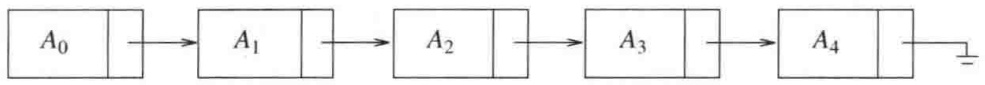

<details>
<summary>flowchart</summary>

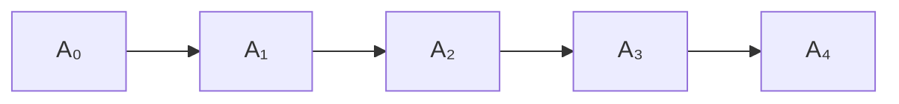
</details>

图3.1 一个链表

链表由一系列节点组成，这些节点不必在内存中相连。每一个节点均含有表元素和一个链(link)，该链指向包含该元素后继元的另一个节点。我们称之为 next 链(next link)。最后一个单元的 next 链指向 nullptr。

---

66

数据结构与算法分析——C++语言描述(第四版)

为了执行 printList() 或 find(x)，我们只要从表的第一个节点开始然后用一些后继的 next 链遍历该表即可。这种操作显然是线性时间的，和在数组实现时一样，不过其中的常数可能会比用数组实现时要大。findKth 操作不如数组实现时的效率高；findKth(i) 花费 O(i) 的时间并通过以明显的方式遍历链表而完成操作。在实践中这个界是保守的，因为调用 findKth 常常是以(按 i)排序后的方式进行。例如，findKth(2)、findKth(3)、findKth(4) 以及 findKth(6) 可通过对表的一次扫描同时实现。

remove 方法可以通过修改一个 next 指针来实现。图 3.2 给出在原表中删除第三个元素的结果。

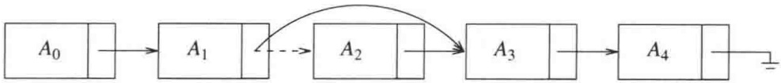

<details>
<summary>flowchart</summary>


</details>

图3.2 从链表中删除

insert 方法需要使用 new 操作符从系统取得一个新节点，此后执行两次 next 指针的调整。其一般想法在图 3.3 中给出，其中的虚线表示原来的指针。

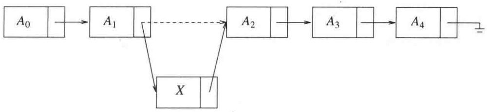

<details>
<summary>flowchart</summary>

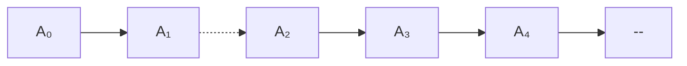
</details>

图3.3 向链表插入

可以看到，原则上如果知道变动将要发生的地方，那么插入或从链表中删除一项的操作不需要移动很多的项，而只涉及常数个节点链的改变。

在表的前端添加项或删除第一项的特殊情形此时也属于常数时间的操作，当然假设要保留到链表前端的链。只要我们保留到链表最后节点的链，那么在链表末尾进行添加操作的特殊情形(即让新的项成为最后一项)可以花费常数时间。因此，典型的链表拥有到该表两端的链。删除最后一项比较复杂，因为必须找出指向最后节点的项，把它的 next 链改成 nullptr，此时指向最后节点的链得到更新。在经典的链表中，每个节点均存储指向其下一节点的链，而让指向最后节点的链不提供关于最后节点的前驱节点的任何信息。

保留指向最后节点的前驱节点的第 3 个链的想法是行不通的，因为它在删除操作期间也需要更新。我们的做法是，让每一个节点持有一个指向它在表中的前驱节点的链，如图 3.4 所示，我们称这样的表为双向链表(doubly linked list)。

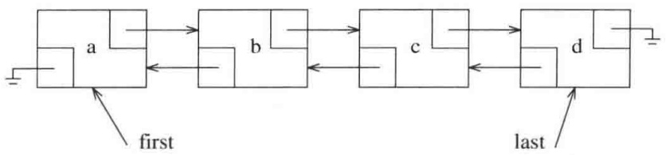

<details>
<summary>flowchart</summary>

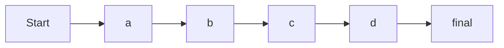
</details>

图3.4 双向链表

---

第3章 表、栈和队列

67

## 3.3 STL中的vector和list

C++语言在其库中包含一些常用数据结构的实现。该语言这一部分通常叫作标准模板库(Standard Template Library, STL)。表 ADT(List ADT)是在 STL 中实现的数据结构之一。我们将在第 4 章和第 5 章看到其他一些数据结构。一般说来，这些数据结构被称为集合(collection)或容器(container)。

表 ADT 有两种流行的实现方法。vector 提供表 ADT 的一种可增长的数组实现。使用 vector 的优点在于它是以常数时间可索引(indexable)的。缺点是插入新项和删除现有项的代价高昂，除非变化发生在 vector 的尾端。而 list 则提供表 ADT 的双向链表实现。使用 list 的优点是插入新项和删除现有项代价低廉，但假设变动的位置是已知的。缺点是 list 不容易被索引。vector 和 list 两者在执行查找时都是低效的。在我们整个的讨论中，list 指的是 STL 中的双向链表，而 list 指的是更一般的表 ADT。

vector 和 list 两者均为类模板，它们用其所存储的项的类型来实例化而成为具体的类。二者有几个方法是共有的。下面所示的前 3 种方法实际上对所有的 STL 容器都是可用的:

- int size()const: 返回容器中元素的个数。
- void clear(): 从容器中删除所有元素。
- bool empty() const: 若容器不含有元素则返回 true，否则返回 false。

vector 和 list 两者都支持以常数时间向表的尾端添加和从表的尾端删除的操作。vector 和 list 两者都支持以常数时间访问表的前端项。这些操作是:

- void push back(const Object & x): 把 x 添加到表的尾端。
- void pop back(): 删除位于表的尾端的对象。
- const Object & back()const: 返回位于表的尾端处的对象(还提供一个返回引用的修改函数)。
- const Object & front()const: 返回位于表的前端处的对象(还提供一个返回引用的修改函数)。

因为双向链表在其前端可以进行高效的改动，而 vector 却不能，所以下列两个方法只对 list 是可用的:

- void push front(const Object & x): 把 x 添加到表的前端。
- void pop front(): 删除位于表的前端处的对象。

vector 有它自己的方法集，这些方法 list 不具备。有两个方法可以进行高效的索引操作，而其余的两个方法允许程序员查看和改变内部容量。这些方法是:

- Object & operator[](int idx): 返回 vector 中下标为 idx 的对象，不带界限检验(还提供一个返回常量引用的访问函数)。
- Object & at(int idx): 返回 vector 中下标为 idx 的对象，带有界限检验(还提供一个返回常量引用的访问函数)。
- int capacity()const: 返回 vector 的内部容量。(详见 3.4 节。)

---

68

数据结构与算法分析——C++语言描述(第四版)

\- void reserve(int newCapacity): 设置新的容量。如果有好的估计可用，那么它可以用于避免扩展 vector。(详见 3.4 节。)

## 3.3.1 迭代器

对表的一些操作，尤其那些在表的中间进行精密的插入和删除的操作，需要位置的概念。在 STL 中，位置由内嵌类型 iterator 来表示。特别是，对于 list&lt;string&gt;，位置由类型 list&lt;string&gt;::iterator 表示；对于 vector&lt;int&gt;，位置由 vector&lt;int&gt;::iterator 类表示，等等。在描述一些方法时，我们将直接使用 iterator 作为简记，但在编写代码时还是使用具体的内嵌类名。

首先，有 3 个问题需要处理:第一，如何获取一个迭代器 (iterator)；第二，迭代器本身能够执行什么操作；第三，哪些表 ADT 方法需要迭代器作为参数。

## 获取迭代器

对于第一个问题，STL表(以及所有其他的STL容器)定义了一对方法:

- iterator begin(): 返回一个适当的迭代器，表示容器中的第一项。
- iterator end(): 返回一个适当的迭代器，表示容器中的尾端(终端)标记(endmarker)(即容器中最后一项之后的位置)。

end 方法有些不同寻常，因为它返回一个“越界”的迭代器。为了理解这个概念，考虑下列在引入 C++11 中基于范围 for 循环之前通常用于打印 vector v 中的项的代码:

```txt
for( int i = 0; i != v.size( ); ++i )
    cout << v[ i ] << endl;
```

如果我们想使用迭代器重新改写这段代码, 那么会看到一个与 begin 方法和 end 方法自然的对应:

```txt
for( vector<int>::iterator itr = v.begin( ); itr != v.end( ); itr.??? )
    cout << itr.??? << endl;
```

在循环终止测试中，i!=v.size()和itr!=v.end()两者都要测试循环计数器是否“越界”。这段代码也给我们带来了第二个问题，即迭代器必须拥有与其相关的方法(这些未知的方法由???表示)。

## 迭代器方法

基于上面的代码片段，显然，迭代器可以用!=和==进行比较，并且可能需要定义一些拷贝构造函数(copy constructor)和 operator=函数。因此，迭代器有些方法，其中许多方法用到运算符重载。除复制外，对迭代器通常使用的大部分操作一般包括如下:

- itr++和++itr: 将迭代器推进到下一个位置。前缀形式和后缀形式都是可以使用的。
- \*itr: 返回对存储在迭代器 itr 的位置上对象的引用。所返回的引用可以允许修改，也可以不允许修改(这些细节将在稍后讨论)。
- itr1==itr2: 若 itr1 和 itr2 指向同一个位置则返回 true，否则返回 false。
- itr1!=itr2: 若 itr1 和 itr2 指向不同的位置则返回 true，否则返回 false。

使用这些操作的打印代码将是

---

第3章 表、栈和队列

69

```cpp
for( vector<int>::iterator itr = v.begin( ); itr != v.end( ); ++itr )
    cout << *itr << endl;
```

运算符重载的使用使我们能够访问当前项，此时使用\*itr++可以推进到下一项。于是，上面的代码片段又可以写成

```cpp
vector<int>::iterator itr = v.begin( );
while( itr !=v.end( ) )
    cout << *itr++ << endl;
```

## 需要迭代器的容器操作

最后一个问题，需要迭代器的3个最流行的方法是那些从表(或vector，或list)的指定位置上进行添加或删除的操作:

- iterator insert( iterator pos, const Object & x): 把 x 添加到表中由迭代器 pos 所给定的位置之前的位置上。这是对 list(但不是对 vector) 的常数时间的操作。返回值是指向被插入项的位置的一个迭代器。
- iterator erase(iterator pos): 删除由迭代器所给定的位置上的对象。这是对 list(但不是对 vector)的常数时间的操作。返回值是调用之前 pos 的后继元素所在的位置。该操作使 pos 失效，现在它是多余的了，因为它正在指向的容器项已经被删除。
- iterator erase(iterator start, iterator end): 删除从位置 start 开始直到(但不包括)位置 end，为止的所有的项。注意，整个表可以通过调用 c.erase(c.begin(), c.end())而被删除。

## 3.3.2 例子:对表使用 erase

作为一个例子，我们给出一个例程，从初始项开始，每隔一项删除表中的一项。于是，如果表包含6,5,1,4,2，那么在方法被调用之后，它将只包含5,4。我们通过遍历该表并对每个第2项使用erase方法完成操作。对于list，这将是一个线性时间的例程，因为每次调用erase都花费常数时间，但是，对于vector，全部例程将花费二次的时间，因为每次调用erase都是低效的，需要时间 $O(N)$ 。因此，我们通常只为list编写代码。然而为了实验的目的，我们编写一个一般的函数模板，它将对list和list都能正常运行。然后，再提供计时信息。这个函数模板如图3.5所示。

```cpp
template <typename Container>
void removeEveryOtherItem( Container & lst )
{
    auto itr = lst.begin( );      // itr 是一个 Container::iterator

    while( itr != lst.end( ) )
    {
        itr = lst.erase( itr );
        if( itr != lst.end( ) )
            ++itr;
    }
}
```

图 3.5 使用迭代器隔项删除表(vector 或 list)中的项。对 list 是高效的，但对 vector 则不是

第 4 行上 auto 的使用是 C++11 的一个特色, 它使我们避免了更长的类型 Container::

---

70

数据结构与算法分析——C++语言描述(第四版)

iterator。如果运行这个程序，传递一个 list&lt;int&gt;，那么对于 800 000 项的 list 它将花费 0.039 秒，而对于 1 600 000 项的 list 将花费 0.073 秒。很清楚，这是一个线性例程，因为运行时间是按照与输入大小的相同增长因子增长的。当我们传递一个 vector&lt;int&gt;时，该例程对于 800 000 项的 vector 则花费几乎 5 分钟的时间，而对于 1 600 000 项的 vector 花费大约 20 分钟。当输入增长 2 倍时运行时间增长 4 倍，这和二次的行为是一致的。

## 3.3.3 const\_iterators

\*itr 的结果不只是迭代器正在指向的项的值，而且还有该项本身。这个特点使得迭代器非常强大，不过也带来一些副作用。为了理解它的好处，假设我们想要把一个集合中的所有项改成一个特定的值。下列例程对于 vector 和 list 都是高效的并且是以线性时间运行的，它是编写一般的、类型无关代码的完美示例。

```cpp
template <typename Container, typename Object>
void change( Container & c, const Object & newValue )
{
    typename Container::iterator itr = c.begin();
    while( itr != c.end( ) )
        *itr++ = newValue;
}
```

要想看清潜在的问题，假设 Container c 是使用常量引用调用被传递到例程的。这意味着，我们不想对 c 做任何的改变，而编译器将通过禁止调用 c 的任何修改函数来保证这一点。考虑下列代码，它打印由一些整数构成的 list 而且还试图对 list 进行隐蔽的修改:

```cpp
void print( const list<int> & lst, ostream & out = cout )
{
    typename Container::iterator itr = lst.begin( );
    while( itr != lst.end( ) )
    {
        out << *itr << endl;
        *itr = 0;   // 问题在此!!!
        ++itr;
    }
}
```

如果这段程序是合法的，那么 list 的定常性(const-ness)就将毫无意义，因为它太容易被绕开了。该程序段不合法，将不会被编译。STL 提供的解决方案是，每一个集合容器不仅包含一个内嵌类型 iterator，而且还有一个内嵌类型的 const\_iterator。在 iterator 和 const\_iterator 之间的主要区别在于，对于 const\_iterator, operator\* 返回一个常量引用，因而对于 const\_iterator 的 \*itr 不能出现在赋值语句的左边。

不仅如此，编译器还将要求我们使用 const\_iterator 来遍历一个常量集合。它通过提供两种版本的 begin 和两种版本的 end 来完成遍历:

- iterator begin()
- const\_iterator begin()const
- iterator end()
- const\_iterator end()const

这两种形式的 begin 可以在同一个类中只是因为方法的定常性(const-ness)(即，是访问

---

第3章 表、栈和队列

71

函数还是修改函数)被认为是特征(signature)的一部分。我们在1.7.2节中见过这种技巧，而我们还将在3.4节再次见到它，两者均出现在重载operator[]的环境中。

如果是对非常量容器调用 begin，那么返回一个 iterator 的“修改函数”版的 begin 被调用。然而，如果对常量容器调用 begin，那么所返回的则是 const\_iterator，并且返回值不可赋给 iterator。如果我们试图赋给它，那么将会产生一个编译错误。一旦 itr 是一个 const iterator 类型的量，则 \*itr=0 就会很容易地被检查出是非法的。

如果使用 auto 声明迭代器，则编译器将推算出它代替的是 iterator 还是 const\_iterator。这在很大程度上缓解了程序员必须牢记正确的迭代器类型的负担，这也正是 auto 的预期使用目的之一。再有，诸如 vector 和 list 这样一些如上所述提供迭代器的库类，与基于范围的 for 循环是兼容的，就像用户定义的那些类一样。

C++11 一个附加的特性是, 允许编写即使 Container 类型没有 begin 和 end 成员函数也能正常运行的程序。非成员的自由函数 begin 和 end 的定义让我们在任何允许使用 c.begin() 的地方使用 begin(c)。使用 begin(c) 而不是使用 c.begin() 编写泛型代码具有下述优点: 它使得泛型代码能够在有 begin/end 作为成员函数的容器上正常运行, 而且对那些没有 begin/end 但以后可能用一些适当的非成员函数来扩充功能的容器也能正常运行。作为 C++11 中的自由函数, begin 和 end 的加入通过添加语言特色 auto 和 decltype 而成为可能, 如下述代码所示。

```cpp
template<typename Container>
auto begin( Container & c ) -> decltype( c.begin( ) )
{
    return c.begin( );
}

template<typename Container>
auto begin( const Container & c ) -> decltype( c.begin( ) )
{
    return c.begin( );
}
```

在这段代码中，begin 的返回类型经推导是 c.beging() 的类型。

图3.6中的程序利用auto来声明迭代器(如图3.5所示)并用到了非成员函数begin和end。

```cpp
template <typename Container>
void print( const Container & c, ostream & out = cout )
{
    if( c.empty( ) )
        out << "(empty)";
    else
    {
        auto itr = begin( c );  // itr 是一个Container::const_iterator

        out << "[ " << *itr++;  // 打印第一项

        while( itr != end( c ) )
            out << ", " << *itr++;
        out << " ]" << endl;
    }
}
```

图 3.6 打印任意容器

---

72

数据结构与算法分析——C++语言描述(第四版)

## 3.4 vector 的实现

在这一节，我们提供一个可用的 vector 类模板的实现。这个 vector 将是第一类类型 (first-class type)，其含义为，不同于 C++ 中的原始数组 (primitive array)，该 vector 的对象可以被复制，并且其所用内存可以 (通过它的析构函数) 被自动回收。在 1.5.7 节中描述了 C++ 原始数组的一些重要特性:

- 数组就是指向一块内存块的指针变量；数组的具体大小必须由程序员单独确定。
- 内存块可以通过 new[] 分配，但此后必须通过 delete[] 释放。
- 内存块不能重新调整大小(但可以获得一个新的、根据推测可能更大的内存块，并利用原来的内存块初始化，然后将原内存块释放)。

为避免与相关库类相混，我们将把这个类模板命名为 Vector。在考查 Vector 的代码之前，概述其主要细节如下:

1. 我们的 Vector 将(通过一个指向所分配的内存块的指针变量)保留原始的数组、数组容量以及数组当时存储在 Vector 中的项数。
2. 该 Vector 将实现五大函数以提供为拷贝构造函数和 oprator=的深层拷贝 (deep-copy) 功能，并将提供一个析构函数以回收原始数组。此外，它还将实现 C++11 的移动功能。
3. Vector 将提供改变 Vector 的大小(一般改成更大的数)的 resize 例程, 以及 reserve 例程, 后者将改变 Vector 的容量(一般是个更大的数)。这个容量通过为原始数组获取新的内存块、把老内存块复制到新内存块并回收老内存块而得以更新。
4. Vector 将提供 operator[] 的实现(如 1.7.2 节所述, operator[] 一般通过访问函数和修改函数的形式实现)。
5. Vector 还将提供诸如 size、empty、clear(通常它们都是一行代码)、back、pop\_back、和 push\_back 等基本的例程。如果大小和容量相同，则 push\_back 例程将调用 reserve 函数。
6. 对于内嵌类型 iterator 和 const\_iterator, Vector 也将提供支持，并提供相关联的 begin 方法和 end 方法。

图3.7和图3.8显示了Vector类。正如其在STL中相应的类，这里也只有有限的错误检测。后面我们将扼要讨论如何能够提供对错误的检测。

如图中第 118～120 行所示，Vector 把大小、容量以及原始数组作为其数据成员存储。第 7～9 行上的构造函数允许用户指定初始大小，其默认值为 0。然后用比大小稍大些的容量初始化数据成员，因此有些 push\_back 不用改变容量就能够被执行。

如第 $11\sim 17$ 行所示，拷贝构造函数构建了一个新的Vector对象，然后被用在operator=的不经意的实现中，而后者在一次复制中用到了标准的交换定式。这个定式只在通过移动完成交换时有效，它本身要求移动构造函数和移动operator=的实现，如第 $29\sim$ 44行所示。这些又用到了非常标准的定式。使用拷贝构造函数和交换所实现的拷贝赋值

---

第3章 表、栈和队列

73

operator=虽然简单，但却不是最有效的方法，特别是在两个 Vector 对象具有同样大小的情况下。在这种可以被测试到的特殊情况下，使用 Object 的 operator=直接逐个拷贝每个元素会更有效。

```cpp
#include <algorithm>

template <typename Object>
class Vector
{
    public:
        explicit Vector( int initSize = 0 ) : theSize{ initSize },
            theCapacity{ initSize + SPARE_CAPACITY }
        { objects = new Object[ theCapacity ]; }

        Vector( const Vector & rhs ) : theSize{ rhs.theSize },
            theCapacity{ rhs.theCapacity }, objects{ nullptr }
        {
            objects = new Object[ theCapacity  ];
            for( int k = 0; k < theSize; ++k )
                objects[ k ] = rhs.objects[ k ];
        }

        Vector & operator= ( const Vector & rhs )
        {
            Vector copy = rhs;
            std::swap( *this, copy );
            return *this;
        }

        ~Vector( )
        { delete [] objects; }

        Vector( Vector && rhs ) : theSize{ rhs.theSize },
            theCapacity{ rhs.theCapacity }, objects{ rhs.objects }
        {
            rhs.objects = nullptr;
            rhs.theSize = 0;
            rhs.theCapacity = 0;
        }

        Vector & operator= ( Vector && rhs )
        {
            std::swap( theSize, rhs.theSize );
            std::swap( theCapacity, rhs.theCapacity );
            std::swap( objects, rhs.objects );

            return *this;
        }
```

图 3.7 vector 类(1/2)

---

74

数据结构与算法分析——C++语言描述(第四版)

```cpp
void resize( int newSize )
{
    if( newSize > theCapacity )
        reserve( newSize * 2 );
    theSize = newSize;
}

void reserve( int newCapacity )
{
    if( newCapacity < theSize )
        return;

    Object *newArray = new Object[ newCapacity ];
    for( int k = 0; k < theSize; ++k )
        newArray[ k ] = std::move( objects[ k ] );

    theCapacity = newCapacity;
    std::swap( objects, newArray );
    delete [] newArray;
}
```

图 3.7(续) vector 类(1/2)

```cpp
Object & operator[]( int index )
{ return objects[ index ]; }
const Object & operator[]( int index ) const
{ return objects[ index ]; }

bool empty( ) const
{ return size( ) == 0; }
int size( ) const
{ return theSize; }
int capacity( ) const
{ return theCapacity; }

void push_back( const Object & x )
{
if( theSize == theCapacity )
reserve( 2 * theCapacity + 1 );
objects[ theSize++ ] = x;
}

void push_back( Object && x )
{
if( theSize == theCapacity )
reserve( 2 * theCapacity + 1 );
objects[ theSize++ ] = std::move( x );
}

void pop_back( )
{
```

图 3.8 vector 类(2/2)

---

第3章 表、栈和队列

75

```cpp
--theSize;
    }

    const Object & back ( ) const
    {
        return objects[ theSize - 1 ];
    }

    typedef Object * iterator;
    typedef const Object * const_iterator;

    iterator begin( )
        { return &objects[ 0 ]; }
    const_iterator begin( ) const
        { return &objects[ 0 ]; }
        iterator end( )
            { return &objects[ size( ) ]; }
        const_iterator end( ) const
            { return &objects[ size( ) ]; }

        static const int SPARE_CAPACITY = 16;

    private:
        int theSize;
        int theCapacity;
        Object * objects;
};
```

图 3.8(续) vector 类(2/2)

resize 例程如第 46～51 行所示。该段代码直接设置 theSize 数据成员，但却是在有可能扩展容量之后进行。容量扩展的代价是非常高昂的。因此，如果容量被扩展，那么它就要变成原来容量的两倍大，以避免容量的再次改变，除非大小戏剧性地增加(这里的+1 用于大小为 0 的情形)。扩展容量是通过 reserve 例程完成的，如第 53 至 65 诸行所示。它是由第 58 行上的分配新数组、第 59 行和第 60 行上移动老内容以及第 64 行上老数组的回收组成的。如第 55～56 行所述，reserve 例程也可以用于收缩原数组，不过，只能在指定的新容量至少和原大小相同的情况下才可行。若非如此，则 reserve 的要求被忽略。

operator[]这里的两个版本并不复杂(事实上,与1.7.2节中matrix类的operator[]的实现非常相似),如图中第67\~70诸行所示。通过确保index不越出0和size()-1的范围,包括不在该范围则抛出异常,我们很容易添加对错误的检测。

一些短例程，即 empty、size、capacity、push\_back、pop\_back 和 back，在第 72～101 行上实现。在第 83 和 90 行上，我们看到前缀++运算符的使用，它用到 theSize 给数组确定下标，然后使 theSize 增 1。在讨论迭代器 \*itr++ 时我们见过与此相同的格式:\*itr++ 使用 itr 来决定指向哪一项，然后推进 itr。++ 的定位很重要:在前缀++ 运算符下，\*++itr 先推进 itr，然后使用新的 itr 来确定指向哪一项，同样，objects[++theSize] 将使 theSize 增 1，然后使用所得到的新值来给数组确定下标(但这不是我们想要的)。pop\_back 和 back 通过错误检验得以实现，而当大小为 0 时则会抛出一个异常。

---

76

数据结构与算法分析——C++语言描述(第四版)

最后，在第 103～113 行上，我们看到 iterator 和 const\_iterator 内嵌类型的声明以及两个 begin 方法和两个 end 方法。这段代码利用到下述事实:在 C++ 中，指针变量拥有我们对 iterator 期望的所有相同的运算符。指针变量可以被复制和比较；\*运算符得到指针所指向的对象，而最特别的是，当++用于指针变量时，指针变量则指向顺序存储的下一个对象:如果指针正在指向数组内部，则增加指针的位置使它指向数组的下一元素。对于指针的这些规定可以追溯到 20 世纪 70 年代早期，当时使用的是 C 程序设计语言，它是 C++ 发展的基础。STL 迭代器机制在某种程度上是模拟指针操作而设计的。

因此，我们在第 103 行和第 104 行看到 typedef 语句指出 iterator 和 const\_iterator 就是指针变量的另外的名字，而 begin 和 end 需要分别返回代表第一个数组位置和第一个非法数组位置的内存地址。

对于 vector 类型在迭代器和指针之间的一致性意味着，不使用 C++ 数组而使用 vector，资源消耗可能稍高。正如我们说过的，其不足之处在于程序没有对错误的检测。如果迭代器 itr 冲过终点标记，++itr 和 \*itr 均不必发出错误信号。要想修正这个问题，就需要 iterator 和 const\_iterator 均为内嵌类类型而不是简单的指针变量。使用内嵌类类型要普遍得多，而这正是我们在 3.5 节的 list 类中将要看到的。

## 3.5 list 的实现

本节我们提供可用的 list 类模板的实现。和 vector 类的情形一样，这里的表类将被命名为 List，以避免与库类产生歧义。

我们知道, List 类将作为双向链表被实现, 而且我们将需要保留指向表两端的两个指针。这样就使得只要每次操作都发生在已知的位置上, 那就总是花费常数时间的开销。这个已知位置可以在表的端点, 也可以在迭代器指定的位置上。

在考虑设计时，我们需要提供如下4个类:

1. List 类本身，它包含连接到表两端的链、表的大小，以及一些方法。
2. Node 类，它很可能是一个私有的内嵌类。一个节点包含数据和指向前后两个节点的两个指针，以及一些适当的构造函数。
2. const\_iterator 类, 它抽象了位置的概念, 而且是一个公有的内嵌类。该 const\_iterator 存储一个指向 “当前” 节点的指针, 并提供基本迭代器操作的实现, 所有的操作, 像 =、==、!= 和 ++ 等, 均以重载运算符的形式出现。
3. iterator 类，它抽象了位置的概念，而且是一个公有的内嵌类。该 iterator 有着与 const\_iterator 相同的功能，但 operator\*返回的是所指项的引用，而不是对该项的常量引用。一个重要的技术问题是，iterator 可以用在任何需要 const\_iterator 的例程中，但反之不真。换句话说，iterator 是一个 const iterator。

因为迭代器类存储一个指向“当前节点”的指针，并且终端标记是一个合法的位置，所以在表的终端创建一个表示终端标记(endmarker)的附加节点是有意义的。此外，还可以在表的前端创建一个附加节点，逻辑上代表开始标志。这些附加节点有时候称为标记节点(sentinel node)；特别地，前端节点有时候也叫作头节点(header node)，而在尾端的节点有时候就叫作尾节点(tail node)。

---

第3章 表、栈和队列

77

使用这些附加节点的好处在于，它们通过排除一些特殊情况大大地简化了编码过程。例如，如果我们不使用头节点，那么删除第一个节点就变成了一种特殊情形，因为我们在删除期间必须重新安置链表对第一个节点的连接，还因为删除算法一般需要访问正在被删除的节点前面的节点(而没有头节点，则第一个节点就没有在它前面的节点)。图 3.9 显示了一个带有头节点和尾节点的双向链表。图 3.10 则显示的是一个空链表。

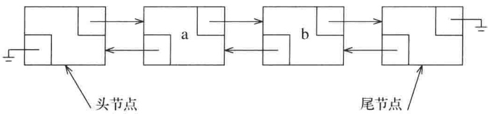

<details>
<summary>flowchart</summary>

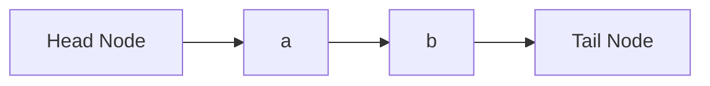
</details>

图 3.9 带有头节点和尾节点的双向链表

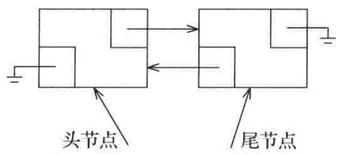

<details>
<summary>text_image</summary>

头节点
尾节点
</details>

图 3.10 带有头节点和尾节点的空的双向链表

图 3.11 和图 3.12 显示了 List 类的架构以及部分的实现。

我们在第 5 行可以看到私有内嵌的节点类声明的开头部分。这里并没有使用 class 关键词，而是使用的 struct。在 C++ 中，struct 是 C 语言遗留下来的术语。C++ 中的 struct 基本上就是 class，不过其中的成员默认为公有的。我们知道，class 中的成员默认为私有的。显然，struct 这个关键词不是必需的，但是我们将会常常看到它，并且程序员一般使用它来表示一种主要包含直接被存取而不是通过方法访问的数据的类。在我们这里的 Node 类中，让各成员是公有的将不是个问题，因为 Node 类本身是私有的，而 List 类的外部是不可对其访问的。

在第 9 行我们看到公有内嵌 const\_iterator 类的声明的起始部分，以及第 12 行上的公有内嵌 iterator 类的声明的开头。这里的继承 (inheritance) 是个特殊的句法，它是一个强有力的结构，本书的其他地方尚未用到。这个继承句法说的是，iterator 具有和 const\_iterator 完全相同的功能，并且可以用在任何需要 const\_iterator 的地方。在后面看到具体实现的时候我们将讨论这些细节。

第 80 行到第 82 行包含 List 的两个数据成员，即指向头节点的指针和指向尾节点的指针。我们还要跟踪一个数据成员的大小，以便 size 方法能够以常数时间被实现。

List 类的其余部分由构造函数、五大函数及一些方法组成。许多方法就是一行的代码。begin 和 end 返回相应的迭代器；第 30 行上的调用是典型的实现方式，它返回一个构造的迭代器(这样，iterator 类和 const\_iterator 类每个都有一个构造函数，该构造函数接受指向 Node 的指针作为它的参数)。

第 43～47 行上的 clear 方法通过反复删除成员项直至 List 为空来完成清除工作。使用这种策略使得 clear 避免染指回收节点的工作，因为节点的回收如今已经归入 pop\_front 处理了。第 48～67 行上的几个方法都是通过获得并使用适当的迭代器来工作的。我们知道，insert 方法是在一个位置之前插入，因此，在需要时，push\_back 是在终端标记之前进行插入。注意在 pop\_back 中 erase(--end()) 创建了一个对应终端标记的临时迭代器，后撤该临时迭代器，并使用这个迭代器执行 erase。类似的行为同样发生在 back 中。还要注意，在 pop\_front 操作和 pop\_back 操作的情况下，我们再一次避免了处理节点回收的工作。

图 3.13 显示的是 Node 类，该类由所存储的项、指向前一节点的指针、指向下一节点的指针以及构造函数组成。所有的数据成员都是公有的。

---

78

数据结构与算法分析——C++语言描述(第四版)

```cpp
template <typename Object>
class List
{
    private:
        struct Node
            { /* 见图 3.13 */ };

    public:
        class const_iterator
            { /* 见图 3.14 */ };

        class iterator : public const_iterator
            { /* 见图 3.15 */ };

    public:
        List( )
            { /* 见图 3.16 */ }
        List( const List & rhs )
            { /* 见图 3.16 */ }
        ~List( )
            { /* 见图 3.16 */ }
        List & operator= ( const List & rhs )
            { /* 见图 3.16 */ }
        List( List && rhs )
            { /* 见图 3.16 */ }
        List & operator= ( List && rhs )
            { /* 见图 3.16 */ }

        iterator begin( )
            { return { head->next }; }
        const_iterator begin( ) const
            { return { head->next }; }
        iterator end( )
            { return { tail }; }
        const_iterator end( ) const
            { return { tail }; }

        int size( ) const
            { return theSize; }
        bool empty( ) const
            { return size( ) == 0; }

        void clear( )
        {
            while( !empty( ) )
                pop_front( );
        }
```

图 3.11 List 类 (1/2)

---

第3章 表、栈和队列

79

```c
Object & front( )
{ return *begin( ); }
const Object & front( ) const
{ return *begin( ); }
Object & back( )
{ return *--end( ); }
const Object & back( ) const
{ return *--end( ); }
void push_front( const Object & x )
{ insert( begin( ), x ); }
void push_front( Object && x )
{ insert( begin( ), std::move( x ) ); }
void push_back( const Object & x )
{ insert( end( ), x ); }
void push_back( Object && x )
{ insert( end( ), std::move( x ) ); }
void pop_front( )
{ erase( begin( ) ); }
void pop_back( )
{ erase( --end( ) ); }

iterator insert( iterator itr, const Object & x )
{ /* 见图 3.18 */ }
iterator insert( iterator itr, Object && x )
{ /* 见图 3.18 */ }

iterator erase( iterator itr )
{ /* 见图 3.20 */ }
iterator erase( iterator from, iterator to )
{ /* 见图 3.20 */ }

private:
int theSize;
Node *head;
Node *tail;

void init( )
{ /* 见图 3.16 */ }
};
```

图 3.12 List 类(2/2)

```cpp
struct Node
{
    Object data;
    Node *prev;
    Node *next;

    Node( const Object & d = Object{ }, Node * p = nullptr,
                          Node * n = nullptr )
        : data{ d }, prev{ p }, next{ n } { }

    Node( Object && d, Node * p = nullptr, Node * n = nullptr )
        : data{ std::move( d ) }, prev{ p }, next{ n } { }
};
```

图 3.13 List 类的内嵌 Node 类

1
2
3
4
5
6
7
8
9
10
11
12
13

---

80

数据结构与算法分析——C++语言描述(第四版)

图 3.14 显示的是 const\_iterator 类，而图 3.15 则是 iterator 类。正如我们早先提到过的，图 3.15 中第 39 行上的语法指出一个高级特性，叫作继承 (inheritance)，意味着 iterator 就是一个 const\_iterator。当 iterator 类以这种方式写出时，它就继承了 const\_iterator 的所有数据和方法。它可以添加新的数据、新的方法，还可以覆盖 (即重新定义) 现有的方法。在最一般的情况下，将会出现严重的语法负担 (常常导致关键词 virtual 出现在代码中)。

```cpp
class const_iterator
{
    public:
        const_iterator( ) : current{ nullptr }
        { }

        const Object & operator* ( ) const
        { return retrieve( ); }

        const_iterator & operator++ ( )
        {
            current = current->next;
            return *this;
        }

        const_iterator operator++ ( int )
        {
            const_iterator old = *this;
            ++( *this );
            return old;
        }

        bool operator== ( const const_iterator & rhs ) const
        { return current == rhs.current; }
        bool operator!= ( const const_iterator & rhs ) const
        { return !( *this == rhs ); }

    protected:
        Node *current;

        Object & retrieve( ) const
        { return current->data; }

        const_iterator( Node *p ) : current{ p }
        { }

        friend class List<Object>;
};
```

图 3.14 List 类的内嵌 const\_iterator 类

然而在这里，我们可以避免许多的语法束缚，因为我们不添加新的数据，也不打算改变现有方法的行为。不过，我们在 iterator 类中添加一些新方法(与 const\_iterator 类中

---

第3章 表、栈和队列

81

的现存方法有非常相似的特征)。这样, 我们就能够避免使用 virtual。即使如此, 在 const\_iterator 中还是存在相当多的语法技巧。

```cpp
class iterator : public const_iterator
{
    public:
        iterator( )
            { }

        Object & operator* ( )
            { return const_iterator::retrieve( ); }
        const Object & operator* ( ) const
            { return const_iterator::operator*( ); }

        iterator & operator++ ( )
        {
            this->current = this->current->next;
            return *this;
        }

        iterator operator++ ( int )
        {
            iterator old = *this;
            ++( *this );
            return old;
        }

    protected:
        iterator( Node *p ) : const_iterator{ p }
            { }

    friend class List<Object>;
};
```

图3.15 List类的嵌套iterator类

在第 28 行和第 29 行，const\_iterator 存储一个指向 “当前” 节点的指针作为它单独的数据成员。正常情况下，该成员将是私有的，然而如果它私有，那么 iterator 就无权访问它了。把 const\_iterator 的成员标记为 protected 使得从 const\_iterator 继承来的那些类有权访问这些成员，但不允许其他类有这种访问权。

在第 34 行和第 35 行，我们看到在 List 类中 begin 和 end 的实现用过的 const\_iterator 的构造函数。我们不想让所有的类看到这个构造函数(从指针变量显式地构造迭代器是不允许的)，因此它不能是公有的，可是我们还想要 iterator 类看到它，所以，逻辑上这个构造函数我们让它是 protected 的。然而，这并未给 List 对该构造函数的访问权。解决方法是第 37 行上的 friend 声明(friend declaration)，这就赋予了 List 类访问 const\_iterator 的非公有成员的权利。

const\_iterator 中的公有方法都用到了运算符重载。operator==、operator!=以及 operator\*都很简单。在第 10\~21 行我们看到 operator++ 的实现。我们知道，operator++

---

82

数据结构与算法分析——C++语言描述(第四版)

的前缀形式和后缀形式在语义(以及优先级)上是完全不同的，因此我们需要为每种形式分别编写例程。由于它们有相同的名字，从而它们必须要有不同的特征以便区分。C++规定，我们通过为前缀形式指定空参数表而为后缀形式指定(匿名的)单参数 int 来赋予它们不同的特征。于是，++itr 调用零参数的 operator++, 而 itr++则调用单参数 operator++。参数 int 从未被使用，它的出现只是为了给出不同的特征。这种实现指出，在存在选用前缀或后缀 operator++的许多场合下，前缀形式要比后缀形式更快。

在 operator 类中, 第 64 行上的保护型构造函数用到一个初始化表列来初始化继承来的当前节点。我们不必再重新实现 operator==和 operator!=，因为它们是继承的、不变的。我们的确提供了一对新的 operator++ 的实现 (因为返回类型改变了)，这两个实现隐藏了 const\_operator 中的原始实现，而且我们还为 operator\* 提供了一对访问函数/修改函数。在第 47 行和第 48 行列出的访问函数 operator\* 直接使用与在 const\_iterator 中相同的实现。这个访问函数显式地在 iterator 中实现，因为否则原始的实现会被新添加的新版修改函数所隐藏。

图 3.16 显示的是构造函数和五大函数。因为零参数构造函数和拷贝构造函数二者都必须配置头节点和尾节点，所以我们提供了私有的 init 例程。init 创建一个空的 List。析构函数回收头节点和尾节点；当析构函数调用 clear 时，所有其他节点均被回收。类似地，拷贝构造函数通过调用一些公有方法而不是通过尝试低水平的指针操作而实现。

图 3.17 阐释包含 x 的新节点是如何拼接到由 p 所指向的节点和节点 p.prev 之间的。对节点指针的赋值可以描述如下:

```txt
Node *newNode = new Node{ x, p->prev, p }; // 第1步和第2步
p->prev->next = newNode; // 第3步
p->prev = newNode; // 第4步
```

可以将第3步和第4步合并，只得到如下两行:

```txt
Node *newNode = new Node{ x, p->prev, p }; // 第1步和第2步
p->prev = p->prev->next = newNode;          // 第3步和第4步
```

不过，此时这两行还可以合并，得到:

```javascript
p->prev = p->prev->next = new Node{ x, p->prev, p };
```

这就缩短了图3.18中的insert例程。

图 3.19 显示删除一个节点的思路。如果 p 指向要被删除的节点，则只要改变两个指针就可回收这个节点:

```txt
p->prev->next = p->next;
p->next->prev = p->prev;
delete p;
```

图3.20显示的是一对erase例程。erase的第1个版本包含上述3行代码以及返回iterator的代码，这个iterator代表被删除元素的后面的项。和insert一样，erase必须更新theSize。erase的第2个版本直接使用iterator来调用第1个版本的erase。注意，我们不能在第16行的for循环中直接使用itr++并忽略第17行上erase的返回值。itr的值在调用erase后马上就过时了，这就是为什么erase返回一个iterator的原因。

---

第3章 表、栈和队列

83

```cpp
List( )
    { init( ); }

~List( )
{
    clear( );
    delete head;
    delete tail;
}

List( const List & rhs )
{
    init( );
    for( auto & x : rhs )
        push_back( x );
}

List & operator= ( const List & rhs )
{
    List copy = rhs;
    std::swap( *this, copy );
    return *this;
}

List( List && rhs )
    : theSize{ rhs.theSize }, head{ rhs.head }, tail{ rhs.tail }
    {
        rhs.theSize = 0;
        rhs.head = nullptr;
        rhs.tail = nullptr;
    }

List & operator= ( List && rhs )
{
    std::swap( theSize, rhs.theSize );
    std::swap( head, rhs.head );
    std::swap( tail, rhs.tail );

    return *this;
}

void init( )
{
    theSize = 0;
    head = new Node;
    tail = new Node;
    head->next = tail;
    tail->prev = head;
}
```

图3.16 List类的构造函数、五大函数和私有init例程

---

84

数据结构与算法分析——C++语言描述(第四版)

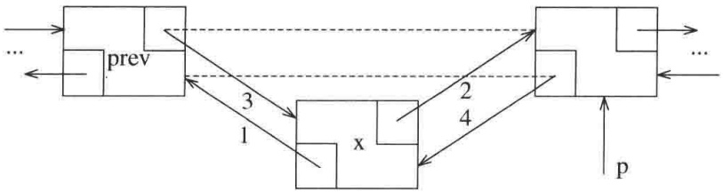

<details>
<summary>flowchart</summary>

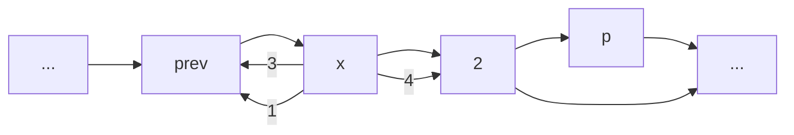
</details>

图 3.17 通过获取一个新节点然后以所指出的顺序修改指针而将新节点插入双向链表

```cpp
// 在itr前插入x
iterator insert( iterator itr, const Object & x )
{
    Node *p = itr.current;
    thenSize++;
    return { p->prev = p->prev->next = new Node{ x, p->prev, p } };
}

// 在itr前插入x
iterator insert( iterator itr, Object && x )
{
    Node *p = itr.current;
    thenSize++;
    return { p->prev = p->prev->next
        = new Node{ std::move( x ), p->prev, p } };
}
```

图3.18 List类的insert例程

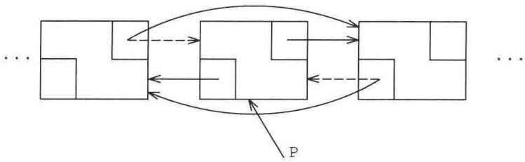

<details>
<summary>flowchart</summary>

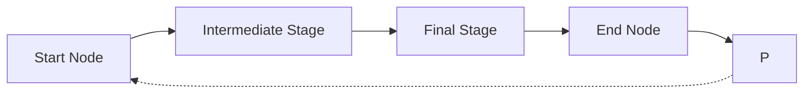
</details>

图 3.19 从双向链表中删除由 p 所指定的节点

```c
// 删除在itr处的项
iterator erase( iterator itr )
{
    Node *p = itr.current;
    iterator retVal{ p->next };
    p->prev->next = p->next;
    p->next->prev = p->prev;
    delete p;
    theSize--;

    return retVal;
}

iterator erase( iterator from, iterator to )
{
    for( iterator itr = from; itr != to; )
        itr = erase( itr );

    return to;
}
```

图3.20 List类的两个erase例程

---

第3章 表、栈和队列

85

考查代码，我们能够看到一些可能发生的错误，这里没有提供对它们的检验。例如，传递给 erase 和 insert 的迭代器可能是未被初始化的，或初始化用的是错误的表。当迭代器已经指向终端标志或尚未初始化时，不排除对其使用++或\*操作的可能。

未被初始化的迭代器将会让 current 指向 nullptr，以便条件容易得到检测。终端标记的 next 指针指向 nullptr，因此对于终端标记条件进行++或\*操作的测试也很容易。然而，为了确定传递给 erase 或 insert 的迭代器是否是正确的表的迭代器，这个迭代器必须存储一个额外的表示指向 List 的指针的数据成员，其中的 List 就是构造迭代器所用的双向链表。

我们将概述基本思路，而把细节留作练习。在 const\_iterator 类中，添加一个指向 List 的指针，并且修改受保护的构造函数以该 List 作为一个参数。我们还可以添加一些方法，它们在某些要求得不到满足时将抛出异常。程序经过修订的受保护部分看起来有些像图 3.21 给出的代码。此时所有对 iterator 和 const\_iterator 构造函数的调用本来以前它们只需要一个参数的，但现在都需要两个参数，如在 List 的 begin 方法中所示。

```cpp
const_iterator begin( ) const
{
    const_iterator itr{ *this, head };
    return ++itr;
}

protected:
    const List<Object> *theList;
    Node *current;

    const_iterator( const List<Object> & lst, Node *p )
        : theList{ &lst }, current{ p }
    {
    }

    void assertIsValid( ) const
    {
        if( theList == nullptr || current == nullptr || current == theList->head )
            throw IteratorOutOfBoundsException{ };
    }
```

图 3.21 const\_iterator 经修订后的受保护部分代码，添加了执行附加的错误检测的能力

insert 方法可以修改成图 3.22 所示代码的样子。我们把修改的细节留作练习。

```txt
// 在 itr前插入x
iterator insert( iterator itr, const Object & x )
{
    itrHexerIsValid( );
    if( itr.theList != this )
        throw IteratorMismatchException{ };

    Node *p = itr.current;
    theSize++;
    return { *this, p->prev = p->prev->next = new Node{ x, p->prev, p } };
}
```

图 3.22 带有附加错误检测的 List 的 insert 函数

---

86

数据结构与算法分析——C++语言描述(第四版)

## 3.6 栈 ADT

栈(stack)是一个带有限制的表，它的插入和删除只能在一个位置上进行，即只能在表的末端进行，这个末端叫作栈顶(top)。

## 3.6.1 栈模型

对栈的基本操作就是 push(进栈)和 pop(出栈)，前者等价于一次插入，而后者则是删除最近插入的元素。最近插入的元素在执行 pop 之前可以通过使用 top 例程进行考查。在栈 ADT 中，对空栈执行 pop 或 top 一般均被认为是一个错误。另一方面，执行 push 时空间用尽是一个实现限制，但不是 ADT 错误。

栈有时又叫作 LIFO(后进先出)表(Last in, First out list)。在图 3.23 中描述的模型只表示 push 是输入操作而 pop 和 top 是输出操作。普通的清空栈的操作和判断是否空栈的测试都是栈的操作指令系统的一部分，但是，我们对栈所能够做的基本上也就是 push 和 pop 操作。

图3.24展示了在进行若干操作后的一个抽象的栈。一般的模型是，存在某个元素位于栈顶，而该元素是唯一的可见元素。

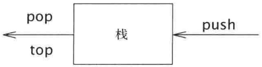

<details>
<summary>flowchart</summary>

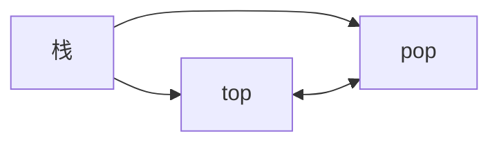
</details>

图 3.23 栈模型:通过 push 向栈输入，通过 pop 和 top 从栈输出

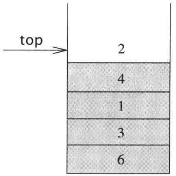

<details>
<summary>text_image</summary>

top
2
4
1
3
6
</details>

图3.24 栈模型:只有栈顶元素是可访问的

## 3.6.2 栈的实现

由于栈是一个表，因此任何实现表的方法都能实现栈。显然，list 和 vector 都支持栈操作，99% 的时间它们都是最合理的选择。偶尔设计一种特殊目的的实现可能会更快。因为栈操作是常数时间操作，所以，除非在非常独特的环境下，否则是不可能产生任何明显的改进的。

对于这些特殊的时机，我们将给出栈的两种流行的实现，一种实现使用链接结构，而另一种则使用数组，二者均简化了在 vector 和 list 中的思路，因此我们不提供代码。

## 栈的链表实现

栈的第一种实现是使用单链表。我们通过在表的前端插入来实施 push 操作，通过删除表前端元素实施 pop 操作。top 操作只是考查表前端的元素并返回它的值。有时也把 pop 操作和 top 操作合二为一。

## 栈的数组实现

栈的另一种实现避免了链而且可能是更流行的解决方案。它用到来自 vector 的 back、

---

第 3 章 表、栈和队列

87

push\_back 和 pop\_back，因此实现起来很简单。与每个栈相关联的是 theArray 和 topOfStack，对于空栈它是-1(这就是空栈的初始化做法)。为将某个元素 x 推入栈中，我们使 topOfStack 增 1 然后置 theArray[topOfStack]=x。为了弹出栈元素，我们置返回值为 theArray[topOfStack]，然后使 topOfStack 减 1。

注意，这些操作不仅以常数时间运行，而且是以非常快的常数时间运行。在某些机器上，若在带有自增和自减寻址功能的寄存器上操作，则(整数的)push 和 pop 都可以写成一条机器指令。最现代化的计算机将栈操作作为它的指令系统的一部分，这个事实强化了这样一种理念，即栈很可能是在计算机科学中在数组之后的最基本的数据结构。

## 3.6.3 应用

毫不奇怪，如果我们把操作限制在对一个表进行，那么这些操作会执行得很快。然而，令人惊奇的是，这些不多的操作却非常强大和重要。在栈的诸多应用中，我们给出3个例子，第三个实例深刻阐释程序是如何组织的。

## 平衡符号

编译器检查程序的语法错误，但是常常由于缺少一个符号(如遗漏一个花括号或是注释起始符)而引起编译器列出上百行的诊断，可是真正的错误并没有找出。

在这种情况下一个有用的工具就是检验是否每件事情都能成对出现的程序。于是，每一个右花括号、右方括号及右圆括号必然对应其相应的左括号。序列[()]是合法的，但[()）是错误的。显然，不值得为此编写一个大型程序，事实上检验这些事情是很容易的。为简单起见，我们仅就圆括号、方括号和花括号进行检验并忽略出现的任何其他字符。

这个简单的算法用到一个栈，兹叙述如下:

做一个空栈。读入字符直到文件尾。如果字符是一个开放符号，则将其推入栈中。如果字符是一个封闭符号，则当栈空时报错。否则，将栈元素弹出。如果弹出的符号不是对应的开放符号，则报错。在文件尾，如果栈非空则报错。

我们应该能够确信这个算法是会正确运行的。很清楚，它是线性的，事实上它只须对输入进行一趟检验。因此，它是联机(on-line)的，而且是相当快的。当报错时决定如何处理可能需要做一些附加的工作——例如判断可能的原因。

## 后缀表达式

假设我们有一个便携计算器并想要计算一趟外出购物的花费。为此，我们将一列数据相加并将结果乘以1.06，它是所购物品的价格以及附加的地方销售税。如果购物各项花销为4.99、5.99和6.99，那么输入这些数据的自然的方式将是

$$
4. 9 9 + 5. 9 9 + 6. 9 9 * 1. 0 6 =
$$

随着计算器的不同，这个结果或者是所要的答案 19.05，或者是科学答案 18.39。最简单的四功能计算器都将给出第一个答案，但是许多先进的计算器是知道乘法的优先级高于加法的。

另一方面，有些项是需要上税的，而有些项则不是，因此，如果只有第一项和最后一项是要上税的，那么计算的顺序

---

88

数据结构与算法分析——C++语言描述(第四版)

$$
4. 9 9 * 1. 0 6 + 5. 9 9 + 6. 9 9 * 1. 0 6 =
$$

将在科学计算器上给出正确的答案(18.69)而在简单计算器上给出错误的答案(19.37)。科学计算器一般包含括号，因此我们总可以通过加括号的方法得到正确的答案，但是使用简单计算器时需要记住一些中间结果。

该例的典型计算顺序可以是将4.99和1.06相乘并存为 $A_{1}$，然后将5.99和 $A_{1}$ 相加，再将结果存入 $A_{1}$；我们再将6.99和1.06相乘并将答案存为 $A_{2}$，最后将 $A_{1}$ 和 $A_{2}$ 相加并将最后答案放入 $A_{1}$。可以将这种操作顺序书写如下:

$$
4. 9 9 1. 0 6 * 5. 9 9 + 6. 9 9 1. 0 6 * +
$$

这个记法叫作后缀记法(postfix notation)记法或逆波兰记法(reverse Polish notation)，其求值过程恰好就是上面所描述的过程。计算这个问题最容易的方法是使用一个栈。当见到一个数时就把它推入栈中；在遇到一个运算符时该运算符就作用于从该栈弹出的两个数(符号)上，再将所得结果推入栈中。例如，后缀表达式

$$
6 5 2 3 + 8 * + 3 + *
$$

计算如下:

前4个字符放入栈中，此时栈变成

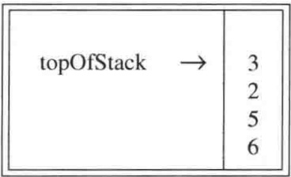

<details>
<summary>text_image</summary>

topOfStack →
3
2
5
6
</details>

下面读到一个“+”号，所以3和2从栈中弹出并且它们的和5被压入栈中。

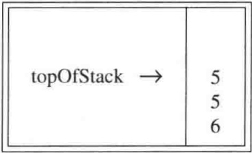

<details>
<summary>text_image</summary>

topOfStack →
5
5
6
</details>

接着，8进栈。

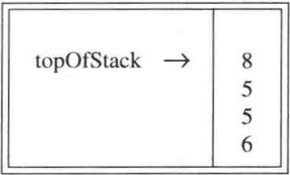

<details>
<summary>text_image</summary>

topOfStack →
8
5
5
6
</details>

现在见到一个“\*”号，因此8和5弹出并且 $5 * 8 = 40$ 进栈。

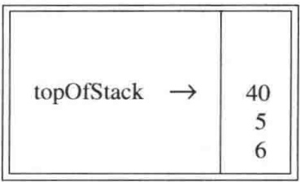

<details>
<summary>text_image</summary>

topOfStack →
40
5
6
</details>

接下来又见到一个“+”号，因此40和5被弹出并且 $5 + 40 = 45$ 进栈。

---

第3章 表、栈和队列

89

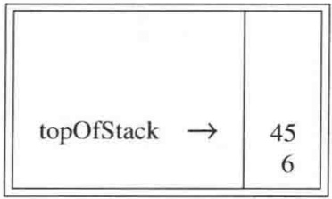

<details>
<summary>text_image</summary>

topOfStack →
45
6
</details>

现在，将3压入栈中。

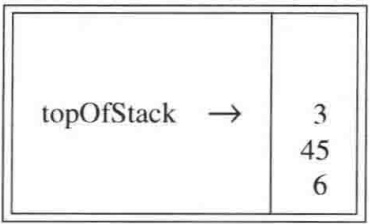

<details>
<summary>text_image</summary>

topOfStack →
3
45
6
</details>

然后，“+”使得3和45从栈中弹出并将 $45+3=48$ 压入栈中。

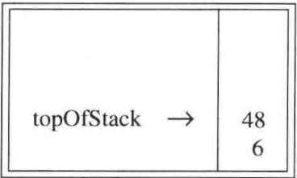

<details>
<summary>text_image</summary>

topOfStack →
48
6
</details>

最后，见到一个“\*”号，从栈中弹出48和6；将结果 $6 * 48 = 288$ 压进栈中。

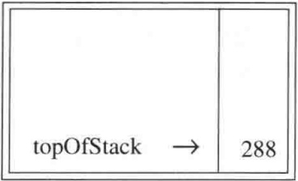

<details>
<summary>text_image</summary>

topOfStack → 288
</details>

计算一个后缀表达式花费的时间是 $O(N)$，因为对输入中的每个元素的处理都是由一些栈操作组成从而花费常数的时间。该算法的计算非常简单。注意，当一个表达式以后缀记号给出时，没有必要知道任何优先的规则。这是一个明显的优点。

## 中缀到后缀的转换

栈不仅可以用来计算后缀表达式(postfix expression)的值，而且还可以用栈将一个标准形式的表达式(或叫作中缀式(infix))转换成后缀式(postfix)。我们通过只允许操作+、\*、（、），并坚持普通的优先级法则而将一般的问题浓缩成小规模的问题。同时还要进一步假设表达式是合法的。设欲将中缀表达式

$$
a + b * c + (d * e + f) * g
$$

转换成后缀表达式。正确的答案是 $abc* + de*f + g* +$。

当读到一个操作数的时候，立即把它放到输出中。但运算符并不立即输出，而是必须先存在某个地方。正确的做法是将已经见到的运算符放进栈中而不是放到输出中。当遇到左圆括号时也要将其推入栈中。计算从一个空栈开始。

如果见到一个右括号，那么就将栈元素弹出，将弹出的符号写出直至遇到一个(对应的)左括号为止，但是这个左括号只被弹出并不输出。

---

90

数据结构与算法分析——C++语言描述(第四版)

如果见到任何其他的符号 [如+、\*、（]，那么我们从栈中弹出栈元素直到发现优先级更低的元素为止。有一个例外:除非是在处理一个)的时候，否则我们绝不从栈中移走(。对于这种操作，+的优先级最低，而(的优先级最高。当从栈弹出元素的工作完成后，我们再将运算符压入栈中。

最后，如果读到输入的末尾，则将栈元素弹出直到该栈变成空栈，再将这些符号写到输出中。

这个算法的思路是，当看到一个运算符的时候，先把它放到栈中。栈代表挂起的运算符。然而，栈中有些具有高优先级的运算符现在知道需要完成使用，应该被弹出，它们将不再处于挂起的状态。这样，在把当前运算符放入栈中之前，那些在栈中并在当前操作符之前要完成使用的运算符要被弹出。详细的解释见下表:

| 表达式 | 在处理第3个运算符时的栈 | 动作 |
| --- | --- | --- |
| a*b-c+d | - | -完成,+进栈 |
| a/b+c*d | + | 没有运算符完成操作,*进栈 |
| a-b*c/d | -* | *完成,/进栈 |
| a-b*c+d | -* | *和-完成,+进栈 |

圆括号增加了额外的复杂性。当左括号是一个输入符号时可以把它看成是一个高优先级的运算符(这样，挂起的那些操作符仍是挂起的)，而当它在栈中时把它看成是低优先级的运算符（从而不会被一个操作符意外地删除）。右括号被处理成特殊的情况。

为了理解这种算法的运行机制，我们将把上面长的中缀表达式转换成后缀形式。首先，符号 a 被读入，于是它被传向输出。然后，“+”被读入并被放入栈中。接下来 b 被读入并传向输出。这一时刻的状态如下:

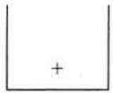

栈

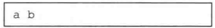

输出

接着\*号被读入。运算符栈的栈顶元素比\*的优先级低，故没有输出且\*进栈。接着，c 被读入并输出。至此，我们有

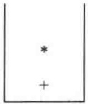

栈

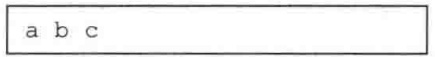

输出

后面的符号是一个+号。检查一下栈发现，我们需要将\*从栈弹出并把它放到输出中；再弹出栈中剩下的+号，该算符不比刚刚遇到的+号优先级低而是有相同的优先级；然后，将刚刚遇到的+号压入栈中。

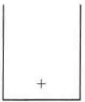

栈

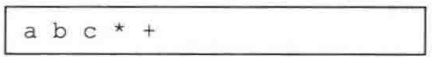

输出

---

第3章 表、栈和队列

91

下一个被读到的符号是一个(，由于有最高的优先级，因此它被放进栈中。然后，读入 d 并输出。

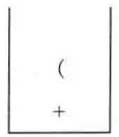

栈

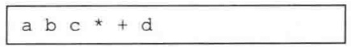

输出

继续进行，我们又读到一个\*。由于除非正在处理闭括号否则开括号不会从栈中弹出，因此没有输出。下一个字符是e，它被读入并输出。

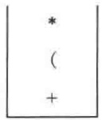

栈

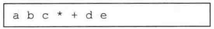

输出

再往后读到的符号是+。我们将\*弹出并输出，然后将+压入栈中。这以后，我们读到f并输出。

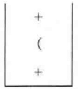

栈

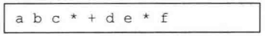

输出

这回，我们读到的是一个)，因此将栈元素直到(都弹出，我们输出一个+号。

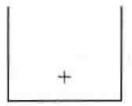

栈

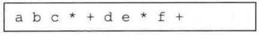

输出

下面又读到一个\*；该算符被压入栈中。然后，g 被读入并输出。

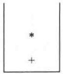

栈

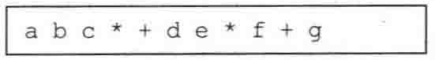

输出

现在输入为空，因此我们将栈中的符号全部弹出并输出，直到栈变成空栈。

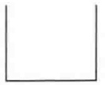

栈

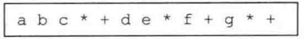

输出

与前面相同，这种转换工作只需要 $O(N)$ 的时间并经过一趟输入后完成。可以通过指定减法和加法有相同的优先级以及乘法和除法有相同的优先级而将减法和除法添加到指令集中去。需要注意的是，表达式 $\mathrm{a - b - c}$ 应转换成 $\mathrm{ab - c - }$ 而不是转换成 $\mathrm{abc - - }$ 。我们的算法做得正确，因为这些操作符是从左到右结合的。一般情况未必如此，比如下面的表达式就是从右到左结合的: $2^{2^3} = 2^8 = 256$ ，而不是 $4^{3} = 64$ 。我们将把取幂运算添加到运算符指令集中的问题留作练习。

---

92

数据结构与算法分析——C++语言描述(第四版)

## 函数调用

检测平衡符号的算法提出一种在编译的过程语言和面向对象的语言中实现函数调用的方式。这里的问题是，当调用一个新函数时，主调例程的所有局部变量需要由系统存储起来，因为否则被调用的新函数将会重写由主调例程的变量所使用的内存。不仅如此，主调例程的当前位置必须要存储，以便在新函数运行完成之后知道向哪里转移。这些变量一般由编译器指派给机器的一些寄存器，但存在某些冲突(通常所有的函数都是获取指定给1号寄存器的某些变量)，特别是涉及递归的时候。该问题类似于平衡符号，其原因在于，函数调用和函数返回基本上类似于开括号和闭括号，因此二者相同的思路都应该是行得通的。

当存在函数调用的时候,需要存储的所有重要信息,诸如寄存器的值(对应一些变量的名字)和返回地址(它可从程序计数器得到,一般情况是在一个寄存器中)等,都要以抽象的方式存在“一张纸上”并被置于一个堆(pile)的顶部。然后控制转移到新函数,这样就可以自由地用它的一些值替换这些寄存器。如果它又进行其他的函数调用,那么也遵循相同的过程。当该函数要返回时,它查看堆(pile)顶部的那张“纸”并复原所有的寄存器,然后进行返回转移。

显然，全部工作均可由一个栈来完成，而这正是在实现递归的每一种程序设计语言中实际发生的事实。所存储的信息或称为活动记录(activation record)，或叫作栈帧(stack frame)。在典型情况下，需要做轻微的调整:当前环境由栈顶描述。因此，一条返回语句就可给出前面的环境(不用复制)。在实际计算机中的栈常常是从内存分区的高端向下增长，而在许多的系统中是不检测溢出的。由于有太多的同时在运行着的函数，因此用尽栈空间的情况总是可能发生的。显而易见，用尽栈空间常是致命的错误。

在不进行栈溢出检测的语言和系统中，程序将会崩溃而没有明显的说明。在正常情况下我们不应该越出栈空间，发生这种情况通常是失控递归(忘记基准情形)产生的迹象。另一方面，某些完全合法并且表面上无害的程序也可以越出栈空间。图3.25中的例程打印一个容器，该例程完全合法，实际上是正确的。它正常地处理空容器的基准情形，并且递归也没问题。可以证明这个程序是正确的。然而遗憾的是，如果这个容器含有200 000个元素要打印，那么就要有表示第11行上嵌套调用的200 000个活动记录的一个栈。一般这些活动记录由于它们包含的全部信息而特别庞大，因此这个程序很可能要越出栈空间。(如果200 000个元素还不足以使程序崩溃，那么可用更大的数代替它。)

```c
/**
 * 从起点开始打印容器直到尾端，但不包括尾端.
 */
template <typename Iterator>
void print( Iterator start, Iterator end, ostream & out = cout )
{
    if( start == end )
        return;

    out << *start++ << endl;   // 打印并推进起点
    print( start, end, out );
}
```

图 3.25 递归的不当使用:打印一个容器

这个程序是称为尾递归(tail recursion)的使用极为不当的例子。尾递归指的是在最后一行

---

第3章 表、栈和队列

93

进行的递归调用。尾递归可以手工消除，做法是通过将代码放到一个 while 循环体中并借助每次对函数参数的一次赋值代替递归调用。它模拟了递归调用，因为什么也不需要存储。在递归调用结束之后，实际上没有必要知道那些存储的值。因此，我们就可以带着在一次递归调用中本应用过的那些值转移到函数的顶部。图 3.26 中的函数显示该算法生成的、改进后的程序。尾递归的去除是如此简单，以至于某些编译器能够自动地完成。但是即使如此，最好还是不要让我们自己的程序带着尾递归。

```txt
/**
 * 从起点开始打印容器到尾端但不包括尾端.
 */
template <typename Iterator>
void print( Iterator start, Iterator end, ostream & out = cout )
{
    while( true )
    {
        if( start == end )
            return;

        out << *start++ << endl;  // 打印并推进起点
    }
}
```

图3.26 不用递归打印一个容器，编译器可以做到(但不应你去做)

递归总能够被彻底去除(编译器是在转变成汇编语言时完成递归去除的)，但是这么做是相当冗长乏味的。一般做法是要求使用一个栈，而且仅当能够把最低限度的最小值放到栈上时这个方法才值得一用。我们将不对此做进一步的详细讨论，只是指出，虽然非递归程序一般说来确实比等价的递归程序要快，但是速度优势的代价却是由于去除递归而使得程序清晰性受到了影响。

## 3.7 队列 ADT

像栈一样，队列(queue)也是一种表。然而，使用队列时插入在一端进行而删除则在另一端进行。

## 3.7.1 队列模型

队列的基本操作是 enqueue(入队)，它是在表的末端(叫作队尾(rear))插入一个元素，以及 dequeue(出队)，它是删除(并返回)在表的开头(叫作队头(front))的元素。图 3.27 显示了一个队列的抽象模型。

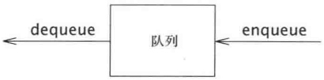

<details>
<summary>flowchart</summary>

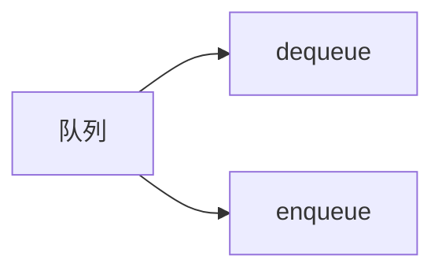
</details>

图3.27 队列模型

## 3.7.2 队列的数组实现

如同栈的情形一样，对于队列而言，任何表的实现都是合法的。像栈一样，对于每一种操作，链表实现和数组实现都给出快速的 $O(1)$ 运行时间。队列的链表实现简单直接，我们留作练习。下面讨论队列的数组实现。

---

94

数据结构与算法分析——C++语言描述(第四版)

对于每一个队列数据结构，我们保留一个数组 theArray 以及位置 front 和 back，它们代表队列的两端。我们还要记录实际存在于队列中的元素的个数 currentSize。下图表示处于某个中间状态的一个队列。

<table><tr><td></td><td></td><td></td><td>5</td><td>2</td><td>7</td><td>1</td><td></td><td></td><td></td></tr><tr><td colspan="5"> $\uparrow$ front</td><td colspan="5"> $\uparrow$ back</td></tr></table>

操作应该是清楚的。为使一个元素 x 入队(即执行 enqueue)，我们让 currentSize 和 back 增 1，然后置 theArray[back]=x。若使一个元素 dequeue(出队)，我们置返回值为 theArray[front]，且 currentSize 减 1，然后使 front 增 1。也可以有些其他方法(将在后面讨论)。现在论述对错误的检测。

上述实现存在一个潜在的问题。经过 10 次 enqueue 后队列似乎是满了，因为 back 现在是数组的最后一个下标，而下一次再 enqueue 就会是一个不存在的位置。然而，队列中也许只存在几个元素，因为若干元素可能已经出队了。像栈一样，即使在有许多操作的情况下队列也常常不是很大。

简单的解决方法是，只要 front 或 back 到达数组的尾端，它就又绕回到开头。下面诸图显示在某些操作期间的队列情况。这叫作循环数组 (circular array) 实现。

实施回绕所需要的附加代码是极小的(不过它可能使得运行时间加倍)。如果 front 或 back 增 1 导致超越了数组，那么其值就要重置到数组的第一个位置。

初始状态

<table><tr><td></td><td></td><td></td><td></td><td></td><td></td><td></td><td></td><td>2</td><td>4</td></tr><tr><td colspan="10"> $\uparrow$ front  $\uparrow$ back</td></tr></table>

经过 enqueue(1) 后

<table><tr><td>1</td><td></td><td></td><td></td><td></td><td></td><td></td><td></td><td>2</td><td>4</td></tr><tr><td colspan="7"> $\uparrow$ back</td><td colspan="3"> $\uparrow$ front</td></tr></table>

经过 enqueue(3) 后

<table><tr><td>1</td><td>3</td><td></td><td></td><td></td><td></td><td></td><td></td><td>2</td><td>4</td></tr><tr><td colspan="7"> $\uparrow$ back</td><td colspan="3"> $\uparrow$ front</td></tr></table>

经过dequeue并返回2后

<table><tr><td>1</td><td>3</td><td></td><td></td><td></td><td></td><td></td><td></td><td>2</td><td>4</td></tr><tr><td colspan="8"> $\uparrow$ back</td><td colspan="2"> $\uparrow$ front</td></tr></table>

经过dequeue并返回4后

<table><tr><td>1</td><td>3</td><td></td><td></td><td></td><td></td><td></td><td></td><td>2</td><td>4</td></tr><tr><td> $\uparrow$ front</td><td colspan="9"> $\uparrow$ back</td></tr></table>

---

第 3 章 表、栈和队列

95

经过dequeue并返回1后

<table><tr><td>1</td><td>3</td><td></td><td></td><td></td><td></td><td></td><td></td><td>2</td><td>4</td></tr><tr><td colspan="10"> $\uparrow$ backfront</td></tr></table>

经过dequeue并返回3后

同时使队列为空

<table><tr><td>1</td><td>3</td><td></td><td></td><td></td><td></td><td></td><td></td><td>2</td><td>4</td></tr><tr><td colspan="10"> $\uparrow$  back  $\uparrow$  front</td></tr></table>

有些程序设计员使用不同的方式表示队列的队头和队尾。例如，有人不使用一项来记录大小，因为他们依赖于当队列为空时 back=front-1 的基准情形。队列的大小通过比较 back 和 front 隐式地算出。这是一种非常隐秘的方法，因为存在某些特殊的情形，因此，如果想修改用这种方法编写的代码，那就要特别小心。如果 currentSize 不作为明确的数据成员被保留，那么当存在 theArray.capacity()-1 个元素时队列就满了，因为只有 theArray.capacity() 个不同的大小可被区分，而 0 又是其中的一个。可以采用任意一种我们喜欢的风格，但要确保我们的所有例程都是一致的。由于实现方法有多种选择，因此如果不使用 currentSize 这个数据成员，那就很可能有必要在代码中进行一些注释。

在确保 enqueue 的次数不会大于队列容量的应用中, 使用回绕是没有必要的。像栈一样, 除非主调例程肯定队列非空, 否则 dequeue 很少执行。因此对这种操作, 只要不是关键的代码, 错误的检测常常被跳过。一般说来这并不是无可非议的, 因为这样可能得到的时间节省量是极小的。

## 3.7.3 队列的应用

有许多算法使用队列给出高效运行时间。它们当中有些可以在图论中找到，我们将在第9章讨论它们。这里，先给出某些使用队列的简单例子。

当作业送交给一台打印机的时候，它们就以到达的顺序被排列起来。因此，被送往打印机的作业基本上被放到一个队列中。 $^{①}$

事实上，每一个实际生活中的排队都(应该)是一个队列。例如，在一些售票口排列的队伍都是队列，因为服务的顺序是先来到的先买票。

另一个例子是关于计算机网络的。有许多种 PC 的网络设置，其中磁盘是放在一台叫作文件服务器 (file server) 的机器上的。使用其他计算机的用户是按照先到先使用的原则访问文件的，因此其数据结构是一个队列。

进一步的例子如下:

- 当所有的接线员忙不开的时候，对大公司的呼叫一般都被放到一个队列中。
● 在大型的大学里，如果所有的终端都被占用，由于资源有限，学生们必须在一个等待

<small><span class="docvortex-page-footnote" data-block-type="page_footnote" style="color:#6b7280">① 我们说基本上是因为作业可以被除去。这等于从队列的中间进行的一次删除，它违反了队列的严格定义。</span></small>

---

96

数据结构与算法分析——C++语言描述(第四版)

表上签字登记。在终端上待得时间最长的学生将首先被强制离开，而等待时间最长的学生则将是下一个被允许使用终端的用户。

称为排队论(queueing theory)的整个数学分支处理用概率的方法计算用户预计要排队等待多长时间才会得到服务、等待服务的队伍能够排多长，以及其他一些诸如此类的问题。问题的答案依赖于用户参与排队的频繁程度，以及一旦用户得到服务时处理服务花费的时间。这两个参数作为概率分布函数给出。在一些简单的情况下，答案可以解析地算出。一种简单情况的例子是一条电话线有一个接线员。如果接线员忙，打来的电话就被放到一个等待队列中(一直放到某个最大的限度为止)。这个问题在商业上很重要，因为研究表明，人们会很快挂上电话。

如果有 $k$ 个接线员，那么这个问题解决起来要困难得多。解析求解困难的问题往往使用模拟的方法进行。此时，我们需要使用一个队列来进行模拟。如果 $k$ 很大，那么还需要其他一些数据结构来使得模拟更有效地进行。在第6章将会看到这种模拟是如何进行的。那时我们将对 $k$ 的若干值进行模拟并选择能够给出合理等待时间的最小的 $k$。

队列还有其他丰富的用途，正如栈一样，这样一种简单的数据结构竟然能够如此重要，实在令人惊奇。

## 小结

本章描述了一些 ADT 的概念，并且利用 3 种最常见的抽象数据类型阐述了这种概念。主要目的就是将 ADT 的具体实现与它们的功能分开。程序必须知道操作都做些什么，但是如果不知道如何去做那就更好。

表、栈和队列或许在全部计算机科学中是 3 个基本的数据结构，大量的例子证明了它们广泛的用途。特别地，我们看到栈是如何用来记录函数调用的，以及递归实际上是如何实现的。这对于我们的理解非常重要，其原因不只因为它使得过程语言成为可能，而且还因为知道递归的实现从而消除了围绕其使用的大量迷团。虽然递归非常强大，但它并不是完全随意操作的，递归的误用和乱用可能导致程序崩溃。

## 练习

3.1 给定一个表 L 和另一个表 P，它们包含以升序排列的整数。操作 printLots(L, P) 将打印 L 中那些由 P 所指定的位置上的元素。例如，如果 P = 1, 3, 4, 6，那么，L 中位于第 1 个、第 3 个、第 4 个和第 6 个位置上的元素被打印出来。写出过程 printLots(L, P)。只可使用公有型 STL 容器操作。该过程的运行时间是多少？

3.2 通过只调整链(而不是数据)来交换两个相邻的元素, 分别使用

a. 单链表。

b. 双向链表。

3.3 实现 STL 的 find 例程，该例程返回一个 iterator，后者包含从 start 开始并扩展到(但不包括)end 的范围内第 1 次出现的 x。若没发现 x，则返回 end。这是一个非类(全局)函数，其特征如下:

---

第3章 表、栈和队列

97

```typescript
template <typename Iterator, typename Object>
iterator find( Iterator start, Iterator end, const Object & x );
```

3.4 给定两个已排序的表 $L_{1}$ 和 $L_{2}$，只使用基本的表操作编写计算 $L_{1} \cap L_{2}$ 的过程。

3.5 给定两个已排序的表 $L_{1}$ 和 $L_{2}$，只使用基本的表操作编写计算 $L_{1} \cup L_{2}$ 的过程。

3.6 Josephus 问题 (Josephus problem) 是下面的游戏: $N$ 个人编号 $1 \sim N$, 围坐成一个圆圈。从 1 号人开始传递一个热土豆。经过 $M$ 次传递后拿着热土豆的人被清除离座, 围坐的圆圈缩紧, 由坐在被清除人后面的人拿起热土豆继续进行游戏。最后剩下的人获胜。因此, 如果 $M = 0$ 和 $N = 5$, 则游戏人依序被清除, 5 号游戏人获胜。如果 $M = 1$ 和 $N = 5$, 那么被清除的人的顺序是 2, 4, 1, 5。

a. 编写一个程序解决在 M 和 N 为一般的值下的 Josephus 问题，应使所编程序尽可能地高效率，要确保各个单元都能被清除。
b. 这个程序的运行时间是多少？
c. 如果 $M = 1$，这个程序的运行时间又是多少？对于 $N$ 的一些大值 $(N > 100000)$，delete 例程如何影响该程序的速度？

3.7 修改 Vector 类以添加索引的越界检测。

3.8 把 insert 和 erase 添加到 Vector 类中。

3.9 按照 C++ 标准，对于本章中的 vector，调用 push\_back、pop\_back、insert 或 erase 都将使所有指向 vector 的迭代器失效(潜在地使迭代器过期而不再适用)。为什么？

3.10 通过使用迭代器类类型而不是指针变量来修改 Vector 类以提供严格的迭代器检测。最困难的部分是处理过期的迭代器，详见练习 3.9。

3.11 假设单链表使用一个头节点来实现，但无尾节点，并假设它只保留指向头节点的指针。编写一个类，包含以下一些方法:

a. 返回该链表的大小。
b. 打印该链表。
c. 测试是否值 x 含于该链表。
d. 如果值 x 尚未含于该链表，把值 x 添加到该链表中。
e. 如果值 x 含于该链表，将 x 从该链表中删除。

3.12 以排序的顺序保持单链表，重复练习 3.11。

3.13 对 List 迭代器类添加对 operator-的支持。

3.14 在 STL 的迭代器中向前搜索需要用到 operator++ 的操作，这样将会依次推进该迭代器。不过在有些情况下不用推进迭代器而查看表的下一项可能更可取。使用下述声明:

```txt
const_iterator operator+( int k ) const;
```

编写成员函数以在一般情形下简化操作。二元运算符 operator+返回一个对应当前位置前 k 个位置的迭代器。

3.15 将 splice 操作添加到 List 类中。该方法声明

```txt
void splice( iterator position, List<T> & lst );
```

将所有的项从 lst 中删除，把它们放到 List \*this 中的 position 之前，而 lst 和 \*this 必须是两个不同的表，所编写的程序必须以常数时间运行。

---

98

数据结构与算法分析——C++语言描述(第四版)

3.16 将反向迭代器 (reverse iterator) 添加到 STL List 类的实现中。定义 reverse\_iterator 和 const\_reverse\_iterator。添加 rbegin 方法和 rend 方法以返回适当的反向迭代器，分别表示尾端标记前的位置和头节点的位置。反向迭代器内在地反转++操作和--操作的含义。通过使用代码

```cpp
List<Object>::reverse_iterator itr = L.rbegin( );
while( itr != L.rend( ) )
    cout << *itr++ << endl;
```

应该能够反向打印表 L。

3.17 修改 List 类，通过使用在 3.5 节末尾提出的想法来提供严格的迭代器检测。
3.18 当一个 erase 方法用于 list 类对象时, 它将使得正在指向被删除的节点的任何 iterator 失效。这样的迭代器就称为过期(stale)的。描述一种高效的算法, 保证对过期迭代器的操作就好像迭代器的 current 是 nullptr。注意, 可能存在多个过期迭代器。为了实现你的算法, 必须解释哪些类需要重新编写。
3.19 不使用头节点和尾节点重写 List 类，并描述该类与 3.5 节提供的类之间的区别。
3.20 不同于我们已经给出的删除方法，另一种思路是使用懒惰删除(lazy deletion)的删除方法。为了删除一个元素，我们只是标记上该元素被删除(使用一个附加的位域(bit field))。表中被删除和未被删除元素的个数作为数据结构的一部分被保留。如果被删除元素和未被删除元素一样多，则遍历整个表，对所有被标记的节点执行标准的删除算法。

a. 列出懒惰删除的优点和缺点。
b. 编写使用懒惰删除实现标准链表操作的相应例程。

3.21 用下列语言编写检测平衡符号的程序:

a. Pascal(begin/end,(), [], {} )。
b. C++(/\* \*/, (), [], {} )。
\*c. 解释如何打印出一条错误信息，该信息极有可能反映出错的原因。

3.22 编写一个程序计算后缀表达式的值。

3.23 a. 写出一个程序，将包含 $(,), +, -, *, /$ 等符号的中缀表达式转换成后缀表达式。

b. 将取幂运算符添加到你的指令系统中。
c. 编写一个程序将后缀表达式转换成中缀表达式。

3.24 编写只用一个数组而实现两个栈的例程。这些栈例程不应该声明溢出，除非数组中的每个单元都被使用。

3.25 \*a. 提出一种数据结构，支持栈 push 和 pop 操作以及第 3 种操作 findMin，它返回该数据结构中的最小元素。所有操作均以 O(1) 最坏情形时间运行。

\*b. 证明，如果添加找出并删除最小元素的第4种操作 deleteMin，那么至少有一种操作必然花费 $\Omega (\log N)$ 时间。（本题需要阅读第7章。）

\*3.26 指出如何用一个数组实现三个栈结构。
3.27 在 2.4 节中用于计算斐波那契数的递归例程如果对 N = 50 运行，栈空间有可能用完吗？为什么？

---

第3章 表、栈和队列

99

3.28 双端队列(deque)是由一些项的一个表组成的数据结构, 对该数据结构可以进行下列操作:

push(x): 将项 x 插入到双端队列的前端。

pop(): 从双端队列中删除前端项并将其返回。

inject(x): 将项 x 插入到双端队列的尾端。

eject(): 从双端队列中删除尾端项并将其返回。

编写支持双端队列的例程，其中的每种操作均花费  $O(1)$  的时间。

3.29 编写以倒序打印单链表的算法，只使用常数的附加空间。本题意味着，不能使用递归但可以假设该算法是表的一个成员函数。如果该例程是一个常量成员函数，那么这样的一种算法还能不能写出？

3.30 a. 写出自调整表(self-adjusting list)的数组实现。在自调整表中，所有的插入都在前端进行。自调整表添加一个 find 操作，当一个元素被 find 访问时，它就被移到表的前端但并不改变其余的项的相对顺序。

b. 写出自调整表的链表实现。

\*c. 设每个元素都有其被访问的固定的概率  $p_{i}$ 。证明那些具有最高访问概率的元素都有望靠近表的前端。

3.31 使用单链表高效实现栈类，但不用头节点和尾节点。

3.32 使用单链表高效实现队列类，但不用头节点和尾节点。

3.33 使用循环数组(circular array)高效实现队列类。可以使用一个 vector(而不是使用原始数组)作为底层数组结构。

3.34 如果从某个节点 $p$ 开始，接着跟有足够数目的 next 链将把我们带回到节点 $p$，那么这个链表包含一个循环。$p$ 不必是该表的第一个节点。假设给定一个链表，它包含 $N$ 个节点，但 $N$ 的值是未知的。

a. 设计一个  $O(N)$  算法以确定是否该表包含有循环。可以使用  $O(N)$  的附加空间。

\*b. 重复(a)部分，但是只使用 O(1) 的附加空间。(提示:使用两个迭代器，它们最初在表的开始处，但以不同的速度推进。)

3.35 实现队列的一种方法是使用一个循环链表(circular linked list)。在循环链表中，最后一个节点的 next 指针指向第 1 个节点。假设该链表不包含头节点，并假设最多可以保留一个迭代器，它对应链表中的一个节点。对于下列的哪种表示方式，所有的基本队列操作都可以以常数最坏情形时间执行？证明你的答案是正确的。

a. 保留一个迭代器，它对应该链表的第一项。

b. 保留一个迭代器，它对应该链表的最后一项。

3.36 设有一个指针指向单链表的一个节点，而这个节点保证不是该表的最后的节点。我们没有指向任何其他节点的指针(除非通过后面的一些链)。描述一个 $O(1)$ 算法，该算法逻辑上从该链表删除存储在这样一个节点上的值，同时保持链表的完整性。(提示:涉及下一个节点。)

3.37 设单链表是用一个头节点和一个尾节点实现的。描述下述操作的常数时间算法:

a. 在位置 p (该位置由一个迭代器给出) 前插入一项 x。

b. 删除存储在位置 p (该位置由一个迭代器给出) 的项。
