# 第5章 散列

原始 PDF 第 169–209 页。

## 第5章 散列

我们在第 4 章讨论了查找树 ADT，它允许对元素的集合进行各种操作。本章讨论散列表 (hash table) ADT，不过它只支持二叉查找树所允许的一部分操作。

散列表的实现常常叫作散列(hashing)。散列是一种用于以常数平均时间执行插入、删除和查找的技术。但是，那些需要元素间任何序信息的树操作在这里将不会得到有效的支持。因此，诸如 findMin、findMax 以及以线性时间将排过序的整个表进行打印的操作都是散列所不支持的。

本章的中心数据结构是散列表(hash table)。我们将

- 看到实现散列表的几种方法。
- 解析地比较这些方法。
- 介绍散列的多种应用。
- 将散列表与二叉查找树进行比较。

## 5.1 一般想法

理想的散列表数据结构只不过是一个包含一些项(item)的具有固定大小的数组。第4章讨论过，查找一般是对项的某个部分(即数据域)进行。这部分就叫作关键字(key)。例如，一项可以由一个字符串(它可以作为关键字)和一些附加的数据成员(例如姓名，它是大型雇员结构的一部分)组成。我们把表的大小记作TableSize，并将其理解为散列数据结构的一部分而不仅

仅是浮动于全局的某个变量。通常的习惯是让表从 0 到 TableSize - 1 变化，稍后我们就会明白为什么要这样。

每个关键字被映射到从0到TableSize-1这个范围中的某个数，并且被放到适当的单元中。这个映射就叫作散列函数(hash function)，理想情况下它应该算起来简单并且应该保证任何两个不同的关键字都要映射到不同的单元。但是，这显然是不可能的，因为单元的数目是有限的，而关键字实际上是用不完的。因此，我们寻找一个散列函数，该函数要在单元之间均匀地分配关键字。图5.1是一个典型的完美情况。在这个例子中，john散列到3，phil散列到4，dave散列到6，mary散列到7。

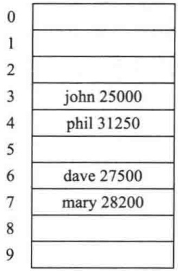

<details>
<summary>text_image</summary>

0

1

2

3
john 25000
4
phil 31250
5

6
dave 27500
7
mary 28200
8

9
</details>

图5.1 一个理想的散列表

这就是散列的基本想法。剩下的问题就是要选择一个函数，决定当两个关键字散列到同一个值的时候(这叫作冲突(collision))应该做什么以及如何确定散列表的大小。

## 5.2 散列函数

如果输入的关键字是整数，则一般合理的方法就是直接返回 Key mod TableSize，除非 Key 碰巧具有某些不理想的性质。在这种情况下，散列函数的选择需要仔细地考虑。例如，若表

---

156

数据结构与算法分析——C++语言描述(第四版)

的大小是 10 而关键字都以 0 为个位，则此时上述标准的散列函数就是一个坏的选择。其原因将在后面看到。而为了避免上面那样的情况，好的办法通常是保证表的大小是素数。当输入的关键字是随机整数时，这个函数此时不仅算起来非常简单而且关键字的分配也很均匀。

通常，关键字是字符串。在这种情形下，散列函数需要仔细选择。

一种选择方法是把字符串中字符的 ASCII 码值加起来。图 5.2 中的例程实现的就是这种策略。

图 5.2 中描述的散列函数实现起来简单而且能够很快地算出答案。不过，如果表过大，则函数将不会很好地分配关键字。例如，设 TableSize = 10 007 (10 007 是素数)，并设所有的关键字均为 8 个或更少个字符长。由于 ASCII 字符的值最多是 127，因此散列函数只能假设值在 0 和 1016 之间，其中 1016 为 127\*8。显然这不是一种合理的分配。

```c
int hash( const string & key, int tableSize )
{
    int hashVal = 0;

    for( char ch : key )
        hashVal += ch;

    return hashVal % tableSize;
}
```

图5.2 一个简单的散列函数

另一个散列函数由图 5.3 表示。这个散列函数假设 Key 至少有 3 个字符。值 27 表示英文字母表的字母外加一个空格的个数，而 729 是 $27^{2}$ 。该函数只考查前 3 个字符，但是，假如它们是随机的，而表的大小像前面那样还是 10007，那么我们就会得到一个合理的均衡分布。可不巧的是，英文不是随机的。虽然 3 个字符（忽略空格）有 $26^{3} = 17576$ 种可能的组合，但查验合理的足够大的联机词典却揭示:3 个字母的不同组合数实际只有 2851。即使这些组合没有冲突，也不过只有表的 $28\%$ 被真正散列到。因此，虽然很容易计算，但是，如果散列表就算大小适当，那么这个函数也还是不合适的。

```c
int hash( const string & key, int tableSize )
{
    return ( key[ 0 ] + 27 * key[ 1 ] + 729 * key[ 2 ] ) % tableSize;
}
```

图5.3 另一个可能的散列函数——不是太好

图5.4列出了散列函数的第3种尝试。这个散列函数涉及到关键字中的所有字符，并且一般可以分布得很好(它计算 $\sum_{i=0}^{\text{KeySize-1}}\text{Key}\ [KeySize-i-1]\cdot 37^i$，并将结果限制在适当的范围)。程序根据Horner法则计算一个(37的)多项式函数。例如，计算 $h_k = k_0 + 37k_1 + 37^2k_2$ 的另一种方式是借助于公式 $h_k = ((k_2)*37 + k_1)*37 + k_0$ 进行。Horner法则将其扩展到用于 $n$ 次多项式。

这个散列函数利用到以下事实:允许溢出，同时用到 unsigned int 型量以避免引进负数。

图 5.4 所描述的散列函数就表的分布而言未必是最好的,但是确实具有极其简单的优点而且速度也很快。如果关键字特别长,那么该散列函数计算起来将会花费过多的时间。在这种情况下通常的经验是不使用所有的字符。此时关键字的长度和性质将影响选择。例如,关键

---

第5章 散列

157

字可能是完整的街道地址，散列函数可以包括街道地址的几个字符，也许还有城市名和邮政区码的几个字符。有些程序设计人员通过只使用奇数位置上的字符来实现他们的散列函数，这里有这么一层想法:用计算散列函数节省下的时间来补偿轻微地不均匀分布的函数。

剩下的主要编程细节是解决冲突的消除问题。如果当一个元素被插入时与一个已经插入的元素散列到相同的值，那么就产生一个冲突(collision)，这个冲突需要消除。解决这种冲突的方法有几种，我们将讨论其中最简单的两种:分离链接法和开放定址法；然后再考查一些最近发现的可供选择的方法。

```c
/**
 * 字符串对象的散列例程.
 */
unsigned int hash( const string & key, int tableSize )
{
    unsigned int hashVal = 0;

    for( char ch : key )
        hashVal = 37 * hashVal + ch;

    return hashVal % tableSize;
}
```

图5.4 一个好的散列函数

## 5.3 分离链接法

解决冲突的第一种方法通常叫作分离链接法(separate chaining)，其做法是将散列到同一个值的所有元素保留到一个链表中。我们可以使用标准库(Standard Library)中表的实现方法。如果空间很紧，则更可取的方法是避免使用它们(因为这些表双向链接并且浪费空间)。本节

假设关键字是前 10 个完全平方数并设散列函数就是  $hash(x) = x \mod 10$ 。（表的大小不是素数，用在这里是为了简单。）图 5.5 显示的是最后得到的分离链接散列表。

为执行一次 search，我们使用散列函数来确定究竟遍历哪个链表。然后再在适当的链表中执行一次查找。为执行 insert，我们检查相应的链表看看该元素是否已经处在相应的位置（如果允许插入重复元，那么通常要留出一个额外的数据成员，当出现匹配事件时这个数据成员增 1）。如果这个元素是个新的元素，那么它将被插入到链表的前端，这不仅因为方便，而且还因为常常发生这样的事实:新近插入的元素最有可能不久又被访问。

实现分离链接法所需要的类接口在图 5.6 中表出。散列表存储一个链表数组，它们在构造函数中被指定。

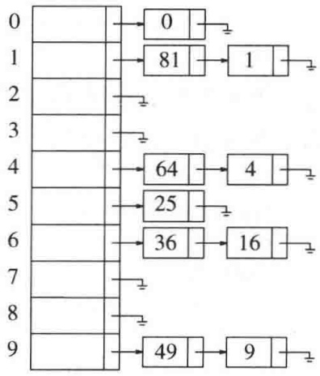

<details>
<summary>flowchart</summary>

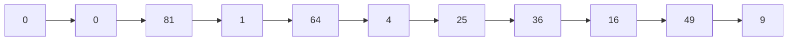
</details>

图5.5 分离链接散列表

类接口阐释一个语法要点:在 C++11 之前，在 theLists 的声明中，两个>之间需要一个空格。因为>>是一个 C++记号，而且比>长，所以>>总是被当作一个记号。但是在 C++11 中，情况则不再是这样。

---

158

数据结构与算法分析——C++语言描述(第四版)

```cpp
template <typename HashedObj>
class HashTable
{
    public:
        explicit HashTable( int size = 101 );

        bool contains( const HashedObj & x ) const;

        void makeEmpty( );
        bool insert( const HashedObj & x );
        bool insert( HashedObj && x );
        bool remove( const HashedObj & x );

    private:
        vector<list<HashedObj>> theLists;      // 链表的数组
        int currentSize;

        void rehash( );
        size_t myhash( const HashedObj & x ) const;
};
```

图 5.6 分离链接散列表的类型声明

就像二叉查找树只对那些 Comparable 的对象有效一样，本章中的散列表只对提供散列函数和等号操作符(equality operator)(operator==或 operator!=，或二者同时提供)的对象适用。

我们让散列函数只用对象作为参数并返回适当的整型量，而不再要求散列函数采用对象和表的大小同时作为参数。此时标准的做法是使用函数对象，以及在 C++11 中引进的散列表协议。特别地，在 C++11 中，散列函数可以通过函数对象模板来表示:

```cpp
template <typename Key>
class hash
{
    public:
        size_t operator() ( const Key & k ) const;
};
```

这个模板的默认实现均被提供给诸如 int 和 string 这样的标准类型。这样，图 5.4 所描述的散列函数可以实现如下:

```cpp
template <>
class hash<string>
{
    public:
        size_t operator()( const string & key )
        {
            size_t hashVal = 0;

            for( char ch : key )
                hashVal = 37 * hashVal + ch;

            return hashVal;
        }
};
```

---

第5章 散列

159

类型 size\_t 是无符号整型，用于表示对象的大小。因此，保证能够存储数组下标。一个实现散列表算法的类此时可以使用对泛型散列函数对象的调用，以生成整型的 size\_t，然后将结果换算成适当的数组下标。在我们的散列表中，这清楚地显示在私有成员函数 myhash 中，见图 5.7。

```cpp
size_t myhash( const HashedObj & x ) const
    {
        static hash<HashedObj> hf;
        return hf( x ) % theLists.size( );
    }
```

图5.7 散列表的myhash成员函数

图 5.8 阐释了一个 Employee 类，它可以被存储在泛型散列表中，使用 name 成员作为关键字。Employee 类通过提供相等操作符和散列函数对象来实现 HashedObj 的要求。

```cpp
// 一个 Employee 类的例
class Employee
{
    public:
        const string & getName( ) const
            { return name; }

        bool operator==( const Employee & rhs ) const
            { return getName( ) == rhs.getName( ); }
        bool operator!=( const Employee & rhs ) const
            { return !( *this == rhs; }

        // 其余公有成员没再列出

    private:
        string name;
        double salary;
        int     seniority;

        // 其余的私有成员没再列出
};

template<>
class hash<Employee>
{
    public:
        size_t operator()( const Employee & item )
        {
            static hash<string> hf;
            return hf( item.getName( ) );
        }
};
```

图 5.8 可以用作 HashedObj 的类的例子

实现 makeEmpty、contains 和 remove 的代码如图 5.9 所示。

接下来就是插入例程。如果被插入的项已经存在，那么我们就什么也不做；否则，我们将其放入表中(见图 5.10)。该元素可以被放到表中的任何位置。在这里的情形下使用 push\_back 是最方便的。whichList 是一个引用变量，见 1.5.2 节关于引用变量这种用法的讨论。

---

160

数据结构与算法分析——C++语言描述(第四版)

```txt
void makeEmpty( )
{
    for( auto & thisList : theLists )
        thisList.clear( );
}

bool contains( const HashedObj & x ) const
{
    auto & whichList = theLists[ myhash( x ) ];
    return find( begin( whichList ), end( whichList ), x ) != end( whichList );
}

bool remove( const HashedObj & x )
{
    auto & whichList = theLists[ myhash( x ) ];
    auto itr = find( begin( whichList ), end( whichList ), x );

    if( itr == end( whichList ) )
        return false;

    whichList.erase( itr );
    --currentSize;
    return true;
}
```

图 5.9 分离链接散列表的 makeEmpty、contains 和 remove 例程

```txt
bool insert( const HashedObj & x )
{
    auto & whichList = theLists[ myhash( x ) ];
    if( find( begin( whichList ), end( whichList ), x ) != end( whichList ) )
        return false;
    whichList.push_back( x );

    // 再散列; 见 5.5节
    if( ++currentSize > theLists.size( ) )
        rehash( );

    return true;
}
```

图 5.10 分离链接散列表的 insert 例程

除链表外，任何合理的方案也都可以解决冲突现象，一棵二叉查找树或甚至另一个散列表都将胜任这个工作，但是我们期望，如果散列表是大的并且散列函数是好的，那么所有的链表都应该是短的，从而基本的分离链接法就没有必要再尝试任何复杂的手段了。

我们定义散列表的装填因子(load factor) $\lambda$ 为散列表中的元素个数对该表大小的比。在上面的例子中， $\lambda=1.0$ 。链表的平均长度为 $\lambda$ 。执行一次查找所需要的代价，是计算散列函数值所需要的常数时间加上遍历链表所用的时间。在一次不成功的查找中，要考查的节点数平均为 $\lambda$ 。一次成功的查找则需要遍历大约 $1+(\lambda/2)$ 个链。为了看清这一点，注意被搜索的链表包含一个存储匹配值的节点再加上0个或更多其他的节点。在N个元素的散列表以及M个链表中，

---

第5章 散列

161

“其他节点”的期望个数为 $(N-1)/M=\lambda-1/M$ ，它基本上就是 $\lambda$ ，因为假设M是大的。平均看来，一半的“其他”节点被搜索，再结合匹配节点，我们得到 $1+\lambda/2$ 个节点的平均查找代价。这个分析指出，散列表的大小实际上并不重要，而装填因子才是重要的。分离链接散列法的一般法则是让表的大小大致与预料的元素个数差不多(换句话说，让 $\lambda\approx1$ )。在图5.10的程序中，如果装填因子超过1，那么我们通过调用在第10行上的rehash函数扩大散列表的大小。rehash将在5.5节讨论。正如前面提到的，使表的大小是素数以保证一个好的分布，这也是一个好想法。

## 5.4 不用链表的散列表

分离链接散列算法的缺点是使用一些链表。由于给新单元分配地址需要时间(特别是在其他语言中)，因此这就导致算法的速度有些减慢，同时算法实际上还要求对第二种数据结构的实现。另外一种不用链表解决冲突的方法是尝试另外一些单元，直到找出空的单元为止。更一般地，单元 $h_0(x), h_1(x), h_2(x), \cdots$ 相继被试选，其中 $h_i(x) = (\text{hash}(x) + f(i)) \mod \text{TableSize}$，且 $f(0) = 0$。函数 $f$ 是冲突解决方法。因为所有的数据都要置入表内，所以这种解决方案所需要的表要比分离链接散列的表大。一般说来，对于不使用分离链接的散列表来说，其装填因子应该低于 $\lambda = 0.5$。我们把这样的表叫作探测散列表(probing hash table)。现在我们就来考察3种通常的冲突解决方案。

## 5.4.1 线性探测法

在线性探测法中，函数 $f$ 是 $i$ 的线性函数，典型的情形是 $f(i) = i$ 。这相当于相继探测逐个单元(必要时可以回绕)以查找出一个空单元。图5.11显示使用与前面相同的散列函数将诸关键字{89, 18, 49, 58, 69}插入到一个散列表中的情况，而此时的冲突解决方法就是 $f(i) = i$ 。

|  | 空表 | 插入89后的表 | 插入18后的表 | 插入49后的表 | 插入58后的表 | 插入69后的表 |
| --- | --- | --- | --- | --- | --- | --- |
| 0 |  |  |  | 49 | 49 | 49 |
| 1 |  |  |  |  | 58 | 58 |
| 2 |  |  |  |  |  | 69 |
| 3 |  |  |  |  |  |  |
| 4 |  |  |  |  |  |  |
| 5 |  |  |  |  |  |  |
| 6 |  |  |  |  |  |  |
| 7 |  |  |  |  |  |  |
| 8 |  |  | 18 | 18 | 18 | 18 |
| 9 |  | 89 | 89 | 89 | 89 | 89 |

图5.11 使用线性探测法得到的散列表，每次插入后的情况

第一个冲突在插入关键字 49 时产生，它被放入下一个空闲位置，即位置 0，该位置是开放的。关键字 58 先与 18 冲突，再与 89 冲突，然后又和 49 冲突，试选 3 次之后才找到一个空位置。对 69 的冲突用类似的方法处理。只要表足够大，总能够找到一个空闲位置，但是如此花费的时间是相当多的。更糟的是，即使表相对较空，这样占据的位置也会开始形成一些区块，其结果称为一次聚集 (primary clustering)，就是说，散列到区块中的任何关键字都需要多次试选单元才能够解决冲突，然后该关键字被添加到相应的区块中。

虽然我们不在这里进行具体计算，但是可以证明，使用线性探测的期望探测次数对于插

---

162

数据结构与算法分析——C++语言描述(第四版)

入和不成功的查找来说大约为 $\frac{1}{2} (1 + 1 / (1 - \lambda)^2)$，而对于成功的查找来说则是 $\frac{1}{2} (1 + 1 / (1 - \lambda))$。相关的一些计算多少有些复杂。从程序中容易看出，插入和不成功查找需要相同次数的探测。略加思考不难得出，成功查找应该比不成功查找平均花费较少的时间。

如果聚集不成为问题，那么对应的公式相当容易得到。我们将假设有一个很大的散列表，并设每次探测都与前面的探测无关。对于随机冲突解决方法而言，这些假设是成立的，并且当 $\lambda$ 不是非常接近于1时也是合理的。首先，我们导出在一次不成功查找中探测的期望次数，而这正是直到我们找到一个空闲位置探测的期望次数。由于空单元所占的份额为 $1 - \lambda$ ，因此我们预计要探测的位置数是 $1 / (1 - \lambda)$ 。一次成功查找的探测次数等于该特定元素插入时所需要的探测次数。当一个元素被插入时，可以看成进行一次不成功查找的结果。因此，我们可以使用一次不成功查找的开销来计算一次成功查找的平均开销。

需要指出，$\lambda$ 是从0到其当前值之间变化，因此越早的插入操作开销越少，从而将平均开销拉低。例如，在上面的表5.11中，$\lambda = 0.5$，访问18的开销是在18被插入时确定的，此时 $\lambda = 0.2$。由于18是插入到一个相对空的散列表中，因此对它的访问应该比新近插入的元素(比如69)的访问更容易。可以通过使用积分计算插入时间的平均值的方法来估计平均值，如此得到:

$$
I (\lambda) = \frac {1}{\lambda} \int_ {0} ^ {\lambda} \frac {1}{1 - x} \mathrm{d} x = \frac {1}{\lambda} \ln \frac {1}{1 - \lambda}
$$

这些公式显然优于线性探测那些相应的公式。聚集不仅是理论上的问题，而且实际上也发生在具体的实现中。

图5.12 把线性探测的性能(虚曲线)与从更随机的冲突解决方法中期望的性能进行了比较。成功查找用 $S$ 标示，不成功查找和插入分别用 $U$ 和 $I$ 标记。

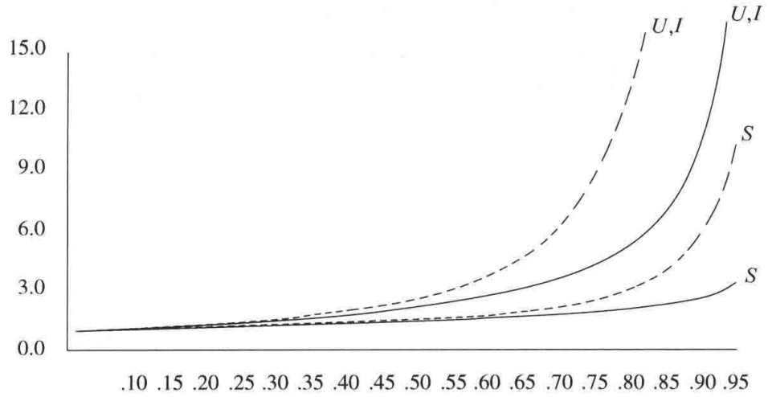

<details>
<summary>line</summary>

| X | U,I (dashed) | S (solid) | Solid Line |
| --- | --- | --- | --- |
| 0.10 | ~0.8 | ~0.8 | ~0.8 |
| 0.20 | ~1.2 | ~1.0 | ~1.0 |
| 0.30 | ~1.8 | ~1.2 | ~1.2 |
| 0.40 | ~2.5 | ~1.4 | ~1.4 |
| 0.50 | ~3.5 | ~1.6 | ~1.6 |
| 0.60 | ~5.0 | ~1.8 | ~1.8 |
| 0.70 | ~7.5 | ~2.2 | ~2.2 |
| 0.80 | ~12.0 | ~3.0 | ~2.5 |
| 0.90 | — | ~6.0 | ~3.0 |
| 0.95 | — | ~15.0 | ~3.5 |
</details>

图 5.12 对线性探测(虚线)和随机方法的装填因子画出的探测次数(S为成功查找，U为不成功查找，而I为插入)

如果 $\lambda = 0.75$ ，那么上面的公式指出，对在线性探测中的一次插入预计用到8.5次探测。如果 $\lambda = 0.9$ ，则预计为50次探测，这就有些离谱了。假如聚集不是问题，那么这可与相应装填因子下的4次和10次探测相比。从这些公式看到，如果表可以有多于一半被填满的话，那么线性探测就不是个好办法。然而，如果 $\lambda = 0.5$ ，那么插入操作平均只需要2.5次探测，并且对于成功的查找平均只需要1.5次探测。

---

第5章 散列

163

## 5.4.2 平方探测法

平方探测是消除线性探测中一次聚集问题的冲突解决方法。平方探测是我们通常预期的——冲突函数为二次的探测方法。流行的选择是 $f(i)=i^{2}$ 。图5.13显示了与前面线性探测例子相同的输入使用该冲突函数所得到的散列表。

|  | 空表 | 插入89后的表 | 插入18后的表 | 插入49后的表 | 插入58后的表 | 插入69后的表 |
| --- | --- | --- | --- | --- | --- | --- |
| 0 |  |  |  | 49 | 49 | 49 |
| 1 |  |  |  |  |  |  |
| 2 |  |  |  |  | 58 | 58 |
| 3 |  |  |  |  |  | 69 |
| 4 |  |  |  |  |  |  |
| 5 |  |  |  |  |  |  |
| 6 |  |  |  |  |  |  |
| 7 |  |  |  |  |  |  |
| 8 |  |  | 18 | 18 | 18 | 18 |
| 9 |  | 89 | 89 | 89 | 89 | 89 |

图 5.13 利用平方探测得到的散列表，每次插入后的情况

当 49 与 89 冲突时，其下一个位置为下一个单元，该位置是空的，因此 49 就被放在那里。接着，58 在位置 8 处产生冲突，其后相邻的位置经探测得知发生了另外的冲突。下一个探测的位置在距位置 8 为 $2^{2} = 4$ 远处，这个位置是个空闲位置。因此，关键字 58 就放在位置 2 处。对于关键字 69，处理的过程也一样。

对于线性探测，让散列表几乎填满元素并不是个好主意，因为此时表的性能会降低。对于平方探测情况甚至更糟:一旦表被填满超过一半，当表的大小不是素数时甚至在表被填满一半之前，就不能保证找到空的位置了。这是因为最多有表的一半可以用作解决冲突的备选位置。

现在就来证明，如果表有一半是空的，并且表的大小是素数，那么我们保证总能够插入一个新的元素。

## 定理 5-1

如果使用平方探测, 且表的大小是素数, 那么当表至少有一半是空的时候, 总能够插入一个新的元素。

证明:

令表的大小TableSize是一个大于3的(奇)素数。我们证明，前「TableSize/2」个备选位置(包括初始位置 $h_0(x)$ )都是互异的。 $h(x) + i^2$ (mod TableSize)和 $h(x) + j^2$ (mod TableSize)是这些位置中的两个，其中 $0\leqslant i,j\leqslant \lfloor \text{TableSize} / 2\rfloor$ 。为推出矛盾，假设这两个位置相同，但 $i\neq j$ 。于是

$$
h (x) + i ^ {2} = h (x) + j ^ {2} \pmod {\text {TableSize}}
$$

$$
i ^ {2} = j ^ {2} \quad (\mathrm{modTableSize})
$$

$$
i ^ {2} - j ^ {2} = 0 \quad (\mathrm{modTableSize})
$$

$$
(i - j) (i + j) = 0 \quad (\mathrm{modTableSize})
$$

由于TableSize是素数，因此，或者 $(i - j)$ 等于0(modTableSize)或者 $(i + j)$ 等于0(modTableSize)。既然 $i$ 和 $j$ 是互异的，那么第一个选择是不可能的。但 $0\leqslant i,j\leqslant \lfloor \text{TableSize} / 2\rfloor$ ，因此第二个选择也是不可能的。从而，前「TableSize/2」个备选位置是互异的。如果最多有$\lfloor \text{TableSize} / 2\rfloor$ 个位置被使用，那么空单元总能够找到。

---

164

数据结构与算法分析——C++语言描述(第四版)

如果哪怕表有比一半多一个的位置被填满，那么插入都有可能失败(虽然这是非常难以见到的)。因此，把它记住很重要。另外，表的大小是素数也非常重要。 $^{①}$  如果表的大小不是素数，则备选单元的个数可能会锐减。例如，若表的大小是16，那么备选单元只能在距散列值1、4或9远处。

在探测散列表中标准的删除操作不能施行，因为相应的单元可能已经引起过冲突，元素绕过它存在了别处。例如，如果我们删除 89，那么实际上所有剩下的 find 操作都将失败。因此，探测散列表需要懒惰删除，虽然在这种情况下实际上并不存在所意味的懒惰。

实现探测散列表所需要的类接口如图 5.14 中所示。这里，我们不用链表数组，而是使用散列表项单元的数组。内嵌类 HashEntry 存储 info 成员中一项的状态，这个状态或者是 ACTIVE，或者是 EMPTY，或者是 DELETED。

```cpp
template <typename HashedObj>
class HashTable
{
    public:
        explicit HashTable( int size = 101 );

        bool contains( const HashedObj & x ) const;

        void makeEmpty( );
        bool insert( const HashedObj & x );
        bool insert( HashedObj && x );
        bool remove( const HashedObj & x );

        enum EntryType { ACTIVE, EMPTY, DELETED };

    private:
        struct HashEntry
        {
            HashedObj element;
            EntryType info;

            HashEntry( const HashedObj & e = HashedObj{ }, EntryType i = EMPTY )
                : element{ e }, info{ i } { }
            HashEntry( HashedObj && e, EntryType i = EMPTY )
                : element{ std::move( e ) }, info{ i } { }
        };

        vector<HashEntry> array;
        int currentSize;

        bool isActive( int currentPos ) const;
        int findPos( const HashedObj & x ) const;
        void rehash( );
        size_t myhash( const HashedObj & x ) const;
};
```

图5.14 使用探测方法的散列表的类接口，包括内嵌的HashEntry类

<small><span class="docvortex-page-footnote" data-block-type="page_footnote" style="color:#6b7280">① 如果表的大小是形如 $4k + 3$ 的素数，且使用的平方冲突解决方法为 $f(i) = \pm i^2$ ，那么整个表均可被探测到。其代价则是例程要略微复杂些。</span></small>

---

第 5 章 散 列

165

我们使用标准的枚举类型:

```txt
enum EntryType { ACTIVE, EMPTY, DELETED };
```

散列表的构建(见图 5.15)通过对每个单元设置 info 成员为 EMPTY 组成。图 5.16 中所示的 contains(x) 调用私有成员函数 isActive 和 findPos。这里的 private 成员函数 findPos 实施对冲突的解决。我们肯定在 insert 例程中散列表至少为该表中元素个数的两倍大，这样平方探测解决方案总可以实现。在图 5.16 的实现中，标记为删除的那些元素被认为还在表内。这可能引起一些问题，因为该表可能提前过满。我们现在就来讨论它。

```txt
explicit HashTable( int size = 101 ) : array( nextPrime( size ) )
        { makeEmpty( ); }

    void makeEmpty( )
    {
        currentSize = 0;
        for( auto & entry : array )
            entry.info = EMPTY;
    }
```

图5.15 初始化平方探测散列表的例程

```txt
bool contains( const HashedObj & x ) const
{ return isActive( findPos( x ) ); }

int findPos( const HashedObj & x ) const
{
    int offset = 1;
    int currentPos = myhash( x );

    while( array[ currentPos ].info != EMPTY &&
        array[ currentPos ].element != x )
    {
        currentPos += offset; // 计算第i次探测
        offset += 2;
        if( currentPos >= array.size( ) )
            currentPos -= array.size( );
    }

    return currentPos;
}

bool isActive( int currentPos ) const
{ return array[ currentPos ].info == ACTIVE; }
```

图 5.16 使用平方探测进行散列的 contains 例程(和它的 private 支撑例程)

第 12 行～第 15 行为进行平方探测的快速方法。由平方消解函数 (quadratic resolution function) 的定义可知， $f(i)=f(i-1)+2i-1$ ，因此，下一个要尝试的单元离上一个被试过的单元有一段距离，而这个距离在连续探测中增 2。如果新的定位越过数组，那么可以通过减去 TableSize 把它拉回到数组范围内。这比那种明显的方法要快，因为它避免了看似需要的乘法和除法。注意一条重要的警告:第 9 行和第 10 行的测试顺序很重要，切勿改变它！

---

166

数据结构与算法分析——C++语言描述(第四版)

最后的例程是插入。正如分离链接散列方法那样，若 x 已经存在，则我们就什么也不做。还有些工作只是简单的修改。否则，我们就把要插入的元素放在 findPos 例程指出的地方。程序如图 5.17 所示。如果装填因子超过 0.5，则表是满的，需要将该散列表放大。这称为再散列 (rehashing)，我们将在 5.5 节进行讨论。图 5.17 还列出了 remove 例程。

```c
bool insert( const HashedObj & x )
{
    // 将 x 作为 active 插入
    int currentPos = findPos( x );
    if( isActive( currentPos ) )
        return false;

    array[ currentPos ].element = x;
    array[ currentPos ].info = ACTIVE;

    // 再散列; 见 5.5 节
    if( ++currentSize > array.size( ) / 2 )
        rehash( );

    return true;
}

bool remove( const HashedObj & x )
{
    int currentPos = findPos( x );
    if( !isActive( currentPos ) )
        return false;

    array[ currentPos ].info = DELETED;
    return true;
}
```

图5.17 使用平方探测的散列表的某个insert例程和remove例程

虽然平方探测排除了一次聚集，但是散列到同一位置上的那些元素将探测相同的备选单元。这叫作二次聚集(secondary clustering)。二次聚集是理论上的一个小缺憾。模拟结果指出，对每次查找，它一般要引起另外的少于半次的探测。下面的技术将会排除这个缺憾，不过这要付出计算一个附加的散列函数的开销。

## 5.4.3 双散列

我们将要考察的最后一个冲突解决方案是双散列(double hashing)。对于双散列，一种流行的选择是 $f(i)=i\ hash_{2}(x)$ 。这个公式是说，我们将第二个散列函数应用到x并在距离 $hash_{2}(x)$ ， $2hash_{2}(x)$ ，…等处探测。 $hash_{2}(x)$ 选择得不好将会是灾难性的。例如，若把99插入到前面那些例子中的输入中去，则明显的选择 $hash_{2}(x)=x\mod9$ 将不起作用。因此，这个函数一定不要算得0值。另外，确保所有的单元都能被探测到(在下面的例子中这是不可能的，因为表的大小不是素数)也是很重要的。诸如 $hash_{2}(x)=R-(x\mod R)$ 这样的函数将起到良好的作用，其中R为小于TableSize的素数。如果选择R=7，则图5.18显示出插入与前面相同的那些关键字的结果。

---

第5章 散列

167

|  | 空表 | 插入89后的表 | 插入18后的表 | 插入49后的表 | 插入58后的表 | 插入69后的表 |
| --- | --- | --- | --- | --- | --- | --- |
| 0 |  |  |  |  |  | 69 |
| 1 |  |  |  |  |  |  |
| 2 |  |  |  |  |  |  |
| 3 |  |  |  |  | 58 | 58 |
| 4 |  |  |  |  |  |  |
| 5 |  |  |  |  |  |  |
| 6 |  |  |  | 49 | 49 | 49 |
| 7 |  |  |  |  |  |  |
| 8 |  |  | 18 | 18 | 18 | 18 |
| 9 |  | 89 | 89 | 89 | 89 | 89 |

图 5.18 使用双散列方法散列表，每次插入后的情况

第一个冲突发生在49被插入的时候。 $hash_{2}(49)=7-0=7$ ，故49被插入到位置6。 $hash_{2}(58)=7-2=5$ ，于是58被插入到位置3。最后，69产生冲突，从而被插入到距离为 $hash_{2}(69)=7-6=1$ 远的地方。如果我们试图将60插入到位置0处，那么就会产生一个冲突。由于 $hash_{2}(60)=7-4=3$ ，因此我们尝试位置3,6,9，然后是2，直到找出一个空的位置。一般是有可能发现某个坏情形的，不过这里没有太多这样的情形。

前面已经提到，上面的散列表实例的大小不是素数。我们这么做是为了计算散列函数时方便，但是，有必要了解在使用双散列时为什么保证表的大小为素数是重要的。如果想要把23插入到表中，那么它就会与58发生冲突。由于 $hash_{2}(23)=7-2=5$ ，且该表大小是10，因此实际上只有一个备选位置，而这个位置已经使用了。因此，如果表的大小不是素数，那么备选单元就有可能过早地用完。然而，如果双散列正确实现，则模拟表明，探测的期望次数几乎和随机冲突解决方法的情形相同。这使得双散列理论上很有吸引力。不过，平方探测不需要使用第二个散列函数，从而在实践中使用起来可能更简单并且更快，特别对于像字符串这样的关键字，计算它们的散列函数是相当耗时的。

## 5.5 再散列

对于使用平方探测的开放定址散列法(open addressing hashing)，如果散列表填得太满，那么操作的运行时间将消耗过长，且插入操作可能失败。这可能发生在有太多的删除和插入混杂的场合。此时，一种解决方法是建立另外一个大约两倍大的表(而且使用一个相关的新散列函数)，扫描整个原始散列表，计算每个(未删除的)元素的新散列值并将其插入到新表中。

例如，设将元素13，15，24和6插入到大小为7的线性探测散列表中。散列函数是 $h(x) = x \bmod 7$ 。插入结果得到的散列表如图5.19所示。

如果将 23 插入表中，那么图 5.20 中插入后的表将有超过 70% 的单元是满的。因为散列表如此地满，所以我们建立一个新的表。该表大小之所以为 17，是因为 17 是原表大小两倍后的第一个素数。此时新的散列函数为  $h(x)=x \mod 17$ 。扫描原来的表，并将元素 6、15、23、24 以及 13 插入到新表中。最后得到的表见图 5.21。

上述的整个操作就叫作再散列(rehashing)。显然这是一种非常昂贵的操作，其运行时间为 $O(N)$，因为有 $N$ 个元素要再散列而表的大小约为 $2N$，不过，由于不是经常发生，因此实际效果没有这么差。特别是，在最后的再散列之前必然已经存在 $N/2$ 次 insert，因此添加到

---

168

数据结构与算法分析——C++语言描述(第四版)

每个插入上的开销基本上是一个常数开销。这就是为什么新表要做成老表两倍大的原因。如果这种数据结构是程序的一部分，那么其影响是不明显的。另一方面，如果再散列作为交互系统的一部分运行，那么由于插入而引起再散列的不幸用户将会感受到速度的减慢。

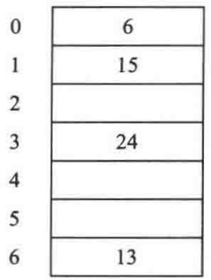

<details>
<summary>bar_stacked</summary>

| Category | Value |
| --- | --- |
| 0 | 6 |
| 1 | 15 |
| 2 | — |
| 3 | 24 |
| 4 | — |
| 5 | — |
| 6 | 13 |
</details>

图5.19 使用线性探测法输入13、15、6、24的散列表

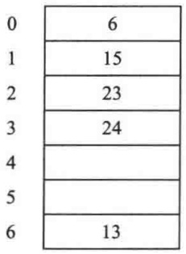

<details>
<summary>bar</summary>

| Category | Value |
| --- | --- |
| 0 | 6 |
| 1 | 15 |
| 2 | 23 |
| 3 | 24 |
| 4 | — |
| 5 | — |
| 6 | 13 |
</details>

图5.20 使用线性探测法插入23后的散列表

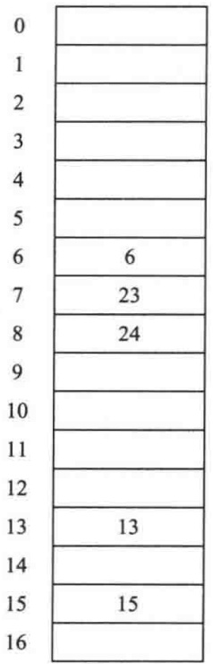

<details>
<summary>bar</summary>

| Category | Value |
| --- | --- |
| 0 | — |
| 1 | — |
| 2 | — |
| 3 | — |
| 4 | — |
| 5 | — |
| 6 | 6 |
| 7 | 23 |
| 8 | 24 |
| 9 | — |
| 10 | — |
| 11 | — |
| 12 | — |
| 13 | 13 |
| 14 | — |
| 15 | 15 |
| 16 | — |
</details>

图5.21 再散列之后的散列表

再散列可以用平方探测以多种方法实现。一种做法是只要表满到一半就再散列。另一种极端的做法是只有当插入失败时才再散列。第三种方法即所谓的途中策略 (middle-of-the-road strategy): 当散列表到达某一特定的装填因子时进行再散列。由于随着装填因子的增长散列表的性能确实在下降，因此，以好的截止手段实现的第三种策略可能是最好的策略。

对于分离链接散列表其再散列是类似的。图 5.22 指出再散列实现起来是简单的，并且还提供了对分离链接再散列的实现。

```txt
/**
 * 对平方探测散列表的再散列.
 */
void rehash( )
{
    vector<HashEntry> oldArray = array;

    // 创建新的两倍大小的空表
    array.resize( nextPrime( 2 * oldArray.size( )) );
    for( auto & entry : array )
        entry.info = EMPTY;

    // 复制整个表
    currentSize = 0;
    for( auto & entry : oldArray )
        if( entry.info == ACTIVE )
```

图 5.22 对分离链接散列表和探测散列表的再散列

---

第5章 散列

169

```cpp
insert( std::move( entry.element ) );
}
/**
 * 对分离链接散列表的再散列.
 */
void rehash( )
{
    vector<list<HashedObj>> oldLists = theLists;

    // 创建两倍大的空表
    theLists.resize( nextPrime( 2 * theLists.size( )) );
    for( auto & thisList : theLists )
        thisList.clear( );

    // 复制整个表
    currentSize = 0;
    for( auto & thisList : oldLists )
        for( auto & x : thisList )
            insert( std::move( x ) );
}
```

图 5.22(续) 对分离链接散列表和探测散列表的再散列

## 5.6 标准库中的散列表

在 C++11 中, 标准库 (Standard Library) 包括有集合和映射的散列表实现, 即 unordered\_set 和 unordered\_map, 它们平行于 set 和 map。unordered\_set 中的项 (或 unordered\_map 中的关键字) 必须提供一个重载的 operator==和一个 hash 函数, 如我们在 5.3 节所描述的那样。正如 set 和 map 模板也能够用一个提供 (或重载一个默认的) 比较函数的函数对象来实例化一样, unordered\_set 和 unordered\_map 可以用提供散列函数和等号运算符的函数对象来实例化。因此, 例如图 5.23 就阐释了如何能够建立一个大小写不敏感字符串的无序集合, 这里假设某些字符串操作是在别处被实现的。

```cpp
class CaseInsensitiveStringHash
{
    public:
        size_t operator( ) ( const string & s ) const
        {
            static hash<string> hf;
            return hf( toLower( s ) );          // toLower 在别处实现
        }

        bool operator( ) ( const string & lhs, const string & rhs ) const
        {
            return equallyIgnoreCase( lhs, rhs );  // equallyIgnoreCase在别处实现
        }
};
unordered_set<string,CaseInsensitiveStringHash,CaseInsensitiveStringHash> s;
```

图 5.23 创建一个大小写不敏感的 unordered\_set

---

170

数据结构与算法分析——C++语言描述(第四版)

如果表项是否依有序方式可见并不重要，那么这些无序类就可以被使用。例如，在4.8节的单词变换例子中，存在3种映射:

1. 其中关键字为单词长度，而对应的值是长为该单词长度的所有单词的集合的映射。
2. 关键字是一个代表(representative)，而对应的值是拥有该代表的所有单词集合的映射。
3. 关键字是一个单词，而对应的值是与该单词只有一个字母不同的所有单词集合的映射。

因为单词长度被处理的顺序并不重要，所以第1个映射可以是unordered\_map。而由于第2个映射建立以后甚至不需要代表，因此第2个映射可以是unordered\_map。第3个映射也可以是unordered\_map，除非我们想要printHighChangeables依字母顺序列出那些可以被变换成大量其他单词的单词的子集。

unordered\_map 的性能常常可以超越 map 的性能，不过，若不按两种方式编写代码很难有把握肯定二者的优劣。

## 5.7 以最坏情形 $O(1)$ 访问的散列表

迄今为止我们考查的散列表都有这样一个性质，即在合理的装填因子和适当的散列函数下，可以预期对于插入、删除和查找等操作平均花费 $O(1)$ 的开销。但是，假设散列函数性能良好，那么一次查找期望的最坏情形又会如何呢？

对于分离链接法，如果装填因子是1，那么这就是某种形式的经典球-箱问题(balls and bins problem):设 $N$ 个球被随机(均匀)地放入 $N$ 个箱子里，则放球最多的箱子中球的期望个数是多少？答案即熟知的 $\Theta (\log N / \log \log N)$，就是说，平均看来，我们预期某些查寻接近花费对数时间。对于探测散列表中最长的期望探测序列的长度，其类似类型的界也可观察到(或可证明)。

我们想要得到 $O(1)$ 最坏情形的开销。在一些应用中，诸如路由器和内存高速缓存的查找表的硬件实现，尤其重要的是查找要有一个确定的(即常数的)完成时间量。假设 $N$ 提前已知，那就不需要再散列。如果在插入时允许重新安排被插入的项，那么查找的 $O(1)$ 最坏情形开销是可以达到的。

本节的剩余部分将介绍该问题的最早解决方案，即完美散列(perfect hashing)，然后是两个最近的新方法，看来它们为已经流行多年的经典散列方案提供了颇有前途的选择。

## 5.7.1 完美散列

为简化起见，设全部 $N$ 项是提前已知的。如果分离链接法的实现能够保证每一个链表的项数最多有常数个，则问题得解。我们知道，当建立更多链表的时候，这些链表平均将会更短，因此理论上如果我们有足够的链表，则可以以相当高的概率期望完全没有冲突。

但是，这种方法存在两个基本问题:首先，链表的个数可能过多；其次，即使链表很多，可能仍然避免不了冲突的发生。

第二个问题原则上相对容易处理。设我们选择链表的个数为 $M$ (即TableSize为 $M$)，该数充分大，足以保证至少以1/2概率不存在冲突。如果此时发现冲突，那么我们直接清空该散列表，并再次尝试使用与第一个无关的不同的散列函数。如果仍然有冲突，那么再尝试第三个散列函数，等等。尝试的期望次数将最多为2(因为成功的概率为1/2)，并且都被纳入到插入的开销。5.8节讨论如下关键问题:如何得到这些额外的散列函数。

---

第 5 章 散 列

171

这样就留给我们确定链表的个数 $M$ 需要多大的问题。很遗憾，$M$ 需要相当大；明确地说，$M = \Omega(N^2)$ 。然而，如果 $M = N^2$ ，则可以证明，散列表是以最少1/2的概率不发生冲突的，这个结果可以用于修正我们的基本方法。

定理5.2 如果 $N$ 个球被放入 $M = N^2$ 个箱子中，那么没有箱子装有多于1个球的概率大于 $1 / 2$。

证明:

如果一对球 $(i,j)$ 被放入同一个箱子中，则我们称之为一次冲突。令 $C_{i,j}$ 为由任意两个球 $(i,j)$ 产生的冲突的期望个数。显然，任意两个特定的球冲突的概率是 $1 / M$ ，即 $C_{i,j} = 1 / M$ ，因为涉及球对 $(i,j)$ 的冲突次数不是0就是1。于是，整个散列表中冲突的期望次数则为$\sum_{(i,j),i <   j}C_{i,j}$ 。由于共有 $N(N - 1) / 2$ 个球对，因此该和为 $N(N - 1) / (2M) = N(N - 1) / (2N^2) <   1 / 2.$ 既然冲突的期望次数低于1/2，因此，存在哪怕是1次冲突的概率必然也低于1/2。

当然，使用  $N^{2}$  个链表是不切实际的。不过，上面的分析提出如下的选择方案:只使用 N 个箱子，但通过使用散列表而不是链表来解决每个箱子中的冲突。其想法在于，因为我们期望每个箱子只有少数几项，所以每个箱子所用的散列表以箱内项数表示可以是二次的。图 5.24 显示了基本结构。这里，主散列表有 10 个箱子。箱子 1、3、5、7 都是空的。箱子 0、4、8 都只有一项，从而它们可以借助 1 个位置的二级散列表来解决冲突。箱子 2 和 6 都有 2 项，因此它们将通过带有 4（即  $2^{2}$ ）个位置的二级散列表解决。箱子 9 有 3 项，因此它将使用带有 9（即  $3^{2}$ ）个位置的二级散列表。

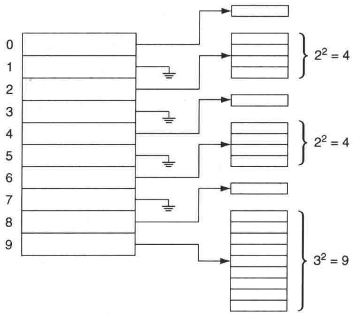

<details>
<summary>text_image</summary>

0
1
2
3
4
5
6
7
8
9
2² = 4
2² = 4
3² = 9
</details>

图 5.24 用到二级散列表的完美散列表

与原始的想法一样，每个二级散列表都将使用不同的散列函数构造直至没有冲突发生。如果所产生的冲突次数大于要求，则主散列表还可以构造多次。这种方法称为完美散列(perfect hashing)。剩下的问题就是要证明，这些二级散列表的总大小的确是所期望的线性的。

定理5.3 如果将 $N$ 项放入包含 $N$ 个箱子的主散列表中，那么，二级散列表的总大小的期望值最多为 $2N$。

证明:

使用与定理 5.2 证明相同的思路，成对冲突的期望数最多为 $N(N-1)/(2N)$，即 $(N-1)/2$。令 $b_i$ 是散列到主散列表位置 $i$ 上的项数。注意到对于该单元在二级散列表中有 $b_i^2$ 个可用的空位，而其成对冲突数为 $b_i(b_i-1)/2$，我们把它记作 $c_i$。于是，用于第 $i$ 个二级散列表的空位量 $b_i^2$ 就是 $2c_i + b_i$。此时总的空位则是 $2\sum c_i + \sum b_i$。而总的冲突数是 $(N-1)/2$（得自本证明的第 1 个结论）。当然，总的项数为 $N$，因此，我们得到二级散列表总的空位需求为 $2(N-1)/2 + N < 2N$。

于是, 总的二级空位需求大于 $4N$ 的概率最多为 $1/2$ (因为否则的话, 期望值就将大于 $2N$), 所以可以继续为主表选择散列函数, 直至得到合适的二级空位需求。一旦到此程度, 每个二

---

172

数据结构与算法分析——C++语言描述(第四版)

级散列表本身都将只需要平均两次尝试以消除冲突。在这些散列表建成之后，任何查找都能够在两次探测之内解决。

如果所有的项均在事先得知，那么完美散列是行之有效的。存在一些动态方案能够实施插入和删除(动态完美散列，dynamic perfect hashing)，不过我们将考察两个更加新颖的方案，它们在实践中与经典的散列算法相比似乎更具有竞争力，而动态完美散列就不再介绍了。

## 5.7.2 杜鹃散列

从前面的讨论中我们可以知道，在球-箱问题中，如果将 $N$ 项随机抛入 $N$ 个箱子中，那么含球最多的箱子的期望球数为 $\Theta (\log N / \log \log N)$ 。由于这个界早为人们所知，而且该问题已被数学家们透彻地研究过，因此当在20世纪90年代中期证明了下述结论时，该结果引起人们的惊奇:如果在每次投掷中随机选取两个箱子且将被投项投入(在那一刻)较空的箱子中，则最大箱子的球数只是 $\Theta (\log \log N)$，这是一个显著的更小的数。很快，许多可能的算法和数据结构从“双选威力(power of two choices)”的新概念中被激发出来。

其中的一种做法就是杜鹃散列(cuckoo hashing)。在杜鹃散列中，假设我们有 $N$ 项。我们保持两个散列表，每个都多于半空，并且我们有两个独立的散列函数，它们可将每一项分配给每个表中的一个位置。杜鹃散列保持下述不变性:一项总是被存储在它的两个位置之一中。

例如，图 5.25 显示一个 6 项的可能的杜鹃散列表，其中的两个表大小为 5（这两个表太小了，但作为例子还是足够说明问题的）。基于随机选择的两个散列函数，项 A 可以在表 1 的位置 0 处，也可在表 2 的位置 2 处。项 F 可以在表 1 的位置 3 处，也可在表 2 的位置 4 处，如此等等。我们立刻得知，这意味着在杜鹃散列表中的一次查找最多需要两次表访问，而且一旦项被定位，删除很简单（现在不再需要懒惰删除）。

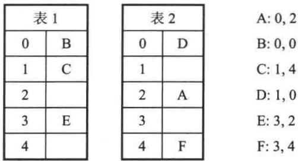

<details>
<summary>text_image</summary>

表1
0	B
1	C
2
3	E
4
表2
0	D
1
2	A
3
4	F
A:0,2
B:0,0
C:1,4
D:1,0
E:3,2
F:3,4
</details>

图 5.25 可能的杜鹃散列表。两个散列函数列于右侧。对于这里的 6 项，在表 1 中只存在 3 个合理的位置，且表 2 中也只存在 3 个合理的位置，因此不清楚安置结果能否很容易被找到

不过, 这里有一个重要的细节: 散列表是怎么构建的? 例如, 在图 5.25 中, 对于这 6 项, 在第 1 个表中只有 3 个可用的位置, 而对于这 6 项在第 2 个散列表中也只有 3 个可用的位置。于是, 这 6 项只有 6 个可用的位置, 因此我们必须找到这 6 项和空位间一个理想的匹配。很清楚, 如果存在第 7 项 G, 以及它在表 1 的位置 1 和表 2 的位置 2, 那么任何算法都不能将它插入表中 (这 7 项将争夺 6 个表位置)。人们可能会说表太过载了 (G 将产生 0.70 的装填因子), 可是同时, 如果该表有成千上万项, 而且负载轻, 我们让 A、B、C、D、E、F、G 占用这些散列位置, 那么插入所有这 7 项仍然是不可能的。因此, 这个方案根本看不出能够安排得可以正常解决问题。这种情况的答案在于另一个散列函数的选择, 而只要这种情况不太可能出现, 则散列函数的选择就是成功的。

杜鹃散列算法本身很简单:要想插入新项 $x$ ，首先确认它不在表中。然后使用第1个散列

---

第5章 散列

173

函数，而如果这(第1)个表位置是空的，则该项即可置入。图5.26所示为将A插入到空散列表中的结果。

设我们现在想要插入 B，它在表 1 和表 2 中的散列位置都是位置 0。对算法的其余部分，我们将使用  $(h_{1}, h_{2})$  来指定这两个位置，故 B 的两个位置由  $(0, 0)$  给出。表 1 的位置 0 已经被占用。此时存在两种选择:一是转向表 2。问题在于，表 2 的位置 0 也可能被占用。刚好在这种情况下它没被占用，但是标准杜鹃散列表使用的算法并不忙着去看表 2。取而代之地，它抢先把新项 B 放在表 1 中。为此，它必须替换 A，故 A 移至表 2，使用它在表 2 的散列位置，即位置 2。结果如图 5.27 所示。C 的插入很容易，见图 5.28。

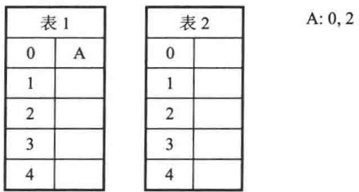

<details>
<summary>text_image</summary>

表1
0	A
1
2
3
4
表2
0
1
2
3
4
A: 0, 2
</details>

图5.26 插入A后的杜鹃散列表

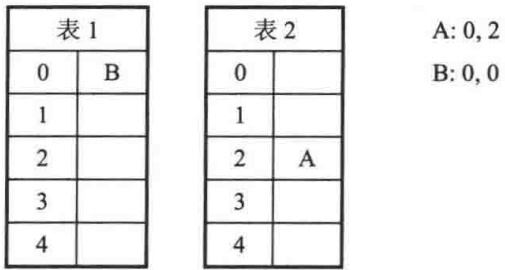

<details>
<summary>text_image</summary>

表1
0	B
1
2
3
4
表2
0
1
2	A
3
4
A:0,2
B:0,0
</details>

图 5.27 插入 B 之后的杜鹃散列表

下面我们想要使用散列位置(1, 0)插入 D。但是，表 1 位置(位置 1)已经被占用。还要注意，表 2 的位置尚未用到，不过我们并不查看那里。取而代之的是，我们让 D 代替 C，然后 C 去到表 2 的位置 4，这正是 C 的第 2 个散列函数所指出的位置。结果得到的两个表如图 5.29 所示。

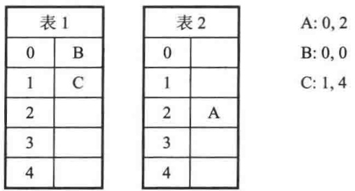

<details>
<summary>text_image</summary>

表1
0	B
1	C
2
3
4
表2
0
1
2	A
3
4
A:0,2
B:0,0
C:1,4
</details>

图 5.28 插入 C 后的杜鹃散列表

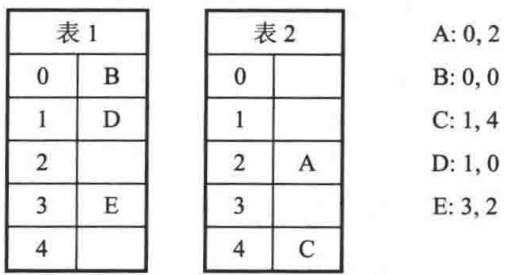

<details>
<summary>text_image</summary>

表1
0	B
1	D
2
3	E
4
表2
0	
1	
2	A
3	
4	C
A:0,2
B:0,0
C:1,4
D:1,0
E:3,2
</details>

图 5.29 插入 D 后的杜鹃散列表

此后，E很容易被插入。迄今为止，一切顺利，可是现在我们还能插入F吗？图5.30～图5.33指出，通过替换E，然后替换A，最后再替换B，该算法成功地将F插入。

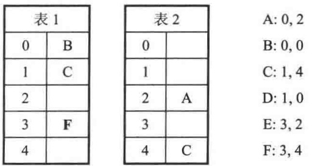

<details>
<summary>text_image</summary>

表1
0 B
1 C
2
3 F
4
表2
0 
1 
2 A
3 
4 C
A: 0, 2
B: 0, 0
C: 1, 4
D: 1, 0
E: 3, 2
F: 3, 4
</details>

图 5.30 开始将 F 插入到图 5.29 的表后的杜鹃散列表。首先，F 替换 E

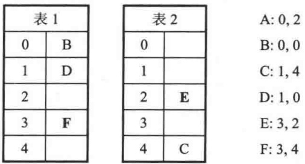

<details>
<summary>text_image</summary>

表1
0	B
1	D
2
3	F
4
表2
0	
1	
2	E
3	
4	C
A:0,2
B:0,0
C:1,4
D:1,0
E:3,2
F:3,4
</details>

图 5.31 继续将 F 插入到图 5.29 的表中。接下来，E 替换 A

显然，正如前面提到的，我们不能用散列位置(1,2)将G成功插入。假如想尝试的话，那就先替换D，再替换B，然后是A、E、F和C，然后C试图回到表1的位置1，替换G，而

---

174

数据结构与算法分析——C++语言描述(第四版)

G 是在一开始就放在那里的。这样我们得到图 5.34。于是，现在 G 就该尝试它在表 2 的另一个备选位置(位置 2)，此时替换 A，A 替换 B，B 替换 D，D 替换 C，C 则替换 F，F 替换 E，现在 E 又要从位置 2 上把 G 替换掉。这时，G 则陷入循环之中。

|  |  |
| --- | --- |
| 0 | A |
| 1 | D |
| 2 |  |
| 3 | F |
| 4 |  |

|  |  |
| --- | --- |
| 0 |  |
| 1 |  |
| 2 | E |
| 3 |  |
| 4 | C |

| A: 0, 2 |
| --- |
| B: 0, 0 |
| C: 1, 4 |
| D: 1, 0 |
| E: 3, 2 |
| F: 3, 4 |

图 5.32 继续将 F 插入到图 5.29 的表中。接下来，A 替换 B

|  |  |
| --- | --- |
| 0 | A |
| 1 | D |
| 2 |  |
| 3 | F |
| 4 |  |

|  |  |
| --- | --- |
| 0 | B |
| 1 |  |
| 2 | E |
| 3 |  |
| 4 | C |

| A: 0, 2 |
| --- |
| B: 0, 0 |
| C: 1, 4 |
| D: 1, 0 |
| E: 3, 2 |
| F: 3, 4 |

图 5.33 继续将 F 插入到图 5.29 的表中。B 奇迹般地（?）在表 2 中找到一个空位置

|  |  |
| --- | --- |
| 0 | B |
| 1 | C |
| 2 |  |
| 3 | E |
| 4 |  |

|  |  |
| --- | --- |
| 0 | D |
| 1 |  |
| 2 | A |
| 3 |  |
| 4 | F |

| A: 0, 2 |
| --- |
| B: 0, 0 |
| C: 1, 4 |
| D: 1, 0 |
| E: 3, 2 |
| F: 3, 4 |
| G: 1, 2 |

图 5.34 将 G 插入到图 5.33 的表中。G 替换 D，D 替换 B，B 再替换 A，A 替换 E，E 替换 F，F 再替换 C，C 又替换 G。这还不能说不行，因为当 G 被替换时我们可以在位置 2 上尝试另一个散列表。然而，虽然这样一般可能会获得成功，但是在这里此时存在一个循环，插入将无法终止

此时的中心议题涉及到:存在阻止插入完成的循环的概率是多少，以及对于成功插入，所需要的位置替换的期望次数是多少？幸运的是，如果散列表的装填因子低于0.5，则分析指出，循环存在的概率非常低，而位置替换的期望次数是一个很小的常数，并指出，需要多于 $O(\log N)$ 次位置替换的成功插入是极其罕见的。如遇这种情况，在一定次数的位置替换之后可以直接用一组新散列函数重建散列表。更准确地说，可以让需要一组新的散列函数来进行插入操作的概率小到 $O(1/N^{2})$ 。这些新散列函数本身又产生N次插入以重建散列表，不过即使如此，这还是意味着重建的开销极小。然而，如果散列表的装填因子为0.5或更大，那么循环的概率将急剧走高，该算法根本不可能会很正常地进行。

在杜鹃散列发表以后，许多推广被提出来。例如，我们可以不用两个表，而是使用更多的表，譬如3个或4个。这就增加了查找的开销，而且还急剧增加了理论空间的利用。在一些应用中，通过不同的散列函数的查找可以并行进行，这样的代价极小从而无需额外的时间。另一个推广是让每个散列表存储多个关键字。同样，这可能增加空位的利用并使得插入操作更容易进行，还可以更加缓存友好(cache-friendly)。各种组合都是可能的，如图5.35所示。最后，杜鹃散列表常常作为拥有两个(或更多的)散列函数的一个大表来实现，这些散列函数探测整个大表。如果存在一个可用的位置，那么一些变化的做法则是尝试把一项立即置入二级散列表中，而不是开始一系列的位置替换。

---

第 5 章 散 列

175

|  | 每单元1项 | 每单元2项 | 每单元4项 |
| --- | --- | --- | --- |
| 2个散列函数 | 0.49 | 0.86 | 0.93 |
| 3个散列函数 | 0.91 | 0.97 | 0.98 |
| 4个散列函数 | 0.97 | 0.99 | 0.999 |

图 5.35 杜鹃散列法变种的最大装填因子

## 杜鹃散列表的实现

实现杜鹃散列法需要一组散列函数。直接使用 hashCode 生成这组散列函数没有意义，因为任何 hashCode 冲突都将导致所有散列函数中的冲突。图 5.36 给出了一个简单接口，它能够用来发出多簇散列函数到杜鹃散列表。

```cpp
template <typename AnyType>
class CuckooHashFamily
{
    public:
        size_t hash( const AnyType & x, int which ) const;
        int getNumberOfFunctions( );
        void generateNewFunctions( );
};
```

图 5.36 为杜鹃散列生成泛型 HashFamily 接口

图 5.37 为杜鹃散列提供了类接口。我们将编写一个变体，它允许(由 HashFamily 模板参数类型指定的)任意个数的散列函数，该变体例程使用一个数组，这个数组通过所有这些散列函数来访问。于是，这里的实现不同于两个分离的可寻址散列表的传统概念。通过对代码进行一些相对轻微的修改，我们可以实现传统的版本；然而，本节提供的版本在使用简单散列函数的测试中似乎效果更好。

在图 5.37 中, 我们指定散列表的最大负载为 0.4。如果表的装填因子快要超越这个限度时, 那么该表将自动进行扩张。我们还定义了一个 ALLOWED\_REHASHES, 它规定如果逐出 (evictions) 花费太长那么将进行多少次再散列。理论上, ALLOWED\_REHASHE 可以是无限的, 因为我们只期望需要小常数次的再散列; 在实践中, 再散列可能显著减慢操作的节奏, 这依赖于几个因素, 诸如散列函数的个数、散列函数的质量、装填因子等, 尽管这样将会付出空间的开销, 但散列表的扩张还是值得的。杜鹃散列表的数据表示比较直接: 我们存储一个简单数组、当前大小以及几组散列函数, 它们以 HashFamily 的实例表示。此外, 还要保留散列函数的个数, 尽管它总可以从 HashFamily 实例中得到。

图 5.38 给出了构造函数和 makeEmpty 方法，而这些都很简单。图 5.39 给出了一对私有方法。第 1 个私有方法 myHash 用于选取适当的散列函数，然后把它换算成合法的数组下标。第 2 个私有方法 findPos 查阅所有的散列函数以返回包含项 x 的下标，如果 x 没找到则返回 -1。此后 findPos 分别用于图 5.40 和图 5.41 中的 contains 和 remove，我们可以看到，这些方法很容易实现。

困难的例程是插入。在图 5.42 中可以看到，基本方案是查看被插入项是否已经存在，如果是，则返回。否则，我们查看散列表是否满负载，如果是，则将其进行扩张。最后，所有的杂活我们调用助手例程去完成。

---

176

数据结构与算法分析——C++语言描述(第四版)

```cpp
template <typename AnyType, typename HashFamily>
class CuckooHashTable
{
    public:
        explicit CuckooHashTable( int size = 101 );

        void makeEmpty( );
        bool contains( const AnyType & x ) const;

        bool remove( const AnyType & x );
        bool insert( const AnyType & x );
        bool insert( AnyType && x );

    private:
        struct HashEntry
        {
            AnyType element;
            bool isActive;

            HashEntry( const AnyType & e = AnyType( ), bool a = false )
                : element{ e }, isActive{ a } { }
            HashEntry( AnyType && e, bool a = false )
                : element{ std::move( e ) }, isActive{ a } { }
        };

        bool insertHelper1( const AnyType & xx );
        bool insertHelper1( AnyType && xx );
        bool isActive( int currentPos ) const;

        size_t myhash( const AnyType & x, int which ) const;
        int findPos( const AnyType & x ) const;
        void expand( );
        void rehash( );
        void rehash( int新三Size );

        static const double MAX_LOAD = 0.40;
        static const int ALLOWED_REHASHES = 5;

        vector<HashEntry> array;
        int currentSize;
        int numHashFunctions;
        int rehashes;
        UniformRandom r;
        HashFamily hashFunctions;
};
```

图5.37 杜鹃散列的类接口

插入的助手例程如图 5.43 所示。我们声明变量 rehashes 来记忆在该次插入中尝试了多少次再散列。这里的插入例程是互递归 (mutually recursive) 的:如果需要，则 insert 最后调用 rehash，而它又最终回调 insert。因此，为了代码的简明性，声明 rehashes 在外部范围进行。

---

第5章 散列

177

```txt
explicit HashTable( int size = 101 ) : array( nextPrime( size ) )
    {
        numHashFunctions = hashFunctionsNumberOfFunctions( );
        rehashes = 0;
        makeEmpty( );
    }

    void makeEmpty( )
    {
        currentSize = 0;
        for( auto & entry : array )
            entry.isActive = false;
    }
```

图 5.38 初始化并清空杜鹃散列表的例程

```c
/**
 * 使用特定函数计算x的散列代码.
 */
int myhash( const AnyType & x, int which ) const
{
    return hashFunctions.hash( x, which ) % array.size( );
}

/**
 * 查找所有散列函数的位置
 * 返回查找终止的位置，若找不到则返回 -1.
 */
int findPos( const AnyType & x ) const
{
    for( int i = 0; i < numHashFunctions; ++i )
    {
        int pos = myhash( x, i );

        if( isActive( pos ) && array[ pos ].element == x )
            return pos;
    }

    return -1;
}
```

图 5.39 查找在杜鹃散列表中一项的位置的例程，以及计算给定散列表的散列代码的例程

```c
/**
     * 如果找到 x 则返回 true.
     */
bool contains( const AnyType & x ) const
{
    return findPos( x ) != -1;
}
```

图 5.40 搜索杜鹃散列表的例程

---

178

数据结构与算法分析——C++语言描述(第四版)

```txt
/**
 * 从散列表中删除x.
 * 若项 x 被找到且被删除则返回true.
 */
bool remove( const AnyType & x )
{
    int currentPos = findPos( x );
    if( !isActive( currentPos ) )
        return false;

    array[ currentPos ].isActive = false;
    --currentSize;
    return true;
}
```

图 5.41 从杜鹃散列表进行删除的例程

```txt
bool insert( const AnyType & x )
{
    if( contains( x ) )
        return false;

    if( currentSize >= array.size( ) * MAX_LOAD )
        expand( );

    return insertHelper1( x );
}
```

图 5.42 杜鹃散列中公有的插入例程

```cpp
static const int ALLOWED_REHASHES = 5;

bool insertHelper1( const AnyType & xx )
{
    const int COUNT_LIMIT = 100;
    AnyType x = xx;

    while( true )
    {
        int lastPos = -1;
        int pos;

        for( int count = 0; count < COUNT_LIMIT; ++count )
        {
            for( int i = 0; i < numHashFunctions; ++i )
            {
                pos = myhash( x, i );

                if( !isActive( pos ) )
                {
                    array[ pos ] = std::move( HashEntry{ std::move( x ), true } );
                    ++currentSize;
```

图 5.43 杜鹃散列的插入例程使用不同的算法，该算法随机选择要逐出的项，但不再试图重新逐出最后的项。如果存在太多的逐出项则散列表将尝试选取新的散列函数(再散列)，而若有太多的再散列则散列表将扩张

---

第5章 散列

179

```txt
return true;
        }
    }

    // 无可用位置. 逐出一个随机项
    int i = 0;
    do
    {
        pos = myhash( x, r.nextInt( numHashFunctions ) );
        } while( pos == lastPos && i++ < 5 );

        lastPos = pos;
        std::swap( x, array[ pos ].element );
    }

    if( ++rehashes > ALLOWED_REHASHES )
    {
        expand( );      // 使散列表扩大
        rehashes = 0;   // 重置 rehashes 的计数
    }
    else
        rehash( );      // 表大小相同, 散列函数都是新的
}
}
```

图 5.43(续) 杜鹃散列的插入例程使用不同的算法，该算法随机选择要逐出的项，但不再试图重新逐出最后的项。如果存在太多的逐出项则散列表将尝试选取新的散列函数(再散列)，而若有太多的再散列则散列表将扩张

这里的基本思路不同于传统方案。我们已经测试到所要插入的项没出现。在第15行到第25行上，我们查看是否合法的位置中有空位。若有，则将被插入项置入第1个可用的位置上，插入完成。否则，逐出一个已存在的项。然而，这里存在一些复杂的问题:

- 逐出第1项在实验中效果并不理想。
- 逐出最后1项在实验中效果也不理想。
- 依序逐出各项(即第1次逐出使用散列函数0，下一次逐出使用散列函数1，等等)在实验中运行得也不理想。
- 完全随机地逐出项在实验中运行也有问题，特别是只用两个散列函数时有产生循环的趋向。

为了缓解最后一个问题，我们保留最后被逐出的位置，如果随机项是最后逐出的项，那么就选择一个新的随机项。如果使用两个散列函数，且碰巧这两个散列函数又都探测到相同的位置，该位置此前又被逐出，那么这将永远循环下去，因此，我们限制循环只能反复5次(故意使用一个奇数)。

expand 和 rehash 的代码如图 5.44 所示。expand 创建一个大数组但使用那些相同的散列函数。零-参数 rehash 保留数组的大小不变，但却创建一个新的数组，该数组使用那些新选出的散列函数填充。

最后，图 5.45 显示了 StringHashFamily 类，该类为字符串提供一组简单的散列函数。这些散列函数利用随机选取的数（不必是素数）替换图 5.4 中的常数 37。

---

180

数据结构与算法分析——C++语言描述(第四版)

```cpp
void expand( )
{
    rehash( static_cast<int>( array.size( ) / MAX_LOAD ) );
}

void rehash( )
{
    hashFunctions.generateNewFunctions( );
    rehash( array.size( ) );
}

void rehash( int newSize )
{
    vector<HashEntry> oldArray = array;

    // 创建新的双倍大小的空散列表
    array.resize( nextPrime( newSize ) );
    for( auto & entry : array )
        entry.isActive = false;

    // 复制整个表
    currentSize = 0;
    for( auto & entry : oldArray )
        if( entry.isActive )
            insert( std::move( entry.element ) );
}
```

图 5.44 杜鹃散列表的再散列和扩张程序

```cpp
template <int count>
class StringHashFamily
{
    public:
        StringHashFamily( ) : MULTIPLIERS( count )
        {
            generateNewFunctions( );
        }

        int getNumberOfFunctions( ) const
        {
            return count;
        }

        void generateNewFunctions( )
        {
            for( auto & mult : MULTIPLIERS )
                mult = r.nextInt( );
        }
```

图 5.45 杜鹃散列法的非正式字符串散列。这些散列函数并未验证满足杜鹃散列所需的要求，但如果散列表不是高度负载的，并且使用图 5.43 的插入例程，那么它却提供了相当不错的性能

---

第5章 散列

181

```cpp
size_t hash( const string & x, int which ) const
    {
        const int multiplier = MULTIPLIERS[ which ];
        size_t hashVal = 0;

        for( auto ch : x )
            hashVal = multiplier * hashVal + ch;

        return hashVal;
    }

    private:
    vector<int> MULTIPLIERS;
    UniformRandom r;
};
```

图 5.45(续) 杜鹃散列法的非正式字符串散列。这些散列函数并未验证满足杜鹃散列所需的要求，但如果散列表不是高度负载的，并且使用图 5.43 的插入例程，那么它却提供了相当不错的性能

杜鹃散列的好处包括最坏情形常数查找和删除次数，避免懒惰删除和额外的数据，以及并行处理的可能。然而，杜鹃散列对散列函数的选择非常敏感。杜鹃散列表的发明者们宣称，他们所尝试的许多标准散列函数在试验中均表现拙劣。此外，虽然只要装填因子低于1/2，插入的用时期望为常数时间，但是，对于带有两个分离的散列表(它们的装填因子均为 $\lambda$ )的传统杜鹃散列期望的插入开销，业已证明其界大致为 $1/(1-(4\lambda^{2})^{1/3})$ ，它随着装填因子逐渐接近1/2而急速恶化(当 $\lambda$ 等于或超过1/2时公式本身无意义)。看来，使用较小的装填因子或多于两个的散列函数似乎是合理的选择。

## 5.7.3 跳房子散列

跳房子散列是一个新算法，它尝试改进经典的线性探测算法。回忆在线性探测法中，单元从散列位置开始依序被尝试。由于一次聚集和二次聚集，尝试的序列随着散列表的负载增加可能平均很长，于是诸如平方探测、双散列等许多改进方法被提出，以减少冲突的次数。然而，对于某些现代体系结构，通过探测相邻单元而产生的局部性是比一些附加的探测更为重要的因素，线性探测可能仍然是实用的，甚至是最好的选择。

跳房子散列法(hopscotch hashing)的思路是:通过预先确定的、在计算机结构体系的基础上优化的常数，来为探测序列的最大长度定界。这么做将给出在最坏情形下常数时间的查找，并且像杜鹃散列一样，查找或许与同时检测可能位置的有界集是并行的。

如果一次插入将一个新项放置得离它的散列位置太远，那么我们向该散列位置有效地回返，逐出那些可能的潜在项。若我们细心，则这些逐出可能很快完成，并保证被逐出的各项不会放到离它们的散列位置太远处。该算法是确定的，因为给定一个散列函数，这些项或者可能被逐出，或者不能被逐出。后者意味着，散列表可能太拥挤，再散列势在必行，不过这只能在超过0.9的极高的装填因子的情形下进行。对于一个装填因子为1/2的散列表，失败的概率几乎为0(练习5.23)。

令 MAX\_DIST 为对最大探测序列所选定的界。这意味着，项 x 必须在以 hash(x), hash(x) + 1, …, hash(x) + (MAX\_DIST - 1) 列出的 MAX\_DIST 个位置中的某个位置上被找到。为了有效

---

182

数据结构与算法分析——C++语言描述(第四版)

地处理逐出，我们保留这样的信息，即对每个位置 $x$ ，它能够指出备选位置上的项是否被散列到位置 $x$ 的一个元素所占据。

例如，图 5.46 显示了一个相当拥挤的跳房子散列表，使用的是 MAX\_DIST=4。位置 6 上的比特位组指出，只有位置 6 有一个具有散列值 6 的项 (C):Hop[6] 上只有第 1 个比特位被置 1。Hop[7] 的前两位置 1，意味着位置 7 和位置 8 (A 和 D) 被散列值是 7 的项占据。Hop[8] 只有第 3 个比特位置 1，意味着位置 10 (E) 上的项散列值是 8。如果 MAX\_DIST 不大于 32，那么 Hop 数组实际上就是一些 32 比特位整数构成的数组，于是额外的空间需求并不大。如果对某个 pos，Hop[pos] 包含的全是 1，那么企图插入散列值为 pos 的项显然是要失败的，因为现在有 MAX\_DIST+1 项试图占据在 pos 的 MAX\_DIST 个位置——这是不可能的。

<table><tr><td></td><td>项</td><td>Hop</td></tr><tr><td colspan="3">…</td></tr><tr><td>6</td><td>C</td><td>1000</td></tr><tr><td>7</td><td>A</td><td>1100</td></tr><tr><td>8</td><td>D</td><td>0010</td></tr><tr><td>9</td><td>B</td><td>1000</td></tr><tr><td>10</td><td>E</td><td>0000</td></tr><tr><td>11</td><td>G</td><td>1000</td></tr><tr><td>12</td><td>F</td><td>1000</td></tr><tr><td>13</td><td></td><td>0000</td></tr><tr><td>14</td><td></td><td>0000</td></tr><tr><td colspan="3">…</td></tr></table>

| A: 7 |
| --- |
| B: 9 |
| C: 6 |
| D: 7 |
| E: 8 |
| F: 12 |
| G: 11 |

图5.46 跳房子散列表。这些Hop值告诉我们，区块中哪些位置被含有该散列值的那些单元所占据。于是，$\mathrm{Hop}[8] = 0010$ 表明当前只有位置10包含那些散列值为8的项，而位置8、9和11则不含这样的项

现在假设在这个例子中我们插入散列值是 9 的项 H。正常的线性探测法试图把它放到位置 13，但是它离 9 的散列值太远，因此改为查看能否逐出一项并把其重新安置在 13。去到位置 13 的项只有散列值是 10、11、12、13 的各项。如果考察 Hop[10]，那么就会看到没有散列值是 10 的候选项。可是 Hop[11]通过值 11 产生一个候选项 G，它可以被放到位置 13 处。由于位置 11 现在足够接近 H 的散列值，因此现在插入 H。这些步骤以及对 Hop 信息的改动都显示在图 5.47 中。

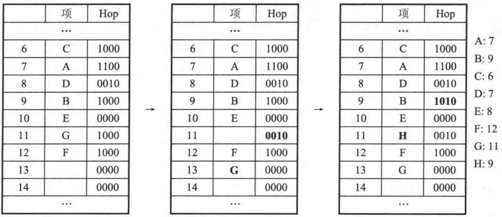

<details>
<summary>text_image</summary>

项 Hop
...
6 C 1000
7 A 1100
8 D 0010
9 B 1000
10 E 0000
11 G 1000
12 F 1000
13 0000
14 0000
...
→
项 Hop
...
6 C 1000
7 A 1100
8 D 0010
9 B 1000
10 E 0000
11 0010
12 F 1000
13 G 0000
14 0000
...
→
项 Hop
...
6 C 1000
7 A 1100
8 D 0010
9 B 1010
10 E 0000
11 H 0010
12 F 1000
13 G 0000
14 0000
...
A: 7
B: 9
C: 6
D: 7
E: 8
F: 12
G: 11
H: 9
</details>

图 5.47 跳房子散列表。试图插入 H。线性探测得出的是位置 13，但这个位置太远，因此我们从位置 11 逐出 G 从而为 H 找到一个更近的位置

---

第 5 章 散 列

183

最后，我们想要插入 I，它的散列值是 6。线性探测指出位置 14，显然这个位置太远。于是，我们查看 Hop[11]，它告诉我们 G 可以向下移而空出位置 13。既然 13 是空的，那么我们可以查看 Hop[10] 内部，以找出另一个要被逐出的元素。可是，Hop[10] 的前 3 个位置都是 0，因此不存在能够被移动的其散列值是 10 的项。于是考察 Hop[11]，在那里我们发现前两个位置都是 0。

因此尝试 Hop[12]，此处我们需要第 1 个位置是 1，而它就是 1。这样，F 可以向下移动。这两步显示在图 5.48 中。注意，假如情况不是这样，那么——譬如要是 hash(F) 不是 12 而是 9 的话——我们就被卡住而不得不再散列。但是，这不是我们算法的问题，而是不存在将 C、I、A、D、E、B、H、F 都置入表中的方法（如果 F 的散列值是 9 的话）；这些项的散列值就会都在 6 和 9 之间，从而也就需要被放置在 6 和 12 之间的 7 个位置上。可是，那就要造成在 7 个位置上有 8 项的局面——这是不可能的。然而，由于我们的例子不是这种情况，我们已经从位置 12 逐出了一项，因此现在我们还能继续下去。图 5.49 显示了从位置 9 剩下的逐出以及其后对 I 的放置。

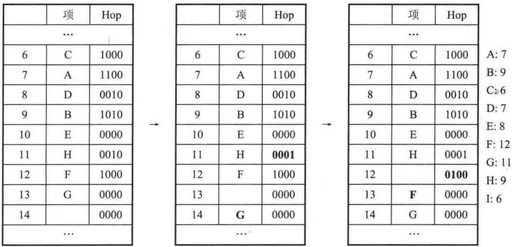

<details>
<summary>text_image</summary>

项 Hop
...
6 C 1000
7 A 1100
8 D 0010
9 B 1010
10 E 0000
11 H 0010
12 F 1000
13 G 0000
14 0000
...
项 Hop
...
6 C 1000
7 A 1100
8 D 0010
9 B 1010
10 E 0000
11 H 0001
12 F 1000
13 0000
14 G 0000
...
项 Hop
...
6 C 1000
7 A 1100
8 D 0010
9 B 1010
10 E 0000
11 H 0001
12 0100
13 F 0000
14 G 0000
...
A: 7
B: 9
C: 6
D: 7
E: 8
F: 12
G: 11
H: 9
I: 6
</details>

图 5.48 跳房子散列表。试图插入 I。线性探测得出的是位置 14，但它太远；查阅 Hop[11] 我们看到，G 可以下移，把位置 13 空出来。查阅 Hop[10] 提不出什么结果来。而 Hop[11] 对二者又无能为力（为什么？），于是 Hop[12] 建议下移 F

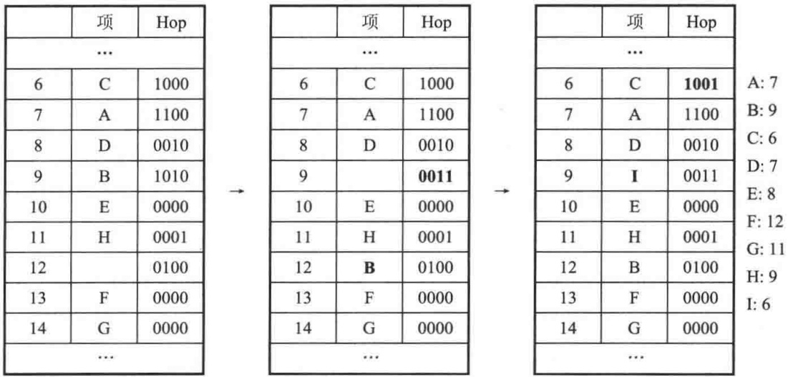

<details>
<summary>text_image</summary>

项 Hop
...
6 C 1000
7 A 1100
8 D 0010
9 B 1010
10 E 0000
11 H 0001
12 
13 F 0000
14 G 0000
...
项 Hop
...
6 C 1000
7 A 1100
8 D 0010
9 
10 E 0000
11 H 0001
12 B 0100
13 F 0000
14 G 0000
...
项 Hop
...
6 C 1001
7 A 1100
8 D 0010
9 I 0011
10 E 0000
11 H 0001
12 B 0100
13 F 0000
14 G 0000
...
A: 7
B: 9
C: 6
D: 7
E: 8
F: 12
G: 11
H: 9
I: 6
</details>

图 5.49 跳房子散列表。继续插入 I:接着，B 被逐出，最后得到一处距散列值足够接近的位置，I 可被插入到此处

---

184

数据结构与算法分析——C++语言描述(第四版)

跳房子散列是相对新的算法，但是，初始的一些试验结果还是非常有前途的，特别是对那些利用多处理器以及要求并行性和协同性(concurrency)的应用而言。杜鹃散列或跳房子散列是否能够作为传统分离链接和线性/平方探测方案的实用备选方案而出现，我们将拭目以待。

## 5.8 通用散列

虽然散列表非常有效，并且在适当的装填因子的假设下每次操作花费常数平均开销，但是它们的分析和性能却依赖于具有如下两个基本性质的散列函数:

1. 散列函数必须是常数时间内可计算的(即，与散列表中的项数无关)。
2. 散列函数必须在数组所包含的位置之间均匀地分布表项。

特别是，如果散列函数很差，那么所有的希望就会落空，每次操作的开销可能是线性的。在这一小节，我们讨论通用散列函数(universal hash functions)，它使我们以上面的条件2得以满足的方式随机选择散列函数。正如5.7节那样，我们用 $M$ 代表TableSize。虽然使用通用散列函数的强烈动机是为用于传统散列表分析的假设提供理论依据，但是这些函数还是可以用在需要高水平健壮性的应用中的，其中最坏情形(或者本质上被降低了的)性能实在让人不能容忍，这样的性能或许基于由破坏者或电脑黑客生成的输入而造成。

如5.7节那样，我们用 $M$ 代表TableSize。

定义5.1 如果对任意 $x \neq y$，散列函数簇 $H$ 中使得 $h(x) = h(y)$ 的散列函数 $h$ 的个数最多为 $|H| / M$，则称散列函数簇 $H$ 是通用的(universal)。

注意，这个定义对于每两项都成立，而不是对所有的项对取平均而言。该定义意味着，如果从通用簇 $H$ 中随机选择一个散列函数，那么在任意两个不同的项间发生冲突的概率最多是 $1 / M$ ，而当把 $N$ 项添加到一个散列表中时，在初始时刻发生冲突的概率最多为 $N / M$ ，或是表的装填因子。

对分离链接法或跳房子散列法使用通用散列函数将充分满足用于分析这些数据结构的假设。然而，它对杜鹃散列法却不是充分的，需要一个更强的无关性概念。在杜鹃散列中，首先要看是否存在一个空位置；如果不存在，那就进行一次逐出，此时在寻找空位过程中涉及一个不同的项。重复该过程直到发现一个空位或者决定再散列为止（一般在 $O(\log N)$ 步之内）。为了使分析工作能够进行，使用满足散列函数的不同的项 $x$ ，每一步必须要有一个独立的冲突概率 $N / M$ 。我们可以把这个独立性需求形式化成下面的定义。

定义 5.2 散列函数簇 H 是 k 通用的 (k-universal)，如果对于任意的  $x_{1} \neq y_{1}, x_{2} \neq y_{2}, \cdots, x_{k} \neq y_{k}$ ，簇 H 中满足  $h(x_{1}) = h(y_{1}), h(x_{2}) = h(y_{2}), \cdots, h(x_{k}) = h(y_{k})$  的散列函数 h 的个数最多为  $|H| / M^{k}$ 。

由这个定义看到，杜鹃散列需要一个 $O(\log N)$-通用散列函数(在如此多次的逐出之后，我们放弃继续并进行再散列)。本节将只考察通用散列函数。

为了设计一个简单的通用散列函数，首先假设把非常大的整数映射到从0到 $M - 1$ 的较小整数。令 $p$ 是一个比最大的输入关键字还要大的素数。

---

第5章 散列

185

我们的通用簇 H 由下列一组函数组成，其中 a 和 b 是随机选出的:

$$
H = \{H _ {a, b} (x) = ((a x + b) \bmod p) \bmod M, \text {其中} 1 \leqslant a \leqslant p - 1, 0 \leqslant b \leqslant p - 1 \}
$$

例如，在这个函数簇中， $a$ 和 $b$ 的3个可能的随机选择产生3个不同的散列函数:

$$
\begin{array}{l} H _ {3, 7} (x) = ((3 x + 7) \bmod p) \bmod M \\ H _ {4, 1} (x) = ((4 x + 1) \bmod p) \bmod M \\ H _ {8, 0} (x) = ((8 x) \bmod p) \bmod M \\ \end{array}
$$

可以看出，存在 $p(p - 1)$ 个可以被选出的可能的散列函数。

定理5.4 散列函数簇 $H = \{H_{a,b}(x) = ((ax + b)\bmod p)\bmod M,$ 其中 $1\leqslant a\leqslant p - 1,0$ $\leqslant b\leqslant p - 1\}$ 是通用的。

证明:令 x 和 y 是使得  $H_{a,b}(x)=H_{a,b}(y)$  成立的两个互异的值，且 x>y。

显然，如果 $(ax + b) \bmod p$ 等于 $(ay + b) \bmod p$，则将产生一个冲突。可是，这是不可能发生的:两式相减得到 $a(x - y) \equiv 0 \bmod p$，它意味着 $p$ 整除 $a$ 或 $p$ 整除 $x - y$，因为 $p$ 是素数。但是由于 $a$ 和 $x - y$ 都在 1 和 $p - 1$ 之间，这两种情形均不会发生。

于是，令 $r = (ax + b) \mod p$ 以及 $s = (ay + b) \mod p$，由上面的论证可知 $r \neq s$。如此则存在 $r$ 的 $p$ 个可能的值，并对每个 $r$ 存在 $s$ 的 $p - 1$ 个可能的值，总共有 $p(p - 1)$ 个可能的 $(r, s)$ 对。注意，$(a, b)$ 对的个数与 $(r, s)$ 对的个数是相等的，因此，若能够用 $r$ 和 $s$ 表示 $(a, b)$，则每个 $(r, s)$ 对将恰好对应一个 $(a, b)$ 对。可是这并不难做到:就像上面所做的那样，两个等式相减得到 $a(x - y) \equiv (r - s) (\mod p)$，这意味着，通过用 $(x - y)$ 唯一的乘法逆元乘式的两边（这个逆元必然存在，因为 $x - y$ 非零且 $p$ 是素数），我们得到用 $r$ 和 $s$ 表示的 $a$。然后得到 $b$ 由 $r$ 与 $s$ 的表示。

最后，上述结果意味着 $x$ 和 $y$ 冲突的概率等于 $r \equiv s (\bmod M)$ 的概率，上面的分析使我们假设，$r$ 和 $s$，而非 $a$ 和 $b$，是随机选取的。简单的直觉会把这个概率置为 $1 / M$，但只有当 $p$ 正好是 $M$ 的倍数，且所有可能的 $(r, s)$ 对都是等可能的时候，它才为真。既然 $p$ 是素数，且 $r \neq s$，那这样它就不保证成立了，因此需要更仔细的分析。

对于给定的 $r$，那个经 $\mod M$ 可产生冲突的 $s$ 的值最多是 $[p / M] - 1$ 个（这里的-1是因为 $r \neq s$）。容易看出，它最多是 $(p - 1) / M$。于是，$r$ 和 $s$ 产生冲突的概率最多为 $1 / M$（我们用 $p - 1$ 除之，因为，正如前面在证明中提到的，给定 $r$ 后，$s$ 只存在 $p - 1$ 种选择）。这意味着上述散列簇是通用的。

这个散列函数的实现看来需要两次 mod 运算:第 1 个是 mod p，第 2 个是 mod M。图 5.50 以 C++ 显示了一种简单的实现，假设 M 比  $2^{31}-1$  小得多。因为现在计算必须准确地按照规定的进行，并且不再接受溢出，所以我们提升到 long long 型来计算，它至少是 64 个比特位。

```txt
int universalHash( int x, int A, int B, int P, int M )
{
    return static_cast<int>(( ( static_cast<long long>( A ) * x ) + B ) % P ) % M;
}
```

图 5.50 通用散列的简单实现

然而，我们可以选择任意素数 $p$ ，只要它大于 $M$ 。因此，选择一个最有利于计算的素数

---

186

数据结构与算法分析——C++语言描述(第四版)

是有意义的。 $p=2^{31}-1$  就是一个这样的素数。这种形式的素数叫作 Mersenne 素数 (Mersenne prime); 其他一些 Mersenne 素数包括  $2^{5}-1$ 、 $2^{61}-1$  和  $2^{89}-1$ 。正像用诸如 31 这样的 Mersenne 素数进行乘法可以通过一次移位和一次减法实现一样，涉及 Mersenne 素数的模运算 (mod operation) 也可以通过一次移位和一次减法实现:

设 $r \equiv y (\bmod p)$ 。若用 $(p + 1)$ 去除 $y$ ，则 $y = q'(p + 1) + r'$，其中 $q'$ 和 $r'$ 分别为商和余数。因此，$r \equiv q'(p + 1) + r' (\bmod p)$ 。而由于 $(p + 1) \equiv 1 (\bmod p)$，于是得到 $r \equiv q' + r' (\bmod p)$ 。

图 5.51 实现了这个想法，它被称为 Carter-Wegman 技巧(Carter-Wegman trick)。在第 8 行上，移位操作计算用  $(p+1)$  去除所得的商，而按位与则计算它的余数。因为  $(p+1)$  是 2 的一个准确的幂，所以这些位操作能够得到所要的结果。由于余数可能几乎与 p 一样大，因此结果所得到的和可能比 p 还要大，于是我们在第 9 行和第 10 行可以再把它减下来。

```txt
const int DIGS = 31;
const int mersennep = (1<<DIGS) - 1;

int universalHash( int x, int A, int B, int M )
{
    long long hashVal = static_cast<long long>( A ) * x + B;

    hashVal = ( ( hashVal >> DIGS ) + ( hashVal & mersennep ) );
    if( hashVal >= mersennep )
        hashVal -= mersennep;

    return static_cast<int>( hashVal ) % M;
}
```

图5.51 通用散列的简单实现

通用散列函数对于字符串也是存在的。首先，选取大于 $M$ 的任意素数 $p$ (并大于最大的字符代码)。然后，使用我们标准的字符串散列函数，在1和 $p - 1$ 之间随机选择乘数，并返回在0和 $p - 1$ (包括0和 $p - 1$) 之间的中间散列值。最后，应用一个通用散列函数来生成在0和$M - 1$ 之间的最终的散列值。

## 5.9 可扩散列

本章最后的论题处理数据量太大以至于装不进主存的情况。正如我们在第 4 章看到的，此时主要的考虑是检索数据所需的磁盘存取次数。

与前面一样，假设在任一时刻都有 $N$ 个记录要存储，$N$ 的值随时间而变化。此外，最多可把 $M$ 个记录放入一个磁盘区块。本节将设 $M = 4$。

如果使用探测散列或分离链接散列，那么主要的问题在于，在一次查找操作期间冲突可能引起多个区块被考察，甚至对于理想分布的散列表也在所难免。不仅如此，当散列表变得过满的时候，必须执行代价极为巨大的再散列这一步，它需要  $O(N)$  次磁盘访问。

一种聪明的选择叫作可扩散列(extendible hashing)，它使得用两次磁盘访问执行一次查找。插入操作也需要很少的磁盘访问。

回忆第4章，B树具有 $O(\log_{M / 2}N)$ 的深度。随着 $M$ 的增加，B树的深度降低。理论上我

---

第5章 散列

187

们可以选择 M 如此的大，使得 B 树的深度为 1。此时，在第一次以后的任何查找都将花费一次磁盘访问，因为根节点可能存在主存中。这种方法的问题在于分支系数 (branching factor) 太高，以至于为了确定数据在哪片树叶上要进行大量的处理工作。如果运行这一步的时间可以减缩，那么我们就将有一个实用的方案。这正是可扩散列使用的思路。

现在让我们假设，数据由几个6位(比特)整数组成。图5.52显示了这些数据的可扩散列格式。这里“树”的根含有4个指针，它们由这些数据最高的两个比特位确定。每片树叶有直到$M = 4$ 个元素。碰巧这里每片树叶中数据的前两个比特都是相同的，它们由圆括号内的数指出。为了更正式，用 $D$ 代表根所使用的比特数，有时称其为目录(directory)。于是，目录中的项数为 $2^{D}$ 。 $d_{L}$ 为树叶 $L$ 所有元素共有的最高位的比特位数。 $d_{L}$ 将依赖于特定的树叶，因此 $d_{L} \leqslant D$ 。

设欲插入关键字 100100。它将进入第三片树叶，但是第三片树叶已经满了，没有空间存放它。因此我们将这片树叶分裂成两片树叶，它们由前 3 位确定。这需要将目录的大小增加到 3。这些变化由图 5.53 反映出来。

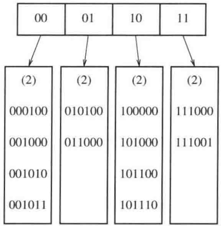

<details>
<summary>flowchart</summary>

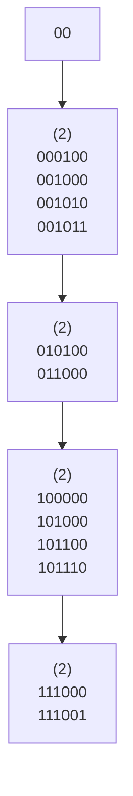
</details>

图 5.52 可扩散列:原始数据

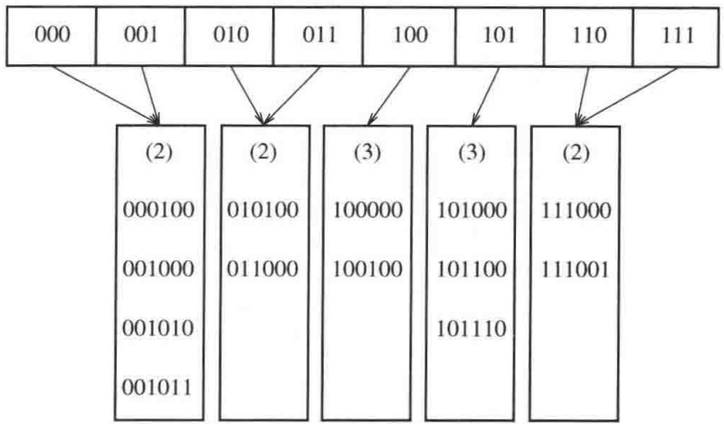

<details>
<summary>flowchart</summary>

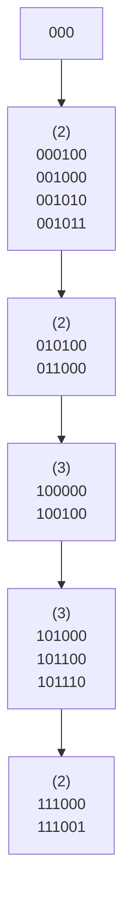
</details>

图5.53 可扩散列:在100100插入及目录分裂之后

注意，所有在分裂中未涉及到的树叶现在各由两个相邻目录项所指。因此，虽然整个目录被重写，但是其他树叶都没有被实际访问。

如果现在插入关键字 000000，那么第一片树叶就要被分裂，生成 $d_{L} = 3$ 的两片树叶。由于 $D = 3$，故在目录中所作的唯一变化是 000 和 001 两个指针的更新，见图 5.54。

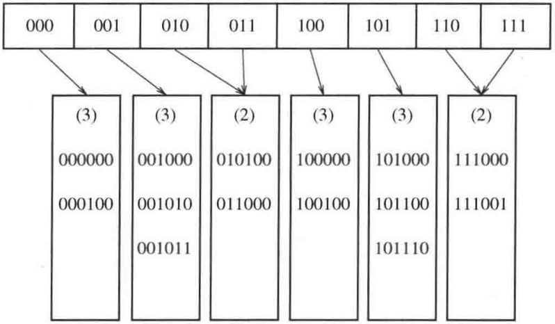

<details>
<summary>flowchart</summary>

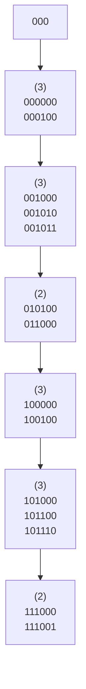
</details>

图 5.54 可扩散列:在 000000 插入及树叶分裂之后

这个非常简单的方法提供了对大型数据库 insert 操作和查找操作的快速存取时间。这里，还有一些重要细节尚未考虑。

---

188

数据结构与算法分析——C++语言描述(第四版)

首先，有可能当一片树叶的元素有多于 $D + 1$ 个前导比特位相同时需要多个目录分裂。例如，从原例开始，$D = 2$，如果插入111010，111011，并在最后插入111100，那么目录大小必须增加到4以区分5个关键字。这是一个容易考虑到的细节，但是千万不要忘记它。其次，存在重复关键字(duplicate keys)的可能性。若存在多于 $M$ 个重复关键字，则该算法根本无效。此时，需要做出某些其他的安排。

上述可能性指出，这些比特充分随机是相当重要的，我们可以通过把这些关键字散列到合理的长整数(从而是名字)来完成。

最后，介绍可扩散列的某些性能，这些性能是经过非常困难的分析后得到的。这些结果基于合理的假设:位模式(bit pattern)是均匀分布的。

树叶的期望个数为 $(N / M)\log_2e$ 。因此，平均树叶满的程度为 $\ln 2 = 0.69$ 。这和B树是一样的，其实这完全不奇怪，因为对于这两种数据结构都是当第 $(M + 1)$ 项被添加进来时一些新的节点被创建。

更惊奇的结果是，目录的期望大小(换句话说即 $2^{D}$)为 $O(N^{1 + 1 / M} / M)$ 。如果 $M$ 很小，那么目录可能过大。在这种情况下，可以让树叶包含指向记录的指针而不是实际的记录，从而增加 $M$ 的值。为了维持更小的目录，可以对每个查找操作添加第二次磁盘访问。如果目录太大装不进主存，那么第二次磁盘访问不管怎么说也还是需要的。

## 小结

散列表可以用来以常数平均时间实现 insert 和 contains 操作。当使用散列表时注意诸如装填因子这样的细节是特别重要的，因为否则时间界将不再有效。当关键字不是短的字符串或整数时，仔细选择散列函数也是很重要的。

对于分离链接散列法，虽然装填因子不是特别大时性能并不明显降低，但装填因子还是应该接近于1。对于探测散列算法，除非完全不可避免，否则装填因子不应该超过0.5。如果使用线性探测，那么性能随着装填因子接近于1将急速下降。再散列算法可以通过使散列表增长(和收缩)来实现，这样将会保持一个合理的装填因子。这对于空间紧缺并且不可能声明巨大散列表的情况是很重要的。

其他一些方法，诸如杜鹃散列和跳房子散列，也能够产生好的结果。因为所有这些算法都是常数时间的，所以强调哪个散列表的实现“最佳”是困难的。最近的模拟结果提供了对于冲突的指导和建议:算法的性能可能严重依赖于所处理的项的类型、底层计算机硬件和程序设计语言。

二叉查找树也可以用来实现 insert 和 contains 运算。虽然平均时间界为 $O(\log N)$，但是二叉查找树还支持那些需要序从而功能更强大的例程。使用散列表不可能找出最小元素。除非知道准确的字符串，否则散列表也不可能有效地查找它。二叉查找树可以迅速找到在一定范围内的所有项，而散列表是做不到的。此外，$O(\log N)$ 这个时间界也未必比 $O(1)$ 大那么多，这特别是因为使用查找树不需要乘法和除法的缘故。

另一方面，散列的最坏情况一般来自于实现的错误，而有序的输入却可能使二叉树运行得很差。平衡查找树实现的代价相当高，因此，如果不需要序的信息以及对输入是否被排序持有怀疑，那么就应该选择散列这种数据结构。

散列有着丰富的应用。编译器使用散列表跟踪源代码中声明的变量。这种数据结构叫作

---

第5章 散列

189

符号表(symbol table)。散列表是这种问题的理想应用。标识符一般都不长，因此其散列函数能够迅速被算出，而按字母顺序排列变量通常没有必要。

散列表对于任何图论问题都是有用的，在图论问题中，节点都有实际的名字而不是数字。这里，当输入被读进的时候，顶点则按照它们出现的顺序从1开始被指定一些整数。再有，输入很可能有一组一组依字母顺序排列的项。例如，顶点可以是计算机。此时，如果一个特定的计算中心把它的计算机列表，成为ibm1, ibm2, ibm3, …，那么，若使用查找树则在效率方面可能会产生戏剧性的效果。

散列表第三种常见的用途是在为游戏编制的程序中。当程序搜索游戏不同的行时，它跟踪通过计算基于位置的散列函数而看到的一些位置(并把对于该位置的移动存储起来)。如果同样的位置再出现，程序通常通过移动的简单变换来避免昂贵的重复计算。所有游戏程序的这种一般特点叫作置换表(transposition table)。

散列的另一个用途是在线拼写检验程序。如果错拼检测(与纠正相比)更重要，那么整个词典可以预先被散列，单词则可以以常数时间被检测。散列表很适合这项工作，因为以字母顺序排列单词并不重要，而以它们在文件中出现的顺序显示拼写错误当然是可接受的。

在软件(例如，互联网浏览器中的高速缓存)和硬件(例如，现代计算机中的内存高速缓冲区)方面，散列表常常用于实现高速缓冲存储区。它们还用在路由器的硬件实现中。

我们通过返回到第1章的字谜问题来结束这一章。如果使用第1章中描述的第二个算法，并且假设最大单词的大小是某个小的常数，那么读入包含 $W$ 个单词的词典并把它放入散列表的时间是 $O(W)$ 。这个时间很可能由磁盘I/O而不是由那些散列例程起支配作用。算法的其余部分将对每一个四元组(行，列，方向，字符数)测试一个单词是否出现。由于每次查询时间为 $O(1)$，而只存在常数个方向(8)和每个单词的字符，因此这一阶段的运行时间为 $O(R \cdot C)$ 。总的运行时间是 $O(R \cdot C + W)$，它是对原始 $O(R \cdot C \cdot W)$ 明显的改进。我们还可以做进一步的优化，它能够降低实际的运行时间。这些将在练习中描述。

## 练习

5.1 给定输入{4371, 1323, 6173, 4199, 4344, 9679, 1989}和散列函数 $h(x) = x (\bmod 10)$，指出下列结果:

a. 分离链接散列表。
b. 使用线性探测的散列表。
c. 使用平方探测的散列表。
d. 二级散列函数为  $h_{2}(x)=7-x\pmod{7}$  的散列表。

5.2 指出将练习 5.1 中的散列表再散列的结果。
5.3 编写一个程序，计算使用线性探测、平方探测以及双散列的长的随机插入序列所需要的冲突次数。
5.4 在分离链接散列表中进行大量的删除可能造成表非常稀疏，浪费空间。在这种情况下，可以再散列一个表，为原表的一半大。设当存在相当于表大小的2倍那么多的元素时，我们再散列到一个更大的表。该表应该有多么稀疏我们才能再散列到一个更小的表？
5.5 使用单链表的一个 vector 而不是多个 vector 重新实现分离链接散列表。

---

190

数据结构与算法分析——C++语言描述(第四版)

5.6 平方探测的 isEmpty 例程还没有写出，你能通过返回表达式 currentSize==0 实现它吗？

5.7 在平方探测散列表中，设我们把一个新元素插入到搜索路径上第一个非活动的单元而不是把它插入到由 findPos 指定的位置(这样，能够回收一个标记为 “deleted” 的单元，潜在地节省了空间)。

a. 使用上述思路重新编写插入算法。通过使用一个附加变量让 findPos 保留它遇到的第一个非活动单元的位置来完成重写的工作。
b. 解释使得重写的算法快于原来算法的环境。重写的算法可能会更慢吗？

5.8 设我们不用平方探测而改用“立方探测”，此处第 $i$ 次探测是在 $\text{hash}(x) + i^3$ 处。立方探测改进平方探测了吗？

5.9 使用一本标准词典，且散列表的大小接近装填因子 1，比较由图 5.4 的散列函数和图 5.55 中的散列函数产生的冲突的次数。

```c
/**
 * 字符串对象的 FNV-1a 散列例程.
 */
unsigned int hash( const string & key, int tableSize )
{
    unsigned int hashVal = 2166136261;

    for( char ch : key )
        hashVal = ( hashVal ^ ch )* 16777619;

    return hashVal % tableSize;
}
```

图5.55 练习5.9中的另一个散列函数

5.10 各种冲突解决方案的优点和缺点是什么？

5.11 假设为了减轻二次聚集的影响，我们使用 $f(i) = i \cdot r(\text{hash}(x))$ 作为冲突解决函数，其中 $\text{hash}(x)$ 为32比特位的散列值(尚未化成适当的数组下标)，而 $r(y) = |48271y (\text{mod } (2^{31} - 1))| \mod \text{TableSize}$。(10.4.1节描述一种执行这种计算而不溢出的方法，不过，在这种情况下溢出是不太可能的。)解释为什么这种方法趋向于避免二次聚集，并将这种方法与双散列和平方探测进行比较。

5.12 再散列要求对散列表中的所有项重新计算散列函数。由于计算散列函数代价昂贵，因此设对象提供它们自己的散列成员函数，而每个对象在散列函数第 1 次被计算时将把结果存入一个附加的数据成员中。指出这种方案如何用于图 5.8 中的 Employee 类，并解释在什么样的情况下所记忆的散列值在每个 Employee 中仍然有效。

5.13 编写一个程序, 实现下面将大小分别为 M 和 N 的两个稀疏多项式 (sparse polynomial)  $P_{1}$  和  $P_{2}$  相乘的策略。每个多项式表示成为由一个系数和一个幂组成的一系列对象。我们用  $P_{2}$  的项乘以  $P_{1}$  的每一项，总数为 MN 次运算。一种方法是将这些项排序并合并同类项，但是，这需要排序 MN 个记录，代价可能很高，特别是在小内存环境下。另一种方案，我们可在多项式的项进行计算时将它们合并，然后将结果排序。

a. 编写一个程序实现第二种方案。

---

第5章 散列

191

b. 如果输出多项式大约有 $O(M + N)$ 项，两种方法的运行时间各是多少？

\*5.14 描述一个避免初始化散列表的过程(以内存消耗为代价)。

5.15 设欲找出在长输入串 $A_{1}A_{2}\cdots A_{N}$ 中串 $P_{1}P_{2}\cdots P_{k}$ 的第一次出现。我们可以通过散列模式串(pattern string)得到一个散列值 $H_{p}$，并将该值与从 $A_{1}A_{2}\cdots A_{k}, A_{2}A_{3}\cdots A_{k+1}, A_{3}A_{4}\cdots A_{k+2}$，等等，直到 $A_{N-k+1}A_{N-k+2}\cdots A_{N}$ 形成的散列值比较来解决这个问题。如果得到散列值的一个匹配，那么再一个字符一个字符地对串进行比较以检验这个匹配。如果实际上两个字符串确实匹配，那么返回其(在 $A$ 中的)位置，而在匹配失败这种不大可能的情况下继续进行查找。

\*a. 证明如果 $A_{i}A_{i+1}\cdots A_{i+k-1}$ 的散列值已知，那么 $A_{i+1}A_{i+2}\dots A_{i+k}$ 的散列值可以以常数时间算出。

b. 证明运行时间为  $O(k+N)$  加上排除错误匹配所耗费的时间。

\*c. 证明错误匹配的期望次数是微不足道的。

d. 编写一个程序实现该算法。

\*\*e. 描述一个算法，其最坏情形的运行时间为 $O(k + N)$。

\*\*f. 描述一个算法，其平均运行时间为  $O(N/k)$ 。

5.16 一个非标准的 C++ 扩展添加了这样的语法:允许开关语句 (switch statement) 使用 string 类型 (而不是基本整数类型)。解释编译器如何能够使用散列表实现语言附加功能。

5.17 一个(老式的)BASIC 程序由一系列按递增顺序编号的语句组成。控制是通过使用 goto 或 gosub 和一个语句编号实现的。编写一个程序读进合法的 BASIC 程序并给语句重新编号，使得第一句在序号 F 处开始并且每一个语句的序号比前一语句高 D。可以假设 N 条语句的上限，但是在输入中这些语句序号可以大到一个 32 比特的整数。所编的程序必须以线性时间运行。

5.18 a. 利用本章末尾描述的算法实现字谜程序。

b. 通过存储每一个单词 $W$ 以及 $W$ 的所有前缀，可以大大加快运行速度。（如果 $W$ 的一个前缀刚好是词典中的一个单词，那么就把它作为实际的单词来存储。）虽然这看起来似乎极大地增加了散列表的大小，但实际上并不，因为许多单词有相同的前缀。当以某个特定的方向执行一次扫描的时候，如果被查找的单词甚至作为前缀都不在散列表中，那么在这个方向上的扫描可以及早终止。利用这种想法编写一个改进的程序来解决字谜游戏问题。

c. 如果我们愿意牺牲散列表 ADT 的纯洁性, 那么可以在 (b) 部分使程序加速: 例如, 如果我们刚刚计算出 “excel” 的散列函数, 那么就不必再从头开始计算 “excels” 的散列函数。调整散列函数使得它能够利用前面的计算。

d. 在第 2 章我们建议使用折半查找。把使用前缀的想法结合到你的折半查找算法中。
修改工作应该是简单的。哪个算法更快？

5.19 在某些假设下，向带有二次聚集的散列表进行的一次插入操作的期望开销由 $1 / (1 - \lambda) - \lambda -\ln (1 - \lambda)$ 给出。遗憾的是，这个公式对于平方探测并不精确。但这里我们假设它是准确的，确定:

a. 一次不成功查找的期望开销。

---

192

数据结构与算法分析——C++语言描述(第四版)

b. 一次成功查找的期望开销。

5.20 实现支持 insert 操作和 lookup 操作的泛型 Map。该实现将存储(关键字, 定义)对的散列表。你将通过提供一个关键字来查找(lookup)一个定义。图 5.56 提供了 Map 的说明(去掉某些细节)。

```cpp
template <typename HashedObj, typename Object>
class Pair
{
    HashedObj key;
    Object    def;
    // 一些适当的构造函数，等等
};

template <typename HashedObj, typename Object>
class Dictionary
{
    public:
        Dictionary();
        void insert( const HashedObj & key, const Object & definition );
        const Object & lookup( const HashedObj & key ) const;
        bool isEmpty() const;
        void makeEmpty();

    private:
        HashTable<Pair<HashedObj,Object>> items;
};
```

图5.56 练习5.20的词典架构

5.21 通过使用散列表实现一个拼写检查程序。设词典来自两个来源:一本现有的大词典以及包含一本个人词典的第二个文件。输出所有错拼的单词和这些单词出现的行号。再有，对于每个错拼的单词，列出应用下列任一种法则所能够得到的词典中的任何单词:

a. 添加一个字符。
b. 去掉一个字符。
c. 交换两个相邻的字符。

5.22 证明 Marcov 不等式 (Markov's Inequality): 如果 X 是任一个随机变量而 a>0，那么  $\Pr(|X|\geqslant a)\leqslant E(|X|)/a$ 。指出这个不等式如何用于定理 5.2 和定理 5.3。
5.23 如果带有参数 MAX\_DIST 的跳房子散列表的装填因子为 0.5，那么一次插入需要再散列的近似概率是多少？
5.24 实现一个跳房子散列表，并比较它和线性探测、分离链接以及杜鹃散列各方法的性能。
5.25 实现拥有两个单独散列表的传统杜鹃散列表。最简单的做法是使用一个数组，并修改散列函数以访问其上半部分或下半部分。
5.26 推广传统的杜鹃散列表，使得能够使用 $d$ 个散列函数。
5.27 指出将关键字 10111101、00000010、10011011、10111110、01111111、01010001、10010110、00001011、11001111、10011110、11011011、00101011、01100001、11110000、01101111 插入到一个空的初始可扩散列数据结构中的结果，其中 M=4。

---

第5章 散列

193

5.28 编写一个程序实现可扩散列法。如果散列表小到足可装入内存，那么它的性能与分离链接法和开放定址散列法相比如何？

## 参考文献

尽管散列方法具有显而易见的简单特性，然而对它的很多分析还是相当困难的，而且仍然留有许多未解决的问题，也还存在诸多有趣的理论议题。

散列方法至少可以追溯到1953年，当时H.P.Luhn写了一篇内部IBM备忘录，其中用到分离链接散列方法。早期论述散列的论文为文献[11]和[32]。关于该论题的大量信息，包括对在完全随机且独立散列的假设下使用线性探测进行散列的分析，可在文献[25]中找到。更近的结果指出，线性探测方法只需要5个独立的散列函数[31]。文献[28]是对早期传统散列表方法的极好的综述；文献[29]则包含对选择散列函数提出的一些建议、易犯的错误。对分离链接、线性探测、平方探测和双散列的精确分析和模拟结果可见于文献[19]。然而，由于计算机体系结构和编译器的变化(改进)，模拟结果常常很快就过时了。

对双散列的分析可见于文献[20]和[27]。另外一种冲突解决方案是联合散列(coalesced hashing)，文献[33]对此做了描述。Yao[37]业已证明，关于一次成功查找的开销，假设各项一旦置入表中便不可移动，则均匀散列(uniform hashing)是最优的，在这种散列中不存在聚集。

通用散列函数首先在文献[5]和[35]中描述，后者介绍了使用Mersenne素数以避免昂贵的mod运算的“Carter-Wegman技巧”。完美散列在文献[16]中做了描述，完美散列的动态版在文献[8]中述及。文献[12]是某些传统动态散列方案的综述。

分离链接中最长链表的长度的界 $\Theta (\log N / \log \log N)$ 在文献[18]中(以精确的形式)证明。指出当选择两个随机选出的链表中较短的链表时, 最长链表的长度的界低至只有 $\Theta (\log \log N)$ 的“双选威力”首先在文献[2]中描述。双选威力一个早期的例子见于文献[4]。对杜鹃散列的经典工作在文献[30]进行。自从这篇初始论文以后, 大量的新结果发表, 它们分析了散列函数所需要的独立性的全部含义, 并描述了多种实现方案$^{[7,34,15,10,23,24,1,6,9,17]}$。跳房子散列出自于文献[21]。

可扩散列发表于文献[13]，分析见于文献[14]和[36]。

练习 5.15(a～d) 取自文献[22]，(e) 部分取自文献[26]，而 (f) 部分取自文献[3]。在练习 5.9 中描述的 FNV-1a 散列函数属于 Fowler、Noll 和 Vo。

1. Y. Arbitman, M. Naor, and G. Segev, "De-Amortized Cuckoo Hashing: Provable Worst-Case Performance and Experimental Results," Proceedings of the 36th International Colloquium on Automata, Languages and Programming (2009), 107–118.
2. Y. Azar, A. Broder, A. Karlin, and E. Upfal, "Balanced Allocations," SIAM Journal of Computing, 29 (1999), 180–200.
3. R. S. Boyer and J. S. Moore, "A Fast String Searching Algorithm," Communications of the ACM, 20 (1977), 762–772.
4. A. Broder and M. Mitzenmacher, "Using Multiple Hash Functions to Improve IP Lookups," Proceedings of the Twentieth IEEE INFOCOM (2001), 1454–1463.
5. J. L. Carter and M. N. Wegman, "Universal Classes of Hash Functions," Journal of Computer and System Sciences, 18 (1979), 143–154.
6. J. Cohen and D. Kane, "Bounds on the Independence Required for Cuckoo Hashing," preprint.

---

194

数据结构与算法分析——C++语言描述(第四版)

7. L. Devroye and P. Morin, "Cuckoo Hashing: Further Analysis," Information Processing Letters, 86 (2003), 215–219.
8. M. Dietzfelbinger, A. R. Karlin, K. Melhorn, F. Meyer auf der Heide, H. Rohnert, and R. E. Tarjan, "Dynamic Perfect Hashing: Upper and Lower Bounds," SIAM Journal on Computing, 23 (1994), 738–761.
9. M. Dietzfelbinger and U. Schellbach, "On Risks of Using Cuckoo Hashing with Simple Universal Hash Classes," Proceedings of the Twentieth Annual ACM-SIAM Symposium on Discrete Algorithms (2009), 795–804.
10. M. Dietzfelbinger and C. Weidling, "Balanced Allocation and Dictionaries with Tightly Packed Constant Size Bins," Theoretical Computer Science, 380 (2007), 47–68.
11. I. Dumey, "Indexing for Rapid Random-Access Memory," Computers and Automation, 5 (1956), 6–9.
12. R. J. Enbody and H. C. Du, "Dynamic Hashing Schemes," Computing Surveys, 20 (1988), 85–113.
13. R. Fagin, J. Nievergelt, N. Pippenger, and H. R. Strong, "Extendible Hashing—A Fast Access Method for Dynamic Files," ACM Transactions on Database Systems, 4 (1979), 315–344.
14. P. Flajolet, "On the Performance Evaluation of Extendible Hashing and Trie Searching," Acta Informatica, 20 (1983), 345–369.
15. D. Fotakis, R. Pagh, P. Sanders, and P. Spirakis, "Space Efficient Hash Tables with Worst Case Constant Access Time," Theory of Computing Systems, 38 (2005), 229–248.
16. M. L. Fredman, J. Komlos, and E. Szemeredi, "Storing a Sparse Table with O(1) Worst Case Access Time," Journal of the ACM, 31 (1984), 538–544.
17. A. Frieze, P. Melsted, and M. Mitzenmacher, "An Analysis of Random-Walk Cuckoo Hashing," Proceedings of the Twelfth International Workshop on Approximation Algorithms in Combinatorial Optimization (APPROX) (2009), 350–364.
18. G. Gonnet, "Expected Length of the Longest Probe Sequence in Hash Code Searching," Journal of the Association for Computing Machinery, 28 (1981), 289–304.
19. G. H. Gonnet and R. Baeza-Yates, Handbook of Algorithms and Data Structures, 2d ed., Addison-Wesley, Reading, Mass., 1991.
20. L. J. Guibas and E. Szemeredi, "The Analysis of Double Hashing," Journal of Computer and System Sciences, 16 (1978), 226–274.
21. M. Herlihy, N. Shavit, and M. Tzafrir, "Hopscotch Hashing," Proceedings of the Twenty-Second International Symposium on Distributed Computing (2008), 350–364.
22. R. M. Karp and M. O. Rabin, "Efficient Randomized Pattern-Matching Algorithms," Aiken Computer Laboratory Report TR-31-81, Harvard University, Cambridge, Mass., 1981.
23. A. Kirsch and M. Mitzenmacher, "The Power of One Move: Hashing Schemes for Hardware," Proceedings of the 27th IEEE International Conference on Computer Communications (INFOCOM) (2008), 106–110.
24. A. Kirsch, M. Mitzenmacher, and U. Wieder, "More Robust Hashing: Cuckoo Hashing with a Stash," Proceedings of the Sixteenth Annual European Symposium on Algorithms (2008), 611–622.
25. D. E. Knuth, The Art of Computer Programming, Vol. 3: Sorting and Searching, 2d ed., Addison-Wesley, Reading, Mass., 1998.
26. D. E. Knuth, J. H. Morris, and V. R. Pratt, "Fast Pattern Matching in Strings," SIAM Journal on Computing, 6 (1977), 323–350.
27. G. Lueker and M. Molodowitch, "More Analysis of Double Hashing," Proceedings of the Twentieth ACM Symposium on Theory of Computing (1988), 354–359.
28. W. D. Maurer and T. G. Lewis, "Hash Table Methods," Computing Surveys, 7 (1975), 5–20.
29. B. J. McKenzie, R. Harries, and T. Bell, "Selecting a Hashing Algorithm," Software—Practice and Experience, 20 (1990), 209–224.

---

第5章 散列

195

30. R. Pagh and F. F. Rodler, "Cuckoo Hashing," Journal of Algorithms, 51 (2004), 122–144.
31. M. Pătrașcu and M. Thorup, "On the k-Independence Required by Linear Probing and Minwise Independence," Proceedings of the 37th International Colloquium on Automata, Languages, and Programming (2010), 715–726.
32. W. W. Peterson, "Addressing for Random Access Storage," IBM Journal of Research and Development, 1 (1957), 130–146.
33. J. S. Vitter, "Implementations for Coalesced Hashing," Communications of the ACM, 25 (1982), 911–926.
34. B. Vöcking, "How Asymmetry Helps Load Balancing," Journal of the ACM, 50 (2003), 568–589.
35. M. N. Wegman and J. Carter, "New Hash Functions and Their Use in Authentication and Set Equality," Journal of Computer and System Sciences, 22 (1981), 265–279.
36. A. C. Yao, "A Note on the Analysis of Extendible Hashing," Information Processing Letters, 11 (1980), 84–86.
37. A. C. Yao, "Uniform Hashing Is Optimal," Journal of the ACM, 32 (1985), 687–693.
