# 第6章 优先队列（堆）

原始 PDF 第 210–245 页。

## 第6章 优先队列(堆)

虽然发送到打印机的作业一般被放到队列中，但这未必总是最好的做法。例如，可能有一项作业特别重要，因此希望打印机只要一有空闲就来处理这项作业。反过来，若在打印机空闲时正好有多个单页的作业及一项100页的作业等待打印，则更合理的做法也许是最后处理长的作业，尽管它不是最后提交上来的。（遗憾的是，大多数的系统并不这么做，有时可能特别令人懊恼。）

类似地，在多用户环境中，操作系统调度程序必须决定在若干进程中运行哪个进程。一般一个进程只能被允许运行一个固定的时间片。一种算法是使用一个队列。开始时作业被放到队列的末尾。调度程序将反复提取队列中的第一个作业并运行它，直到或者运行完毕，或者该作业的时间片用尽，并在作业未被运行完毕时把它放到队列的末尾。这种策略一般并不太合适，因为一些很短的作业由于一味等待运行而要花费很长的时间去处理。一般说来，短的作业要尽可能快地结束，这一点很重要，因此在已经被运行的作业当中这些短作业应该拥有优先权。此外，有些作业虽不短小但很重要，也应该拥有优先权。

这种特殊的应用似乎需要一类特殊的队列, 我们称之为优先队列 (priority queue)。在本章, 我们将讨论:

- 优先队列 ADT 的有效实现。
- 优先队列的使用。
- 优先队列的高级实现。

我们将看到的这类数据结构属于计算机科学中最精致的一种。

## 6.1 模型

优先队列是允许至少下列两种操作的数据结构:insert(插入)，它的作用是显而易见的；以及 deleteMin(删除最小者)，它的工作是找出、返回并删除优先队列中最小的元素。 $^{①}$  insert 操作等价于 enqueue(入队)，而 deleteMin 则是队列运算 dequeue(出队)在优先队列中的等价操作。

如同大多数数据结构那样，有时可能要添加一些其他的操作，但这些添加的操作属于扩展的操作，而不是图 6.1 所描述的基本模型的一部分。


<details>
<summary>flowchart</summary>


</details>

图6.1 优先队列的基本模型

除了操作系统外，优先队列还有许多的应

用。在第 7 章，我们将看到优先队列如何用于外部排序。在贪婪算法的实现方面优先队列也是重要的，该算法通过反复找出最小元来进行计算。在第 9 章和第 10 章我们将看到一些特殊的例子，本章将介绍优先队列在离散事件模拟中的一个应用。

<small><span class="docvortex-page-footnote" data-block-type="page_footnote" style="color:#6b7280">① C++代码提供两种版本的 deleteMin。一种是删除最小值；而另一种不仅删除最小值，而且还把删去的值存储到由引用传递的对象中。</span></small>

---

第 6 章 优先队列(堆)

197

## 6.2 一些简单的实现

有几种明显的方法实现优先队列。我们可以使用一个简单链表在表头以 $O(1)$ 执行插入操作，并且遍历该链表以删除最小元，但这需要 $O(N)$ 时间。另一种方法是，始终让链表保持排序状态，这使得插入代价高昂 $(O(N))$ 而deleteMin花费低廉 $(O(1))$ 。基于deleteMin的操作从不多于插入操作的事实，因此前者恐怕是更好的想法。

再一种实现优先队列的方法是使用二叉查找树，它对这两种操作的平均运行时间都是 $O(\log N)$ 。尽管插入是随机的，而删除则不是，但这个结论还是成立的。记住我们删除的唯一元素是最小元。反复除去左子树中的节点似乎损害树的平衡，使得右子树加重。然而，右子树是随机的。在最坏的情形，即 deleteMin 将左子树删空的情形下，右子树拥有的元素最多也就是它应具有的元素数的两倍。这只是在它的期望深度上加了一个小常数。注意，通过使用平衡树，可以把这个界变成最坏情形的界，这将防止出现坏的插入序列。

使用查找树可能有些过头，因为它支持许许多多并不需要的操作。我们将要使用的基本的数据结构不需要链，它以最坏情形时间 $O(\log N)$ 支持上述两种操作。插入操作实际上将平均花费常数时间，若无删除操作的干扰，该结构的实现将以线性时间建立一个具有 $N$ 项的优先队列。然后，我们将讨论如何实现优先队列以支持有效的合并。这个附加的操作似乎有些复杂，它显然需要使用链接的结构。

## 6.3 二叉堆

我们将要使用的这种工具叫作二叉堆(binary heap)，它的使用对于优先队列的实现是如此的普遍，以至于当堆(heap)这个词不加修饰地用在优先队列的上下文中时，一般都是指的数据结构的这种实现。在本小节，我们把二叉堆只叫作堆。像二叉查找树一样，堆也有两个性质，即结构性和堆序性。恰似AVL树，对堆的一次操作可能破坏这两个性质中的一个，因此，堆的操作必须到堆的所有性质都被满足时才能终止。事实上这并不难做到。

## 6.3.1 结构性质

堆是一棵被完全填满的二叉树，有可能的例外是在底层，底层上的元素从左到右填入。这样的树称为完全二叉树 (complete binary tree)。图 6.2 给出了一个例子。


<details>
<summary>flowchart</summary>

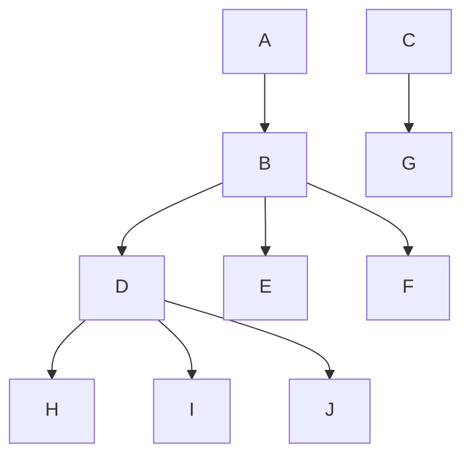
</details>

图 6.2 一棵完全二叉树

---

198

数据结构与算法分析——C++语言描述(第四版)

容易证明，一棵高为 $h$ 的完全二叉树有 $2^{h}$ 到 $2^{h + 1} - 1$ 个节点。这意味着，完全二叉树的高是 $\lfloor \log N\rfloor$ ，显然它是 $O(\log N)$ 。

一个重要的观察发现，因为完全二叉树这么有规律，所以它可以用一个数组表示而不需要使用链。图6.3中的数组对应图6.2中的堆。


<details>
<summary>text_image</summary>

A B C D E F G H I J 
0 1 2 3 4 5 6 7 8 9 10 11 12 13
</details>

图6.3 完全二叉树的数组实现

对于数组中任一位置 $i$ 上的元素, 其左儿子在位置 $2i$ 上, 右儿子在左儿子后的单元 $(2i + 1)$ 中, 它的父亲则在位置 $\lfloor i / 2 \rfloor$ 上。因此, 这里不仅不需要链, 而且遍历该树所需要的操作也极为简单, 在大部分计算机上运行很可能都非常快。这种实现的唯一问题在于, 最大的堆大小需要事先估计, 但一般这并不成问题 (而且如果需要, 可以重新调整大小)。在图6.3中, 堆大小的限界是13个元素。该数组有一个位置0, 后面将详细叙述。

因此，一个堆结构将由一个(Comparable对象的)数组和一个代表当前堆的大小的整数组成。图6.4显示了一个优先队列接口。

本章将始终把堆画成树，这意味着，具体的实现将使用简单的数组。

```cpp
template <typename Comparable>
class BinaryHeap
{
    public:
        explicit BinaryHeap( int capacity = 100 );
        explicit BinaryHeap( const vector<Comparable> & items );

        bool isEmpty( ) const;
        const Comparable & findMin( ) const;

        void insert( const Comparable & x );
        void insert( Comparable && x );
        void deleteMin( );
        void deleteMin( Comparable & minItem );
        void makeEmpty( );

    private:
        int            currentSize;  // 堆中元素的个数
        vector<Comparable> array;      // 堆的数组

        void buildHeap( );
        void percolateDown( int hole );
};
```

图6.4 优先队列的类接口

## 6.3.2 堆序性质

使操作被快速执行的性质是堆序性质(heap-order property)。由于我们想要能够快速地找出最小元，因此最小元应该在根上。如果考虑任意子树也应该是一个堆，那么任意节点就应该小于它的所有后裔。

---

第 6 章 优先队列(堆)

199

应用这个逻辑，我们得到堆序性质。在一个堆中，对于每一个节点 $X$ ， $X$ 的父亲中的关键字小于(或等于) $X$ 中的关键字，根节点除外(它没有父亲)。①在图6.5中左边的树是一个堆，但是，右边的树则不是(虚线表示堆的有序性被破坏)。


<details>
<summary>flowchart</summary>

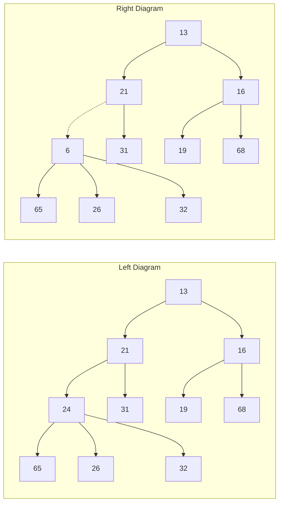
</details>

图 6.5 两棵完全树(只有左边的树是堆)

根据堆序性质，最小元总可以在根处找到。因此，我们以常数时间得到附加操作 findMin。

## 6.3.3 基本的堆操作

无论从概念上还是实际上考虑，执行这两个所要求的操作都是容易的。所有的工作需要保证始终保持堆序性质。

insert(插入)

为将一个元素 $X$ 插入到堆中，我们在下一个可用位置创建一个空穴(hole)，因为否则该堆将不是完全树。如果 $X$ 可以放在该空穴中而并不破坏堆的序，那么插入完成。否则，我们把空穴的父节点上的元素移入该空穴中，这样，空穴就朝着根的方向上冒一步。继续该过程直到 $X$ 能被放入空穴中为止。图6.6表示，为了插入14，我们在堆的下一个可用位置建立一个空穴。由于将14插入空穴破坏了堆序性质，因此将31移入该空穴。在图6.7中继续这种策略，直到找出置入14的正确位置。


<details>
<summary>flowchart</summary>

```mermaid
graph LR
  subgraph Left Diagram
  A["13"] --> B["21"]
  B --> C["16"]
  C --> D["24"]
  D --> E["31"]
    E -.-> F[""]
  G["19"] --> H["68"]
  I["65"] --> J["26"]
  J --> K["32"]
  K --> L[""]
  end
  subgraph Right Diagram
  B --> M["13"]
  M --> N["21"]
  N --> O["16"]
  O --> P["68"]
  Q["19"] --> R["24"]
  R --> S["65"]
  S --> T["26"]
  T --> U["32"]
    U -.-> V["31"]
  W["65"] --> X["26"]
  X --> Y["32"]
  Y --> Z["68"]
  end
```
</details>

图 6.6 尝试插入 14:创建一个空穴，再将空穴上冒

这种一般的策略叫作上滤(percolate up)。新元素在堆中上滤直到找出正确的位置。使用图6.8所示的代码很容易实现插入。

其实我们本可以在 insert 例程中通过反复实施交换操作直至建立正确的序来实现上滤过程，可是一次交换需要 3 条赋值语句。如果一个元素上滤 $d$ 层，那么由于交换而实施的赋值的次数就达到 $3d$，而我们这里的方法却只用到 $d + 1$ 次赋值。

<small><span class="docvortex-page-footnote" data-block-type="page_footnote" style="color:#6b7280">① 类似地，我们可以声明一个(max)堆，它使我们通过改变堆序性质能够有效地找出和删除最大元。因此，优先队列可以用来找出最大元或最小元，但这需要提前决定。</span></small>

---

200

数据结构与算法分析——C++语言描述(第四版)


<details>
<summary>flowchart</summary>

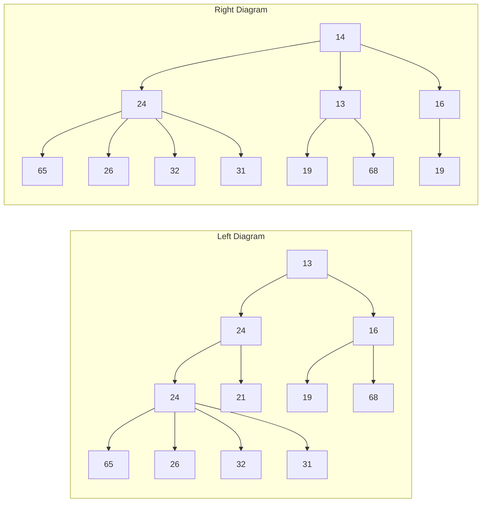
</details>

图 6.7 将 14 插入到前面的堆中剩余的两步

```cpp
/**
 * 将项x插入，允许重复元.
 */
void insert( const Comparable & x )
{
    if( currentSize == array.size( ) - 1 )
        array.resize( array.size( ) * 2 );

    // 上滤
    int hole = ++currentSize;
    Comparable copy = x;

    array[ 0 ] = std::move( copy );
    for( ; x < array[ hole / 2 ]; hole /= 2 )
        array[ hole ] = std::move( array[ hole / 2 ] );
    array[ hole ] = std::move( array[ 0 ] );
}
```

图6.8 插入到一个二叉堆的过程

如果要插入的元素是新的最小值，那么它将一直被推向顶端。这样会在某一时刻 hole 将是 1，并且需要程序跳出循环。当然，可以用明显的测试做到这一点，或者把对被插入项的一个拷贝放到位置 0 处以使循环得以终止。我们选择把 X 放到位置 0 处。

如果欲插入的元素是新的最小元从而一直上滤到根处，那么这种插入的时间将长达 $O(\log N)$ 。平均看来，上滤终止得要早。业已证明，执行一次插入平均需要2.607次比较，因此平均insert将元素上移1.607层。

## deleteMin(删除最小元)

deleteMin 以类似于插入的方式处理。找出最小元是容易的，困难的是删除它。当删除一个最小元时，要在根节点建立一个空穴。由于现在的堆少了一个元素，因此堆中最后一个元素 X 必须移动到该堆的某个地方。如果 X 可以被放到空穴中，那么 deleteMin 完成。不过这一般不太可能，因此我们将空穴的两个儿子中较小者移入空穴，这样就把空穴向下推了一层。重复该步骤直到 X 可以被放入空穴中。因此，我们的做法是将 X 置入沿着从根开始包含最小儿子的一条路径上的一个正确的位置。

在图 6.9 中左边的图显示 deleteMin 之前的堆。删除 13 后，我们必须试图正确地将 31 放到堆中。31 不能放在空穴中，因为这将破坏堆序性质。于是，我们把较小的儿子 14 置入空穴，同时空穴下滑一层(见图 6.10)。重复该过程，由于 31 大于 19，因此把 19 置入空穴，在

---

第 6 章 优先队列(堆)

201

更下一层上建立一个新的空穴。然后，因为 31 还是太大，于是再把 26 置入空穴，在底层又建立一个新的空穴。最后，我们得以将 31 置入空穴中(见图 6.11)。这种一般的策略叫作下滤(percolate down)。在其实现例程中我们使用类似于在 insert 例程中用过的技巧来避免进行交换操作。


<details>
<summary>flowchart</summary>

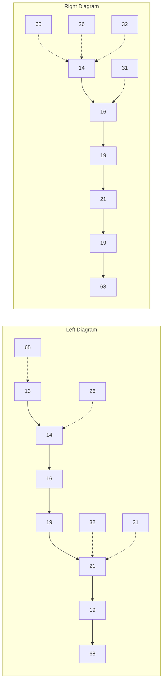
</details>

图6.9 在根处建立空穴


<details>
<summary>flowchart</summary>

This image displays two tree diagrams illustrating a transformation process. The left diagram shows a hierarchical tree structure with nodes labeled 14, 16, 19, 21, 32, and 65, while the right diagram shows a simplified version of the same structure with nodes labeled 14, 16, 19, 21, 32, 65, 19, and 68.
</details>

图 6.10 在 deleteMin 中的下两步操作


<details>
<summary>flowchart</summary>

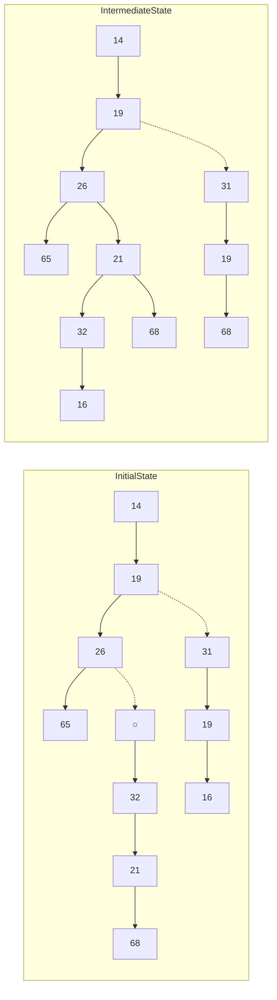
</details>

图 6.11 deleteMin 中最后的两步操作

在堆的实现中经常发生的错误是当堆中存在偶数个元素的时候，此时将遇到一个节点只有一个儿子的情况。我们必须以节点不总有两个儿子为前提，因此这就涉及到一个附加的测试。在图 6.12 描述的程序中，在第 40 行已经进行了这种测试。一种极其巧妙的解决方法是始终保证算法把每一个节点都看成有两个儿子。为了实施这种解法，当堆的大小为偶数时在每个下滤开始处，可将其值大于堆中任何元素的标记放到堆的终端后面的位置上。我们必须在深思熟滤以后再这么做，而且必须插入一个是否确实使用这种技巧的评判。虽然这不再需要测试右儿子的存在性，但还是需要测试何时到达底层，因为对每一片树叶算法将需要一个标记。

这种操作最坏情形运行时间为 $O(\log N)$ 。平均而言，被放到根处的元素几乎下滤到堆的底层(即它所来自的那层)，因此平均运行时间为 $O(\log N)$ 。

---

202

数据结构与算法分析——C++语言描述(第四版)

```cpp
/**
 * 删除最小项.
 * 如果为空则抛出 UnderflowException 异常.
 */
void deleteMin( )
{
    if( isEmpty( ) )
        throw UnderflowException{ };

    array[ 1 ] = std::move( array[ currentSize-- ] );
    percolateDown( 1 );
}

/**
 * 删除最小项并将其放在 minItem 处.
 * 若为空则抛出UnderflowException异常.
 */
void deleteMin( Comparable & minItem )
{
    if( isEmpty( ) )
        throw UnderflowException{ };

    minItem = std::move( array[ 1 ] );
    array[ 1 ] = std::move( array[ currentSize-- ] );
    percolateDown( 1 );
}

/**
 * 在堆中进行下滤的内部方法.
 * 空穴是下滤开始处的下标.
 */
void percolateDown( int hole )
{
    int child;
    Comparable tmp = std::move( array[ hole ] );

    for( ; hole * 2 <= currentSize; hole = child )
    {
        child = hole * 2;
        if( child != currentSize && array[ child + 1 ] < array[ child ] )
            ++child;
        if( array[ child ] < tmp )
            array[ hole ] = std::move( array[ child ] );
        else
            break;
    }
    array[ hole ] = std::move( tmp );
}
```

图 6.12 在二叉堆中执行 deleteMin 的方法

---

第 6 章 优先队列(堆)

203

## 6.3.4 其他的堆操作

注意，虽然查找最小值的操作可以以常数时间完成，但是，按照求最小元设计的堆(也称作最小堆(min heap))在求最大元方面却无能为力。事实上，一个堆所蕴涵的序信息很少，因此，若不对整个堆进行线性搜索，是没有办法找出任何特定的元素的。为说明这一点，考虑图6.13所示的大型堆结构(具体元素没有标出)，我们在这里看到，关于最大值的元素所知道的唯一信息是:该元素在树叶上。但是，半数的元素位于树叶上，因此该信息实际上是没什么用途的。由于这个原因，如果重要的是要知道元素都在什么地方，那么除堆之外，还必须用到诸如散列表等某些其他的数据结构。(回忆:该模型并不允许查看堆内部。)

如果假设通过某种其他方法得知每一个元素的位置，那么就有几种其他操作的开销变小。下述前三种操作均以对数最坏情形时间运行。


<details>
<summary>natural_image</summary>

Abstract geometric pattern composed of interconnected nodes and lines, no text or symbols present
</details>

图 6.13 一棵巨大的完全二叉树

## decreaseKey(降低关键字的值)

decreaseKey $(p, \Delta)$ 操作降低在位置 $p$ 处的项的值，降值的幅度为正的量 $\Delta$ 。由于这可能破坏堆序性质，因此必须通过上滤对堆进行调整。该操作对系统管理程序是有用的:系统管理程序能够使它们的程序以最高的优先级来运行。

## increaseKey(增加关键字的值)

increaseKey(p,Δ)操作增加在位置p处的项的值，增值的幅度为正的量Δ。这可以用下滤来完成。许多调度程序自动地降低正在过多地消耗CPU时间的进程的优先级。

## remove(删除)

remove(p) 操作删除堆中位置 p 上的节点。该操作通过首先执行 decreaseKey(p,∞) 然后再执行 deleteMin() 来完成。当一个进程被用户中止(而不是正常终止)时，它必须从优先队列中被除去。

## buildHeap(构建堆)

有时二叉堆是由一些项的一个初始集合构造而得的，这种构造函数以 $N$ 项作为输入，并把它们放到一个堆中。显然，这可以使用 $N$ 个相继的 insert 操作来完成。由于每个 insert

---

204

数据结构与算法分析——C++语言描述(第四版)

将花费 $O(1)$ 平均时间以及 $O(\log N)$ 的最坏情形时间，因此该算法的总的运行时间平均是 $O(N)$ 时间，而最坏情形则是 $O(M\log N)$ 时间。由于这是一种特殊的指令，没有其他操作干扰，而且我们已经知道该指令能够以线性平均时间实施，因此，期望能够保证线性时间界的考虑是合乎情理的。

一般的算法是将 $N$ 项以任意顺序放入树中，保持结构特性。此时，如果percolateDown(i)从节点i下滤，那么图6.14中的buildHeap例程则可以由构造函数用于创建一棵堆序的树(heap-ordered tree)。

```txt
explicit BinaryHeap( const vector<Comparable> & items )
    : array( items.size( ) + 10 ), currentSize{ items.size( ) }
{
    for( int i = 0; i < items.size( ); ++i )
        array[ i + 1 ] = items[ i ];
    buildHeap( );
}

/**
 * 从项的任一排列建立堆序性质
 * 以线性时间运行.
 */
void buildHeap( )
{
    for( int i = currentSize / 2; i > 0; --i )
        percolateDown( i );
}
```

图6.14 buildHeap和构造函数

图6.15中的第一棵树是无序树。图6.15～图6.18中其余7棵树表示出7个percolteDown中每一个的执行结果。每条虚线对应两次比较:一次是找出较小的子节点，另一次是将较小的儿子与该节点进行比较。注意，在整个算法中只有10条虚线(可能已经存在第11条——在哪里？)，它们对应20次比较。


<details>
<summary>funnel</summary>

| Node | Left Structure Value | Right Structure Value |
| --- | --- | --- |
| 1 | 150 | 150 |
| 2 | 80 | 80 |
| 3 | 30 | 30 |
| 4 | 10 | 10 |
| 5 | 60 | 90 |
| 6 | 50 | 60 |
| 7 | 120 | 50 |
| 8 | 140 | 120 |
| 9 | 130 | 140 |
| 10 | — | 130 |
</details>

图 6.15 左:初始堆；右:在 percolateDown(7) 后


<details>
<summary>dendrogram</summary>

| Node | Left Structure Value | Right Structure Value |
| --- | --- | --- |
| 1 | 150 | 150 |
| 2 | 80 | 80 |
| 3 | 30 | 30 |
| 4 | 10 | 10 |
| 5 | 70 | 60 |
| 6 | 120 | 70 |
| 7 | 140 | 120 |
| 8 | 130 | 140 |
| 9 | — | 130 |
| 10 | — | 110 |
| 11 | — | 110 |
| 12 | — | 110 |
| 13 | — | 110 |
| 14 | — | 110 |
| 15 | — | 110 |
| 16 | — | 110 |
| 17 | — | 110 |
| 18 | — | 110 |
| 19 | — | 110 |
| 20 | — | 110 |
| 21 | — | 110 |
| 22 | — | 110 |
| 23 | — | 110 |
| 24 | — | 110 |
| 25 | — | 110 |
| 26 | — | 110 |
| 27 | — | 110 |
| 28 | — | 110 |
| 29 | — | 110 |
| 30 | — | 110 |
| 31 | — | 110 |
| 32 | — | 110 |
| 33 | — | 110 |
| 34 | — | 110 |
| 35 | — | 110 |
| 36 | — | 110 |
| 37 | — | 110 |
| 38 | — | 110 |
| 39 | — | 110 |
| 40 | — | 110 |
| 41 | — | 110 |
| 42 | — | 110 |
| 43 | — | 110 |
| 44 | — | 110 |
| 45 | — | 110 |
| 46 | — | 110 |
| 47 | — | 110 |
| 48 | — | 110 |
| 49 | — | 110 |
| 50 | — | 110 |
| 51 | — | 110 |
| 52 | — | 110 |
| 53 | — | 110 |
| 54 | — | 110 |
| 55 | — | 110 |
| 56 | — | 110 |
| 57 | — | 110 |
| 58 | — | 110 |
| 59 | — | 110 |
| 60 | — | 110 |
| 61 | — | 110 |
| 62 | — | 110 |
| 63 | — | 110 |
| 64 | — | 110 |
| 65 | — | 110 |
| 66 | — | 110 |
| 67 | — | 110 |
| 68 | — | 110 |
| 69 | — | 110 |
| 70 | — | 110 |
| 71 | — | 110 |
| 72 | — | 110 |
| 73 | — | 110 |
| 74 | — | 110 |
| 75 | — | 110 |
| 76 | — | 110 |
| 77 | — | 110 |
| 78 | — | 110 |
| 79 | — | 110 |
| 80 | — | 80 |
| 81 | — | 40 |
</details>

图6.16 左:在percolateDown(6)后；右:在percolateDown(5)后

---

第 6 章 优先队列(堆)

205


<details>
<summary>dendrogram</summary>

| Node | Left Structure Value | Right Structure Value |
| --- | --- | --- |
| 1 | 150 | 150 |
| 2 | 80 | 80 |
| 3 | 20 | 20 |
| 4 | 10 | 10 |
| 5 | 100 | 100 |
| 6 | 30 | 30 |
| 7 | 90 | 90 |
| 8 | 60 | 60 |
| 9 | 70 | 60 |
| 10 | 120 | 70 |
| 11 | 140 | 120 |
| 12 | 130 | 140 |
| 13 | — | 130 |
| 14 | — | 110 |
| 15 | — | 40 |
| 16 | — | 40 |
| 17 | — | 110 |
| 18 | — | 50 |
| 19 | — | 110 |
| 20 | — | 20 |
| 21 | — | 10 |
| 22 | — | 100 |
| 23 | — | 30 |
| 24 | — | 90 |
| 25 | — | 60 |
| 26 | — | 70 |
| 27 | — | 120 |
| 28 | — | 140 |
| 29 | — | 130 |
</details>

图 6.17 左:在 percolateDown(4) 后 右:在 percolateDown(3) 后


<details>
<summary>dendrogram</summary>

| Node | Left Structure Value | Right Structure Value |
| --- | --- | --- |
| 1 | 150 | 10 |
| 2 | 10 | 40 |
| 3 | 20 | 20 |
| 4 | 100 | 100 |
| 5 | 30 | 150 |
| 6 | 90 | 90 |
| 7 | 80 | 80 |
| 8 | 70 | 70 |
| 9 | 120 | 120 |
| 10 | 140 | 140 |
| 11 | 130 | 130 |
| 12 | 50 | 50 |
| 13 | 110 | 110 |
| 14 | — | 130 |
| 15 | — | 130 |
| 16 | — | 120 |
| 17 | — | 140 |
| 18 | — | 130 |
| 19 | — | 80 |
| 20 | — | 60 |
| 21 | — | 60 |
| 22 | — | 60 |
| 23 | — | 60 |
| 24 | — | 60 |
| 25 | — | 60 |
| 26 | — | 60 |
| 27 | — | 60 |
| 28 | — | 60 |
| 29 | — | 60 |
| 30 | — | 60 |
| 31 | — | 60 |
| 32 | — | 60 |
| 33 | — | 60 |
| 34 | — | 60 |
| 35 | — | 60 |
| 36 | — | 60 |
| 37 | — | 60 |
| 38 | — | 60 |
| 39 | — | 60 |
| 40 | — | 60 |
| 41 | — | 60 |
| 42 | — | 60 |
| 43 | — | 60 |
| 44 | — | 60 |
| 45 | — | 60 |
| 46 | — | 60 |
| 47 | — | 60 |
| 48 | — | 60 |
| 49 | — | 60 |
| 50 | — | 60 |
| 51 | — | 60 |
| 52 | — | 60 |
| 53 | — | 60 |
| 54 | — | 60 |
| 55 | — | 60 |
| 56 | — | 60 |
| 57 | — | 60 |
| 58 | — | 60 |
| 59 | — | 60 |
| 60 | — | 60 |
| 61 | — | 60 |
| 62 | — | 60 |
| 63 | — | 60 |
| 64 | — | 60 |
| 65 | — | 60 |
| 66 | — | 60 |
| 67 | — | 60 |
| 68 | — | 60 |
| 69 | — | 60 |
| 70 | — | 60 |
| 71 | — | 60 |
| 72 | — | 60 |
| 73 | — | 60 |
| 74 | — | 60 |
| 75 | — | 60 |
| 76 | — | 60 |
| 77 | — | 60 |
| 78 | — | 60 |
| 79 | — | 60 |
| 80 | — | 60 |
| 81 | — | 60 |
| 82 | — | 60 |
| 83 | — | 60 |
| 84 | — | 60 |
| 85 | — | 60 |
| 86 | — | 60 |
| 87 | — | 60 |
| 88 | — | 60 |
| 89 | — | 60 |
| 90 | — | 60 |
| 91 | — | 60 |
| 92 | — | 60 |
| 93 | — | 60 |
| 94 | — | 60 |
| 95 | — | 60 |
| 96 | — | 60 |
| 97 | — | 60 |
| 98 | — | 60 |
| 99 | — | 60 |
</details>

图 6.18 左:在 percolateDown(2) 后 右:在 percolateDown(1) 后

为了确定 buildHeap 的运行时间的界，必须确定虚线的条数的界。这可以通过计算堆中所有节点的高度的和来得到，它是虚线的最大条数。现在我们想要说明的是:该和为  $O(N)$ 。

## 定理6.1

包含 $2^{h + 1} - 1$ 个节点高为 $h$ 的理想二叉树(perfect binary tree)的节点的高度的和为 $2^{h + 1} - 1 - (h + 1)$ 。

证明:

容易看出，该树由高度 $h$ 上的1个节点、高度 $h - 1$ 上的2个节点、高度 $h - 2$ 上的 $2^{2}$ 个节点以及一般地在高度 $h - i$ 上的 $2^{i}$ 个节点等组成。于是，所有节点的高度的和为

$$
\begin{array}{l} S = \sum_ {i = 0} ^ {h} 2 ^ {i} (h - i) \\ = h + 2 (h - 1) + 4 (h - 2) + 8 (h - 3) + 1 6 (h - 4) + \dots + 2 ^ {h - 1} (1) \tag {6.1} \\ \end{array}
$$

两边乘以 2 得到方程

$$
2 S = 2 h + 4 (h - 1) + 8 (h - 2) + 1 6 (h - 3) + \dots + 2 ^ {h} (1) \tag {6.2}
$$

将这两个方程相减得到式(6.3)。我们发现, 非常数项差不多都消去了, 例如, $2h - 2(h - 1) = 2, 4(h - 1) - 4(h - 2) = 4$, 等等。式(6.2)的最后一项 $2^{h}$ 在式(6.1)中不出现, 因此, 它出现在式(6.3)中。式(6.1)中的第一项 $h$ 在式(6.2)中不出现, 因此, $-h$ 出现在式(6.3)中。我们得到

$$
S = - h + 2 + 4 + 8 + \dots + 2 ^ {h - 1} + 2 ^ {h} = (2 ^ {h + 1} - 1) - (h + 1) \tag {6.3}
$$

这就证明了该定理。

一棵完全树 (complete tree) 不是理想二叉树 (perfect binary tree), 但是我们得到的结果却是一棵完全树的节点高度的和的上界。由于一棵完全树节点数在 $2^{h}$ 和 $2^{h+1}$ 之间, 因此该定理意味着这个和是 $O(N)$, 其中 $N$ 是节点的个数。

虽然我们得到的结果对证明 buildHeap 是线性的而言是充分的，但高度和的界却不是

---

206

数据结构与算法分析——C++语言描述(第四版)

尽可能强的界。对于具有 $N = 2^{h}$ 个节点的完全树，我们得到的界大致是 $2N$ 。由归纳法可以证明，高度的和是 $N - b(N)$，其中 $b(N)$ 是在 $N$ 的二进制表示法中1的个数。

## 6.4 优先队列的应用

我们已经提到优先队列如何用于操作系统的设计中。在第 9 章将看到优先队列如何用在有效地实现几个图论算法中。此处，我们介绍如何应用优先队列来得到两个问题的解答。

## 6.4.1 选择问题

我们将要考察的第一个问题是来自第1章1.1节的选择问题(selection problem)。回忆当时的输入是 $N$ 个元素以及一个整数 $k$，这 $N$ 个元素可以是全序的(totally ordered)。该选择问题是要找出第 $k$ 个最大的元素。

在第 1 章中给出了两个算法，不过它们都不是很有效的算法。第一个算法我们将称其为 1A，是把这些元素读入数组并将它们排序，返回适当的元素。假设使用的是简单的排序算法，则运行时间为 $O(N^{2})$ 。另一个算法叫作 1B，是将 $k$ 个元素读入一个数组并将其排序。这些元素中的最小者在第 $k$ 个位置上。我们一个一个地处理其余的元素。当一个元素被读入时，它先与数组中第 $k$ 个元素比较，如果该元素大，那么将第 $k$ 个元素除去，而这个新元素则被放在其余 $k-1$ 个元素间的正确的位置上。当算法结束时，第 $k$ 个位置上的元素就是问题的解答。该方法的运行时间为 $O(N \cdot k)$（为什么？）。如果 $k = \lceil N / 2 \rceil$，那么这两种算法都是 $O(N^{2})$。注意，对于任意的 $k$，我们可以求解对称的问题:找出第 $(N - k + 1)$ 个最小的元素，从而 $k = \lceil N / 2 \rceil$ 实际上是这两个算法最困难的情况。这刚好也是最有趣的情形，因为 $k$ 的这个值称为中位数 (median)。

我们在这里给出两个算法，在 $k = \lceil N / 2\rceil$ 的极端情形它们均以 $O(N\log N)$ 运行，这是明显的改进。

## 算法6A

为了简单起见，假设只考虑找出第 $k$ 个最小的元素。该算法很简单。我们将 $N$ 个元素读入一个数组。然后对该数组应用 buildHeap 算法。最后，执行 $k$ 次 deleteMin 操作。从该堆最后提取的元素就是我们的答案。显然，只要改变堆序性质，就可以求解原始的问题:找出第 $k$ 个最大的元素。

这个算法的正确性应该是显然的。如果使用 buildHeap，构造堆的最坏情形用时是 $O(N)$，而每次 deleteMin 用时 $O(\log N)$。由于有 $k$ 次 deleteMin，因此得到总的运行时间为 $O(N + k \log N)$。如果 $k = O(N / \log N)$，那么运行时间取决于 buildHeap 操作，即 $O(N)$。对于大的 $k$ 值，运行时间为 $O(k \log N)$。如果 $k = \lceil N / 2 \rceil$，那么运行时间则为 $\Theta(N \log N)$。

注意，如果对 $k = N$ 运行该程序并在元素离开堆时记录它们的值，那么实际上已经对输入文件以时间 $O(N\log N)$ 做了排序。在第7章，我们将细化该想法，得到一种快速的排序算法，叫作堆排序(heapsort)。

## 算法 6B

关于第2个算法，我们回到原始问题，找出第 $k$ 个最大的元素。我们使用算法1B的思路。

---

第 6 章 优先队列(堆)

207

在任一时刻我们都将保留 $k$ 个最大元素的集合 $S$ 。在前 $k$ 个元素读入以后，当再读入一个新的元素时，该元素将与第 $k$ 个最大元素进行比较，记这第 $k$ 个最大的元素为 $S_{k}$ 。注意，$S_{k}$ 是 $S$ 中最小的元素。如果新的元素更大，那么用新元素代替 $S$ 中的 $S_{k}$ 。此时，$S$ 将有一个新的最小元素，它可能是新添加进的元素，也可能不是。在输入终了时，我们找到 $S$ 中最小的元素，将其返回，它就是答案。

这基本上与第1章中描述的算法相同。不过，这里使用一个堆来实现 $S$ 。前 $k$ 个元素通过调用一次buildHeap以总时间 $O(k)$ 被置入堆中。处理每个其余的元素的时间为 $O(1)$，用于检测是否元素进入 $S$，再加上时间 $O(\log k)$，用于在必要时删除 $S_{k}$ 并插入新元素。因此，总的时间是 $O(k + (N - k)\log k) = O(N\log k)$ 。该算法也给出找出中位数的时间界 $\Theta(N\log N)$ 。

在第7章，我们将看到如何以平均时间 $O(N)$ 解决这个问题。在第10章，我们将看到一个以 $O(N)$ 最坏情形时间求解该问题的算法，虽然不实用但却很精妙。

## 6.4.2 事件模拟

第3章3.7.3节描述了一个重要的排队问题。回忆在那里我们有一个系统，比如银行，顾客们到达并站队等在那里直到 $k$ 个出纳员有一个腾出手来。顾客的到达情况由概率分布函数控制，服务时间(一旦出纳员腾出时间用于服务的时间量)也是如此。我们的兴趣在于一位顾客平均必须要等多久或所排的队伍可能有多长这类统计问题。

对于某些概率分布以及 $k$ 的一些值，答案都可以精确地计算出来。然而随着 $k$ 的变大，分析明显地变得困难，因此使用计算机模拟银行的运作很有吸引力。用这种方法，银行官员可以确定为保证合理的通畅服务需要多少出纳员。

模拟由处理中的事件组成。这里的两个事件是:(a)一位顾客的到达；(b)一位顾客的离去，从而腾出一名出纳员。

我们可以使用概率函数来生成一个输入流，它由每位顾客的到达时间和服务时间的序偶组成，并通过到达时间排序。我们不必使用一天中的准确时间，而是使用一份单位时间量，我们称之为一个滴答(tick)。

进行这种模拟的一种方法是启动处在 0 滴答处的一台模拟钟表。我们让钟表一次走一个滴答，同时查看是否有一个事件发生。如果有，那么我们处理这个(些)事件，搜集统计资料。当没有顾客留在输入流且所有的出纳员都被腾出而闲在的时候，模拟结束。

这种模拟策略的问题是，它的运行时间不依赖顾客数或事件数(每位顾客有两个事件)，但是却依赖滴答数，而后者实际又不是输入的一部分。为了看清为什么问题在于此，假设将钟表的单位改成毫滴答(millitick)，即千分之一滴答，并将输入中的所有时间乘以1000，则结果将是:模拟用时长1000倍。

避免这种问题的关键是在每一个阶段让钟表直接走到下一个事件时间。从概念上看这是容易做到的。在任一时刻，可能出现的下一事件或者是(a)在输入文件中下一顾客的到达，或者是(b)在一名出纳员处一位顾客离开。由于事件将要发生的所有时间都是可以达到的，因此只需找出在最近的将来发生的事件并处理这个事件。

如果事件是离开，那么处理过程包括搜集离开的顾客的统计资料以及检验队伍(队列)看是否还有别的顾客在等待。如果有，则加上这位顾客，处理需要的统计资料，计算顾客将要离开的时间，并将离开加到等待发生的事件集中去。

---

208

数据结构与算法分析——C++语言描述(第四版)

如果事件是到达，则检查闲在的出纳员。如果没有，则把该到达放到队伍(队列)中去；否则，我们分配给顾客一个出纳员，计算顾客的离开时间，并将离开添加到等待发生的事件集中去。

正在等待的顾客队伍可以实现为一个队列。由于需要找到最近的将来发生的事件，因此合适的办法是将等待发生离开的集合编入一个优先队列中。下一事件是下一个到达或下一个离开(哪个先发生就是哪个)，它们都容易达到。

现在就可以为模拟编写例程了，不过很可能要耗费些时间。如果有 $C$ 个顾客(因此有2C个事件)和 $k$ 个出纳员，那么模拟的运行时间将会是 $O(C\log (k + 1))$ ，因为计算和处理每个事件花费 $O(\log H)$ ，其中 $H = k + 1$ 为堆的大小。①

## 6.5 $d$ 堆

二叉堆是如此简单，以至于它们几乎总是用在需要优先队列的时候。 $d$ 堆 $(d$-heap) 是二叉堆的简单推广，它恰像一个二叉堆，只是所有的节点都有 $d$ 个儿子（因此，二叉堆是2堆）。

图 6.19 表示的是一个 3 堆。注意，d 堆要比二叉堆浅得多，它将 insert 操作的运行时间改进为  $O(\log_{d} N)$ 。然而，对于大的 d，deleteMin 操作费时得多，因为虽然树是浅了，但是 d 个儿子中的最小者是必须要找出的，如使用标准的算法，这会花费 d-1 次比较，于是将操作的用时提高到  $O(d \log_{d} N)$ 。如果 d 是常数，那么当然两者的运行时间都是  $O(\log N)$ 。虽然仍然可以使用一个数组，但是，现在找出儿子和父亲的乘法和除法都有个因子 d，除非 d 是 2 的幂，否则将会大大地增加运行时间，因为我们不能再通过一次二进制移位来实现除法了。d 堆在理论上很有趣，因为存在许多算法，其插入次数比 deleteMin 的次数多很多（从而理论上的加速是可能的）。当优先队列太大不能完全装入主存的时候，d 堆也是很有用的。在这种情况下，d 堆能够以与 B 树大致相同的方式发挥作用。最后，有证据显示，在实践中 4 堆可以胜过二叉堆。


<details>
<summary>flowchart</summary>

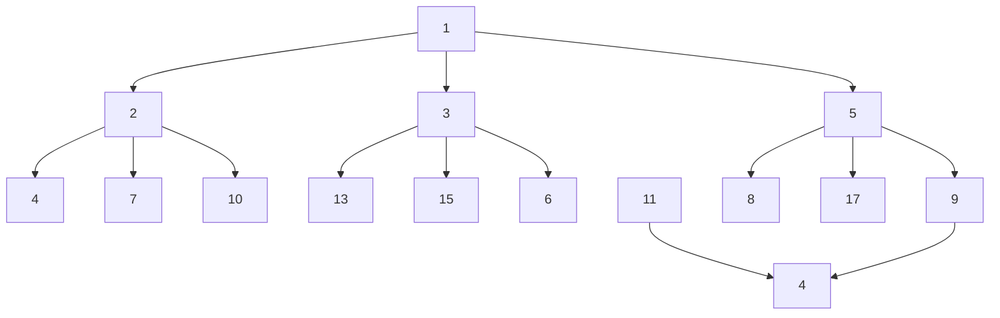
</details>

图6.19 一个 $d$ 堆 $(d = 3)$

除不能实施 find 外，堆实现的最明显的缺点是:将两个堆合并成一个堆是困难的操作。这种附加的操作叫作合并(merge)。存在许多实现堆的方法使得一次 merge 操作的运行时间是 $O(\log N)$ 。现在我们就来讨论 3 种复杂程度不一的数据结构，它们都有效地支持 merge 操作。我们将把复杂的分析推迟到第 11 章讨论。

<small><span class="docvortex-page-footnote" data-block-type="page_footnote" style="color:#6b7280">① 我们用 $O(C\log (k + 1))$ 而不用 $O(C\log k)$ 以避免 $k = 1$ 情形出现的混乱。</span></small>

---

第6章 优先队列(堆)

209

## 6.6 左式堆

设计一种堆结构有效地支持合并操作(即以 $o(N)$ 时间处理一次 merge)而且像二叉堆那样只使用一个数组似乎很困难。原因在于，合并似乎需要把一个数组复制到另一个数组中去，对于相同大小的堆这将花费时间 $\Theta (N)$ 。正因为如此，所有支持有效合并的高级数据结构都需要使用链式数据结构。实践中，我们预计这将可能使得所有其他的操作变慢。

左式堆(leftist heap)像二叉堆那样也具有结构性和有序性。事实上，和所有使用的堆一样，左式堆具有相同的堆序性质，该性质我们已经看到过了。不仅如此，左式堆也是二叉树。左式堆和二叉堆唯一的区别是:左式堆不是理想平衡的(perfectly balanced)，而实际上是趋向于非常的不平衡。

## 6.6.1 左式堆的性质

我们把任一节点 $X$ 的零路径长 (null path length) $\mathrm{npl}(X)$ 定义为从 $X$ 到一个不具有两个儿子的节点的最短路径的长。因此，具有 0 个或 1 个儿子的节点的 $\mathrm{npl}$ 为 0，而 $\mathrm{npl}(\mathrm{nullptr}) = -1$ 。在图 6.20 给出的树中，零路径长标记在树的节点内。


<details>
<summary>flowchart</summary>

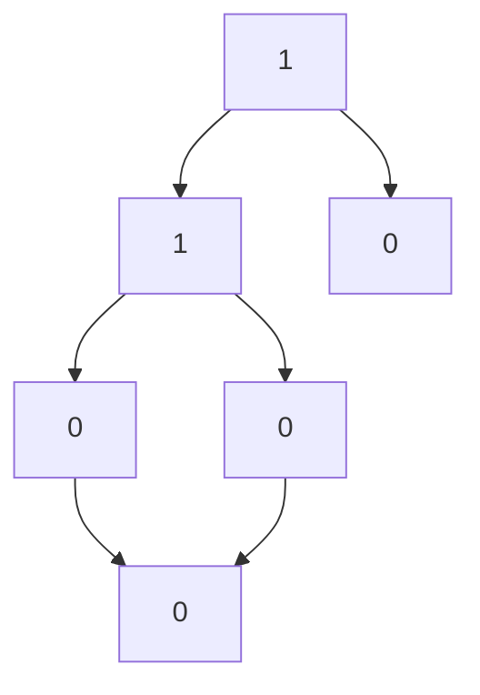
</details>


<details>
<summary>flowchart</summary>

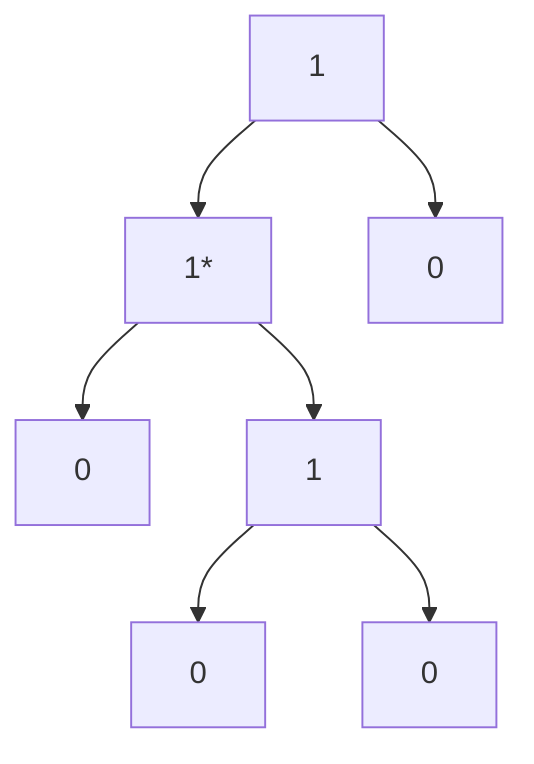
</details>

图6.20 两棵树的零路径长；只有左边的树是左式的

注意，任一节点的零路径长比它的诸儿子节点的零路径长的最小值多1。这个结论也适用少于两个儿子的节点，因为 nullptr 的零路径长是-1。

左式堆性质是:对于堆中的每一个节点 $X$ ，左儿子的零路径长至少与右儿子的零路径长一样。图6.20中只有一棵树，即左边的那棵树满足该性质。这个性质实际上超出了它确保树不平衡的要求，因为它显然偏重于使树向左增加深度。确实有可能存在由左节点形成的长路径构成的树(而且实际上更便于合并操作)——因此，我们就有了名称左式堆(leftist heap)。

因为左式堆趋向于加深左路径，所以右路径应该短。事实上，沿左式堆往下的右路径确实是该堆中最短的路径。否则，就会存在过某个节点 $X$ 的一条路径通达它的左儿子，此时 $X$ 就破坏了左式堆的性质。

## 定理6.2

在右路径上有 $r$ 个节点的左式树必然至少有 $2^{r} - 1$ 个节点。

证明:

数学归纳法证明。如果 $r = 1$，则必然至少存在一个树节点。其次，设定理对 1、2、…、 $r$ 个节点成立。考虑在右路径上有 $r + 1$ 个节点的左式树。此时，根具有在右路径上含 $r$ 个节

---

210

数据结构与算法分析——C++语言描述(第四版)

点的右子树，以及在右路径上至少含 $r$ 个节点的左子树(否则它就不是左式的)。对这两棵树应用归纳假设，得知在每棵树上最少有 $2^{r} - 1$ 个节点，再加上根节点，于是在该树上至少有 $2^{r + 1} - 1$ 个节点，定理得证。

从这个定理立刻得到，N 个节点的左式树有一条最多含有  $\left\lfloor \log(N+1) \right\rfloor$  个节点的右路径。对左式堆操作的一般思路是将所有的工作放到右路径上进行，它保证树深度短。唯一的棘手部分在于，对右路径的 insert 和 merge 可能会破坏左式堆性质。事实上，恢复该性质是非常容易的。

## 6.6.2 左式堆操作

对左式堆的基本操作是合并。注意，插入只是合并的特殊情形，因为可以把插入看成是单节点堆与一个更大的堆的 merge。首先，我们给出一个简单的递归解法，然后介绍如何能够非递归地施行该解法。我们的输入是两个左式堆 $H_{1}$ 和 $H_{2}$，见图6.21。读者应该验证，这两个堆确实是左式堆。注意，最小的元素在根处。除数据、左指针和右指针所用空间外，每个节点还要有一个指示零路径长的项。

如果这两个堆中有一个堆是空的，则可以返回另外一个堆。否则，为了合并这两个堆，可比较它们的根。首先，我们递归地将具有较大的根值的堆与具有较小的根值的堆的右子堆合并。在本例中这就是说，我们递归地将 $H_{2}$ 与 $H_{1}$ 的根在8处的右子堆合并，得到图6.22中的堆。


图6.21 两个左式堆 $H_{1}$ 和 $H_{2}$


<details>
<summary>flowchart</summary>

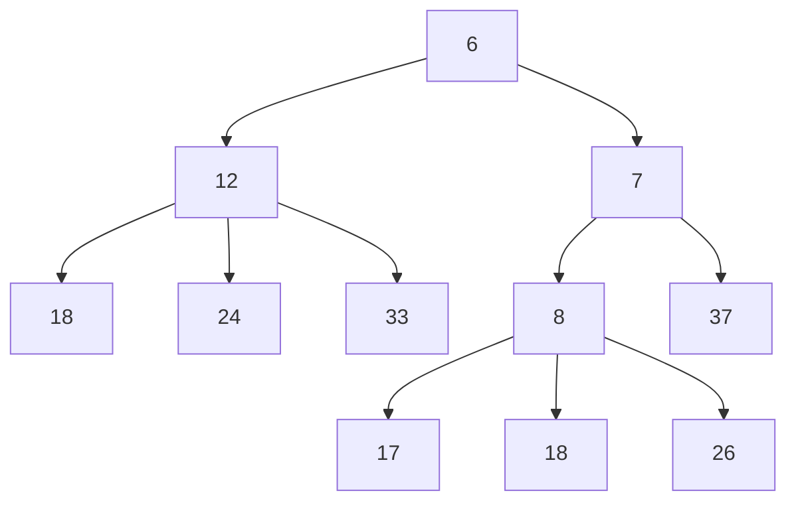
</details>

图6.22 将 $H_{2}$ 与 $H_{1}$ 的右子堆合并的结果

由于这棵树是递归地形成的，而我们尚未对算法描述完毕，因此现在还不能说明该堆是如何得到的。不过，有理由假设，最后得到的树是一个左式堆，因为它是通过递归的步骤得到的。这很像归纳法证明中的归纳假设。既然我们能够处理基准情形(发生在一棵树是空的时候)，当然可以假设，只要我们能够完成合并，那么递归步骤就是成立的。这是递归法则3，我们在第1章中讨论过它。现在，我们让这个新的堆成为 $H_{1}$ 的根的右儿子(见图6.23)。

虽然最后得到的堆满足堆序性质，但它不是左式堆，因为根的左子树的零路径长为1而根的右子树的零路径长为2。因此，左式的性质在根处被破坏。不过，容易看到，树的其余部分必然是左式的。由于递归步骤，根的右子树是左式的。根的左子树没有变化，当然它也必然还是左式的。这样一来，我们只要对根进行调整就可以了。使整个树是左式的做法如下:只要交换根的左儿子和右儿子(见图6.24)并更新零路径长，就完成了merge，新的零路径长

---

第 6 章 优先队列(堆)

211

是新的右儿子的零路径长加 1。注意，如果零路径长不更新，那么所有的零路径长都将是 0，而堆将不是左式的，只是随机的。在这种情况下，算法仍然成立，但是，我们宣称的时间界将不再有效。


<details>
<summary>flowchart</summary>

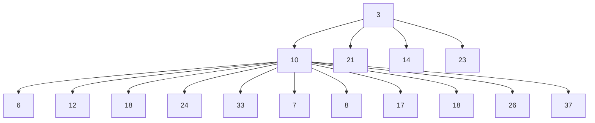
</details>

图6.23 将前面图中的左式堆作为 $H_{1}$ 的右儿子接上后的结果


<details>
<summary>flowchart</summary>

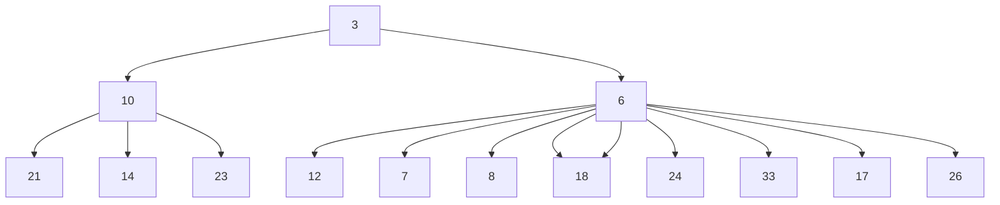
</details>

图 6.24 交换  $H_{1}$  的根的儿子得到的结果

将算法的描述直接翻译成代码。除了增加 npl(零路径长)数据成员外, 节点类(见图 6.25)与二叉树是相同的。左式堆把指向根的指针作为其数据成员存储。我们在第 4 章已经看到, 当一个元素被插入到一棵空的二叉树时, 由根引用的节点将需要改变。我们使用通常的实现 private 递归方法的技巧进行合并。该类的架构也在图 6.25 中示出。

两个 merge 例程(见图 6.26)是些被设计成消除一些特殊情形并保证 $H_{1}$ 有较小根的驱动程序。实际的合并操作在 merge1 中进行(见图 6.27)。公有的 merge 方法将 rhs 合并到控制堆中。rhs 变为空。在这个公有方法中的别名测试不接受 h.merge(h)。

执行合并所用的时间与右路径的长的和成正比，因为在递归调用期间对每一个被访问的节点花费的是常数工作量。因此，我们得到合并两个左式堆的时间界为 $O(\log N)$ 。我们也可以分两趟来非递归地实施该操作。在第一趟中，通过合并两个堆的右路径建立一棵新的树。为此，我们以排序的方式安排 $H_{1}$ 和 $H_{2}$ 右路径上的节点，保持它们各自的左儿子不变。在我们的例子中，新的右路径是3，6，7，8，18，而最后得到的树如图6.28所示。第二趟构建堆，儿子的交换工作在左式堆性质被破坏的那些节点上进行。在图6.28中，在节点7和3各有一

---

212

数据结构与算法分析——C++语言描述(第四版)

次交换，并得到与前面相同的树。非递归的做法更容易理解，但编程困难。我们留给读者去证明:递归过程和非递归过程的结果是相同的。

```cpp
template <typename Comparable>
class LeftistHeap
{
    public:
        LeftistHeap( );
        LeftistHeap( const LeftistHeap & rhs );
        LeftistHeap( LeftistHeap && rhs );

        ~LeftistHeap( );

        LeftistHeap & operator=( const LeftistHeap & rhs );
        LeftistHeap & operator=( LeftistHeap && rhs );

        bool isEmpty( ) const;
        const Comparable & findMin( ) const;

        void insert( const Comparable & x );
        void insert( Comparable && x );
        void deleteMin( );
        void deleteMin( Comparable & minItem );
        void makeEmpty( );
        void merge( LeftistHeap & rhs );

private:
    struct LeftistNode
    {
        Comparable element;
        LeftistNode *left;
        LeftistNode *right;
        int npl;

        LeftistNode( const Comparable & e, LeftistNode *lt = nullptr,
            LeftistNode *rt = nullptr, int np = 0 )
        : element{ e }, left{ lt }, right{ rt }, npl{ np } { }

        LeftistNode( Comparable && e, LeftistNode *lt = nullptr,
            LeftistNode *rt = nullptr, int np = 0 )
        : element{ std::move( e ) }, left{ lt }, right{ rt }, npl{ np } { }
    };

    LeftistNode *root;

    LeftistNode * merge( LeftistNode *h1, LeftistNode *h2 );
    LeftistNode * merge1( LeftistNode *h1, LeftistNode *h2 );

    void swapChildren( LeftistNode *t );
    void reclaimMemory( LeftistNode *t );
    LeftistNode * clone( LeftistNode *t ) const;
};
```

图 6.25 左式堆类型声明

---

第 6 章 优先队列(堆)

213

```c
/**
 * 将rhs合并到优先队列.
 * rhs变为空。rhs必须不同于this。
 */
void merge( LeftistHeap & rhs )
{
    if( this == &rhs )    // 避免别名问题
        return;

    root = merge( root, rhs.root );
    rhs.root = nullptr;
}

/**
 * 合并两个根的内部方法。
 * 处理不正常情形并调用递归的merge1.
 */
LeftistNode * merge( LeftistNode *h1, LeftistNode *h2 )
{
    if( h1 == nullptr )
        return h2;
    if( h2 == nullptr )
        return h1;
    if( h1->element < h2->element )
        return merge1( h1, h2 );
    else
        return merge1( h2, h1 );
}
```

图 6.26 合并左式堆的驱动例程

```c
/**
 * 合并两个根的内部方法.
 * 假设树非空，并设 h1 的根包含最小项.
 */
LeftistNode * merge1( LeftistNode *h1, LeftistNode *h2 )
{
    if( h1->left == nullptr )  // 单节点
        h1->left = h2;          // h1中其他的域已经精确
    else
    {
        h1->right = merge( h1->right, h2 );
        if( h1->left->npl < h1->right->npl )
            swapChildren( h1 );
        h1->npl = h1->right->npl + 1;
    }
    return h1;
}
```

图 6.27 合并左式堆的实际例程

上面提到，可以通过把被插入项看成单节点堆并执行一次 merge 来完成插入。为了执行 deleteMin，我们只要除掉根而得到两个堆，然后再将这两个堆合并。因此，执行一次 deleteMin 的时间为 $O(\log N)$ 。这两个例程在图 6.29 和图 6.30 中给出。

---

214

数据结构与算法分析——C++语言描述(第四版)


<details>
<summary>flowchart</summary>

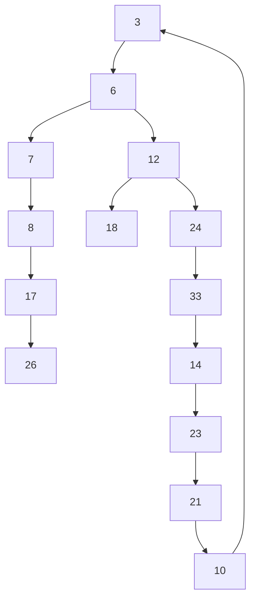
</details>

图6.28 合并 $H_{1}$ 和 $H_{2}$ 的右路径的结果

```txt
/**
     * 插入 x；允许项重复.
     */
    void insert( const Comparable & x )
    {
        root = merge( new LeftistNode{ x }, root );
    }
```

图 6.29 左式堆的插入例程

```c
/**
 * 删除最小项.
 * 若为空，则抛出异常UnderflowException.
 */
void deleteMin( )
{
    if( isEmpty( ) )
        throw UnderflowException{ };

    LeftistNode *oldRoot = root;
    root = merge( root->left, root->right );
    delete oldRoot;
}

/**
 * 删除最小项并将其放入minItem.
 * 若为空，则抛出异常UnderflowException.
 */
void deleteMin( Comparable & minItem )
{
    minItem = findMin( );
    deleteMin( );
}
```

图6.30 左式堆的deleteMin例程

最后，可以通过建立一个二叉堆(显然使用链接实现)来以 $O(N)$ 时间建立一个左式堆。尽

---

第 6 章 优先队列(堆)

215

管二叉堆显然是左式的，但这未必是最佳解决方案，因为我们得到的堆可能是最差的左式堆。不仅如此，以相反的层序遍历树也不像用一些链那么容易。buildHeap 的效果可以通过递归地建立左右子树然后将根下滤而达到。练习中包括另一个解决方案。

## 6.7 斜堆

斜堆(skew heap)是左式堆的自调节形式，实现起来极其简单。斜堆和左式堆间的关系类似于伸展树和 AVL 树间的关系。斜堆是具有堆序的二叉树，但是不存在对树的结构限制。不同于左式堆，关于任意节点的零路径长的任何信息都不再保留。斜堆的右路径在任何时刻都可以任意长，因此，所有操作的最坏情形运行时间均为 $O(N)$ 。然而，正如同伸展树，可以证明(见第 11 章)对任意 $M$ 次连续操作，总的最坏情形运行时间是 $O(M \log N)$ 。因此，斜堆每次操作的摊还开销(amortized cost)为 $O(\log N)$ 。

与左式堆相同，斜堆的基本操作也是合并操作。merge 例程还是递归的，我们执行与以前完全相同的操作，但有一个例外，即:对于左式堆，我们查看是否左儿子和右儿子满足左式堆结构性质并在不满足该性质时将它们交换。但对于斜堆，交换是无条件的，除那些右路径上所有节点的最大者不交换它的左右儿子的例外之外，我们都要进行这种交换。这个例外就是在自然递归实现时所发生的情况，因此它实际上根本不算是特殊情形。此外，证明时间界也是不必要的，但是，由于这样的节点肯定没有右儿子，因此执行交换赋予它一个右儿子是不明智的。（在我们的例子中，该节点没有儿子，因此不必为此担心。）另外，仍设我们的输入是与前面相同的两个堆，见图 6.31。


图6.31 两个斜堆 $H_{1}$ 和 $H_{2}$

如果递归地将 $H_{2}$ 与 $H_{1}$ 的根在8处的子堆合并，那么将得到图6.32中的堆。

这又是递归地完成的，因此，根据递归的第三个法则(见1.3节)，我们不必担心它是如何得到的。这个堆碰巧是左式的，不过不能保证情况总是如此。我们使这个堆成为 $H_{1}$ 的新的左儿子，而 $H_{1}$ 的老的左儿子变成了新的右儿子(见图6.33)。

整个树是左式的，但容易看到这并不总是成立的:将 15 插入到新堆中将破坏左式性质。


<details>
<summary>flowchart</summary>

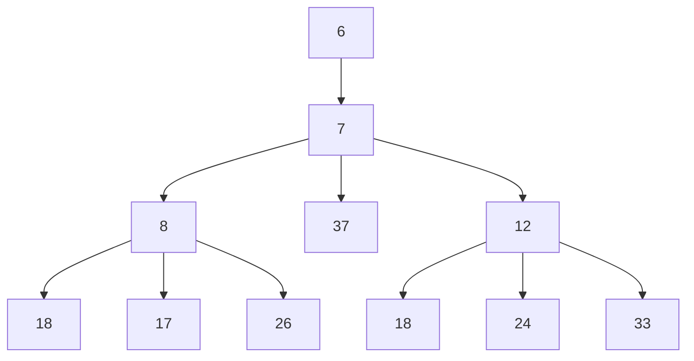
</details>

图6.32 将 $H_{2}$ 与 $H_{1}$ 的右子堆合并的结果

---

216

数据结构与算法分析——C++语言描述(第四版)


<details>
<summary>flowchart</summary>

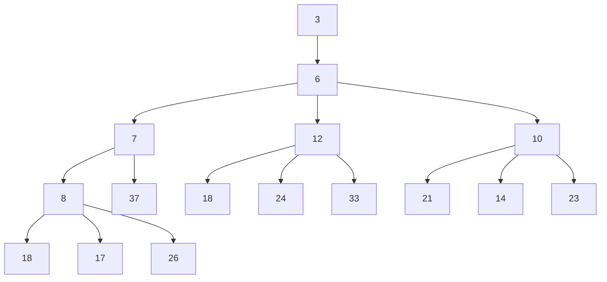
</details>

图6.33 合并斜堆 $H_{1}$ 和 $H_{2}$ 的结果

我们也可像左式堆那样非递归地进行所有的操作:合并右路径，除最后的节点外交换右路径上每个节点的左儿子和右儿子。经过几个例子之后，事情变得很清楚，由于除去右路径上最后的节点外的所有节点都将它们的儿子交换，因此纯效果是它变成了新的左路径(为了确信，请参见前面的例子)。这使得合并两个斜堆非常容易。 $^{①}$

斜堆的实现留作(平凡的)练习。注意，因为右路径可能很长，所以递归实现可能由于缺乏栈空间而失败，不过在其他方面性能还是可接受的。斜堆有一个优点，即不需要附加的空间保留路径长以及不需要测试以确定何时交换儿子。精确确定左式堆和斜堆的右路径长的期望值是一个尚未解决的问题(后者无疑更为困难)。这样的比较将更容易确定平衡信息的轻微损失是否可由缺少的测试来补偿。

## 6.8 二项队列

虽然左式堆和斜堆都在每次操作以 $O(\log N)$ 时间有效地支持合并、插入和deleteMin，但还是有改进的余地，因为我们知道，二叉堆以每次操作平均花费常数时间支持插入。二项队列支持所有这三种操作，每次操作的最坏情形运行时间为 $O(\log N)$，但插入操作平均花费常数时间。

## 6.8.1 二项队列构建

二项队列(binomial queue)不同于我们已经看到的所有优先队列的实现之处在于，一个二项队列不是一棵堆序的树，而是一组堆序树(heap-ordered tree)，称为森林(forest)。堆序树中的每一棵都是有约束的形式，叫作二项树(binomial tree，后面将看到该名称的由来是显然的)。每一个高度上至多存在一棵二项树。高度为0的二项树是一棵单节点树，高度为 $k$ 的二项树$B_{k}$ 通过将一棵二项树 $B_{k - 1}$ 附接到另一棵二项树 $B_{k - 1}$ 的根上而构成。图6.34显示出二项树 $B_{0}$ 、$B_{1}$ 、 $B_{2}$ 、 $B_{3}$ 以及 $B_{4}$ 。

<small><span class="docvortex-page-footnote" data-block-type="page_footnote" style="color:#6b7280">① 这与递归实现不完全一样(但服从相同的时间界)。如果一个堆的右路径用完而导致右路径合并终止，而我们只交换终止的那一点上面的右路径上那些节点的儿子，那么将得到与递归做法相同的结果。</span></small>

---

第 6 章 优先队列(堆)

217


<details>
<summary>flowchart</summary>

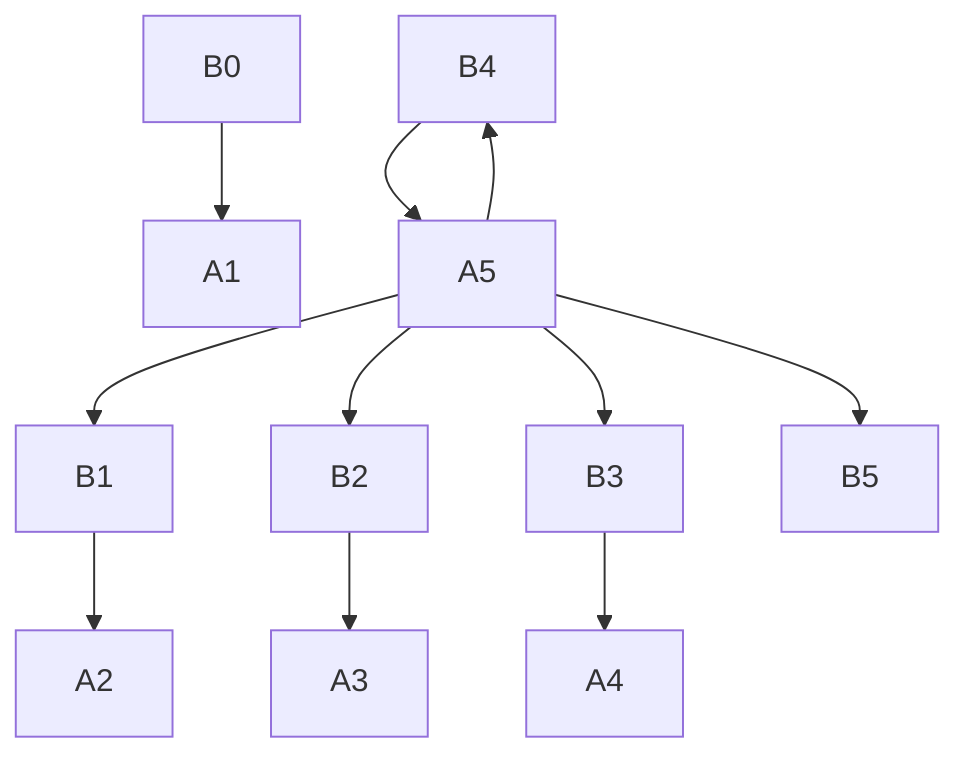
</details>

图6.34 二项树 $B_{0}, B_{1}, B_{2}, B_{3}$ 以及 $B_{4}$

从图中看到，二项树  $B_{k}$  由一个带有儿子  $B_{0}, B_{1}, \cdots, B_{k-1}$  的根组成。高度为 k 的二项树恰好有  $2^{k}$  个节点，而在深度 d 处的节点个数是二项系数  $\binom{k}{d}$ 。如果把堆序施加到二项树上并允许任意高度上最多一棵二项树，那么我们就能够用二项树的集合表示任意大小的优先队列。

例如，大小为 13 的优先队列可以用森林  $B_{3}, B_{2}, B_{0}$  表示。我们可以把这种表示写成 1101，它不仅以二进制表示了 13，而且也表示这样的事实:在上述表示中， $B_{3}, B_{2}, B_{0}$  出现，而  $B_{1}$  则没有。

作为一个例子，6 个元素的优先队列可以表示为图 6.35 中的形状。


<details>
<summary>flowchart</summary>

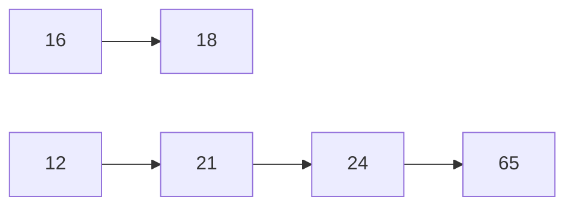
</details>

图6.35 具有6个元素的二项队列 $H_{1}$

## 6.8.2 二项队列操作

此时，最小元可以通过搜索所有的树的根来找出。由于最多有 $\log N$ 棵不同的树，因此最小元可以时间 $O(\log N)$ 找到。另外，如果我们记住当最小元在其他操作期间变化时更新它，那么也可以保留最小元的信息并以 $O(1)$ 时间执行这种操作。

合并两个二项队列在概念上是一个容易的操作，我们将通过例子描述它。考虑两个二项


<details>
<summary>text_image</summary>

H₁:
16
18
12
21
24
65
H₂:
13
14
26
23
51
24
65
</details>

图 6.36 两个二项队列  $H_{1}$  和  $H_{2}$

队列  $H_{1}$  和  $H_{2}$ ，它们分别具有 6 个和 7 个元素，见图 6.36。

合并操作基本上是通过将两个队列加到一起来完成的。令 $H_{3}$ 是新的二项队列。由于 $H_{1}$ 没有高度为0的二项树而 $H_{2}$ 有，因此我们就用 $H_{2}$ 中高度为0的二项树作为 $H_{3}$ 的一部分。然后，将两个高度为1的二项树相加。由于 $H_{1}$ 和 $H_{2}$ 都有高度为1的二项树，因此可以将它们合并，让大的根成为小的根的子树，从而建立高度为2的二项树，见图6.37。这样，$H_{3}$ 将没有高度为1的二项树。现在存在3棵高度为2的二项树，即 $H_{1}$ 和 $H_{2}$ 原有

的两棵二项树以及由上一步形成的一棵二项树。我们将一棵高度为2的二项树放到 $H_{3}$ 中，并

---

218

数据结构与算法分析——C++语言描述(第四版)

合并其他两棵二项树，得到一棵高度为3的二项树。由于 $H_{1}$ 和 $H_{2}$ 都没有高度为3的二项树，因此该二项树就成为 $H_{3}$ 的一部分，合并结束。最后得到的二项队列如图6.38所示。


图6.37 $H_{1}$ 和 $H_{2}$ 中两棵 $B_{1}$ 树的合并

图6.38 二项队列 $H_{3}$ :合并 $H_{1}$ 和 $H_{2}$ 的结果

由于几乎使用任意合理的实现方法合并两棵二项树均花费常数时间，而总共存在 $O(\log N)$ 棵二项树，因此合并操作在最坏情形下花费时间 $O(\log N)$ 。为使该操作更有效，需要将这些树放到按照高度排序的二项队列中，当然这做起来是件简单的事情。

插入实际上就是特殊情形的合并，因为我们只要创建一棵单节点树并执行一次合并即可。这种操作的最坏情形运行时间也是 $O(\log N)$ 。更准确地说，如果在优先队列中不存在的最小的二项树是 $B_{i}$，那么将元素插入其中的运行时间与 $i + 1$ 成正比。例如，$H_{3}$（见图6.38）缺少高度为1的二项树，因此插入将进行两步终止。由于二项队列中的每棵树均以概率1/2出现，于是我们预计插入在两步后终止，因此，平均时间是常数。不仅如此，分析将指出，对一个初始为空的二项队列进行 $N$ 次insert将花费 $O(N)$ 最坏情形时间。事实上，只用 $N - 1$ 次比较就有可能进行该操作，我们把它留作练习。

作为一个例子，我们用图 6.39～图 6.45 演示通过依序插入 1～7 来构成一个二项队列。4 的插入展现一种坏的情形。我们把 4 与 $B_{0}$ 合并，得到一棵新的高度为 1 的树。然后将该树与 $B_{1}$ 合并，得到一棵高度为 2 的树，它是新的优先队列。我们把这些算作 3 步（两次树的合并再加上终止情形）。在插入 7 以后的下一次插入又是一个坏情形，需要 3 次树的合并操作。


图6.39 在1插入之后


图6.42 在4插入之后


图6.40 在2插入之后


图6.43 在5插入之后


图6.41 在3插入之后


<details>
<summary>flowchart</summary>

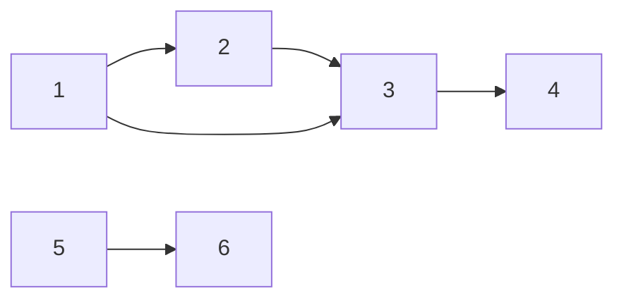
</details>

图6.44 在6插入之后

deleteMin 可以通过首先找出一棵具有最小根的二项树来完成。令该树为 $B_{k}$，并令原始的优先队列为 $H$。我们从 $H$ 的树的森林中删除二项树 $B_{k}$，形成新的二项队列 $H'$。再在 $B_{k}$ 中删除它的根，得到二项树 $B_{0}, B_{1}, \cdots, B_{k-1}$，它们形成优先队列 $H''$。合并 $H'$ 和 $H''$，操作结束。

作为例子，设对 $H_{3}$ 执行一次 deleteMin，它也在图6.46中给出。最小的根是12，因此得到图6.47和图6.48中的两个优先队列 $H'$ 和 $H''$ 。合并 $H'$ 和 $H''$ 得到的二项队列是最后的答案，如图6.49所示。

为了分析，首先注意，deleteMin 操作将原二项队列一分为二。找出含有最小元素的树并创建队列 $H'$ 和 $H''$，花费时间 $O(\log N)$。合并这两个队列又花费 $O(\log N)$ 时间，因此，整个 deleteMin 操作花费时间 $O(\log N)$。

---

第 6 章 优先队列 (堆)

219


<details>
<summary>text_image</summary>

⑦ ⑤ ⑥
① ② ③ ④
H₃: ⑬
</details>

图6.45 在7插入之后


图 6.47 二项队列  $H'$ ，包含  $H_{3}$  中除  $B_{3}$  外所有的二项树


<details>
<summary>flowchart</summary>

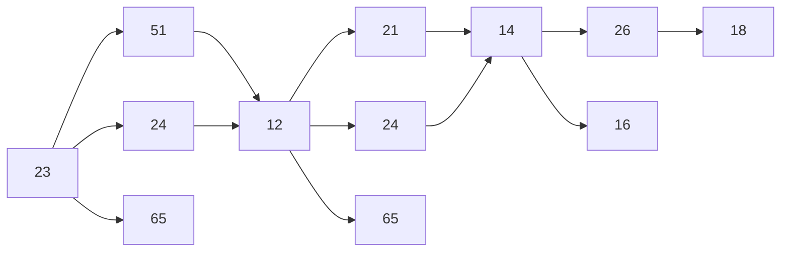
</details>

图6.46 二项队列 $H_{3}$


<details>
<summary>text_image</summary>

H": 21 24 65 14 26 16 18
</details>

图 6.48 二项队列  $H''$ :删除 12 后的  $B_{3}$


<details>
<summary>flowchart</summary>

```mermaid
graph LR
  A["23"] --> B["51"]
  A --> C["24"]
  A --> D["65"]
  E["13"] --> F["21"]
  E --> G["24"]
  E --> H["65"]
  F --> I["14"]
  G --> I
  I --> J["26"]
  I --> K["16"]
  J --> L["18"]
```
</details>

图6.49 对 $H_{3}$ 应用deleteMin的结果

## 6.8.3 二项队列的实现

deleteMin 操作需要快速找出根的所有子树的能力，因此，需要一般树的标准表示:每个节点的儿子都留在一个链表中，而且每个节点都有一个指针指向它的第一个儿子(如果有的话)。该操作还要求诸儿子按照它们子树的大小排序。我们还需要保证合并两棵树容易。当两棵树被合并时，其中的一棵树作为儿子被加到另一棵树上。由于这棵新树将是最大的子树，因此，以大小递减的方式保持这些子树是有意义的。只有这时才能够有效地合并两棵二项树从而合并两个二项队列。二项队列将是二项树的数组。

总而言之，二项树的每一个节点都将包含数据、第一个儿子以及右兄弟。二项树中的诸儿子以递减次序排列。

图 6.51 解释了如何表示图 6.50 中的二项队列。图 6.52 显示了二项树中节点的类型声明以及二项队列的类接口。


<details>
<summary>flowchart</summary>

```mermaid
graph LR
  A["23"] --> B["51"]
  A --> C["24"]
  A --> D["65"]
  E["12"] --> F["21"]
  E --> G["24"]
  E --> H["65"]
  I["14"] --> J["26"]
  I --> K["16"]
  I --> L["18"]
```
</details>

图 6.50 画成森林的二项队列  $H_{3}$


<details>
<summary>flowchart</summary>

```mermaid
graph LR
  A[""] --> B["12"]
  B --> C["14"]
  C --> D["16"]
  D --> E["26"]
  E --> F["18"]
  F --> C
  C --> G["24"]
  G --> H["21"]
  H --> I["65"]
  I --> C
  C --> J["23"]
  J --> K["24"]
  K --> L["51"]
  L --> M["65"]
  M --> K
  J --> N["13"]
```
</details>

图 6.51 二项队列  $H_{3}$  的表示方式

---

220

数据结构与算法分析——C++语言描述(第四版)

```cpp
template <typename Comparable>
class BinomialQueue
{
    public:
        BinomialQueue( );
        BinomialQueue( const Comparable & item );
        BinomialQueue( const BinomialQueue & rhs );
        BinomialQueue( BinomialQueue && rhs );

        ~BinomialQueue( );

        BinomialQueue & operator=( const BinomialQueue & rhs );
        BinomialQueue & operator=( BinomialQueue && rhs );

        bool isEmpty( ) const;
        const Comparable & findMin( ) const;

        void insert( const Comparable & x );
        void insert( Comparable && x );
        void deleteMin( );
        void deleteMin( Comparable & minItem );

        void makeEmpty( );
        void merge( BinomialQueue & rhs );

    private:
        struct BinomialNode
        {
            Comparable element;
            BinomialNode *leftChild;
            BinomialNode *nextSibling;

            BinomialNode( const Comparable & e, BinomialNode *lt, BinomialNode *rt )
                : element{ e }, leftChild{ lt }, nextSibling{ rt } { }

            BinomialNode( Comparable && e, BinomialNode *lt, BinomialNode *rt )
                : element{ std::move( e ) }, leftChild{ lt }, nextSibling{ rt } { }
        };

        const static int DEFAULT_TREES = 1;

        vector<BinomialNode *> theTrees; // 树根组成的数组
        int currentSize;                 // 优先队列中的项数

        int findMinIndex( ) const;
        int capacity( ) const;
        BinomialNode * combineTrees( BinomialNode *t1, BinomialNode *t2 );
        void makeEmpty( BinomialNode * & t );
        BinomialNode * clone( BinomialNode * t ) const;
};
```

图 6.52 二项队列类接口及节点定义

为了合并两个二项队列，我们需要一个例程来合并两棵同样大小的二项树。图 6.53 指出两棵二项树合并时链是如何变化的。合并同样大小的两棵二项树的程序很简单，见图 6.54。

---

第 6 章 优先队列 (堆)

221


<details>
<summary>flowchart</summary>

```mermaid
graph LR
  A["12"] --> B["24"]
  B --> C["21"]
  C --> D["65"]
  B --> E["16"]
  E --> F["26"]
  F --> G["18"]
  E --> H["14"]
  H --> I["26"]
  I --> J["16"]
  J --> K["26"]
  K --> L["14"]
  L --> M["24"]
  M --> N["21"]
  N --> O["12"]
  M --> P["65"]
  O --> Q["18"]
```
</details>

图 6.53 合并两棵二项树

```c
/**
 * 返回合并t1和t2的结果，其中t1和t2大小相同.
 */
BinomialNode * combineTrees( BinomialNode *t1, BinomialNode *t2 )
{
    if( t2->element < t1->element )
        return combineTrees( t2, t1 );
    t2->nextSibling = t1->leftChild;
    t1->leftChild = t2;
    return t1;
}
```

图 6.54 合并同样大小的两棵二项树的例程

现在介绍 merge 例程的简单实现。 $H_{1}$  由当前的对象表示而  $H_{2}$  用 rhs 表示。该例程将  $H_{1}$  和  $H_{2}$  合并，把合并结果放入  $H_{1}$  中，并清空  $H_{2}$ 。在任意时刻我们在处理的是秩 (rank) 为 i 的那些树。t1 和 t2 分别是  $H_{1}$  和  $H_{2}$  中的树，而 carry 是从上一步得来的树（它可能是 nullptr）。从秩为 i 的树以及秩为  $i+1$  的 carry 的树所得到的树的形成，依赖于 8 种可能情形中的每一种。这个过程从秩 0 开始直至所得出的二项队列中最后的秩。程序见图 6.55。对程序的改进在练习 6.35 中提出。

```javascript
/**
 * 将rhs合并到优先队列中.
 * rhs 变为空。rhs 必须不同于 this.
 * 为使该操作更为高效，需要用到练习6.35。
 */
void merge( BinomialQueue & rhs )
{
    if( this == &rhs )    // 避免别名问题
        return;

    currentSize += rhs.currentSize;

    if( currentSize > capacity() )
    {
        int oldNumTrees = theTrees.size( );
        int newNumTrees = max( theTrees.size( ), rhs.theTrees.size( )) + 1;
        theTrees.resize( newNumTrees );
        for( int i = oldNumTrees; i < newNumTrees; ++i )
            theTrees[ i ] = nullptr;
    }
}
```

图 6.55 合并两个优先队列的例程

---

222

数据结构与算法分析——C++语言描述(第四版)

```txt
BinomialNode *carry = nullptr;
for( int i = 0, j = 1; j <= currentSize; ++i, j *= 2 )
{
    BinomialNode *t1 = theTrees[ i ];
    BinomialNode *t2 = i < rhs.theTrees.size( ) ? rhs.theTrees[ i ]
                      : nullptr;
    int whichCase = t1 == nullptr ? 0 : 1;
    whichever += t2 == nullptr ? 0 : 2;
    whichCase += carry == nullptr ? 0 : 4;

    switch( whichCase )
    {
        case 0: /*无树的情形*/
        case 1: /* 只有this的情形 */
            break;
        case 2: /* 只有 rhs 的情形 */
            theTrees[ i ] = t2;
            rhs.theTrees[ i ] = nullptr;
            break;
        case 4: /* 只有 carry 的情形 */
            theTrees[ i ] = carry;
            carry = nullptr;
            break;
        case 3: /* this 和rhs的情形 */
            carry = combineTrees( t1, t2 );
            theTrees[ i ] = rhs.theTrees[ i ] = nullptr;
            break;
        case 5: /* this 和 carry 的情形 */
            carry = combineTrees( t1, carry );
            theTrees[ i ] = nullptr;
            break;
        case 6: /* rhs 和carry 的情形 */
            carry = combineTrees( t2, carry );
            rhs.theTrees[ i ] = nullptr;
            break;
        case 7: /* 全体树的情形 */
            theTrees[ i ] = carry;
            carry = combineTrees( t1, t2 );
            rhs.theTrees[ i ] = nullptr;
            break;
        }
    }

    for( auto & root : rhs.theTrees )
        root = nullptr;
    rhs.currentSize = 0;
}
```

图 6.55(续) 合并两个优先队列的例程

二项队列的 deleteMin 例程见图 6.56。

---

第 6 章 优先队列(堆)

223

```txt
/**
 * 删除最小项并把它放入 minItem.
 * 若为空，则抛出UnderflowException 异常.
 */
void deleteMin( Comparable & minItem )
{
    if( isEmpty( ) )
        throw UnderflowException{ };

    int minIndex = findMinIndex( );
    minItem = theTrees[ minIndex ]->element;

    BinomialNode *oldRoot = theTrees[ minIndex ];
    BinomialNode *deletedTree = oldRoot->leftChild;
    delete oldRoot;

    // 构建 H''
    BinomialQueue deletedQueue;
    deletedQueue.theTrees.resize( minIndex + 1 );
    deletedQueue.currentSize = ( 1 << minIndex ) - 1;
    for( int j = minIndex - 1; j >= 0; --j )
    {
        deletedQueue.theTrees[ j ] = deletedTree;
        deletedTree = deletedTree->nextSibling;
        deletedQueue.theTrees[ j ]->nextSibling = nullptr;
    }

    // 构建 H'
    theTrees[ minIndex ] = nullptr;
    currentSize -= deletedQueue.currentSize + 1;

    merge( deletedQueue );
}

/**
 * 找出包含优先队列中最小项的树的下标.
 * 这个优先队列必须不空.
 * 返回包含最小项的树的下标.
 */
int findMinIndex( ) const
{
    int i;
    int minIndex;

    for( i = 0; theTrees[ i ] == nullptr; ++i )
        ;

    for( minIndex = i; i < theTrees.size( ); ++i )
        if( theTrees[ i ] != nullptr &&
            theTrees[ i ]->element < theTrees[ minIndex ]->element )
            minIndex = i;

    return minIndex;
}
```

图 6.56 二项队列的 deleteMin

---

224

数据结构与算法分析——C++语言描述(第四版)

当受到影响的元素的位置已知时，我们可以将二项队列扩展到支持二叉堆所允许的某些非标准的操作，诸如 decreaseKey 和 remove 等。decreaseKey 就是一趟 percolateUp，如果在每个节点上添加一个数据成员，存储其父链，那么这个操作可以时间  $O(\log N)$  完成。一次任意的 remove 可以通过联合 decreaseKey 和 deleteMin 而以时间  $O(\log N)$  完成。

## 6.9 标准库中的优先队列

STL 中的二叉堆是通过名为 priority\_queue 的类模板实现的，我们可以在标准的头文件 queue 中找到它。不过，STL 实现的是最大堆 (max-heap) 而不是最小堆 (min-heap)，因此，要处理的是最大项而不是最小项。核心的成员函数是:

```javascript
void push( const Object & x );
const Object & top( ) const;
void pop( );
bool empty( );
void clear( );
```

push 是把 x 添加到优先队列中，top 是返回优先队列中的最大元素，而 pop 则从优先队列中删除最大元素。这里是允许重复元存在的。如果同时有几个最大元素，则只有其中的一个被删除。

优先队列模板用项的类型、容器类型(几乎总是要用 vector 对象来存储这些项)以及比较器来实例化。对于最后的两个参数是允许默认的，且默认产生的是最大堆。使用 greater 函数对象作为比较器则得到最小堆。

图 6.57 显示了一个测试程序，它阐释 priority\_queue 类模板如何能够用来作为既是默认的最大堆又是最小堆。

```cpp
#include <iostream>
#include <vector>
#include <queue>
#include <functional>
#include <string>
using namespace std;

// 清空优先队列并打印它的内容
template <typename PriorityQueue>
void dumpContents( const string & msg, PriorityQueue & pq )
{
    cout << msg << ":" << endl;
    while( !pq.empty( ) )
    {
        cout << pq.top( ) << endl;
        pq.pop( );
    }
}

//(在 dumpContents 内) 进行一些插入和删除的操作
int main( )
```

图 6.57 演示 STL priority\_queue 的例程。注释指明输出的预期顺序

---

第6章 优先队列(堆)

225

```cpp
{
    priority_queue<int> maxPQ;
    priority_queue<int,vector<int>,greater<int>> minPQ;

    minPQ.push( 4 ); minPQ.push( 3 ); minPQ.push( 5 );
    maxPQ.push( 4 ); maxPQ.push( 3 ); maxPQ.push( 5 );

    dumpContents( "minPQ", minPQ ); // 3 4 5
    dumpContents( "maxPQ", maxPQ ); // 5 4 3

    return 0;
}
```

图 6.57(续) 演示 STL priority\_queue 的例程。注释指明输出的预期顺序

## 小结

在这一章，我们看到优先队列 ADT 的各种实现和使用。标准的二叉堆实现由于简单和快速从而很便捷。它不需要链，只需要常量的附加空间，而且有效地支持优先队列的操作。

我们考虑了附加的 merge 操作，开发了 3 种实现方法，每种都有它自己的独到之处。左式堆是体现递归威力的完美实例。斜堆由于缺省了平衡原则从而代表一种重要的数据结构。它的分析本身颇为有趣，我们将在第 11 章讨论。二项队列表明，一个简单的想法如何能够用来达到好的时间界。

我们还看到优先队列的几个用途，从操作系统的工作调度到事件模拟。在第7章、第9章和第10章还会再次看到它们的应用。

## 练习

6.1 操作 insert 和 findMin 都能以常数时间实现吗?

6.2 a. 写出一次一个地将 10、12、1、14、6、5、8、15、3、9、7、4、11、13 和 2 插入到一个初始为空的二叉堆中的结果。
b. 写出使用相同的输入通过线性时间算法建立二叉堆的结果。

6.3 写出对上面练习中的堆执行 3 次 deleteMin 操作的结果。

6.4 N 个元素的完全二叉树用到数组位置 1～N。设我们试图使用数组表示一棵非完全的二叉树。对于下列的情况确定数组必须要多大:

a. 一棵有两个附加层(即它是非常轻微地不平衡)的二叉树。
b. 在深度  $2 \log N$  处有一个最深的节点的二叉树。
c. 在深度  $4.1 \log N$  处有一个最深的节点的二叉树。
d. 最坏情形的二叉树。

6.5 通过把被插入项的拷贝放在位置 0 处重写 BinaryHeap 的 inset 例程。

6.6 在图 6.13 中的大的堆中有多少节点？

6.7 a. 证明对于二叉堆，buildHeap 至多在元素间进行 2N-2 次比较。

---

226

数据结构与算法分析——C++语言描述(第四版)

b. 证明 8 个元素的堆可以通过堆元素间的 8 次比较构成。

\*\*c. 给出一个算法，使以 $\frac{13}{8} N + O(\log N)$ 次元素比较构建一个二叉堆。

6.8 证明下列关于堆中最大项的结论:

a. 它必然在一片树叶上。
b. 恰好存在 $N/2$ 片树叶。
c. 为找出它必须考查每一片树叶。

\*\*6.9 证明，在一个大的完全堆(可以假设 $N = 2^{k} - 1$ )中第 $k$ 个最小元的期望深度以 $\log k$ 为界。

6.10 \*a. 给出一个算法以找出二叉堆中小于某个值 $X$ 的所有节点。你的算法应该以 $O(K)$ 运行，其中，$K$ 是输出的节点的个数。

b. 你的算法可以扩展到本章讨论过的任意其他堆结构吗？

\*c. 给出一个算法，最多使用大约 3N/4 次比较找出二叉堆中的任意一项 X。

\*\*6.11 提出一个算法，使以 $O(M + \log N\log \log N)$ 时间将 $M$ 个节点插入到 $N$ 个元素的二叉堆中。证明算法的时间界。

6.12 编写一个程序输入 N 个元素并

a. 将它们一个一个地插入到一个堆中。
b. 以线性时间建立一个堆。

比较两个算法对于已排序、反序以及随机输入的运行时间。

6.13 每个 deleteMin 操作在最坏情形下使用  $2 \log N$  次比较。

\*a. 提出一种方案使得 deleteMin 操作只使用  $\log N + \log \log N + O(1)$  次元素间的比较。这并不意味着较少的数据移动。
\*\*b. 扩展在(a)部分中的方案，使得只执行  $\log N + \log \log \log N + O(1)$  次比较。
\*\*c. 你能够把这种想法推向多远？
d. 在比较中节省下的资源能否补偿算法所增加的复杂度？

6.14 如果一个 $d$ 堆作为一个数组存储，对位于位置 $i$ 处的项，其父亲和儿子都在哪里？
6.15 设一个 $d$ 堆初始时有 $N$ 个元素，而我们需要对其执行 $M$ 次 percolateUp 和 $N$ 次 deleteMin。

a. 用 M、N 和 d 表示的所有操作的总的运行时间是多少？
b. 如果 d=2，所有的堆操作的运行时间是多少？
c. 如果  $d = \Theta(N)$ ，总的运行时间是多少？
\*d. 对 d 做什么样的选择将使总的运行时间最小?

6.16 设二叉堆用显式链表示。给出一个简单算法来找出位于隐式位置 $i$ 上的树节点。
6.17 设二叉堆用显式链表示。考虑将二叉堆 lhs 和 rhs 合并的问题。假设这两个二叉堆均为完美二叉树 (perfect binary tree)，分别包含  $2^{l}-1$  和  $2^{r}-1$  个节点。

a. 若 l = r，则给出合并这两个堆的  $O(\log N)$  算法。
b. 若 $|l - r| = 1$，则给出合并这两个堆的 $O(\log N)$ 算法。
\*c. 给出合并这两个堆的与 l 和 r 无关的  $O(\log^{2} N)$  算法。

6.18 最小-最大堆(min-max heap)是支持两种操作 deleteMin 和 deleteMax 的数据结

---

第 6 章 优先队列(堆)

227

构，每个操作均用时  $O(\log N)$ 。该结构与二叉堆相同，不过，其堆序性质为:对于在偶数深度上的任意节点 X，存储在 X 上的元素小于它的父亲但是大于它的祖父（当这是有意义的时候），对于奇数深度上的任意节点 X，存储在 X 上的元素大于它的父亲但是小于它的祖父，见图 6.58。

a. 如何找到最小元和最大元？

\*b. 给出一个算法将一个新节点插入到该最小-最大堆中。

\*c. 给出一个算法执行 deleteMin 和 deleteMax。

\*d. 能否以线性时间建立一个最小-最大堆?

\*\*e. 设我们想要支持操作 deleteMin、deleteMax 以及 merge。提出一种数据结构以时间 $O(\log N)$ 支持所有的操作。


<details>
<summary>funnel</summary>

| Node | Value |
| --- | --- |
| Top | 6 |
| Root | 87 |
| Top | 14 |
| Top | 81 |
| Top | 17 |
| Bottom | 71 |
| Bottom | 25 |
| Bottom | 80 |
| Bottom | 20 |
| Bottom | 52 |
| Bottom | 78 |
| Bottom | 31 |
| Bottom | 42 |
| Bottom | 31 |
| Bottom | 59 |
| Bottom | 16 |
| Bottom | 24 |
| Bottom | 79 |
| Bottom | 63 |
| Bottom | 18 |
| Bottom | 19 |
| Bottom | 32 |
| Bottom | 13 |
| Bottom | 15 |
| Bottom | 48 |
</details>

图 6.58 最小-最大堆

6.19 合并图 6.59 中的两个左式堆。


<details>
<summary>flowchart</summary>

```mermaid
graph LR
  A["12"] --> B["11"]
  B --> C["2"]
  B --> D["17"]
  D --> E["18"]
  C --> F["5"]
  F --> G["8"]
  G --> H["15"]
  H --> I["4"]
  J["31"] --> K["18"]
  K --> L["9"]
  L --> M["10"]
  M --> N["6"]
  O["21"] --> P["11"]
  P --> Q["4"]
```
</details>

图 6.59 练习 6.19 和练习 6.26 的输入

6.20 写出依序将关键字 1\~15 插入到一个初始为空的左式堆中的结果。

6.21 证明下述结论成立或证明其不成立:如果将关键字 $1 \sim 2^{k} - 1$ 依序插入到一个初始为空的左式堆中，那么结果形成一棵理想平衡树(perfectly balanced tree)。

6.22 给出生成最佳左式堆的输入的例子。

6.23 a. 左式堆能否有效地支持 decreaseKey?

b. 完成该功能(如果可能的话)，需要做出哪些改变？

6.24 从左式堆中一个已知位置删除节点的一种方法是使用懒惰策略。为了删除一个节点，只要将其标记为删除即可。当执行一个 findMin 或 deleteMin 时，若根节点被标记删除则存在一个潜在的问题，因为此时该节点必须确实被删除且需要找到实际的

---

228

数据结构与算法分析——C++语言描述(第四版)

最小元，这可能涉及到删除其他一些已做标记的节点。在该策略中，这些 remove 花费一个单位的开销，但一次 deleteMin 或 findMin 的开销却依赖于被做了删除标记的节点的个数。设在一次 deleteMin 或 findMin 后做标记的节点比操作前少了 k 个。

\*a. 说明如何以 $O(k \log N)$ 时间执行 deleteMin。

\*\*b. 提出一种实现方法，通过分析证明执行 deleteMin 的时间为 $O(k \log (2N / k))$。

6.25 我们可以以线性时间对一些左式堆执行 buildHeap 操作:把每个元素当作是单节点左式堆，把所有这些堆放到一个队列中，之后，让两个堆出队，把它们合并，再将合并结果入队，直到队列中只有一个堆为止。

a. 证明该算法在最坏情形下为  $O(N)$ 。

b. 为什么该算法优于正文中描述的算法？

6.26 合并图 6.59 中的两个斜堆。

6.27 写出将关键字 1\~15 依序插入到一斜堆内的结果。

6.28 证明下述结论成立或不成立:如果将关键字 $1 \sim 2^{k} - 1$ 依序插入到一个初始为空的斜堆中，那么结果形成一棵理想平衡树(perfectly balanced tree)。

6.29 使用标准的二叉堆算法可以建立一个 N 个元素的斜堆。我们能否将练习 6.25 中描述的同样的合并策略用于斜堆而得到  $O(N)$  运行时间？

6.30 证明二项树  $B_{k}$  以二项树  $B_{0}, B_{1}, \cdots, B_{k-1}$  作为其根的儿子。

6.31 证明高度为 $k$ 的二项树在深度 $d$ 处有 $\binom{k}{d}$ 个节点。

6.32 将图 6.60 中的两个二项队列合并。


<details>
<summary>flowchart</summary>

```mermaid
graph TD
  13["13"] --> 23["23"]
  13["13"] --> 51["51"]
  13["13"] --> 24["24"]
  13["13"] --> 65["65"]
  12["12"] --> 21["21"]
  12["12"] --> 24["24"]
  12["12"] --> 65["65"]
  14["14"] --> 26["26"]
  14["14"] --> 16["16"]
  14["14"] --> 18["18"]
  4["4"] --> 15["15"]
  4["4"] --> 18["18"]
  2["2"] --> 11["11"]
  2["2"] --> 29["29"]
  2["2"] --> 55["55"]
```
</details>

图6.60 练习6.32的输入

6.33 a. 证明:向初始为空的二项队列进行 $N$ 次 insert 在最坏情形下花费 $O(N)$ 的时间。
b. 给出一个算法来建立有 N 个元素的二项队列，在元素间最多使用 N-1 次比较。
\*c. 提出一个算法, 以 $O(M + \log N)$ 最坏情形运行时间将 $M$ 个节点插入到 $N$ 个元素的二项队列中。证明该算法的界。

6.34 写出一个高效的例程使用二项队列来完成 insert 操作，不要调用 merge。

6.35 对于二项队列:

a. 若没有树留在  $H_{2}$  中且 carry 树为 nullptr，则修改 merge 例程以终止合并。
b. 修改 merge 使得较小的树总被合并到较大的树中。

\*\*6.36 假设将二项队列扩展为允许每个结构同一高度至多有两棵树。我们能否在保留其他操作为 $O(\log N)$ 时得到插入为 $O(1)$ 的最坏情形时间？

---

第 6 章 优先队列(堆)

229

6.37 设有许多盒子, 每个盒子都能容纳总重量 C 而物品  $i_{1}, i_{2}, i_{3}, \cdots, i_{N}$  分别重  $w_{1}, w_{2}, w_{3}, \cdots, w_{N}$ 。现在想要把所有的物品包装起来, 但任一盒子都不能放置超过其容量的重物, 而且要使用尽量少的盒子。例如, 若 C = 5, 物品分别重 2, 2, 3, 3, 则可用两个盒子解决该问题。

一般说来，这个问题很困难，尚不知有高效的解决方案。编写程序高效地实现下列各近似方法:

\*a. 将重物放入能够承受其重量的第一个盒子内(如果没有盒子拥有足够的容量就开辟一个新的盒子)。(该方法以及后面所有的方法都将得出3个盒子, 这不是最优的结果。)

b. 把重物放入对其有最大空间的盒子内。

\*c. 把重物放入能够容纳下它而又不过载的装填得最满的盒子中。

\*\*d. 这些方法有通过将重物按重量预先排序而功能得到增强的吗？

6.38 设我们想要将操作 decreaseAllKeys( $\Delta$ ) 添加到堆的指令系统中去。该操作的结果是:堆中所有的关键字都将它们的值减少量 $\Delta$ 。对于你所选择的堆的实现方法，解释所做的必要的修改使得所有其他操作均保持它们的运行时间而 decreaseAllKeys 以 O(1) 运行。

6.39 两个选择算法中哪个具有更好的时间界？

6.40 对于左式堆，标准的拷贝构造函数和makeEmpty可能由于用到太多的递归调用而失败。虽然这对二叉查找树成立，但对左式堆却问题不少，因为尽管它对基本操作具有较好的最坏情形性能，可左式堆可能会非常深。因此，拷贝构造函数和makeEmpty函数需要重新实现，以避免在左式堆中的深层递归。我们的做法如下:

a. 重新整理递归例程，使得对 t->left 的递归调用置于对 t->right 递归调用之后。

b. 将各个例程重写，使得最后的语句是对左子树的递归调用。

c. 消除尾递归。

d. 这些函数仍然是递归的。给出所剩递归的精确的深度之界。

\*e. 解释如何为斜堆重写拷贝构造函数和 makeEmpty 函数。

## 参考文献

二叉堆首先在文献[28]中描述。构造它的线性时间算法取自文献[14]。

$d$ 堆最初的描述见于文献[19]。最近的结果提出，4叉堆在某些情形下可以改进二叉堆[22]。左式堆由Crane[11]发现并在Knuth[21]中描述。斜堆由Sleator和Tarjan[24]开发。二项队列由Vuillemin[27]发明；Brown提供了详细的分析和经验性的研究，指出若能仔细地实现则它们在实践中性能很好[4]。

练习6.7(b)和(c)取自文献[17]。练习6.10(c)源于文献[6]。平均使用大约 $1.52N$ 次比较构造二叉堆的方法在文献[23]中描述。左式堆中的懒惰删除(练习6.24)出自文献[10]。练习6.36的一种解法可在文献[8]中找到。

最小-最大堆(练习6.18)原始描述见于文献[1]。这些操作的更有效的实现在文献[18]和[25]

---

230

数据结构与算法分析——C++语言描述(第四版)

中给出。双端优先队列(double-ended priority queues)的另外一些表示形式是deap和diamond deque。细节可见于文献[5]、[7]和[9]。练习6.18(e)的解法在文献[12]和[20]中给出。

理论上有趣的优先队列表示法是斐波那契堆(Fibonacci heap) $^{[16]}$ ，我们将在第11章给出详细描述。斐波那契堆使得所有的操作均以O(1)摊还时间执行，但删除操作除外，它是 $O(\log N)$ 。松堆(relaxed heaps) $^{[13]}$ 得到最坏情形下完全相同的界(但merge除外)。文献 $[3]$ 的过程对所有操作均得到最佳的最坏情形界。另外一种有趣的实现是配对堆(pairing heap) $^{[15]}$ ，它将在第12章描述。最后，当数据由一些小的整数组成时仍能正常工作的优先队列在文献 $[2]$ 和 $[26]$ 中描述。

1. M. D. Atkinson, J. R. Sack, N. Santoro, and T. Strothotte, "Min-Max Heaps and Generalized Priority Queues," Communications of the ACM, 29 (1986), 996–1000.
2. J. D. Bright, "Range Restricted Mergeable Priority Queues," Information Processing Letters, 47 (1993), 159–164.
3. G. S. Brodal, "Worst-Case Efficient Priority Queues," Proceedings of the Seventh Annual ACM-SIAM Symposium on Discrete Algorithms (1996), 52–58.
4. M. R. Brown, "Implementation and Analysis of Binomial Queue Algorithms," SIAM Journal on Computing, 7 (1978), 298–319.
5. S. Carlsson, "The Deap—A Double-Ended Heap to Implement Double-Ended Priority Queues," Information Processing Letters, 26 (1987), 33–36.
6. S. Carlsson and J. Chen, "The Complexity of Heaps," Proceedings of the Third Symposium on Discrete Algorithms (1992), 393–402.
7. S. Carlsson, J. Chen, and T. Strothotte, "A Note on the Construction of the Data Structure 'Deap'," Information Processing Letters, 31 (1989), 315–317.
8. S. Carlsson, J. I. Munro, and P. V. Poblete, "An Implicit Binomial Queue with Constant Insertion Time," Proceedings of First Scandinavian Workshop on Algorithm Theory (1988), 1–13.
9. S. C. Chang and M. W. Due, "Diamond Deque: A Simple Data Structure for Priority Deques," Information Processing Letters, 46 (1993), 231–237.
10. D. Cheriton and R. E. Tarjan, "Finding Minimum Spanning Trees," SIAM Journal on Computing, 5 (1976), 724–742.
11. C. A. Crane, "Linear Lists and Priority Queues as Balanced Binary Trees," Technical Report STAN-CS-72-259, Computer Science Department, Stanford University, Stanford, Calif., 1972.
12. Y. Ding and M. A. Weiss, "The Relaxed Min-Max Heap: A Mergeable Double-Ended Priority Queue," Acta Informatica, 30 (1993), 215–231.
13. J. R. Driscoll, H. N. Gabow, R. Shrairman, and R. E. Tarjan, "Relaxed Heaps: An Alternative to Fibonacci Heaps with Applications to Parallel Computation," Communications of the ACM, 31 (1988), 1343–1354.
14. R. W. Floyd, "Algorithm 245: Treesort 3," Communications of the ACM, 7 (1964), 701.
15. M. L. Fredman, R. Sedgewick, D. D. Sleator, and R. E. Tarjan, "The Pairing Heap: A New Form of Self-adjusting Heap," Algorithmica, 1 (1986), 111–129.
16. M. L. Fredman and R. E. Tarjan, "Fibonacci Heaps and Their Uses in Improved Network Optimization Algorithms," Journal of the ACM, 34 (1987), 596–615.
17. G. H. Gonnet and J. I. Munro, "Heaps on Heaps," SIAM Journal on Computing, 15 (1986), 964–971.
18. A. Hasham and J. R. Sack, "Bounds for Min-max Heaps," BIT, 27 (1987), 315–323.
19. D. B. Johnson, "Priority Queues with Update and Finding Minimum Spanning Trees," Information Processing Letters, 4 (1975), 53–57.

---

第6章 优先队列(堆)

231

20. C. M. Khoong and H. W. Leong, "Double-Ended Binomial Queues," Proceedings of the Fourth Annual International Symposium on Algorithms and Computation (1993), 128–137.
21. D. E. Knuth, The Art of Computer Programming, Vol. 3: Sorting and Searching, 2d ed., Addison-Wesley, Reading, Mass., 1998.
22. A. LaMarca and R. E. Ladner, "The Influence of Caches on the Performance of Sorting," Proceedings of the Eighth Annual ACM-SIAM Symposium on Discrete Algorithms (1997), 370–379.
23. C. J. H. McDiarmid and B. A. Reed, "Building Heaps Fast," Journal of Algorithms, 10 (1989), 352–365.
24. D. D. Sleator and R. E. Tarjan, "Self-adjusting Heaps," SIAM Journal on Computing, 15 (1986), 52–69.
25. T. Strothotte, P. Eriksson, and S. Vallner, "A Note on Constructing Min-max Heaps," BIT, 29 (1989), 251–256.
26. P. van Emde Boas, R. Kaas, and E. Zijlstra, "Design and Implementation of an Efficient Priority Queue," Mathematical Systems Theory, 10 (1977), 99–127.
27. J. Vuillemin, "A Data Structure for Manipulating Priority Queues," Communications of the ACM, 21 (1978), 309–314.
28. J. W. J. Williams, "Algorithm 232: Heapsort," Communications of the ACM, 7 (1964), 347–348.
