# 第7章 排序

原始 PDF 第 246–294 页。

## 第7章 排序

在这一章，我们讨论将元素的数组排序的问题。为简单起见，假设在我们的例子中数组只包含整数，当然我们的程序也允许更一般的对象。对于本章的大部分内容，我们还假设整个排序工作能够在主存中完成，因此，元素的个数相对来说比较小(小于几百万)。当然，不能在主存中完成而必须在磁盘或磁带上完成的排序也相当重要。这种类型的排序叫作外部排序(external sorting)，将在本章末尾进行讨论。

我们对内部排序的考查将指出:

- 存在几种容易的算法以 $O(N^2)$ 排序，如插入排序。
- 有一种算法叫作希尔排序(Sellsort)，它编程非常简单，以 $o(N^2)$ 运行，而且在实践中很有效。
- 存在一些稍微复杂的 $O(N \log N)$ 的排序算法。
- 任何通用的排序算法均需要 $\Omega (N\log N)$ 次比较。

本章的其余部分将描述和分析各种排序算法。这些算法包含一些有趣和重要的代码优化和算法设计思想。排序也是使得分析能够精确进行的实例。预先说明，在时机适当的时候，我们将尽可能多地做一些分析。

## 7.1 预备知识

我们描述的算法都将是可以互换的。每个算法都要接收包含一些元素的数组，假设数组的所有位置都包含要被排序的数据。我们还假设 N 是传递到排序例程的元素个数。

我们的再一个假设是存在操作符“<”和“>”，它们可以用于对输入数据赋予一个一致的顺序。除赋值运算符外，这是仅有的允许对输入数据进行的操作。在这些条件下的排序叫作基于比较的排序(comparison-based sorting)。

这里的接口不同于 STL 中的排序算法。在 STL 中，排序是通过使用函数模板 sort 完成的。sort 的参数代表容器(中某个范围)的开始和终端标记(endmarker)以及一个可选的比较器:

```txt
void sort( Iterator begin, Iterator end );
void sort( Iterator begin, Iterator end, Comparator cmp );
```

迭代器必须支持随机访问。sort 算法并不保证相等的项保持它们原有的顺序(若这很重要，则可使用 stable\_sort 而不用 sort)。

例如，在

```cpp
std::sort( v.begin( ), v.end( ) );
std::sort( v.begin( ), v.end( ), greater<int>{ } );
std::sort( v.begin( ), v.begin( ) + ( v.end( ) - v.begin( )) / 2 );
```

中第一个调用是将整个容器 v 以非降顺序排序，第二个调用是将整个容器以非增顺序排序，第三个调用则将容器的前半部分以非降顺序排序。

---

第7章 排序

233

所使用的算法一般是快速排序(quicksort)，我们将在7.7节描述它。在7.2节，我们将实现最简单的排序算法，使用的是传递可比较项的数组的方式和由STL所支持的接口的传递方式。前者生成最直接的代码，而后者则需要更多的代码。

## 7.2 插入排序

最简单的排序算法之一是插入排序(insertion sort)。

## 7.2.1 算法

插入排序由 $N - 1$ 趟排序组成。对于 $p = 1$ 到 $N - 1$ 趟，插入排序保证从位置0到位置 $p$ 上的元素为已排序状态。插入排序利用了这样的事实:已知位置0到位置 $p - 1$ 上的元素已经处于排过序的状态。图7.1显示一个数组样例在每一趟插入排序后的情况。

| 原始数组 | 34 | 8 | 64 | 51 | 32 | 21 | 移动的位置数 |
| --- | --- | --- | --- | --- | --- | --- | --- |
| 在$p=1$之后 | 8 | 34 | 64 | 51 | 32 | 21 | 1 |
| 在$p=2$之后 | 8 | 34 | 64 | 51 | 32 | 21 | 0 |
| 在$p=3$之后 | 8 | 34 | 51 | 64 | 32 | 21 | 1 |
| 在$p=4$之后 | 8 | 32 | 34 | 51 | 64 | 21 | 3 |
| 在$p=5$之后 | 8 | 21 | 32 | 34 | 51 | 64 | 4 |

图7.1 每趟后的插入排序

图 7.1 表达了一般的思路。在第 p 趟，我们将位置 p 上的元素向左移动直至找到它在前 p + 1 个元素中的正确位置为止。图 7.2 中的程序实现了这种思路。第 11～14 行实现数据移动而没有明显使用交换。位置 p 上的元素移动到 tmp，而 (在位置 p 之前) 所有更大的元素都被向右移动一个位置。然后 tmp 被置于正确的位置上。这与在二叉堆实现时所用到的技巧相同。

```cpp
/**
 * 简单的插入排序.
 */
template <typename Comparable>
void insertionSort( vector<Comparable> & a )
{
    for( int p = 1; p < a.size( ); ++p )
    {
        Comparable tmp = std::move( a[ p ] );

        int j;
        for( j = p; j > 0 && tmp < a[ j - 1 ]; --j )
            a[ j ] = std::move( a[ j - 1 ] );
        a[ j ] = std::move( tmp );
    }
}
```

图7.2 插入排序例程

## 7.2.2 插入排序的STL实现

在 STL 中，排序例程并不使用其各项之间可以进行比较的数组作为单参数，而是接收一对迭代器作为参数，它们代表一个范围的开始和尾标记。2-参数排序例程就使用这对迭代器，并假设所处理的项是可被排序的，而 3-参数排序例程则用一个函数对象作为第三个参数。

---

234

数据结构与算法分析——C++语言描述(第四版)

将图 7.2 中的算法转换成使用 STL 则会产生几个问题。明显的问题是:

1. 必须编写一个 2-参数的排序和一个 3-参数的排序。恐怕 2-参数排序还要调用 3-参数的排序，且使用 less&lt;Object&gt;{}作为第三个参数。
2. 数组访问必须转换成迭代器访问。
3. 原代码的第 9 行要求我们创建 tmp，而它在新的代码中将是 Object 类类型。

第一个问题最为棘手，因为 2-参数排序的模板类型参数(即泛型类型)都是 Iterator; 可是，Object 不是一个泛型类型参数。在 C++11 之前，人们只能编写一些额外的例程来解决这个问题。但 C++11 引入了 decltype，它清楚地表达了这个意图，如图 7.3 所示。

```c
/*
 * 2-参数版排序调用 3-参数版排序,
 * 用到C++11中的decltype
 */
template <typename Iterator>
void insertionSort( const Iterator & begin, const Iterator & end )
{
    insertionSort( begin, end, less<decltype(*begin)>{ } );
}
```

图 7.3 2-参数排序通过 C++11 的 decltype 调用 3-参数排序

图 7.4 显示主要的排序代码，它使用迭代器来代替数组下标，并用对 lessThan 函数对象的调用来代替对 operator<的调用。

```cpp
template <typename Iterator, typename Comparator>
void insertionSort( const Iterator & begin, const Iterator & end,
                          Comparator lessThan )
{
    if( begin == end )
        return;

    Iterator j;

    for( Iterator p = begin+1; p != end; ++p )
    {
        auto tmp = std::move( *p );
        for( j = p; j != begin && lessThan( tmp, *( j-1 ) ); --j )
            *j = std::move( *(j-1) );
        *j = std::move( tmp );
    }
}
```

图 7.4 使用迭代器的 3-参数排序

我们注意到，一旦对 insertionSort 算法进行具体的编码，则原代码中的每一条语句都要被直接使用迭代器和函数对象的新代码的相应语句所代替。可是，原代码读起来要简单得多，这就是为什么在这里给排序算法编码时，此处使用我们更简单的接口而不使用 STL 的接口的原因。

---

第7章 排序

235

## 7.2.3 插入排序的分析

由于嵌套循环中的每一个都可能用到 $N$ 次迭代，因此插入排序为 $O(N^2)$，而且这个界还是精确的，因为以反序的输入可以达到该界。精确计算指出，在图7.2的内循环中测试次数对于每个 $p$ 值最多是 $p + 1$ 次。对所有的 $p$ 求和得到总数为

$$
\sum_ {i = 2} ^ {N} i = 2 + 3 + 4 + \dots + N = \Theta (N ^ {2})
$$

另一方面，如果输入数据已预先排序，那么运行时间为 $O(N)$，因为内层 for 循环中的检测总是立即失败而使下一语句得不到执行。事实上，如果输入几乎被排序（该术语将在下一节更严格地定义），那么插入排序将运行得很快。由于这种变化差别很大，因此值得我们去分析该算法平均情形的行为。实际上，和各种其他排序算法一样，插入排序的平均情形也是 $\Theta(N^2)$，详见下节的分析。

## 7.3 一些简单排序算法的下界

成员为数的数组的一个逆序(inversion)即具有性质 $i < j$ 但 $a[i] > a[j]$ 的序偶(ordered pair) $(a[i], a[j])$ 。在上节的例子中，输入数据34,8,64,51,32,21有9个逆序，即(34,8)，(34,32)，(34,21)，(64,51)，(64,32)，(64,21)，(51,32)，(51,21)，以及(32,21)。注意，这正好是需要由插入排序(隐含)执行的交换次数。情况总是这样，因为交换两个不按顺序排列的相邻元素恰好消除一个逆序，而一个排过序的数组没有逆序。由于算法中还有 $O(N)$ 项其他的工作，因此插入排序的运行时间是 $O(I + N)$，其中 $I$ 为原始数组中的逆序数。于是，若逆序数是 $O(N)$，则插入排序以线性时间运行。

我们可以通过计算排列的平均逆序数而得出插入排序平均运行时间的精确的界。如往常一样，定义平均是一个困难的课题。我们将假设不存在重复元素(如果允许重复，那么甚至连重复元的平均次数究竟是什么都不清楚)。利用该假设，可设输入数据是前 $N$ 个整数的某个排列(因为只有相对顺序才是重要的)并设所有的排列都是等可能的。在这些假设下，我们有如下定理:

## 定理7.1

N个互异元素的数组的平均逆序数是 $N(N-1)/4$。

证明:

对于元素构成的任一表 $L$，考虑以相反顺序形成的表 $L_{r}$。如上例34,8,64,51,32,21中的反序表是21,32,51,64,8,34。考虑表中由任意两个元素如下构成的序偶 $(x,y)$，$y > x$。显然，在且只在 $L$ 和 $L_{r}$ 的一个中存在该序偶的一个逆序 $(y,x)$。在表 $L$ 和它的反序表 $L_{r}$ 中这样的序偶 $(x,y)$ 的总个数为 $N(N - 1)/2$。因此，平均来看，表的逆序数应为该量的一半，即 $N(N - 1)/4$ 个逆序。

这个定理意味着插入排序平均是二次的，同时也提供了只交换相邻元素的任何算法的一个很强的下界。

---

236

数据结构与算法分析——C++语言描述(第四版)

## 定理 7.2

通过交换相邻元素进行排序的任何算法平均都需要 $\Omega (N^2)$ 时间。

## 证明:

初始时平均逆序数是 $N(N - 1) / 4 = \Omega (N^2)$，而每次交换只减少一个逆序，因此需要 $\Omega (N^2)$ 次交换。

这是证明下界的一个例子，它不仅对隐含地实施相邻元素交换的插入排序有效，而且对诸如冒泡排序和选择排序等其他一些简单算法也是有效的，不过这些算法将不在这里描述。事实上，它对一整类只进行相邻元素交换的排序算法，包括那些未被发现的算法，都是有效的。正因为如此，这个证明在经验上是不能被认可的。虽然这个下界的证明非常简单，但是一般说来证明下界要比证明上界复杂得多，在某些情形下甚至有些像变魔术。

这个下界告诉我们，为了使一个排序算法以亚二次(subquadratic)或 $o(N^2)$ 时间运行，必须执行一些比较，特别是要对相距较远的元素进行交换。一个排序算法通过删除逆序得以向前进行，而为了有效地进行，它必须使每次交换删除不止一个逆序。

## 7.4 希尔排序

希尔排序(Shellsort)的名称源于它的发明者 Donald Shell，该算法是冲破二次的时间屏障的第一批算法之一，不过，直到它最初被发现的若干年后才证明了它的亚二次时间界。正如上节所提到的，它通过比较相距一定间隔的元素来工作。各趟比较所用的距离随着算法的进行而减小，直到只比较相邻元素的最后一趟排序为止。由于这个原因，希尔排序有时也叫作缩减增量排序(diminishing increment sort)。

希尔排序使用一个序列 $h_1, h_2, \dots, h_t$，叫作增量序列 (increment sequence)。只要 $h_1 = 1$，任何增量序列都是可行的，不过，有些增量序列比另外一些增量序列更好（后面将讨论这个问题）。在使用增量 $h_k$ 的一趟排序之后，对于每一个 $i$ 我们都有 $a[i] \leqslant a[i + h_k]$（这里该不等号是有意义的），所有相隔 $h_k$ 的元素都被排序。此时称文件是 $h_k$ 排序的 ($h_k$-sorted)。例如，图7.5显示在几趟希尔排序后数组的情况。希尔排序的一个重要性质（我们只叙述而不证明）是:一个 $h_k$ 排序的文件（此后将是 $h_{k-1}$ 排序的）保持它的 $h_k$ 排序性。事实上，假如情况不是这样的话，那么该算法很可能也就没什么价值了，因为前面各趟排序的成果就会被后面各趟排序给打乱。

| 原始数组 | 81 | 94 | 11 | 96 | 12 | 35 | 17 | 95 | 28 | 58 | 41 | 75 | 15 |
| --- | --- | --- | --- | --- | --- | --- | --- | --- | --- | --- | --- | --- | --- |
| 在5排序后 | 35 | 17 | 11 | 28 | 12 | 41 | 75 | 15 | 96 | 58 | 81 | 94 | 95 |
| 在3排序后 | 28 | 12 | 11 | 35 | 15 | 41 | 58 | 17 | 94 | 75 | 81 | 96 | 95 |
| 在1排序后 | 11 | 12 | 15 | 17 | 28 | 35 | 41 | 58 | 75 | 81 | 94 | 95 | 96 |

图 7.5 希尔排序每趟之后的情况

$h_{k}$  排序的一般策略是, 对于  $h_{k}, h_{k}+1,\cdots,N-1$  中的每一个位置 i, 把其上的元素放到  $i, i-h_{k}, i-2h_{k}, \cdots$  中的正确位置上。虽然这并不影响最终结果, 但是仔细的观察指出, 一趟  $h_{k}$  排序的作用就是对  $h_{k}$  个独立的子数组执行一次插入排序。当我们分析希尔排序的运行时间时, 这个观察结果将是很重要的。

增量序列的一个流行(但是不好)的选择是使用 Shell 建议的序列: $h_t = \lfloor N / 2 \rfloor$ 和 $h_k$

---

第7章 排序

237

$= \left\lfloor h_{k + 1} / 2 \right\rfloor$ 。图7.6包含一个使用该序列实现希尔排序的函数。后面我们将看到，存在一些递增的序列，它们对该算法的运行时间给出了重要的改进，即使是一个小的改变都可能剧烈地影响着算法的性能(见练习7.10)。

图 7.6 中的程序避免明显地使用交换, 所用的方法与我们在实现插入排序时所用过的方法相同。

```cpp
/**
 * 使用希尔（不理想）增量的希尔排序.
 */
template <typename Comparable>
void shellsort( vector<Comparable> & a )
{
    for( int gap = a.size( ) / 2; gap > 0; gap /= 2 )
        for( int i = gap; i < a.size( ); ++i )
        {
            Comparable tmp = std::move( a[ i ] );
            int j = i;

            for( ; j >= gap && tmp < a[ j - gap ]; j -= gap )
                a[ j ] = std::move( a[ j - gap ] );
            a[ j ] = std::move( tmp );
        }
}
```

图 7.6 使用希尔增量的希尔排序例程(可能有更好的增量)

## 7.4.1 希尔排序的最坏情形分析

虽然希尔排序编程简单，但是，其运行时间的分析则完全是另外一回事。希尔排序的运行时间依赖于增量序列的选择，而证明可能相当复杂。希尔排序的平均情形分析，除最平凡的一些增量序列外，是一个长期未解决的问题。我们将对两个特别的增量序列证明最坏情形精确的界。

## 定理7.3

使用希尔增量时希尔排序的最坏情形运行时间为 $\Theta(N^{2})$ 。

证明:证明不仅需要指出最坏情形运行时间的上界，而且还需要指出存在某个输入实际上正好花费 $\Omega (N^2)$ 时间运行。首先通过构造一个坏情形来证明下界。我们首先选择 $N$ 是2的幂。这使得除最后一个增量是1外所有的增量都是偶数。现在，我们给出一个数组作为输入，它的偶数位置上有 $N / 2$ 个同是最大的数，而在奇数位置上有 $N / 2$ 个同为最小的数(对该证明，第一个位置是位置1)。由于除最后一个增量外所有的增量都是偶数，因此，当进行最后一趟排序前，$N / 2$ 个最大的元素仍然在偶数位置上，而 $N / 2$ 个最小的元素也还是在奇数位置上。于是，在最后一趟排序开始之前第 $i$ 个最小的数 $(i\leqslant N / 2)$ 在位置 $2i - 1$ 上。将第 $i$ 个元素恢复到其正确位置需要在数组中移动 $i - 1$ 个间隔。这样，仅仅将 $N / 2$ 个最小的元素放到正确的位置上就需要至少 $\sum_{i = 1}^{N / 2}i - 1 = \Omega (N^2)$ 的工作。作为一个例子，图7.7显示一个 $N = 16$ 时的坏(但不是最坏)的输入。在2-排序后的逆序数一直保持恰好为 $1 + 2 + 3 + 4 + 5 + 6 + 7 = 28$ ，因此，最后一趟排序将花费相当多的时间。

---

238

数据结构与算法分析——C++语言描述(第四版)

现在我们证明上界 $O(N^{2})$ 以结束本证明。前面我们已经观察到，带有增量 $h_k$ 的一趟排序由大约 $N / h_k$ 个元素的 $h_k$ 次插入排序组成。由于插入排序是二次的，因此一趟排序总的开销是 $O(h_k(N / h_k)^2) = O(N^2 /h_k)$ 。对所有各趟排序求和则给出总的界为 $O(\sum_{i = 1}^{t}N^{2} / h_{i}) = O(N^{2}\sum_{i = 1}^{t}1 / h_{i})$ 。因为这些增量形成一个几何级数，其公比为2，而该级数中的最大项是 $h_1 = 1$ ，因此， $\sum_{i = 1}^{t}1 / h_{i} <   2$ 。于是，我们得到总的界 $O(N^{2})$ 。

| 开始的状态 | 1 | 9 | 2 | 10 | 3 | 11 | 4 | 12 | 5 | 13 | 6 | 14 | 7 | 15 | 8 | 16 |
| --- | --- | --- | --- | --- | --- | --- | --- | --- | --- | --- | --- | --- | --- | --- | --- | --- |
| 在8排序后 | 1 | 9 | 2 | 10 | 3 | 11 | 4 | 12 | 5 | 13 | 6 | 14 | 7 | 15 | 8 | 16 |
| 在4排序后 | 1 | 9 | 2 | 10 | 3 | 11 | 4 | 12 | 5 | 13 | 6 | 14 | 7 | 15 | 8 | 16 |
| 在2排序后 | 1 | 9 | 2 | 10 | 3 | 11 | 4 | 12 | 5 | 13 | 6 | 14 | 7 | 15 | 8 | 16 |
| 在1排序后 | 1 | 2 | 3 | 4 | 5 | 6 | 7 | 8 | 9 | 10 | 11 | 12 | 13 | 14 | 15 | 16 |

图 7.7 具有希尔增量的希尔排序的坏情形(位置从 1 到 16 编号)

希尔增量的问题在于，这些增量对未必互素，因此较小的增量可能影响很小。Hibbard 提出一个稍微不同的增量序列，它在实践中(并且理论上)给出更好的结果。他的增量形如 1, 3, 7, …, $2^{k} - 1$ 。虽然这些增量几乎是相同的，但关键的区别是相邻的增量没有公因子。现在我们就来分析使用这个增量序列的希尔排序的最坏情形运行时间，这个证明相当复杂。

定理7.4 使用Hibbard增量的希尔排序的最坏情形运行时间为 $\Theta (N^{3 / 2})$ 。

证明:

我们只证明上界而将下界的证明留作练习。这个证明需要堆垒数论(additive number theory)中某些众所周知的结果。本章末提供了这些结果的参考资料。

和前面一样，对于上界，我们还是计算每一趟排序运行时间的界然后对各趟求和。对于那些 $h_k > N^{1/2}$ 的增量，我们将使用前一定理得到的界 $O(N^2 / h_k)$ 。虽然这个界对于其他增量也是成立的，但是它太大，用不上。直观地看，必须利用这个增量序列是特殊的这样一个事实。需要证明的是，对于位置 $p$ 上的任意元素 $a[p]$，当要执行 $h_k$-排序时，只有几个元素在位置 $p$ 的左边且大于 $a[p]$。

当对输入数组进行 $h_k$-排序时, 我们知道它已经是 $h_{k+1}$-排序和 $h_{k+2}$-排序的了。在 $h_k$-排序以前, 考虑位置 $p$ 和 $p - i$ 上的两个元素, 其中 $i \leqslant p$ 。如果 $i$ 是 $h_{k+1}$ 或 $h_{k+2}$ 的倍数, 那么显然 $a[p - i] < a[p]$ 。不仅如此, 如果 $i$ 可以表示为 $h_{k+1}$ 和 $h_{k+2}$ 的线性组合 (以非负整数的形式), 那么也有 $a[p - i] < a[p]$ 。作为一个例子, 当我们进行 3-排序时, 文件已经是 7-排序和 15-排序的了。52 可以表示为 7 和 15 的线性组合: $52 = 1 \times 7 + 3 \times 15$ 。因此, $a[100]$ 不可能大于 $a[152]$, 因为 $a[100] \leqslant a[107] \leqslant a[122] \leqslant a[137] \leqslant a[152]$ 。

现在， $h_{k + 2} = 2h_{k + 1} + 1$ ，因此 $h_{k + 1}$ 和 $h_{k + 2}$ 没有公因子。在这种情形下，可以证明，至少和$(h_{k + 1} - 1)(h_{k + 2} - 1) = 8h_k^2 +4h_k$ 一样大的所有整数都可以表示为 $h_{k + 1}$ 和 $h_{k + 2}$ 的线性组合(见本章末尾的参考文献）。

这就告诉我们，最内层 for 循环体对于这些 $N - h_k$ 位置上的每一个最多被执行 $8h_k + 4 = O(h_k)$ 次。于是得到每趟的界 $O(Nh_k)$。

利用大约一半的增量满足 $h_k < \sqrt{N}$ 的事实，并假设 $t$ 是偶数，那么总的运行时间为

---

第7章 排序

239

$$
O \left(\sum_ {k = 1} ^ {t / 2} N h _ {k} + \sum_ {k = t / 2 + 1} ^ {t} N ^ {2} / h _ {k}\right) = O \left(N \sum_ {k = 1} ^ {t / 2} h _ {k} + N ^ {2} \sum_ {k = t / 2 + 1} ^ {t} 1 / h _ {k}\right)
$$

因为两个和都是几何级数，并且 $h_{t / 2} = \Theta (\sqrt{N})$ ，所以上式简化为

$$
= O (N h _ {t / 2}) + O \left(\frac {N ^ {2}}{h _ {t / 2}}\right) = O (N ^ {3 / 2})
$$

使用Hibbard增量的希尔排序平均情形运行时间基于模拟的结果被认为是 $O(N^{5/4})$ ，但是没有人能够证明该结果。Pratt证明了， $\Theta (N^{3/2})$ 的界适用于广泛的增量序列。

Sedgewick 提出了几种增量序列，其最坏情形运行时间(也是可以达到的)为  $O(N^{4/3})$  。对于这些增量序列的平均运行时间猜测为  $O(N^{7/6})$  。经验研究指出，在实践中这些序列的运行要比 Hibbard 的好得多，其中最好的是序列  $\{1, 5, 19, 41, 109, \cdots\}$ ，该序列中的项或者是  $9 \cdot 4^{i} - 9 \cdot 2^{i} + 1$  的形式，或者是  $4^{i} - 3 \cdot 2^{i} + 1$  的形式。该算法通过将这些值放到一个数组中最容易实现。虽然有可能或许存在某个增量序列使得能够对希尔排序的运行时间给出重大改进，但是，上述这个增量序列在实践中还是最为人们称道的。

关于希尔排序还有几个其他结果, 它们一般需要数论和组合数学中一些困难的定理而且主要是在理论上有用。希尔排序是算法非常简单且又分析起来极其复杂的一个好例子。

希尔排序的性能在实践中是完全可以接受的，即使是对于数以万计的 N 仍是如此。编程的简单特性使得它成为对适度的大量的输入数据经常选用的算法。

## 7.5 堆排序

正如第6章提到的，优先队列可以用于以 $O(N\log N)$ 时间的排序。基于该想法的算法叫作堆排序(heapsort)，并给出我们至今所见到的最佳的大O运行时间。

回忆在第6章，其基本策略是建立 $N$ 个元素的二叉堆，这个阶段花费 $O(N)$ 时间。然后执行 $N$ 次 deleteMin 操作。按照顺序，最小的元素先离开堆。通过将这些元素记录到第二个数组然后再将数组复制回来，我们得到将 $N$ 个元素的排序。由于每次 deleteMin 花费时间 $O(\log N)$，因此总的运行时间是 $O(N \log N)$。

该算法的主要问题在于它使用了一个附加的数组。因此，存储需求增加一倍。在某些实例中这可能是个问题。注意，将第二个数组复制回第一个数组的附加时间消耗只是 $O(N)$，这不可能显著影响运行时间。这里的问题是空间的问题。

回避使用第二个数组的聪明方法是利用这样的事实:在每次 deleteMin 之后，堆减少了 1 个位置。因此，位于堆中最后的单元可以用来存放刚刚删去的元素。例如，设我们有一个堆，它含有 6 个元素。第一次 deleteMin 产生个 $a_1$ 。现在该堆只有 5 个元素，因此可以把 $a_1$ 放在位置 6 上。下一次 deleteMin 产生个 $a_2$ ，由于该堆现在只有 4 个元素，因此把 $a_2$ 放在位置 5 上。

使用这种策略，在最后一次 deleteMin 后，该数组将以递减的顺序包含这些元素。如果想要这些元素排成更典型的递增顺序，那么可以改变堆序的特性使得父亲的元素大于儿子的元素。这样我们就得到一个 (max) 堆。

在我们的实现方法中将使用一个(max)堆，但由于速度的原因避免实际的ADT。照通常的

---

240

数据结构与算法分析——C++语言描述(第四版)

习惯，每一件事都是在数组中完成的。第一步以线性时间建立一个堆。然后通过每次将堆中的最后元素与第一个元素交换，执行 $N - 1$ 次deleteMax操作，每次将堆的大小缩减1并进行下滤。当算法终止时，数组则以排成的顺序包含这些元素。例如，考虑输入序列31,41,59,26,53,58,97，最后得到的堆如图7.8所示。

图 7.9 显示了在第一次 deleteMax 之后的堆。从图中看出，堆中的最后元素是 31；97 已经被放在堆数组的从技术上说不再属于该堆的部分上。在此后的 5 次 deleteMax 操作之后，该堆实际上只有一个元素，而在堆数组中留下的元素将是排序的顺序。

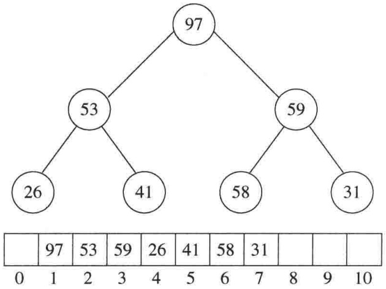

<details>
<summary>funnel</summary>

| Node | Value |
| --- | --- |
| 1 | 97 |
| 2 | 53 |
| 3 | 59 |
| 4 | 26 |
| 5 | 41 |
| 6 | 58 |
| 7 | 31 |
| 8 | — |
| 9 | — |
| 10 | — |
</details>

图 7.8 在 buildHeap 阶段之后的 (max) 堆

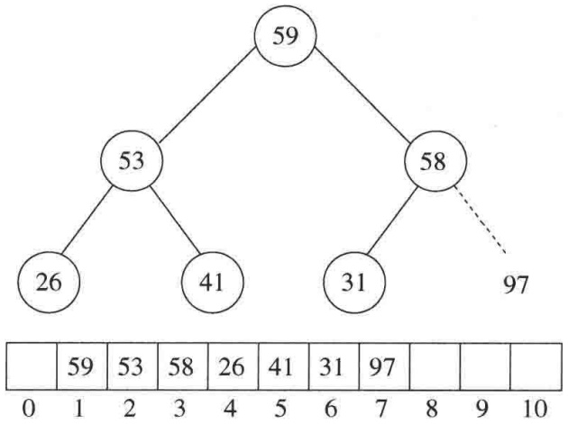

<details>
<summary>funnel</summary>

| Level | Value |
| --- | --- |
| Top | 59 |
| Second | 53 |
| Third | 26 |
| Fourth | 41 |
| Fifth | 31 |
| Bottom | 59, 53, 58, 26, 41, 31, 97, 0, 1, 2, 3, 4, 5, 6, 7, 8, 9, 10 |
</details>

图 7.9 在第一次 deleteMax 后的堆

执行堆排序的代码在图 7.10 中给出。稍微有些复杂的是，这里不像二叉堆，二叉堆时的数据在数组下标 1 处开始，而此处堆排序的数组包含位置 0 处的数据。因此，这时的程序与二叉堆的代码有些不同，不过变化很小。

```cpp
/**
 * 标准的堆排序.
 */
template <typename Comparable>
void heapsort( vector<Comparable> & a )
{
    for( int i = a.size( ) / 2 - 1; i >= 0; --i ) /* buildHeap */
        percDown( a, i, a.size( ) );
    for( int j = a.size( ) - 1; j > 0; --j )
    {
        std::swap( a[ 0 ], a[ j ] );          /* deleteMax */
        percDown( a, 0, j );
    }
}

/**
 * 堆排序的内部方法.
 * i 是堆中一项的下标.
 * 返回左儿子的下标.
 */
inline int leftChild( int i )
{
```

图7.10 堆排序

---

第 7 章 排 序

241

```cpp
return 2 * i + 1;
}

/**
 * 在deleteMax 和 buildHeap 中用到的堆排序的内部方法.
 * i 是开始下滤的位置.
 * n 是二叉堆的逻辑大小.
 */
template <typename Comparable>
void percDown( vector<Comparable> & a, int i, int n )
{
    int child;
    Comparable tmp;

    for( tmp = std::move( a[ i ] ); leftChild( i ) < n; i = child )
    {
        child = leftChild( i );
        if( child != n - 1 && a[ child ] < a[ child + 1 ] )
            ++child;
        if( tmp < a[ child ] )
            a[ i ] = std::move( a[ child ] );
        else
            break;
    }
    a[ i ] = std::move( tmp );
}
```

图 7.10(续) 堆排序

## 7.5.1 堆排序的分析

我们在第6章看到，第一阶段构建堆用到少于 $2N$ 次的比较。在第二阶段，第 $i$ 次deleteMax最多用到少于 $2\left\lfloor \log (N - i + 1)\right\rfloor$ 次比较，总数最多为 $2N\log N - O(N)$ 次比较（设 $N\geqslant 2$）。因此，在最坏的情形下堆排序最多使用 $2N\log N - O(N)$ 次比较。练习7.13要求证明对于所有的deleteMax操作有可能同时达到它们的最坏情形。

经验指出，堆排序的性能极其稳定:平均它使用的比较只比最坏情形界指出的略少。多年来，还没有人能够指出堆排序平均运行时间的非平凡界。似乎问题在于连续的 deleteMax 操作破坏了堆的随机性，使得概率论证非常复杂。终于，另一种处理方法进行了成功的证明。

## 定理 7.5

对 $N$ 个互异项的随机排列进行堆排序所用比较的平均次数为 $2N\log N - O(N\log \log N)$。

证明:

构建堆的阶段平均使用 $\Theta(N)$ 次比较，因此只需要证明第二阶段的界。假设有 $\{1,2,\cdots,N\}$ 的一个排列。

设第 $i$ 次 deleteMax 将根元素向下推低 $d_{i}$ 层。此时它使用了 $2d_{i}$ 次比较。对于任意输入数据的堆排序, 存在一个开销序列 (cost sequence) $D: d_{1}, d_{2}, \cdots, d_{N}$, 它确定了第二阶段的开销, 该开销由 $M_{D} = \sum_{i=1}^{N} d_{i}$ 给出, 因此所使用的比较次数是 $2M_{D}$ 。

---

242

数据结构与算法分析——C++语言描述(第四版)

令 $f(N)$ 是 N 项的堆的个数。可以证明(练习 7.58)，$f(N) > (N/(4e))^{N}$，其中，$e = 2.71828\cdots$。我们将证明，只有这些堆中指数上很小的部分(特别是 $(N/16)^{N}$ )的开销小于 $M = N(\log N - \log \log N - 4)$。当该结论得证时可以推出，$M_{D}$ 的平均值至少是 M 减去大小为 $o(1)$ 的一项，这样，比较的平均次数至少是 2M。因此，我们的基本目标则是证明存在很少的堆，它们具有小的开销序列。

因为第 $d_{i}$ 层上最多有 $2^{d_{i}}$ 个节点，所以对于任意的 $d_{i}$ 存在根元素可能去到的 $2^{d_{i}}$ 个可能的位置。于是，对任意的序列 $D$ ，对应deleteMax的互异序列的个数最多是

$$
S _ {D} = 2 ^ {d _ {1}} 2 ^ {d _ {2}} \dots 2 ^ {d _ {N}}
$$

简单的代数处理指出，对一个给定的序列 $D$

$$
S _ {D} = 2 ^ {M _ {D}}
$$

因为每个 $d_{i}$ 可取1和 $\lfloor \log N\rfloor$ 之间的任一值，所以最多存在 $(\log N)^{N}$ 个可能的序列 $D$ 。由此可知，需要花费的开销恰好为 $M$ 的互异deleteMax序列的个数最多是总开销为 $M$ 的开销序列的个数乘以每个这种开销序列的deleteMax序列的个数。这样就立刻得到界 $(\log N)^{N}2^{M}$ 。

开销序列小于 $M$ 的堆的总数最多为

$$
\sum_ {i = 1} ^ {M - 1} (\log N) ^ {N} 2 ^ {i} <   (\log N) ^ {N} 2 ^ {M}
$$

如果选择 $M = N(\log N - \log \log N - 4)$，那么开销序列小于 $M$ 的堆的个数最多为 $(N / 16)^{N}$，根据前面的评述，定理得证。

通过更复杂的论证，可以证明，堆排序总是使用至少 $N\log N - O(N)$ 次比较，而且存在能够达到这个界的输入。而平均情形分析也可以改进为 $2N\log N - O(N)$ 次比较(而不是定理7.5中非线性的第二项）。

## 7.6 归并排序

现在我们把注意力转向归并排序(mergesort)。归并排序以 $O(N\log N)$ 最坏情形时间运行，而所使用的比较次数几乎是最优的。它是递归算法的一个很好的实例。

这个算法中基本的操作是合并两个已排序的表。因为这两个表是已排序的，所以若将输出放到第3个表中，则该算法可以通过对输入的一趟排序来完成。基本的合并算法是取两个输入数组 $A$ 和 $B$ ，一个输出数组 $C$ ，以及3个计数器Actr, Bctr, Cctr，它们初始置于对应数组的开始端。A[Actr]和B[Bctr]中的较小者被复制到 $C$ 中的下一个位置，相关的计数器向前推进一步。当两个输入表有一个用完的时候，则将另一个表中剩余部分复制到 $C$ 中。合并例程工作情况的例子见下面各图。

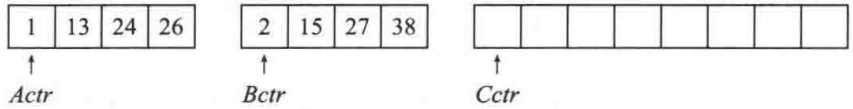

<details>
<summary>text_image</summary>

1 13 24 26
↑
Actr
2 15 27 38
↑
Bctr
↑
Cctr
</details>

如果数组 $A$ 含有1、13、24、26，数组 $B$ 含有2、15、27、38，那么该算法进行如下:首先，比较在1和2之间进行，1被添加到 $C$ 中，然后13和2进行比较。

---

第7章 排序

243

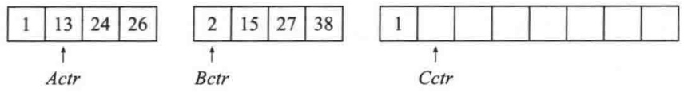

<details>
<summary>text_image</summary>

1 13 24 26
↑
Actr
2 15 27 38
↑
Bctr
1
Cctr
↑
</details>

2 被添加到 C 中，然后 13 和 15 进行比较。

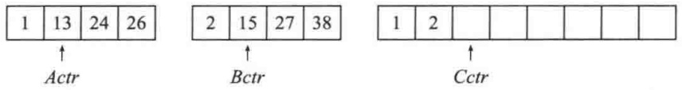

<details>
<summary>text_image</summary>

1 13 24 26
↑
Actr
2 15 27 38
↑
Bctr
1 2 
↑
Cctr
</details>

13 被添加到 $C$ 中，接下来比较 24 和 15，这样一直进行到 26 和 27 进行比较。

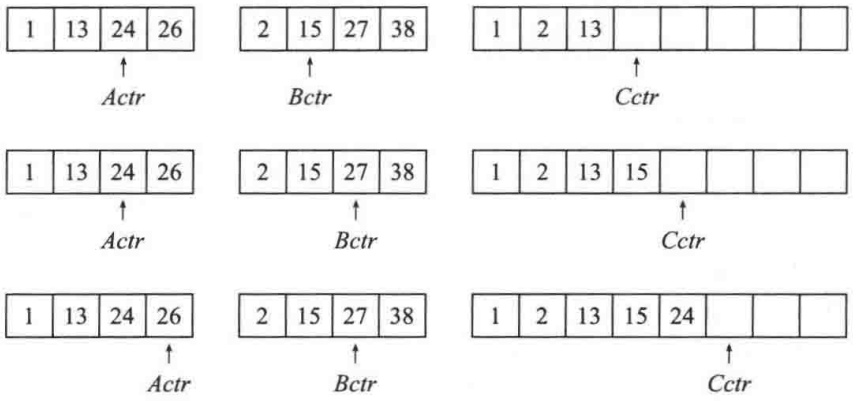

<details>
<summary>text_image</summary>

1 13 24 26
↑
Actr
2 15 27 38
↑
Bctr
1 2 13
↑
Cctr
1 13 24 26
↑
Actr
2 15 27 38
↑
Bctr
1 2 13 15
↑
Cctr
1 13 24 26
↑
Actr
2 15 27 38
↑
Bctr
1 2 13 15 24
↑
Cctr
</details>

将26添加到 $C$ 中，数组 $A$ 已经用完。

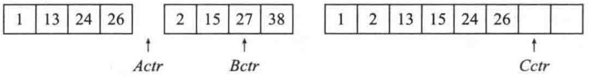

<details>
<summary>text_image</summary>

1 13 24 26
↑
Actr Bctr
2 15 27 38
↑
Cctr
</details>

然后将数组 $B$ 的剩余部分复制到 $C$ 中。

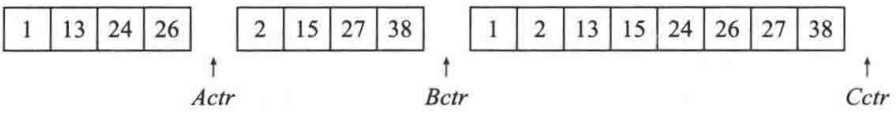

<details>
<summary>text_image</summary>

1 13 24 26
↑
Actr
2 15 27 38
↑
Bctr
1 2 13 15 24 26 27 38
↑
Cctr
</details>

合并两个已排序的表的时间显然是线性的，因为最多进行了 $N - 1$ 次比较，其中 $N$ 是元素的总数。为了看清这一点，注意每次比较都是把一个元素添加到 $C$ 中，但最后的比较除外，它至少添加两个元素。

因此，归并排序算法很容易描述。如果 $N = 1$ ，那么只有一个元素需要排序，答案是显然的。否则，递归地将前半部分数据和后半部分数据各自归并排序，得到排序后的两部分数据，然后使用上面描述的合并算法再将这两部分合并到一起。例如，欲将8元素数组24,13,26,1,2,27,38,15排序，我们递归地将前4个数据和后4个数据分别排序，得到1,13,24,26,2,15,27,38。然后，像上面那样将这两部分合并，得到最后的表1,2,13,15,24,26,27,38。该算法是经典的分治(divide-and-conquer)策略，它将问题分(divide)成一些小的问题然后递归求解，而治(conquer)的阶段则将分的阶段解得的各答案修补在一起。分治是递归非常有效的用法，我们将会多次遇到。

归并排序的一种实现在图 7.11 中给出。其中单参数的 mergeSort 正是 4-参数递归 mergeSort 的一个驱动程序。

merge 例程很精妙。如果对 merge 的每个递归调用均局部声明一个临时数组，那么在任一时刻就可能有 $\log N$ 个临时数组处在活动期。精密的考察指出，由于 merge 是 mergeSort 的最后一行，因此在任一时刻只需要一个临时数组在活动，而且这个临时数组可以在 public

---

244

数据结构与算法分析——C++语言描述(第四版)

型的 mergeSort 驱动程序中建立。不仅如此，我们还可以使用该临时数组的任意部分；我们将使用与输入数组 a 相同的部分，这就达到本节末尾描述的改进。图 7.12 实现了这个 merge 例程。

```c
/**
 * 归并排序算法 (驱动程序).
 */
template <typename Comparable>
void mergeSort( vector<Comparable> & a )
{
    vector<Comparable> tmpArray( a.size( ) );

    mergeSort( a, tmpArray, 0, a.size( ) - 1 );
}

/**
 * 进行递归调用的内部方法.
 * a 为 Comparable 项的数组.
 * tmpArray 为放置归并结果的数组.
 * left 为子数组最左元素的下标.
 * right 为子数组最右元素的下标.
 */
template <typename Comparable>
void mergeSort( vector<Comparable> & a,
                     vector<Comparable> & tmpArray, int left, int right )
{
    if( left < right )
    {
        int center = ( left + right ) / 2;
        mergeSort( a, tmpArray, left, center );
        mergeSort( a, tmpArray, center + 1, right );
        merge( a, tmpArray, left, center + 1, right );
    }
}
```

图 7.11 归并排序例程

```txt
/**
 * 合并子数组已排序两半部分的内部方法.
 * a 为Comparable 项的数组.
 * tmpArray 为放置归并结果的数组.
 * leftPos 为子数组最左元素的下标.
 * rightPos 为后半部分起点的下标.
 * rightEnd 为子数组最右元素的下标.
 */
template <typename Comparable>
void merge( vector<Comparable> & a, vector<Comparable> & tmpArray,
           int leftPos, int rightPos, int rightEnd )
{
    int leftEnd = rightPos - 1;
    int tmpPos = leftPos;
```

图 7.12 merge 例程

---

第7章 排序

245

```cpp
int numElements = rightEnd - leftPos + 1;

// 主循环
while( leftPos <= leftEnd && rightPos <= rightEnd )
    if( a[ leftPos ] <= a[ rightPos ] )
        tmpArray[ tmpPos++ ] = std::move( a[ leftPos++ ] );
    else
        tmpArray[ tmpPos++ ] = std::move( a[ rightPos++ ] );

while( leftPos <= leftEnd )    // 复制前半部分的剩余元素
    tmpArray[ tmpPos++ ] = std::move( a[ leftPos++ ] );

while( rightPos <= rightEnd )  // 复制后半部分的剩余元素
    tmpArray[ tmpPos++ ] = std::move( a[ rightPos++ ] );

// 将tmpArray复制回原数组a
for( int i = 0; i < numElements; ++i, --rightEnd )
    a[ rightEnd ] = std::move( tmpArray[ rightEnd ] );
}
```

图 7.12(续) merge 例程

## 7.6.1 归并排序的分析

归并排序是用于分析递归例程技巧的经典实例:我们必须给运行时间写出一个递推关系。假设 $N$ 是2的幂，从而我们总可以将它分裂成相等的两部分。对于 $N = 1$ ，归并排序所用时间是常数，我们将其记为1。否则，对 $N$ 个数归并排序的用时等于完成两个大小为 $N / 2$ 的递归排序所用的时间再加上合并的时间，后者是线性的。下述方程给出准确的表示:

$$
T (1) = 1
$$

$$
T (N) = 2 T (N / 2) + N
$$

这是一个标准的递推关系，它可以用多种方法求解。我们将介绍两种方法。第一种方法是用 N 去除递推关系的两边，很快就会发现其明显的道理。相除后得到

$$
\frac {T (N)}{N} = \frac {T (N / 2)}{N / 2} + 1
$$

该方程对作为2的幂的任意的 $N$ 是成立的，于是我们还可以写成

$$
\frac {T (N / 2)}{N / 2} = \frac {T (N / 4)}{N / 4} + 1
$$

和

$$
\frac {T (N / 4)}{N / 4} = \frac {T (N / 8)}{N / 8} + 1
$$

$$
\frac {T (2)}{2} = \frac {T (1)}{1} + 1 \quad \vdots
$$

将所有这些方程相加，就是说，将等号左边的所有各项相加并使结果等于右边所有各项的和。

---

246

数据结构与算法分析——C++语言描述(第四版)

项 $T(N / 2) / (N / 2)$ 出现在等号两边可以消去。事实上，实际出现在两边的项均被消去，我们称之为叠缩(telescoping)求和。在所有的加法完成之后，最后的结果为

$$
\frac {T (N)}{N} = \frac {T (1)}{1} + \log N
$$

这是因为所有其余的项均被消去而方程的个数是 $\log N$ 个，故而将各方程末尾的1相加得到$\log N$ 。再将两边同乘 $N$ ，得到最后的答案:

$$
T (N) = N \log N + N = O (N \log N)
$$

注意，假如在求解开始时不是通除以 $N$ ，那么两边的和也就不可能叠缩。这就是为什么要在两边通除以 $N$ 的缘故。

另一种方法是在右边连续地代入递推关系。我们得到

$$
T (N) = 2 T (N / 2) + N
$$

由于可以将 $N / 2$ 代入到主方程中:

$$
2 T (N / 2) = 2 (2 (T (N / 4)) + N / 2) = 4 T (N / 4) + N
$$

因此得到

$$
T (N) = 4 T (N / 4) + 2 N
$$

再将 $N / 4$ 代入主方程，我们看到:

$$
4 T (N / 4) = 4 (2 T (N / 8) + N / 4) = 8 T (N / 8) + N
$$

因此有

$$
T (N) = 8 T (N / 8) + 3 N
$$

将这种方式继续下去，得到

$$
T (N) = 2 ^ {k} T (N / 2 ^ {k}) + k N
$$

利用 $k = \log N$ ，得到

$$
T (N) = N T (1) + N \log N = N \log N + N
$$

选择使用哪种方法是风格问题。第一种方法引起一些琐碎的工作，把它写到一张 $8\frac{1}{2} \times 11$ 的纸上可能更好，这样会少出些数学错误，不过需要用到一定的经验。第二种方法更偏重于使用蛮力计算。

回忆我们已经假设 $N = 2^{k}$ 。分析可以精化以处理 $N$ 不是2的幂的情形。事实上，答案几乎是一样的(通常出现的就是这样的情形)。

虽然归并排序的运行时间是 $O(N\log N)$，但是它有一个明显的问题，即合并两个已排序的表用到线性附加内存。在整个算法中还要花费将数据复制到临时数组再复制回来这样一些附加的工作，它明显地减慢了排序的速度。这种复制可以通过在递归的那些交替层次上审慎地交换a和tmpArray的角色得以避免。归并排序的一种变形也可以非递归地实现（见练习7.16）。

与其他的  $O(N \log N)$  排序算法比较，归并排序的运行时间严重依赖于比较元素和在数组（以及临时数组）中移动元素的相对开销。这些开销是与语言相关的。

---

第7章 排序

247

例如，在 Java 中，当执行一次范型排序(使用 Comparator)时，进行一次元素比较可能是昂贵的(因为比较可能不容易内联(inlined)使用，从而动态调度的开销可能会减慢执行的速度)，但是移动元素则是省时的(因为它们是引用的赋值，而不是庞大对象的拷贝)。归并排序使用所有流行的排序算法中最少的比较次数，因此它是 Java 通用排序算法中的上好选择。事实上，它就是标准 Java 库中范型排序所使用的算法。

另一方面，在传统 C++ 的范型排序中，如果对象庞大，那么拷贝对象可能要昂贵，而由于编译器主动执行内联 (inline) 优化的能力，因此对象比较常常是相对省时的。在这种情形下，如果还能够使用少得多的数据移动，那么有理由让一个算法使用更多一些比较。我们将在下一节讨论的快速排序达到了这种权衡，并且是 C++ 库中通常一直在使用的排序例程。如今，新的 C++11 移动语义可能改变这种动态，于是剩下的就要看快速排序是否还将继续作为 C++ 库中使用的排序算法了。

## 7.7 快速排序

顾名思义, 对于 $\mathrm{C}++$, 快速排序 (quicksort) 历史上一直是实践中已知最快的泛型排序算法, 它的平均运行时间是 $O(N \log N)$ 。该算法之所以特别快, 主要是由于非常精练和高度优化的内部循环。它的最坏情形性能为 $O(N^2)$, 但经过稍许努力可使这种情形极难出现。通过将快速排序和堆排序结合, 由于堆排序的最坏情形运行时间是 $O(N \log N)$, 因此可以对几乎所有的输入都能达到快速排序的快速运行时间。练习 7.27 描述的就是这种方法。

虽然多年来快速排序算法曾被认为是理论上高度优化而在实践中不可能正确编程的一种算法，但是如今该算法简单易懂并且容易证明是正确的。像归并排序一样，快速排序也是一种分治的递归算法。

让我们用下面简单的排序算法将一个表进行排序作为开始。随意选取表中任一项，则表中元素此时形成3组:比所选项小的一组、等于所选项的一组以及大于所选项的元素的一组。递归地将第1组和第3组排序，然后再将这3组联接起来。递归的基本原则保证所得结果就是原始初表的有序排列。该算法的直接实现如图7.13所示，而它的性能一般说来对绝大部分输入都是相当理想的。事实上，如果被排序的表包含的大部分是相同的项而互异项相对很少，那么此时的性能将表现极好。

我们所描述的算法构成了快速排序的基础。然而，通过递归地构建一些附加的表，很难看出我们对归并排序的改进。事实上，到现在为止，我们真的尚未做出改进。为了做得更好，必须避免使用大量附加内存，并且要有干净的内部循环。这样，快速排序通常以避免创建第二个(相等的项的)组的方式编写，算法拥有多处影响着算法性能的精妙细节，一些难点也在这里。

现在我们描述快速排序最普通的实现——“经典快速排序”，此时的输入是一个数组，而且该算法并没有创建任何附加的数组。

将数组 $S$ 排序的经典快速排序算法由下列简单的4步组成:

1. 如果 S 中元素个数是 0 或 1，则返回。
2. 取 S 中任一元素 v，称之为枢纽元(pivot)。

---

248

数据结构与算法分析——C++语言描述(第四版)

```cpp
template <typename Comparable>
void SORT( vector<Comparable> & items )
{
    if( items.size( ) > 1 )
    {
        vector<Comparable> smaller;
        vector<Comparable> same;
        vector<Comparable> larger;

        auto chosenItem = items[ items.size( ) / 2 );

        for( auto & i : items )
        {
            if( i < chosenItem )
                smaller.push_back( std::move( i ) );
            else if( chosenItem < i )
                larger.push_back( std::move( i ) );
            else
                same.push_back( std::move( i ) );
        }

        SORT( smaller );      // 递归调用
        SORT( larger );      // 递归调用

        std::move( begin( smaller ), end( smaller ), begin( items ) );
        std::move( begin( same ), end( same ), begin( items ) + smaller.size( ) );
        std::move( begin( larger ), end( larger ), end( items ) - larger.size( ) );
    }
}
```

图 7.13 简单的递归排序算法

3. 将 $S - \{v\}$ (即 $S$ 中其余元素) 划分成两个不相交的集合: $S_{1} = \{x \in S - \{v\} \mid x \leqslant v\}$, $S_{2} = \{x \in S - \{v\} \mid x \geqslant v\}$。
4. 返回 $\{quicksort(S_{1})$ ，后跟 v，继而再 quicksort $(S_{2})$ 。

由于在对那些等于枢纽元的元素的处理上，第3步分割的描述不是唯一的，因此这就成了一种设计决策。一部分好的实现方法是将这种情形尽可能高效地处理。直观地看，我们希望把等于枢纽元的大约一半的元素分到 $S_{1}$ 中，而另外的一半分到 $S_{2}$ 中，这很像我们希望二叉查找树保持平衡的情形。

图 7.14 解释了快速排序对一个数集的做法。这里的枢纽元(随机地)选为 65，集合中其余元素分成两个更小的集合。递归地将较小的数的集合排序得到 0, 13, 26, 31, 43, 57(递归法则 3)，较大的数的集合类似地排序，此时整个集合排序后的排列很容易得到。

很清楚，该算法是成立的，但不清楚的是为什么它比归并排序快。如同归并排序那样，快速排序递归地解决两个子问题并需要线性的附加工作(第3步)，不过，与归并排序不同，这两个子问题并不保证具有相等的大小，这是个潜在的隐患。快速排序更快的原因在于，第3步分割成两组实际上是在适当的位置进行并且非常有效，它的高效率不仅可以弥补大小不等的递归调用的不足，而且还能有所超出。

---

第7章 排序

249

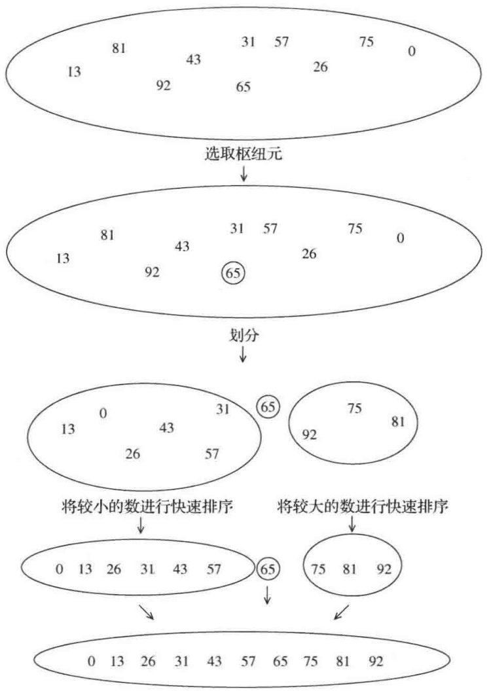

<details>
<summary>flowchart</summary>

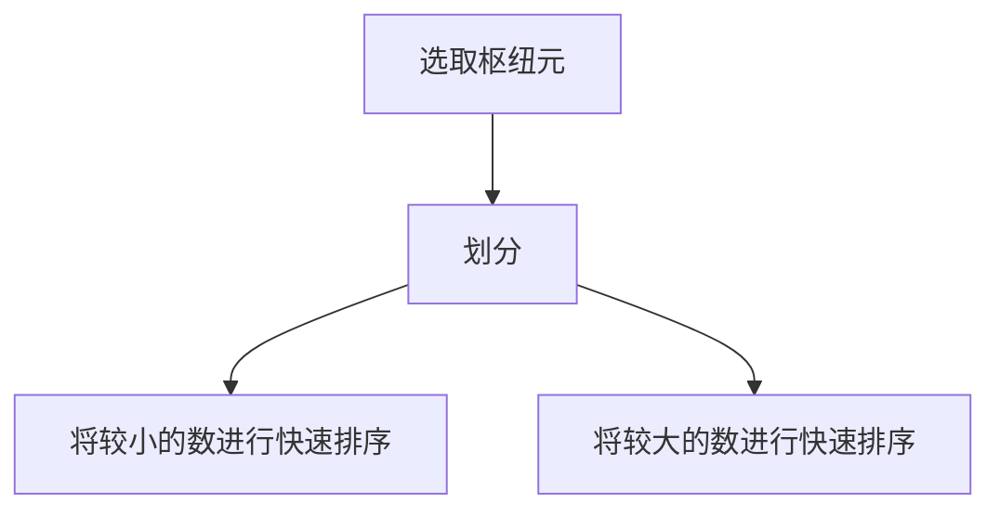
</details>

图 7.14 以图例说明快速排序的各步

迄今为止对该算法的描述尚缺少许多细节，我们现在就来补足它们。实现第 2 步和第 3 步有许多方法，这里介绍的方法是大量分析和经验研究的结果，它代表实现快速排序的非常有效的方式，哪怕即使是对该方法最微小的偏离都可能招致意想不到的坏结果。

## 7.7.1 选取枢纽元

虽然上面描述的算法无论选择哪个元素作为枢纽元都能完成排序工作，但是有些选择显然优于其他的选择。

## 一种错误的方法

常见的、无知的选择是将第一个元素用作枢纽元。如果输入是随机的，那么这是可以接受的，但如果输入是预排序的或是反序的，那么这样的枢纽元就产生一个劣质的分割，因为所有的元素不是都被划入 $S_{1}$ 就是都被划入 $S_{2}$ 。更为糟糕的是，这种情况毫无例外地发生在所有的递归调用中。实际上，如果第一个元素用作枢纽元而且输入是预先排序的，那么快速排序花费的时间将是二次的，但实际效果却是枢纽元根本没干什么事，这是相当尴尬的。可是，预排序的输入(或具有一大段预排序数据的输入)又是相当常见的，因此，使用第一个元素作为枢纽元是绝对可怕的坏主意，应该立即放弃这种想法。另一种想法是选取前两个互异的关键字中的较大者作为枢纽元，但这和只选取第一个元素作为枢纽元具有相同的害处。不要使用这两种选取枢纽元的策略。

---

250

数据结构与算法分析——C++语言描述(第四版)

## 一种安全的做法

一种安全的方针是随机选取枢纽元。一般来说这种策略非常安全，除非随机数发生器有问题（它并不像我们可能想象的那么罕见），因为随机的枢纽元不可能总在接连不断地产生劣质的分割。另一方面，随机数的生成一般说来开销显著，根本减少不了算法其余部分的平均运行时间。

## 三数中值分割法(Median-of-Three Partitioning)

一组 $N$ 个数的中值(median)是第 $\lceil N / 2 \rceil$ 个最大的数。枢纽元的最好的选择是数组的中值。遗憾的是，这很难算出且明显减慢快速排序的速度。该中值一个比较好的估计值可以通过随机选取三个元素并用它们的中值作为枢纽元而得到。事实上，随机性并没有太大的帮助，因此一般的做法是使用左端、右端和中心位置上的三个元素的中值作为枢纽元。例如，输入为8,1,4,9,6,3,7,5,2,0，它的左端元素是8，右端元素是0，中心位置（$\lfloor (left + right) / 2 \rfloor$）上的元素是6。于是枢纽元则是 $v = 6$ 。显然使用三数中值分割法消除了预排序输入的坏情形(在这种情形下，这些分割都是一样的)，并且实际减少了 $14\%$ 的比较次数。

## 7.7.2 分割策略

有几种分割策略用于实践，而此处描述的分割策略已被证实能够给出好的结果。我们将会看到，这么做很容易出错或低效，但使用一种已知方法是安全的。该法的第一步是通过将枢纽元与最后的元素交换使得枢纽元离开要被分割的数据段。i从第一个元素开始而j从倒数第二个元素开始。如果原始输入与前面一样，那么下面的图表示当前的状态。

| 8 | 1 | 4 | 9 | 0 | 3 | 5 | 2 | 7 | 6 |
| --- | --- | --- | --- | --- | --- | --- | --- | --- | --- |
| ↑ |  |  |  |  |  |  |  | ↑ |  |
| i |  |  |  |  |  |  |  | j |  |

我们暂时假设所有的元素互异，后面我们将着重考虑在出现重复元素时应该怎么办。作为有限的情况，如果所有的元素都相同，那么我们的算法必须做该做的事。然而奇怪的是，此时做错事却特别地容易。

分割阶段要做的就是把所有小元素移到数组的左边而把所有大元素移到数组的右边。当然，“小”和“大”是相对于枢纽元而言的。

当 i 在 j 的左边时，我们将 i 右移，移过那些小于枢纽元的元素，并将 j 左移，移过那些大于枢纽元的元素。当 i 和 j 停止时，i 指向一个大元素而 j 指向一个小元素。如果 i 在 j 的左边，那么将这两个元素互换，其效果是把一个大元素推向右边而把一个小元素推向左边。在上面的例子中，i 不移动，而 j 滑过一个位置，情况如下图。

| 8 | 1 | 4 | 9 | 0 | 3 | 5 | 2 | 7 | 6 |
| --- | --- | --- | --- | --- | --- | --- | --- | --- | --- |
| ↑ |  |  |  |  |  |  | ↑ |  |  |
| i |  |  |  |  |  |  | j |  |  |

然后我们交换由i和j指向的元素，重复该过程直到i和j彼此交错为止。

第1次交换后

| 2 | 1 | 4 | 9 | 0 | 3 | 5 | 8 | 7 | 6 |
| --- | --- | --- | --- | --- | --- | --- | --- | --- | --- |
| ↑ |  |  |  |  |  |  | ↑ |  |  |
| i |  |  |  |  |  |  | j |  |  |

---

第7章 排序

251

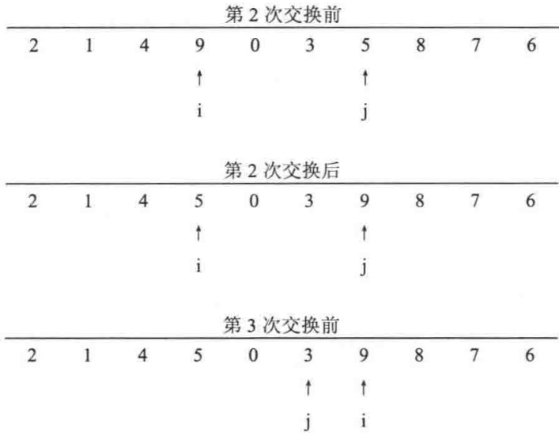

<details>
<summary>flowchart</summary>

```mermaid
graph TD
  subgraph Phase1["第2次交换前"]
  A["2"] --> B["1"]
  B --> C["4"]
  C --> D["9"]
  D --> E["0"]
  E --> F["3"]
  F --> G["5"]
  G --> H["8"]
  H --> I["7"]
  I --> J["6"]
  end

  subgraph Phase2["第2次交换后"]
  K["2"] --> L["1"]
  L --> M["4"]
  M --> N["5"]
  N --> O["0"]
  O --> P["3"]
  P --> Q["9"]
  Q --> R["8"]
  R --> S["7"]
  S --> T["6"]
  end

  subgraph Phase3["第3次交换前"]
  U["2"] --> V["1"]
  V --> W["4"]
  W --> X["5"]
  X --> Y["0"]
  Y --> Z["3"]
  Z --> AA["9"]
  AA --> AB["8"]
  AB --> AC["7"]
  AC --> AD["6"]
  end

  style A fill:#f9f9f9,stroke:#333
  style L fill:#f9f9f9,stroke:#333
  style M fill:#f9f9f9,stroke:#333
  style U fill:#f9f9f9,stroke:#333
  style U fill:#f9f9f9,stroke:#333
  style U fill:#f9f9f9,stroke:#333
  style U fill:#f9f9f9,stroke:#333
  style U fill:#f9f9f9,stroke:#333
  style U fill:#f9f9f9,color:#e1f5fe\nj fill:#ffb00,color:#fff\ni fill:#ffb00,color:#fff\nj fill:#ffb00,color:#fff\ni fill:#ffb00,color:#fff\nj fill:#ffb00,color:#fff\ni fill:#ffb00,color:#fff\nj fill:#ffb00,color:#fff\ni fill:#ffb00,color:#fff\nj fill:#ffb00,color:#fff\ni fill:#ffb00,color:#fff\nj fill:#ffb00,color:#fff",
```
</details>

此时，i 和 j 已经交错，故不再交换。分割的最后一步是将枢纽元与 i 所指向的元素交换。

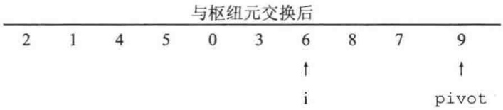

<details>
<summary>text_image</summary>

与枢纽元交换后
2 1 4 5 0 3 6 8 7 9
↑
↑
i pivot
</details>

在最后一步当枢纽元与 i 所指向的元素交换时, 我们知道在位置 $p < \mathrm{i}$ 的每一个元素都必然是小元素, 这是因为或者位置 $p$ 包含一个从它开始移动的小元素, 或者位置 $p$ 上原来的大元素在交换期间被置换了。类似的论断指出, 在位置 $p > \mathrm{i}$ 上的元素必然都是大元素。

我们必须考虑的一个重要的细节是如何处理那些等于枢纽元的元素。问题在于当 i 遇到一个等于枢纽元的元素时是否应该停止以及当 j 遇到一个等于枢纽元的元素时是否应该停止。直观地看，i 和 j 应该做相同的工作，因为否则分割将出现偏向一方的倾向。例如，如果 i 停止而 j 不停，那么所有等于枢纽元的元素都将被分到  $S_{2}$  中。

为了搞清怎么办更好，我们考虑数组中所有的元素都相等的情况。如果 i 和 j 都停止，那么在相等的元素间将有很多次交换。虽然这似乎没有什么意义，但是其正面的效果则是 i 和 j 将在中间交错，因此当枢纽元被替代时，这种分割建立了两个几乎相等的子数组。归并排序的分析告诉我们，此时总的运行时间为 $O(N \log N)$。

如果 i 和 j 都不停止，而且有相应的程序代码防止 i 和 j 越出数组的端点，那就将不存在交换的问题。虽然这样似乎不错，但是正确的实现方法还是要把枢纽元交换到 i 最后到过的位置，这个位置是倒数第二个位置（或最后的位置，这依赖于精确的实现）。这样的做法将会产生两个非常不均衡的子数组。如果所有的元素都是相同的，那么运行时间就是 $O(N^2)$ 。对于预排序的输入而言，其效果与使用第一个元素作为枢纽元相同。它花费的时间是二次的，可是却什么事也没干。

这样我们就发现，进行不必要的交换建立两个均衡的子数组要比蛮干冒险得到两个不均衡的子数组好。因此，如果 i 和 j 遇到等于枢纽元的关键字，那么我们就让 i 和 j 都停止。对于这种输入，这实际上是 4 种可能性中唯一的一种不花费二次时间的可能。

初看起来，过多考虑具有相同元素的数组似乎有些愚蠢。难道有人偏要对500000个相同的元素排序吗？为什么？可是要知道，快速排序是递归的。设有10000000个元素，其中有

---

252

数据结构与算法分析——C++语言描述(第四版)

500 000 个是相同的(或更可能，其排序关键字都是相等的复杂元素)。最终，快速排序将对这 500 000 个元素进行递归调用。此时，真正重要的在于确保这 500 000 个相同的元素能够被高效地排序。

## 7.7.3 小数组

对于很小的数组 $(N\leq20)$ ，快速排序不如插入排序好。不仅如此，因为快速排序是递归的，所以这样的情形还经常发生。通常的解决方法是对于小的数组不递归地使用快速排序，而代之以诸如插入排序这样的对小数组有效的排序算法。使用这种策略实际上可以节省大约15%(相对于不用截止的做法而自始至终使用快速排序时)的运行时间。一种好的截止范围(cutoff range)是N=10，不过在5\~20之间任一截止范围都有可能产生类似的结果。这种做法也避免了一些有害的退化情形，比如当只有一个或两个元素时却取3个元素的中值这样的情况。

## 7.7.4 实际的快速排序例程

快速排序的驱动程序见图 7.15。

```txt
/**
 * 快速排序算法（驱动程序）.
 */
template <typename Comparable>
void quicksort( vector<Comparable> & a )
{
    quicksort( a, 0, a.size( ) - 1 );
}
```

图 7.15 快速排序的驱动程序

例程的一般形式将是传递数组以及被排序数组的范围(left 和 right)。要处理的第一个例程是枢纽元的选取。选取枢纽元最容易的方法是对 a[left]、a[right]、a[center] 适当地排序。这种方法还有额外的好处，即该三元素中的最小者被分在 a[left]，而这正是分割阶段应该将它放到的位置。三元素中的最大者被分在 a[right]，这也是正确的位置，因为它大于枢纽元。因此，我们可以把枢纽元放到 a[right-1] 并在分割阶段将 i 和 j 初始化到 left+1 和 right-2。因为 a[left] 比枢纽元小，所以将它用作 j 的警戒标记，这是另一个好处。此时，我们不必担心 j 跑过端点。由于 i 将停在那些等于枢纽元的元素处，故将枢纽元存储在 a[right-1] 则为 i 提供了一个警戒标记。图 7.16 中的程序进行三数中值分割，它具有上面描述的所有额外的好处。似乎使用不对 a[left]、a[right]、a[center] 实际排序的方法计算枢纽元只不过效率稍微降低一些，但是很奇怪，这将产生糟糕结果(见练习 7.51)。

图 7.17 的程序是快速排序真正的核心，它包括分割和递归调用。这里的实现中有几件事情值得注意。第 16 行将 i 和 j 初始化为比它们的正确值均越过 1 个位置，这样就使得不存在特殊情况需要考虑。此处的初始化依赖于三数中值分割法有一些额外好处的事实。如果按照简单的枢纽元策略使用该程序而不进行修正，那么这个程序是不能正确运行的，原因在于 i 和 j 开始于错误的位置而不再存在 j 的警戒标志。

---

第7章 排序

253

```cpp
/**
 * 返回left、center 和 right 三项的中值.
 * 将它们排序并隐匿枢纽元.
 */
template <typename Comparable>
const Comparable & median3( vector<Comparable> & a, int left, int right )
{
    int center = ( left + right ) / 2;

    if( a[ center ] < a[ left ] )
        std::swap( a[ left ], a[ center ] );
    if( a[ right ] < a[ left ] )
        std::swap( a[ left ], a[ right ] );
    if( a[ right ] < a[ center ] )
        std::swap( a[ center ], a[ right ] );

    // 将枢纽元置于 right - 1 处
    std::swap( a[ center ], a[ right - 1 ] );
    return a[ right - 1 ];
}
```

图 7.16 执行三数中值分割的代码

```cpp
/**
 * 进行递归调用的内部快速排序方法.
 * 使用三数中值分割法，以及截止范围是10的截止技术.
 * a 是 Comparable 项的数组.
 * left 为子数组最左元素的下标.
 * right 为子数组最右元素的下标.
 */
template <typename Comparable>
void quicksort( vector<Comparable> & a, int left, int right )
{
    if( left + 10 <= right )
    {
        const Comparable & pivot = median3( a, left, right );

        // 开始分割
        int i = left, j = right - 1;
        for( ; ; )
        {
            while( a[ ++i ] < pivot ) { }
            while( pivot < a[ --j ] ) { }
            if( i < j )
                std::swap( a[ i ], a[ j ] );
            else
                break;
        }

        std::swap( a[ i ], a[ right - 1 ] ); // 恢复枢纽元

        quicksort( a, left, i - 1 );      // 将小于等于枢纽元的元素排序
        quicksort( a, i + 1, right );     // 将大于等于枢纽元的元素排序
    }
    else  // 对子数组进行一次插入排序
        insertionSort( a, left, right );
}
```

图 7.17 快速排序的主例程

---

254

数据结构与算法分析——C++语言描述(第四版)

第 22 行的交换动作为了速度上的考虑有时显式地写出。为使算法速度快，需要迫使编译器以内联(inline)的方式编译这些代码。如果 swap 使用关键字 inline 进行声明，则许多编译器都会自动这么做，但对于不这么做的编译器，差别可能会很明显。

最后，从第19行和第20行可以看出为什么快速排序这么快。算法的内部循环由一个增1/减1运算(运算很快)、一个测试以及一个转移组成。该算法没有像在归并排序中那样的额外技巧，不过，这个程序仍然出奇地巧妙。颇具诱惑力的做法是将第 $16\sim 25$ 行用图7.18中的语句代替，可是这不能正确运行，因为若 $a[i] = a[j] = \text{pivot}$ 则会产生一个无限循环。

```cpp
int i = left + 1, j = right - 2;
    for( ; ; )
    {
        while( a[ i ] < pivot ) i++;
        while( pivot < a[ j ] ) j--;
        if( i < j )
            std::swap( a[ i ], a[ j ] );
        else
            break;
    }
```

图7.18 对快速排序小的改动，它将中断该算法

## 7.7.5 快速排序的分析

与归并排序一样，快速排序也是递归的。因此，它的分析需要求解一个递推公式。我们将对快速排序进行这种分析，假设有一个随机的枢纽元(不是用三数中值分割法求出的)并对一些小数组不设截止范围。正如归并排序所做的那样，取 $T(0)=T(1)=1$ 。快速排序的运行时间，等于两个递归调用的运行时间加上花费在分割上的线性时间(枢纽元的选取仅花费常数时间)。这就给出了基本的快速排序关系:

$$
T (N) = T (i) + T (N - i - 1) + c N \tag {7.1}
$$

其中， $i = |S_1|$ 是 $S_{1}$ 中元素的个数。我们将考察3种情况。

## 最坏情形的分析

枢纽元始终是最小元素。此时 $i = 0$ ，如果忽略无关紧要的 $T(0) = 1$ ，那么递推关系为

$$
T (N) = T (N - 1) + c N, N > 1 \tag {7.2}
$$

反复使用式(7.2)，得到

$$
T (N - 1) = T (N - 2) + c (N - 1) \tag {7.3}
$$

$$
T (N - 2) = T (N - 3) + c (N - 2) \tag {7.4}
$$

: : :

$$
T (2) = T (1) + c (2) \tag {7.5}
$$

将所有这些方程相加，得到

$$
T (N) = T (1) + c \sum_ {i = 2} ^ {N} i = \Theta (N ^ {2}) \tag {7.6}
$$

这正是我们前面宣布的结果。为了看出这是最坏的可能情形，注意，在深度 $d$ 上的递归调用

---

第7章 排序

255

中所有分割的总开销必然最大是 $N$ 。因为递归的深度最多到 $N$ ，这就得到快速排序最坏情形的界 $O(N^{2})$ 。

## 最好情形的分析

在最好的情况下，枢纽元正好位于中间。为了简化数学推导，假设两个子数组恰好各为原数组的一半大小，虽然这会给出稍微过高的估计，但是由于我们只关心大 O 答案，因此结果还是可以接受的。

$$
T (N) = 2 T (N / 2) + c N \tag {7.7}
$$

用 $N$ 去除式(7.7)的两边:

$$
\frac {T (N)}{N} = \frac {T (N / 2)}{N / 2} + c \tag {7.8}
$$

我们反复套用这个方程，得到

$$
\frac {T (N / 2)}{N / 2} = \frac {T (N / 4)}{N / 4} + c \tag {7.9}
$$

$$
\frac {T (N / 4)}{N / 4} = \frac {T (N / 8)}{N / 8} + c \tag {7.10}
$$

$$
\frac {T (2)}{2} = \frac {T (1)}{1} + c \tag {7.11}
$$

将从式(7.8)到式(7.11)的方程加起来，并注意到它们共有 $\log N$ 个，于是

$$
\frac {T (N)}{N} = \frac {T (1)}{1} + c \log N \tag {7.12}
$$

由此得到

$$
T (N) = c N \log N + N = \Theta (N \log N) \tag {7.13}
$$

注意，这和归并排序的分析完全相同。因此，我们得到相同的答案。这是7.8节诸多结果中的最佳情形。

## 平均情形的分析

这是最困难的部分。对于平均情况，假设对于 $S_{1}$，每个大小都是等可能的，因此它们均有 $1 / N$ 的概率。这个假设对于我们这里的枢纽元选取和分割策略实际上是合理的，不过，对于某些其他情况它并不合理。不保持子数组随机性的分割策略不能使用这种分析方法。有趣的是，这些策略看来会导致那些在实际中花费更长时间运行的程序。

由该假设可知， $T(i)$ 从而 $T(N - i - 1)$ 的平均值均为 $(1 / N)\sum_{j = 0}^{N - 1}T(j)$ 。此时式(7.1)变成

$$
T (N) = \frac {2}{N} \left[ \sum_ {j = 0} ^ {N - 1} T (j) \right] + c N \tag {7.14}
$$

如果用 $N$ 乘以式(7.14)，则有

$$
N T (N) = 2 \left[ \sum_ {j = 0} ^ {N - 1} T (j) \right] + c N ^ {2} \tag {7.15}
$$

---

256

数据结构与算法分析——C++语言描述(第四版)

我们需要除去和号以简化计算。注意，可以再一次套用式(7.15)，得到

$$
(N - 1) T (N - 1) = 2 \left[ \sum_ {j = 0} ^ {N - 2} T (j) \right] + c (N - 1) ^ {2} \tag {7.16}
$$

若从式(7.15)减去式(7.16)，则得到

$$
N T (N) - (N - 1) T (N - 1) = 2 T (N - 1) + 2 c N - c \tag {7.17}
$$

移项、合并，并舍去右边无关紧要的项-c，得到

$$
N T (N) = (N + 1) T (N - 1) + 2 c N \tag {7.18}
$$

现在我们有了一个只用  $T(N-1)$  表示  $T(N)$  的公式。再用叠缩公式的思路，不过式(7.18)的形式不适合。为此，用  $N(N+1)$  除式(7.18):

$$
\frac {T (N)}{N + 1} = \frac {T (N - 1)}{N} + \frac {2 c}{N + 1} \tag {7.19}
$$

现在进行叠缩:

$$
\frac {T (N - 1)}{N} = \frac {T (N - 2)}{N - 1} + \frac {2 c}{N} \tag {7.20}
$$

$$
\frac {T (N - 2)}{N - 1} = \frac {T (N - 3)}{N - 2} + \frac {2 c}{N - 1} \tag {7.21}
$$

$$
\frac {T (2)}{3} = \frac {T (1)}{2} + \frac {2 c}{3} \tag {7.22}
$$

将式(7.19)～式(7.22)相加，得到

$$
\frac {T (N)}{N + 1} = \frac {T (1)}{2} + 2 c \sum_ {i = 3} ^ {N + 1} \frac {1}{i} \tag {7.23}
$$

该和大约为 $\log_e(N + 1) + \gamma -3 / 2$ ，其中 $\gamma \approx 0.577$ 叫作欧拉常数(Euler's constant)，于是

$$
\frac {T (N)}{N + 1} = O (\log N) \tag {7.24}
$$

从而

$$
T (N) = O (N \log N) \tag {7.25}
$$

虽然这里的分析看似复杂，但是实际上并不复杂——一旦看出某些递推关系，这些步骤是很自然的。该分析实际上还可以再进一步。上面描述的高度优化的版本也已经被分析过了，而这个结果的获得非常困难，涉及到一些复杂的递归和高深的数学。相等元素的效果也被仔细地进行了分析，实际上我们所介绍的程序就是这么做的。

## 7.7.6 选择问题的线性期望时间算法

可以修改快速排序以解决选择问题(selection problem)，该问题在第1章和第6章已经见过。当时，通过使用优先队列，我们能够以时间 $O(N + k\log N)$ 找到第 $k$ 个最大(或最小)元。对于查找中值的特殊情形，它给出一个 $O(N\log N)$ 算法。

---

第7章 排序

257

由于我们能够以 $O(N\log N)$ 时间给数组排序，因此可以期望为选择问题得到一个更好的时间界。我们介绍的查找集合 $S$ 中第 $k$ 个最小元的算法几乎与快速排序相同。事实上，其前三步是一样的。我们将把这种算法叫作快速选择(quickselect)。令 $|S_i|$ 为 $S_{i}$ 中元素的个数。快速选择的步骤如下:

1. 如果 $|S| = 1$，那么 k = 1 并将 S 中的元素作为答案返回。如果正在使用小数组的截止 (cutoff) 方法且 $|S| \leqslant \text{CUTOFF}$，则将 S 排序并返回第 k 个最小元素。
2. 选取一个枢纽元 $v \in S$。
3. 将集合 $S - \{v\}$ 分割成 $S_{1}$ 和 $S_{2}$，就像我们在快速排序中所做的那样。
4. 如果 $k \leqslant |S_1|$，那么第 $k$ 个最小元必然在 $S_1$ 中。在这种情况下，返回 quickselect $(S_1, k)$。如果 $k = 1 + |S_1|$，那么枢纽元就是第 $k$ 个最小元，我们将它作为答案返回。否则，这第 $k$ 个最小元就在 $S_2$ 中，它是 $S_2$ 中的第 $(k - |S_1| - 1)$ 个最小元。我们进行一次递归调用并返回 quickselect $(S_2, k - |S_1| - 1)$。

与快速排序对比，快速选择只做一次递归调用而不是两次。快速选择的最坏情况和快速排序的相同，也是 $O(N^{2})$ 。直观看来，这是因为快速排序的最坏情况是在 $S_{1}$ 和 $S_{2}$ 有一个是空的时候的情况，于是，快速选择也就不是真的节省一次递归调用。不过，它的平均运行时间是 $O(N)$ 。具体分析类似于快速排序的分析，我们将它留作一道练习题。快速选择的实现甚至比抽象描述的还要简单，其程序见图7.19。当算法终止时，第 $k$ 个最小元就在位置 $k - 1$ 上(因为数组开始于下标0)。算法破坏了数组原来的排序；如果不希望这样，那么必须要做一份拷贝。

```cpp
/**
 * 进行递归调用的内部选择方法.
 * 使用三数中值分割法以及截止范围是10的截止技术.
 * 把第k个最小项放在a[k-1]处.
 * a 为Comparable 项的数组.
 * left 是子数组最左元素的下标.
 * right 为子数组最右元素的下标.
 * k是在整个数组中想要的排位(1是最小元素的下标).
 */
template <typename Comparable>
void quickSelect( vector<Comparable> & a, int left, int right, int k )
{
    if( left + 10 <= right )
    {
        const Comparable & pivot = median3( a, left, right );

        // 开始分割
        int i = left, j = right - 1;
        for( ; ; )
        {
            while( a[ ++i.] < pivot ) { }
            while( pivot < a[ --j ] ) { }
            if( i < j )
                std::swap( a[ i ], a[ j ] );
```

图 7.19 快速选择的主例程

---

258

数据结构与算法分析——C++语言描述(第四版)

```cpp
else
            break;
    }

    std::swap( a[ i ], a[ right - 1 ] ); // 恢复枢纽元

        // 实施递归；只有这部分发生变化
    if( k <= i )
        quickSelect( a, left, i - 1, k );
    else if( k > i + 1 )
        quickSelect( a, i + 1, right, k );
}
else // 对子数组实施一次插入排序
insertionSort( a, left, right );
}
```

图 7.19(续) 快速选择的主例程

使用三数中值选取枢纽元的方法使得最坏情形发生的机会几乎是微不足道的。然而，通过仔细选择枢纽元，可以消除二次的最坏情况而保证算法是 $O(N)$ 的。可是这么做的总开销相当大，因此所得到的算法主要在于理论上的意义。在第10章中我们将考查选择问题的线性时间最坏情形算法，我们还将看到选取枢纽元的一个有趣的技巧，它导致在实践中多少要更快一些的选择算法。

## 7.8 排序算法的一般下界

虽然我们得到一些 $O(N\log N)$ 的排序算法，但是，尚不清楚是否还能做得更好。本节证明，任何只用到比较的排序算法在最坏情况下都需要 $\Omega (N\log N)$ 次比较（从而需要 $\Omega (N\log N)$ 时间），因此归并排序和堆排序在一个常数因子范围内是最优的。该证明可以扩展到证明对只用到比较的任意排序算法都需要 $\Omega (N\log N)$ 次比较，甚至平均情况也是如此。这意味着，快速排序在相差一个常数因子的范围内平均是最优的。

特别地, 我们将证明下列结果: 只用到比较的任何排序算法在最坏情况下都需要 $\lceil \log (N!) \rceil$ 次比较, 而平均则需要 $\log (N!)$ 次比较。我们将假设, 所有 $N$ 个元素是互异的, 因为任何排序算法都必须要在这种情况下正常运行。

## 7.8.1 决策树

决策树(decision tree)是用于证明下界的抽象概念。在这里，决策树是一棵二叉树。每个节点代表在元素之间一组可能的排序，它与已经做出的比较一致。比较的结果是树的边。

图 7.20 中的决策树表示将 3 个元素 a, b 和 c 排序的算法。算法的初始状态在根处。（我们将可互换地使用术语状态 (state) 和节点 (node)）。由于尚未进行比较，因此所有的顺序都是合法的。这个特定的算法进行的第一次比较是比较 a 和 b。两种比较的结果导致两种可能的状态。如果 a < b，那么只有 3 种可能性被保留。如果算法到达节点 2，那么它将比较 a 和 c。其他算法所做的工作可能会有所不同，不同的算法可能有不同的决策树。若 a > c，则算法进入状态 5。由于只存在一种相容的顺序，因此算法可以终止并报告它已经完成了排序。若 a < c，则算

---

第7章 排序

259

法尚不能终止，因为存在两种可能的顺序，它还不能肯定哪种是正确的。在这种情况下，算法还将再需要一次比较。

通过只使用比较进行排序的每一种算法都可以用决策树表示。当然，只有输入数据非常少的情况画决策树才是可行的。排序算法所使用的比较次数等于最深的树叶的深度。在我们的例子中，该算法在最坏的情况下使用3次比较。所使用的比较的平均次数等于树叶的平均深度。由于决策树很大，因此必然存在一些长的路径。为了证明下界，所有需要证明的就是树的某些基本性质。

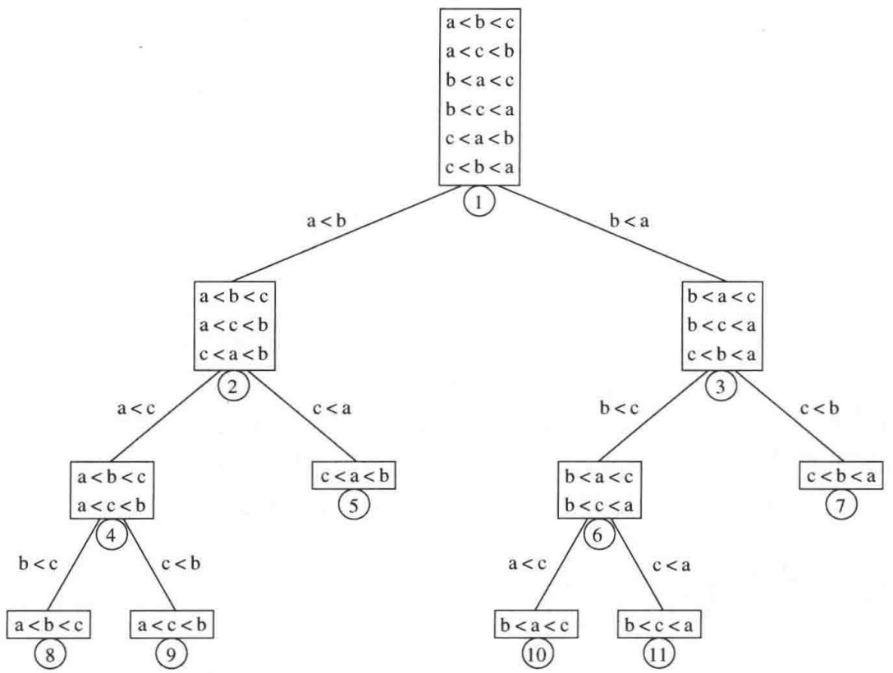

<details>
<summary>flowchart</summary>

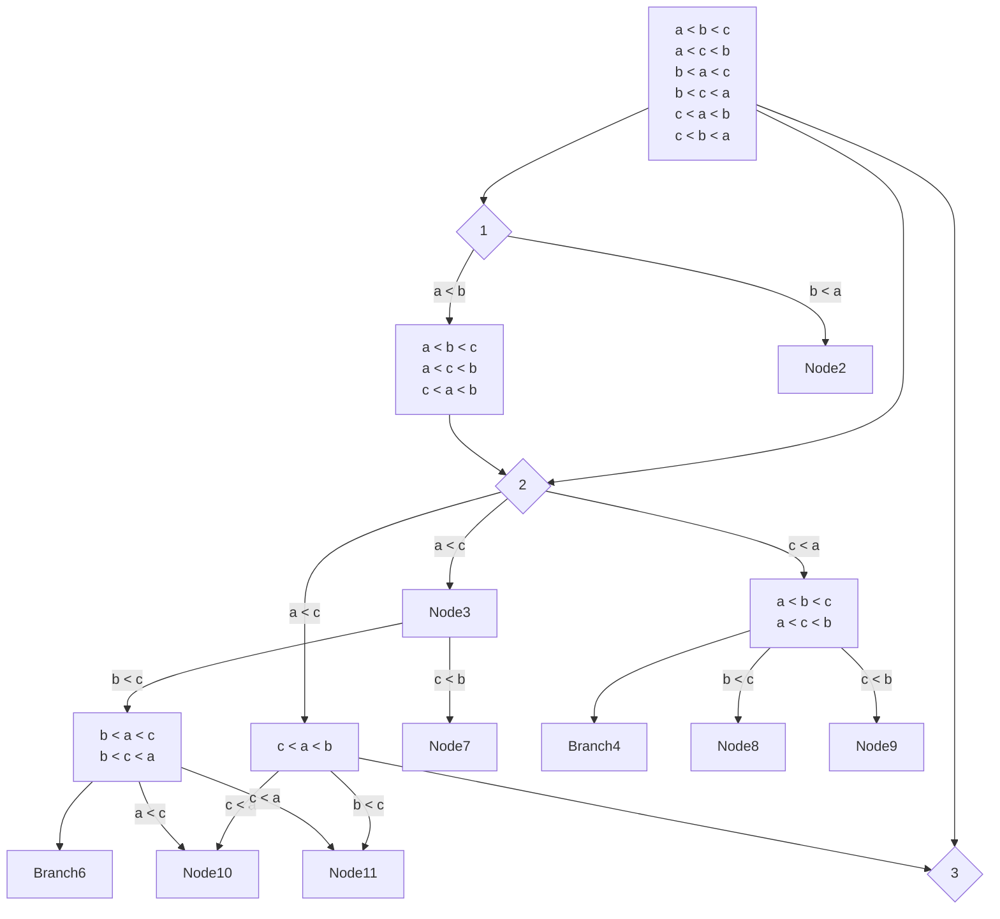
</details>

图7.20 三元素排序的决策树

## 引理7.1

令 $T$ 是深度为 $d$ 的二叉树，则 $T$ 最多有 $2^{d}$ 片树叶。

证明:

用数学归纳法证明。如果 $d = 0$ ，则最多存在一片树叶，因此基准情况为真。若 $d > 0$ ，则我们有一个根，它不可能是树叶，其左子树和右子树中每一个的深度最多是 $d - 1$ 。由归纳假设，每一棵子树最多有 $2^{d - 1}$ 片树叶，因此总数最多 $2^{d}$ 片树叶。这就证明了该引理。

## 引理7.2

具有 $L$ 片树叶的二叉树的深度至少是 $\lceil \log L \rceil$。

证明:

由前面的引理立即推出。

## 定理7.6

只使用元素间比较的任何排序算法在最坏情况下至少需要 $\lceil \log (N!) \rceil$ 次比较。

---

260

数据结构与算法分析——C++语言描述(第四版)

证明:

对 N 个元素排序的决策树必然有 N! 片树叶。从上面的引理即可推出该定理。

定理7.7

只使用元素间比较的任何排序算法均需要 $\Omega(N\log N)$ 次比较。

证明:

由前面的定理可知，需要 $\log (N!)$ 次比较。

$$
\begin{array}{l} \log (N!) = \log (N (N - 1) (N - 2) \dots (2) (1)) \\ = \log N + \log (N - 1) + \log (N - 2) + \dots + \log 2 + \log 1 \\ \geqslant \log N + \log (N - 1) + \log (N - 2) + \dots + \log (N / 2) \\ \geqslant \frac {N}{2} \log \frac {N}{2} \\ \geqslant \frac {N}{2} \log N - \frac {N}{2} \\ = \Omega (N \log N) \\ \end{array}
$$

这种类型的下界论断, 当用于证明最坏情形结果时, 有时叫作信息-理论下界 (information-theoretic lower bound)。一般定理说的是, 如果存在 $P$ 种不同的可能情况要区分, 而问题又都是 YES/NO 的形式, 那么通过任何算法求解该问题在某种情形下总需要 $\lceil \log P \rceil$ 个问题。对于任何基于比较的排序算法的平均情形运行时间, 证明类似的结果也是可能的。这个结果由下列引理导出, 我们将它留作练习: 具有 $L$ 片树叶的任意二叉树的平均深度至少为 $\log L$ 。

## 7.9 选择问题的决策树下界

7.8 节从决策树的观点证明了基本下界: 任何基于比较的排序算法必然使用大约 $M\log N$ 次比较。在这一节, 我们要证明 $N$ 元素集合选择问题的一些附加下界, 特别是

1. 找出最小项需要 $N - 1$ 次比较。
2. 找出两个最小项需要 $[N+\log N]-2$ 次比较。
3. 找出中位数(median)需要 $[3N/2]-O(\log N)$ 次比较。

除查找中位数外，所有这些问题的下界都是严紧的(tight):恰好使用特定比较次数的算法是存在的。在下面所有的证明中，我们假设所有的项都是唯一的。

引理 7.3

如果决策树中所有的树叶都在深度 d 或更高处，则决策树必然至少有  $2^{d}$  片树叶。

证明

注意到决策树上所有的非叶节点都有两个子节点，则该证明由归纳法和引理7.1立得。□

找出最小项的第1个下界最容易且证明也最简单。

定理7.8

任何查找最小元素的基于比较的算法必然至少使用 N-1 次比较。

---

第7章 排序

261

证明:

这是因为，除最小项外，每一个元素 $x$ 都必然要涉及到与某个别的元素 $y$ 进行的一次比较，且比较的结果是 $x$ 大于 $y$ 。否则，假如有两个不同的元素每一个都不大于任何其他元素的话，那么这两个元素就同时都是最小的。

引理7.4

查找 $N$ 个元素中最小元素的决策树必然至少有 $2^{N - 1}$ 片树叶。

证明:

由定理7.8可知，该决策树上的所有树叶都在深度 $N - 1$ 或更高处。此时该引理由引理7.3立得。

选择问题的界稍微有些复杂，需要用到决策树的结构。它将使我们得以证明前面列出的问题2和问题3的下界。

引理 7.5

查找 $N$ 个元素中第 $k$ 个最小元素的决策树必然至少含有 $\binom{N}{k-1}2^{N-k}$ 片树叶。

证明:

注意, 任何正确识别第 $k$ 个最小元素 $t$ 的算法必然能够证明所有其他元素 $x$ 或者大于 $t$, 或者小于 $t$ 。否则, 无论 $x$ 大于 $t$ 还是小于 $t$, 都将给出相同的答案, 而答案在这两种情况下不可能是相同的。因此, 树上的每片树叶除确定第 $k$ 个最小元外, 还确定已经被识别出的 $k - 1$ 个最小项。

令 $T$ 为这棵决策树。考虑两个集合: $S = \{x_{1}, x_{2}, \cdots, x_{k-1}\}$, 代表 $k-1$ 个最小项, 而 $R$ 为所有其余的项的集合, 其中也包括第 $k$ 个最小项。通过排除 $T$ 中 $S$ 的元素和 $R$ 的元素之间的比较, 我们得到一棵新的树 $T'$ 。由于 $S$ 中的任一元素都小于 $R$ 中的元素, 因此, 树节点与其右子树的比较可以从决策树 $T$ 中剪除而不会损失任何信息。图7.21显示出这些节点被修剪的过程。

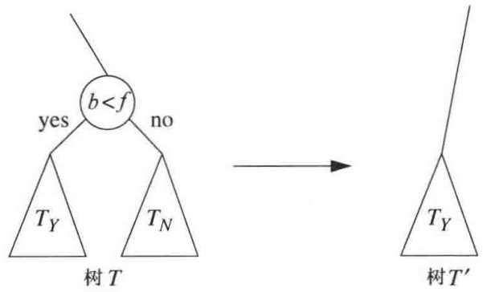

<details>
<summary>flowchart</summary>

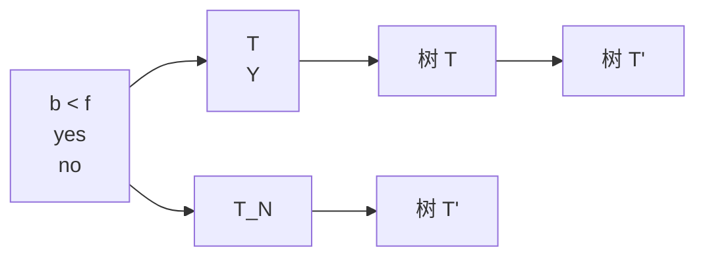
</details>

图 7.21 最小的 3 个元素是  $S=\{a,b,c\}$ ; 最大的 4 个元素是  $R=\{d,e,f,g\}$ ; 对 R 和 S 的这种选择, b 和 f 间的比较在形成树  $T'$  时可以被淘汰

$R$ 提供给 $T'$ 的任一种排列都沿着节点的相同路径, 并且通向与对应的序列相一致的树叶; 这个对应的序列由 $S$ 的一个排列后跟 $R$ 的相应的排列组成。既然 $T$ 确定了第 $k$ 个最小元, 而 $R$ 中的最小元正是这个元素, 这就推出 $T'$ 确定了 $R$ 中的这个最小元。因此, $T'$ 必然至少有 $2^{|R|-1}=$

---

262

数据结构与算法分析——C++语言描述(第四版)

$2^{N - k}$ 片树叶。 $T^{\prime}$ 中的这些树叶直接对应代表 $S$ 的那 $2^{N - k}$ 片树叶。由于 $S$ 有 $\binom{N}{k - 1}$ 个选择，因此 $T$ 中必然至少存在 $\binom{N}{k - 1}2^{N - k}$ 片树叶。

引理 7.5 的直接应用使我们能够证明查找第 2 个最小元和中位数的下界。

定理7.9

任何查找第 $k$ 个最小元的基于比较的算法都必然至少要用到 $N - k + \left\lceil \log \binom{N}{k - 1} \right\rceil$ 次比较。

证明:

由引理 7.5 和引理 7.2 立得。

定理 7.10

任何查找第2个最小元的基于比较的算法都必然至少要用到 $N + \lceil \log N \rceil - 2$ 次比较。

证明:

应用定理 7.9，令 k=2，则有  $N-2+\lceil\log N\rceil$ 。

定理 7.11

任何查找中位数的基于比较的算法都必然至少要用到 $\left[3N/2\right]-O(\log N)$ 次比较。

证明:

令  $k=\lceil N/2\rceil$ ，则由定理 7.9 即可推出。

选择问题的下界既不严紧，又不广为人知。要想了解细节，请查阅我们列出的参考文献。

## 7.10 对手下界(adversary lower bounds)

虽然决策树论证能够使我们证明排序和某些选择问题的下界，但是一般说来，所得到的这种界不那么严紧(tight)，有时候没太大价值。

例如，考虑查找最小项的问题。由于最小项有 $N$ 个可能的选择，因此通过决策树论证得到的信息理论下界只是 $\log N$ 。在定理7.8中，我们能够证明下界 $N - 1$ ，它本质上是通过对手论证(adversary argument)完成的。在这一节，我们进一步阐述这种论证方法，并利用它来证明下面的下界:

4. 同时找出最小项和最大项需要 $[3N/2]-2$ 次比较。

回忆我们的证明:任何查找最小项的算法都至少需要 N-1 次比较。

每一个元素 $x$，除最小元素外，均涉及到与某个其他元素 $y$ 的一次比较，且比较的结果是 $x$ 大于 $y$。否则，如果存在两个不同的元素，它们都不大于任何其他的元素，那么它们两个就都是最小的。

这就是对手论证的基本想法，它有如下基本的几步:

1. 确立:某些基本的信息量必须通过解决一个问题的任一算法得到。

---

第7章 排序

263

2. 在算法的每一步，对手都将持有一个输入，这个输入与此前已经被该算法所提供的所有答案一致。

3. 论证，通过一些不充分的步骤，存在多个一致性的输入，它们将提供给算法一些不同的答案；因此，算法尚未做到足够的步数，因为如果算法此刻提供一个答案，那么对手就能够出示一个输入，对于这个输入，算法提供的答案是错的。

为了理解基本想法是如何工作的，我们将使用上述证明模式，重新证明查找最小元的下界。

## 定理 7.8(重述)

任何基于比较的查找最小元的算法都必然至少使用 N-1 次比较。

## 新的证明:

通过把每一项都标记为 $U$ (代表未知, 即 Unknown 的首字母) 开始。当得知一项大于另一项时, 我们把前者的标记改成 $E$ (代表淘汰, Eliminated 的首字母)。这个改变代表一个信息单位。初始时, 每个未知项的值都是 0 , 但是, 一直没有比较发生, 因此, 此时的排序与之前的答案都是一致的。

两项之间的比较或者在两个未知项之间进行，或者至少涉及已经从最小项淘汰的一项。图 7.22 指出，我们的对手将是如何根据提问构建一些输入值的。

<table><tr><td>x</td><td>y</td><td>答案</td><td>信息</td><td>新x</td><td>新y</td></tr><tr><td>U</td><td>U</td><td>x1没变化将y标记为E把y变成淘汰的项数#elim</td><td>1</td><td>没变化</td><td>将y标记为E把y变成淘汰的项数#elim</td></tr><tr><td colspan="2">所有其余项</td><td>一致</td><td>0</td><td>没变化</td><td>没变化</td></tr></table>

图 7.22 当算法运行时，对手为查找最小项构建输入

如果比较是在两个未知项之间进行, 那么, 当得知第 1 项更小时, 第 2 项则自动被淘汰, 这就提供出一个信息单位。然后指定给第 2 项一个大于 0 的数 (不能撤销)。最方便的做法就是采用被淘汰项的项数。如果比较是在一个被淘汰数和一个未知项之间进行, 那么, 被淘汰的数 (由前面的论述, 它是大于 0 的) 将被认为更大, 因此不存在任何变化发生, 没有淘汰,也没有新信息得到。如果两个被淘汰数进行比较, 此时, 它们将是不同的数, 提供的答案是一致的, 此时仍没有变化发生, 也没有信息可提供。

最终，我们需要得到 $N - 1$ 个信息单位，而每次比较最多只能提供一个信息单位，因此，至少需要 $N - 1$ 次比较。

## 查找最小项和最大项的下界

我们可以使用同样的技巧，来建立同时查找最小项和最大项的一个下界。注意，除一项之外，所有的项都必然是从最小项淘汰出来的，而且除一项之外，所有的项都必然是从最大项淘汰出来的，于是，任何算法必须获得的全部信息均为 $2N - 2$ 。可是，一次比较 $x < y$ ，既从最大项淘汰 $x$ ，又从最小项淘汰 $y$ 。这样，一次比较可以提供出2个信息单位。因此，该论证只产生平凡的下界 $N - 1$ 。我们的对手需要做更多的工作，以保证不交出多于它需要给出的2个单位的信息。

为达到这个目的，每一项初始时都将是未被标记的。如果一项“赢得”一次比较(即宣布

---

264

数据结构与算法分析——C++语言描述(第四版)

该项大于某项)，那么它就得到一个 $W$ 。如果“输掉”一次比较(即宣布该项小于某项)，那么它就得到一个 $L$ 。最后，除去两项外，所有的项都将是 $WL$ 。我们的对手将保证，如果正在比较两个未被标记的项，那么它只能交出两个单位的信息。这只可能发生 $[N / 2]$ 次。此时，其余的信息只能一次一个单位地得到，这就建立了我们所要的下界。

## 定理7.12

任何同时查找最小项和最大项的基于比较的算法，必然至少使用 $[3N / 2] - 2$ 次比较。

## 证明:

基本思路是，如果两项均未被标记，那么对手必须交出两个信息。否则，两项中的一项或者有一个 $W$ ，或者有一个 $L$ （或许两个都有）。在这种情况下，只要适当仔细，对手就能够避免交出两个单位的信息。例如，如果一项 $x$ 有一个 $W$ ，而另一项 $y$ 尚未被标记，那么对手通过宣称 $x > y$ 就能让 $x$ 再次获胜。这给出关于 $y$ 的一个单位的信息，但没有关于 $x$ 的新信息。容易看到，如果最多有一个尚未标记的项涉及到比较，那么原则上就不存在对手必须交出多于一个信息单位的理由。

剩下的就是要证明，对手能够保留那些与它的答案一致的值。如果两项均未被标记，那么显然它们可以安全地获得与比较答案一致的值。这种情况产生两个单位的信息。

否则，如果涉及到一次比较的两项中的一项尚未被标记，那么它就可以首次被赋予一个值，与此次比较中的另一项一致。这种情况产生1个单位的信息。

否则，涉及到比较的两项均被标记。如果两个都是 WL，那么可以使用与当前的赋值一致的应答，此时不产生任何信息。 $^{①}$

否则，至少其中的一项只有一个 $L$ 或只有一个 $W$ 。我们将让这一项进行冗余比较（如果它是 $L$ ，那么它就再次输掉；如果它是 $W$ ，那么它就再次赢得），基于比较中的另一项，如果需要，它的值可以很容易地调整（$L$ 可以如所需要调低，$W$ 可以如所需要调高）。这对于比较中的另一项最多产生一个单位的信息，很可能是零。图7.23总结了对手的行为，其中让 $y$ 是主要元素，它的值在所有情形下都有变化。

<table><tr><td>x</td><td>y</td><td>答案</td><td>信息</td><td>新x</td><td>新y</td></tr><tr><td>-</td><td>-</td><td>x2L0W1</td><td>2</td><td>L0</td><td>W1</td></tr><tr><td>L</td><td>-</td><td>x1L不变WX+1</td><td>1</td><td>L不变</td><td>WX+1</td></tr><tr><td>W或WL</td><td>-</td><td>x1W或WL不变Lx-1</td><td>1</td><td>W或WL不变</td><td>Lx-1</td></tr><tr><td>W或WL</td><td>W</td><td>x1或0WL不变Wmax(x+1,y)</td><td>1或0</td><td>WL不变</td><td>Wmax(x+1,y)</td></tr><tr><td>L或W或WL</td><td>L</td><td>x1或0或0WL或W或WL不变Lmax(x-1,y)</td><td>1或0或0</td><td>WL或W或WL不变</td><td>Lmax(x-1,y)</td></tr><tr><td>WL</td><td>WL</td><td>相容</td><td>0</td><td>不变</td><td>不变</td></tr><tr><td>--LLW</td><td>WWL</td><td colspan="4">与上面一种情形对称</td></tr></table>

图 7.23 当算法运行时，为找出最大项和最小项对手构建的输入

<small><span class="docvortex-page-footnote" data-block-type="page_footnote" style="color:#6b7280">① 有可能两项的当前赋值是相同的数。在这样的情况下，可以使其当前值比 $y$ 大的所有项都加上2，然后给 $y$ 加1以打破平衡。</span></small>

---

第7章 排序

265

产生两个信息单位的最多用到 $\lfloor N / 2\rfloor$ 次比较，这就意味着，其余的信息即 $2N - 2 - 2\lfloor N / 2\rfloor$ 个单位的信息，必然每个单位都是通过比较一次得到一个的方式获得的。因此，所需要的总的比较次数至少是 $2N - 2 - \lfloor N / 2\rfloor = \lceil 3N / 2\rceil -2$ 。

容易看出，这个界是可以达到的。将元素都结成对，并在每对间进行一次比较，然后查找赢得者中间的最大者以及输掉者中间的最小者。

## 7.11 线性时间排序:桶式排序和基数排序

虽然在7.8节证明了只使用比较的任意一般排序算法在最坏情形下都需要 $\Omega (N\log N)$ 时间，但是记住，在某些特殊情形下，以线性时间进行排序仍然是可能的。

一个简单的例子就是桶式排序 (bucket sort)。要使桶式排序能够正常运行，必须要有一些附加的信息。输入 $A_{1}, A_{2}, \cdots, A_{N}$ 必须只由小于 $M$ 的正整数构成（显然对其进行扩展是可能的）。如果是这种情况，那么算法很简单:使用一个大小为 $M$ 的叫作 count 的数组，它被初始化为全 0。于是，count 有 $M$ 个单元或称桶 (bucket)，初始时这些桶均为空。当读入 $A_{i}$ 时，count $[A_{i}]$ 增 1。在所有的输入数据读入后，扫描数组 count，打印出排序后的数据。该算法用时 $O(M + N)$，其证明留作练习。如果 $M$ 为 $O(N)$，那么总量就是 $O(N)$。

虽然这个算法似乎违反了下界，但事实上并没有，因为它使用了比简单比较更为强大的操作。通过使适当的桶增值，算法在单位时间内实质上执行了一个 $M$ 路比较(M-way comparison)。这类似于用在可扩散列上的策略(见节5.9)。显然这不属于那种下界业已证明的模型。

不过，该算法确实提出了用于证明下界的模型的合理性问题。这个模型实际上是一个强模型，因为通用的排序算法不能对于它可以期望见到的输入类型做假设，而是必须仅仅基于排序信息做一些决策。很自然，如果存在额外的可用信息，我们应该有望找到更为有效的算法，否则这额外的信息就被浪费了。

尽管桶式排序看似太一般而用处不大，但是实际上却存在许多其输入只是一些小的整数的情况，使用像快速排序这样的排序方法真的是小题大作了。基数排序(radix sort)就是这样一个例子。

基数排序有时候也称为卡片排序(card sort)，因为在现代计算机出现之前它一直用于分类老式穿孔卡片。假设有10个在 $0\sim 999$ 范围内的数，我们想要对它们排序。一般来说，这是在 $0\sim b^{p} - 1$ 范围内的 $N$ 个数，其中 $p$ 是某个常数。显然，我们不能使用桶式排序，因为那样桶就太多了。诀窍在于使用几趟桶式排序。自然的算法是通过最高有效位(基底为 $b$ )进行的桶式排序，然后再对下一个最高位进行，等等。不过，更简单的做法是以反序进行桶式排序，首先从最低有效位开始。当然，可能不止一个数会落入同一个桶中，而且不像原始的桶式排序，这些数可能是不同的，因此我们把它们放到一个表中。每一趟都是稳定的:与当前数字一致的那些项保持着前面各趟中确定的排序。图7.24中的跟踪图(trace)显示将64,8,216,512,27,729,0,1,343,125排序的结果，这是随机排列的前10个立方数(我们用0补位使得十位数字和百位数字更清楚)。在第一趟排序之后，各项按最低有效位被排序，一般来说，在第 $k$ 趟排序后，各项按第 $k$ 最低有效位被排序。于是最后各项被彻底排完序。事实上，该算法是正确有效的。为了看清楚这一点，我们注意，只有两个数以错误的顺序出自同一个桶的情况下

---

266

数据结构与算法分析——C++语言描述(第四版)

才有可能发生失败。但是，前一趟排序保证，当多个数进入一个桶的时候，它们是按照第 $k - 1$ 位有效数字排序的顺序进行的。算法的运行时间为 $O(p(N + b))$ ，其中，$p$ 是排序进行的趟数，$N$ 是被排序的元素的个数，而 $b$ 则为桶的个数。

```txt
初始的项: 064,008,216,512,027,729,000,001,343,125  
个位数字的排序: 000,001,512,343,064,125,216,027,008,729  
十位数字的排序: 000,001,008,512,216,125,027,729,343,064  
百位数字的排序: 000,001,008,027,064,125,216,343,512,729
```

图 7.24 基数排序的跟踪图

基数排序的一个应用是字符串的排序。如果所有的字符串长度相同，均为 $L$ ，那么通过对每个字符使用桶式排序，我们可以以 $O(NL)$ 时间实现基数排序。进行这种排序最直接的方式如图7.25所示。在我们的程序中，假设所有的字符均为ASCII码，位于Unicode字符集的前256个位置。在每一趟排序中，我们添加一项到相应的桶中，当所有的桶被填入相应的字符串之后，我们走遍各桶，将桶中内容全部倒回到数组中。注意，当一个桶被填入相应的项并在下一趟被清空时，当前趟的序是被保留的。

```cpp
/*
 * 对 String 类对象的数组 (array of Strings) 进行的基数排序
 * 假设全部为ASCII码
 * 并设所有字符串都有相同的长度
 */
void radixSortA( vector<string> & arr, int stringLen )
{
    const int BUCKETS = 256;
    vector<vector<string>> buckets( BUCKETS );

    for( int pos = stringLen - 1; pos >= 0; --pos )
    {
        for( string & s : arr )
            buckets[ s[ pos ] ].push_back( std::move( s ) );

        int idx = 0;
        for( auto & thisBucket : buckets )
        {
            for( string & s : thisBucket )
                arr[ idx++ ] = std::move( s );

            thisBucket.clear( );
        }
    }
}
```

图 7.25 字符串基数排序的简单实现，用到桶的 ArrayList 数组

计数基数排序(counting radix sort)是基数排序的另一种实现, 它避免使用一些 vector 对象来表示桶, 而是保留进入每一个桶有多少项的计数。可以把这些信息放到一个数组 count 中, 使得 count[k] 就是位于第 k 个桶内的项数。然后, 再使用另一个数组 offset, 使得 offset[k] 代表其值严格小于 k 的项数。此时, 当在最后扫描中第一次遇到值 k 时,

---

第7章 排序

267

offset[k]告诉我们一个可以将其写入(不过只能使用一个临时数组进行写入)的合法的数组位置，并在写完以后 offset[k] 可增 1。这样，计数基数排序就避免了保留表的需求。我们进一步的优化是，通过重用 count 数组以避免使用数组 offset。这次修改是这样:初始时我们让 count[k+1] 表示位于第 k 个桶内的项的项数。在这个信息被计算之后，从最小下标到最大下标扫描 count 数组，并将 count[k] 增加 count[k-1]。容易验证，在这次扫描之后，计数数组恰好存储与原本存储在 offset 中相同的信息。

图 7.26 显示了计数基数排序的实现。第 18～27 行实现上述思路，假设这些项存储在数组 in 中，而单趟的结果被放在数组 out 中。初始时，in 代表 arr 而 out 代表临时数组 buffer。在每趟排序之后，我们交换 in 和 out 的角色。如果有偶数趟，那么，最后的 out 引用的是 arr，因此排序完成。否则，我们必须从 buffer 移回到 arr。

```cpp
/*
 * 对String类对象的数组 ( array of Strings) 进行的计数基数排序
 * 假设全部为ASCII码
 * 并设所有字符串都有相同的长度
 */
void countingRadixSort( vectro<string> & arr, int stringLen )
{
    const int BUCKETS = 256;

    int N = arr.size( );
    vector<string> buffer( N );

    vector<string> *in = &arr;
    vector<string> *out = &buffer;

    for( int pos = stringLen - 1; pos >= 0; --pos )
    {
        vector<int> count( BUCKETS + 1 );

        for( int i = 0; i < N; ++i )
            ++count[ (*in)[ i ] [ pos ] + 1 ];


        for( int b = 1; b <= BUCKETS; ++b )
            count[ b ] += count[ b - 1 ];


        for( int i = 0; i < N; ++i )
            (*out)[ count[ (*in)[ i ] [ pos ] ]++ ] = std::move( (*in)[ i ] );

        // 交换in和out的角色
        std::swap( in, out );
    }

    // 如果是奇数趟，in为buffer，而out则是arr；从而用move再将*in传给*out
    if( stringLen % 2 == 1 )
        for( int i = 0; i < arr.size( ); ++i )
            (*out)[ i ] = std::move( (*in)[ i ] );
}
```

图 7.26 固定长度字符串的计数基数排序

---

268

数据结构与算法分析——C++语言描述(第四版)

一般来说，计数基数排序比使用 vector 存储桶更为可取，但是，它受制于杂乱的定位(out 是被非顺序地装填的)，因此很奇怪，它并不总是比使用由 vector 对象组成的 vector 更快。

两种版本的基数排序均可被扩充到对变长字符串来进行。基本的算法是，首先按照长度将字符串排序，然后只看那些我们知道足够长的字符串，而根本不去查看所有的字符串。由于字符串长度是些小的整数，因此初始按照长度排序可以由桶式排序进行。图 7.27 显示了基数排序的这种实现，其中使用 vector 来存储这些桶。这里，在第 13 行和第 14 行上单词按照长度分组被置入桶中，然后，在第 16～19 行又被放回到数组。第 26 和 27 行通过利用在第 21 和 24 行上得到的变量 startingIndex，只查看那些有一个字符在位置 pos 上的字符串。除此之外，图 7.27 中的第 21～37 行与图 7.25 中的第 11～24 行相同。

```cpp
/*
 * 将String类对象的数组(array of Strings)进行基数排序
 * 设所有字符均为ASCII码
 * 设所有字符串的长度均以maxLen为界
 */
void radixSort( vector<string> & arr, int maxLen )
{
    const int BUCKETS = 256;

    vector<vector<string>> wordsByLength( maxLen + 1 );
    vector<vector<string>> buckets( BUCKETS );

    for( string & s : arr )
        wordsByLength[ s.length( ) ].push_back( std::move( s ) );

    int idx = 0;
    for( auto & wordList : wordsByLength )
        for( string & s : wordList )
            arr[ idx++ ] = std::move( s );

    int startingIndex = arr.size( );
    for( int pos = maxLen - 1; pos >= 0; --pos )
    {
        startingIndex -= wordsByLength[ pos + 1 ].size( );

        for( int i = startingIndex; i < arr.size( ); ++i )
            buckets[ arr[ i ][ pos ] ].push_back( std::move( arr[ i ] ) );

        idx = startingIndex;
        for( auto & thisBucket : buckets )
        {
            for( string & s : thisBucket )
                arr[ idx++ ] = std::move( s );

            thisBucket.clear( );
        }
    }
}
```

图 7.27 可变长字符串的基数排序

---

第7章 排序

269

该版基数排序的运行时间对于所有字符串中的总字符数而言是线性的(每个字符恰好在第27行出现一次，而第33行的语句正好执行与第27行相同的次数)。当字符串中的字符取自适当的小的字母表并且当字符串不是相对较短就是非常相似的时候，字符串的基数排序将运行得特别好。因为基于比较的 $O(M\log N)$ 排序算法一般在每次字符串比较中将只看少数的字符，所以，一旦平均字符串长度开始变大，则基数排序的优点会急剧缩减甚至完全消失。

## 7.12 外部排序

迄今为止，我们考查过的所有算法都需要将输入数据装入内存。然而，存在一些应用程序，它们的输入数据量太大装不进内存。本节将讨论一些外部排序算法 (external sorting algorithm)，它们是被设计用来处理数据量很大的输入的。

## 7.12.1 为什么需要一些新的算法

大部分内部排序算法都用到内存可直接寻址的事实。希尔排序用一个时间单位比较元素 $a[i]$ 和 $a[i - h_k]$ 。堆排序用一个时间单位比较元素 $a[i]$ 和 $a[i*2 + 1]$ 。使用三数中值分割法的快速排序以常数个时间单位比较 $a[\text{left}]$ 、 $a[\text{center}]$ 和 $a[\text{right}]$ 。如果输入数据在磁带上，那么所有这些操作就失去了它们的效率，因为磁带上的元素只能被顺序访问。即使数据在磁盘上，由于转动磁盘和移动磁头所需的延迟，仍然存在实际上的效率损失。

为了看到外部访问究竟有多慢，可建立一个大的随机文件，但不要太大以至装不进内存。将该文件读入并用一种有效的算法对其排序。将该输入数据进行排序所花费的时间与将其读入内存所花费的时间相比必然是无足轻重的，尽管排序是 $O(N\log N)$ 操作而读入数据只不过花费 $O(N)$ 时间。

## 7.12.2 外部排序模型

各种各样的海量存储装置使得外部排序比内部排序对设备的依赖性要严重得多。我们将考虑的一些算法在磁带上工作，而磁带可能是最受限制的存储媒体。由于访问磁带上一个元素需要把磁带转动到正确的位置，因此磁带只有以(两个方向上)连续的顺序才能够被有效地访问。

假设至少有3个磁带驱动器进行排序工作，我们需要两个驱动器执行有效的排序，而第三个驱动器进行简化的工作。如果只有一个磁带驱动器可用，那么我们不得不说:任何算法都将需要 $\Omega (N^2)$ 次磁带访问。

## 7.12.3 简单算法

基本的外部排序算法使用归并排序中的合并算法。设我们有4盘磁带， $T_{a1}, T_{a2}, T_{b1}, T_{b2}$ ，它们是两盘输入磁带和两盘输出磁带。根据算法的特点，磁带a和磁带b或者用作输入磁带，或者用作输出磁带。设数据最初在 $T_{a1}$ 上，并设内存可以一次容纳(和排序)M个记录。一种自然的第一步做法是从输入磁带一次读入M个记录，在内部将这些记录排序，然后再把这些排过序的记录交替地写到 $T_{b1}$ 或 $T_{b2}$ 上。我们将把每组排过序的记录叫作一个顺串(run)。做完这些之后，倒回所有的磁带。设我们的输入与希尔排序的例子中的输入数据相同。

---

270

数据结构与算法分析——C++语言描述(第四版)

| $T_{a1}$ | 81 | 94 | 11 | 96 | 12 | 35 | 17 | 99 | 28 | 58 | 41 | 75 | 15 |
| --- | --- | --- | --- | --- | --- | --- | --- | --- | --- | --- | --- | --- | --- |
| $T_{a2}$ |  |  |  |  |  |  |  |  |  |  |  |  |  |
| $T_{b1}$ |  |  |  |  |  |  |  |  |  |  |  |  |  |
| $T_{b2}$ |  |  |  |  |  |  |  |  |  |  |  |  |  |

如果 $M = 3$ ，那么在这些顺串构造以后，磁带将包含下图所指出的数据。

<table><tr><td> $T_{a1}$ </td><td colspan="3"></td><td colspan="3"></td><td></td></tr><tr><td> $T_{a2}$ </td><td colspan="3"></td><td colspan="3"></td><td></td></tr><tr><td> $T_{b1}$ </td><td>11</td><td>81</td><td>94</td><td>17</td><td>28</td><td>99</td><td>15</td></tr><tr><td> $T_{b2}$ </td><td>12</td><td>35</td><td>96</td><td>41</td><td>58</td><td>75</td><td></td></tr></table>

现在 $T_{b1}$ 和 $T_{b2}$ 包含一组顺串。我们将每个磁带的第一个顺串取出并将二者合并，把结果写到 $T_{a1}$ 上，该结果是一个2倍长的顺串。注意，合并两个排过序的表是简单的操作，我们几乎不需要内存，因为合并是在 $T_{b1}$ 和 $T_{b2}$ 前进时进行的。然后，再从每盘磁带取出下一个顺串，合并，并将结果写到 $T_{a2}$ 上。继续这个过程，交替使用 $T_{a1}$ 和 $T_{a2}$，直到 $T_{b1}$ 或 $T_{b2}$ 为空。此时，或者 $T_{b1}$ 和 $T_{b2}$ 均为空，或者剩下一个顺串。对于后者，我们把剩下的顺串复制到适当的磁带上。将全部4盘磁带倒回，并重复相同的步骤，这一次用两盘 $a$ 磁带作为输入，两盘 $b$ 磁带作为输出，结果得到一些 $4M$ 的顺串。我们继续这个过程直到得到长为 $N$ 的一个顺串。

该算法将需要 $\left\lceil\log(N/M)\right\rceil$ 趟进行合并，外加一趟初始的顺串构造。例如，若我们有1000万个记录，每个记录128字节，并有4兆字节的内存，则第一趟将建立320个顺串。然后我们还需要9趟以完成排序。我们的例子再需要 $\left\lceil\log13/3\right\rceil=3$ 趟，如下列各图所示:

| $T_{a1}$ | 11 | 12 | 35 | 81 | 94 | 96 | 15 |  |  |  |  |  |
| --- | --- | --- | --- | --- | --- | --- | --- | --- | --- | --- | --- | --- |
| $T_{a2}$ | 17 | 28 | 41 | 58 | 75 | 99 |  |  |  |  |  |  |
| $T_{b1}$ |  |  |  |  |  |  |  |  |  |  |  |  |
| $T_{b2}$ |  |  |  |  |  |  |  |  |  |  |  |  |
| $T_{a1}$ |  |  |  |  |  |  |  |  |  |  |  |  |
| $T_{a2}$ |  |  |  |  |  |  |  |  |  |  |  |  |
| $T_{b1}$ | 11 | 12 | 17 | 28 | 35 | 41 | 58 | 75 | 81 | 94 | 96 | 99 |
| $T_{b2}$ | 15 |  |  |  |  |  |  |  |  |  |  |  |
| $T_{a1}$ | 11 | 12 | 15 | 17 | 28 | 35 | 41 | 58 | 75 | 81 | 94 | 96 |
| $T_{a2}$ |  |  |  |  |  |  |  |  |  |  |  |  |
| $T_{b1}$ |  |  |  |  |  |  |  |  |  |  |  |  |
| $T_{b2}$ |  |  |  |  |  |  |  |  |  |  |  |  |

## 7.12.4 多路合并

如果我们有额外的磁带，则可以减少将输入数据排序所需要的趟数，通过将基本的(2路)合并扩充为 $k$ 路合并 $(k$-way merge) 就能做到这一点。

两个顺串的合并操作通过将每一个输入磁带转到每个顺串的开头来进行。此时，找到较小的元素，把它放到输出磁带上，并将相应的输入磁带向前推进。如果有 $k$ 盘输入磁带，那么这种策略以相同的方式工作，唯一的区别在于，发现 $k$ 个元素中最小的元素稍微复杂一些。我们可以通过使用一个优先队列找出这些元素中的最小元。为了得出下一个写到输出磁带上的元素，我们执行一次 deleteMin 操作。将相应的输入磁带向前推进，如果在输入磁带上

---

第7章 排序

271

的顺串尚未完成，则将新元素 insert 到优先队列中。仍然利用前面的例子，我们将输入数据分配到 3 盘磁带上。

<table><tr><td> $T_{a1}$ </td><td colspan="3"></td><td colspan="3"></td></tr><tr><td> $T_{a2}$ </td><td colspan="3"></td><td colspan="3"></td></tr><tr><td> $T_{a3}$ </td><td colspan="3"></td><td colspan="3"></td></tr><tr><td> $T_{b1}$ </td><td>11</td><td>81</td><td>94</td><td>41</td><td>58</td><td>75</td></tr><tr><td> $T_{b2}$ </td><td>12</td><td>35</td><td>96</td><td>15</td><td></td><td></td></tr><tr><td> $T_{b3}$ </td><td>17</td><td>28</td><td>99</td><td></td><td></td><td></td></tr></table>

此时，我们还需要两趟3路合并(three-way merging)以完成该排序。

| $T_{a1}$ | 11 | 12 | 17 | 28 | 35 | 81 | 94 | 96 | 99 |  |  |  |
| --- | --- | --- | --- | --- | --- | --- | --- | --- | --- | --- | --- | --- |
| $T_{a2}$ | 15 | 41 | 58 | 75 |  |  |  |  |  |  |  |  |
| $T_{a3}$ |  |  |  |  |  |  |  |  |  |  |  |  |
| $T_{b1}$ |  |  |  |  |  |  |  |  |  |  |  |  |
| $T_{b2}$ |  |  |  |  |  |  |  |  |  |  |  |  |
| $T_{b3}$ |  |  |  |  |  |  |  |  |  |  |  |  |
| $T_{a1}$ |  |  |  |  |  |  |  |  |  |  |  |  |
| $T_{a2}$ |  |  |  |  |  |  |  |  |  |  |  |  |
| $T_{a3}$ |  |  |  |  |  |  |  |  |  |  |  |  |
| $T_{b1}$ | 11 | 12 | 15 | 17 | 28 | 35 | 41 | 58 | 75 | 81 | 94 | 96 |
| $T_{b2}$ |  |  |  |  |  |  |  |  |  |  |  |  |
| $T_{b3}$ |  |  |  |  |  |  |  |  |  |  |  |  |

在初始顺串构造阶段之后，使用 $k$ 路合并所需要的趟数为 $\lceil \log_k(N / M) \rceil$，因为在每趟合并中顺串达到 $k$ 倍大小。对于上面的例子，公式成立，因为 $\lceil \log_3 13/3 \rceil = 2$。如果有 10 盘磁带，那么 $k = 5$，而前一节的大例子需要的趟数将是 $\lceil \log_5 320 \rceil = 4$。

## 7.12.5 多相合并

上一节讨论的 $k$ 路合并方案需要使用 $2k$ 盘磁带，这对某些应用极为不便。通过只使用 $k + 1$ 盘磁带也有可能完成排序的工作。作为例子，我们阐述只用3盘磁带如何完成2路合并。

设有 3 盘磁带  $T_{1}$ 、 $T_{2}$  和  $T_{3}$ ，在  $T_{1}$  上有一个输入文件，它将产生 34 个顺串。一种做法是在  $T_{2}$  和  $T_{3}$  的每一盘磁带中放入 17 个顺串。然后可以将结果合并到  $T_{1}$  上，得到一盘有 17 个顺串的磁带。由于所有的顺串都在一盘磁带上，因此现在必须把其中的一些顺串放到  $T_{2}$  上以进行另一次合并。执行该合并的逻辑方式是将前 8 个顺串从  $T_{1}$  复制到  $T_{2}$  然后进行合并。这样的效果是对于我们所做的每一趟合并又附加了另外的半趟工作。

另一种做法是把原始的34个顺串不均衡地分成两份。设我们把21个顺串放到 $T_{2}$ 上而把13个顺串放到 $T_{3}$ 上。然后，将13个顺串合并到 $T_{1}$ 上之后磁带 $T_{3}$ 就变成了空磁带。此时，可以倒回磁带 $T_{1}$ 和 $T_{3}$，然后将具有13个顺串的 $T_{1}$ 和8个顺串的 $T_{2}$ 合并到 $T_{3}$ 上。此时，我们合并8个顺串直到 $T_{2}$ 用完为止，这样，在 $T_{1}$ 上将留下5个顺串而在 $T_{3}$ 上则有8个顺串。然后，再合并 $T_{1}$ 和 $T_{3}$，等等。下面的图表显示在每趟合并之后每盘磁带上的顺串的个数:

|  | 初始顺串个数 | $T_3 + T_2$之后 | $T_1 + T_2$之后 | $T_1 + T_3$之后 | $T_2 + T_3$之后 | $T_1 + T_2$之后 | $T_1 + T_3$之后 | $T_2 + T_3$之后 |
| --- | --- | --- | --- | --- | --- | --- | --- | --- |
| $T_1$ | 0 | 13 | 5 | 0 | 3 | 1 | 0 | 1 |
| $T_2$ | 21 | 8 | 0 | 5 | 2 | 0 | 1 | 0 |
| $T_3$ | 13 | 0 | 8 | 3 | 0 | 2 | 1 | 0 |

---

272

数据结构与算法分析——C++语言描述(第四版)

顺串最初的分配有很大的关系。例如，若22个顺串放在 $T_{2}$ 上，12个在 $T_{1}$ 上，则第一趟合并后得到 $T_{3}$ 上12个顺串以及 $T_{2}$ 上的10个顺串。在下一次合并后，$T_{1}$ 上有10个顺串而 $T_{3}$ 上有2个顺串。此时，进展的速度慢了下来，因为在 $T_{3}$ 用完之前我们只能合并两组顺串。这时 $T_{1}$ 有8个顺串而 $T_{2}$ 有两个顺串。同样，我们只能合并两组顺串，结果 $T_{1}$ 有6个顺串且 $T_{3}$ 有2个顺串。再经过3趟合并之后，$T_{2}$ 还有2个顺串而其余磁带均已没有任何内容。我们必须将一个顺串复制到另外一盘磁带上，然后结束合并。

事实上，我们给出的第一次分配是最优的。如果顺串的个数是一个斐波那契数(Fibonacci number) $F_{N}$，那么分配这些顺串最好的方式是把它们分裂成两个斐波那契数 $F_{N-1}$ 和 $F_{N-2}$。否则，为了将顺串的个数补足成一个斐波那契数就必须用一些哑顺串(dummy runs)来填补磁带。这里把如何将一组初始顺串分放到磁带上的具体做法留作练习。

可以把上面的做法扩充到 k 路合并，此时需要 k 阶斐波那契数用来分配顺串，其中 k 阶斐波那契数 (kth order Fibonacci number) 定义为  $F^{(k)}(N)=F^{(k)}(N-1)+F^{(k)}(N-2)+\cdots+F^{(k)}(N-k)$ ，辅以适当的初始条件  $F^{(k)}(N)=0,0\leqslant N\leqslant k-2,F^{(k)}(k-1)=1$ 。

## 7.12.6 替换选择

最后我们将要考虑的是顺串的构造。迄今已经用到的策略是所谓的最简可能(the simplest possible): 读入尽可能多的记录并将它们排序, 再把结果写到某个磁带上。这看起来像是可能的最佳处理, 可是我们之后意识到, 只要第一个记录被写到输出磁带上, 它所使用的内存就可以被另外的记录使用。如果输入磁带上的下一个记录比我们刚刚输出的记录大, 那么它就可以被放入顺串中。

利用这种想法，我们可以给出产生顺串的一个算法，该方法通常称为替换选择(replacement selection)。开始时，$M$ 个记录被读入内存并被放到一个优先队列中。我们执行一次 deleteMin，把最小(值)的记录写到输出磁带上，再从输入磁带读入下一个记录。如果它比刚刚写出的记录大，那么可以把它添加到优先队列中，否则，它不能进入当前的顺串。由于优先队列少一个元素，因此，可以把这个新元素存入优先队列的死区(dead space)，直到顺串完成构建，而用这个元素作为下一个顺串的成员。将一个元素存入死区的做法类似于在堆排序中的做法。我们继续这样的步骤直到优先队列的大小为零，此时该顺串已经用完。我们使用死区中的所有元素通过建立一个新的优先队列开始构建一个新的顺串。图7.28解释了我们一直在使用的这个小例子的顺串构建过程，其中 $M = 3$ 。死元素以星号标示。

<table><tr><td rowspan="2"></td><td colspan="3">堆数组中的3个元素</td><td rowspan="2">输出</td><td rowspan="2">下一个读入的元素</td></tr><tr><td>h[1]</td><td>h[2]</td><td>h[3]</td></tr><tr><td rowspan="5">顺串1</td><td>11</td><td>94</td><td>81</td><td>11</td><td>96</td></tr><tr><td>81</td><td>94</td><td>96</td><td>81</td><td>12*</td></tr><tr><td>94</td><td>96</td><td>12*</td><td>94</td><td>35*</td></tr><tr><td>96</td><td>35*</td><td>12*</td><td>96</td><td>17*</td></tr><tr><td>17*</td><td>35*</td><td>12*</td><td>顺串终</td><td>重建堆</td></tr><tr><td rowspan="8">顺串2</td><td>12</td><td>35</td><td>17</td><td>12</td><td>99</td></tr><tr><td>17</td><td>35</td><td>99</td><td>17</td><td>28</td></tr><tr><td>28</td><td>99</td><td>35</td><td>28</td><td>58</td></tr><tr><td>35</td><td>99</td><td>58</td><td>35</td><td>41</td></tr><tr><td>41</td><td>99</td><td>58</td><td>41</td><td>15*</td></tr><tr><td>58</td><td>99</td><td>15*</td><td>58</td><td>磁带终</td></tr><tr><td>99</td><td></td><td>15*</td><td>99</td><td></td></tr><tr><td></td><td></td><td>15*</td><td>顺串终</td><td>重建堆</td></tr><tr><td>顺串3</td><td>15</td><td></td><td></td><td>15</td><td></td></tr></table>

图7.28 顺串构建的例子

---

第7章 排序

273

在这个例子中，替换选择只产生3个顺串，这与通过排序得到5个顺串不同。正因为如此，3路合并经过一趟而非两趟合并而结束。如果输入数据是随机分布的，那么可以证明替换选择产生平均长度为 $2M$ 的顺串。对于我们所举的大例子，预计为160个顺串而不是320个顺串，因此，5路合并需要进行4趟。在这种情况下，我们一趟也没有节省，虽然在幸运时是可以节省的，我们可能有125或更少的顺串。由于外部排序花费的时间太多，因此节省的每一趟都可能对运行时间产生显著的影响。

我们已经看到，有可能替换选择做得并不比标准算法更好。然而，输入数据常常从已排序或几乎被排序开始的，在这种情况下，替换选择仅仅产生少数非常长的顺串。这种类型的输入对外部排序来说是常见的，这就使得替换选择具有特别的价值。

## 小结

排序是计算技术中最古老和得到充分研究的问题之一。对于最一般的内部排序应用，插入排序、希尔排序、归并排序或快速排序是经常选用的方法。究竟使用哪个方法依赖于输入的大小和底层的环境。插入排序适用于非常少量的输入。对于适量输入的排序，希尔排序是上佳选择，对于适当的增量序列，它表现出极好的性能且只有几行的代码。归并排序具有 $O(N\log N)$ 最坏情形性能，但是需要额外的空间。然而，其所使用的比较次数几乎是最优的，因为任何只使用元素比较的排序算法必然至少要用到对输入序列的 $\lceil \log (N!) \rceil$ 次比较。快速排序本身并不提供这种最坏情形的性能保证，但算法的编码非常巧妙。然而，它具有几乎是必然的 $O(N\log N)$ 性能，并且能够与堆排序结合而给出 $O(N\log N)$ 的最坏情形性能保证。字符串可以通过使用基数排序而以线性时间完成排序，对在一些实例中基于比较的排序方案这可能是一种实用性的选择。

## 练习题

7.1 使用插入排序将序列 3, 1, 4, 1, 5, 9, 2, 6, 5 排序。
7.2 如果所有的元素都相等，那么插入排序的运行时间是多少？
7.3 设我们交换元素 a[i] 和 a[i+k]，它们最初是无序的。证明被去掉的逆序最少为 1 个最多为 2k-1 个。
7.4 写出使用增量 $\{1,3,7\}$ 对输入数据9,8,7,6,5,4,3,2,1运行希尔排序得到的结果。
7.5 a. 使用 2 增量序列  $\{1,2\}$  的希尔排序的运行时间是多少?
b. 证明，对任意的 N，存在一个 3 增量序列，使得希尔排序以  $O(N^{5/3})$  时间运行。
c. 证明，对任意的 N，存在一个 6 增量序列，使得希尔排序以  $O(N^{3/2})$  时间运行。

7.6 \*a. 证明，使用形如  $1, c, c^{2}, \cdots, c^{i}$  的增量，希尔排序的运行时间为  $\Omega(N^{2})$ ，其中，c 为任意整数。

\*\*b. 证明，对于这些增量，平均运行时间为 $\Theta(N^{3/2})$ 。

\*7.7 证明，若一个 $k$ 排序的文件然后被 $h$ 排序，则它仍保持是 $k$ 排序的。

\*\*7.8 证明，使用由Hibbard建议的增量序列的希尔排序在最坏情形下的运行时间是$\Omega (N^{3 / 2})$。（提示:可以证明当所有的元素不是0就是1时希尔排序这种特殊情形的

---

274

数据结构与算法分析——C++语言描述(第四版)

时间界。)如果 i 可以表为  $h_{t}, h_{t-1}, \cdots, h_{\lfloor t/2 \rfloor + 1}$  的线性组合，则可置  $a[i] = 1$ ，否则置为 0。

7.9 确定希尔排序对于下述情况的运行时间:

a. 排过序的输入数据。

\*b. 反序排列的输入数据。

7.10 下述两种对图 7.6 所编写的希尔排序例程的修改影响最坏情形的运行时间吗？

a. 如果 gap 是偶数，则在第 8 行前从 gap 减 1。

b. 如果 gap 是偶数，则在第 8 行前往 gap 加 1。

7.11 指出堆排序如何处理输入数据 142, 543, 123, 65, 453, 879, 572, 434, 111, 242, 811, 102。

7.12 对于预排序的输入，堆排序的运行时间是多少？

\*7.13 证明存在这样的输入,它使得堆排序中的每一个percolateDown一直行进到树叶。(提示:向后进行。)

7.14 重写堆排序，使得只对从 low 到 high 范围的项进行排序，其中 low 和 high 作为附加参数被传递。

7.15 用归并排序将 3, 1, 4, 1, 5, 9, 2, 6 排序。

7.16 不使用递归如何实现归并排序?

7.17 确定下列情况下归并排序的运行时间:

a. 已排序的输入。
b. 反序排列的输入。
c. 随机的输入。

7.18 在归并排序的分析中是不考虑常数的。证明，归并排序在最坏情形下用于比较的次数为  $N^{\lceil \log N \rceil} - 2^{\lceil \log N \rceil} + 1$ 。

7.19 用三数中值分割以及截止为3的快速排序将3,1,4,1,5,9,2,6,5,3,5排序。

7.20 使用本章中快速排序的实现，确定下列输入数据的快速排序运行时间:

a. 已排序的输入。
b. 反序排列的输入。
c. 随机的输入。

7.21 当枢纽元被选作下列元素时重做练习 7.20。

a. 第一个元素。
b. 前两个不同元素中的最大者。
c. 一个随机元素。
\*d. 集合中所有元素的平均值。

7.22 a. 对于本章中快速排序的实现，当所有的关键字都相等时它的运行时间是多少？

b. 假设改变分割策略, 使得当找到一个与枢纽元有相同关键字的元素时 i 和 j 都不停止。为了保证快速排序正常工作, 需要对程序做哪些修改? 当所有的关键字都相等时, 运行时间是多少?

c. 假设改变分割策略，使得在一个与枢纽元有相同关键字的元素处 i 停止，但是 j 在类似的情形下却不停止。为了保证快速排序正常工作需要对程序做哪些修改？当所有的关键字都相等时，快速排序的运行时间是多少？

---

第7章 排序

275

7.23 设我们选择数组中间位置上的元素作为枢纽元。这是否使得快速排序将不可能需要二次时间？

7.24 构造 20 个元素的一个排列，使得对于三数中值分割且截止为 3 的快速排序，该排列尽可能地差。

7.25 正文中的快速排序使用两个递归调用。删除一个调用如下:

a. 重写程序使得第 2 个递归调用无条件地成为快速排序的最后一行。通过颠倒 if/else 并在对 insertionSort 调用之后返回以做到这一点。

b. 通过写一个 while 循环并改变 left 来除去尾递归。

7.26 继续练习 7.25，在 a.问之后:

a. 执行一次测试，使得较小的子数组由第一个递归调用处理，而较大的子数组由第二个递归调用处理。

b. 通过写一个 while 循环并在必要时更改 left 或 right 以除去尾递归。

c. 证明递归调用的次数在最坏情形下是对数级的量。

7.27 设递归快速排序从驱动程序接收 int 型参数 depth，它的初始值近似为  $2 \log N$ 。

a. 修改递归快速排序使其在递归的层达到 depth 时对当前的子数组调用 heapsort。（提示:当进行递归调用时使 depth 减 1；当它为 0 时切换到堆排序。）
b. 证明该算法最坏情形运行时间为 $O(N \log N)$。
c. 通过实验确定对 heapsort 调用的频繁程度。
d. 连同使用练习 7.25 中的删除尾递归一起实现本题的方法。
e. 解释为什么练习 7.26 中的做法不再是必需的。

7.28 当实现快速排序时，如果数组包含许多重复元，那么更好的方法可能是执行 3 路划分(划分成小于、等于以及大于枢纽元的三部分元素)以进行更小的递归调用。假设采用 3 路比较(three-way comparisons)。

a. 给出一个算法，该算法只使用 N-1 次 3 路比较，而将一个 N 元素子数组实施 3 路原位划分 (three-way in-place partition)。如果有 d 项等于枢纽元，则可以使用 d 次附加的 Comparable 交换、多于 2 路分割算法。(提示:随着 i 和 j 彼此相向移动，保持 5 组元素如下):

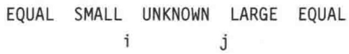

b. 证明，使用上面的算法将只含有 $d$ 个不同值的 $N$ 元素数组排序花费 $O(dN)$ 时间。

7.29 编写一个程序实现选择算法。
7.30 求解下列递推关系: $T(N) = (1/N)\left[\sum_{i=0}^{N-1}T(i)\right] + cN,\quad T(0) = 0$ 。
7.31 如果一切具有相等关键字的元素都保持它们在输入中出现的顺序，那么这种排序算法就叫作稳定(stable)的。本章中的排序算法哪些是稳定的？哪些不是？为什么？
7.32 设给定 $N$ 个元素的已排序的表，后面跟有 $f(N)$ 个随机顺序的元素。如果 $f(N)$ 是下列情况，那么如何将整个表排序？

a.  $f(N) = O(1)$
b. $f(N)=O(\log N)$

---

276

数据结构与算法分析——C++语言描述(第四版)

$$
\mathrm{c.} f (N) = O (\sqrt {N})
$$

\*d. $f(N)$ 能够多大，使得整个表仍然是以 $O(N)$ 时间可排序的？

7.33 证明，在 $N$ 个元素已排序的表中查找一个元素 $X$ 的任何算法都需要 $\Omega (\log N)$ 次比较。

7.34 利用Stirling公式 $N! \approx (N / \mathrm{e})^N\sqrt{2\pi N}$ 给出 $\log (N!)$ 的精确估计。

7.35 \*a. 两个已排序的 $N$ 元素数组可以有多少种合并的方法？

\*b. 通过采用上面 a 问的答案中的算法，给出合并两个 N 元素的已排序的表所需要的比较次数的非平凡下界。

7.36 证明，合并两个 N 项已排序数组至少需要 2N-1 次比较。必须要证明，如果在已合并的表中两个元素相邻，而且来自不同的表，那么它们必须进行比较。

7.37 考虑下列将 6 个数排序的算法:

- 使用算法 $A$ 将前3个数排序。
- 使用算法 $B$ 将后3个数排序。
- 使用算法 $C$ 将两个已排序的数组合并。

证明这个算法是次最优(suboptimal)的，而与算法A、B、C的选择无关。

7.38 写出一个程序，读入平面上的 $N$ 个点，并输出任一组4个或更多共线的点(即在同一条直线上的点)。明显的蛮力算法需要 $O(N^4)$ 时间。然而，存在一种利用排序的更好的算法，它以 $O(N^{2}\log N)$ 时间运行。

7.39 证明，在 $N$ 个元素中的两个最小元素可以以 $N + \lceil \log (N) \rceil - 2$ 次比较找到。

\*7.40 为了同时查找最大元和最小元，提出了下列分治算法:如果仅有一项，那么它就是最大元和最小元；如果只有两项，那么将它们进行比较，用一次比较就可以找到最大元和最小元。否则，将输入分裂成两部分，尽可能分割均匀(如果 $N$ 是奇数，那么其中有一半要比另一半多一个元素)。递归地查找每一半的最大元和最小元，然后用两次附加的比较得到整个问题的最大元和最小元。

a. 设 $N$ 为2的幂。由本算法所使用的准确的比较次数是多少？
b. 设 $N$ 呈 $3 \cdot 2^{k}$ 的形式。由该算法所使用的准确的比较次数是多少？
c. 如下修改本算法:当 $N$ 是偶数但不能被4整除时，将输入分割成大小为 $N / 2 - 1$ 和 $N / 2 + 1$ 的两部分。此时算法所用到的准确的比较次数是多少？

7.41 设我们想要把 $N$ 项划分成大小均为 $N / G$ 的 $G$ 组，使得最小的 $G / N$ 项在第1组，次最小的 $N / G$ 项在第2组，等等。这些组本身不必是已排序的。为简单起见，可以假设 $N$ 和 $G$ 都是2的幂。

a. 给出一个  $O(N \log G)$  算法求解该问题。
b. 证明使用基于比较的算法求解该问题的  $\Omega(M\log G)$  下界。

\*7.42 给出一个线性时间算法将 $N$ 个分数排序，它们的分子和分母都是在1和 $N$ 之间的整数。
7.43 设数组 A 和 B 都是已排序的并且均含有 N 个元素。给出一个  $O(\log N)$  算法找出  $A \cup B$  的中值。
7.44 设有 $N$ 个元素的数组，只包含两个不同的关键字 true 和 false。给出一个 $O(N)$ 算法重新排列这些元素，使得所有 false 的元素都排在 true 的元素的前面。要求只能使用常数附加空间。
7.45 设有 $N$ 个元素的数组，包含3个不同的关键字true、false和maybe。给出一个

---

第7章 排序

277

$O(N)$ 算法重新排列这些元素，使得所有 false 的元素都排在 maybe 元素的前面，而 maybe 元素又都在 true 元素的前面。要求只能使用常数附加空间。

7.46 a. 证明，任何基于比较的算法将 4 个元素排序均需 5 次比较。

b. 给出一种算法用 5 次比较将 4 个元素排序。

7.47 a. 证明，使用任何基于比较的算法将 5 个元素排序都需要 7 次比较。

\*b. 给出一个算法用 7 次比较将 5 个元素排序。

7.48 写出一个高效的希尔排序算法，并比较当使用下列增量序列时的性能:

a. 希尔的原始序列。

b. Hibbard 的增量。

c. Knuth 的增量:  $h_{i}=\frac{1}{2}(3^{i}+1)$ 。

d. Gonnet 的增量: $h_t = \left\lfloor \frac{N}{2.2} \right\rfloor$, 而 $h_k = \left\lfloor \frac{h_{k+1}}{2.2} \right\rfloor$ (若 $h_2 = 2$ 则 $h_1 = 1$)。

e. Sedgewick 的增量。

7.49 实现优化的快速排序算法并用下列组合进行实验。

a. 枢纽元:第一个元素，中间的元素，随机的元素，三数中值，五数中值。

b. 截止值从 0 到 20。

7.50 编写一个例程，读入两个以字母序表示的文件并将它们合并到一起，形成第三个文件也是用字母序表示的。

7.51 设我们实现三数中值例程如下:找出 a[left]、a[center] 和 a[right] 的中值，并将它与 a[right] 交换。以通常的分割步骤进行，开始时 i 在 left 处且 j 在 right-1 处（而不是 left+1 和 right-2）。

a. 设输入为  $2, 3, 4, \cdots, N-1, N, 1$ 。对于该输入，这种快速排序算法的运行时间是多少？

b. 设输入数据呈反序排列，对于这样的输入，该快速排序算法的运行时间又是多少？

7.52 证明，任何基于比较的排序算法平均都需要 $\Omega (N\log N)$ 次比较。

7.53 给定一个数组，该数组包含 $N$ 个元素。我们想要确定是否存在两个数，它们的和等于给定的数 $K$ 。例如，如果输入是8，4，1，6而 $K$ 是10，则答案为yes(4和6)。一个数可以被使用两次。解答下列各问:

a. 给出求解该问题的  $O(N^{2})$  算法。

b. 给出求解该问题的  $O(N \log N)$  算法。(提示:首先将各项排序。然后，可以以线性时间解决该问题。)

c. 将两种方案编码并比较算法的运行时间。

7.54 对于 4 个数重复练习 7.53。尝试设计一个 $O(N^2 \log N)$ 算法。（提示:计算两个元素的所有可能的和。把这些可能的和排序。然后按练习 7.53 来处理。）

7.55 对于3个数重复练习7.53。尝试设计一个 $O(N^{2})$ 算法。

7.56 考虑下面 percolateDown 的做法:我们在节点 $X$ 有一个空穴(hole)。正规的例程是比较 $X$ 的儿子，然后把比我们企图要放置的元素大的儿子上移到 $X$ 处(在(max)堆的情形下)，由此将空穴下推，当把新元素安全地放到空穴中时终止算法。另一种做法是将元素上移且空穴尽可能地下移，不用测试新单元是否能够被插入。这将使

---

278

数据结构与算法分析——C++语言描述(第四版)

得新单元被放置到一片树叶上并可能破坏堆序性质。为了修复堆序，以正规的方式将新单元上滤。写出包含该想法的例程，并与堆排序的标准实现的运行时间进行比较。

7.57 提出一种算法，只用两盘磁带对一个大型文件进行排序。

7.58 a. 通过 buildHeap 最多使用 $2N$ 次比较的事实，证明堆个数的下界为 $N! / 2^{2N}$。b. 利用 Stirling 公式将该界展开。

7.59 $M$ 是一个 $N$ 行 $N$ 列矩阵，其中，每行上的元素以增序出现，而每列上的元素（从上到下）以增序出现。使用3路比较(即，$x$ 与 $M[i][j]$ 的一次比较将决定 $x$ 是小于、等于还是大于 $M[i][j]$，考虑确定是否 $x$ 在 $M$ 中的问题。

a. 给出一个算法，最多使用 2N-1 次比较。
b. 证明，任何算法都必然至少使用 2N-1 次比较。

7.60 有一奖项藏在一个盒子中，奖项的值为1和N之间的一个正整数，而N是给定的。为了赢得该奖项，需要猜出它的值。我们的目的是用尽可能少的次数猜出值来。不过，我们最多只可以有g次猜出过高的值。这个g的值将在游戏开始的时候指定，如果猜出过高的值超出g次，那么我们就输掉了这个游戏。因此，例如，若g=0，则可以直接用如下的猜测序列在N次猜测之内猜出奖项的值而获胜:1，2，3，…。

a. 设  $g=\left\lceil\log N\right\rceil$ 。什么样的策略能够将猜测的次数极小化？
b. 设 $g = 1$ 。证明我们总可以以 $O(N^{1/2})$ 次猜测获胜。
c. 设 $g = 1$ 。证明，任何赢得奖项的算法都必然使用 $\Omega(N^{1/2})$ 次猜测。

\*d. 给出一个算法，并对任意常数 $g$ 给出匹配的下界。

## 参考文献

Knuth 的著作[16]是一本关于排序的综合参考文献。Gonnet 和 Baeza-Yates$^{[5]}$包含更多的结果，以及大量的文献目录。

详细论述希尔排序的原始论文是文献[29]。Hibbard的论文[9]建议使用增量 $2^{k} - 1$ 并通过避免交换紧缩了代码。定理7.4源自文献[19]。Pratt的下界可以在文献[22]中找到，他用到的方法比正文中提到的方法要复杂。改进的增量序列和上界出现在论文[13]、[28]和[31]中；匹配的下界在文献[32]中证明。业已证明，没有增量序列能够给出 $O(N\log N)$ 的最坏情形运行时间[20]。希尔排序的平均情形运行时间仍然没有解决。Yao[34]对3增量情形进行了极其复杂的分析。其结果尚需扩展到更多增量，不过已经稍微有所改进[14]。Jiang、Li、Vityani的论文[15]证明了 $p$ 趟希尔排序的平均情形运行时间的一个下界 $\Omega (pN^{1 + 1 / p})$ 。对各种增量序列的试验见于论文[30]。

堆排序由 Williams 发现 $^{[33]}$ ; Floyd $^{[4]}$ 提供了构建堆的线性时间算法。定理 7.5 取自文献 $^{[23]}$ 。

归并排序精确的平均情形分析在文献[7]中描述。不用附加空间且以线性时间执行合并的算法在文献[12]中介绍。

快速排序源于 $\mathrm{Hoare}^{[10]}$ 。这篇论文分析了基本算法，描述了大多数的改进，并且还包含有选择算法。详细的分析和经验性的研究曾是Sedgewick专题论文[27]的主题。许多重要的结果出现在三篇论文[24]、[25]和[26]中。文献[1]提供了详细的C实现并包括某些附加的改进，它还指出UNIX的qsort库例程的一些老的实现方法容易导致二次的行为。练习7.27取自文献[18]。

决策树和排序优化在 Ford 和 Johnson 的论文 $^{[5]}$ 中讨论。这篇论文还提供了一个算法，它几

---

第7章 排序

279

乎符合用比较(而不是其他操作)次数表示的下界。该算法最终由Manacher[17]指出稍逊于最优。

在定理7.9中得到的那些选择下界来自论文[6]。同时查找最大元和最小元的下界出自Pohl[21]。查找中位数的当前最佳下界稍大于 $2N$ 次比较，由Dor和Zwick[3]得到；他们还得到最佳上界，大约是 $2.95N$ 次比较[2]。

外部排序详细地含盖于文献[16]。在练习7.31中描述的稳定排序算法已由Horvath[11]处理。

1. J. L. Bentley and M. D. McElroy, "Engineering a Sort Function," Software—Practice and Experience, 23 (1993), 1249–1265.
2. D. Dor and U. Zwick, "Selecting the Median," SIAM Journal on Computing, 28 (1999), 1722–1758.
3. D. Dor and U. Zwick, "Median Selection Requires $(2 + \varepsilon)n$ Comparisons," SIAM Journal on Discrete Math, 14 (2001), 312-325.
4. R. W. Floyd, "Algorithm 245: Treesort 3," Communications of the ACM, 7 (1964), 701.
5. L. R. Ford and S. M. Johnson, "A Tournament Problem," American Mathematics Monthly, 66 (1959), 387–389.
6. F. Fussenegger and H. Gabow, "A Counting Approach to Lower Bounds for Selection Problems," Journal of the ACM, 26 (1979), 227–238.
7. M. Golin and R. Sedgewick, "Exact Analysis of Mergesort," Fourth SIAM Conference on Discrete Mathematics, 1988.
8. G. H. Gonnet and R. Baeza-Yates, Handbook of Algorithms and Data Structures, 2d ed., Addison-Wesley, Reading, Mass., 1991.
9. T. H. Hibbard, "An Empirical Study of Minimal Storage Sorting," Communications of the ACM, 6 (1963), 206–213.
10. C. A. R. Hoare, "Quicksort," Computer Journal, 5 (1962), 10–15.
11. E. C. Horvath, "Stable Sorting in Asymptotically Optimal Time and Extra Space," Journal of the ACM, 25 (1978), 177–199.
12. B. Huang and M. Langston, "Practical In-place Merging," Communications of the ACM, 31 (1988), 348–352.
13. J. Incerpi and R. Sedgewick, "Improved Upper Bounds on Shellsort," Journal of Computer and System Sciences, 31 (1985), 210–224.
14. S. Janson and D. E. Knuth, "Shellsort with Three Increments," Random Structures and Algorithms, 10 (1997), 125–142.
15. T. Jiang, M. Li, and P. Vitanyi, "A Lower Bound on the Average-Case Complexity of Shellsort," Journal of the ACM, 47 (2000), 905–911.
16. D. E. Knuth, The Art of Computer Programming. Volume 3: Sorting and Searching, 2d ed., Addison-Wesley, Reading, Mass., 1998.
17. G. K. Manacher, "The Ford-Johnson Sorting Algorithm Is Not Optimal," Journal of the ACM, 26 (1979), 441–456.
18. D. R. Musser, "Introspective Sorting and Selection Algorithms," Software—Practice and Experience, 27 (1997), 983–993.
19. A. A. Papernov and G. V. Stasevich, "A Method of Information Sorting in Computer Memories," Problems of Information Transmission, 1 (1965), 63–75.
20. C. G. Plaxton, B. Poonen, and T. Suel, "Improved Lower Bounds for Shellsort," Proceedings of the Thirty-third Annual Symposium on the Foundations of Computer Science (1992), 226–235.
21. I. Pohl, "A Sorting Problem and Its Complexity," Communications of the ACM, 15 (1972), 462–464.
22. V. R. Pratt, Shellsort and Sorting Networks, Garland Publishing, New York, 1979. (Originally presented as the author's Ph.D. thesis, Stanford University, 1971.)
23. R. Schaffer and R. Sedgewick, "The Analysis of Heapsort," Journal of Algorithms, 14 (1993), 76–100.

---

280

数据结构与算法分析——C++语言描述(第四版)

24. R. Sedgewick, "Quicksort with Equal Keys," SIAM Journal on Computing, 6 (1977), 240–267.
25. R. Sedgewick, "The Analysis of Quicksort Programs," Acta Informatica, 7 (1977), 327–355.
26. R. Sedgewick, "Implementing Quicksort Programs," Communications of the ACM, 21 (1978), 847–857.
27. R. Sedgewick, Quicksort, Garland Publishing, New York, 1978. (Originally presented as the author's Ph.D. thesis, Stanford University, 1975.)
28. R. Sedgewick, "A New Upper Bound for Shellsort," Journal of Algorithms, 7 (1986), 159–173.
29. D. L. Shell, "A High-Speed Sorting Procedure," Communications of the ACM, 2 (1959), 30–32.
30. M. A. Weiss, "Empirical Results on the Running Time of Shellsort," Computer Journal, 34 (1991), 88–91.
31. M. A. Weiss and R. Sedgewick, "More on Shellsort Increment Sequences," Information Processing Letters, 34 (1990), 267–270.
32. M. A. Weiss and R. Sedgewick, "Tight Lower Bounds for Shellsort," Journal of Algorithms, 11 (1990), 242–251.
33. J. W. J. Williams, "Algorithm 232: Heapsort," Communications of the ACM, 7 (1964), 347–348.
34. A. C. Yao, "An Analysis of (h, k, 1) Shellsort," Journal of Algorithms, 1 (1980), 14–50.
