# 第8章 不相交集类

原始 PDF 第 295–316 页。

## 第8章 不相交集类

在这一章，我们描述解决等价问题的一种有效的数据结构。这种数据结构实现起来简单，每个例程只需要几行代码，而且可以使用一个简单的数组。它的实现还非常快，每种操作只需要常数平均时间。从理论上看，这种数据结构又是非常有趣的，因为对它的分析极其困难。最坏情形的函数形式不同于我们已经见过的任何形式。对于这种不相交集数据结构，我们将

- 讨论如何能够以最少的编程代价实现。
- 只使用两个简单的观察结果就能极大地增加它的速度。
- 分析一种快速的实现方法的运行时间。
- 介绍一个简单的应用。

## 8.1 等价关系

称关系(relation) $R$ 定义在集合 $S$ 上，如果对于 $a, b \in S$ 的每一对元素 $(a, b)$，$aRb$ 或者为 true 或者为 false。如果 $aRb$ 是 true，那么就说 $a$ 与 $b$ 有关系。

等价关系(equivalence relation)是满足下列3个性质的关系 $R$

1. (自反性)对于所有的  $a \in S$ , aRa。
2. (对称性)aRb 当且仅当 bRa。
3. (传递性) 若 aRb 且 bRc，则 aRc。

下面考虑几个例子。

关系 $\leqslant$ 不是等价关系。虽然它是自反的，即 $a\leqslant a$ ，可传递的，即由 $a\leqslant b$ 和 $b\leqslant c$ 得出 $a\leqslant c$ ，但它却不是对称的，因为从 $a\leqslant b$ 并不能得出 $b\leqslant a$ 。

电气连通性(electrical connectivity)是一个等价关系，其中所有的连接都是通过金属导线完成的。该关系显然是自反的，因为任何元件都是自身相连的。如果 $a$ 电气连接到 $b$ ，那么 $b$ 必然也电气连接到 $a$ 。最后，如果 $a$ 连接到 $b$ ，而 $b$ 又连接到 $c$ ，那么 $a$ 连接到 $c$ 。因此，电气连接是一个等价关系。

如果两个城市位于同一个国家，那么定义它们是有关系的。容易验证这是一个等价关系。如果能够通过公路从城镇 $a$ 旅行到 $b$ ，则设 $a$ 与 $b$ 有关系。如果所有的道路都是双向行驶的，那么这种关系也是一个等价关系。

## 8.2 动态等价性问题

给定一个等价关系～，一个自然的问题是，对任意的 $a$ 和 $b$ ，确定是否 $a \sim b$ 。如果将等价关系存储为布尔变量的一个二维数组，那么当然这个问题可以以常数时间解决。可是，关系通常不是明显而是相当隐秘地定义的。

---

282

数据结构与算法分析——C++语言描述(第四版)

作为一个例子，设在5个元素的集合 $\{a_1, a_2, a_3, a_4, a_5\}$ 上定义一个等价关系。此时，存在25对元素，它们的每一对或者有关系或者没有关系。然而，信息 $a_1 \sim a_2, a_3 \sim a_4, a_5 \sim a_1, a_4 \sim a_2$ 意味着每一对元素都是有关系的。我们希望能够迅速推断出这些关系。

一个元素 $a \in S$ 的等价类(equivalence class)是 $S$ 的一个子集，它包含所有与 $a$ 有(等价)关系的元素。注意，等价类形成对 $S$ 的一个划分:$S$ 的每一个成员恰好出现在一个等价类中。为确定是否 $a \sim b$，我们只须验证 $a$ 和 $b$ 是否都在同一个等价类中。这给我们提供了解决等价问题的思路。

输入数据最初是 $N$ 个集合组成的类(collection)，每个集合含有一个元素。初始的表述是所有的关系均为false(自反的关系除外)。每个集合都有一个不同的元素，从而 $S_{i} \cap S_{j} = \varnothing$ 。这使得这些集合不相交(disjoint)。

此时，有两种操作允许进行。第一种操作是 find，它返回包含给定元素的集合(即等价类)的名字。第二种操作是添加关系。如果我们想要添加关系 $a \sim b$，那么首先要看是否 $a$ 和 $b$ 已经有关系。这可以通过对 $a$ 和 $b$ 执行 find 并检验它们是否在同一个等价类中来完成。如果它们不在同一等价类中，那么使用求并操作 union，① 这种操作把含有 $a$ 和 $b$ 的两个等价类合并成一个新的等价类。从集合的观点来看，$\cup$ 的结果是建立一个新集合 $S_k = S_i \cup S_j$，去掉原来两个集合，同时保持所有的集合的不相交性。由于这个原因，常常把做这项工作的算法叫作不相交集合的 union/find 算法(disjoint set union/find algorithm)。

该算法是动态(dynamic)的，因为在算法执行的过程中，集合可以通过union操作而发生改变。这个算法还必然是联机(online)操作:当find执行时，它必须给出答案，然后算法才能继续进行。另一种可能是脱机(offline)算法，这种算法需要观察全部的union和find序列。它对每个find给出的答案必须和所有被执行到该find的union一致，但是该算法在看到所有这些问题以后才能够给出它的所有答案。这种差别类似于参加一次笔试(它一般是脱机的——你只能在规定的时间用完之前给出答卷)和一次口试(它是联机的，因为你必须回答当前的问题，然后才能继续下一个问题)。

注意，我们不进行任何比较元素相关的值的操作，而是只需要知道它们的位置。由于这个原因，可以假设所有的元素均已从0到N-1顺序编号，并且假设编号方法容易由某个散列方案确定。这样，开始时我们有 $S_{i}=\{i\}, i=0\sim N-1$ 。 $^{②}$

我们的第二个观察结果是，由 find 返回的集合的名字实际上是相当任意的。真正重要的关键在于:find(a)==find(b)为 true 当且仅当 a 和 b 在同一个集合中。

这两种操作在许多图论问题中都是重要的，在一些处理等价(或类型)声明的编译程序中也很重要。我们将在后面讨论一个应用。

有两种方案解决这个问题。一种方案保证指令 find 能够以常数的最坏情形运行时间执行，而另一种方案则保证指令 union 能够以常数最坏情形运行时间执行。最近已经证明，二者不能同时以常数最坏情形运行时间执行。

现在简要讨论第一种处理方法。为使 find 操作快，可以在一个数组中保存每个元素的等价类的名字。此时，find 就是简单的 $O(1)$ 查找。设我们想要执行 union(a,b)，并设 a

<small><span class="docvortex-page-footnote" data-block-type="page_footnote" style="color:#6b7280">① union 在 C++ 中是一个很少使用的保留字。我们在描述 union/find 算法时使用它，但当编写代码时，成员函数将被命名为 unionSets。</span></small>

<small><span class="docvortex-page-footnote" data-block-type="page_footnote" style="color:#6b7280">② 这反映数组下标从 0 开始的事实。</span></small>

---

第8章 不相交集类

283

在等价类 i 中而 b 在等价类 j 中。此时我们扫描该数组，将所有的 i 都改变成 j。不过，这次扫描要花费  $\Theta(N)$  时间。于是，连续 N-1 次 union 操作（这是最大值，因为此时每个元素都在一个集合中）就要花费  $\Theta(N^{2})$  的时间。如果存在  $\Omega(N^{2})$  次 find 操作，那么这个性能很好，因为在整个算法进行过程中对于每个 union 或 find 操作的总的运行时间为  $O(1)$ 。如果 find 操作没有那么多，那么这个界是不可接受的。

一种想法是将所有在同一个等价类中的元素放到一个链表中。这在更新的时候会节省时间，因为我们不必搜索整个数组。但是由于在算法过程中仍然有可能执行 $\Theta (N^2)$ 次等价类的更新，因此它本身并不能单独减少渐近运行时间。

如果我们还要跟踪每个等价类的大小，并在执行 union 时将较小的等价类的名字改成较大的等价类的名字，那么对于 N-1 次合并的总的时间开销为  $O(N \log N)$ 。其原因在于，每个元素可能让它的等价类最多改变  $\log N$  次，因为每次它的等价类改变时它的新的等价类至少是其原来等价类的两倍大。使用这种方法，任意顺序的 M 次 find 和直到 N-1 次的 union 最多花费  $O(M + N \log N)$  时间。

在本章的其余部分，我们将考查union/find问题的另一种解法，其中union操作容易但find操作要困难。即使如此，任意顺序的最多 $M$ 次find和直到 $N - 1$ 次union的运行时间将只比 $O(M + N)$ 多一点。

## 8.3 基本数据结构

记住，我们的问题不要求 find 操作返回任何特定的名字，而只是要求当且仅当两个元素属于相同的集合时作用在这两个元素上的 find 返回相同的答案。一种想法是可以使用树来表示每一个集合，因为树上的每一个元素都有相同的根。这样，该根就可以用来命名所在的集合。我们将用树表示每一个集合。（我们知道，树的集合叫作森林（forest）。）开始时每个集合含有一个元素。我们将要使用的这些树不一定必须是二叉树，但是表示它们要容易，因为我们需要的唯一信息就是一个父链(parent link)。集合的名字由根处的节点给出。由于只需要父节点的名字，因此可以假设这棵树被非显式地存储在一个数组中:数组的每个成员 s[i] 表示元素 i 的父亲。如果 i 是根，那么 s[i]=-1。在图 8.1 的森林中，对于 $0 \leqslant i < 8$，s[i]=-1。正如在二叉堆中那样，我们也将显式地画出这些树，注意，此时正在使用的是一个数组。图 8.1 表达了这种显式的表示方法，为方便起见，我们将把根的父链垂直画出。

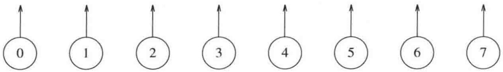

<details>
<summary>text_image</summary>

0
1
2
3
4
5
6
7
</details>

图8.1 8个元素，初始时在不同的集合中

为了执行两个集合的 union 运算，我们通过使一棵树的根的父链链接到另一棵树的根节点。显然，这种操作花费常数时间。图 8.2、图 8.3 和图 8.4 分别表示在 union(4,5)、union(6,7) 和 union(4,6) 每一个操作之后的森林，其中，我们采纳了在 union(x,y) 后新的根是 x 的约定。最后的森林的非显式表示见图 8.5。

对元素 $x$ 的一次 find(x) 操作通过返回包含 $x$ 的树的根而完成。执行这次操作花费的时间与代表 $x$ 的节点的深度成正比，当然这要假设我们以常数时间找到表示 $x$ 的节点。使用上

---

284

数据结构与算法分析——C++语言描述(第四版)

面的方法，能够建立一棵深度为 $N - 1$ 的树，因此一次 find 的最坏情形运行时间是 $\Theta(N)$。一般情况下，运行时间是对连续混合使用 $M$ 个指令来计算的。在这种情况下，$M$ 次连续操作在最坏情形下可能花费 $\Theta(MN)$ 时间。

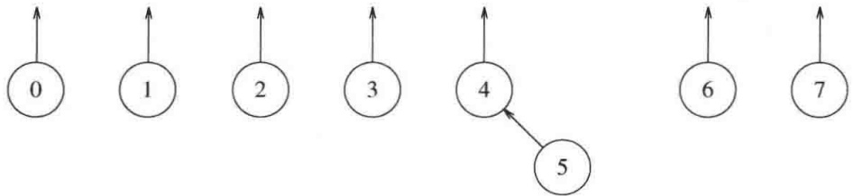

<details>
<summary>flowchart</summary>

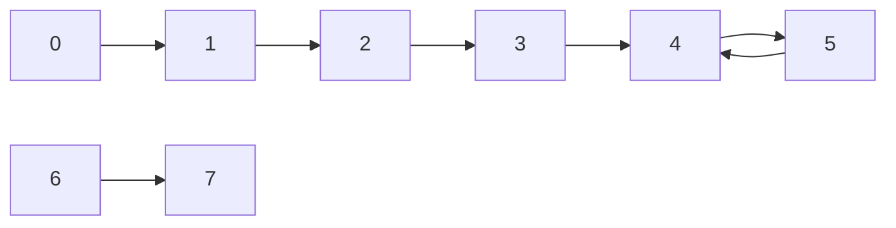
</details>

图8.2 在union(4,5)之后

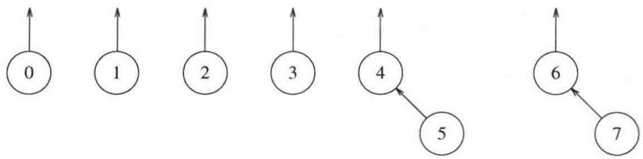

<details>
<summary>flowchart</summary>

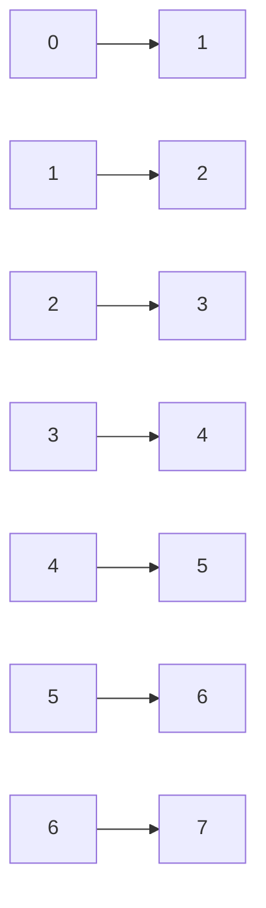
</details>

图8.3 在union(6,7)之后

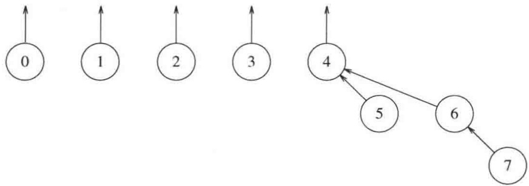

<details>
<summary>flowchart</summary>

This diagram illustrates a directed graph or network flow with seven nodes (0-7), where arrows indicate the direction of movement from node 0 to node 4, which then connects to node 6 and finally node 7.
</details>

图8.4 在union(4,6)之后

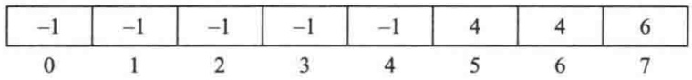

<details>
<summary>text_image</summary>

-1	-1	-1	-1	-1	4	4	6
0	1	2	3	4	5	6	7
</details>

图 8.5 前面树的隐式表示

图 8.6～图 8.9 中的程序表示基本算法的实现，假设差错检验已经执行过。在我们的例程中，各 union 是在这些树的根上进行的。有时候操作是通过传递任意两个元素，并让 union 执行两次 find 以确定它们的根来完成的。前面见到的数据结构中，find 总是一个访问函数，从而是一个 const 成员函数。8.5 节描述了一个更为有效的修改函数版的做法。两种版本同时都可以使用。除非控制对象是不可修改的，否则被调用的总是修改函数。

```cpp
class DisjSets
{
    public:
        explicit DisjSets( int numElements );

        int find( int x ) const;
        int find( int x );
        void unionSets( int root1, int root2 );

    private:
        vector<int> s;
};
```

图8.6 不相交集合的类接口

---

第8章 不相交集类

285

```txt
/**
  * 构造不相交集对象.
  * numElements 为不相交集的初始个数.
  */
DisjSets::DisjSets( int numElements ) : s{ numElements, - 1 }
{
}
```

图 8.7 不相交集合的初始化例程

```cpp
/**
 * 合并两个不相交集合.
 * 为简明起见，我们假设 root1 和 root2 是互异的
 * 并各代表一个集合的名字.
 * root1 为集合1的根.
 * root2 为集合2的根.
 */
void DisjSets::unionSets( int root1, int root2 )
{
    s[ root2 ] = root1;
}
```

图 8.8 union(不是最好的方式)

```cpp
/**
 * 执行一次 find.
 * 为简单起见，再次忽略差错检验.
 * 返回包含x的集合.
 */
int DisjSets::find( int x ) const
{
    if( s[ x ] < 0 )
        return x;
    else
        return find( s[ x ] );
}
```

图8.9 简单不相交集的find算法

对平均情形的分析是相当困难的。最起码的问题是答案依赖于如何定义(对 union 操作而言的)平均。例如，在图 8.4 的森林中，我们可以说，由于有 5 棵树，因此下一个 union 就存在 $5 \cdot 4 = 20$ 个等可能的结果(因为任意两棵不同的树都可能被 union)。当然，这个模型的含义在于，只存在 $\frac{2}{5}$ 的机会使得下一次 union 涉及到大树。另一种模型可能会认为在不同树上的任意两个元素间的所有 union 都是等可能的，因此大树比小树更有可能在下一次 union 中涉及到。在上面的例子中，大树有 $\frac{8}{11}$ 的机会在下一次 union 中会被涉及到，因为(忽略对称性)存在 6 种方式合并 $\{0,1,2,3\}$ 中的两个元素以及 16 种方式将 $\{4,5,6,7\}$ 中的一个元素与 $\{0,1,2,3\}$ 中的一个元素合并。还存在更多的模型，而在何者为最好的问题上没有一般的一致见解。平均运行时间依赖于模型。对于 3 种不同的模型，时间界 $\Theta(M)$、$\Theta(M \log N)$ 以及 $\Theta(MN)$ 实际上已经证明，不过，最后的那个界被认为更现实些。

对一系列操作的二次(quadratic)运行时间一般是不可接受的。所幸的是，有几种方法容易保证这样的运行时间不会发生。

---

286

数据结构与算法分析——C++语言描述(第四版)

## 8.4 灵巧求并算法

上面 union 的实施是相当任意的，它通过使第二棵树成为第一棵树的子树而完成合并。对其进行简单改进是借助任意的方法打破现有的随意性，使得总让较小的树成为较大的树的子树。我们把这种方法叫作按大小求并(union by size)。前面例子中 3 次 union 的对象大小都是一样的，因此可以认为它们都是按照大小执行的。假如下一次运算是 union(3,4)，那么结果将形成图 8.10 中的森林。倘若没有对大小进行探测而直接 union，那么结果将会形成更深的树(见图 8.11)。

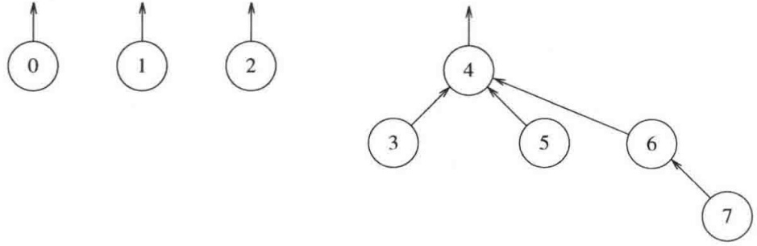

<details>
<summary>flowchart</summary>

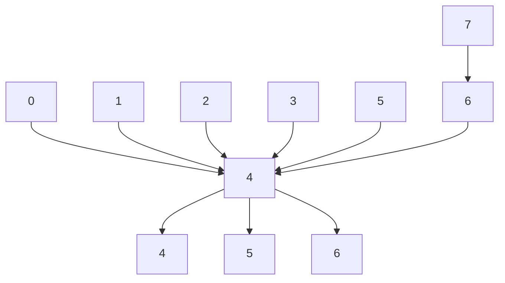
</details>

图 8.10 按大小求并的结果

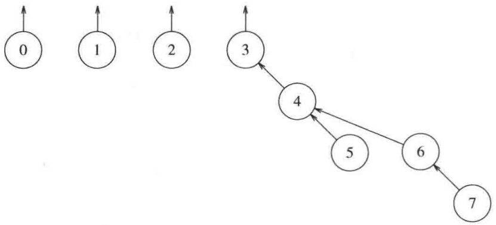

<details>
<summary>flowchart</summary>

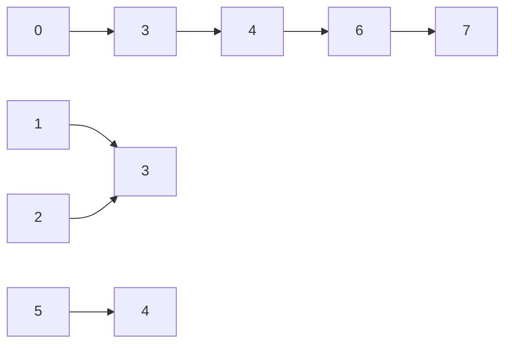
</details>

图8.11 一次任意union的结果

可以证明, 如果这些 union 都是按照大小进行的, 那么任何节点的深度均不会超过 $\log N$。为了看清这一点, 首先注意, 初始时节点处于深度 0 的位置。当它的深度随着一次 union 的结果而增加的时候, 该节点则被置于至少是它以前所在树两倍大的一棵树上。因此, 它的深度最多可以增加 $\log N$ 次。(我们在 8.2 节末尾的快速查找算法中用过这个论断。) 这意味着, find 操作的运行时间是 $O(\log N)$, 而连续 $M$ 次操作则花费 $O(M \log N)$。图 8.12 中的树指出在 16 次 union 后有可能得到这种最坏的树, 而且如果所有的 union 都对相等大小的树进行, 那么这样的树是会得到的 (这种最坏情形的树是在第 6 章讨论过的二项树)。

为了实现这种按大小求并的算法，我们需要记住每一棵树的大小。由于实际上只使用一个数组，因此可以让每个作为数组元素的根包含它的树大小的负值。这样一来，初始时树的数组表示就都是-1了。当一次union被执行时，要检查树的大小，新的大小是老的大小的和。这样，按大小求并的实现根本不存在困难，并且不需要额外的空间，其速度平均也很快。对于真正所有合理的模型，业已证明，若使用按大小求并，则连续 $M$ 次运算需要 $O(M)$ 平均时间。这是因为当随机的诸union执行时，整个算法一般只有一些很小的集合(通常含一个元素)与大集合合并。

---

第 8 章 不相交集类

287

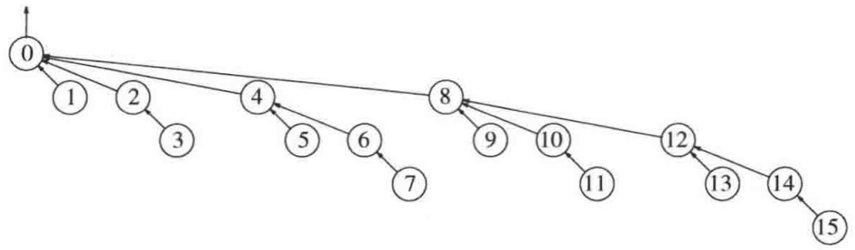

<details>
<summary>flowchart</summary>

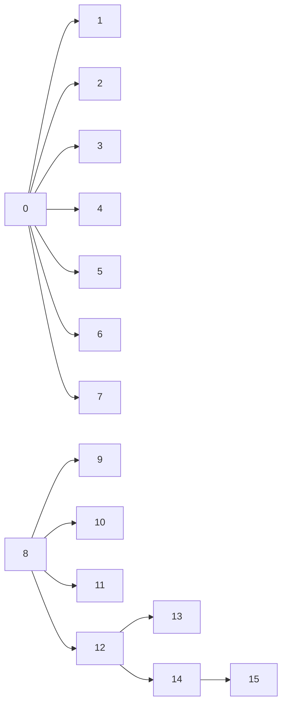
</details>

图 8.12 N=16 时最坏情形的树

另外一种实现方法为按高度求并(union-by-height)，它同样保证所有的树的深度最多也是 $O(\log N)$ 。我们跟踪每棵树的高度而不是大小，并执行那些union使得浅的树成为深的树的子树。这是一种平缓的算法，因为只有当两棵相等深度的树求并时树的高度才增加(此时树的高度增1)。这样，按高度求并是按大小求并的简单修改。由于零的高度不是负的，因此我们实际上存储高度的负值，减去一个附加的1。初始时所有的项都是-1。

图 8.13 显示的是按大小求并和按高度求并隐式表示的森林。图 8.14 的代码实现的是按高度求并的算法。

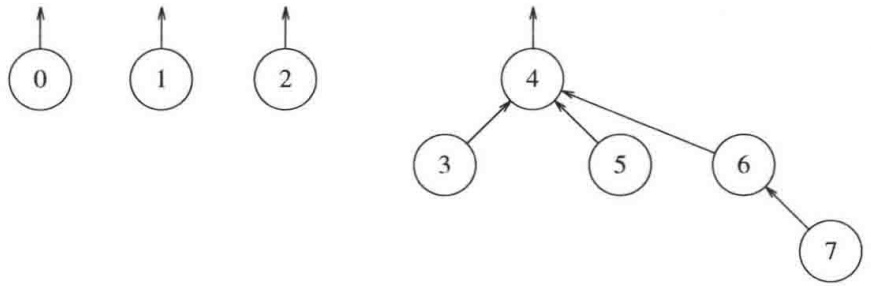

<details>
<summary>flowchart</summary>

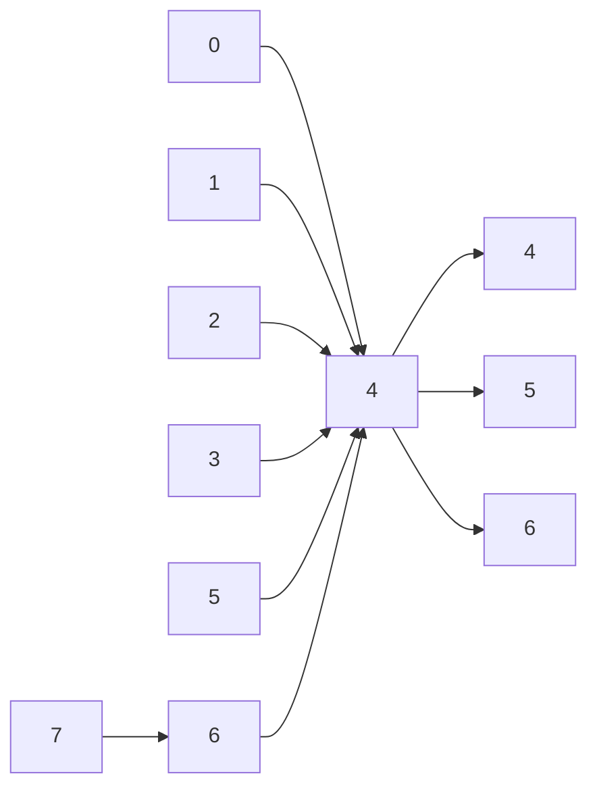
</details>

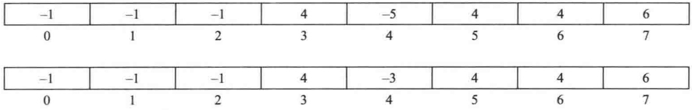

<details>
<summary>flowchart</summary>

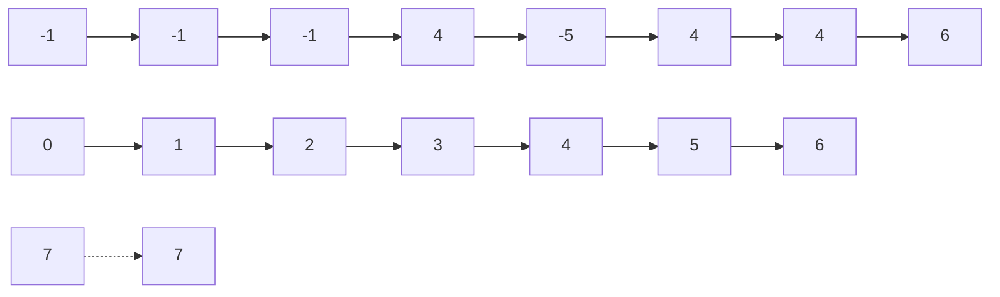
</details>

图 8.13 按大小求并和按高度求并隐式表示的森林

```cpp
/**
 * 合并两个不相交集合.
 * 为简单起见，假设root1和root2是互异的
 * 并且均代表集合的名字.
 * root1 是 set 1的根.
 * root2 是 set 2的根.
 */
void DisjSets::unionSets( int root1, int root2 )
{
    if( s[ root2 ] < s[ root1 ] )  // root2 更深
        s[ root1 ] = root2;      // 使root2 为新的根
    else
    {
        if( s[ root1 ] == s[ root2 ] )
            --s[ root1 ];          // 如果相同，则更新高度
        s[ root2 ] = root1;      // 使root1 为新的根
    }
}
```

图 8.14 按高度(秩(rank))求并的代码

---

288

数据结构与算法分析——C++语言描述(第四版)

## 8.5 路径压缩

迄今所描述的 union/find 算法对于大多数情形都是完全可以接受的，它非常简单，而且对于连续 M 个指令(在所有的模型下)平均是线性的。不过， $O(M\log N)$  的最坏情况还是可能相当容易和自然地发生的。例如，如果把所有的集合放到一个队列中并反复地让前两个集合出队而让它们的并入队，那么最坏的情形就会发生。如果运算 find 比 union 多很多，那么其运行时间就逊于快速查找算法(quick-find algorithm)的用时。而且我们应该清楚，对于 union 算法恐怕没有更多改进的可能。这是基于这样的观察:执行合并操作的任何算法都将产生相同的最坏情形的树，因为它必然会随意打破树间的均衡。因此，无须对整个数据结构重新加工而使算法加速的唯一方法是对 find 操作做些更聪明的工作。

这种聪明的操作叫作路径压缩(path compression)。路径压缩在一次 find 操作期间执行而与用来执行 union 的方法无关。设操作为 find(x)，此时路径压缩的效果是，从 x 到根的路径上的每一个节点都使它的父节点变成根。图 8.15 显示在对图 8.12 给出的常见的最坏的树执行 find(14) 后路径压缩的效果。

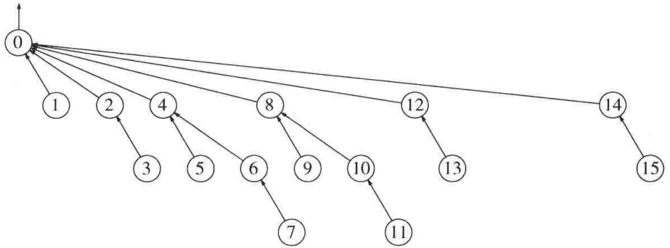

<details>
<summary>flowchart</summary>

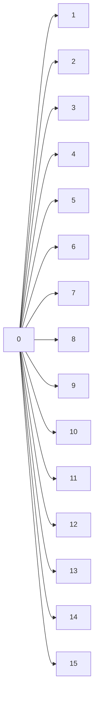
</details>

图8.15 路径压缩的一个例子

路径压缩的效果是，由于额外两次的链变化，节点12和节点13现在离根近了一个位置，而节点14和节点15现在离根近了两个位置。因此，对这些节点未来的快速访问将(我们希望)由于花费额外的工作来进行路径压缩而得到补偿。

正如图 8.16 中的程序所指出的，路径压缩对基本的 find 算法只进行了不大的改变。对 find 例程来说，(除不再是 const 成员函数外) 唯一的变化是使得 s[x] 等于由 find 返回的值。这样，在集合的根被递归地找到以后，x 的父链就引用它。这对通向根的路径上的每一个节点递归地出现，因此实现了路径压缩。

```cpp
/**
 * 利用路径压缩执行一次 find.
 * 为简单起见，再次忽略差错检验.
 * 返回包含 x 的集合.
 */
int DisjSets::find( int x )
{
    if( s[ x ] < 0 )
        return x;
    else
        return s[ x ] = find( s[ x ] );
}
```

图8.16 用路径压缩对不相交集进行find操作的代码

---

第8章 不相交集类

289

当任意执行一些 union 操作的时候, 路径压缩是一个好的想法, 因为有许多的深层节点, 它们通过路径压缩被移近到根节点。业已证明, 在这种情况下进行路径压缩时, 连续 $M$ 次运算最多需要 $O(M \log N)$ 的时间。不过, 在这种情形下确定平均情况的性能如何仍然是一个尚未解决的问题。

路径压缩与按大小求并完全兼容，这就使得两个例程可以同时实现。由于单独进行按大小求并要以线性时间执行连续 $M$ 次运算，因此还不清楚在路径压缩中涉及的额外一趟工作平均地看是否值得。这个问题实际上仍然没有解决。不过后面我们将会看到，路径压缩与灵巧求并法则的结合，将保证在所有情况下都将产生非常有效的算法。

路径压缩不完全与按高度求并兼容，因为路径压缩可以改变树的高度。我们根本不清楚如何有效地去重新计算它们。答案就是不去计算！此时，对于每棵树所存储的高度就变成了估计的高度(有时称为秩(rank))，但实际上按秩求并(union by rank)(它正是现在已经变成的样子)理论上和按大小求并效率是一样的。不仅如此，高度的更新也不如大小的更新频繁。与按大小求并一样，我们也不清楚路径压缩平均是否值得。下一节将证明，两种求并试探法无论使用哪一种，都能使路径压缩显著地减少最坏情形运行时间。

## 8.6 按秩求并和路径压缩的最坏情形

当使用两种试探方法时，算法在最坏情形下几乎是线性的。特别地，在最坏情形下需要的时间是 $\Theta (M\alpha (M,N))$ （假设 $M\geqslant N$ ），其中， $\alpha (M,N)$ 是一个增长极为缓慢的函数，不管是什么样的目的和问题，该函数顶多也就达到5。然而，这个 $\alpha (M,N)$ 却不是常数，因此，运行时间不是线性的。

在本节的其余部分，首先考察一些增长很慢的函数，然后，在8.6.2节～8.6.4节，我们建立一个对 $N$ 元素全体最多实施连续 $N - 1$ 次求并和 $M$ 次查找操作的最坏情形的界，其中，求并是按秩求并，而查找则用到路径压缩。如果以按大小求并代替按秩求并，那么相同的界仍然是成立的。

## 8.6.1 缓慢增长的函数

考虑如下递推式:

$$
T (N) = \left\{ \begin{array}{c c} 0 & N \leqslant 1 \\ T (\lfloor f (N) \rfloor) + 1 & N > 1 \end{array} \right. \tag {8.1}
$$

在这个方程中， $T(N)$  代表次数，从 N 开始，我们必须反复应用  $f(N)$ ，直到达到 1（或更小）为止。假设  $f(N)$  是一个严格定义的缩减 N 的函数。称这个方程的解为  $f^{*}(N)$ 。

在分析折半查找时我们已经遇到过这种递推关系。当时是 $f(N)=N/2$ ，每一步均将N减半。我们知道，这最多能够发生 $\log N$ 次，直到N达到1为止。于是有 $f^{*}(N)=\log N$ （这里忽略低阶项，等等）。注意，对上面这种情况， $f^{*}(N)$ 要比 $f(N)$ 小得多。

图8.17显示了 $T(N)$ 对于各种不同 $N$ 时的解。此处，我们最

| $f(N)$ | $f^{*}(N)$ |
| --- | --- |
| N-1 | N-1 |
| N-2 | N/2 |
| N-c | N/c |
| N/2 | logN |
| N/c | $\log_{c} N$ |
| $\sqrt{N}$ | log logN |
| logN | $\log^{*} N$ |
| $\log^{*} N$ | $\log^{**} N$ |
| $\log^{**} N$ | $\log^{***} N$ |

图8.17 迭代函数不同的值

---

290

数据结构与算法分析——C++语言描述(第四版)

感兴趣的是 $f(N)=\log(N)$ 。解 $T(N)=\log^{*}N$ 叫作迭代对数(iterated logarithm)。这个迭代对数是个增长极慢的函数，它代表对数需要被反复使用直到达到1为止的迭代次数。注意， $\log^{*}2=1,\log^{*}4=2,\log^{*}16=3,\log^{*}65\ 536=4$ ，而 $\log^{*}2^{65\ 536}=5$ 。但是要记住， $2^{65\ 536}$ 是个20 000位数字的数。因此，当 $\log^{*}N$ 作为一个增长函数时，在所有情况下，它最多为5。然而，我们仍然能够制造出更慢的函数。例如，若 $f(N)=\log^{*}N$ ，那么， $T(N)=\log^{**}N$ 就增长得更慢。事实上，我们可以随意添加星号来产生增长越来越慢的函数。

## 8.6.2 通过递归分解进行的分析

现在,我们为连续进行  $M=\Omega(N)$  次 union/find 操作的运行时间建立一个严紧的界(tight bound)。这里的 union 和 find 可以以任意顺序出现,不过,union 是按秩进行的合并,而 find 则是使用路径压缩来完成的查找。

我们通过建立涉及秩的性质的两个引理开始。图 8.18 给出了两个引理的一个直观图示。

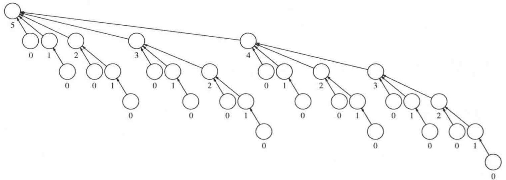

<details>
<summary>flowchart</summary>

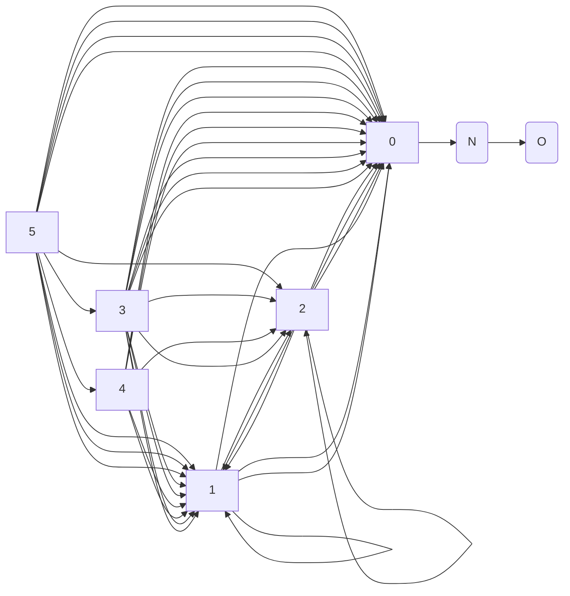
</details>

图 8.18 一棵大的不相交集的树(节点下方的数为秩)

引理8.1

当执行一系列 union 指令时，一个秩为 r>0 的节点必然至少有秩为 0, 1, …, r-1 的儿子。

证明:

数学归纳法。对于基准情形 $r = 1$ 引理显然成立。当节点从秩 $r - 1$ 长到 $r$ 时，它得到一个秩为 $r - 1$ 的儿子。根据归纳假设，它已经有秩为 $0, 1, \dots, r - 2$ 的儿子，由此引理得证。$\square$

下面的引理似乎多少有些明显，但它隐式地用于分析中。

引理8.2

在 union/find 算法的任一时刻，从树叶到根的路径上的节点的秩单调增加。

证明:

如果没有路径压缩，那么引理显然成立。如果在路径压缩之后，某个节点 $v$ 是节点 $w$ 的后裔，那么显然，当只考虑union时 $v$ 必然还是 $w$ 的后裔。因此，$v$ 的秩小于 $w$ 的秩。

假设有算法 A 和算法 B 两个算法。算法 A 工作正常，并且能够正确计算出所有的答案，但算法 B 却不能正确进行计算，甚至算不出有用的答案。尽管如此，我们还是要假设算法 A 中的每一步都能够映射到算法 B 中相应的等价的一步。此时容易看出，算法 B 的运行时间完全准确地描述了算法 A 的运行时间。

---

第8章 不相交集类

291

下面可以使用这个思路来分析不相交集数据结构的运行时间。我们将描述一个算法 B，它的运行时间恰好与不相交集结构的相同，然后描述算法 C，它的运行时间恰好与算法 B 的相同。这样一来，算法 C 的任一个界都将是不相交集数据结构的一个界。

## 部分路径压缩

算法 A 是我们按秩求并和用路径压缩操作进行查找的标准序列。我们设计一个算法 B，它将执行恰好与算法 A 相同的那些路径压缩操作。不过，在算法 B 中，我们执行所有的合并是在任意的查找之前进行。此后，算法 A 中的每次查找操作都被算法 B 中的部分查找 (partial find) 所代替。部分查找操作指定搜索项以及路径压缩要执行到的那个节点。这个将被用到的节点，就是在算法 A 中执行相对应的查找时作为根的那个节点。

图 8.19 指出，算法 A 和算法 B 最终将得到等价的树(森林)。容易看出，算法 A 所执行的查找使父节点改变的量恰好与算法 B 执行的部分查找所产生的改变量相同。但是算法 B 分析起来应该更简单，因为我们已经把合并和查找的混合做法从方程中去除了。所要分析的基本量就是可能在任意部分查找序列中出现的父节点改变的次数，因为在任意使用路径压缩的查找中，除去顶部的两个节点外，所有的节点都将得到新的父亲。

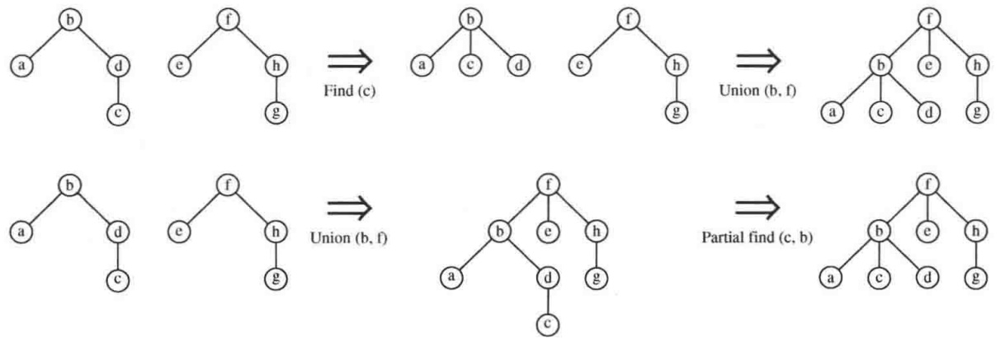

<details>
<summary>flowchart</summary>

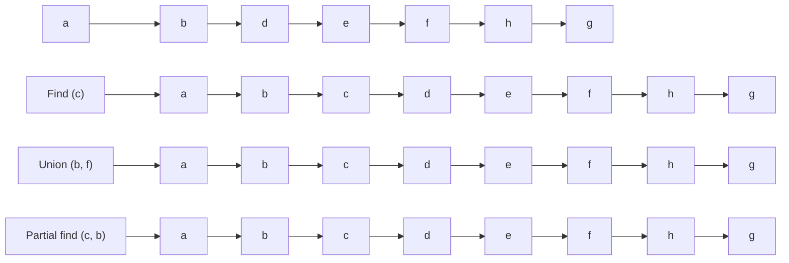
</details>

图 8.19 合并和查找操作序列用合并和部分查找操作的等价开销代替

## 递归分解

下面我们想要做的是把每棵树分成两部分:上半部分和下半部分。然后，我们想要确保，上半部分的部分查找操作的次数加上下半部分的部分查找操作的次数，正好和部分查找操作的总次数相同。然后，我们还要写出一个公式，以上半部分路径压缩的开销加上下半部分路径压缩的开销表示树中总的路径压缩开销。不用详述如何决定哪些节点在上半部分，哪些节点在下半部分，通过图8.20、图8.21和图8.22就可以看出大部分我们想要做的如何能够立即完成。

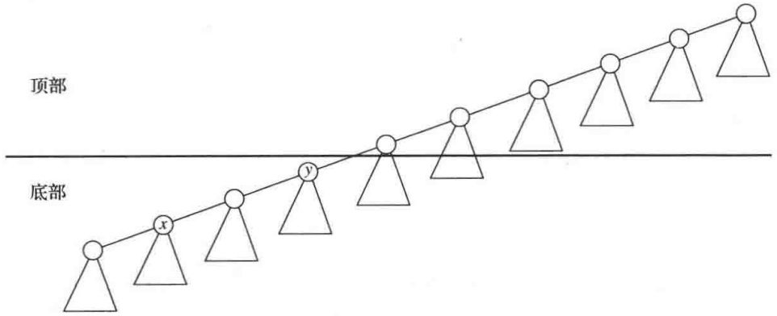

<details>
<summary>text_image</summary>

顶部
底部
x
y
</details>

图 8.20 递归分解，情形 1:部分查找整个位于底部

---

292

数据结构与算法分析——C++语言描述(第四版)

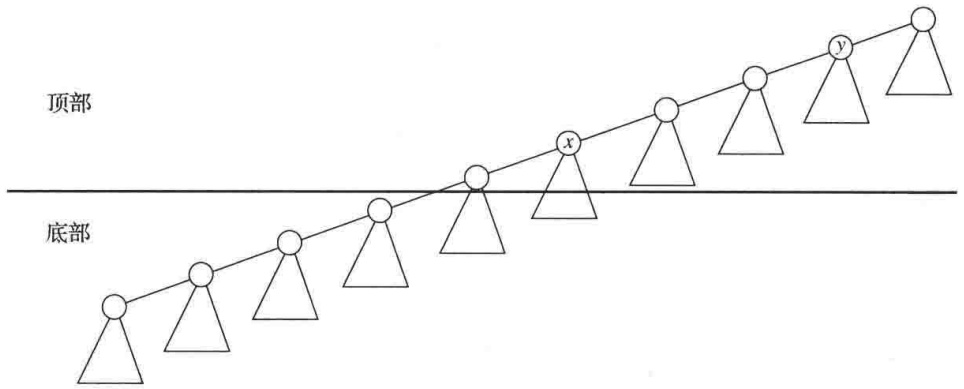

<details>
<summary>text_image</summary>

顶部
底部
x
y
</details>

图 8.21 递归分解，情形 2:部分查找整个位于顶部

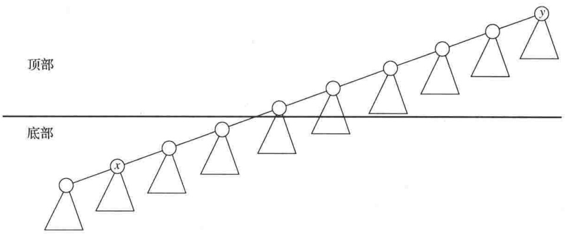

<details>
<summary>text_image</summary>

顶部
底部
x
y
</details>

图 8.22 递归分解，情形 3:部分查找从底部走到顶部

在图 8.20 中，部分查找全部处于下半部分。于是，下半部分的一次部分查找对应一次原始的部分查找，而产生的开销可以递归地计入下半部分。

在图8.21中，部分查找整个位于上半部分。因此，上半部分的一次部分查找对应一次原始的部分查找，而开销可以计入上半部分。

然而，当达到图8.22时，我们遇到了许多麻烦。这里， $x$ 处在下半部分，而 $y$ 则在上半部分。路径压缩要求从 $x$ 到 $y$ 的儿子的所有节点都以 $y$ 作为它们的父亲。对于上半部分的节点，这没有问题，但是对于下半部分的节点，这就是个大问题了:任何对下半部分的递归变化都必须使每个事件发生在下半部分。于是，如图8.23所示，可以执行上半部分的路径压缩，但是，下半部分的某些节点也将需要新的父亲，尚不清楚应该怎么办，因为这些底部节点的新父亲不能是顶部的节点，而这些新父亲也不能是底部其他的节点。

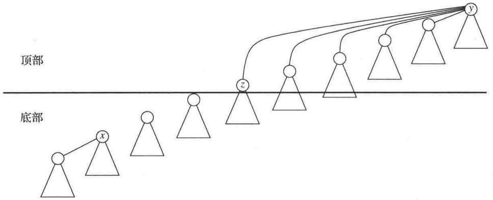

<details>
<summary>text_image</summary>

顶部
底部
x
z
y
</details>

图 8.23 递归分解，情形 3:路径压缩可以对顶部执行，但是，底部节点必须得到它们的新父亲。这些父亲不能是顶部的节点，也不能是底部其他的节点

---

第 8 章 不相交集类

293

唯一的选择是在那些其父亲就是它们自己的节点上画一个环，并确保这些父亲的变化开销正确划到我们的计算中。虽然这是一个新算法，因为它不再用于生成相同的树，但是我们不需要相同的树。我们唯一需要的，是保证每一个原始的部分查找能够映射到新的部分查找操作，并且所用开销是相同的。图 8.24 显示了新树的形状，因此，剩下的大问题就是计算开销的问题。

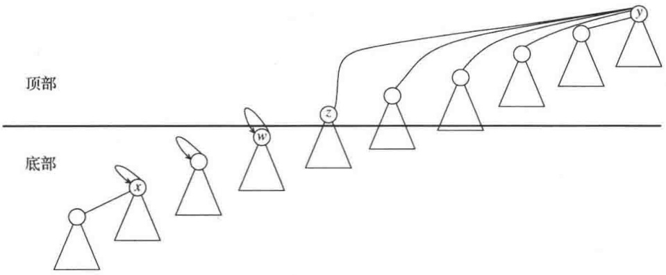

<details>
<summary>flowchart</summary>

This diagram illustrates a hierarchical process or workflow with nodes labeled x through y, showing directional flow from bottom to top.
</details>

图8.24 递归分解，情形3:底部节点的新父亲是这些节点自己

从图 8.24 中看到，从 x 到 y 的路径压缩开销可以分成 3 部分:首先是从 z（上行通向 y 的上半部分首个节点）到 y 的路径压缩。显然，这些开销已经被递归地计入了。然后，是从下半部分最上方的节点 w 到 z 的开销。但这个开销只是一个单位，而且每次路径压缩最多只能有一个这样的开销。事实上，我们还可以做得稍好一些:对上半部分每次部分查找操作最多只能有一个这样的开销。可是，我们如何计算从 x 到 w 路径上父节点变化的开销呢？一种想法主张这些变化恰好就像从 x 到 w 部分查找的开销。但是论证起来有一个大问题:把原始的部分查找转化成上半部分的部分查找加上下半部分的部分查找，这意味着操作次数 M 不再是相同的了。不过，幸运的是，有一个更简单的观点:既然下半部分的每一个节点均只有一次能够让它的父节点设为它自己，因此，开销的计算次数被其父节点也在下半部分的下半部分节点（即 w 除外）的个数所限定。

这里有一个重要的细节必须核实。鉴于我们的新公式把 $x$ 和 $w$ 之间的节点从到 $y$ 的路径中分离出来，我们能在其后给定的部分查找上陷入困境吗？答案是否定的。在原始的部分查找中，设 $x$ 和 $w$ 之间的任一节点均涉及其后的原始部分查找。在这种情况下，它将与 $y$ 的一个祖先节点一起，这些节点中的任一个在我们的新公式中都将是最上方的“底部节点”。于是，对于其后的部分查找，原始部分查找的父节点变化在我们的新公式中将有一个相应的一个单位开销计入。

现在可以继续进行分析了。令 $M$ 为原始部分查找操作的总次数。令 $M_{t}$ 为专门对上半部分执行的部分查找操作的总次数，并令 $M_{b}$ 为专门对下半部分执行的部分查找操作的总次数。令 $N$ 为节点的总个数。令 $N_{t}$ 为上半部分节点的总个数，而令 $N_{b}$ 为下半部分节点的总个数，并令 $N_{nrb}$ 为非根底部节点的总数（即其父节点在任何部分查找之前也是底部节点的那些底部节点的总个数）。

引理8.3

$$
M = M _ {t} + M _ {b}
$$

---

294

数据结构与算法分析——C++语言描述(第四版)

证明:

在情形 1 和情形 3，每次原始部分查找操作都被上半部分的部分查找操作所代替，而在情形 2，每次原始部分查找又被下半部分的部分查找所代替。因此，每次部分查找恰好被对上半部分或下半部分进行的一次部分查找操作所代替。

我们的基本思路是想把节点做一次划分，使得所有秩为 $s$ 或更低的节点都在下半部分，而其余的节点都在上半部分。$s$ 的选择将在后面的证明中做出。下一个引理指出，通过把操作的开销分成上部和下部两组，可以提供一个父节点变化次数的递推公式。关键的一点在于，递推公式不仅以 $M$ 和 $N$ 的形式写出，这比较明显，而且还以组中最大秩的形式写出。

引理8.4

令 $C(M,N,r)$ 为对最大秩是 $r$ 的 $N$ 项实施带有路径压缩的连续 $M$ 次查找操作的父节点变化的次数。设我们进行划分使得秩为 $s$ 或更低的所有节点都位于底部，而其余节点均在顶部。假设适当的初始条件成立，则

$$
C (M, N, r) <   C (M _ {t}, N _ {t}, r) + C (M _ {b}, N _ {b}, s) + M _ {t} + N _ {n r b}
$$

证明:

在3种情况下的每一种所执行的路径压缩均含于 $C(M_{t},N_{t},r) + C(M_{b},N_{b},s)$ 中。在情形3中的节点 $w$ 由 $M_{t}$ 计入开销。最后，处于路径上的所有其他底部节点均为非根节点，它们在整个连续的压缩中可以最多有一次让它们的父节点就是它们自己，这部分由 $N_{nrb}$ 计入开销。

如果使用按秩求并，那么根据引理8.1可知，在部分查找操作开始之前每个顶部节点都有秩为0，1，…，s的子节点。这些节点中的每一个肯定都是底部的根节点(它们的父节点是顶部节点)。因此，对于每一个顶部节点，有 $s + 2$ 个节点 $(s + 1$ 个儿子，再加上顶部节点自己)肯定不包括在 $N_{nrb}$ 中。于是，可以将引理8.4改进如下。

引理8.5

令 $C(M,N,r)$ 为对最大秩是 $r$ 的 $N$ 项实施连续 $M$ 次带有路径压缩的查找操作的父节点变化的次数。设我们进行划分使得秩为 $s$ 或更低的所有节点都位于底部，而其余节点均在顶部。假设适当的初始条件成立，则

$$
C (M, N, r) <   C (M _ {t}, N _ {t}, r) + C (M _ {b}, N _ {b}, s) + M _ {t} + N - (s + 2) N _ {t}
$$

证明:

将 $N_{nrb} < N - (s + 2)N_t$ 代入引理8.4立得。

从引理8.5看出， $C(M,N,r)$ 是由两个较小的实例递归定义的。此时我们的基本目标是通过给其中一个实例提供一个界而将它除去。我们想要做的是除去 $C(M_{t},N_{t},r)$ 。为什么？因为如果这么做，留下的则是 $C(M_b,N_b,s)$ 。在这种情况下，我们得到一个递推公式，而在这个公式中 $r$ 将被减少到 $s$ 。若 $s$ 足够小，则可以利用式(8.1)中的一个变式，即下式

$$
T (N) = \left\{ \begin{array}{c c} 0 & N \leqslant 1 \\ T (\lfloor f (N) \rfloor) + M & N > 1 \end{array} \right. \tag {8.2}
$$

的解为 $O(Mf^{*}(N))$ 。因此，让我们从 $C(M,N,r)$ 的一个简单的界开始:

---

第 8 章 不相交集类

295

定理8.1

$$
C (M, N, r) <   M + N \log r
$$

证明

我们从引理8.5:

$$
C (M, N, r) <   C \left(M _ {t}, N _ {t}, r\right) + C \left(M _ {b}, N _ {b}, s\right) + M _ {t} + N - (s + 2) N _ {t} \tag {8.3}
$$

开始。注意，在上半部分只有秩为  $s+1, s+2, \cdots, r$  的节点，因此，没有能够让其父节点超过  $(r-s-2)$  次改变的节点。这就产生  $C(M_{t}, N_{t}, r)$  的一个简单的界  $N_{t}(r-s-2)$ 。于是

$$
C (M, N, r) <   N _ {t} (r - s - 2) + C \left(M _ {b}, N _ {b}, s\right) + M _ {t} + N - (s + 2) N _ {t} \tag {8.4}
$$

合并相关项:

$$
C (M, N, r) <   N _ {t} (r - 2 s - 4) + C \left(M _ {b}, N _ {b}, s\right) + M _ {t} + N \tag {8.5}
$$

选择 $s = \lfloor r / 2\rfloor$ ，此时 $r - s - 4 <   0$ ，于是

$$
C (M, N, r) <   C \left(M _ {b}, N _ {b}, \lfloor r / 2 \rfloor\right) + M _ {t} + N \tag {8.6}
$$

等价地，由于按照引理8.3有 $M = M_{b} + M_{t}$ （本证明缺它是完成不了的），则

$$
C (M, N, r) - M <   C \left(M _ {b}, N _ {b}, \lfloor r / 2 \rfloor\right) - M _ {b} + N \tag {8.7}
$$

令 $D(M,N,r) = C(M,N,r) - M$ ，则有

$$
D (M, N, r) <   D \left(M _ {b}, N _ {b}, \lfloor r / 2 \rfloor\right) + N \tag {8.8}
$$

这意味着 $D(M,N,r) < N\log r$ 。由此得到 $C(M,N,r) < M + N\log r$

定理8.2

任何连续 N-1 次合并和 M 次带有路径压缩的查找操作，均在查找期间最多产生  $M+N \log \log N$  次父节点的改变。

证明:

由于  $r \leqslant \log N$ ，因此由定理 8.1 立即得到本定理的界。

## 8.6.3 一个 $O(M \log^{*} N)$ 界

定理 8.2 中的界相当不错，但是稍加努力，我们甚至可以做得更好。前面提到，递归分解的中心思想是选择 s 要尽可能地小。可是要想这么做，其他的项也必须要小，随着 s 的变小，我们希望  $C(M_{t}, N_{t}, r)$  变大。但  $C(M_{t}, N_{t}, r)$  的界用的是原始的估计，而现在定理 8.1 本身就可以用来对这一项给出一个更好的估计。由于  $C(M_{t}, N_{t}, r)$  的估计现在将要更低，因此我们将能够使用一个更低的 s。

定理8.3

$$
C (M, N, r) <   2 M + N \log^ {*} r
$$

证明

从引理8.5我们得到

$$
C (M, N, r) <   C \left(M _ {t}, N _ {t}, r\right) + C \left(M _ {b}, N _ {b}, s\right) + M _ {t} + N - (s + 2) N _ {t} \tag {8.9}
$$

而由定理8.1， $C(M_{t},N_{t},r) < M_{t} + N_{t}\log r$ 。因此

---

296

数据结构与算法分析——C++语言描述(第四版)

$$
C (M, N, r) <   M _ {t} + N _ {t} \log r + C (M _ {b}, N _ {b}, s) + M _ {t} + N - (s + 2) N _ {t} \tag {8.10}
$$

合并同类项并重新排列右边各项:

$$
C (M, N, r) <   C \left(M _ {b}, N _ {b}, s\right) + 2 M _ {t} + N - (s - \log r + 2) N _ {t} \tag {8.11}
$$

选择 $s = \lfloor \log r\rfloor$ 。显然，这个选择意味着 $(s - \log r + 2) > 0$ ，于是得到

$$
C (M, N, r) <   C \left(M _ {b}, N _ {b}, \lfloor \log r \rfloor\right) + 2 M _ {t} + N \tag {8.12}
$$

像定理 8.1 那样，重排各项，得到

$$
C (M, N, r) - 2 M <   C \left(M _ {b}, N _ {b}, \lfloor \log r \rfloor\right) - 2 M _ {b} + N \tag {8.13}
$$

这次，令 $D(M,N,r) = C(M,N,r) - 2M$ ，则

$$
D (M, N, r) <   D (M _ {b}, N _ {b}, \lfloor \log r \rfloor) + N \tag {8.14}
$$

这意味着 $D(M,N,r) < N\log^* r$ 。由此得到 $C(M,N,r) < 2M + N\log^* r$

## 8.6.4 一个 $O(Ma(M, N))$ 界

并不奇怪的是，我们现在可以利用定理 8.3 来改进定理 8.3 了。

定理 8.4

$$
C (M, N, r) <   3 M + N \log^ {* *} r
$$

证明:

按照定理 8.3 的证明步骤，我们有

$$
C (M, N, r) <   C \left(M _ {t}, N _ {t}, r\right) + C \left(M _ {b}, N _ {b}, s\right) + M _ {t} + N - (s + 2) N _ {t} \tag {8.15}
$$

再由定理8.3， $C(M_{t},N_{t},r) <   2M_{t} + N_{t}\log^{*}r$ 。于是，

$$
C (M, N, r) <   2 M _ {t} + N _ {t} \log^ {*} r + C (M _ {b}, N _ {b}, s) + M _ {t} + N - (s + 2) N _ {t} \tag {8.16}
$$

重新排列且合并相关项，得到

$$
C (M, N, r) <   C (M _ {b}, N _ {b}, s) + 3 M _ {t} + N - (s - \log^ {*} r + 2) N _ {t} \tag {8.17}
$$

因此，选择 $s = \log^* r$ ，得到

$$
C (M, N, r) <   C (M _ {b}, N _ {b}, \log^ {*} r) + 3 M _ {t} + N \tag {8.18}
$$

如定理 8.1 和定理 8.3，重排各项，则有

$$
C (M, N, r) - 3 M <   C (M _ {b}, N _ {b}, \log^ {*} r) - 3 M _ {b} + N \tag {8.19}
$$

这次，令 $D(M,N,r) = C(M,N,r) - 3M$ ，则

$$
D (M, N, r) <   D (M _ {b}, N _ {b}, \log^ {*} r) + N \tag {8.20}
$$

这就是说， $D(M,N,r) < N \log^{**} r$，从而 $C(M,N,r) < 3M + N \log^{**} r$。

当然，我们可以将其无限进行下去。这样，稍用一些数学常识，则得到关于界的一系列进展:

$$
C (M, N, r) <   2 M + N \log^ {*} r
$$

$$
C (M, N, r) <   3 M + N \log^ {* *} r
$$

$$
C (M, N, r) <   4 M + N \log^ {* * *} r
$$

---

第 8 章 不相交集类

297

$$
C (M, N, r) <   5 M + N \log^ {* * *} r
$$

$$
C (M, N, r) <   6 M + N \log^ {* * * *} r
$$

这些界中，每一个似乎都比前一个更好，因为毕竟 $^{*}$ 号越多， $\log^{***}r$ 增长得越慢。然而，此处忽略了这样一个事实，即，当 $\log^{****}r$ 比 $\log^{****}r$ 小的时候，6M可不比5M小。

因此，我们想要做的是优化所用到的 $^{*}$ 号的数目。

定义  $\alpha(M,N)$  代表将要用到的\*号的最优个数。特别地，

$$
\alpha (M, N) = \min \{i \geqslant 1 \mid \log^ {\overbrace {* * * *} ^ {i \text {次}}} (\log N) \leqslant (M / N) \}
$$

此时，union/find 算法运行时间的界可以由  $O(Ma(M,N))$  确定。

## 定理8.5

任意 N-1 次合并和 M 次带有路径压缩的查找在查找期间最多产生

$$
(i + 1) M + \log^ {\overbrace {* * *} ^ {i \mathrm{次}}} (\log N)
$$

次父节点的变更。

证明:

从上面的讨论以及  $r \leqslant \log N$  的事实推得。

## 定理8.6

任意 $N - 1$ 次合并和 $M$ 次带有路径压缩的查找在查找期间最多产生 $M\alpha (M,N) + 2M$ 次父节点的变化。

证明

在定理8.5中，选择 $i$ 为 $\alpha(M, N)$ 。于是，我们得到界 $(i + 1)M + N(M / N)$，或 $M\alpha(M, N) + 2M$。

## 8.7 一个应用

一个应用 union/find 数据结构的例子是迷宫的生成，如图 8.25 所示就是这样一个迷宫。在图 8.25 中，开始点位于图的左上角，而终止点是在图的右下角。我们可以把这个迷宫看成是由  $50 \times 88$  个单元组成的矩形，在该矩形中，左上角的单元被连通到右下角的单元，而且这些单元与相邻的单元通过墙壁分离开来。

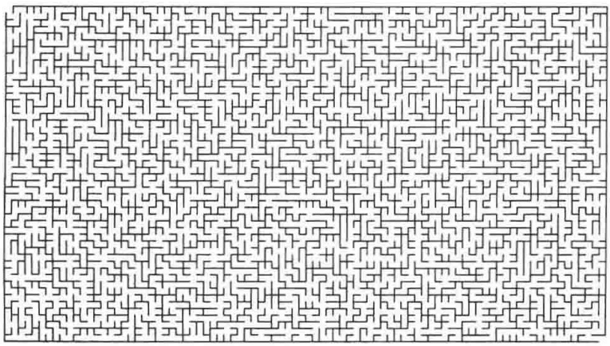

<details>
<summary>natural_image</summary>

Abstract geometric pattern composed of interlocking black lines on white background (no text or symbols)
</details>

图 8.25 一个  $50 \times 88$  的迷宫

---

298

数据结构与算法分析——C++语言描述(第四版)

生成迷宫的一个简单算法是从各处的墙壁开始(除入口和出口之外)。此时，我们不断地随机选择一面墙，如果被该墙分割的单元彼此不连通，那么就把这面墙拆掉。如果重复这个过程直到开始单元和终止单元连通，那么就得到一个迷宫。实际上不断地拆掉墙壁直到每一个单元都可以从每个其他单元达到就更好(这就会使迷宫产生更多误导的路径)。

我们用 $5 \times 5$ 迷宫叙述这个算法。图8.26显示初始的状态。我们用union/find数据结构代表彼此互连的单元的那些集合。开始的时候，各处都有墙，而每个单元都在其自己的等价类中。

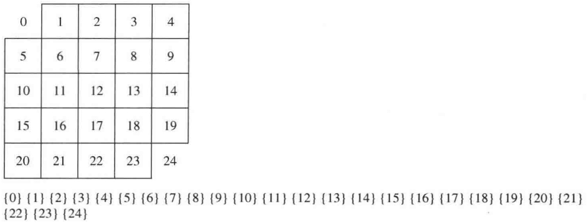

<details>
<summary>text_image</summary>

0 1 2 3 4
5 6 7 8 9
10 11 12 13 14
15 16 17 18 19
20 21 22 23 24
{0} {1} {2} {3} {4} {5} {6} {7} {8} {9} {10} {11} {12} {13} {14} {15} {16} {17} {18} {19} {20} {21}
{22} {23} {24}
</details>

图 8.26 初始状态:所有的墙都存在，所有的单元都在其自己的集合中

图 8.27 显示了算法此后的一个阶段，这是在一些墙被拆掉之后的状态。设在该阶段连接单元 8 和 13 的墙被随机地选作目标。因为单元 8 和 13 已经连通(它们在相同的集合中)，所以我们也就不拆掉这面墙，拆掉它就使得迷宫简单化了。设单元 18 和 13 是随机选出的下一个目标。通过执行两次 find 操作我们看到它们是在不同的集合中，因此单元 18 和 13 还没有连通。于是我们把隔开它们的墙拆掉，如图 8.28 所示。注意，这次操作的结果是包含 18 和 13 的两个集合通过 union 操作被连在一起。这是因为连通到单元 18 的每个单元现在已经连通到与 13 连通的每个单元。该算法结束时各个单元之间都是连通的，构建迷宫的工作完成，如图 8.29 所示。

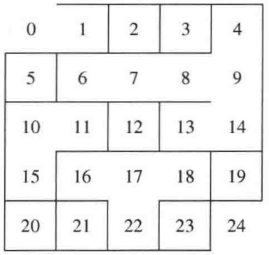

<details>
<summary>treemap</summary>

| Row | Column 1 | Column 2 | Column 3 | Column 4 |
| --- | --- | --- | --- | --- |
| 1 | 0 | 1 | 2 | 3 |
| 2 | 5 | 6 | 7 | 8 |
| 3 | 10 | 11 | 12 | 13 |
| 4 | 15 | 16 | 17 | 18 |
| 5 | 20 | 21 | 22 | 23 |
| 6 | — | — | — | 24 |
</details>

{0,1} {2} {3} {4,6,7,8,9,13,14} {5} {10,11,15} {12} {16,17,18,22} {19} {20} {21} {23} {24}

图 8.27 在算法的某个时刻:几面墙被拆掉，集合合并

如果这个时刻在单元8和13之间的墙被随机地选定，那么这面墙将不拆掉，因为单元8和13已经是连通的。

这个算法的运行时间由 union/find 的开销控制。union/find 总体的大小等于单元的个数。find 操作的次数与单元的个数成正比，因为拆掉的墙的数目比单元的个数少 1，而仔细观察可以发现，开始时墙的数目大约只有单元个数的两倍。因此，如果 N 是单元的个数，由于每

---

第8章 不相交集类

299

面随机选择的墙有两次 find，那么整个算法的 find 操作次数估计(大致)在 2N 和 4N 之间。因此，算法的运行时间可以取为  $O(N \log^{*} N)$ ，这个算法将会很快地生成一个迷宫。

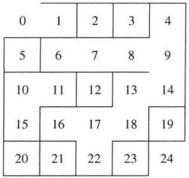

<details>
<summary>treemap</summary>

| Row | Column 1 | Column 2 | Column 3 | Column 4 |
| --- | --- | --- | --- | --- |
| 1 | 0 | 1 | 2 | 3 |
| 2 | 5 | 6 | 7 | 8 |
| 3 | 10 | 11 | 12 | 13 |
| 4 | 15 | 16 | 17 | 18 |
| 5 | 20 | 21 | 22 | 23 |
| 6 | — | — | — | 9 |
| 7 | — | — | — | 14 |
| 8 | — | — | — | 19 |
| 9 | — | — | — | 24 |
</details>

{0, 1} {2} {3} {4, 6, 7, 8, 9, 13, 14, 16, 17, 18, 22} {5} {10, 11, 15} {12} {19} {20} {21} {23} {24}

图 8.28 在图 8.27 中单元 18 和 13 之间的墙被随机地选定。这面墙被拆掉，因为单元 18 和 13 还没有连通。它们所在的集合被合并

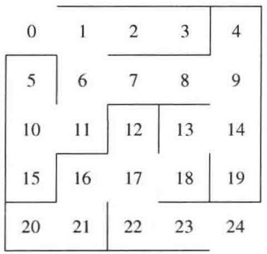

<details>
<summary>treemap</summary>

| Row | Column 1 | Column 2 | Column 3 | Column 4 |
| --- | --- | --- | --- | --- |
| 1 | 0 | 1 | 2 | 3 |
| 2 | 5 | 6 | 7 | 8 |
| 3 | 10 | 11 | 12 | 13 |
| 4 | 15 | 16 | 17 | 18 |
| 5 | 20 | 21 | 22 | 23 |
| 6 | — | — | — | 24 |
</details>

{0, 1, 2, 3, 4, 5, 6, 7, 8, 9, 10, 11, 12, 13, 14, 15, 16, 17, 18, 19, 20, 21, 22, 23, 24}

图 8.29 最后，24 面墙被拆掉，所有的元素都在同一个集合中

## 小结

我们已经看到保持不相交集合的非常简单的数据结构。当 union 操作执行时，就正确性而言，哪个集合保留它的名字是无关紧要的。这里，有必要注意，当某一特定的步骤尚未完全指定的时候，考虑选择方案可能是非常重要的。步骤 union 是灵活的。利用这一优点，我们能够得到一个有效得多的算法。

路径压缩是自调整(self-adjustment)的最早形式之一，我们已经在别的一些地方(伸展树，斜堆)见到过。它的使用极为有趣，特别是从理论的观点来看，因为它是算法简单但最坏情形分析却并不那么简单的第一批例子之一。

## 练习

8.1 指出下列一系列指令的结果:union(1,2), union(3,4), union(3,5), union (1,7), union(3,6), union(8,9), union(1,8), union(3,10), union(3,11), union(3,12), union(3,13), union(14,15), union(16,0), union(14,16), union(1,3), Union(1,14), 其中, union 是

---

300

数据结构与算法分析——C++语言描述(第四版)

a. 任意进行的。
b. 按高度进行的。
c. 按大小进行的。

8.2 对于上题中的每一棵树，用对最深节点的路径压缩执行一次 find。

8.3 编写一个程序来确定路径压缩法和各种求 union 方法的效果。所编程序应该使用所有 6 种可能的方法处理一系列等价操作。

8.4 证明，如果 union 按照高度进行，那么任意树的深度均为  $O(\log N)$ 。

8.5 设 $f(N)$ 是一个严格定义的函数，它把 $N$ 减到一个更小的整数。具有适当初始条件的递推式 $T(N) = (N / f(N))T(f(N)) + N$ 的解是什么？

8.6 a. 证明:如果 $M = N^2$ ，那么 $M$ 次union/find操作的运行时间是 $O(M)$ 。
b. 证明，如果 $M = N\log N$ ，那么 $M$ 次union/find操作的运行时间是 $O(M)$ 。
\*c. 设 $M = \Theta (N\log \log N)$，则 $M$ 次 union/find 操作的运行时间是多少？
\*d. 设 $M = \Theta (N\log^{*}N)$，则 $M$ 次 union/find 操作的运行时间是多少？

8.7 Tarjan 对 union/find 算法的原始界定义  $\alpha(M,N)=\min\{i\geqslant1|(A(i,\lfloor M/N\rfloor))>\log N)\}$ ，其中

$$
A (1, j) = 2 ^ {j} \quad j \geqslant 1
$$

$$
A (i, 1) = A (i - 1, 2) \quad i \geqslant 2
$$

$$
A (i, j) = A (i - 1, A (i, j - 1)) \quad i, j \geqslant 2
$$

这里， $A(m,n)$ 是Ackermann函数(Ackermann function)的一种版本。 $\alpha$ 的这两种定义渐近等价吗？

8.8 证明:对于由 8.7 节中的算法生成的迷宫，从起点到终点的路径是唯一的。

8.9 设计一个生成迷宫的算法，这个迷宫不含有从起点到终点的路径，但却有一个性质，即拆除预先指定(prespecified)的一面墙后则建立一条唯一的路径。

\*8.10 假设我们想要添加一个附加的操作 deunion，它撤销尚未被撤销的最新的 union 操作。

a. 证明:如果按高度求并以及不用路径压缩进行 find，那么 deunion 操作容易进行，并且连续 M 次 union、find 和 deunion 操作花费  $O(M \log N)$  时间。
b. 为什么路径压缩使得 deunion 很难进行?

\*\*c. 指出如何实现所有这三种操作，使得连续 $M$ 次操作花费 $O(M \log N / \log \log N)$ 时间。

\*8.11 设我们想要添加一种额外的操作 remove(x)，该操作把 x 从当前的集合中除去并把它放到它自己的集合中。指出如何修改 union/find 算法使得连续 M 次 union、find 和 remove 操作的运行时间为 $O(M\alpha(M, N))$。

\*8.12 证明，如果所有的 union 都在 find 之前发生，那么，带有路径压缩的不相交集算法需要线性时间，甚至这些 union 操作可以任意地进行。

\*\*8.13 证明，如果诸 union 操作任意进行，但路径压缩是对那些 find 进行，那么最坏情形运行时间为  $\Theta(M \log N)$ 。

\*8.14 证明:如果 union 按大小进行且执行路径压缩，那么最坏情形运行时间为 $O(M\alpha(M, N))$。

---

第 8 章 不相交集类

301

8.15 在 8.6 节进行的不相交集分析还可以精化，以对小的 N 提供严紧的界 (tight bound)。

a. 证明 $C(M, N, 0)$ 和 $C(M, N, 1)$ 皆为0。
b. 证明 $C(M, N, 2)$ 最多为 $M$。
c. 令 $r \leqslant 8$ 。选择 $s = 2$ ，证明 $C(M, N, r)$ 最多为 $M + N$ 。

8.16 设我们实现对 find(i) 的部分路径压缩 (partial path compression) 是通过使在从 i 到根的路径上的每一个其他节点链接到其祖父 (当有意义时) 完成的。这叫作路径平分 (path halving)。

a.. 编写一个过程完成上述工作。
b. 证明，如果对诸 find 操作进行路径平分，并且或者使用按高度求并或者使用按大小求并，则其最坏情形运行时间为  $O(M\alpha(M,N))$ 。

8.17 编写一个能够生成任意大小的迷宫的程序。如果你正在使用带有分屏软件包 (windowing package) 的系统，那么就来生成一个类似于图 8.25 那样的迷宫。否则，将迷宫进行文本表述(例如，输出的每一行代表一个方格，并且含有关于哪些墙存在的信息)，并让你的程序生成一个迷宫图。

## 参考文献

求解 union/find 问题的各种方案可以在文献[6]、[9]和[11]中找到。Hopcroft 和 Ullman 使用非递归分解证明了一个 $O(M \log^{*} N)$ 界。Tarjan$^{[16]}$ 则得到界 $O(M \alpha(M, N))$，其中 $\alpha(M, N)$ 如练习 8.7 中的定义。对于 $M < N$ 的更精确 (但渐近恒等) 的界见于文献[2]和[19]。8.6 节中的分析取自 Seidel 和 Sharir$^{[15]}$。对路径压缩和 union 的各种其他方法也达到相同的界，详细细节见论文[19]。

由 Tarjan $^{[17]}$ 给出的一个下界指出，在一定的限制下处理 M 次 union/find 操作需要  $\Omega(M\alpha(M,N))$  时间。在一些较少的限制条件下文献 $^{[7]}$ 和 $^{[14]}$ 指出相同的界。

union/find 数据结构的应用见于文献[1]和[10]。union/find 问题的某些特殊情形可以以 $O(M)$ 时间解决，见文献[8]。这使得若干算法的运行时间得以降低一个 $\alpha(M, N)$ 因子，如文献[1]、图优势(graph dominance)以及可约性(见第9章的参考文献)。但另外一些问题并未受到影响，像文献[10]和下一章中的图连通性问题等。这篇论文列出了10个例子。Tarjan还对若干图论问题使用路径压缩得到一些有效的算法[18]。

union/find 问题一些平均情形的结果见于文献[5]、[12]、[22]和[3]。一些为任意单次操作确定运行时间界的结果(与整个运算序列不同)可在文献[4]和[13]中找到。

练习8.10在文献[21]中解决。一般的union/find结构在文献[20]中给出，这种结构支持更多的操作。

1. A. V. Aho, J. E. Hopcroft, and J. D. Ullman, "On Finding Lowest Common Ancestors in Trees," SIAM Journal on Computing, 5 (1976), 115–132.
2. L. Banachowski, "A Complement to Tarjan's Result about the Lower Bound on the Complexity of the Set Union Problem," Information Processing Letters, 11 (1980), 59–65.
3. B. Bollobás and I. Simon, "Probabilistic Analysis of Disjoint Set Union Algorithms," SIAM Journal on Computing, 22 (1993), 1053–1086.

---

302

数据结构与算法分析——C++语言描述(第四版)

4. N. Blum, "On the Single-Operation Worst-Case Time Complexity of the Disjoint Set Union Problem," SIAM Journal on Computing, 15 (1986), 1021–1024.
5. J. Doyle and R. L. Rivest, "Linear Expected Time of a Simple Union Find Algorithm," Information Processing Letters, 5 (1976), 146–148.
6. M. J. Fischer, "Efficiency of Equivalence Algorithms," in Complexity of Computer Computation (eds. R. E. Miller and J. W. Thatcher), Plenum Press, New York, 1972, 153–168.
7. M. L. Fredman and M. E. Saks, "The Cell Probe Complexity of Dynamic Data Structures," Proceedings of the Twenty-first Annual Symposium on Theory of Computing (1989), 345–354.
8. H. N. Gabow and R. E. Tarjan, "A Linear-Time Algorithm for a Special Case of Disjoint Set Union," Journal of Computer and System Sciences, 30 (1985), 209–221.
9. B. A. Galler and M. J. Fischer, "An Improved Equivalence Algorithm," Communications of the ACM, 7 (1964), 301–303.
10. J. E. Hopcroft and R. M. Karp, "An Algorithm for Testing the Equivalence of Finite Automata," Technical Report TR-71-114, Department of Computer Science, Cornell University, Ithaca, N.Y., 1971.
11. J. E. Hopcroft and J. D. Ullman, "Set Merging Algorithms," SIAM Journal on Computing, 2 (1973), 294–303.
12. D. E. Knuth and A. Schonhage, "The Expected Linearity of a Simple Equivalence Algorithm," Theoretical Computer Science, 6 (1978), 281–315.
13. J.A. LaPoutre, "New Techniques for the Union-Find Problem," Proceedings of the First Annual ACM-SIAM Symposium on Discrete Algorithms (1990), 54–63.
14. J. A. LaPoutre, "Lower Bounds for the Union-Find and the Split-Find Problem on Pointer Machines," Proceedings of the Twenty-second Annual ACM Symposium on Theory of Computing (1990), 34–44.
15. R. Seidel and M. Sharir, "Top-Down Analysis of Path Compression," SIAM Journal on Computing, 34 (2005), 515–525.
16. R. E. Tarjan, "Efficiency of a Good but Not Linear Set Union Algorithm," Journal of the ACM, 22 (1975), 215–225.
17. R. E. Tarjan, "A Class of Algorithms Which Require Nonlinear Time to Maintain Disjoint Sets," Journal of Computer and System Sciences, 18 (1979), 110–127.
18. R. E. Tarjan, "Applications of Path Compression on Balanced Trees," Journal of the ACM, 26 (1979), 690–715.
19. R. E. Tarjan and J. van Leeuwen, "Worst-Case Analysis of Set Union Algorithms," Journal of the ACM, 31 (1984), 245–281.
20. M. J. van Kreveld and M. H. Overmars, "Union-Copy Structures and Dynamic Segment Trees," Journal of the ACM, 40 (1993), 635–652.
21. J. Westbrook and R. E. Tarjan, "Amortized Analysis of Algorithms for Set Union with Backtracking," SIAM Journal on Computing, 18 (1989), 1–11.
22. A. C. Yao, "On the Average Behavior of Set Merging Algorithms," Proceedings of Eighth Annual ACM Symposium on the Theory of Computation (1976), 192–195.
