# 第9章 图论算法

原始 PDF 第 317–366 页。

## 第9章 图论算法

在这一章，我们讨论图论中几个普遍的问题。其中提到的一些算法不仅在实践中有用，而且还非常有趣，因为在许多实际的应用中，若不仔细注意数据结构的选择，则将导致这些算法速度过慢。本章我们将

● 介绍几个现实生活中发生的问题，它们可以转化成图论问题。

\- 给出一些算法以解决几个常见的图论问题。

\- 指出适当选择数据结构可以极大地降低这些算法的运行时间。

\- 介绍一个被称为深度优先搜索(depth-first search)的重要技巧，并指出它如何能够以线性时间求解若干表面看似复杂的问题。

## 9.1 若干定义

一个图(graph) $G = (V, E)$ 由顶点(vertex)的集 $V$ 和边(edge)的集 $E$ 组成。每一条边就是一付点对 $(v, w)$，其中 $v, w \in V$。有时也把边称作弧(arc)。如果点对是有序的，那么图就叫作有向(directed)的。有向的图有时也叫作有向图(digraph)。顶点 $w$ 邻接(adjacent)到 $v$ 当且仅当 $(v, w) \in E$。在一个具有边 $(v, w)$ 从而具有边 $(w, v)$ 的无向图(undirected graph)中，$w$ 邻接到 $v$ 且 $v$ 也邻接到 $w$。有时候边还具有第三种成分，称做权(weight)或值(cost)。

图中的一条路径(path)是一个顶点序列 $w_{1}, w_{2}, w_{3}, \cdots, w_{N}$，使得 $(w_{i}, w_{i+1}) \in E$，$1 \leqslant i < N$。这样一条路径的长(length of a path)为该路径上的边数，它等于 $N-1$。从一个顶点到它自身可以看成是一条路径。如果路径不包含边，那么路径的长为 0。这是定义特殊情形的一种方便的方法。如果图含有一条从一个顶点到它自身的边 $(v, v)$，那么路径 $v, v$ 有时候也叫作一个环(loop)。我们要讨论的图一般将是无环的。一条简单路径(simple path)是这样一条路径，其上的所有顶点都是互异的，但第一个顶点和最后一个顶点可能相同。

有向图中的圈 (cycle) 是满足 $w_{1} = w_{N}$ 且长至少为 1 的一条路径。如果这条路径是简单路径，那么这个圈就是简单圈 (simple cycle)。对于无向图，我们要求边是互异的。这些要求的根据在于无向图中的路径 $u, v, u$ 不应该被认为是圈，因为 $(u, v)$ 和 $(v, u)$ 是同一条边。但是在有向图中它们则是两条不同的边，因此称它们为圈是有意义的。如果一个有向图没有圈，则称其为无圈的 (acyclic)。一个有向无圈图有时也简称为 DAG。

如果在一个无向图中从每一个顶点到每个其他顶点都存在一条路径，则称该无向图是连通的 (connected)。具有这样性质的有向图称为是强连通的 (strongly connected)。如果一个有向图不是强连通的，但是它的基础图 (underlying graph) (即其弧上去掉方向所形成的图) 是连通的，那么该有向图称为是弱连通的 (weakly connected)。完全图 (complete graph) 是其每一对顶点间都存在一条边的图。

现实生活中能够用图进行模拟的一个例子是航空系统。每个机场都是一个顶点，在由两个顶点表示的机场间如果存在一条直达航线，那么这两个顶点就用一条边连接。边可以有一个权，表示飞

---

304

数据结构与算法分析——C++语言描述(第四版)

行的时间、距离或费用。有理由假设，这样的一个图是有向图，因为在不同的方向上飞行可能所用时间或所花的费用会不同(例如，依赖于地方税)。可能我们更愿意航空系统是强连通的，这样就总能够从任一机场飞到另外的任意一个机场。我们也可能愿意迅速确定任意两个机场之间的最佳航线。“最佳”可以是指最少边数的路径，也可以是对一种或所有的权重量度所算出的最佳者。

交通流可以用一个图来模型化。每一个街道交叉路口表示一个顶点，而每一条街道就是一条边。边的值可能代表速度限度，或是容量(车道的数目)，等等。此时我们可能需要找出一条最短路径，或用上述信息找出交通瓶颈最可能的位置。

在本章的其余部分，我们将考查图论的几个更多的应用，这些图中有许多可能是相当巨大的，因此我们使用的算法的效率非常重要。

## 9.1.1 图的表示

我们将考虑有向图(无向图可类似表示)。

现在假设我们可以从 1 开始对顶点编号。图 9.1 所示的图表示 7 个顶点和 12 条边。

表示图的一种简单的方法是使用一个二维数组，称为邻接矩阵(adjacent matrix)表示法。对于每条边 $(u, v)$，我们置 $A[u][v]$ 为 true；否则，数组的对应元素就是 false。如果边有一个权，那么我们可以置 $A[u][v]$ 等于该权，而使用一个很大或者很小的权作为标记表示不存在的边。例如，如果寻找最便宜的航空路线，那么可以用值 $\infty$ 来表示不存在的航线。如果出于某种原因我们寻找最昂贵的航空路线，那么可以用 $-\infty$ （或者也许使用 0）来表示不存在的边。

虽然这种表示的优点是非常简单，但是，它的空间需求则为 $\Theta(|V|^{2})$ ，如果图的边不是很多，那么这种表示的代价就太大了。若图是稠密(dense)的: $|E|=\Theta(|V|^{2})$ ，则邻接矩阵就是一种合适的表示方法。不过，在我们将要看到的大部分应用中，情况并不如此。例如，设用图表示一个街道地图，街道呈曼哈顿式的方向，其中几乎所有的街道或者南北向，或者东西向。因此，任一路口大致都有4条街道，于是，如果图是有向图且所有的街道都是双向的，则 $|E|\approx4|V|$ 。如果有3000个路口，那么我们就得到一个3000顶点的图，该图有12000条边，它们需要一个大小为9000000的数组。该数组的大部分元素将是0。直观看来这是很糟的，因为我们想要我们的数据结构表示那些实际存在的数据，而不是去表示不存在的数据。

如果图不是稠密的，换句话说，如果图是稀疏的(sparse)，则更好的解决方法是使用邻接表(adjacency list)表示。对每一个顶点，我们使用一个表存放所有邻接的顶点。此时的空间需求为 $O(|E| + |V|)$，它相对于图的大小而言是线性的。①这种抽象表示方法应该可以从图9.2清楚地看出。如果边有权，那么这一附加的信息也可以存储在邻接表中。

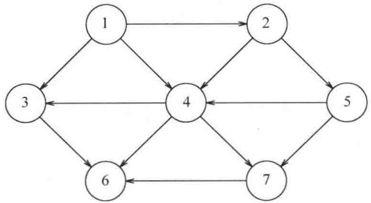

<details>
<summary>flowchart</summary>

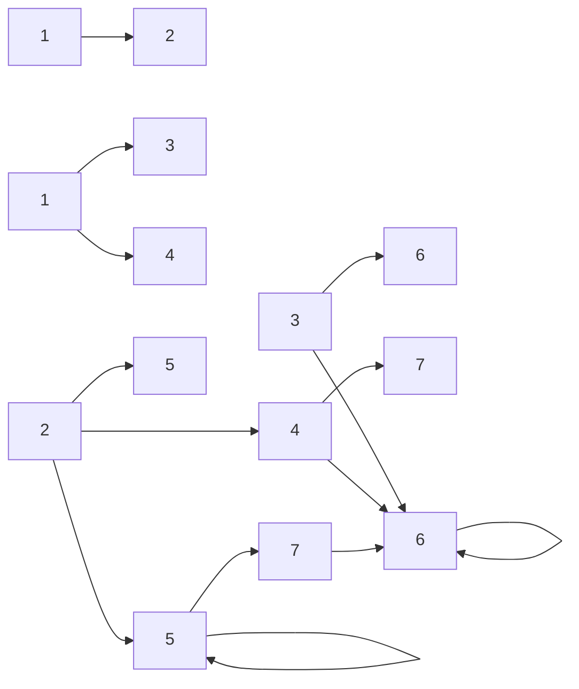
</details>

图9.1 一个有向图

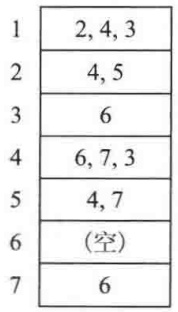

<details>
<summary>text_image</summary>

1 2,4,3
2 4,5
3 6
4 6,7,3
5 4,7
6 (空)
7 6
</details>

图 9.2 图的邻接表表示法

<small><span class="docvortex-page-footnote" data-block-type="page_footnote" style="color:#6b7280">① 当我们谈到线性时间图论算法的时候，要求运行时间为  $O(|E| + |V|)$ 。</span></small>

---

第9章 图论算法

305

邻接表是表示图的标准方法。无向图可以类似地表示。每条边 $(u, v)$ 出现在两个表中，因此空间的使用基本上是双倍的。在图论算法中通常需要找出与某个给定顶点 $v$ 邻接的所有的顶点。而这可以通过简单地扫描相应的邻接表来完成，所用时间与这些找到的顶点的个数成正比。

有几种方法保留邻接表。首先注意到，这些邻接表本身可以被保存在 vector 中或保存在 list 中。然而，对于稀疏的图，当使用 vector 时程序员可能需要用一个比默认更小的容量初始化每一个 vector 对象，否则可能造成明显的空间浪费。

因为对任一顶点，重要的关键在于能够迅速得到与该顶点邻接的那些顶点的表，所以两个基本的选择是，或者使用一个映射，在这个映射下，关键字是顶点而其值就是相应的邻接表，或者把每一个邻接表作为 Vertex 类的数据成员保存起来。第 1 个选择论证要简单，而第 2 个选择可能会更快，因为它避免了在映射下的重复查找。

在第 2 种选择下，如果顶点是一个 string(例如，一个机场名或街道路口名)，那么可以使用映射。在映射下，关键字是顶点名而关键字的值则是一个 Vertex(一般情况是一个指向 Vertex 的指针)，并且每个 Vertex 对象都保留那些指向邻接顶点的指针的一个表，或许还有原始的 string 类对象的名字。

在本章的大部分情况下我们均使用伪代码表示图论算法。这么做将节省空间，当然也使得算法的表达要清晰得多。在9.3节末尾，我们提供一个例程的 $\mathrm{C}++$ 实现，它基本利用最短路径算法以得到问题的答案。

## 9.2 拓扑排序

拓扑排序(topological sort)是对有向无圈图的顶点的一种排序，使得如果存在一条从 $v_{i}$ 到$v_{j}$ 的路径，那么在排序中 $v_{j}$ 就在 $v_{i}$ 的之后出现。在图9.3中的图表示迈阿密州立大学的课程先修结构(course prerequisite structure)。有向边 $(v,w)$ 表明课程 $v$ 必须在课程 $w$ 选修前修完。这些课程的拓扑排序是不破坏课程先修要求的任意的课程序列。

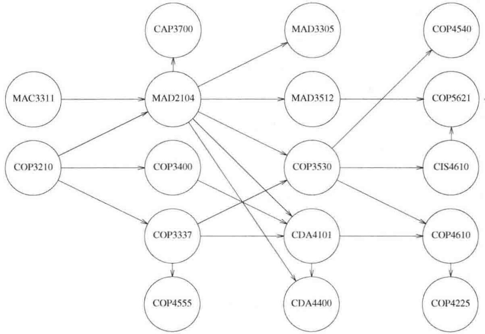

<details>
<summary>flowchart</summary>

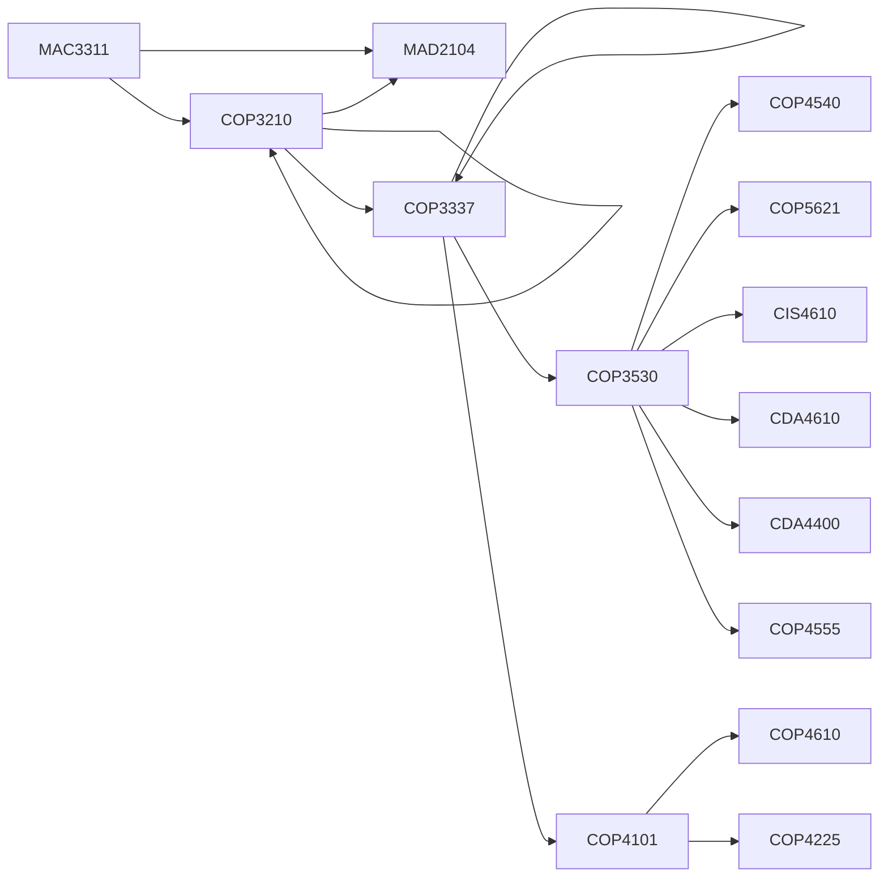
</details>

图 9.3 表示课程先修结构的无圈图

显然，如果图含有圈，那么进行拓扑排序是不可能的，因为对于圈上的两个顶点 $v$ 和 $w$

---

306

数据结构与算法分析——C++语言描述(第四版)

$v$ 先于 $w$ 同时 $w$ 又先于 $v$。此外，拓扑排序不必是唯一的，任何合理的排序都是可以的。在图9.4中，$v_{1}, v_{2}, v_{5}, v_{4}, v_{3}, v_{7}, v_{6}$ 和 $v_{1}, v_{2}, v_{5}, v_{4}, v_{7}, v_{3}, v_{6}$ 两个都是拓扑排序。

一个简单的求拓扑排序的算法是先找出任意一个没有入边(incoming edge)的顶点。然后我们显示出该顶点，并将它和它的边一起从图中删除。然后，我们对图的其余部分继续应用这样的方法来处理。

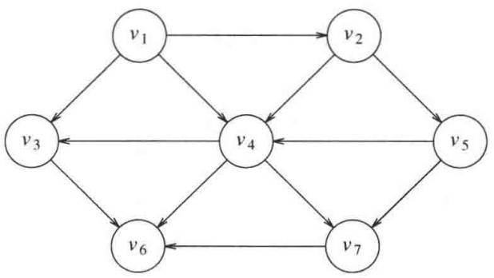

<details>
<summary>flowchart</summary>

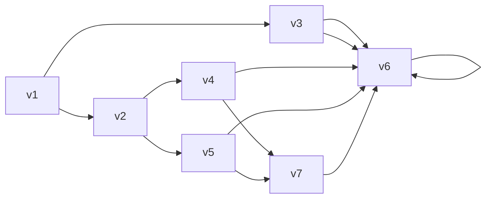
</details>

图9.4 一个无圈图

为了将上述方法形式化，我们把顶点 $v$ 的入度(indegree)定义为边 $(u, v)$ 的条数。我们计算图中所有顶点的入度。假设每一个顶点的入度均被存储，并且图被读入一个邻接表中，则此时可以应用图9.5中的算法生成一个拓扑排序。

```cpp
void Graph::topsort( )
{
    for( int counter = 0; counter < NUM_VERTICES; counter++ )
    {
        Vertex v = findNewVertexOfIndegreeZero( );
        if( v == NOT_A_VERTEX )
            throw CycleFoundException{ };
        v.topNum = counter;
        for each Vertex w adjacent to v
            w.indegree--;
    }
}
```

图 9.5 简单拓扑排序的伪代码

函数 findNewVertexOfIndegreeZero 扫描数组, 寻找一个尚未被分配拓扑编号的入度为 0 的顶点。如果这样的顶点不存在, 那么它返回 NOT A VERTEX。这就说明该图有圈。

因为函数 findNewVertexOfIndegreeZero 是对顶点数组的一个简单的顺序扫描，所以每次对它的调用都花费 $O(|V|)$ 时间。由于有 $|V|$ 次这样的调用，因此该算法的运行时间为 $O(|V|^2)$。

通过更仔细地关注这样的数据结构，我们可以做得更好。产生如此差的运行时间的原因在于对顶点数组的顺序扫描。如果图是稀疏的，那么我们就可以预知，在每次迭代期间只有少数顶点的入度被更新。然而，虽然只有一小部分发生变化，但在搜索入度为 0 的顶点时我们(潜在地)查看了所有的顶点。

我们可以通过将所有(未分配拓扑编号)的入度为0的顶点放在一个特殊的盒子中而消除这种无效的劳动。此时 findNewVertexOfIndegreeZero 函数返回(并删除)该盒子中的任一顶点。当我们将它的邻接顶点的入度减1时，检查每一个顶点并在它的入度降为0时把它放入盒子中。

为实现这个盒子，可以使用一个栈或一个队列。我们将使用队列。首先，对每个顶点计算它的入度。然后，将所有入度为0的顶点放入一个初始为空的队列中。当队列不空时，删除一个顶点 $v$ ，并将邻接到 $\nu$ 的所有顶点的入度均减1。只要一个顶点的入度降为0，就把该顶点放入队列中。此时，拓扑排序就是顶点出队的顺序。图9.6显示了每一阶段之后的状态。

---

第9章 图论算法

307

<table><tr><td colspan="8">出队之前的入度</td></tr><tr><td>顶点</td><td>1</td><td>2</td><td>3</td><td>4</td><td>5</td><td>6</td><td>7</td></tr><tr><td> $v_1$ </td><td>0</td><td>0</td><td>0</td><td>0</td><td>0</td><td>0</td><td>0</td></tr><tr><td> $v_2$ </td><td>1</td><td>0</td><td>0</td><td>0</td><td>0</td><td>0</td><td>0</td></tr><tr><td> $v_3$ </td><td>2</td><td>1</td><td>1</td><td>1</td><td>0</td><td>0</td><td>0</td></tr><tr><td> $v_4$ </td><td>3</td><td>2</td><td>1</td><td>0</td><td>0</td><td>0</td><td>0</td></tr><tr><td> $v_5$ </td><td>1</td><td>1</td><td>0</td><td>0</td><td>0</td><td>0</td><td>0</td></tr><tr><td> $v_6$ </td><td>3</td><td>3</td><td>3</td><td>3</td><td>2</td><td>1</td><td>0</td></tr><tr><td> $v_7$ </td><td>2</td><td>2</td><td>2</td><td>1</td><td>0</td><td>0</td><td>0</td></tr><tr><td>入队</td><td> $v_1$ </td><td> $v_2$ </td><td> $v_5$ </td><td> $v_4$ </td><td> $v_3, v_7$ </td><td></td><td> $v_6$ </td></tr><tr><td>出队</td><td> $v_1$ </td><td> $v_2$ </td><td> $v_5$ </td><td> $v_4$ </td><td> $v_3$ </td><td> $v_7$ </td><td> $v_6$ </td></tr></table>

图 9.6 对图 9.4 中的图应用拓扑排序的结果

这个算法的伪代码实现在图 9.7 中给出。和前面一样，我们将假设图已经被读到一个邻接表中，并假设入度均被算出且和顶点一起被存储。我们还假设每个顶点有一个域，叫作 topNum，其中存放的是顶点的拓扑编号。

```cpp
void Graph::topsort( )
{
    Queue<Vertex> q;
    int counter = 0;

    q.makeEmpty( );
    for each Vertex v
        if( v.indegree == 0 )
            q.enqueue( v );

    while( !q.isEmpty( ) )
    {
        Vertex v = q.dequeue( );
        v.topNum = ++counter;  // 分配下一个拓扑编号

        for each Vertex w adjacent to v
            if( --w.indegree == 0 )
                q.enqueue( w );
    }

    if( counter != NUM_VERTICES )
        throw CycleFoundException{ };
}
```

图 9.7 实施拓扑排序的伪代码

如果使用邻接表，那么执行这个算法所用的时间为  $O(|E| + |V|)$ 。当认识到 for 循环体对每条边最多执行一次时，这个结果是显然的。入度的计算可以由下列代码完成。同样，计算的开销也是  $O(|E| + |V|)$ ，尽管这里存在一些嵌套的循环。

```matlab
for each Vertex v
    v.indegree = 0;

for each Vertex v
    for each Vertex w adjacent to v
        w.indegree++;
```

---

308

数据结构与算法分析——C++语言描述(第四版)

队列操作对每个顶点最多进行一次，而其他的初始化步骤，包括入度的计算，所花费的时间也与图的大小呈正比。

## 9.3 最短路径算法

这一节我们考查各种最短路径问题。输入是一个赋权图:与每条边 $(v_{i}, v_{j})$ 相联系的是穿越该边的开销(或称为值) $c_{i,j}$ 。一条路径 $v_{1}v_{2}\cdots v_{N}$ 的值是 $\sum_{i=1}^{N-1}c_{i,i+1}$ ，叫作赋权路径长(weighted path length)。而无权路径长(unweighted path length)只是路径上的边数，即N-1。

单源最短路径问题(Single-Source Shortest-Path Problem):

给定一个赋权图 $G = (V, E)$ 和一个特定顶点 $s$ 作为输入，找出从 $s$ 到 $G$ 中每一个其他顶点的最短赋权路径。

例如，在图9.8中，从 $v_{1}$ 到 $v_{6}$ 的最短赋权路径的值为6，它是从 $v_{1}$ 到 $v_{4}$ 到 $v_{7}$ 再到 $v_{6}$ 的路径。在这两个顶点间的最短无权路径长为2。一般说来，当不指明我们讨论的是赋权路径还是无权路径时，如果图是赋权的，那么路径就是赋权的。还要注意，在图9.8中，从 $v_{6}$ 到 $v_{1}$ 没有路径。

前面例子中的图没有负值的边。图 9.9 中的图指出负边可能产生的问题。从 $v_{5}$ 到 $v_{4}$ 的路径的值为 1，但是，通过下面的循环 $v_{5}, v_{4}, v_{2}, v_{5}, v_{4}$ 存在一条更短的路径，它的值是 -5。这条路径仍然不是最短的，因为我们可以任意长地滞留在循环中。因此，在这两个顶点间的最短路径问题是不确定的。类似地，从 $v_{1}$ 到 $v_{6}$ 的最短路径也是不确定的，因为我们可以进入同样的循环。这个循环叫作负值圈 (negative-cost cycle)。当它出现在图中时，最短路径问题就是不确定的。有负值的边未必就是坏事，但是它们的出现似乎使问题增加了难度。为方便起见，在没有负值圈时，从 $s$ 到 $s$ 的最短路径为 0。

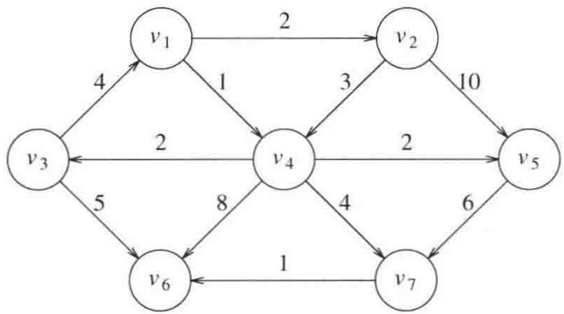

<details>
<summary>flowchart</summary>

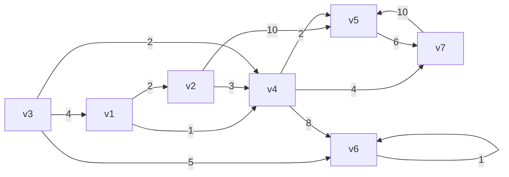
</details>

图9.8 一个有向图 $G$

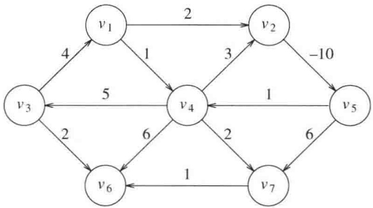

<details>
<summary>flowchart</summary>

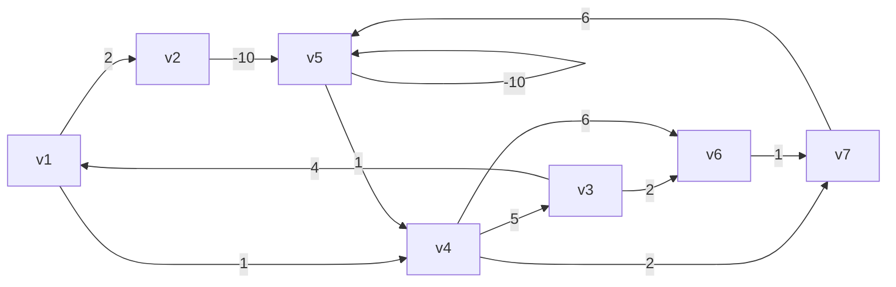
</details>

图9.9 带有负值圈的图

有许多的例子使我们可能要去求解最短路径问题。如果顶点代表计算机，边代表计算机间的链接，值表示通信的费用(每MB数据的电话费)，延迟成本(传输每MB所需要的秒数)，或它们与其他一些因素的组合，那么我们可能利用最短路算法来找出从一台计算机向一组其他计算机发送电子新闻的最便宜的方法。

我们可能使用图建立航线或其他大规模运输路线的模型，并利用最短路径算法计算两点间的最佳路线。在这样的以及许多实际的应用中，我们可能想要找出从一个顶点 $s$ 到另一个顶点 $t$ 的最短路径。当前，还不存在找出从 $s$ 到一个顶点的路径比找出从 $s$ 到所有顶点路径更快(快得超出一个常数因子)的算法。

---

第9章 图论算法

309

我们将考查求解该问题4种形态的算法。首先，要考虑无权最短路径问题，并指出如何以 $O(|E| + |V|)$ 时间求解它。其次，我们还要介绍，如果假设没有负边，那么如何求解赋权最短路径问题。这个算法在使用一些合理的数据结构实现时的运行时间为 $O(|E|\log |V|)$ 。

如果图有负边，那么我们将提供一个简单的解法，不过它的时间界不理想，为 $O(|E|\cdot |V|)$ 。最后，我们将以线性时间解决无圈图这种特殊情形的赋权问题。

## 9.3.1 无权最短路径

图9.10表示一个无权图 $G$ 。使用某个顶点 $s$ 作为输入参数，我们想要找出从 $s$ 到所有其他顶点的最短路径。我们只对包含在路径中的边数有兴趣，因此在边上不存在权。显然，这是赋权最短路径问题的特殊情形，因为可以为所有的边都赋以权1。

暂时假设我们只对最短路径的长而不是具体的路径本身有兴趣。记录实际的路径只不过是简单的簿记问题。

设我们选择 $s$ 为 $v_{3}$ 。此时立刻可以说出从 $s$ 到 $v_{3}$ 的最短路径是长为0的路径。把这个信息做个标记，得到图9.11。

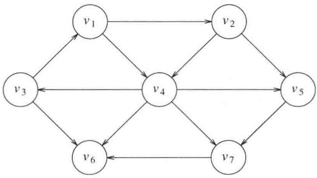

<details>
<summary>flowchart</summary>

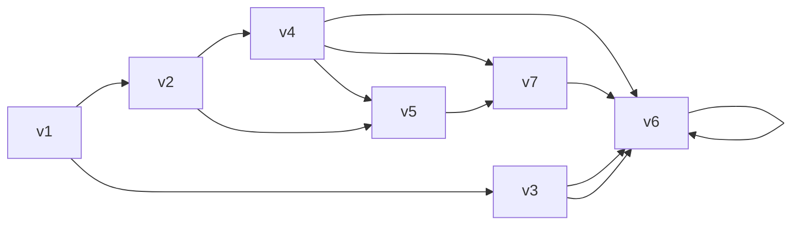
</details>

图 9.10 一个无权有向图 G

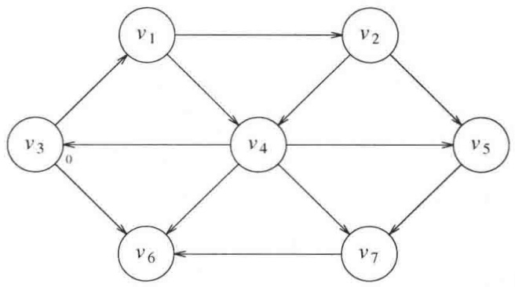

<details>
<summary>flowchart</summary>


</details>

图9.11 将开始节点标记为通过0条边可以到达的节点后的图

现在可以开始寻找所有从 $s$ 出发距离为1的顶点。这些顶点可以通过考查邻接到 $s$ 的那些顶点找到。此时我们看到，$v_{1}$ 和 $v_{6}$ 从 $s$ 出发只一边之遥，我们把它表示在图9.12中。

现在可以开始找出那些从 $s$ 出发最短路径恰为2的顶点，我们找出所有邻接到 $\nu_{1}$ 和 $\nu_{6}$ 的顶点(即距离为1处的顶点)，它们的最短路径还不知道。这次搜索告诉我们，到 $\nu_{2}$ 和 $\nu_{4}$ 的最短路径长为2。图9.13显示到现在为止已经做出的工作。

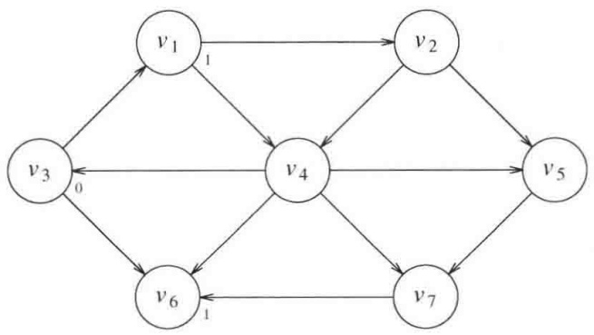

<details>
<summary>flowchart</summary>

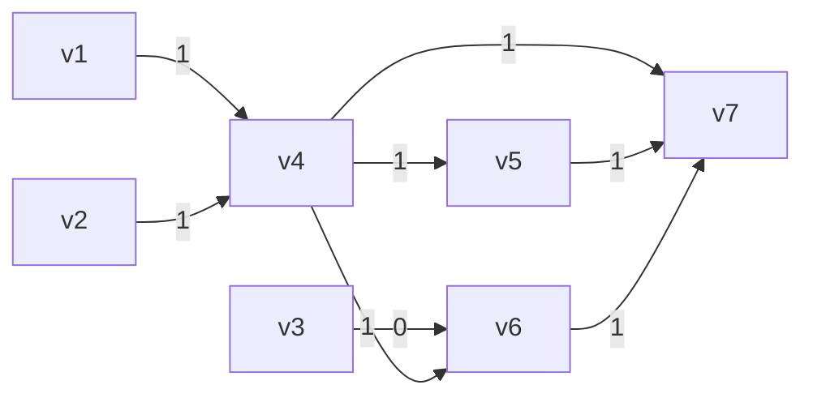
</details>

图9.12 找出所有从 $s$ 出发路径长为1的顶点之后的图

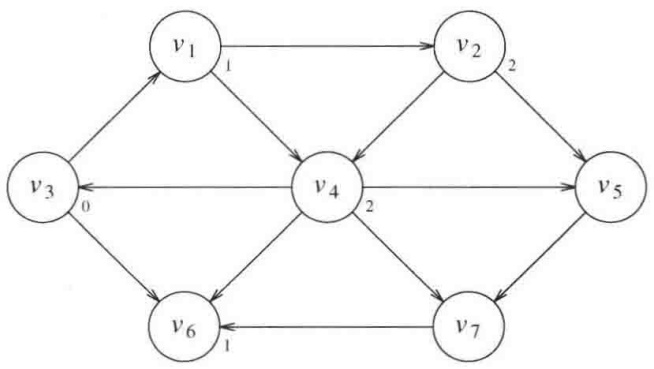

<details>
<summary>flowchart</summary>

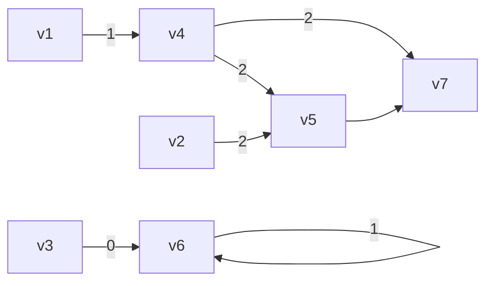
</details>

图9.13 找出所有从 $s$ 出发路径长为2的顶点之后的图

最后，通过考查那些邻接到刚被赋值的 $v_{2}$ 和 $v_{4}$ 的顶点可以发现，$v_{5}$ 和 $v_{7}$ 各有一条三边的最短路径。现在所有的顶点都已经被计算，图9.14显示出算法的最后结果。

---

310

数据结构与算法分析——C++语言描述(第四版)

这种搜索图的方法称为广度优先搜索(breadth-first search)。该方法按层处理顶点:距开始点最近的那些顶点首先被求值，而最远的那些顶点最后被求值。这很像对树的层序遍历(level-order traversal)。

有了这种方法，我们必须把它翻译成代码。图 9.15 显示出算法将要用到的表的初始配置，该表记录算法的进行过程。

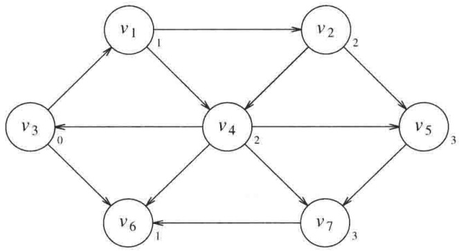

<details>
<summary>flowchart</summary>

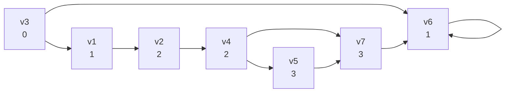
</details>

图 9.14 最终得到的各条最短路径

| $\nu$ | known | ${d}_{\nu }$ | ${p}_{\nu }$ |
| --- | --- | --- | --- |
| ${v}_{1}$ | F | ∞ | 0 |
| ${v}_{2}$ | F | ∞ | 0 |
| ${v}_{3}$ | F | 0 | 0 |
| ${v}_{4}$ | F | ∞ | 0 |
| ${v}_{5}$ | F | ∞ | 0 |
| ${v}_{6}$ | F | ∞ | 0 |
| ${v}_{7}$ | F | ∞ | 0 |

图 9.15 用于无权最短路径计算的表的初始配置

对于每个顶点，我们将跟踪3条信息。首先，我们把从s开始到顶点的距离放到 $d_{v}$ 栏中。开始的时候，除s外所有的顶点都是不可达到的，而s的路径长为0。 $p_{v}$ 栏中的项为簿记变量，它将使我们能够显示出实际的路径。known栏中的项在顶点被处理以后置为true。最初，所有的项都不是known的，包括开始顶点。当一个顶点被标记为known时，我们就有了不会再找到更便宜的路径的保证，因此对该顶点的处理实质上已经完成。

基本的算法在图9.16中描述。图9.16中的算法模拟这些图表，它把距离 $d = 0$ 上的顶点声明为known的，然后声明 $d = 1$ 上的顶点为known，再声明 $d = 2$ 上的顶点为known，等等，并且将仍然是 $d_w = \infty$ 的所有邻接的顶点 $w$ 置为距离 $d_w = d + 1$ 。

```cpp
void Graph::unweighted( Vertex s )
{
    for each Vertex v
    {
        v.dist = INFINITY;
        v.known = false;
    }

    s.dist = 0;

    for( int currDist = 0; currDist < NUM_VERTICES; currDist++ )
        for each Vertex v
            if( !v.known && v.dist == currDist )
            {
                v.known = true;
                for each Vertex w adjacent to v
                    if( w.dist == INFINITY )
                    {
                        w.dist = currDist + 1;
                        w.path = v;
                    }
                }
}
```

图 9.16 无权最短路径算法的伪代码

---

第9章 图论算法

311

通过追溯  $p_{v}$  变量，可以显示具体的路径。在讨论赋权的情形时，我们将会看到算法是如何进行的。

由于双层嵌套的 for 循环, 因此该算法的运行时间为 $O(|V|^2)$ 。一个明显的低效之处在于, 尽管所有的顶点早就成为 known 了, 但是外层循环还是要继续, 直到 NUM\_VERTICES-1 为止。虽然额外的附加测试可以避免这种情形发生, 但是它并不能影响最坏情形运行时间, 在以点 $v_9$ 作为起点的图 9.17 中的图作为输入时, 通过概括所发生的情况即可看出这一点。

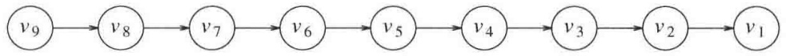

<details>
<summary>flowchart</summary>

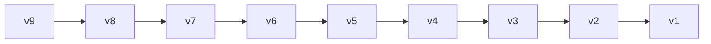
</details>

图 9.17 使用图 9.16 的无权最短路径算法的坏情形

我们可以用非常类似于对拓扑排序所做的那样来排除这种低效性。在任一时刻，只存在两种类型其 $d_{\nu} \neq \infty$ 的 unknown 顶点。一些顶点的 $d_{\nu} = \text{currDist}$，而其余的则有 $d_{\nu} = \text{currDist} + 1$。由于这种附加的结构，因此搜索整个表以找出合适的顶点的做法是非常浪费的。

一种颇为简单但抽象的解决方案是保留两个盒子。1号盒将装有 $d_{v} = \mathrm{currDist}$ 的那些unknown顶点，而2号盒则装有 $d_{v} = \mathrm{currDist} + 1$ 的那些顶点。找出一个合适顶点 $\nu$ 的测试可以用查找1号盒内的任意顶点代替。在更新 $w$ (内层if语句块的内部)以后，我们可以把 $w$ 加到2号盒中。在外层for循环终止以后，1号盒是空的，而2号盒则可转换成1号盒以进行下一趟for循环。

这种想法也可以通过使用一个队列而被进一步精化。在迭代开始的时候，队列只含有距离为 currDist 的那些顶点。当我们添加那些距离为 currDist+1 的邻接顶点时，由于它们自队尾入队，因此这就保证它们直到所有距离为 currDist 的顶点都被处理之后才被处理。在距离为 currDist 处的最后一个顶点出队并被处理之后，队列只含有距离为 currDist+1 的顶点，因此该过程将会不断进行下去。我们只需要把开始的节点放入队列中以启动这个过程即可。

精练的算法如图 9.18 所示。在伪代码中，我们已经假设开始顶点 s 是作为参数被传递的。再有，如果某些顶点从开始节点出发是不可到达的，那么有可能队列会过早地变空。在这种情况下，将对这些节点报出 INFINITY(无穷) 距离，这是完全合理的。最后注意，known 数据成员没有使用；一个顶点一旦被处理，它就再不进入队列，因此，它不需要重新处理的事实就相当于被隐式做了标记。这样一来，known 数据成员可以去掉。图 9.19 指出，我们一直在使用的图上的值在算法期间是如何变化的。（该图还包括假如我们保留 known 成员，那么 known 将会发生的一些变化。）

使用与对拓扑排序进行的同样的分析, 我们看到, 只要使用邻接表, 则运行时间就是 $O(|E| + |V|)$ 。

```cpp
void Graph::unweighted( Vertex s )
{
    Queue<Vertex> q;

    for each Vertex v
        v.dist = INFINITY;

    s.dist = 0;
    q.enqueue( s );

    while( !q.isEmpty( ) )
```

图 9.18 无权最短路径算法的伪代码

---

312

数据结构与算法分析——C++语言描述(第四版)

```txt
{
    Vertex v = q.dequeue( );

    for each Vertex w adjacent to v
        if( w.dist == INFINITY )
        {
            w.dist = v.dist + 1;
            w.path = v;
            q.enqueue( w );
        }
}
}
```

图 9.18(续) 无权最短路径算法的伪代码

<table><tr><td rowspan="2"> $\nu$ </td><td colspan="3">初始状态</td><td colspan="3"> ${\nu }_{3}$ 出队</td><td colspan="3"> ${\nu }_{1}$ 出队</td><td colspan="3"> ${\nu }_{6}$ 出队</td></tr><tr><td>known</td><td> ${d}_{\nu }$ </td><td> ${p}_{\nu }$ </td><td>known</td><td> ${d}_{\nu }$ </td><td> ${p}_{\nu }$ </td><td>known</td><td> ${d}_{\nu }$ </td><td> ${p}_{\nu }$ </td><td>known</td><td> ${d}_{\nu }$ </td><td> ${p}_{\nu }$ </td></tr><tr><td> ${\nu }_{1}$ </td><td>F</td><td>∞</td><td>0</td><td>F</td><td>1</td><td> ${\nu }_{3}$ </td><td>T</td><td>1</td><td> ${\nu }_{3}$ </td><td>T</td><td>1</td><td> ${\nu }_{3}$ </td></tr><tr><td> ${\nu }_{2}$ </td><td>F</td><td>∞</td><td>0</td><td>F</td><td>∞</td><td>0</td><td>F</td><td>2</td><td> ${\nu }_{1}$ </td><td>F</td><td>2</td><td> ${\nu }_{1}$ </td></tr><tr><td> ${\nu }_{3}$ </td><td>F</td><td>0</td><td>0</td><td>T</td><td>0</td><td>0</td><td>T</td><td>0</td><td>0</td><td>T</td><td>0</td><td>0</td></tr><tr><td> ${\nu }_{4}$ </td><td>F</td><td>∞</td><td>0</td><td>F</td><td>∞</td><td>0</td><td>F</td><td>2</td><td> ${\nu }_{1}$ </td><td>F</td><td>2</td><td> ${\nu }_{1}$ </td></tr><tr><td> ${\nu }_{5}$ </td><td>F</td><td>∞</td><td>0</td><td>F</td><td>∞</td><td>0</td><td>F</td><td>∞</td><td>0</td><td>F</td><td>∞</td><td>0</td></tr><tr><td> ${\nu }_{6}$ </td><td>F</td><td>∞</td><td>0</td><td>F</td><td>1</td><td> ${\nu }_{3}$ </td><td>F</td><td>1</td><td> ${\nu }_{3}$ </td><td>T</td><td>1</td><td> ${\nu }_{3}$ </td></tr><tr><td> ${\nu }_{7}$ </td><td>F</td><td>∞</td><td>0</td><td>F</td><td>∞</td><td>0</td><td>F</td><td>∞</td><td>0</td><td>F</td><td>∞</td><td>0</td></tr><tr><td>Q:</td><td colspan="3"> ${\nu }_{3}$ </td><td colspan="3"> ${\nu }_{1},{\nu }_{6}$ </td><td colspan="3"> ${\nu }_{6},{\nu }_{2},{\nu }_{4}$ </td><td></td><td></td><td></td></tr><tr><td rowspan="2"> $\nu$ </td><td colspan="3"> ${\nu }_{3}$ 出队</td><td colspan="3"> ${\nu }_{4}$ 出队</td><td colspan="3"> ${\nu }_{5}$ 出队</td><td colspan="3"> ${\nu }_{7}$ 出队</td></tr><tr><td>known</td><td> ${dv}$ </td><td> ${pv}$ </td><td>known</td><td> ${dv}$ </td><td> ${pv}$ </td><td>known</td><td> ${dv}$ </td><td> ${pv}$ </td><td>known</td><td> ${dv}$ </td><td> ${pv}$ </td></tr><tr><td> ${\nu }_{1}$ </td><td>T</td><td>1</td><td> ${\nu }_{3}$ </td><td>T</td><td>1</td><td> ${\nu }_{3}$ </td><td>T</td><td>1</td><td> ${\nu }_{3}$ </td><td>T</td><td>1</td><td> ${\nu }_{3}$ </td></tr><tr><td> ${\nu }_{2}$ </td><td>T</td><td>2</td><td> ${\nu }_{1}$ </td><td>T</td><td>2</td><td> ${\nu }_{1}$ </td><td>T</td><td>2</td><td> ${\nu }_{1}$ </td><td>T</td><td>2</td><td> ${\nu }_{1}$ </td></tr><tr><td> ${\nu }_{3}$ </td><td>T</td><td>0</td><td>0</td><td>T</td><td>0</td><td>0</td><td>T</td><td>0</td><td>0</td><td>T</td><td>0</td><td>0</td></tr><tr><td> ${\nu }_{4}$ </td><td>F</td><td>2</td><td> ${\nu }_{1}$ </td><td>T</td><td>2</td><td> ${\nu }_{1}$ </td><td>T</td><td>2</td><td> ${\nu }_{1}$ </td><td>T</td><td>2</td><td> ${\nu }_{1}$ </td></tr><tr><td> ${\nu }_{5}$ </td><td>F</td><td>3</td><td> ${\nu }_{2}$ </td><td>F</td><td>3</td><td> ${\nu }_{2}$ </td><td>T</td><td>3</td><td> ${\nu }_{2}$ </td><td>T</td><td>3</td><td> ${\nu }_{2}$ </td></tr><tr><td> ${\nu }_{6}$ </td><td>T</td><td>1</td><td> ${\nu }_{3}$ </td><td>T</td><td>1</td><td> ${\nu }_{3}$ </td><td>T</td><td>1</td><td> ${\nu }_{3}$ </td><td>T</td><td>1</td><td> ${\nu }_{3}$ </td></tr><tr><td> ${\nu }_{7}$ </td><td>F</td><td>∞</td><td>0</td><td>F</td><td>3</td><td> ${\nu }_{4}$ </td><td>F</td><td>3</td><td> ${\nu }_{4}$ </td><td>T</td><td>3</td><td> ${\nu }_{4}$ </td></tr><tr><td>Q:</td><td colspan="3"> ${\nu }_{4},{\nu }_{5}$ </td><td colspan="3"> ${\nu }_{5},{\nu }_{7}$ </td><td colspan="3"> ${\nu }_{7}$ </td><td colspan="3">空</td></tr></table>

图 9.19 无权最短路算法期间数据变化情况

## 9.3.2 Dijkstra 算法

如果图是赋权图，那么问题(明显地)就变得困难了，不过此时仍然可以使用无权图情形时的思路。

我们保留所有与前面相同的信息。因此，每个顶点或者标记为 known，或者标记为 unknown。像以前一样，对每一个顶点保留一个尝试性的距离  $d_{v}$ 。这个距离实际上是只使用 known 顶点作为中间顶点从 s 到 v 的最短路径的长。和以前一样，我们记录  $p_{v}$ ，它是引起  $d_{v}$  变化的最后的顶点。

解决单源最短路径问题的一般方法叫作 Dijkstra 算法(Dijkstra's algorithm)。这个有 30 年历史的解法是贪婪算法(greedy algorithm)最好的实例。贪婪算法一般分阶段求解一个问题，在每个阶段它都把出现的当作是最好的去处理。例如，为了用美国货币找零钱，大部分人首先数出若干 25 分一个的硬币阔特(quarter)，然后是若干一角币，五分币，以及一分币。这种

---

第9章 图论算法

313

贪婪算法使用最少数目的硬币找零钱。贪婪算法主要的问题在于，该算法并不是总能够成功的。譬如，若添加12美分一个的货币，则找还15美分的零钱时，可破坏这种找零钱算法，因为此时它给出的答案(一个12分币和三个分币)不是最优的(一个角币和一个五分币)。

Dijkstra 算法按阶段进行，正像无权最短路径算法一样。在每个阶段，Dijkstra 算法选择一个顶点 $v$，它在所有 unknown 顶点中具有最小的 $d_v$，同时算法声明从 $s$ 到 $v$ 的最短路径是 known 的。阶段的其余部分由 $d_w$ 值的更新工作组成。

在无权的情形，若 $d_w = \infty$ 则置 $d_w = d_v + 1$ 。因此，若顶点 $\nu$ 能提供一条更短的路径，则实质上降低了 $d_w$ 的值。如果对赋权的情形应用同样的思路，那么当 $d_w$ 的新值 $d_v + c_{v,w}$ 是一个改进的值时我们就置 $d_w = d_v + c_{v,w}$ 。简言之，使用通向 $w$ 的路径上的顶点 $\nu$ 是不是一个好主意由算法决定。原始的值 $d_w$ 是不使用 $\nu$ 的值，上面算出的值是使用 $\nu$ （以及仅仅那些known的顶点）的最便宜的路径。

图9.20是一个例子。图9.21表示初始配置，这里假设开始节点 $s$ 是 $\nu_{1}$ 。第一个选择的顶点是 $\nu_{1}$，路径的长为0。该顶点标记为known。既然 $\nu_{1}$ 是known的，那么某些表项就需要调整。邻接到 $\nu_{1}$ 的顶点是 $\nu_{2}$ 和 $\nu_{4}$ 。这两个顶点的项得到调整，如图9.22所示。

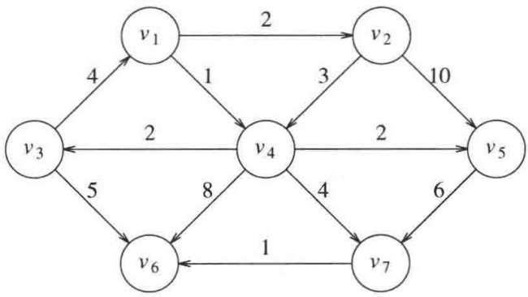

<details>
<summary>flowchart</summary>

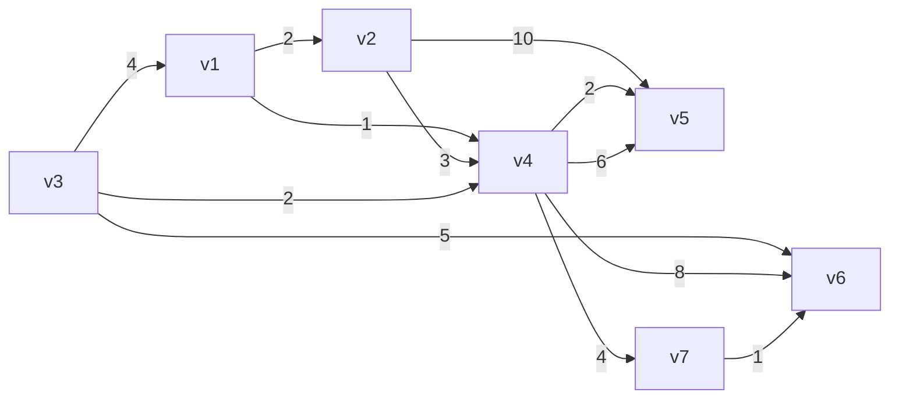
</details>

图9.20 有向图 $G$

| $v$ | known | ${d}_{v}$ | ${p}_{v}$ |
| --- | --- | --- | --- |
| ${v}_{1}$ | F | 0 | 0 |
| ${v}_{2}$ | F | ∞ | 0 |
| ${v}_{3}$ | F | ∞ | 0 |
| ${v}_{4}$ | F | ∞ | 0 |
| ${v}_{5}$ | F | ∞ | 0 |
| ${v}_{6}$ | F | ∞ | 0 |
| ${v}_{7}$ | F | ∞ | 0 |

图9.21 Dijkstra算法用表的初始配置

下一步，选取  $v_{4}$  并标记为 known。顶点  $v_{3}, v_{5}, v_{6}, v_{7}$  是邻接的顶点，而它们实际上都需要调整，如图 9.23 所示。

| $v$ | known | ${d}_{v}$ | ${p}_{v}$ |
| --- | --- | --- | --- |
| ${v}_{1}$ | T | 0 | 0 |
| ${v}_{2}$ | F | 2 | ${v}_{1}$ |
| ${v}_{3}$ | F | $\infty$ | 0 |
| ${v}_{4}$ | F | 1 | ${v}_{1}$ |
| ${v}_{5}$ | F | $\infty$ | 0 |
| ${v}_{6}$ | F | $\infty$ | 0 |
| ${v}_{7}$ | F | $\infty$ | 0 |

图9.22 在 $v_{1}$ 被声明为known后的表

| $v$ | known | ${d}_{v}$ | ${p}_{v}$ |
| --- | --- | --- | --- |
| ${v}_{1}$ | T | 0 | 0 |
| ${v}_{2}$ | F | 2 | ${v}_{1}$ |
| ${v}_{3}$ | F | 3 | ${v}_{4}$ |
| ${v}_{4}$ | T | 1 | ${v}_{1}$ |
| ${v}_{5}$ | F | 3 | ${v}_{4}$ |
| ${v}_{6}$ | F | 9 | ${v}_{4}$ |
| ${v}_{7}$ | F | 5 | ${v}_{4}$ |

图9.23 在 $v_{4}$ 被声明为known后的表

然后，选择 $v_{2}$ 。$v_{4}$ 是邻接的点，但已经是known的了，因此对它没有工作要做。$v_{5}$ 是邻接的点但不做调整，因为经过 $v_{2}$ 的值为 $2 + 10 = 12$ ，而一条长为3的路径已经是已知的。图9.24所示为在这些顶点被选取以后的表。

下一个被选取的顶点是 $v_{5}$, 其值为 3。$v_{7}$ 是唯一的邻接顶点, 但是它不用调整, 因为 $3 + 6 > 5$。然后选取 $v_{3}$, 对 $v_{6}$ 的距离下调到 $3 + 5 = 8$。结果如图 9.25 所示。

---

314

数据结构与算法分析——C++语言描述(第四版)

| $v$ | known | ${d}_{v}$ | ${p}_{v}$ |
| --- | --- | --- | --- |
| ${v}_{1}$ | T | 0 | 0 |
| ${v}_{2}$ | T | 2 | ${v}_{1}$ |
| ${v}_{3}$ | F | 3 | ${v}_{4}$ |
| ${v}_{4}$ | T | 1 | ${v}_{1}$ |
| ${v}_{5}$ | F | 3 | ${v}_{4}$ |
| ${v}_{6}$ | F | 9 | ${v}_{4}$ |
| ${v}_{7}$ | F | 5 | ${v}_{4}$ |

图 9.24 在  $v_{2}$  被声明为 known 后的表

| $v$ | known | ${d}_{v}$ | ${p}_{v}$ |
| --- | --- | --- | --- |
| ${v}_{1}$ | T | 0 | 0 |
| ${v}_{2}$ | T | 2 | ${v}_{1}$ |
| ${v}_{3}$ | T | 3 | ${v}_{4}$ |
| ${v}_{4}$ | T | 1 | ${v}_{1}$ |
| ${v}_{5}$ | T | 3 | ${v}_{4}$ |
| ${v}_{6}$ | F | 8 | ${v}_{3}$ |
| ${v}_{7}$ | F | 5 | ${v}_{4}$ |

图 9.25 在  $v_{5}$  然后  $v_{3}$  被声明为 known 后的表

再下一个选取的顶点是  $v_{7}$ ;  $v_{6}$  下调到  $5 + 1 = 6$ 。我们得到图 9.26 所示的表。

最后，我们选择  $v_{6}$ 。最后的表在图 9.27 中给出。图 9.28 以图形的形式演示在 Dijkstra 算法期间各边是如何标记为 known 的以及顶点是如何更新的。

| $v$ | known | ${d}_{v}$ | ${p}_{v}$ |
| --- | --- | --- | --- |
| ${v}_{1}$ | T | 0 | 0 |
| ${v}_{2}$ | T | 2 | ${v}_{1}$ |
| ${v}_{3}$ | T | 3 | ${v}_{4}$ |
| ${v}_{4}$ | T | 1 | ${v}_{1}$ |
| ${v}_{5}$ | T | 3 | ${v}_{4}$ |
| ${v}_{6}$ | F | 6 | ${v}_{7}$ |
| ${v}_{7}$ | T | 5 | ${v}_{4}$ |

图 9.26 在  $v_{7}$  被声明为 known 后的表

| $v$ | known | ${d}_{v}$ | ${p}_{v}$ |
| --- | --- | --- | --- |
| ${v}_{1}$ | T | 0 | 0 |
| ${v}_{2}$ | T | 2 | ${v}_{1}$ |
| ${v}_{3}$ | T | 3 | ${v}_{4}$ |
| ${v}_{4}$ | T | 1 | ${v}_{1}$ |
| ${v}_{5}$ | T | 3 | ${v}_{4}$ |
| ${v}_{6}$ | T | 6 | ${v}_{7}$ |
| ${v}_{7}$ | T | 5 | ${v}_{4}$ |

图 9.27 在  $v_{6}$  被声明为 known 之后，算法终止

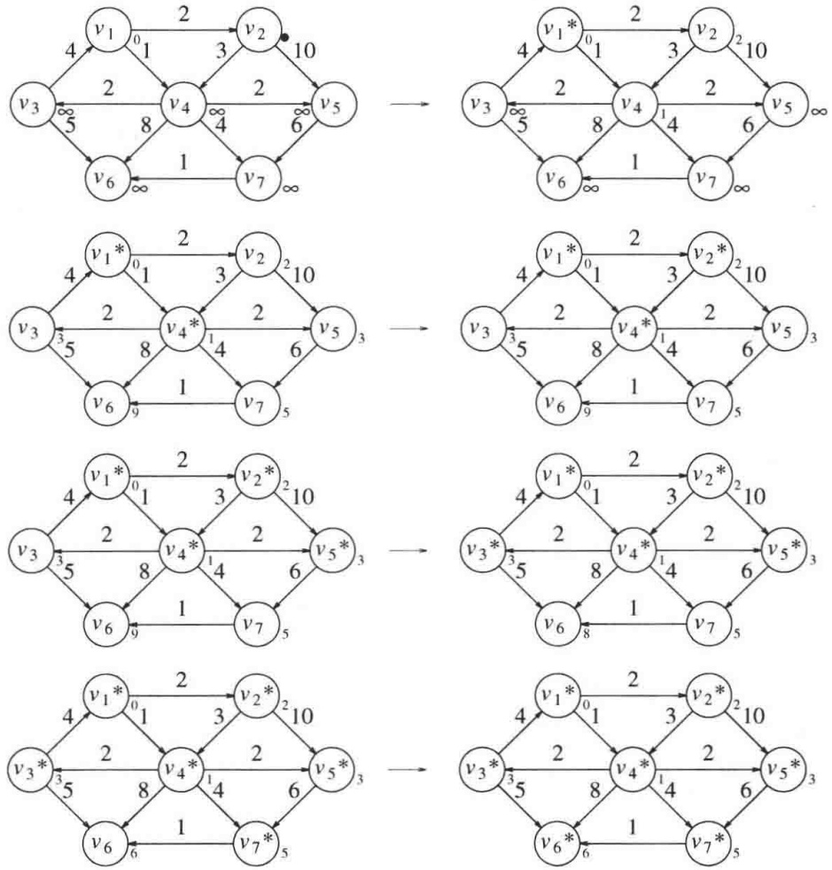

图 9.28 Dijkstra 算法的各个阶段

---

第9章 图论算法

315

为了打印出从开始顶点到某个顶点 v 的实际路径，可以编写一个递归例程跟踪这些 p 变量中留下的踪迹。

现在我们给出实现 Dijkstra 算法的伪代码。每个 Vertex 存储算法中使用的各种数据成员。Vertex 类在图 9.29 中给出。

```c
/**
 * Vertex 结构的伪代码描述.
 * 以实际的 C++ 表示，路径通常为Vertex*型，
 * 而我们描述的许多代码段
 * 或者要求解引用操作符 *，或者使用
 * -> 操作符，而不用。操作符。
 * 显然，这不利于对基本算法思路的理解。
 */
struct Vertex
{
    List     adj;      // 邻接 list（表）
    bool     known;
    DistType  dist;   // DistType 很可能是int型量
    Vertex     path;   // 如上所述，很可能是Vertex*型
        // 其他数据和成员函数视需要而定
};
```

图 9.29 Dijkstra 算法中的 Vertex 类(伪代码)

利用图 9.30 中的递归例程可以打印出路径。该例程递归地打印路径上直到顶点 v 前面的顶点的路径，然后再打印顶点 v。这是没有问题的，因为路径是简单路径。

```cpp
/**
 * 假设到v的最短路径存在.
 * 在运行dijkstra算法之后打印该最短路径.
 */
void Graph::printPath( Vertex v )
{
    if( v.path != NOT_A_VERTEX )
    {
        printPath( v.path );
        cout << " to ";
    }
    cout << v;
}
```

图 9.30 打印具体最短路径的例程

图9.31列出了主算法，它就是一个使用贪婪选取法则填表的for循环。

通过反证法的证明将指出，只要没有边的值为负值，该算法总能够正常工作。如果任何一边出现负值，则算法可能得出错误的答案（见练习9.7(a)）。运行时间依赖于对顶点的处理方法，我们必须考虑。如果使用顺序扫描顶点以找出最小值 $d_{v}$ 这种明显的算法，那么每一步将花费 $O(|V|)$ 时间找到最小值，从而整个算法过程中查找最小值将花费 $O(|V|^2)$ 时间。每次更新 $d_w$ 的时间是常数，而每条边最多有一次更新，总计为 $O(|E|)$ 。因此，总的运行时间为 $O(|E| + |V|^2) = O(|V|^2)$ 。如果图是稠密的，边数 $|E| = \Theta (|V|^2)$，则该算法不仅简单而且实质上最优，因为它的运行时间与边数呈线性关系。

---

316

数据结构与算法分析——C++语言描述(第四版)

```txt
void Graph::dijkstra( Vertex s )
{
    for each Vertex v
    {
        v.dist = INFINITY;
        v.known = false;
    }

    s.dist = 0;

    while( there is an unknown distance vertex )
    {
        Vertex v = smallest unknown distance vertex;

        v.known = true;

        for each Vertex w adjacent to v
            if( !w.known )
            {
                DistType cvw = cost of edge from v to w;

                if( v.dist + cvw < w.dist )
                {
                    // 更新 w
                    decrease( w.dist to v.dist + cvw );
                    w.path = v;
                }
            }
        }
    }
}
```

图 9.31 dijkstra 算法的伪代码

如果图是稀疏的，边数 $|E| = \Theta(|V|)$，那么这种算法就太慢了。在这种情况下，距离需要存储在优先队列中。实际上有两种方法可以做到这一点，二者是类似的。

顶点 v 的选择是一次 deleteMin 操作，因为一旦未知的最小值顶点被找到，那么它就不再是未知的，必须从未来的考虑中除去。w 的距离的更新可以有两种方法实现。

一种方法是把更新处理成 decreaseKey 操作。此时，查找最小值的时间为 $O(\log |V|)$，就像执行那些更新的时间，它相当于那些 decreaseKey 操作。由此得出运行时间为 $O(|E|\log |V| + |V|\log |V|) = O(|E|\log |V|)$，它是对前面稀疏图的界的改进。由于优先队列不是有效地支持 find 操作，因此 $d_i$ 的每个值在优先队列的位置将需要保留，并当 $d_i$ 在优先队列中改变时更新。如果优先队列是用二叉堆实现的，那么这将很难办。如果使用配对堆 (pairing heap)（见第 12 章），则程序不会太差。

另一种方法是在每次 $w$ 的距离改变时把 $w$ 和新值 $d_w$ 插入到优先队列中去。这样，对在优先队列中的每个顶点就可能有多于一个的代表 (representative)。当 deleteMin 操作把最小的顶点从优先队列中删除时，必须检查以肯定它还不是 known 的。如果它是，则忽略它，并执行另一次 deleteMin。这种方法虽然从软件的观点看是优越的，而且编程确实容易得多，但是，队列的大小可能会达到 $|E|$ 这么大。由于 $|E| \leqslant |V|^2$ 意味着 $\log |E| \leqslant 2\log |V|$，因此这并不影响渐近时间界。这样，我们仍然得到一个 $O(|E| \log |V|)$ 算法。不过，空间需求的确增加了，在某些应用中这可能是严重的。不仅如此，因为该方法需要 $|E|$ 次而不是仅仅 $|V|$ 次 deleteMin，所以它在实践中很可能速度要减慢。

---

第9章 图论算法

317

注意，对于一些诸如计算机邮件和大型公交传输的典型问题，它们的图一般是非常稀疏的，因为大多数顶点只有少数几条边。因此，在许多应用中使用优先队列来解决这类问题是很重要的。

如果使用不同的数据结构，那么使用 Dijkstra 算法可能会有更好的时间界。在第 11 章，我们将看到另外的优先队列数据结构，叫作斐波那契堆 (Fibonacci heap)。使用这种数据结构的运行时间是 $O(|E| + |V| \log |V|)$ 。斐波那契堆具有良好的理论时间界，不过，它需要相当数量的系统开销。因此，尚不清楚在实践中是否使用斐波那契堆比使用带有二叉堆的 Dijkstra 算法更好。迄今为止，这种问题尚没有有意义的平均情形的结果。

## 9.3.3 具有负边值的图

如果图具有负的边值，那么 Dijkstra 算法是行不通的。问题在于，一旦一个顶点 $u$ 被声明是 known 的，那就可能从某个另外的 unknown 顶点 $v$ 有一条回到 $u$ 的很负的路径。在这样的情形下，选取从 $s$ 到 $v$ 再回到 $u$ 的路径要比从 $s$ 到 $u$ 但不过 $v$ 更好。练习 9.7(a) 要求构造一个明晰的例子。

一个颇具诱惑力的方案是将一个常数 $\Delta$ 加到每一条边的值上，如此除去负的边，再计算新图的最短路径问题，然后把结果用到原来的图上。这种方案的直接实现是行不通的，因为一些具有许多条边的路径变成比一些具有很少边的路径权重更重了。

把赋权的算法和无权的算法结合起来将会解决这个问题，但是要付出运行时间剧烈增长的代价。我们忘记了关于 known 的顶点的概念，因为我们的算法需要能够改变它的意向。开始，我们把 $s$ 放到队列中。然后，在每一阶段我们让一个顶点 $v$ 出队。找出所有邻接到 $v$ 使得 $d_w > d_v + c_{v,w}$ 的顶点 $w$ 。然后更新 $d_w$ 和 $p_w$ ，并在 $w$ 不在队列中的时候把它放到队列中。可以为每个顶点设置一个比特位(bit)以指示它在队列中出现与否。我们重复这个过程直到队列空为止。图9.32(几乎)实现了这个算法。

```cpp
void Graph::weightedNegative( Vertex s )
{
    Queue<Vertex> q;

    for each Vertex v
        v.dist = INFINITY;

    s.dist = 0;
    q.enqueue( s );

    while( !q.isEmpty( ) )
    {
        Vertex v = q.dequeue( );

        for each Vertex w adjacent to v
            if( v.dist + cvw < w.dist )
            {
                // 更新 w
                w.dist = v.dist + cvw;
                w.path = v;
                if( w is not already in q )
                    q.enqueue( w );
            }
        }
}
```

图9.32 带有负的边值的赋权最短路径算法的伪代码

---

318

数据结构与算法分析——C++语言描述(第四版)

虽然如果没有负值圈该算法能够正常运行，但是，内层 for 循环中的代码对每边只执行一次的情况不再成立。每个顶点最多可以出队 $|V|$ 次，因此，如果使用邻接表，则运行时间是 $O(|E|\cdot |V|)$ （练习 9.7(b)）。这比 Dijkstra 算法多很多，幸运的是，实践中边的值是非负的。如果负值圈存在，那么算法正如所写的那样将无限地循环下去。通过在任一顶点出队 $|V| + 1$ 次后停止算法运行，我们可以保证算法能够终止。

## 9.3.4 无圈图

如果知道图是无圈的，则可以通过改变声明顶点为 known 的顺序，或者叫作顶点选取法则，来改进 Dijkstra 算法。新法则是以拓扑顺序选择顶点的。由于选择和更新可以在拓扑排序实施的时候进行，因此算法能够一趟完成。

因为当一个顶点 v 被选取以后，按照拓扑排序的法则它没有从 unknown 顶点发出的入边，因此它的距离  $d_{v}$  可不再被降低，所以这种选择法则是行得通的。

使用这种选取法则不需要优先队列。由于选择花费常数时间，因此运行时间为 $O(|E| + |V|)$。

无圈图可以模拟某种下坡滑雪问题——我们想要从点 a 到点 b，但只能走下坡，显然不可能有圈。另一个可能的应用是(不可逆)化学反应模型。我们可以让每个顶点代表实验的一个特定的状态，让边代表从一种状态到另一种状态的转变，而边的权代表释放的能量。如果只允许从高能状态转变到低能状态，那么图就是无圈的。

无圈图的一个更重要的用途是关键路径分析法(critical path analysis)。我们将用图9.33作为例子。每个节点表示一个必须执行的动作以及完成动作所花费的时间。因此，该图叫作动作节点图(activity-node graph)。图中的边代表优先关系:一条边 $(v, w)$ 意味着动作 $v$ 必须在动作 $w$ 开始前完成。当然，这就意味着图必须是无圈的。我们假设任何(直接或间接)互相不依赖的动作可以由不同的服务器并行地执行。

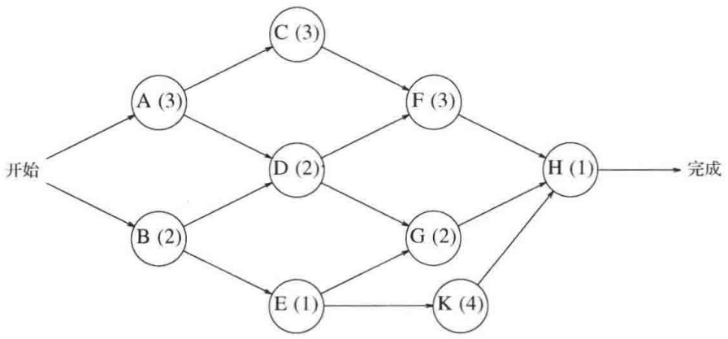

<details>
<summary>flowchart</summary>

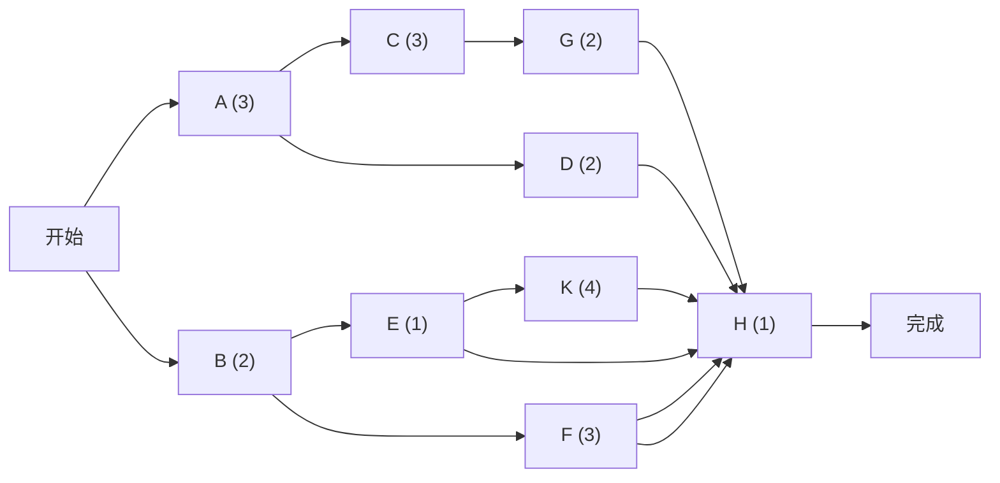
</details>

图9.33 动作节点图

这种类型的图可以(并常常)被用来模拟方案的构建。在这种情况下, 有几个重要的问题需要回答。首先, 方案最早完成时间是何时? 从图中可以看到, 沿路径 A, C, F, H 需要 10 个时间单位。另一个重要的问题是确定哪些动作可以延迟, 延迟多长, 而不至于影响最少完成时间。例如, 延迟 A, C, F, H 中的任一个都将使完成时间推迟到 10 个时间单位以后。另一方面, 动作 B 不那么关键, 可以被延迟两个时间单位而不至于影响最后完成时间。

为了进行这些运算，我们把动作节点图转化成事件节点图(event-node graph)。每个事件对应一个动作和所有相关的动作的完成。从事件节点图中节点 $v$ 可达到的那些事件只可在事

---

第9章 图论算法

319

件 v 完成后才能开始。这个图可以自动构造，也可以人工构造。在一个动作依赖于多个其他动作的情况下，可能需要插入哑边(dummy edge)和哑节点(dummy node)。为了避免引进假相关性(或相关性的假短缺)，这么做是必要的。对应图 9.33 的事件节点图如图 9.34 所示。

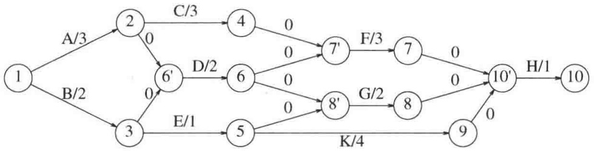

<details>
<summary>flowchart</summary>

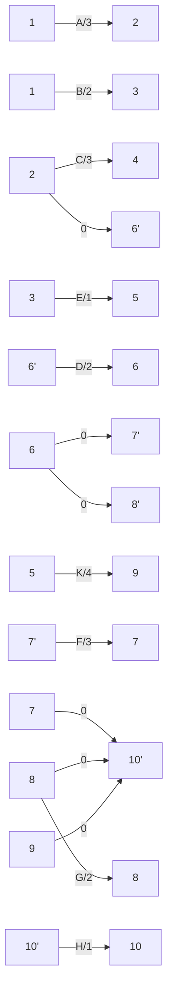
</details>

图9.34 事件节点图

为了找出方案的最早完成时间，我们只需要找出从第一个事件到最后一个事件的最长路径的长。对于一般的图，最长路径问题通常没有意义，因为可能有正值圈(positive-cost cycle)存在。这些正值圈等价于最短路问题中的负值圈。如果出现正值圈，则可以寻找最长的简单路径，不过，对于这个问题没有已知的满意解决方案。由于事件节点图是无圈图，因此不必担心圈的问题。在这种情况下，采纳最短路径算法计算图中所有节点的最早完成时间是容易的。如果  $EC_{i}$  是节点 i 的最早完成时间，那么可用的法则为

$$
\begin{array}{l} \mathrm{EC} _ {1} = 0 \\ \mathrm{EC} _ {\mathrm{w}} = \max _ {(v, w) \in E} (\mathrm{EC} _ {\mathrm{v}} + c _ {v, w}) \\ \end{array}
$$

图 9.35 显示在我们的例子的事件节点图中每个事件的最早完成时间。

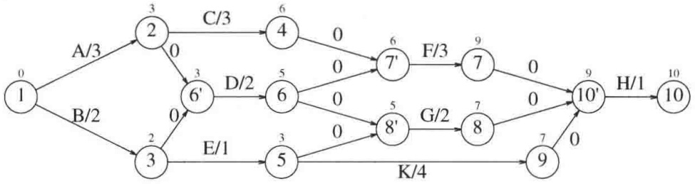

<details>
<summary>flowchart</summary>

```mermaid
graph LR
  1["1"] -->|A/3| 2["2"]
  n1["1"] -->|B/2| 3["3"]
  n2["2"] -->|C/3| 4["4"]
  n2 -->|0| 6'["6'"]
  n3["3"] -->|E/1| 5["5"]
  n3 -->|0| 6'["6"]
  n6["6'"] -->|D/2| 6["6"]
  n62["6"] -->|0| 7'["7'"]
  n62 -->|0| 8'["8'"]
  n5["5"] -->|K/4| 9["9"]
  n5 -->|0| 8'["8'"]
  n7["7'"] -->|F/3| 7["7"]
  n72["7"] -->|0| 10'["10'"]
  n8["8'"] -->|G/2| 8["8"]
  n82["8"] -->|0| 10'["10'"]
  n9["9"] -->|0| 10'["10'"]
  H1["H/1"] -->|H/1| 10["10"]
  n72 -->|0| 10"["10""]
```
</details>

图 9.35 最早完成时间

我们还可以计算每个事件能够完成而又不影响最后完成时间的最晚时间 $\mathrm{LC}_i$ 。进行这项工作的公式为

$$
\begin{array}{l} \mathrm{LC} _ {n} = \mathrm{EC} _ {n} \\ \mathrm{LC} _ {v} = \min _ {(v, w) \in E} (\mathrm{LC} _ {w} - c _ {v, w}) \\ \end{array}
$$

对于每个顶点，通过保存一个所有邻接而且在先的顶点的表，这些值就可以以线性时间算出。各顶点的最早完成时间通过顶点的拓扑排序算出，而最晚完成时间则通过倒转它们的拓扑顺序来计算。最晚完成时间如图9.36所示。

事件节点图中每条边的松弛时间(slack time)代表对应动作可以被延迟而又不至于推迟整体完成的时间量。容易看出

$$
\mathrm{Slack} _ {(v, w)} = \mathrm{LC} _ {w} - \mathrm{EC} _ {v} - c _ {v, w}
$$

图 9.37 指出在事件节点图中每个动作的松弛时间(作为第三项被标示)。对于每个节点，其顶上的数字是最早完成时间，而底下的数字是最晚完成时间。

---

320

数据结构与算法分析——C++语言描述(第四版)

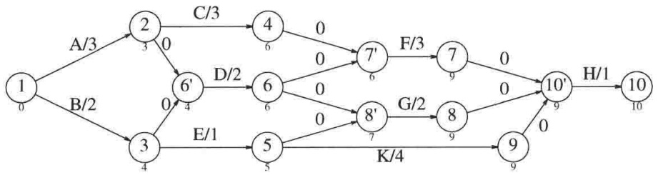

<details>
<summary>flowchart</summary>

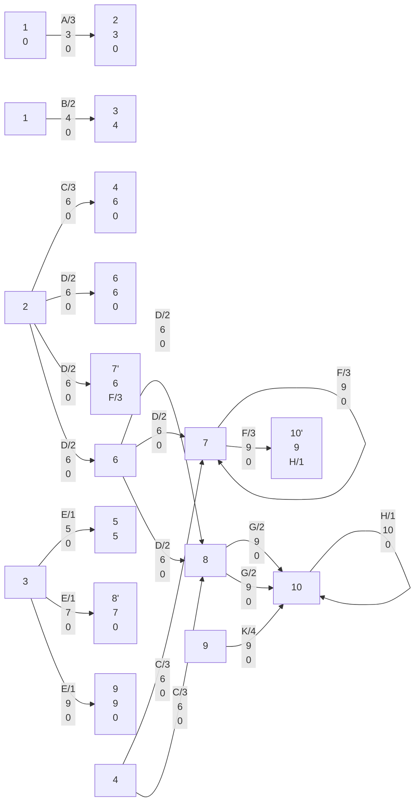
</details>

图 9.36 最晚完成时间

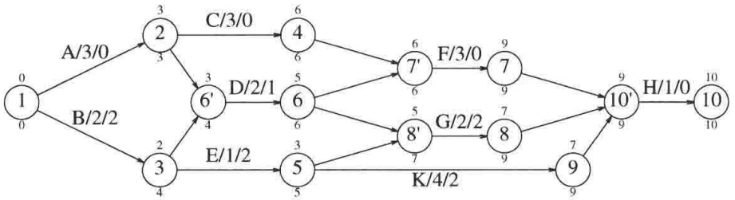

<details>
<summary>flowchart</summary>

```mermaid
graph LR
  1["0\n1\n0"] -->|"A/3/0\nB/2/2"| 2["2\n3\n3"]
  n1["1"] -->|"B/2/2"| 3["3\n4\n2"]
  n2["2"] -->|"C/3/0"| 4["4\n6\n6"]
  n2 -->|"D/2/1"| 6'["6'\n4\n3"]
  n3["3"] -->|"E/1/2"| 5["5\n5\n3"]
  n6["6'"] -->|"D/2/1"| 6["6\n6\n5"]
  n6 -->|"D/2/1"| 7'["7'\n6\n6"]
  6" -->|"F/3/0"| 7["7\n9\n6"]
  6" -->|"F/3/0"| 8"["8'\n7\n5"]
  6" -->|"F/3/0"| 9"["9\n9\n7"]
  7" -->|"G/2/2"| 8"["8\n9\n7"]
  7" -->|"G/2/2"| 9"["9\n9\n7"]
  8" -->|"G/2/2"| 10"["10'\n9\n9"]
  8" -->|"G/2/2"| 10"["10\n9\n7"]
  9" -->|"H/1/0"| 10
  9" -->|"H/1/0"| 10
```
</details>

图 9.37 最早完成时间、最晚完成时间和松弛时间

某些动作的松弛时间为零，这些动作是关键性的动作，它们必须按计划结束。至少存在一条完全由零-松弛边组成的路径，这样的路径是关键路径(critical path)。

## 9.3.5 所有顶点对间的最短路径

有时重要的是要找出图中所有顶点对之间的最短路径。虽然可以运行 $|V|$ 次适当的单源(single-source)算法，但是如果要立即计算所有的信息，我们还是愿意有更快些的解法，尤其是对于稠密的图。

在第10章，我们将看到对赋权图求解这种问题的一个 $O(|V|^3)$ 算法。虽然对于稠密图它具有和运行 $|V|$ 次简单(非-优先队列)Dijkstra算法相同的时间界，但是它的循环非常紧凑，以至于这种专业化的所有顶点对算法很可能在实践中更快。当然，对于稀疏图，更快的是运行 $|V|$ 次用优先队列编码的Dijkstra算法。

## 9.3.6 最短路径的例

本节我们编写一些 C++ 例程来计算词梯 (word ladder) 游戏。在一个词梯中，每个单词均由其前面的单词改变一个字母而得到。例如，我们可以通过一系列单字母替换而将 zero 转换成 five: zero hero here hire fire five。

这是一个无权最短路径问题，其中每一个单词都是一个顶点，如果两个单词可以通过单字母替换而互相转换，那么它们之间就有边存在(在两个方向上)。

在 4.8 节，我们描述并编写了一个 C++ 例程，该例程创建一个 map，在这个 map 下，关键字是单词，相应的值是包含从单字母变换得到的那些单词的 vector 对象。这样一来，这个 map 代表一个以邻接表格式表示的图，我们只需编写一个例程来运行单源无权最短路径算法，而第 2 个例程则在单源最短路径算法计算完之后输出单词序列。这两个例程均在图 9.38 中写出。

第一个例程是 findChain，它采用 map 表示邻接表和两个要被连接的单词，同时返回一个 map 对象，其中的关键字是单词，而对应的值是位于从 first 开始的最短词梯上的关键字前面的那个单词。换句话说，在上面的例子中，如果开始的单词是 zero，那么关键字 five 的值就是 fire，关键字 fire 的值是 hire，关键字 hire 的值是 here，等等。显然，这给第 2 个例程 getChainFromPreviousMap 提供了足够的信息，后者以相反的方向运行。

---

第9章 图论算法

321

```c
// 从邻接映射 (adjacency map) 进行最短路径计算, 返回一个向量
// 该向量包含从 first 到 second 得到的单词相继变化
unordered_map<string,string>
findChain( const unordered_map<string,vector<string>> & adjacentWords,
                    const string & first, const string & second )
{
    unordered_map<string,string> previousWord;
    queue<string> q;

    q.push( first );

    while( !q.empty( ) )
    {
        string current = q.front( ); q.pop( );
        auto itr = adjacentWords.find( current );

        const vector<string> & adj = itr->second;
        for( string & str : adj )
            if( previousWord[ str ] == "" )
            {
                previousWord[ str ] = current;
                q.push( str );
            }
        }
        previousWord[ first ] = "";

        return previousWord;
}

// 在最短路径计算运行之后, 计算包含从 first 到 second 得到的
// 单词相继变化的vector对象
vector<string> getChainFromPreviousMap(
    const unordered_map<string,string> & previous, const string & second )
{
    vector<string> result;
    auto & prev = const_cast<unordered_map<string,string> &( previous );

    for( string current = second; current != ""; current = prev[ current ] )
        result.push_back( current );

    reverse( begin( result ), end( result ) );
    return result;
}
```

图 9.38 求词梯的 C++例程

findChain 是图 9.18 中伪码的直接实现。为简单起见，它假设 first 是 adjacentWords 中的一个关键字(这在调用之前很容易测试，或者可以在第 16 行上添加附加代码，使得在条件不满足时抛出异常)。基本循环不正确地为 first 前面的一项赋了值(在邻接到 first 的初始单词被处理时)，于是第 25 行将这一项进行了调整。

getChainFromPreviousMap 使用 prev 映射和参数 second，根据推测它是 map 中的一个关键字，并返回用于形成词梯的那些单词，其工作方式是通过 prev 向后进行。这将

---

322

数据结构与算法分析——C++语言描述(第四版)

产生反向的单词，因此 STL 中的 reverse 算法在这里用来修复这个问题。第 36 行上的强制转换是需要的，因为 operator[] 不能用在不可改变的 map 上。

我们可以把这个问题推广到允许包括删除一个字母和添加一个字母的单字母替换的情形。计算邻接表只需要多做稍许工作:在4.8节最后的算法中，每次组 $g$ 中的单词 $w$ 的代表被计算时，我们均检测这个代表是否是组 $g - 1$ 中的单词。如果是，那么这个代表就邻接到 $w$ (它是一个单字母删除)，而 $w$ 也邻接到这个代表(而这是单字母添加)。也可能指定一个值给字母的删除或插入(它高于简单的替换)，这将产生一个赋权最短路径问题，它可以用Dijkstra算法求解。

## 9.4 网络流问题

设给定有向图 $G = (V, E)$，其边容量为 $c_{v, w}$。这些容量可以代表通过一个管道的水的流量或在两个交叉路口之间马路上的交通流量。这里有两个顶点，一个是 $s$，称为发点 (source)，一个是 $t$，称为收点 (sink)。对于任一条边 $(v, w)$，最多有 $c_{v, w}$ 个单位的“流”可以通过。在既不是发点 $s$ 又不是收点 $t$ 的任一顶点 $v$，总的进入的流必须等于总的发出的流。最大流问题 (maximum-flow problem) 就是确定从 $s$ 到 $t$ 可以通过的最大流量。例如，对于图 9.39 中左边的图，最大流是 5，如右边的图所示。虽然该例子中的图是无圈的，但这不是必需的。即使图中有圈，我们 (最终) 的算法仍然有效。

正如问题叙述中所要求的，任何边承载的流均不超过它的容量。顶点 $a$ 有3个单位的流进入，它将这3个单位的流分转给 $c$ 和 $d$ 。顶点 $d$ 从 $a$ 和 $b$ 得到3个单位的流，并把它们结合起来发送到 $t$ 。一个顶点可以以它喜欢的任何方式结合和分发流，只要不超越边的容量以及保持流守恒(进入多少必须流出多少)即可。

从图中看到, 顶点 $s$ 有容量为 4 和 2 的两条边流出, 而顶点 $t$ 有容量为 3 和 3 的两条边进入。因此, 最大流也许可能是 6 而不是 5 。然而, 图 9.40 指出如何证明最大流就是 5 。我们把图切割成两部分: 一部分包含 $s$ 和其他一些顶点, 而另一部分包含顶点 $t$ 。既然流必须通过切口, 于是所有的边 $(u, v)$ 的总容量就是最大流的一个界, 其中 $u$ 位于 $s$ 所在的部分, 而 $v$ 位于 $t$ 所在的部分。这些边实际上就是 $(a, c)$ 和 $(d, t)$, 它们的总容量为 5 , 因此最大流不可能超过 5 。任何的图都有许多的切口, 而具有最小总容量的切口提供了最大流的一个上界, 正如我们看到 (但不是立即明显看出) 的, 最小的切口容量恰好等于最大流。

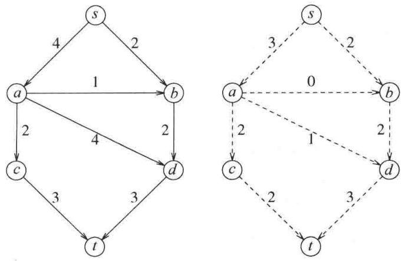

图 9.39 一个图(左边)和它的最大流

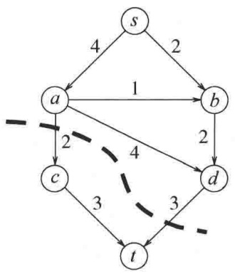

<details>
<summary>flowchart</summary>

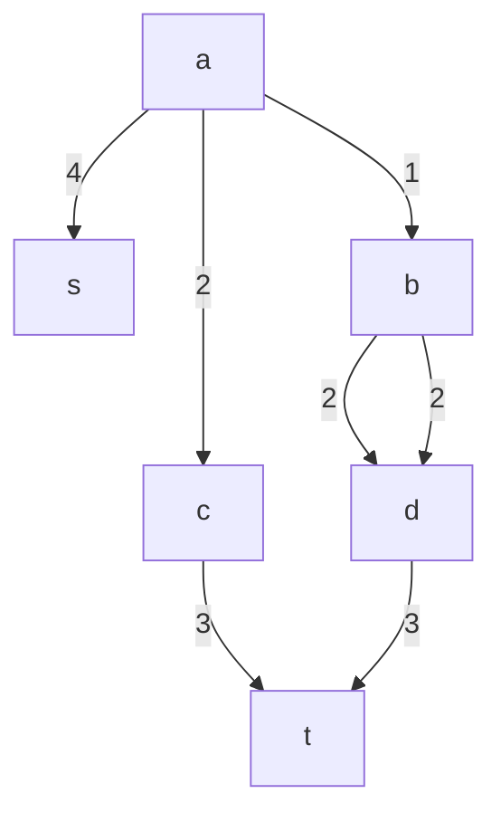
</details>

图9.40 图 $G$ 中的一次切割把顶点 $s$ 和 $t$ 分到不同的两组。通过切口的总边值为5，证明值为5的流是最大流。

---

第9章 图论算法

323

## 9.4.1 一个简单的最大流算法

解决这种问题的首要想法是分阶段进行。我们从图 $G$ 开始并构造一个流图 (flow graph) $G_{f}$ 。$G_{f}$ 表示在算法的任意阶段已经达到的流。开始时 $G_{f}$ 的所有的边都没有流，我们希望当算法终止时 $G_{f}$ 包含最大流。另外，我们还构造一个图 $G_{r}$，称为残余图 (residual graph)，它表示对于每条边还能再添加上多少流。对于每一条边，可以从容量中减去当前的流而计算出残余的流。$G_{r}$ 的边叫作残余边 (residual edge)。

在每个阶段，我们寻找图 $G_{r}$ 中从 $s$ 到 $t$ 的一条路径，这条路径叫作增长通路(augmenting path)。这条路径上的最小边值就是可以添加到路径每一边上的流的量。我们通过调整 $G_{f}$ 和重新计算 $G_{r}$ 做到这一点。当发现在 $G_{r}$ 中没有从 $s$ 到 $t$ 的路径时，算法终止。这个算法是不确定的，因为我们是随便选择从 $s$ 到 $t$ 的任意路径。显然，有些选择会比另外一些选择更好，后面再处理这个问题。我们将对我们的例子运行这个算法。下面的图分别是 $G$ 、 $G_{f}$ 和 $G_{r}$ 。要记着这个算法有一个小缺欠。初始的配置见图9.41。

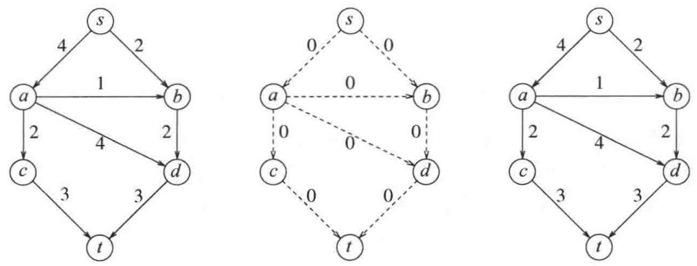

图9.41 图、流图以及残余图的初始阶段

在残余图中有许多从 $s$ 到 $t$ 的路径。假设选择 $s, b, d, t$ 。此时可以发送2个单位的流通过这条路径的每一边。我们将采取约定:一旦注满(使饱和)一条边，则这条边就要从残余图中除去。这样，我们得到图9.42。

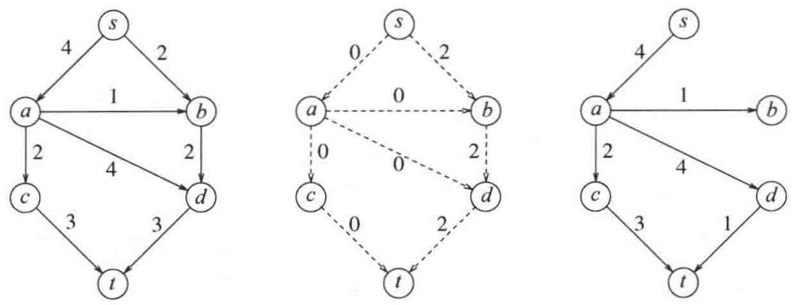

图9.42 沿 $s, b, d, t$ 加入2个单位的流后的 $G, G_{f}, G_{r}$

下面，我们可以选择路径 $s$ 、 $a$ 、 $c$ 、 $t$ ，该路径也容许2个单位的流通过。进行必要的调整后，得到图9.43。

唯一剩下要选择的路径是 $s, a, d, t$，这条路径能够容纳一个单位的流通过。结果得到图9.44所示的3个图。

---

324

数据结构与算法分析——C++语言描述(第四版)

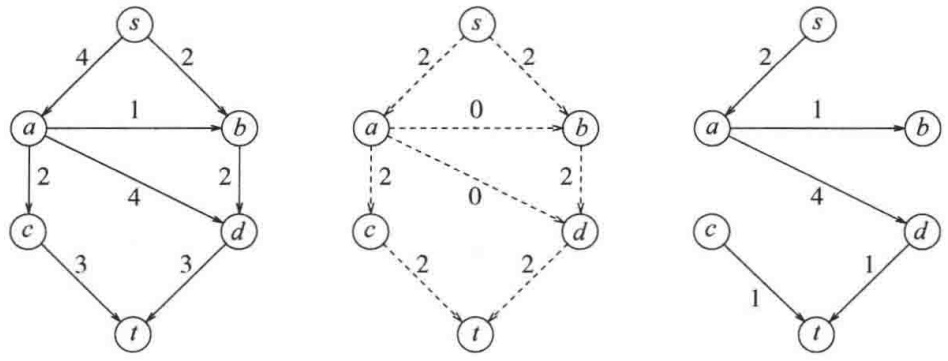

<details>
<summary>flowchart</summary>

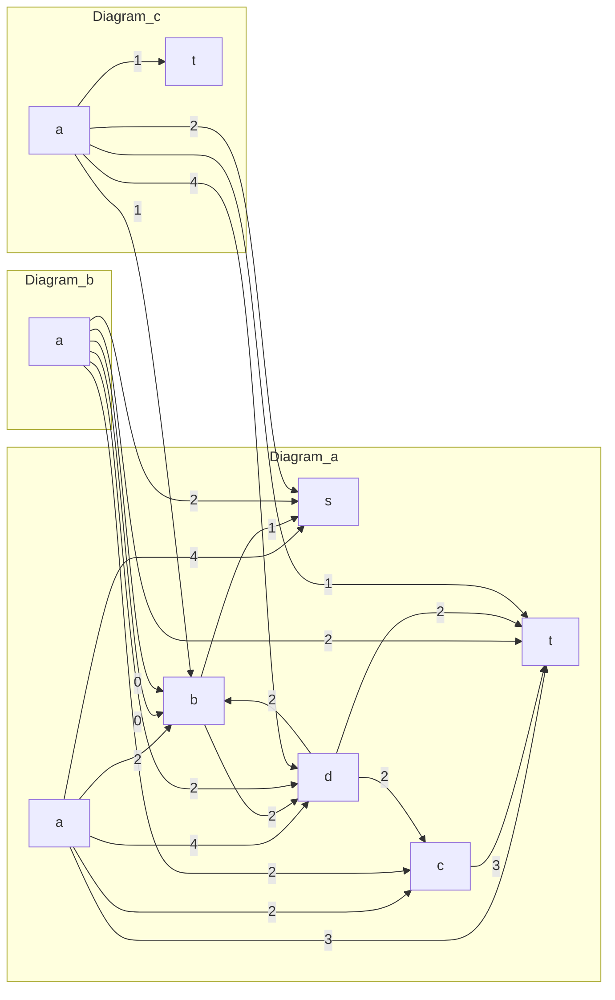
</details>

图 9.43 沿 s, a, c, t 加入 2 个单位的流后的 G、 $G_{f}$ 、 $G_{r}$

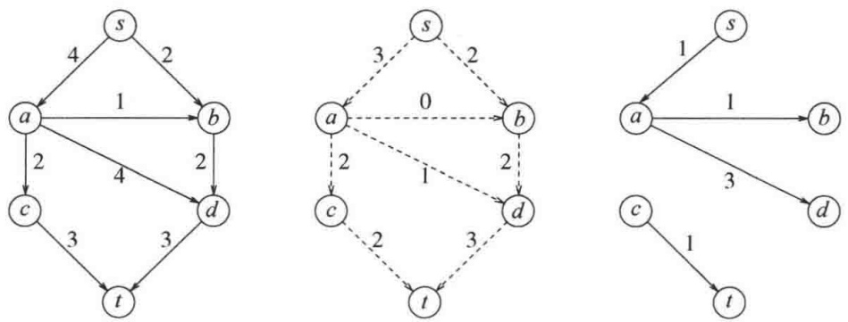

<details>
<summary>flowchart</summary>

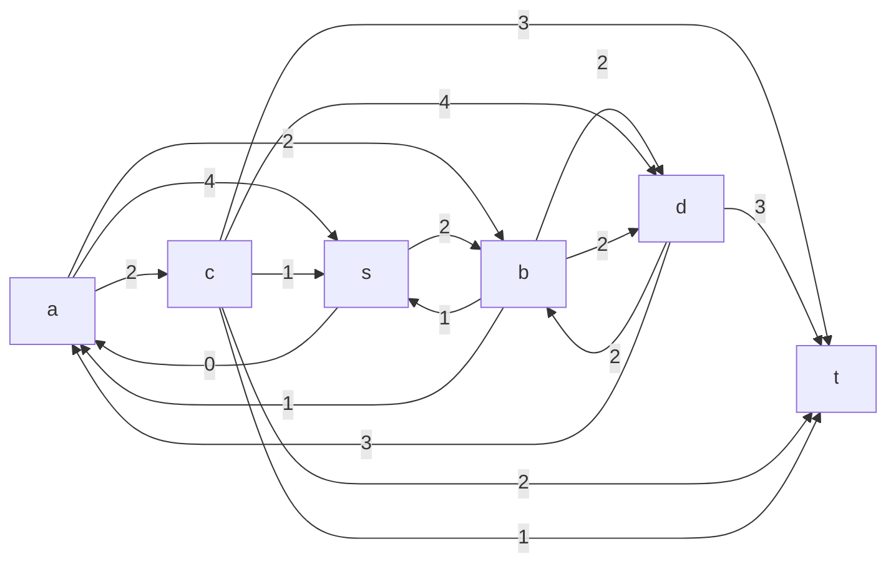
</details>

图9.44 沿 $s, a, d, t$ 加入1个单位的流后的 $G$ 、 $G_{f}$ 、 $G_{r}$ ——算法终止

由于 $t$ 从 $s$ 出发是不可达到的，因此算法到此终止。结果正好5个单位的流是最大值。为了看清问题的所在，设从初始图开始选择路径 $s, a, d, t$ ，这条路径容纳3个单位的流，因而好像是一种好的选择。可是选择的结果却使得在残余图中只剩下从 $s$ 到 $t$ 的一条路径，这条路径只能容许一个单位的流通过，因此，这个算法找不到最优解。这是贪婪算法行不通的一个例子。图9.45指出为什么算法失败的原因。

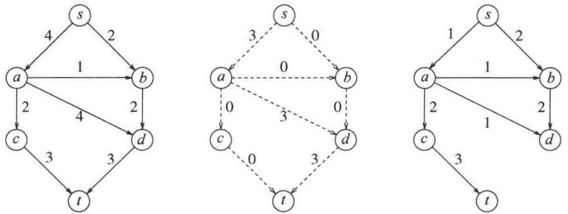

<details>
<summary>flowchart</summary>

```mermaid
graph TD
  subgraph Diagram1
  a -->|4| s
  a -->|2| b
  a -->|2| c
  a -->|4| d
  a -->|3| t
  b -->|2| d
  b -->|2| c
  b -->|3| t
  end
  subgraph Diagram2
  a -->|3| s
  a -->|0| b
  a -->|0| c
  a -->|3| t
  b -->|0| s
  b -->|0| d
  b -->|3| t
  end
  subgraph Diagram3
  a -->|1| s
  a -->|2| c
  a -->|1| b
  a -->|2| d
  b -->|1| s
  b -->|2| d
  b -->|3| t
  end
```
</details>

图 9.45 如果初始动作是沿 s, a, d, t 加入 3 个单位的流后得到 G、 $G_{f}$ 、 $G_{r}$ ——算法再经过一步之后终止，但解不是最优的

为了使得算法有效，需要让算法改变它的初衷。为此，对于流图中具有流 $f_{v,w}$ 的每一条边 $(v,w)$ ，我们将在残余图中添加一条容量为 $f_{v,w}$ 的边 $(w,v)$ 。事实上，可以通过以相反的方向发回一个流而使算法解除它原来的决定。通过例子最能看清这个问题。我们从原始的图开始，并选择增长通路s,a,d,t，得到图9.46。

注意, 残余图中有些边在 $a$ 和 $d$ 之间有两个方向。或者还有一个单位的流可以从 $a$ 流向 $d$, 或者有高达 3 个单位的流流向相反的方向——我们可以撤销流。现在算法找到流为 2 的增长通路 $s, b, d, a, c, t$。通过从 $d$ 到 $a$ 导入 2 个单位的流, 算法从边 $(a, d)$ 取走 2 个单位的流, 因此本质上改变了它的原意。图 9.47 显示出 3 个新的图。

---

第9章 图论算法

325

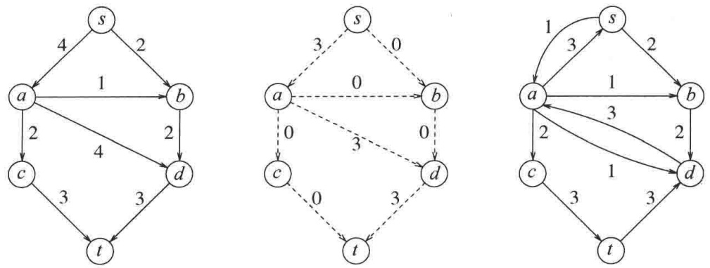

图9.46 使用正确的算法沿 $s, a, d, t$ 加入3个单位的流后的3个图

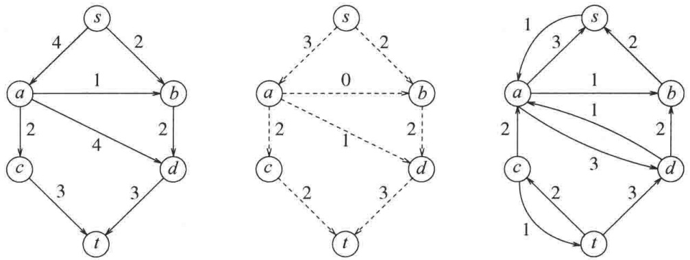

图9.47 使用正确算法沿 $s, b, d, a, c, t$ 加入2个单位的流后的图

在这个图中没有增长通路，因此算法终止。注意，如果在图9.46中选择增长通路 $s, a, c, t$ 它让1个单位的流通过，那么相同的结果仍会出现，因为此后的增长通路还能被找到。

容易看出，如果算法终止，那么它必然以最大流中止。终止意味着在残余图中没有从 $s$ 到 $t$ 的路径。于是，切割残余图，把从 $s$ 出发可达到的顶点放到一侧，而把从 $s$ 出发不可达到的顶点(包括 $t$) 放到另一侧。图 9.48 显示切口的情况。很清楚，原始图 $G$ 中通过切点的任何的边必然都是饱和的；否则就会有残余的流留在边上，那将意味着它是 $G_r$ 中(以错误的不允许的方向)通过切点的边。这就是说，$G$ 中的流恰好等于 $G$ 中切口的容量，因此我们得到了最大流。

如果图中边的值都是整数，那么算法必然终止；若每条增长通路添加1个单位的流，则最终就会达到最大流，不过这不能保证算法的高效率。特别地，如果容量均为整数，且最大流是 $f$ ，那么，由于每条增长通路使流的值至少增1，故 $f$ 个阶段足够完成算法，从而总的运行时间为 $O(f\cdot |E|)$ ，因为通过无权最短路径算法一条增长通路可以以 $O(|E|)$ 时间找到。说明为什么这是个坏的运行时间的经典例子如图9.49所示。

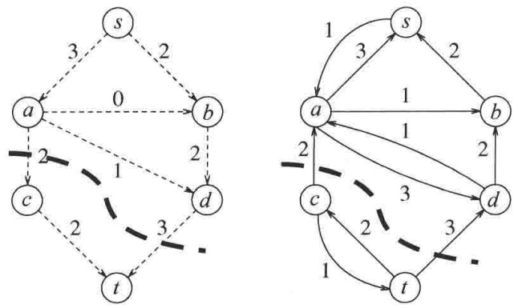

图 9.48 在残余图中，从 s 出发可达到的顶点形成切口的一侧，而那些不可达到的顶点形成切口的另一侧

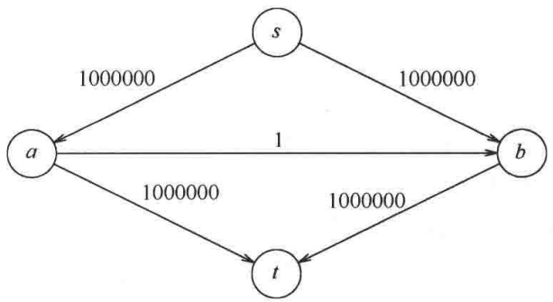

<details>
<summary>flowchart</summary>

```mermaid
graph LR
  a["a"] -->|"1000000"| s["s"]
  s -->|"1000000"| b["b"]
  a -->|"1000000"| t["t"]
  b -->|"1000000"| t
```
</details>

图 9.49 增长通路经典的坏情形

---

326

数据结构与算法分析——C++语言描述(第四版)

最大流通过沿每条边发送 1 000 000 并查验到 2 000 000 而看出。随机的增长通路可以沿包含由 a 和 b 连接的边的路径连续增长。要是这种情况重复发生，那就需要 2 000 000 条增长通路，可是此时我们仅用 2 条增长通路就可得出最大流。

避免这个问题的简单方法是总选择容许在流中最大增长的增长通路。寻找这样一条路径类似于求解一个赋权最短路径问题，而对 Dijkstra 算法的单线(single-line)修改将会完成这项工作。如果  $cap_{max}$  为最大边容量，那么可以证明， $O(|E|\log\mathrm{cap}_{\mathrm{max}})$  条增长通路将足以找到最大流。在这种情况下，由于对于增长通路的每一次计算都需要  $O(|E|\log|V|)$  时间，因此总的时间界为  $O(|E|^{2}\log|V|\log\mathrm{cap}_{\mathrm{max}})$ 。如果容量均为小整数，则该界可以减为  $O(|E|^{2}\log|V|)$ 。

另一种选择增长通路的方法是总选取具有最少边数的路径，可以预期，通过以这种方式选择路径，不太可能使该路径上出现一条小的、限制流的边。使用这种法则，每一步增长均计算残余图中从 $s$ 到 $t$ 的最短无权路径，因此，可设图中每个顶点保留一个 $d_{\nu}$，代表残余图中从 $s$ 到 $\nu$ 的最短路径的距离。每一步增长都可添加一些新的边到残余图中，但显然这些 $d_{\nu}$ 都不会被缩减，因为边被添加到现有最短路径的相反方向上。

每一步增长都至少使一条边的流饱和。设边 $(u, v)$ 是饱和的边。此刻，$u$ 有距离 $d_u$ 而 $v$ 有距离 $d_v = d_u + 1$；然后，将边 $(u, v)$ 从残余图中删除，而把边 $(v, u)$ 添加进来。边 $(u, v)$ 不可能再出现在残余图中，除非(直到)边 $(v, u)$ 出现在未来的增长通路中。但是，如果出现，那么，这时到 $u$ 的距离必然是 $d_v + 1$，这将比边 $(u, v)$ 先前被删除的时候高出2个单位。

这意味着，每次边 $(u, v)$ 再出现，$u$ 的距离上涨 2 个单位。就是说，任何边都可以最多再出现 $|V| / 2$ 次。每次增长都会引起某条边的再出现，因此增长的次数是 $O(|E||V|)$ 。每步花费 $O(|E|)$，按照无权最短路径的计算，我们得到运行时间的一个界 $O(|E|^2 | V|)$ 。

有可能对这一算法进行进一步的数据结构改进，存在多个更加复杂的算法。长期以来对界的改进已经把该问题当前熟知的界降低到了 $O(|E||V|)$ 。还有许多在一些特殊情形下非常好的界。例如，若图除发点和收点外所有的顶点都有一条容量为1的入边或一条容量为1的出边，则该图的最大流可以以时间 $O(|E||V|^{1/2})$ 找到。这些图出现在许多的应用中。

产生这些界的那些分析过程是相当复杂的，并且还不清楚最坏情形的结果是如何与实际中用到的运行时间发生关系的。一个相关的、甚至更困难的问题是最小值流(min-cost flow)问题。每条边不仅有容量，而且还有每个单位流的(价)值，而问题则是在所有的最大流中找出一个最小值的流来。目前对这两个问题的研究正在积极地进行。

## 9.5 最小生成树

我们将要考虑的下一个问题是在一个无向图中找出一棵最小生成树的问题。这个问题对有向图也是有意义的，不过找起来更困难。大体上说来，一个无向图 $G$ 的最小生成树(minimum spanning tree)就是由该图的那些连接 $G$ 的所有顶点的边构成的树，且其总的值最低。最小生成树存在当且仅当 $G$ 是连通的。虽然一个强壮的算法应该指出 $G$ 不连通的情况，但是我们还是假设 $G$ 是连通的，而把算法的健壮性作为练习留给读者。

图9.50中的第二个图是第一个图的最小生成树(碰巧还是唯一的，但这并不代表一般情况)。注意，在最小生成树中边的条数为 $|V| - 1$ 。最小生成树是一棵树，因为它无圈。而由于最小生成树包含每一个顶点，因此它是生成树。此外，它显然是包含图的所有顶点的最小的

---

第9章 图论算法

327

树。如果我们需要用最少的电线给一所房子安装电路(假设没有其他关于电的限制)，那就需要解决最小生成树问题。

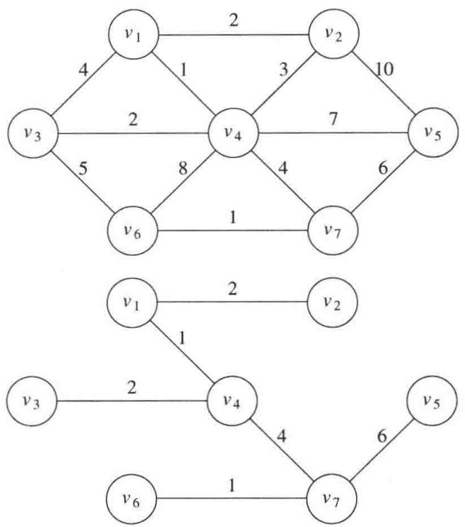

<details>
<summary>flowchart</summary>

```mermaid
graph TD
  v1["v1"] -->|2| v2["v2"]
  v1 -->|4| v3["v3"]
  v2 -->|3| v4["v4"]
  v2 -->|10| v5["v5"]
  v3 -->|2| v4
  v3 -->|5| v6["v6"]
  v4 -->|7| v5
  v4 -->|8| v6
  v4 -->|4| v7["v7"]
  v4 -->|1| v6
  v5 -->|6| v7
  v6 -->|1| v1["v1"]
  v6 -->|1| v2["v2"]
  v1 -->|2| v3["v3"]
  v2 -->|2| v3
  v3 -->|2| v4["v4"]
  v4 -->|1| v1
  v4 -->|4| v7["v7"]
  v5 -->|6| v5
  v6 -->|1| v7
```
</details>

图9.50 图 $G$ 和它的最小生成树

对于任一生成树 $T$，如果将一条不在 $T$ 中的边 $e$ 添加进来，则产生一个圈。如果从该圈中除去任意一条边，则又恢复生成树的特性。如果边 $e$ 的值比除去的边的值低，那么新的生成树的值就比原生成树的值低。如果在建立生成树时所添加的边在所有避免成圈的边中其值最小，那么最后得到的生成树的值不能再改进，因为任意一条替代边都将与已经存在于该生成树中的一条边至少具有相同的值。这说明，对于最小生成树问题，贪婪的做法是成立的。我们介绍两种算法，它们的区别在于最小(值的)边如何选取上。

## 9.5.1 Prim算法

计算最小生成树的一种方法是使其连续地一步步长成。在每一步，都要把一个节点当作根并往上加边，这样也就把相关联的顶点添加到增长中的树上。

在算法的任一时刻，我们都可以看到一组已经添加到树中的顶点，而其余顶点尚未加到树上。此时，算法在每一阶段都可以通过选择边 $(u, v)$，使得 $(u, v)$ 的值是所有 $u$ 在树上但 $v$ 不在树上的边的值中的最小者，从而找出一个新的顶点并把它添加到这棵树中。图9.51指出了该算法如何从 $v_{1}$ 开始构建最小生成树。开始时，$v_{1}$ 在构建中的树上，它作为树的根但是没有边。每一步添加一条边和一个顶点到树上。

可以看到，Prim算法(Prim's algorithm)基本上与求最短路径的Dijkstra算法相同。因此和前面一样，我们对每一个顶点保留值 $d_{\nu}$ 和 $p_{\nu}$ 以及一个指标，标示该顶点是known的还是unknown的。这里，$d_{\nu}$ 是连接 $\nu$ 到一个known顶点的最短边的权，而 $p_{\nu}$ 则是导致 $d_{\nu}$ 改变的最后的顶点。算法的其余部分完全一样，只有一点不同:由于 $d_{\nu}$ 的定义不同，因此它的更新法则也不同。对于这个问题，更新法则甚至比以前还简单:在每一个顶点 $\nu$ 被选取以后，对于每一个邻接到 $\nu$ 的unknown的 $w$ ，$d_{w} = \min (d_{w}, c_{w,\nu})$ 。

---

328

数据结构与算法分析——C++语言描述(第四版)

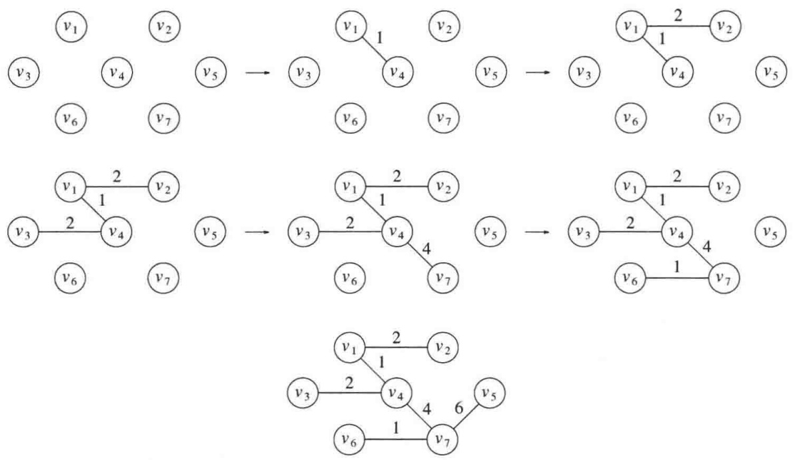

<details>
<summary>flowchart</summary>

```mermaid
graph LR
  Start["State V1"] --> Transition1["Transition 1"]
  Start --> Transition2["Transition 2"]
  Transition1 --> StateV3["State V3"]
  Transition2 --> StateV4["State V4"]
  Transition3["Transition 3"] --> Transition3["Transition 3"]
  Transition3 --> StateV5["State V5"]
  Transition4["Transition 4"] --> Transition4["Transition 4"]
  Transition5["Transition 5"] --> Transition5["Transition 5"]
  Transition6["Transition 6"] --> Transition6["Transition 6"]
  Transition7["Transition 7"] --> Transition7["Transition 7"]
```
</details>

图9.51 在每一步之后的Prim算法

表的初始配置由图9.52指出，其中 $v_{1}$ 被选取，而 $v_{2}, v_{3}, v_{4}$ 被更新。结果由图9.53指出。下一个顶点选取 $v_{4}$，每一个顶点都邻接到 $v_{4}$。$v_{1}$ 不考虑，因为它是known的。$v_{2}$ 不变，因为它的 $d_{v} = 2$ 而且从 $v_{4}$ 到 $v_{2}$ 的边的值是3；所有其他的顶点都被更新。图9.54给出了得到的结果。下一个要选取的顶点是 $v_{2}$，它并不影响任何距离。然后选取 $v_{3}$，它影响 $v_{6}$ 中的距离，见图9.55。选取 $v_{7}$ 得到图9.56，$v_{7}$ 的选取迫使 $v_{6}$ 和 $v_{5}$ 进行调整。然后选取 $v_{6}$ 再选 $v_{5}$，算法完成。

| $v$ | known | ${d}_{v}$ | ${p}_{v}$ |
| --- | --- | --- | --- |
| ${v}_{1}$ | F | 0 | 0 |
| ${v}_{2}$ | F | ∞ | 0 |
| ${v}_{3}$ | F | ∞ | 0 |
| ${v}_{4}$ | F | ∞ | 0 |
| ${v}_{5}$ | F | ∞ | 0 |
| ${v}_{6}$ | F | ∞ | 0 |
| ${v}_{7}$ | F | ∞ | 0 |

图9.52 在Prim算法中所使用的表的初始配置

| $v$ | known | ${d}_{v}$ | ${p}_{v}$ |
| --- | --- | --- | --- |
| ${v}_{1}$ | T | 0 | 0 |
| ${v}_{2}$ | F | 2 | ${v}_{1}$ |
| ${v}_{3}$ | F | 2 | ${v}_{4}$ |
| ${v}_{4}$ | T | 1 | ${v}_{1}$ |
| ${v}_{5}$ | F | 7 | ${v}_{4}$ |
| ${v}_{6}$ | F | 8 | ${v}_{4}$ |
| ${v}_{7}$ | F | 4 | ${v}_{4}$ |

图 9.54 在  $v_{4}$  声明为 known 后的表

| $v$ | known | ${d}_{v}$ | ${p}_{v}$ |
| --- | --- | --- | --- |
| ${v}_{1}$ | T | 0 | 0 |
| ${v}_{2}$ | F | 2 | ${v}_{1}$ |
| ${v}_{3}$ | F | 4 | ${v}_{1}$ |
| ${v}_{4}$ | F | 1 | ${v}_{1}$ |
| ${v}_{5}$ | F | ∞ | 0 |
| ${v}_{6}$ | F | ∞ | 0 |
| ${v}_{7}$ | F | ∞ | 0 |

图9.53 在 $v_{1}$ 声明为known后的表

| $v$ | known | ${d}_{v}$ | ${p}_{v}$ |
| --- | --- | --- | --- |
| ${v}_{1}$ | T | 0 | 0 |
| ${v}_{2}$ | T | 2 | ${v}_{1}$ |
| ${v}_{3}$ | T | 2 | ${v}_{4}$ |
| ${v}_{4}$ | T | 1 | ${v}_{1}$ |
| ${v}_{5}$ | F | 7 | ${v}_{4}$ |
| ${v}_{6}$ | F | 5 | ${v}_{3}$ |
| ${v}_{7}$ | F | 4 | ${v}_{4}$ |

图 9.55 在  $v_{2}$  和  $v_{3}$  先后声明为 known 后的表

最后的表在图9.57中给出。生成树的边可以从该表中读出: $(v_{2},v_{1}),(v_{3},v_{4}),(v_{4},v_{1}),(v_{5},$ $v_{7}),(v_{6},v_{7}),(v_{7},v_{4})$ 。生成树总的值是16。

---

第9章 图论算法

329

| $v$ | known | ${d}_{v}$ | ${p}_{v}$ |
| --- | --- | --- | --- |
| ${v}_{1}$ | T | 0 | 0 |
| ${v}_{2}$ | T | 2 | ${v}_{1}$ |
| ${v}_{3}$ | T | 2 | ${v}_{4}$ |
| ${v}_{4}$ | T | 1 | ${v}_{1}$ |
| ${v}_{5}$ | F | 6 | ${v}_{7}$ |
| ${v}_{6}$ | F | 1 | ${v}_{7}$ |
| ${v}_{7}$ | T | 4 | ${v}_{4}$ |

图 9.56 在  $v_{7}$  声明为 known 后的表

| $v$ | known | $d_v$ | $p_v$ |
| --- | --- | --- | --- |
| $v_1$ | T | 0 | 0 |
| $v_2$ | T | 2 | $v_1$ |
| $v_3$ | T | 2 | $v_4$ |
| $v_4$ | T | 1 | $v_1$ |
| $v_5$ | T | 6 | $v_7$ |
| $v_6$ | T | 1 | $v_7$ |
| $v_7$ | T | 4 | $v_4$ |

图 9.57 在  $v_{6}$  和  $v_{5}$  选取之后的表 (Prim 算法终止)

该算法整个的实现实际上和 Dijkstra 算法的实现是一样的，对于 Dijkstra 算法分析所做的每一件事都可以用到这里。不过要注意，Prim 算法是在无向图上运行的，因此当编写代码的时候要记住把每一条边都要放到两个邻接表中。不用堆时的运行时间为 $O(|V|^2)$，它对于稠密的图来说是最优的。使用二叉堆的运行时间是 $O(|E|\log |V|)$，对于稀疏的图它是一个好的界。

## 9.5.2 Kruskal 算法

第二种贪婪策略是连续地按照最小权的顺序选择边，并且当所选的边不产生圈时就把它作为所取定的边。该算法对于前面例子中的图的实施过程如图9.58所示。

形式上，Kruskal 算法(Kruskal's algorithm)是在处理一个森林——树的集合。开始的时候，存在|V|棵单节点树，而添加一边则将两棵树合并成一棵树。当算法终止的时候，就只有一棵树了，这棵树就是最小生成树。图 9.59 显示了边被添加到森林中的顺序。

| 边 | 权 | 动作 |
| --- | --- | --- |
| $(v_1, v_4)$ | 1 | 接受 |
| $(v_6, v_7)$ | 1 | 接受 |
| $(v_1, v_2)$ | 2 | 接受 |
| $(v_3, v_4)$ | 2 | 接受 |
| $(v_2, v_4)$ | 3 | 拒绝 |
| $(v_1, v_3)$ | 4 | 拒绝 |
| $(v_4, v_7)$ | 4 | 接受 |
| $(v_3, v_6)$ | 5 | 拒绝 |
| $(v_5, v_7)$ | 6 | 接受 |

图9.58 Kruskal算法施于图 $G$ 的情况

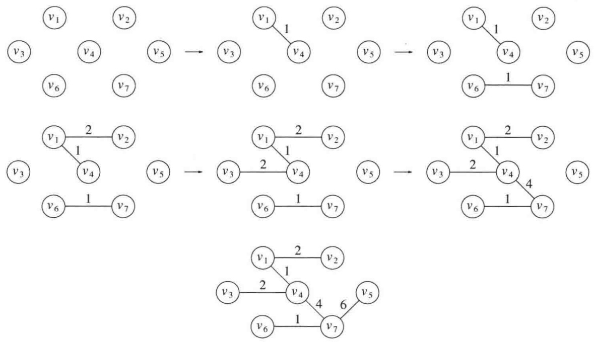

<details>
<summary>flowchart</summary>

This image displays a state transition diagram (a type of flowchart) showing the evolution of states v1 through v7 over time, with transitions marked by directional arrows indicating transitions between states.
</details>

图9.59 在每一步之后的Kruskal算法

算法在足够的边被添加进来时终止。实际上，算法就是要决定边 $(u,v)$ 应该添加还是应该放弃。第8章中的union/find算法是适用于这里的数据结构。

---

330

数据结构与算法分析——C++语言描述(第四版)

我们用到的一个恒定的事实是，在算法实施的任一时刻，两个顶点属于同一个集合当且仅当它们在当前的生成森林中连通。因此，每个顶点最初是在它自己的集合中。如果 $u$ 和 $v$ 在同一个集合中，那么连接它们的边就要放弃，因为由于它们已经连通了，因此再添加边 $(u, v)$ 就会形成一个圈。反之，如果这两个顶点不在同一个集合中，则将它们的边加入，并对包含顶点 $u$ 和 $v$ 的这两个集合实施一次 union。容易看到，这样将保持集合的不变性，因为一旦边 $(u, v)$ 添加到生成森林中，若 $w$ 连通到 $u$ 而 $x$ 连通到 $v$ ，则 $x$ 和 $w$ 必然是连通的，因此属于相同的集合。

固然，将边排序可便于选取，但是，用线性时间建立一个堆则是更好的想法。此时，deleteMin 将使得边依序得到测试。典型情况下，在算法终止前只有一小部分边需要测试，不过，必须尝试所有的边的可能性总是存在的。例如，假设还有一个顶点 $v_{8}$ 以及值为 100 的边 $(v_{5}, v_{8})$，那么所有的边就会都要考察到。图 9.60 中的函数 kruskal 将找出一棵最小生成树。

该算法的最坏情形运行时间为 $O(|E|\log |E|)$，它受堆操作控制。注意，由于 $|E| = O(|V|^2)$，因此这个运行时间实际上是 $O(|E|\log |V|)$。在实践中，该算法要比这个时间界指示的时间快得多。

```txt
vector<Edge> kruskal( vector<Edge> edges, int numVertices )
{
    DisjSets ds{ numVertices };
    priority_queue pq{ edges };
    vector<Edge> mst;

    while( mst.size( ) != numVertices - 1 )
    {
        Edge e = pq.pop( );          // 边e = (u, v)
        SetType uset = ds.find( e.getu( ) );
        SetType vset = ds.find( e.getv( ) );

        if( uset != vset )
        {
            // 接受该边
            mst.push_back( e );
            ds.union( uset, vset );
        }
    }

    return mst;
}
```

图 9.60 Kruskal 算法的伪代码

## 9.6 深度优先搜索的应用

深度优先搜索(depth-first search)是对先序遍历(preorder traversal)的推广。我们从某个顶点 $v$ 开始处理 $v$, 然后递归地遍历所有邻接到 $v$ 的顶点。如果这种过程是对一棵树进行, 那么, 由于 $|E| = \Theta(|V|)$, 因此该树的所有的顶点在总时间 $O(|E|)$ 内都将被系统地访问到。如果我们对任意的图进行该过程, 则需要小心仔细以避免圈的出现。为此, 当访问一个顶点 $v$ 的时候,

---

第9章 图论算法

331

由于我们当时已经到了该点处，因此可以标记该点是访问过的，并且对于尚未被标记的所有邻接顶点递归调用深度优先搜索。我们假设，对于无向图，每条边 $(v, w)$ 在邻接表中出现两次:一次是 $(v, w)$，另一次是 $(w, v)$。图9.61中的过程执行一次深度优先搜索（此外绝对什么也不做），从而是一个一般风格的模板。

```txt
void Graph::dfs( Vertex v )
{
    v.visited = true;
    for each Vertex w adjacent to v
        if( !w.visited )
            dfs( w );
}
```

图 9.61 深度优先搜索模板(伪代码)

对每一个顶点，其数据成员 visited 初始化成 false。通过只对那些尚未被访问的节点递归调用该过程，保证不会陷入无限的循环。如果图是无向的且不连通的，或是有向的但非强连通的，这种方法可能会访问不到某些节点。此时，我们搜索一个未被标记的节点，然后再应用深度优先遍历，并继续这个过程直到不存在未标记的节点为止。 $^{①}$  因为该方法保证每一条边只访问一次，所以只要使用邻接表，则执行遍历的总时间就是  $O(|E| + |V|)$ 。

## 9.6.1 无向图

无向图是连通的，当且仅当从任一节点开始的深度优先搜索访问到每一个节点。因为这项测试应用起来非常容易，所以我们将假设所处理的图都是连通的。如果它们不连通，那么可以找出所有的连通分支并将我们的算法依次应用于每个分支。

作为深度优先搜索的一个例子，设在图9.62中我们从A点开始。此时，标记A为访问过的并递归调用dfs(B)。dfs(B)标记B为访问过的并递归调用dfs(C)。dfs(C)标记C为访问过的并递归调用dfs(D)。dfs(D)遇到A和B，但是这两个节点都已经被标记过了，因此没有递归调用可以进行。dfs(D)也看到C是邻接的顶点，但C已标记过了，因此在这里也没有递归调用进行，于是dfs(D)返回到dfs(C)。dfs(C)看到B是邻接点，忽略它，并发现以前没看见的顶点E也是邻接点，因此调用dfs(E)。dfs(E)将E作标记，忽略A和C，并返回到dfs(C)。dfs(C)返回到dfs(B)。dfs(B)忽略A和D并返回。dfs(A)忽略D和E且返回。(我们实际上已经接触每条边两次，一次是作为边(v,w)，再一次是作为边(w,v)，但这实际上是每个邻接表项接触一次。)

我们以图形来描述深度优先生成树(depth-first spanning tree)的步骤。该树的根是A，是第一个被访问到的顶点。图中的每一条边 $(v, w)$ 都出现在树上。如果当处理 $(v, w)$ 时发现 $w$ 是未被标记的，或当处理 $(w, v)$ 时发现 $v$ 是未标记的，那么我们就用树的一条边来表示它。如果当处理 $(v, w)$ 时发现 $w$ 已被标记，并且当处理 $(w, v)$ 时发现 $v$ 也已有标记，那么我们就画一条虚线，并称之为背向边(back edge)，表示这条“边”实际上不是树的一部分。图9.62图的深度优先搜索在图9.63中表示出。

<small><span class="docvortex-page-footnote" data-block-type="page_footnote" style="color:#6b7280">① 其实现的一种高效方法是从  $v_{1}$  开始深度优先搜索。如果我们需要重新开始深度优先搜索，则对于一个未标记的顶点考查序列  $v_{k}, v_{k+1}, \cdots$ ，其中  $v_{k-1}$  是最后一次深度优先搜索开始时的顶点。这保证整个算法只花费  $O(|V|)$  时间查找那些使新的深度优先搜索树开始的顶点。</span></small>

---

332

数据结构与算法分析——C++语言描述(第四版)


<details>
<summary>flowchart</summary>

```mermaid
graph TD
  A["A"] --> B["B"]
  B["B"] --> D["D"]
  B["B"] --> C["C"]
  D["D"] --> C["C"]
  C["C"] --> E["E"]
  E["E"] --> A["A"]
  A["A"] --> E["E"]
```
</details>

图9.62 一个无向图


<details>
<summary>flowchart</summary>

```mermaid
graph TD
  A["A"] --> B["B"]
  B --> C["C"]
  C --> D["D"]
  C --> E["E"]
  E -.-> A
  E -.-> B
  D -.-> A
```
</details>

图9.63 图9.62的深度优先搜索

这棵树将模拟我们执行的遍历。只使用树的边对该树的先序编号(preorder numbering)告诉我们这些顶点被标记的顺序。如果图不是连通的，那么处理所有的节点(和边)则需要多次调用dfs，每次都生成一棵树，整个集合就是深度优先生成森林(depth-first spanning forest)。

## 9.6.2 双连通性

一个连通的无向图，如果不存在这样的顶点，即使得该顶点被删除之后剩下的图不再连通，那么这样的无向连通图就称为双连通(biconnected)的。上例图9.62是双连通的。如果例中的节点是计算机，边是链路，那么，若有任一台计算机出故障而不能运行，则网络邮件并不受影响，当然，与这台坏计算机有关的邮件除外。类似地，如果一个公共运输系统是双连

通的，那么，若某个站点被破坏，则用户总可选择另外的旅行路径。

如果一个图不是双连通的，那么，将其删除使图不再连通的那些顶点叫作割点(articulation point)。这些节点在许多应用中很重要。图 9.64 不是双连通的:顶点 C 和 D 是割点。删除顶点 C 将使顶点 G 断离，而删除顶点 D 则使 E 和 F 从图的其余部分分离。

深度优先搜索提供一种找出连通图中的所有割点的线性时间算法。首先，从图中任一顶点


<details>
<summary>flowchart</summary>

```mermaid
graph TD
  A["A"] --> B["B"]
  B --> C["C"]
  C --> D["D"]
  D --> E["E"]
  E --> F["F"]
  C --> G["G"]
  D --> F
```
</details>

图9.64 具有割点C和D的图

开始，执行深度优先搜索并在顶点被访问时给它们编号。对于每一个顶点 v，我们称其先序编号 (preorder number) 为 Num(v)。然后，对于深度优先搜索生成树上的每一个顶点 v，计算编号最低的顶点，我们称之为 Low(v)，该点可从 v 开始通过树的零条或多条边，且可能还有一条背向边而 (以该序) 达到。图 9.65 中的深度优先搜索树首先显示先序编号，然后指出在上述法则下可达到的最低编号顶点。

从 A、B 和 C 开始的可达到最低编号顶点为顶点 1(A)，因为它们都能够通过树的边到 D，然后再由一条背向边回到 A。我们可以通过对该深度优先生成树执行一次后序遍历有效地计算 Low。根据 Low 的定义可知 Low(v) 是下列各项中的最小者:

---

第9章 图论算法

333


<details>
<summary>flowchart</summary>

```mermaid
graph LR
  A["A, 1/1"] --> B["B, 2/1"]
  B --> C["C, 3/1"]
  C --> D["D, 4/1"]
  D --> E["E, 5/4"]
  E --> F["F, 6/4"]
  F -.-> D
  C --> G["G, 7/7"]
  D -.-> A
```
</details>

图 9.65 图 9.64 的深度优先树，节点标有 Num 和 Low

1. Num(v)。
2. 所有背向边 $(v, w)$ 中的最低 Num $(w)$ 。
3. 树的所有边 $(v, w)$ 中的最低  $\mathrm{Low}(w)$ 。

第一个条件是不选取边，第二种方法是不选取树的边而是选取一条背向边，第三种方法则是选择树的某些边以及可能还有一条背向边。第三种方法可用一个递归调用简明地描述。由于需要对 v 的所有子节点计算出 Low 值后才能计算  $\mathrm{Low}(v)$ ，因此这是一个后序遍历。对于任一条边  $(v, w)$ ，我们只要检查  $\mathrm{Num}(v)$  和  $\mathrm{Num}(w)$  就可以知道它是树的一条边还是一条背向边。因此， $\mathrm{Low}(v)$  容易计算:我们只需扫描 v 的邻接表，应用适当的法则，并记住最小者。所有的计算花费  $O(|E| + |V|)$  时间。

剩下要做的就是利用这些信息找出所有的割点。根是割点当且仅当它有多于一个的儿子，因为如果它有两个儿子，那么删除根则使得不同子树上的节点不连通；如果根只有一个儿子，那么除去该根只不过断离该根。对于任何其他顶点 $v$ ，它是割点当且仅当 $v$ 有某个儿子 $w$ 使得 $\operatorname{Low}(w) \geqslant \operatorname{Num}(v)$ 。注意，这个条件在根处总是满足的，因此，需要进行特别的测试。

当考查算法确定的割点, 即 C 和 D 时, 证明的当部分是明显的。D 有一个儿子 E, 且 Low(E) ≥ Num(D), 二者都是 4。因此, 对 E 来说只有一种方法到达 D 上面的任何一点, 那就是要通过 D。类似地, C 也是一个割点, 因为 Low(G) ≥ Num(C)。为了证明该算法正确, 我们必须证明论断的仅当部分成立 (即它找到所有的割点)。我们把它留作一道练习。作为第二个例子, 我们指出 (见图 9.66) 同样在这个图上应用该算法在顶点 C 开始深度优先搜索的结果。

最后，我们给出实现该算法的伪代码。设 Vertex 包含数据成员 visited(初始化为 false)、num、low 和 parent。为给先序遍历编号 num 赋值，我们还要有一个(Graph)类变量，叫作 counter，其初始化为 1。我们还将省略对根的容易实现的测试。

---

334

数据结构与算法分析——C++语言描述(第四版)


<details>
<summary>flowchart</summary>

```mermaid
graph TD
  C["C, 1/1"] --> D["D, 2/1"]
  D --> E["E, 3/2"]
  E --> F["F, 4/2"]
  D --> A["A, 5/1"]
  A --> B["B, 6/1"]
  B -.-> C
  C --> G["G, 7/7"]
```
</details>

图 9.66 在 C 开始深度优先搜索所得到的深度优先树

正如前面已经提到的，该算法可以通过执行一次先序遍历计算 Num，而后再执行一趟后序遍历计算 Low 来实现。第三趟遍历可以用来检验哪些顶点满足割点的标准。然而，执行三趟遍历是一种浪费。第一趟在图 9.67 中给出。

```cpp
/**
 * 给 num赋值并计算 parent.
 */
void Graph::assignNum( Vertex v )
{
    v.num = counter++;
    v.visited = true;
    for each Vertex w adjacent to v
        if( !w.visited )
        {
            w.parent = v;
            assignNum( w );
        }
}
```

图 9.67 对顶点的 Num 赋值的例程(伪代码)

第二趟和第三趟遍历都是后序遍历，可以通过图9.68中的代码来实现。最后的if语句处理一个特殊的情况。如果 $w$ 邻接到 $\nu$ ，那么对 $w$ 的递归调用将发现 $\nu$ 邻接到 $w$ 。这不是背向边，而只是一条已经考虑过且需要忽略的边。否则，该过程计算出不同的low项和num项的最小值，正如算法指定的那样。

```cpp
/**
 * 给 low 赋值；还要对割点进行检测.
 */
void Graph::assignLow( Vertex v )
{
    v.low = v.num;  // 法则 1
    for each Vertex w adjacent to v
    {
        if( w.num > v.num )  // 前向边
```

图 9.68 计算 Low 并检验是否割点的伪代码(忽略对根的检验)

---

第9章 图论算法

335

```txt
{
    assignLow( w );
    if( w.low >= v.num )
        cout << v << " is an articulation point" << endl;
    v.low = min( v.low, w.low );  // 法则 3
}
else
if( v.parent != w )  // 背向边
    v.low = min( v.low, w.num );  // 法则 2
}
}
```

图 9.68(续) 计算 Low 并检验是否割点的伪代码(忽略对根的检验)

不存在遍历必须是先序遍历或后序遍历的法则。在递归调用前和递归调用后进行处理都是有可能的。图 9.69 中的过程以一种直接的方式将两个例程 assignNum 和 assignLow 结合得到过程 findArt。

```txt
void Graph::findArt( Vertex v )
{
    v.visited = true;
    v.low = v.num = counter++;  // 法则 1
    for each Vertex w adjacent to v
    {
        if( !w.visited )  // 前向边
        {
            w.parent = v;
            findArt( w );
            if( w.low >= v.num )
                cout << v << " is an articulation point" << endl;
            v.low = min( v.low, w.low );  // 法则 3
        }
        else
        if( v.parent != w )  // 背向边
            v.low = min( v.low, w.num );  // 法则 2
    }
}
```

图 9.69 在一次深度优先搜索中对割点(忽略对根)的检测(伪代码)

## 9.6.3 欧拉回路

考虑图 9.70 中的 3 个图。一个流行的游戏是用钢笔重画这些图，每条线恰好画一次。在画图的时候钢笔不要从纸上离开。作为一个附加的问题是，要使钢笔在开始画图时的起点上完成画图。该游戏有一个极其简单的解法。如果你想尝试求解该问题，那么现在就可以停下来试一试。


<details>
<summary>natural_image</summary>

Three geometric diagrams showing connected polygons with intersecting diagonals (no text or symbols)
</details>

图 9.70 3 幅图形

---

336

数据结构与算法分析——C++语言描述(第四版)

第一个图仅当起点在左下角或右下角时可以画出，而且不可能结束在起点处。第二个图容易画出，它的终止点和起点相同，但是，第三个图在游戏的限制条件下根本画不出来。

我们可以通过给每个交点指定一个顶点而把这个问题转化成图论问题。此时，图的边可以自然的方式规定，如图 9.71 所示。


<details>
<summary>natural_image</summary>

Three abstract diagrams showing interconnected nodes with no text or symbols
</details>

图9.71 将游戏转化成图论中的图

将问题转化之后，我们必须在图中找出一条路径，使得该路径访问图的每条边恰好一次。如果要解决“附加的问题”，就必须找到一个圈，该圈经过每条边恰好一次。这个图论问题在1736年由欧拉解决，它标志着图论的诞生。根据特定问题的叙述不同，这种问题通常叫作欧拉路径(Euler path)(有时称欧拉环游(Euler tour))或欧拉回路(Euler circuit)问题。虽然欧拉环游和欧拉回路问题稍有不同，但是却有相同的基本解法。因此，在这一节我们将考虑欧拉回路问题。

能够得到的第一个观察结果是，其终点必须终止在起点上的欧拉回路只有当图是连通的并且每个顶点的度(即经过顶点的边的条数)是偶数时才有可能存在。这是因为，在欧拉回路中，一个顶点有边进入，则必然有边离开。如果任一顶点 $v$ 的度为奇数，那么实际上我们早晚将会达到这样的时刻，即只有一条进入 $v$ 的边尚未访问到，若沿该边进入 $v$ 点，那么我们只能停在顶点 $v$ ，不可能再出来。如果恰好有两个顶点的度是奇数，那么当我们从一个奇数度的顶点出发最后终止在另一个奇数度的顶点时，仍然有可能得到一条欧拉环游。这里，欧拉环游是必须访问图的每一边但最后不必回到起点的路径。如果奇数度的顶点多于两个，那么欧拉环游也是不可能存在的。

上一段的观察给我们提供了欧拉回路存在的一个必要条件。不过，它并未告诉我们满足该性质的所有的连通图是否必然有一条欧拉回路，也没有给出如何找出欧拉回路的具体指导。事实上，这个必要条件也是充分的。就是说，所有顶点的度均为偶数的任何连通图必然有欧拉回路。不仅如此，我们还可以以线性时间找出这样一条回路。

既然可以用线性时间检测这个充分必要条件，因此可以直接假设我们知道存在一条欧拉回路。此时，基本算法就是执行一次深度优先搜索。有大量“明显的”解决方案但是却都行不通，我们在练习中罗列了一些。

主要问题在于，我们可能只访问了图的一部分而提前返回到起点。如果从起点出发的所有边均已用完，那么图中就存在有的部分遍历不到。最容易的补救方法是找出含有尚未访问的边的路径上的第一个顶点，并执行另外一次深度优先搜索。这将得到另外一条回路，我们把它拼接到原来的回路上。继续该过程直到所有的边都被遍历到为止。

作为一个例子，考虑图9.72。容易看出，这个图有一个欧拉回路。设从顶点5开始，我们遍历5、4、10、5，此时我们已无路可走，图的大部分都还未遍历到。情况如图9.73所示。

---

第9章 图论算法

337


<details>
<summary>flowchart</summary>

```mermaid
graph LR
  1["1"] --> 3["3"]
  1["1"] --> 4["4"]
  3["3"] --> 6["6"]
  3["3"] --> 9["9"]
  4["4"] --> 7["7"]
  4["4"] --> 10["10"]
  5["5"] --> 11["11"]
  6["6"] --> 9["9"]
  7["7"] --> 10["10"]
  8["8"] --> 9["9"]
  9["9"] --> 12["12"]
  10["10"] --> 12["12"]
```
</details>

图 9.72 欧拉回路问题的图


<details>
<summary>flowchart</summary>

```mermaid
graph LR
  1["1"] --> 3["3"]
  n3["3"] --> 4["4"]
  n3 --> 6["6"]
  n3 --> 9["9"]
  n4["4"] --> 7["7"]
  n4 --> 10["10"]
  n6["6"] --> n9["9"]
  n7["7"] --> n10["10"]
  8["8"] --> n10
  n10 --> 12["12"]
  5["5"] --> 11["11"]
  n11["11"] --> n5["5"]
```
</details>

图 9.73 在访问 5, 4, 10, 5 后剩下的图

此时，我们从顶点 4 继续进行，它仍然还有没用到的边。结果，一次深度优先搜索又得到路径 4,1,3,7,4,11,10,7,9,3,4。如果把这条路径拼接到前面的路径 5,4,10,5 上，那么就得到一条新的路径 5,4,1,3,7,4,11,10,7,9,3,4,10,5。

此后，剩下的图如图 9.74 所示。注意，在这个图中，所有的顶点的度必然都是偶数，因此，我们保证能够找到一个圈再拼接上。剩下的图可能不是连通的，但这并不重要。具有未被访问的边的路径上的下一个顶点是顶点 3，此时可能的回路可以是 3,2,8,9,6,3。当拼接进来之后，我们得到路径 5,4,1,3,2,8,9,6,3,7,4,11,10,7,9,3,4,10,5。


<details>
<summary>flowchart</summary>

```mermaid
graph LR
  1["①"] --> 2["②"]
  n1["1"] --> 3["③"]
  n2["2"] --> 8["⑧"]
  n3["3"] --> 6["⑥"]
  n6["6"] --> 9["⑨"]
  7["⑦"] --> n9["9"]
  n8["8"] --> n9
  n9 --> 10["⑩"]
  n10["10"] --> 12["⑫"]
  11["⑪"] --> n10
```
</details>

图9.74 在遍历路径5，4，1，3，7，4，11，10，7，9，3，4，10，5之后剩下的图

剩下的图在图9.75中。在该路径上，具有未遍历边的下一个顶点是9，算法找到回路9,12,10,9。当把它拼接到当前路径中时，我们得到回路5,4,1,3,2,8,9,12,10,9,6,3,7,4,11,10,7,9,3,4,10,5。此时所有的边都被遍历到，算法终止，我们得到一条欧拉回路。


<details>
<summary>flowchart</summary>

```mermaid
graph TD
  1["①"] --> 9["⑨"]
  2["②"] --> 6["⑥"]
  3["③"] --> 7["⑦"]
  4["④"] --> 10["⑩"]
  5["⑤"] --> 11["⑪"]
  8["⑧"] --> n9["9"]
  n9 --> 12["⑫"]
  n10["10"] --> n12["12"]
```
</details>

图9.75 在路径5,4,1,3,2,8,9,6,3,7,4,11,10,7,9,3,4,10,5后剩下的图

---

338

数据结构与算法分析——C++语言描述(第四版)

为使算法更有效，必须使用适当的数据结构。我们将概述想法而把具体实现留作练习。为使拼接简单，应该把路径作为一个链表保留。为避免重复扫描邻接表，对于每个邻接表必须保留一个指针，该指针指向最后扫描到的边。当一个路径拼接进来时，必须从拼接点开始搜索新顶点，从这个新顶点再进行下一轮的深度优先搜索。这将保证在整个算法期间对顶点搜索阶段所进行的全部工作量为 $O(|E|)$ 。若使用适当的数据结构，则算法的运行时间为 $O(|E| + |V|)$ 。

一个非常相似的问题是在无向图中寻找一个简单圈，使该圈通过图的每一个顶点。这个问题称为哈密尔顿圈问题(Hamiltonian cycle problem)。虽然看起来这个问题似乎差不多和欧拉回路问题一样，但是，对它却没有已知的高效算法。我们将在9.7节中再次看到这个问题。

## 9.6.4 有向图

利用与无向图相同的思路，也可以通过深度优先搜索以线性时间遍历有向图。如果有向图不是强连通的，那么从某个节点开始的深度优先搜索可能访问不了所有的节点。在这种情况下，我们在某个未做标记的节点处开始，反复执行深度优先搜索，直到所有的节点都被访问到。作为例子，考虑图9.76所示的有向图。


<details>
<summary>flowchart</summary>

```mermaid
graph LR
  A["A"] --> B["B"]
  A --> D["D"]
  B --> C["C"]
  B --> C
  C --> D
  C --> E["E"]
  C --> F["F"]
  D --> E
  F --> F
  G["G"] --> H["H"]
  I["I"] --> H
  J["J"] --> H
  H --> F
```
</details>

图9.76 一个有向图

我们在顶点 B 任意地开始深度优先搜索。它访问顶点 B, C, A, D, E 和 F。然后，在某个未访问的顶点再重新开始。任意地，我们在顶点 H 处开始，访问 J 和 I。最后，在 G 点开始，它是最后一个需要访问的顶点。对应的深度优先搜索树如图 9.77 所示。


<details>
<summary>flowchart</summary>

```mermaid
graph LR
  A["A"] --> B["B"]
  D["D"] --> E["E"]
  C["C"] --> B
  C --> F["F"]
  B --> C
  F --> H["H"]
  I["I"] --> J["J"]
  J --> H
  H --> G["G"]
  G -.-> H
  H -.-> J
  J -.-> I
  C -.-> B
  C -.-> F
```
</details>

图9.77 图9.76的深度优先搜索

深度优先生成森林中虚线箭头是一些 $(v, w)$ 边，其中 $w$ 在考查时已经做了标记。在无向图中，它们总是一些背向边，但是我们可以看到，存在3种类型的边并不通向新的顶点。首先

---

第9章 图论算法

339

是一些背向边，如(A, B)和(I, H)。另外，还有一些前向边(forward edge)，如(C, D)和(C, E)，它们从树的一个节点通向一个后裔。最后就是一些交叉边(cross edge)，如(F, C)和(G, F)，它们把不直接相关的两个树节点连接起来。深度优先搜索森林一般通过把一些子节点和一些添加到森林中的新的树从左到右画出。在以这种方式画出的有向图的深度优先搜索中，交叉边总是从右到左行进的。

有些使用深度优先搜索的算法需要区别这 3 种类型的非树边。当进行深度优先搜索时这是容易检验的，我们把它留作一道练习题。

深度优先搜索的一种用途是检测一个有向图是否是无圈图，法则如下:一个有向图是无圈图当且仅当它没有背向边。（上面的图有背向边，因此它不是无圈图。）读者可能还记得，拓扑排序也可以用来确定一个图是否是无圈图。进行拓扑排序的另一种方法是通过深度优先生成森林的后序遍历给顶点指定拓扑编号 $N, N - 1, \cdots, 1$ 。只要图是无圈的，这种排序就是一致的。

## 9.6.5 查找强分支

通过执行两次深度优先搜索，我们可以测试一个有向图是否是强连通的，如果它不是强连通的，那么实际上可以得到顶点的一些子集，它们到其自身是强连通的。这也可以只用一次深度优先搜索做到，不过，这里所使用的方法理解起来要简单得多。

首先，在输入图 G 上执行一次深度优先搜索。通过对深度优先生成森林的后序遍历将 G 的顶点编号，然后再把 G 的所有的边反向，形成  $G_{r}$ 。图 9.78 代表图 9.76 所示的图 G 的  $G_{r}$ ，顶点用它们的编号表出。


<details>
<summary>flowchart</summary>

```mermaid
graph LR
  A["A,3"] --> C4["C,4"]
  B["B,6"] --> C4
  D["D,2"] --> C4
  E["E,1"] --> C4
  F["F,5"] --> H9["H,9"]
  G["G,10"] --> H9
  J["J,8"] --> H9
  I["I,7"] --> H9
```
</details>

图 9.78 通过对(图 9.76 中的)图 G 的后序遍历所编号的  $G_{r}$

该算法通过对 $\mathrm{G_r}$ 执行一次深度优先搜索而完成，新的深度优先搜索总是在编号最高的顶点开始。于是，我们在顶点G开始对 $\mathrm{G_r}$ 的深度优先搜索，G的编号为10。但该顶点不通向任何顶点，因此下一次搜索在H点开始。这次调用访问I和J。下一次调用在B点开始并访问A、C和F。此后的调用是dfs(D)及最终调用dfs(E)。结果得到的深度优先生成森林如图9.79所示。

在该深度优先生成森林中的每棵树(如果完全忽略所有的非树边, 那么这会更容易看出)均形成一个强连通的分支。因此, 对于我们的例子, 这些强连通分支为 $\{\mathrm{G}\}, \{\mathrm{H}, \mathrm{I}, \mathrm{J}\}, \{\mathrm{B}, \mathrm{A}, \mathrm{C}, \mathrm{F}\}, \{\mathrm{D}\}$ 和 $\{\mathrm{E}\}$ 。

---

340

数据结构与算法分析——C++语言描述(第四版)


<details>
<summary>flowchart</summary>

```mermaid
graph LR
  A["A"] --> B["B"]
  C["C"] --> D["D"]
  E["E"] --> F["F"]
  G["G"] --> H["H"]
  I["I"] --> J["J"]
  J --> H
  H --> F
  F --> C
  C -.-> A
  C -.-> B
  C -.-> D
  D -.-> E
  D -.-> F
  D -.-> G
  D -.-> H
  D -.-> A
```
</details>

图 9.79 ${\mathrm{G}}_{\mathrm{r}}$ 的深度优先搜索——强分支为 $\{ \mathrm{G}\} ,\{ \mathrm{H},\mathrm{I},\mathrm{J}\} ,\{ \mathrm{B},\mathrm{A},\mathrm{C},\mathrm{F}\} ,\{ \mathrm{D}\} ,\{ \mathrm{E}\}$

为了理解该算法为什么成立，首先注意到，如果两个顶点 $v$ 和 $w$ 在同一个强连通分支中，那么在原图 $\mathbf{G}$ 中就存在从 $v$ 到 $w$ 的路径和从 $w$ 到 $v$ 的路径，因此，它们在 $\mathrm{G_r}$ 中也存在。现在，如果两个顶点 $v$ 和 $w$ 不在 $\mathrm{G_r}$ 的同一个深度优先生成树中，那么显然它们也不可能在同一个强连通分支中。

为了证明该算法成立，我们必须指出，如果两个顶点 $v$ 和 $w$ 在 $\mathrm{G_r}$ 的同一个深度优先生成树中，那么必然存在从 $v$ 到 $w$ 的路径和从 $w$ 到 $v$ 的路径。等价地，我们可以证明，如果 $x$ 是 $\mathrm{G_r}$ 包含 $v$ 的深度优先生成树的根，那么存在一条从 $x$ 到 $v$ 和从 $v$ 到 $x$ 的路径。对 $w$ 应用相同的推理则得到从 $x$ 到 $w$ 路径和从 $w$ 到 $x$ 的路径。这些路径意味着(经过 $x$) 从 $v$ 到 $w$ 的路径和从 $w$ 到 $v$ 的路径。

由于 $v$ 是 $x$ 在 $\mathrm{G_r}$ 的深度优先生成树中的一个后裔, 因此存在 $\mathrm{G_r}$ 中一条从 $x$ 到 $v$ 的路径, 从而存在 $\mathrm{G}$ 中一条从 $v$ 到 $x$ 的路径。此外, 由于 $x$ 是根节点, 因此 $x$ 从第一次深度优先搜索得到更高的后序编号。于是, 在第一次深度优先搜索期间所有处理 $v$ 的工作都在 $x$ 的工作结束前完成。既然存在一条从 $v$ 到 $x$ 的路径, 因此 $v$ 必然是 $x$ 在 $\mathrm{G}$ 的生成树中的一个后裔——否则 $v$ 将在 $x$ 之后结束。这意味着 $\mathrm{G}$ 中从 $x$ 到 $v$ 有一条路径, 证明完成。

## 9.7 NP 完全性介绍

在这一章，我们已经看到各种各样图论问题的解法。所有这些问题都有一个多项式运行时间，除网络流问题外，运行时间或者是线性的，或者稍微比线性多一些 $(O(|E|\log|E|))$ 。顺便指出，我们还提到，对于某些问题，有些变化似乎比原问题要困难。

回忆欧拉回路问题，它要求找出一条经过图的每条边恰好一次的路径，该问题是线性时间可解的。哈密尔顿圈问题要求找出一个简单圈，该圈包含图的每一个顶点。对于这个问题，尚不知道有线性算法。

对于有向图的单源无权最短路径问题也是线性时间可解的。但对应的最长简单路径问题(longest-simple-path problem)尚不知有线性时间算法。

这些问题的变化，其情况实际上比我们描述的还要糟。对于这些变种问题不仅不知道线性算法，而且不存在保证以多项式时间运行的已知算法。这些问题的一些熟知算法对于某些输入可能要花费指数时间。

在这一节，我们将简要考查这类问题。这个论题相当复杂，因此我们只进行快速和非正式的探讨。这样一来，本节的讨论可能(必然地)在一些地方或多或少地有些不严密的缺憾。

我们将看到，存在大量重要的问题，它们在复杂性上大体是等价的。这些问题形成一个类，叫作 NP 完全问题(NP-complete problems)。这些 NP 完全问题精确的复杂度仍然有待确

---

第9章 图论算法

341

定，并且在计算机理论科学方面它仍然是最重要的开放性问题。或者所有这些问题都有多项式时间解法，或者它们都没有多项式时间解法。

## 9.7.1 难与易

在给问题分类时，第一步要考虑的是分界。我们已经看到，许多问题可以用线性时间求解。我们还看到某些 $O(\log N)$ 的运行时间，但是它们或者假定已做了某些预处理(如输入数据已读入或数据结构已建立)，或者出现在运算实例中。例如，gcd(最高公因数)算法，当用于两个数 $M$ 和 $N$ 时，花费 $O(\log N)$ 时间。由于这两个数分别由 $\log M$ 和 $\log N$ 个二进制位组成，因此 gcd 算法实际上花费的时间对于输入数据的量或大小而言是线性的。由此可知，当度量运行时间时，我们将把运行时间考虑成输入数据的量的函数。一般说来，我们不能期望运行时间比线性更好。

另一方面，确实存在某些真正难的问题。这些问题是如此的难，以至于它们不可能解出。但这并不意味着通常那种懊恼叹息，期待着天才来求解该问题。正如实数不足以表示 $x^{2} < 0$ 的解那样，可以证明，计算机不可能解决碰巧发生的每一个问题。这些“不可能”解决的问题叫作不可判定问题(undecidable problem)。

一个特殊的不可判定问题是停机问题(halting problem)。是否能够让你的 C++ 编译器拥有一个附加的特性，即不仅能够检查语法错误，而且还能够检查所有的无限循环？这似乎是一个难的问题，但是人们或许期望，假如某些非常聪明的程序员花上足够的时间，他们也许能够编制出这种增强型的编译器。

该问题是不可判定的直观原因在于，这样一个程序可能很难检查它自己。由于这个原因，有时这些问题叫作是递归不可判定的 (recursively undecidable)。

假如一个无限循环检测程序能够被写出，那么它肯定可以用于自检。假设此时我们可以编制出一个程序叫作 LOOP。LOOP 把一个程序 P 作为输入并使 P 对其自身运行。如果 P 自身运行时出现循环，则显示短语 YES。如果 P 自身运行时终止了，那么自然要做的事是显示 NO。现在，我们不显示 NO，而是让 LOOP 进入一个无限循环。

当 LOOP 将自身作为输入时会发生什么呢？或者 LOOP 停止，或者不停止。问题在于，这两种可能性均导致矛盾，与短语 “我的话是谎言” 产生的矛盾大致相同。

根据我们的定义，如果 P(P) 终止，则 LOOP(P) 进入一个无限循环。设当 P = LOOP 时，P(P) 终止。此时，按照 LOOP 程序，LOOP(P) 应该进入一个无限循环。因此，我们必须让 LOOP(LOOP) 终止并进入一个无限循环，显然这是不可能的。另一方面，设当 P = LOOP 时 P(P) 进入一个无限循环，则 LOOP(P) 必然终止，而我们得到同样的一组矛盾。因此，我们看到，程序 LOOP 不可能存在。

## 9.7.2 NP类

NP 类是在难度上逊于不可判定问题的类。NP(nondeterministic polynomial-time)代表非确定型多项式时间(nondeterministic polynomial-time)。确定型机器在每一时刻都在执行一条指令。根据这条指令，机器再去执行某条接下来的指令，这是唯一确定的。而一台非确定型机器(nondeterministic machine)对其后的步骤是有选择的。它可以自由进行它想要的任意的选择，如果这些后面的步骤中有一条导致问题的解，那么它将总是选择这个正确的步骤。因此，

---

342

数据结构与算法分析——C++语言描述(第四版)

非确定型机器具有非常好的猜测(优化)能力。这好像一台奇怪的模型，因为没有人能够构建一台非确定型计算机，还因为这台机器是对标准计算机的令人难以置信的改进(此时每一个问题都变成易解的了)。我们将看到，非确定性是非常有用的理论结构。此外，非确定性也不像人们想象得那么强大。例如，即使使用非确定性，不可判定问题仍然还是不可判定的。

检验一个问题是否属于 NP 的简单方法是将该问题用 “是/否(yes/no) 问题” 的语言描述。如果我们在多项式时间内能够证明一个问题的任意 “是” 的实例是正确的，那么该问题就属于 NP 类。我们不必担心 “否” 的实例，因为程序总是进行正确的选择。因此，对于哈密尔顿圈问题，一个 “是” 的实例就是图中任意一个包含所有顶点的简单回路。由于给定一条路径，验证它是否真的是哈密尔顿圈是一件简单的事情，因此哈密尔顿圈问题属于 NP。诸如 “存在长度 >K 的简单路径吗？” 这样一些恰当表述的问题也能够容易验证从而属于 NP。满足这条性质的任何路径均可容易地检验。

由于解本身显然提供了验证方法，因此，NP 类包括所有具有多项式时间解的问题。人们会预计，既然验证一个答案要比从头开始算出一个答案容易得多，因此在 NP 中就会存在不具有多项式时间解法的问题。这样的问题至今没有发现，于是，完全有可能非确定性并不是那么重要的改进，尽管有些专家很可能不这么认为。问题在于，证明指数下界是一项极其困难的工作。我们曾用来证明排序需要  $\Omega(N \log N)$  次比较的信息理论定界方法似乎还不足以完成这样的工作，因为决策树都远不够大。

还要注意，不是所有的可判定问题都属于 NP。考虑确定一个图是否没有哈密尔顿圈的问题。证明一个图有哈密尔顿圈是相对简单的一件事情——我们只需展示一个即可。然而却没有人知道如何以多项式时间证明一个图没有哈密尔顿圈。似乎人们只能枚举所有的圈并且将它们一个一个地验证才行。因此，无哈密尔顿圈的问题不知属于不属于 NP。

## 9.7.3 NP 完全问题

在已知属于 NP 的所有问题中, 存在一个子集, 叫作 NP 完全问题 (NP-complete problem), 它包含了 NP 中最难的问题。NP 完全问题有一个性质, 即 NP 中的任一问题都能被多项式归约 (polynomially reduced) 成 NP 完全问题。

一个问题 $P_{1}$ 可以归约成问题 $P_{2}$ 如下:设有一个映射，使得 $P_{1}$ 的任何实例都可以变换成$P_{2}$ 的一个实例。求解 $P_{2}$，然后将答案映射回原始的解答。作为一个例子，考虑把数用十进制输入到一个计算器。将这些十进制数转化成二进制数，所有的计算都用二进制进行。然后，再把最后答案转变成十进制显示。对于可多项式地归约成 $P_{2}$ 的 $P_{1}$，与变换相联系的所有工作必须以多项式时间完成。

NP 完全问题是最难的 NP 问题的原因在于，一个 NP 完全的问题基本上可以用作 NP 中任何问题的子例程，其花费只不过是多项式的开销量。因此，如果任意 NP 完全问题有一个多项式时间解，那么 NP 中的每一个问题必然都有一个多项式时间的解。这使得 NP 完全问题是所有 NP 问题中最难的问题。

设我们有一个 NP 完全问题 $P_{1}$, 并设 $P_{2}$ 已知属于 NP。再进一步假设 $P_{1}$ 多项式地归约成 $P_{2}$, 使得我们可以通过使用 $P_{2}$ 求解 $P_{1}$ 只多损耗了多项式时间。由于 $P_{1}$ 是 NP 完全的, NP 中的每一个问题都可多项式地归约成 $P_{1}$ 。应用多项式的封闭性, 我们看到, NP 中的每一个问题均可多项式地归约成 $P_{2}$: 我们把问题归约成 $P_{1}$, 然后再把 $P_{1}$ 归约成 $P_{2}$ 。因此, $P_{2}$ 是 NP 完全的。

---

第9章 图论算法

343

作为一个例子，设我们已经知道哈密尔顿圈问题是 NP 完全问题。巡回售货员问题 (traveling salesman problem) 表述如下。

## 巡回售货员问题:

给定一完全图 $G = (V,E)$ 、它的边的值以及整数 $K$ ，是否存在一个访问所有顶点并且总值$\leqslant K$ 的简单圈？

这个问题不同于哈密尔顿圈问题，因为全部 $|V|(V|-1)/2$ 条边都存在而且图是赋权图。该问题有很多重要的应用。例如，印刷电路板需要穿一些孔使得芯片、电阻器以及其他的电子元件可以置入。这是可以机械完成的。穿孔是快速的操作，时间耗费在给穿孔器定位上。定位所需要的时间依赖于从孔到孔间行进的距离。由于我们希望给每一个孔位穿孔（然后返回到开始位置以便给下一块电路板穿孔），并将钻头移动所耗费的总时间限制到最小，因此我们得到的是一个巡回售货员问题。

巡回售货员问题是 NP 完全的。容易看到，其解可以用多项式时间检验，当然它属于 NP。为了证明它是 NP 完全的，我们可多项式地将哈密尔顿圈问题归约为巡回售货员问题。为此，构造一个新的图 $G'$，$G'$ 和 $G$ 有相同的顶点。对于 $G'$ 的每一条边 $(v, w)$，如果 $(v, w) \in G$，那么它就有权 1，否则，它的权就是 2。我们选取 $K = |V|$，见图 9.80。


图9.80 哈密尔顿圈问题变换成巡回售货员问题

容易验证， $G$ 有一个哈密尔顿圈当且仅当 $G^{\prime}$ 有一个总权为 $|V|$ 的巡回售货员的巡回路线。

现在有许多已知是 NP 完全的问题。为了证明某个新问题是 NP 完全的，必须证明它属于 NP，然后将一个适当的 NP 完全问题变换到该问题。虽然到巡回售货员问题的变换是相当简单的，但是，大部分变换实际上却是相当复杂的，需要某些复杂的构造。一般说来，在考虑了多个不同的 NP 完全问题之后才考虑具体提供归约的问题。由于我们只关注一般的想法，因此也就不再讨论更多的变换，有兴趣的读者可以查阅本章后面的参考文献。

细心的读者可能想知道第一个 NP 完全问题是如何具体地被证明是 NP 完全的。由于证明一个问题是 NP 完全的需要从另外一个 NP 完全问题变换到它，因此必然存在某个 NP 完全问题，对于这个问题使用上述思路行不通。第一个被证明是 NP 完全的问题是可满足性问题 (satisfiability problem)。这个可满足性问题把一个布尔表达式作为输入，并提问是否该表达式对式中各变量的一次赋值取值 true。

可满足性当然属于 NP，因为容易计算一个布尔表达式的值并检查结果是否为真(true)。在 1971 年，Cook 通过直接证明 NP 中的所有问题都可以变换成可满足性问题而证明了可满足

---

344

数据结构与算法分析——C++语言描述(第四版)

性问题是 NP 完全的。为此，他用到了对 NP 中每一个问题都已知的事实:NP 中的每一个问题都可以用一台非确定型计算机在多项式时间内求解。计算机的这种形式化的模型称作图灵机 (Turing machine)。Cook 指出这台机器的动作如何能够用一个极其复杂但仍然是多项式的冗长的布尔公式来模拟。该布尔公式为真，当且仅当在由图灵机运行的程序对其输入得到一个“是”的答案。

一旦可满足性被证明是 NP 完全的, 则一大批新的 NP 完全问题, 包括某些最经典的问题, 也都被证明是 NP 完全的。

除了已经讨论过的可满足性问题、哈密尔顿回路问题、巡回售货员问题、最长路径问题，还有一些我们尚未讨论的更为著名的 NP 完全问题，它们是装箱(bin packing)问题、背包(knapsack)问题、图的着色(graph coloring)问题以及团(clique)的问题等。这些 NP 完全问题相当广泛，包括来自操作系统(调度与安全)、数据库系统、运筹学、逻辑学、特别是图论等不同领域的问题。

## 小结

在这一章，我们已经看到图是如何用来对许多现实的实际问题给出模型的。许多实际出现的图常常是非常稀疏的，因此，对用于实现这些图的数据结构给予足够的专注是很重要的。

我们还看到一类问题，它们似乎没有有效的解法。第10章将讨论处理这些问题的一些方法。

## 练习

9.1 找出图 9.81 中的一个拓扑排序。


<details>
<summary>flowchart</summary>

```mermaid
graph LR
  A["A"] -->|1| S["s"]
  A -->|2| B["B"]
  A -->|3| D["D"]
  B -->|2| C["C"]
  D -->|2| A
  D -->|3| E["E"]
  E -->|2| C
  E -->|3| F["F"]
  F -->|1| C
  F -->|3| I["I"]
  G["G"] -->|6| S
  G -->|2| D
  G -->|6| H["H"]
  H -->|2| E
  H -->|6| I
  I -->|4| t["t"]
  C -->|4| t
```
</details>

图9.81 练习9.1和练习9.11中使用的图

9.2 如果用一个栈代替 9.2 节中拓扑排序算法中的队列，是否得到不同的排序？为什么一种数据结构会给出“更好”的答案？

9.3 编写程序执行对一个图的拓扑排序。

9.4 使用标准的二重循环，一个邻接矩阵仅仅初始化就需要时间  $O(|V|^{2})$  。试提出一种方法将一个图存储在一个邻接矩阵中（使得测试一条边是否存在花费  $O(1)$  时间）但要避免二次的运行时间。

9.5 a. 找出图 9.82 中从 A 点到所有其他顶点的最短路径。

b. 找出图 9.82 中从 B 点到所有其他顶点的最短无权路径。

---

第9章 图论算法

345


<details>
<summary>flowchart</summary>

```mermaid
graph LR
  A["A"] -->|5| B["B"]
  B -->|1| G["G"]
  B -->|2| C["C"]
  B -->|3| E["E"]
  C -->|7| E
  D["D"] -->|6| F["F"]
  D -->|2| A
  C -->|7| E
  G -->|1| E
  F -->|1| E
```
</details>

图9.82 练习9.5使用的图

9.6 当用 d 堆实现时 (6.5 节)，Dijkstra 算法最坏情形的运行时间是多少？

9.7 a. 给出在有一条负边但无负值圈出现时 Dijkstra 算法得到错误答案的例子。

\*\*b. 证明，如果存在负权的边但无负值圈，则 9.3.3 节中提出的赋权最短路径算法是成立的，并证明该算法的运行时间为 $O(|E| \cdot |V|)$。

\*9.8 设一个图的所有边的权都是在 1 和 $|E|$ 之间的整数。Dijkstra 算法可以多快被实现？

9.9 编写一个程序来求解单源最短路径问题。

9.10 a. 解释如何修改 Dijkstra 算法以得到从 v 到 w 的不同最小路径的条数的计数。

b. 解释如何修改 Dijkstra 算法使得如果存在多于一条从 v 到 w 的最小路径，那么具有最少边数的路径将被选中。

9.11 找出图 9.81 中网络的最大流。

9.12 设  $G = (V, E)$  是一棵树，s 是它的根，并且我们添加一个顶点 t 以及从 G 中所有树叶到 t 的具有无穷容量的边。给出一个线性时间算法以找出从 s 到 t 的最大流。

9.13 一个二分图 (bipartite graph) $G = (V, E)$ 是把 $V$ 划分成两个子集 $V_{1}$ 和 $V_{2}$ 并且其每条边的两个顶点都不在同一个子集中的图。

a. 给出一个线性算法以确定一个图是否是二分图。

b. 二分匹配问题 (bipartite matching problem) 是找出 $E$ 的最大子集 $E'$, 使得没有顶点含在多于一条的边中。图 9.83 所示的是四条边的一个匹配 (由虚线表示)。存在一个五条边的匹配, 它是最大的匹配。

指出二分匹配问题如何能够用于解决下列问题:我们有一组教师、一组课程，以及每位教师有资格讲授的课程表。如果没有教师需要讲授多于一门的课程，而且只有一位教师可以教授一门给定的课程，那么可以提供开设的课程数是多少？

c. 证明网络流问题可以用来解决二分匹配问题。

d. 你对问题 b 的解法的时间复杂度如何？

\*9.14 a. 给出一个算法找出容许最大流通过的一条增长通路。

b. 令 f 是在残余图中剩余的流的量。证明，由本题 a 部分的算法所产生的增长通路容许容量为  $f/E|$  的路径通过。

c. 证明:经过 $|E|$ 次连续迭代后，在残余图中剩余的全部流从f减少到最多为f/e，其中 $e\approx2.71828$ 。

---

346

数据结构与算法分析——C++语言描述(第四版)

d. 证明: $|E|\ln f$ 次迭代足以得到最大流。

9.15 a. 使用 Prim 和 Kruskal 两种算法求出图 9.84 的最小生成树。

b. 这棵最小生成树是唯一的吗？为什么？


<details>
<summary>natural_image</summary>

Abstract diagram of interconnected nodes with solid and dotted lines, no text or symbols present
</details>

图9.83 一个二分图


<details>
<summary>flowchart</summary>

```mermaid
graph LR
  A["A"] -->|3| B["B"]
  A -->|4| D["D"]
  B -->|10| C["C"]
  B -->|2| E["E"]
  B -->|3| F["F"]
  C -->|1| G["G"]
  C -->|6| F
  C -->|11| F
  D -->|5| E
  D -->|6| H["H"]
  E -->|11| F
  E -->|2| H
  E -->|1| I["I"]
  F -->|2| G
  F -->|3| I
  F -->|11| J["J"]
  I -->|7| J
  J -->|8| G
  H -->|4| E
```
</details>

图 9.84 用于练习 9.15 的图

9.16 如果有一些负的边权，那么 Prim 算法或 Kruskal 算法还能行得通吗？

9.17 证明 V 个顶点的图可以有  $V^{y-2}$  棵最小生成树。

9.18 编写一个程序实现 Kruskal 算法。

9.19 如果一个图的所有边的权都在 1 和 $|E|$ 之间，那么能有多快算出最小生成树？

9.20 给出一个算法求解最大生成树(maximum spanning tree)。这比求解最小生成树更难吗？

9.21 求出图 9.85 的所有的割点。指出深度优先生成树以及每个顶点的 Num 和 Low 的值。

9.22 证明查找割点的算法能够正常运行。

9.23 a. 给出一种算法求出从一个无向图中被删除后使所得的图是无圈图所需要的最小的边数。

\*b. 证明:这个问题对有向图是 NP 完全的。

9.24 证明，在一个有向图的深度优先生成森林中，所有交叉边的方向都是从右到左的。

9.25 给出一个算法以确定在一个有向图的深度优先生成森林中的一条边 $(v, w)$ 是否是树、背向边、交叉边或前向边。

9.26 找出图 9.86 的强连通分支。


<details>
<summary>flowchart</summary>

```mermaid
graph LR
  A["A"] --> B["B"]
  A["A"] --> C["C"]
  A["A"] --> D["D"]
  B["B"] --> E["E"]
  C["C"] --> F["F"]
  D["D"] --> F
  E["E"] --> H["H"]
  E["E"] --> I["I"]
  E["E"] --> J["J"]
  F["F"] --> G["G"]
  F["F"] --> I
  H["H"] --> J
  I["I"] --> K["K"]
  J["J"] --> K
```
</details>

图 9.85 练习 9.21 所使用的图


<details>
<summary>flowchart</summary>

```mermaid
graph LR
  A["A"] --> B["B"]
  B --> G["G"]
  B --> C["C"]
  C --> E["E"]
  D["D"] --> F["F"]
  D --> E
  G --> E
  E --> F
  E -.-> D
```
</details>

图 9.86 练习 9.26 所使用的图

9.27 编写一个程序，使其找出有向图中的那些强连通分支。
\*9.28 给出一个算法只用一次深度优先搜索即可找出那些强连通分支。使用类似于双连通性算法(biconnectivity algorithm)的算法。
9.29 一个图 $G$ 的双连通分支(biconnected components)是把边分成一些集合的划分，使得

---

第9章 图论算法

347

每个边集所形成的图是双连通的。修改图 9.69 中的算法，使其能够找出双连通分支而不是找出割点。

9.30 设我们对一个无向图进行广度优先搜索(breadth-first search)并建立一棵广度优先生成树(breadth-first spanning tree)。证明该树所有的边或者是树边或者是交叉边。

9.31 给出一个算法以在一无向(连通)图中找出一条路径，使其在每个方向上恰好通过每条边一次。

9.32 a. 编写一个程序以找出图中的一条欧拉回路(如果存在的话)。

b. 编写一个程序以找出图中的一条欧拉环游(如果存在的话)。

9.33 有向图中的欧拉回路是一个圈，该圈中的每条边恰好被访问一次。

\*a. 证明:有向图有欧拉回路当且仅当它是强连通的并且每个顶点有相等的入度(indegree)和出度(outdegree)。

\*b. 给出一个线性时间算法，在存在欧拉回路的有向图中找出一条欧拉回路。

9.34 a. 考虑欧拉回路问题的下列解法:假设图是双连通的。执行一次深度优先搜索，只在万不得已的时候使用背向边。如果图不是双连通的，则对双连通分支递归地应用该算法。这个算法行得通吗？

b. 设当用到背向边时, 我们取用连接到最近祖先节点的背向边, 那么该算法是否行得通?

9.35 平面图(planar graph)是可以画在一个平面上而其任何两条边都不相交叉的图。

\*a. 证明图 9.87 中的两个图都不是平面图。

b. 证明:在平面图中，必然存在某个顶点与最多不超过 5 个顶点相连。

\*\*c. 证明在平面图中 $|E| \leqslant 3|V| - 6$。


<details>
<summary>natural_image</summary>

Two geometric diagrams showing interconnected nodes with lines, no text or symbols present
</details>

图 9.87 练习 9.35 使用的图

9.36 多重图(multigraph)是在其内的顶点对之间可以有多条边(multiple edges)的图。本章中哪些算法对于多重图不用修改就能正确运行？对其余的算法需要进行哪些修改？

\*9.37 令 $G = (V, E)$ 是一个无向图。使用深度优先搜索设计一个线性算法，把 $G$ 的每条边转换成有向边使得所得到的图是强连通的，或者确定这是不可能做到的。

9.38 给你一套棍共 N 根，它们以某种结构相互叠压摆放。每根棍由它的两个端点确定；每个端点是由 x、y 和 z 坐标确定的有序三元组，没有棍垂直摆放。一根棍仅当其上没有其他棍放置时可以取走。

a. 解释如何编写一个例程接收两根棍 a 和 b，并报告 a 是否在 b 上面、b 下面，或是与 b 无关。(本问与图论毫无关系。)

b. 给出一个算法确定是否能够取走所有的棍，如果能，那么提供完成这项工作的棍拾取次序。

---

348

数据结构与算法分析——C++语言描述(第四版)

9.39 如果一个图的每个顶点都可以给定 $k$ 种颜色之一，并且没有边连接相同颜色的顶点，则称该图是 $\pmb{k}$ 可着色(k-colorable)的。给出一个线性时间算法测试图的2可着色性。假设图以邻接表的形式存储；此时，必须指明任何所需要的附加的数据结构。

9.40 给出一种多项式时间算法，使得在任意的无向图中能够找出 $V/2$ 个顶点，这些顶点至少覆盖图的3/4的边。

9.41 指出如何修改拓扑排序算法，使得如果图不是无圈图，则该算法将显示出某个圈来。可以不使用深度优先搜索。

9.42 令 $G$ 为一有向图，该图有 $N$ 个顶点。如果对 $V$ 中每一个顶点 $v$，图 $G$ 存在边 $(v, s)$ 但是不存在形如 $(s, v)$ 的边，其中顶点 $s \neq v$，则顶点 $s$ 叫作收点 (sink)。给出一个 $O(N)$ 时间算法，确定 $G$ 是否有收点，假设 $G$ 由它的 $n \times n$ 邻接矩阵给定。

9.43 当把一个顶点和与它关联的边从一棵树中删除后，则剩下一组子树。给出一个线性时间算法，使能找出一个顶点，从 N 个顶点的树中删除该顶点将不会留下多于 N/2 个顶点的子树。

9.44 给出一个线性时间算法，确定无圈无向图(即树)中的最长无权路径。

9.45 考虑一个  $N \times N$  网格，网格中一些方格由黑色圆形占据。若两个方格同享一条公共边，则它们属于同一组。在图 9.88 中，有一组由 4 个黑圆占据的方格组成，有三组由 2 个黑圆占据的方格组成，还有两个由单个黑圆占据的方格。假设网格由 2 维数组表示，编写一个程序进行下列工作:

a. 当给出组中一个方格时计算该组的大小。

b. 计算不同的组的个数。

c. 列出所有的组。


<details>
<summary>text_image</summary>

Go game board position with black stones arranged in a grid, showing move sequence
</details>

图 9.88 练习 9.45 所用的网格

9.46 8.7 节描述了迷宫的生成。设我们想要输出迷宫中的路径。假设迷宫由一个矩阵表示，矩阵中的每个单元存储关于墙存在(或不存在)的信息。

a. 编写一个程序，计算输出迷宫中路径的足够的信息。以 SEN...(代表向南行进，然后向东行进，然后再向北行进，等等)的形式给出输出结果。

b. 如果你在使用带有视窗包(windowing package)的 C++ 编译器，那么就请编写一个画出迷宫的程序，并且在按下一个按钮时画出上述路径。

9.47 设迷宫中的墙可以推倒，但要受罚 P 个方块，P 为指定给算法的参数。（如果处罚是 0，那么问题是平凡的。）描述一种算法，解决这种类型的问题。该算法的运行时间是多少？

9.48 设迷宫可以有解也可以没有解。

a. 描述一个线性时间算法，该算法确定为了建立一个解而需要推倒的墙的最小面数。(提示:使用一个双端队列。)

b. 描述一个算法(不必是线性的)，该算法能够在推倒最小数目的墙之后找到最短路径。注意，问题 a 的解法给不出哪些面墙最好被推倒的信息。(提示: 用到练习 9.47。)

9.49 编写一个程序计算词梯，其中单字母替换取值为1，而单字母添加或删除取值 $p > 0$

---

第9章 图论算法

349

取值由用户指定。在 9.3.6 节末尾曾经提到，这本质上是一个赋权最短路径问题。解释下列每个问题(练习 9.50～练习 9.53)应用最短路径算法如何能够解出。然后设计一种表示输入的机制，并编写一个程序求解相应的问题。

9.50 输入是一组联赛成绩得分(没有平局)。如果所有的队至少有一场赢和一场输，那么可以通过愚蠢的传递性论证一般性地“证明”，任一队都比别的队强。例如，在6队联赛中，每队进行3局比赛，设我们有下列结果:A胜B和C；B胜C和F；C胜D；D胜E；E胜A；F胜D和E，此时可以证明A比F强，因为A胜B而B又胜了F。类似地，还可以证明F比A强，因为F胜E而E又胜了A。给定一组比赛得分和两支运动队X和Y，要么找出一个X比Y强的证明(若存在的话)，要么指出找不到这种形式的证明。

9.51 设输入为一组货币和它们的兑换率。是否存在一种兑换顺序能够立刻赚到钱？例如，如果货币是 $X$ ， $Y$ 和 $Z$ ，兑换率为 $1X$ 等于 $2Y$ ， $1Y$ 等于 $2Z$ ，而 $1X$ 等于 $3Z$ ，那么，$300Z$ 将买到 $100X$ ，而 $100X$ 又能买到 $200Y$ ，后者将换到 $400Z$ 。这样，我们就得到$33\%$ 的收益。

9.52 一名学生需要选修一定数量的课程才可获得学位，而课程的选取必须遵守选修顺序。假设每个学期都提供所有的课程，并设学生可以选修无限多门课程。给定提供的课程表和它们的先修课，计算出需要最少学期数的课程表。

9.53 Kevin Bacon 游戏(Kevin Bacon Game)的目标是通过一些分享的电影角色把电影演员和著名演员 Kevin Bacon 链接起来。链接的最小数目为演员的 Bacon 数。例如，Tom Hanks 的 Bacon 数为 1，他在 Apollo 13 中与 Kevin Bacon 分享角色。Sally Fields 的 Bacon 数是 2，因为她在电影 Forrest Gump 中与 Tom Hanks 分享角色，而后者又在电影 Apollo 13 中与 Kevin Bacon 分享角色。几乎所有著名演员的 Bacon 数都是 1 或者 2。假设你有一个广泛的演员表，且包含他们所演的角色， $^{①}$ 完成下列工作:

a. 解释如何查找演员的 Bacon 数。
b. 解释如何查找具有最高 Bacon 数的演员。
c. 解释如何查找任意两个演员之间的最小链接数目。

9.54 团问题(clique problem)可以叙述如下:给定无向图 $G = (V, E)$ 和一个整数 $K$，那么，$G$ 是否包含至少 $K$ 个顶点的完全子图？

顶点覆盖问题(vertex cover problem)可以叙述如下:给定无向图 $G = (V, E)$ 和一个整数 $K$，$G$ 是否包含一个子集 $V' \subset V$，使得 $|V'| \leqslant K$ 并且 $G$ 的每条边都有一个顶点在 $V'$ 中？团问题的证明可以多项式归约成顶点覆盖问题。

9.55 设哈密尔顿圈问题对无向图是 NP 完全的。

a. 证明哈密尔顿圈问题对有向图也是 NP 完全的。
b. 证明无权简单最长路径问题对有向图是 NP 完全的。

9.56 棒球卡收藏家问题 (baseball card collector problem) 如下: 给定卡片包 $P_{1}, P_{2}, \cdots, P_{M}$ 以及一个整数 $K$, 其中每个包包含年度棒球卡的一个子集, 问是否可能通过选择 $\leqslant K$ 个包而搜集到所有的棒球卡? 证明棒球卡收藏家问题是 NP 完全的。

<small><span class="docvortex-page-footnote" data-block-type="page_footnote" style="color:#6b7280">① 例如，可见 Internet Movie Database 文件:actors.list.gz 和 actress.list.gz，网址为 ftp://ftp.fu-berlin.de/pub/misc/movies/database。</span></small>

---

350

数据结构与算法分析——C++语言描述(第四版)

## 参考文献

好的图论教科书包括文献[9]、[14]、[24]和[39]。更深入的论题，包括对运行时间更为仔细的考虑，见文献[41]、[44]和[51]。

邻接表的使用在文献[26]中倡导。拓扑排序算法来自文献[31]，其描述如文献[36]。Dijkstra算法初现于文献[10]，使用 $d$ 堆和斐波那契堆所做的改进分别在文献[30]和[16]中描述。具有负的边权的最短路径算法归于 Bellman[3]；Tarjan[51]描述了一种更为有效的方法，以确保能够终止。

Ford 和 Fulkerson 关于网络流的开创性工作见文献[15]。沿最短路径增长或在容许最大流增加的路径上增长的想法源自文献[13]。对该问题的其他一些处理方法可在文献[11]、[34]、[23]、[7]、[35]、[22]和[43]中找到。关于最小-值(min-cost)流问题的一个算法可见于文献[20]。

早期的最小生成树算法可以在文献[4]中找到。Prim算法取自文献[45]，Kruskal算法出于文献[37]。两个 $O(|E|\log \log |V|)$ 算法见文献[6]和[52]。理论上一些最著名的算法出现在文献[16]、[18]、[32]和[5]。这些算法的经验性研究提出，用decreaseKey实现的Prim算法在实践中对于大多数图而言是最好的[42]。

关于双连通性的算法出自文献[47]。第一个线性时间强分支算法(练习9.28)也发表在这同一篇论文中。正文里介绍的算法归于Kosaraju(未发表)和Sharir[46]。深度优先搜索的另外一些应用见于文献[27]、[28]、[48]和[49](正如第8章提到的，文献[48]和[49]中的结果已被改进，但是基本算法没变)。

NP 完全问题理论经典的介绍性工作是文献[21]。在文献[1]中可以找到另外的材料。可满足性的 NP 完全性在文献[8]中(并且也被 Levin 独立地)证明。另一篇开创性的论文是文献[33]，它证明了 21 个问题的 NP 完全性。复杂性理论的一篇极好的概括性论述是文献[50]。巡回售货员问题的一个近似算法可见于文献[40]，它一般性地给出几近最优的结果。

练习9.8的解法可以在文献[2]中找到。对于练习9.13中二分匹配问题的解法可见于文献[25]和[38]。该问题可通过给边赋权并去掉图是二分的限制而得以推广。一般图的无权匹配问题的有效解法是相当复杂的，细节可以在文献[12]、[17]和[19]中找到。

练习 9.35 处理平面图，它通常产生于实践。平面图是非常稀疏的，许多困难问题以平面图的方式处理会更容易。有一个例子是图的同构问题，对于平面图它是线性时间可解的 $^{[29]}$ 。对于一般的图，尚不知有多项式时间算法。

1. A. V. Aho, J. E. Hopcroft, and J. D. Ullman, The Design and Analysis of Computer Algorithms, Addison-Wesley, Reading, Mass., 1974.
2. R. K. Ahuja, K. Melhorn, J. B. Orlin, and R. E. Tarjan, "Faster Algorithms for the Shortest Path Problem," Journal of the ACM, 37 (1990), 213–223.
3. R. E. Bellman, "On a Routing Problem," Quarterly of Applied Mathematics, 16 (1958), 87–90.
4. O. Borůvka, "Ojistém problému minimálním (On a Minimal Problem)," Práca Moravské Přirodo-vědecké Společnosti, 3 (1926), 37–58.
5. B. Chazelle, "A Minimum Spanning Tree Algorithm with Inverse-Ackermann Type Complexity," Journal of the ACM, 47 (2000), 1028–1047.
6. D. Cheriton and R. E. Tarjan, "Finding Minimum Spanning Trees," SIAM Journal on Computing, 5 (1976), 724–742.

---

第9章 图论算法

351

7. J. Cheriyan and T. Hagerup, "A Randomized Maximum-Flow Algorithm," SIAM Journal on Computing, 24 (1995), 203–226.
8. S. Cook, "The Complexity of Theorem Proving Procedures," Proceedings of the Third Annual ACM Symposium on Theory of Computing (1971), 151–158.
9. N. Deo, Graph Theory with Applications to Engineering and Computer Science, Prentice Hall, Englewood Cliffs, N.J., 1974.
10. E. W. Dijkstra, "A Note on Two Problems in Connexion with Graphs," Numerische Mathematik, 1 (1959), 269–271.
11. E. A. Dinic, "Algorithm for Solution of a Problem of Maximum Flow in Networks with Power Estimation," Soviet Mathematics Doklady, 11 (1970), 1277-1280.
12. J. Edmonds, "Paths, Trees, and Flowers," Canadian Journal of Mathematics, 17 (1965), 449–467.
13. J. Edmonds and R. M. Karp, "Theoretical Improvements in Algorithmic Efficiency for Network Flow Problems," Journal of the ACM, 19 (1972), 248–264.
14. S. Even, Graph Algorithms, Computer Science Press, Potomac, Md., 1979.
15. L. R. Ford, Jr., and D. R. Fulkerson, Flows in Networks, Princeton University Press, Princeton, N.J., 1962.
16. M. L. Fredman and R. E. Tarjan, "Fibonacci Heaps and Their Uses in Improved Network Optimization Algorithms," Journal of the ACM, 34 (1987), 596–615.
17. H. N. Gabow, "Data Structures for Weighted Matching and Nearest Common Ancestors with Linking," Proceedings of First Annual ACM-SIAM Symposium on Discrete Algorithms (1990), 434–443.
18. H. N. Gabow, Z. Galil, T. H. Spencer, and R. E. Tarjan, "Efficient Algorithms for Finding Minimum Spanning Trees on Directed and Undirected Graphs," Combinatorica, 6 (1986), 109–122.
19. Z. Galil, "Efficient Algorithms for Finding Maximum Matchings in Graphs," ACM Computing Surveys, 18 (1986), 23–38.
20. Z. Galil and E. Tardos, "An $O(n^{2}(m + n\log n)\log n)$ Min-Cost Flow Algorithm," Journal of the ACM, 35 (1988), 374-386.
21. M. R. Garey and D. S. Johnson, Computers and Intractability: A Guide to the Theory of NP-Completeness, Freeman, San Francisco, 1979.
22. A. V. Goldberg and S. Rao, "Beyond the Flow Decomposition Barrier," Journal of the ACM, 45 (1998), 783–797.
23. A. V. Goldberg and R. E. Tarjan, "A New Approach to the Maximum-Flow Problem," Journal of the ACM, 35 (1988), 921–940.
24. F. Harary, Graph Theory, Addison-Wesley, Reading, Mass., 1969.
25. J. E. Hopcroft and R. M. Karp, "An $n^{5/2}$ Algorithm for Maximum Matchings in Bipartite Graphs," SIAM Journal on Computing, 2 (1973), 225-231.
26. J. E. Hopcroft and R. E. Tarjan, "Algorithm 447: Efficient Algorithms for Graph Manipulation," Communications of the ACM, 16 (1973), 372–378.
27. J. E. Hopcroft and R. E. Tarjan, "Dividing a Graph into Triconnected Components," SIAM Journal on Computing, 2 (1973), 135–158.
28. J. E. Hopcroft and R. E. Tarjan, "Efficient Planarity Testing," Journal of the ACM, 21 (1974), 549–568.
29. J. E. Hopcroft and J. K. Wong, "Linear-Time Algorithm for Isomorphism of Planar Graphs," Proceedings of the Sixth Annual ACM Symposium on Theory of Computing (1974), 172–184.
30. D. B. Johnson, "Efficient Algorithms for Shortest Paths in Sparse Networks," Journal of the ACM, 24 (1977), 1–13.
31. A. B. Kahn, "Topological Sorting of Large Networks," Communications of the ACM, 5 (1962), 558–562.

---

352

数据结构与算法分析——C++语言描述(第四版)

32. D. R. Karger, P. N. Klein, and R. E. Tarjan, "A Randomized Linear-Time Algorithm to Find Minimum Spanning Trees," Journal of the ACM, 42 (1995), 321–328.
33. R. M. Karp, "Reducibility among Combinatorial Problems," Complexity of Computer Computations (eds. R. E. Miller and J. W. Thatcher), Plenum Press, New York, 1972, 85–103.
34. A. V. Karzanov, "Determining the Maximal Flow in a Network by the Method of Preflows," Soviet Mathematics Doklady, 15 (1974), 434–437.
35. V. King, S. Rao, and R. E. Tarjan, "A Faster Deterministic Maximum Flow Algorithm," Journal of Algorithms, 17 (1994), 447–474.
36. D. E. Knuth, The Art of Computer Programming, Vol. 1: Fundamental Algorithms, 3d ed., Addison-Wesley, Reading, Mass., 1997.
37. J. B. Kruskal, Jr., "On the Shortest Spanning Subtree of a Graph and the Traveling Salesman Problem," Proceedings of the American Mathematical Society, 7 (1956), 48–50.
38. H. W. Kuhn, "The Hungarian Method for the Assignment Problem," Naval Research Logistics Quarterly, 2 (1955), 83–97.
39. E. L. Lawler, Combinatorial Optimization: Networks and Matroids, Holt, Reinhart and Winston, New York, 1976.
40. S. Lin and B. W. Kernighan, "An Effective Heuristic Algorithm for the Traveling Salesman Problem," Operations Research, 21 (1973), 498–516.
41. K. Melhorn, Data Structures and Algorithms 2: Graph Algorithms and NP-completeness, Springer-Verlag, Berlin, 1984.
42. B. M. E. Moret and H. D. Shapiro, "An Empirical Analysis of Algorithms for Constructing a Minimum Spanning Tree," Proceedings of the Second Workshop on Algorithms and Data Structures (1991), 400–411.
43. J. B. Orlin, "Max Flows in O(nm) Time, or Better," Proceedings of the Forty-fifth Annual ACM Symposium on Theory of Computing (2013).
44. C. H. Papadimitriou and K. Steiglitz, Combinatorial Optimization: Algorithms and Complexity, Prentice Hall, Englewood Cliffs, N.J., 1982.
45. R. C. Prim, "Shortest Connection Networks and Some Generalizations," Bell System Technical Journal, 36 (1957), 1389–1401.
46. M. Sharir, "A Strong-Connectivity Algorithm and Its Application in Data Flow Analysis," Computers and Mathematics with Applications, 7 (1981), 67–72.
47. R. E. Tarjan, "Depth First Search and Linear Graph Algorithms," SIAM Journal on Computing, 1 (1972), 146–160.
48. R. E. Tarjan, "Testing Flow Graph Reducibility," Journal of Computer and System Sciences, 9 (1974), 355–365.
49. R. E. Tarjan, "Finding Dominators in Directed Graphs," SIAM Journal on Computing, 3 (1974), 62–89.
50. R. E. Tarjan, "Complexity of Combinatorial Algorithms," SIAM Review, 20 (1978), 457–491.
51. R. E. Tarjan, Data Structures and Network Algorithms, Society for Industrial and Applied Mathematics, Philadelphia, 1983.
52. A. C. Yao, "An $O(|E|\log \log |V|)$ Algorithm for Finding Minimum Spanning Trees," Information Processing Letters, 4 (1975), 21-23.
