# 第10章 算法设计技巧

原始 PDF 第 367–431 页。

## 第10章 算法设计技巧

迄今，我们已经涉及到一些算法的有效的实现。我们看到，当一个算法给定时，具体的数据结构无须指定。为使运行时间尽可能地少，需要由编程人员来选择适当的数据结构。

本章我们将把注意力从算法的实现转向算法的设计上来。到现在为止，我们已经看到的大部分算法都是直接的和简单的。第9章包含的一些算法要深奥得多，有些需要(在有些情形下很长的)论证以证明它们确实是正确的。在这一章，我们将集中讨论用于求解问题的5种常见类型的算法。对于许多问题，很可能这些方法中至少有一种方法是可以解决问题的。特别地，对于每种类型的算法我们将

- 看到一般的处理方法。
● 考查几个例子(本章末尾的练习题提供了更多的例子)。
● 在适当的地方概括地讨论时间和空间复杂性。

## 10.1 贪婪算法

我们将要考查的第一种类型的算法是贪婪算法(greedy algorithm)。在第9章我们已经看到3个贪婪算法:Dijkstra算法、Prim算法和Kruskal算法。贪婪算法分阶段地工作。在每一个阶段，可以认为所作决定是好的，而不考虑将来的后果。一般地说，这意味着选择的是某个局部的最优。这种“眼下能拿就拿”的策略即是这类算法名称的由来。当算法终止时，我们希望局部最优等于全局最优。如果是这样的话，那么算法就是正确的；否则，算法得到的是一个次最优解(suboptimal solution)。如果不要求绝对最优答案，那么有时候可以用简单的贪婪算法来生成近似的答案，而不是使用一般说来产生准确答案所需要的复杂算法。

有几个现实的贪婪算法的例子，最明显的是货币找零钱问题。为了使用美国货币找零钱，我们反复地配发最大面额货币。于是，为了找出17美元61美分的零钱，我们拿出一张十美元钞，一张五美元钞，两张一美元钞，两个二十五分币，一个十分币，以及一个分币。这么做，我们保证使用最少的钞票和硬币。这个算法不是对所有的货币系统都行得通，但幸运的是，我们可以证明它对美国货币系统确实是正确的。事实上，即使允许使用两美元钞和五十美分币该算法仍然是可行的。

交通问题有一个例子，在这个例子中，进行局部最优选择不总是行得通的。例如，在迈阿密的某些交通高峰期间，即使一些主要马路看起来空荡荡的，你最好还是把车停在这些街道以外，因为交通将会沿着马路阻塞1英里长，你也就被堵在那里动弹不得了。有时甚至更糟，为了回避所有的交通瓶颈，最好是朝着你的目的地相反的方向临时绕道行驶。

本节其余部分，我们将考查几个使用贪婪算法的应用。第一个应用是简单的调度问题。实际上，所有的调度问题或者是 NP 完全的(或属于类似的难度)，或者是贪婪算法可解的。第二个应用处理文件压缩，它是计算机科学最早的成果之一。最后，我们将介绍一个贪婪近似算法的例子。

---

354

数据结构与算法分析——C++语言描述(第四版)

## 10.1.1 一个简单的调度问题

今有作业 $j_{1}, j_{2}, \cdots, j_{N}$，已知对应的运行时间分别为 $t_{1}, t_{2}, \cdots, t_{N}$，而处理器只有一个。为了把作业平均完成的时间最小化，调度这些作业最好的方式是什么？整个这一节我们将假设非

预占调度(nonpreemptive scheduling): 一旦开始一个作业，就必须把该作业运行到完成。

作为一个例子，设有4个作业和相关的运行时间如图10.1所示。一个可能的调度在图10.2中指出。因为 $j_{1}$ 用15(个时间单位)运行结束，$j_{2}$ 用23，$j_{3}$ 用26，而 $j_{4}$ 用36个时间单位，所以平均完成时间为25。一个更好的调度如图10.3所示，它产生的平均完成时间为17.75。

| 作业 | 时间 |
| --- | --- |
| $j_{1}$ | 15 |
| $j_{2}$ | 8 |
| $j_{3}$ | 3 |
| $j_{4}$ | 10 |

图10.1 作业和时间

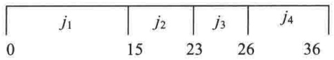

<details>
<summary>text_image</summary>

j₁ | j₂ | j₃ | j₄
0 15 23 26 36
</details>

图10.2 1号调度

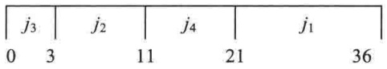

<details>
<summary>text_image</summary>

j₃ | j₂ | j₄ | j₁
0 3 11 21 36
</details>

图 10.3 2 号调度(最优)

图 10.3 给出的调度是按照最短的作业最先进行来安排的。我们可以证明这将总会产生一个最优的调度。令调度表中的作业是  $j_{i_{1}}, j_{i_{2}}, \cdots, j_{i_{N}}$  。第一个作业以时间  $t_{i_{1}}$  完成。第二个作业在  $t_{i_{1}} + t_{i_{2}}$  后完成，而第三个作业在  $t_{i_{1}} + t_{i_{2}} + t_{i_{3}}$  后完成。由此可以看到，该调度总的开销 C 为

$$
C = \sum_ {k = 1} ^ {N} (N - k + 1) t _ {i _ {k}} \tag {10.1}
$$

$$
C = (N + 1) \sum_ {k = 1} ^ {N} t _ {i _ {k}} - \sum_ {k = 1} ^ {N} k \cdot t _ {i _ {k}} \tag {10.2}
$$

注意，在方程(10.2)中第一个和与作业的排序无关，因此只有第二个和影响到总开销。设在一个排序中存在某个 $x > y$ 使得 $t_{i_x} < t_{i_y}$ 。此时，计算表明，交换 $j_{i_x}$ 和 $j_{i_y}$，第二个和增加，从而降低了总的开销。因此，其所用时间不是单调非减的任何作业调度必然是次最优的。剩下的只有那些其作业按照最小运行时间最先安排的调度才是所有调度方案中最优的。

## 多处理器的情况

可以把这个问题扩展到多个处理器的情形。我们还是有作业 $j_{1}, j_{2}, \cdots, j_{N}$ ，对应的运行时间分别为 $t_{1}, t_{2}, \cdots, t_{N}$ ，另有处理器P个。不失一般性，我们将假设作业是排了序的，最短的运行时间最先处理。作为一个例子，设P=3，而作业则如图10.4所示。

图 10.5 显示了一个最优的安排，它把平均完成时间优化到最小。作业  $j_{1}, j_{4}$  和  $j_{7}$  在处理器 1 上运行。处理器 2 处理作业  $j_{2}, j_{5}$  和  $j_{8}$，而处理器 3 运行其余的作业。总的完成时间为 165，平均是  $\frac{165}{9} = 18.33$。

这个结果指出了操作系统调度程序一般把优先权赋予那些更短的作业的原因。

| 作业 | 时间 |
| --- | --- |
| $j_{1}$ | 3 |
| $j_{2}$ | 5 |
| $j_{3}$ | 6 |
| $j_{4}$ | 10 |
| $j_{5}$ | 11 |
| $j_{6}$ | 14 |
| $j_{7}$ | 15 |
| $j_{8}$ | 18 |
| $j_{9}$ | 20 |

图10.4 作业和时间

---

第 10 章 算法设计技巧

355

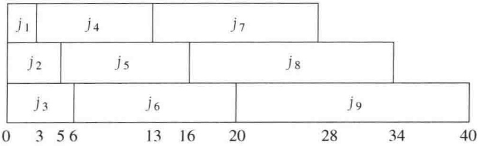

<details>
<summary>text_image</summary>

j₁
j₄
j₇
j₂
j₅
j₈
j₃
j₆
j₉
0 3 5 6 13 16 20 28 34 40
</details>

图10.5 多处理器情形的一个最优解

解决多处理器情形的算法是按顺序开始作业，处理器之间轮换分配作业。不难证明，没有哪个其他的顺序能够做得更好，不过，当处理器个数 $P$ 能够整除作业数 $N$ 时存在多个最优的排序。对于每一个 $0 \leqslant i < N / P$ ，通过把从 $j_{iP + 1}$ 直到 $j_{(i + 1)P}$ 的每一个作业放到不同的处理器上，可以得到这样的结果。在我们的例子中，图10.6指出第二个最优解。

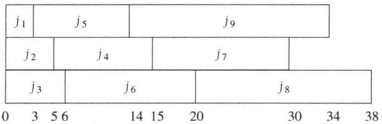

<details>
<summary>text_image</summary>

j₁ j₅ j₉
j₂ j₄ j₇
j₃ j₆ j₈
0 3 5 6 14 15 20 30 34 38
</details>

图10.6 多处理器情形的第二个最优解

即使 $P$ 不恰好整除 $N$ ，哪怕所有的作业时间是互异的，也还是仍然能够有许多的最优解。我们把进一步的考查留作练习。

## 将最后完成时间最小化

在本小节最后，考虑一个非常类似的问题。假设我们只关注最后的作业的结束时间。在上面的两个例子中，它们的完成时间分别是40和38。图10.7指出最少的最后完成时间是34，

而这个结果显然不能再改进了，因为每一个处理器都一直在忙着。

虽然这个调度没有最小平均完成时间，但是它有个优点，即整个序列的完成时间更早。如果同一个用户拥有所有这些作业，那么该调度是更可取的调度方法。虽然这些问题非常相似，但是这个新问题实际上是 NP 完全的，它

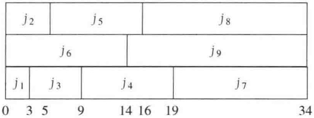

<details>
<summary>text_image</summary>

j2
j5
j8
j6
j9
j1
j3
j4
j7
0 3 5 9 14 16 19 34
</details>

图10.7 将最后完成时间最小化

恰是背包问题或装箱问题的另一种表述方式，我们在本节后面还将遇到它。因此，将最后完成时间最小化显然要比把平均完成时间最小化困难得多。

## 10.1.2 哈夫曼编码

在这一节，我们考虑贪婪算法的第二个应用，称为文件压缩(file compression)。

标准的 ASCII 字符集由大约 100 个 “可打印” 字符组成。为了把这些字符区分开来，需要  $\left\lceil \log 100 \right\rceil = 7$  个比特（二进制位）。但 7 个比特可以表示 128 个字符，因此 ASCII 字符还可以再加上一些其他的 “非打印” 字符。第 8 个比特位的加入用作奇偶校验位。然而，重要的问题在于，如果字符集的大小是 C，那么在标准的编码中就需要  $\left\lceil \log C \right\rceil$  个比特。

---

356

数据结构与算法分析——C++语言描述(第四版)

设有一个文件，它只包含字符 a, e, i, s, t，再加上一些空格 (blank space) 和换行符 (newline)。进一步设该文件有 10 个 a、15 个 e、12 个 i、3 个 s、4 个 t、13 个空格以及一个换行符。如图 10.8 所示，这个文件需要 174 个比特来表示，因为有 58 个字符而每个字符需要 3 个比特。

在现实当中，文件可能是相当大的。许多非常大的文件常为某个程序的输出，而在频率最大的字符和频率最小的字符之间通常存在很大的差别。例

| 字符 | 代码 | 频率 | 总比特数 |
| --- | --- | --- | --- |
| a | 000 | 10 | 30 |
| e | 001 | 15 | 45 |
| i | 010 | 12 | 36 |
| s | 011 | 3 | 9 |
| t | 100 | 4 | 12 |
| 空格 | 101 | 13 | 39 |
| 换行符 | 110 | 1 | 3 |
| 总计 |  |  | 174 |

图10.8 使用一个标准编码方案

如，许多巨大的文件都含有很多大量的数字、空格和换行符，但是 q 和 x 却很少。如果在慢速的电话线上传输这些信息，那么我们就会希望减少文件的大小。还有，由于实际上每一台机器上的磁盘空间都是非常珍贵的，因此人们就会想到是否有可能提供一种更好的编码以降低所需的总比特数。

答案是肯定的，一种简单的策略可以使典型的大型文件节省 25%，而使许多大型的数据文件节省多达 50%\~60%。这种一般的策略就是让代码的长度从字符到字符是变化不等的，同时保证经常出现的字符其代码要短。注意，如果所有的字符都以相同的频率出现，那么节省的问题是不可能存在的。

代表字母的二进制代码可以用二叉树来表示，如图 10.9 所示。

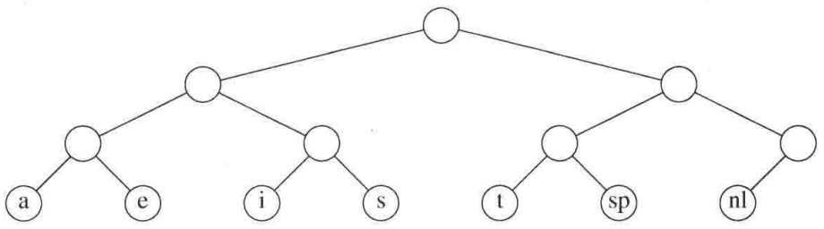

<details>
<summary>flowchart</summary>

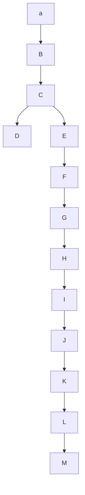
</details>

图10.9 树中原始代码的表示法

图 10.9 中的树只在树叶上有数据。每个字符通过从根节点开始以记录路径的方法表示出来，其中用 0 指示左分支，用 1 指示右分支。例如，s 通过从根向左走，然后向右，最后再向右而达到，于是它被编码成 011。这种数据结构有时叫作 trie 树 (trie)。如果字符  $c_{i}$  在深度  $d_{i}$  处并且出现  $f_{i}$  次，那么该字符代码的值 (cost of the code) 就等于  $\sum d_{i}f_{i}$ 。

一种比图10.9给出的代码更好的代码，可以利用换行符是一个仅有的儿子而得到。通过把换行符放到它的更高一层的父节点上，可得到图10.10所示的新的树。这棵新树的值是173，但该值仍然远没有达到最优。

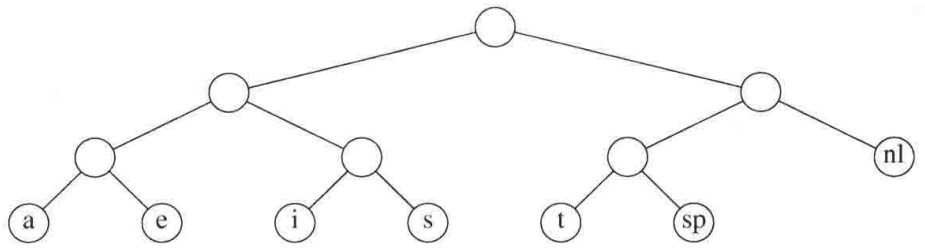

<details>
<summary>flowchart</summary>

```mermaid
graph TD
  A[""] --> B[""]
  B --> C[""]
  C --> D[""]
  D --> E["nl"]
  C --> F["i"]
  F --> G["s"]
  G --> H["t"]
  H --> I["sp"]
```
</details>

图10.10 稍微好一些的树

---

第 10 章 算法设计技巧

357

注意，图 10.10 中的树是一棵满树(full tree):所有的节点要么是树叶，要么有两个儿子。一种最优的编码将总具有这个性质，因为否则，正如我们已经看到的，具有一个儿子的节点可以向上移动一层。

如果字符都只放在树叶上，那么任何比特序列总能够被毫不含糊地译码。例如，设编码串是0100111100010110001000111。0不是字符代码，01也不是字符代码，但010是i，于是第一个字符是i。然后跟着的是011，它是字符s。其后的11是个换行符。剩下的代码分别是a，空格，t, i, e，换行符。因此，这些字符代码的长度是否不同并不重要，只要没有字符代码是别的字符代码的前缀就行。这样一种编码叫作前缀码(prefix code)。相反，如果一个字符放在非树叶节点上，那就不再能够保证译码没有二义性了。

综上所述，我们看到，基本的问题在于找出(如上定义的)总值最小的满二叉树，其中所有的字符都位于树叶上。图10.11中的树显示该例样本字母表的最优树。从图10.12可以看到，这种编码只用了146个比特。

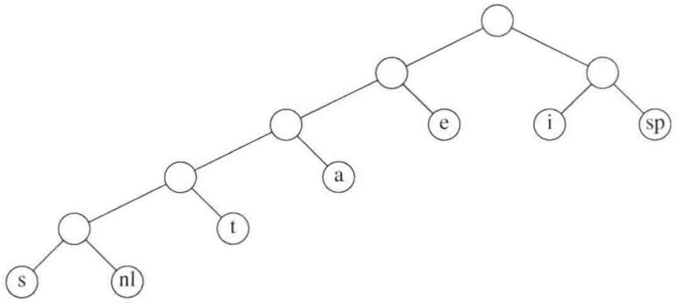

<details>
<summary>flowchart</summary>

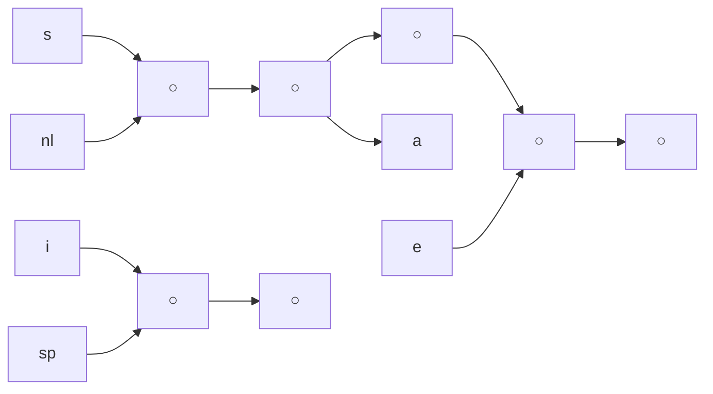
</details>

图10.11 最优前缀码

| 字符 | 代码 | 频率 | 总比特数 |
| --- | --- | --- | --- |
| a | 001 | 10 | 30 |
| e | 01 | 15 | 30 |
| i | 10 | 12 | 24 |
| s | 00000 | 3 | 15 |
| t | 0001 | 4 | 16 |
| 空格 | 11 | 13 | 26 |
| 换行符 | 00001 | 1 | 5 |
| 总计 |  |  | 146 |

图10.12 最优前缀码

注意，存在许多的最优编码。这些编码可以通过交换编码树中的子节点得到。此时，主要的未解决的问题是如何构造编码树。1952年Huffman给出一个算法解决了这个问题。因此，这种编码系统通常称为哈夫曼编码(Hufman code)。

## 哈夫曼算法

本小节将假设字符的个数为 $C$ 。哈夫曼算法(Huffman's algorithm)可以描述如下:算法对由树组成的森林进行。一棵树的权(weight of a tree)等于它的树叶出现的频率的和。任意选取最小权的两棵树 $T_{1}$ 和 $T_{2}$，并任意形成以 $T_{1}$ 和 $T_{2}$ 为子树的新树，将这样的过程进行 $C - 1$ 次。在算法的开始，存在 $C$ 棵单节点树——每个字符一棵。在算法结束时得到一棵树，这棵树就是最优哈夫曼编码树。

我们通过一个具体例子来搞清算法的操作。图10.13表示的是初始的森林，每棵树的权在根处以小号数字标出。将两棵权最低的树合并到一起，由此建立了图10.14中的森林。我们将新的根命名为 $T_{1}$，这样使得进一步的合并可以确切无误地表述。图中我们令s是左儿子，这里，令其为左儿子还是右儿子是任意的；注意可以使用哈夫曼算法描述中的两个任意性。新树的总的权正是两棵老树的权的和，因而也就很容易计算。由于建立新树只需得出一个新节点，建立左指针和右指针并把权记录下来，因此创建新树还是很简单的。

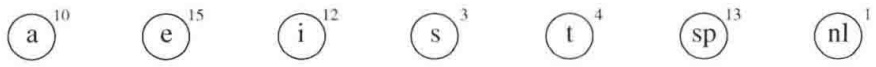

<details>
<summary>text_image</summary>

a 10 e 15 i 12 s 3 t 4 sp 13 nl 1
</details>

图10.13 哈夫曼算法的初始阶段

---

358

数据结构与算法分析——C++语言描述(第四版)

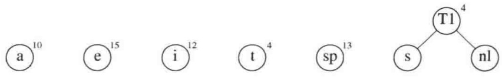

<details>
<summary>text_image</summary>

a 10
e 15
i 12
t 4
sp 13
T1 4
s
nl
</details>

图 10.14 第一次合并后的哈夫曼算法

现在有 6 棵树，我们再任意选取两棵权最小的树。这两棵树恰好就是 T1 和 t，然后将它们合并成一棵新树，树根在 T2，树的权是 8，见图 10.15。第三步将 T2 和 a 合并建立 T3，其权为  $10 + 8 = 18$ 。图 10.16 所示为这次操作的结果。

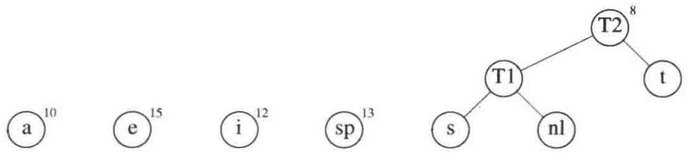

<details>
<summary>flowchart</summary>

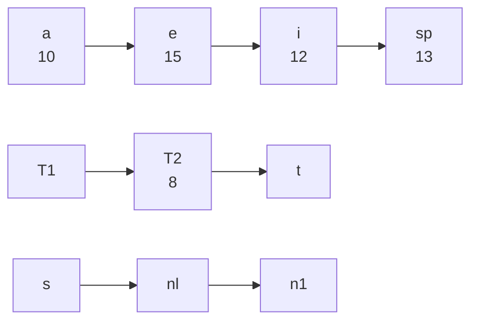
</details>

图 10.15 第二次合并后的哈夫曼算法

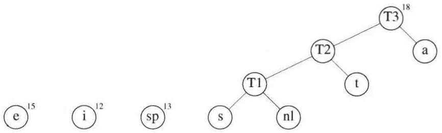

<details>
<summary>flowchart</summary>

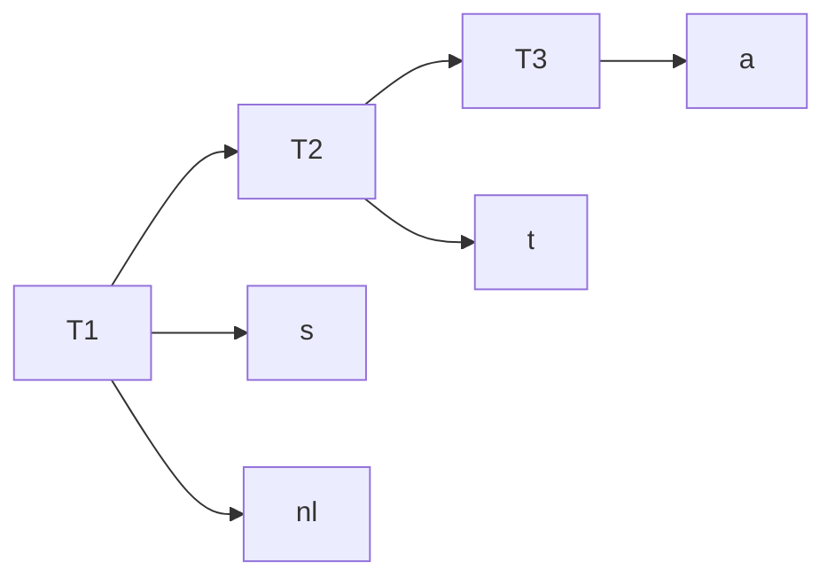
</details>

图 10.16 第三次合并后的哈夫曼算法

在第三次合并完成后，最低权的两棵树是代表 i 和空格的两个单节点树。图 10.17 所示为这两棵树是如何合并成根在 T4 的新树的。第五步是合并根为 e 和 T3 的两棵树，因为这两棵树的权最小。该步结果如图 10.18 所示。

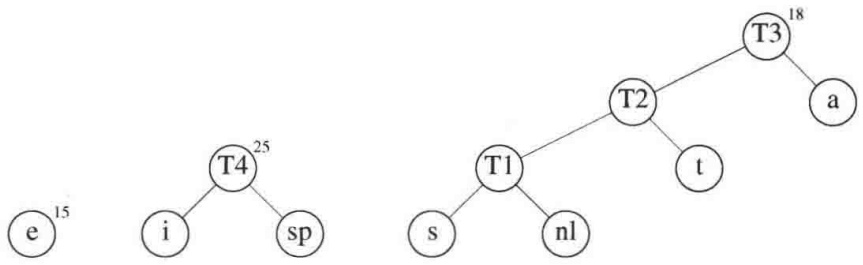

<details>
<summary>flowchart</summary>

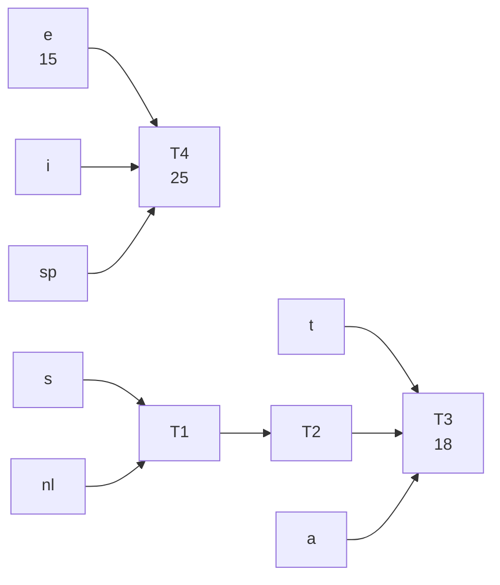
</details>

图 10.17 第四次合并后的哈夫曼算法

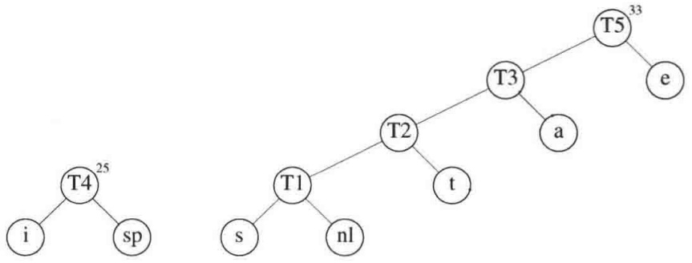

<details>
<summary>flowchart</summary>

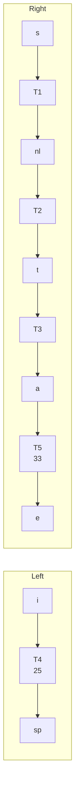
</details>

图 10.18 第五次合并后的哈夫曼算法

最后，将仅有的两棵剩下的树合并得到图 10.11 所示的最优树。图 10.19 画出了这棵最优树，其根在 T6。

---

第 10 章 算法设计技巧

359

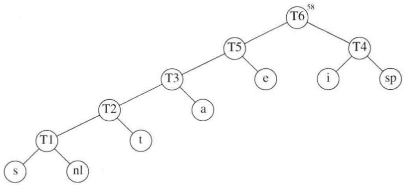

<details>
<summary>flowchart</summary>

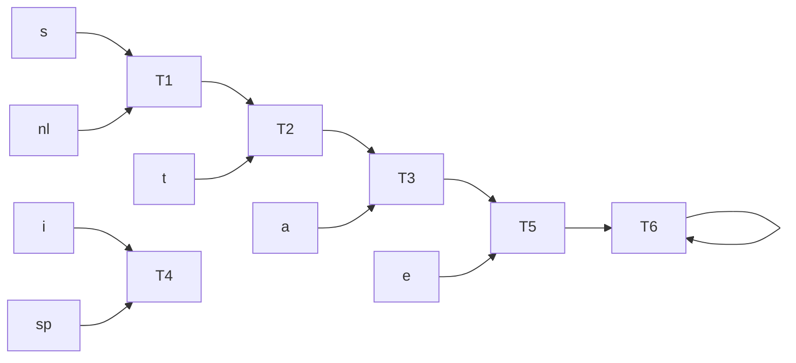
</details>

图 10.19 最后一次合并后的哈夫曼算法

我们将概述哈夫曼算法产生最优代码的证明思路，详细的细节将留作练习。首先，由反证法不难证明树必然是满的，因为我们已经看到一棵不满的树是如何改进成满树的。

其次，我们必须证明两个频率最小的字符 $\alpha$ 和 $\beta$ 必然是两个最深的节点(不过，其他节点也有可能同样的深)。这通过反证法同样容易证明，因为如果 $\alpha$ 或 $\beta$ 不是最深的节点，那么必然存在某个 $\gamma$ 是最深的节点(记住树是满的)。如果 $\alpha$ 的频率小于 $\gamma$ ，那么可以通过交换它们在树中的位置而改进权的值。

然后我们可以论证，在相同深度上任意两个节点处的字符可以交换而不影响最优性。这说明，总可以找到一棵最优树，它含有两个最不经常出现的符号作为兄弟，因此第一步没有错，是成立的。

证明可以通过归纳法论证完成。当树被合并时，我们认为新的字符集是在根上的那些字符。于是，在我们的例子中，经过 4 次合并以后，我们可以把字符集看成由 e 与元字符 (metacharacters) T3 和 T4 组成。这恐怕是证明最巧妙的部分，我们要求读者补足所有的细节。

该算法是贪婪算法的原因在于，在每一阶段我们都进行一次合并而没有进行全局的考虑。我们只是选择两棵最小的树。

如果我们依权排序将这些树保存在一个优先队列中，那么，由于在绝不会有超过 $C$ 个元素的优先队列上将进行一次 buildHeap，2C-2 次 deleteMin，和 $C-2$ 次 insert，因此运行时间为 $O(C \log C)$。若使用一个链表简单实现该队列，则将给出一个 $O(C^2)$ 算法。优先队列实现方法的选择取决于 $C$ 有多大。在 ASCII 字符集的典型情况下，$C$ 是足够小的，这使得二次的运行时间是可以接受的。在这样的应用中，实际上所有的运行时间都将耗费在读进输入文件和写出压缩文件所需要的磁盘 I/O 上。

有两个细节必须要考虑。首先，在压缩文件的开头必须要传送编码信息，因为否则将不可能译码。做这件事有几种方法，见练习 10.4。对于一些小文件，传送编码信息表的开销将超过压缩中任何可能的节省，最后的结果很可能是文件扩大。当然，这可以检测到且原文件可原样保留。对于大型文件，信息表的大小是无关紧要的。

第二个问题正如所描述的，该算法是一个两趟扫描算法。第一趟搜集频率数据，第二趟进行编码。显然，对于处理大型文件的程序来说，这个性质不是我们所希望的。某些另外的做法在参考文献中作了介绍。

## 10.1.3 近似装箱问题

在这一节，我们将考虑某些解决装箱问题(bin packing problem)的算法。这些算法将运行得很快，但未必产生最优解。然而，我们将证明所产生的解距最优解不太远。

---

360

数据结构与算法分析——C++语言描述(第四版)

设给定 N 项物品，大小为  $s_{1}, s_{2}, \cdots, s_{N}$ ，所有的大小都满足  $0 < s_{i} \leqslant 1$ 。问题是要把这些物品装到最小数目的箱子中去，已知每个箱子的容量是 1 个单位。作为例子，图 10.20 所示为把大小为 0.2, 0.5, 0.4, 0.7, 0.1, 0.3, 0.8 的一列物品最优装箱的方法。

有两种类型的装箱问题。第一种是联机装箱问题(online bin packing problem)。在这种问题中，每一件物品必须放入一个箱子之后才处理下一件物品。第二种是脱机装箱问题(offline bin packing problem)。在一个脱机算法中，我们做任何事都需要等到所有的输入数据全被读入之后才进行。联机算法和脱机算法之间的区别在8.2节讨论过。

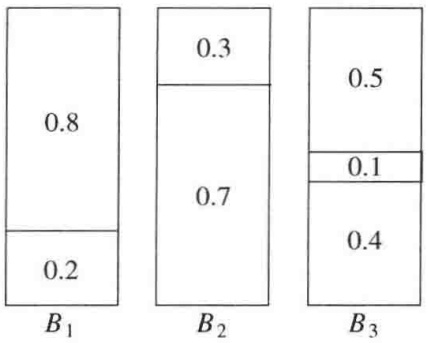

<details>
<summary>bar_stacked</summary>

| Category | Value |
| --- | --- |
| B1 | 0.8 |
| B1 | 0.2 |
| B2 | 0.3 |
| B2 | 0.7 |
| B3 | 0.5 |
| B3 | 0.1 |
| B3 | 0.4 |
</details>

图 10.20 对 0.2, 0.5, 0.4, 0.7, 0.1, 0.3, 0.8 的最优装箱

## 联机算法

需要考虑的第一个问题是，一个联机算法即使在允许无限制计算的情况下是否实际上总能给出最优的解答。我们知道，即使允许无限制的计算，联机算法也必须先放入一项物品然后才能处理下一件物品，并且不能改变决定。

为了证明联机算法不总能够给出最优解，我们将给它一组特别难的数据来处理。考虑由大小为 $\frac{1}{2} -\varepsilon$ 的 $M$ 个小项和其后大小为 $\frac{1}{2} +\varepsilon$ 的 $M$ 个大项构成的序列 $I_{1}$ ，其中 $0 <   \varepsilon <  0.01$ 。显然，如果在每个箱子中放一个小项再放一个大项，那么这些项物品可以放入到 $M$ 个箱子中去。假设存在一个最优联机算法A可以进行这项装箱工作。考虑算法A对序列 $I_{2}$ 的操作，该序列只由大小为 $\frac{1}{2} -\varepsilon$ 的 $M$ 个小项组成。 $I_{2}$ 是可以装入 $\lceil M / 2\rceil$ 个箱子中的。然而，由于A对序列 $I_{2}$ 的处理结果必然和对 $I_{1}$ 的前半部分处理结果相同，而 $I_{1}$ 前半部分的输入又跟 $I_{2}$ 的输入完全相同，因此算法A将把每一项物品放到一个单独的箱子内。这说明A将使用 $I_{2}$ 最优解的两倍多的箱子。这样我们就证明了，对于联机装箱问题不存在最优算法。

上面的论述指出，联机算法从不知道输入何时会结束，因此它提供的任何性能保证必须在整个算法的每一瞬时成立。如果我们遵循上述策略，则可以证明下列定理。

## 定理 10.1

存在使得任意联机装箱算法至少使用 $\frac{4}{3}$ 最优箱子数的输入。

## 证明:

假设情况相反，为简单起见设 $M$ 是偶数。考虑任一运行在上面输入序列 $I_{1}$ 上的联机算法A。我们知道，该序列由 $M$ 个小项后接 $M$ 个大项组成。让我们考虑该算法在处理第 $M$ 项后都做了什么。设算法A已经用了 $b$ 个箱子。在算法的这一时刻，箱子的最优个数是 $M / 2$ ，因为我们可以在每个箱子里放入两件物品。于是我们知道，根据我们的好于 $\frac{4}{3}$ 的性能保证的假设，$2b / M < \frac{4}{3}$ 。

现在考虑在所有的物品都被装箱后算法A的性能。在第 $b$ 个箱子之后开辟的所有箱子每箱恰好包含一项物品，因为所有小物品都被放在了前 $b$ 个箱子中，而两个大项物品又装不进一个箱子中去。由于前 $b$ 个箱子每箱最多能有两项物品，而其余的箱子每箱都有一项物品，

---

第 10 章 算法设计技巧

361

因此我们看到，将 $2M$ 项物品装箱将至少需要 $2M - b$ 个箱子。但 $2M$ 项物品可以用 $M$ 个箱子最优装箱，因此我们的性能保障保证得到 $(2M - b) / M < \frac{4}{3}$ 。

第一个不等式意味着 $b / M < \frac{2}{3}$，而第二个不等式意味着 $b / M > \frac{2}{3}$，这是矛盾的。因此，没有联机算法能够保证使用小于 $\frac{4}{3}$ 的最优装箱数完成装箱。

有 3 种简单算法保证所用的箱子数不多于 2 倍的最优装箱数。也有颇多更为复杂的算法能够得到更好的结果。

## 下项适合算法

大概最简单的算法就属下项适合算法(next fit)了。当处理任何一项物品时，我们检查看它是否还能装进刚刚装进物品的同一个箱子中去。如果能够装进去，那么就把它放入该箱中；否则，就开辟一个新的箱子。这个算法实现起来出奇地简单，而且还以线性时间运行。图10.21显示对于与图10.20相同的输入所得到的装箱过程。

下项适合算法不仅编程简单，而且它的最坏情形的行为也容易分析。

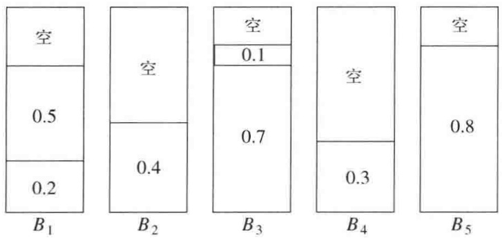

<details>
<summary>bar_stacked</summary>

| Category | Segment 1 | Segment 2 | Segment 3 |
| --- | --- | --- | --- |
| B1 | 0.2 | 0.5 | 空 |
| B2 | 0.4 | 空 | — |
| B3 | — | 0.7 | 空 |
| B4 | — | 0.3 | 空 |
| B5 | — | — | 空 |
</details>

图10.21 对 $0.2, 0.5, 0.4, 0.7, 0.1, 0.3, 0.8$ 的下项适合算法

## 定理10.2

令 $M$ 是将一列物品 $I$ 装箱所需的最优装箱数，则下项适合算法所用箱子数绝不超过 $2M$。存在一些顺序使得下项适合算法用箱 $2M - 2$ 个。

## 证明:

考虑任何相邻的两个箱子 $B_{j}$ 和 $B_{j + 1}$ 。 $B_{j}$ 和 $B_{j + 1}$ 中所有物品的大小之和必然大于1，因为否则所有这些物品就会全部放入 $B_{j}$ 中。如果将该结果用于所有相邻的两个箱子，那么我们看到，顶多有一半的空间闲置。因此，下项适合算法最多使用2倍的最优箱子数。

为说明这个比率2是精确的，设 $N$ 项物品大小当 $i$ 是奇数时 $s_i = 0.5$ 而当 $i$ 是偶数时 $s_i = 2 / N$ 设 $N$ 可被4整除。图10.22所示的最优装箱由每个含有2件大小为0.5的物品的 $N / 4$ 个箱子，和一个含有 $N / 2$ 件大小为 $2 / N$ 的物品的箱子组成，总数为 $(N / 4) + 1$ 。图10.23表示下项适合算法使用 $N / 2$ 个箱子。因此，下项适合算法可以用到几乎2倍于最优装箱数的箱子。

## 首次适合算法

虽然下项适合算法有一个合理的性能保证，但是，它的效果在实践中却很差，因为在不需要开辟新箱子的时候它开辟了新箱子。在前面样例的运作中，本可以把大小为0.3的物品放入 $B_{1}$ 或 $B_{2}$ 而不是开辟一个新箱子。

---

362

数据结构与算法分析——C++语言描述(第四版)

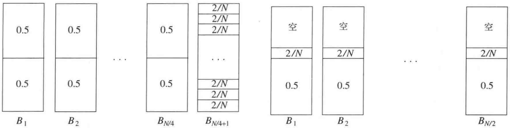

<details>
<summary>text_image</summary>

0.5
0.5
B₁
0.5
B₂
...
0.5
Bₙ/₄
0.5
Bₙ/₄₊₁
2/N
2/N
2/N
...
2/N
2/N
2/N
空
空
2/N
0.5
0.5
B₁
B₂
...
空
2/N
0.5
Bₙ/₂
</details>

图 10.22 对 0.5, 2/N, 0.5, 2/N, 0.5, 2/N…的最优装箱方法

图 10.23 对 0.5, 2/N, 0.5, 2/N, 0.5, 2/N…的下项适合装箱法

首次适合算法(first fit)的策略是依序扫描这些箱子,并把新的一项物品放入足能盛下它的第一个箱子中。因此,只有当前面那些放置物品的箱子都容不下当前物品的时候,我们才开辟一个新箱子。图10.24显示对我们的标准输入进行首次适合算法的装箱结果。

实现首次适合算法的一个简单方法，是通过顺序扫描箱子序列处理每一项物品，这将花费  $O(N^{2})$  时间。有可能以  $O(N \log N)$  运行来实现首次适合算法，我们把它留作练习。

略加思索读者即可明白，在任一时刻最多有一个箱子其空出的部分大于箱子的一半，因为若有第二个这样的也空一半的箱子，则它的内容物就会装到第一个这样的箱子中了。因此我们可以立即断言:首次适合算法保证其解最多包含2倍的最优装箱数。

另一方面，我们在证明下项适合算法性能的界时所用到的最坏情况对首次适合算法不适用。因此，人们可能要问:是否能够证明更好的界呢？答案是肯定的，不过证明很复杂。

## 定理 10.3

令 $M$ 是将一列物品 $I$ 装箱所需要的最优箱子数，则首次适合算法使用的箱子数绝不多于 $\frac{17}{10} M + \frac{7}{10}$ 。存在使得首次适合算法使用 $\frac{17}{10}(M - 1)$ 个箱子的序列。

证明:

参阅本章末尾的参考文献。

一个由首次适合算法算出的例子如图 10.25 所示, 其结果和上面定理指出的结果几乎一样的差。图中的输入由 $6M$ 个大小为 $\frac{1}{7} + \varepsilon$ 的项, 后跟 $6M$ 个大小为 $\frac{1}{3} + \varepsilon$ 的项, 以及接续其后的 $6M$ 个大小为 $\frac{1}{2} + \varepsilon$ 的项组成。一种简单的装箱办法是将每种大小的各一项物品装到一个箱子中, 总共需要 $6M$ 个箱子。如用首次适合算法, 则需要 $10M$ 个箱子。

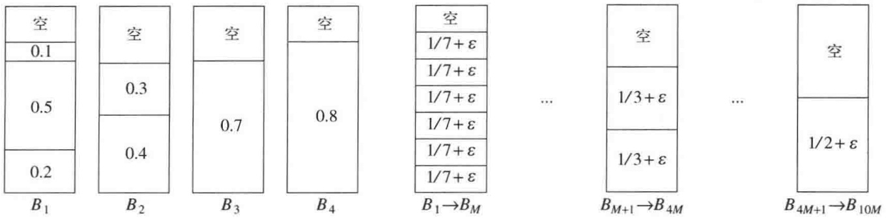

<details>
<summary>text_image</summary>

空
0.1
0.5
0.2
B₁
空
0.3
0.4
B₂
空
0.7
B₃
空
0.8
B₄
空
1/7+ε
1/7+ε
1/7+ε
1/7+ε
1/7+ε
B₁→BM
...
空
1/3+ε
1/3+ε
...
BM+1→BM
...
空
1/2+ε
B₄M+1→BM
</details>

图 10.24 对 0.2, 0.5, 0.4, 0.7, 0.1, 0.3, 0.8 的首次适合算法

图10.25 首次适合算法使用 $10M$ 个而不是 $6M$ 个箱子的情形

---

第 10 章 算法设计技巧

363

当首次适合算法对大量其大小均匀分布在 0 和 1 之间的物品进行运作时，经验结果指出，首次适合算法用到大约比最优装箱方法多 2% 的箱子。在许多情况下，这是完全可以接受的。

## 最佳适合算法

我们将要考查的第三种联机策略是最佳适合算法(best fit)。该法不是把一项新物品放入所发现的第一个能够容纳它的箱子，而是放到所有箱子中能够容纳它的最满的箱子中。典型的装箱方法如图10.26所示。

注意，大小为0.3的项不是放在 $B_{2}$ 而是放在了 $B_{3}$，此时它正好把 $B_{3}$ 填满。由于我们现在对箱子进行更细致的选择，因此人们可能认为算法性能保障会有所改善。但是情况并非如此，因为一般的坏情形是相同的。最佳适合算法绝不会超过最优算法的大约1.7倍，而且存在一些输入，对于这些输入该算法(几乎)达到这个界。不过，最佳适合算法编程还是简单的，特别是当需要 $O(N\log N)$ 算法的时候，而且该算法对随机的输入确实表现得更好。

## 脱机算法

如果能够通过观察全部物品以后再算出答案，那么我们应该会做得更好。事实也确实如此，由于通过彻底的搜索能够最终找到最优装箱方法，因此我们对联机情形已经有了理论上的改进。

所有联机算法的主要问题在于将大项物品装箱困难，特别是当它们在输入的后期出现时。围绕这个问题的自然方法是将各项物品排序，把最大的物品放在最先。此时可以应用首次适合算法或最佳适合算法，分别得到首次适合递减算法(first fit decreasing)和最佳适合递减算法(best fit decreasing)。图10.27指出在我们的例子中这会产生最优解(尽管在一般的情形下当然未必会如此)。

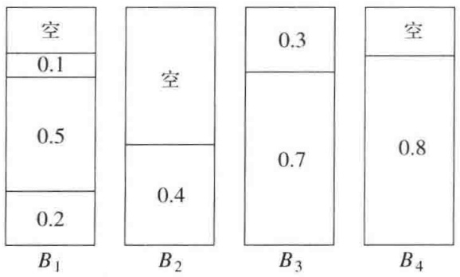

<details>
<summary>bar_stacked</summary>

| Block | Value |
| --- | --- |
| B1 (Top) | 0.1 |
| B1 (Bottom) | 0.5 |
| B1 (Bottom) | 0.2 |
| B2 (Top) | 空 |
| B2 (Bottom) | 0.4 |
| B3 (Top) | 0.3 |
| B3 (Bottom) | 0.7 |
| B4 (Top) | 空 |
| B4 (Bottom) | 0.8 |
</details>

图 10.26 对 0.2, 0.5, 0.4, 0.7, 0.1, 0.3, 0.8 的最佳适合算法

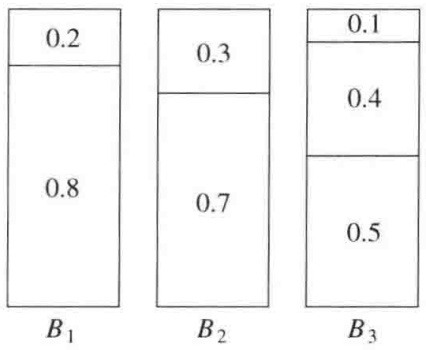

<details>
<summary>bar_stacked</summary>

| Category | Value |
| --- | --- |
| B1 | 0.2 |
| B1 | 0.8 |
| B2 | 0.3 |
| B2 | 0.7 |
| B3 | 0.1 |
| B3 | 0.4 |
| B3 | 0.5 |
</details>

图 10.27 对 0.8, 0.7, 0.5, 0.4, 0.3,
0.2, 0.1 的首次适合算法

本小节我们将处理首次适合递减算法。对于最佳适合递减算法，结果几乎是一样的。由于存在物品大小不是互异的可能，因此有些作者更愿意把首次适合递减算法叫作首次适合非增算法(first fit nonincreasing)。我们将沿用原始的名称。不失一般性，我们还要假设输入数据的大小已经被排序。

我们能够做的第一个评注是，首次适合算法使用 $10M$ 个而不是 $6M$ 个箱子的坏情形，对物品的各项被排序时不再适用。我们将证明，如果一种最优装箱法使用 $M$ 个箱子，那么首次适合递减算法使用的箱子数绝不超过 $(4M + 1)/3$。

---

364

数据结构与算法分析——C++语言描述(第四版)

这个结论依赖于两个观察结果。首先，所有权重大于 $\frac{1}{3}$ 的项将被放入前 $M$ 个箱子内。这意味着，在这 $M$ 个箱子之外附加的箱子中所有各项的权重最多是 $\frac{1}{3}$ 。第二个结果是，在附加箱子中物品的项数最多可以是 $M - 1$ 。把这两个结果结合起来我们发现，附加的箱子最多可能需要 $\lceil (M - 1) / 3 \rceil$ 个。现在我们证明这两个观察结果。

## 引理10.1

令 N 项物品的输入大小 (以递减顺序排序) 分别为  $s_{1}, s_{2}, \cdots, s_{N}$ ，并设最优装箱方法使用 M 个箱子。那么，首次适合递减算法放到 M 个箱子之外的附加箱子中的每件物品的大小最多为  $\frac{1}{3}$ 。

## 证明:

设第 $i$ 项物品是放入第 $M + 1$ 个箱子中的第一项。需要证明 $s_i \leqslant \frac{1}{3}$ 。我们将使用反证法证明这个结论。假设 $s_i > \frac{1}{3}$ 。

由于这些物品的大小是以排好序的顺序排列的，因此， $S_{1}, S_{2}, \cdots, S_{i-1} > \frac{1}{3}$ 。由此得知，所有的箱子 $B_{1}, B_{2}, \cdots, B_{M}$ 每个最多只有两项物品。

考虑在第 $i - 1$ 项物品被放入一个箱子后但第 $i$ 项物品尚未放入时系统的状态。现在我们想要证明(在 $s_i > \frac{1}{3}$ 的假设下)前 $M$ 个箱子排列如下:首先是有些箱子内恰好有一项物品，然后剩下的箱子内有两项物品。

设有两个箱子 $B_{x}$ 和 $B_{y}$ 使得 $1 \leqslant x < y \leqslant M$，其中 $B_{x}$ 有两项而 $B_{y}$ 有一项。令 $x_{1}$ 和 $x_{2}$ 是 $B_{x}$ 中的两项物品，并令 $y_{1}$ 是 $B_{y}$ 中的那一项物品。$x_{1} \geqslant y_{1}$，因为 $x_{1}$ 被放在较前的箱子中。根据类似的推理 $x_{2} \geqslant s_{i}$。因此，$x_{1} + x_{2} \geqslant y_{1} + s_{i}$。这意味着 $s_{i}$ 是应该可以放在 $B_{y}$ 中的。根据我们的假设，这是不可能的。因此，如果 $s_{i} > \frac{1}{3}$，那么在试图处理 $s_{i}$ 时，我们安排前 $M$ 个箱子使得前 $j$ 个箱子各装一项物品，而后 $M - j$ 个箱子各放两项物品。

为了证明该引理，我们将证明不存在将所有物品装入 $M$ 个箱子的方法，这和引理的假设矛盾。

显然，在 $s_1, s_2, \cdots, s_j$ 中使用任何算法都没有两项可以放入一个箱子中，因为如果能放，那么首次适合算法也能放。我们还知道，首次适合算法尚未把大小为 $s_{j+1}, s_{j+2}, \cdots, s_i$ 中的任一项放入前 $j$ 个箱子中，因此它们都不能再往前 $j$ 个箱子中放。这样，在任何装箱方法中，特别是最优装箱方法中，必然存在 $j$ 个箱子不包含这些项。由此可知，大小为 $s_{j+1}, s_{j+2}, \cdots, s_{i-1}$ 的项必然包含在其后的 $M-j$ 个箱子的某个集合中，考虑到前面的讨论，于是这些项的总数为 $2(M-j)$ 。①

注意, 如果 $s_i > \frac{1}{3}$, 那么只要证明 $s_i$ 没有办法放入这 $M$ 个箱子当中的任一个中去, 该引理的证明也就完成了。事实上, 显然它不能放入前 $j$ 个箱子中去, 因为假如能放入, 那么首次适合算法也能够这么做。为把它放入剩下的 $M - j$ 个箱子之一中, 需要把 $2(M - j) + 1$ 项物品分发到这 $M - j$ 个箱子中。因此, 某个箱子就不得不装入 3 件物品, 而它们中的每一件又都大于 $\frac{1}{3}$, 很明显, 这是不可能的。

<small><span class="docvortex-page-footnote" data-block-type="page_footnote" style="color:#6b7280">① 回忆首次适合算法把这些项物品装入 $M - j$ 个箱子并在每个箱子中放入两项物品，因此有 $2(M - j)$ 项。</span></small>

---

第 10 章 算法设计技巧

365

这与所有大小的物品都能够装入 $M$ 个箱子的事实矛盾，因此开始的假设肯定是不正确的，从而 $s_i \leqslant \frac{1}{3}$。

## 引理 10.2

放入附加箱子中的物品的个数最多是 $M - 1$。

证明:

假设放入附加箱子中的物品至少有 $M$ 个。我们知道 $\sum_{i=1}^{N} s_i \leqslant M$，因为所有的物品都可装入 $M$ 个箱子。设对于 $1 \leqslant j \leqslant M$，箱子 $B_j$ 装填的总量为 $W_j$。设前 $M$ 个附加箱子中的物品大小为 $x_1, x_2, \dots, x_M$。此时，由于前 $M$ 个箱子中的项加上前 $M$ 个附加箱子中的项是所有的项的一个子集，于是

$$
\sum_ {i = 1} ^ {N} s _ {i} \geqslant \sum_ {j = 1} ^ {M} W _ {j} + \sum_ {j = 1} ^ {M} x _ {j} = \sum_ {j = 1} ^ {M} (W _ {j} + x _ {j})
$$

现在 $W_{j} + x_{j} > 1$ ，因为否则对应于 $x_{j}$ 的项就已经放入 $B_{j}$ 中。因此

$$
\sum_ {i = 1} ^ {N} s _ {i} > \sum_ {j = 1} ^ {M} 1 > M
$$

若这 $N$ 项物品能被装入 $M$ 个箱子中，则上式不可能成立。因此，最多只能有 $M - 1$ 项放入附加箱子的物品。

## 定理10.4

令 $M$ 是将物品集 $I$ 装箱所需的最优箱子数, 则首次适合递减算法所用箱子数绝不超过 $(4M + 1)/3$。

证明:

最多存在 $M - 1$ 项附加箱子的物品，其每件的大小至多为 $\frac{1}{3}$ 。因此，最多可能存在 $\lceil (M - 1) / 3 \rceil$ 个其余的箱子。从而，由首次适合递减算法使用的箱子总数最多为 $\lceil (4M - 1) / 3 \rceil \leqslant (4M + 1) / 3$ 。

对于首次适合递减算法和下项适合递减算法都能够证明一个紧得多的界。

## 定理 10.5

令 $M$ 是将物品集 $I$ 装箱所需的最优箱子数，则首次适合递减算法所用箱子数绝不超过 $\frac{11}{9} M + \frac{6}{9}$ 。此外，存在使得首次适合递减算法用到 $\frac{11}{9} M + \frac{6}{9}$ 个箱子的序列。

证明:

上界需要非常复杂的分析。下界可以通过下述序列展示:先是大小为 $\frac{1}{2} +\varepsilon$ 的 $6k + 4$ 项，其后是大小为 $\frac{1}{4} +2\varepsilon$ 的 $6k + 4$ 项，接着是 $\frac{1}{4} +\varepsilon$ 的 $6k + 4$ 项，最后是大小为 $\frac{1}{4} -2\varepsilon$ 的 $12k + 8$ 项物品。图10.28指出最优装箱需要 $9k + 6$ 个箱子，但首次适合递减算法却用到 $12k + 8$ 个箱子。置 $M = 9k + 6$ ，由此得到定理的结果。

在实践中，首次适合递减算法的效果非常理想。如果物品大小在单位区间均匀选择，那么附加箱子的期望个数为 $\Theta (\sqrt{M})$ 。装箱算法是简单贪婪试探算法能够给出好结果的一个理想的实例。

---

366

数据结构与算法分析——C++语言描述(第四版)

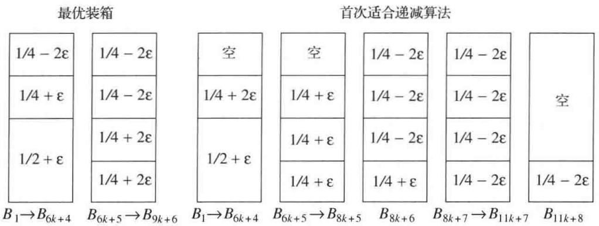

<details>
<summary>text_image</summary>

最优装箱
1/4 - 2ε
1/4 + ε
1/2 + ε
B₁→B₆k+4
1/4 - 2ε
1/4 - 2ε
1/4 + 2ε
1/4 + 2ε
B₆k+5 → B₉k+6
空
1/4 + 2ε
1/2 + ε
B₁→B₆k+4
空
1/4 + ε
1/4 + ε
1/4 + ε
B₆k+5 → B₈k+5
空
1/4 - 2ε
1/4 - 2ε
B₈k+6
1/4 - 2ε
1/4 - 2ε
B₈k+7 → B₁₁k+7
空
1/4 - 2ε
B₁₁k+8
</details>

图10.28 首次适合递减算法使用 $11k + 8$ 个箱子，但只有 $9k + 6$ 个箱子就足够完成装箱的例子

## 10.2 分治算法

用于设计算法的另一种常用技巧为分治算法(divide and conquer)。分治算法由两部分组成:

分(divide): 递归解决较小的问题(当然, 基准情况除外)。

治(conquer): 然后, 从子问题的解构建原问题的解。

传统上，在其代码中至少含有两个递归调用的例程叫作分治算法，而代码中只含一个递归调用的例程不是分治算法。我们一般坚持子问题是不相交的(即基本上不重叠)。让我们回顾前文涉及到的某些递归算法。

我们已经看到几个分治算法。在2.4.3节，我们见过最大子序列和问题的一个 $O(N\log N)$ 解法。在第4章，我们看到一些线性时间的树的遍历方法。在第7章，我们见过分治算法的经典例子，即归并排序和快速排序，它们分别有 $O(N\log N)$ 的最坏情形以及平均情形的时间界。

我们还看到了一些递归算法的若干例子，在分类上它们很可能不算作分治算法，而只是化简到一个更简单的情况。在1.3节，我们看到过打印一个数的简单例程。在第2章，我们使用递归执行有效的取幂运算。在第4章，我们考察了二叉查找树一些简单的搜索例程。在6.6节，我们见过用于合并左式堆的简单的递归。在7.7节给出了一个花费线性平均时间解决选择问题的算法。第8章递归地写出了不相交集的find操作。第9章指出以Dijkstra算法重新找出最短路径的一些例程，以及对图进行深度优先搜索的其他过程。这些算法实际上都不是分治算法，因为只进行了一个递归调用。

我们在 2.4 节还看到计算斐波那契数的很差的递归例程。它倒是可以称为分治算法，但效率太低了，因为问题实际上根本没有被分割。

在这一节，我们将看到分治算法范例更多的实例。我们的第一个应用是计算几何(computational geometry)中的问题。给定平面上的 $N$ 个点，我们将证明最近的一对点可以在 $O(N \log N)$ 时间找到。本章后面的一些练习描述了计算几何中的另外一些问题，它们可以用分治算法求解。本节其余部分介绍极其有趣但主要是理论上的一些结果。我们提供一个算法以 $O(N)$ 最坏情形时间解决选择问题。我们还要证明，可以用 $o(N^2)$ 次操作将 2 个 $N$ 比特位的数相乘，并以 $o(N^3)$ 次操作将两个 $N \times N$ 矩阵相乘。遗憾的是，尽管这些算法比传统算法有着更好的最坏情形时间界，但除了对于非常庞大的输入外它们都并不实用。

---

第 10 章 算法设计技巧

367

## 10.2.1 分治算法的运行时间

我们将要看到的所有有效的分治算法都是把问题分成一些子问题，每个子问题都是原问题的一部分，然后进行某些附加的工作以算出最后的答案。作为一个例子，我们已经看到归并排序对两个问题进行运算，每个问题均为原问题大小的一半，然后用到 $O(N)$ 的附加工作。由此得到运行时间方程(带有适当的初始条件):

$$
T (N) = 2 T (N / 2) + O (N)
$$

我们在第 7 章看到，该方程的解为  $O(N \log N)$ 。下面的定理可以用来确定大部分分治算法的运行时间。

定理 10.6

方程 $T(N) = aT(N / b) + \Theta (N^k)$ 的解为

$$
T (N) = \left\{ \begin{array}{l l} O (N ^ {\log_ {b} a}) & \text {若} a > b ^ {k} \\ O (N ^ {k} \log N) & \text {若} a = b ^ {k} \\ O (N ^ {k}) & \text {若} a <   b ^ {k} \end{array} \right.
$$

其中 $a \geqslant 1$ 以及 $b > 1$。

证明:

根据第7章归并排序的分析，我们将假设 $N$ 是 $b$ 的幂。于是，可令 $N = b^{m}$ 。此时 $N / b = b^{m - 1}$ 及 $N^{k} = (b^{m})^{k} = b^{mk} = b^{km} = (b^{k})^{m}$ 。让我们假设 $T(1) = 1$ ，并忽略 $\Theta(N^k)$ 中的常数因子，则有

$$
T (b ^ {m}) = a T (b ^ {m - 1}) + (b ^ {k}) ^ {m}
$$

如果用 $a^m$ 除两边，则得到方程:

$$
\frac {T (b ^ {m})}{a ^ {m}} = \frac {T (b ^ {m - 1})}{a ^ {m - 1}} + \left\{\frac {b ^ {k}}{a} \right\} ^ {m} \tag {10.3}
$$

可以对 $m$ 的其他值应用该方程，得到

$$
\frac {T (b ^ {m} - 1)}{a ^ {m - 1}} = \frac {T (b ^ {m - 2})}{a ^ {m - 2}} + \left\{\frac {b ^ {k}}{a} \right\} ^ {m - 1} \tag {10.4}
$$

$$
\frac {T (b ^ {m} - 2)}{a ^ {m - 2}} = \frac {T (b ^ {m - 3})}{a ^ {m - 3}} + \left\{\frac {b ^ {k}}{a} \right\} ^ {m - 2} \tag {10.5}
$$

: : :

$$
\frac {T (b ^ {1})}{a ^ {1}} = \frac {T (b ^ {0})}{a ^ {0}} + \left\{\frac {b ^ {k}}{a} \right\} ^ {1} \tag {10.6}
$$

我们使用将式(10.3)～式(10.6)叠缩方程两边分别加起来的标准技巧，等号左边的所有项实际上与等号右边的前一项相消，由此得到

---

368

数据结构与算法分析——C++语言描述(第四版)

$$
\frac {T (b ^ {m})}{a ^ {m}} = 1 + \sum_ {i = 1} ^ {m} \left\{\frac {b ^ {k}}{a} \right\} ^ {i} \tag {10.7}
$$

$$
= \sum_ {i = 0} ^ {m} \left\{\frac {b ^ {k}}{a} \right\} ^ {i} \tag {10.8}
$$

因此

$$
T (N) = T (b ^ {m}) = a ^ {m} \sum_ {i = 0} ^ {m} \left\{\frac {b ^ {k}}{a} \right\} ^ {i} \tag {10.9}
$$

如果 $a > b^{k}$, 那么和就是一个公比小于 1 的几何级数。由于无穷级数的和收敛于一个常数, 因此该有限和也以一个常数为界, 从而式 (10.10) 成立:

$$
T (N) = O \left(a ^ {m}\right) = O \left(a ^ {\log_ {b} N}\right) = O \left(N ^ {\log_ {b} a}\right) \tag {10.10}
$$

如果 $a = b^{k}$，那么和中的每一项均为1。由于和含有 $1 + \log_b N$ 项而 $a = b^k$ 意味着 $\log_b a = k$，于是

$$
\begin{array}{l} T (N) = O \left(a ^ {m} \log_ {b} N\right) = O \left(N ^ {\log_ {b} a} \log_ {b} N\right) = O \left(N ^ {k} \log_ {b} N\right) \tag {10.11} \\ = O (N ^ {k} \log N) \\ \end{array}
$$

最后，如果 $a < b^{k}$，那么该几何级数中的项都大于1，且1.2.3节中的第二个公式成立。我们得到

$$
T (N) = a ^ {m} \frac {(b ^ {k} / a) ^ {m + 1} - 1}{(b ^ {k} / a) - 1} = O (a ^ {m} (b ^ {k} / a) ^ {m}) = O ((b ^ {k}) ^ {m}) = O (N ^ {k}) \tag {10.12}
$$

定理的最后一种情形得证。

例如，归并排序有 $a = b = 2$ 且 $k = 1$ 。第二种情形成立，因此答案为 $O(N\log N)$ 。如果我们求解3个问题，每个问题都是原始大小的一半，使用 $O(N)$ 的附加工作将各解联合起来，则 $a = 3, b = 2$ 而 $k = 1$ 。此处情形1成立，于是得到界 $O(N^{\log_23}) = O(N^{1.59})$ 。求解3个一半大小的问题但需要 $O(N^2)$ 工作以合并解的算法，其运行时间将是 $O(N^2)$，因为此时第三种情形成立。

有两个重要的情形定理 10.6 没有包括。我们再叙述两个定理，但把证明留作练习。定理 10.7 推广了前面的定理。

定理 10.7

方程 $T(N) = aT(N / b) + \Theta (N^k\log^p N)$ 的解为

$$
T (N) = \left\{ \begin{array}{l l} O (N ^ {\log_ {b} a}) & \text {若} a > b ^ {k} \\ O (N ^ {k} \log^ {p + 1} N) & \text {若} a = b ^ {k} \\ O (N ^ {k} \log^ {p} N) & \text {若} a <   b ^ {k} \end{array} \right.
$$

其中  $a \geqslant 1$ ，b > 1 且  $p \geqslant 0$ 。

定理 10.8

如果 $\sum_{i=1}^{k} \alpha_i < 1$，则方程 $T(N) = \sum_{i=1}^{k} T(\alpha_i N) + O(N)$ 的解为 $T(N) = O(N)$。

---

第 10 章 算法设计技巧

369

## 10.2.2 最近点问题

这里，第一个问题的输入是平面上的点集 $P$ 。如果 $p_1 = (x_1, y_1)$ 和 $p_2 = (x_2, y_2)$，那么 $p_1$ 和 $p_2$ 间的欧几里得距离为 $\left[(x_1 - x_2)^2 + (y_1 - y_2)^2\right]^{1/2}$ 。我们需要找出一对最近的点。有可能两个点位于相同的位置。在这种情形下这两个点就是最近的，它们的距离为零。

如果存在 $N$ 个点，那么就存在 $N(N - 1) / 2$ 对点间的距离。我们可以检查所有这些距离，得到一个很短的程序，不过这是一个花费 $O(N^2)$ 的算法。由于这种方法就是一种穷举搜索的方法，因此我们应该期望能够做得更好一些。

假设平面上这些点已经按照 x 的坐标排过序，这只不过顶多在最后的时间界上仅多加了  $O(N \log N)$  而已。由于将证明整个算法的  $O(N \log N)$  界，因此从复杂度的观点来看，该排序基本上没增加运行时间消耗的级别。

图 10.29 画出一个小的样本点集 P。既然这些点已按 x 坐标排序，那么我们就可以画一条想象的垂线，把点集分成两半: $P_{L}$  和  $P_{R}$ 。这做起来当然简单。现在得到的情形几乎和我们在 2.4.3 节的最大子序列和问题中见过的情形完全相同。最近的一对点或者都在  $P_{L}$  中，或者都在  $P_{R}$  中，或者一个点在  $P_{L}$  中而另一个在  $P_{R}$  中。让我们

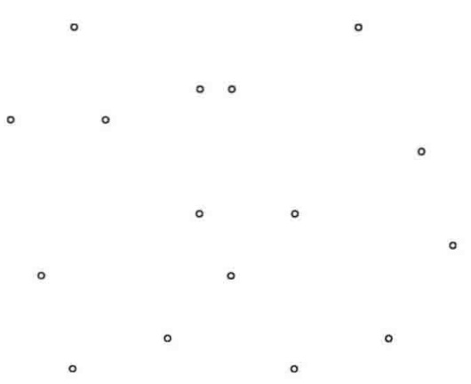

<details>
<summary>natural_image</summary>

Abstract pattern of scattered circles on white background (no text or symbols)
</details>

图10.29 一个小规模的点集

把这3个距离分别叫作 $d_{L}$ 、 $d_R$ 和 $d_{C}$ 。图10.30显示出点集的划分和这3个距离。

我们可以递归地计算 $d_{L}$ 和 $d_{R}$ 。然后，问题就是计算 $d_{C}$ 。由于想要一个 $O(N\log N)$ 的解，因此必须能够只用 $O(N)$ 的附加工作计算出 $d_{C}$ 。我们已经看到，如果一个过程由两个一半大小的递归调用和附加的 $O(N)$ 工作组成，那么总的时间将是 $O(N\log N)$ 。

令 $\delta = \min (d_L, d_R)$ 。我们的第一个观察结果是，如果 $d_C$ 对 $\delta$ 有所改进，那么只需计算 $d_C$。如果 $d_C$ 是这样的一个距离，则决定 $d_C$ 的两个点必然在分割线的 $\delta$ 距离之内。我们将把这个条形区域叫作带 (strip)。如图 10.31 所示，这个观察结果消减了需要考虑的点的个数（此例中的 $\delta = d_R$）。

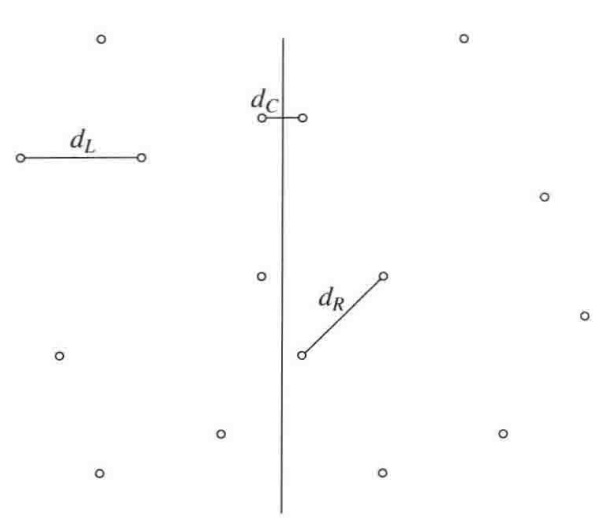

<details>
<summary>text_image</summary>

dL
dC
dR
</details>

图 10.30 被分成  $P_{L}$  和  $P_{R}$  的点集 P；图中显示了最短的距离

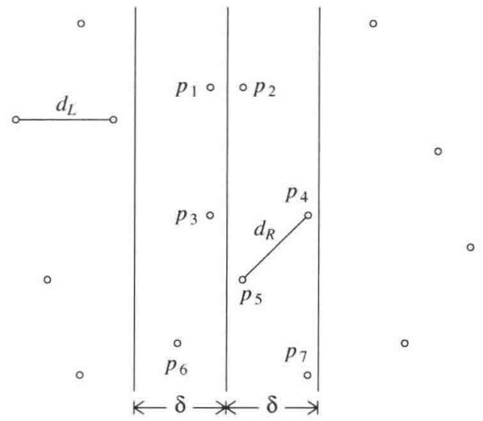

<details>
<summary>text_image</summary>

dL
p1 o p2
p3 o p4
dR
p5
p6 p7
δ δ
</details>

图 10.31 双道带区域，包含对于  $d_{C}$  带所考虑的全部点

有两种方法可以用来计算 $d_{C}$ 。对于均匀分布的大型点集，预计位于该带中的点的个数是

---

370

数据结构与算法分析——C++语言描述(第四版)

非常少的。事实上，容易论证，平均只有 $O(\sqrt{N})$ 个点在这个带中。因此，我们可以以 $O(N)$ 时间对这些点进行蛮力计算。图10.32中的伪代码实现了该想法，其中按照 $\mathbf{C}++$ 语言的约定，点的下标从0开始。

<div class="docvortex-algorithm" style="white-space: pre-wrap; font-family:monospace;">
// 代码中涉及的点均位于上述带状区域内
for( i = 0; i &lt; numPointsInStrip; i++ )
    for( j = i + 1; j &lt; numPointsInStrip; j++ )
        if( dist(pi, pj) &lt; δ )
            δ = dist(pi, pj);
</div>

图 10.32 min ( $\delta, d_{C}$ ) 的蛮力计算

在最坏情形下，所有的点可能都在这条带状区域内，因此这种方法不总能以线性时间运行。我们可以用下列的观察结果改进这个算法:确定 $d_{C}$ 的两个点的 $y$ 坐标之间相差最多是 $\delta$ 否则就会有 $d_{C} > \delta$ 。设带中的点按照它们的 $y$ 坐标排序。因此，如果 $p_i$ 和 $p_j$ 的 $y$ 坐标相差大于 $\delta$ ，则可以再去继续处理 $p_{i+1}$ 。图10.33实现了这个简单的修改。

// 代码中涉及的点均位于上述带状区域内，并且按坐标 y 排序

<div class="docvortex-algorithm" style="white-space: pre-wrap; font-family:monospace;">
for( i = 0; i &lt; numPointsInStrip; i++ )
    for( j = i + 1; j &lt; numPointsInStrip; j++ )
        if( p_i and p_j's y-coordinates differ by more than δ )
            break;          // 转向下一个 p_i.
        else
        if( dist(p_i, p_j) &lt; δ )
            δ = dist(p_i, p_j);
</div>

图 10.33  $\min(\delta, d_{C})$  的精化计算

这样的附加测试对运行时间有着显著的影响，因为对于每一个 $p_i$ ，在 $p_i$ 和 $p_j$ 的 $y$ 坐标相差大于 $\delta$ 并被迫退出内层for循环以前，只有少数的 $p_j$ 点被考查。例如，图10.34显示对于点 $p_3$ 只有两个点 $p_4$ 和 $p_5$ 落在垂直距离 $\delta$ 之内的带状区域中。

对于任意的点 $p_i$，在最坏的情形下最多有7个 $p_j$ 点被考虑。这是因为这些点必定落在该带状区域左半部分的 $\delta \times \delta$ 方块内或者落在该带状区域右半部分的 $\delta \times \delta$ 方块内。另一方面，在每个 $\delta \times \delta$ 方块内的所有这些点至少远离 $\delta$。在最坏的情形下，每个方块包含4个点，每个角上一个点。这些点中有一个是 $p_i$，最多还剩下7个点要考虑。最坏情形的状况如图10.35所示。注意，即使 $p_{L2}$ 和 $p_{R1}$ 有相同的坐标，但它们还可能是不同的点。对于具体的分析来说，唯一重要的是 $\lambda \times 2\lambda$ 的矩形区域中的点的个数为 $O(1)$，显然这很清楚。

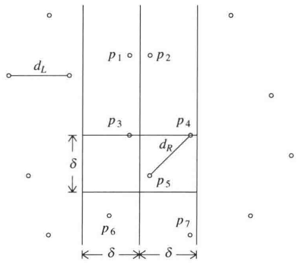

<details>
<summary>text_image</summary>

p₁
p₂
p₃
p₄
dR
δ
p₅
p₆
p₇
δ
δ
</details>

图10.34 在第二个for循环内只有 $p_4$ 和 $p_5$ 被考虑

因为对于每个 $p_i$ 最多有7个点要考虑，所以计算比 $\delta$ 好的 $d_C$ 的时间是 $O(N)$ 。因此，基于两个一半大小的递归调用，外加联合两个结果的线性附加工作，看来我们似乎对最近点问题有一个 $O(N\log N)$ 解。然而，现在还没有真正得到 $O(N\log N)$ 的解。

---

第 10 章 算法设计技巧

371


<details>
<summary>text_image</summary>

pL1
pL2 pR1
pR2
左半部分 (λ × λ)
右半部分 (λ × λ)
pL3 pL4 pR3 pR4
</details>

图 10.35 最多有 8 个点在该矩形中；有两个坐标其中每个都由两个点分享

问题在于，我们已经假设这些点按照 $y$ 坐标排序是现成的。如果对于每个递归调用都执行这种排序，那么我们又有 $O(N \log N)$ 的附加工作:这就得到一个 $O(N \log^2 N)$ 算法。不过问题还不全这么糟，尤其在和蛮力 $O(N^2)$ 算法比较的时候。然而，不难把对于每个递归调用的工作简化到 $O(N)$，从而保证 $O(N \log N)$ 算法。

我们将保留两个表。一个是按照 $x$ 坐标排序的点的表，而另一个是按照 $y$ 坐标排序的点的表，并分别称它们为表 $P$ 和表 $Q$ 。这两个表可以通过一个预处理排序步骤花费 $O(N \log N)$ 得到，因此并不影响总的时间界。$P_L$ 和 $Q_L$ 是传递给左半部分递归调用的参数表，$P_R$ 和 $Q_R$ 是传递给右半部分递归调用的参数表。我们已经看到，$P$ 很容易在中间分开。一旦分割线已知，我们依序转到 $Q$ ，把每一个元素放入相应的 $Q_L$ 或 $Q_R$ 。容易看出，$Q_L$ 和 $Q_R$ 将自动地按照 $y$ 坐标排序。当递归调用返回时，扫描表 $Q$ 并删除其 $x$ 坐标不在带状区域内的所有的点。此时 $Q$ 只含有带中的点，而这些点保证是按照它们的 $y$ 坐标排序的。

这种做法保证整个算法是 $O(N\log N)$ 的，因为只执行了 $O(N)$ 的附加工作。

## 10.2.3 选择问题

选择问题 (selection problem) 要求我们找出 $N$ 个元素集合 $S$ 中的第 $k$ 个最小的元素。我们对找出按大小位于中间元素的特殊情况有着特别的兴趣，这种情况发生在 $\lceil k = N / 2 \rceil$ 的时候。

在第 1 章、第 6 章和第 7 章中我们已经看到过选择问题的几个解法。第 7 章中的解法用到快速排序的变体并以平均时间  $O(N)$  运行。事实上，它在 Hoare 论述快速排序的原始论文中已有描述。

虽然这个算法以线性平均时间运行，但是它有一个 $O(N^2)$ 的最坏情况。通过把元素排序，选择问题可以容易地以 $O(N \log N)$ 最坏情形时间解决，不过，长期以来不知道选择是否能够以 $O(N)$ 最坏情形时间完成。在7.7.6节概述的快速选择算法(quickselect algorithm)在实践中是相当有效的，因此，这个问题主要还是理论上的问题。

我们知道，基本算法是简单的递归策略。设 $N$ 大于截止点(cutoff point)，元素将从截止点开始进行简单的排序，$\nu$ 是选出的一个元素，叫作枢纽元(pivot)。其余的元素被放在两个集合 $S_{1}$ 和 $S_{2}$ 中。$S_{1}$ 含有那些保证不大于 $\nu$ 的元素，而 $S_{2}$ 则包含那些不小于 $\nu$ 的元素。最后，如果 $k \leqslant |S_{1}|$，那么 $S$ 中的第 $k$ 个最小的元素可以通过递归地计算 $S_{1}$ 中第 $k$ 个最小的元素而找到。如果 $k = |S_{1}| + 1$，则枢纽元就是第 $k$ 个最小的元素。否则，在 $S$ 中的第 $k$ 个最小的元素是 $S_{2}$ 中的第 $(k - |S_{1}| - 1)$ 个最小元素。这个算法和快速排序之间的主要区别在于，这里只有一个子问题而不是两个子问题要被求解。

---

372

数据结构与算法分析——C++语言描述(第四版)

为了得到一个线性算法，我们必须保证子问题只是原问题的一部分，而不仅仅只是比原问题少几个元素。当然，如果我们愿意花费一些时间查找的话，那么总能够找到这样一个元素。困难的问题在于我们不能花费太多的时间寻找枢纽元。

对于快速排序，我们看到枢纽元一种好的选择是选取3个元素并取它们的中位数(median)(或称中值或中项)。这就产生某种期望，认为枢纽元不太坏，但是，它并不提供一种保证。我们可以随机选取21个元素，以常数时间将它们排序，用第11个最大的元素作为枢纽元，而得到可能更好的枢纽元。然而，如果这21个元素是21个最大元，那么枢纽元仍然会不好。将这种想法扩展，我们可以使用直到 $O(N / \log N)$ 个元素，用堆排序以 $O(N)$ 总时间将它们排序，从统计的观点看几乎肯定得到一个好的枢纽元。可是，在最坏情形下，这种方法仍然有问题，因为我们可能选择了 $O(N / \log N)$ 个最大的元素，而此时的枢纽元则是第 $[N - O(N / \log N)]$ 个最大的元素，这不是 $N$ 的一个常数部分。

然而，基本想法还是有用的。的确，我们将看到，可以用它来改进快速选择所进行的期望比较次数。但是，为得到一个好的最坏情形，关键想法是再用一个间接层。我们不是从随机元素的样本中找出中值(median)，而是从一些中值的样本(sample of medians)中找出中值。

基本的枢纽元选择算法如下:

1. 把 N 个元素分成  $\lfloor N/5 \rfloor$  组，每组 5 个元素，忽略 (最多 4 个) 剩余的元素。
2. 找出每组的中值，得到  $\lfloor N/5 \rfloor$  个中值的表 M。
3. 再求出 M 的中值，将其作为枢纽元 v 返回。

我们将用术语五元中值组取中值分割法(median-of-median-of-five partitioning)描述使用上面给出的枢纽元选择法则的快速选择算法。现在我们证明，五元中值组取中值分割法保证每个递归子问题最多大约是原问题 $70\%$ 的大小。我们还要证明，对于整个选择算法，枢纽元可以足够快地算出以确保 $O(N)$ 的运行时间。

现在假设 $N$ 可以被5整除，因此不存在多余的元素。再设 $N / 5$ 为奇数，这样集 $M$ 就包含奇数个元素。我们将要看到，这将提供某种对称性。于是，为方便起见假设 $N$ 为 $10k + 5$ 的形式。我们还要假设所有的元素都是互异的。实际的算法必须保证能够处理该假设不成立的情况。图10.36指出当 $N = 45$ 时枢纽元是如何被选出的。


<details>
<summary>flowchart</summary>

This diagram illustrates a hierarchical sorting algorithm for calculating the value of 5 elements, showing how each element is sorted by their similarity to the total.
</details>

图10.36 枢纽元的选择

---

第10章 算法设计技巧

373

在图 10.36 中，v 代表该算法选出作为枢纽元的元素。由于 v 是 9 个元素的中项，而我们假设所有元素互异，因此必然有 4 个中值大于 v 以及 4 个中值小于 v。我们分别用 L 和 S 表示这些中值。考虑具有一个大中值 (L 型) 的五元素组。该组的中值小于组中的两个元素且大于组中的另两个元素。我们将令 H 代表那些巨型元素。它们是些已知大于一个大中项的元素。类似地，T 代表那些小于一个小中值 (S 型) 的微型元素。存在 10 个 H 型的元素:具有 L 型中值的每组中有两个，v 所在的组中有两个。类似地，存在 10 个 T 型元素。

L型元素或H型元素保证大于 $v$ ，而S型元素或T型元素保证小于 $v$ 。于是在我们的问题中保证有14个大元素和14个小元素。因此，递归调用最多可以对 $45 - 14 - 1 = 30$ 个元素进行。

让我们把分析推广到对形如 $10k + 5$ 的一般 $N$ 的情形。在这种情况下，存在 $k$ 个L型元素和 $k$ 个S型元素。存在 $2k + 2$ 个H型元素，还有 $2k + 2$ 个T型元素。因此，有 $3k + 2$ 个元素保证大于 $\nu$ 以及 $3k + 2$ 个元素保证小于 $\nu$ 。于是，在这种情况下递归调用最多可以包含 $7k + 2 < 0.7N$ 个元素。如果 $N$ 不是 $10k + 5$ 的形式，类似的论证仍可进行而不影响基本结果。

剩下的问题是确定得到枢纽元的运行时间的界。有两个基本的步骤。我们可以以常数时间找到5元素的中值。例如，不难用8次比较将5个元素排序。我们必须进行 $\lfloor N / 5\rfloor$ 次这样的运算，因此这一步花费 $O(N)$ 时间。然后，我们必须计算 $\lfloor N / 5\rfloor$ 元素组的中值。明显的做法是将该组排序并返回中间的元素。但这需要花费 $O(\lfloor N / 5\rfloor \log \lfloor N / 5\rfloor) = O(N\log N)$ 的时间，因此这么做是不行的。解决方法是对这 $\lfloor N / 5\rfloor$ 个元素递归地调用选择算法。

现在对基本算法的描述已经完成。如果想有一个实际的实现方法，那么还有某些细节仍然需要补充。例如，重复元必须要正确地处理，该算法需要截止点足够大以确保递归调用能够顺利进行。由于涉及到相当大量的系统开销，而且该算法根本不实用，因此我们将不再描述需要考虑的任何细节。即使如此，该算法从理论的角度来看仍然是一种突破，因为其运行时间在最坏情形下是线性的，这正如下面的定理所述。

## 定理 10.9

使用五元中值组取中值分割法的快速选择算法的运行时间为 $O(N)$。

证明:

该算法由大小为 $0.7N$ 和 $0.2N$ 的两个递归调用以及线性附加工作组成。根据定理10.8，其运行时间是线性的。

## 降低比较的平均次数

分治算法还可以用来降低选择算法所需要的期望比较次数。让我们看一个具体的例子。设有1000个数的集合 $S$ ，我们要寻找其中第100个最小的数 $X$ 。选择 $S$ 的子集 $S'$，它由100个数组成。我们期望 $X$ 的值在大小上类似于 $S'$ 的第10个最小的数。尤其是 $S'$ 的第5个最小的数几乎肯定小于 $X$ ，而 $S'$ 的第15个最小的数几乎肯定大于 $X$ 。

更一般地，从 $N$ 个元素选取 $s$ 个元素的样本 $S'$ 。令 $\delta$ 是某个数，后面我们将选择它使得把该过程所用的平均比较次数最小化。我们找出 $S'$ 中第 $(v_{1} = ks / N - \delta)$ 个和第 $(v_{2} = ks / N + \delta)$ 个最小的元素。几乎肯定 $S$ 中的第 $k$ 个最小元素将落在 $v_{1}$ 和 $v_{2}$ 之间，因此留给我们的是关于这 $2\delta$ 个元素的选择问题。第 $k$ 个最小元素以低概率不落在这个范围，而我们有大量的工作要做。不过，只要 $s$ 和 $\delta$ 选择得好，根据概率论的定律可以肯定，第二种情形对于整体工作不会有不利的影响。

如果进行分析，就会发现，若 $s = N^{2 / 3}\log^{1 / 3}N$ 和 $\delta = N^{1 / 3}\log^{2 / 3}N$ ，则期望的比较次数为 $N + k$

---

374

数据结构与算法分析——C++语言描述(第四版)

$+ O(N^{2/3}\log^{1/3}N)$ ，除低次项外它是最优的。（如果 k > N/2，那么我们可以考虑对称的问题:查找第  $(N - k)$  个最大元素。）

大部分的分析都容易进行。最后一项代表为确定 $v_{1}$ 和 $v_{2}$ 而执行两次选择的开销。假设采用适当灵巧的策略，则分割的平均开销等于 $N$ 加上 $v_{2}$ 在 $S$ 中的期望阶(expected rank)，即 $N + k + O(N\delta /s)$ 。如果第 $k$ 个元素在 $S'$ 中出现，那么结束算法的开销等于对 $S'$ 进行选择的开销，即 $O(s)$ 。如果第 $k$ 个最小元素不在 $S'$ 中出现，那么开销就是 $O(N)$ 。然而，$s$ 和 $\delta$ 已经被选取以保证这种情况以非常低的概率 $o(1 / N)$ 发生，因此该可能性的期望开销是 $o(1)$，它当 $N$ 越来越大时趋向于0。一种精确的计算留作练习10.21。

这个分析指出，找出中值平均大约需要 $1.5N$ 次比较。当然，该算法为计算 $s$ 需要浮点运算，这在一些机器上可能使算法减慢速度。不过即使是这样，经验业已证明，若能正确实现，则该算法优于第7章中快速选择的实现。

## 10.2.4 一些算术问题的理论改进

在这一节我们描述一个分治算法，该算法是将两个 $N$ 位数字的数相乘。前面的计算模型假设乘法是以常数时间完成，因为乘数很小。对于大的数，这个假设不再合理。如果我们以参加相乘的数的大小来衡量乘法，那么自然的乘法算法花费平方时间，而分治算法则以亚二次时间(subquadratic time)运行。我们还要介绍经典的分治算法，它以亚立方时间(subcubic time)将两个 $N \times N$ 矩阵相乘。

## 整数相乘

设我们想要将两个 $N$ 位数字的数 $X$ 和 $Y$ 相乘。如果 $X$ 和 $Y$ 恰好有一个是负的，那么结果就是负的；否则结果为正数。因此，我们可以进行这种检查，然后假设 $X, Y \geqslant 0$ 。几乎每一个人在手算乘法时使用的算法都需要 $\Theta(N^2)$ 次运算，这是因为 $X$ 中的每一位数字都要被 $Y$ 的每一位数字去乘的缘故。

如果 $X = 61438521$ 而 $Y = 94736407$ ，那么 $XY = 5820464730934047$ 。让我们把 $X$ 和 $Y$ 拆成两半，分别由最高几位和最低几位数字组成。此时，$X_{L} = 6143$ ，$X_{R} = 8521$ ，$Y_{L} = 9473$ ，$Y_{R} = 6407$ 。我们还有 $X = X_{L}10^{4} + X_{R}$ 以及 $Y = Y_{L}10^{4} + Y_{R}$ 。由此得到

$$
X Y = X _ {L} Y _ {L} 1 0 ^ {8} + (X _ {L} Y _ {R} + X _ {R} Y _ {L}) 1 0 ^ {4} + X _ {R} Y _ {R}
$$

注意，这个方程由4次乘法组成，即 $X_{L}Y_{L}$ 、 $X_{L}Y_{R}$ 、 $X_{R}Y_{L}$ 和 $X_{R}Y_{R}$，它们每一个都是原问题大小的一半(N/2位数字)。而用 $10^{8}$ 和 $10^{4}$ 进行乘法运算实际上就是添加一些0，这及其后的几次加法只是添加了 $O(N)$ 附加的工作。如果我们递归地使用该算法进行这4项乘法，并在一个适当的基准情形下停止，则得到递归

$$
T (N) = 4 T (N / 2) + O (N)
$$

从定理10.6看到， $T(N) = O(N^2)$，因此很不幸，我们没有改进这个算法。为了得到一个亚二次的算法，我们必须使用少于4次的递归调用。关键的观察结果是

$$
X _ {L} Y _ {R} + X _ {R} Y _ {L} = (X _ {L} - X _ {R}) (Y _ {R} - Y _ {L}) + X _ {L} Y _ {L} + X _ {R} Y _ {R}
$$

于是，我们不用两次乘法来计算 $10^{4}$ 的系数，而可以用一次乘法再加上已经完成的两次乘法的结果。图10.37显示如何只需求解3次递归的子问题。

---

第 10 章 算法设计技巧

375

| 函数 | 值 | 计算复杂度 |
| --- | --- | --- |
| XL | 6 143 | 赋值 |
| XR | 8 521 | 赋值 |
| YL | 9 473 | 赋值 |
| YR | 6 407 | 赋值 |
| D1=XL-XR | -2 378 | O(N) |
| D2=YR-YL | -3 066 | O(N) |
| XLYL | 58 192 639 | T(N/2) |
| XRYR | 54 594 047 | T(N/2) |
| D1D2 | 7 290 948 | T(N/2) |
| D3=D1D2+XLYL+XRYR | 120 077 634 | O(N) |
| XRYR | 54 594 047 | 上面已算出 |
| D310^4 | 1 200 776 340 000 | O(N) |
| XLYL10^8 | 5 819 263 900 000 000 | O(N) |
| XLYL10^8+D310^4+XRYR | 5 820 464 730 934 047 | O(N) |

图 10.37 分治算法的执行情况

容易看到，现在的递归方程满足

$$
T (N) = 3 T (N / 2) + O (N)
$$

从而得到 $T(N) = O(N^{\log_23}) = O(N^{1.59})$ 。为完成这个算法，必须还要有一个基准情况，该情况可以无须递归去解决。

当两个数都是一位数字时，可以通过查表进行乘法。若有一个乘数为 0，则直接返回 0。假如在实践中要用这种算法，那么我们就要把基准情况选择成对机器最方便的情况。

虽然这种算法比标准的二次算法有更好的渐近性能，但是它却很少使用，因为对于小的 N 它开销大，而对大的 N 甚至还存在更好的一些算法。那些算法也广泛利用了分治策略。

## 矩阵乘法

一个基本的数值问题是两个矩阵的乘法。图10.38给出了一个简单的 $O(N^3)$ 算法计算 $\mathbf{C} = \mathbf{AB}$，其中A、B和C均为 $N\times N$ 矩阵。该算法直接来自于矩阵乘法的定义。为了计算 $C_{i,j}$，我们计算A的第 $i$ 行和B的第 $j$ 列的点乘。按照通常的惯例，数组下标均从0开始。

```c
/**
 * 标准的矩阵乘法.
 * 数组下标均从 0 开始.
 * 假设 a 和 b 皆为方阵.
 */
matrix<int> operator*( const matrix<int> & a, const matrix<int> & b )
{
    int n = a.numrows( );
    matrix<int> c{ n, n };

    for( int i = 0; i < n; ++i )   // Initialization
        for( int j = 0; j < n; ++j )
            c[ i ][ j ] = 0;

    for( int i = 0; i < n; ++i )
```

图 10.38 简单的  $O(N^{3})$  矩阵乘法

---

376

数据结构与算法分析——C++语言描述(第四版)

```c
for( int j = 0; j < n; ++j )
            for( int k = 0; k < n; ++k )
                c[ i ][ j ] += a[ i ][ k ] * b[ k ][ j ];
    return c;
}
```

图 10.38(续) 简单的  $O(N^{3})$  矩阵乘法

长期以来曾认为矩阵乘法是需要工作量 $\Omega (N^3)$ 的。然而，在20世纪60年代末Strassen指出了如何打破 $\Omega (N^3)$ 的屏障。Strassen算法的基本想法是把每一个矩阵都分成4块，如图10.39所示。此时容易证明:

$$
C _ {1, 1} = A _ {1, 1} B _ {1, 1} + A _ {1, 2} B _ {2, 1}
$$

$$
C _ {1, 2} = A _ {1, 1} B _ {1, 2} + A _ {1, 2} B _ {2, 2}
$$

$$
C _ {2, 1} = A _ {2, 1} B _ {1, 1} + A _ {2, 2} B _ {2, 1}
$$

$$
C _ {2, 2} = A _ {2, 1} B _ {1, 2} + A _ {2, 2} B _ {2, 2}
$$

$$
\left[ \begin{array}{l l} A _ {1, 1} & A _ {1, 2} \\ A _ {2, 1} & A _ {2, 2} \end{array} \right] \left[ \begin{array}{l l} B _ {1, 1} & B _ {1, 2} \\ B _ {2, 1} & B _ {2, 2} \end{array} \right] = \left[ \begin{array}{l l} C _ {1, 1} & C _ {1, 2} \\ C _ {2, 1} & C _ {2, 2} \end{array} \right]
$$

图10.39 把 $\mathbf{AB} = \mathbf{C}$ 分解成4块乘法

例如，为了进行乘法 AB:

$$
\mathbf {A B} = \left[ \begin{array}{c c c c} 3 & 4 & 1 & 6 \\ 1 & 2 & 5 & 7 \\ 5 & 1 & 2 & 9 \\ 4 & 3 & 5 & 6 \end{array} \right] \left[ \begin{array}{c c c c} 5 & 6 & 9 & 3 \\ 4 & 5 & 3 & 1 \\ 1 & 1 & 8 & 4 \\ 3 & 1 & 4 & 1 \end{array} \right]
$$

我们定义下列 8 个  $N/2 \times N/2$  阶矩阵:

$$
\begin{array}{l} A _ {1, 1} = \left[ \begin{array}{l l} 3 & 4 \\ 1 & 2 \end{array} \right] \quad A _ {1, 2} = \left[ \begin{array}{l l} 1 & 6 \\ 5 & 7 \end{array} \right] \quad B _ {1, 1} = \left[ \begin{array}{l l} 5 & 6 \\ 4 & 5 \end{array} \right] \quad B _ {1, 2} = \left[ \begin{array}{l l} 9 & 3 \\ 3 & 1 \end{array} \right] \\ A _ {2, 1} = \left[ \begin{array}{l l} 5 & 1 \\ 4 & 3 \end{array} \right] \quad A _ {2, 2} = \left[ \begin{array}{l l} 2 & 9 \\ 5 & 6 \end{array} \right] \quad B _ {2, 1} = \left[ \begin{array}{l l} 1 & 1 \\ 3 & 1 \end{array} \right] \quad B _ {2, 2} = \left[ \begin{array}{l l} 8 & 4 \\ 4 & 1 \end{array} \right] \\ \end{array}
$$

此时，我们可以进行8个 $N / 2 \times N / 2$ 阶矩阵的乘法和4个 $N / 2 \times N / 2$ 阶矩阵的加法。这些矩阵加法花费 $O(N^{2})$ 时间。如果递归地进行矩阵乘法，那么运行时间满足

$$
T (N) = 8 T (N / 2) + O (N ^ {2})
$$

从定理 10.6 看到  $T(N) = O(N^{3})$ ，因此我们并没有做出改进。如同我们在整数乘法看到的，必须把子问题的个数简化到 8 个以下。Strassen 使用了一种类似于整数乘法分治算法的策略，指出如何通过仔细地安排计算而做到只使用 7 次递归调用。这 7 个乘法是

$$
M _ {1} = (A _ {1, 2} - A _ {2, 2}) (B _ {2, 1} + B _ {2, 2})
$$

$$
M _ {2} = (A _ {1, 1} + A _ {2, 2}) (B _ {1, 1} + B _ {2, 2})
$$

$$
M _ {3} = (A _ {1, 1} - A _ {2, 1}) (B _ {1, 1} + B _ {1, 2})
$$

$$
M _ {4} = (A _ {1, 1} + A _ {1, 2}) B _ {2, 2}
$$

$$
M _ {5} = A _ {1, 1} (B _ {1. 2} - B _ {2, 2})
$$

$$
M _ {6} = A _ {2, 2} (B _ {2, 1} - B _ {1, 1})
$$

$$
M _ {7} = (A _ {2, 1} + A _ {2, 2}) B _ {1, 1}
$$

---

第 10 章 算法设计技巧

377

一旦执行这些乘法，则最后答案可以通过下列8次加法得到:

$$
\begin{array}{l} C _ {1, 1} = M _ {1} + M _ {2} - M _ {4} + M _ {6} \\ C _ {1, 2} = M _ {4} + M _ {5} \\ C _ {2, 1} = M _ {6} + M _ {7} \\ C _ {2, 2} = M _ {2} - M _ {3} + M _ {5} - M _ {7} \\ \end{array}
$$

可以直接验证，这种机敏的安排产生了期望的效果。现在运行时间满足递推关系:

$$
T (N) = 7 T (N / 2) + O (N ^ {2})
$$

这个递推关系的解为  $T(N)=O(N^{\log_{2}7})=O(N^{2.81})$ 。

如往常一样，有些细节需要考虑，如当 $N$ 不是2的幂时的情况，不过这基本上都是些小麻烦。Strassen算法在 $N$ 不够大时不如矩阵直接乘法。它也不能推广到矩阵是稀疏(即含有许多的0元素)的情况，而且它还不容易并行化。当用浮点数运算时，在数值上它不如经典的算法稳定。因此，直到最近，它只有有限的适用性。然而，它却代表着重要的理论上的里程碑，并确实证明了，在计算机科学中像在许多其他领域一样，即使一个问题看似具有固有的复杂性，但在被证明之前却始终不可妄下定论。

## 10.3 动态规划

在前一节，我们看到数学上能够被递归表示的问题也可以表示成一个递归算法，在许多情形下对朴素的穷举搜索得到显著的性能改进。

任何数学递推公式都可以直接翻译成递归算法，但基本现实是:编译器常常不能正确对待递归算法，结果导致低效的程序。当怀疑很可能是这种情况时，我们必须再给编译器提供一些帮助，将递归算法重新写成非递归算法，让后者把那些子问题的答案系统地记录在一个表内。一种利用这种方法的技巧叫作动态规划(dynamic programming)。

## 10.3.1 用表代替递归

在第2章我们看到，计算斐波那契数的自然递归程序是非常低效的。回忆图10.40所示程序的运行时间 $T(N)$ 满足 $T(N) \geqslant T(N - 1) + T(N - 2)$ 。由于 $T(N)$ 作为斐波那契数满足同样的递推关系并具有同样的初始条件，因此，事实上 $T(N)$ 是以与斐波那契数相同的速度在增长，从而是指数级的。

```lisp
/**
 * 按第1章所述计算斐波那契数.
 */
long long fib( int n )
{
    if( n <= 1 )
        return 1;
    else
        return fib( n - 1 ) + fib( n - 2 );
}
```

图 10.40 计算斐波那契数的低效算法

---

378

数据结构与算法分析——C++语言描述(第四版)

另一方面，由于计算 $F_{N}$ 所需要的只是 $F_{N - 1}$ 和 $F_{N - 2}$，因此我们只需要记录最近算出的两个斐波那契数。这导致图10.41中的 $O(N)$ 算法。

```c
/**
 * 按照第1章所述计算斐波那契数.
 */
long long fibonacci( int n )
{
    if( n <= 1 )
        return 1;

    long long last = 1;
    long long last nextToLast = 1;
    long long answer = 1;

    for( int i = 2; i <= n; ++i )
    {
        answer = last + nextToLast;
        nextToLast = last;
        last = answer;
    }
    return answer;
}
```

图10.41 计算斐波那契数的线性算法

递归算法如此慢的原因在于算法模仿了递推公式。为了计算 $F(N)$，存在一个对 $F_{N-1}$ 和 $F_{N-2}$ 的调用。然而，由于 $F_{N-1}$ 递归地对 $F_{N-2}$ 和 $F_{N-3}$ 进行调用，因此存在两个单独计算 $F_{N-2}$ 的调用。如果跟踪整个算法，则可以发现，$F_{N-3}$ 被计算了3次，$F_{N-4}$ 计算了5次，而 $F_{N-5}$ 则是8次，等等。如图10.42所示，冗余计算的增长是爆炸性的。如果编译器的递归模拟算法要是能够保留一个所有预先算出的值的表，而对已经解过的子问题不再进行递归调用，那么这种指数式的爆炸增长就可以避免。这就是为什么图10.41中的程序如此有效得多的原因。


<details>
<summary>flowchart</summary>

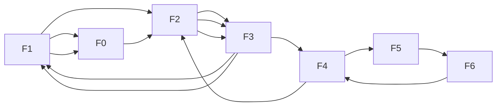
</details>

图10.42 跟踪斐波那契数的递归计算

作为第二个例子，我们看过在第7章中递推关系 $C(N) = (2 / N)\sum_{i = 0}^{N - 1}C(i) + N$ 是如何求解的，其中 $C(0) = 1$ 。假设我们想要检查所得到的解是否在数值上是正确的，此时可以编写图10.43中的简单程序来计算这个递归问题。

这里，递归调用又做了重复性的工作。在这种情况下，运行时间 $T(N)$ 满足 $T(N) = \sum_{i=0}^{N-1} T(i) + N$，因为如图 10.44 所示，对于从 0 到 $N-1$ 的每一个值都有一个（直接的）递归调用，外加 $O(N)$ 的附加工作（图 10.44 所示的树我们还在哪里看到过？）。对 $T(N)$ 求解发现，它的增长是指数式的。通过使用一个表，我们得到图 10.45 中的程序。这个程序避免了冗余的递归调用，从而以 $O(N^2)$ 运行。它并不是一个完美的程序，作为练习，读者应对它做些简单修改，把它的运行时间简化到 $O(N)$。

---

第 10 章 算法设计技巧

379

```lisp
double eval( int n )
{
    if( n == 0 )
        return 1.0;
    else
    {
        double sum = 0.0;

        for( int i = 0; i < n; ++i )
            sum += eval( i );
        return 2.0 * sum / n + n;
    }
}
```

图10.43 计算 $C(N) = 2 / N\sum_{i = 0}^{N - 1}C(i) + N$ 的值的递归函数


<details>
<summary>flowchart</summary>

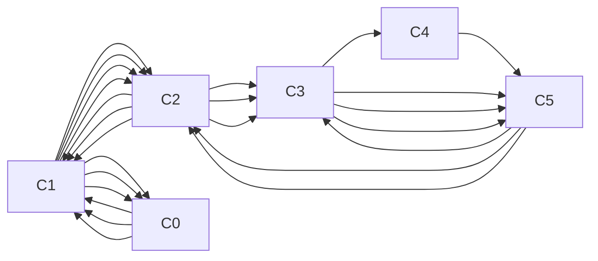
</details>

图10.44 跟踪函数eval中的递归计算

```lisp
double eval( int n )
{
    vector<double> c( n + 1 );

    c[ 0 ] = 1.0;
    for( int i = 1; i <= n; ++i )
    {
        double sum = 0.0;

        for( int j = 0; j < i; ++j )
            sum += c[ j ];
        c[ i ] = 2.0 * sum / i + i;
    }

    return c[ n ];
}
```

图10.45 使用一个表来计算 $C(N) = 2 / N\sum_{i = 0}^{N - 1}C(i) + N$ 的值

## 10.3.2 矩阵乘法的顺序安排

设给定 4 个矩阵 A、B、C 和 D，A 的阶数 = 50 × 10，B 的阶数 = 10 × 40，C 的阶数 = 40 × 30，D 的阶数 = 30 × 5。虽然矩阵乘法运算是不可交换的，但它是可结合的，这就意味着矩阵的乘积 ABCD 可以以任意顺序添加括号然后再计算其值。将两个阶数分别为 $p \times q$ 和 $q \times r$ 的矩

---

380

数据结构与算法分析——C++语言描述(第四版)

阵以熟知的方法相乘，使用 pqr 次纯量乘法。（由于使用诸如 Strassen 算法这样的理论上优越的算法并没有明显地改变我们要考虑的问题，因此我们仍将采用这个性能界。）那么，计算 ABCD 需要执行的 3 个矩阵乘法的最好方式是什么？

在 4 个矩阵的情况下，通过穷举搜索求解这个问题是简单的，因为只有 5 种方式来给乘法排顺序。我们对每种情况计算如下。

\- (A((BC)D)): 计算 BC 需要 $10 \times 40 \times 30 = 12000$ 次乘法。计算 (BC) D 的值除需要 12000 次乘法计算 BC 外, 还要加上 $10 \times 30 \times 5 = 1500$ 次乘法, 合计 13500 次乘法。求 (A((BC)D)) 的值需要 13500 次乘法计算 (BC) D, 外加 $50 \times 10 \times 5 = 2500$ 次乘法, 总计 16000 次乘法。

● (A(B(CD))):计算 CD 需要  $40 \times 30 \times 5 = 6000$  次乘法。计算 B(CD) 的值除需要 6000 次乘法计算 CD 外，还要加上  $10 \times 40 \times 5 = 2000$  次乘法，合计 8000 次乘法。求 (A(B(CD))) 的值需要 8000 次乘法计算 B(CD)，外加  $50 \times 10 \times 5 = 2500$  次乘法，总计 10500 次乘法。

\- ((AB)(CD)): 计算 CD 需要 $40 \times 30 \times 5 = 6000$ 次乘法。计算 AB 需要 $50 \times 10 \times 40 = 20000$ 次乘法。求 ((AB)(CD)) 的值除需要 6000 次乘法计算 CD, 20000 次乘法计算 AB 外, 还要加上 $50 \times 40 \times 5 = 10000$ 次乘法, 总计 36000 次乘法。

\- (((AB)C)D): 计算 AB 需要 $50 \times 10 \times 40 = 20000$ 次乘法。计算 (AB)C 的值需要 20000 次乘法计算 AB，外加 $50 \times 40 \times 30 = 60000$ 次乘法，合计 80000 次乘法。求 ((AB)C)D)的值需要 80000 次乘法计算 (AB)C，外加 $50 \times 30 \times 5 = 7500$ 次乘法，总计 87500 次乘法。

\- ((A(BC))D): 计算 BC 需要 $10 \times 40 \times 30 = 12000$ 次乘法。计算 A(BC) 的值需要 12000 次乘法计算 BC，外加 $50 \times 10 \times 30 = 15000$ 次乘法，合计 27000 次乘法。求 ((A(BC))D) 的值需要 27000 次乘法计算 A(BC)，外加 $50 \times 30 \times 5 = 7500$ 次乘法，总计 34500 次乘法。

上面的计算表明,最好的排列顺序方法大约只用了最坏的排列顺序方法的1/9的乘法次数。因此,进行一些计算来确定最优顺序还是值得的。遗憾的是,一些明显的贪婪算法似乎都用不上,而且矩阵乘法可能顺序的个数增长得很快。设我们定义 $T(N)$ 为顺序的个数。此时, $T(1)=T(2)=1$, $T(3)=2$, 而 $T(4)=5$, 正如我们刚刚看到的。一般地,

$$
T (N) = \sum_ {i = 1} ^ {N - 1} T (i) T (N - i)
$$

为看清这一点，设矩阵为  $A_{1}, A_{2}, \cdots, A_{N}$ ，且最后进行的乘法是  $(\mathbf{A}_{1}\mathbf{A}_{2}\cdots\mathbf{A}_{i})(\mathbf{A}_{i+1}\mathbf{A}_{i+2}\cdots\mathbf{A}_{N})$ 。此时，有  $T(i)$  种方法计算  $(\mathbf{A}_{1}\mathbf{A}_{2}\cdots\mathbf{A}_{i})$  且有  $T(N-i)$  种方法计算  $(\mathbf{A}_{i+1}\mathbf{A}_{i+2}\cdots\mathbf{A}_{N})$ 。因此，对于每个可能的 i，存在  $T(i)T(N-i)$  种方法计算  $(\mathbf{A}_{1}\mathbf{A}_{2}\cdots\mathbf{A}_{i})(\mathbf{A}_{i+1}\mathbf{A}_{i+2}\cdots\mathbf{A}_{N})$ 。

这个递推式的解是著名的 Catalan 数，该数以指数方式增长。因此，对于大的 N，穷举搜索所有可能的排列顺序的方法是不可行的。然而，这种计数方法为一种解法提供了基础，该解法基本上是优于指数的。对于  $1 \leqslant i \leqslant N$ ，令  $c_{i}$  是矩阵  $A_{i}$  的列数。于是  $A_{i}$  有  $c_{i-1}$  行，因为否则矩阵无法进行乘法。我们将定义  $c_{0}$  为第一个矩阵  $A_{1}$  的行数。

设 $m_{\mathrm{Left,Right}}$ 是进行矩阵乘法 $\mathbf{A}_{\mathrm{Left}}\mathbf{A}_{\mathrm{Left} + 1}\dots \mathbf{A}_{\mathrm{Right - 1}}\mathbf{A}_{\mathrm{Right}}$ 所需要的乘法次数。为一致起见，$m_{\mathrm{Left,Left}} = 0$ 。设最后的乘法是 $(\mathbf{A}_{\mathrm{Left}}\dots \mathbf{A}_i)(\mathbf{A}_{i + 1}\dots \mathbf{A}_{\mathrm{Right}})$，其中 $\mathrm{Left}\leqslant i <   \mathrm{Right}$ 。此时所用的乘法次数为 $m_{\mathrm{Left},i} + m_{i + 1,\mathrm{Right}} + c_{\mathrm{Left - 1}}c_i c_{\mathrm{Right}}$ 。这三项分别代表计算 $(\mathbf{A}_{\mathrm{Left}}\dots \mathbf{A}_i)$ 、 $(\mathbf{A}_{i + 1}\dots \mathbf{A}_{\mathrm{Right}})$ 以及它们的乘积所需要的乘法。

---

第 10 章 算法设计技巧

381

如果我们定义  $M_{Left,Right}$  为在最优排列顺序下所需要的乘法次数，那么，若 Left < Right，则

$$
M _ {\text {Left,Right}} = \min _ {\text {Left} \leqslant i <   \text {Right}} \{M _ {\text {Left}, i} + M _ {i + 1, \text {Right}} + c _ {\text {Left-1}} c _ {i} c _ {\text {Right}} \}
$$

这个方程意味着,如果我们有矩阵乘法 $A_{Left}\cdots A_{Right}$ 的最优的乘法排列顺序,那么子问题 $A_{Left}\cdots A_{i}$ 和 $A_{i+1}\cdots A_{Right}$ 就不能次最优地执行。这是很清楚的,因为否则我们可以通过用最优的计算代替次最优计算而改进整个结果。

这个公式可以直接翻译成递归程序，不过，正如我们在上一节看到的，这样的程序将是明显低效的。然而，由于大约只有 $M_{\mathrm{Left,Right}}$ 的 $N^2 / 2$ 个值需要计算，因此显然可以用一个表来存放这些值。进一步的考查表明，如果 $\mathrm{Right} - \mathrm{Left} = k$ ，那么只有在 $M_{\mathrm{Left,Right}}$ 的计算中所需要的那些 $M_{x,y}$ 值满足 $y - x < k$ 。它告诉我们计算这个表所需要使用的顺序。

如果除最后答案 $M_{1,N}$ 外我们还想要显示实际的乘法顺序，则可以使用第9章中最短路径算法的思路。无论何时改变 $M_{\mathrm{Left,Right}}$ ，我们都要记录 $i$ 的值，这个值很关键。由此得到图10.46所示的简单程序。

```lisp
/**
 * 计算矩阵乘法的最优排序.
 * c 包含 n 个矩阵中每个矩阵的列数.
 * c[ 0 ] 为矩阵 1 的行数.
 * 乘法的最少次数置于 m[ 1 ][ n ] 中.
 * 具体的排序通过使用 lastChange 的另外的过程来计算.
 * m 和 lastChange 的下标从 1 开始，而不是从 0 开始.
 * 注意：m 和 lastChange 主对角线下方的元素无意义
 * 不用初始化.
 */
void optMatrix( const vector<int> & c,
                 matrix<int> & m, matrix<int> & lastChange )
{
    int n = c.size( ) - 1;

    for( int left = 1; left <= n; ++left )
        m[ left ][ left ] = 0;
    for( int k = 1; k < n; ++k )   // k 为 right - left
        for( int left = 1; left <= n - k; ++left )
        {
            // 对每一个位置进行
            int right = left + k;
            m[ left ][ right ] = INFINITY;
            for( int i = left; i < right; ++i )
            {
                int thisCost = m[ left ][ i ] + m[ i + 1 ][ right ]
                    + c[ left - 1 ] * c[ i ] * c[ right ];
                if( thisCost < m[ left ][ right ] ) // 更新 min
                {
                    m[ left ][ right ] = thisCost;
                    lastChange[ left ][ right ] = i;
                }
            }
        }
}
```

图 10.46 找出矩阵乘法最优排序的程序

---

382

数据结构与算法分析——C++语言描述(第四版)

虽然本章的重点不是编程，但我们还是要说，许多编程人员倾向于把变量名称减缩成一个字母。这里 c、i 和 k 是作为单字母变量使用的，因为它们与我们描述算法所使用的名字一致，是非常数学化的。不过，一般最好避免使用字母 1 作为变量名，因为 “1” 非常像 “1”，如果你犯了一个录入错误，那么可能会陷入非常困难的调试麻烦之中。

回到算法问题上来。这个程序包含三重嵌套循环，容易看出它以 $O(N^3)$ 时间运行。参考文献描述了一个更快的算法，但由于执行具体矩阵乘法的时间仍然很可能会比计算最优顺序的乘法的时间多得多，因此我们这个算法还是相当实用的。

## 10.3.3 最优二叉查找树

第二个动态规划的例子考虑下列输入:给定一列单词 $w_{1}, w_{2}, \cdots, w_{N}$ 和它们出现的固定的概率 $p_{1}, p_{2}, \cdots, p_{N}$。我们的问题是要用一种方法在一棵二叉查找树中安放这些单词使得总的期望存取时间最小。在一棵二叉查找树中，访问深度 $d$ 处的一个元素所需要的比较次数是 $d + 1$，因此，如果 $w_{i}$ 被放在深度 $d_{i}$ 上，那么我们就要将 $\sum_{i=1}^{N} p_{i}(1 + d_{i})$ 极小化。

作为一个例子，图10.47表示在某段正文中的7个单词以及它们出现的概率。图10.48显示3棵可能的二叉查找树。它们的查找开销如图10.49所示。

| 单词 | 出现的概率 |
| --- | --- |
| a | 0.22 |
| am | 0.18 |
| and | 0.20 |
| egg | 0.05 |
| if | 0.25 |
| the | 0.02 |
| two | 0.08 |

图10.47 最优二叉查找树问题的样本输入


<details>
<summary>flowchart</summary>

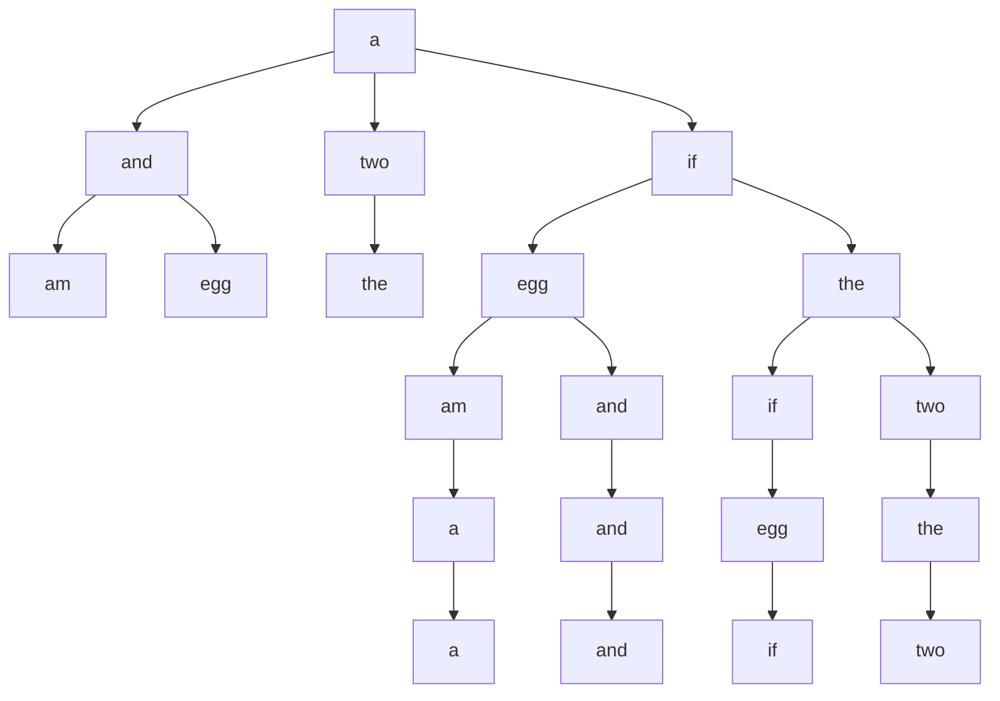
</details>

图10.48 对于图10.47中数据的3棵可能的二叉查找树

<table><tr><td colspan="2">输入</td><td colspan="2">1号树</td><td colspan="2">2号树</td><td colspan="2">3号树</td></tr><tr><td rowspan="2">单词 $w_i$ </td><td rowspan="2">概率 $p_i$ </td><td colspan="2">访问开销</td><td colspan="2">访问开销</td><td colspan="2">访问开销</td></tr><tr><td>一次</td><td>结果</td><td>一次</td><td>结果</td><td>一次</td><td>结果</td></tr><tr><td>a</td><td>0.22</td><td>2</td><td>0.44</td><td>3</td><td>0.66</td><td>2</td><td>0.44</td></tr><tr><td>am</td><td>0.18</td><td>4</td><td>0.72</td><td>2</td><td>0.36</td><td>3</td><td>0.54</td></tr><tr><td>and</td><td>0.20</td><td>3</td><td>0.60</td><td>3</td><td>0.60</td><td>1</td><td>0.20</td></tr><tr><td>egg</td><td>0.05</td><td>4</td><td>0.20</td><td>1</td><td>0.05</td><td>3</td><td>0.15</td></tr><tr><td>if</td><td>0.25</td><td>1</td><td>0.25</td><td>3</td><td>0.75</td><td>2</td><td>0.50</td></tr><tr><td>the</td><td>0.02</td><td>3</td><td>0.06</td><td>2</td><td>0.04</td><td>4</td><td>0.08</td></tr><tr><td>two</td><td>0.08</td><td>2</td><td>0.16</td><td>3</td><td>0.24</td><td>3</td><td>0.24</td></tr><tr><td>总计</td><td>1.00</td><td></td><td>2.43</td><td></td><td>2.70</td><td></td><td>2.15</td></tr></table>

图10.49 3棵二叉查找树的比较

第一棵树是使用贪婪方法形成的。存取概率最高的单词被放在根节点处。然后左右子树递归形成。第二棵树是理想平衡查找树。这两棵树都不是最优的，由第三棵树的存在可以证实。我们由此看到，两个明显的解法都是不可取的。

---

第 10 章 算法设计技巧

383

乍看有些奇怪，因为问题看起来很像是构造哈夫曼编码树，正如我们已经看到的，它能够用贪婪算法求解。构造一棵最优二叉查找树更困难，因为数据不只限于出现在树叶上，还因为树必须满足二叉查找树的性质。

动态规划解由两个观察结果得到。再次假设我们想要把(排序的)一些单词 $w_{\text{Left}}, w_{\text{Left}+1}, \cdots, w_{\text{Right}-1}, w_{\text{Right}}$ 放到一棵二叉查找树中。设最优二叉查找树以 $w_i$ 作为根，其中 $\text{Left} \leqslant i \leqslant \text{Right}$。

此时左子树必须包含  $v_{Left}, \cdots, w_{i-1}$ ，而右子树必须包含  $w_{i+1}, \cdots, w_{Right}$ （根据二叉查找树的性质）。再有，这两棵子树还必须是最优的，因为否则它们可以用最优子树代替，那将给出关于  $w_{Left}, \cdots, w_{Right}$  更好的解。这样，我们可以为最优二叉查找树的开销  $C_{Left, Right}$  编写一个公式。图 10.50 会对建立公式有些帮助。

如果 Left > Right，那么树的开销是 0。这就是 nullptr 的情形，对于二叉查找树我们


<details>
<summary>flowchart</summary>

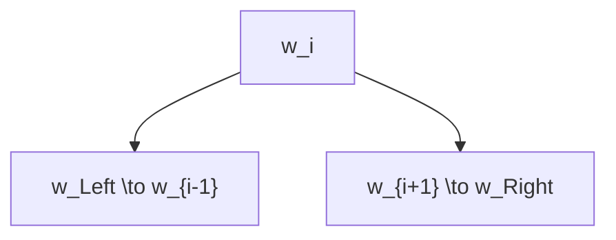
</details>

图10.50 最优二叉查找树的构造

总有这种情形。否则，根的开销是 $p_i$ 。左子树相对于它的根的开销为 $C_{\mathrm{Left},\mathrm{i - 1}}$ ，右子树相对于它的根的开销为 $C_{i + 1,\mathrm{Right}}$ 。如图10.50所示，这两棵子树的每个节点从 $w_{i}$ 开始都比从它们对应的根开始深一层，因此，我们必须加上 $\sum_{j = \text{Left}}^{i - 1}p_j$ 和 $\sum_{j = i + 1}^{\mathrm{Right}}p_j$ 。于是得到如下公式:

$$
\begin{array}{l} C _ {\mathrm{Left,Right}} = \min _ {\mathrm{Left} \leqslant i \leqslant \mathrm{Right}} \left\{p _ {i} + C _ {\mathrm{Left}, i - 1} + C _ {i + 1, \mathrm{Right}} + \sum_ {j = \mathrm{Left}} ^ {i - 1} p _ {j} + \sum_ {j = i + 1} ^ {\mathrm{Right}} p _ {j} \right\} \\ = \min _ {\text {Left} \leqslant i \leqslant \text {Right}} \left\{C _ {\text {Left}, i - 1} + C _ {i + 1, \text {Right}} + \sum_ {j = \text {Left}} ^ {\text {Right}} p _ {j} \right\} \\ \end{array}
$$

从这个方程可以直接编写一个程序来计算最优二叉查找树的开销。像通常一样，具体的查找树可以通过存储使 $C_{\mathrm{Left, Right}}$ 最小化的 $i$ 值而被保留。标准的递归例程可以用来打印具体的树。

图 10.51 显示将由算法所产生的表。对于单词的每个子区域，最优二叉查找树的开销和根都被保留。最底部的项计算输入中全部单词集合的最优二叉查找树。最优树是图 10.48 所示的第三棵树。


<details>
<summary>heatmap</summary>

| Iteration | Left=1::a..a | Left=2::am..am | Left=3::and..and | Left=4::egg..egg | Left=5::if..if | Left=6::the..the | Left=7::two..two |
| :--- | :--- | :--- | :--- | :--- | :--- | :--- | :--- |
| 1 | .22 | a | .18 | .20 | .05 | .25 | .02 |
| 2 | a..am | am..and | and..egg | egg..if | if..the | the..two | .08 |
| 3 | .58 | a | .56 | .30 | .35 | .29 | .12 |
| 4 | a..and | am..egg | and..if | egg..the | if..two | .47 | — |
| 5 | 1.02 | am | .66 | .80 | .39 | .47 | — |
| 6 | a..egg | am..if | and..the | egg..two | .57 | — | — |
| 7 | 1.17 | am | 1.21 | .84 | .57 | — | — |
| 8 | a..if | am..the | and..two | — | — | — | — |
| 9 | 1.83 | and | 1.27 | 1.02 | — | — | — |
| 10 | a..the | am..two | — | — | — | — | — |
| 11 | 1.89 | and | 1.53 | — | — | — | — |
| 12 | a..two | — | — | — | — | — | — |
| 13 | 2.15 | and | — | — | — | — | — |

Note: The values in the table are estimated based on gridlines as exact data labels are not present for all columns.
</details>

图10.51 对于样本输入的最优二叉查找树的计算

---

384

数据结构与算法分析——C++语言描述(第四版)

对于一个特定子区域即 am..if 的最优二叉查找树的精确计算如图 10.52 所示。它是通过计算最小开销树而得到的，而后者又是通过在根处放置 am, and, egg 和 if 得出的。例如，当 and 被放在根处的时候，左子树包含 am..am(通过前面的计算，值为 0.18)，右子树包含 egg..if(值 0.35)，而 $p_{\text{am}} + p_{\text{and}} + p_{\text{egg}} + p_{\text{if}} = 0.68$，总开销为 1.21。


图 10.52 对 am..if 的表项 (1.21, and) 的计算

这个算法的运行时间是 $O(N^3)$，因为当它实现的时候我们得到一个三重循环。对于这个问题的一种 $O(N^2)$ 算法在练习中做了概述。

## 10.3.4 所有点对最短路径

我们的第三个也是最后一个动态规划应用是计算有向图 $G = (V, E)$ 中每一点对间赋权最短路径的一个算法。在第9章我们看到单源最短路径(single-source shortest-path)问题的一个算法，该算法找出从某个任意的点 $s$ 到所有其他顶点的最短路径。这个(Dijkstra)算法对稠密的图以 $O(|V|^2)$ 时间运行，但是实际上对稀疏的图更快。我们将给出一个简短的算法解决对稠密图的所有点对的问题。这个算法的运行时间为 $O(|V|^3)$，它不是对Dijkstra算法|V次迭代的一种渐近改进，但对非常稠密的图可能更快，原因是它的循环更紧凑。如果存在一些负的边值但没有负值圈，那么这个算法也能正确运行；而Dijkstra算法此时是无效的。

让我们回忆 Dijkstra 算法的一些重要细节(读者可以复习 9.3 节)。Dijkstra 算法从顶点 $s$ 开始并分阶段工作。图中的每个顶点最终都要被选作中间顶点。如果当前所选的顶点是 $v$，那么对于每个 $w \in V$，置 $d_w = \min(d_w, d_v + c_{v,w})$。这个公式是说，(从 $s$) 到 $w$ 的最佳距离或者是前面知道的从 $s$ 到 $w$ 的距离，或者是从 $s$ (最优地) 到 $v$ 然后再直接从 $v$ 到 $w$ 的结果。

Dijkstra 算法为动态规划算法提供了这样的想法:我们按照顺序选择这些顶点。将定义 $D_{k,i,j}$ 为从 $v_i$ 到 $v_j$ 只使用 $v_1, v_2, \cdots, v_k$ 作为中间顶点的最短路径的权。根据这个定义，$D_{0,i,j} = c_{i,j}$，其中若 $(v_i, v_j)$ 不是该图的边则 $c_{i,j}$ 是 $\infty$ 。再有，根据定义，$D_{|V_i,i,j}$ 是图中从 $v_i$ 到 $v_j$ 的最短路径。

如图 10.53 所示，当 k > 0 时我们可以给  $D_{k,i,j}$  写一个简单公式。从  $v_{i}$  到  $v_{j}$  只使用  $v_{1}, v_{2}, \cdots, v_{k}$  作为中间顶点的最短路径，或者是根本不使用  $v_{k}$  作为中间顶点的最短路径，或者是由两条路径  $v_{i} \rightarrow v_{k}$  和  $v_{k} \rightarrow v_{j}$  合并而成的最短路径，其中的每条路径只使用前 k - 1 个顶点作为中间顶点。这导致下面的公式:

$$
D _ {k, i, j} = \min \{D _ {k - 1, i, j}, D _ {k - 1, i, k} + D _ {k - 1, k, j} \}
$$

---

第 10 章 算法设计技巧

385

时间需求还是  $O(|V|^{3})$  。跟前面的两个动态规划例子不同，这个时间界实际上尚未用另外的方法降低。

```lisp
/**
 * 计算所有点对的路径.
 * a 包含邻接矩阵, 其中
 * a[i][i] 假设为0.
 * d 包含最短路径的值.
 * 顶点从0开始编号; 所有的数组
 * 维数相等. 如果
 * d[i][i] 置为负值, 则负值圈存在.
 * 具体路径可以用 path[][] 来计算.
 * NOT_A_VERTEX 为 -1
 */
void allPairs( const matrix<int> & a, matrix<int> & d, matrix<int> & path )
{
    int n = a.numrows();

    // 初始化d 和 path
    for( int i = 0; i < n; ++i )
        for( int j = 0; j < n; ++j )
        {
            d[i][j] = a[i][j];
            path[i][j] = NOT_A_VERTEX;
        }

    for( int k = 0; k < n; ++k )
        // 把每个顶点看作为一个中间节点
        for( int i = 0; i < n; ++i )
            for( int j = 0; j < n; ++j )
                if( d[i][k] + d[k][j] < d[i][j] )
                {
                    // 更新最短路径
                    d[i][j] = d[i][k] + d[k][j];
                    path[i][j] = k;
                }
}
```

图 10.53 所有点对最短路径

因为第 $k$ 阶段只依赖于第 $(k - 1)$ 阶段，所以看来只有两个 $|V| \times |V|$ 矩阵需要保留。然而，在用 $k$ 开始或结束的路径上以 $k$ 作为中间顶点对结果没有改进，除非存在一个负的圈。因此只有一个矩阵是必需的，因为 $D_{k-1, i, k} = D_{k, i, k}$ 和 $D_{k-1, k, j} = D_{k, k, j}$，这意味着右边的项都不改变值且都不需要存储。这个观察结果导致了图10.53中的简单程序，为与 $\mathbf{C}++$ 的约定一致，该程序将顶点从0开始编号。

在一个完全图中，每一对顶点(在两个方向上)都是连通的，该算法几乎肯定要比Dijkstra算法的|V|次迭代快，因为这里的循环非常紧凑。第17～21行可以并行执行，第26～33行也可并行执行。因此，这个算法看来很适合并行计算。

动态规划是强大的算法设计技巧，给问题的解决提供了一个起点。它基本上是首先求解

---

386

数据结构与算法分析——C++语言描述(第四版)

一些更简单问题的分治算法的范例，重要的区别在于这些更简单的问题不是原问题的明晰的分割。因为一些子问题被重复求解，所以重要的是将它们的解记录在一个表中而不是去重新计算它们。在某些情况下，解可以被改进(不过，这当然不总是明显的而且常常是困难的)，在另一些情况下，动态规划方法则是已知最好的处理方法。

在某种意义上，如果你看出一个动态规划问题，那么你就看到了所有动态规划问题。动态规划更多的例子在一些练习和参考文献中可以找到。

## 10.4 随机化算法

假设你是一位教授，正在布置每周的程序设计作业。你想确保学生们自己完成自己的程序，或他们至少理解他们提交上来的程序。一种解决方案是在每个程序提交的当天进行一次测验。另一方面，这些测验占用课外的时间，因此，实际上恐怕只能对大约半数的程序可以这么做。你的问题是决定什么时候进行这些测验。

当然，如果事先宣布这些测验，那么可以解释为对得不到测验的 $50\%$ 程序的默许作弊。于是，可能采取不宣布对备选的程序进行测验的策略，但是学生们很快就会搞清楚这种策略。另一种可能是对看似重要的程序进行测验，而这又很可能随着学期的更替而导致雷同的测验规律。学生传播都考些什么样的题，这种方法很可能经过一个学期以后就没有什么价值了。

消除这些弊端的一种方法是使用一枚硬币。测验对每一个程序进行(举行测验远不如给测验评分消耗时间)，但在开始上课时教授将掷硬币来决定是否要举行测验。采用这种方式，在上课前不可能知道测验是否要发生，而测验的规律也不随着学期的更替而重复。这样，不管前面的面试都是什么规律，学生只能预计面试将以 $50\%$ 的概率发生。这种方法的缺点是有可能整个学期都没有测验，不过这不太可能发生，除非硬币有问题。每个学期测验的期望次数是程序数目的一半，并且测验的次数将以高概率不会太偏离这个数目。

这个例子叙述了我们称之为随机化算法(randomized algorithm)的方法。在算法期间，随机数至少有一次用于决策。该算法的运行时间不只依赖于特定的输入，而且还依赖于所出现的随机数。

一个随机化算法的最坏情形运行时间常常和非随机化算法的最坏情形运行时间相同。重要的区别在于，好的随机化算法没有坏的输入，而只有坏的随机数(相对于特定的输入)。这看起来好像只是哲学上的差别，但实际上它是相当重要的，正如下述例子所示。

考虑快速排序的两种变形。方法A用第一个元素作为枢纽元，而方法B使用随机选出的元素作为枢纽元。在这两种情形下，最坏情形运行时间都是 $\Theta (N^2)$，因为在每一步都有可能选取最大的元素作为枢纽元。两种最坏情形之间的区别在于，存在特定的输入总能够出现在A中并产生坏的运行时间。当每一次给定已排序数据时，方法A都将以 $\Theta (N^2)$ 时间运行。如果方法B以相同的输入运行两次，那么它将有两个不同的运行时间，这依赖于什么样的随机数出现。

在运行时间的计算中，我们通篇假设所有的输入都是等可能的。实际上这并不成立，因为例如几乎排序的输入常常要比统计上期望的出现多得多，而这会产生一些问题，特别是对快速排序和二叉查找树。通过使用随机化算法，特定的输入不再重要。重要的是随机数，我们可以得到一个期望运行时间(expected running time)，此时，我们是对所有可能的随机数取平均而不是对所有可能的输入求平均。使用随机枢纽元的快速排序算法是一个 $O(N \log N)$ 期

---

第 10 章 算法设计技巧

387

望时间算法。这就是说，对任意的输入，包括已经排序的输入，根据随机数统计学理论，运行时间的期望值为  $O(N \log N)$ 。期望运行时间界多少要强于平均时间界，不过，当然要比对应的最坏情形界弱。另一方面，正如我们在选择问题中所看到的，得到最坏情形时间界的那些解决方案常常不如得到平均情形时间界的解决方案那样实用。但是，随机化算法却通常都是实用的。

随机化算法隐式地用在了完美散列和通用散列(5.7节和5.8节)中。在这一节，我们将考查随机化的两个用途。首先，我们将介绍以 $O(\log N)$ 期望时间支持二叉查找树操作的新颖的方案。这意味着不存在坏的输入，只有坏的随机数。从理论的观点看，这并没有那么特别令人振奋，因为平衡查找树在最坏情形下达到了这个界。然而，随机化的使用导致了对查找、插入、特别是删除的相对简单的算法。

第二个应用是测试大数是否是素数的随机化算法。我们介绍的这种算法运行很快但偶尔会有错。不过，发生错误的概率可以小到忽略不计。

## 10.4.1 随机数发生器

由于我们的算法需要随机数，因此必须要有一种方法去生成它。实际上，真正的随机性在计算机上是不可能生成的，因为这些数将依赖于算法，从而不可能是随机的。一般说来，产生伪随机数(pseudorandom number)就足够了，伪随机数是看起来像是随机的数。随机数有许多已知的统计性质；伪随机数满足大部分的这些性质。令人惊奇的是，生成随机数说着容易，做起来可就难多了。

设我们只需要抛一枚硬币，这样，我们必然随机地生成0(正面)或1(反面)。一种做法是考查系统时钟。这个时钟可以把时间记录成整数，而这个整数是从某个起始时刻开始计数的秒数。此时我们可以使用最低的一位二进制位。问题在于，如果需要的是随机数序列，那么这种方法就不理想了。一秒是一个长的时间段，在程序运行时这个时钟可能根本没变化。即使时间用微妙的单位记录，如果程序自身正在运行，那么所生成的数的序列也远不是随机的，因为在对发生器的多次调用之间的时间在每次程序调用时可能都是一样的。此时我们看到，真正需要的是随机数的序列(sequence)。 $^{①}$ 这些数应该独立地出现。如果一枚硬币抛出后出现的是正面，那么下一次再抛出时出现正面或反面应该还是等可能的。

产生随机数的最简单的方法是线性同余数发生器(linear congruential generator)，它于1951年由Lehmer首先描述。数 $x_{1}, x_{2}, \cdots$ 的生成满足

$$
x _ {i + 1} = A x _ {i} \bmod M
$$

为了开始这个序列，必须给出 $x_0$ 的某个值。这个值叫作种子(seed)。如果 $x_0 = 0$ ，那么这个序列远不是随机的，但是如果 $A$ 和 $M$ 选择得正确，那么任何其他的 $1 \leqslant x_0 < M$ 都是同等有效的。如果 $M$ 是素数，那么 $x_i$ 就绝不会是0。作为一个例子，如果 $M = 11$ ，$A = 7$ ，而 $x_0 = 1$ ，那么所生成的数为

$$
7, 5, 2, 3, 1 0, 4, 6, 9, 8, 1, 7, 5, 2, \dots
$$

注意，在 $M - 1 = 10$ 个数以后，序列将重复。因此，这个序列的周期为 $M - 1$ ，它是尽可能地

<small><span class="docvortex-page-footnote" data-block-type="page_footnote" style="color:#6b7280">① 在本节的其余部分我们将使用术语随机代替伪随机。</span></small>

---

388

数据结构与算法分析——C++语言描述(第四版)

大(根据鸽巢原理)。如果 $M$ 是素数, 那么总存在对 $A$ 的一些选择能够给出全周期 (full period) $M - 1$ 。对 $A$ 的有些选择则得不到这样的周期; 如果 $A = 5$ 而 $x_0 = 1$, 那么序列有一个短周期 5。

$$
5, 3, 4, 9, 1, 5, 3, 4, \dots
$$

如果 $M$ 选择得很大, 比如 31 比特的素数, 那么对于大部分的应用来说周期应该是非常大的。Lehmer 建议使用 31 个比特的素数 $M = 2^{31} - 1 = 2147483647$ 。对于这个素数, $A = 48271$ 是给出全周期发生器的许多值中的一个。它的用途已经被深入研究并被这个领域的专家推荐。后面我们将看到, 对于随机数发生器, 贸然修改通常意味着失败, 因此, 直到有新的成果发布之前, 最好还是继续坚持使用这个公式。①

这像是一个实现起来简单的例程。一般来说，类变量用来存放 $x$ 的序列的当前值。当调试一个使用随机数的程序的时候，最好恐怕还是置 $x_0 = 1$ ，这使得总是出现相同的随机序列。当程序正常工作时，或者可以使用系统时钟，或者要求用户输入一个值作为种子。

返回一个位于开区间(0,1)的随机实数(0和1是不可能取的值)也是常见的情况，这可以通过除以 $M$ 得到。由此可知，在任意闭区间 $[\alpha, \beta]$ 的随机数可以通过规范化来计算。这将产生图10.54中“明显的”类，不过遗憾的是，这个类是不正确的。

```cpp
static const int A = 48271;
static const int M = 2147483647;

class Random
{
    public:
        explicit Random( int initialValue = 1 );

        int randomInt( );
        double random0_1( );
        int randomInt( int low, int high );

    private:
        int state;
};

/**
 * 用state的initialValue构造.
 */
Random::Random( int initialValue )
{
    if( initialValue < 0 )
        initialValue += M;

    state = initialValue;
    if( state == 0 )
        state = 1;
}
```

图 10.54 不能正常工作的随机数发生器

<small><span class="docvortex-page-footnote" data-block-type="page_footnote" style="color:#6b7280">① 例如， $x_{i + 1} = (48271x_i + 1)\bmod (2^{31} - 1)$ 看起来随机性可能会更好一些。但这却说明这些随机数发生器是多么脆弱:[48271$(179424105) + 1]\bmod (2^{31} - 1) = 179424105$ ，如果种子是179424105，那么发生器则陷入周期为1的循环之中。</span></small>

---

第 10 章 算法设计技巧

389

```cpp
/**
 * 返回伪随机的int型量，并改变
 * 内部变量state的值。不能正确工作
 * 正确的实现在图10.55中。
 */
int Random::randomInt( )
{
    return state = ( A * state ) % M;
}

/**
 * 返回开区间(0, 1)中的伪随机double型量
 * 并改变内部变量state的值。
 */
double Random::random0_1( )
{
    return static_cast<double>( randomInt( )) / M;
}
```

图 10.54(续) 不能正常工作的随机数发生器

这个类的问题是乘法可能溢出。虽然这不是一个错误，但是它影响计算的结果，从而影响伪随机性。虽然我们可以使用64比特的long long型整数，但它将减慢计算速度。Schrage给出一个过程，在这个过程中所有的计算均可在32位机上进行而不会溢出。我们计算 $M / A$ 的商和余数并把它们分别定义为 $Q$ 和 $R$ 。在上述情况下，$Q = 44488$，$R = 3399$，且 $R < Q$。我们有

$$
\begin{array}{l} x _ {i + 1} = A x _ {i} \bmod M = A x _ {i} - M \left\lfloor \frac {A x _ {i}}{M} \right\rfloor \\ = A x _ {i} - M \left\lfloor \frac {x _ {i}}{Q} \right\rfloor + M \left\lfloor \frac {x _ {i}}{Q} \right\rfloor - M \left\lfloor \frac {A x _ {i}}{M} \right\rfloor \\ = A x _ {i} - M \left\lfloor \frac {x _ {i}}{Q} \right\rfloor + M \left(\left\lfloor \frac {x _ {i}}{Q} \right\rfloor - \left\lfloor \frac {A x _ {i}}{M} \right\rfloor\right) \\ \end{array}
$$

由于 $x_{i} = Q\left\lfloor \frac{x_{i}}{Q}\right\rfloor +x_{i}\bmod Q$ ，因此可以代入到右边的第一个 $Ax_{i}$ 并得到

$$
\begin{array}{l} x _ {i + 1} = A \left(Q \left\lfloor \frac {x _ {i}}{Q} \right\rfloor + x _ {i} \bmod Q\right) - M \left\lfloor \frac {x _ {i}}{Q} \right\rfloor + M \left(\left\lfloor \frac {x _ {i}}{Q} \right\rfloor - \left\lfloor \frac {A x _ {i}}{M} \right\rfloor\right) \\ = (A Q - M) \left\lfloor \frac {x _ {i}}{Q} \right\rfloor + A (x _ {i} \bmod Q) + M \left(\left\lfloor \frac {x _ {i}}{Q} \right\rfloor - \left\lfloor \frac {A x _ {i}}{M} \right\rfloor\right) \\ \end{array}
$$

但 $M = AQ + R$ ，于是 $AQ - M = -R$ 。这样我们又得到

$$
x _ {i + 1} = A \left(x _ {i} \bmod Q\right) - R \left\lfloor \frac {x _ {i}}{Q} \right\rfloor + M \left(\left\lfloor \frac {x _ {i}}{Q} \right\rfloor - \left\lfloor \frac {A x _ {i}}{M} \right\rfloor\right)
$$

项 $\delta (x_{i}) = \left\lfloor \frac{x_{i}}{Q}\right\rfloor -\left\lfloor \frac{Ax_{i}}{M}\right\rfloor$ 不是0就是1，因为两项都是整数而它们的差在0和1之间。由此，我们有

$$
x _ {i + 1} = A \left(x _ {i} \bmod Q\right) - R \left\lfloor \frac {x _ {i}}{Q} \right\rfloor + M \delta (x _ {i})
$$

---

390

数据结构与算法分析——C++语言描述(第四版)

快速验证表明，因为 $R < Q$ ，故所有的余项均可计算而没有溢出(这就是选择 $A = 48271$ 的原因之一)。此外，仅当余项的值小于0时 $\delta (x_{i}) = 1$ 。因此 $\delta (x_{i})$ 不需要显式地计算，而是可以通过简单的测试来确定。这导致图10.55修正后的程序。

```cpp
static const int A = 48271;
static const int M = 2147483647;
static const int Q = M / A;
static const int R = M % A;

/**
 * 返回一个伪随机的 int 型量，并改变内部 state 的值.
 */
int Random::randomInt( )
{
    int tmpState = A * ( state % Q ) - R * ( state / Q );

    if( tmpState >= 0 )
        state = tmpState;
    else
        state = tmpState + M;

    return state;
}
```

图 10.55 在 32 位机上不溢出的随机数的改进

人们可能会想到采用让所有的机器在它们标准的库中都有一个至少像图 10.55 中的程序那么好的随机数发生器，但是很遗憾，情况并非如此。许多库中的发生器基于函数

$$
x _ {i + 1} = (A x _ {i} + C) \bmod 2 ^ {B}
$$

其中，B 的选取要匹配机器整数的比特位数，而 A 和 C 均为奇数。遗憾的是，这些发生器总是产生在奇偶之间交替的  $x_{i}$  的值——很难具有理想的性质。事实上，低 k 位（充其量）是以周期  $2^{k}$  循环的。许多其他随机数发生器要比图 10.55 所提供的随机数发生器的循环（周期）小得多。这些发生器不适合那些需要长的随机数序列的情况。UNIX 的 drand48 函数使用这种形式的一个发生器。不过，它们使用 48 比特线性同余发生器并且只返回高 32 比特，这样就避免了在低阶比特位上的循环问题。用到的常数是 A=25 214 903 917，B=48 以及 C=11。

C++为随机数的生成提供了一个非常一般的框架。在这个框架中，随机数的生成(即所用随机数发生器的类型)与所使用的具体分布(即这些数是在整数或实数的一个范围上均匀分布，还是遵循其他的分布，比如正态分布或泊松分布)是脱离的。

所提供的发生器包括线性同余发生器，带有类模板 linear\_congruential\_engine，允许对参数 A、C 和 M 进行类型说明，

```cpp
template <typename UnsignedType, UnsignedType A, UnsignedType C, UnsignedType M>
class linear_congruential_engine;
```

同时还包括下面的 typedef，它产生较早以前描述过的随机数发生器(the “minimal standard”):

```c
typedef linear_congruential_engine<unsigned int, 48271, 0, 2147483647> minstd_rand0;
```

此外，库中还提供了一个基于更新算法的发生器，叫作 Mersenne Twister，对它的描述

---

第 10 章 算法设计技巧

391

超出了本书的范围，同时提供的还有 typedef mt19937，此处用到了它的一些最常用的参数，以及第三种类型的随机数发生器，叫作“substract-with-carry”发生器。

图 10.56 阐释，一个随机数发生器引擎如何能够与分布(它是一个函数对象)结合，以提供一个易于为随机数的生成而使用的类。

```cpp
#include <chrono>
#include <random>
#include <functional>
using namespace std;

class UniformRandom
{
    public:
        UniformRandom( int seed = currentTimeSeconds( ) ) : generator{ seed }
        { }

        // 返回一个伪随机的 int
        int nextInt( )
        {
            static uniform_int_distribution<unsigned int> distribution;
            return distribution( generator);
        }

        // 返回一个在范围[0..high)之间的伪随机的 int
        int nextInt( int high )
        {
            return nextInt( 0, high - 1 );
        }

        // 返回一个在范围[low..high]之间的伪随机的 int
        int nextInt( int low, int high )
        {
            uniform_int_distribution<int> distribution( low, high );
            return distribution( generator );
        }

        // 返回一个在范围[0..1)之间的伪随机的 double
        double nextDouble( )
        {
            static uniform_real_distribution<double> distribution( 0, 1 );
            return distribution( generator);
        }

    private:
        mt19937 generator;
};

int currentTimeSeconds( )
{
    auto now = chrono::high_resolution_clock::now( ).time_since_epoch( );
    return (chrono::duration_cast<chrono::seconds>( now ) ).count( );
}
```

图 10.56 使用 C++11 随机数工具的类

---

392

数据结构与算法分析——C++语言描述(第四版)

## 10.4.2 跳跃表

随机化的第一个用途是以 $O(\log N)$ 期望时间支持查找和插入的数据结构。正如在本节介绍中所提到的，这意味着对于任意输入序列的每一次操作的运行时间都有期望值 $O(\log N)$，其中的期望是基于随机数发生器的。此外，还能够添加进来删除和所有涉及排序的操作，并且能够得到与二叉查找树的平均时间界相匹配的期望时间界。

最简单的支持查找的可能的数据结构是链表(linked list)。图10.57是一个简单的链表。执行一次查找的时间正比于必须考查的节点个数，这个数最多是 $N$ 。


<details>
<summary>flowchart</summary>

```mermaid
graph LR
  A[""] --> B["2"]
  B --> C["8"]
  C --> D["10"]
  D --> E["11"]
  E --> F["13"]
  F --> G["19"]
  G --> H["20"]
  H --> I["22"]
  I --> J["23"]
  J --> K["29"]
```
</details>

图 10.57 简单链表

图10.58表示一个链表，在该链表中，每隔一个节点有一个附加的链，链接到该节点在表中前两个位置上的节点。正因为如此，在最坏情形下最多考查 $\lceil N / 2\rceil +1$ 个节点。


<details>
<summary>flowchart</summary>


</details>

图10.58 带有链接到前面两个表元素的链的链表

将这种想法进行扩展，我们得到图10.59。这里，每隔3个节点都有一个链，链接到该节点前方第4个位置上的节点。所考查的节点只有 $\lceil N / 4\rceil +2$ 个。


<details>
<summary>flowchart</summary>


</details>

图10.59 带有链接到前面4个表元素的链的链表

跳跃幅度的一般情形如图 10.60 所示。每个第 $2^{i}$ 节点都有一个链链接到其前方第 $2^{i}$ 节点。链的总个数只是原始链表的 2 倍，但现在在一次查找期间最多只考查 $\lceil \log N \rceil$ 个节点。不难看到，一次查找总的时间消耗为 $O(\log N)$，这是因为查找由向前到一个新的节点或者在同一节点下降到低一级的链组成。在一次查找期间每一步最多消耗 $O(\log N)$ 的总时间。注意，在这种数据结构中的查找基本上是折半查找 (binary search)。


<details>
<summary>flowchart</summary>


</details>

图10.60 带有链接到前面 $2^{i}$ 个表元素的链的链表

这种数据结构的问题是过于僵硬，不能进行高效的插入。使这种数据结构实用的关键是稍微放松结构的条件。我们将带有 $k$ 个链的节点定义为 $\pmb{k}$ 阶节点(level $k$ node)。如图10.60所示，任意 $k$ 阶节点上的第 $i$ 个 $(k\geqslant i)$ 链链接的下一个节点至少具有 $i$ 阶。这是一个容易保留的性质；不过，图10.60显示的性质比它的限制性要强。于是，我们把第 $i$ 个链链接到前面第 $2^{i}$ 个节点这种限制去掉，而代之以上面稍松一些的限制条件。

当需要插入新元素的时候，我们为它分配一个新的节点。此时，必须决定该节点是多少

---

第 10 章 算法设计技巧

393

阶的。考查图 10.60 我们发现，大约一半的节点是 1 阶节点，大约 1/4 的节点是 2 阶节点，一般来说，大约 $1 / 2^i$ 的节点是 $i$ 阶节点。我们按照这个概率分布随机选择节点的阶数。最容易的方法是抛一枚硬币直到正面出现并把抛币的总次数用作该节点的阶数。图 10.61 显示了一个一般的跳跃表。


<details>
<summary>flowchart</summary>


</details>

图 10.61 一般的跳跃表

给出上面的分析以后，跳跃表算法的描述就简单了。为执行一次查找，我们在头节点从最高阶的链开始，沿着这个阶一直走，直至发现下一个节点大于我们正在寻找的节点(或者是nullptr)。这个时候，我们转到低一阶的阶并继续这种方法。当进行到一阶停止时，或者我们位于正在寻找的节点的前面，或者它不在这个表中。为了执行一次 insert，我们像在执行一次查找时那样进行，始终记住每一个使我们转到一个更低阶的节点。最后，将新节点(它的阶是随机确定的)拼接到链表中。操作见图 10.62。


<details>
<summary>flowchart</summary>

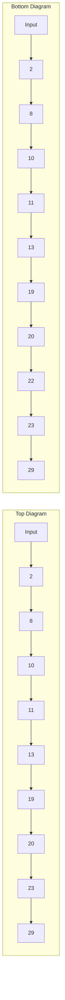
</details>

图 10.62 插入前和插入后的跳跃表

粗略分析指出，由于在每一阶的节点的期望个数没有从原(非随机化的)算法改变，因此预计穿越同阶上的节点的总工作量是不变的。它告诉我们，这些操作具有 $O(\log N)$ 的期望开销。当然，更正式的证明是需要的，但它跟这里的描述没有太大的区别。

跳跃表类似于散列表，它们都需要估计将要出现在链表中的元素个数（从而可以确定阶的数目）。如果得不到这种估计，则可以采用一个大的数，或者使用一种类似于再散列(rehashing)的方法。经验表明，跳跃表如许多平衡查找树的实现一样有效，而用许多种语言实现当然都要简单得多。跳跃表还可以有效地并行实现，这一点与平衡二叉查找树不同。因此，它们在Java类库中已有提供，不过，这在C++中尚未做到。

## 10.4.3 素性测试

在这一节，我们考查确定一个大数是否是素数的问题。正如在第2章末尾谈到的，某些密码方案依赖于大数分解的困难性，比如将一个600位数分解成两个300位的素数相乘。为了实现这种方案，我们需要一种生成两个大素数的方法。如果 $d$ 是数 $N$ 中的数字的位数，那么测试能否被从3到 $\sqrt{N}$ 的奇数整除的明显方法大约需要 $\frac{1}{2}\sqrt{N}$ 次除法，它大约为 $2^{d/2}$ 次，可这对于600位的整数是完全不实际的方法。

---

394

数据结构与算法分析——C++语言描述(第四版)

在这一节，我们将给出一个可以测试素性的多项式时间算法。如果这个算法宣称一个数不是素数，那么我们可以肯定这个数不是素数。如果该算法宣称一个数是素数，那么，这个数将以高的概率，但不是 $100\%$ 地肯定是素数。错误的概率不依赖于被测试的特定的数，而是依赖于由算法做出的随机选择。因此，这个算法偶尔会出错，不过我们将会看到，我们可以让出错的比率任意小。

算法的关键是费马(Fermat)的著名定理。

定理 10.10

费马小定理(Fermat's Lesser Theorem): 如果 $P$ 是素数, 且 $0 < A < P$, 那么 $A^{P-1} \equiv 1 \pmod{P}$。

证明:

这个定理的证明可以在任何一本数论的教科书中找到。

例如，由于67是素数，因此 $2^{66} \equiv 1 (\bmod 67)$ 。这提出了测试一个数 $N$ 是否是素数的算法:只要检验一下是否 $2^{N - 1} \equiv 1 (\bmod N)$ 。如果 $2^{N - 1} \not\equiv 1 (\bmod N)$，那么可以肯定 $N$ 不是素数。另一方面，如果等式成立，那么 $N$ 很可能是素数。例如，满足 $2^{N - 1} \equiv 1 (\bmod N)$ 但不是素数的最小的 $N$ 是 $N = 341$ 。

这个算法偶尔会出错，但问题是它总出一些相同的错误。换句话说，存在 $N$ 的一个固定的集合，对于这个集合该方法行不通。我们可以尝试将该算法随机化如下:随机取 $A$ ，其中$1 < A < N - 1$ 。如果 $A^{N - 1}\equiv 1 (\mathrm{mod}N)$ ，则宣布 $N$ 可能是素数，否则宣布 $N$ 肯定不是素数。如果 $N = 341$ 而 $A = 3$ ，那么我们发现 $3^{340}\equiv 56 (\mathrm{mod}341)$ 。因此，如果算法碰巧选择 $A = 3$ ，那么它将对上面提到的 $N = 341$ 得到正确的答案。

虽然这看起来似乎没有问题，但是却存在一些数，对于 $A$ 的大部分选择它们甚至可以骗过该算法。一种这样的数集叫作Carmichael数(Carmichael number)。这些数不是素数，可是对所有与 $N$ 互素的 $A$ 却满足 $A^{N - 1} \equiv 1 (\bmod N)$，其中 $0 < A < N$。最小的这样的数是561。因此，我们还需要一个附加的测试来改进不出错的概率。

在第 7 章，我们证明过一个关于平方探测(quadratic probing)的定理。这个定理的特殊情形如下。

定理 10.11

如果 $P$ 是素数且 $0 < X < P$，那么 $X^{2} \equiv 1 (\bmod P)$ 仅有的两个解为 $X = 1, P - 1$。

证明:

$X^{2} \equiv 1 (\bmod P)$ 意味着 $X^{2} - 1 \equiv 0 (\bmod P)$ 。这就是说，$(X - 1)(X + 1) \equiv 0 (\bmod P)$ 。由于 $P$ 是素数，且 $0 < X < P$ ，因此 $P$ 必然是或者整除 $(X - 1)$，或者整除 $(X + 1)$，由此推出本定理。$\square$

因此，如果在计算 $A^{N - 1}(\mathrm{mod}N)$ 的任一时刻发现违背了该定理，那么可以断言 $N$ 肯定不是素数。如果使用2.4.4节的函数pow，那么我们看到将有几种机会来运用这种测试。我们修改执行 $\mathrm{mod}N$ 运算的例程并应用定理10.11的测试。这种方法在图10.63中以伪码实现。

我们知道，如果函数 witness 返回任何不是 1 的数，那么它就已经证明了 $N$ 不可能是素数，其证明是非构造性的，因为它并没有具体给出找到因子的方法。业已证明，对于任何 (充分大的) $N$，至多有 $(N - 9)/4$ 个 $A$ 的值会使该算法得出错误的结论。因此，如果 $A$ 是随机选取的，而且算法的结论是 $N$ (很可能) 为素数，那么算法至少有 $75\%$ 的可能是正确的。设函数

---

第 10 章 算法设计技巧

395

witness 运行 50 次，而算法一次得出错误结论的概率是  $\frac{1}{4}$  。因此，50 次独立的随机试验使算法出错的概率绝不会超过  $1/4^{50}=2^{-100}$  。实际上这是一个非常保守的估计，它只对 N 的某些选择成立。即使如此，人们更可能看到的是硬件的错误，而不是对于数的素性的不正确判断。

```c
/**
 * 实现基本的素性测试的函数.
 * 如果witness不返回1,那么n肯定是一个合数.
 * 这是通过计算a^i (mod n)并随时查看1的非平凡
 * 的平方根来做到的.
 */
HugeInt witness( const HugeInt & a, const HugeInt & i, const HugeInt & n )
{
    if( i == 0 )
        return 1;

    HugeInt x = witness( a, i / 2, n );
    if( x == 0 )   // 如果n递归地为合数,则停止
        return 0;

    // 若我们找到1的一个非平凡的平方根,则n不是素数
    HugeInt y = ( x * x ) % n;
    if( y == 1 && x != 1 && x != n - 1 )
        return 0;

    if( i % 2 != 0 )
        y = ( a * y ) % n;

    return y;
}

/**
 * 在随机化素性测试中所查询witness的次数.
 */
const int TRIALS = 5;

/**
 * 随机化素性测试.
 * 调整TRIALS以增加可信度.
 * n 是要测试的数.
 * 如果返回值为false,那么n肯定不是素数.
 * 如果返回值为true,那么n很可能是素数.
 */
bool isPrime( const HugeInt & n )
{
    Random r;

    for( int counter = 0; counter < TRIALS; ++counter )
        if( witness( r.randomHugeInt( 2, n - 2 ), n - 1, n ) != 1 )
            return false;

    return true;
}
```

图 10.63 一种概率素性测试算法

---

396

数据结构与算法分析——C++语言描述(第四版)

素性测试的随机化算法很重要，因为这些算法一直比那些最好的非随机化算法要明显地快。虽然随机化算法可能偶尔会产生错误的结果，但是其发生的机会可以限制到足够小，可以忽略不计。

多年以来，人们怀疑是否有可能以 $d$ 的多项式的时间测定一个 $d$ 位数字的数的素性，但是没有人知道这样的算法。不过最近，素性测试的确定性多项式时间算法已经被发现。虽然这些算法是极其令人兴奋的成果，但是它们尚不能与随机化算法竞争。参考文献的末尾提供了更多的信息。

## 10.5 回溯算法

我们将要考查的最后一个算法设计技巧是回溯(backtracking)算法。在许多情况下，回溯算法(backtracking algorithm)相当于穷举搜索的巧妙实现，但性能一般不理想。不过，情况也并不总是如此，即使是如此，在某些情形下它相对于蛮力(brute force)穷举搜索的工作量也有显著的节省。当然，性能是相对的:对于排序而言， $O(N^{2})$ 的算法是相当差的，但对旅行售货员(或任何NP完全)问题， $O(N^{5})$ 算法则是里程碑式的结果。

回溯算法的一个具体实例是在一套新房子里摆放家具的问题。存在许多尝试的可能性，但一般只有一部分可能是具体要考虑的。开始什么也不摆放，然后是每件家具被摆放在室内的某个部位。如果所有的家具都已摆好而且户主很满意，那么算法终止。如果摆到某一步，该步之后的所有家具摆放方法都不理想，那么我们必须撤销这一步并尝试该步另外的摆放方法。当然，这可能又要导致另一次的撤销摆放，等等。如果我们发现撤销了所有可能的第一步摆放，那么就不存在满意的家具摆放方法。否则，我们最终将终止在满意的摆放位置上。注意，虽然这个算法基本上是蛮力的，但是它并不直接尝试所有的可能。例如，考虑把沙发放进厨房的各种摆法是绝不会尝试的。许多其他明显不合适的摆放方法早就废弃了，因为令人讨厌的摆放的子集是知道的。在一步内删除一大组可能性的做法叫作裁剪(pruning)。

我们将看到回溯算法的两个例子。第一个是计算几何中的问题，第二个例子阐述在诸如国际象棋和西洋跳棋的对弈中计算机如何选取行棋的步骤。

## 10.5.1 收费公路重建问题

设给定 N 个点  $p_{1}, p_{2}, \cdots, p_{N}$ ，它们位于 x 轴上。 $x_{i}$  是点  $p_{i}$  的 x 坐标。进一步假设  $x_{1}=0$ ，并假设这些点从左到右给出。这 N 个点确定了在每一对点间的  $N(N-1)/2$  个形如  $|x_{i}-x_{j}|, i \neq j$  的（不必是唯一的）距离。显然，如果给定点集，那么容易以  $O(N^{2})$  时间构造距离的集合。这个集合将不是排好序的，但是，如果我们愿意花  $O(N^{2}\log N)$  时间界整理，那么这些距离也可以被排序。收费公路重建问题 (turnpike reconstruction problem) 是从这些距离重新构造出点集。它在物理学和分子生物学 (参见有关该信息更专门的参考文献) 中都有应用。这个名称得自于对美国东海岸公路上那些收费公路出口的模拟。正像大数分解比乘法困难一样，重建问题也比构建问题困难。没有人能够给出一个算法以保证用多项式时间完成计算。我们将要介绍的算法一般以  $O(N^{2}\log N)$  运行，但在最坏情形下可能要花费指数时间。

当然，若给定该问题的一个解，则可以通过对所有的点加上一个偏移量而构建无穷多其他的解。这就是为什么我们一定要将第一个点置于0处以及构成解的点集以非减顺序输出的原因。

---

第 10 章 算法设计技巧

397

令 $D$ 是距离的集合，并设 $|D| = M = N(N - 1) / 2$ 。作为例子，设

$$
D = \{1, 2, 2, 2, 3, 3, 3, 4, 5, 5, 5, 6, 7, 8, 1 0 \}
$$

由于 $|D|=15$ ，因此我们知道N=6。算法以置 $x_{1}=0$ 开始。显然， $x_{6}=10$ ，因为10是D中最大的元素。将10从D中删除，我们确定的点和剩下的距离如下图所示。

$$
\begin{array}{c c} \hline & \\ x _ {1} = 0 & \\ & D = \{1, 2, 2, 2, 3, 3, 3, 4, 5, 5, 5, 6, 7, 8 \} \\ & x _ {6} = 1 0 \end{array}
$$

剩下的距离中最大的是8，这就是说，或者 $x_{2} = 2$ ，或者 $x_{5} = 8$ 。由对称性，我们可以断定究竟选择哪个是不重要的，因为或者两个选择都引向解(它们互为镜像)，或者都不会引向最终的解，所以我们可置 $x_{5} = 8$ 而不至于影响问题的解。然后从 $D$ 中删除距离 $x_{6} - x_{5} = 2$ 和$x_{5} - x_{1} = 8$ ，得到

$$
\begin{array}{c c c c} \hline & & \mid & \\ x _ {1} = 0 & & x _ {5} = 8 & x _ {6} = 1 0 \\ & D = \{1, 2, 2, 3, 3, 3, 4, 5, 5, 5, 6, 7 \} \end{array}
$$

下一步就不明显了。由于7是 $D$ 中最大的数，因此或者 $x_{4} = 7$ ，或者 $x_{2} = 3$ 。如果 $x_{4} = 7$ 那么距离 $x_{6} - 7 = 3$ 和 $x_{5} - 7 = 1$ 也必须出现在 $D$ 中。我们一看便知它们确实在 $D$ 中。另一方面，如果我们置 $x_{2} = 3$ ，那么 $3 - x_{1} = 3$ 和 $x_{5} - 3 = 5$ 就必须在 $D$ 中。这两个距离也的确在 $D$ 中。因此，我们不对哪种选择做强求。这样，我们尝试其中的一种看它是否导致问题的解。如果它不行，那么我们退回来再尝试另外的那个选择。尝试第一个选择我们置 $x_{4} = 7$ ，得到

$$
\begin{array}{c c c c} \hline & \mid & \mid & \mid \\ x _ {1} = 0 & x _ {4} = 7 & x _ {5} = 8 & x _ {6} = 1 0 \\ & D = \{2, 2, 3, 3, 4, 5, 5, 5, 6 \} \end{array}
$$

此时，得到 $x_{1} = 0, x_{4} = 7, x_{5} = 8$ 和 $x_{6} = 10$ 。现在最大的距离是6，因此，或者 $x_{3} = 6$ ，或者 $x_{2} = 4$ 。可是，如果 $x_{3} = 6$ ，那么 $x_{4} - x_{3} = 1$ ，这是不可能的，因为1不再属于 $D$ 。另一方面，如果 $x_{2} = 4$ ，那么 $x_{2} - x_{0} = 4$ 且 $x_{5} - x_{2} = 4$ 。这也是不可能的，因为4只在 $D$ 中出现一次。因此，这个推理思路得不到解，我们需要回溯。

由于 $x_{4} = 7$ 不能产生解，因此尝试 $x_{2} = 3$ 。如果这也不行，那么我们放弃计算并报告无解。现在，我们有

$$
\begin{array}{c c c c} \hline & \mid & \mid & \mid \\ x _ {1} = 0 & x _ {2} = 3 & x _ {5} = 8 & x _ {6} = 1 0 \\ & D = \{1, 2, 2, 3, 3, 4, 5, 5, 6 \} \end{array}
$$

我们必须再一次在 $x_{4} = 6$ 和 $x_{3} = 4$ 之间选择。 $x_{3} = 4$ 是不可能的，因为 $D$ 只出现一个4，而该选择意味着要有两个。 $x_{4} = 6$ 是可能的，于是得到

$$
\begin{array}{c c c c c} \hline & \mid & \mid & \mid & \mid \\ x _ {1} = 0 & x _ {2} = 3 & x _ {4} = 6 & x _ {5} = 8 & x _ {6} = 1 0 \\ & D = \{1, 2, 3, 5, 5 \} \end{array}
$$

唯一剩下的选择是 $x_{3} = 5$ 。这是可以的，因为它使得 $D$ 成为空集，因此我们得到问题的一个解。

$$
\begin{array}{c c c c c c} \hline & \mid & \mid & \mid & \mid & \mid \\ x _ {1} = 0 & x _ {2} = 3 & x _ {3} = 5 & x _ {4} = 6 & x _ {5} = 8 & x _ {6} = 1 0 \\ & & D = \{\} \end{array}
$$

图 10.64 是一棵决策树，代表为得到解而采取的行动。这里，我们没有对分支作标记，而

---

398

数据结构与算法分析——C++语言描述(第四版)

是把标记放在了分支的目的节点上。带有一个星号的节点表示这些所选的点与给定的距离不一致；带有两个星号的节点其子节点都不可能合理地存在，因此表示一条不正确的路径。


<details>
<summary>flowchart</summary>

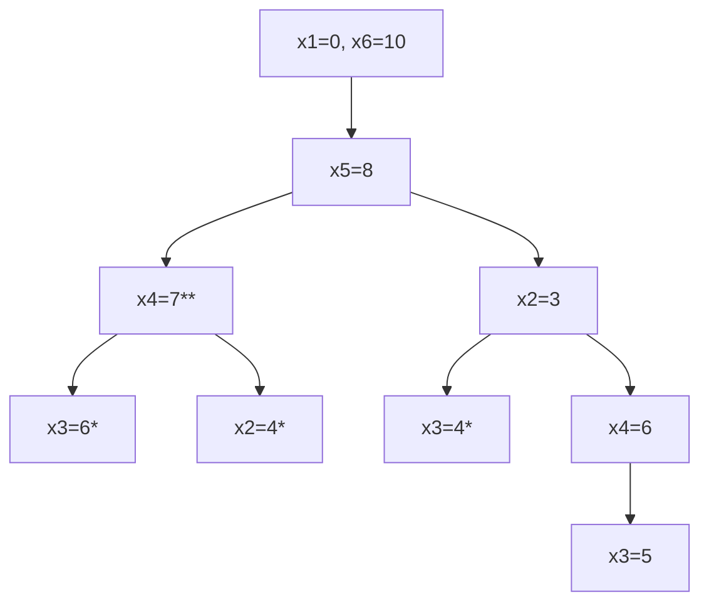
</details>

图10.64 收费公路重建例子的决策树

实现这个算法的伪代码大部分都很简单。驱动例程 turnpike 如图 10.65 所示。它接收点的数组 x (不需要初始化)，距离的集合 D 和 N。 $^{①}$  如果找到一个解，则返回 true，答案将被放到 x 中，而 D 将是空集。否则，返回 false，x 将是不确定的，距离集合 D 将是未触及的。该例程如上所述设置了  $x_{1}, x_{N-1}$  和  $x_{N}$ ，修改了 D，并且调用了回溯算法 place 以放置其余的点。我们假设为保证  $|D| = N(N-1)/2$  已经进行了检验。

```txt
bool turnpike( vector<int> & x, DistSet d, int n )
{
    x[ 1 ] = 0;
    d.deleteMax( x[ n ] );
    d.deleteMax( x[ n - 1 ] );
    if( x[ n ] - x[ n - 1 ] ∈ d )
    {
        d.remove( x[ n ] - x[ n - 1 ] );
        return place( x, d, n, 2, n - 2 );
    }
    else
        return false;
}
```

图 10.65 收费公路重建算法:驱动例程(伪代码)

更困难的部分是算法的回溯部分，如图10.66所示。与大多数回溯算法一样，最方便的实现是递归方式。我们传递同样的参数以及界Left和Right； $x_{\mathrm{Left}},\cdots,x_{\mathrm{Right}}$ 是我们试图放置的点的x坐标。如果D是空集(或Left>Right)，那么解已经找到，我们可以返回。否则，我们首先尝试使 $x_{\mathrm{Right}}=D_{\mathrm{max}}$ 。如果所有适当的距离都(以正确的值)出现，那么尝试性地放上这一点，删除相应的距离，并尝试从Left到Right-1填入。如果这些距离不出现，或者从Left到Right-1填入尝试失败，那么再尝试置 $x_{\mathrm{Left}}=x_{N}-d_{\mathrm{max}}$ ，使用类似的做法。如果这样还不行，则问题无解；否则，一个解已经找到，而这个信息最终通过return语句和x数组传递回turnpike。

<small><span class="docvortex-page-footnote" data-block-type="page_footnote" style="color:#6b7280">① 为使所举的例子方便起见，我们使用了单字母变量名，一般说来这不是好习惯。为了简单，我们也不给出变量的类型。最后，我们让数组下标从1开始，而不是从0。</span></small>

---

第 10 章 算法设计技巧

399

```javascript
/**
 * 放置点 x[left] ... x[right] 的回溯算法
 * x[1]...x[left-1] 和 x[right+1]...x[n] 已经被尝试性放置
 * 如果place 返回true,那么 x[left]...x[right] 则被赋值
 */
bool place( vector<int> & x, DistSet d, int n, int left, int right )
{
    int dmax;
    bool found = false;

    if( d.isEmpty( ) )
        return true;

    dmax = d.findMax( );

    // 检测置 x[right] = dmax 是否可行
    if( | x[j] - dmax | ∈ d for all 1≤j<left and right<j≤n )
    {
        x[right] = dmax;                  // 尝试 x[right]=dmax
        for( 1≤j<left, right<j≤n )
            d.remove( | x[j] - dmax | );
        found = place( x, d, n, left, right-1 );

        if( !found )      // 回溯
            for( 1≤j<left, right<j≤n ) // 撤销删除
                d.insert( | x[j] - dmax | );
    }
    // 如果第一个尝试失败，则试图查看
    // 置x[left]=x[n]-dmax 是否可行
    if( !found && ( | x[n] - dmax - x[j] | ∈ d
                    for all 1≤j<left and right<j≤n ) )
    {
        x[left] = x[n] - dmax;      // 与前面做法相同
        for( 1≤j<left, right<j≤n )
            d.remove( | x[n] - dmax - x[j] | );
        found = place( x, d, n, left+1, right );

        if( !found )      // 回溯
            for( 1≤j<left, right<j≤n ) // 撤销删除
                d.insert( | x[n] - dmax - x[j] | );
    }

    return found;
}
```

图 10.66 收费公路重建算法:回溯的步骤(伪代码)

算法的分析涉及两个因素。设第9～11行以及第18～20行从未执行。我们可以把D作为平衡二叉查找(或伸展)树保存(当然，这需要对代码做些修改)。如果我们从未回溯，那么最多有 $O(N^{2})$ 次操作涉及D，如在第4行、第12行和第13行中蕴涵的删除和一些contains。显然这是对删除提出的，因为D有 $O(N^{2})$ 个元素而没有元素被重新插入。每次对place的

---

400

数据结构与算法分析——C++语言描述(第四版)

调用最多用到 $2N$ 次 contains，而由于 place 在该分析中从未回溯，因此最多可以有 $2N^2$ 次 contains 操作。于是，如果没有回溯，那么运行时间为 $O(N^2 \log N)$。

当然，回溯是要发生的。如果回溯反复发生，那么算法的性能就要受到影响。我们可以通过构建病态的情形迫使它发生。经验证明，如果这些点的整数坐标在 $[0, D_{\max}]$ 均匀地和随机地分布，其中 $D_{\max} = \Theta(N^2)$，那么在整个算法期间几乎肯定最多执行一次回溯。

## 10.5.2 博弈

作为最后一个应用，我们将考虑计算机可能用来进行战略游戏的策略，如西洋跳棋或国际象棋。作为一个例子，我们将使用简单得多的三连游戏棋(tic-tac-toe)，因为它使得我们的想法更容易表述。

如果双方都玩到最优，那么三连游戏棋就是平局。通过进行仔细的逐个情况的分析，构造一个从不输棋而且当机会出现时总能赢棋的算法并不是困难的事。之所以能够做到，是因为一些位置是已知的陷阱，可以通过查表来处理。另外一些策略，如当中央的方格可用时占据该方格，可以使得分析更简单。如果完成了分析，那么通过使用一个表我们总可以只根据当前位置选择一步棋。当然，这种方法需要程序员而不是计算机来进行大部分的思考。

## 极小极大策略

更一般的策略是使用一个赋值函数来给一个位置的“好坏”定值。能使计算机获胜的位置可以得到值+1；平局可得到0；使计算机输棋的位置得到值-1。通过考察盘面就能够确定输赢的位置叫作终端位置(terminal position)。

如果一个位置不是终端位置，那么该位置的值通过递归地假设双方最优棋步而确定。这叫作极小极大策略(minimax strategy)，因为下棋的一方(人)试图极小化这个位置的值，而另一方(计算机)却要使它的值达到极大。

位置 P 的后继位置 (successor position) 是通过再从 P 走一步棋可以达到的任何位置  $P_{s}$ 。如果在某个位置 P 计算机要走棋，那么它递归地求出所有的后继位置的值。计算机选择具有最大值的一步行棋，这就是 P 的值。为了得到任意后继位置  $P_{s}$  的值，要递归地算出  $P_{s}$  的所有后继位置的值，然后选取其中最小的值。这个最小值就代表行棋人的一方最赞成的应着。

图 10.67 中的程序使得计算机的策略更清楚。第 14～18 行直接给赢棋或平局赋值。如果这两个情况都不适用，那么这个位置就是非终端位置。我们知道，value 应该包含所有可能后继位置的最大值，第 21 行把它初始化为最小的可能的值，第 22～37 行的循环则为了改进而进行搜索。每一个后继位置递归地依次由第 26～28 行算出值来。正如我们将看到的，因为函数 findHumanMove 调用 findCompMove，所以这个过程是递归的。如果下棋人对一步棋的应着给计算机留下比计算机在前面最佳棋步所得到的位置更好的位置，那么 value 和 bestMove 将被更新。图 10.68 显示的是下棋人选择棋步的函数。除了行棋人选择的棋步导致最低值的位置外，所有的逻辑实际上都是相同的。事实上，通过传递一个附加的变量不难把这两个过程合并成一个，这个附加变量指出棋该轮到谁走。可是这样一来确实使得程序多少有些难以读懂了，因此我们就停留在两个分开的例程的阶段。

---

第 10 章 算法设计技巧

401

```cpp
/**
 * 找出计算机最佳着法的递归函数.
 * 将估值返回，并给bestMove 置值, 其范围
 * 从1到9，表示要占据的最佳方格.
 * 可能的估值满足COMP_LOSS < DRAW < COMP_WIN.
 * 对弈人的函数 findHumanMove 见图10.67.
 */
int TicTacToe::findCompMove( int & bestMove )
{
    int i, responsável;
    int dc;   // dc 意为无所谓 (don't care ); 其值用不到
    int value;

    if( fullBoard( ) )
        value = DRAW;
    else
    if( immediateCompWin( bestMove ) )
        return COMP_WIN;   // bestMove 将由immediateCompWin置值
    else
    {
        value = COMP_LOSS; bestMove = 1;
        for( i = 1; i <= 9; ++i )  // 尝试每个方格
        {
            if( isEmpty( i ) )
            {
                place( i, COMP );
                responsável = findHumanMove( dc );
                inplace( i );  // 恢复盘面

                if( responsável > value )
                {
                    // 更新最佳着棋
                    value = responsável;
                    bestMove = i;
                }
            }
        }
    }
    return value;
}
```

图 10.67 极小极大三连游戏棋算法:计算机的选择

我们把一些支撑例程留作一道练习。代价最高的计算是需要计算机开局的情形。由于在这个阶段棋局处于平局的形势，因此计算机选择方格1。 $^{①}$  需要考查的位置总共有97162个，计算要花费几秒完成。没有优化代码的打算。如果下棋人选择中央方格，那么当计算机第二次行棋时所要考查的位置数是5185个，当下棋人选择一个角上的方格时计算机所要考查的位置是9761个，而当下棋人选择边上非角的方格时计算机要考查13233个位置。

<small><span class="docvortex-page-footnote" data-block-type="page_footnote" style="color:#6b7280">① 我们将方格从棋盘左上角开始向右编号。不过，这只对支撑例程是重要的。</span></small>

---

402

数据结构与算法分析——C++语言描述(第四版)

```cpp
int TicTacToe::findHumanMove( int & bestMove )
{
    int i, responsável;
    int dc;  // dc意为无所谓 (don't care ); 它的值用不到
    int value;

    if( fullBoard( ) )
        value = DRAW;
    else
    if( immediateHumanWin( bestMove ) )
        return COMP_LOSS;
    else
    {
        value = COMP_WIN; bestMove = 1;
        for( i = 1; i <= 9; ++i ) // 尝试每个方格
        {
            if( isEmpty( i ) )
            {
                place( i, HUMAN );
                responsável = findCompMove( dc );
                inplace( i ); // 恢复盘面

                if( responsável < value )
                {
                    // 更新最佳着棋
                    value = responsável;
                    bestMove = i;
                }
            }
        }
    }
    return value;
}
```

图 10.68 极小极大三连游戏棋算法:人的选择

对于更复杂的游戏，如西洋跳棋和国际象棋，搜索到终端节点的全部棋步显然是不可行的。 $^{①}$  在这种情况下，我们在达到递归的某个深度之后只能停止搜索。递归停止处的节点则成为终端节点。这些终端节点的值由一个估计位置的值的函数计算得出。例如，在一个国际象棋程序中，求值函数计量诸如棋子和位置因素的相对的量和强度这样一些变量。求值函数对于成功是至关重要的，因为计算机的行棋选步是基于将这个函数极大化。最好的计算机下棋程序具有惊人复杂的求值函数。

然而，对于计算机下棋，一个最重要的因素看来是程序能够向前看出的棋步的数目。有时我们称之为层(ply)，它等于递归的深度。为了实现这个功能，需要给予搜索例程一个附加的参数。

在对弈程序中，增加向前看步因素的基本方法是提出一些方法，这些方法对更少的节点求值但却不丢失任何信息。我们已经看到的一种方法是使用一个表来记录所有已经被计算过值的位置。例如，在搜索第一步行棋的过程中，程序将考查图10.69中的一些位置。如果这些

<small><span class="docvortex-page-footnote" data-block-type="page_footnote" style="color:#6b7280">① 据估计，假如下棋实施这种搜索，那么至少开局的第一步行棋也要考查 $10^{100}$ 个位置。即使是本节稍后描述的改进方法结合使用，这个数字也不能降低到实用的水平。</span></small>

---

第 10 章 算法设计技巧

403

位置的值被存储了，那么一个位置在第二次出现时就不必再重新计算，它基本上变成了一个终端位置。记录这些信息的数据结构叫作置换表(transposition table)，它几乎总可通过散列来实现。在许多场合，这可以节省大量的计算。例如，在一盘棋的残局阶段，此时相对来说只有很少的棋子，时间的节省使得一步搜索可以进行到更深的若干层。


<details>
<summary>text_image</summary>

X
O X
X O X
...
X
O
X O X
...
</details>

图 10.69 到达同一位置的两种搜索

## $\alpha - \beta$ 裁剪

对于可能取得的最显著的改进一般称为 $\alpha -\beta$ 裁剪（ $\alpha -\beta$ pruning）。图10.70显示在一盘假想的棋局中用于给某个假设的位置求值的一些递归调用的踪迹。通常称之为博弈树（game tree）。（到现在为止我们一直回避使用这个术语，因为它多少有些误导:算法实际上并不构造任何的树。博弈树只是一个抽象的概念。）这棵博弈树的值为44。


<details>
<summary>dendrogram</summary>

| Node ID | Value |
| --- | --- |
| 42 | 42 |
| 42 | 25 |
| 42 | 7 |
| 42 | 72 |
| 42 | 86 |
| 42 | 9 |
| 42 | 44 |
| 42 | 50 |
| 42 | 68 |
| 42 | 73 |
| 42 | 31 |
| 42 | 78 |
| 42 | 17 |
| 42 | 79 |
| 42 | 37 |
| 42 | 73 |
| 42 | 23 |
| 42 | 30 |
| 42 | 40 |
| 42 | 19 |
| 42 | 27 |
| 42 | 64 |
| 42 | 87 |
| 42 | 57 |
| 42 | 68 |
| 42 | 29 |
| 42 | 36 |
| 42 | 5 |
| 42 | 55 |
| 42 | 12 |
| 42 | 36 |
| 27 | 27 |
| 27 | 27 |
| 27 | 86 |
| 27 | 44 |
| 27 | 68 |
| 27 | 73 |
| 27 | 78 |
| 27 | 79 |
| 27 | 73 |
| 27 | 40 |
| 27 | 27 |
| 27 | 87 |
| 27 | 68 |
| 27 | 36 |
| 27 | 55 |
| 27 | 36 |
| 44 | 44 |
| 44 | 78 |
| 44 | 78 |
| 44 | 40 |
| 44 | 36 |
| Max (Top) | 44 |
| Max (Middle) | 36 |
| Max (Bottom) | Max (Top) |
</details>

图 10.70 一棵假想的博弈树

图10.71显示同一棵博弈树的求值，它有一些(但不是所有可能的)未求值的节点。几乎有一半的终端节点尚未被检验。我们证明对它们的值的计算将不会改变树根的值。


<details>
<summary>dendrogram</summary>

| Level | Value |
| --- | --- |
| Max | 44 |
| Max | 40 |
| Max | 44 |
| Max | 68 |
| Max | 27 |
| Max | 40 |
| Max | 44 |
| Max | 68 |
| Max | 27 |
| Max | 40 |
| Max | 44 |
| Max | 68 |
| Max | 27 |
| Max | 40 |
| Max | 44 |
| Max | 68 |
| Max | 27 |
| Max | 40 |
| Max | 44 |
</details>

图 10.71 一棵被裁剪的博弈树

---

404

数据结构与算法分析——C++语言描述(第四版)

首先，考虑节点 D。图 10.72 显示在给 D 求值时已经搜集到的信息。此刻，我们仍然处在函数 findHumanMove 中并正在打算对 D 调用 findCompMove。然而，我们已经知道 findHumanMove 最多将返回 40，因为它是一个 min 节点。另一方面，它的 max 父节点已经找到一个保证 44 的序列。注意，D 无论是多少也不可能增加这个值。因此，D 不需要求值。该树的这个裁剪叫作 α 裁剪 (α prunning)。同样的情况也出现在节点 B。为了实现 α 裁减，findCompMove 将它的尝试性的极大值 (α) 传递给 findHumanMove。如果 findHumanMove 的尝试性的极小值低于这个值，那么 findHumanMove 立即返回。


<details>
<summary>flowchart</summary>

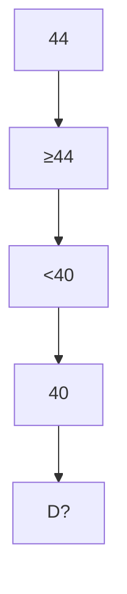
</details>

图10.72 标记？的节点是不重要的

类似的情况也发生在节点 A 和 C 上。这一次，我们在 findCompMove 函数中，并且正要调用 findHumanMove 以计算 C 的值。图 10.73 显示在节点 C 遇到的情况。不过在 min 层上, 调用了函数 findCompMove 的 findHumanMove，已经确定它能够迫使其值最高到 44(注意，对于下棋人这一方低的值是好的)。由于 findCompMove 有一个尝试性的最大值 68，因此 C 在 min 层上怎么做也不会影响到这个 min 层。因此，没必要给 C 求值。这种类型的裁剪叫作 β 裁剪 (β prunning)，它是 α 裁剪的对称形式。当这两种方法结合起来时我们就得到 α-β 裁剪。


<details>
<summary>flowchart</summary>

```mermaid
graph TD
  A["44"] --> B{"≤44"}
  B --> C["≥68"]
  C --> D["68"]
  C --> E["C?"]
```
</details>

图10.73 标记？的节点是不重要的

实现 $\alpha-\beta$ 裁剪所需代码少得惊人。图 10.74 显示的是 $\alpha-\beta$ 裁剪方案的一半内容(类型说明除外)；另一半代码的编写读者应该不会遇到任何麻烦。

为了充分利用 $\alpha -\beta$ 裁剪，对弈程序通常尽量对非终端节点应用求值函数，力图把最好的棋步早一些放到搜索范围内。这样的结果甚至比人们从随机顺序的节点所期望的结果还要裁剪得多。其他一些方法，像在一些更活跃的行棋沿线进行更深入搜索的做法也在使用。

在实践中，$\alpha - \beta$ 裁剪把搜索限制在只有 $O(\sqrt{N})$ 个节点上，这里 $N$ 是整个博弈树的大小。这是巨大的节省，它意味着使用 $\alpha - \beta$ 裁剪的搜索与非裁剪树相比能够进行到两倍的深度。我们的三连游戏棋例子是不理想的，因为存在太多相同的值，但即使是这样，最初对97162个节点的搜索还是被减到了4493个节点。（这些计数包括非终端节点。）

---

第 10 章 算法设计技巧

405

```cpp
/**
 * 与前面的相同，但执行了α-β裁剪.
 * 主例程应该以
 * alpha = COMP_LOSS 和 beta = COMP_WIN 进行调用.
 */
int TicTacToe::findCompMove( int & bestMove, int alpha, int beta )
{
    int i, responsável;
    int dc;   // dc 意为无所谓（don't care）；其值用不到
    int value;

    if( fullBoard( ) )
        value = DRAW;
    else
    if( immediateCompWin( bestMove ) )
        return COMP_WIN;   // bestMove 将由 immediateCompWin 置值
    else
    {
        value = alpha; bestMove = 1;
        for( i = 1; i <= 9 && value < beta; ++i ) // 尝试每个方格
        {
            if( isEmpty( i ) )
            {
                place( i, COMP );
                responsável = findHumanMove( dc, value, beta );
                inplace( i ); // 恢复盘面

                if( responsável > value )
                {
                    // 更新最佳棋步
                    value = responsável;
                    bestMove = i;
                }
            }
        }
    }
    return value;
}
```

图10.74 带有 $\alpha -\beta$ 裁剪的极小极大三连游戏棋算法:计算机棋步的选择

在许多对弈领域，计算机跻身于世界最优秀棋手之列。所使用的方法是非常有趣的，而且可以应用到一些更严肃的问题上。更多的细节可见参考文献。

## 小结

这一章阐释了在算法设计中发现的 5 个最普通的方法。当面临一个问题的时候，花些时间考察一下这些方法能否适用还是值得的。算法的适当选择，结合数据结构的正确使用，常常能够迅速导致问题的高效解决。

---

406

数据结构与算法分析——C++语言描述(第四版)

## 练习

10.1 证明，使用贪婪算法将多处理器作业调度工作的平均完成时间最小化是可行的。
10.2 设输入为一组作业  $j_{1}, j_{2}, \cdots, j_{N}$ ，其中的每一个作业都要花一个时间单位来完成。如果每个作业  $j_{i}$  在时间限度  $t_{i}$  内完成，那么将挣得  $d_{i}$  美元，但若在时间限度以后完成则挣不到钱。

a. 给出一个  $O(N^{2})$  贪婪算法求解该问题。

\*\*b. 修改你的算法以得到 $O(N \log N)$ 的时间界。(提示: 时间界完全归因于将作业按照金额排序。算法的其余部分可以使用不相交集数据结构以 $o(N \log N)$ 实现。)

10.3 一个文件只包含冒号、空格、换行符、逗号和数字且以下列频率出现:冒号(100)，空格(605)，换行(100)，逗号(705)，0(431)，1(242)，2(176)，3(59)，4(185)，5(250)，6(174)，7(199)，8(205)，9(217)。构造其哈夫曼编码。

10.4 被编码的文件有一部分必须是指示哈夫曼编码的文件头。给出一种方法构建大小最多为  $O(N)$  的文件头(包括符号)，其中 N 是符号的个数。

10.5 完成哈夫曼算法生成最优前缀码的证明。

10.6 证明，如果符号是按照频率排序的，那么哈夫曼算法可以以线性时间实现。

10.7 用哈夫曼算法写出一个实现文件压缩(和解压缩)的程序。

\*10.8 证明，通过考虑下述项的序列可以迫使任意联机装箱算法至少使用 $\frac{3}{2}$ 最优箱子数:N项大小为 $\frac{1}{6}-2\varepsilon$ ，N项大小为 $\frac{1}{3}+\varepsilon$ ，N项大小为 $\frac{1}{2}+\varepsilon$ 。

10.9 当

a. 最小项的大小大于 $1 / 3$
\*b. 最小项的大小大于 1/4
\*c. 最小项的大小小于 2/11

时，分别给出简单的分析来证明首次适合递减装箱算法性能的界。

10.10 解释如何以时间 $O(N\log N)$ 实现首次适合算法和最佳适合算法。
10.11 指出在 10.1.3 节讨论的所有装箱方法对输入 0.42, 0.25, 0.27, 0.07, 0.72, 0.86, 0.09, 0.44, 0.50, 0.68, 0.73, 0.31, 0.78, 0.17, 0.79, 0.37, 0.73, 0.23, 0.30 的操作。
10.12 编写一个程序比较各种装箱试探方法(在时间上和所用箱子的数量上)的性能。
10.13 证明定理 10.7。
10.14 证明定理 10.8。

\*10.15 将 $N$ 个点放入一个单位方格中。证明最近一对点之间的距离为 $O(N^{-1/2})$。

\*10.16 论证对于最近点算法，在带内的平均点数是 $O(\sqrt{N})$。（提示:利用前一道练习的结果。）

10.17 编写一个程序实现最近点对算法。
10.18 使用三元中值组取中值分割法(median-of-median-of-three partitioning)方法，快速选择算法的渐近运行时间是多少？
10.19 证明七元中值组取中值分割法(median-of-median-of-seven partitioning)的快速选择算法是线性的。为什么七元中值组取中值的分割方法不用在证明中？

---

第 10 章 算法设计技巧

407

10.20 实现第 7 章中的快速选择算法，快速选择使用五元中值组取中值分割法，并实现 10.2.3 节末尾的抽样算法。比较它们的运行时间。

10.21 许多用于计算五元中值组取中值的信息都被扔掉了。指出通过更仔细地使用这些信息怎样能够减少比较的次数。

\*10.22 完成在 10.2.3 节末尾描述的抽样算法的分析，并解释 $\delta$ 和 $s$ 的值如何选择。

10.23 指出如何用递归乘算法计算 XY，其中 X = 1234, Y = 4321。要包括所有的递归计算。

10.24 指出如何只使用三次乘法将两个复数 $X = a + bi$ 和 $Y = c + di$ 相乘。

10.25 a. 证明

$$
X _ {L} Y _ {R} + X _ {R} Y _ {L} = (X _ {L} + X _ {R}) (Y _ {L} + Y _ {R}) - X _ {L} Y _ {L} - X _ {R} Y _ {R}
$$

b. 它给出进行 $N$ 比特数的乘法的 $O(N^{1.59})$ 算法。将该方法与正文中的解法进行比较。

10.26 \*a. 指出如何通过求解大约为原问题 1/3 大小的 5 个问题来完成两个数的乘法。

\*\*b. 将该问题推广得出一个 $O(N^{1 + \varepsilon})$ 的算法，其中 $\varepsilon > 0$ 为任意常数。

c. 在 b 中的算法比  $O(N \log N)$  好吗？

10.27 为什么 Strassen 算法在 $2 \times 2$ 矩阵的乘法中重要的是不使用可交换性？

10.28 两个 $70 \times 70$ 矩阵可以使用 143640 次乘法相乘。指出这如何能够用来改进由 Strassen 算法给出的界。

10.29 计算  $A_{1}A_{2}A_{3}A_{4}A_{5}A_{6}$  的最优方法是什么？其中，这些矩阵的阶数为  $A_{1}: 10 \times 20$ ， $A_{2}: 20 \times 1$ ， $A_{3}: 1 \times 40$ ， $A_{4}: 40 \times 5$ ， $A_{5}: 5 \times 30$ ， $A_{6}: 30 \times 15$ 。

10.30 证明下列使用链式矩阵乘法的贪婪算法都是行不通的。在每一步

a. 计算最节省的乘法。

b. 计算最昂贵的乘法。

c. 计算两个矩阵  $M_{i}$  和  $M_{i+1}$  之间的乘法，使得在  $M_{i}$  中的列数最小化（使用上面的法则之一）。

10.31 编写一个程序计算矩阵乘法的最佳排序。注意，要包括显示具体顺序的例程。

10.32 指出下列单词的最优二叉查找树，其中括号内是单词出现的频率:a(0.18)，and(0.19)，I(0.23)，it(0.21)，or(0.19)。

\*10.33 将最优二叉查找树算法扩展到可以对不成功的搜索进行。在这种情况下，$q_{j}$ 是对任意满足 $w_{j} < W < w_{j+1}$ 的单词 $W$ 执行一次查找的概率，其中 $1 \leqslant j < N$。$q_{0}$ 是对 $W < w_{1}$ 的单词 $W$ 执行一次查找的概率，而 $q_{N}$ 是对 $W > w_{N}$ 执行一次查找的概率。注意，$\sum_{i=1}^{N} p_{i} + \sum_{j=0}^{N} q_{j} = 1$。

\*10.34 设 $C_{i,i} = 0$ ，此外

$$
C _ {i, j} = W _ {i, j} + \min _ {i <   k \leqslant j} (C _ {i, k - 1} + C _ {k, j})
$$

设 W 满足四边形不等式 (quadrangle inequality)，即对所有的  $i \leqslant i' \leqslant j \leqslant j'$

$$
W _ {i, j} + W _ {i ^ {\prime}, j ^ {\prime}} \leqslant W _ {i ^ {\prime}, j} + W _ {i, j ^ {\prime}}
$$

进一步假设 W 是单调 (monotone) 的:如果  $i \leqslant i'$  及  $j \leqslant j'$ ，那么  $W_{i,j} \leqslant W_{i',j'}$ 。

a. 证明 C 满足四边形不等式。

---

408

数据结构与算法分析——C++语言描述(第四版)

b. 令 $R_{i,j}$ 是使达到最小值 $C_{i,k-1} + C_{k,j}$ 的最大的 $k$ (就是说，在相同的情形下选择最大的 $k$)。证明:

$$
R _ {i, j} \leqslant R _ {i, j + 1} \leqslant R _ {i + 1, j + 1}
$$

c. 证明 R 沿着每一行和每一列都是非减的。
d. 用它来证明，C 中所有的项均可以以  $O(N^{2})$  时间计算。
e. 使用这些技巧可以以  $O(N^{2})$  时间解决哪些动态规划算法？

10.35 编写一个例程从 10.3.4 节中的算法重新构建那些最短路径。
10.36 二项式系数 $C(N,k)$ 可以递归定义如下:$C(N,0) = 1$，$C(N,N) = 1$，且对于 $0 < k < N$，$C(N,k) = C(N - 1,k) + C(N - 1,k - 1)$。编写一个函数如下计算二项式系数并给出运行时间的分析:

a. 递归计算。
b. 使用动态规划算法计算。

10.37 编写在跳跃表中执行插入、删除及查找的例程。
10.38 给出正式证明，证明跳跃表操作的期望时间为  $O(\log N)$ 。
10.39 a. 考察你的系统中的随机数发生器。它的随机性如何？
b. 图 10.75 显示抛一枚硬币的例程，假设 random 返回一个整数(这在许多系统中常见)。如果随机数发生器使用形如  $M = 2^{B}$  的模(遗憾的是这在许多系统上流行)，那么各跳跃表算法的期望性能如何？

```txt
CoinSide flip( )
{
    if( ( random( ) % 2 ) == 0 )
        return HEADS;
    else
        return TAILS;
}
```

图 10.75 有问题的抛币器(程序)

10.40 a. 用取幂算法证明  $2^{340} \equiv 1 \pmod{341}$ 。
b. 指出随机化素性测试当 N=561 时对于 A 的几种选择是如何工作的。

10.41 实现收费公路重建算法。

10.42 如果两个点集产生相同的距离集合而不互相转换，那么这两个点集称为是同度的(homometric)。下列距离集合给出两个不同的点集:{1, 2, 3, 4, 5, 6, 7, 8, 9, 10, 11, 12, 13, 16, 17}。求出这两个点集。

10.43 推广重建算法，使给定一个距离集合找出所有的同度点集。
10.44 指出图 10.76 中树的  $\alpha-\beta$  裁剪的结果。
10.45 a. 图 10.74 中的程序实现  $\alpha$  裁剪还是  $\beta$  裁剪？

b. 实现与其互补的例程。

10.46 写出三连游戏棋其余的过程。
10.47 一维装圆问题(one-dimensional circle packing problem)如下:设有 $N$ 个半径分别是

---

第 10 章 算法设计技巧

409

$r_{1}, r_{2}, \cdots, r_{N}$ 的圆。将这些圆装到一个盒子中使得每个圆都与盒子的底边相切，圆的排列按原来的顺序。该问题是找出最小尺寸的盒子的宽度。图 10.77 显示了一个例子，各圆的半径分别为 2, 1, 2。最小尺寸盒子的宽度为 $4 + 4\sqrt{2}$ 。


<details>
<summary>dendrogram</summary>

| Level | Value |
| --- | --- |
| Max | 68 |
| Max | 65 |
| Max | 77 |
| Min | 68 |
| Min | 86 |
| Min | 38 |
| Min | 65 |
| Min | 65 |
| Min | 77 |
| Min | 33 |
| Max | 65 |
| Max | 86 |
| Max | 65 |
| Max | 77 |
| Max | 65 |
| Max | 65 |
| Max | 68 |
| Max | 65 |
| Max | 65 |
| Max | 68 |
| Max | 65 |
| Max | 65 |
| Max | 68 |
| Max | 65 |
| Max | 65 |
| Max | 68 |
| Max | 65 |
| Max | 65 |
| Max | 68 |
| Max | 65 |
| Max | 65 |
</details>

图 10.76 博弈树，该树可以裁剪

\*10.48 设无向图 $G$ 的边满足三角形不等式 (triangle inequality): $c_{u,v} + c_{v,w} \geqslant c_{u,w}$。指出如何计算其值最多为最优路径两倍的旅行售货员环游。(提示: 构造最小生成树。)

\*10.49 假设你是邀请赛的经理，需要安排 $N = 2^{k}$ 名运动员之间一轮罗宾邀请赛 (robin tournament)。在这次邀请赛上，每人每天恰好打一场比赛；$N - 1$ 天后，每对选手间均已进行了比赛。给出一个递归算法安排比赛。

10.50 \*a. 证明，在一轮罗宾邀请赛中总能够以顺序 $p_{i_1}, p_{i_2}, \cdots, p_{i_N}$ 安排运动员，使得对所有 $1 \leqslant j < N$，$p_{i_j}$ 赢得对 $p_{i_{j+1}}$ 的比赛。

b. 给出一个 $O(N \log N)$ 算法来找出一种这样的安排。你的算法可以作为 a 部分的证明。

\*10.51 给定平面上 $N$ 个点的集合 $P = p_1, p_2, \dots, p_N$。一个 Voronoi 图 (Voronoi diagram) 是将平面分成 $N$ 个区域 $R_i$ 的一个划分，使得 $R_i$ 中所有的点比 $P$ 中任何其余的点都更接近 $p_i$。图 10.78 显示 7 个 (精心安排的) 点的 Voronoi 图。给出一个 $O(N \log N)$ 算法构造 Voronoi 图。


<details>
<summary>text_image</summary>

9.656
2
1
2
</details>

图 10.77 装圆问题样例


<details>
<summary>natural_image</summary>

Geometric diagram of a hexagon with internal lines and dots, no text or symbols present
</details>

图 10.78 Voronoi 图

\*10.52 凸多边形(convex polygon)是具有如下性质的多边形: 端点位于多边形上的任意线段全部落在该多边形中。凸包(convex hull)问题是找出将平面上的一个点集围住的

---

410

数据结构与算法分析——C++语言描述(第四版)

(面积)最小的凸多边形。图 10.79 显示 40 个点的点集的凸包。给出找出凸包的一个  $O(N \log N)$  算法。

\*10.53 考虑正确调整一个段落的问题。段落由一系列长度分别为 $a_1, a_2, \cdots, a_N$ 的单词 $w_1, w_2, \cdots, w_N$ 组成，我们希望把它破成长度为 $L$ 的一些行。单词间由空白分隔，空白的理想长度是 $b$ (毫米)，但是空白在必要的时候可以伸长或收缩（不过必须 $>0$），使得一行 $w_i w_{i+1} \cdots w_j$ 的长度恰好是 $L$。然而，对于每一个空白 $b'$ 我们要装填 $|b' - b|$ 个丑点 (ugliness points)。


<details>
<summary>natural_image</summary>

Geometric diagram showing a pentagon with scattered dots inside, no text or symbols present
</details>

图10.79 凸包的例

但是，最后一行是例外，我们只在 $b' < b$ 的时候装填(换句话说，装填只在收缩的时候进行)，因为最后一行不需要调整。这样，如果 $b_i$ 是在 $a_i$ 和 $a_{i+1}$ 之间的空白的长度，那么任何一行(最后一行除外) $w_i w_{i+1} \cdots w_j (j > i)$ 的丑点设置为 $\sum_{k=i}^{j-1} |b_k - b| = (j - i) |b' - b|$，其中 $b'$ 是该行上空白的平均大小。这只有在 $b' < b$ 时对最后一行适用，否则，最后一行根本不必装填丑点。

a. 给出一个动态规划算法来找出将  $w_{1}, w_{2}, \cdots, w_{N}$  排成长度为 L 的一些行的最少的丑点设置。(提示:对于  $i = N, N - 1, \cdots, 1$ ，计算  $w_{i}, w_{i+1}, \cdots, w_{N}$  的最好的排版方式。)
b. 给出你的算法的时间和空间复杂度(作为单词个数 N 的函数)。
c. 考虑我们使用固定宽度字体的特殊情况，假设 b 的最优值为 1(空格(space))。在这种情况下，不允许空白收缩，因为下一个最小的空白空间(blank space)是 0。给出一个线性时间算法来生成在这种情形的最少的丑点设置。

\*10.54 最长递增子序列问题(longest increasing subsequence problem)如下:给定数 $a_1, a_2, \cdots, a_N$, 找出使得 $a_{i_1} < a_{i_2} < \cdots < a_{i_k}$ 且 $i_1 < i_2 < \cdots < i_k$ 的最大的 $k$ 值。例如, 如果输入为 3, 1, 4, 1, 5, 9, 2, 6, 5, 那么最大递增子序列的长度为 4 (该子列为 1, 4, 5, 9)。给出一个 $O(N^2)$ 算法求解最长递增子序列问题。

\*10.55 最长公共子序列问题(longest common subsequence problem)如下:给定两个序列 $A = a_{1}, a_{2}, \cdots, a_{M}$ 和 $B = b_{1}, b_{2}, \cdots, b_{N}$，找出 $A$ 和 $B$ 二者共有的(不必是连续的)最长子序列 $C = c_{1}, c_{2}, \cdots, c_{k}$ 的长度 $k$。例如，若

$$
A = \mathrm{d}, \mathrm{y}, \mathrm{n}, \mathrm{a}, \mathrm{m}, \mathrm{i}, \mathrm{c}
$$

和

$$
B = \mathrm{p}, \mathrm{r}, \mathrm{o}, \mathrm{g}, \mathrm{r}, \mathrm{a}, \mathrm{m}, \mathrm{m}, \mathrm{i}, \mathrm{n}, \mathrm{g},
$$

则它们的最长公共子序列为 a, m, i，其长度为 3。给出一个算法求解最长公共子序列问题。所给算法应该以  $O(MN)$  时间运行。

\*10.56 模式匹配问题(pattern matching problem)如下:给定文本中一个字符串 $S$ 和一种字型 $P$，找出 $P$ 在 $S$ 中的首次出现。近似模式匹配(approximate pattern matching)允许3种类型

1. 一个字符可以在 S 中但不在 P 中。
2. 一个字符可以在 P 中但不在 S 中。

---

第 10 章 算法设计技巧

411

3. P 和 S 可以在一个位置上不同。

的 k 次误匹配。例如，若我们在字符串 “data structures txtborpk” 中搜索 “textbook” 允许最多 3 次误匹配，则我们找到一个匹配（插入一个 e，将一个 r 改变成 o，删除一个 p）。给出一个 O(MN) 算法求解近似串匹配问题，其中 M = |P| 且 N = |S|。

\*10.57 背包问题(knapsack problem)的一种形式如下:给定一个整数集合 $A = a_{1}, a_{2}, \cdots, a_{N}$ 以及整数 $K$。是否存在 $A$ 的一个子集，其和恰好为 $K$?

a. 给出一个算法以时间  $O(NK)$  求解背包问题。

b. 为什么这并不证明 P = NP?

\*10.58 给你一个货币系统，它的硬币值  $c_{1}, c_{2}, \cdots, c_{N}$  分以递减顺序排列。

a. 给出一个算法以计算找 $K$ 分零钱所需硬币的最小枚数。

b. 给出一个算法以计算找 K 分零钱的不同的方法数。

\*10.59 考虑将8个皇后放到一张(8行8列的)棋盘上的问题。两个皇后被说成是互相对攻的，如果她们处在同一行、或同一列、或同一条(不必是主)对角线上。

a. 给出一个随机化算法将 8 个非对攻的皇后放到棋盘上。

b. 给出一个回溯算法求解同一问题。

c. 实现这两个算法，并比较它们的运行时间。

\*10.60 在国际象棋对弈中, 位于 R 行 C 列上的国王可以走到  $R'$  行和  $C'$  列处, 其中  $1 \leqslant R' \leqslant B$  和  $1 \leqslant C' \leqslant B$  (而 B 是棋盘的大小), 假设或者

$$
| R - R ^ {\prime} | = 2 \text {及} | C - C ^ {\prime} | = 1
$$

或者

$$
| R - R ^ {\prime} | = 1 \text {及} | C - C ^ {\prime} | = 2 _ {\circ}
$$

一次马的环游(knight's tour)是马在棋盘上的一系列跳行，它恰好访问所有的方格一次并且最后又回到开始的位置。

a. 如果 B 是奇数，证明马的环游不存在。
b. 给出一个回溯算法找出一次马的环游。

10.61 考虑图 10.80 中的递归算法，该算法在一个无圈图中找出从 s 到 t 的最短赋权路径。

```cpp
Distance Graph::shortest( s, t )
{
    Distance d_t, temp;

    if( s == t )
        return 0;

    d_t = ∞;
    for each Vertex v adjacent to s
    {
        tmp = shortest( v, t );
        if( c_{s,v} + tmp < d_t )
            d_t = c_{s,v} + tmp;
    }
    return d_t;
}
```

图 10.80 递归的最短路径算法(伪代码)

---

412

数据结构与算法分析——C++语言描述(第四版)

a. 这个算法对于一般的图为什么行不通？
b. 证明该算法对无圈图可以运行到结束。
c. 该算法的最坏情形运行时间是多少?

10.62 令 $A$ 为元素是0和1的 $N$ 行 $N$ 列矩阵。$A$ 的子矩阵 $S$ 由形成方阵的任意一组相邻项组成。

a. 设计一种 $O(N^2)$ 算法，以确定 $A$ 中 1 的最大子矩阵的阶数。例如，在下列矩阵中，这种最大的子矩阵是 4 行 4 列的方阵。

| 10111000 |
| --- |
| 00010100 |
| 00111000 |
| 00111010 |
| 00111111 |
| 01011110 |
| 01011110 |
| 00011110 |

\*\*b. 如果 $S$ 可以不只是方形而且还可以是矩形, 重复 a 部分的设计。此时, 最大的含义是由面积来度量的。

10.63 即使计算机有只走一步就能够立即赢棋的棋步，若它检测到另外一步也保证赢棋的棋，则它可能不走立即赢棋的棋步。一些早期的国际象棋程序在这一点上是有问题的，当检测到被迫的赢着时，这些程序则陷入重复位置上的循环，从而使得对方宣布和棋。在三连游戏棋中没有这个问题，因为程序最终将赢棋。修改三连游戏棋算法，使得当找到赢棋位置时，导致最快赢棋的棋步总是被采纳。做法是:通过把9-depth加到COMP\_WIN上使得最快的赢棋给出最高的值。

10.64 编写一个程序对弈 5 行 5 列的五连游戏棋，其中 4 个在一行则赢棋。你能搜索到终端节点吗？

10.65 Boggle 游戏由字母的网格和一个单词表组成。游戏的目标是找出网格中的一些单词，它们满足约束:两个相邻的字母必须在网格中也相邻，并且网格中的每一项最多每个单词使用一次。编写进行 Boggle 游戏的程序。

10.66 编写进行 MAXIT 游戏的程序。棋盘是 N 行 N 列的网格，游戏开始时将整数随即放入这些网格。指定一个位置为初始当前位置。游戏双方交替行棋。在每一轮，行棋方必须在当前的行或列上选取一个网格元素。所选位置的值则被加到游戏人的得分中去，并且这个位置就变成了当前位置不能再选用。游戏双方轮流下棋直到当前行和列上的所有网格元素都被选用过，此时游戏终止，得到高分的游戏人获胜。

10.67 奥赛罗棋在 6 行 6 列的棋盘上进行，而且总是黑方赢棋。编写一个程序证明之。如果双方都玩到最优，那么最后的得分是多少？

---

第 10 章 算法设计技巧

413

## 参考文献

哈夫曼编码的原始论文为文献[27]。该算法的各种变形在文献[35]、[36]和[39]中讨论。另一种流行的压缩方案是Ziv-Lempel编码[72,73]。这里的编码具有固定的长度，但它们代表串而不是字符。文献[10]和[41]是对一些常见压缩方案的优秀的综述。

装箱问题探测法的分析最初出现在 Johnson 的博士论文并以文献[28]为题发表。首次适合算法和首次适合递减算法界的可加常数的改进分别在文献[68]和[17]中给出。在练习 10.8 中给出的联机装箱问题改进的下界来自论文[69]，这个结果在文献[43]、[65]和[5]中得到进一步的改进。文献[58]则描述了联机装箱问题的另一种处理方法。

定理10.7取自文献[9]。最近点算法出于文献[60]。论文[62]描述了收费公路重建问题和它的应用。指数最坏情形的输入由文献[71]给出。计算几何方面的论著包括文献[18]、[49]、[50]和[54]。文献[2]包含了在麻省理工学院所教计算几何课程的讲稿，它包括一个广泛的文献目录。

线性时间选择算法出自论文[11]。选取中值的最佳界当前是\~2.95N次比较$^{[16]}$。文献[21]讨论以1.5N次期望比较找出中位数的取样方法。$O(N^{1.59})$的乘法来自[29]。在文献[12]和[31]中讨论了若干推广。Strassen算法出自短文[63]，这篇论文叙述了一些结果，此外没有太多的内容。$\mathrm{Pan}^{[51]}$给出了若干分治算法，包括练习10.28中的算法。Coppersmith和Winograd$^{[14]}$给出了一个$O(N^{2.376})$的算法，它是近20多年来最为著名的结果。这个界在2010年被Stothers默默地降低到$O(N^{2.3736})$，然后又被Vessilevska-Williams$^{[66]}$在2011年降低到$O(N^{2.3727})$。

动态规划的经典文献是著作[7]和[8]。矩阵排序问题最初在文献[23]中研究。论文[26]证明该问题可以以 $O(N\log N)$ 时间求解。

Knuth $^{[32]}$ 提供了一个 $O(N^{2})$ 算法构建最优二叉查找树。所有点对的最短路径算法出自Floyd $^{[20]}$ 。理论上更好的 $O(N^{3}(\log\log N/\log N)^{1/3})$ 算法由Fredman $^{[22]}$ 给出，不过它并不实用，这倒并不奇怪。稍微改进的界(指数为1/2而不是1/3)在文献 $[64]$ 给出，后来被降低到 $O(N^{3}\sqrt{\log\log N}/\log N)^{[74]}$ ，而最近又被降到 $O(N^{3}\log\log N/\log^{2}N)^{[25]}$ ，相关的结果也见于文献 $[4]$ 。对于无向图，所有点对问题可以以 $O(|E||V|\log\alpha(|E|,|V|))$ 解决，其中 $\alpha$ 见于前面第8章union/find的分析 $^{[53]}$ 。在某些条件下，动态规划的运行时间可以自动地改进N的一个因子或更多，这在练习10.34、论文 $[19]$ 和 $[70]$ 中均有讨论。

随机数发生器的讨论基于文献[52]。Park和Miller把轻便的实现方法归因于Schrage$^{[61]}$。Mersenne Twister发生器在文献[45]中提出；带进位减法(subtract with-carry)发生器由文献[44]描述。跳跃表由Pugh在文献[55]中讨论。另一种结构即treap树在第12章讨论。随机化素性测试算法属于Miller$^{[46]}$和Rabin$^{[57]}$。A的最多(N-9)/4个值将会使算法失误的定理源于Monier$^{[47]}$。在2002年，一种$O(d^{12})$的确定型多项式时间素性测试算法被发现$^{[3]}$，此后发现了一个改进的算法，其运行时间为$O(d^{6})$ [42]。然而，这些算法都要比随机化算法慢。另外一些随机化算法在文献[56]中讨论。随机化技巧更多的例子可在文献[26]、[30]和[48]中找到。

关于 $\alpha -\beta$ 裁剪更多的信息可以查阅文献[1]、[33]和[36]。一些对弈国际象棋、西洋跳棋、奥赛罗棋以及十五子棋的顶尖级程序在20世纪90年代均已达到世界级的状态。世界顶级西洋跳棋程序，Chinook，在2007年已经改进到很可能不输棋的地步[59]。文献[40]描述了一个奥

---

414

数据结构与算法分析——C++语言描述(第四版)

赛罗棋的程序。这篇论文出自计算机游戏(大部分是国际象棋)专刊，这个专刊是思想的金矿。其中有一篇论文描述当棋盘上只有少数棋子的时候使用动态规划彻底解决残局的下法。相关的研究已经导致在某些情况下50步规则在1989年的改变(而后于1992年废除)。

练习10.42在文献[10]中解决。确定没有重复距离的同度(homometric)点集对于 $N > 6$ 是否存在是一个尚未解决的问题。Christofides[14]给出了练习10.48的一种解法，此外还给出一个最多以 $\frac{3}{2}$ 倍的最优时间生成一个环游的算法。练习10.53在文献[34]中讨论。练习10.56在文献[67]中得到解决。一个 $O(kN)$ 算法在文献[37]中给出。练习10.58在文献[13]中讨论，不过不要被这篇论文的标题所误导。

1. B. Abramson, "Control Strategies for Two-Player Games," ACM Computing Surveys, 21 (1989), 137–161.
2. A. Aggarwal and J. Wein, Computational Geometry: Lecture Notes for 18.409, MIT Laboratory for Computer Science, 1988.
3. M. Agrawal, N. Kayal, and N. Saxena, "PRIMES is in P," Annals of Mathematics, 160 (2004), 781–793.
4. N. Alon, Z. Galil, and O. Margalit, "On the Exponent of the All-Pairs Shortest Path Problem," Proceedings of the Thirty-second Annual Symposium on the Foundations of Computer Science (1991), 569–575.
5. J. Balogh, J. Békési, and G. Galambos, "New Lower Bounds for Certain Classes of Bin-Packing Algorithms," Theoretical Computer Science, 440–441 (2012), 1–13.
6. T. Bell, I. H. Witten, and J. G. Cleary, "Modeling for Text Compression," ACM Computing Surveys, 21 (1989), 557–591.
7. R. E. Bellman, Dynamic Programming, Princeton University Press, Princeton, N. J., 1957.
8. R. E. Bellman and S. E. Dreyfus, Applied Dynamic Programming, Princeton University Press, Princeton, N.J., 1962.
9. J. L. Bentley, D. Haken, and J. B. Saxe, "A General Method for Solving Divide-and-Conquer Recurrences," SIGACT News, 12 (1980), 36–44.
10. G. S. Bloom, "A Counterexample to the Theorem of Piccard," Journal of Combinatorial Theory A (1977), 378–379.
11. M. Blum, R. W. Floyd, V. R. Pratt, R. L. Rivest, and R. E. Tarjan, "Time Bounds for Selection," Journal of Computer and System Sciences, 7 (1973), 448–461.
12. A. Borodin and J. I. Munro, The Computational Complexity of Algebraic and Numerical Problems, American Elsevier, New York, 1975.
13. L. Chang and J. Korsh, "Canonical Coin Changing and Greedy Solutions," Journal of the ACM, 23 (1976), 418–422.
14. N. Christofides, "Worst-case Analysis of a New Heuristic for the Traveling Salesman Problem," Management Science Research Report #388, Carnegie-Mellon University, Pittsburgh, Pa., 1976.
15. D. Coppersmith and S. Winograd, "Matrix Multiplication via Arithmetic Progressions," Proceedings of the Nineteenth Annual ACM Symposium on the Theory of Computing (1987), 1–6.
16. D. Dor and U. Zwick, "Selecting the Median," SIAM Journal on Computing, 28 (1999), 1722–1758.
17. G. Dosa, "The Tight Bound of First Fit Decreasing Bin-Packing Algorithm Is FFD(I)=(11/9)OPT(I)+6/9," Combinatorics, Algorithms, Probabilistic and Experimental Methodologies (ESCAPE 2007), (2007), 1–11.
18. H. Edelsbrunner, Algorithms in Combinatorial Geometry, Springer-Verlag, Berlin, 1987.
19. D. Eppstein, Z. Galil, and R. Giancarlo, "Speeding up Dynamic Programming," Proceedings

---

第 10 章 算法设计技巧

415

of the Twenty-ninth Annual IEEE Symposium on the Foundations of Computer Science (1988), 488–495.
20. R. W. Floyd, "Algorithm 97: Shortest Path," Communications of the ACM, 5 (1962), 345.
21. R. W. Floyd and R. L. Rivest, "Expected Time Bounds for Selection," Communications of the ACM, 18 (1975), 165–172.
22. M. L. Fredman, "New Bounds on the Complexity of the Shortest Path Problem," SIAM Journal on Computing, 5 (1976), 83–89.
23. S. Godbole, "On Efficient Computation of Matrix Chain Products," IEEE Transactions on Computers, 9 (1973), 864–866.
24. R. Gupta, S. A. Smolka, and S. Bhaskar, "On Randomization in Sequential and Distributed Algorithms," ACM Computing Surveys, 26 (1994), 7–86.
25. Y. Han and T. Takaoka, "An $O(n^{3}\log \log n / \log^{2}n)$ Time Algorithm for All Pairs Shortest Paths," Proceedings of the Thirteenth Scandinavian Symposium and Workshops on Algorithm Theory (2012), 131-141.
26. T. C. Hu and M. R. Shing, "Computations of Matrix Chain Products, Part I," SIAM Journal on Computing, 11 (1982), 362–373.
27. D. A. Huffman, "A Method for the Construction of Minimum Redundancy Codes," Proceedings of the IRE, 40 (1952), 1098–1101.
28. D. S. Johnson, A. Demers, J. D. Ullman, M. R. Garey, and R. L. Graham, "Worst-case Performance Bounds for Simple One-Dimensional Packing Algorithms," SIAM Journal on Computing, 3 (1974), 299–325.
29. A. Karatsuba and Y. Ofman, "Multiplication of Multi-digit Numbers on Automata," Doklady Akademii Nauk SSSR, 145 (1962), 293–294.
30. D. R. Karger, "Random Sampling in Graph Optimization Problems," Ph.D. thesis, Stanford University, 1995.
31. D. E. Knuth, The Art of Computer Programming, Vol. 2: Seminumerical Algorithms, 3d ed., Addison-Wesley, Reading, Mass., 1998.
32. D. E. Knuth, "Optimum Binary Search Trees," Acta Informatica, 1 (1971), 14–25.
33. D. E. Knuth, "An Analysis of Alpha-Beta Cutoffs," Artificial Intelligence, 6 (1975), 293–326.
34. D. E. Knuth, $T_{EX}$ and Metafont, New Directions in Typesetting, Digital Press, Bedford, Mass., 1981.
35. D. E. Knuth, "Dynamic Huffman Coding," Journal of Algorithms, 6 (1985), 163–180.
36. D. E. Knuth and R. W. Moore, "Estimating the Efficiency of Backtrack Programs," Mathematics of Computation, 29 (1975), 121–136.
37. G. M. Landau and U. Vishkin, "Introducing Efficient Parallelism into Approximate String Matching and a New Serial Algorithm," Proceedings of the Eighteenth Annual ACM Symposium on Theory of Computing (1986), 220–230.
38. L. L. Larmore, "Height-Restricted Optimal Binary Trees," SIAM Journal on Computing, 16 (1987), 1115–1123.
39. L. L. Larmore and D. S. Hirschberg, "A Fast Algorithm for Optimal Length-Limited Huffman Codes," Journal of the ACM, 37 (1990), 464–473.
40. K. Lee and S. Mahajan, "The Development of a World Class Othello Program," Artificial Intelligence, 43 (1990), 21–36.
41. D. A. Lelewer and D. S. Hirschberg, "Data Compression," ACM Computing Surveys, 19 (1987), 261–296.
42. H. W. Lenstra, Jr. and C. Pomerance, "Primality Testing with Gaussian Periods," manuscript (2003).
43. F. M. Liang, "A Lower Bound for On-line Bin Packing," Information Processing Letters, 10 (1980), 76–79.

---

416

数据结构与算法分析——C++语言描述(第四版)

44. G. Marsaglia and A. Zaman, "A New Class of Random-Number Generators," The Annals of Applied Probability, 1 (1991), 462–480.
45. M. Matsumoto and T. Nishimura, "Mersenne Twister: A 623-Dimensionally Equidistributed Uniform Pseudo-Random Number Generator," ACM Transactiona on Modeling and Computer Simulation (TOMACS), 8 (1998), 3–30.
46. G. L. Miller, "Riemann's Hypothesis and Tests for Primality," Journal of Computer and System Sciences, 13 (1976), 300–317.
47. L. Monier, "Evaluation and Comparison of Two Efficient Probabilistic Primality Testing Algorithms," Theoretical Computer Science, 12 (1980), 97-108.
48. R. Motwani and P. Raghavan, Randomized Algorithms, Cambridge University Press, New York, 1995.
49. K. Mulmuley, Computational Geometry: An Introduction through Randomized Algorithms, Prentice Hall, Englewood Cliffs, N.J., 1994.
50. J. O'Rourke, Computational Geometry in C, Cambridge University Press, New York, 1994.
51. V. Pan, "Strassen's Algorithm Is Not Optimal," Proceedings of the Nineteenth Annual IEEE Symposium on the Foundations of Computer Science (1978), 166–176.
52. S. K. Park and K. W. Miller, "Random-Number Generators: Good Ones Are Hard to Find," Communications of the ACM, 31 (1988), 1192–1201. (See also Technical Correspondence, in 36 (1993) 105–110.)
53. S. Pettie and V. Ramachandran, "A Shortest Path Algorithm for Undirected Graphs," SIAM Journal on Computing, 34 (2005), 1398–1431.
54. F. P. Preparata and M. I. Shamos, Computational Geometry: An Introduction, Springer-Verlag, New York, 1985.
55. W. Pugh, "Skip Lists: A Probabilistic Alternative to Balanced Trees," Communications of the ACM, 33 (1990), 668–676.
56. M. O. Rabin, "Probabilistic Algorithms," in Algorithms and Complexity, Recent Results and New Directions (J. F. Traub, ed.), Academic Press, New York, 1976, 21-39.
57. M. O. Rabin, "Probabilistic Algorithms for Testing Primality," Journal of Number Theory, 12 (1980), 128–138.
58. P. Ramanan, D. J. Brown, C. C. Lee, and D. T. Lee, "On-line Bin Packing in Linear Time," Journal of Algorithms, 10 (1989), 305–326.
59. J. Schaeffer, N. Burch, Y. Björnsson, A. Kishimoto, M. Müller, R. Lake, P. Lu, and S. Sutphen, "Checkers in Solved," Science, 317 (2007), 1518–1522.
60. M. I. Shamos and D. Hoey, "Closest-Point Problems," Proceedings of the Sixteenth Annual IEEE Symposium on the Foundations of Computer Science (1975), 151–162.
61. L. Schrage, "A More Portable FORTRAN Random-Number Generator," ACM Transactions on Mathematics Software, 5 (1979), 132–138.
62. S. S. Skiena, W. D. Smith, and P. Lemke, "Reconstructing Sets from Interpoint Distances," Proceedings of the Sixth Annual ACM Symposium on Computational Geometry (1990), 332–339.
63. V. Strassen, "Gaussian Elimination Is Not Optimal," Numerische Mathematik, 13 (1969), 354–356.
64. T. Takaoka, "A New Upper Bound on the Complexity of the All-Pairs Shortest Path Problem," Information Processing Letters, 43 (1992), 195–199.
65. A. van Vliet, "An Improved Lower Bound for On-Line Bin-Packing Algorithms," Information Processing Letters, 43 (1992), 277–284.
66. V. Vassilevska-Williams, "Multiplying Matrices Faster than Coppersmith-Winograd," Proceedings of the Forty-fourth Symposium on Theory of Computing (2012), 887–898.
67. R. A. Wagner and M. J. Fischer, "The String-to-String Correction Problem," Journal of the ACM, 21 (1974), 168–173.

---

第 10 章 算法设计技巧

417

68. B. Xia and Z. Tan, "Tighter Bounds of the First Fit Algorithm for the Bin-Packing Problem," Discrete Applied Mathematics, (2010), 1668–1675.
69. A. C. Yao, "New Algorithms for Bin Packing," Journal of the ACM, 27 (1980), 207–227.
70. F. F. Yao, "Efficient Dynamic Programming Using Quadrangle Inequalities," Proceedings of the Twelfth Annual ACM Symposium on the Theory of Computing (1980), 429–435.
71. Z. Zhang, "An Exponential Example for a Partial Digest Mapping Algorithm," Journal of Computational Molecular Biology, 1 (1994), 235–239.
72. J. Ziv and A. Lempel, "A Universal Algorithm for Sequential Data Compression," IEEE Transactions on Information Theory IT23 (1977), 337–343.
73. J. Ziv and A. Lempel, "Compression of Individual Sequences via Variable-Rate Coding," IEEE Transactions on Information Theory IT24 (1978), 530–536.
74. U. Zwick, "A Slightly Improved Sub-cubic Algorithm for the All-Pairs Shortest Paths Problem with Real Edge Lengths," Proceedings of the Fifteenth International Symposium on Algorithms and Computation (2004), 921–932.
