# 第11章 摊还分析

原始 PDF 第 432–452 页。

## 第11章 摊还分析

这一章将对在第4章和第6章出现的几种高级数据结构的运行时间进行分析，特别是，我们将考虑任意顺序的 $M$ 次操作的最坏情形运行时间。这与更一般的分析有所不同，后者是对任意单次操作给出最坏情形的时间界。

例如，我们已经看到，AVL 树以每次操作 $O(\log N)$ 最坏情形时间支持标准的树操作。AVL 树在实现上多少有些复杂，这不仅是因为存在许多的情形要考虑，而且还因为高度平衡信息必须保留和正确地更新。使用 AVL 树的原因在于，对非平衡查找树的一系列 $\Theta(N)$ 操作可能需要 $\Theta(N^2)$ 时间，这样一来代价就高昂了。对于查找树来说，一次操作的 $O(N)$ 最坏情形运行时间并不是真正的问题，主要的问题是这种情形可能反复发生。伸展树(splay tree)提供一种可喜的方法。虽然任意操作可能仍然需要 $\Theta(N)$ 时间，但是这种退化行为不可能反复发生，而且可以证明，任意顺序的 $M$ 次操作(总共)花费 $O(M \log N)$ 最坏情形时间。因此，在长时间的运行中，这种数据结构的行为就像是每次操作花费 $O(\log N)$ 时间。我们把它称为摊还时间界(amortized time bound)。

摊还界比对应的最坏情形界弱，因为它对任意单次操作提供不了保障。由于这个问题一般来说并不重要，因此，如果能够对一系列操作保持相同的界同时又简化了数据结构，那么我们愿意牺牲单次操作的界。摊还界比相同的平均情形界要强。例如，二叉查找树每次操作的平均时间为 $O(\log N)$，但是对于连续 $M$ 次操作仍然可能花费 $O(MN)$ 时间。

因为获取摊还界需要查看整个操作序列而不仅仅是一次操作，所以我们期望我们的分析更具技巧性。我们将看到这种期望一般会实现。

本章将

- 分析二项队列操作。
- 分析斜堆。
- 介绍并分析斐波那契堆。
- 分析伸展树。

## 11.1 一个无关的智力问题

考虑下列问题:将两个小猫面对面放在足球场的两端，相距100码。它们以每分钟10码的速度相向行走。同时，这两个小猫的母亲在足球场的一端，她可以以每分钟100码的速度跑步。猫妈妈从一个小猫跑到另一只小猫，来回轮流跑而速度不减，一直跑到两个小猫（从而它们的猫妈妈也）在中场相遇。问猫妈妈跑了多远？

使用蛮力计算不难解决这个问题。我们把细节留给读者，不过，预计这个计算将涉及到计算无穷几何级数的和。虽然这种直接计算能够得到答案，但是实际上通过引入一个附加变量，即时间，可以得到简单得多的解法。

---

第11章 摊还分析

419

因为两个小猫相距 100 码远而且以每分钟 20 码的合速度互相接近，所以它们花 5 分钟即可到达中场。由于猫妈妈每分钟跑 100 码，因此她跑的总距离是 500 码。

这个问题阐释了一个思路，即有时候间接求解一个问题要比直接求解更容易。本节将进行的摊还分析要用到这个思路。我们将引入一个附加变量，叫作位势(potential)，它使我们能够证明一些结果，这些结果若不引入位势是很难建立的。

## 11.2 二项队列

本章将要考查的第一个数据结构是第6章中的二项队列，现在我们进行简要的复习。回忆可知，二项树(binomial tree) $B_{0}$ 是一棵单节点树，且对于 $k > 0$ ，二项树 $B_{k}$ 通过将两棵二项树 $B_{k - 1}$ 合并到一起而得到。二项树 $B_{0} \sim B_{4}$ 如图11.1所示。

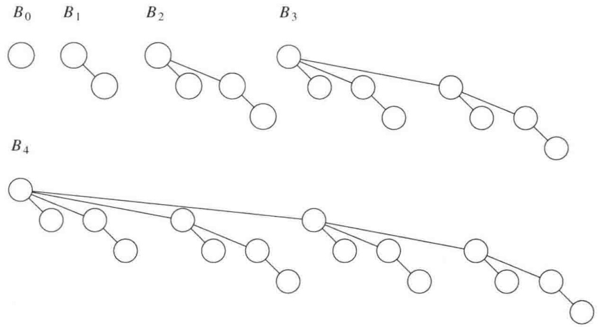

<details>
<summary>flowchart</summary>

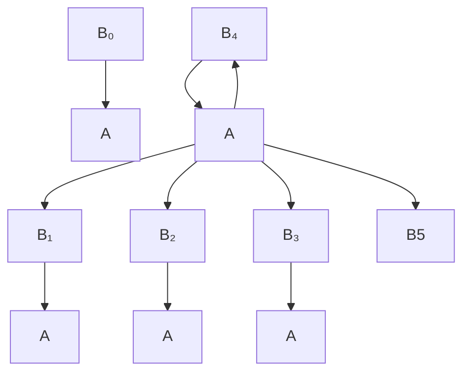
</details>

图 11.1 二项树  $B_{0}, B_{1}, B_{2}, B_{3}$  和  $B_{4}$

一棵二项树的节点的秩(rank)等于它的子节点的个数。特别地， $B_{k}$ 的根节点的秩为 $k$ 。二

项队列是堆序的二项树的集合，在这个集合中对于任意的 k 最多可以存在一棵二项树  $B_{k}$ 。图 11.2 显示了两个二项队列  $H_{1}$  和  $H_{2}$ 。

最重要的操作是 merge(合并)。为了合并两个二项队列，需要执行类似于二进制整数加法的操作:在任一阶段，我们可以有0、1、2或可能3棵 $B_{k}$ 树，它依赖于两个优先队列是否包含一棵 $B_{k}$ 树以及是否有一棵 $B_{k}$ 树从前一步转入。如果存在0棵或1棵 $B_{k}$ 树，那么它就作为一棵树被放到合并后的二项队列中；如果有两棵 $B_{k}$ 树，

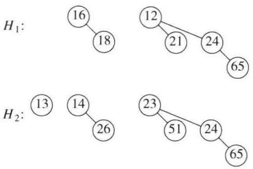

<details>
<summary>text_image</summary>

H₁:
16
18
12
21
24
65
H₂:
13
14
26
23
51
24
65
</details>

图11.2 两个二项队列 $H_{1}$ 和 $H_{2}$

那么它们被合并成一棵  $B_{k+1}$  树并且被并入到结果中；如果有 3 棵  $B_{k}$  树，那么将一棵作为树放入到二项队列中，而其余两棵则合并成一棵  $B_{k+1}$  树且被并入到结果中。 $H_{1}$  和  $H_{2}$  合并的结果如图 11.3 所示。

插入操作通过创建一个单节点二项队列并执行一次 merge 来完成。做这项工作所用的时间为  $M + 1$ ，其中 M 代表不在该二项队列中的二项树  $B_{M}$  的最小型号。因此，向一个有一棵

---

420

数据结构与算法分析——C++语言描述(第四版)

$B_{0}$  树但没有  $B_{1}$  树的二项队列进行的插入操作需要两步。删除最小元的操作通过把最小元除去而将原二项队列分裂成两个二项队列，然后再将它们合并来完成。第 6 章给出了对这些操作的比较详细的解释。

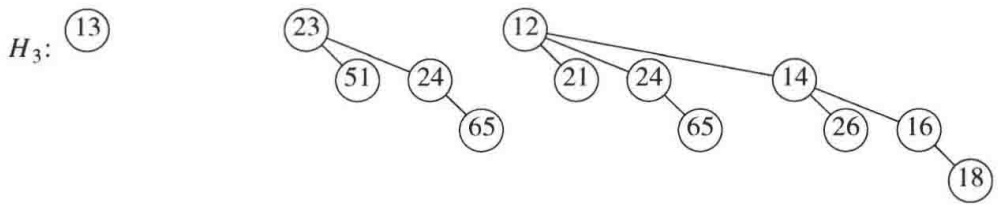

<details>
<summary>flowchart</summary>

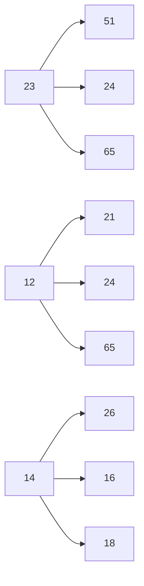
</details>

图11.3 二项队列 $H_{3}$ :合并 $H_{1}$ 和 $H_{2}$ 的结果

首先考虑一个非常简单的问题。假设我们想要建立一个含有 $N$ 个元素的二项队列。我们知道，建立一个含有 $N$ 个元素的二叉堆可以以 $O(N)$ 时间完成，因此我们期望对于二项队列也有一个类似的界。

声明:

$N$ 个元素的二项队列可以通过 $N$ 次相继插入而以时间 $O(N)$ 建成。

这个声明如果成立，那么它就给出一个极其简单的算法。由于每次插入的最坏情形时间是 $O(\log N)$，因此，这个声明是否成立并不是显然的。前面讨论过，如果将该算法应用到二叉堆，则运行时间将是 $O(N\log N)$。

要想证明这个声明，我们可以直接进行计算。为了测量出运行时间，我们将每次插入的开销定义为一个时间单位加上每一步链接的一个附加单位。将所有插入的开销求和就得到总的运行时间。这个总的时间为 $N$ 个单位加上总的链接步数。第一、第三、第五以及所有编号为奇数的步不需要链接的步骤，因为在插入时 $B_{0}$ 不出现。因此，有一半的插入不需要链接，1/4的插入只需要一次链接(第二次、第六次、第十次插入等)，1/8的插入需要两次链接，等等。我们可以把所有这些加起来并确定用 $N$ 作为链接步数的界，从而证明该声明。不过，当试图分析一系列不仅仅是插入操作的时候，这种蛮力计算将无助于其后的进一步分析，因此我们将使用另外一种方法来证明这个结果。

考虑一次插入的结果。如果在插入时不出现 $B_{0}$ 树，那么使用与上面相同的计数方法可知，这次插入的总开销是一个时间单位。现在，插入的结果有了一棵 $B_{0}$ 树，这样，我们已经把一棵树添加到二项树的森林中。如果存在一棵 $B_{0}$ 树但是没有 $B_{1}$ 树，那么插入花费两个单位的时间。新的森林将有一棵 $B_{1}$ 树但不再有 $B_{0}$ 树，因此在森林中树的数目并没有变化。花费三个单位时间的一次插入将创建一棵 $B_{2}$ 树但消除一棵 $B_{0}$ 树和一棵 $B_{1}$ 树，这导致在森林中净减少一棵树。事实上，容易看到，一般说来花费 $c$ 个单位时间的一次插入导致在森林中净增加 $2 - c$ 棵树，这是因为创建了一棵 $B_{c - 1}$ 树而消除了所有的 $B_{i}$ 树，$0 \leqslant i < c - 1$ 。因此，代价高昂的插入操作删除一些树，而低廉的插入却创建一些树。

令 $C_i$ 是第 $i$ 次插入的开销。令 $T_i$ 为第 $i$ 次插入后树的棵数。$T_0 = 0$ 为树的初始棵数。此时我们得到不变式

$$
C _ {i} + (T _ {i} - T _ {i - 1}) = 2 \tag {11.1}
$$

于是

$$
C _ {1} + (T _ {1} - T _ {0}) = 2
$$

---

第11章 摊还分析

421

$$
\begin{array}{c} C _ {2} + (T _ {2} - T _ {1}) = 2 \\ \vdots \end{array}
$$

$$
C _ {N - 1} + (T _ {N - 1} - T _ {N - 2}) = 2
$$

$$
C _ {N} + (T _ {N} - T _ {N - 1}) = 2
$$

把这些方程相加，则大部分的  $T_{i}$  项被消去，最后剩下

$$
\sum_ {i = 1} ^ {N} C _ {i} + T _ {N} - T _ {0} = 2 N
$$

或等价地，

$$
\sum_ {i = 1} ^ {N} C _ {i} = 2 N - (T _ {N} - T _ {0})
$$

考虑到  $T_{0}=0$  以及 N 次插入后的树的棵数  $T_{N}$  确实非负，因此  $(T_{N}-T_{0})$  非负。于是

$$
\sum_ {i = 1} ^ {N} C _ {i} \leqslant 2 N
$$

这就证明了我们的声明。在 buildBinomialQueue 例程运行期间，每一次插入有一个最坏情形运行时间 $O(\log N)$，但是，由于整个例程最多用到 $2N$ 个单位的时间，因此这些插入的行为就像是每次使用不多于两个单位的时间。

这个例子阐明了我们将要使用的一般技巧。数据结构在任一时刻的状态由一个称为位势(potential)的函数给出。这个位势函数不是程序定义和使用的那种函数，而是一个计数装置，该装置将帮助我们进行分析。当一些操作花费少于我们允许它们使用的时间时，则没有用到的时间就以一个更高位势的形式“存储”起来。在我们的例子中，数据结构的位势就是树的棵数。在上面的分析中，当有一些插入只用到一个单位而不是规定的两个单位时，则这个额外的单位通过增加位势而被存储起来以备其后使用。当操作出现超出规定的时间时，则超出的时间通过位势的减少来支付。可以把位势看作是一个储蓄账户。如果一次操作使用了少于规定的时间，那么这个差额就被存储起来以备后面更高昂的操作使用。图11.4显示出由buildBinomialQueue对一系列插入操作所使用的累积的运行时间。可以看到，运行时间从不超过 $2N$ ，而且在任一次插入后二项队列中的位势记录着存储的量。

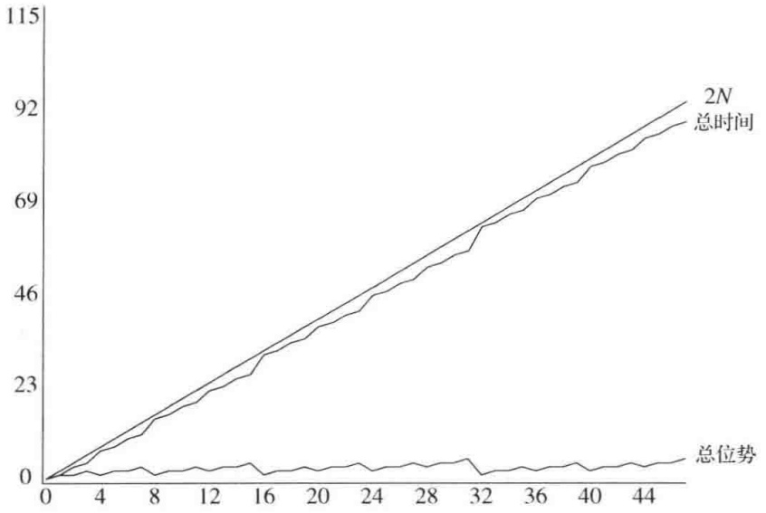

<details>
<summary>line</summary>

| X | 2N | 总时间 | 总位势 |
| --- | --- | --- | --- |
| 0 | 0 | 0 | 0 |
| 4 | ~10 | ~7 | ~1 |
| 8 | ~20 | ~16 | ~1 |
| 12 | ~30 | ~24 | ~2 |
| 16 | ~40 | ~33 | ~1 |
| 20 | ~50 | ~41 | ~2 |
| 24 | ~60 | ~49 | ~2 |
| 28 | ~70 | ~57 | ~3 |
| 32 | ~80 | ~65 | ~1 |
| 36 | ~90 | ~73 | ~2 |
| 40 | ~100 | ~81 | ~2 |
| 44 | ~110 | ~89 | ~3 |
</details>

图11.4 连续 $N$ 次 insert

---

422

数据结构与算法分析——C++语言描述(第四版)

一旦位势函数被选定，就可以写出主要的方程:

$$
T _ {\text {actual}} + \Delta \text {Potential} = T _ {\text {amortized}} \tag {11.2}
$$

$T_{actual}$ ，一次操作的实际时间，代表需要执行一次特定操作需要的精确时间量。例如在二叉查找树中，执行一次 find(x) 的实际时间是 1 加上包含 x 的节点的深度。如果对整个序列把基本方程加起来，并且最后的位势至少像初始位势一样大，那么摊还时间就是在操作序列执行期间所用到的实际时间的一个上界。注意，当  $T_{actual}$  在从一个操作到另一操作变化时， $T_{amortized}$  却是稳定的。

选择位势函数以确保一个有意义的界是一项艰难的工作，不存在一种实用的方法。一般说来，在尝试过许多位势函数以后才能够找到一个合适的函数。不过，上面的讨论提出了一些法则，这些法则告诉我们好的位势函数所具有的一些性质。位势函数应该:

- 总假设它的最小值位于操作序列的开始处。选择位势函数的一种常用方法是保证位势函数初始值为0，而且总是非负的。我们将要遇到的所有例子都使用这种方法。
- 消去实际时间中的一项。在我们的例子中，如果实际的开销是 $c$，那么位势改变为 $2 - c$。把这些加起来就得到摊还开销是 2，如图 11.5 所示。

现在，可以对二项队列操作进行完整的分析了。

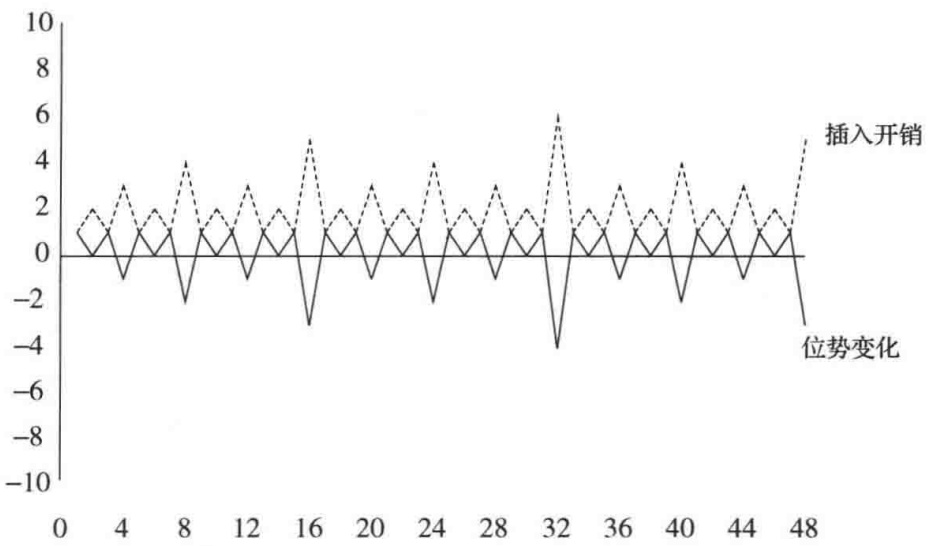

<details>
<summary>line</summary>

| X | 插入开销 | 位势变化 |
| --- | --- | --- |
| 0 | ~1 | ~1 |
| 2 | ~2 | ~0 |
| 4 | ~3 | ~1 |
| 6 | ~2 | ~-1 |
| 8 | ~4 | ~1 |
| 10 | ~2 | ~-2 |
| 12 | ~3 | ~1 |
| 14 | ~2 | ~-1 |
| 16 | ~5 | ~-3 |
| 18 | ~2 | ~1 |
| 20 | ~3 | ~-1 |
| 22 | ~2 | ~1 |
| 24 | ~4 | ~-2 |
| 26 | ~2 | ~1 |
| 28 | ~3 | ~-1 |
| 30 | ~2 | ~1 |
| 32 | ~6 | ~-4 |
| 34 | ~2 | ~1 |
| 36 | ~3 | ~-1 |
| 38 | ~2 | ~1 |
| 40 | ~4 | ~-2 |
| 42 | ~2 | ~1 |
| 44 | ~3 | ~-1 |
| 46 | ~2 | ~1 |
| 48 | ~5 | ~-3 |
</details>

图 11.5 在一系列操作中每次操作的插入开销和位势变化

## 定理 11.1

insert、deletMin 及 merge 对于二项队列的摊还运行时间分别是 $O(1)$、$O(\log N)$ 和 $O(\log N)$。

## 证明:

位势函数是树的棵数。初始的位势函数为 0，且位势总是非负的，因此摊还时间是实际时间的一个上界。对 insert 的分析从上面的论证可以得到。对于 merge，假设两棵树分别有 $N_{1}$ 和 $N_{2}$ 个节点以及对应的 $T_{1}$ 和 $T_{2}$ 棵树。令 $N = N_{1} + N_{2}$ 。执行合并的实际时间为 $O(\log (N_{1}) + \log (N_{2})) = O(\log N)$ 。在合并之后，最多可能存在 $\log N$ 棵树，因此位势最多可以增加 $O(\log N)$ 。这就给出一个摊还的界 $O(\log N)$ 。deleteMin 操作的界可用类似的方法得到。

---

第11章 摊还分析

423

## 11.3 斜堆

二项队列的分析可以算是摊还分析一个相当容易的实例。现在我们来考察斜堆。像许多例子一样，一旦找到正确的位势函数，分析起来就容易了。困难的部分在于选择一个有意义的位势函数。

对于斜堆，我们知道关键的操作是合并。为了合并两个斜堆，我们把它们的右路径合并，并使之成为新的左路径。对于新路径上的每一个节点，除去最后一个外，其老的左子树作为右子树而附接到该节点上。在新的左路径上的最后节点已知没有右子树，因此给它一棵右子树就不理智了。我们所要考虑的界不依赖于这个例外，而如果例程是递归地编写的，那么这就是自然要发生的情况。图 11.6 显示出合并两个斜堆后的结果。

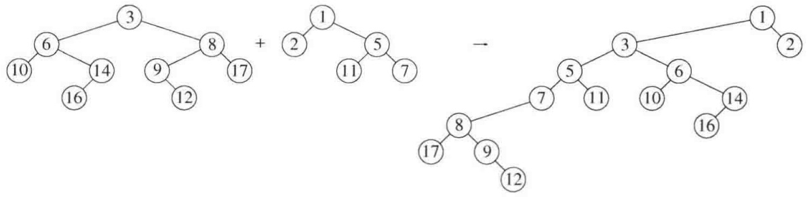

<details>
<summary>flowchart</summary>

```mermaid
graph LR
  A["Node 1"] --> B["Node 2"]
  A --> C["Node 3"]
  A --> D["Node 4"]
  A --> E["Node 5"]
  A --> F["Node 6"]
  A --> G["Node 7"]
  A --> H["Node 8"]
  A --> I["Node 9"]
  A --> J["Node 10"]
  A --> K["Node 11"]
  A --> L["Node 12"]
  A --> M["Node 13"]
  A --> N["Node 14"]
  A --> O["Node 15"]
  A --> P["Node 16"]
  A --> Q["Node 17"]
  B --> R["Node 1"]
  B --> S["Node 2"]
  B --> T["Node 3"]
  B --> U["Node 4"]
  B --> V["Node 5"]
  B --> W["Node 6"]
  B --> X["Node 7"]
  B --> Y["Node 8"]
  B --> Z["Node 9"]
  B --> AA["Node 10"]
  B --> AB["Node 11"]
  B --> AC["Node 12"]
  B --> AD["Node 13"]
  B --> AE["Node 14"]
  B --> AF["Node 15"]
  B --> AG["Node 16"]
  B --> AH["Node 17"]
  B --> AI["Node 18"]
  B --> AJ["Node 19"]
  B --> AK["Node 20"]
  B --> AL["Node 21"]
  B --> AM["Node 22"]
  B --> AN["Node 23"]
  B --> AO["Node 24"]
  B --> AP["Node 25"]
  B --> AQ["Node 26"]
  B --> AR["Node 27"]
  B --> AS["Node 28"]
  B --> AT["Node 29"]
  B --> AU["Node 30"]
  B --> AV["Node 31"]
  B --> AW["Node 32"]
  B --> AX["Node 33"]
  B --> AZ["Node 34"]
  B --> BA["Node 35"]
  B --> BB["Node 36"]
  B --> BC["Node 37"]
  B --> BD["Node 38"]
  B --> BE["Node 39"]
  B --> BF["Node 40"]
  B --> BG["Node 41"]
  B --> BH["Node 42"]
  B --> BI["Node 43"]
  B --> BJ["Node 44"]
  B --> BK["Node 45"]
  B --> BL["Node 46"]
  B --> BM["Node 47"]
  B --> BN["Node 48"]
  B --> BO["Node 49"]
  B --> BP["Node 50"]
```
</details>

图11.6 合并两个斜堆

设我们有两个堆 $H_{1}$ 和 $H_{2}$，并在各自的右路径上分别有 $r_1$ 和 $r_2$ 个节点。此时，执行合并的实际时间与 $r_1 + r_2$ 成正比，因此我们将省去大O记法而对右路径上的每一个节点取一个单位的时间。由于这些堆没有固定的结构，因此两个堆的所有节点都位于右路径上的情况是可能发生的，而这将给出合并两个堆的最坏情形的界 $\Theta(N)$（练习11.3要求构造一个例子）。下面将证明合并两个斜堆的摊还时间为 $O(\log N)$。

现在需要的是能够获取斜堆操作效果的某种类型的位势函数。我们知道，一次 merge 的效果是处在右路径上的每一个节点都被移到左路径上，而其原左儿子变成新右儿子。一种想法是把每一个节点算入为右节点或左节点来分类，这要看节点是右儿子还是不是右儿子来确定，这时我们把右节点的个数作为位势函数。虽然位势初始时为 0 并且总是非负的，但是问题在于这种位势在一次合并后并不减少从而不能恰当地反映在数据结构中的积蓄。因此，这样的位势函数不能够用来证明所要求的界。

一个类似的想法是把节点分成重节点或轻节点，这要看任一节点的右子树上的节点是否比左子树上的节点多来确定。

定义: 一个节点 $p$ 如果其右子树的后裔数至少是该 $p$ 节点的后裔总数的一半, 则称节点 $p$ 是重的 (heavy), 否则称之为轻的 (light)。注意, 一个节点的后裔个数包括该节点本身。

例如，图 11.7 表示一个斜堆。值为 15, 3, 6, 12 和 7 的节点是重节点 (heavy node)，而所有其他的节点都是轻节点 (light node)。

我们将要使用的位势函数是这些堆(的集合)中的重节点的个数。看起来这可能是一种好的选择，因为一条长的右路径将包含非常多的重节点。由于这条路径上的节点将要交换它们的子节点，因此这些节点将被转变成合并结果中的轻节点。

---

424

数据结构与算法分析——C++语言描述(第四版)

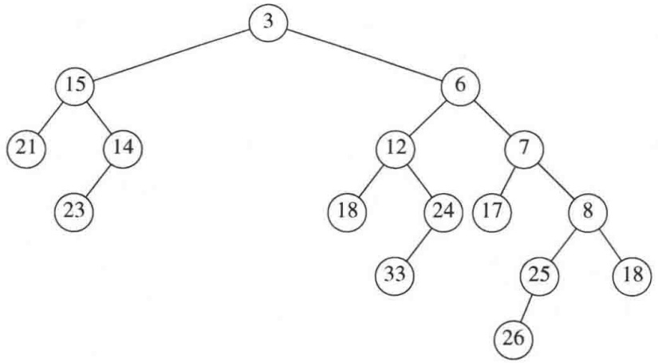

<details>
<summary>flowchart</summary>

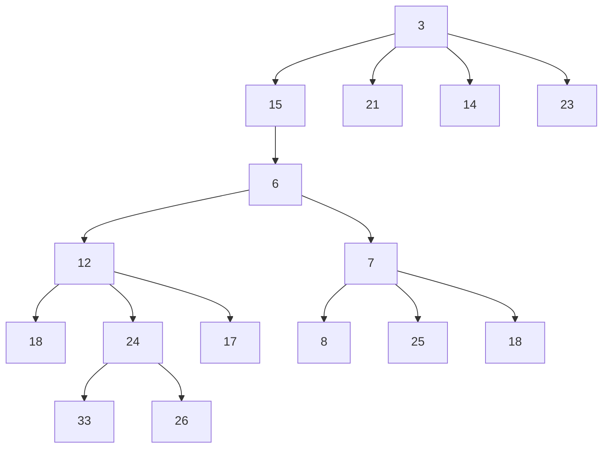
</details>

图 11.7 斜堆——其中的重节点是 3, 6, 7, 12 和 15

## 定理11.2

合并两个斜堆的摊还时间为  $O(\log N)$ 。

证明:

令 $H_{1}$ 和 $H_{2}$ 为两个堆，分别具有 $N_{1}$ 和 $N_{2}$ 个节点。设 $H_{1}$ 的右路径有 $l_{1}$ 个轻节点和 $h_1$ 个重节点，共有 $l_{1} + h_{1}$ 个节点。同样，$H_{2}$ 在其右路径上有 $l_{2}$ 个轻节点和 $h_2$ 个重节点，共有 $l_{2} + h_{2}$ 个节点。

如果我们采用约定:合并两个斜堆的开销是它们右路径上节点的总数，那么执行合并的实际时间就是 $l_{1} + h_{1} + l_{2} + h_{2}$ 。现在，其重/轻状态能够改变的节点只是那些最初位于右路径上的节点(并最后出现在左路径上)，因为再没有别的节点的子树被交换。这由图11.8中的例子表示出。

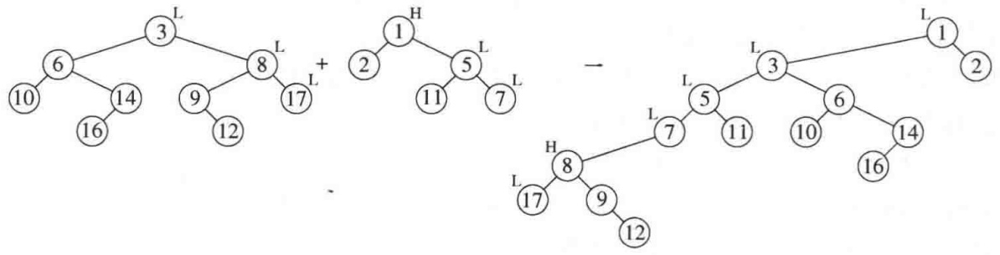

<details>
<summary>flowchart</summary>

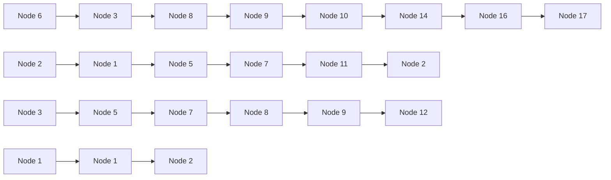
</details>

图 11.8 合并后重/轻状态的变化

如果一个重节点最初是在右路径上，那么在合并后它必然成为一个轻节点。位于右路径上的其余那些节点是轻节点，它们可能变成也可能不变成重节点，但是由于我们要证明一个上界，因此必须假设最坏的情况，即它们都变成了重节点并使得位势增加。此时，重节点个数的净变化最多为 $l_{1} + l_{2} - h_{1} - h_{2}$ 。把实际时间和位势的变化(方程(11.2))加起来则得到一个摊还界 $2(l_{1} + l_{2})$ 。

现在必须证明 $l_{1} + l_{2} = O(\log N)$ 。由于 $l_{1}$ 和 $l_{2}$ 是原右路径上轻节点的个数，而一个轻节点的右子树小于以该轻节点为根的树的大小的一半，由此直接推出右路径上轻节点的个数最多为 $\log N_{1} + \log N_{2}$，这就是 $O(\log N)$。

注意到初始的位势为 0 而且位势总是非负的，我们的证明也就完成了。验证这一点很重要，因为否则摊还时间就不能成为实际时间的界，那也就没有意义了。

由于 insert 和 deleteMin 操作基本上就是一些 merge, 因此它们的摊还界也是  $O(\log N)$ 。

---

第11章 摊还分析

425

## 11.4 斐波那契堆

在9.3.2节，我们指出如何使用优先队列来改进Dijkstra最短路径算法粗略的运行时间$O(|V|^2)$。重要的观察结果是，运行时间被 $|E|$ 次decreaseKey操作和 $|V|$ 次insert和deleteMin操作所控制。这些操作发生在大小最多为 $|V|$ 的集合上。通过使用二叉堆，所有这些操作均花费 $O(\log |V|)$ 时间，因此Dijkstra算法最后的界可以减到 $O(|E|\log |V|)$ 。

为了降低这个时间界，必须改进执行 decreaseKey 操作所需要的时间。我们在 6.5 节所描述的 $d$ 堆 $(d$-heap) 给出对于 decreaseKey 操作以及 insert 操作的 $O(\log_d |V)$ 时间界，但对 deleteMin 的界则是 $O(d \log_d |V)$。通过选择 $d$ 来平衡带有 $|V|$ 次 deleteMin 操作的 $|E|$ 次 decreaseKey 操作的开销，并考虑到 $d$ 必须总是至少为 2，于是我们看到，$d$ 的一个好的选择是

$$
d = \max (2, \lfloor | E | / | V | \rfloor)
$$

它把Dijkstra算法的时间界改进到

$$
O (| E | \log_ {(2 + \lfloor | E | / | V | \rfloor)} | V |)
$$

斐波那契堆(Fibonacci heap)是以 $O(1)$ 摊还时间支持所有基本的堆操作的一种数据结构，但 deleteMin 和 remove 除外，它们花费 $O(\log N)$ 的摊还时间。我们立即得出，在 Dijkstra 算法中的那些堆操作将总共需要 $O(|E| + |V|\log |V|)$ 的时间。

斐波那契堆(Fibonacci heap) $^{①}$ 通过添加两个新观念推广了二项队列:

decreaseKey 的一种不同的实现方法:我们以前看到的那种方法是把元素朝向根节点上滤。对于这种方法似乎没有理由期望  $O(1)$  的摊还时间界，因此需要一种新的方法。

懒惰合并(lazy merging): 只有当两个堆需要合并时才进行合并。这类似于懒惰删除。对于懒惰合并, merge 的开销很少, 但是因为懒惰合并并不实际把树结合在一起, 所以 deleteMin 操作可能会遇到许多的树, 从而使这种操作的代价高昂。任何一次 deleteMin 都可能花费线性时间, 但是它总能够把时间消耗归咎到前面的一些 merge 操作中去。特别地, 一次昂贵的 deleteMin 必须在其前面要有大量的非常低廉的 merge 操作, 它们能够存储额外的位势。

## 11.4.1 切除左式堆中的节点

在二叉堆中，decreaseKey 操作是通过降低一个节点的值然后将其朝着根上滤直到建成堆序来实现的。在最坏的情形下，这可能花费 $O(\log N)$ 时间，它是平衡树中通向根的最长路径的长。

如果代表优先队列的树不具有 $O(\log N)$ 的深度，那么这种方法不适用。例如，若将这种方法用于左式堆，则 decreaseKey 操作可能花费 $\Theta(N)$ 时间，如图 11.9 中的例子所示。

我们看到，对于左式堆来说 decreaseKey 操作需要另外的方法。我们的例子为图 11.10 中的左式堆。现在假设想要将值为 9 的关键字减低到 0。若对该堆做出改动，则必将引起堆序的破坏，这种破坏在图 11.11 中用虚线标示。

<small><span class="docvortex-page-footnote" data-block-type="page_footnote" style="color:#6b7280">① 这个名字来自于这种数据结构的一个性质，后面要在本节证明它。</span></small>

---

426

数据结构与算法分析——C++语言描述(第四版)

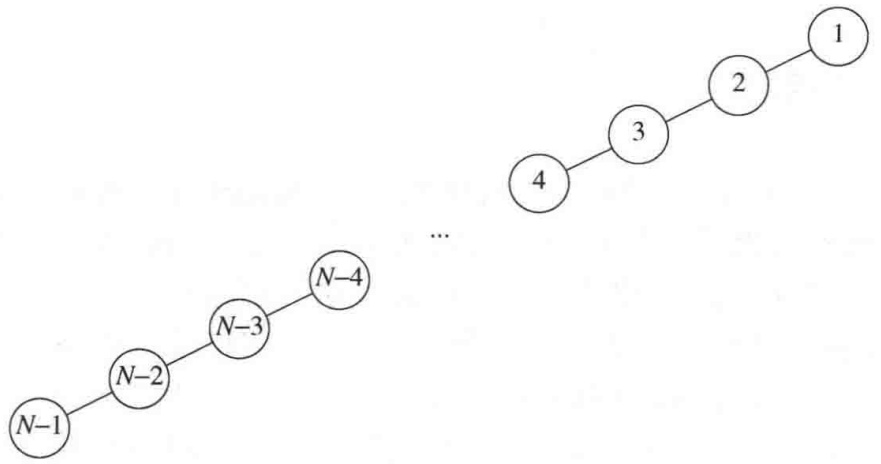

<details>
<summary>flowchart</summary>

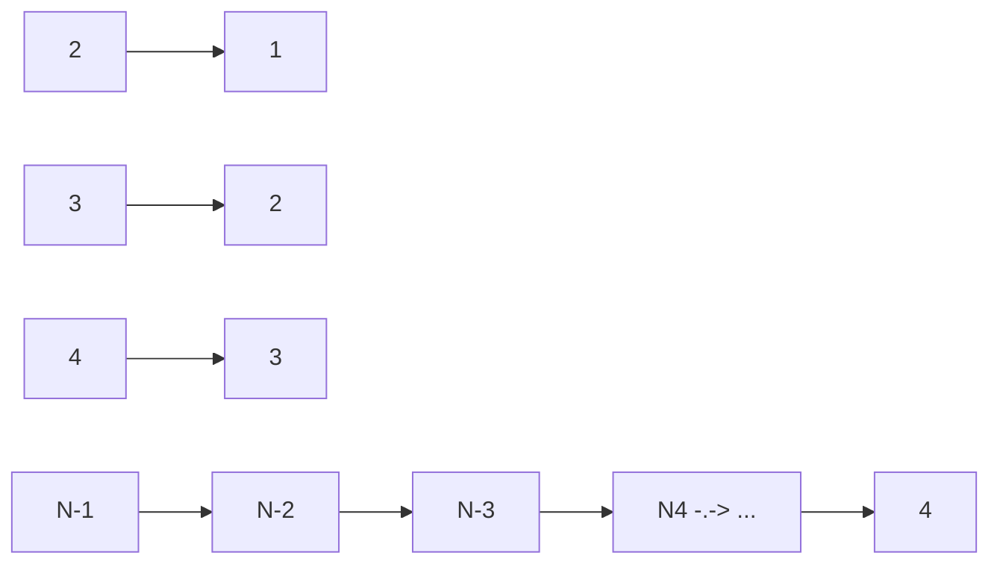
</details>

图 11.9 通过上滤将 N-1 递减到 0 花费  $\Theta(N)$  时间

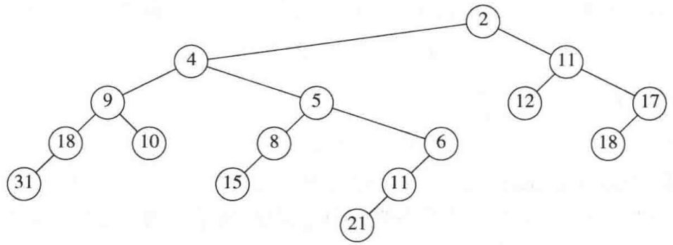

<details>
<summary>flowchart</summary>

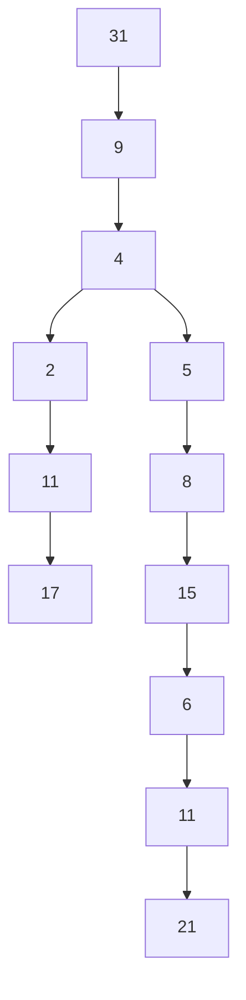
</details>

图 11.10 样例左式堆 H

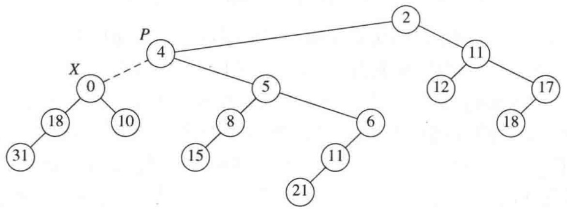

<details>
<summary>flowchart</summary>

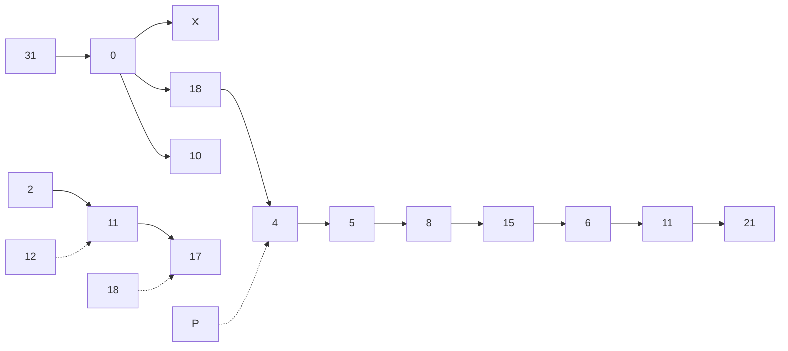
</details>

图 11.11 将 9 降到 0 引起堆序的破坏

我们不想把 0 上滤到根，因为正如我们已经看到的，存在一些情形使得这样做代价太大。解决的办法是把堆沿着虚线切开，如此得到两棵树，然后再把这两棵树合并成一棵。令 X 为要执行 decreaseKey 操作的节点，令 P 为它的父节点。在切断以后我们得到两棵树，即根为 X 的  $H_{1}$ ，以及  $T_{2}$ ，它是原来的树除去  $H_{1}$  后得到的树。具体情况如图 11.12 所示。

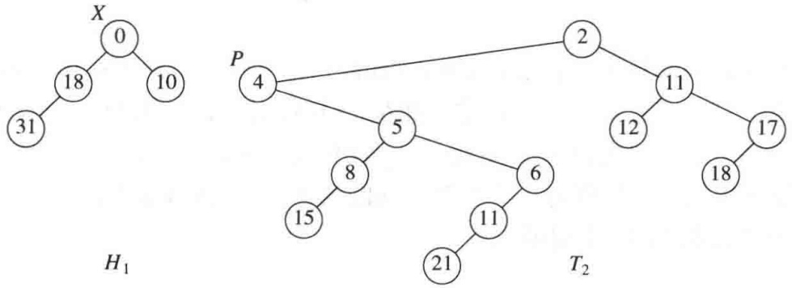

图 11.12 切断之后得到的两棵树

---

第11章 摊还分析

427

如果这两棵树都是左式堆，那么它们可以以时间 $O(\log N)$ 合并，整个操作也就完成了。容易看出，$H_{1}$ 是左式堆，因为没有节点的后裔发生变化。由于它的所有节点原本就满足左式堆的性质，因此现在仍必然满足。

可是，这种方案似乎还是行不通，因为 $T_{2}$ 未必是左式堆。不过，容易恢复左式堆的性质，这要用到下列两个观察到的结果:

\- 只有从 $P$ 到 $T_{2}$ 的根的路径上的节点可能破坏左式堆的性质，它们可以通过交换子节点来调整。

\- 由于最大右路径长最多有$\lfloor \log (N+1) \rfloor$个节点，因此我们只需检查从 $P$ 到 $T_2$ 的根的路径上的前$\lfloor \log (N+1) \rfloor$个节点。图 11.13 显示 $H_1$ 和将 $T_2$ 转变成左式堆后的 $H_2$。

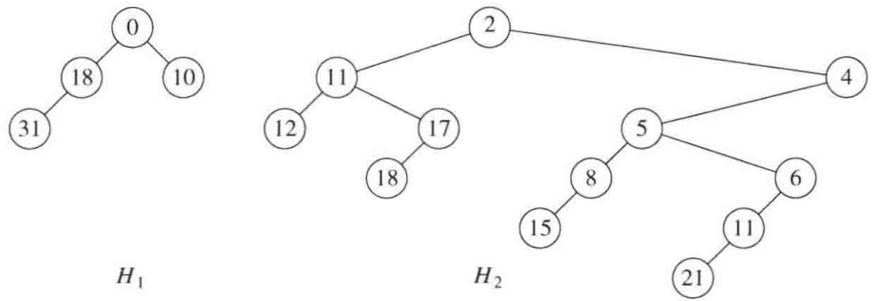

<details>
<summary>flowchart</summary>

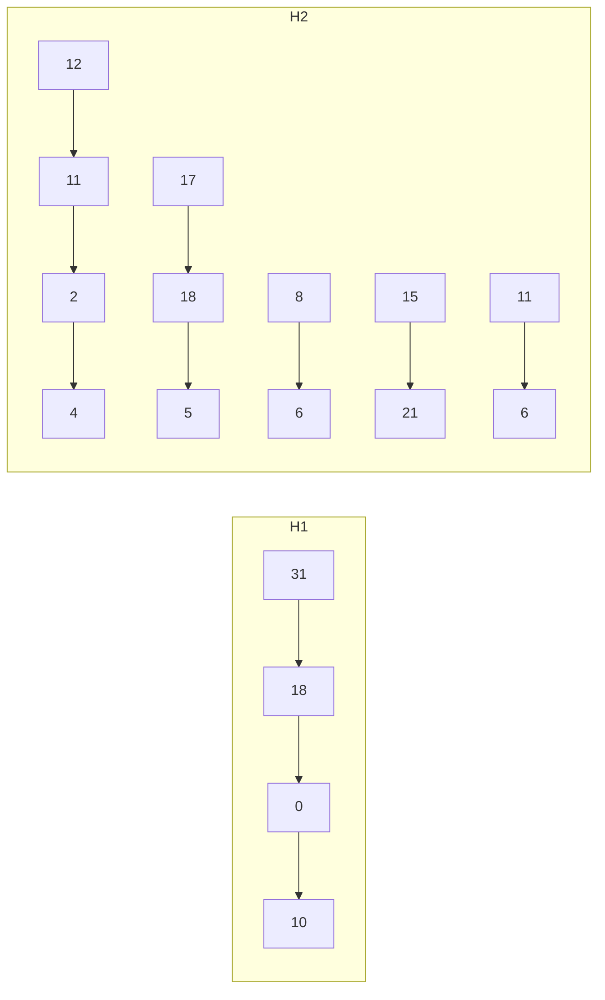
</details>

图 11.13 将  $T_{2}$  转变成左式堆  $H_{2}$  后的情形

因为我们能够以 $O(\log N)$ 步将 $T_{2}$ 转变成左式堆 $H_{2}$，然后合并 $H_{1}$ 和 $H_{2}$，所以我们得到一个在左式堆中执行 decreaseKey 的 $O(\log N)$ 算法。图 11.14 显示的堆是该例的最后结果。

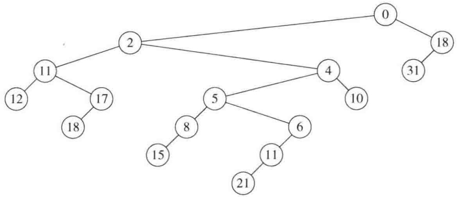

<details>
<summary>flowchart</summary>

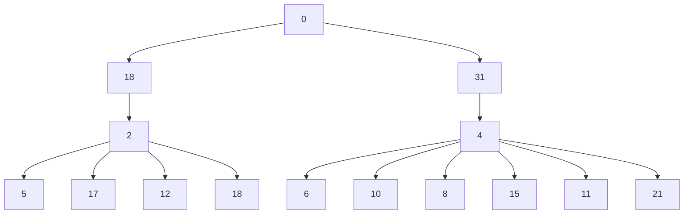
</details>

图11.14 通过合并 $H_{1}$ 和 $H_{2}$ 而完成操作decreaseKey $(X,9)$

## 11.4.2 二项队列的懒惰合并

斐波那契堆所使用的第二个想法是懒惰合并(lazy merging)。我们将把这个想法用于二项队列，并证明执行一次 merge操作(还有插入操作，它是一种特殊情形)的摊还时间为 $O(1)$ 。对于deleteMin，其摊还时间仍然是 $O(\log N)$ 。

这个想法如下:为了合并两个二项队列，只要把二项树的两个表连在一起，结果得到一个新的二项队列。这个新的队列可能含有相同大小的多棵树，因此破坏了二项队列的性质。为了保持一致性，我们将把它叫作懒惰二项队列(lazy binomial queue)。这是一种快速操作，该操作总是花费常数(最坏情形)时间。和前面一样，一次插入通过创建一个单节点二项队列并将其合并而完成，区别在于此处的 merge 是懒惰的。

---

428

数据结构与算法分析——C++语言描述(第四版)

deleteMin 操作要麻烦得多, 因为此处需要我们最终把懒惰二项队列转变回到标准的二项队列, 不过, 正如我们将要证明的, 它仍然花费 $O(\log N)$ 的摊还时间——但不像以前是 $O(\log N)$ 最坏情形时间。为了执行 deleteMin, 我们找出 (并最终返回) 最小元素。如前所述, 将它从队列中删除, 使得它的每一个儿子都成为一棵新的树。然后通过合并两棵相等大小的树直至不再可能合并为止而把所有的树合并成一个二项队列。

例如，图 11.15 表示一个懒惰二项队列。在一个懒惰二项队列中，可能有多于一棵的树有相同的大小。为了执行 deleteMin，我们照以前那样把最小的元素删除，并得到图 11.16 所示的树。

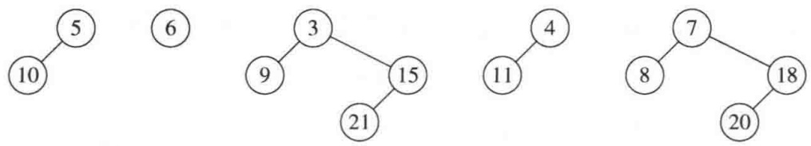

<details>
<summary>flowchart</summary>

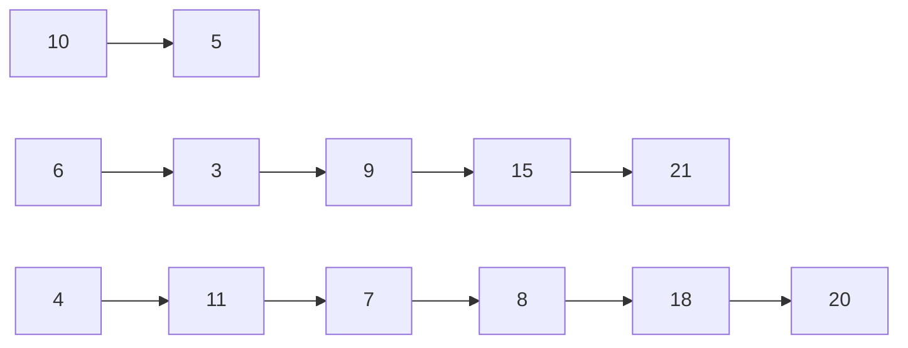
</details>

图11.15 懒惰二项队列

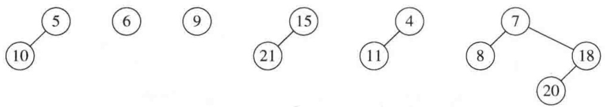

<details>
<summary>flowchart</summary>

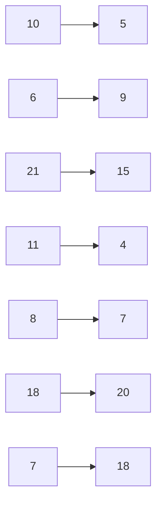
</details>

图11.16 在删除最小元素(3)后的懒惰二项队列

现在我们必须将所有的树合并而得到一个标准的二项队列。一个标准的二项队列每个秩(rank)上最多有一棵树。为了有效地进行这项工作,我们必须能够以正比于出现的树的棵数(T)的时间(或  $\log N$ ，哪个大用哪个)完成 merge。为此，构造表的一个数组: $L_{0}, L_{1}, \cdots, L_{R_{\max} + 1}$ ，其中  $R_{max}$  是最大的树的秩。每个表  $L_{R}$  包含秩为 R 的所有的树。然后应用图 11.17 中的过程。

```txt
for( R = 0; R <= ⌊log N⌋; ++R )
    while( |LR| >= 2 )
    {
        Remove two trees from LR;
        Merge the two trees into a new tree;
        Add the new tree to LR+1;
    }
```

图11.17 恢复二项队列的过程

每通过一次过程中从第4行到第6行的循环，树的总棵数都要减1。这意味着，每次执行都花费常数时间的这部分代码只能够执行 $T - 1$ 次，其中 $T$ 是树的棵数。这里的for循环计数和while循环末尾的检测共花费 $O(\log N)$ 时间，这使得运行时间成为所要求的 $O(T + \log N)$ 。图11.18显示该算法对前面二项树集合的执行情况。

## 懒惰二项队列的摊还分析

为了进行懒惰二项队列的摊还分析，我们将用到与标准二项队列所使用的相同的位势函数。因此，懒惰二项队列的位势就是树的棵数。

---

第11章 摊还分析

429

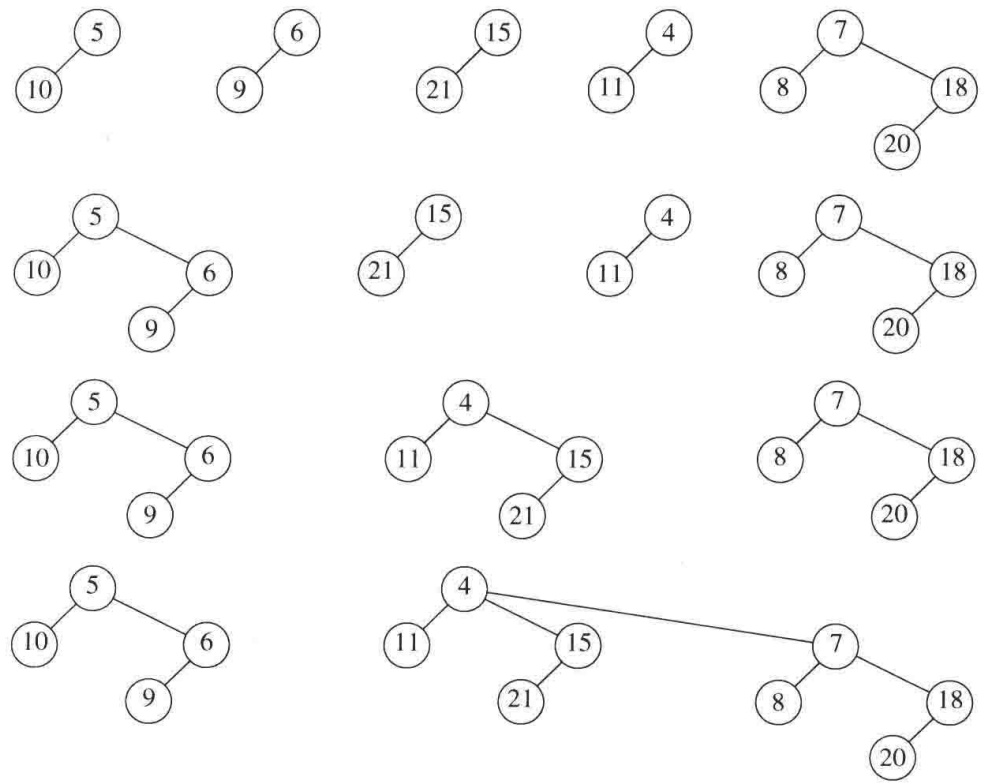

<details>
<summary>flowchart</summary>

This image displays a network graph structure diagram, showing relationships between numbered nodes and their associated values.
</details>

图11.18 把一些二项树合并成一个二项队列

## 定理 11.3

对于懒惰二项队列，merge 和 insert 的摊还运行时间均为  $O(1)$ ，deleteMin 的摊还运行时间为  $O(\log N)$ 。

## 证明:

这里的位势函数为二项队列的集合中树的棵数。初始的位势为 0，而且位势总是非负的。因此，经过一系列的操作之后，总的摊还时间是总的运行时间的一个上界。

对于 merge 操作，实际时间为常数，而二项队列的集合中树的棵数是不变的，因此，由方程(11.2)可知摊还时间为  $O(1)$ 。

对于 insert 操作，其实际时间是常数，而树的棵数最多增加 1，因此摊还时间为  $O(1)$ 。

deleteMin 操作比较复杂。令 $R$ 为包含最小元素的树的秩，而令 $T$ 是树的棵数。于是，在 deleteMin 操作开始时的位势为 $T$ 。为执行一次 deleteMin，最小节点的各子节点被分离开而成为一棵一棵的树。这就产生了 $T + R$ 棵树，这些树必须要合并成一个标准的二项队列。如果忽略大 O 记法中的常数，那么根据上面的论述可知，执行该操作的实际时间为 $T + R + \log N$ 。①另一方面，一旦做完这些，剩下的最多可能还有 $\log N$ 棵树，因此位势函数最多可能增加 $(\log N) - T$ 。把实际时间和位势的变化加起来得到摊还时间界为 $2\log N + R$ 。由于所有的树都是二项树，因此 $R \leqslant \log N$ 。这样，我们得到 deleteMin 操作的摊还时间界 $O(\log N)$ 。

## 11.4.3 斐波那契堆操作

正如我们前面提到的，斐波那契堆将左式堆 decreaseKey 操作与懒惰二项队列的 merge 操作结合起来。遗憾的是，我们不能一点修改也不做而使用这两种操作。问题在于，

<small><span class="docvortex-page-footnote" data-block-type="page_footnote" style="color:#6b7280">① 我们能够这么做是因为可以把大O记号所蕴涵的常数放在位势函数中并仍可消去这些项，这在该证明中是需要的。</span></small>

---

430

数据结构与算法分析——C++语言描述(第四版)

如果在这些二项树中进行随意切割，那么结果得到的森林将不再是二项树的集合。因此，每一棵树的秩最多为 $\lfloor\log N\rfloor$ 的结论将不再成立。由于在懒惰二项队列中 deleteMin 的摊还时间界已被证明是 $2\log N+R$，因此，为使 deleteMin 的界成立我们需要 $R=O(\log N)$。

为了保证 $R = O(\log N)$，我们对所有的非根节点应用下述法则:

- 将第一次(因为切除而)失去一个儿子的(非根)节点做上标记。
- 如果被标记的节点又失去另外一个子节点，那么将它从它的父节点切除。这个节点现在变成了一棵分离的树的根并且不再被标记。这叫作一次级联切除(cascading cut)，因为在一次 decreaseKey 操作中可能出现多次这种切除。

图 11.19 显示在 decreaseKey 操作之前斐波那契堆中的一棵树。当关键字为 39 的节点变成 12 的时候，堆序被破坏。因此，该节点从它的父节点中切除，变成了一棵新树的根。由于包含 33 的节点已被做了标记，而这是它的第二个失去的子节点，从而它也被从它的父节点 (10) 中切除。现在，10 也失去了它的第二个儿子，于是它又从 5 中切除。这个过程到这里结束，因为 5 是未做标记的。现在把节点 5 做上标记，结果如图 11.20 所示。

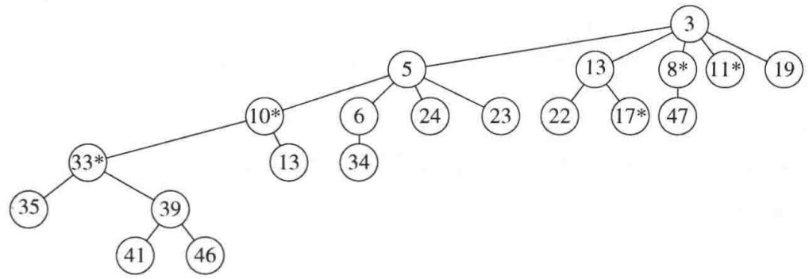

<details>
<summary>flowchart</summary>

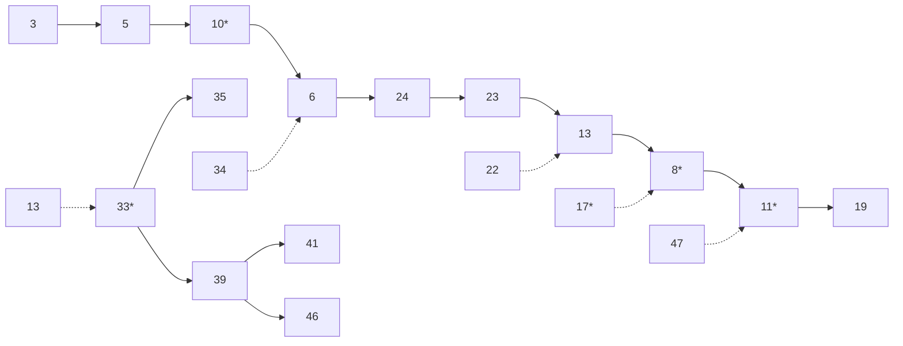
</details>

图 11.19 将 39 减到 12 之前斐波那契堆中的一棵树

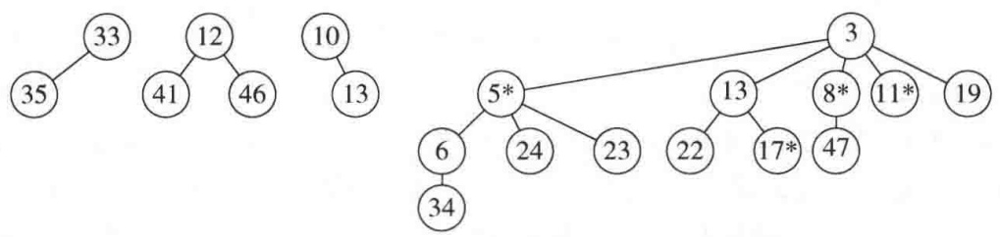

<details>
<summary>flowchart</summary>

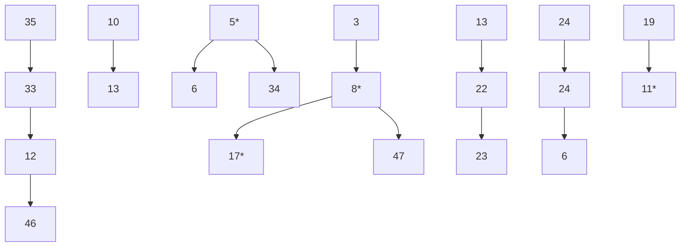
</details>

图 11.20 在 decreaseKey 操作之后斐波那契堆中得到的结果

注意，过去被做过标记的节点 10 和 33 不再被标记，因为现在它们都是根节点。这对于我们在时间界的证明中是极其重要的。

## 11.4.4 时间界的证明

我们知道，标记节点的原因是我们需要给任一节点的秩 $R$ （子节点的个数）确定一个界。现在我们证明具有 $N$ 个后裔的任意节点的秩为 $O(\log N)$ 。

## 引理11.1

令 $X$ 是斐波那契堆中的任一节点，令 $c_{i}$ 为 $X$ 的第 $i$ 个最年长的儿子，则 $c_{i}$ 的秩至少是 $i - 2$。

---

第11章 摊还分析

431

证明:

在 $c_{i}$ 被链接到 $X$ 上的时候, $X$ 已经有(年长的)儿子 $c_{1}, c_{2}, \cdots, c_{i-1}$ 。于是, 当链接到 $c_{i}$ 时 $X$ 至少有 $i-1$ 个儿子了。由于节点只有当它们有相同的秩的时候才链接, 由此可知, 在 $c_{i}$ 被链接到 $X$ 上的时候 $c_{i}$ 至少也有 $i-1$ 个儿子。从这个时候起, 它可能已经至多失去一个儿子, 否则它就已经被从 $X$ 切除。因此, $c_{i}$ 至少有 $i-2$ 个儿子。

从引理11.1容易证明，秩为 $R$ 的任意节点必然有许多后裔。

引理 11.2

令 $F_{k}$ 是由 $F_{0} = 1, F_{1} = 1$，以及 $F_{k} = F_{k - 1} + F_{k - 2}$ 定义的斐波那契数（见1.2节），则秩为 $R \geqslant 1$ 的任意节点至少有 $F_{R + 1}$ 个后裔（包括它自己）。

证明:

令 $S_{R}$ 是秩为 $R$ 的最小的树。显然，$S_{0} = 1$ 和 $S_{1} = 2$ 。根据引理11.1，秩为 $R$ 的一棵树必然含有秩至少为 $R - 2, R - 3, \dots, 1$ 和0的子树，再加上另一棵至少有一个节点的子树。连同 $S_{R}$ 的根本身一起，这就给出 $S_{R > 1}$ 的一个最小值 $S_{R} = 2 + \sum_{i=0}^{R-2} S_{i}$ 。容易证明，$S_{R} = F_{R+1}$ （练习1.11(a))。□

众所周知，因为斐波那契数是以指数增长的，所以直接推出具有 $s$ 个后裔的任意节点的秩最多为 $O(\log s)$ 。于是，我们有

引理11.3

斐波那契堆中任意节点的秩为 $O(\log N)$。

证明:

直接从上面的讨论得出。

假如我们所关心的只是 merge、insert 以及 deleteMin 等操作的时间界，那么现在就可以停止并证明所要的摊还时间界了。当然，斐波那契堆的全部意义在于还要得到一个对于 decreaseKey 的 O(1) 时间界。

对于一次 decreaseKey 操作所需要的实际时间是 1 加上在该操作期间所执行的级联切除的次数。由于级联切除的次数可能会比 $O(1)$ 多很多，为此我们需要用位势的损失来作为补偿。从图 11.20 看到，树的棵数实际上是随着每次级联切除而增加的，因此我们必须增强位势函数，使它包含某种在级联切除期间能够递减的成分。注意，我们不能从位势函数中抛开树的棵数，因为这样就不能够证明 merge 操作的时间界了。再次观察图 11.20 可以看到，级联切除引起被标记节点的个数的减少，因为每个被级联切除分出的节点都变成了未标记的根。由于每次级联切除均花费 1 个单元的实际时间并将树的位势增加 1，因此我们将每个标记的节点算作 2 个位势单位。利用这种方法，我们就获得一种抵消级联切除次数的机会。

定理11.4

斐波那契堆对于 insert、merge 和 decreaseKey 的摊还时间界均为 $O(1)$，而对于 deleteMin 则是 $O(\log N)$。

证明:

位势是斐波那契堆的集合中树的棵数加上两倍的标记节点数。像通常一样，初始的位势

---

432

数据结构与算法分析——C++语言描述(第四版)

为 0 并且总是非负的。于是，经过一系列操作之后，总的摊还时间则是总的实际时间的一个上界。

对于 merge 操作，实际时间为常数，而树和标记节点的数目是不变的，因此根据方程 (11.2)，摊还时间为  $O(1)$ 。

对于 insert 操作，实际时间是常数，树的棵数增加 1，而标记节点的个数不变。因此，位势最多增加 1，所以摊还时间也是 $O(1)$ 。

对于 deleteMin 操作, 令 $R$ 为包含最小元素的树的秩, 并令 $T$ 是操作前树的棵数。为执行一次 deleteMin, 我们再一次将树的儿子分离, 得到另外 $R$ 棵新的树。注意, 虽然这 (通过使它们成为未标记的根) 可以除去一些标记的节点, 但却不能创建另外的标记节点。这 $R$ 棵新树, 和其余 $T$ 棵树一起, 现在必须合并, 根据引理 11.3 其开销为 $T + R + \log N = T + O(\log N)$ 。由于最多可能有 $O(\log N)$ 棵树, 而标记节点的个数又不可能增加, 因此位势的变化最多是 $O(\log N) - T$ 。将实际时间和位势的变化相加则得到 deleteMin 的 $O(\log N)$ 摊还时间界。

最后考虑 decreaseKey 操作。令 $C$ 为级联切除的次数。decreaseKey 的实际开销为 $C + 1$，它是所执行的切除的总数。第一次 (非级联) 切除创建一棵新树从而使位势增 1。每次级联切除都建立一棵新树，但却把一个标记节点转变成未标记的 (根) 节点，合计每次级联切除有一个单位的净损失。最后一次切除还可能把一个未标记节点 (在图 11.20 中这个节点为 5) 转变成标记节点，这就使得位势增加 2。因此，位势总的变化最多是 $3 - C$。把实际时间和位势变化加起来则得到总和为 4，即 $O(1)$。

## 11.5 伸展树

作为最后一个例子，我们来分析伸展树(splay tree)的运行时间。由第4章得知，在对某项 $X$ 进行访问之后，一步展开(splaying)通过下述3种一系列的树操作将 $X$ 移至根处:单旋转(zig)、之字形旋转(zig-zag)和一字形旋转(zig-zig)。树的这些旋转如图11.21所示。我们约定:如果在节点 $X$ 执行一次树的旋转，那么旋转前 $P$ 是它的父节点，(若 $X$ 不是根的儿子) $G$ 是它的祖父节点。

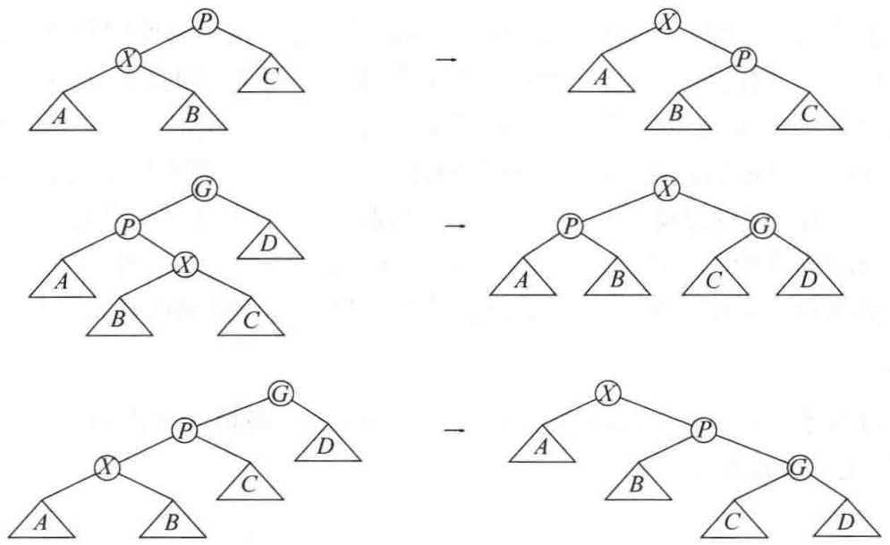

<details>
<summary>text_image</summary>

Mathematical diagram showing tree structures with labeled nodes (A, B, C, P, G) and directional arrows indicating transformation or comparison.
</details>

图11.21 单旋转、之字形旋转和一字形旋转操作，每个都有一个对称的情形(未示出)

---

第11章 摊还分析

433

我们知道，对节点 $X$ 任意的树操作所需的时间正比于从根到 $X$ 的路径上节点的个数。如果我们把每个单旋转操作计为一次旋转，把每个之字形操作或一字形操作计为两次旋转，那么任何访问的开销等于1加上旋转的次数。

为了证明展开操作的 $O(\log N)$ 摊还时间界，我们需要一个位势函数，该函数对整个展开操作最多能够增加 $O(\log N)$，而且还将消去在该步操作期间所执行的旋转的次数。找出满足这些原则的位势函数绝非一件容易的事情。首先容易猜到的位势函数或许就是树上所有节点的深度的和。但是，这个猜测行不通，因为位势在一次访问期间可能增加 $\Theta(N)$ 。当一些元素以有序的顺序插入时就会有这样的典型例子发生。

一个确实有效的位势函数 $\Phi$ 定义为

$$
\Phi (T) = \sum_ {i \in T} \log S (i)
$$

其中， $S(i)$ 代表 $i$ 的后裔的个数(包括 $i$ 自身)。这个位势函数是对树 $T$ 所有节点 $i$ 所取的 $S(i)$ 的对数和。

为简化记号，我们定义

$$
R (i) = \log S (i)
$$

这使得

$$
\Phi (T) = \sum_ {i \in T} R (i)
$$

$R(i)$ 代表节点 i 的秩(rank)。这个术语类似于我们在不相交集算法、二项队列和斐波那契堆的分析中所使用的术语。在所有这些数据结构中，秩(rank)的含义多少有些不同，然而，秩一般来说是指树大小的对数的阶(幅度——magnitude)。对于具有 N 个节点的一棵树 T，根的秩就是  $R(T)=\log N$ 。用秩的和作为位势函数，类似于使用高度的和作为位势函数。重要的差别在于，当一次旋转可以改变树中许多节点的高度时，却只有 X、P 和 G 的秩发生变化。

在证明主要的定理之前，我们需要下列的引理。

引理 11.4

如果 $a + b \leqslant c$，且 $a$ 和 $b$ 均为正整数，那么

$$
\log a + \log b \leqslant 2 \log c - 2
$$

证明:

根据算术-几何平均不等式:

$$
\sqrt {a b} \leqslant (a + b) / 2
$$

于是

$$
\sqrt {a b} \leqslant c / 2
$$

两边平方得到

$$
a b \leqslant c ^ {2} / 4
$$

两边再取对数则定理得证。

我们现在就来证明主要定理，证明过程中要注意所用到的一些预备知识。

---

434

数据结构与算法分析——C++语言描述(第四版)

定理 11.5

在节点 $X$ 展开一棵根为 $T$ 的树的摊还时间最多为 $3(R(T) - R(X)) + 1 = O(\log N)$。

证明:

位势函数取为 T 中节点的秩的和。

如果 $X$ 是 $T$ 的根, 那么不存在旋转, 因此位势没有变化。访问该节点的实际时间是 1 。于是, 摊还时间为 1 , 定理成立。因此, 我们可以假设至少有一次旋转。

对于任意一步展开操作，令 $R_{i}(X)$ 和 $S_{i}(X)$ 是在这步操作前 $X$ 的秩和大小，并令 $R_{f}(X)$ 和 $S_{f}(X)$ 是紧接在这步展开操作后 $X$ 的秩和大小。我们将证明对一次单旋转所需要的摊还时间最多为 $3(R_{f}(X) - R_{i}(X)) + 1$ ，而对一次之字形旋转或一字形旋转的摊还时间最多为 $3(R_{f}(X) - R_{i}(X))$ 。我们还将证明，当对所有各步展开求和时，所得到的和就是想要的时间界。

一步单旋转: 对于单旋转, 一次旋转的实际时间为 1 , 而位势变化为 $R_{f}(X) + R_{f}(P) - R_{i}(X) - R_{i}(P)$ 。注意, 位势变化容易计算, 因为只有 $X$ 的树和 $P$ 的树大小有变化。于是, 用 AT 表示摊还时间, 则

$$
\mathrm{AT} _ {\mathrm{zig}} = 1 + R _ {f} (X) + R _ {f} (\mathrm{P}) - R _ {i} (X) - R _ {i} (P)
$$

从图11.21我们看到 $S_{i}(P)\geqslant S_{f}(P)$ ，因此得到 $R_{i}(P)\geqslant R_{f}(\mathbf{P})$ 。这样，

$$
\mathrm{AT} _ {\mathrm{zig}} \leqslant 1 + R _ {f} (X) - R _ {i} (X)
$$

由于 $S_{f}(X) \geqslant S_{i}(X)$，于是 $R_{f}(X) - R_{i}(X) \geqslant 0$，因此可以增大右边，得到

$$
\mathrm{AT} _ {\mathrm{zig}} \leqslant 1 + 3 (R _ {f} (X) - R _ {i} (X))
$$

一步之字形旋转:对于这种情况，实际的开销是2，而位势变化为 $R_{f}(X) + R_{f}(P) + R_{f}(G) - R_{i}(X) - R_{i}(P) - R_{i}(G)$ 。这就给出一个摊还时间界:

$$
\mathrm{AT} _ {\text {zig-zag}} = 2 + R _ {f} (X) + R _ {f} (P) + R _ {f} (G) - R _ {i} (X) - R _ {i} (P) - R _ {i} (G)
$$

从图11.21我们看到， $S_{f}(X) = S_{i}(G)$ ，于是它们的秩必然相等。因此得到

$$
\mathrm{AT} _ {\text {zig-zag}} = 2 + R _ {f} (P) + R _ {f} (G) - R _ {i} (X) - R _ {i} (P)
$$

我们还看到 $S_{i}(P)\geqslant S_{i}(X)$ 。因而 $R_{i}(X)\leqslant R_{i}(P)$ 。代入右边得到

$$
\mathrm{AT} _ {\text {zig-zag}} \leqslant 2 + R _ {f} (P) + R _ {f} (G) - 2 R _ {i} (X)
$$

从图11.21我们看到 $S_{f}(P) + S_{f}(G)\leqslant S_{f}(X)$ 。如果应用引理11.4，则得到

$$
\log S _ {f} (P) + \log S _ {f} (G) \leqslant 2 \log S _ {f} (X) - 2
$$

由秩的定义可知，它变成

$$
R _ {f} (P) + R _ {f} (G) \leqslant 2 R _ {f} (X) - 2
$$

我们将其代入，则得

$$
\begin{array}{l} \mathrm{AT} _ {\text {zig - zag}} \leqslant 2 R _ {f} (X) - 2 R _ {i} (X) \\ \leqslant 2 \left(R _ {f} (X) - R _ {i} (X)\right) \\ \end{array}
$$

由于 $R_{f}(X)\geqslant R_{i}(X)$ ，因此得到

$$
\mathrm{AT} _ {\mathrm{zig-zag}} \leqslant 3 (R _ {f} (X) - R _ {i} (X))
$$

一步一字形旋转:第三种情况就是一字形旋转。这种情形的证明非常类似于之字形的情

---

第11章 摊还分析

435

形。重要的不等式是 $R_{f}(X) = R_{i}(G), R_{f}(X) \geqslant R_{f}(P), R_{i}(X) \leqslant R_{i}(P)$，以及 $S_{i}(X) + S_{f}(G) \leqslant S_{f}(X)$。我们把具体细节留作练习11.8。

整个展开的摊还开销是各步展开的摊还开销的和。图11.22显示在节点2的一次展开中所执行的各步展开的过程。令 $R_{1}(2)$ 、 $R_{2}(2)$ 、 $R_{3}(2)$ 和 $R_{4}(2)$ 是这4棵树每棵在节点2的秩。第一步是之字形旋转，其开销最多为 $3(R_{2}(2) - R_{1}(2))$ 。第二步是一字形旋转，其开销为 $3(R_{3}(2) - R_{2}(2))$ 。最后一步是单旋转，开销不超过 $3(R_{4}(2) - R_{3}(2)) + 1$ 。因此总的开销是 $3(R_{4}(2) - R_{1}(2)) + 1$ 。


<details>
<summary>flowchart</summary>

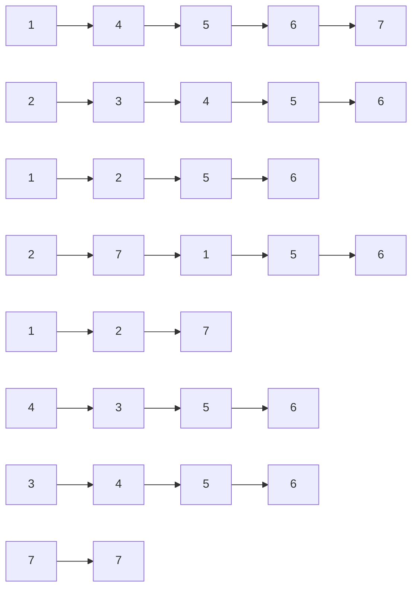
</details>

图 11.22 在节点 2 展开中所涉及到的各步展开

一般来说，通过把所有旋转——其中最多有一次旋转可能是单旋转——的摊还时间加起来，我们看到，在节点 $X$ 展开的总的摊还开销最多为 $3(R_{f}(X) - R_{i}(X)) + 1$ ，其中 $R_{i}(X)$ 是 $X$ 在第一步展开前的秩，而 $R_{f}(X)$ 是 $X$ 在最后一步展开后的秩。由于最后一步展开把 $X$ 留在根处，因此我们得到 $3(R_{f}(T) - R_{i}(X)) + 1$ 的摊还界，这个界为 $O(\log N)$ 。

因为对一棵伸展树的每次操作都需要一次展开，因此任一操作的摊还开销是在一步展开的摊还时间的一个常数倍数之内。因此，所有伸展树的访问操作均花费 $O(\log N)$ 摊还时间。为了证明插入和删除均花费 $O(\log N)$ 的摊还时间，应该对发生在一步展开之前或之后的位势变化做出进一步说明。

在插入的情况下，假设我们正在对一棵 N-1 个节点的树进行插入操作。于是，在插入之后我们得到一颗 N 个节点的树，且展开的界适用。然而，在叶节点的插入将把展开之前的位势加到从叶节点到根节点的路径上的每一个节点上。令  $n_{1}, n_{2}, \cdots, n_{k}$  为叶节点插入前的路径上的那些节点 ( $n_{k}$  是根节点)，并设它们的大小为  $s_{1}, s_{2}, \cdots, s_{k}$ 。在插入之后，大小变成了  $s_{1} + 1, s_{2} + 1, \cdots, s_{k} + 1$ 。(该叶对位势的影响为 0，所以可以忽略。) 注意， $s_{j} + 1 \leqslant s_{j+1}$ （不包括根节点），于是， $n_{j}$  的新的秩不超过  $n_{j+1}$  的老秩。因此，秩的增长，即从添加一个新叶节点得到的位势增长的最大值，不会超过根的新秩  $O(\log N)$ 。

删除是由将一棵树连接到另一棵树完成的，它不属于展开。删除不增加节点的秩，但是却受限于 $\log N$ （并由一个节点被删除而得以补偿，而这个节点当时是树的根）。因此，展开的开销准确地表达了删除开销的界。

通过使用更一般的位势函数，能够证明展开树具有若干显著的性质。更多的细节将在练习中讨论。

---

436

数据结构与算法分析——C++语言描述(第四版)

## 小结

在这一章，我们看到摊还分析如何能够用来在一些操作之间分摊负荷。为了进行分析，我们构造一个虚构的位势函数，这个位势函数度量系统的状态。高位势的数据结构具有挥发的特性，它建立在相对低廉的操作之上。当昂贵的开销来自一次操作的时候，它会由前面一些操作节省下的积蓄来支付。可以把位势看成是对付灾难的潜能，因为非常昂贵的操作只有在数据结构具有一个高的位势，并且已经使用了比规定的显著少的时间时才可能发生。

数据结构中的低位势意味着，每次操作的开销大致等于指定给它的消耗量。负位势意味着欠债；花费的时间多于规定的时间，因此分配(或摊还)的时间不是一个有意义的界。

正如方程(11.2)所表达的, 一次操作的摊还时间等于实际时间和位势变化的和。整个操作序列的摊还时间等于总的序列操作时间加上位势的净变化。只要这个净变化是正的, 那么摊还界就提供了实际时间花费的一个上界, 从而这个摊还界是有意义的。

选择位势函数的关键在于保证最小的位势要出现在算法的开始，并使得位势对低廉的操作增加而对高昂的操作减少。重要的是，超额或节省的时间要由位势中相反的变化来度量。遗憾的是，这有时候说着容易，但做起来颇为犯难。

## 练习

11.1 什么时候向一个二项队列进行连续 M 次插入花费少于 2M 个单位的时间？
11.2 设建有 $N = 2^{k} - 1$ 个元素的一个二项队列。交替进行 $M$ 对 insert 和 deleteMin 操作。显然，每次操作花费 $O(\log N)$ 时间。为什么这与插入的 $O(1)$ 摊还时间界不矛盾？
\*11.3 通过给出导致一次 merge 需要 $\Theta(N)$ 时间的一系列操作, 证明对于正文中描述的斜堆操作的 $O(\log N)$ 摊还界不能转换成最坏情形界。
\*11.4 指出如何进行一趟自顶向下的操作合并两个斜堆，并将 merge 的开销减到 $O(1)$ 摊还时间。
11.5 扩展斜堆以支持具有  $O(\log N)$  摊还时间的 decreaseKey 操作。
11.6 实现斐波那契堆，并比较在用于 Dijkstra 算法时它与二叉堆的性能。
11.7 斐波那契堆的标准实现方法需要每个节点 4 个链(父亲、儿子以及两个兄弟)。指出如何减少链的数量而使其最多花费运行时间的一个常数倍。
11.8 证明一次一字形展开的摊还时间最多为 $3(R_{f}(\mathbf{X}) - R_{i}(X))$。
11.9 通过改变位势函数能够证明展开操作的不同的界。令权函数(weight function) $W(i)$ 为某个指定给树中每个节点的函数，令 $S(i)$ 为以i为根的子树上所有节点(包括节点i本身)的权的和。对于所有的节点均为 $W(i)=1$ 的特殊情况对应着用于展开界的证明中的权函数。令N为树中节点的个数，并令M为访问的次数。证明下列两个定理:
a. 总的访问时间是  $O(M + (M + N) \log N)$ 。
\*b. 如果 $q_{i}$ 为项 $i$ 被访问的次数，而对所有的 $i, q_{i} > 0$ ，那么总的访问时间为

---

第11章 摊还分析

437

$$
O \Bigg (M + \sum_ {i = 1} ^ {N} q _ {i} \log (M / q _ {i}) \Bigg)
$$

11.10 a. 指出如何实现对伸展树的 merge 操作，使得从 N 个单元素树开始的任意 N-1 次 merge 操作序列花费  $O(N \log^{2} N)$  时间。

\*b. 将这个界改进为  $O(N \log N)$ 。

11.11 我们在第 5 章描述了再散列(rehashing): 当一个表的表元素超过容量一半的时候, 则构造一个两倍大的新表, 且整个的老表要被再散列。使用位势函数给出一个正式的摊还分析来证明一次插入操作的摊还开销仍为 $O(1)$ 。

11.12 斐波那契堆的最大深度是多少？

11.13 具有堆序的双端队列(deque)是由一些项的表组成的数据结构，可以对其进行下列操作:

push(x): 将项 x 插入到双端队列的前端。

pop():从双端队列中除去前端项并将它返回。

inject(x): 把项 x 插入到双端队列的尾端。

eject(): 从双端队列中除去尾端项并将它返回。

findMin(): 返回双端队列的最小项。

a. 描述如何以每个操作常数摊还时间支持这些操作。

\*\*b. 描述如何以每个操作常数最坏情形时间支持这些操作。

11.14 证明二项队列实际上以 $O(1)$ 摊还时间支持合并操作。定义二项队列的位势为树的棵数加上最大树的秩。

11.15 设为了打算节省时间，我们把展开对每隔一次树操作进行。此时的摊还开销还是对数的吗？

11.16 在伸展树的界的证明中使用位势函数, 伸展树的最大位势和最小位势是多少? 在一次展开中, 位势函数可以减少多少? 在一次展开中, 位势函数可以增加多少? 可以给出大 O 解答。

11.17 作为展开的结果，在访问路径上的大部分节点都朝根的方向移动，而该路径上的少数几个节点却向下移动一层。这就提出使用一个和来作为位势函数的想法，而该和是对所有节点的深度的对数相加而得。

a. 该位势函数的最大值是多少？

b. 该位势函数的最小值是多少?

c. a 问和 b 问的答案的差给出某种提示，即该位势函数不是太好。证明，一次展开操作可能使位势增加 $\Theta(N/\log N)$ 。

## 参考文献

论文[10]提供了对摊还分析极好的综述。

下面的参考文献中有许多和前几章的引文重复，我们再次引用它们是为了方便和完善。二项队列首先在文献[11]中阐述并在文献[1]中分析。练习11.3和练习11.4的解法见于论文[9]。

---

438

数据结构与算法分析——C++语言描述(第四版)

斐波那契堆在文献[3]中描述。练习11.9(a)指出，在最佳静态查找树的一个常数因子范围之内伸展树是最优的。练习11.9(b)则指出，伸展树在最佳最优查找树的一个常数因子之内是最优的。这些以及另外两个强结果在原始的伸展树论文[7]中均有证明。

摊还概念在文献[2]中使用，以有效地合并平衡查找树。伸展树的 merge 操作在文献[6]中描述。练习 11.13 的一种解法可在文献[4]中找到。练习 11.14 取自文献[5]。

在文献[8]中使用摊还分析设计一种联机算法，该算法处理一系列查询，其所花费的时间比同类问题的脱机算法只多出一个常数因子。

1. M. R. Brown, "Implementation and Analysis of Binomial Queue Algorithms," SIAM Journal on Computing, 7 (1978), 298–319.
2. M. R. Brown and R. E. Tarjan, "Design and Analysis of a Data Structure for Representing Sorted Lists," SIAM Journal on Computing, 9 (1980), 594–614.
3. M. L. Fredman and R. E. Tarjan, "Fibonacci Heaps and Their Uses in Improved Network Optimization Algorithms," Journal of the ACM, 34 (1987), 596–615.
4. H. Gajewska and R. E. Tarjan, "Deques with Heap Order," Information Processing Letters, 22 (1986), 197–200.
5. C. M. Khoong and H. W. Leong, "Double-Ended Binomial Queues," Proceedings of the Fourth Annual International Symposium on Algorithms and Computation (1993), 128–137.
6. G. Port and A. Moffat, "A Fast Algorithm for Melding Splay Trees," Proceedings of First Workshop on Algorithms and Data Structures (1989), 450–459.
7. D. D. Sleator and R. E. Tarjan, "Self-adjusting Binary Search Trees," Journal of the ACM, 32 (1985), 652–686.
8. D. D. Sleator and R. E. Tarjan, "Amortized Efficiency of List Update and Paging Rules," Communications of the ACM, 28 (1985), 202–208.
9. D. D. Sleator and R. E. Tarjan, "Self-adjusting Heaps," SIAM Journal on Computing, 15 (1986), 52–69.
10. R. E. Tarjan, "Amortized Computational Complexity," SIAM Journal on Algebraic and Discrete Methods, 6 (1985), 306–318.
11. J. Vuillemin, "A Data Structure for Manipulating Priority Queues," Communications of the ACM, 21 (1978), 309–314.
