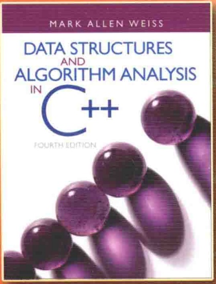

# 数据结构与算法分析

# —— C++语言描述（第四版）

## Data Structures and Algorithm Analysis in C++ Fourth Edition



<details>
<summary>text_image</summary>

MARK ALLEN WEISS
DATA STRUCTURES
AND
ALGORITHM ANALYSIS
IN
C++
FOURTH EDITION
</details>

[美] Mark Allen Weiss 著

冯舜玺 译

## 数据结构与算法分析

## —— C++语言描述（第四版）

## Data Structures and Algorithm Analysis in C++ Fourth Edition

本书是数据结构和算法分析的经典教材，书中使用主流程序设计语言C++的新标准C++11作为具体的实现语言。内容包括表、栈、队列、树、散列表、优先队列、排序、不相交集算法、图论算法、算法分析、算法设计、摊还分析、查找树算法、后缀数组、后缀树、k-d树和配对堆等。本书把算法分析与C++程序的开发有机地结合起来，深入分析每种算法，内容全面、缜密严格，并细致讲解精心构造程序的方法。

## 第四版新增内容

第4章包含AVL树删除算法的实现。
第5章包含两个更新的算法:杜鹃散列法和跳房子散列法。
第6章二叉堆的实现用到了C++11版引入的移动操作。
第7章增加了基数排序的内容，以及论述下界的证明，多数排序算法的程序用到C++11版中的移动操作。
第8章使用新的union/find分析，并证明了 $O(M \propto (M, N))$ 界，以代替前面各版较弱的 $O(M \log^{*} N)$ 界。
第12章添加了论述后缀树和后缀数组的内容。
全书所出现的代码均用C++11进行了更新。

本书可供教辅:习题解答，插图文件，源代码，具体申请方式请参见书末的“教学支持说明”。

其他数据结构

相关教材

请扫二维码↓


<details>
<summary>text_image</summary>

Pearson
ALWAYS LEARNING ALWAYS LEARNING ALWAYS LEARNING
</details>


策划编辑:冯小贝

责任编辑:周宏敏

责任美编:孙焱津欢迎登录免费获取本书教学资源http://www.hxedu.com.cn


<details>
<summary>text_image</summary>

ISBN 978-7-121-29057-2
9 787121 290572 >
</details>

定价:89.00元

# 数据结构与算法分析

# ——C++语言描述

# (第四版)

## Data Structures and Algorithm Analysis in C++ Fourth Edition

[美] Mark Allen Weiss 著
冯舜玺 译

## 内容简介

本书是数据结构和算法分析的经典教材，书中使用主流程序设计语言 C++ 的新标准 C++ 11 作为具体的实现语言。内容包括表、栈、队列、树、散列表、优先队列、排序、不相交集算法、图论算法、算法分析、算法设计、摊还分析、查找树算法、后缀数组、后缀树、k-d 树和配对堆等。本书把算法分析与 C++ 程序的开发有机地结合起来，深入分析每种算法，内容全面、缜密严格，并细致讲解精心构造程序的方法。

本书概念清楚，逻辑性强，内容新颖，适合作为大专院校计算机软件与计算机应用等相关专业的教材或参考书，也适合计算机工程技术人员参考。

Authorized translation from the English language edition, entitled Data Structures and Algorithm Analysis in C++, Fourth Edition, 9780132847377 by Mark Allen Weiss, published by Pearson Education, Inc., publishing as Addison-Wesley, Copyright©2014 Pearson Education Inc.

All rights reserved. No part of this book may be reproduced or transmitted in any form or by any means, electronic or mechanical, including photocopying, recording or by any information storage retrieval system, without permission from Pearson Education, Inc.

CHINESE SIMPLIFIED language edition published by PEARSON EDUCATION ASIA LTD., and PUBLISHING HOUSE OF ELECTRONICS INDUSTRY Copyright ©2016.

本书中文简体字版专有出版权由 Pearson Education（培生教育出版集团）授予电子工业出版社。未经出版者预先书面许可，不得以任何方式复制或抄袭本书的任何部分。

本书贴有 Pearson Education（培生教育出版集团）激光防伪标签，无标签者不得销售。

版权贸易合同登记号 图字:01-2013-7213

## 图书在版编目(CIP)数据

数据结构与算法分析:C++语言描述:第四版/(美)M.A.韦斯(Mark Allen Weiss)著；冯舜玺译.

北京:电子工业出版社，2016.8

书名原文:Data Structures and Algorithm Analysis in C++, Fourth Edition

国外计算机科学教材系列

ISBN 978-7-121-29057-2

I. ①数… II. ①M… ②冯… III. ①数据结构—高等学校—教材 ②算法分析—高等学校—教材 ③C语言—程序设计—高等学校—教材 IV. ①TP311.12 ②TP312

中国版本图书馆 CIP 数据核字(2016)第 131907 号

策划编辑:冯小贝

责任编辑:周宏敏

印刷:三河市华成印务有限公司

装 订:三河市华成印务有限公司

出版发行:电子工业出版社

北京市海淀区万寿路 173 信箱 邮编 100036

开 本:787×1092 1/16 印张:31.75 字数:833 千字

版次:2016年8月第1版(原著第4版)

印 次:2016年8月第1次印刷

定 价:89.00 元

凡所购买电子工业出版社图书有缺损问题，请向购买书店调换。若书店售缺，请与本社发行部联系，联系及邮购电话:(010)88254888，88258888。

质量投诉请发邮件至 zlts@phei.com.cn，盗版侵权举报请发邮件至 dbqq@phei.com.cn。

本书咨询联系方式:fengxiaobei@phei.com.cn。

## 前言

## 目的/目标

本书是《数据结构与算法分析——C++语言描述》的第四版，论述组织大量数据的方法——数据结构，以及算法运行时间的估计——算法分析。随着计算机的速度越来越快，对于能够处理大量输入数据的程序需求变得日益急迫。可是，由于在输入量很大时程序的低效率显得非常突出，因此又要求对效率问题给予更加严密的关注。通过在实际编程之前对算法进行分析，学生们可以确定一个特定的解决方案是否可行。例如，在本书中学生可查阅一些特定的问题并看到精心的实现怎样能够把处理大量数据的时间限制从若干个世纪减至不到一秒。因此，若无运行时间的阐释，就不会有算法和数据结构的提出。在某些情况下，对于影响实现的运行时间的一些微小细节都需要认真的探究。

一旦解法被确定，接着就要编写程序。随着计算机功能的日益强大，它们必须解决的问题就变得更加庞大和复杂，这就要求开发更加复杂的程序。本书的目标是同时教授学生良好的程序设计技巧和算法分析能力，使他们开发的程序能够具有最高的效率。

本书适合于高等数据结构课程或是算法分析第一年的研究生课程。学生应该具有中等程度的程序设计知识，包括指针、递归以及面向对象程序设计这样一些内容，此外还要具有一些离散数学的基础。

## 处理方法

虽然本书的内容大部分都与语言无关，但是，程序设计还是需要使用某种特定的语言。正如书名指出的，我们为本书选择了 C++。

C++已经成为主流系统编程语言。除修复 C 语言的许多语法漏洞之外，C++还提供一些直接结构(类和模板)来实现作为抽象数据类型的泛型数据结构。

编写本书最困难的部分是决定 C++ 所占的篇幅。使用太多 C++ 的特性将使本书难以理解，使用太少又会使读者得不到比支持类的 C 语言教材更多的收获。

我们所采取的做法是以一种基于对象的处理方式展示书中的内容。这样，本书几乎不存在对继承的使用。书中以类模板描述泛型数据结构。一般我们避免深奥的 C++特性，但是使用了 vector 类和 string 类，如今它们已是 C++标准的一部分。本书以前各版通过把类模板接口从其实现中分离出来已经做到了对类模板的实现。虽然这是有争议的首选方式，但它揭示出编译器使读者难以具体使用代码的一些问题。因此，这一版中联机代码把类模板作为一个独立的单元来介绍，无需接口与实现的分离。第 1 章提供了用于全书的 C++特性的综述，并描述了我们对类模板的处理方式。附录 A 阐述如何能够重写类模板以使用分离式编译。

以 C++ 和 Java 二者描述的数据结构的完全版可在互联网上获得。我们使用类似的编码约定以使得这两种语言间平行的结构表现得更加明显。

## 第四版最重要的变化概述

本书第四版吸收了大量对错误的修正，书中许多部分经过修订以增加表述的清晰度。此外:

- 第4章包含AVL树删除算法的实现，它是一个常常被读者提出的论题。
- 第 5 章已被广泛修订和扩展，现已包含两个更新的算法:杜鹃散列和跳房子散列。此外，还添加了论述通用散列的新的一节。对 C++ 中引入的 unordered\_set 和 unordered\_map 两个类模板的简要讨论也是新加的内容。

\- 第 6 章基本没有变化，不过，二叉堆的实现用到了 C++11 版引入的移动操作(move operation)。

\- 第7章增加了基数排序的内容，并添加了新的一节，论述下界的证明。排序的程序用到C++11版中引入的移动操作。

\- 第8章使用由Seidel和Sharir所做的新的union/find分析，并证明了 $O(M\alpha (M,N))$ 的界以代替前面各版较弱的 $O(M\log^{*}N)$ 界。

\- 第12章添加了论述后缀树和后缀数组的材料, 包括Karkkainen 和 Sanders 的后缀数组线性时间构建算法(及其实现)。删除了讨论确定性跳跃表和 AA 树的两节。

\- 全书所出现的代码均用 C++11 做了更新。值得注意的是，这意味着 C++11 新特性的使用，包括 auto 关键字、范围 for 循环、移动构造和赋值，以及统一初始化 (uniform initialization)。

## 内容提要

第 1 章包含离散数学和递归的一些复习材料。我相信熟练处置递归唯一的办法是反复不断地研读一些好的用法。因此，除第 5 章外，递归遍及本书每一章的例子之中。另外，第 1 章还介绍了一些材料，作为对基本 C++ 的回顾，包括在 C++ 类设计中对模板和一些重要结构的讨论。

第 2 章处理算法分析。这一章阐述渐近分析和它的主要弱点。这里提供了许多例子，包括对对数运行时间的深入解释。通过直观地把一些简单递归程序转变成迭代程序而对它们进行分析。介绍了更复杂的分治程序，不过有些分析(求解递推关系)将推迟到第 7 章再详细阐述。

第 3 章包括表、栈和队列。这一章包括对 STL 中 vector 类和 list 类的讨论，其中涉及到迭代器的一些材料，并提供对 STL 中 vector 类和 list 类的重要子集的实现。

第 4 章讨论树，重点在查找树，包括外部查找树(B 树)。UNIX 文件系统和表达式树是作为例子来使用的。本章还介绍了 AVL 树和伸展树。关于查找树实现细节的更详细的处理放在第 12 章介绍。树的另外一些内容，如文件压缩和博弈树，推迟至第 10 章讨论。外部媒体上的数据结构作为几章中的最后论题来考虑。STL 中 set 类和 map 类的讨论也在本章进行，其中包括一个重要的例子，该例使用 3 个分离的映射高效地解决一个问题。

第 5 章讨论散列表，包括诸如分离链接法以及线性探测法和平方探测法这样一些经典算法，此外还有几个新算法，即杜鹃散列和跳房子散列。通用散列也在这里讨论，而对可扩散列的讨论则放在本章末尾进行。

第 6 章是关于优先队列的。二叉堆也安排在这里，还有些额外的材料论述优先队列某些理论上有趣的实现。斐波那契堆在第 11 章讨论，配对堆在第 12 章讨论。

第 7 章是排序。它是关于编程细节和分析的非常特殊的一章。所有重要的通用排序算法均被讨论并进行了比较。详细分析了 4 种算法:插入排序，希尔排序，堆排序，以及快速排序。本版新增加了基数排序和一些与选择相关问题的下界证明。外部排序的讨论安排在本章的末尾进行。

第 8 章讨论不相交集算法并证明其运行时间。这是短小且特殊的一章，如果不讨论 Kruskal 算法则该章可以跳过。

第 9 章讲授图论算法。图论算法的趣味性不仅因为它们在实践中经常发生，而且还因为它们的运行时间强烈地依赖于数据结构的恰当使用。实际上，所有标准算法都是和相应的数据结构、伪代码以及运行时间的分析一起介绍的。为把这些问题放在一个适当的上下文环境下，本章对复杂性理论(包括 NP 完全性和不可判定性)进行了简要的讨论。

第 10 章通过考查一些常见问题的求解技巧来讨论算法设计。这一章通过大量实例而得到强化。这里及后面各章使用的伪代码使得学生对一个算法实例的理解不至于被实现的细节所困扰。

第 11 章处理摊还分析。对来自第 4 章和第 6 章的 3 种数据结构以及本章介绍的斐波那契堆进行了分析。

第 12 章讨论查找树算法、后缀树和后缀数组、k-d 树、配对堆。不同于其他各章，本章为查找树和配对堆提供了完全和审慎的实现。材料的安排使得教师可以把一些内容整合到其他各章的讨论中。例如，第 12 章中的自顶向下红黑树可以和 AVL 树(第 4 章的)一起讨论。

第 1 章～第 9 章为大多数一学期的数据结构课程提供了足够的材料。如果时间允许，那么第 10 章也可以包括进来。研究生的算法分析课程可以使用第 7 章～第 11 章的内容。在第 11 章所分析的高级数据结构可以容易地在前面各章中查到。第 9 章中对 NP 完全性的讨论太过简单，以至于不足以用于这样的一门算法分析课程。读者将会发现，参阅一些论述 NP 完全性的著述对深化本书内容大有裨益。

## 练习

在每章末尾提供的练习与正文中讲授内容的顺序相匹配。最后的一些练习是把一章作为一个整体来处理而不是针对特定的某一节来考虑的。难做的练习标以一个星号，更难的练习标注两个星号。

## 参考文献

参考文献列于每章的最后。一般来说，这些参考文献或者是历史性质的，代表着书中材料的原始来源，或者阐述对正文中给出结果的扩展和改进。有些文献提供一些练习的解法。

## 补充材料

所有读者均可从网站http://cssupport.pearsoncmg.com/上获取下列补充资料:

\- 例子程序的源代码①

\- 勘误表

<small><span class="docvortex-page-footnote" data-block-type="page_footnote" style="color:#6b7280">① 也可登录华信教育资源网(www.hxedu.con.cn)免费注册下载。</span></small>

此外，下列材料只提供给 Pearson Instructor Resource Center (www.pearsonhighered.com/irc) 上有资格的教师。如欲获取这些资料，可访问 IRC 或 Pearson Education 销售代表。 $^{①}$

- 书中挑选的一些练习的解答
- 本书中的一些图示
- 勘误表

## 致谢

在该丛书几部著作的准备过程中作者得到了许许多多朋友的帮助，有些人在本书的其他版本中列出。谢谢所有诸位。

如同往常一样，Pearson 专家们的努力使得本书的写作过程更加轻松。我愿意借此机会感谢我的编辑 Tracy Johnson，以及制作编辑 Marilyn Lloyd。贤妻 Jill 因其所做的每一件工作应该得到我特别的感谢。

最后，我还要感谢广大的读者，他们发送 E-mail 信息并指出较早各版的错误和矛盾之处。我的网站www.cis.fiu.edu/\~weiss也将包含更新后(C++和 Java)的源代码，一个勘误表，以及到提交问题报告的一个链接。

M. A. W.

Miami, Florida

<small><span class="docvortex-page-footnote" data-block-type="page_footnote" style="color:#6b7280">① 教辅申请方式请参见书末的“教学支持说明”。</span></small>

## 教学支持说明

McGraw-Hill Education，麦格劳-希尔教育出版公司，美国著名图书出版与教育服务机构，以出版经典、高质量的理工科、经济管理、计算机、生命科学以及人文社科类高校教材享誉全球，更以丰富的网络化、数字化教学辅助资源深受高校教师的欢迎。

为了更好地服务于中国教育发展，提升教学质量，2003年麦格劳-希尔教师服务中心在北京成立。在您确认将本书作为指定教材后，请您填好以下表格并经系主任签字盖章后寄回，麦格劳-希尔教师服务中心将免费向您提供相应教学课件或网络化课程管理资源。如果您需要订购或参阅本书的英文原版，我们也会竭诚为您服务。

## 证明

兹证明\_\_\_\_大学\_\_\_\_系/院\_\_\_\_专业\_\_\_\_学年（学期）开设的\_\_\_\_课程，共\_\_\_\_学时，现采用电子工业出版社出版的英文原版/简体中文版\_\_\_\_（书名/作者）\_\_\_\_作为主要教材。任课教师为\_\_\_\_，学生\_\_\_\_个班共\_\_\_\_人。

任课教师需要与本书配套的教师指导手册和习题解答。

电话:\_\_\_\_

传真:\_\_\_\_

E-mail: \_\_\_\_

联系地址:\_\_\_\_

邮 编:\_\_\_\_

建议和要求:

系/院主任:\_\_\_\_（签字）

(系/院办公室章)

\_\_\_\_年\_\_\_\_月\_\_\_\_日

## 请与我们联络

Publishing House of Electronics Industry

电子工业出版社:www.phei.com.cn

www.hxedu.com.cn

联系电话:010-88254555

传真:010-88254560

E-mail: Te\_service@phei.com.cn

麦格劳-希尔教育出版公司教师服务中心

北京市海淀区 清华科技园 创业大厦 907 室

北京 100084

传真: 8610-62790292

教师服务热线:800-810-1936

教师服务信箱:instructor\_cn@mcgraw-hill.com

网址:http://www.mcgraw-hill.com.cn

## 反侵权盗版声明

电子工业出版社依法对本作品享有专有出版权。任何未经权利人书面许可，复制、销售或通过信息网络传播本作品的行为；歪曲、篡改、剽窃本作品的行为，均违反《中华人民共和国著作权法》，其行为人应承担相应的民事责任和行政责任，构成犯罪的，将被依法追究刑事责任。

为了维护市场秩序，保护权利人的合法权益，我社将依法查处和打击侵权盗版的单位和个人。欢迎社会各界人士积极举报侵权盗版行为，本社将奖励举报有功人员，并保证举报人的信息不被泄露。

举报电话:（010）88254396；（010）88258888

传真:(010) 88254397

E-mail: dbqq@phei.com.cn

通信地址:北京市海淀区万寿路173信箱

电子工业出版社总编办公室

邮编:100036

## 目录

## 第1章 程序设计:综述 …… 1

1.1 本书讨论的内容……1
1.2 数学知识复习……2

1.2.1 指数(exponent) 2
1.2.2 对数 (logarithm) …… 2
1.2.3 级数(series) 3
1.2.4 模运算(modular arithmetic) …… 4
1.2.5 证明方法……5

1.3 递归简论……7
1.4 C++类 10

1.4.1 基本的 class 语法 …… 10
1.4.2 构造函数的附加语法和访问函数 …… 11
1.4.3 接口与实现的分离 …… 13
1.4.4 vector 类和 string 类 …… 16

1.5 C++细节 17

1.5.1 指针(pointer) 18
1.5.2 左值、右值和引用 …… 19
1.5.3 参数传递……21
1.5.4 返回值传递 23
1.5.5 std::swap 和 std::move …… 25
1.5.6 五大函数:析构函数，拷贝构造函数，移动构造函数，拷贝赋值 operator=，移动赋值 operator=…26
1.5.7 C 风格数组和字符串 …… 30

1.6 模板 31

1.6.1 函数模板……31
1.6.2 类模板 32
1.6.3 Object、Comparable 和一个例子 …… 33
1.6.4 函数对象……34
1.6.5 类模板的分离式编译……37

1.7 使用矩阵……37

1.7.1 数据成员、构造函数和基本访问函数……38
1.7.2 operator[]....38
1.7.3 五大函数....39

小结 39

练习 …… 39

参考文献……41

## 第2章 算法分析 42

2.1 数学基础……42
2.2 模型....44
2.3 要分析的问题……44
2.4 运行时间计算 47

2.4.1 一个简单的例子……47
2.4.2 一般法则....47
2.4.3 最大子序列和问题的求解 …… 49
2.4.4 运行时间中的对数……54
2.4.5 最坏情形分析的局限性……57

小结 58

练习 …… 58

参考文献……63

## 第 3 章 表、栈和队列 …… 64

3.1 抽象数据类型(ADT) …… 64
3.2 表 ADT 64

3.2.1 表的简单数组实现……65
3.2.2 简单链表 65

3.3 STL中的vector和list……67

3.3.1 迭代器 …… 68
3.3.2 例子:对表使用 erase …… 69
3.3.3 const\_iterators 70

3.4 vector 的实现....72
3.5 list 的实现 76
3.6 栈 ADT....86

3.6.1 栈模型 86
3.6.2 栈的实现……86
3.6.3 应用 87

## 3.7 队列 ADT 93

3.7.1 队列模型……93
3.7.2 队列的数组实现……93
3.7.3 队列的应用 95

## 小结 96

## 练习 96

## 第 4 章 树……100

## 4.1 预备知识…… 100

4.1.1 树的实现…… 101
4.1.2 树的遍历及应用…… 102

## 4.2 二叉树 …… 105

4.2.1 实现 105
4.2.2 一个例子——表达式树 …… 105

## 4.3 查找树 ADT——二叉查找树 … 108

4.3.1 contains 110
4.3.2 findMin 和 findMax …… 111
4.3.3 insert 112
4.3.4 remove 113
4.3.5 析构函数和拷贝构造函数……115
4.3.6 平均情况分析……115

## 4.4 AVL 树....118

4.4.1 单旋转 …… 119
4.4.2 双旋转 121

## 4.5 伸展树 …… 128

4.5.1 一个简单的想法(不能直接使用).... 128
4.5.2 展开 130

## 4.6 树的遍历.... 134

## 4.7 B 树.... 135

## 4.8 标准库中的容器 set 和 map……140

4.8.1 集合容器 set …… 140
4.8.2 映射容器 map 141
4.8.3 set 和 map 的实现…… 142
4.8.4 使用多个 map 的示例 …… 142

## 小结 147

练习 …… 147
参考文献……153

## 第 5 章 散列……155

5.1 一般想法....155
5.2 散列函数.... 155
5.3 分离链接法....157
5.4 不用链表的散列表 …… 161

5.4.1 线性探测法……161
5.4.2 平方探测法……163
5.4.3 双散列 166

5.5 再散列....167
5.6 标准库中的散列表 …… 169
5.7 以最坏情形 $O(1)$ 访问的散列表·170

5.7.1 完美散列 170
5.7.2 杜鹃散列 172
5.7.3 跳房子散列……181

5.8 通用散列....184
5.9 可扩散列....186

小结 188

练习 …… 189
参考文献……193

## 第 6 章 优先队列(堆) …… 196

6.1 模型.... 196
6.2 一些简单的实现 …… 197
6.3 二叉堆....197

6.3.1 结构性质.... 197
6.3.2 堆序性质....198
6.3.3 基本的堆操作 …… 199
6.3.4 其他的堆操作 …… 203

## 6.4 优先队列的应用 …… 206

6.4.1 选择问题 …… 206
6.4.2 事件模拟 …… 207

## 6.5 d 堆 208

## 6.6 左式堆 209

6.6.1 左式堆的性质 …… 209
6.6.2 左式堆操作……210

## 6.7 斜堆 215

## 6.8 二项队列....216

6.8.1 二项队列构建……216
6.8.2 二项队列操作……217
6.8.3 二项队列的实现……219

## 6.9 标准库中的优先队列 …… 224

小结 225

练习 225

参考文献 …… 229

## 第 7 章 排序……232

7.1 预备知识……232
7.2 插入排序…… 233

7.2.1 算法 …… 233
7.2.2 插入排序的STL实现 233
7.2.3 插入排序的分析…… 235

7.3 一些简单排序算法的下界 …… 235
7.4 希尔排序……236

7.4.1 希尔排序的最坏情形分析 …… 237

7.5 堆排序 …… 239
7.5.1 堆排序的分析……241
7.6 归并排序……242
7.6.1 归并排序的分析……245

7.7 快速排序……247

7.7.1 选取枢纽元 …… 249
7.7.2 分割策略…… 250
7.7.3 小数组 252
7.7.4 实际的快速排序例程……252
7.7.5 快速排序的分析……254
7.7.6 选择问题的线性期望时间算法 …… 256

7.8 排序算法的一般下界 …… 258
7.8.1 决策树 258

7.9 选择问题的决策树下界 …… 260
7.10 对手下界(adversary lower bounds) 262

7.11 线性时间排序:桶式排序和基数排序 …… 265
7.12 外部排序…… 269

7.12.1 为什么需要一些新的算法 … 269
7.12.2 外部排序模型 …… 269

7.12.3 简单算法 …… 269
7.12.4 多路合并 …… 270
7.12.5 多相合并 …… 271
7.12.6 替换选择 272

小结 273
练习题……273
参考文献……278

## 第 8 章 不相交集类 …… 281

8.1 等价关系……281
8.2 动态等价性问题 …… 281
8.3 基本数据结构 …… 283
8.4 灵巧求并算法 …… 286
8.5 路径压缩 288
8.6 按秩求并和路径压缩的最坏
情形……289

8.6.1 缓慢增长的函数……289
8.6.2 通过递归分解进行的分析 …… 290
8.6.3 一个 $O(M\log^{*}N)$ 界……295
8.6.4 一个 $O(M\alpha (M,N))$ 界 …… 296

8.7 一个应用 …… 297
小结 299
练习 …… 299
参考文献……301

## 第 9 章 图论算法 …… 303

9.1 若干定义 …… 303
9.1.1 图的表示……304

9.2 拓扑排序……305
9.3 最短路径算法 …… 308

9.3.1 无权最短路径 …… 309
9.3.2 Dijkstra 算法 …… 312
9.3.3 具有负边值的图 …… 317
9.3.4 无圈图 …… 318
9.3.5 所有顶点对间的最短路径 …… 320
9.3.6 最短路径的例 …… 320

9.4 网络流问题 322
9.4.1 一个简单的最大流算法……323

9.5 最小生成树 326

9.5.1 Prim算法 327

9.5.2 Kruskal 算法……329

## 9.6 深度优先搜索的应用 …… 330

9.6.1 无向图 …… 331

9.6.2 双连通性……332

9.6.3 欧拉回路…… 335

9.6.4 有向图 …… 338

9.6.5 查找强分支 339

## 9.7 NP 完全性介绍……340

9.7.1 难与易 341

9.7.2 NP 类.... 341

9.7.3 NP 完全问题 342

小结 344

练习 344

参考文献 …… 350

## 第 10 章 算法设计技巧……353

## 10.1 贪婪算法……353

10.1.1 一个简单的调度问题 …… 354

10.1.2 哈夫曼编码……355

10.1.3 近似装箱问题 359

## 10.2 分治算法……366

10.2.1 分治算法的运行时间 …… 367

10.2.2 最近点问题……369

10.2.3 选择问题……371

10.2.4 一些算术问题的理论改进 … 374

## 10.3 动态规划……377

10.3.1 用表代替递归 …… 377

10.3.2 矩阵乘法的顺序安排 …… 379

10.3.3 最优二叉查找树 382

10.3.4 所有点对最短路径…… 384

## 10.4 随机化算法……386

10.4.1 随机数发生器 …… 387

10.4.2 跳跃表 392

10.4.3 素性测试 393

## 10.5 回溯算法……396

10.5.1 收费公路重建问题……396

10.5.2 博弈 400

小结 405

练习 406

参考文献……413

## 第 11 章 摊还分析 …… 418

11.1 一个无关的智力问题……418

11.2 二项队列....419

11.3 斜堆 423

11.4 斐波那契堆 425

11.4.1 切除左式堆中的节点 …… 425

11.4.2 二项队列的懒惰合并 …… 427

11.4.3 斐波那契堆操作 …… 429

11.4.4 时间界的证明……430

11.5 伸展树....432

小结 436

练习 436

参考文献……437

## 第 12 章 高级数据结构及其实现……439

12.1 自顶向下伸展树 …… 439

12.2 红黑树 445

12.2.1 自底向上的插入 …… 446

12.2.2 自顶向下红黑树 447

12.2.3 自顶向下删除……452

12.3 treap 树 453

12.4 后缀数组和后缀树 456

12.4.1 后缀数组 456

12.4.2 后缀树……458

12.4.3 后缀数组和后缀树的线性
时间构建 …… 461

12.5 k-d 树……471

12.6 配对堆 474

小结 479

练习 479

参考文献……483

## 附录 A 类模板的分离式编译 …… 486

## 索引 489

## 第1章 程序设计:综述

我们在这一章里阐述本书的目的和目标，并简要复习离散数学以及程序设计的一些概念。我们将要

- 看到程序对于合理的大量输入的运行性能与其在适量输入下运行性能的同等重要性。
● 概括本书其余部分所需要的基本的数学基础。
- 简要复习递归。
● 概括用于本书的 C++ 语言的某些重要特点。

## 1.1 本书讨论的内容

设有一组 $N$ 个数而要确定其中第 $k$ 个最大者，我们称之为选择问题(selection problem)。大多数学习过一两门程序设计课程的学生编写一个解决这种问题的程序不会有什么困难。“直观的”解决方法是相当多的。

该问题的一种解法就是将这 N 个数读进一个数组中，再通过某种简单的算法，比如冒泡排序法(bubble sort)，以递减顺序将数组排序，然后返回位置 k 上的元素。

稍微好一点的算法可以先把前 $k$ 个元素读入数组并(以递减的顺序)对其排序。然后，将剩下的元素再逐个读入。当新元素被读到时，如果它小于数组中的第 $k$ 个元素则忽略之，否则就将其放到数组中的正确位置上，同时将原数组中的最后一个元素挤出数组。当算法终止时，位于第 $k$ 个位置上的元素作为答案返回。

这两种算法编码都很简单，建议读者试一试。此时我们自然要问:哪个算法更好？而更重要的是，两个算法都足够好吗？使用3000万个元素的随机文件和 $k = 15000000$ 进行模拟指出，两个算法在合理的时间量内均不能结束计算；每种算法都需要计算机处理若干天才能算完(不过最终还是给出了正确的答案)。在第7章中将讨论另一种算法，该算法将在1秒种左右给出问题的解。因此，虽然我们提出的两个算法都能算出结果，但是它们不能看作是好的算法，因为对于第三种算法能够在合理的时间内处理的输入数据量而言，这两种算法是完全不切实际的。

第二个问题是解决一个流行的字谜(word puzzle)游戏。输入由一些字母构成的二维数组

和一个单词表组成。目标是要找出字谜中的单词，这些单词可能是水平、垂直或在对角线上以任何方向放置的。作为例子，图1.1所示的字谜由单词this、two、fat和that组成。单词this从第一行第一列的位置即(1,1)处开始并延伸至(1,4)；单词two从(1,1)到(3,1)；fat从(4,1)到(2,3)；而that则从(4,4)到(1,1)。

|  | 1 | 2 | 3 | 4 |
| --- | --- | --- | --- | --- |
| 1 | t | h | i | s |
| 2 | w | a | t | s |
| 3 | o | a | h | g |
| 4 | f | g | d | t |

图1.1 字谜示例

现在至少也有两种直观的算法来求解这个问题。对单词表中的

每个单词，我们检查每一个有序三元组(行，列，方向)，验证是否有单词存在。这需要大量嵌套的 for 循环，但它基本上是直观的算法。

也可以这样，对于每一个尚未越出迷板边缘的有序四元组(行，列，方向，字符数)，我们可以检测是否所指的单词在单词表中。这也导致使用大量嵌套的 for 循环。如果任意单词中的最大字符数已知，那么该算法有可能节省一些时间。

上述两种方法相对来说都不难编码，并可求解通常发表于杂志上的许多现实的字谜游戏。这些字谜通常有16行、16列以及40个左右的单词。然而，假设我们把字谜变成只给出迷板(puzzle board)而单词表基本上是一本英语词典，则上面提出的两种解法均需要相当可观的时间来解决这个字谜问题，因而这两种方法都是不可接受的。不过，这样的问题仍有可能快速解决，甚至单词表可以很大。

一个重要的观念是，在许多问题中，只写出一个工作的程序并不够。如果这个程序在大数据集上运行，那么运行时间就成了重要的问题。我们将在本书看到对于大量的输入如何估计程序的运行时间，尤其重要的是，如何在尚未具体编码的情况下比较两个程序的运行时间。我们还将看到显著改进程序速度以及确定程序瓶颈的方法，这些方法将使我们能够找到那些需要集中精力去努力优化的代码段。

## 1.2 数学知识复习

这一节列出一些需要读者记忆或是能够推导出的基本公式，并复习基本的证明方法。

## 1.2.1 指数(exponent)

$$
X ^ {A} X ^ {B} = X ^ {A + B}
$$

$$
\frac {X ^ {A}}{X ^ {B}} = X ^ {A - B}
$$

$$
(X ^ {A}) ^ {B} = X ^ {A B}
$$

$$
X ^ {N} + X ^ {N} = 2 X ^ {N} \neq X ^ {2 N}
$$

$$
2 ^ {N} + 2 ^ {N} = 2 ^ {N + 1}
$$

## 1.2.2 对数 (logarithm)

在计算机科学中，除非有特别的声明，所有的对数都是以2为底的。

定义 1.1

$X^{A} = B$ ，当且仅当 $\log_X B = A$ 。

由该定义可以得到几个方便的等式。

定理1.1

$$
\log_ {A} B = \frac {\log_ {C} B}{\log_ {C} A}; A, B, C > 0, A \neq 1
$$

证明:

令 $X = \log_C B, Y = \log_C A$，以及 $Z = \log_A B$。此时由对数的定义，$C^X = B, C^Y = A$，以及 $A^Z = B$。联合这三个等式则得到 $B = C^X = (C^Y)^Z$。因此，$X = YZ$，这意味着 $Z = X / Y$，定理得证。

定理1.2

$$
\log A B = \log A + \log B; A, B > 0
$$

证明:

令 $X = \log A, Y = \log B$，以及 $Z = \log AB$。此时由于假设默认的底为 2，$2^{X} = A, 2^{Y} = B$，以及 $2^{Z} = AB$。联合最后的三个等式则有 $2^{X}2^{Y} = 2^{Z} = AB$。因此 $X + Y = Z$，从而证明了该定理。

其他一些有用的公式如下，它们都能够用类似的方法推导。

$$
\log A / B = \log A - \log B
$$

$$
\log (A ^ {B}) = B \log A
$$

$\log X < X$  对所有的 X > 0 成立。

$$
\log 1 = 0, \log 2 = 1, \log 1 0 2 4 = 1 0, \log 1 0 4 8 5 7 6 = 2 0.
$$

## 1.2.3 级数(series)

最容易记忆的公式是

$$
\sum_ {i = 0} ^ {N} 2 ^ {i} = 2 ^ {N + 1} - 1
$$

和

$$
\sum_ {i = 0} ^ {N} A ^ {i} = \frac {A ^ {N + 1} - 1}{A - 1}
$$

在第二个公式中，如果 $0 < A < 1$ ，则

$$
\sum_ {i = 0} ^ {N} A ^ {i} \leqslant \frac {1}{1 - A}
$$

当 $N$ 趋于 $\infty$ 时该和趋向于 $1 / (1 - A)$ 。这些公式是“几何级数(geometric series)”公式。我们可以用下面的方法推导关于 $\sum_{i=0}^{\infty} A^{i} (0 < A < 1)$ 的公式。令 $S$ 是其和，此时

$$
S = 1 + A + A ^ {2} + A ^ {3} + A ^ {4} + A ^ {5} + \dots
$$

于是

$$
A S = A + A ^ {2} + A ^ {3} + A ^ {4} + A ^ {5} + \dots
$$

如果将这两个方程相减(这种运算只允许对收敛级数进行)，等号右边所有的项相消，只留下1:

$$
S - A S = 1
$$

这就是说

$$
S = \frac {1}{1 - A}
$$

可以用相同的方法计算 $\sum_{i=1}^{\infty} i / 2^i$，它是一个经常出现的和。我们把它写成

$$
S = \frac {1}{2} + \frac {2}{2 ^ {2}} + \frac {3}{2 ^ {3}} + \frac {4}{2 ^ {4}} + \frac {5}{2 ^ {5}} + \dots
$$

用2乘两边得到

$$
2 S = 1 + \frac {2}{2} + \frac {3}{2 ^ {2}} + \frac {4}{2 ^ {3}} + \frac {5}{2 ^ {4}} + \frac {6}{2 ^ {5}} + \dots
$$

将这两个等式相减得到

$$
S = 1 + \frac {1}{2} + \frac {1}{2 ^ {2}} + \frac {1}{2 ^ {3}} + \frac {1}{2 ^ {4}} + \frac {1}{2 ^ {5}} + \dots
$$

因此， $S = 2$ 。

分析中另一种常用类型的级数是算术级数(arithmetic series)。任何这样的级数都可以从下面的基本公式计算其值:

$$
\sum_ {i = 1} ^ {N} i = \frac {N (N + 1)}{2} \approx \frac {N ^ {2}}{2}
$$

例如，为求出和 $2 + 5 + 8 + \dots + (3k - 1)$，将其改写为 $3(1 + 2 + 3 + \dots + k) - (1 + 1 + 1 + \dots + 1)$，显然，它就是 $3k(k + 1)/2 - k$。另一种记忆的方法则是将第一项与最后一项相加（和为 $3k + 1$），第二项与倒数第二项相加（和也是 $3k + 1$），等等。由于有 $k/2$ 个这样的数对，因此总和就是 $k(3k + 1)/2$，这与前面的答案相同。

现在介绍下面两个公式，不过它们就没有那么常见了。

$$
\begin{array}{l} \sum_ {i = 1} ^ {N} i ^ {2} = \frac {N (N + 1) (2 N + 1)}{6} \approx \frac {N ^ {3}}{3} \\ \sum_ {i = 1} ^ {N} i ^ {k} \approx \frac {N ^ {k + 1}}{| k + 1 |}, \quad k \neq - 1 \\ \end{array}
$$

当 $k = -1$ 时，后一个公式不成立。此时我们需要下面的公式，这个公式在计算机科学中的使用要远比在数学其他学科中用得频繁。数 $H_{N}$ 叫作调和数(harmonic number)，其和叫作调和和(harmonic sum)。下面近似式中的误差趋向于 $\gamma \approx 0.57721566$ ，称为欧拉常数(Euler's constant)。

$$
H _ {N} = \sum_ {i = 1} ^ {N} \frac {1}{i} \approx \log_ {e} N
$$

以下两个公式只不过是一般的代数运算:

$$
\begin{array}{l} \sum_ {i = 1} ^ {N} f (N) = N f (N) \\ \sum_ {i = n _ {0}} ^ {N} f (i) = \sum_ {i = 1} ^ {N} f (i) - \sum_ {i = 1} ^ {n _ {0} - 1} f (i) \\ \end{array}
$$

## 1.2.4 模运算(modular arithmetic)

如果 $N$ 整除 $A - B$, 那么我们就说 $A$ 与 $B$ 模 $N$ 同余 (congruent), 记为 $A \equiv B (\bmod N)$ 。直观地看, 这意味着无论 $A$ 还是 $B$ 被 $N$ 去除, 所得余数都是相同的。于是, $81 \equiv 61 \equiv 1 (\bmod 10)$ 。如同等式的情形一样, 若 $A \equiv B (\bmod N)$, 则 $A + C \equiv B + C (\bmod N)$, 以及 $AD \equiv BD (\bmod N)$ 。

N 常常为素数，对此，我们有 3 个重要的定理:

首先，如果 $N$ 是素数，那么 $ab \equiv 0 (\bmod N)$ 成立当且仅当 $a \equiv 0 (\bmod N)$ 或 $b \equiv 0 (\bmod N)$。换句话说，如果一个素数 $N$ 整除两个数的乘积，那么它至少整除这两个数中的一个。

其次，如果 N 是素数，那么方程  $ax \equiv 1 \pmod{N}$  对于所有的 0 < a < N 有一个唯一的解 (mod N)。这个解 x 就是乘法逆元 (multiplicative inverse)，其中 x 满足:0 < x < N。

再次, 如果 $N$ 是素数, 那么方程 $x^{2} \equiv a \pmod{N}$ 对于所有的 $0 < a < N$ 或者有两个解 $(\bmod N)$, 或者没有解。

有许多的定理适用模运算，其中有些需要用到数论来证明。我们将谨慎地使用模运算，这样，上面的一些定理也就足够了。

## 1.2.5 证明方法

证明数据结构分析结论的两个最常用的方法是归纳法证明和反证法证明(偶尔不得已也用到只有教授们才使用的胁迫式证明(proof by intimidation) $^{①}$ )。证明一个定理不成立的最好方法是举出一个反例。

## 归纳法证明

由归纳法(induction)进行的证明有两个标准的部分。第一步是证明基准情形(base case)，就是确定定理对于某个(某些)小的(通常是退化的)值的正确性。这一步几乎总是很简单的。接着，进行归纳假设(inductive hypothesis)。一般说来，它指的是假设定理对直到某个有限数 $k$ 的所有情况都是成立的。然后使用这个假设证明定理对下一个值(通常是 $k + 1$)也是成立的。至此定理得证(在 $k$ 是有限的情形下)。

来看一个例子, 我们证明斐波那契数 (Fibonacci number), $F_{0} = 1, F_{1} = 1, F_{2} = 2, F_{3} = 3, F_{4} = 5, \cdots, F_{i} = F_{i-1} + F_{i-2}$, 满足对 $i \geqslant 1$, 有 $F_{i} < (5/3)^{i}$。(有些定义规定 $F_{0} = 0$, 这只不过将该级数做了一次平移。)为了证明这个不等式, 我们首先验证定理对平凡的情形成立。容易验证 $F_{1} = 1 < 5/3$ 及 $F_{2} = 2 < 25/9$。这就证明了基准情形。假设定理对于 $i = 1, 2, \cdots, k$ 成立。这就是归纳假设。为了证明定理, 我们需要证明 $F_{k+1} < (5/3)^{k+1}$。根据定义有

$$
F _ {k + 1} = F _ {k} + F _ {k - 1}
$$

将归纳假设用于等号右边，得到

$$
\begin{array}{l} F _ {k + 1} <   (5 / 3) ^ {k} + (5 / 3) ^ {k - 1} \\ <   (3 / 5) (5 / 3) ^ {k + 1} + (3 / 5) ^ {2} (5 / 3) ^ {k + 1} \\ = (3 / 5) (5 / 3) ^ {k + 1} + (9 / 2 5) (5 / 3) ^ {k + 1} \\ \end{array}
$$

化简后为

$$
\begin{array}{l} F _ {k + 1} <   (3 / 5 + 9 / 2 5) (5 / 3) ^ {k + 1} \\ = (2 4 / 2 5) (5 / 3) ^ {k + 1} \\ <   (5 / 3) ^ {k + 1} \\ \end{array}
$$

这就证明了该定理。

<small><span class="docvortex-page-footnote" data-block-type="page_footnote" style="color:#6b7280">① 这是一个主要用在数学中的诙谐短语，指的是“显然”的却一般未必那么显然的证明方式，听众为免尴尬只得暂时承认结论。在本书的不少地方，因条件所限作者也只能使用这样一种证明方式。——译者注</span></small>

我们的第二个例子是证明下面的定理。

定理 1.3

如果 $N \geqslant 1$，则 $\sum_{i=1}^{N} i^2 = \frac{N(N+1)(2N+1)}{6}$。

证明:用数学归纳法证明。对于基准情形，容易看到，定理当 $N = 1$ 时成立。对于归纳假设，设定理对 $1 \leqslant k \leqslant N$ 成立。下面将在该假设下证明定理对于 $N + 1$ 也是成立的。我们有

$$
\sum_ {i = 1} ^ {N + 1} i ^ {2} = \sum_ {i = 1} ^ {N} i ^ {2} + (N + 1) ^ {2}
$$

应用归纳假设得到

$$
\begin{array}{l} \sum_ {i = 1} ^ {N + 1} i ^ {2} = \frac {N (N + 1) (2 N + 1)}{6} + (N + 1) ^ {2} \\ = (N + 1) \left[ \frac {N (2 N + 1)}{6} + (N + 1) \right] \\ = (N + 1) \frac {2 N ^ {2} + 7 N + 6}{6} \\ = \frac {(N + 1) (N + 2) (2 N + 3)}{6} \\ \end{array}
$$

因此

$$
\sum_ {i = 1} ^ {N + 1} i ^ {2} = \frac {(N + 1) [ (N + 1) + 1 ] [ 2 (N + 1) + 1 ]}{6}
$$

定理得证。

## 通过反例证明

公式 $F_{k} \leqslant k^{2}$ 不成立。证明这个结论的最容易的方法就是计算 $F_{11} = 144 > 11^{2}$。

## 反证法证明

反证法证明(proof by contradiction)是通过假设定理不成立，然后证明该假设导致某个已知的性质不成立来进行的，从而原假设是错误的。一个经典的例子是证明存在无穷多个素数。为了证明这个结论，我们假设定理不成立。于是，存在某个最大的素数 $P_{k}$ 。令 $P_{1}, P_{2}, \dots, P_{k}$ 是依序排列的所有素数并考虑

$$
N = P _ {1} P _ {2} P _ {3} \dots P _ {k} + 1
$$

显然，N 是比  $P_{k}$  大的数，根据假设 N 不是素数。可是， $P_{1}, P_{2}, \cdots, P_{k}$  都不能整除 N，因为除得的结果总有余数 1。这就产生一个矛盾，因为每一个整数或者是素数，或者是素数的乘积。因此， $P_{k}$  是最大素数的原假设是不成立的，这正意味着定理成立。

## 1.3 递归简论

我们熟悉的大多数数学函数都是由一个简单公式来描述的。例如，可以利用公式

$$
C = 5 (F - 3 2) / 9
$$

把华氏温度转换成摄氏温度。有了这个公式，写一个 C++ 函数就太简单了。除去程序中的说明和花括号外，这一行的公式正好翻译成一行 C++ 程序。

有时候数学函数以不太标准的形式来定义。例如，可以在非负整数集上定义一个函数 $f$，它满足 $f(0) = 0$ 且 $f(x) = 2f(x - 1) + x^2$。从这个定义我们看到 $f(1) = 1, f(2) = 6, f(3) = 21$，以及 $f(4) = 58$。一个用其自身来定义的函数就称为递归 (recursive) 的。C++允许函数是递归的。①但重要的是要记住，C++提供的仅仅是遵循递归思想的一种尝试。不是所有的数学递归函数都能被有效地 (或正确地) 由 C++的递归模拟来实现的。其想法在于，递归函数 $f$ 应该只用几行就能表示出来，正如非递归函数一样。图 1.2 给出了函数 $f$ 的递归实现。

```txt
int f( int x )
{
    if( x == 0 )
        return 0;
    else
        return 2 * f( x - 1 ) + x * x;
}
```

图1.2 一个递归函数

第3行和第4行处理所谓的基准情形(base case)，即此时函数的值可以直接算出而不用求助递归。正如若没有 $f(0) = 0$ 则宣称 $f(X) = 2f(X - 1) + X^2$ 在数学上没有意义一样，C++的递归方法若无基准情形也是毫无意义的。第6行执行的是递归调用。

关于递归，有几个重要并且可能会被搞乱的概念。一个常见的问题是:它是否就是循环推理(circular logic)？答案是:虽然我们定义一个函数用的是这个函数本身，但是我们并没有用函数本身定义该函数的一个特定的实例。换句话说，通过使用 $f(5)$ 来得到 $f(5)$ 的值才是循环的。通过使用 $f(4)$ 得到 $f(5)$ 的值不是循环的，当然，除非 $f(4)$ 的求值又要用到对 $f(5)$ 的计算。两个最重要的问题恐怕就是如何递归和为什么递归的问题了。如何和为什么的问题将在第3章正式解决。这里，我们将给出一个不完全的描述。

实际上，递归调用在处理上与其他的调用没有什么不同。如果以参数4的值调用函数 $f$ 那么程序的第6行要求计算 $2^{*}f(3) + 4^{*}4$ 。这样，就要执行一个计算 $f(3)$ 的调用，而这又导致计算 $2^{*}f(2) + 3^{*}3$ 。因此，又要执行另一个计算 $f(2)$ 的调用，而这意味着必须求出 $2^{*}f(1) + 2^{*}2$ 的值。为此，通过计算 $2^{*}f(0) + 1^{*}1$ 而得到 $f(1)$ 。此时，必须要算出 $f(0)$ 的值来。由于这属于基准情形，因此我们事先知道 $f(0) = 0$ 。从而 $f(1)$ 的计算得以完成，其结果为1。然后，$f(2)$、$f(3)$ 以及最后 $f(4)$ 的值都能够计算出来。跟踪挂起的函数调用（这些调用已经开始但是正等待着递归调用来完成）以及它们的变量的记录工作都是由计算机自动完成的。然而，重要的问题在于，递归调用将持续进行直到基准情形出现。例如，计算 $f(-1)$ 的值将导致调用 $f(-2)$、$f(-3)$，等等。由于这将不可能出现基准情形，因此程序也就不可能算出答案(它并没有被明确定义)。偶尔还可能发生更加微妙的错误，我们将其展示在图1.3中。图1.3中程序的这种错误是第6行上的bad(1)定义为bad(1)。显然，实际上bad(1)究竟是多少，这个定义给不出任何线索。因此，计算机将会反复调用bad(1)以期解出它的值。最后，计算机簿记系统将占满内存空间，程序崩溃。一般来说，我们会说该函数对一个特殊情形无效，而在其他情形是正确的。但此处这么说则不正确，因为bad(2)调用bad(1)。因此，bad(2)也不能求出值来。不仅如此，bad(3)、bad(4)和bad(5)都要调用bad(2)，bad(2)算不出值，它们的值也就不能求出。事实上，除了0之外，这个程序对n的任何非负值都无效。对于递归程序，不存在这样的“特殊情形”。

<small><span class="docvortex-page-footnote" data-block-type="page_footnote" style="color:#6b7280">① 对于数值计算使用递归通常不是个好主意。我们这么做是为了解释基本论点。</span></small>

```txt
int bad( int n )
{
    if( n == 0 )
        return 0;
    else
        return bad( n / 3 + 1 ) + n - 1;
}
```

图1.3 无终止递归函数

上面的讨论导致递归的前两个基本法则:

1. 基准情形(base cases)。必须总要有某些基准的情形，它们不用递归就能求解。
2. 要有进展(making progress)。对于那些要被递归求解的情形，递归调用必须总能够朝着一个基准情形进展。

在本书中我们将用递归解决一些问题。作为非数学应用的一个例子，考虑一本大词典。词典中的词都是用其他的词定义的。当查询一个单词的时候，我们不是总能读懂对该词的解释，于是我们不得不再查询解释中的一些词。同样，对这些词中的某些我们又不理解，因此还要继续这种查找。因为词典是有限的，所以实际上或者(1)，我们最终要查到一处，明白了此处解释中所有的单词(从而理解这里的解释，并按照我们查找的路径回查其余的解释)；或者(2)，我们发现这些解释是循环的，再查下去已经于事无补，或者在解释中需要我们理解的某个单词不在这本词典里。

我们理解单词的递归策略如下:如果我们知道一个单词的含义，那么就算成功了；否则，就在词典里查找这个单词。如果我们理解对该词解释中的所有的单词，那么又算成功了；否则，通过递归地查找一些我们不认识的单词来“算出”对该单词解释的含义。如果词典编纂得完美无暇，那么这个过程就能够终止；如果其中一个单词没有查到或是循环定义，那么这个过程则循环不止。

## 打印输出整数

设有一个正整数 $n$ 并希望把它打印出来。例程的名字为 printOut(n)。假设仅有的现成 I/O 例程将只处理单个数字并将其输出到终端。我们给这种例程命名为 printDigit。例如，printDigit(4) 将输出一个 4 到终端。

递归将对该问题提供一个非常清晰的解法。为打印 76234，我们需要首先打印出 7623，然后再打印出 4。第二步用语句 printDigit(n%10) 很容易完成，但是第一步却不比原问题简单多少。它实际上是同一个问题，因此可以用语句 printOut(n/10) 递归地解决它。

这告诉我们如何去解决一般的问题，不过我们仍然需要确保程序不是循环不止的。由于我们尚未定义一个基准情形，因此很清楚，仍然还有些事情要做。如果 $0 \leqslant n < 10$，那么我们的基准情形就是 printDigit(n)。现在，printOut(n) 已对每一个从 0 到 9 的正整数定义，而更大的正整数则用较小的正整数定义。因此，不存在循环的问题。整个函数在图 1.4 中给出。

```lisp
void printOut( int n )  // 打印非负整数n
{
    if( n >= 10 )
        printOut( n / 10 );
    printDigit( n % 10 );
}
```

图1.4 打印整数的递归例程

我们没有努力去高效地做这件事。这里本可以避免使用 mod 例程(它是非常耗时的)，因为对于正整数 n 来说， $n\%10 = n - \left\lfloor n/10\right\rfloor * 10$ 。 $^{①}$

## 递归和归纳

让我们稍微严格地证明上述递归的整数打印程序是可行的。为此，我们将使用归纳法证明。

## 定理1.4

递归的整数打印算法对  $n \geqslant 0$  是正确的。

## 证明(通过对 n 所含数字的个数进行的归纳法证明)

首先, 如果 $n$ 只有一位数字, 那么程序显然是正确的, 因为它只是调用一次 printDigit。然后, 设 printOut 对所有 $k$ 个或更少个数字的数均能正常工作。我们知道, $k+1$ 位数字的数可以通过其前 $k$ 位数字后跟一位最低位数字来表示。但是前 $k$ 位数字形成的数恰好是 $\lfloor n/10 \rfloor$, 由归纳假设它能够被正确地打印出来, 而最后的一位数字是 $n \bmod 10$, 因此该程序能够正确打印出任意 $k+1$ 位数字的数。于是, 根据归纳法, 所有的数都能被正确地打印出来。$\square$

这个证明看起来可能有些奇怪，它实际上相当于是算法的描述。证明阐明了在设计递归程序时同一问题的所有较小实例均可以假设运行正确，递归程序只需要把这些较小问题的解（它们通过递归而奇迹般地得到）结合起来而形成当前问题的解。其数学根据则是归纳法的证明。由此，我们给出递归的第三个法则。

## 3. 设计法则 (design rule)。假设所有的递归调用都能运行。

这一条法则很重要，因为它意味着，当设计递归程序时一般没有必要知道簿记管理的细节，我们不必试图追踪大量的递归调用。追踪具体的递归调用的序列常常是非常困难的。当然，在许多情况下，这正是使用递归好处的体现，因为计算机能够算出复杂的细节。

递归的主要问题是隐含的簿记开销。虽然这些开销几乎总是合理的(因为递归程序不仅简化了算法设计，而且也有助于给出更加简洁的代码)，但是递归绝不应该作为简单 for 循环的替代物。我们将在 3.6 节更仔细地讨论递归涉及的系统开销。

<small><span class="docvortex-page-footnote" data-block-type="page_footnote" style="color:#6b7280">① $\lfloor x\rfloor$ 是小于或等于 $x$ 的最大整数。</span></small>

编写递归例程时，关键是要牢记递归的4条基本法则:

1. 基准情形。必须总要有某些基准情形，它无须递归就能解出。
2. 要有进展。对于那些需要递归求解的情形，每一次递归调用都必须要使状况朝向一种基准情形推进。
3. 设计法则。假设所有的递归调用都能运行。
4. 合成效益法则 (compound interest rule)。在求解一个问题的同一实例时，切勿在不同的递归调用中做重复性的工作。

第 4 条法则(连同它的名称一起)将在后面的章节证明是合理的，而使用递归计算诸如斐波那契数之类简单数学函数的值的思路一般来说不是一个好主意，其道理正是根据的第 4 条法则。只要在头脑中记住这些法则，递归程序设计就应该是简单明了的。

## 1.4 C++类

我们将在本书中写出许多的数据结构。所有的数据结构都将是存储数据(通常是一些相同类型的项的集合)的对象，并且它们还将提供处理这些数据的函数。在 $\mathrm{C}++$ (以及其他的语言)中，这是通过类(class)来完成的。本节介绍 $\mathrm{C}++$ 类。

## 1.4.1 基本的class语法

C++中的类(class)是由它的成员(members)组成的。这些成员可以是数据, 也可以是函数, 此时的函数叫作成员函数(member function)。类的每一个实例都是一个对象(object)。每一个对象都包含有由类所指定的数据成分(除非这些数据成分是 static 型的, 否则是一个当下可以暂时安全忽略的细节)。成员函数用于处理对象。成员函数也常常被叫作方法(method)。

例如, 图1.5是IntCell类。在这个IntCell类中, IntCell的每一个实例(即IntCell对象)都包含一个叫作 storedValue 的数据成员。在这个特定的类中还有方法。该类共有4个方法, 其中的两个方法是 read 和 write。另外的两个是特殊的方法, 叫作构造函数(constructor)。下面介绍一些关键的特性。

首先注意两个访问权限修饰符 public 和 private，它们确定了类成员的可见性。本例中除数据成员 storedValue 外，其余成员都是 public 的，而 storedValue 则是 private 的。public 成员可以被任何类中的任何方法访问，而 private 成员则只能被它所在的类中的方法访问。典型的情况是数据成员被声明为 private 型，这样可以限制访问类的内部细节，而为一般用途所设计的方法则被声明成 public 型的，这叫作信息隐藏 (information hiding)。通过使用 private 型的数据，我们可以改变对象的内部表示，而不影响程序中该对象其他部分的使用。这是因为对象是通过 public 成员函数来访问的，它的可见行为是不变的。类的使用者不需要知道该类实现的内部细节。在许多情况下，这种访问会引起一些麻烦。例如，在使用 month、day、year 存储日期的类中，通过让 month、day、year 为 private，可防止外部把这些数据成员修改成非法日期，如 2013 年 2 月 29 日。然而，有些方法可以只为内部使用从而可以是 private 的。在一个类中，所有的成员默认都是 private 的，因此，初始的 public 是不可选的。

其次，再来看两个构造函数(constructor)。构造函数就是一个描述如何构建类的实例的方法。如果没有显式定义的构造函数，那么，使用语言默认功能，将数据成员初始化的构造函数会自动生成。这里的 IntCell 类定义了两个构造函数。如果不指定参数，则第一个构造函数会被调用。如果提供一个 int 型的参数，则第二个构造函数会被调用，并使用该 int 型的量初始化数据成员 storedValue。

```cpp
/**
 * 一个模拟整数内存单元的类.
 */
class IntCell
{
    public:
        /**
         * 构建 IntCell对象.
         * 初始值为0.
         */
        IntCell( )
        { storedValue = 0; }

        /**
         * 构建 IntCell对象.
         * 初始值为 initialValue.
         */
        IntCell( int initialValue )
        { storedValue = initialValue; }

        /**
         * 返回所存储的值.
         */
        int read( )
        { return storedValue; }

        /**
         * 将所存储的值改为x.
         */
        void write( int x )
        { storedValue = x; }

    private:
        int storedValue;
};
```

图 1.5 一个 IntCell 类的完整声明

## 1.4.2 构造函数的附加语法和访问函数

虽然类能够按照所写的代码运行，但是还有些附加的语法有助于生成更好的代码。图 1.6 的 IntCell 类出现了 4 个变化(为简洁起见这里略去评述)。这些区别如下。

## 默认参数

下面的 IntCell 构造函数通过图例说明一个默认参数 (default parameter)。因此，仍然定义两个 IntCell 构造函数。一个构造函数接收参数 initialValue，而另一个则是零参数构造函数，它是隐式的，因为单参数构造函数说的是 InitialValue 是可选的。0 这个默认值意味着如果没有参数提供给构造函数，那么它就使用 0 作为参数。默认参数可以用于任何函数，但最常见的还是用在构造函数上。

```txt
/**
 * 一个模拟整数内存单元的类.
 */
class IntCell
{
    public:
        explicit IntCell( int initialValue = 0 )
            : storedValue{ initialValue } { }
        int read( ) const
            { return storedValue; }
        void write( int x )
            { storedValue = x; }

    private:
        int storedValue;
};
```

图1.6 经过修订的IntCell类

## 初始化表列

IntCell 构造函数在其函数体前(图 1.6 的第 8 行)使用了初始化表列(initialization list)，直接将数据成员初始化。在图 1.6 中，用初始化表列代替函数体中的赋值语句几乎没有什么区别，但是对于数据成员是类类型其初始化过程非常复杂的情况，使用初始化表列就节省时间了。有些情况下这是必需的。例如，如果数据成员为 const 型(即当对象被构建之后该 const 数据成员将不可改变)，那么该数据成员的值只能在初始化表列中被初始化。再有，如果数据成员本身就是一个类类型，而该类型又没有 0 作为参数的构造函数，那么这个成员必须在初始化表列中被初始化。

图 1.6 的第 8 行用到语法:

```typescript
: storedValue{ initialValue } { }
```

而不是传统的

```txt
: storedValue( initialValue ) { }
```

使用花括号代替圆括号在 C++ 11 版中是新规定，并且是该版更大尝试的一部分，以提供给各处使用初始化的地方一个统一的语法标准。一般说来，在任何能够初始化的地方，我们都可以这么做，即把初始化用花括号括起来(不过，有一个重要的例外是在 1.4.4 节，它涉及向量)。

## explicit 构造函数

这里的 IntCell 构造函数是 explicit 型的。我们应该使所有的单参数构造函数为 explicit 的，以避免后台类型转换 (behind-the-scenes type conversions)。否则，就会有些宽松的法则允许不带显式强制转换操作的类型转换。通常，这不是我们想要的行为，因为它破坏了强类型化 (strong typing) 并且可能导致一些难以发现的故障。例如，考虑下面的代码:

```javascript
IntCell obj;      // obj是IntCell型对象
obj = 37;          // 不应编译：类型不匹配
```

上面这段代码构造一个 IntCell 对象 obj，然后执行一个赋值语句。但是赋值语句应该是行不通的，因为赋值运算符的右边不是 IntCell 型的。应该调用 obj 的 write 方法取代它。不过，C++有一些宽松的法则。正常情况下，单参数构造函数定义了一个隐式类型转换 (implicit type conversion)，在隐式类型转换中创建一个临时对象，这个对象使得赋值 (或函数参数) 兼容。此时，编译器将把

```txt
obj = 37;          // 不应该编译：类型不匹配
```

转换成

```txt
IntCell temporary = 37;
obj = temporary;
```

注意，temporary 的构建可以通过使用单参数构造函数完成，而 explicit 的使用意味着，单参数构造函数不能用来生成显式的 temporary。因此，由于 IntCell 的构造函数声明是 explicit 的，编译器将会正确地指出这种类型不匹配的问题。

## 常成员函数

一个检查但不改变其对象状态的成员函数叫作访问函数(accessor)，而改变状态的函数叫作修改函数(mutator)，因为它修改了对象的状态。例如，在典型的集合类中，isEmpty就是一个访问函数，而makeEmpty则是修改函数。

在 C++中，我们可以把每个函数标记为访问函数或修改函数。这种做法是设计过程的重要组成部分，不应该简单地看成是一种注释。它确实存在重要的语义学意义。例如，修改函数不能用于常对象上。默认情况下，所有的成员函数都是修改函数。要使得成员函数成为访问函数，则必须在终止参数类型表列的封闭圆括号的后面加上关键字 const。这种常态性(const-ness) 是特征(signature) 的一部分。const 可以以许多不同的含义来使用。函数声明在 3 种不同的环境下可以使用 const，而只有 const 用于封闭的圆括号之后才意味着函数是一个访问函数。其他用法将在 1.5.3 节和 1.5.4 节中讨论。

在 IntCell 类中，很清楚，read 是一个访问函数:它并不改变 IntCell 的状态。因此，在第 9 行上我们使它成为一个常成员函数。如果一个成员函数被标记成访问函数，而又有改变数据成员的值的操作，那么就会产生一个编译错误。 $^{①}$

## 1.4.3 接口与实现的分离

图 1.6 中的类包含了所有正确的语法结构。然而，在 C++ 中，把类接口与其实现分开更为常见。接口列出类和它的(数据和函数)成员，而实现则提供函数的实现。

图 1.7 展示了 IntCell 类的接口，图 1.8 提供了类接口的实现，而图 1.9 则给出了一个用到 IntCell 的 main 例程。这里有些要点分述如下。

## 预处理命令

典型情况下，接口放在以.h结尾的头文件中。需要接口知识的源代码必须要#include这个接口文件。这里的实例中就是实现文件和包含main的文件。偶尔一个复杂的项目会有一些包含其他文件的文件，而在编译一个文件的过程中存在着一个接口可能被读两次的危险。这可能是非法的。为防止这种情况，当类接口被读入时每一个头文件都要使用预处理程序定义一个符号，如图 1.7 的前两行所示。符号名 IntCell\_H 不应该出现在任何其他文件中:通常这个符号名都是由文件名来构建的。接口文件的第 1 行检测这个符号是否是未定义的。如果是，那么就可以处理该文件。否则，不对文件进行处理(通过跳到 #endif)，因为我们知道这个文件已经被读过了。

<small><span class="docvortex-page-footnote" data-block-type="page_footnote" style="color:#6b7280">① 数据成员可以标记为可变的(mutable)，以指出常态性(const-ness)不应该用于它们。</span></small>

```cpp
#ifndef IntCell_H
#define IntCell_H

/**
 * 一个模拟整数单元的类.
 */
class IntCell
{
    public:
        explicit IntCell( int initialValue = 0 );
        int read( ) const;
        void write( int x );

    private:
        int storedValue;
};

#endif
```

图 1.7 文件 IntCell.h 中的 IntCell 类接口

```cpp
#include "IntCell.h"

/**
 * 用initialValue构建IntCell 对象
 */
IntCell::IntCell( int initialValue ) : storedValue{ initialValue }
{
}

/**
 * 返回所存储的值.
 */
int IntCell::read( ) const
{
    return storedValue;
}

/**
 * 存储 x.
 */
void IntCell::write( int x )
{
    storedValue = x;
}
```

图 1.8 文件 IntCell.cpp 中的 IntCell 类实现

```cpp
#include <iostream>
#include "IntCell.h"
using namespace std;

int main( )
{
    IntCell m;

    m.write( 5 );
    cout << "Cell contents: " << m.read( ) << endl;

    return 0;
}
```

图 1.9 用到文件 TestIntCell.cpp 中的 IntCell 的程序

## 作用域解析运算符

在通常以.cpp、.cc 或.C 结尾的实现文件中，每个成员函数必须与它所在的类关联。否则，该函数就要被假设是全局范围的（从而导致大量的错误）。与类关联的语法是 ClassName::member。符号::称作作用域解析运算符(scope resolution operator).

## 特征必须完全匹配

一个被实现的成员函数的特征(signature)必须完全匹配在类接口中列出的特征。我们知道，一个成员函数不管是访问函数(凭借在其尾部的标记 const)还是修改函数，都是特征的一部分。因此，例如，要是在例 1.7 和例 1.8 的两个 read 特征中恰好删去一个 read 的 const，则将产生一个错误。注意，一些默认的参数只有在接口中被指定，它们在实现中是省略的。

## 对象的声明同于基本类型

在传统 C++ 中，声明一个对象就像声明一个基本类型一样。于是，下列 IntCell 对象的声明都是合法的:

```txt
IntCell obj1;          // 零参数构造函数
IntCell obj2( 12 );   // 单参数构造函数
```

而另一方面，下列声明都是不正确的:

```txt
IntCell obj3 = 37;    // 构造函数是explicit的
IntCell obj4( );      // 函数声明
```

obj3 的声明是非法的，因为单参数构造函数是 explicit 的。否则，这个声明就合法了。（换句话说，在传统的 C++ 中，用到单参数构造函数的声明必须使用圆括号把初始值括起来。）obj4 的声明指出它是一个函数（在别处定义的），不带参数且返回一个 IntCell 型的对象。

obj4 的混乱现象是使用花括号统一初始化语法的一个原因。在构造函数初始化表列(图 1.6 第 8 行)中使用零参数初始化将需要无参数的圆括号, 但这样的语法到别处(如对于 obj4) 是非法的, 因此, 这里使用圆括号不妥。在 C++11 中, 可以改写成这样:

```txt
IntCell obj1;          // 零参数构造函数，同前
IntCell obj2{ 12 };   // 单参数构造函数，同前
IntCell obj4{ };       // 零参数构造函数
```

obj4 的声明更好，因为零参数构造函数的初始化不再是特殊的语法情况，初始化的风格是统一的。

## 1.4.4 vector 类和 string 类

C++标准定义了两个类:vector 类和 string 类。vector 用来代替引起无限麻烦的内置 C++数组 (build-in C++ array)。内置 C++数组的问题在于，其行为不同于第一类对象 (first-class object)。例如，内置数组不能用 = 来复制，一个内置数组并不记忆它能够存储多少项，而且它的下标运算符 (indexing operator) 也不检查下标是否合法。内置的字符串就是一个字符数组，因此也就妨碍它再添加一些字符的操作。例如，==就不能正确地比较两个内置字符串。

STL(标准模板库)中的 vector 类和 string 类把数组和串处理成第一类对象。一个 vector 对象知道它本身有多大。两个字符串对象可以通过==、<等运算符进行比较。vector 和 string 均可使用=来复制。如果可能，则应避免使用内置的 C++ 的数组和字符串。我们到第 3 章在指出如何实现 vector 的背景下讨论内置数组。

vector 和 string 很容易使用。图 1.10 的程序创建一个 vector 对象，它存储 100 个完全平方数并将它们输出。还要注意，这里的 size 是个方法，它返回 vector 对象的大小。我们将在第 3 章探讨 vector 的一个优良特点，即它容易改变其本身的大小。在许多情况下，vector 对象的初始大小为 0，它随着需要而增长。

```cpp
#include <iostream>
#include <vector>
using namespace std;

int main( )
{
    vector<int> squares( 100 );

    for( int i = 0; i < squares.size( ); ++i )
        squares[ i ] = i * i;

    for( int i = 0; i < squares.size( ); ++i )
        cout << i << " " << squares[ i ] << endl;

    return 0;
}
```

图1.10 使用vector类:存储100个平方数并输出之

$\mathrm{C + + }$ 早就允许内置 $\mathrm{C + + }$ 数组的初始化:

```javascript
int daysInMonth[ ] = { 31, 28, 31, 30, 31, 30, 31, 31, 30, 31, 30, 31 };
```

恼人的是，这个语法对 vector 是不成立的。在老版的 C++ 中，vector 对象要么初始大小为 0，要么可能指定一个大小。因此，譬如可以写成:

```javascript
vector<int> daysInMonth( 12 );  // 在C++11以前没有花括号{}  
daysInMonth[ 0 ] = 31; daysInMonth[ 1 ] = 28; daysInMonth[ 2 ] = 31;  
daysInMonth[ 3 ] = 30; daysInMonth[ 4 ] = 31; daysInMonth[ 5 ] = 30;  
daysInMonth[ 6 ] = 31; daysInMonth[ 7 ] = 31; daysInMonth[ 8 ] = 30;  
daysInMonth[ 9 ] = 31; daysInMonth[ 10 ] = 30; daysInMonth[ 11 ] = 31;
```

当然，这就留下需要改进的空间。C++11 调整了这个问题，它允许:

```javascript
vector<int> daysInMonth = { 31, 28, 31, 30, 31, 30, 31, 31, 30, 31, 30, 31 };
```

由于现在我们将要不得不记住何时适合使用 =，因此需要初始化中的=违反统一初始化的精神。所以 C++11 也允许(而有些人更愿意):

```javascript
vector<int> daysInMonth { 31, 28, 31, 30, 31, 30, 31, 31, 30, 31, 30, 31 };
```

不过，歧义也就伴随着语法出现了，从下面的声明看到

```txt
vector<int> daysInMonth { 12 };
```

这是一个大小为 12 的 vector 对象呢，还是一个只是在位置 0 上有一个元素 12 的其大小为 1 的 vector 对象呢？C++11 给了初始化表列优先权，因此，这实际上是在位置 0 上有唯一一个元素 12 的大小为 1 的 vector 对象，如果想要初始化大小为 12 的一个 vector，那就必须使用用圆括号括起来的老的 C++语法:

```txt
vector<int> daysInMonth( 12 );   // 必须使用()来调用填写大小的构造函数
```

string 也易于使用，并且拥有比较两个字符串状态的所有关系运算符和相等运算符。于是，如果两个字符串 str1 和 str2 的值相同，那么 str1 == str2 就是 true。此外，string 还有一个 length 方法，该方法返回字符串的长度。

如图 1.10 所示，对数组的基本操作就是用[]确定下标。于是，平方和可以如下计算:

```txt
int sum = 0;
for( int i = 0; i < squares.size( ); ++i )
    sum += squares[ i ];
```

在像数组或 vector 这样的集合中，依序访问每一个元素的格式是必不可少的操作，而为此目的使用数组下标操作不能清楚地表示出这种特色。C++11 为了达到这种目的，在语法中添加了范围 for 语句 (range for) 的概念。上面的程序段可以改写如下:

```txt
int sum = 0;
for( int x : squares )
    sum += x;
```

在许多情况下, 范围 for 语句内的类型声明是不需要的。如果 squares 是一个 vector&lt;int&gt; 对象, 那么显然, x 就得是一个 int 型量。因此, C++11 也允许使用保留字 auto 以表示编译器将会自动推断出适当的类型:

```txt
int sum = 0;
for( auto x : squares )
    sum += x;
```

只要每一项都被陆续访问并且不需要下标，则范围 for 循环 (range for loop) 就适用。由此可知，图 1.10 中的两个循环不能改写成范围 for 循环，因为下标 i 还在用于其他的目的。正如所示，迄今为止范围 for 循环只允许对项的查看，对项进行修改可以使用 1.5.4 节中描述的语法来完成。

## 1.5 C++细节

像任何一种语言一样，C++也有它自己的细节和语言特色，我们将其中的一部分放在本节讨论。

## 1.5.1 指针(pointer)

指针变量 (pointer variable) 是一种存放另一对象所占用的地址的变量。它是用于许多数据结构的基本机制。例如，为了存储若干项，我们可以使用一个连续的数组，但在该连续数组的中间进行插入操作则有许多的项需要重新定位。通常我们不是把一个集合存储到一个数组中，而是把每一项存储到分离的、不连续的内存片 (piece of memory) 中，这块内存片在程序运行时分配给集合的各项。与每个对象相联系的是通向下一个对象的链接。这种链接是一个指针变量，因为它存储的是另一个对象的内存地址。这就是传统的链表，我们将在第 3 章对其进行更为详细的讨论。

为了阐述适用于指针的操作，我们把图 1.9 改写成为 IntCell 动态地分配地址。必须强调，对于这么一个简单的 IntCell 类，我们并没有充分的理由以这种方式编写 C++代码。之所以这么做，只是为了说明简单环境下的动态内存分配。后面我们将看到一些更为复杂的类，在那里这些技巧是有用的，也是必要的。新的做法如图 1.11 所示。

```cpp
int main( )
{
    IntCell *m;

    m = new IntCell{ 0 };
    m->write( 5 );
    cout << "Cell contents: " << m->read( ) << endl;

    delete m;
    return 0;
}
```

图 1.11 使用指向 IntCell 的指针的程序(这么做并不存在令人信服的理由)

## 声明

第 3 行是关于 m 的声明。星号\*表明 m 是一个指针变量，允许它指向一个 IntCell 对象。m 的值是它所指向的对象的地址，此刻的 m 尚未被初始化。在 C++ 中，并不检验 m 在使用之前是否被赋值(不过，有些商家的产品是进行一些附加检验的，包括这种检验)。未经初始化指针的使用通常会使程序崩溃，因为它们常导致对不存在的内存单元的访问。一般来说，给指针提供一个初始值是个好主意，或者通过把第 3 行和第 5 行连接起来的方式，或者通过把 m 初始化成空指针 nullptr 的方式。

## 对象的动态创建

第 5 行指出对象如何被动态地创建。在 C++ 中，操作符 new 返回一个指向新创建对象的指针。C++ 有几种方法使用其零参数构造函数创建一个对象。下列各方法都是合法的:

```javascript
m = new IntCell( );      // OK
m = new IntCell{ };       // C++11
m = new IntCell;          // 本书首选
```

由于1.4.3节中通过obj4所阐释的问题，我们一般使用最后一种方法。