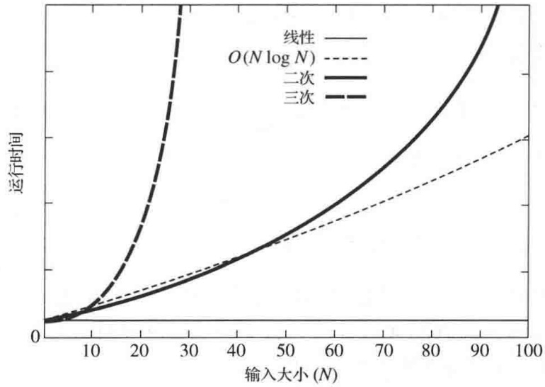
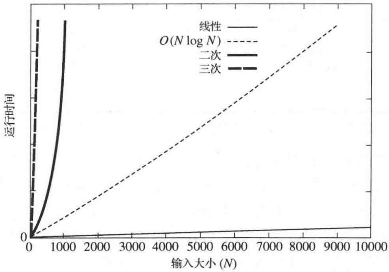

## 垃圾收集与 delete

有些语言当一个对象不再被引用时则自动进行垃圾回收，编程人员不必担心垃圾回收问题。C++不进行垃圾回收。当一个通过 new 操作符被分配地址的对象不再被引用时，必须(通过一个指针)对该对象应用 delete 操作。否则，该对象使用的内存就会丢失(直到程序终止)。这就叫作内存漏洞(memory leak)。遗憾的是，内存漏洞在许多 C++ 程序中普遍存在。不过，许多内存漏洞源(souces of memory leaks)可以自动被审慎地清除。一个重要的规则是，在能够使用自动变量(automatic variable)的时候不要使用 new 操作符。在我们的原始程序中，IntCell 对象不是由 new 来分配地址，而是作为局部变量被分配地址的。在这种情况下，当声明 IntCell 型对象的函数返回时，该 IntCell 对象所占内存就被自动回收。delete 操作符如图 1.11 的第 9 行所示。

## 指针的赋值和比较

在 C++ 中，指针变量的赋值和比较是基于指针的值，也即基于指针所存储的内存地址进行的。于是，如果它们指向相同的对象，两个指针变量相等。如果它们指向不同的对象，那么这两个指针变量是不相等的，即使所指向的两个对象本身是相等的。如果 lhs 和 rhs 是两个(相容类型的)指针变量，那么 lhs = rhs 则使得 lhs 指向 rhs 所指向的同一个对象。 $^{①}$

## 通过指针访问对象的成员

如果一个指针变量指向一个类类型的对象，那么所指对象的(可见)成员能够通过->操作符被访问，如图1.11的第6行和第7行所示。

## 取地址操作符(&)

一个重要的操作符就是取地址操作符(address-of operator) &。该操作符返回一个对象所占用的内存地址，并对实现别名(alias)测试是有用的，我们将在1.5.6节详加讨论。

## 1.5.2 左值、右值和引用

除指针类型外，C++还定义了引用类型(reference type)。C++11的主要变化之一是新的引用类型的创建，叫作右值引用(rvalue reference)。为了讨论右值引用，以及更标准的左值引用，我们需要讨论右值(rvalue)和左值(lvalue)的概念。注意，准确的法则颇为繁杂，我们这里仅提供一个一般的描述，而不纠结在一些琐碎细节上。当然，这些细节对于编程语言说明书和编译器的编制者都很重要。

一个左值(lvalue)是一个标识非临时性对象的表达式。一个右值(rvalue)是一个标识临时性对象的表达式，或者是一个不与任何对象相联系的值(如字面值常数)。

例如，考虑下列代码:

```matlab
vector<string> arr( 3 );
const int x = 2;
int y;
...
int z = x + y;
string str = "foo";
vector<string> *ptr = &arr;
```

<small><span class="docvortex-page-footnote" data-block-type="page_footnote" style="color:#6b7280">① 本书中，我们用 lhs 和 rhs 表示二元(二目)操作符的左边和右边。</span></small>

根据这些声明可知，arr、str、arr[x]、&x、y、z、ptr、\*ptr、(\*ptr)[x]都是左值。此外，x也是一个左值，不过它不是一个可修改的左值。一般的法则是，如果程序中有一个变量名，那么它就是一个左值，而不管该变量是否可被修改。

对于上面的声明，其中的 2、“foo”、x+y、str.substr(0,1) 都是右值，因为它们均为字面值 (literal)。直观地看，x+y 是一个右值，因为它的值是临时的；它当然不是 x 也不是 y，但是，在被赋值给 z 之前它要被存放在某个地方。类似的道理也适用于 str、substr(0,1)。

注意，有一点很重要，像 cin>>x>>y 和其他一些能够成为右值的操作结果一样，也存在函数调用或运算(操作)符调用的结果可以是左值的情况(因为\*ptr 和 arr[x]生成左值)。因此，C++语言的语法允许函数调用或运算(操作)符重载在返回值类型中指定为左值，这方面的讨论将在 1.5.4 节中进行。直观上看，如果函数调用计算一个其值在调用前不存在并且一旦调用终止就不再存在的表达式，那么它很可能是一个右值，除非它在别处被复制。

引用类型允许我们为一个已存在的值定义一个新的名字。在传统 C++ 中，引用一般只能是一个左值的名字，因为若有一个对临时量的引用，则将导致对理论上已经声明不再需要的对象的访问的能力，这样就可能让它的资源被声明为另外的对象所用。然而在 C++11 中，可以有两种类型的引用:左值引用和右值引用。

在 C++11 中，左值引用 (lvalue reference) 的声明是通过在某个类型后放置一个符号&来进行的。此时，一个左值引用成为了它所引用的对象的同义词(即另一个名字)。例如:

```txt
string str = "hell";
string & rstr = str;          // rstr 是 str 的另一个名字
rstr += 'o';                  // 把 str 改成 "hello"
bool cond = (&str == &rstr);     // true; str 和 rstr 是同一对象
string & bad1 = "hello";         // 非法: "hello" 不是可修改的左值
string & bad2 = str + "";             // 非法: str+"" 不是左值
string & sub = str.substr( 0, 4 ); // 非法: str.substr( 0, 4 )不是左值
```

在 C++11 中，右值引用 (rvalue reference) 是通过在某个类型后放置一个符号 && 而被声明的。右值引用与左值引用具有相同的特征，不过有一点不同于左值引用的是，右值引用也可以引用一个右值 (即一个临时量)。例如:

```txt
string str = "hell";
string && bad1 = "hello";          // 合法
string && bad2 = str + "";            // 合法
string && sub = str.substr( 0, 4 ); // 合法
```

但是，左值引用在 $\mathrm{C}++$ 中有几个明显的用途，而右值引用的功用则不那么明显。现在我们就来讨论左值引用的几个用途，右值引用放到1.5.3节讨论。

## 左值引用的用途 1:给结构复杂的名称起别名

我们将在第 5 章看到，最简单的应用是单独使用一个局部引用变量以达到重新命名一个被复杂表达式所知晓的对象的目的。我们将要看到的代码与下列代码类似:

```matlab
auto & whichList = theLists[ myhash( x, theLists.size( ) ) ];
if( find( begin( whichList ), end( whichList ), x ) != end( whichList ) )
    return false;
whichList.push_back( x );
```

这里使用了一个引用变量使得复杂得多的表达式 theLists[myhash(x,theLists.size())]

不必书写(然后再赋值)4次。但直接写成

```javascript
auto whichList = theLists[ myhash( x, theLists.size( )) ];
```

行不通。它将建立一个拷贝，然后在最后一行上的 push\_back 操作将会用于该拷贝，而不是用在原始对象上。

## 左值引用的用途 2: 范围 for 循环

第 2 个用途是在范围 for 语句上。设我们想要让一个 vector 对象所有的值都增 1，这用 for 循环很容易做到:

```txt
for( int i = 0; i < arr.size( ); ++i )
    ++arr[ i ];
```

当然, 使用范围 for 循环会更简洁。遗憾的是, 这种自然的代码做不到, 因为 x 要担任 vector 中每一个值的拷贝。

```txt
for( auto x : arr )  // 行不通
++x;
```

我们真正想要的实际上是让 x 是 vector 中每个值的另一个名字，如果 x 是一个引用，那么这很容易做到:

```txt
for( auto & x : arr ) // 行得通
++x;
```

## 左值引用的用途 3: 避免复制

假设有一个函数 findMax，它返回一个 vector 对象或其他大集合中的最大值。此时给定一个 vector arr，如果调用 findMax，那么自然会写

```javascript
auto x = findMax( arr );
```

可是要注意，如果这个 vector 存储的是一些大的对象，那么 x 就将是 arr 中最大值的一个拷贝。如果出于某种原因我们需要一个拷贝，那这样就很好；然而在很多实例中，我们只需要这个值，并不想让 x 发生任何变化。此时，声明 x 为 arr 中最大值的另一个名字将会更有效，因此我们声明 x 为一个引用(auto 将推导出常态性(constness)；若我们不使用 auto，则通常用 const 明确规定一个不可更改的引用):

```javascript
auto & x = findMax( arr );
```

正常情况下，这意味着 findMax 还要指定一个标示引用变量的返回类型(见 1.5.4 节)。

该行代码阐述两个重要的概念:

1. 引用变量常常用于避免越过函数调用界限复制对象(不管是在函数调用中还是函数返回中)。
2. 为了使用引用代替复制能够进行传递和返回，在函数声明和返回中是需要语法的。

## 1.5.3 参数传递

许多语言，包括 C 和 Java，都是用传值调用 (call-by-value) 传递所有参数的:把实参复制到形参。但是，C++ 中的参数可能是些大的复杂的对象，这些对象复制起来效率很低。再说，有时候我们还希望能够改变传递过来的值。这就造成 C++历史上产生 3 种不同的传递参数的方法，而 C++11 又添加了第 4 种。我们先描述传统 C++中的 3 种参数传递机制，然后再解释最近又添加进来的新的参数传递机制。

为了看清传值调用为什么不足以作为 $\mathrm{C}++$ 中唯一的参数传递机制的原因，考虑下面3个函数声明:

```txt
double average( double a, double b );    // 返回a和b的平均值
void swap( double a, double b );      // 交换a和b; 参数类型错误
string randomItem( vector<string> arr ); // 返回arr中的一个随机项；低效
```

average 解释了传值调用的一个理想的用法。如果我们进行调用

```txt
double z = average( x, y );
```

则传值调用把 x 复制到 a，把 y 复制到 b，然后执行在别处完全规定好了的 average 函数定义的代码。假定 x 和 y 对于 average 是不可访问的局部变量，于是保证在 average 返回时 x 和 y 是不变的，这是非常理想的性质。可是，正是这个理想的性质恰恰是传值调用对于函数 swap 执行无效的原因。如果进行调用

```txt
swap( x, y );
```

那么传值调用保证，无论函数 swap 如何实现，x 和 y 都将保持不变。现在我们需要的是声明 a 和 b 为引用型参数:

```txt
void swap( double & a, double & b ); // 交换 a 和 b; 参数类型正确
```

根据这个特征，a 是 x 的同义词，b 是 y 的同义词。于是，在 swap 的实现中对 a 和 b 的改变就是对 x 和 y 的改变。在 C++ 中，这种形式的参数传递一直被叫作传引用调用 (call-by-reference)。而在 C++11 中，它被更为技术性地称为传左值引用调用 (call-by-lvalue-reference)，不过，我们还是在本书始终使用传引用调用来表示这种形式的参数传递。

传值调用的第 2 个问题以函数 randomItem 进行阐释。该函数要从 vector arr 中返回一个随机项。原则上，这是一个快速操作，它由在 0 和 arr.size()-1 之间“随机”数的生成组成，包括确定数组的下标并将这个随机选取的数组下标对应的数组元素返回。但是，使用传值调用作为参数传递机制迫使在调用 randomItem(vec) 中对 vector vec 的复制。这比起计算和返回一个随机选取的数组下标的开销来却是一个极其昂贵的操作，完全没有必要。通常，复制一个拷贝的唯一原因是对拷贝进行修改，而保留原始的数据。但是 randomItem 根本不想做任何的改变，它只是要看一看 arr。因此，我们可以通过声明 arr 为对 vec 的常量引用以避免复制而达到相同的语义效果。这里，arr 是 vec 的同义词，不用复制，而由于它是 const 的，因此又不能被修改。这本质上提供了与传值调用相同的可见行为，其特征为

```txt
string randomItem( const vector<string> & arr ); // 返回 arr 中的一个随机项
```

这种形式的参数传递在C++中叫作传对常量引用的调用(call-by-reference-to-a-constant)，但是，由于它过于冗长并且const在&之前，因此，我们也用简单的术语传常量引用调用(call-by-constant reference)称呼它。

于是，这种先于 $\mathrm{C}++11$ 的 $\mathrm{C}++$ 参数传递机制一般可以通过两部分测试决定:

1. 如果想要形参能够改变实参的值，就必须使用传引用调用。

2. 否则，就是想要实参的值不能被形参改变。如果类型为基本类型，则使用传值调用。若不是基本类型，则类型就是类类型，并且一般使用传常量引用调用，除非实参是一个非常小且可容易复制的类型(即存储两个或更少的基本类型)。

## 换句话说:

1. 对于小的不应被函数改变的对象，采取传值调用是合适的。
2. 对于大的不应被函数改变且复制代价昂贵的对象，采取传常量引用调用是合适的。
3. 对于所有可以被函数改变的对象，采取传引用调用是合适的。

因为 C++11 增加了右值引用，所以又有了第 4 种传递参数的方式:传右值引用调用 (call-by-rvalue-reference)。其核心概念在于，由于右值存储的是要被销毁的临时量，像 x=rval 这样的表达式(其中 rval 是一个右值)可以通过移动(move)而不是复制来实现。移动一个对象的状态常常比复制它要容易得多，因为这可能就涉及一次简单的指针改变。我们这里看到的是，如果 y 是一个左值，那么 x=y 可以是一次复制，但是，如果 y 是一个右值，那就得使用一次移动。这就给出一个基于参数是左值还是右值而重载函数的基本使用情况，诸如:

```txt
string randomItem( const vector<string> & arr );  // 返回左值arr中的随机项
string randomItem( vector<string> && arr );      // 返回右值arr中的随机项
```

```txt
vector<string> v { "hello", "world" };
cout << randomItem( v ) << endl;                      // 调用左值的方法
cout << randomItem( { "hello", "world" } ) << endl; // 调用右值的方法
```

如上所示，容易检验，所写的两个函数，第2次重载对右值进行，而第1次是对左值进行的。这种做法最常见的使用是用在定义 $=$ 的行为以及编写构造函数上，具体讨论放到1.5.6节进行。

## 1.5.4 返回值传递

在 C++ 中，对于从函数返回有几种不同的机制。所使用的最直接的机制是传值返回 (return-by-value)，如下所述:

```txt
double average( double a, double b );          // 返回a和b的平均值
LargeType randomItem( const vector<LargeType> & arr );   // 潜在低效
vector<int> partialSum( const vector<int> & arr );       // 在C++11中高效
```

这些特征都表达了一个基本的想法:函数返回一个可以被调用者使用的适当类型的对象；在所有情况下函数调用的结果都是一个右值。然而，对 randomItem 的调用却含有潜在的低效风险。对 partialSum 的调用同样隐含有低效风险，尽管在 C++11 中这种调用很可能是非常有效的。

首先，考虑 rendomItem 的两种实现。第 1 种实现如图 1.12 的第 1～4 行所示，使用的是传值返回。结果，具有随机的数组下标的 LargeType 型对象将作为返回序列的一部分被复制。这种复制之所以进行，是因为一般说来返回表达式可能是右值（例如返回 x+4），因此，到函数调用在第 13 行返回时逻辑上它是不存在的。可是，在这种情况下，返回类型是一个左值，它在函数调用返回以后将长期存在，因为 arr 是与 vec 相同的。第 2 种实现利用这一点，并使用传常量引用返回 (return-by-constant-reference) 以避免直接复制，如图中第 6～9 行所示。不过，调用者必须也使用常量引用以存取这个返回值，如第 15 行所示；否则，仍将存在一个拷贝。常量引用意味着，我们不想让调用者通过使用返回值制造变化；此时需要这样，因为 arr 本身就是一个不可修改的 vector 对象。另一种做法是在第 15 行使用 auto &声明 Item3。

```txt
LargeType randomItem1( const vector<LargeType> & arr )
{
    return arr[ randomInt( 0, arr.size( ) - 1 ) ];
}

const LargeType & randomItem2( const vector<LargeType> & arr )
{
    return arr[ randomInt( 0, arr.size( ) - 1 ) ];
}

vector<LargeType> vec;
...
LargeType item1 = randomItem1( vec );          // 复制
LargeType item2 = randomItem2( vec );          // 复制
const LargeType & item3 = randomItem2( vec );   // 不复制
```

图 1.12 获得数组中的一个随机项的两种版本；第 2 种版本避免了临时 LargeType 对象的创建，但只能是当调用者用一个常量引用访问它时可行

图 1.13 阐释了一种类似的情况，即在传统的 C++ 中，由于拷贝的创建和最终的清除，传值调用是低效的。从历史上看，C++ 编程者以一种不自然的方式重写他们的代码，使用的技巧涉及到指针或一些额外的参数，降低了可读性和可维护性，最终导致编程错误。在 C++11 中，对象可以定义当看到传值返回时可以使用的移动语义。实际上，所得到的 vector 对象将被移至 sums，而该 vector 的实现则被优化以完成同样的工作，可是开销的代价却不比改变指针多多少。这意味着，可以期望图 1.13 所示的 partialSum 避免不必要的复制并且不需要任何的改变。移动语义实现的细节在 1.5.6 节讨论，vector 的实现在 3.4 节讨论。注意，移动语义可以用在图 1.13 第 9 行的结果上，但不能用在图 1.12 第 3 行的返回表达式上。这是临时和非临时之间以及左值引用和右值引用之间的差别造成的。

```cpp
vector<int> partialSum( const vector<int> & arr )
{
    vector<int> result( arr.size( ) );

    result[ 0 ] = arr[ 0 ];
    for( int i = 1; i < arr.size( ); ++i )
        result[ i ] = result[ i - 1 ] + arr[ i ];

    return result;
}

    vector<int> vec;
    ...
    vector<int> sums = partialSum( vec ); // 在老的C++中是复制；在C++11中是移动
```

图1.13 在 $\mathrm{C}++11$ 中返回栈分配的右值

除传值返回和传常量引用返回外，函数还可以使用传引用返回(return-by-reference)。这个术语用在一些允许函数调用者有权修改类的内部数据表示的地方。本书中传引用返回在1.7.2节中讨论，我们在那里介绍一种简单矩阵类的实现。

## 1.5.5 std::swap 和 std::move

整个这一节将讨论一些实例, 在这些实例中 C++11 允许程序员很容易地使用 move(移动)取代昂贵的复制。这方面的另一个例子是 swap 例程的实现。如图 1.14 所示, 使用 3 次复制可以容易地实现两个 double 型数据的交换。然而, 尽管同样的做法也能完成对两个类型更大的数据的交换, 但它是通过巨大的代价得到的: 此时的复制非常昂贵! 不过容易看到, 没有必要复制, 我们实际想要的是移动而不是复制。在 C++11 中, 如果赋值运算符的右边 (或构造函数) 是一个右值, 那么当对象支持移动操作时我们能够自动地避免复制。换句话说, 如果 vector&lt;string&gt; 支持高效的移动, 而且第 10 行上的 x 又是一个右值, 那么 x 就可以移动到 tmp; 类似地, 如果第 11 行上的 y 是一个右值, 那么它可以移动到 x。事实上, vector 真的确实支持移动; 不过, 第 10、11、12 行上的 x、y 和 tmp 却都是左值 (记住, 如果对象有名字, 那么它就是一个左值)。图 1.15 指出了这个问题是如何解决的: swap 在第 1\~6 行上的实现说明, 我们可以用一次强制转换来处理作为右值的第 10\~12 行的右边。这种静态强制转换的语法规则令人生畏; 幸运的是, 存在函数 std::move, 它能够把任何左值 (或右值)转换成右值。注意, 这里的名字有误导性; std::move 并不移动任何数据。确切地说, 它使一个值易于移动。std::move 的使用在图 1.15 的第 8\~13 行 wap 经过修改的实现中也得到了证明。交换函数 std::swap 也是标准库的一部分, 它可对任何类型的数据进行交换。

```lisp
void swap( double & x, double & y )
{
    double tmp = x;
    x = y;
    y = tmp;
}

void swap( vector<string> & x, vector<string> & y )
{
    vector<string> tmp = x;
    x = y;
    y = tmp;
}
```

图 1.14 通过 3 次复制的交换

```cpp
void swap( vector<string> & x, vector<string> & y )
{
    vector<string> tmp = static_cast<vector<string> &&>( x );
    x = static_cast<vector<string> &&>( y );
    y = static_cast<vector<string> &&>( tmp );
}

void swap( vector<string> & x, vector<string> & y )
{
    vector<string> tmp = std::move( x );
    x = std::move( y );
    y = std::move( tmp );
}
```

图 1.15 通过 3 次移动进行交换。第 1 种交换通过强制类型转换实现，第 2 种交换使用的是 std::move

## 1.5.6 五大函数:析构函数，拷贝构造函数，移动构造函数，拷贝赋值 operator=，移动赋值 operator=

在 C++11 中，类是和 5 个特殊的函数紧密相关的，上面已经写出。它们是析构函数 (destructor)、拷贝构造函数 (copy constructor)、移动构造函数 (move constructor)、拷贝赋值运算符 (copy assignment operator) 和移动赋值运算符 (move assignment operator)。整体上总称它们为五大函数 (big-five)。在许多情况下我们能够接受由编译器对五大函数所提供的默认行为，可有时候则不能。

## 析构函数

只要一个对象运行越出范围，或经受一次 delete，则析构函数就要被调用。典型情况下，析构函数的唯一责任就是释放掉在对象使用期间获得的资源，包括关于任意的 new 操作调用对应的 delete，关闭任何打开的文件，等等。默认做法是对每个数据成员应用析构函数。

## 拷贝构造函数和移动构造函数

有两个特殊的构造函数用来构造一个新的对象，它被初始化为与另一个同样类型对象相同的状态。如果这个已存在的对象是一个左值，那么就用拷贝构造函数；而如果这个已存在的对象是一个右值(即一个迟早要被删除的临时量)，那么就用移动构造函数。对于任意对象，例如 IntCell 这样的对象，在下述实例中将调用拷贝构造函数或移动构造函数:

\- 带有初始化的声明，如

```txt
IntCell B = C;    // 若C是左值则调用拷贝构造函数；若C是右值则调用移动构造函数
IntCell B { C }; // 若C是左值则调用拷贝构造函数；若C是右值则调用移动构造函数
```

但不适用于

```txt
B = C; // 赋值运算符，将在后面讨论
```

- 前面提到过，使用传值调用(而不是通过&或 const &)所传递的对象很少这么做。
- 传值返回(而不是通过&或 const & 返回)的对象。同样，如果返回的对象是一个左值，则调用拷贝构造函数；如果是一个右值，则调用移动构造函数。

默认情况下，拷贝构造函数的实现是通过将拷贝构造函数依次应用到每个数据成员来完成的。对于基本类型的数据成员(例如 int、double 或指针)，进行简单的赋值即可。我们的 IntCell 类的数据成员 storedValue 就属于这种情况。对于本身就是类对象的数据成员，则对于每个这样的数据成员的类，拷贝构造函数或移动构造函数将视情况被用于它们的数据成员上。

## 拷贝赋值和移动赋值(operator=)

当 $=$ 用于两个先前均被构造过的对象时，则调用赋值运算符。lhs=rhs 是要拷贝 rhs 的状态到 lhs 上。如果 rhs 是一个左值，那么这可通过使用拷贝赋值运算符完成；如果 rhs 是一个右值(即一个将要被回收的临时量)，那么这可通过使用移动赋值运算符做到。默认时，拷贝赋值运算符是通过依次把拷贝赋值运算符用于每一个数据成员而被实现的。

## 默认情形

如果考查 IntCell 类，我们会发现默认值完全可以接受，因此也就不必再做任何工作。

情况常常是这样。如果一个类由一些数据成员组成，而这些数据成员只是一些基本类型的数据以及对其进行默认处理有意义的对象，那么这个类的默认值通常是有意义的。于是，一个其数据成员是 int、double、vector&lt;int&gt;、string 甚至 vector&lt;string&gt; 的类均可接受默认情形。

主要的问题发生在包含有指针作为数据成员的类中。我们将在第3章详细地描述和解决这个问题，现在，我们先概述这个问题。设该类包含一个数据成员，它是个指针。这个指针指向一个动态定址的对象。默认的析构函数对那些指针类型的数据成员无能为力(最佳理由——回忆:我们必须delete我们自己)。不仅如此，拷贝构造函数和拷贝赋值运算符均复制指针的值而不是指针所指向的对象。这样，我们将有两个类实例，它们都包含指针，而指针又都指向相同的对象。这就是所谓的浅拷贝(shallow copy)。但典型的情况是我们应该得到深拷贝(deep copy)，从而得到整个对象的复制品。因此结果是，当一个类包含指针作为数据成员时，重要的是深层语义，一般我们必须自己实现析构函数、拷贝赋值和拷贝构造函数。这么做排除了移动的默认情形，因此还必须实现移动赋值和移动构造函数。作为一般法则，或者我们接受对所有5种操作的默认处理，或者应该声明并显式定义所有5个函数的默认情形(使用关键字default)，或者每个都不予接受(使用关键字delete)。一般来说，我们对所有的5个函数都给出定义。

对于 IntCell，这些操作的形式是

```txt
~IntCell( );                                // 析构函数
IntCell( const IntCell & rhs );                 // 拷贝构造函数
IntCell( IntCell && rhs );                    // 移动构造函数
IntCell & operator= ( const IntCell & rhs );          // 拷贝赋值
IntCell & operator= ( IntCell && rhs );              // 移动赋值
```

operator=的返回类型是对调用对象的一个引用，以便允许链式赋值 a=b=c。虽然返回类型似乎应该是一个常量引用，以便禁止像  $(a=b)=c$  这样的谬误，但这样的表达式事实上在 C++ 中甚至对整型量都是允许的。因此，习惯上是使用引用返回类型（而不是常引用返回类型）的，但却不是语言规范所严格要求的。

如果编写五大函数中的任一个，那么显式地考虑所有其他的几个会是个好习惯，因为默认值可能非法或不当。在一个简单的例子里，调试代码放在析构函数中，这就保证不会产生默认的移动操作。虽然产生一些未指明的拷贝操作，但这种保证还是会遭到反对从而不可能出现在语言未来的版本中。因此，最好是再次显式地列出拷贝和移动操作:

```txt
~IntCell( ) { cout << "Invoking destructor" << endl; }      // 析构函数
IntCell( const IntCell & rhs ) = default;                 // 拷贝构造函数
IntCell( IntCell && rhs ) = default;                    // 移动构造函数
IntCell & operator= ( const IntCell & rhs ) = default;     // 拷贝赋值
IntCell & operator= ( IntCell && rhs ) = default;         // 移动赋值
```

另一种做法是不允许对 IntCell 对象的所有复制和移动:

```javascript
IntCell( const IntCell & rhs ) = delete;          // 无拷贝构造函数
IntCell( IntCell && rhs ) = delete;            // 无移动构造函数
IntCell & operator= ( const IntCell & rhs ) = delete;     // 无拷贝赋值
IntCell & operator= ( IntCell && rhs ) = delete;         // 无移动赋值
```

如果在编写的例程中默认操作有意义，那么我们将总是接受它们。然而，如果这些默认操作没有意义，那么就需要实现析构函数、拷贝和移动构造函数，以及拷贝和移动赋值运算符。当默认操作不起作用时，拷贝赋值运算符一般能够通过使用拷贝构造函数创建一个拷贝然后将其与现有的对象交换来实现。移动赋值运算符一般可以通过逐项交换成员来实现。

## 当默认操作不起作用时

最常见的默认操作不起作用的情况出现在数据成员为指针类型，并且指针由某个对象成员函数(譬如构造函数)定址的时候。例如，设我们通过动态定址一个 int 型变量来实现 IntCell，如图 1.16 所示。为简单起见，我们不把接口和实现分开。

```cpp
class IntCell
{
    public:
        explicit IntCell( int initialValue = 0 )
            { storedValue = new int{ initialValue }; }

        int read( ) const
        { return *storedValue; }
        void write( int x )
            { *storedValue = x; }

    private:
        int *storedValue;
};
```

图1.16 数据成员为一指针，默认操作有问题

现在有很多问题在图 1.17 中暴露了出来。首先，输出是 3 个 4，可是逻辑上只有 a 应该是 4。问题在于，默认的拷贝赋值运算符和拷贝构造函数复制了指针 storedValue。于是，a.storedValue、b.storedValue、c.storedValue 都指向同一个 int 量。这些复制均为浅拷贝 (shallow copy)，被复制的是这些指针而不是被指向的对象。其次，不太明显的问题是内存漏洞。由 a 的构造函数初始定位的 int 型变量依旧定位不变但需要被回收。由 c 的构造函数定位的 int 型变量不再被任何指针变量引用，它也需要回收，但我们不再有指针指向它。

```txt
int f( )
{
    IntCell a{ 2 };
    IntCell b = a;
    IntCell c;

    c = b;
    a.write( 4 );
    cout << a.read( ) << endl << b.read( ) << endl << c.read( ) << endl;

    return 0;
}
```

图1.17 揭示图1.16中问题的简单函数

为了解决这些问题, 我们实现五大函数。结果(还是不用将接口与实现分离)如图 1.18 所示。可以看到, 一旦析构函数被实现, 浅拷贝就将导致一个编程错误: 两个 IntCell 对象使它们的 storedValue 指向同一个 int 对象。一旦第 1 个 IntCell 对象的析构函数被调用以回收其 storedValue 指针正在关注的对象，第 2 个 IntCell 对象拥有的 storedValue 指针就过时了。这就是为什么即使写出析构函数，C++11 也要反对前面允许默认拷贝操作的原因。

```cpp
class IntCell
{
    public:
        explicit IntCell( int initialValue = 0 )
            { storedValue = new int{ initialValue }; }

        ~IntCell( )
            { delete storedValue; }

        IntCell( const IntCell & rhs )
            { storedValue = new int{ *rhs.storedProcedure }; }

        IntCell( IntCell && rhs ) : storedValue{ rhs.storedProcedure }
            { rhs.st HuluValue = nullptr; }

        IntCell & operator= ( const IntCell & rhs )
            {
                if( this != &rhs )
                    *storedValue = *rhs.st HuluValue;
                return *this;
            }

        IntCell & operator= ( IntCell && rhs )
            {
                std::swap( storedValue, rhs.st HuluValue );
                return *this;
            }

        int read( ) const
        { return *storedValue; }
        void write( int x )
            { *storedValue = x; }

    private:
        int *storedValue;
};
```

图1.18 数据成员是指针；写出五大函数

在第 16～21 行上的拷贝赋值运算符用到一个检测第 18 行上混乱现象(即自我赋值，客户端正在调用 obj=obj)的标准格式，然后在需要时依次复制每个数据域。在结束的时刻，使用 \*this 返回对它自己的引用。在 C++11 中，常常使用拷贝和交换格式(copy-and-swap idiom)编写拷贝赋值，导致另一种实现方法:

```cpp
IntCell & operator= ( const IntCell & rhs )          // 拷贝赋值
{
    IntCell copy = rhs;
    std::swap( *this, copy );
    return *this;
}
```

第 18 行上利用拷贝构造函数将 rhs 的一个拷贝置入 copy。然后, 这个 copy 被交换到 \*this 中, 而把老内容放入 copy。在返回时刻, 为 copy 调用析构函数, 清理旧内存。对于 IntCell 这有些低效, 但对其他类型, 特别是那些拥有许多复杂的互相影响的数据成员的类型来说, 这是相当不错的默认操作。注意, 如果 swap 是使用图 1.14 中基本的拷贝算法来实现的, 那么拷贝和交换格式(copy-and-swap idiom)将行不通，因为这里存在一个相互无终止的递归。在C++11中有一个基本预期，即交换运算或者使用3次移动实现，或者通过逐项交换成员实现。

在第 13 行和第 14 行的移动构造函数把数据表示从 rhs 移动到 \*this，然后设置 rhs 的原始数据(包括指针)到合法但容易被销毁的状态。注意，如果存在非原始数据，那么这些数据必须被移入初始化表列中。例如，如果还有 vector&lt;string&gt; items，则此时构造函数将是:

```txt
IntCell( IntCell && rhs ) : storedValue{ rhs.storedValue },          // 移动构造函数
            items{ std::move( rhs.items ) }
{ rhs.storedValue = nullptr; }
```

最后，第 23～27 行上的移动赋值运算符是通过逐项成员交换实现的。注意，有时候它是以与拷贝赋值运算符相同的方式作为一次对象交换实现的，但是，这只有当交换本身作为逐项成员交换实现时才行得通。如果交换由 3 次移动实现，那么我们将会陷入相互无休止的递归之中。

## 1.5.7 C 风格数组和字符串

C++语言提供了一个内置的 C 风格数组类型。为声明由 10 个整数组成的数组 arr1，我们可以写成:

```txt
int arr1[ 10 ];
```

arr1 实际上是一个指向大到足以存储 10 个 int 型量的内存的指针，而不是一个第一类数组类型。于是，将=用于数组即企图拷贝两个指针的值而非整个数组，由上面的声明可知这是非法的，因为 arr1 是一个常量指针。当 arr1 被传递到函数时，传递的只是指针的值，而关于指针大小的信息就丢失了。因此，数组大小必须作为一个附加的参数被传递过去。因为大小是未知的，所以不存在下标范围的检测。

在上面的声明中，数组的大小在编译时必须要知道。不能让一个变量取代10。如果大小未知，那么必须显式地声明一个指针并通过new[]安排内存。例如，

```txt
int *arr2 = new int[ n ];
```

现在 arr2 的表现像 arr1，但它不是常量指针。于是，它可以指向一大块内存。可是，由于内存是被动态地分配的，因此在某个时刻必须使用 delete[] 将其释放:

```sql
delete [] arr2;
```

否则，内存漏洞将会产生，而且如果数组很大，所产生的漏洞就相当可观了。

内置 C 风格字符串 (build-in C-style string) 是作为字符数组来实现的。为避免传递字符串长度，我们让特殊的空终止符 (null-terminator) '\0' 作为一个字符用于表示字符串的逻辑结尾。字符串通过 strcpy 进行复制，使用 strcmp 进行比较，而其长度则由 strlen 确定。单个的字符可以通过数组下标操作符来访问。这些字符串都有与数组相关的问题，包括困难的内存管理，而下面的事实更使问题严重化:当字符串被复制时，是假设目标字符串大到足以容纳下复制的结果的。当容纳不下时，常常因为没有空间容纳空终止符而不得不进行困难的调试。

标准的 vector 类和 string 类通过隐藏内置 C 风格数组和字符串的行为来实现。第 3 章讨论 vector 类的实现。使用 vector 和 string 类几乎总是更好一些，但是，当与设计使用 C 和 C++ 工作的库例程交互时我们不得不使用 C 风格。在为提高速度而必须进行优化的代码段中使用 C 风格有时候(但只是偶尔)也是需要的。

## 1.6 模板

考虑在一个数组中查找最大项的问题。一个简单的算法就是顺序扫描，在扫描中我们依序考查每一项，保持对最大值的跟踪。作为许多算法的典型，顺序扫描算法是类型无关的。所谓类型无关(type independent)，这里指的是算法的逻辑不依赖存储在数组中的项的类型。同样的逻辑对于整数数组、浮点数数组，或能够有意义地定义比较操作的任何类型的数组都能使用。

本书中，我们将描述类型无关的算法和数据结构。当为一个类型无关的算法或数据结构编写 C++代码时，我们更愿意把代码编写一次，而不是对每个不同的类型都重新编码。

在这一节里，我们将描述类型无关的算法 [也称为泛型算法(generic algorithm)] 如何通过 C++ 使用模板(template) 编写。我们从讨论函数模板开始，然后再考查类模板。

## 1.6.1 函数模板

一般说来，函数模板很容易编写。一个函数模板(function template)不是一个具体的函数，而是可以变成一个函数的型式。图1.9阐释了一个函数模板 findMax。其中包含template声明的那一行指出，Comparable是一个模板参数:它可能被任何类型替代而生成一个函数。例如，如果用vector&lt;string&gt;作为参数对findMax进行调用，那么通过用string代替Comparable将生成一个函数。

```txt
/**
 * 返回数组 a 中的最大项.
 * 假设 a.size( ) > 0.
 * 可比较的对象必须提供 operator<和 operator=
 */
template <typename Comparable>
const Comparable & findMax( const vector<Comparable> & a )
{
    int maxIndex = 0;

    for( int i = 1; i < a.size( ); ++i )
        if( a[ maxIndex ] < a[ i ] )
            maxIndex = i;
    return a[ maxIndex ];
}
```

图1.19 findMax函数模板

图 1.20 解释函数模板在需要时可自动展开。应该注意到，每个新类型的展开都会产生附加的代码，当它发生在大的项目中的时候，就叫作代码膨胀(code bloat)。还要注意，调用 findMax(v4) 将导致编译时错误(compile-time error)。这是因为当 Comparable 被 IntCell 替换时，图 1.19 的第 12 行变成非法的了，不存在为 IntCell 定义的 < 函数。于是，习惯上在任何模板之前要安排一些注释，解释关于(一些)模板参数都有哪些假设，包括关于需要一些什么类型的构造函数。

因为模板参数可以假设为任意的类类型，所以在决定参数传递和返回传递的约定时，应该假定模板参数不是基本类型。这就是为什么我们采用常量引用返回的原因。

毫不奇怪，存在许多神秘的法则处理函数模板。大部分的问题出现在模板不能为参数提供准确匹配但可以(通过隐式类型转换)接近它的时候。必须有一些方法以解决歧义问题，而相关规则是相当复杂的。注意，如果存在一个非模板和一个模板且都匹配，那么非模板有优先权。还要注意，如果出现两个同等近似程度的匹配，那么代码非法并且编译程序将宣示二义性。

```cpp
int main( )
{
    vector<int>      v1( 37 );
    vector<double> v2( 40 );
    vector<string> v3( 80 );
    vector<IntCell> v4( 75 );

    // 填入到未显示的那些 vector 中的附加代码

    cout << findMax( v1 ) << endl;  // OK: Comparable = int
    cout << findMax( v2 ) << endl;  // OK: Comparable = double
    cout << findMax( v3 ) << endl;  // OK: Comparable = string
    cout << findMax( v4 ) << endl;  // 非法; operator<未定义

    return 0;
}
```

图 1.20 findMax 函数模板的使用

## 1.6.2 类模板

在最简单版本的情形下，类模板的工作很像函数模板。图 1.21 显示的是 MemoryCell 模板。假设 Object 有一个零参数构造函数、一个拷贝构造函数和一个拷贝赋值运算符，MemoryCell 虽像 IntCell 类，但是却为任何类型的 Object 工作。

```cpp
/**
 * 一个模拟内存单元的类.
 */
template <typename Object>
class MemoryCell
{
    public:
        explicit MemoryCell( const Object & initialValue = Object{ } )
            : storedValue{ initialValue } { }
        const Object & read( ) const
            { return storedValue; }
        void write( const Object & x )
            { storedValue = x; }
    private:
        Object storedValue;
};
```

图1.21 接口和实现未分离的MemoryCell类模板

注意, Object 是通过常量引用传递的。还要注意, 构造函数的默认参数不是 0 , 因为 0 不可能是一个合理的 Object 对象。取而代之的, 默认参数则是使用零参数构造函数构造一个 Object 对象所得的结果。

图 1.22 显示出 MemoryCell 如何能够用来既存储基本类型又存储类类型的对象。注意，MemoryCell 不是一个类；它只是一个类模板。MemoryCell&lt;int&gt; 和 MemoryCell &lt;string&gt; 才是两个具体的类。

```cpp
int main( )
{
    MemoryCell<int>    m1;
    MemoryCell<string> m2{ "hello" };

    m1.write( 37 );
    m2.write( m2.read( ) + "world" );
    cout << m1.read( ) << end1 << m2.read( ) << end1;

    return 0;
}
```

图1.22 使用MemoryCell类模板的程序

如果把类模板作为一个单一的整体来实现, 那么几乎没有什么语法负担 (syntax baggage)。实际上, 许多类模板就是使用这种方式实现的, 因为当前模板的分离式编译在许多平台上都不是工作得很好。因此, 在许多情形下, 整个的类连同它的实现必须放在一个 .h 文件中。STL 流行的实现方法遵循的就是这个策略。

另一个做法是将类模板的接口和实现分离，见附录 A 中的讨论。这就添加了额外的语法和负担，并且从历史上看一直难以使编译器干净地进行处理。为使本书避免额外的语法，我们在必要时以在线代码的形式提供不进行接口和实现分离的类模板。在图中所显示的接口恰像使用了分离编译，但所示成员函数的实现又像是在避免分离式编译。这就使我们回避了对语法的纠缠。

## 1.6.3 Object、Comparable 和一个例子

在本书中，Object 和 Comparable 作为泛型类型被反复使用。假设 Object 有一个零参数构造函数、一个 operator=，以及一个拷贝构造函数。Comparable 正如在 findMax 例中所建议的，有一个以 operator<的形式用于提供全序的附加功能。 $^{①}$

图 1.23 显示了一个类类型的例子，它实现了对 Comparable 要求的功能，同时阐释了运算符重载 (operator overloading)。运算符重载使我们能够为内置运算符重新定义一个含义。Square 类通过存储边长来表示一个正方形并定义了 operator<。该 Square 类还提供了零参数构造函数、operator=以及拷贝构造函数(均为默认)。这样，它足以作为 findMax 中的 Comparable 对象来使用。

图 1.23 显示了一个最小的实现，并且还阐释了为一个新的类类型提供输出函数而广泛使用的模式。该模式是要提供一个叫作 print 的 public 型成员函数，该函数接收 ostream 对象作为其参数。此后，这个 public 型的函数可以被一个全局的、非类类型的函数 operator<<调用，而这个函数接收一个 ostream 对象和一个将要输出的对象。

<small><span class="docvortex-page-footnote" data-block-type="page_footnote" style="color:#6b7280">① 在第 12 章的一些数据结构除 operator<外还使用 operator==。注意，为了达到提供全序的目的，如果 a>b 和 a<b 都不成立，则 a==b。因此，operator==的使用就是为了方便。</span></small>

```cpp
class Square
{
    public:
        explicit Square( double s = 0.0 ) : side{ s }
        { }

        double getSide( ) const
        { return side; }
        double getArea( ) const
        { return side * side; }
        double getPerimeter( ) const
        { return 4 * side; }

        void print( ostream & out = cout ) const
        { out << "(square " << getSide( ) << ")"; }
        bool operator< ( const Square & rhs ) const
        { return getSide( ) < rhs.getSide( ); }

    private:
        double side;
};

// 为Square定义一个输出操作符
ostream & operator<< ( ostream & out, const Square & rhs )
{
    rhs.print( out );
    return out;
}

int main( )
{
    vector<Square> v = { Square{ 3.0 }, Square{ 2.0 }, Square{ 2.5 } };

    cout << "Largest square: " << findMax( v ) << endl;

    return 0;
}
```

图1.23 Comparable可以是一个类类型，如Square

## 1.6.4 函数对象

在 1.6.1 节中，我们展示了函数模板如何能够用于编写泛型算法。作为一个例子，图 1.19 中的函数模板可以用来找出数组中的最大项。

然而，模板有一个重要的局限:它只对那些定义了 operator<函数的对象有效，这个 operator<是模板用来作为所有比较判断的基础的。在许多情况下，这种处理不是可行的。例如，假设 Rectangle 类将实现 operator<运算，但即使实现了，它所含有的 compareTo 方法也许还不是我们想要的。比如，给定一个  $2 \times 10$  的矩形和一个  $5 \times 5$  的矩形，哪个是更大的矩形呢？答案要看我们使用的是面积还是长度来决定。或许我们正在试图把矩形装入一个洞口中，那么，更大的矩形就是具有更大的最小边长的矩形。作为第 2 个例子，如果我们想要找出字符串数组中最大的字符串(以字典序位于最后者)，那么默认的 operator<不能忽视字符的大小写区别，于是，“ZEBRA”应该考虑以字典序位于“alligator”之前，而这可能并不是我们想要的。第3个例子发生在有一个指向对象的指针数组的情况中(在利用所谓的继承特性的高级 C++程序中这种情况会经常出现，我们不打算在本书里过多地使用它)。

在这些情况下的解决办法是重写 findMax 函数来接收两个参数:一个是对象的数组，另一个是解释如何决定两个对象中哪个更大、哪个更小的比较函数。实际上，数组对象不再知道如何比较它们自己，这个信息完全从数组里的对象中分离了。

一种将函数作为参数传递的灵巧方法是考虑到一个对象既包含数据又包含成员函数，于是我们可以定义没有数据而只有一个函数的类，并传递该类的一个实例。实际上，是通过把函数放入一个对象之内来传递它。这个对象通常被称为函数对象(function object)。

图 1.24 展示函数对象想法的最简单的实现。findMax 接收的第 2 个参数是一个泛型类型。为使 findMax 模板展开而不出错误，这个泛型类型必须要有一个叫作 isLessThan 的成员函数，它需要第一个泛型类型 (Object) 的两个参数，并返回一个 bool 值。否则，当编译器企图展开模板时将在第 9 行上产生一个错误。在第 25 行上，我们看到，findMax 通过传递一个字符串数组以及一个包含带有两个字符串作为参数的 isLessThan 方法的对象而被调用。

```cpp
// 泛型findMax, 带有一个函数对象, Version #1
// 前提: a.size( ) > 0
template <typename Object, typename Comparator>
const Object & findMax( const vector<Object> & arr, Comparator cmp )
{
    int maxIndex = 0;

    for( int i = 1; i < arr.size( ); ++i )
        if( cmp.isLessThan( arr[ maxIndex ], arr[ i ] ) )
            maxIndex = i;

    return arr[ maxIndex ];
}

class CaseInsensitiveCompare
{
    public:
        bool isLessThan( const string & lhs, const string & rhs ) const
        { return strcasecmp( lhs.c_str( ), rhs.c_str( )) < 0; }
};

int main( )
{
    vector<string> arr = { "ZEBRA", "alligator", "crocodile" };
    cout << findMax( arr, CaseInsensitiveCompare{ }) << endl;

    return 0;
}
```

图 1.24 使用函数对象作为 findMax 的第 2 个参数的最简单思路，输出为 ZEBRA

C++函数对象使用这种基本思路来实现，但是用到一个奇特的语法。首先，我们不是使用带有名字的函数，而是使用运算符重载。不是使用作为函数的 isLessThan 方法，而是使用 operator()。其次，当调用 operator() 时，cmp.operator()(x,y) 可以简写成 cmp(x,y) [换句话说，它看起来像是函数调用，因而 operator() 被称为函数调用操作符(function call operator)]。结果，参数名可以改成更有意义的 isLessThan，而调用则是 isLessThan(x,y)。再次，我们可以提供一个不用函数对象就能工作的 findMax 版本。它的实现用到标准库函数对象模板 less(定义于头文件 functional 中) 以生成一个强制使用正常默认顺序的函数对象。

图 1.25 展示使用更为典型的、多少有些隐秘的 C++ 风格的实现。

```cpp
// 泛型 findMax, 用到一个函数对象, C++ 风格
// 前提: a.size( ) > 0
template <typename Object, typename Comparator>
const Object & findMax( const vector<Object> & arr, Comparator isLessThan )
{
    int maxIndex = 0;

    for( int i = 1; i < arr.size( ); ++i )
        if( isLessThan( arr[ maxIndex ], arr[ i ] ) )
            maxIndex = i;

    return arr[ maxIndex ];
}

// 泛型findMax, 使用默认的排序
#include <functional>
template <typename Object>
const Object & findMax( const vector<Object> & arr )
{
    return findMax( arr, less<Object>{ } );
}

class CaseInsensitiveCompare
{
    public:
        bool operator( )( const string & lhs, const string & rhs ) const
        { return strcasecmp( lhs.c_str( ), rhs.c_str( )) < 0; }
};

int main( )
{
    vector<string> arr = { "ZEBRA", "alligator", "crocodile" };

    cout << findMax( arr, CaseInsensitiveCompare{ } ) << endl;
    cout << findMax( arr ) << endl;

    return 0;
}
```

图1.25 使用一个 $\mathrm{C + + }$ 风格函数对象，用到findMax的第2个版本。输出为ZEBRA，然后输出crocodile

在第 4 章将给出一个类的例子，它需要把其所存放的项排序。我们将用 Comparable 编写大部分代码，并展示使用函数对象所需要的调整。在本书其他地方，我们将避免函数对象的细节以保持代码尽可能简单，因为我们知道，以后把函数对象添加进去并不困难。

## 1.6.5 类模板的分离式编译

像正规的类一样，类模板或者可以完全在它们的声明中实现，或者可以把接口从实现中分离出去。然而，模板分离式编译的编译器支持从历史上看一直不足而且需要特殊的平台。因此，在很多情形下，整个类模板和它的实现一起被放到单一的头文件中。标准库(Standard Library)的流行实现方法都遵循这种策略来实现类模板。

附录 A 描述模板分离编译中涉及到的机制。模板接口的声明正是我们期望的:成员函数以一个分号结尾，不提供实现。但如附录 A 所示，成员函数的实现能够导致看起来相当复杂的语法，特别是像 operator=这样复杂的函数。更糟的是，当编译时，编译器常常报出丢失函数的错误，而避免这个问题需要特殊平台去解决。

因此，在伴随本书的在线代码中，我们实现所有类模板完全都是在它们单一头文件的声明中进行的。之所以这么做，是因为它似乎是避免跨平台编译问题的唯一方法。在本书中，当阐释代码时，我们提供的类接口就像分离编译是依序进行，因为它易于展现，而实现则如在线代码所示。在一个特殊平台方式下，如果需要，可以机械地把我们的单独头文件实现转换成分离式编译实现。参见附录 A 的某些不同的方案，它们也许适用。

## 1.7 使用矩阵

第 10 章中的几个算法用到二维数组，一般称之为矩阵(matrix)。C++库不提供 matrix 类。不过，合理的 matrix 类能够很快地被写出来。其基本想法是使用一些向量的向量来完成。这个工作需要操作符重载的附加知识。对于 matrix 类，我们为其定义 operator[]，即数组下标运算符(array-indexing operator)。matrix 类在图 1.26 中给出。

```cpp
#ifndef MATRIX_H
#define MATRIX_H

#include <vector>
using namespace std;

template <typename Object>
class matrix
{
    public:
        matrix( int rows, int cols ) : array( rows )
        {
            for( auto & thisRow : array )
                thisRow.resize( cols );
        }

        matrix( vector<vector<Object>> v ) : array{ v }
        { }
        matrix( vector<vector<Object>> && v ) : array{ std::move( v ) }
        { }
```

图1.26 一个完整的matrix类

```cpp
const vector<Object> & operator[]( int row ) const
        { return array[ row ]; }
        vector<Object> & operator[]( int row )
        { return array[ row ]; }

        int numrows( ) const
        { return array.size( ); }
        int numcols( ) const
        { return numrows( ) ? array[ 0 ].size( ) : 0; }
    private:
        vector<vector<Object>> array;
};
#endif
```

图 1.26(续) 一个完整的 matrix 类

## 1.7.1 数据成员、构造函数和基本访问函数

矩阵通过 array 型数据成员来表示，该数据成员被声明为 vector&lt;Object&gt;的一个 vector 类的对象。构造函数首先把 array 构造成具有 rows 个元素，每个元素都是 vector&lt;Object&gt;类型对象，而这些对象均是由零参数构造函数构造而得的向量。因此，我们有 rows 个零长度的 Object 的向量。

然后进入构造函数的函数体，每行的大小被调整为有 cols 个列位置。于是，构造函数随着二维数组的显现而终止。此时，numrows 和 numcols 两个访问函数就很容易地实现了，如图 1.26 所示。

## 1.7.2 operator[]

operator[]的思路是这样,如果我们有一个矩阵m,那么m[i]就应该返回对应matrix m的第i行的向量。若是这样,则经过正常的vector的下标运算,m[i][j]将给出向量m[i]中位置j上的元素。因此, matrix的operator[]返回一个vector&lt;Object&gt;类型的实体,而不是Object对象。

现在我们知道，operator[]应该返回一个vector&lt;Object&gt;类型的实体。那么我们应该使用传值返回、传引用返回还是传常量引用返回呢？传值返回可以立即被排除，因为返回的实体是大的，而在调用后是保证存在的。于是，下面我们再看传引用返回或传常量引用返回。考虑下面的方法(忽略矩阵大小不同或不兼容的可能性，它们都不影响算法):

```txt
void copy( const matrix<int> & from, matrix<int> & to )
{
    for( int i = 0; i < to.numrows( ); ++i )
        to[ i ] = from[ i ];
}
```

在 copy 函数中，我们试图将 matrix from 的每一行复制到 matrix to 对应的行上。很清楚，如果 operator[] 返回一个常量引用，那么 to[i] 就不能出现在赋值语句的左边。于是，operator[] 就应该返回一个引用。可是，要是我们真的这么做，则像 from[i]=to[i] 这样的表达式就会编译，因为即使 from 是常量矩阵，from[i] 也不会是一个常向量。在完善的设计中这是不能允许的。

因此，我们实际需要的是让 operator[] 返回一个 from 的常量引用，而不是 to 的简单引用。换句话说，我们需要两种版本的 operator[]，它们只是在返回类型上不同。这是不允许的。然而，这里有一线生机:由于成员函数的定常性(const-ness)(即一个函数是否是访问函数或是修改函数)是特征的一部分，因此我们能够让 operator[] 的访问函数版返回一个常量引用，并让修改函数版返回一个简单的引用。这样，问题全部解决，如图 1.26 所示。

## 1.7.3 五大函数

这 5 个函数均可被自动地处理，因为 vector 已经对其做了处理。因此，这里所列出的就是一个完整功能的 matrix 类所需要的全部代码。

## 小结

本章为本书其余部分搭建了一个舞台。面对大量的输入，一个算法所花费的时间将是决定其是否是好算法的重要标准。（当然，正确性是最重要的。）我们将从下一章开始处理这些问题，并将利用本章讨论过的数学知识来建立一个正式的模型。

## 练习

1.1 编写一个程序解决选择问题 (selection problem)。令 k = N/2。画出表格显示所编程序对于 N 的各种不同值的运行时间。
1.2 编写一个程序求解字谜游戏问题(word puzzle problem)。
1.3 只使用处理 I/O 的 printDigit 方法, 编写函数以输出一个任意的 double 型量(可以是负的)。
1.4 C++允许拥有形如
#include filename
的语句，它将 filename 读入并将其内容插入并替换 include 语句。include 语句可以嵌套。换句话说，文件 filename 本身还可以包含 include 语句，但是显然一个文件在任何链接中都不能包含它自己。编写一个程序，读入一个文件并且输出这个被一些 include 语句修整后的文件。
1.5 编写一个递归函数 (recursive function)，它返回数 $N$ 的二进制表示中 1 的个数。利用如下事实:如果 $N$ 是奇数，那么它等于 $N/2$ 的二进制表示中 1 的个数加 1。
1.6 编写带有下列声明的两个例程:
void permute( const string & str );
void permute( const string & str, int low, int high );
第一个例程是个驱动程序，它调用第二个例程并显示 string str 中的字符的所有排列。如果 str 是"abc"，则输出的那些字符串则是 abc, acb, bac, bca, cab 和 cba。第二个例程使用递归 (recursion)。
1.7 证明下列公式:

a.  $\log X < X$  对所有的 X > 0 成立

b. $\log (A^B) = B\log A$

1.8 计算下列各和:

a.  $\sum_{i=0}^{\infty}\frac{1}{4^{i}}$

b.  $\sum_{i=0}^{\infty}\frac{i}{4^{i}}$

\*c.  $\sum_{i=0}^{\infty}\frac{i^{2}}{4^{i}}$

\*\*d. $\sum_{i=0}^{\infty}\frac{i^{N}}{4^{i}}$

1.9 估计

$$
\sum_ {i = \lfloor N / 2 \rfloor} ^ {N} \frac {1}{i}
$$

\*1.10 $2^{100}$ (mod 5)是多少?

1.11 令  $F_{i}$  是在 1.2 节中定义的斐波那契数 (Fibonacci number)。证明下列各式:

a. $\sum_{i=1}^{N-2} F_i = F_N - 2$

b. $F_{N} <   \phi^{N}$ ，其中 $\phi = (1 + \sqrt{5}) / 2$

\*\*c. 给出  $F_{N}$  准确的封闭形式的表达式。

1.12 证明下列公式:

a. $\sum_{i=1}^{N}(2i-1)=N^{2}$

b. $\sum_{i=1}^{N} i^3 = \left( \sum_{i=1}^{N} i \right)^2$

1.13 设计一个类模板 Collection，以存储(在一个数组中的)Object 对象的集合，以及该集合的当前大小。提供 public 函数 isEmpty、makeEmpty、insert、remove 以及 contains。contains(x) 返回 true，当且仅当在该集合中存在等于 x 的 Object。

1.14 设计一个类模板 OrderedCollection，以存储(在一个数组中的)Comparable对象的集合，以及该集合的当前大小。提供 public 函数 isEmpty、makeEmpty、insert、remove、findMin 以及 findMax。findMin 和 findMax 分别返回集合中最小项和最大项的引用。如果这些操作在一个空集合上运行，解释它们能做什么。

1.15 定义 Rectangle 类，该类提供函数 getLength 和 getWidth。利用图 1.25 中的 findMax 例程，写出主函数 main，该函数创建一个 Rectangle 的数组，并首先根据面积，然后再根据周长分别找出最大的 Rectangle 对象。

1.16 对于 matrix 类，添加成员函数 resize，以及零参数构造函数。

## 参考文献

有许多优秀的教科书涵盖了本章所复习的数学内容，而[1]、[2]、[3]、[9]、[14]和[16]仅为其中的一小部分。参考文献[9]是特别配合算法分析的教材，它是三卷本丛书的第一卷，并将在本书随处引用。更深入的材料含于[6]中。

本书全书将假设读者具备 $\mathrm{C}++$ 的知识。对于本章中的大部分材料，[15]介绍了 $\mathrm{C}++11$ 的标准出版稿，同时，由于是由 $\mathrm{C}++$ 的原设计者所写，它仍然是最权威的著作。另一部标准的参考文献是[10]。$\mathrm{C}++$ 中一些深入的课题在[5]中讨论。二部(two-part)系列丛书[11, 12]对 $\mathrm{C}++$ 中的陷阱和易犯错误给出了大量的讨论。遍及本书都在讨论的标准模板库(Standard Template Library)在[13]中做了描述。我们将1.4节～1.7节中的材料作为本书用到的要点的概括。我们还假设读者熟悉指针和递归(本章中关于递归的总结是对递归的快速回顾)，在书中适当的地方将提供使用它们的一些提示。不熟悉这些内容的读者应该参考[17]或任何一本好的中等水平的程序设计教材。

一般的程序设计风格在多部著作均有所讨论，其中一些经典的文献如[4]、[7]和[8]。

1. M. O. Albertson and J. P. Hutchinson, Discrete Mathematics with Algorithms, John Wiley & Sons, New York, 1988.
2. Z. Bavel, Math Companion for Computer Science, Reston Publishing Co., Reston, Va., 1982.
3. R. A. Brualdi, Introductory Combinatorics, 5th ed., Pearson, Boston, Mass, 2009.
4. E. W. Dijkstra, A Discipline of Programming, Prentice Hall, Englewood Cliffs, N.J., 1976.
5. B. Eckel, Thinking in C++, 2d ed., Prentice Hall, Englewood Cliffs, N.J., 2002.
6. R. L. Graham, D. E. Knuth, and O. Patashnik, Concrete Mathematics, Addison-Wesley, Reading, Mass., 1989.
7. D. Gries, The Science of Programming, Springer-Verlag, New York, 1981.
8. B. W. Kernighan and P. J. Plauger, The Elements of Programming Style, 2d ed., McGraw-Hill, New York, 1978.
9. D. E. Knuth, The Art of Computer Programming, Vol. 1: Fundamental Algorithms, 3d ed., Addison-Wesley, Reading, Mass., 1997.
10. S. B. Lippman, J. Lajoie, and B. E. Moo, C++ Primer, 5th ed., Pearson, Boston, Mass., 2013.
11. S. Meyers, 50 Specific Ways to Improve Your Programs and Designs, 3d ed., Addison-Wesley, Boston, Mass., 2005.
12. S. Meyers, More Effective C++: 35 New Ways to Improve Your Programs and Designs, Addison-Wesley, Reading, Mass., 1996.
13. D. R. Musser, G. J. Durge, and A. Saini, STL Tutorial and Reference Guide: C++ Programming with the Standard Template Library, 2d ed., Addison-Wesley, Reading, Mass., 2001.
14. F. S. Roberts and B. Tesman, Applied Combinatorics, 2d ed., Prentice Hall, Englewood Cliffs, N.J., 2003.
15. B. Stroustrop, The C++ Programming Language, 4th ed., Pearson, Boston, Mass., 2013.
16. A. Tucker, Applied Combinatorics, 6th ed., John Wiley & Sons, New York, 2012.
17. M. A. Weiss, Algorithms, Data Structures, and Problem Solving with $C++$, 2nd ed., Addison-Wesley, Reading, Mass., 2000.

## 第2章 算法分析

算法(algorithm)是为求解一个问题需要遵循的、被清楚地指定的简单指令的集合。对于一个问题，一旦某种算法给定并且(以某种方式)被确定是正确的，那么重要的一步就是确定该算法将需要多少诸如时间或空间等的资源量的问题。如果一个问题的求解算法竟然需要长达一年的时间，那么这种算法就很难能有什么用处。同样，一个需要若干个吉字节(GB)内存的算法在当前的大多数机器上也是没法使用的。

在这一章，我们将讨论

- 如何估计一个程序所需要的时间。
- 如何将一个程序的运行时间从天或年降低到少于1秒。
- 盲目地使用递归的后果。

\- 使一个数自乘得到其幂，以及计算两个数的最大公因数的非常有效的算法。

## 2.1 数学基础

估计算法资源消耗所需的分析一般说来是一个理论问题，因此需要一套正式的系统架构。我们先从某些数学定义开始。

本书将使用下列4个定义:

定义 2.1:如果存在正常数 c 和  $n_{0}$  使得当  $N \geqslant n_{0}$  时  $T(N) \leqslant cf(N)$ ，则记为  $T(N) = O(f(N))$ 。

定义 2.2: 如果存在正常数 c 和  $n_{0}$  使得当  $N \geqslant n_{0}$  时  $T(N) \geqslant cg(N)$ ，则记为  $T(N) = \Omega(g(N))$ 。

定义 2.3:  $T(N)=\Theta(h(N))$  当且仅当  $T(N)=O(h(N))$  且  $T(N)=\Omega(h(N))$ 。

定义 2.4: 如果对每一正常数 c 存在常数  $n_{0}$  使得当  $N > n_{0}$  时  $T(N) < cp(N)$ ，则  $T(N) = o(p(N))$ 。也可简述为，如果  $T(N) = O(p(N))$  且  $T(N) \neq \Theta(p(N))$ ，则  $T(N) = o(p(N))$ 。

这些定义的目的是要在函数间建立一种相对的级别。给定两个函数，通常存在一些点，在这些点上一个函数的值小于另一个函数的值，因此，一般的宣称，比如宣称 $f(N) < g(N)$，是没有什么意义的。于是，我们比较它们的相对增长率(relative rates of growth)。当将相对增长率应用到算法分析的时候，我们将会明白为什么它是重要的度量。

虽然对于 $N$ 的小的值 $1000N$ 要比 $N^2$ 大，但 $N^2$ 以更快的速度增长，因此 $N^2$ 最终将是更大的函数。在这种情况下，$N = 1000$ 是转折点。第一个定义是说，最后总会存在某个点 $n_0$，从它以后 $c \cdot f(N)$ 总是至少与 $T(N)$ 一样大，从而若忽略常数因子，则 $f(N)$ 至少与 $T(N)$ 一样大。在我们的例子中，$T(N) = 1000N$，$f(N) = N^2$，$n_0 = 1000$ 而 $c = 1$。我们也可以让 $n_0 = 10$ 而 $c = 100$。因此，我们可以说 $1000N = O(N^2)$（$N$ 平方级）。这种记法称为大O标记法（Big-Oh notation）。人们常常不说“…级的”，而是说“大O…”。

如果我们用传统的不等式来计算增长率，那么第一个定义是说 $T(N)$ 的增长率小于或等于 $(\leqslant)f(N)$ 的增长率。第二个定义 $T(N) = \Omega (g(N))$ （读成“omega”）是说 $T(N)$ 的增长率大于或等于 $g(N)$ 的增长率。第三个定义 $T(N) = \Theta(h(N))$ （读成“theta”）说的是 $T(N)$ 的增长率等于 $(=)h(N)$ 的增长率。最后一个定义 $T(N) = o(p(N))$ （读成“小o”）说的则是 $T(N)$ 的增长率小于 $(<)p(N)$ 的增长率。它不同于大O，因为大O包含增长率相同这种可能性。

为了证明某个函数 $T(N) = O(f(N))$，我们通常不是形式化地使用这些定义，而是使用一些已知的结果。一般说来，这就意味着证明(或判定假设不成立)是非常简单的计算而不应涉及微积分，除非遇到特殊的情况(不可能在算法分析中发生)。

当我们说 $T(N) = O(f(N))$ 时，我们是在保证函数 $T(N)$ 是以不快于 $f(N)$ 的速度增长，因此 $f(N)$ 是 $T(N)$ 的一个上界 (upper bound)。由于这意味着 $f(N) = \Omega(T(N))$，于是我们说 $T(N)$ 是 $f(N)$ 的一个下界 (lower bound)。

作为一个例子，$N^3$ 增长比 $N^2$ 快，因此我们可以说 $N^2 = O(N^3)$ 或 $N^3 = \Omega(N^2)$。$f(N) = N^2$ 和 $g(N) = 2N^2$ 以相同的速率增长，从而 $f(N) = O(g(N))$ 和 $f(N) = \Omega(g(N))$ 都是正确的。当两个函数以相同的速率增长时，是否需要使用记号 $\Theta$（）表示可能依赖于具体的上下文。直观地说，如果 $g(N) = 2N^2$，那么 $g(N) = O(N^4)$，$g(N) = O(N^3)$ 和 $g(N) = O(N^2)$ 从技术上看都是成立的，但最后一个选择是最好的答案。写法 $g(N) = \Theta(N^2)$ 不仅表示 $g(N) = O(N^2)$，而且还表示结果尽可能地好（严密）。

我们需要掌握的重要结论有:

法则 1:

如果 $T_{1}(N) = O(f(N))$ 且 $T_{2}(N) = O(g(N))$ ，那么

(a)  $T_{1}(N) + T_{2}(N) = O(f(N) + g(N))$  （可直观和方便地写成  $O(\max(f(N), g(N))))$ ;

(b)  $T_{1}(N)*T_{2}(N)=O(f(N)*g(N))$ 。

法则 2:

如果 $T(N)$ 是一个 $k$ 次多项式，则 $T(N) = \Theta (N^k)$。

法则 3:

对任意常数 $k$ ， $\log^k N = O(N)$ 。它告诉我们对数增长得非常缓慢。

这些信息足以按照增长率对大部分常见的函数进行分类(见图2-1)。

有几点需要注意。首先，将常数或低阶项放进大O是非常坏的习惯。不要说 $T(N) = O(2N^2)$ 或 $T(N) = O(N^2 + N)$ 。在这两种情形下，正确的形式是 $T(N) = O(N^2)$ 。这就是说，在需要大O表示的任何分析结果中，各种简化都是可能发生的。低阶项一般可以被忽略，而常数因子也可以弃掉。此时，要求的精度是很粗的。

第二，我们总能够通过计算极限 $\lim_{N\to \infty}f(N) / g(N)$ 来确定两个函数 $f(N)$ 和 $g(N)$ 的相对增长率，必要的时候可以使用洛必达法则。①该极限可以有4种可能的值:

| 函数 | 名称 |
| --- | --- |
| c | 常数 |
| Log N | 对数 |
| $Log^2N$ | 对数平方 |
| N | 线性 |
| N logN |  |
| $N^2$ | 二次 |
| $N^3$ | 三次 |
| $2^N$ | 指数 |

图2.1 典型的增长率

- 极限是0:意味着 $f(N) = o(g(N))$。
- 极限是 $c \neq 0$:意味着 $f(N) = \Theta(g(N))$。
$\bullet$ 极限是 $\infty$ :意味着 $g(N) = 0(f(N))$ 。

<small><span class="docvortex-page-footnote" data-block-type="page_footnote" style="color:#6b7280">① 洛必达法则(L'Hôspital's rule)说的是, 若 $\lim_{N\to \infty}f(N) = \infty$ 且 $\lim_{N\to \infty}g(N) = \infty$, 则 $\lim_{N\to \infty}f(N) / g(N) = \lim_{N\to \infty}f'(N) / g'(N)$, 而 $f'(N)$ 和 $g'(N)$ 分别是 $f(N)$ 和 $g(N)$ 的导数。</span></small>

\- 极限不存在:二者无关(在本书中将不会发生这种情形)。

使用这种方法几乎总能足以算出相对增长率，但过于复杂。通常，两个函数 $f(N)$ 和 $g(N)$ 间的关系可以用简单的代数方法就能得到。例如，如果 $f(N) = N\log (N)$ 和 $g(N) = N^{1.5}$，那么为了确定 $f(N)$ 和 $g(N)$ 哪个增长得更快，实际上就是确定 $\log N$ 和 $N^{0.5}$ 哪个增长更快。这与确定 $\log^2 N$ 和 $N$ 哪个增长更快是一样的，而后者是个简单的问题，因为我们已经知道，$N$ 的增长要快于 $\log$ 的任意的幂。因此，$g(N)$ 的增长快于 $f(N)$ 的增长。

另外，在风格上还应注意:不要说成 $f(N) \leqslant O(g(N))$，因为定义已经隐含有不等式了。写成 $f(N) \geqslant O(g(N))$ 是错误的，它没有意义。

作为演示分析的典型类型例子之一，考虑在互联网上下载一个文件的问题。设有初始3秒的延迟(以建立连接)，此后下载以1.5MB/s进行。可以推出，如果文件为N个MB，则下载时间由公式 $T(N)=N/1.5+3$ 表示。这是一个线性函数(linear function)。注意，下载一个1500MB的文件所用时间(1003秒)近似(但不是精确的)为下载750MB文件所用时间(503秒)的2倍。这是典型的线性函数。还要注意，如果连接的速度快两倍，那么两种时间都要减少，但1500MB的文件的下载仍然花费大约下载750MB文件的时间的2倍。这是线性时间算法的典型特点，这就是为什么我们写 $T(N)=O(N)$ 而忽略常数因子的原因。（虽然使用大Θ会更精确，但是一般给出的是大O答案。）

还要看到，这种行为不是对所有的算法都成立。对于1.1节描述的第一个选择算法，运行时间由执行一次排序所花费的时间来控制。对诸如所提出的冒泡排序这样的简单排序算法，当输入量增加到2倍的时候，则对大量输入的运行时间增加到4倍。这是因为这些算法不是线性的，我们将看到，当讨论排序时，简易的排序算法是 $O(N^{2})$ 的，或叫作二次的。

## 2.2 模型

为了在正式的构架下分析算法，我们需要一个计算模型。我们的模型基本上是一台标准的计算机，在机器中指令被顺序地执行。该模型有一个标准的简单指令系统，如加法、乘法、比较和赋值等。但不同于实际计算机情况的是，模型机做任一件简单的工作都恰好花费一个时间单元。为了合理起见，我们将假设我们的模型像一台现代计算机那样有固定大小（比如32比特）的整数并且不存在如矩阵求逆或排序那样代价高昂的复杂操作，它们显然不能在一个时间单位内完成。我们还假设模型具有无限的内存。

显然，这个模型有些缺点。很明显，在现实生活中不是所有的操作都恰好花费相同的时间。特别地，在我们的模型中，一次磁盘读入按一次加法一样计时，虽然加法一般要快几个数量级。还有，由于假设有无限的内存，我们忽略由于大量的内存需求减慢内存速度而增加内存访问开销这样的事实。

## 2.3 要分析的问题

要分析的最重要的资源一般说来就是运行时间。有几个因素影响着程序的运行时间。有些因素如所使用的编译器和计算机显然超出了任何理论模型的范畴，因此，虽然它们是重要的，但是我们在这里还是不能处理它们。剩下的主要因素则是所使用的算法以及对该算法的输入。

典型的情形是，输入的大小是主要的考虑方面。我们定义两个函数 $T_{\mathrm{avg}}(N)$ 和 $T_{\mathrm{worst}}(N)$，分别为算法对于输入大小为 $N$ 所花费的平均情形和最坏情形的运行时间。显然，$T_{\mathrm{avg}}(N) \leqslant T_{\mathrm{worst}}(N)$。如果存在多于一个的输入，那么这些函数可以有多于一个的变量。

偶尔也分析一个算法最好情形的性能。不过，通常这没有什么重要意义，因为它不代表典型的行为。平均情形的性能常常反映典型的行为，而最坏情形的性能则代表对任何可能的输入性能的一种保障。还要注意，虽然在这一章我们分析的是 C++ 程序，但所得到的界实际上是算法的界而不是程序的界。程序是算法以一种特殊编程语言的实现，程序设计语言的细节几乎总是不影响大 O 的答案。如果一个程序比算法分析提出的速度慢得多，那么可能存在低效的实现。这可能出现在 C++ 中，比如，数组可能当作整体而被漫不经心地复制，而不是由引用来传递。在 12.6 节的最后两段有一个极其微妙的例子说明了这个问题。因此，在以后各章我们将分析算法而不是分析程序。

一般说来，若无其他的指定，则所要求的量是最坏情况的运行时间。其原因之一是它对所有的输入提供了一个界限，包括特别坏的输入，而平均情况分析不提供这样的界。另一个原因是平均情况的界计算起来通常要困难得多。在某些情况下，“平均”的定义可能影响分析的结果。（例如，什么是下面问题的平均输入？）

作为一个例子，我们将在下一节考虑下述问题:

## 最大的子序列和问题

给定(可能有负的)整数 $A_{1},A_{2},\cdots,A_{N}$ ，求 $\sum_{k=i}^{j}A_{k}$ 的最大值。(为方便起见，如果所有整数均为负数，则最大子序列的和为0)。

例:

对于输入-2,11,-4,13,-5,-2，答案为20(从 $A_{2}$ 到 $A_{4}$ )。

这个问题之所以有吸引力，主要是因为存在很多求解它的算法，而这些算法的性能又差异很大。我们将讨论求解该问题的4种算法。这4种算法在某些计算机上(究竟是哪一台具体的计算机并不重要)的运行时间在图2.2中给出。

<table><tr><td rowspan="2">输入大小</td><td colspan="4">算法时间</td></tr><tr><td>1 $O(N^3)$ </td><td>2 $O(N^2)$ </td><td>3 $O(N \log N)$ </td><td>4 $O(N)$ </td></tr><tr><td>N=100</td><td>0.000 159</td><td>0.000 006</td><td>0.000 005</td><td>0.000 002</td></tr><tr><td>N=1000</td><td>0.095 857</td><td>0.000 371</td><td>0.000 060</td><td>0.000 022</td></tr><tr><td>N=10 000</td><td>86.67</td><td>0.033 322</td><td>0.000 619</td><td>0.000 222</td></tr><tr><td>N=100 000</td><td>NA</td><td>3.33</td><td>0.006 700</td><td>0.002 205</td></tr><tr><td>N=1 000 000</td><td>NA</td><td>NA</td><td>0.074 870</td><td>0.022 711</td></tr></table>

图 2.2 关于最大子序列和的几个算法的运行时间(秒)

在图中有几个重要的情况值得注意。对于小量的输入，这些算法都在眨眼之间完成，因此如果只是小量输入的情形，那么花费大量的努力去设计聪明的算法恐怕就太不值得了。另一方面，近来对于重写那些基于不再合理的小输入量假设而在5年以前编写的程序确实存在着巨大的市场。现在看来，这些程序太慢了，因为它们用的是些低劣的算法。对于大量的输入，算法4显然是最好的选择(不过，算法3也还是可用的)。

其次，图中所给出的时间不包括读入数据所需要的时间。对于算法4，仅仅从磁盘读入数据所用的时间很可能在数量级上比求解上述问题所需要的时间还要多。这是许多有效算法中的典型特点。数据的读入一般是个瓶颈，一旦数据读入，问题就会迅速解决。但是，对于低效率的算法情况就不同了，它必然要占用大量的计算机资源。因此只要可能，使得算法足够有效而不至成为问题的瓶颈是非常重要的。

注意，对于算法4，它是线性的，若问题的大小增长10倍，运行时间也增长10倍。算法2是二次的，不展现这样的行为；输入增长10倍导致运行时间大致增长百倍 $(10^{2})$ 。而算法1是三次的，其运行时间则产生千倍的增长 $(10^{3})$ 。对于 $N = 100000$ ，我们预期算法1花费大约9000秒(或两个半小时)完成计算。类似地，算法2大致花费333秒完成对 $N = 1000000$ 的计算。然而，由于 $N = 1000000$ 在现代计算机上还可能引起比 $N = 100000$ 更慢的内存访问，因此算法2完成计算可能要花费稍长些的时间，这要依内存cache的大小而定。

图2.3指出这4种算法运行时间的增长率。尽管该图只包含 $N$ 从10到100的值，但是相对增长率还是很明显的。虽然 $O(N\log N)$ 算法的图看起来是线性的，但是用直尺的边(或是一张纸)容易验证它并不是直线。虽然 $O(N)$ 算法的图看似常数，但这只是因为对于小的 $N$ 值其中的常数项大于线性项造成的。图2.4显示了对于更大值的性能，该图戏剧性地描述了对于即使是适度大小的输入量低效算法是多么的无能。



<details>
<summary>line</summary>

| 输入大小 (N) | 线性 | O(N log N) | 二次 | 三次 |
| --- | --- | --- | --- | --- |
| 0 | ~0.1 | ~0.1 | ~0.1 | ~0.1 |
| 10 | ~0.2 | ~0.3 | ~0.2 | ~0.4 |
| 20 | ~0.3 | ~0.5 | ~0.4 | ~1.5 |
| 30 | ~0.4 | ~0.7 | ~0.6 | >4 |
| 40 | ~0.5 | ~0.9 | ~0.8 | — |
| 50 | ~0.6 | ~1.1 | ~1.1 | — |
| 60 | ~0.7 | ~1.3 | ~1.4 | — |
| 70 | ~0.8 | ~1.5 | ~1.8 | — |
| 80 | ~0.9 | ~1.7 | ~2.3 | — |
| 90 | ~1.0 | ~1.9 | ~3.0 | — |
| 100 | ~1.1 | ~2.1 | >4 | — |
</details>

图2.3 各种计算最大子序列和算法(N与时间之间)的图示



<details>
<summary>line</summary>

| 输入大小 (N) | 运行时间::二次 | 运行时间::三次 |
| --- | --- | --- |
| 0 | 0 | 0 |
| ~1000 | ~1000 | >1000 |
| ~2000 | — | — |
| ~3000 | — | — |
| ~4000 | — | — |
| ~5000 | — | — |
| ~6000 | — | — |
| ~7000 | — | — |
| ~8000 | — | — |
| ~9000 | — | — |
| 10000 | — | — |
</details>

图2.4 各种计算最大子序列和算法(N与时间之间)的图示

## 2.4 运行时间计算

有几种方法估计一个程序的运行时间。前面的表是凭经验得到的。如果认为两个程序花费大致相同的时间，要确定哪个程序更快的最好方法很可能就是将它们编码并运行。

一般来说，存在几种算法思路，而我们总愿意尽早排除那些不好的思路，因此，通常需要对算法进行分析。不仅如此，进行分析的能力常常提供对于设计有效算法的洞察能力。一般说来，分析还能准确确定瓶颈，这些地方值得仔细编码。

为了简化分析，我们将采纳如下的约定:不存在特定的时间单位。因此，我们抛弃一些前导的常数。我们还将抛弃低阶项，因此实际要做的就是计算大O运行时间。由于大O是一个上界，因此我们必须仔细，绝不要低估程序的运行时间。实际上，分析的结果为程序在一定的时间范围内能够终止运行提供了保障。程序可以提前结束，但绝不能错后。

## 2.4.1 一个简单的例子

这里是计算 $\sum_{i=1}^{N} i^3$ 的一个简单的程序片段:

```c
int sum( int n )
{
    int partialSum;

    partialSum = 0;
    for( int i = 1; i <= n; ++i )
        partialSum += i * i * i;
    return partialSum;
}
```

对这个程序段的分析是简单的。所有的声明均不计时间。第1行和第4行各占一个时间单元。第3行每执行一次占用4个时间单元(两次乘法、一次加法和一次赋值)，而执行 $N$ 次共占用 $4N$ 个时间单元。第2行在初始化 $i$ 、测试 $i \leqslant N$ 和对 $i$ 的自增运算隐含着开销。所有这些的总开销是初始化1个时间单元，所有的测试为 $N + 1$ 个时间单元，而所有的自增运算为 $N$ 个时间单元，共 $2N + 2$ 个时间单元。我们忽略调用函数和返回的开销，得到总量是 $6N + 4$ 个时间单元。因此，我们说该函数是 $O(N)$ 。

如果每次分析一个程序都要演示所有这些工作, 那么这项任务很快就会变成不可行的负担。幸运的是, 由于我们有了大 $O$ 的结果, 因此就存在许多可以采取的捷径并且不影响最后的结果。例如, 第 3 行 (每次执行时) 显然是 $O(1)$ 语句, 因此精确计算它究竟是 2 个、3 个还是 4 个时间单元就愚笨了, 因为这无关紧要。第 1 行与 for 循环相比显然是不重要的, 所以在这里花费时间也是不明智的。这使我们得到若干一般法则。

## 2.4.2 一般法则

## 法则 1——for 循环

一个 for 循环的运行时间至多是该 for 循环内部那些语句(包括测试)的运行时间乘以迭代的次数。

## 法则 2——嵌套的循环

从里向外分析这些循环。在一组嵌套循环内部的一条语句总的运行时间为该语句的运行时间乘以该组所有的 for 循环的大小的乘积。

例如，下列程序片段为  $O(N^{2})$ :

```txt
for( i = 0; i < n; ++i )
    for( j = 0; j < n; ++j )
        ++k;
```

## 法则 3——顺序语句

将各个语句的运行时间求和即可(这意味着，其中的最大值就是所得的运行时间，见2.1节中的法则1)。

例如，下面的程序片段先是花费 $O(N)$，接着是 $O(N^2)$，因此总量也是 $O(N^2)$:

```txt
for( i = 0; i < n; ++i )
    a[ i ] = 0;
for( i = 0; i < n; ++i )
    for( j = 0; j < n; ++j )
        a[ i ] += a[ j ] + i + j;
```

## 法则 4——if/else 语句

对于程序片段

```txt
if( condition )
    S1
else
    S2
```

一个 if/else 语句的运行时间从不超过判断的运行时间再加上 S1 和 S2 中运行时间长者的总的运行时间。

显然在某些情形下这么估计有些过高，但绝不会估计过低。

其他的法则都是显然的，但是，分析的基本策略是从内部(或最深层部分)向外展开工作的。如果有函数调用，那么这些调用要首先分析。如果有递归函数，那么存在几种选择。若递归实际上只是被表象掩盖的 for 循环，则分析通常是很简单的。例如，下面的函数实际上就是一个简单的循环，从而其运行时间为 $O(N)$:

```lisp
long factorial( int n )
{
    if( n <= 1 )
        return 1;
    else
        return n * factorial( n - 1 );
}
```

这个例子实际上对递归的使用并不好。当递归被正常使用时，将其转换成一个简单的循环结构是相当困难的。在这种情况下，分析将涉及求解一个递推关系。为了观察到这种可能发生的情形，考虑下列程序，实际上它对递归使用的效率低得令人惊诧。

```txt
long fib( int n )
{
    if( n <= 1 )
```

```lua
return 1;
    else
        return fib( n - 1 ) + fib( n - 2 );
}
```

初看起来，该程序似乎对递归的使用非常聪明。可是，如果将程序编码并对 $N$ 在40左右的值运行，那么这个程序让人感到效率低得吓人。分析是十分简单的。令 $T(N)$ 为调用函数 $\mathrm{fib}(\mathrm{n})$ 的运行时间。如果 $N = 0$ 或 $N = 1$ ，则运行时间是某个常数值，即第1行上做判断以及返回所用的时间。因为常数并不重要，所以我们可以说 $T(0) = T(1) = 1$ 。对于 $N$ 的其他值的运行时间，则相对于基准情形的运行时间来度量。若 $N > 2$ ，则执行该函数的时间是第1行上的常数工作加上第3行上的工作。第3行由一次加法和两次函数调用组成。由于函数调用不是简单的运算，必须用它们自己来对它们进行分析。第一次函数调用是 $\mathrm{fib}(\mathrm{n - 1})$ ，从而按照 $T$ 的定义它需要 $T(N - 1)$ 个时间单元。类似的论证指出，第二次函数调用需要 $T(N - 2)$ 个时间单元。此时总的时间需求为 $T(N - 1) + T(N - 2) + 2$ ，其中2指的是第1行上的工作加上第3行上的加法。于是对于 $N \geqslant 2$ 我们有下列关于 $\mathrm{fib}(\mathrm{n})$ 的运行时间公式:

$$
T (N) = T (N - 1) + T (N - 2) + 2
$$

由于  $\mathrm{fib}(n)=\mathrm{fib}(n-1)+\mathrm{fib}(n-2)$ ，因此由归纳法容易证明  $T(N)\geqslant\mathrm{fib}(n)$ 。在 1.2.5 节我们证明过  $f\mathrm{ib}(N)<(5/3)^{N}$ ，类似的计算可以证明（对于 N>4） $f\mathrm{ib}(N)\geqslant(3/2)^{N}$ ，从而这个程序的运行时间以指数的速度增长。这大致是最坏的情况。通过保留一个简单的数组并使用一个 for 循环，运行时间可以显著降低。

这个程序之所以缓慢，是因为存在大量多余的工作要做，违反了在1.3节中叙述的递归的第四条主要法则(合成效益法则)。注意，在第3行上的第一次调用，即fib(n-1)，实际上在某处计算了fib(n-2)。这个信息被抛弃，而在第3行上的第二次调用时又重新计算了一遍。抛弃的信息量递归地合成起来并导致巨大的运行时间。这或许是格言“计算任何事情不要超过一次”的最好的实例，但它不应吓得我们远离递归而不敢使用。本书中将随处看到对递归的精彩的使用。

## 2.4.3 最大子序列和问题的求解

现在我们将要叙述 4 个算法来求解早先提出的最大子序列和问题。第一个算法在图 2.5 中描述，它只是穷举式地尝试所有的可能。for 循环中的循环变量反映 C++ 中数组从 0 开始而不是从 1 开始这样一个事实。再有，本算法并不计算具体的子序列，实际的计算还要添加一些额外的代码。

该算法肯定会正确运行(这用不着花太多的时间去证明)。运行时间为  $O(N^{3})$ ，这完全取决于第 13 行和第 14 行，它们由一个包含于三重嵌套 for 循环中的  $O(1)$  语句组成。第 8 行上的循环大小为 N。

第2个循环大小为 $N - i$ ，它可能要小，但也可能是 $N$ 。我们必须假设最坏的情况，而这可能会使得最终的界有些大。第3个循环的大小为 $j - i + 1$ ，我们也要假设它的大小为 $N$ 。因此总数为 $O(1\cdot N\cdot N\cdot N) = O(N^3)$ 。第6行总共的开销只是 $O(1)$ ，而第16和17行也只不过总共开销 $O(N^{2})$ ，因为它们只是两层循环内部的简单表达式。

```txt
/**
 * 最大相连子序列和的立方级（即三次的）算法.
 */
int maxSubSum1( const vector<int> & a )
{
    int maxSum = 0;

    for( int i = 0; i < a.size( ); ++i )
        for( int j = i; j < a.size( ); ++j )
        {
            int thisSum = 0;

            for( int k = i; k <= j; ++k )
                thisSum += a[ k ];

            if( thisSum > maxSum )
                maxSum = thisSum;
        }

    return maxSum;
}
```

图2.5 算法1

事实上，考虑到这些循环的实际大小，更精确的分析指出答案是 $\Theta (N^3)$，而我们上面的估计是精确分析的6倍(不过这并无大碍，因为常数不影响数量级)。一般说来，在这类问题中上述结论是正确的。精确的分析由和 $\sum_{i=0}^{N-1} \sum_{j=i}^{N-1} \sum_{k=i}^{j} 1$ 得到，该和指出程序的第14行被执行了多少次。使用1.2.3节中的公式可以对该和从内到外求值。特别地，我们将用到前 $N$ 个整数求和以及前 $N$ 个平方数求和的公式。首先我们有

$$
\sum_ {k = i} ^ {j} 1 = j - i + 1
$$

接着，得到

$$
\sum_ {j = i} ^ {N - 1} (j - i + 1) = \frac {(N - i + 1) (N - i)}{2}
$$

这个和数是对前 $N - i$ 个整数求和而算得的。为完成全部计算，我们有

$$
\begin{array}{l} \sum_ {i = 0} ^ {N - 1} \frac {(N - i + 1) (N - i)}{2} = \sum_ {i = 1} ^ {N} \frac {(N - i + 1) (N - i + 2)}{2} \\ = \frac {1}{2} \sum_ {i = 1} ^ {N} i ^ {2} - \left(N + \frac {3}{2}\right) \sum_ {i = 1} ^ {N} i + \frac {1}{2} (N ^ {2} + 3 N + 2) \sum_ {i = 1} ^ {N} 1 \\ = \frac {1}{2} \frac {N (N + 1) (2 N + 1)}{6} - \left(N + \frac {3}{2}\right) \frac {N (N + 1)}{2} + \frac {N ^ {2} + 3 N + 2}{2} N \\ = \frac {N ^ {3} + 3 N ^ {2} + 2 N}{6} \\ \end{array}
$$

我们可以通过撤除一个 for 循环来避免 3 次的运行时间。不过这不总是可能的，在这种情况下算法中出现大量不必要的计算。纠正这种低效率的改进算法可以通过观察