```cpp
List( )
    { init( ); }

~List( )
{
    clear( );
    delete head;
    delete tail;
}

List( const List & rhs )
{
    init( );
    for( auto & x : rhs )
        push_back( x );
}

List & operator= ( const List & rhs )
{
    List copy = rhs;
    std::swap( *this, copy );
    return *this;
}

List( List && rhs )
    : theSize{ rhs.theSize }, head{ rhs.head }, tail{ rhs.tail }
    {
        rhs.theSize = 0;
        rhs.head = nullptr;
        rhs.tail = nullptr;
    }

List & operator= ( List && rhs )
{
    std::swap( theSize, rhs.theSize );
    std::swap( head, rhs.head );
    std::swap( tail, rhs.tail );

    return *this;
}

void init( )
{
    theSize = 0;
    head = new Node;
    tail = new Node;
    head->next = tail;
    tail->prev = head;
}
```

图3.16 List类的构造函数、五大函数和私有init例程


<details>
<summary>flowchart</summary>

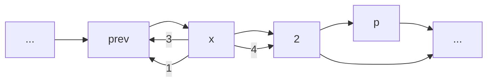
</details>

图 3.17 通过获取一个新节点然后以所指出的顺序修改指针而将新节点插入双向链表

```cpp
// 在itr前插入x
iterator insert( iterator itr, const Object & x )
{
    Node *p = itr.current;
    thenSize++;
    return { p->prev = p->prev->next = new Node{ x, p->prev, p } };
}

// 在itr前插入x
iterator insert( iterator itr, Object && x )
{
    Node *p = itr.current;
    thenSize++;
    return { p->prev = p->prev->next
        = new Node{ std::move( x ), p->prev, p } };
}
```

图3.18 List类的insert例程


<details>
<summary>flowchart</summary>

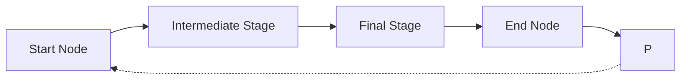
</details>

图 3.19 从双向链表中删除由 p 所指定的节点

```c
// 删除在itr处的项
iterator erase( iterator itr )
{
    Node *p = itr.current;
    iterator retVal{ p->next };
    p->prev->next = p->next;
    p->next->prev = p->prev;
    delete p;
    theSize--;

    return retVal;
}

iterator erase( iterator from, iterator to )
{
    for( iterator itr = from; itr != to; )
        itr = erase( itr );

    return to;
}
```

图3.20 List类的两个erase例程

考查代码，我们能够看到一些可能发生的错误，这里没有提供对它们的检验。例如，传递给 erase 和 insert 的迭代器可能是未被初始化的，或初始化用的是错误的表。当迭代器已经指向终端标志或尚未初始化时，不排除对其使用++或\*操作的可能。

未被初始化的迭代器将会让 current 指向 nullptr，以便条件容易得到检测。终端标记的 next 指针指向 nullptr，因此对于终端标记条件进行++或\*操作的测试也很容易。然而，为了确定传递给 erase 或 insert 的迭代器是否是正确的表的迭代器，这个迭代器必须存储一个额外的表示指向 List 的指针的数据成员，其中的 List 就是构造迭代器所用的双向链表。

我们将概述基本思路，而把细节留作练习。在 const\_iterator 类中，添加一个指向 List 的指针，并且修改受保护的构造函数以该 List 作为一个参数。我们还可以添加一些方法，它们在某些要求得不到满足时将抛出异常。程序经过修订的受保护部分看起来有些像图 3.21 给出的代码。此时所有对 iterator 和 const\_iterator 构造函数的调用本来以前它们只需要一个参数的，但现在都需要两个参数，如在 List 的 begin 方法中所示。

```cpp
const_iterator begin( ) const
{
    const_iterator itr{ *this, head };
    return ++itr;
}

protected:
    const List<Object> *theList;
    Node *current;

    const_iterator( const List<Object> & lst, Node *p )
        : theList{ &lst }, current{ p }
    {
    }

    void assertIsValid( ) const
    {
        if( theList == nullptr || current == nullptr || current == theList->head )
            throw IteratorOutOfBoundsException{ };
    }
```

图 3.21 const\_iterator 经修订后的受保护部分代码，添加了执行附加的错误检测的能力

insert 方法可以修改成图 3.22 所示代码的样子。我们把修改的细节留作练习。

```txt
// 在 itr前插入x
iterator insert( iterator itr, const Object & x )
{
    itrHexerIsValid( );
    if( itr.theList != this )
        throw IteratorMismatchException{ };

    Node *p = itr.current;
    theSize++;
    return { *this, p->prev = p->prev->next = new Node{ x, p->prev, p } };
}
```

图 3.22 带有附加错误检测的 List 的 insert 函数

## 3.6 栈 ADT

栈(stack)是一个带有限制的表，它的插入和删除只能在一个位置上进行，即只能在表的末端进行，这个末端叫作栈顶(top)。

## 3.6.1 栈模型

对栈的基本操作就是 push(进栈)和 pop(出栈)，前者等价于一次插入，而后者则是删除最近插入的元素。最近插入的元素在执行 pop 之前可以通过使用 top 例程进行考查。在栈 ADT 中，对空栈执行 pop 或 top 一般均被认为是一个错误。另一方面，执行 push 时空间用尽是一个实现限制，但不是 ADT 错误。

栈有时又叫作 LIFO(后进先出)表(Last in, First out list)。在图 3.23 中描述的模型只表示 push 是输入操作而 pop 和 top 是输出操作。普通的清空栈的操作和判断是否空栈的测试都是栈的操作指令系统的一部分，但是，我们对栈所能够做的基本上也就是 push 和 pop 操作。

图3.24展示了在进行若干操作后的一个抽象的栈。一般的模型是，存在某个元素位于栈顶，而该元素是唯一的可见元素。


<details>
<summary>flowchart</summary>

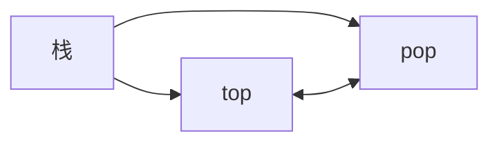
</details>

图 3.23 栈模型:通过 push 向栈输入，通过 pop 和 top 从栈输出


<details>
<summary>text_image</summary>

top
2
4
1
3
6
</details>

图3.24 栈模型:只有栈顶元素是可访问的

## 3.6.2 栈的实现

由于栈是一个表，因此任何实现表的方法都能实现栈。显然，list 和 vector 都支持栈操作，99% 的时间它们都是最合理的选择。偶尔设计一种特殊目的的实现可能会更快。因为栈操作是常数时间操作，所以，除非在非常独特的环境下，否则是不可能产生任何明显的改进的。

对于这些特殊的时机，我们将给出栈的两种流行的实现，一种实现使用链接结构，而另一种则使用数组，二者均简化了在 vector 和 list 中的思路，因此我们不提供代码。

## 栈的链表实现

栈的第一种实现是使用单链表。我们通过在表的前端插入来实施 push 操作，通过删除表前端元素实施 pop 操作。top 操作只是考查表前端的元素并返回它的值。有时也把 pop 操作和 top 操作合二为一。

## 栈的数组实现

栈的另一种实现避免了链而且可能是更流行的解决方案。它用到来自 vector 的 back、push\_back 和 pop\_back，因此实现起来很简单。与每个栈相关联的是 theArray 和 topOfStack，对于空栈它是-1(这就是空栈的初始化做法)。为将某个元素 x 推入栈中，我们使 topOfStack 增 1 然后置 theArray[topOfStack]=x。为了弹出栈元素，我们置返回值为 theArray[topOfStack]，然后使 topOfStack 减 1。

注意，这些操作不仅以常数时间运行，而且是以非常快的常数时间运行。在某些机器上，若在带有自增和自减寻址功能的寄存器上操作，则(整数的)push 和 pop 都可以写成一条机器指令。最现代化的计算机将栈操作作为它的指令系统的一部分，这个事实强化了这样一种理念，即栈很可能是在计算机科学中在数组之后的最基本的数据结构。

## 3.6.3 应用

毫不奇怪，如果我们把操作限制在对一个表进行，那么这些操作会执行得很快。然而，令人惊奇的是，这些不多的操作却非常强大和重要。在栈的诸多应用中，我们给出3个例子，第三个实例深刻阐释程序是如何组织的。

## 平衡符号

编译器检查程序的语法错误，但是常常由于缺少一个符号(如遗漏一个花括号或是注释起始符)而引起编译器列出上百行的诊断，可是真正的错误并没有找出。

在这种情况下一个有用的工具就是检验是否每件事情都能成对出现的程序。于是，每一个右花括号、右方括号及右圆括号必然对应其相应的左括号。序列[()]是合法的，但[()）是错误的。显然，不值得为此编写一个大型程序，事实上检验这些事情是很容易的。为简单起见，我们仅就圆括号、方括号和花括号进行检验并忽略出现的任何其他字符。

这个简单的算法用到一个栈，兹叙述如下:

做一个空栈。读入字符直到文件尾。如果字符是一个开放符号，则将其推入栈中。如果字符是一个封闭符号，则当栈空时报错。否则，将栈元素弹出。如果弹出的符号不是对应的开放符号，则报错。在文件尾，如果栈非空则报错。

我们应该能够确信这个算法是会正确运行的。很清楚，它是线性的，事实上它只须对输入进行一趟检验。因此，它是联机(on-line)的，而且是相当快的。当报错时决定如何处理可能需要做一些附加的工作——例如判断可能的原因。

## 后缀表达式

假设我们有一个便携计算器并想要计算一趟外出购物的花费。为此，我们将一列数据相加并将结果乘以1.06，它是所购物品的价格以及附加的地方销售税。如果购物各项花销为4.99、5.99和6.99，那么输入这些数据的自然的方式将是

$$
4. 9 9 + 5. 9 9 + 6. 9 9 * 1. 0 6 =
$$

随着计算器的不同，这个结果或者是所要的答案 19.05，或者是科学答案 18.39。最简单的四功能计算器都将给出第一个答案，但是许多先进的计算器是知道乘法的优先级高于加法的。

另一方面，有些项是需要上税的，而有些项则不是，因此，如果只有第一项和最后一项是要上税的，那么计算的顺序

$$
4. 9 9 * 1. 0 6 + 5. 9 9 + 6. 9 9 * 1. 0 6 =
$$

将在科学计算器上给出正确的答案(18.69)而在简单计算器上给出错误的答案(19.37)。科学计算器一般包含括号，因此我们总可以通过加括号的方法得到正确的答案，但是使用简单计算器时需要记住一些中间结果。

该例的典型计算顺序可以是将4.99和1.06相乘并存为 $A_{1}$，然后将5.99和 $A_{1}$ 相加，再将结果存入 $A_{1}$；我们再将6.99和1.06相乘并将答案存为 $A_{2}$，最后将 $A_{1}$ 和 $A_{2}$ 相加并将最后答案放入 $A_{1}$。可以将这种操作顺序书写如下:

$$
4. 9 9 1. 0 6 * 5. 9 9 + 6. 9 9 1. 0 6 * +
$$

这个记法叫作后缀记法(postfix notation)记法或逆波兰记法(reverse Polish notation)，其求值过程恰好就是上面所描述的过程。计算这个问题最容易的方法是使用一个栈。当见到一个数时就把它推入栈中；在遇到一个运算符时该运算符就作用于从该栈弹出的两个数(符号)上，再将所得结果推入栈中。例如，后缀表达式

$$
6 5 2 3 + 8 * + 3 + *
$$

计算如下:

前4个字符放入栈中，此时栈变成


<details>
<summary>text_image</summary>

topOfStack →
3
2
5
6
</details>

下面读到一个“+”号，所以3和2从栈中弹出并且它们的和5被压入栈中。


<details>
<summary>text_image</summary>

topOfStack →
5
5
6
</details>

接着，8进栈。


<details>
<summary>text_image</summary>

topOfStack →
8
5
5
6
</details>

现在见到一个“\*”号，因此8和5弹出并且 $5 * 8 = 40$ 进栈。


<details>
<summary>text_image</summary>

topOfStack →
40
5
6
</details>

接下来又见到一个“+”号，因此40和5被弹出并且 $5 + 40 = 45$ 进栈。


<details>
<summary>text_image</summary>

topOfStack →
45
6
</details>

现在，将3压入栈中。


<details>
<summary>text_image</summary>

topOfStack →
3
45
6
</details>

然后，“+”使得3和45从栈中弹出并将 $45+3=48$ 压入栈中。


<details>
<summary>text_image</summary>

topOfStack →
48
6
</details>

最后，见到一个“\*”号，从栈中弹出48和6；将结果 $6 * 48 = 288$ 压进栈中。


<details>
<summary>text_image</summary>

topOfStack → 288
</details>

计算一个后缀表达式花费的时间是 $O(N)$，因为对输入中的每个元素的处理都是由一些栈操作组成从而花费常数的时间。该算法的计算非常简单。注意，当一个表达式以后缀记号给出时，没有必要知道任何优先的规则。这是一个明显的优点。

## 中缀到后缀的转换

栈不仅可以用来计算后缀表达式(postfix expression)的值，而且还可以用栈将一个标准形式的表达式(或叫作中缀式(infix))转换成后缀式(postfix)。我们通过只允许操作+、\*、（、），并坚持普通的优先级法则而将一般的问题浓缩成小规模的问题。同时还要进一步假设表达式是合法的。设欲将中缀表达式

$$
a + b * c + (d * e + f) * g
$$

转换成后缀表达式。正确的答案是 $abc* + de*f + g* +$。

当读到一个操作数的时候，立即把它放到输出中。但运算符并不立即输出，而是必须先存在某个地方。正确的做法是将已经见到的运算符放进栈中而不是放到输出中。当遇到左圆括号时也要将其推入栈中。计算从一个空栈开始。

如果见到一个右括号，那么就将栈元素弹出，将弹出的符号写出直至遇到一个(对应的)左括号为止，但是这个左括号只被弹出并不输出。

如果见到任何其他的符号 [如+、\*、（]，那么我们从栈中弹出栈元素直到发现优先级更低的元素为止。有一个例外:除非是在处理一个)的时候，否则我们绝不从栈中移走(。对于这种操作，+的优先级最低，而(的优先级最高。当从栈弹出元素的工作完成后，我们再将运算符压入栈中。

最后，如果读到输入的末尾，则将栈元素弹出直到该栈变成空栈，再将这些符号写到输出中。

这个算法的思路是，当看到一个运算符的时候，先把它放到栈中。栈代表挂起的运算符。然而，栈中有些具有高优先级的运算符现在知道需要完成使用，应该被弹出，它们将不再处于挂起的状态。这样，在把当前运算符放入栈中之前，那些在栈中并在当前操作符之前要完成使用的运算符要被弹出。详细的解释见下表:

| 表达式 | 在处理第3个运算符时的栈 | 动作 |
| --- | --- | --- |
| a*b-c+d | - | -完成,+进栈 |
| a/b+c*d | + | 没有运算符完成操作,*进栈 |
| a-b*c/d | -* | *完成,/进栈 |
| a-b*c+d | -* | *和-完成,+进栈 |

圆括号增加了额外的复杂性。当左括号是一个输入符号时可以把它看成是一个高优先级的运算符(这样，挂起的那些操作符仍是挂起的)，而当它在栈中时把它看成是低优先级的运算符（从而不会被一个操作符意外地删除）。右括号被处理成特殊的情况。

为了理解这种算法的运行机制，我们将把上面长的中缀表达式转换成后缀形式。首先，符号 a 被读入，于是它被传向输出。然后，“+”被读入并被放入栈中。接下来 b 被读入并传向输出。这一时刻的状态如下:


栈


输出

接着\*号被读入。运算符栈的栈顶元素比\*的优先级低，故没有输出且\*进栈。接着，c 被读入并输出。至此，我们有


栈


输出

后面的符号是一个+号。检查一下栈发现，我们需要将\*从栈弹出并把它放到输出中；再弹出栈中剩下的+号，该算符不比刚刚遇到的+号优先级低而是有相同的优先级；然后，将刚刚遇到的+号压入栈中。


栈


输出

下一个被读到的符号是一个(，由于有最高的优先级，因此它被放进栈中。然后，读入 d 并输出。


栈


输出

继续进行，我们又读到一个\*。由于除非正在处理闭括号否则开括号不会从栈中弹出，因此没有输出。下一个字符是e，它被读入并输出。


栈


输出

再往后读到的符号是+。我们将\*弹出并输出，然后将+压入栈中。这以后，我们读到f并输出。


栈


输出

这回，我们读到的是一个)，因此将栈元素直到(都弹出，我们输出一个+号。


栈


输出

下面又读到一个\*；该算符被压入栈中。然后，g 被读入并输出。


栈


输出

现在输入为空，因此我们将栈中的符号全部弹出并输出，直到栈变成空栈。


栈


输出

与前面相同，这种转换工作只需要 $O(N)$ 的时间并经过一趟输入后完成。可以通过指定减法和加法有相同的优先级以及乘法和除法有相同的优先级而将减法和除法添加到指令集中去。需要注意的是，表达式 $\mathrm{a - b - c}$ 应转换成 $\mathrm{ab - c - }$ 而不是转换成 $\mathrm{abc - - }$ 。我们的算法做得正确，因为这些操作符是从左到右结合的。一般情况未必如此，比如下面的表达式就是从右到左结合的: $2^{2^3} = 2^8 = 256$ ，而不是 $4^{3} = 64$ 。我们将把取幂运算添加到运算符指令集中的问题留作练习。

## 函数调用

检测平衡符号的算法提出一种在编译的过程语言和面向对象的语言中实现函数调用的方式。这里的问题是，当调用一个新函数时，主调例程的所有局部变量需要由系统存储起来，因为否则被调用的新函数将会重写由主调例程的变量所使用的内存。不仅如此，主调例程的当前位置必须要存储，以便在新函数运行完成之后知道向哪里转移。这些变量一般由编译器指派给机器的一些寄存器，但存在某些冲突(通常所有的函数都是获取指定给1号寄存器的某些变量)，特别是涉及递归的时候。该问题类似于平衡符号，其原因在于，函数调用和函数返回基本上类似于开括号和闭括号，因此二者相同的思路都应该是行得通的。

当存在函数调用的时候,需要存储的所有重要信息,诸如寄存器的值(对应一些变量的名字)和返回地址(它可从程序计数器得到,一般情况是在一个寄存器中)等,都要以抽象的方式存在“一张纸上”并被置于一个堆(pile)的顶部。然后控制转移到新函数,这样就可以自由地用它的一些值替换这些寄存器。如果它又进行其他的函数调用,那么也遵循相同的过程。当该函数要返回时,它查看堆(pile)顶部的那张“纸”并复原所有的寄存器,然后进行返回转移。

显然，全部工作均可由一个栈来完成，而这正是在实现递归的每一种程序设计语言中实际发生的事实。所存储的信息或称为活动记录(activation record)，或叫作栈帧(stack frame)。在典型情况下，需要做轻微的调整:当前环境由栈顶描述。因此，一条返回语句就可给出前面的环境(不用复制)。在实际计算机中的栈常常是从内存分区的高端向下增长，而在许多的系统中是不检测溢出的。由于有太多的同时在运行着的函数，因此用尽栈空间的情况总是可能发生的。显而易见，用尽栈空间常是致命的错误。

在不进行栈溢出检测的语言和系统中，程序将会崩溃而没有明显的说明。在正常情况下我们不应该越出栈空间，发生这种情况通常是失控递归(忘记基准情形)产生的迹象。另一方面，某些完全合法并且表面上无害的程序也可以越出栈空间。图3.25中的例程打印一个容器，该例程完全合法，实际上是正确的。它正常地处理空容器的基准情形，并且递归也没问题。可以证明这个程序是正确的。然而遗憾的是，如果这个容器含有200 000个元素要打印，那么就要有表示第11行上嵌套调用的200 000个活动记录的一个栈。一般这些活动记录由于它们包含的全部信息而特别庞大，因此这个程序很可能要越出栈空间。(如果200 000个元素还不足以使程序崩溃，那么可用更大的数代替它。)

```c
/**
 * 从起点开始打印容器直到尾端，但不包括尾端.
 */
template <typename Iterator>
void print( Iterator start, Iterator end, ostream & out = cout )
{
    if( start == end )
        return;

    out << *start++ << endl;   // 打印并推进起点
    print( start, end, out );
}
```

图 3.25 递归的不当使用:打印一个容器

这个程序是称为尾递归(tail recursion)的使用极为不当的例子。尾递归指的是在最后一行进行的递归调用。尾递归可以手工消除，做法是通过将代码放到一个 while 循环体中并借助每次对函数参数的一次赋值代替递归调用。它模拟了递归调用，因为什么也不需要存储。在递归调用结束之后，实际上没有必要知道那些存储的值。因此，我们就可以带着在一次递归调用中本应用过的那些值转移到函数的顶部。图 3.26 中的函数显示该算法生成的、改进后的程序。尾递归的去除是如此简单，以至于某些编译器能够自动地完成。但是即使如此，最好还是不要让我们自己的程序带着尾递归。

```txt
/**
 * 从起点开始打印容器到尾端但不包括尾端.
 */
template <typename Iterator>
void print( Iterator start, Iterator end, ostream & out = cout )
{
    while( true )
    {
        if( start == end )
            return;

        out << *start++ << endl;  // 打印并推进起点
    }
}
```

图3.26 不用递归打印一个容器，编译器可以做到(但不应你去做)

递归总能够被彻底去除(编译器是在转变成汇编语言时完成递归去除的)，但是这么做是相当冗长乏味的。一般做法是要求使用一个栈，而且仅当能够把最低限度的最小值放到栈上时这个方法才值得一用。我们将不对此做进一步的详细讨论，只是指出，虽然非递归程序一般说来确实比等价的递归程序要快，但是速度优势的代价却是由于去除递归而使得程序清晰性受到了影响。

## 3.7 队列 ADT

像栈一样，队列(queue)也是一种表。然而，使用队列时插入在一端进行而删除则在另一端进行。

## 3.7.1 队列模型

队列的基本操作是 enqueue(入队)，它是在表的末端(叫作队尾(rear))插入一个元素，以及 dequeue(出队)，它是删除(并返回)在表的开头(叫作队头(front))的元素。图 3.27 显示了一个队列的抽象模型。


<details>
<summary>flowchart</summary>

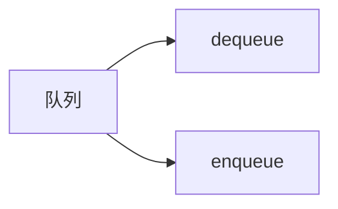
</details>

图3.27 队列模型

## 3.7.2 队列的数组实现

如同栈的情形一样，对于队列而言，任何表的实现都是合法的。像栈一样，对于每一种操作，链表实现和数组实现都给出快速的 $O(1)$ 运行时间。队列的链表实现简单直接，我们留作练习。下面讨论队列的数组实现。

对于每一个队列数据结构，我们保留一个数组 theArray 以及位置 front 和 back，它们代表队列的两端。我们还要记录实际存在于队列中的元素的个数 currentSize。下图表示处于某个中间状态的一个队列。

<table><tr><td></td><td></td><td></td><td>5</td><td>2</td><td>7</td><td>1</td><td></td><td></td><td></td></tr><tr><td colspan="5"> $\uparrow$ front</td><td colspan="5"> $\uparrow$ back</td></tr></table>

操作应该是清楚的。为使一个元素 x 入队(即执行 enqueue)，我们让 currentSize 和 back 增 1，然后置 theArray[back]=x。若使一个元素 dequeue(出队)，我们置返回值为 theArray[front]，且 currentSize 减 1，然后使 front 增 1。也可以有些其他方法(将在后面讨论)。现在论述对错误的检测。

上述实现存在一个潜在的问题。经过 10 次 enqueue 后队列似乎是满了，因为 back 现在是数组的最后一个下标，而下一次再 enqueue 就会是一个不存在的位置。然而，队列中也许只存在几个元素，因为若干元素可能已经出队了。像栈一样，即使在有许多操作的情况下队列也常常不是很大。

简单的解决方法是，只要 front 或 back 到达数组的尾端，它就又绕回到开头。下面诸图显示在某些操作期间的队列情况。这叫作循环数组 (circular array) 实现。

实施回绕所需要的附加代码是极小的(不过它可能使得运行时间加倍)。如果 front 或 back 增 1 导致超越了数组，那么其值就要重置到数组的第一个位置。

初始状态

<table><tr><td></td><td></td><td></td><td></td><td></td><td></td><td></td><td></td><td>2</td><td>4</td></tr><tr><td colspan="10"> $\uparrow$ front  $\uparrow$ back</td></tr></table>

经过 enqueue(1) 后

<table><tr><td>1</td><td></td><td></td><td></td><td></td><td></td><td></td><td></td><td>2</td><td>4</td></tr><tr><td colspan="7"> $\uparrow$ back</td><td colspan="3"> $\uparrow$ front</td></tr></table>

经过 enqueue(3) 后

<table><tr><td>1</td><td>3</td><td></td><td></td><td></td><td></td><td></td><td></td><td>2</td><td>4</td></tr><tr><td colspan="7"> $\uparrow$ back</td><td colspan="3"> $\uparrow$ front</td></tr></table>

经过dequeue并返回2后

<table><tr><td>1</td><td>3</td><td></td><td></td><td></td><td></td><td></td><td></td><td>2</td><td>4</td></tr><tr><td colspan="8"> $\uparrow$ back</td><td colspan="2"> $\uparrow$ front</td></tr></table>

经过dequeue并返回4后

<table><tr><td>1</td><td>3</td><td></td><td></td><td></td><td></td><td></td><td></td><td>2</td><td>4</td></tr><tr><td> $\uparrow$ front</td><td colspan="9"> $\uparrow$ back</td></tr></table>

经过dequeue并返回1后

<table><tr><td>1</td><td>3</td><td></td><td></td><td></td><td></td><td></td><td></td><td>2</td><td>4</td></tr><tr><td colspan="10"> $\uparrow$ backfront</td></tr></table>

经过dequeue并返回3后

同时使队列为空

<table><tr><td>1</td><td>3</td><td></td><td></td><td></td><td></td><td></td><td></td><td>2</td><td>4</td></tr><tr><td colspan="10"> $\uparrow$  back  $\uparrow$  front</td></tr></table>

有些程序设计员使用不同的方式表示队列的队头和队尾。例如，有人不使用一项来记录大小，因为他们依赖于当队列为空时 back=front-1 的基准情形。队列的大小通过比较 back 和 front 隐式地算出。这是一种非常隐秘的方法，因为存在某些特殊的情形，因此，如果想修改用这种方法编写的代码，那就要特别小心。如果 currentSize 不作为明确的数据成员被保留，那么当存在 theArray.capacity()-1 个元素时队列就满了，因为只有 theArray.capacity() 个不同的大小可被区分，而 0 又是其中的一个。可以采用任意一种我们喜欢的风格，但要确保我们的所有例程都是一致的。由于实现方法有多种选择，因此如果不使用 currentSize 这个数据成员，那就很可能有必要在代码中进行一些注释。

在确保 enqueue 的次数不会大于队列容量的应用中, 使用回绕是没有必要的。像栈一样, 除非主调例程肯定队列非空, 否则 dequeue 很少执行。因此对这种操作, 只要不是关键的代码, 错误的检测常常被跳过。一般说来这并不是无可非议的, 因为这样可能得到的时间节省量是极小的。

## 3.7.3 队列的应用

有许多算法使用队列给出高效运行时间。它们当中有些可以在图论中找到，我们将在第9章讨论它们。这里，先给出某些使用队列的简单例子。

当作业送交给一台打印机的时候，它们就以到达的顺序被排列起来。因此，被送往打印机的作业基本上被放到一个队列中。 $^{①}$

事实上，每一个实际生活中的排队都(应该)是一个队列。例如，在一些售票口排列的队伍都是队列，因为服务的顺序是先来到的先买票。

另一个例子是关于计算机网络的。有许多种 PC 的网络设置，其中磁盘是放在一台叫作文件服务器 (file server) 的机器上的。使用其他计算机的用户是按照先到先使用的原则访问文件的，因此其数据结构是一个队列。

进一步的例子如下:

- 当所有的接线员忙不开的时候，对大公司的呼叫一般都被放到一个队列中。
● 在大型的大学里，如果所有的终端都被占用，由于资源有限，学生们必须在一个等待表上签字登记。在终端上待得时间最长的学生将首先被强制离开，而等待时间最长的学生则将是下一个被允许使用终端的用户。

<small><span class="docvortex-page-footnote" data-block-type="page_footnote" style="color:#6b7280">① 我们说基本上是因为作业可以被除去。这等于从队列的中间进行的一次删除，它违反了队列的严格定义。</span></small>

称为排队论(queueing theory)的整个数学分支处理用概率的方法计算用户预计要排队等待多长时间才会得到服务、等待服务的队伍能够排多长，以及其他一些诸如此类的问题。问题的答案依赖于用户参与排队的频繁程度，以及一旦用户得到服务时处理服务花费的时间。这两个参数作为概率分布函数给出。在一些简单的情况下，答案可以解析地算出。一种简单情况的例子是一条电话线有一个接线员。如果接线员忙，打来的电话就被放到一个等待队列中(一直放到某个最大的限度为止)。这个问题在商业上很重要，因为研究表明，人们会很快挂上电话。

如果有 $k$ 个接线员，那么这个问题解决起来要困难得多。解析求解困难的问题往往使用模拟的方法进行。此时，我们需要使用一个队列来进行模拟。如果 $k$ 很大，那么还需要其他一些数据结构来使得模拟更有效地进行。在第6章将会看到这种模拟是如何进行的。那时我们将对 $k$ 的若干值进行模拟并选择能够给出合理等待时间的最小的 $k$。

队列还有其他丰富的用途，正如栈一样，这样一种简单的数据结构竟然能够如此重要，实在令人惊奇。

## 小结

本章描述了一些 ADT 的概念，并且利用 3 种最常见的抽象数据类型阐述了这种概念。主要目的就是将 ADT 的具体实现与它们的功能分开。程序必须知道操作都做些什么，但是如果不知道如何去做那就更好。

表、栈和队列或许在全部计算机科学中是 3 个基本的数据结构，大量的例子证明了它们广泛的用途。特别地，我们看到栈是如何用来记录函数调用的，以及递归实际上是如何实现的。这对于我们的理解非常重要，其原因不只因为它使得过程语言成为可能，而且还因为知道递归的实现从而消除了围绕其使用的大量迷团。虽然递归非常强大，但它并不是完全随意操作的，递归的误用和乱用可能导致程序崩溃。

## 练习

3.1 给定一个表 L 和另一个表 P，它们包含以升序排列的整数。操作 printLots(L, P) 将打印 L 中那些由 P 所指定的位置上的元素。例如，如果 P = 1, 3, 4, 6，那么，L 中位于第 1 个、第 3 个、第 4 个和第 6 个位置上的元素被打印出来。写出过程 printLots(L, P)。只可使用公有型 STL 容器操作。该过程的运行时间是多少？

3.2 通过只调整链(而不是数据)来交换两个相邻的元素, 分别使用

a. 单链表。

b. 双向链表。

3.3 实现 STL 的 find 例程，该例程返回一个 iterator，后者包含从 start 开始并扩展到(但不包括)end 的范围内第 1 次出现的 x。若没发现 x，则返回 end。这是一个非类(全局)函数，其特征如下:

```typescript
template <typename Iterator, typename Object>
iterator find( Iterator start, Iterator end, const Object & x );
```

3.4 给定两个已排序的表 $L_{1}$ 和 $L_{2}$，只使用基本的表操作编写计算 $L_{1} \cap L_{2}$ 的过程。

3.5 给定两个已排序的表 $L_{1}$ 和 $L_{2}$，只使用基本的表操作编写计算 $L_{1} \cup L_{2}$ 的过程。

3.6 Josephus 问题 (Josephus problem) 是下面的游戏: $N$ 个人编号 $1 \sim N$, 围坐成一个圆圈。从 1 号人开始传递一个热土豆。经过 $M$ 次传递后拿着热土豆的人被清除离座, 围坐的圆圈缩紧, 由坐在被清除人后面的人拿起热土豆继续进行游戏。最后剩下的人获胜。因此, 如果 $M = 0$ 和 $N = 5$, 则游戏人依序被清除, 5 号游戏人获胜。如果 $M = 1$ 和 $N = 5$, 那么被清除的人的顺序是 2, 4, 1, 5。

a. 编写一个程序解决在 M 和 N 为一般的值下的 Josephus 问题，应使所编程序尽可能地高效率，要确保各个单元都能被清除。
b. 这个程序的运行时间是多少？
c. 如果 $M = 1$，这个程序的运行时间又是多少？对于 $N$ 的一些大值 $(N > 100000)$，delete 例程如何影响该程序的速度？

3.7 修改 Vector 类以添加索引的越界检测。

3.8 把 insert 和 erase 添加到 Vector 类中。

3.9 按照 C++ 标准，对于本章中的 vector，调用 push\_back、pop\_back、insert 或 erase 都将使所有指向 vector 的迭代器失效(潜在地使迭代器过期而不再适用)。为什么？

3.10 通过使用迭代器类类型而不是指针变量来修改 Vector 类以提供严格的迭代器检测。最困难的部分是处理过期的迭代器，详见练习 3.9。

3.11 假设单链表使用一个头节点来实现，但无尾节点，并假设它只保留指向头节点的指针。编写一个类，包含以下一些方法:

a. 返回该链表的大小。
b. 打印该链表。
c. 测试是否值 x 含于该链表。
d. 如果值 x 尚未含于该链表，把值 x 添加到该链表中。
e. 如果值 x 含于该链表，将 x 从该链表中删除。

3.12 以排序的顺序保持单链表，重复练习 3.11。

3.13 对 List 迭代器类添加对 operator-的支持。

3.14 在 STL 的迭代器中向前搜索需要用到 operator++ 的操作，这样将会依次推进该迭代器。不过在有些情况下不用推进迭代器而查看表的下一项可能更可取。使用下述声明:

```txt
const_iterator operator+( int k ) const;
```

编写成员函数以在一般情形下简化操作。二元运算符 operator+返回一个对应当前位置前 k 个位置的迭代器。

3.15 将 splice 操作添加到 List 类中。该方法声明

```txt
void splice( iterator position, List<T> & lst );
```

将所有的项从 lst 中删除，把它们放到 List \*this 中的 position 之前，而 lst 和 \*this 必须是两个不同的表，所编写的程序必须以常数时间运行。

3.16 将反向迭代器 (reverse iterator) 添加到 STL List 类的实现中。定义 reverse\_iterator 和 const\_reverse\_iterator。添加 rbegin 方法和 rend 方法以返回适当的反向迭代器，分别表示尾端标记前的位置和头节点的位置。反向迭代器内在地反转++操作和--操作的含义。通过使用代码

```cpp
List<Object>::reverse_iterator itr = L.rbegin( );
while( itr != L.rend( ) )
    cout << *itr++ << endl;
```

应该能够反向打印表 L。

3.17 修改 List 类，通过使用在 3.5 节末尾提出的想法来提供严格的迭代器检测。
3.18 当一个 erase 方法用于 list 类对象时, 它将使得正在指向被删除的节点的任何 iterator 失效。这样的迭代器就称为过期(stale)的。描述一种高效的算法, 保证对过期迭代器的操作就好像迭代器的 current 是 nullptr。注意, 可能存在多个过期迭代器。为了实现你的算法, 必须解释哪些类需要重新编写。
3.19 不使用头节点和尾节点重写 List 类，并描述该类与 3.5 节提供的类之间的区别。
3.20 不同于我们已经给出的删除方法，另一种思路是使用懒惰删除(lazy deletion)的删除方法。为了删除一个元素，我们只是标记上该元素被删除(使用一个附加的位域(bit field))。表中被删除和未被删除元素的个数作为数据结构的一部分被保留。如果被删除元素和未被删除元素一样多，则遍历整个表，对所有被标记的节点执行标准的删除算法。

a. 列出懒惰删除的优点和缺点。
b. 编写使用懒惰删除实现标准链表操作的相应例程。

3.21 用下列语言编写检测平衡符号的程序:

a. Pascal(begin/end,(), [], {} )。
b. C++(/\* \*/, (), [], {} )。
\*c. 解释如何打印出一条错误信息，该信息极有可能反映出错的原因。

3.22 编写一个程序计算后缀表达式的值。

3.23 a. 写出一个程序，将包含 $(,), +, -, *, /$ 等符号的中缀表达式转换成后缀表达式。

b. 将取幂运算符添加到你的指令系统中。
c. 编写一个程序将后缀表达式转换成中缀表达式。

3.24 编写只用一个数组而实现两个栈的例程。这些栈例程不应该声明溢出，除非数组中的每个单元都被使用。

3.25 \*a. 提出一种数据结构，支持栈 push 和 pop 操作以及第 3 种操作 findMin，它返回该数据结构中的最小元素。所有操作均以 O(1) 最坏情形时间运行。

\*b. 证明，如果添加找出并删除最小元素的第4种操作 deleteMin，那么至少有一种操作必然花费 $\Omega (\log N)$ 时间。（本题需要阅读第7章。）

\*3.26 指出如何用一个数组实现三个栈结构。
3.27 在 2.4 节中用于计算斐波那契数的递归例程如果对 N = 50 运行，栈空间有可能用完吗？为什么？

3.28 双端队列(deque)是由一些项的一个表组成的数据结构, 对该数据结构可以进行下列操作:

push(x): 将项 x 插入到双端队列的前端。

pop(): 从双端队列中删除前端项并将其返回。

inject(x): 将项 x 插入到双端队列的尾端。

eject(): 从双端队列中删除尾端项并将其返回。

编写支持双端队列的例程，其中的每种操作均花费  $O(1)$  的时间。

3.29 编写以倒序打印单链表的算法，只使用常数的附加空间。本题意味着，不能使用递归但可以假设该算法是表的一个成员函数。如果该例程是一个常量成员函数，那么这样的一种算法还能不能写出？

3.30 a. 写出自调整表(self-adjusting list)的数组实现。在自调整表中，所有的插入都在前端进行。自调整表添加一个 find 操作，当一个元素被 find 访问时，它就被移到表的前端但并不改变其余的项的相对顺序。

b. 写出自调整表的链表实现。

\*c. 设每个元素都有其被访问的固定的概率  $p_{i}$ 。证明那些具有最高访问概率的元素都有望靠近表的前端。

3.31 使用单链表高效实现栈类，但不用头节点和尾节点。

3.32 使用单链表高效实现队列类，但不用头节点和尾节点。

3.33 使用循环数组(circular array)高效实现队列类。可以使用一个 vector(而不是使用原始数组)作为底层数组结构。

3.34 如果从某个节点 $p$ 开始，接着跟有足够数目的 next 链将把我们带回到节点 $p$，那么这个链表包含一个循环。$p$ 不必是该表的第一个节点。假设给定一个链表，它包含 $N$ 个节点，但 $N$ 的值是未知的。

a. 设计一个  $O(N)$  算法以确定是否该表包含有循环。可以使用  $O(N)$  的附加空间。

\*b. 重复(a)部分，但是只使用 O(1) 的附加空间。(提示:使用两个迭代器，它们最初在表的开始处，但以不同的速度推进。)

3.35 实现队列的一种方法是使用一个循环链表(circular linked list)。在循环链表中，最后一个节点的 next 指针指向第 1 个节点。假设该链表不包含头节点，并假设最多可以保留一个迭代器，它对应链表中的一个节点。对于下列的哪种表示方式，所有的基本队列操作都可以以常数最坏情形时间执行？证明你的答案是正确的。

a. 保留一个迭代器，它对应该链表的第一项。

b. 保留一个迭代器，它对应该链表的最后一项。

3.36 设有一个指针指向单链表的一个节点，而这个节点保证不是该表的最后的节点。我们没有指向任何其他节点的指针(除非通过后面的一些链)。描述一个 $O(1)$ 算法，该算法逻辑上从该链表删除存储在这样一个节点上的值，同时保持链表的完整性。(提示:涉及下一个节点。)

3.37 设单链表是用一个头节点和一个尾节点实现的。描述下述操作的常数时间算法:

a. 在位置 p (该位置由一个迭代器给出) 前插入一项 x。

b. 删除存储在位置 p (该位置由一个迭代器给出) 的项。

## 第4章 树

对于大量的输入数据，链表的线性访问耗时过多，不便使用。本章讨论一种简单的数据结构，其大部分操作的运行时间平均为 $O(\log N)$ 。我们还要简述对这种数据结构在概念上的简单的修改，它保证在最坏情形下的上述时间界。此外，还将讨论第二种修改，对于长的指令序列它实质上给出每种操作的 $O(\log N)$ 运行时间。

我们涉及到的这种数据结构叫作二叉查找树 (binary search tree)。二叉查找树是两种库集合类 set 和 map 实现的基础，它们用于许多应用之中。总的来说，在计算机科学中树 (tree) 是非常有用的抽象概念，因此，我们将讨论树在其他更一般应用中的使用。在这一章，我们将

- 看到树是如何被用于实现几种流行操作系统的文件系统的。
● 看到树如何能够用来计算算术表达式的值。
- 指出如何利用树来支持以 $O(\log N)$ 平均时间进行的各种搜索操作, 以及如何细化以得到最坏情形时间界 $O(\log N)$ 。我们还将看到当数据被存放在磁盘上时如何来实现这些操作。
- 讨论并使用 set 类和 map 类。

## 4.1 预备知识

树(tree)可以用几种方式定义。定义树的一种自然的方式是递归的方式。一棵树是一些节点(node)的集合。这个集合可以是空集；若不是空集，则树由称做根(root)的节点 $r$ 以及0个或多个非空的(子)树 $T_{1}, T_{2}, \cdots, T_{k}$ 组成，这些子树中每一棵的根都被来自根 $r$ 的一条有向的边(edge)所连接。

每一棵子树的根叫作根 $r$ 的儿子(child)，而 $r$ 是每一棵子树的根的父亲(parent)。图4.1显示了用递归定义的典型的树。

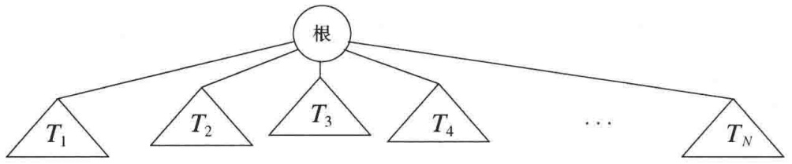

<details>
<summary>flowchart</summary>

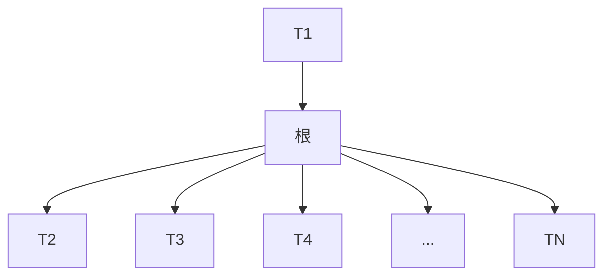
</details>

图4.1 一般的树

从递归定义中我们发现，一棵树是 $N$ 个节点和 $N - 1$ 条边的集合，其中的一个节点叫作根。存在 $N - 1$ 条边的结论是由下面的事实得出的:每条边都将某个节点连接到它的父亲，而除去根节点外每一个节点都有一个父亲(见图4.2)。

在图 4.2 的树中，节点 A 是根。节点 F 有一个父亲 A 并且有儿子 K、L 和 M。每一个节点可以有任意多个儿子，也可能是零个儿子。没有儿子的节点称为树叶 (leaf)，图 4.2 中的树叶是 B、C、H、I、P、Q、K、L、M 和 N。具有相同父亲的节点为兄弟(siblings)。因此，K、L 和 M 都是兄弟。用类似的方法可以定义祖父(grandparent)和孙子(grandchild)关系。

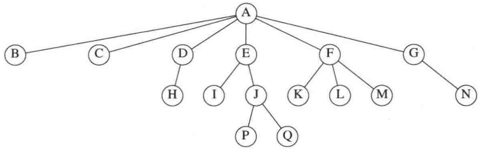

<details>
<summary>flowchart</summary>

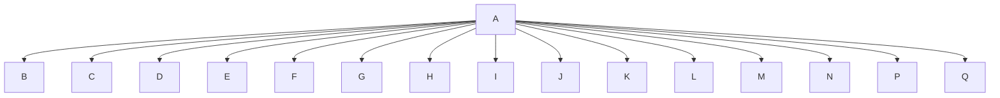
</details>

图4.2 一棵树

从节点 $n_1$ 到 $n_k$ 的路径(path)定义为节点 $n_1, n_2, \dots, n_k$ 的一个序列，使得对于 $1 \leqslant i < k$ 的节点 $n_i$ 是 $n_{i+1}$ 的父亲。这条路径的长(length)是该路径上的边的条数，即 $k-1$ 。从每一个节点到它自己有一条长为0的路径。注意，在一棵树中从根到每个节点恰好存在一条路径。

对任意节点 $n_i$，$n_i$ 的深度 (depth) 为从根到 $n_i$ 的唯一路径的长。因此，根的深度为 0。节点 $n_i$ 的高 (height) 是从 $n_i$ 到一片树叶的最长路径的长。因此所有树叶的高都是 0。一棵树的高 (height of a tree) 等于它的根的高。对于图 4.2 中的树，E 的深度为 1 而高为 2；F 的深度为 1 而高也是 1；该树的高为 3。一棵树的深度 (depth of a tree) 等于其最深的树叶的深度，该深度总是等于这棵树的高。

如果存在从 $n_1$ 到 $n_2$ 的一条路径，那么 $n_1$ 是 $n_2$ 的一位祖先 (ancestor)，而 $n_2$ 是 $n_1$ 的一个后裔 (descendant)。如果 $n_1 \neq n_2$，那么 $n_1$ 是 $n_2$ 的真祖先 (proper ancestor)，而 $n_2$ 是 $n_1$ 的真后裔 (proper descendant)。

## 4.1.1 树的实现

实现树的一种方法是在每一个节点除数据外还要有一些链，使得该节点的每一个儿子都被一个链所链接。然而，由于每个节点的儿子数可以变化很大并且事先不知道，因此在数据结构中建立到各(儿)子节点直接的链接是不可行的，因为这样会产生太多浪费的空间。实际上解决方法很简单:将每个节点的所有儿子都放在树节点的链表中。图4.3中的声明就是典型的声明。

图 4.4 指出一棵树是如何用这种实现方法表示的。图中向下的箭头是些指向 firstChild 的链，而从左向右的水平箭头是指向 nextSibling 的链。因为空链 (null link) 太多，所以图中没有把它们画出。

在图 4.4 的树中，节点 E 有一个链指向兄弟 (F)，另一个链指向儿子 (I)，而有的节点这两种链都没有。

```c
struct TreeNode
{
    Object element;
    TreeNode *firstChild;
    TreeNode *nextSibling;
};
```

图 4.3 树节点的声明

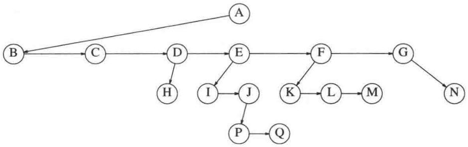

<details>
<summary>flowchart</summary>

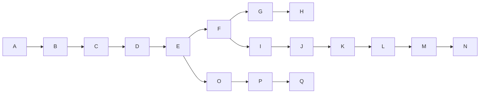
</details>

图 4.4 图 4.2 所示树的第一儿子/下一兄弟表示法

## 4.1.2 树的遍历及应用

树有很多应用。流行的用途之一是许多常用操作系统中的目录结构，包括 UNIX 和 DOS 在内。图 4.5 是 UNIX 文件系统中一个典型的目录。

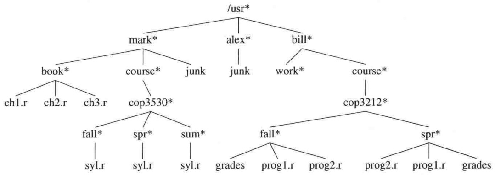

<details>
<summary>flowchart</summary>

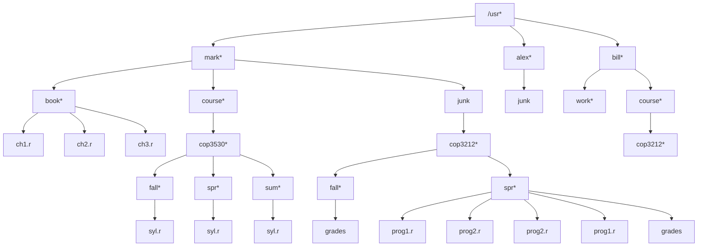
</details>

图4.5 UNIX目录

这个目录的根是/usr。（名字后面的星号指出/usr本身就是一个目录。）/usr有3个儿子:mark、alex和bill，它们本身也都是目录。因此，/usr包含3个目录而且没有正规的文件。文件名/usr/mark/book/ch1.r先后3次通过最左边的子节点而得到。在第一个/后的每个/都表示一条边，结果为一完整路径名(pathname)。这个分级文件系统非常流行，因为它能够使得用户逻辑地组织数据。不仅如此，在不同目录下的两个文件还可以享有相同的名字，因为它们必然有从根开始的不同的路径从而具有不同的路径名。在UNIX文件系统中的目录就是含有它的所有儿子的一个文件，因此，这些目录几乎是完全按照上述的类型声明构造的 $^{①}$ 。事实上，按照UNIX的某些版本，如果将打印一个文件的标准命令应用到一个目录上，那么在该目录中的这些文件名能够在(与其他非ASCII信息一起的)输出中被看到。

设我们想要列出目录中所有文件的名字，输出格式将是:深度为 $d_{i}$ 的文件将被 $d_{i}$ 次跳格(tab)缩进后打印其名。该算法在图4.6中以伪码给出。

```rust
void FileSystem::listAll( int depth = 0 ) const
{
    printName( depth );  // 打印对象的名字
    if( isDirectory( ) )
        for each file c in this directory (for each child)
            c.listAll( depth + 1 );
}
```

图4.6 列出分级文件系统中目录的伪码例程

为了显示根时不进行缩进，这里的递归函数 listAll 需要从深度 0 开始。此处的深度是一个内部簿记变量，而不是主调例程能够期望知道的那种参数。因此，给 depth 提供的默认值为 0。

算法思路简单易懂。文件对象的名字随着适当次数的跳格而被打印出来。如果它是一个目录，那么我们递归地一个一个地处理所有的儿子。这些儿子均处在下一层的深度上，因此需要缩进一个附加的间隔。整个输出显示在图4.7中。

<small><span class="docvortex-page-footnote" data-block-type="page_footnote" style="color:#6b7280">① 在 UNIX 文件系统中每个目录还有一项指向该目录本身，以及另一项指向该目录的父目录。因此，从技术上说，UNIX 文件系统不是树，而是类树 (treelike)。</span></small>

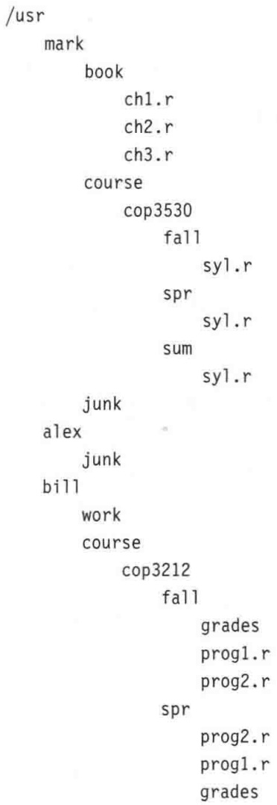

<details>
<summary>text_image</summary>

/usr
    mark
        book
            ch1.r
            ch2.r
            ch3.r
        course
            cop3530
                fall
                    syl.r
                spr
                    syl.r
                sum
                    syl.r
        junk
alex
    junk
bill
    work
    course
        cop3212
            fall
                grades
                prog1.r
                prog2.r
                spr
                    prog2.r
                    prog1.r
                    grades
</details>

图 4.7 （先序）目录列表

这种遍历策略叫作先序遍历(preorder traversal)。在先序遍历中，对节点的处理工作是在它的诸儿子节点被处理之前(pre)进行的。当该程序运行时，显然第1行对每个节点恰好执行一次，因为每个名字只输出一次。由于第1行对每个节点最多执行一次，因此第2行也必然对每个节点执行一次。不仅如此，对于每个节点的每一个子节点第4行最多只能被执行一次。不过，儿子的个数恰好比节点的个数少1。最后，第4行每执行一次，for循环就迭代一次，每当循环结束时再加上一次。因此，每个节点总的工作量是常数。如果有N个文件名需要输出，则运行时间就是 $O(N)$ 。

另一种遍历树的常用方法是后序遍历(postorder traversal)。在后序遍历中，一个节点处的工作是在它的诸子节点被计算后进行的。例如，图4.8表示的是与前面相同的目录结构，其中圆括号内的数代表每个文件占用的磁盘区块(disk block)的个数。

由于目录本身也是文件，因此它们也有大小。设我们想要计算被该树所有文件占用的磁盘块的总数。最自然的做法是找出含于子目录/usr/mark(30)、/usr/alex(9)和/usr/bill(32)的块的个数。于是，磁盘块的总数就是子目录中的块的总数(71)再加上/usr使用的一个块，共72个块。图4.9中的伪码方法size实现的就是这种遍历策略。

如果当前对象不是一个目录，那么 size 只返回它在当前对象中所占用的块数。否则，被该目录占用的块数将被加到在其所有子节点(递归地)中发现的块数上去。为了区别后序遍历策略和先序遍历策略之间的不同，图 4.10 显示了每个目录或文件的大小是如何由该算法算出的。

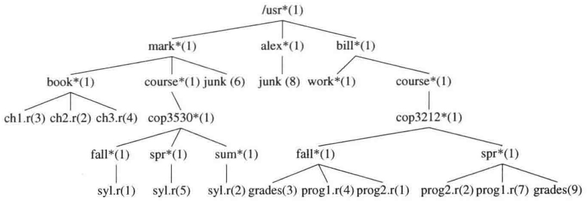

<details>
<summary>flowchart</summary>

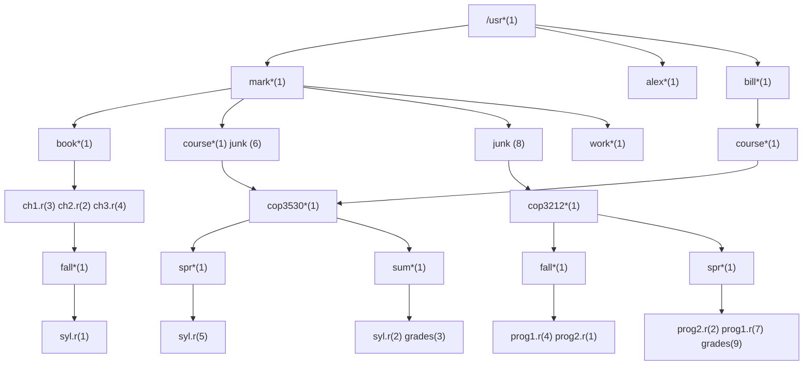
</details>

图 4.8 经由后序遍历得到的带有文件大小的 UNIX 目录

```cpp
int FileSystem::size( ) const
{
    int totalSize = sizeofThisFile( );

    if( isDirectory( ) )
        for each file c in this directory (for each child)
            totalSize += c.size( );

    return totalSize;
}
```

图 4.9 计算一个目录大小的伪码例程

```asm
ch1.r                     3
    ch2.r                     2
    ch3.r                     4
    book                    10
        syl.r     1
        fall                 2
            syl.r     5
        spr                   6
            syl.r     2
        sum                   3
    cop3530             12
    course                   13
    junk                   6
mark                            30
    junk                   8
alex                            9
    work                   1
        grades     3
        prog1.r   4
        prog2.r   1
        fall                 9
            prog2.r   2
            prog1.r   7
            grades     9
        spr                   19
    cop3212             29
    course                   30
bill                        32
/usr                         72
```

图 4.10 函数 size 的印迹

## 4.2 二叉树

二叉树(binary tree)是一棵树，其中每个节点都不能有多于两个的儿子。

图4.11显示，一棵二叉树由一个根和两棵子树 $T_{L}$ 和 $T_{R}$ 组成， $T_{L}$ 和 $T_{R}$ 均可能为空。

二叉树的一个性质是平均二叉树的深度要比节点个数 $N$ 小得多，这个性质有时很重要。分析表明，其平均深度为 $O(\sqrt{N})$ ，而对于特殊类型的二叉树，即二叉查找树(binary search tree)，其深度的平均值是 $O(\log N)$ 。遗憾的是，正如图4.12中的例子所示，这个深度是可以大到 $N - 1$ 的。

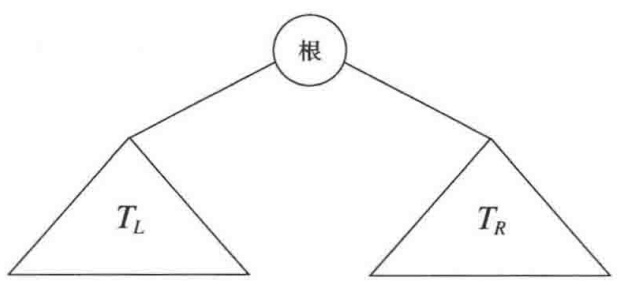

<details>
<summary>text_image</summary>

根
T_L
T_R
</details>

图 4.11 一般二叉树

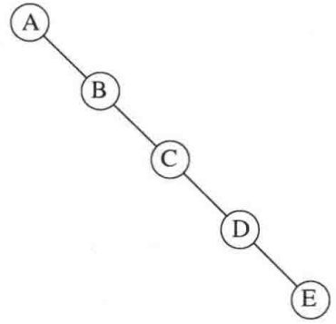

<details>
<summary>flowchart</summary>

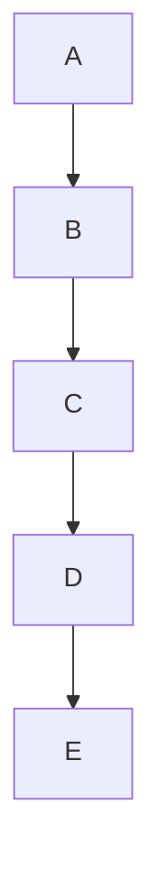
</details>

图 4.12 最坏情形的二叉树

## 4.2.1 实现

因为一个二叉树节点最多有两个儿子，所以我们可以保存直接链接到它们的链。树节点的声明在结构上类似于双向链表的声明，因为一个节点就是由 element 的信息加上两个指向其他节点的指针(left 和 right)组成的结构(见图 4.13)。

```c
struct BinaryNode
{
    Object      element;      // 节点上的数据
    BinaryNode *left;          // 左儿子
    BinaryNode *right;       // 右儿子
};
```

图 4.13 二叉树节点类(伪代码)

我们是可以用在画链表时习惯使用的矩形框画出二叉树的，不过，树一般画成圆圈并用一些直线连接起来，因为它们实际上就是图(graph)。当涉及到树时，我们也不显式地画出nullptr链，因为每一棵具有 $N$ 个节点的二叉树都需要 $N + 1$ 个nullptr链。

二叉树有许多与搜索无关的重要应用。二叉树的主要用处之一是在编译器设计领域，我们现在就来探索这个问题。

## 4.2.2 一个例子——表达式树

图 4.14 显示的是一个表达式树 (expression tree) 的例子。表达式树的树叶是操作数 (operand)，如常数或变量名字，而其他的节点为操作符 (operator)。由于这里所有的操作都是二元 (二目) 的，因此这棵特定的树正好是二叉树。虽然这是最简单的情况，但是节点还是有可能含有多于两个的儿子的。一个节点也有可能只有一个儿子，如具有一目减运算符 (unary minus operator)的情形。我们可以将通过递归计算左子树和右子树所得到的值应用在根处的运算符上而算出表达式树 $T$ 的值。在我们的例子中，左子树的值是 $a + (b*c)$，右子树的值是 $((d*e) + f)*g$，因此整个树表示为 $(a + (b*c)) + (((d*e) + f)*g)$。

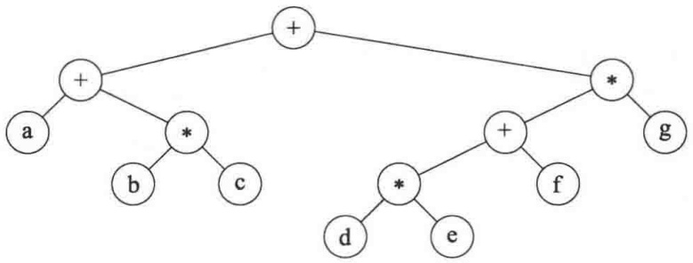

<details>
<summary>flowchart</summary>

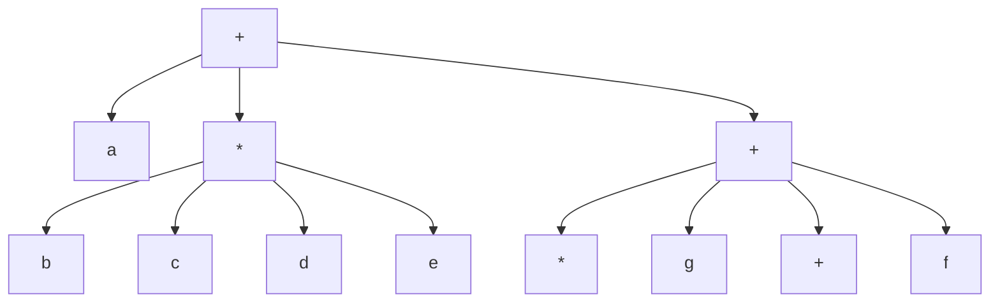
</details>

图4.14 $(a + b*c) + ((d*e + f)*g)$ 的表达式树

我们可以通过递归地产生一个带括号的左表达式，然后打印出在根处的运算符，最后再递归地产生一个带括号的右表达式而得到一个(对两个括号整体进行运算的)中缀表达式(infix expression)。这种一般的方法(左，节点，右)称为中序遍历(inorder traversal)。由于其产生的表达式类型，这种遍历很容易记忆。

另一种遍历策略是递归地打印出左子树、右子树，然后打印运算符。如果应用这种策略于上面的树，则输出将是  $abc*+de*f+g*+$ 。容易看出，它就是 3.6.3 节中的后缀表示法。这种遍历策略一般称为后序遍历(postorder traversal)。我们已在 4.1 节见过这种遍历方法。

第三种遍历策略是先打印出运算符，然后递归地打印出左子树和右子树。此时得到的表达式++a\*bc\*++\*defg 是不太常用的前缀 (prefix) 记法，这种遍历策略为先序遍历 (preorder traversal)，我们也在 4.1 节见过它。以后，我们还要讨论这些遍历方法。

## 构造一棵表达式树

现在给出一种算法来把后缀表达式转变成表达式树。由于已经有了将中缀表达式转变成后缀表达式的算法，因此我们能够从这两种常用类型的输入生成表达式树。这里所描述的方法酷似3.6.3节的后缀求值算法。我们一次一个符号地读入表达式。如果符号是操作数，那么就建立一个单节点树并将指向它的指针推入栈中。如果符号是操作符，那么就从栈中弹出指向两棵树 $T_{1}$ 和 $T_{2}$ （的两个指针） $(T_{1}$ 的先弹出)并形成一棵新的树，该树的根就是操作符，它的左、右儿子分别是 $T_{2}$ 和 $T_{1}$ 。然后将指向这棵新树的指针压入栈中。

来看一个例子。设输入为

$$
\mathrm{a} \mathrm{b} + \mathrm{c} \mathrm{d} \mathrm{e} + * *\left. \right.
$$

前两个符号是操作数，因此创建两棵单节点树并将它们压入栈中。 $^{①}$接着，+被读入，因此指向两棵树的指针被弹出，一棵新的树形成，指向新树的指针被压入栈中。

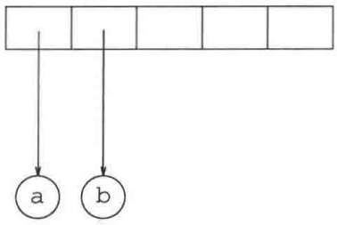

<details>
<summary>flowchart</summary>

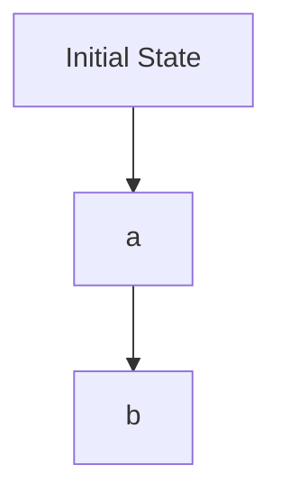
</details>

<small><span class="docvortex-page-footnote" data-block-type="page_footnote" style="color:#6b7280">① 为了方便起见，我们将让图中的栈从左到右增长。</span></small>

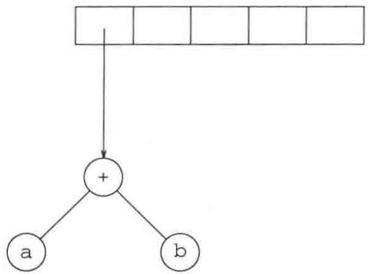

<details>
<summary>flowchart</summary>

```mermaid
graph TD
  A[""] --> B{"+"}
  B --> C["a"]
  B --> D["b"]
```
</details>

然后，c、d 和 e 被读入，在每个单节点树创建后，对应的指向树的指针被压入栈中。

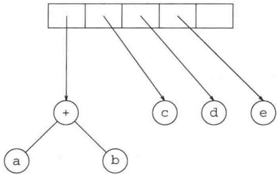

<details>
<summary>flowchart</summary>

```mermaid
graph TD
  A[""] --> B["+"]
  B --> C["c"]
  B --> D["d"]
  B --> E["e"]
  B --> F["a"]
  B --> G["b"]
```
</details>

接下来读入+号，因此右边的两棵树合并。

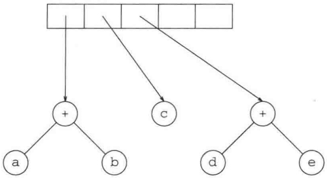

<details>
<summary>flowchart</summary>

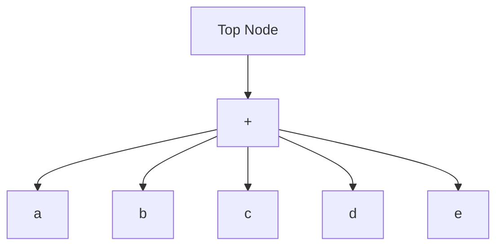
</details>

继续进行，读入\*号，因此，我们弹出两棵树的两个指针并形成一棵新的树，\*号是它的根。

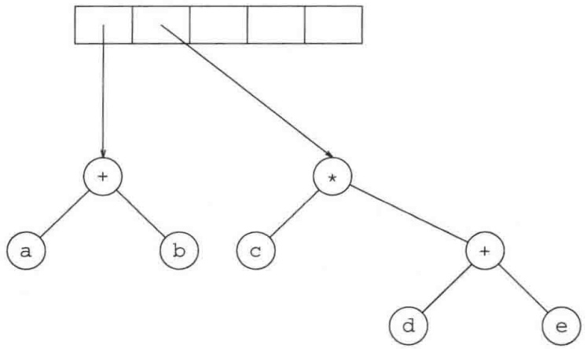

<details>
<summary>flowchart</summary>

```mermaid
graph TD
  A[""] --> B{"+"}
  B -->|a| C["a"]
  B --> D["b"]
  B --> E["*"]
  D --> F["b"]
  E --> G["c"]
  E --> H["d"]
  E --> I["e"]
  G --> J{"+"}
  H --> J
  I --> J
```
</details>

最后，读入最后一个符号，两棵树合并，而指向最后的树的指针被留在栈中。

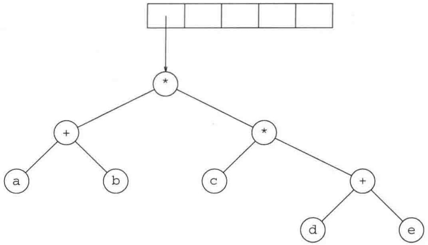

<details>
<summary>flowchart</summary>

```mermaid
graph TD
  A[""] --> B["*"]
  B --> C["+"]
  B --> D["*"]
  C --> E["a"]
  C --> F["b"]
  D --> G["c"]
  D --> H["d"]
  D --> I["e"]
```
</details>

## 4.3 查找树 ADT——二叉查找树

二叉树的一个重要的应用是它们在搜索中的使用。假设树中的每个节点存储一项数据。在我们的例子中，虽然任意复杂的项在 $\mathrm{C}++$ 中都容易处理，但为简单起见还是假设它们都是整数。我们还将假设，所有的项彼此互异，以后再处理有重复项的情况。

使二叉树成为二叉查找树的性质是，对于树中的每个节点 $X$ ，它的左子树中所有项的值均小于 $X$ 中的项，而它的右子树中所有项的值均大于 $X$ 中的项。注意，这意味着，该树所有的元素可以用某种一致的方式排序。在图4.15中，左边的树是二叉查找树，但右边的树不是。右边的树在其项是6的节点(该节点正好是根节点)的左子树中，有一个节点的项是7。

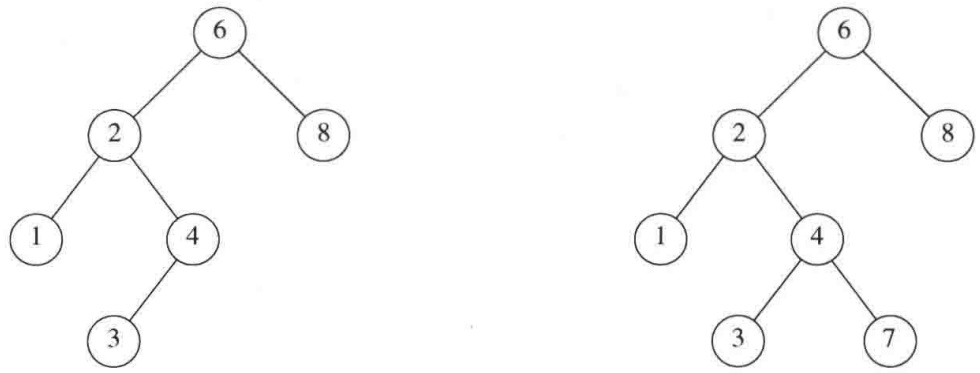

图 4.15 两棵二叉树(只有左边的树是查找树)

现在给出通常对二叉查找树进行的操作的简要描述。注意，由于树的递归定义，通常是递归地编写这些操作的例程。因为二叉查找树的平均深度是 $O(\log N)$，所以一般不必担心栈空间被用尽。

图 4.16 显示的是 BinarySearchTree 类模板的接口。这里有几项要注意的事情。查找是基于操作符<的，它必须被定义成特定的 Comparable 类型。特别地，如果 x<y 和 y<x 均为 false，那么项 x 匹配项 y。这使得 Comparable 可以是一个复杂的类型（比如雇员的记录），不过，比较功能只在类型的一部分上定义（如社会保险号数据成员或工资）。1.6.3 节阐释设计能够用作 Comparable 的类的一般方法。在 4.3.1 节描述的另一种方法适用于函数对象。

数据成员是一个指向根结点的指针。对于空树，这个指针为 nullptr。public 成员函数使用一般的技巧调用 private 的递归函数。图 4.17 中显示了一个例子，说明对于 contains、insert 和 remove，这种技巧是如何实施的。

```cpp
template <typename Comparable>
class BinarySearchTree
{
    public:
        BinarySearchTree( );
        BinarySearchTree( const BinarySearchTree & rhs );
        BinarySearchTree( BinarySearchTree && rhs );
        ~BinarySearchTree( );

        const Comparable & findMin( ) const;
        const Comparable & findMax( ) const;
        bool contains( const Comparable & x ) const;
        bool isEmpty( ) const;
        void printTree( ostream & out = cout ) const;

        void makeEmpty( );
        void insert( const Comparable & x );
        void insert( Comparable && x );
        void remove( const Comparable & x );

        BinarySearchTree & operator=( const BinarySearchTree & rhs );
        BinarySearchTree & operator=( BinarySearchTree && rhs );

private:
    struct BinaryNode
    {
        Comparable element;
        BinaryNode *left;
        BinaryNode *right;

        BinaryNode( const Comparable & theElement, BinaryNode *lt, BinaryNode *rt )
            : element{ theElement }, left{ lt }, right{ rt } { }

        BinaryNode( Comparable && theElement, BinaryNode *lt, BinaryNode *rt )
            : element{ std::move( theElement ) }, left{ lt }, right{ rt } { }
    };

    BinaryNode *root;

    void insert( const Comparable & x, BinaryNode * & t );
    void insert( Comparable && x, BinaryNode * & t );
    void remove( const Comparable & x, BinaryNode * & t );
    BinaryNode * findMin( BinaryNode *t ) const;
    BinaryNode * findMax( BinaryNode *t ) const;
    bool contains( const Comparable & x, BinaryNode *t ) const;
    void makeEmpty( BinaryNode * & t );
    void printTree( BinaryNode *t, ostream & out ) const;
    BinaryNode * clone( BinaryNode *t ) const;
};
```

图 4.16 二叉查找树类架构

几个 private 型成员函数通过传引用调用(call-by-reference)使用传递指针变量的技巧。这使得 public 型成员函数能够把指向根结点的指针传递给 private 型的递归成员函数。这些递归函数此时可以改变根的值，使得 root 指向另外的节点。当考查 insert 的代码时，我们将详细描述这种技巧。

现在，我们可以描述一些 private 型的方法了。

```c
/**
 * 如果在树中找到 x，则返回true.
 */
bool contains( const Comparable & x ) const
{
    return contains( x, root );
}

/**
 * 将x插入到树中;忽略重复元.
 */
void insert( const Comparable & x )
{
    insert( x, root );
}

/**
 * 将x从树中删除。如果没找到x，则什么也不做。
*/
void remove( const Comparable & x )
{
    remove( x, root );
}
```

图 4.17 公有成员函数调用私有递归函数的图示

## 4.3.1 contains

如果在树 $T$ 中存在含有项 $X$ 的节点，那么这个操作需要返回 true，如果这样的节点不存在则返回 false。树的结构使得这种操作很简单。如果 $T$ 是空集，那么可以直接返回 false。否则，如果存储在 $T$ 处的项是 $X$，那么可以返回 true。否则，我们对树 $T$ 的左子树或右子树进行一次递归调用，这依赖于 $X$ 与存储在 $T$ 中的项的关系。图4.18中的代码就是对这种策略的一种实现。

```c
/**
 * 测试一项是否在子树上的内部方法.
 * x 是要查找的项.
 * t 是作为该子树的根的节点.
 */
bool contains( const Comparable & x, BinaryNode *t ) const
{
    if( t == nullptr )
        return false;
    else if( x < t->element )
        return contains( x, t->left );
    else if( t->element < x )
        return contains( x, t->right );
    else
        return true;   // 匹配
}
```

图 4.18 二叉查找树的 contains 操作

注意测试的顺序。关键的问题是首先要对是否空树进行测试，因为否则就会产生一个企图通过 nullptr 指针访问数据成员的运行时错误。剩下的测试使得最不可能的情况安排在最后进行。还要注意，这里的两个递归调用事实上都是尾递归并且可以用一个 while 循环很容易地将它们替换掉。尾递归的使用在这里是合理的，因为算法表达式的简明性是以速度的降低为代价的，而这里所使用的栈空间的量也只不过是 $O(\log N)$ 而已。

图 4.19 显示了一些简单的变化，它们需要使用一个函数对象而不是要求这些项是 Comparable 的。程序模仿了 1.6.4 节的风格。

```cpp
template <typename Object, typename Comparator=less<Object>>
class BinarySearchTree
{
    public:
        // 方法相同，但用 Object 代替Comparable

    private:
        BinaryNode *root;
        Comparator isLessThan;

        // 方法相同，但用 Object 代替Comparable

        /**
         * 检测一项是否在子树上的内部方法.
         * x 是要查找的项.
         * t 是作为子树的根的节点.
         */
        bool contains( const Object & x, BinaryNode *t ) const
        {
            if( t == nullptr )
                return false;
            else if( isLessThan( x, t->element ) )
                return contains( x, t->left );
            else if( isLessThan( t->element, x ) )
                return contains( x, t->right );
            else
                return true;   // 匹配
        }
};
```

图4.19 对使用函数对象实现二叉查找树的图示

## 4.3.2 findMin 和 findMax

这两个 private 例程分别返回指向树中包含最小元素和包含最大元素的节点的指针。为执行 findMin，从根开始并且只要有左儿子就向左查找。终止点就是最小的元素。findMax 例程除分支朝向右儿子外其余过程相同。

许多程序设计员不厌其烦地使用递归。我们用递归的方法将 finMin 写成例程(见图 4.20)，并用非递归的方法将 findMax 写成例程(见图 4.21)。

```c
/**
 * 找出子树 t 中最小项的内部方法.
 * 返回包含最小项的节点.
 */
BinaryNode * findMin( BinaryNode *t ) const
{
    if( t == nullptr )
        return nullptr;
    if( t->left == nullptr )
        return t;
    return findMin( t->left );
}
```

图 4.20 对二叉查找树 findMin 的递归实现

```c
/**
 * 找出子树 t 上最大项的内部方法.
 * 返回包含最大项的节点.
 */
BinaryNode * findMax( BinaryNode *t ) const
{
    if( t != nullptr )
        while( t->right != nullptr )
            t = t->right;
    return t;
}
```

图 4.21 对二叉查找树 findMax 的非递归实现

注意，我们是如何小心地处理空树的退化情况的。虽然这么做总是重要的，但是特别在递归程序中它尤其重要。此外，还要注意，在 findMax 中对 t 的改变是安全的，因为我们只用到指针的拷贝来进行工作。不管怎么说，还是应该随时特别小心，因为像 t->right=t->right->right 这样的语句将会产生一些变化。

## 4.3.3 insert

实现插入的例程在概念上是简单的。为了将 $X$ 插入到树 $T$ 中，可以像 contains 那样沿着树查找。如果找到 $X$，则什么也不用做。否则，将 $X$ 插入到所遍历的路径的最后一点上。图 4.22 显示了实际的插入情况。为了插入 5，我们就好像在运行 contains 一样遍历该树。在带有项 4 的节点处，我们需要向右行进，但右边不存在子树，因此 5 不在这棵树上，从而这个位置就是插入 5 的正确位置。

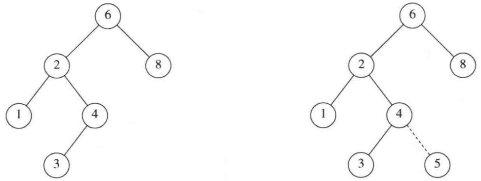

图 4.22 插入 5 以前和以后的二叉查找树

重复元的插入可以通过在节点记录中保留一个附加域以指示发生的频率来处理。这对整个的树增加了某些附加空间，但是，却比将重复元放到树中要好(它将使树的深度变得很大)。当然，如果操作符<用到的关键字只是一个更大结构的一部分，那么这种方法行不通。此时可以把具有相同关键字的所有结构保留在一个辅助数据结构中，譬如表或另一棵查找树。

图 4.23 显示了插入例程的程序。第 12 行和第 14 行递归地将 x 插入到相应的子树中。注意，在递归例程中，唯一一次 t 变化的时刻是在一片新树叶创建的时候。此时意味着，递归例程已经从某个其他的节点 p 处被调用，而这个节点将是新建树叶的父亲。该调用将是 insert(x, p->left) 或 insert(x, p->right)。不管哪种方法，t 现在都是对 p->left 或 p->right 的引用，这就意味着，p->left 或 p->right 将改变以指向新的节点。总的来说，方法简明巧妙。

```cpp
/**
 * 向子树插入元素的内部方法.
 * x 是要插入的项.
 * t 为该子树的根节点.
 * 置子树的新根.
 */
void insert( const Comparable & x, BinaryNode * & t )
{
    if( t == nullptr )
        t = new BinaryNode{ x, nullptr, nullptr };
    else if( x < t->element )
        insert( x, t->left );
    else if( t->element < x )
        insert( x, t->right );
    else
        ; // 重复元; 什么也不做
}

/**
 * 向子树插入元素的内部方法.
 * x 是通过移动实现要插入的项.
 * t 为该子树的根.
 * 置子树的新根.
 */
void insert( Comparable && x, BinaryNode * & t )
{
    if( t == nullptr )
        t = new BinaryNode{ std::move( x ), nullptr, nullptr };
    else if( x < t->element )
        insert( std::move( x ), t->left );
    else if( t->element < x )
        insert( std::move( x ), t->right );
    else
        ; // 重复元; 什么也不做
}
```

图 4.23 向二叉查找树进行插入的例程

## 4.3.4 remove

正如许多数据结构一样，最困难的操作是删除。一旦发现要被删除的节点，我们就需要考虑几种可能的情况。

如果节点是一片树叶，那么它可以被立即删除。如果节点有一个儿子，则该节点可以在其父节点调整它的链以绕过该节点后被删除(为了清楚起见，我们将明确地画出链的指向)，见图4.24。

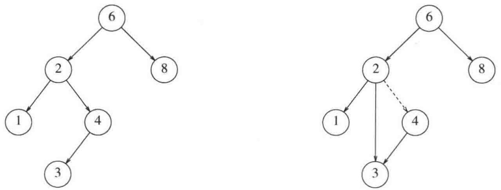

<details>
<summary>flowchart</summary>

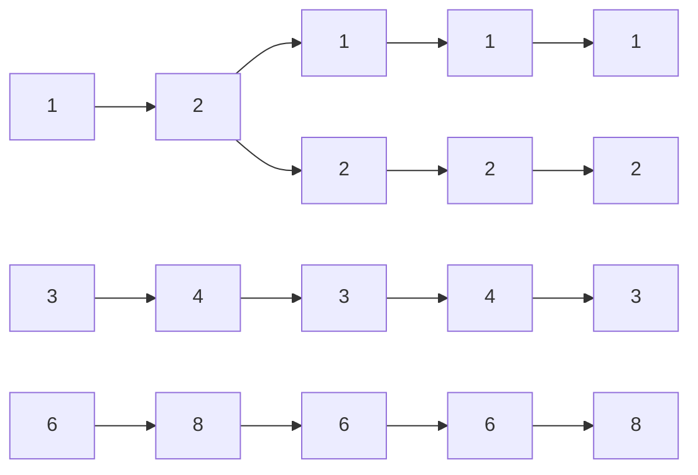
</details>

图4.24 具有一个儿子的节点(4)删除前后的情况

复杂的是处理具有两个儿子的节点的情况。一般的删除策略是用其右子树的最小的数据(很容易找到)代替该节点的数据并递归地删除那个节点(现在它是空的)。因为右子树中的最小的节点不可能有左儿子，所以第二次 remove 要容易。图 4.25 显示一棵初始的树及其中一个节点被删除后的结果。要被删除的节点是根的左儿子，其关键字的值为 2。它被右子树中的最小数据 (3) 所代替，然后关键字是 3 的原节点如前例那样被删除。

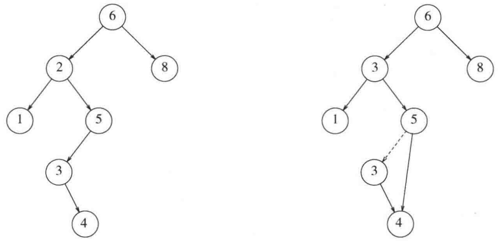

<details>
<summary>flowchart</summary>

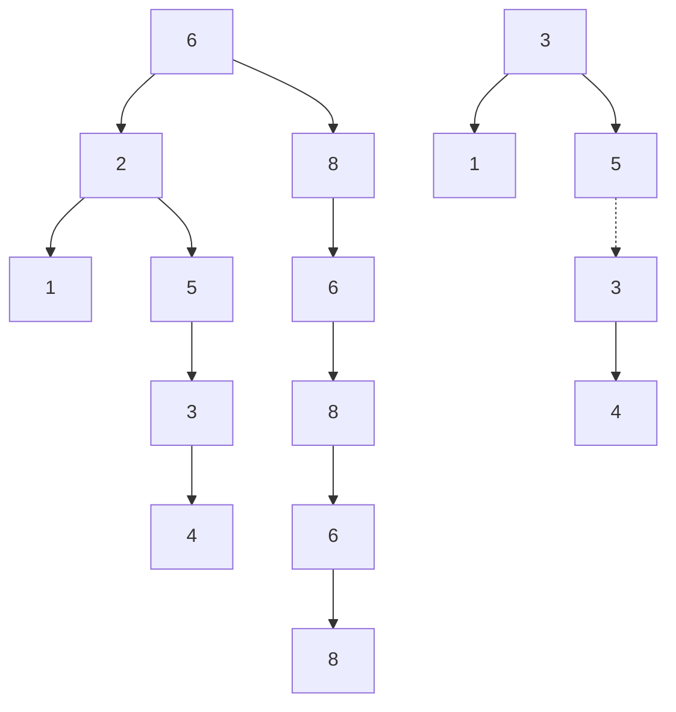
</details>

图 4.25 删除具有两个儿子的节点(2)前后的情况

图 4.26 中的程序实施删除的工作，但它的效率并不高，因为它沿该树进行两趟搜索以查找和删除右子树中最小的节点。通过写一个特殊的 removeMin 方法可以容易地克服这种效率不高的缺点，我们这里将它略去只是为了简明。

如果预计删除的次数不多，则通常使用的策略是懒惰删除(lazy deletion):当一个元素要被删除时，它仍然留在树中，而是只作了个被删除的标记。这特别是在有重复项时很流行，因为此时记录出现频率数的域可以减1。如果树中的实际节点数和“被删除”的节点数相同，那么树的深度预计只上升一个小的常数(为什么？)，因此，存在一个与懒惰删除相关的非常小的时间损耗。再有，如果被删除的项被重新插入，那么分配一个新单元的开销也就避免了。