```c
/**
 * 从一棵子树删除一项的内部方法.
 * 参数 x 是要被删除的项.
 * 参数 t 为该子树的根节点.
 * 置该子树的新的根.
 */
void remove( const Comparable & x, BinaryNode * & t )
{
    if( t == nullptr )
        return;   // 项没找到; 什么也不做
    if( x < t->element )
        remove( x, t->left );
    else if( t->element < x )
        remove( x, t->right );
    else if( t->left != nullptr && t->right != nullptr ) // 有两个儿子
    {
        t->element = findMin( t->right )->element;
        remove( t->element, t->right );
    }
    else
    {
        BinaryNode *oldNode = t;
        t = ( t->left != nullptr ) ? t->left : t->right;
        delete oldNode;
    }
}
```

图4.26 二叉查找树的删除例程

## 4.3.5 析构函数和拷贝构造函数

通常，析构函数调用 makeEmpty。这个公有的 makeEmpty 函数(未显示)直接调用私有递归版本的 makeEmpty 函数。如图 4.27 所示，在递归地处理 t 的子节点之后，则对 t 调用 delete 函数。因此，所有的节点都将被递归地回收。注意，最后，t 从而 root 改为指向 nullptr。拷贝构造函数如图 4.28 所示，遵循通常的过程，首先初始化 root 为 nullptr，然后复制 rhs 的拷贝。我们使用一个非常成熟的递归函数来处理所有这些苦活，这个递归函数名为 clone。

## 4.3.6 平均情况分析

直观上, 我们期望这一节描述的所有操作(除makeEmpty和复制外)都应该花费 $O(\log N)$ 时间, 因为我们以常数时间在树中降低了一层, 这样一来, 现在对树进行的操作大致减小一半左右。实际上, 所有操作的运行时间(除makeEmpty和复制外)都是 $O(d)$, 其中 $d$ 是包含所访问项的节点的深度(在remove的情形, 它可能是两个儿子情形的替代节点)。

我们在本节要证明，在所有的插入序列都是等可能的假设下，则树的所有节点的平均深度为 $O(\log N)$。

一棵树的所有节点的深度之和称为内部路径长 (internal path length)。我们现在将要计算二叉查找树的平均内部路径长，其中的平均是对向二叉查找树中所有可能的插入序列进行的。

```c
/**
 * 二叉查找树的析构函数
 */
~BinarySearchTree( )
{
    makeEmpty( );
}
/**
 * 使子树为空的内部方法.
 */
void makeEmpty( BinaryNode * & t )
{
    if( t != nullptr )
    {
        makeEmpty( t->left );
        makeEmpty( t->right );
        delete t;
    }
    t = nullptr;
}
```

图 4.27 析构函数与递归成员函数 makeEmpty

```txt
/**
 * 拷贝构造函数
 */
BinarySearchTree( const BinarySearchTree & rhs ) : root{ nullptr }
{
    root = clone( rhs.root );
}

/**
 * 克隆子树的内部方法.
 */
BinaryNode * clone( BinaryNode *t ) const
{
    if( t == nullptr )
        return nullptr;
    else
        return new BinaryNode{ t->element, clone( t->left ), clone( t->right ) };
}
```

图 4.28 拷贝构造函数与递归成员函数 clone

令 $D(N)$ 是具有 $N$ 个节点的某棵树 $T$ 的内部路径长，$D(1) = 0$。一棵 $N$ 节点树是由一棵 $i$ 节点左子树和一棵 $(N - i - 1)$ 节点右子树以及深度 0 处的一个根节点组成的，其中 $0 \leqslant i < N, D(i)$ 为根的左子树的内部路径长。但是在原树中，所有这些节点都要加深一层。同样的结论对于右子树也是成立的。由此，我们得到递推关系:

$$
D (N) = D (i) + D (N - i - 1) + N - 1
$$

如果所有子树的大小都是等可能地出现，这对于二叉查找树(但对于二叉树不)是成立的(因为子树的大小只依赖于第一个插入到树中的元素相对的秩(rank))，那么 $D(i)$ 和 $D(N - i - 1)$ 的

平均值都是 $(1 / N)\sum_{j = 0}^{N - 1}D(j)$ 。于是得到

$$
D (N) = \frac {2}{N} \left[ \sum_ {j = 0} ^ {N - 1} D (j) \right] + N - 1
$$

在第7章将遇到并求解这个递推式，得到的平均值为 $D(N) = O(N \log N)$ 。因此，任意节点的期望深度为 $O(\log N)$ 。作为一个例子，图4.29所示随机生成的500个节点的树的节点期望深度为9.98。

但是，上来就断言这个结果意味着上一节讨论的所有操作的平均运行时间是 $O(\log N)$ 颇有诱惑力，但这并不完全正确。原因在于删除操作，我们并不清楚是否所有的二叉查找树都是等可能出现的。特别是，上面描述的删除算法有助于使得左子树比右子树深度深，因为我们总是用右子树的一个节点来代替删除的节点。这种方法的准确的效果仍然是未知的，但它似乎只是理论上的悬念。业已证明，如果交替插入和删除 $\Theta (N^2)$ 次，那么树的期望深度将是 $\Theta (\sqrt{N})$ 。在进行25万次随机insert/remove对操作后，图4.29中有些右沉的树在图4.30中看起来就变得太不平衡了(平均深度 $= 12.51$ )。

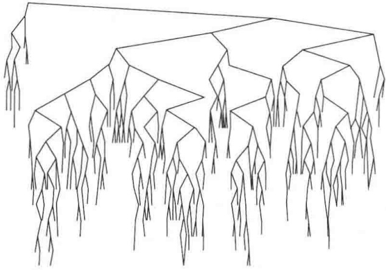

<details>
<summary>natural_image</summary>

Abstract line drawing of branching, tree-like structures with no text or symbols
</details>

图 4.29 一棵随机生成的二叉查找树

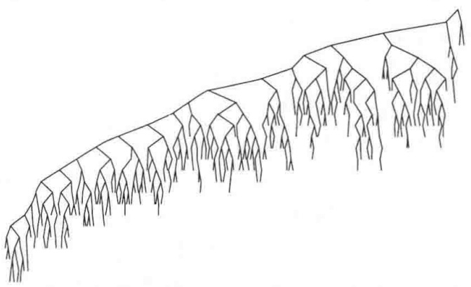

<details>
<summary>natural_image</summary>

Line drawing of a long, curved, leaf-like structure with no text or symbols
</details>

图4.30 在 $\Theta(N^2)$ 次 insert/remove 对操作后的二叉查找树

在删除操作中, 可以通过随机选取右子树的最小元素或左子树的最大元素来代替被删除的元素以消除这种不平衡问题。这种做法明显地消除了上述偏向并使树保持平衡, 但是, 没有人实际上证明过这一点。无论如何, 这种现象似乎主要是理论上的问题, 因为对于小的树上述效果根本显示不出来, 甚至更奇怪, 如果使用 $o(N^{2})$ insert/remove 对操作, 那么树似乎可以得到平衡。

上面的讨论主要是说明，决定“平均”意味着什么一般是极其困难的，可能需要一些假设，而这些假设可能合理，也可能不合理。不过，在没有删除或是使用懒惰删除的情况下，我们可以断言:上述那些操作的平均运行时间都是 $O(\log N)$ 。除像上面讨论的一些个别情形外，这个结果与实际观察到的情形是非常一致的。

如果向一棵树输入预先排序的数据，那么一连串 insert 操作将花费二次的(quadratic)时间，而链表实现的代价会非常巨大，因为此时的树将只由那些没有左儿子的节点组成。一种解决办法就是要有一个称为平衡(balance)的附加结构条件:任何节点的深度均不得过深。

有许多一般的算法实现平衡树。但是，大部分算法都要比标准的二叉查找树复杂得多，而且更新要平均花费更长的时间。不过，它们确实防止了处理起来非常麻烦的一些简单情形。下面将介绍最老的一种平衡查找树，即 AVL 树 (AVL tree)。

第二种方法是放弃平衡条件，允许树有任意的深度，但是在每次操作之后要使用一个调整规则进行调整，使得后面的操作效率要高。这种类型的数据结构一般属于自调整(self-adjusting)类结构。在二叉查找树的情况下，对于任意单次操作我们不再保证 $O(\log N)$ 的时间界，但是可以证明任意连续 $M$ 次操作在最坏的情形下花费时间 $O(M\log N)$ 。一般这足以防止令人棘手的最坏情形。我们将要讨论的这种数据结构叫作伸展树(splay tree)，它的分析相当复杂，我们将在第11章讨论。

## 4.4 AVL 树

AVL (Adelson-Velskii 和 Landis) 树是带有平衡条件 (balance condition) 的二叉查找树。这

个平衡条件必须要容易保持，而且它保证树的深度是 $O(\log N)$ 。最简单的想法是要求左右子树具有相同的高度。如图4.31所示，这种想法并不强求树的深度要浅。

另一种平衡条件是要求每个节点都必须要有相同高度的左子树和右子树。如果空子树的高度定义为-1（通常就是这么定义），那么只有具有 $2^{k} - 1$ 个节点的理想平衡树(perfectly balanced tree)满足这个标准。因此，虽然这种平衡条件保证了树的深度小，但是它太严格了以至难以使用，需要把它放宽。

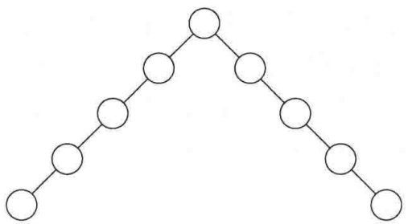

<details>
<summary>flowchart</summary>

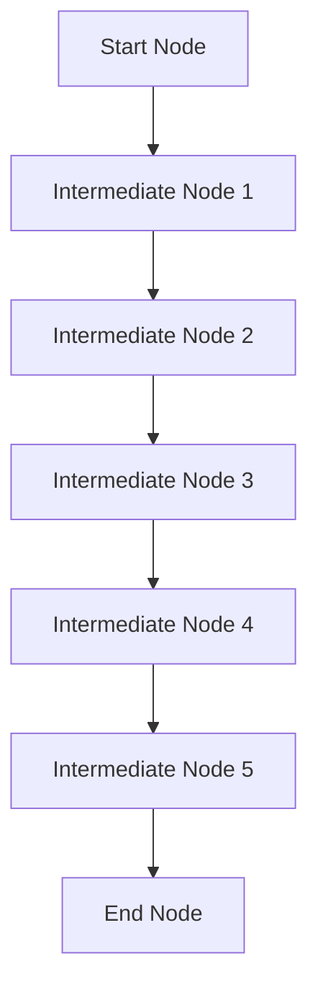
</details>

图 4.31 一棵坏的二叉树。只要求在根节点平衡是不够的

一棵 AVL 树 (AVL tree) 是其每个节点的左子树和右子树的高度最多差 1 的二叉查找树。(空树的高度定义为 -1。) 在图 4.32 中, 左边的树是 AVL 树, 但右边的树不是。每一个节点 (在其节点结构中) 保留高度信息。可以证明, 粗略地说, 一棵 AVL 树的高度最多为 $1.44 \log (N + 2) - 1.328$, 而实际上的高度只比 $\log N$ 稍微多一些。作为例子, 图 4.33 显示一棵具有最少节点 (143) 高度为 9 的 AVL 树。这棵树的左子树是高度为 7 且大小最小的 AVL 树, 右子树是高度为 8 且大小最小的 AVL 树。它告诉我们, 在高度为 $h$ 的 AVL 树中, 最少节点数 $S(h)$ 由 $S(h) = S(h - 1) + S(h - 2) + 1$ 给出。对于 $h = 0, S(h) = 1$; 而当 $h = 1$ 时, $S(h) = 2$ 。函数 $S(h)$ 与斐波那契数 (Fibonacci number) 密切相关, 由此推出上面提到的关于 AVL 树的高度的界。

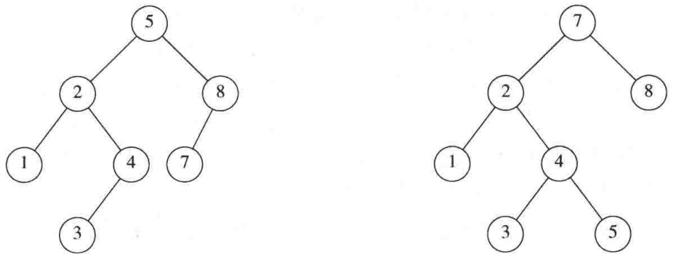

图 4.32 两棵二叉查找树，只有左边的树是 AVL 树

因此，除去可能的插入和删除外，所有的树操作都可以以时间 $O(\log N)$ 执行。当进行插入操作时，我们需要更新通向根节点路径上那些节点的所有平衡信息，而插入操作隐含着困难的原因在于，插入一个节点可能破坏AVL树的特性。（例如，将6插入到图4.32的AVL树中将会破坏关键字为8的节点处的平衡条件。）如果发生这种情况，那么就要在考虑这一步插入完成之前恢复平衡的性质。事实上，这总可以通过对树进行简单的修正来做到，我们称其为旋转(rotation)。

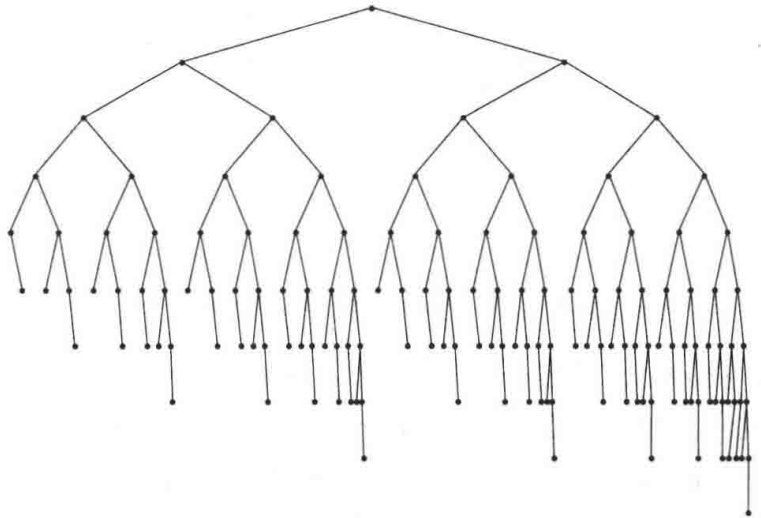

<details>
<summary>natural_image</summary>

Abstract geometric tree-like structure composed of interconnected nodes and lines, no text or symbols present
</details>

图4.33 高度为9的最小的AVL树

在一次插入之后，只有那些从插入点到根节点的路径上的节点的平衡可能被改变，因为只有这些节点的子树可能发生变化。当沿着这条路径上行到根并更新平衡信息时，我们可以发现一个节点，它的新平衡破坏了 AVL 条件。我们将指出如何在第一个这样的节点(即最深的节点)重新平衡这棵树，并证明，这一重新平衡保证整个树满足 AVL 性质。

我们把必须重新平衡的节点叫作 $\alpha$ 。由于任意节点最多有两个儿子，因此出现高度不平衡就需要 $\alpha$ 点的两棵子树的高度差2。容易看出，这种不平衡可能出现在下面4种情况中:

1. 对 $\alpha$ 的左儿子的左子树进行一次插入。
2. 对 $\alpha$ 的左儿子的右子树进行一次插入。
3. 对 $\alpha$ 的右儿子的左子树进行一次插入。
4. 对 $\alpha$ 的右儿子的右子树进行一次插入。

情形 1 和 4 是关于  $\alpha$  点的镜像对称 (mirror image symmetry)，而情形 2 和 3 也是关于  $\alpha$  点的镜像对称。因此，理论上只有两种基本情况，当然从编程的角度来看还是 4 种情形。

第一种情况是插入发生在“外边”的情况(即左-左的情况或右-右的情况)，该情况通过对树的一次单旋转(single rotation)而完成调整。第二种情况是插入发生在“内部”的情形(即左右的情况或右-左的情况)，该情况通过稍微复杂些的双旋转(double rotation)来处理。我们将会看到，这些都是对树的基本操作，它们多次用在一些平衡树算法中。本节其余部分将描述这些旋转，证明它们足以保持树的平衡，并顺便给出 AVL 树的一种非正式的实现。第 12 章描述其他的平衡树方法，这些方法着眼于 AVL 树的更仔细的实现。

## 4.4.1 单旋转

图 4.34 显示单旋转如何调整情形 1。旋转前的图在左边，而旋转后的图在右边。让我们来仔细分析具体的做法。节点 $k_{2}$ 不满足 AVL 平衡性质，因为它的左子树比右子树深 2 层（图中间的几条虚线标示树的各层）。该图所描述的情况只是情形 1 的一种可能的情况，在插入之前 $k_{2}$ 满足 AVL 性质，但在插入之后这种性质被破坏了。子树 $X$ 已经长出一层，这使得它比子树 $Z$ 深出 2 层。$Y$ 不可能与新 $X$ 在同一水平上，因为那样 $k_{2}$ 在插入以前就已经失去平衡了；$Y$ 也不可能与 $Z$ 在同一层上，因为那样 $k_{1}$ 就会是在通向根的路径上破坏 AVL 平衡条件的第一个节点。

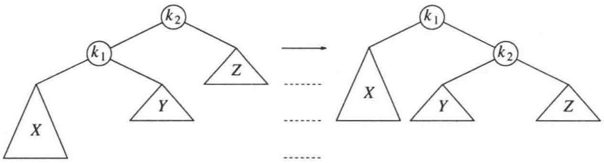

<details>
<summary>flowchart</summary>

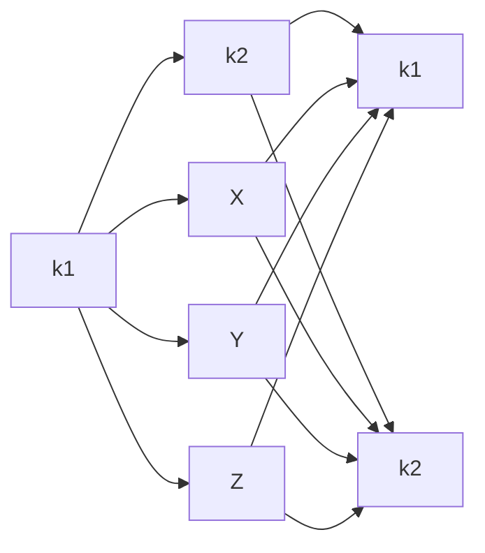
</details>

图4.34 调整情形1的单旋转

为使树恢复平衡，我们把 $X$ 上移一层，并把 $Z$ 下移一层。注意，此时实际上超出了 AVL 性质的要求。为此，我们重新安排节点以形成一棵等价的树，如图 4.34 的第二部分所示。抽象地形容就是:把树形象地看成是柔软灵活的，抓住子节点 $k_{1}$，闭上你的双眼，使劲摇动它，在重力作用下，$k_{1}$ 就变成了新的根。二叉查找树的性质告诉我们，在原树中 $k_{2} > k_{1}$，于是在新树中 $k_{2}$ 变成了 $k_{1}$ 的右儿子，$X$ 和 $Z$ 仍然分别是 $k_{1}$ 的左儿子和 $k_{2}$ 的右儿子。子树 $Y$ 包含原树中介于 $k_{1}$ 和 $k_{2}$ 之间的那些项的节点，可以将它放在新树中 $k_{2}$ 的左儿子的位置上，这样，所有对顺序的要求都得到满足。

这样的操作只需要一部分指针改变，结果我们得到另外一棵二叉查找树，它是一棵 AVL 树，因为 X 向上移动了一层，Y 停在原来的水平上，而 Z 下移一层。 $k_{2}$  和  $k_{1}$  不仅满足 AVL 要求，而且它们的子树都恰好处在同一高度上。不仅如此，整个树的新高度恰恰与插入前原树的高度相同，而插入操作却使得子树 X 升高了。因此，通向根节点的路径的高度不需要进一步的修正，因而也不需要进一步的旋转。图 4.35 显示在将 6 插入左边原始的 AVL 树后节点 8 便不再平衡。于是，我们在节点 7 和 8 之间做一次单旋转，结果得到右边的树。

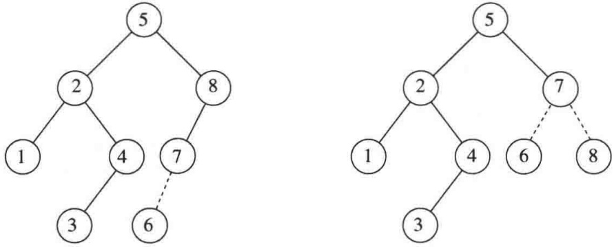

图 4.35 插入 6 破坏了 AVL 性质，而后经过单旋转又将性质恢复

正如我们较早提到的，情形4代表一种对称的情形。图4.36指出单旋转是如何使用的。让我们演示一个更长一些的例子。假设从初始的空AVL树开始插入关键字3、2和1，然后依序插入 $4\sim 7$ 。在插入关键字1时第一个问题出现了，AVL性质在根处被破坏。我们在根与其左儿子之间施行单旋转修正这个问题。下面是旋转之前和之后的两棵树:

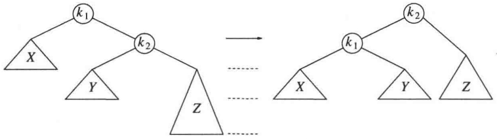

<details>
<summary>flowchart</summary>

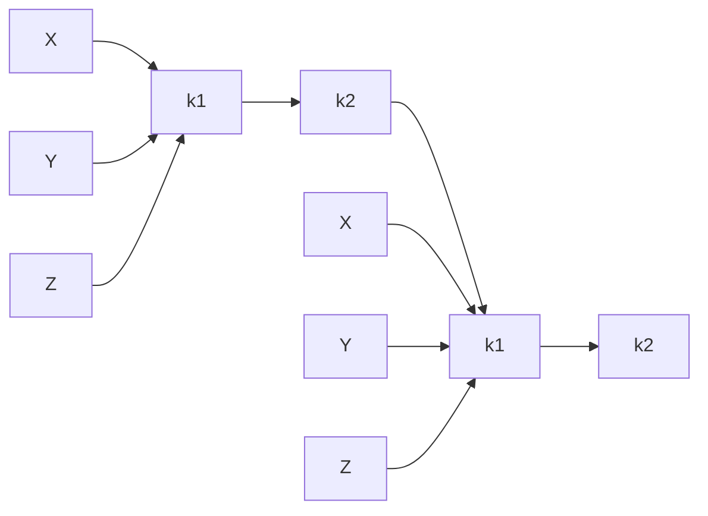
</details>

图 4.36 单旋转修复情形 4

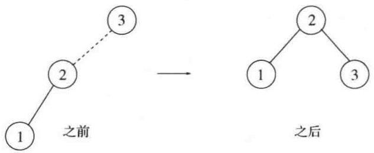

<details>
<summary>flowchart</summary>

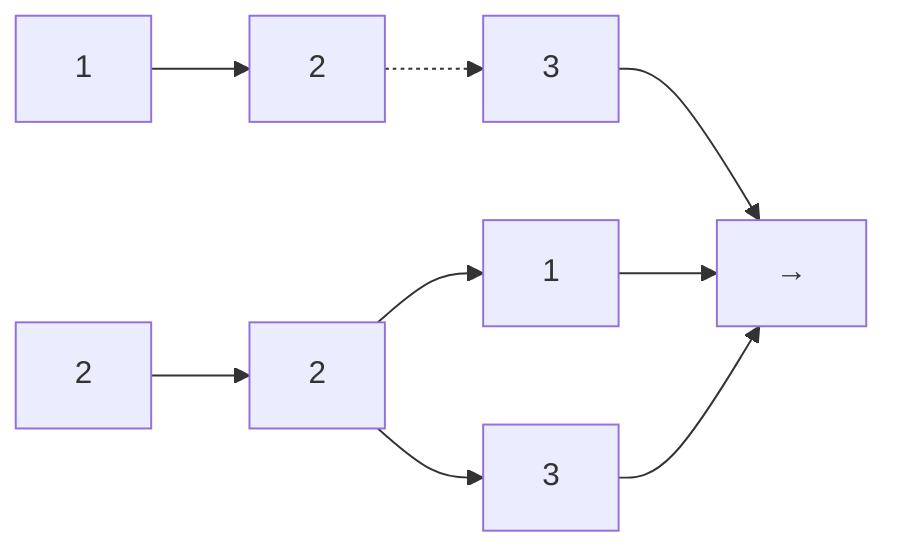
</details>

图中虚线连接两个节点，它们是旋转的主体。下面插入关键字为 4 的节点，这没有问题，但插入 5 破坏了在节点 3 处的 AVL 性质，而通过单旋转又将其修正。除旋转引起的局部变化外，编程人员必须记住:树的其余部分必须被告知该变化。如本例中节点 2 的右儿子必须重新设置以链接到 4 来代替 3。这一点很容易忘记，从而导致树被破坏(4 就会是不可访问的)。

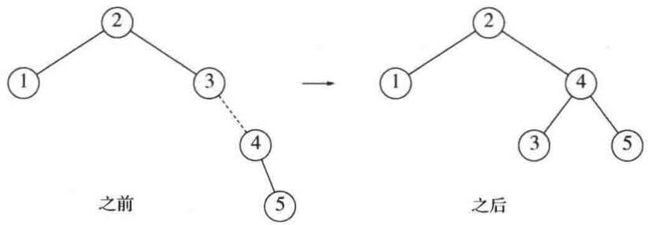

<details>
<summary>flowchart</summary>

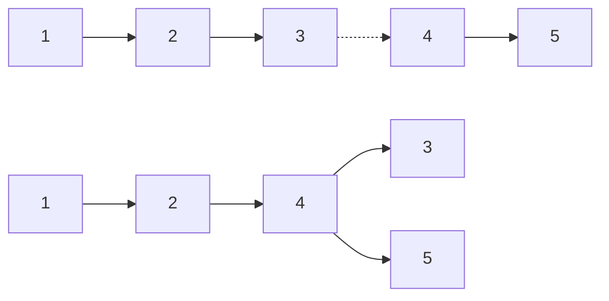
</details>

下面插入 6。这在根节点产生一个平衡问题，因为它的左子树高度是 0 而右子树高度为 2。因此我们在根处于 2 和 4 之间实施一次单旋转。

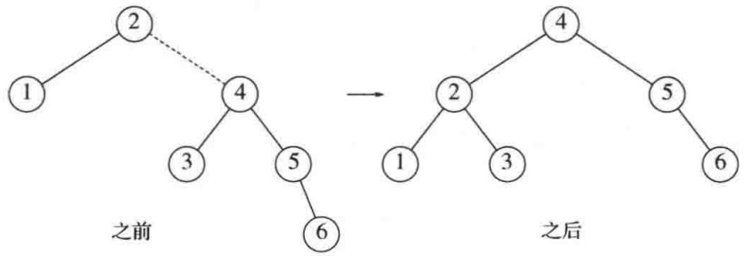

<details>
<summary>flowchart</summary>

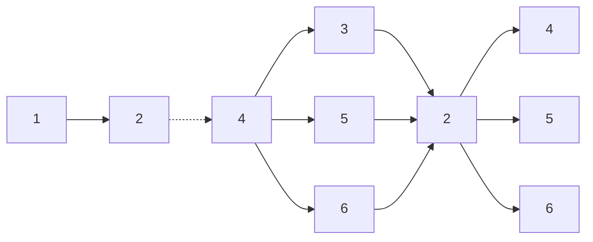
</details>

旋转是通过使节点 2 是 4 的一个儿子而 4 原来的左子树变成节点 2 的新的右子树来完成的。在该子树上的每一个关键字均在 2 和 4 之间，因此这个变换是成立的。我们插入的下一个关键字是 7，它导致了另外的旋转:

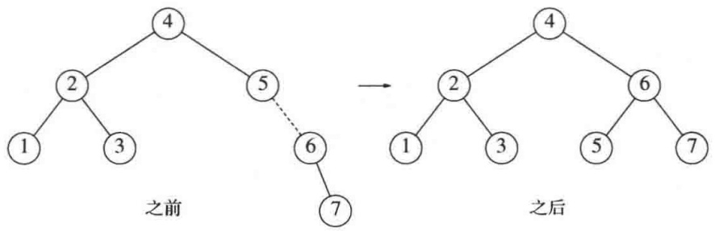

<details>
<summary>flowchart</summary>

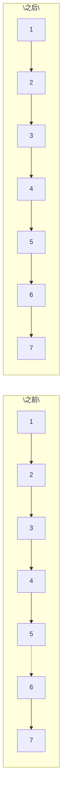
</details>

## 4.4.2 双旋转

上面描述的算法有一个问题:如图 4.37 所示，对于情形 2 和情形 3 上面的做法无效。问题在于子树 Y 太深，单旋转没有减低它的深度。解决这个问题的双旋转 (double rotation) 如图 4.38 所示。

在图 4.37 中的子树 Y 已经有一项插入其中，这个事实保证它是非空的。因此，可以假设它有一个根和两棵子树。于是，可以把整棵树看成是 4 棵子树由 3 个节点连接。如图所示，恰好树 B 或树 C 中有一棵比 D 深两层(除非它们都是空的)，但是我们不能肯定是哪一棵。事实上这并不要紧，在图 4.38 中 B 和 C 都被画成比 D 低  $1\frac{1}{2}$  层。

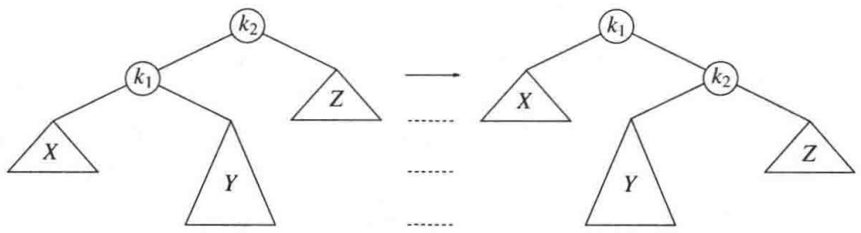

<details>
<summary>flowchart</summary>

This diagram illustrates a hierarchical decomposition or transformation process where two nodes (k1 and k2) are split into two sub-nodes (X, Y, Z), with arrows indicating the direction of transformation.
</details>

图 4.37 单旋转不能修复情形 2

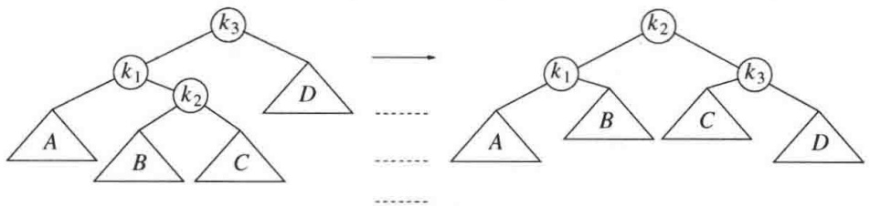

<details>
<summary>flowchart</summary>

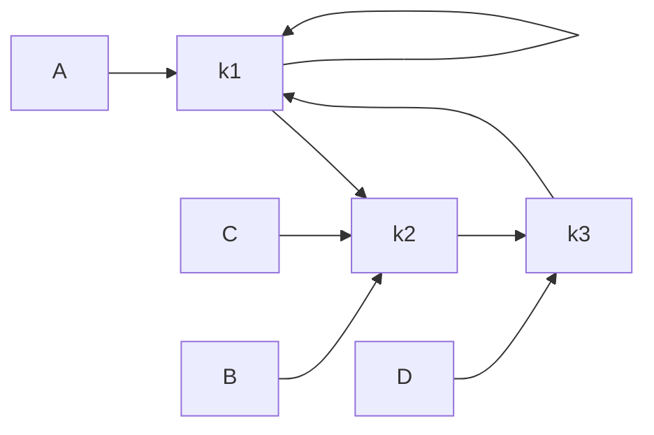
</details>

图 4.38 左-右双旋转变修复情形 2

为了重新平衡，我们看到，不能再让 $k_{3}$ 作根了，而图4.34所示的在 $k_{3}$ 和 $k_{1}$ 之间的旋转又解决不了问题，唯一的选择就是把 $k_{2}$ 用作新的根。这迫使 $k_{1}$ 成为 $k_{2}$ 的左儿子，$k_{3}$ 成为它的右儿子，从而完全确定了这4棵树的最终位置。容易看出，最后得到的树满足AVL树的性质，与单旋转的情形一样，我们也把树的高度恢复到插入以前的水平，这就保证所有的重新平衡和高度更新是完善的。图4.39指出，对称情形3也可以通过双旋转得以修正。在这两种情形下，其效果与先在 $\alpha$ 的儿子和孙子之间旋转而后再在 $\alpha$ 和它的新儿子之间旋转的效果是相同的。

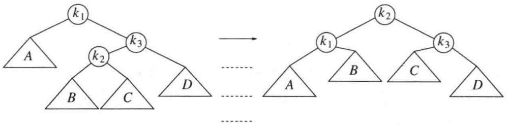

<details>
<summary>flowchart</summary>

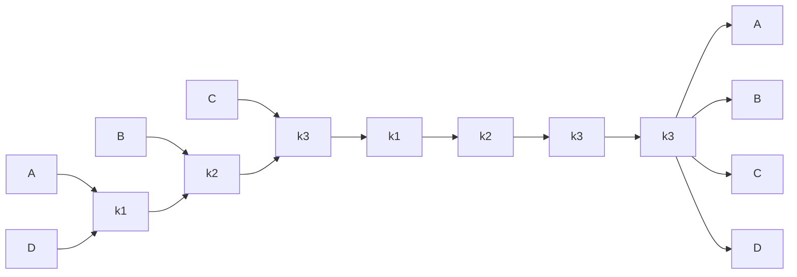
</details>

图 4.39 右-左双旋转变修复情形 3

我们继续在前面例子的基础上以倒序插入关键字 $10\sim 16$ ，接着插入8，然后再插入9。插入16容易，因为它并不破坏平衡性质，但是插入15就会引起在节点7处的高度不平衡。这属于情形3，需要通过一次右-左双旋转来解决。在我们的例子中，这个右-左双旋转将涉及7、16和15。此时， $k_{1}$ 是具有项7的节点， $k_{3}$ 是具有项16的节点，而 $k_{2}$ 是具有项15的节点。子树 $A$ 、 $B$ 、 $C$ 和 $D$ 都是空树。

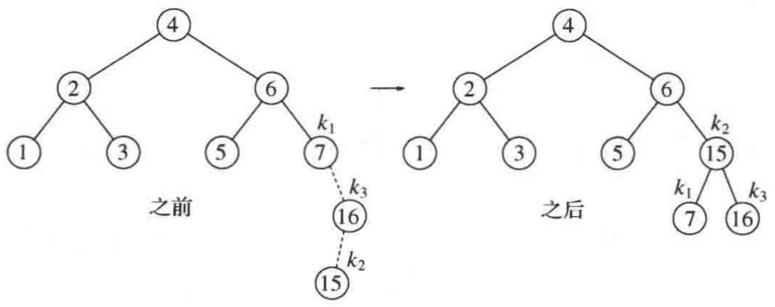

<details>
<summary>flowchart</summary>

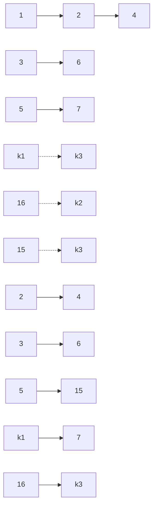
</details>

下面插入 14，它也需要一个双旋转。此时修复该树的双旋转还是右-左双旋转，它将涉及 6、15 和 7。在这种情况下， $k_{1}$ 是具有项 6 的节点， $k_{2}$ 是具有项 7 的节点，而 $k_{3}$ 是具有项 15 的节点。子树 A 的根在项为 5 的节点上，子树 B 是空子树，它是项 7 的节点原先的左儿子，子树 C 置根于项 14 的节点上，最后，子树 D 的根在项为 16 的节点上。

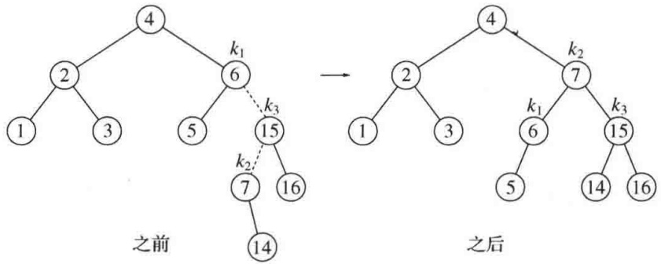

<details>
<summary>flowchart</summary>

```mermaid
graph LR
  subgraph sg["\"之前\""]
  A["1"] --> B["2"]
  B --> C["4"]
  C --> D["6"]
    D -.-> E["k₁"]
  E --> F["5"]
  F --> G["15"]
  G --> H["7"]
  H --> I["16"]
  I --> J["14"]
  end
  subgraph sg_2["\"之后\""]
  K["1"] --> L["2"]
  L --> M["4"]
  M --> N["7"]
  N --> O["k₂"]
  O --> P["k₁"]
  P --> Q["6"]
  Q --> R["15"]
  R --> S["5"]
  S --> T["14"]
  T --> U["16"]
  end
  style A fill:#f9f,stroke:#333
  style K fill:#f9f,stroke:#333
  style L fill:#f9f,stroke:#333
  style M fill:#f9f,stroke:#333
  style N fill:#f9f,stroke:#333
  style O fill:#f9f,stroke:#333
  style P fill:#f9f,stroke:#333
  style Q fill:#f9f,stroke:#333
  style R fill:#f9f,stroke:#333
  style S fill:#f9f,stroke:#333
  style T fill:#f9f,stroke:#333
  style U fill:#f9f,stroke:#333
```
</details>

如果现在插入 13，那么在根处就会产生一个不平衡。由于 13 不在 4 和 7 之间，因此我们知道一次单旋转就能完成修正的工作。

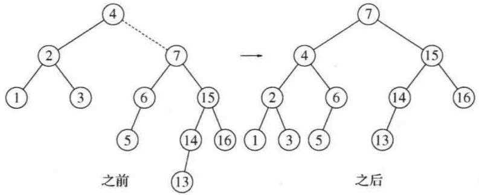

<details>
<summary>flowchart</summary>

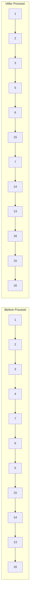
</details>

12 的插入也需要一次单旋转:

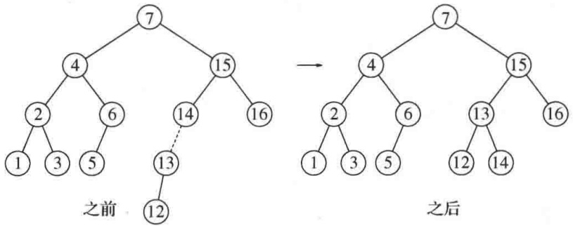

<details>
<summary>flowchart</summary>

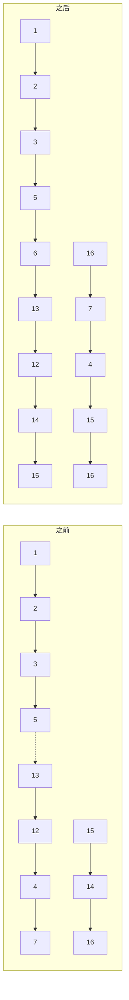
</details>

为了插入 11，还需要进行一次单旋转，对于其后的 10 的插入也需要这样的旋转。不过插入 8 不用进行旋转，这样就建立了一棵近乎理想的平衡树。

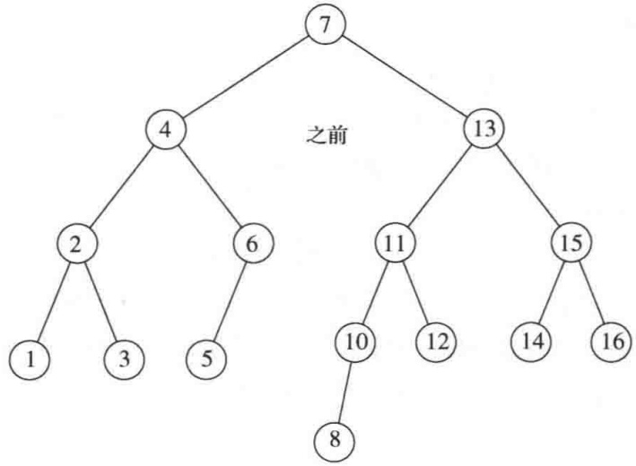

<details>
<summary>flowchart</summary>

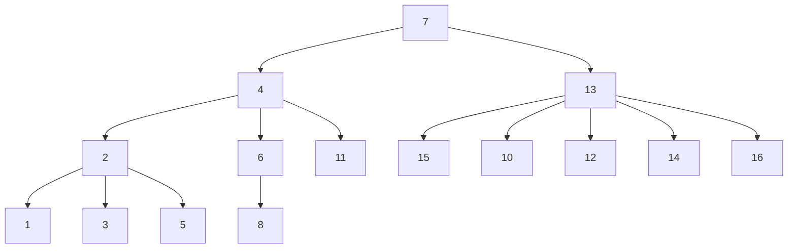
</details>

最后，我们插入9以演示双旋转的对称情形。注意，9引起含有10的节点产生不平衡。由于9在10和8之间(8在10通向9的路径上是节点10的儿子)，因此需要进行一个双旋转，我们得到下面的树:

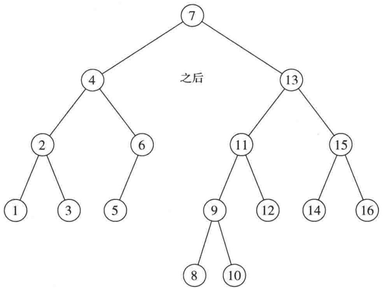

<details>
<summary>flowchart</summary>

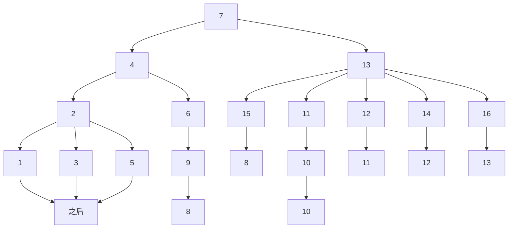
</details>

现在让我们对上面的讨论做个总结。除几种情形外，编程的细节是相当简单的。为将项是 $X$ 的一个新节点插入到一棵 AVL 树 $T$ 中, 我们递归地将 $X$ 插入到 $T$ 的相应的子树 (称为 $T_{\mathrm{LR}}$) 中。如果 $T_{\mathrm{LR}}$ 的高度不变, 那么插入完成。否则, 如果在 $T$ 中出现高度不平衡, 那么根据 $X$ 以及 $T$ 和 $T_{\mathrm{LR}}$ 中的项做适当的单旋转或双旋转, 更新这些高度 (并解决好与树的其余部分的链接), 从而完成插入。由于一次旋转总能足以解决问题, 因此, 仔细地编写非递归的程序一般说来要比编写递归程序快, 但对于现代编译器, 这种差别不像过去那么显著。但是, 要想把非递归程序编写正确是相当困难的, 而简便的递归实现却简单易读。

另一个效率问题涉及到高度信息的存储。由于真正需要的实际上就是子树高度的差，应该保证它很小。如果我们真的尝试这一点，则可用两个二进制位(代表+1,0,-1)表示这个差。这么做将避免平衡因子的重复计算，但是却丧失了某些简明性。最后的程序多多少少要比在每一个节点存储高度复杂。如果编写递归程序，那么速度恐怕不是主要考虑的问题。此时，通过存储平衡因子所得到的些微速度优势很难抵消清晰性和相对简明性的损失。不仅如此，由于大部分机器存储的最小单位是8个二进制位，因此所用的空间量不可能有任何差别。一个8位(带符号)的char将使我们存储高达127的绝对高度。既然树是平衡的，当然也就不可想象这会少到不够用(见练习)。

有了上面的讨论，现在准备编写 AVL 树的一些例程。不过，这里我们只想做一部分工作，其余的在线提供。首先，我们需要 AvlNode 类，它在图 4.40 中给出。我们还需要一个快速的函数来返回节点的高度，这个函数必须处理 nullptr 指针的恼人情形。该例程在图 4.41 中给出。基本的插入例程(见图 4.42)只在最后添加了一行，调用一个平衡方法。这个平衡方法在需要时用到单旋转或双旋转，更新高度，并返回所得到的树。

对于图 4.43 中的那些树，函数 rotateWithLeftChild 把左边的树变成右边的树，并返回指向新根的指针。函数 routateWithRightChild 是对称的，程序如图 4.44 所示。

类似地，图4.45中描述的双旋转可以通过图4.46所示的代码来实现。

```cpp
struct AvlNode
{
    Comparable element;
    AvlNode *left;
    AvlNode *right;
    int height;

    AvlNode( const Comparable & ele, AvlNode *lt, AvlNode *rt, int h = 0 )
    : element{ ele }, left{ lt }, right{ rt }, height{ h } { }

    AvlNode( Comparable && ele, AvlNode *lt, AvlNode *rt, int h = 0 )
    : element{ std::move( ele ) }, left{ lt }, right{ rt }, height{ h } { }
};
```

图 4.40 AVL 树的节点声明

```c
/**
 * 返回节点t的高度，如果是nullptr则返回-1.
 */
int height( AvlNode *t ) const
{
    return t == nullptr ? -1 : t->height;
}
```

图 4.41 计算 AVL 节点的高度的方法

```c
/**
 * 向一棵子树进行插入的内部方法.
 * x 是要插入的项.
 * t 为该子树的根节点.
 * 设置子树的新根.
 */
void insert( const Comparable & x, AvlNode * & t )
{
    if( t == nullptr )
        t = new AvlNode{ x, nullptr, nullptr };
    else if( x < t->element )
        insert( x, t->left );
    else if( t->element < x )
        insert( x, t->right );

    balance( t );
}

static const int ALLOWED_IMBALANCE = 1;

// 假设t是平衡的，或与平衡相差不超过1
void balance( AvlNode * & t )
{
    if( t == nullptr )
        return;
```

图 4.42 向 AVL 树进行插入的例程

```c
if( height( t->left ) - height( t->right ) > ALLOWED_IMBALANCE )
    if( height( t->left->left ) >= height( t->left->right ) )
        rotateWithLeftChild( t );
    else
        doubleWithLeftChild( t );
else
if( height( t->right ) - height( t->left ) > ALLOWED_IMBALANCE )
    if( height( t->right->right ) >= height( t->right->left ) )
        rotateWithRightChild( t );
    else
        doubleWithRightChild( t );

t->height = max( height( t->left ), height( t->right ) ) + 1;
}
```

图 4.42(续) 向 AVL 树进行插入的例程

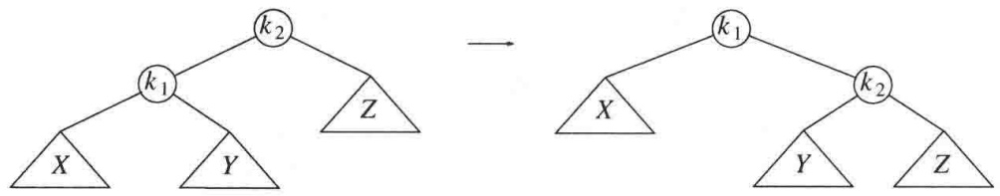

<details>
<summary>flowchart</summary>


</details>

图4.43 单旋转

```c
/**
 * 用左儿子旋转二叉树的节点.
 * 这是对 AVL 树在情形1的一次单旋转.
 * 更新高度，然后设置新根.
 */
void rotateWithLeftChild( AvlNode * & k2 )
{
    AvlNode *k1 = k2->left;
    k2->left = k1->right;
    k1->right = k2;
    k2->height = max( height( k2->left ), height( k2->right ) ) + 1;
    k1->height = max( height( k1->left ), k2->height ) + 1;
    k2 = k1;
}
```

图 4.44 执行单旋转的例程

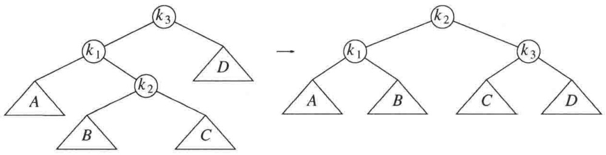

<details>
<summary>flowchart</summary>

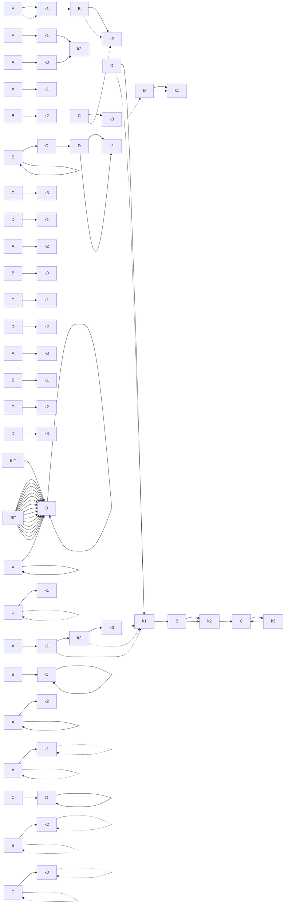
</details>

图 4.45 双旋转

由于在二叉查找树中进行删除多少要比插入复杂，因此可以假设，在 AVL 树中的删除也会更复杂。理想情形下，我们希望将图 4.26 中的删除例程能够通过将最后一行改为在调用 balance 方法之后再返回而轻易地完成修改，这和前面对插入例程曾做过的修改是一样的。由此得到图 4.47 的代码。它改善了删除的结果。一次删除能够造成树的一边变成比另一边浅了 2 层。具体的分析类似于由插入引起的不平衡，但又不完全一样。例如，图 4.34 中的情形 1，现在应该表达从树 Z 中进行一次删除（而不是向 X 进行一次插入），必须考虑树 Y 可能与树 X 具有同样深度的可能性。即使如此，仍然容易看到，旋转平衡了这种情形以及图 4.36 中的对称情形 4。于是，图 4.42 中第 28 行和第 34 行的平衡代码使用了 $> =$ 而不是 $>$，特别保证了在这些情形下使用单旋转而不是双旋转。我们把验证其余两种情形的工作留作练习。

```c
/**
 * 双旋转二叉树的节点: 首先左儿子和它的右儿子进行.
 * 然后节点k3和新的左儿子进行.
 * 这是对AVL树情形2的一次双旋转.
 * 更新高度, 然后设置新根.
 */
void doubleWithLeftChild( AvlNode * & k3 )
{
    rotateRightChild( k3->left );
    rotateLeftChild( k3 );
}
```

图 4.46 执行双旋转的例程

```c
/**
 * 从子树实施删除的内部方法.
 * x 是要被删除的项.
 * t 为该子树的根节点.
 * 设置该子树的新根.
 */
void remove( const Comparable & x, AvlNode * & t )
{
    if( t == nullptr )
        return;  // 没发现要删除的项；什么也不做

    if( x < t->element )
        remove( x, t->left );
    else if( t->element < x )
        remove( x, t->right );
    else if( t->left != nullptr && t->right != nullptr ) // 两个儿子
    {
        t->element = findMin( t->right )->element;
        remove( t->element, t->right );
    }
    else
    {
        AvlNode *oldNode = t;
        t = ( t->left != nullptr ) ? t->left : t->right;
        delete oldNode;
    }

    balance( t );
}
```

图 4.47 AVL 树中的删除例程

## 4.5 伸展树

现在描述一种相对简单的数据结构，叫作伸展树(splay tree)，它保证从空树开始任意连续 $M$ 次对树的操作最多花费 $O(M \log N)$ 时间。不过这种保证并不排除任意单次操作花费 $\Theta(N)$ 时间的可能，而且这样的界也不如每次操作最坏情形的界为 $O(\log N)$ 那么强，但实际效果却是一样的:不存在坏的输入序列。一般说来，当 $M$ 次的操作序列总的最坏情形运行时间为 $O(Mf(N))$ 时，我们就说它的摊还运行时间(amortized running time)为 $O(f(N))$ 。因此，一棵伸展树每次操作的摊还代价是 $O(\log N)$ 。经过长系列的操作，有的操作可能花费时间多一些，有的可能要少一些。

伸展树是基于这样的事实:对于二叉查找树来说，每次操作最坏情形时间 $O(N)$ 并不坏，只要它相对不常发生就行。任何一次访问，即使花费 $\Theta (N)$，仍然可能非常快。二叉查找树的问题在于，虽然一系列访问整体都是坏的操作有可能发生，但是很罕见。此时，累积的运行时间很重要。具有最坏情形运行时间 $O(N)$ 但保证对任意 $M$ 次连续操作最多花费 $O(M\log N)$ 运行时间的查找树数据结构确实可以满意了，因为不存在坏的操作序列。

如果任意特定操作可以有最坏时间界 $O(N)$, 而我们仍然想要一个 $O(\log N)$ 的摊还时间界, 那么很清楚, 只要一个节点被访问, 它就必须被移动。否则, 一旦发现一个深层的节点, 我们就有可能不断对它进行访问。如果这个节点不改变位置, 而每次访问又花费 $\Theta(N)$, 那么 $M$ 次访问就要花费 $\Theta(M \cdot N)$ 的时间。

伸展树的基本想法是，当一个节点被访问后，它就要经过一系列 AVL 树旋转向根推进。注意，如果一个节点很深，那么在其路径上就存在许多的节点也相对较深，通过重新构造可以使对所有这些节点的进一步访问所花费的时间变少。因此，如果节点过深，那么我们要求这种重新构造应具有平衡这棵树(到某种程度)的副作用。除在理论上给出好的时间界外，这种方法还可能有实际的效用，因为在许多应用中，若一个节点被访问，它就很可能不久再被访问。研究表明，这种情况的发生比人们预料的要频繁得多。另外，伸展树还不要求保留高度或平衡信息，因此它在某种程度上节省空间并简化代码(特别是当实现例程经过审慎考虑而被写出的时候)。

## 4.5.1 一个简单的想法(不能直接使用)

实施上面描述的重新构造的一种方法是执行单旋转，从底向上进行。这意味着我们将在访问路径上的每一个节点和它们的父节点实施旋转。作为例子，考虑在下面的树中对 $k_{1}$ 进行一次访问(一次find)之后所发生的情况。

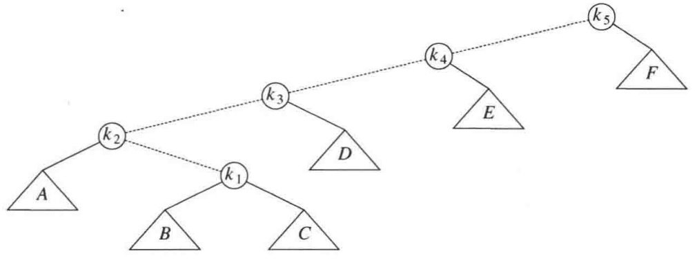

<details>
<summary>flowchart</summary>

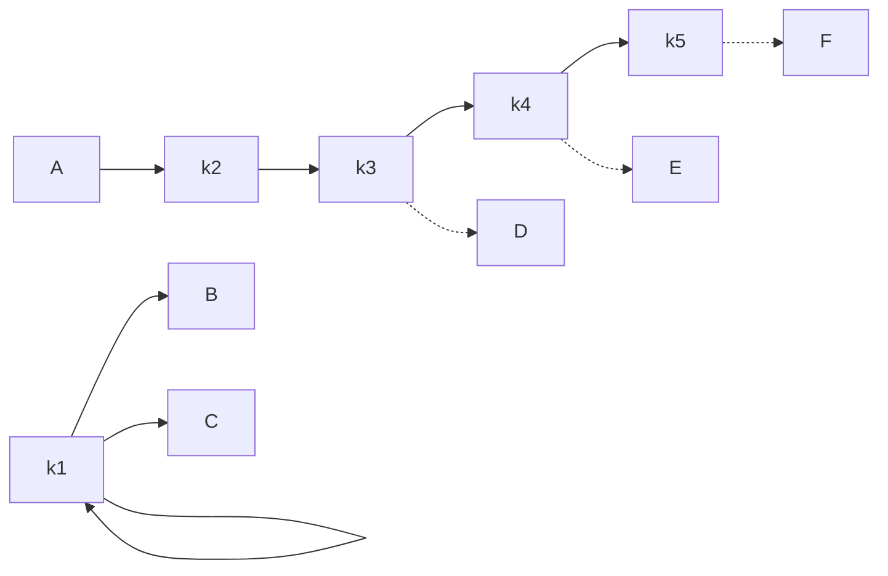
</details>

虚线是访问的路径。首先，我们在 $k_{1}$ 和它的父节点之间实施一次单旋转，得到下面的树:

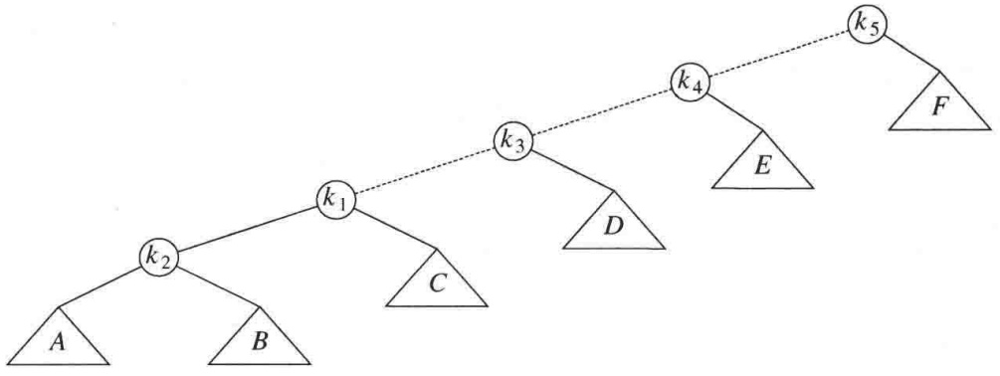

<details>
<summary>flowchart</summary>

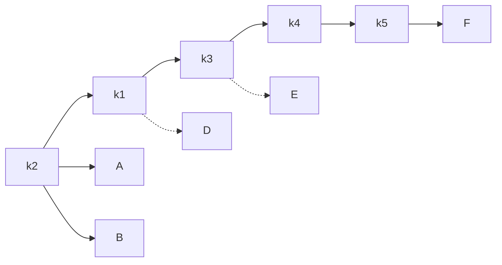
</details>

然后，在 $k_{1}$ 和 $k_{3}$ 之间执行旋转，得到下一棵树:

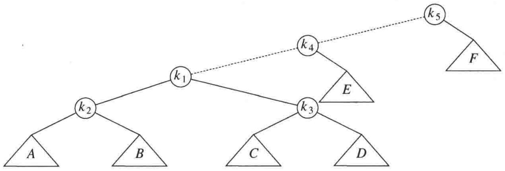

<details>
<summary>flowchart</summary>

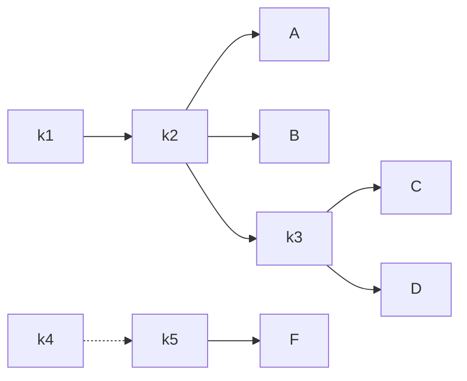
</details>

此后，再实行两次旋转直到 $k_{1}$ 到达树根:

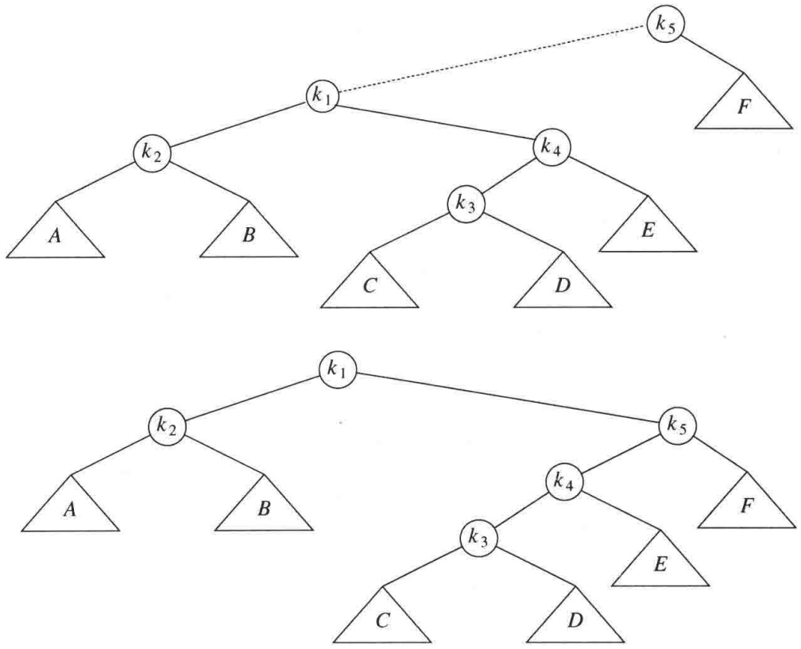

这些旋转的效果是将 $k_{1}$ 一直推向树根，使得对 $k_{1}$ 的进一步访问很容易(暂时的)。不足的是，它把另外一个节点 $(k_{3})$ 几乎推向和 $k_{1}$ 以前那么深。而对那个节点的访问又将把另外的节点向深处推进，如此等等。虽然这个策略使得对 $k_{1}$ 的访问花费时间减少，但是它并没有明显地改善(原始)访问路径上其他节点的状况。事实上可以证明，使用这种策略将会存在一系列$M$ 个操作共需要 $\Omega (M\cdot N)$ 的时间，因此这个想法还不够好。说明这个问题最简单的方法是考虑向初始的空树插入关键字 1,2,3,…,N 所形成的树(请将这个例子算出)。由此得到一棵树，这棵树只由一些左儿子构成。由于建立这棵树总共花费时间为 O(N)，因此这未必就有多坏。问题在于访问关键字为 1 的节点花费 N 个单元的时间，其中在访问路径上的每个节点则按 1 个时间单元计。在这些旋转完成以后，对关键字为 2 的节点的一次访问花费 N 个单元的时间，对关键字为 3 的节点的访问花费 N-1 个单元的时间，等等。依序访问所有关键字的总时间是 $N+\sum_{i=2}^{N}i=\Omega(N^{2})$ 。在它们都被访问以后，该树转变回原始状态，而且我们可能重复这个访问顺序。

## 4.5.2 展开

展开(splaying)的思路类似于上面介绍的旋转的想法，不过在旋转如何实施上我们稍微有些选择的余地。我们仍然从底部向上沿着访问路径旋转。令 $X$ 是在访问路径上的一个(非根)节点，我们将在这个节点上实施旋转操作。如果 $X$ 的父节点是树的根，那么只要旋转 $X$ 和根即可。这就是沿着访问路径上的最后的旋转。否则，$X$ 就有父亲 $(P)$ 和祖父 $(G)$，于是存在两种情况外加对称的情形要考虑。第一种情况是之字形情形(zig-zag case)(见图4.48)。这里，$X$ 是右儿子，$P$ 是左儿子(反之亦然)。如果是这种情况，那么执行一次就像AVL双旋转那样的双旋转。否则，出现另一种情形即一字形情形(zig-zig case): $X$ 和 $P$ 都是左儿子(或者其对称的情形，都是右儿子)。在这种情况下，我们把图4.49左边的树变换成右边的树。

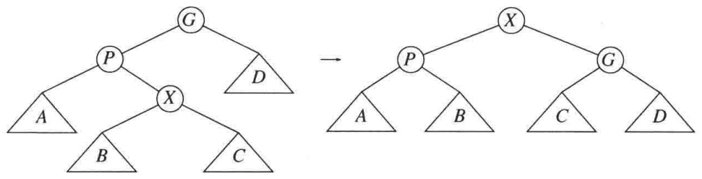

<details>
<summary>flowchart</summary>

```mermaid
graph LR
  A["A"] --> B["P"]
  B --> C["G"]
  D["D"] --> E["X"]
  F["B"] --> G["C"]
  E --> H["P"]
  H --> I["X"]
  J["C"] --> K["G"]
  L["D"] --> M["G"]
```
</details>

图 4.48 之字形情形

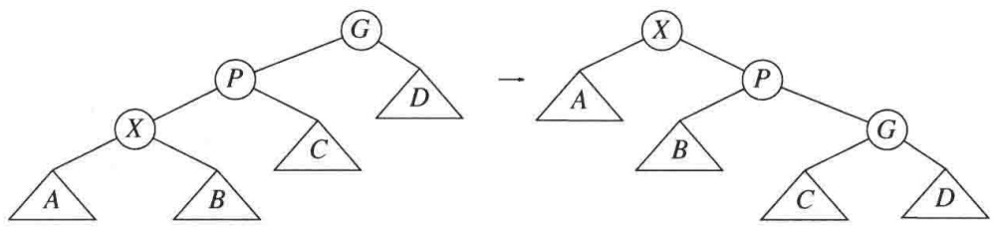

<details>
<summary>flowchart</summary>

```mermaid
graph LR
  A["X"] --> P["P"]
  P --> G["G"]
  G --> D["D"]
  A --> X["X"]
  X --> P
  P --> G
  G --> A
  G --> B
  G --> C
  G --> D
```
</details>

图4.49 一字形情形

作为例子，考虑最后的例子中的树，对 $k_{1}$ 执行一次 contains:

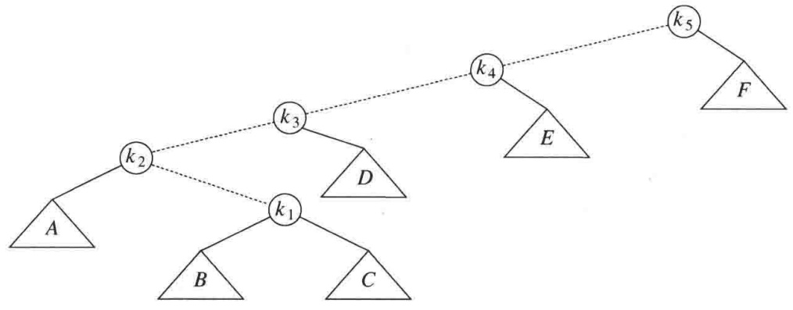

<details>
<summary>flowchart</summary>

```mermaid
graph LR
  A["A"] --> k2["k2"]
  k2 --> k3["k3"]
  k3 --> k4["k4"]
  k4 --> k5["k5"]
  k3 -.-> k1["k1"]
  k1 --> B["B"]
  k1 --> C["C"]
  k4 -.-> E["E"]
  k5 -.-> F["F"]
```
</details>

展开的第一步是在 $k_{1}$，显然这是一个之字形，因此我们用 $k_{1}, k_{2}$ 和 $k_{3}$ 执行一次标准的 AVL 双旋转，得到如下的树:

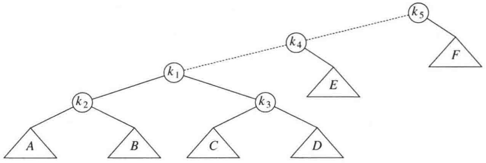

<details>
<summary>flowchart</summary>

```mermaid
graph LR
  k1["k1"] --> k2["k2"]
  k2 --> A["A"]
  k2 --> B["B"]
  k2 --> C["C"]
  k2 --> D["D"]
  k3["k3"] --> E["E"]
  k3 --> F["F"]
  k4["k4"] -.-> F
  k5["k5"] --> F
```
</details>

在 $k_{1}$ 的下一步展开是一个一字形，因此我们用 $k_{1}, k_{4}$ 和 $k_{5}$ 做一字形旋转，得到最后的树:


<details>
<summary>flowchart</summary>

```mermaid
graph TD
  k1["k1"] --> k2["k2"]
  k2 --> A["A"]
  k2 --> B["B"]
  k2 --> k3["k3"]
  k3 --> C["C"]
  k3 --> D["D"]
  k4["k4"] --> k5["k5"]
  k5 --> E["E"]
  k5 --> F["F"]
```
</details>

虽然从小的例子很难看出来，但是展开操作不仅将访问的节点移动到根处，而且还有把访问路径上的大部分节点的深度大致减少一半的效果(某些浅的节点最多向下推后两层)。

为了看出展开与简单旋转的差别，再来考虑将 $1, 2, 3, \dots, N$ 各项插入到初始空树中去的效果。如前所述可知共花费 $O(N)$ 时间，并产生与一些简单旋转结果相同的树。图4.50指出在项为1的节点展开的结果。区别在于，在对项为1的节点访问(花费 $N$ 个单元的时间)之后，对项为2的节点的访问只花费 $N/2$ 个时间单元而不是 $N$ 个时间单元，不存在像以前那么深层的节点。


<details>
<summary>flowchart</summary>

```mermaid
graph LR
  A["1"] --> B["2"]
  B --> C["3"]
  C --> D["4"]
  D --> E["5"]
  E --> F["6"]
  F --> G["7"]
  H["1"] --> I["2"]
  I --> J["3"]
  K["5"] --> L["6"]
  L --> M["7"]
  N["1"] --> O["2"]
  O --> P["3"]
  Q["4"] --> R["5"]
  R --> S["6"]
  T["1"] --> U["2"]
  U --> V["3"]
  W["6"] --> X["7"]
  Y["1"] --> Z["2"]
  Z --> AA["3"]
  AB["4"] --> AC["5"]
  AC --> AD["6"]
  AE["7"] --> AF["8"]
```
</details>

图4.50 在节点1展开的结果

对项为 2 的节点的访问将把诸节点带到距根 N/4 的深度之内，并且如此进行下去直到深度大约为  $\log N(N=7$  的例子太小，不能很好地看清这种效果）。图 4.51～图 4.59 显示在 32 个节点的树中访问项 1～9 的结果，这棵树最初只含有左儿子。我们从伸展树得不到在简单旋转策略中常见的那种低效率的坏现象。（实际上，这个例子只是一种非常好的情况。有一个相当复杂的证明指出，对于这个例子，N 次访问共耗费  $O(N)$  的时间。）

这些图着重强调了伸展树基本和关键的性质。当访问路径长而导致长于正常查找时间的时候，这些旋转将对未来的操作有益。当访问耗时很少的时候，这些旋转则不那么有益甚至有害。极端的情形是经过若干插入而形成的初始树。所有的插入都是花费常数时间的操作，它们导致坏的初始树形成。此时，我们会得到一棵很差的树，但是运行却比预计的快，从而总的较少运行时间补偿了损失。这样，少数真正麻烦的访问却留给我们一棵几乎是平衡的树，其代价是必须返还某些已经省下的时间。在第11章将证明的主要定理指出，平均每个操作决不会落后 $O(\log N)$ 这个时间:我们总是遵守这个时间，即使偶尔有些坏的操作。


<details>
<summary>flowchart</summary>

```mermaid
graph TD
  1["1"] --> 32["32"]
  2["2"] --> 4["4"]
  3["3"] --> 5["5"]
  4["6"] --> 7["7"]
  6["8"] --> 9["9"]
  7["9"] --> 10["10"]
  8["11"] --> 11["11"]
  9["11"] --> 12["12"]
  10["13"] --> 13["13"]
  11["13"] --> 14["14"]
  12["15"] --> 15["15"]
  13["15"] --> 16["16"]
  14["17"] --> 17["17"]
  15["17"] --> 18["18"]
  16["18"] --> 19["19"]
  17["19"] --> 20["20"]
  18["20"] --> 21["21"]
  19["21"] --> 22["22"]
  20["22"] --> 23["23"]
  21["23"] --> 24["24"]
  22["24"] --> 25["25"]
  23["25"] --> 26["26"]
  24["26"] --> 27["27"]
  25["27"] --> 28["28"]
  26["28"] --> 29["29"]
  27["29"] --> 30["30"]
  28["30"] --> 31["31"]
  29["31"] --> n30["30"]
  30["30"] --> n31["31"]
```
</details>

图4.51 一棵均为左儿子的树在节点1展开的结果


<details>
<summary>flowchart</summary>

```mermaid
graph TD
  1["1"] --> 2["2"]
  n2["2"] --> 32["32"]
  4["3"] --> 4["4"]
  6["5"] --> 6["6"]
  7["7"] --> 7["7"]
  8["8"] --> 8["8"]
  10["9"] --> 10["10"]
  11["11"] --> 11["11"]
  12["12"] --> 12["12"]
  13["13"] --> 13["13"]
  14["14"] --> 14["14"]
  15["15"] --> 15["15"]
  16["16"] --> 16["16"]
  17["17"] --> 17["17"]
  18["18"] --> 18["18"]
  19["19"] --> 19["19"]
  20["20"] --> 20["20"]
  21["21"] --> 21["21"]
  22["22"] --> 22["22"]
  23["23"] --> 23["23"]
  24["24"] --> 24["24"]
  25["25"] --> 25["25"]
  26["26"] --> 26["26"]
  27["27"] --> 27["27"]
  28["28"] --> 28["28"]
  29["29"] --> 29["29"]
  30["30"] --> 30["30"]
  31["31"] --> 31["31"]
```
</details>

图4.52 将前面的树在节点2展开的结果


<details>
<summary>flowchart</summary>

```mermaid
graph TD
  1["1"] --> 3["3"]
  2["2"] --> n3["3"]
  n3 --> 28["28"]
  n3 --> 32["32"]
  4["4"] --> 12["12"]
  n4["4"] --> 8["8"]
  n4 --> 6["6"]
  n4 --> 5["5"]
  n4 --> 7["7"]
  n4 --> 9["9"]
  n4 --> 10["10"]
  n4 --> 11["11"]
  n12["12"] --> 20["20"]
  n12 --> 16["16"]
  n12 --> 14["14"]
  n12 --> 13["13"]
  n16["16"] --> 24["24"]
  n16 --> 18["18"]
  n16 --> 15["15"]
  n16 --> 17["17"]
  n16 --> 19["19"]
  n20["20"] --> 22["22"]
  n20 --> 24["24"]
  n20 --> 26["26"]
  n20 --> 21["21"]
  n22["22"] --> 25["25"]
  n22 --> 23["23"]
  n26["26"] --> 27["27"]
  30["30"] --> n32["32"]
  n30["30"] --> 29["29"]
  n30 --> 31["31"]
```
</details>

图4.53 将前面的树在节点3展开的结果


<details>
<summary>flowchart</summary>

```mermaid
graph TD
  1["1"] --> 4["4"]
  2["2"] --> 3["3"]
  n3["3"] --> n4["4"]
  n4 --> 28["28"]
  n4 --> 32["32"]
  n28["28"] --> 30["30"]
  n28 --> 29["29"]
  n30["30"] --> 31["31"]
  12["12"] --> 8["8"]
  n12["12"] --> 20["20"]
  n8["8"] --> 6["6"]
  n8 --> 10["10"]
  n8 --> 5["5"]
  n8 --> 7["7"]
  n8 --> 9["9"]
  n8 --> 11["11"]
  16["16"] --> 24["24"]
  n16["16"] --> 14["14"]
  n16 --> 18["18"]
  n16 --> 13["13"]
  n18["18"] --> 22["22"]
  n18 --> 15["15"]
  n18 --> 17["17"]
  n18 --> 19["19"]
  n24["24"] --> 26["26"]
  n24 --> 21["21"]
  n24 --> 23["23"]
  n26["26"] --> 25["25"]
  n26 --> 27["27"]
```
</details>

图4.54 将前面的树在节点4处展开的结果


<details>
<summary>flowchart</summary>

```mermaid
graph TD
  1["1"] --> 2["2"]
  n2["2"] --> 3["3"]
  n3["3"] --> 4["4"]
  n4["4"] --> 5["5"]
  n5["5"] --> 6["6"]
  n6["6"] --> 7["7"]
  n6 --> 8["8"]
  n7["7"] --> 9["9"]
  n8["8"] --> 10["10"]
  n9["9"] --> 11["11"]
  12["12"] --> 16["16"]
  n16["16"] --> 18["18"]
  n18["18"] --> 20["20"]
  n20["20"] --> 22["22"]
  n22["22"] --> 24["24"]
  n24["24"] --> 26["26"]
  n26["26"] --> 29["29"]
  28["28"] --> 30["30"]
  n30["30"] --> 32["32"]
  13["13"] --> 14["14"]
  15["15"] --> 16["16"]
  17["17"] --> 18["18"]
  19["19"] --> 20["20"]
  21["21"] --> 22["22"]
  23["23"] --> 24["24"]
  25["25"] --> 26["26"]
  27["27"] --> 29["29"]
  30["30"] --> 31["31"]
```
</details>

图 4.55 将前面的树在节点 5 处展开的结果


<details>
<summary>flowchart</summary>

```mermaid
graph TD
  1["1"] --> 2["2"]
  n2["2"] --> 3["3"]
  n3["3"] --> 4["4"]
  n4["4"] --> 5["5"]
  n5["5"] --> 6["6"]
  n6["6"] --> 7["7"]
  n7["7"] --> 8["8"]
  n8["8"] --> 9["9"]
  n8 --> 10["10"]
  n9["9"] --> 11["11"]
  12["12"] --> 13["13"]
  n13["13"] --> 14["14"]
  n14["14"] --> 15["15"]
  n15["15"] --> 16["16"]
  n16["16"] --> 17["17"]
  n17["17"] --> 18["18"]
  n18["18"] --> 19["19"]
  n19["19"] --> 20["20"]
  n20["20"] --> 21["21"]
  n21["21"] --> 22["22"]
  n22["22"] --> 23["23"]
  n23["23"] --> 24["24"]
  n24["24"] --> 25["25"]
  n25["25"] --> 26["26"]
  n26["26"] --> 27["27"]
  n27["27"] --> 28["28"]
  n28["28"] --> 29["29"]
  n29["29"] --> 30["30"]
  n30["30"] --> 31["31"]
  n31["31"] --> 32["32"]
```
</details>

图 4.56 将前面的树在节点 6 处展开的结果


<details>
<summary>flowchart</summary>

```mermaid
graph TD
  1["1"] --> 2["2"]
  n2["2"] --> 3["3"]
  n3["3"] --> 4["4"]
  n4["4"] --> 5["5"]
  n5["5"] --> 6["6"]
  n6["6"] --> 7["7"]
  n7["7"] --> 8["8"]
  n8["8"] --> 12["12"]
  9["9"] --> 10["10"]
  10["10"] --> 11["11"]
  n12["12"] --> 28["28"]
  n28["28"] --> 32["32"]
  13["13"] --> 14["14"]
  14["14"] --> 16["16"]
  15["15"] --> n16["16"]
  16["16"] --> 18["18"]
  17["17"] --> n18["18"]
  18["18"] --> 20["20"]
  20["20"] --> 24["24"]
  24["24"] --> 26["26"]
  26["26"] --> 29["29"]
  27["27"] --> 30["30"]
  29["30"] --> 31["31"]
  30["30"] --> n32["32"]
  31["32"] --> n32
```
</details>

图 4.57 将前面的树在节点 7 处展开的结果


<details>
<summary>flowchart</summary>

```mermaid
graph TD
  1["1"] --> 2["2"]
  n2["2"] --> 3["3"]
  n3["3"] --> 4["4"]
  n4["4"] --> 5["5"]
  n5["5"] --> 6["6"]
  n6["6"] --> 7["7"]
  n7["7"] --> 8["8"]
  n8["8"] --> 9["9"]
  n8 --> 10["10"]
  n8 --> 11["11"]
  n8 --> 12["12"]
  n12["12"] --> 20["20"]
  n20["20"] --> 21["21"]
  n20 --> 22["22"]
  n20 --> 23["23"]
  n20 --> 24["24"]
  n20 --> 25["25"]
  n20 --> 26["26"]
  n20 --> 27["27"]
  n20 --> 30["30"]
  n20 --> 31["31"]
  28["28"] --> 32["32"]
  n32["32"] --> n30["30"]
  n30 --> n31["31"]
```
</details>

图 4.58 将前面的树在节点 8 处展开的结果


<details>
<summary>flowchart</summary>

```mermaid
graph TD
  1["1"] --> 2["2"]
  n2["2"] --> 3["3"]
  n3["3"] --> 4["4"]
  n4["4"] --> 5["5"]
  n5["5"] --> 6["6"]
  n6["6"] --> 7["7"]
  n7["7"] --> 8["8"]
  n8["8"] --> 9["9"]
  n9["9"] --> 10["10"]
  n10["10"] --> 11["11"]
  n11["11"] --> 12["12"]
  n12["12"] --> 28["28"]
  n28["28"] --> 32["32"]
  n32["32"] --> 30["30"]
  n30["30"] --> 29["29"]
  n29["29"] --> 31["31"]
  20["20"] --> 16["16"]
  n20["20"] --> 24["24"]
  n20 --> 18["18"]
  n16["16"] --> 14["14"]
  n16 --> 13["13"]
  n18["18"] --> 17["17"]
  n18 --> 19["19"]
  n24["24"] --> 22["22"]
  n24 --> 23["23"]
  n26["26"] --> 25["25"]
  n26 --> 27["27"]
```
</details>

图 4.59 将前面的树在节点 9 处展开的结果

可以通过访问要被删除的节点执行删除的操作。这种操作将节点上推到根处。如果删除该节点，则得到两棵子树 $T_{L}$ 和 $T_{R}$ （左子树和右子树）。如果找到 $T_{L}$ 中的最大的元素(这很容易)，那么这个元素就被旋转到 $T_{L}$ 的根下，此时 $T_{L}$ 将有一个没有右儿子的根。我们可以使 $T_{R}$ 为右儿子从而结束删除。

对伸展树的分析很困难，因为必须要考虑树的经常变化的结构。另一方面，伸展树的编程要比大部分平衡查找树简单得多，这是因为要考虑的情形少并且没有平衡信息需要保留。一些实际经验指出，在实践中它可以转化成更快的程序代码，不过这种状况离完善还很远。最后，我们指出，伸展树有几种变化，它们在实践中甚至运行得更好。有一种变化在第12章中已被完全编成程序。

## 4.6 树的遍历

由于二叉查找树中对信息进行了排序, 因此按照排序的顺序列出所有的项很简单, 图 4.60 中的递归函数进行的就是这项工作。

```cpp
/**
 * 按排序顺序打印树的内容.
 */
void printTree( ostream & out = cout ) const
{
    if( isEmpty( ) )
        out << "Empty tree" << endl;
    else
        printTree( root, out );
}

/**
 * 以排序顺序打印根在 t 处的子树的内部方法.
 */
void printTree( BinaryNode *t, ostream & out ) const
{
    if( t != nullptr )
    {
        printTree( t->left, out );
        out << t->element << endl;
        printTree( t->right, out );
    }
}
```

图 4.60 按顺序打印二叉查找树的例程

毫无疑问，这个函数能够解决将各项排序列出的问题。正如我们前面看到的，这类例程当用于树的时候则称为中序遍历(inorder traversal)(由于它依序列出各项，因此是有意义的)。中序遍历的一般方法是首先处理左子树，然后处理当前的节点，最后处理右子树。这个算法的有趣部分除了它的简单性之外，还在于其总的运行时间是 $O(N)$ 。这是因为在树的每一个节点处进行的工作是常数时间的。每一个节点均被访问一次，而在每一个节点进行的工作是:检测是否 nullptr、建立两个函数调用并执行一个输出语句。由于在每个节点的工作花费常数时间而总共有 $N$ 个节点，因此运行时间为 $O(N)$ 。

有时需要先处理两棵子树然后才能处理当前节点。例如，为了计算一个节点的高度，首先需要知道它的子树的高度。图4.61中的程序就是这样计算高度的。由于检验一些特殊的情况总是有益的——当涉及递归时尤其如此，因此要注意这个例程将声明树叶的高度为零，这是正确的。这种一般的遍历顺序叫作后序遍历(postorder traversal)，我们在前面也见到过。因为在每个节点的工作花费常数时间，所以总的运行时间也是 $O(N)$ 。

```c
/**
 * 计算根在t处子树的高度的内部方法.
 */
int height( BinaryNode *t )
{
    if( t == nullptr )
        return -1;
    else
        return 1 + max( height( t->left ), height( t->right ) );
}
```

图4.61 使用后序遍历计算树的高度的例程

我们见过的第三种常用的遍历方案为先序遍历(preorder traversal)。这里，当前节点是在其子节点之前处理。这种遍历是有用的，比如，如果要想用其深度标记每一个节点，那么就会用到这种遍历。

所有这些例程有一个共同的思路，那就是首先处理 nullptr 的情形，然后才是其余的工作。注意，此处缺少一些附加的变量。这些例程仅仅传递指向作为子树的根的节点的指针，并没有声明或是传递任何附加的变量。程序越紧凑，一些愚蠢的错误出现的可能就越小。第四种遍历不常使用，这种遍历叫作层序遍历 (level-order traversal)，我们尚未见到过。在层序遍历中，所有深度为 $d$ 的节点要在深度 $d+1$ 的节点之前进行处理。层序遍历与其他类型的遍历不同的地方在于它不是递归地实施的，它用到队列，而不使用递归所默认的栈。

## 4.7 B树

迄今为止，我们始终假设可以把整个数据结构存储到计算机的主存中。可是，如果数据太多主存装不下，那么就意味着必须把数据结构放到磁盘上。此时，因为大O模型不再适用，所以导致游戏规则发生了变化。

问题在于，大 O 分析假设所有的操作都是相等的。然而，现在这么假设就不合适了，特别是涉及到磁盘 I/O 时。现代计算机每秒执行数十亿条指令。这是相当快的，主要是因为速度很大程度上依赖于电的特性。另一方面，磁盘是机械运动装置，它的速度主要依赖于转动磁盘和移动磁头的时间。许多磁盘以 7200RPM(Revolutions Per Minute)旋转。就是说，它 1 分钟转 7200 转。因此，1 转占用 1/120 秒，或即 8.3 毫秒。平均可以认为磁盘转到一半的时候发现我们要寻找的信息，但这可通过移动磁盘磁头的时间抵消，因此我们得到一次访问时间为 8.3 毫秒。(这是非常宽松的估计；9～11 毫秒的访问时间更为普通。)因此，我们每秒大约可以进行 120 次磁盘访问。若不和处理器的速度比较，那么这听起来还是相当不错的。可是考虑到处理器的速度，数十亿条指令却花费相当于 120 次磁盘访问的时间。当然，这里每一个数据都是粗略的计算，不过相对速度还是相当清楚的:磁盘访问的代价太高了。不仅如此，处理器的速度还在以比磁盘速度快得多的速度增长(增长相当快的是磁盘容量的大小)。因此，为了节省一次磁盘访问，我们愿意进行大量的计算。几乎在所有的情况下，控制运行时间的都是磁盘访问的次数。于是，如果把磁盘访问次数减少一半，那么运行时间也将减少一半。

在磁盘上，典型的查找树执行如下:设我们想要访问佛罗里达州公民的驾驶记录。假设我们有1000万项，每一个关键字是32字节(代表一个名字)，而一个记录是256字节。假设这些数据不能都装入主存，我们是正在系统上的20个用户中的一个(因此我们有1/20的资源)。这样，在1秒内，我们可以执行几百万次指令，或者执行6次磁盘访问。

不平衡的二叉查找树是一个灾难。在最坏情形下它有线性的深度，从而可能需要1000万次磁盘访问。平均来看，一次成功的查找可能需要 $1.38\log N$ 次磁盘访问，由于 $\log 10000000 \approx 24$ ，因此平均一次查找需要32次磁盘访问，或5秒的时间。在一棵典型的随机构造的树中，我们预料会有一些节点的深度要深3倍。它们需要大约100次磁盘访问，或16秒的时间。AVL树多少要好一些。 $1.44\log N$ 的最坏情形不可能发生，典型的情形是非常接近于 $\log N$ 。这样，一棵AVL树平均将使用大约25次磁盘访问，需要的时间是4秒。

我们想要把磁盘访问次数减小到一个非常小的常数，比如3次或4次；而且我们愿意写一个复杂的程序来做这件事，因为只要我们不无理到荒谬的地步，机器指令基本上是不占时间的。由于典型的AVL树接近到最优的高度，因此应该清楚的是，二叉查找树是不可行的。使用二叉查找树不可能低于 $\log N$ 。解法直觉上看是简单的:如果我们有更多的分支，那么就有更少的高度。这样，31个节点的理想二叉树(perfect binary tree)有5层，而31个节点的5叉树则只有3层，如图4.62所示。一棵 $M$ 叉查找树(M-ary search tree)可以有 $M$ 路分支。随着分支增加，树的深度在减少。一棵完全二叉树(complete binary tree)的高度大约为 $\log_2N$ ，而一棵完全 $M$ 叉树(complete M-ary tree)的高度大约是 $\log_M N$ 。


<details>
<summary>flowchart</summary>

```mermaid
graph TD
  A["Node 1"] --> B["Node 2"]
  B --> C["Node 3"]
  C --> D["Node 4"]
  D --> E["Node 5"]
  E --> F["Node 6"]
  F --> G["Node 7"]
```
</details>

图4.62 31个节点的5叉树只有3层

我们可以以与建立二叉查找树大致相同的方式建立 $M$ 叉查找树。在二叉查找树中，我们需要一个关键字来决定两个分支到底取用哪个分支；而在 $M$ 叉查找树中我们需要 $M - 1$ 个关键字来决定选取哪个分支。为使这种方案在最坏的情形下有效，我们需要保证 $M$ 叉查找树以某种方式得到平衡。否则，像二叉查找树，它可能退化成一个链表。实际上，我们甚至想要更具限制性的平衡条件。就是说，我们不想要 $M$ 叉查找树退化到甚至是二叉查找树，因为那样又将无法摆脱 $\log N$ 次访问了。

实现这种想法的一种方式是使用 B 树。这里描述基本的 B 树。 $^{①}$  已知还有许多的变种和改进，但实现起来多少要复杂些，因为有相当多的情形需要考虑。不过，容易看到，原则上 B 树保证只有少数的磁盘访问。

阶为 $M$ 的 $\mathbf{B}$ 树(B-tree)是一棵具有下列特性的 $M$ 叉树:②

1. 数据项存储在树叶上。
2. 非叶节点存储直到 M-1 个关键字以指示搜索的方向；关键字 i 代表子树  $i+1$  中的最小的关键字。
3. 树的根或者是一片树叶，或者其儿子数在 2 和 M 之间。
4. 除根外，所有非叶节点的儿子数在 $[M/2]$ 和 M 之间。
5. 所有的树叶都在相同的深度上，并且每片树叶拥有的数据项其个数在 $\lceil L / 2 \rceil$ 和 $L$ 之间，$L$ 的确定稍后描述。

图 4.63 给出了 5 阶 B 树的一个例子。注意, 所有的非叶节点的儿子数都在 3 和 5 之间 (从而有 2\~4 个关键字); 根可能只有两个儿子。这里, 我们让 $L = 5$ 。在这个例子中 $L$ 和 $M$ 恰好是相同的, 但这不是必须的。由于 $L$ 是 5 , 因此每片树叶有 3\~5 个数据项。要求节点一半满将保证 B 树不致退化成简单的二叉树。虽然存在改变该结构的各种 B 树的定义, 但大部分在一些次要的细节上变化, 而我们这个定义是流行形式中的一种。


<details>
<summary>flowchart</summary>

```mermaid
graph TD
  Root["Top Node"] --> A["Left Branch"]
  Root --> B["Middle Branch"]
  Root --> C["Right Branch"]
  
  A --> A1["8"]
  A --> A2["18"]
  A --> A3["26"]
  A --> A4["35"]
  A --> A5["48"]
  A --> A6["51"]
  A --> A7["54"]
  A --> A8["72"]
  A --> A9["78"]
  A --> A10["83"]
  A --> A11["92"]
  
  B --> B1["48"]
  B --> B2["51"]
  B --> B3["54"]
  B --> B4["72"]
  B --> B5["78"]
  B --> B6["83"]
  B --> B7["92"]
  B --> B8["97"]
  
  C --> C1["66"]
  C --> C2["68"]
  C --> C3["72"]
  C --> C4["78"]
  C --> C5["83"]
  C --> C6["87"]
  C --> C7["92"]
  C --> C8["97"]
  
  D["Bottom Left Branch"] --> D1["2\n4\n6"]
  D --> D2["8\n10\n12\n14\n16"]
  D --> D3["18\n20\n22\n24"]
  D --> D4["26\n28\n30\n31\n32"]
  D --> D5["35\n36\n37\n38\n39"]
  D --> D6["41\n42\n44\n46"]
  D --> D7["48\n49\n50"]
  D --> D8["51\n52\n53"]
  D --> D9["54\n56\n58\n59"]
  D --> D10["66\n68\n69\n70"]
  D --> D11["72\n73\n74\n76"]
  D --> D12["78\n79\n81"]
  D --> D13["83\n84\n85"]
  
  E["Bottom Right Branch"] --> E1["87\n89\n90"]
  E --> E2["92\n93\n95"]
  E --> E3["97\n98\n99"]
```
</details>

图4.63 5阶B树

每个节点代表一个磁盘区块，于是我们根据所存储的项数的多少选择 $M$ 和 $L$ 。例如，设一个区块容纳8192字节。在上面的佛罗里达例子中，每个关键字使用32个字节。在一棵 $M$ 阶B树中，我们有 $M - 1$ 个关键字，总数为 $32M - 32$ 字节，再加上 $M$ 个分支。由于每个分支基本上都是另外的一些磁盘区块，因此可以假设一个分支是4个字节。这样，这些分支共用$4M$ 字节。一个非叶节点总的内存需求为 $36M - 32$ 字节。使得不超过8192字节的 $M$ 的最大值是228。因此，我们选择 $M = 228$ 。由于每个数据记录是256字节，因此我们能够把32个记录装入一个区块中。于是，我们选择 $L = 32$ 。这样就保证每片树叶有 $16\sim 32$ 个数据记录以及每个内部节点(除根外)至少以114种方式分叉。由于有1000万个记录，因此至多存在625000片树叶。由此得知，在最坏情形下树叶将在第4层上。更具体地说，最坏情形的访问次数近似地由 $\log_{M / 2}N$ 给出，这个数可以有1的误差(例如，根及其下一层可以存放在主存的高速缓存中，使得经过长时间运行后只需要对第3层或更深层进行磁盘访问)。

<small><span class="docvortex-page-footnote" data-block-type="page_footnote" style="color:#6b7280">① 这里所描述的是通常称为  $B^{+}$ 树的树。</span></small>

<small><span class="docvortex-page-footnote" data-block-type="page_footnote" style="color:#6b7280">② 法则 3 和 5 对于前 L 次插入必须要放宽。</span></small>

剩下的问题是如何向 B 树添加项和从 B 树删除项的问题，下面将概述所涉及的想法。注意，许多重复的论题以前都曾见到过。

我们首先考查插入。设我们想要把 57 插入到图 4.63 的 B 树中。沿树向下查找揭示出它不在树中。此时我们把它作为第 5 项添加到树叶上。注意，我们可能要为此重新组织该树叶上的所有数据。然而，与磁盘访问相比(在这种情况下它还包含一次磁盘写入)，这么做的开销是可以忽略的。

当然，这次是相对简单的，因为该树叶还没有被装满。设现在我们想要插入55。图4.64显示了一个问题:55想要插入其中的那片树叶已经满了。解决方案并不复杂:由于我们现在有 $L + 1$ 项，因此把它们分成两片树叶，这两片树叶保证都有所需最小个数的记录。我们形成两片树叶，每叶3项。写这两片树叶需要两次磁盘访问，更新它们的父节点需要第3次磁盘访问。注意，在父节点中关键字和分支均发生了变化，但这种变化是以容易计算的受控方式处理的。最后得到的B树在图4.65中示出。虽然分裂节点是耗时的，因为它至少需要两次附加的磁盘写，但它相对很少发生。例如，如果 $L$ 是32，那么当节点被分裂时，具有16和17项的两片树叶分别被建立。对于有17项的那片树叶，我们可以再执行15次插入而不用另外的分裂。换句话说，对于每次分裂，大致存在 $L / 2$ 次非分裂的插入。


<details>
<summary>flowchart</summary>

```mermaid
graph TD
  A["Input Values"] --> B["Intermediate Step 1"]
  A --> C["Intermediate Step 2"]
  A --> D["Intermediate Step 3"]
  A --> E["Intermediate Step 4"]
  A --> F["Intermediate Step 5"]
```
</details>

图4.64 将57插入到图4.63的树中后的B树


<details>
<summary>flowchart</summary>

```mermaid
graph TD
  Root["Top Node"] --> Branch1["Branch 1"]
  Root --> Branch2["Branch 2"]
  Root --> Branch3["Branch 3"]
  Branch1 --> Node1_8["8"]
  Branch1 --> Node1_18["18"]
  Branch1 --> Node1_26["26"]
  Branch1 --> Node1_35["35"]
  Branch2 --> Node2_4["2"]
  Branch2 --> Node2_8["8"]
  Branch2 --> Node2_10["10"]
  Branch2 --> Node2_12["12"]
  Branch2 --> Node2_14["14"]
  Branch2 --> Node2_16["16"]
  Branch3 --> Node3_4["48"]
  Branch3 --> Node3_51["51"]
  Branch3 --> Node3_54["54"]
  Branch3 --> Node3_57["57"]
  Branch4 --> Node4_42["42"]
  Branch4 --> Node4_49["49"]
  Branch4 --> Node4_50["50"]
  Branch4 --> Node4_51["51"]
  Branch4 --> Node4_52["52"]
  Branch4 --> Node4_53["53"]
  Branch4 --> Node4_54["54"]
  Branch4 --> Node4_55["55"]
  Branch4 --> Node4_56["56"]
  Branch4 --> Node4_57["57"]
  Branch4 --> Node4_58["58"]
  Branch4 --> Node4_59["59"]
  Branch5 --> Node5_72["72"]
  Branch5 --> Node5_78["78"]
  Branch5 --> Node5_83["83"]
  Branch5 --> Node5_66["66"]
  Branch5 --> Node5_68["68"]
  Branch5 --> Node5_69["69"]
  Branch5 --> Node5_70["70"]
  Branch5 --> Node5_72["72"]
  Branch5 --> Node5_73["73"]
  Branch5 --> Node5_74["74"]
  Branch5 --> Node5_76["76"]
  Branch5 --> Node5_78["78"]
  Branch5 --> Node5_79["79"]
  Branch5 --> Node5_81["81"]
  Branch5 --> Node5_83["83"]
  Branch5 --> Node5_84["84"]
  Branch5 --> Node5_85["85"]
  Branch6["Bottom Node"] --> Node6_92["92"]
  Branch6 --> Node6_97["97"]
  Branch6 --> Node6_98["98"]
  Branch6 --> Node6_99["99"]
```
</details>

图4.65 将55插入到图4.64的B树中导致分裂成两片树叶

前面例子中的节点分裂之所以行得通是因为其父节点的儿子个数尚未满员。可是，如果满员了又会怎样呢？例如，假设想要把40插入到图4.65的B树中，此时必须把包含关键字35～39而现在又要包含40的树叶分裂成两片树叶。但是这将使父节点有6个儿子，可是它只能有5个儿子。因此，解法就要分裂这个父节点。结果在图4.66中给出。当父节点被分裂时，我们必须更新那些关键字以及父节点的父亲的值，这样就招致额外的两次磁盘写（从而这次插入花费5次磁盘写）。然而，虽然由于有大量的情况要考虑而使得程序确实不那么简单，但这些关键字还是以完全受控的方式变化的。


<details>
<summary>flowchart</summary>

```mermaid
graph TD
  Root["Top Node"] --> Branch1["Branch 1"]
  Root --> Branch2["Branch 2"]
  Root --> Branch3["Branch 3"]
  Root --> Branch4["Branch 4"]
  Root --> Branch5["Branch 5"]
```
</details>

图 4.66 把 40 插入到图 4.65 的 B 树中，这将引起树叶被分裂成两片，然后又造成父节点的分裂

正如这里的情形所示，当一个非叶节点分裂时，它的父节点得到了一个儿子。如果父节点的儿子个数已经达到规定的限度怎么办呢？在这种情况下，我们继续沿树向上分裂节点直到或者找到一个父节点它不需要再分裂，或者到达树根。如果分裂树根，那么就得到两个树根。显然这是不可接受的，但我们可以建立一个新的根，这个根以分裂得到的两个树根作为它的两个儿子。这就是为什么准许树根可以最少有两个儿子的特权的原因。这也是 B 树增加高度的唯一的方式。不用说，一路向上分裂直到根的情况是一种特别少见的异常事件，因为一棵具有 4 层的树意味着其根在整个插入序列中已经被分裂了 3 次(假设没有删除发生)。事实上，任何非叶节点的分裂也是相当少见的。

还有其他一些方法处理儿子过多的情况。一种方法是在相邻节点有空间时把一个儿子交给该邻节点领养。例如，为了把29插入到图4.66的B树中，可以把32移到下一片树叶而为29腾出一个空间。这种方法要求对父节点进行修改，因为有些关键字受到了影响。然而，它趋向于使得节点更满从而在长时间运行中节省空间。

我们可以通过查找需要被删除的项并在找到后删除它来执行删除操作。问题在于，如果被删元素所在的树叶的数据项数已经是最小值，那么删除后它的项数就低于最小值了。我们可以通过在相邻节点本身没有达到最小值时领养一个邻项来矫正这种状况。如果邻节点也已达到最小值，那么可以与相邻节点联合以形成一片满叶。可是，这意味着其父节点失去一个儿子。如果失去儿子的结果又引起父节点的儿子数低于最小值，那么我们使用相同的策略继续进行后面的工作。这个过程可以一直上行到根。根不可能只有一个儿子(要是允许根有一个儿子那可就不明智了)。如果这个领养过程的结果使得根只剩下一个儿子，那么删除该根并让它的这个儿子作为树的新根。这是 B 树降低高度的唯一方式。例如，假设我们想要从图 4.66 的 B 树中删除 99。由于那片树叶只有两项而它的邻居已经是最小值 3 项了，因此我们把这些项合并成有 5 项的一片新的树叶。结果，它们的父节点只有两个儿子了。不过，该父节点可以从它的邻节点领养，因为邻节点有 4 个儿子。领养的结果使得双方都有 3 个儿子，结果如图 4.67 所示。


<details>
<summary>flowchart</summary>

```mermaid
graph TD
  Root["26 41 66 83"] --> Node1["8 18"]
  Root --> Node2["35 38"]
  Root --> Node3["48 51 54 57"]
  Root --> Node4["72 78"]
  Root --> Node5["87 92"]

  Node1 --> Left1["2 4 6\n8 10 12 14 16\n18 20 22 24"]

  Node2 --> Left2["26 28 30 31 32\n35 36 37\n38 39 40"]

  Node3 --> Left3["41 42 44 46\n48 49 50\n51 52 53\n54 55 56\n57 58 59"]

  Node4 --> Left4["66 68 69 70\n72 73 74 76\n78 79 81"]

  Node5 --> Right1["83 84 85\n87 89 90\n92 93 95 97 98"]
```
</details>

图 4.67 在从图 4.66 的 B 树中删除 99 后的 B 树

## 4.8 标准库中的容器 set 和 map

在第 3 章中讨论过的 STL 容器即 vector 和 list 用于查找时效率很低。因此，STL 提供了两个附加容器 set 和 map，它们能够保证对诸如插入、删除和查找等基本操作的对数开销。

## 4.8.1 集合容器 set

set 是一个不允许重复元的有序容器。用于访问 vector 和 list 的项的许多做法也对 set 适用。特别是，嵌套在 set 中的 iterator 和 const\_iterator 类型允许对 set 的遍历，而来自 vector 和 list 的几个方法在 set 中拥有相同的名称，包括 begin、end、zise 和 empty。在图 3.6 中描述的 print 函数模板如果传送一个 set 也将会正常工作。

由 set 所要求的一些特有的操作是一些插入、删除以及(有效地)执行基本查找的能力。

插入例程自然地被命名为 insert。然而，由于 set 不允许有重复元，因此 insert 就有可能招致插入失败。这样一来，我们就要使返回类型能够通过布尔变量指出这一点。可是，insert 拥有比布尔量更为复杂的返回类型。这是因为，insert 也返回一个 iterator，它代表当 insert 返回时项 x 所在的位置。这个 iterator 或者表示一个新插入的项，或者表示造成 insert 失败的已有的项，而且这样做很有必要，因为知道该项的位置使我们避免查找而直接达到包含该项的节点，从而能够更有效地删除它。

STL 定义了一个类模板叫作 pair, 比 struct 稍微复杂些, 它使用 first 成员和 second 成员来访问 pair 中对应的两项。下面是两个不同的 insert 例程:

```txt
pair<iterator,bool> insert( const Object & x );
pair<iterator,bool> insert( iterator hint, const Object & x );
```

单参数 insert 的行为上面做了描述。双参数 insert 有一个提示说明，指示项 x 应该插入的位置。如果提示准确，那么插入就迅速，常常是 $O(1)$ 时间。如果不准确，那么插入就用常规算法进行，执行起来与单参数 insert 类似。例如，下述代码使用双参数 insert 可能比单参数 insert 更快:

```txt
set<int> s;
for( int i = 0; i < 1000000; ++i )
    s.insert( s.end( ), i );

erase 有如下几个版本:
int erase( const Object & x );
iterator erase( iterator itr );
iterator erase( iterator start, iterator end );
```

第一个单参数 erase 删除 x(如果找到的话)，并且返回实际删除的项数，显然它不是 0 就是 1。第 2 个单参数 erase 的行为与 vector 和 list 中的一样，它删除由 iterator 给定位置上的对象，且返回一个 iterator，表示调用 erase 之前直接位于 itr 后面的元素，并使 itr 失效，不能再使用。双参数 erase 的行为与 vector 和 list 中的相同，删除所有从 start 开始的项，直到但不包括 end 处的项。

对于查找，set 不使用返回布尔变量的 contains 例程，而是提供一个 find 例程，它返回一个表示该项位置的 iterator(或在查找失败时返回终端标记)。这提供了更多的信息，而且不占用运行时间。find 的格式为

iterator find( const Object & x ) const;

默认情况下，排序用到 less&lt;Object&gt;函数对象，它本身通过为 Object 调用 operator<来实现。另一种排序可以通过实例化带有一个函数对象类型的 set 模板来指定。例如，我们可以创建一个存储 string 对象的 set，通过使用图 1.25 中编写的 CaseInsensitiveCompare 函数对象忽略大小写。在下面的代码中，sets 的大小为 1。

```txt
set<string,CaseInsensitiveCompare> s;
s.insert( "Hello" ); s.insert( "HeLLo" );
cout << "The size is: " << s.size( ) << endl;
```

## 4.8.2 映射容器 map

map 用来存储由关键字和它们的值构成的一些有序项的集合。关键字必须是唯一的，但多个关键字可能映射到一些相同的值。这样，值可不必唯一。map 中的关键字保持逻辑上的有序状态。

map 的行为就像是用 pair 实例化的 set，其比较函数只涉及到关键字。 $^{①}$  因此，它支持 begin、end、size 和 empty，但其基础迭代器是一个关键字-值对。换句话说，对于 iteratoritr，\*itr 为 pair&lt;KeyType,ValueType&gt;类型。map 还支持 insert、find 和 erase。对于 insert，我们必须提供一个 pair&lt;KeyType,ValueType&gt;对象。虽然 find 只要求一个关键字，但是它返回的 iterator 却引用一个 pair。只使用这些操作常常是不划算的，因为语法代价可能会很高昂。

所幸的是，map 有一个重要的附加操作，这个操作会带来简单的语法。对 map 来说，其数组索引运算符重载如下:

ValueType & operator[] ( const KeyType & key );

operator[]语义如下。如果在 map 中出现 key，那么对应值的引用就被返回。如果在 map 中 key 不出现，那么它就和一个默认值一起被插入到 map 中，然后返回所插入的默认值的引用。这个默认值通过应用零参数构造函数获得，对于一些基本类型它的值为零。语法不允许访问函数版本的 operator[]，因此 operator[] 不能用在常量的 map 上。例如，如果一个 map 通过常量引用传递，那么在例程内部 operator[] 是不可用的。

图 4.68 中的代码片段阐释访问 map 中的项的两种方法。首先，在第 3 行上左边调用 operator[]，如此，将"Pat"和 double 型的值 0 插入到 map 中，并返回对该 double 型量的引用。然后，赋值操作将 map 内的 double 型量改为 75000。第 4 行输出 75000。不过，第 5 行将"Jan"和工资 0.0 插入到 map 然后将其输出。这可能是应该要做的工作，也可能不是，它依赖于具体的应用。如果区分位于 map 中的项和不在 map 中的项很重要，或如果不 insert 到 map 中(因为它是不可改变的)很重要，那么可以使用在 7\~12 行上显示的另一种处理方法。这时我们看到对 find 的一次调用。如果没有找到关键字，那么 iterator 就是终端标记并可被测试到。如果找到关键字，那么就可以访问由 iterator 所引用的对偶中的第 2 项，该项即与所找到的关键字相关的值。如果 itr 是一个 iterator 对象而不是 const\_iterator 对象，那么也可以输出 itr->second。

<small><span class="docvortex-page-footnote" data-block-type="page_footnote" style="color:#6b7280">① 像 set 一样，一个可选的模板参数可以被用来指定不同于 less&lt;KeyType&gt; 的比较函数。</span></small>

```cpp
map<string,double> salaries;

salaries[ "Pat" ] = 75000.00;
cout << salaries[ "Pat" ] << endl;
cout << salaries[ "Jan" ] << endl;

map<string,double>::const_iterator itr;
itr = salaries.find( "Chris" );
if( itr == salaries.end( ) )
    cout << "Not an employee of this company!" << endl;
else
    cout << itr->second << endl;
```

图4.68 访问map中的值

## 4.8.3 set 和 map 的实现

C++要求 set 和 map 以对数最坏情形时间支持基本的 insert、erase 和 find 操作。因此，基础的实现方法就是平衡二叉查找树。一般说来，我们并不使用 AVL 树，而经常使用一些自顶向下的红黑树，它们将在 12.2 节讨论。

实现 set 和 map 的一个重要问题是提供对迭代器类的支持。当然，在内部，迭代器保留在迭代中指向 “当前” 节点的一个指针。困难的部分是高效地到下一个节点的推进。存在几种可能的解决方案，其中的一些方案列出如下:

1. 在构造迭代器时，让每个迭代器把包含 set 的项的数组作为该迭代器的数据存储。但这行不通:在修改 set 以后，高效地实现返回迭代器的任何例程都是不可能的，譬如某些版本的 erase 和 insert。
2. 让迭代器保留一个栈，存储通向当前节点的路径上的那些节点。根据该信息，我们可以推出迭代中的下一个节点，它或者是当前节点的包含最小项的右子树上的节点，或者包含其左子树当前节点的最近的祖先。这使得迭代器多少有些大，并使得迭代器的代码笨拙。
3. 让查找树中的每个节点除存储其子节点外还要存储它的父节点。此时迭代器不至于那么大，但是在每个节点上需要额外的内存，并且迭代的代码仍然笨拙。
4. 让每个节点保留两个附加的链:一个通向下一个更小的节点，另一个通向下一个更大的节点。这要占用空间，不过迭代执行起来非常简单，并且保留这些链也容易。
5. 只对那些具有 nullptr 左链或 nullptr 右链的节点保留附加的链，做法是通过使用附加的布尔变量让例程判断是一个左链正在被用作标准二叉查找树的左链，还是一个指向下一个更小节点的链，对右链的做法类似(练习 4.49)。这种做法叫作线索树(threaded tree)，并用于许多 STL 的实现中。

## 4.8.4 使用多个 map 的示例

许多单词都和另外一些单词相似。例如，通过改变第1个字母，单词wine可以变成dine、fine、line、mine、nine、pine或vine。通过改变第3个字母，wine可以变成wide、wife、wipe或wire，以及其他一些单词。通过改变第4个字母wine可以变成wind、wing、wink 或 wins，以及其他一些单词。这样我们就得到 15 个不同的单词，它们仅仅通过改变 wine 中的一个字母而得到。实际上，存在 20 多个不同的单词，其中有些单词更生僻。我们想要编写一个程序来找出通过单个字母的替换可以变成至少 15 个其他的单词的单词。假设有一本词典，由大约 89 000 个各种长度的不同单词组成。大部分单词在 6 和 11 个字母之间。其中 6 字母单词有 8205 个，7 字母单词有 11 989 个，8 字母单词 13672 个，9 字母单词 13 014 个，10 字母单词 11 297 个，11 字母单词 8617 个。（实际上，一些最易互变的单词是 3 字母、4 字母和 5 字母单词，而更长的单词检查起来更耗费时间。）

最直接的策略是使用一个 map 对象，其中的关键字是单词，而相应的值是用单字母替换能够从关键字变换得到的一些单词组成的向量。图 4.69 中的例程显示最后得到的（我们必须写出这部分的代码）map 如何能够用来打印所要求的答案。该程序使用一个范围 for 循环 (range for loop) 遍历 map 并查验由一个单词和一列单词的 vector 组成的序偶。第 4 行和第 6 行上的常量引用用来代替复杂的表达式以及避免不必要的复制。

```txt
void printHighChangeables( const map<string,vector<string>> & adjacentWords,
                          int minWords = 15 )
{
    for( auto & entry : adjacentWords )
    {
        const vector<string> & words = entry.second;

        if( words.size( ) >= minWords )
        {
            cout << entry.first << " (" << words.size( ) << "):";
            for( auto & str : words )
                cout << " " << str;
            cout << endl;
        }
    }
}
```

图4.69 给定一个map，它包含一些单词作为关键字，和只在一个字母上彼此互异的一些单词的vector对象作为其值，输出那些具有minWords个或更多的通过单字母替换所得单词中的单词

主要的问题是如何从包含 89 000 个单词的数组构造 map 对象。图 4.70 中的例程是一个简单函数，测试除一个单字母替换外两个单词是否相等。我们可以使用该例程来提供最简单的 map 构造算法，它是所有单词对的蛮力测试。这个算法如图 4.71 所示。

如果发现一对单词只在一个字母上不同，则可在第 12 行和第 13 行上更新 map。在第 12 行我们使用的约定是，adjWords[str] 代表除一个字母外其余部分与 str 相同的单词的 vector。如果我们之前见过 str，那么它就在 map 中，而我们只需要把新的单词添加到 map 中的 vector 内，这项工作是通过调用 push\_back 完成的。如果我们之前从未见过 str，那么使用 operator[] 将它放入 map 中，且 vector 大小为 0，并返回该 vector，于是 push\_back 将 vector 的大小更新为 1。总之，这是一种超精辟的做法，它保持 map 使其中的值为一个集合。

这个算法的问题在于，它的速度太慢，在我们的计算机上用时97秒。一个明显的改进是避免比较不同长度的单词。我们可以通过按照长度将单词分组来做到这一点，然后在每个分组上运行上面的算法。

```txt
// 如果word1和word2具有相同的长度
// 并且只有一个字母不同，则返回true
bool oneCharOff( const string & word1, const string & word2 )
{
    if( word1.length( ) != word2.length( ))
        return false;

    int diffs = 0;

    for( int i = 0; i < word1.length( ); ++i )
        if( word1[ i ] != word2[ i ] )
            if( ++diffs > 1 )
                return false;

    return diffs == 1;
}
```

图 4.70 检测两个单词是否只在一个字母上不同的例程

```cpp
// 计算 map 对象，其中关键字为单词而值则是一些只在一个字母上
// 与对应的关键字不同单词组成的向量
// 使用一个二次的算法
map<string,vector<string>> computeAdjacentWords( const vector<string> & words )
{
    map<string,vector<string>> adjWords;

    for( int i = 0; i < words.size( ); ++i )
        for( int j = i + 1; j < words.size( ); ++j )
            if( oneCharOff( words[ i ], words[ j ] ) )
            {
                adjWords[ words[ i ] ].push_back( words[ j ] );
                adjWords[ words[ j ] ].push_back( words[ i ] );
            }

    return adjWords;
}
```

图 4.71 计算 map 对象的函数，该对象以一些单词作为关键字而以只在一个字母处互异的一列单词的 vector 作为其值。该函数对一个 89000 单词的词典运行 1.5 分钟

为此，可以使用第 2 个 map。此时，关键字是一个代表单词长度的整数，而值则是具有该长度的所有单词的集合。我们可以用 vector 存储每个集合，而相同的做法同样适用。代码如图 4.72 所示。第 8 行上显示的是第 2 个 map 的声明，第 11 行和第 12 行向这个 map 中添加成员，然后使用一个附加的循环对每个单词组进行迭代。与第 1 个算法相比，第 2 个算法只在边缘上编码困难而运行则只用了 18 秒，大约是改进前的 6 倍快。

我们的第 3 个算法更复杂，它使用了一些附加的 map。和前面一样，将单词按照长度分组，然后分别对每组进行处理。为理解这个算法是如何工作的，假设我们的工作对长度为 4 的单词进行。首先，要找出像 wine 和 nine 这样的单词对，它们除第 1 个字母外完全相同。一种做法是:对于长度为 4 的每一个单词，删除第 1 个字母，剩下一个 3 字母单词代表 (representative)。这样就形成一个 map，其中的关键字为该代表，而值则是包含该代表的所有单词的一个 vector。例如，在考虑 4 字母单词组的第 1 个字母时，代表"ine"对应"dine"、"fine"、"wine"、"nine"、"mine"、"vine"、"pine"、"line"。代表"oot"对应"boot"、"foot"、"hoot"、"loot"、"soot"、"zoot"。每一个作为最新 map 的值的 vector 对象形成单词的一个团(clique)，其中任何一个单词均可以通过单字母替换变成另一个单词，因此在这个最新的 map 构成之后，遍历它以及添加一些项到正在被计算的原 map 中很容易。然后，我们再使用一个新的 map 来处理这个 4 字母单词组的第 2 个字母。此后处理第 3 个字母，最后处理第 4 个字母。

```txt
// 计算map对象，其中关键字为单词，而值则是单词组成的向量
// 向量中的单词只在一个字母上与对应的关键字不同
// 使用一个二次算法，通过保留一个附加的map加速处理过程
// 这个附加的map按长度将单词分组
map<string,vector<string>> computeAdjacentWords( const vector<string> & words )
{
    map<string,vector<string>> adjWords;
    map<int,vector<string>> wordsByLength;

    // 按长度将单词分组
    for( auto & thisWord : words )
        wordsByLength[ thisWord.length( ) ].push_back( thisWord );

    // 对每组分别进行处理
    for( auto & entry : wordsByLength )
    {
        const vector<string> & groupsWords = entry.second;

        for( int i = 0; i < groupsWords.size( ); ++i )
            for( int j = i + 1; j < groupsWords.size( ); ++j )
                if( oneCharOff( groupsWords[ i ], groupsWords[ j ] ) )
                {
                    adjWords[ groupsWords[ i ] ].push_back( groupsWords[ j ] );
                    adjWords[ groupsWords[ j ] ].push_back( groupsWords[ i ] );
                }
            }

        return adjWords;
    }
```

图 4.72 计算一个 map 对象的函数，这个 map 使用其中的单词作为关键字，而把只在一个字母上互异的那些单词构成的 vector 作为其值。按照单词的长度把单词分组。该算法对 89000 单词的词典运行耗时 18 秒总的处理轮廓如下:

```typescript
for each group g, containing words of length len
    for each position p (ranging from 0 to len-1)
    {
        Make an empty map<string,vector<string>> repsToWords
        for each word w
        {
            Obtain w's representative by removing position p
            Update repsToWords
        }
        Use cliques in repsToWords to update adjWords map
    }
```

图 4.73 包含该算法的一种实现，其运行时间改进到 2 秒。虽然这些附加的 map 使得算法更快，而且语法结构也相对清晰，但是程序没有利用到该 map 的这些关键字保持有序排列的事实，注意到这一点很有意思。

```txt
// 计算map对象，其中关键字为单词，值为单词的vector
// vector中的这些单词只在一个字母上不同于对应的关键字
// 使用一个高效的算法，该算法用到一个map运行时间为0(N log N)
map<string,vector<string>> computeAdjacentWords( const vector<string> & words )
{
    map<string,vector<string>> adjWords;
    map<int,vector<string>> wordsByLength;

    // 将单词按照它们的长度分组
    for( auto & str : words )
        wordsByLength[ str.length( ) ].push_back( str );

    // 对每组分别处理
    for( auto & entry : wordsByLength )
    {
        const vector<string> & groupsWords = entry.second;
        int groupNum = entry.first;

        // 对每组的每一个位置进行处理
        for( int i = 0; i < groupNum; ++i )
        {
            // 删除特定位置上的字母，算出代表
            // 具有相同代表的单词是相邻的；填充map ...
            map<string,vector<string>> repToWord;

            for( auto & str : groupsWords )
            {
                string rep = str;
                rep.erase( i, 1 );
                repToWord[ rep ].push_back( str );
            }

            // 然后查找那些具有多于一个串的map值
            for( auto & entry : repToWord )
            {
                const vector<string> & clique = entry.second;
                if( clique.size( ) >= 2 )
                    for( int p = 0; p < clique.size( ); ++p )
                        for( int q = p + 1; q < clique.size( ); ++q )
                        {
                            adjWords[ clique[ p ] ].push_back( clique[ q ] );
                            adjWords[ clique[ q ] ].push_back( clique[ p ] );
                        }
                    }
                }
            }
        return adjWords;
}
```

图 4.73 计算 map 的函数，该 map 包含单词作为关键字，以及只有一个字母不同的那些单词的 vector 作为其值。该算法对 89 000 单词的词典运行耗时 2 秒钟