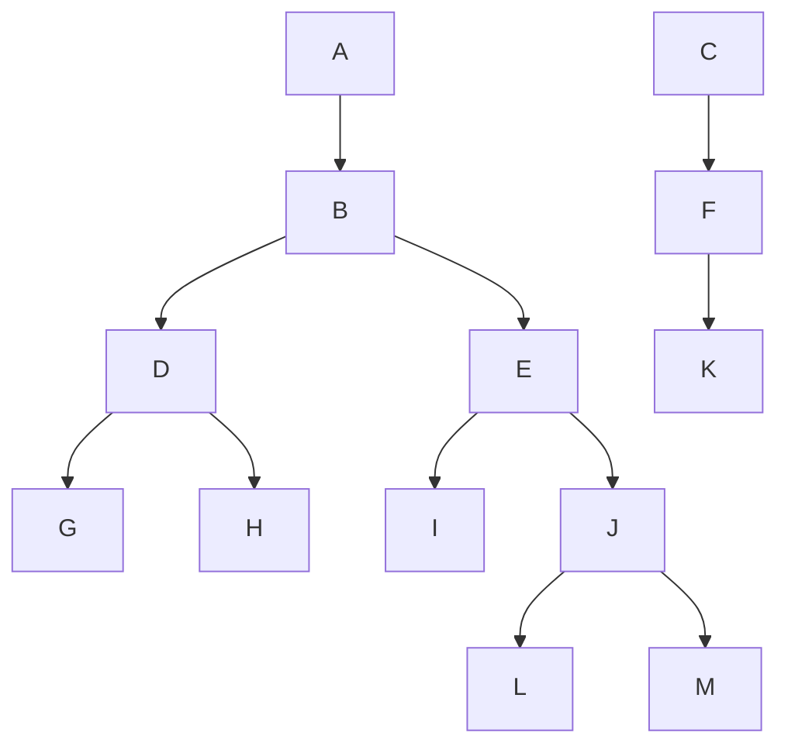
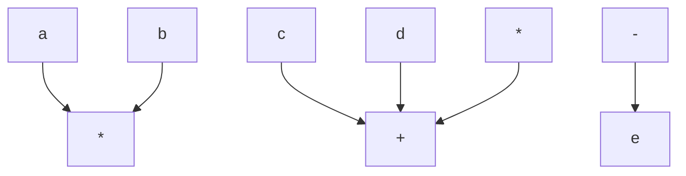
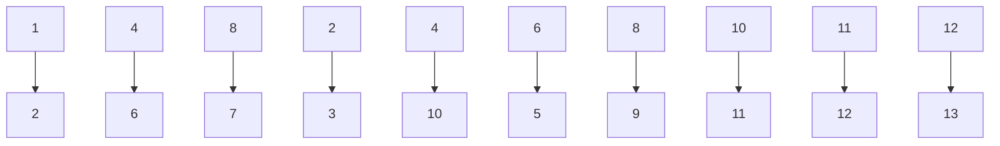
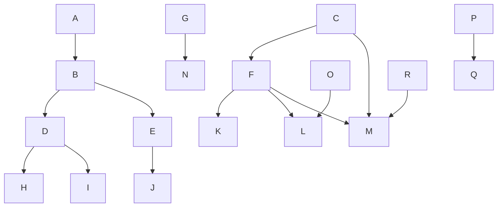
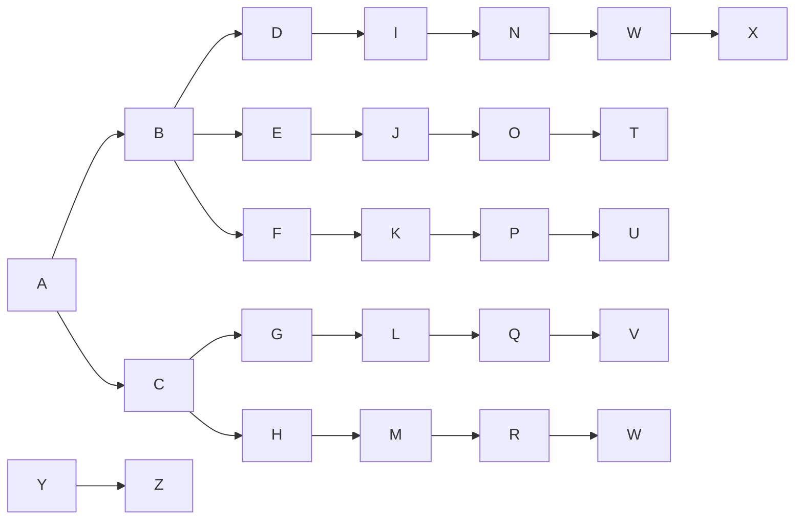
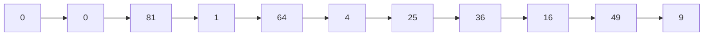

同样，有一种支持 map 的操作但不保证有序排列的数据结构可能运行得更快，因为它被要求做的更少。第 5 章探索这种可能性，并讨论隐藏在另一种 map 实现背后的想法，C++ 将其添加到标准库 (Standard Library) 中，叫作 unordered\_map。无序映射 (unordered map) 将实现的运行时间从 2 秒减少到 1.5 秒。

## 小结

我们已经看到树在操作系统、编译器设计以及搜索中的应用。表达式树是更一般结构即所谓的分析树 (parse tree) 的一个小例子，分析树是编译器设计中的核心数据结构。分析树不是二叉树，而是表达式树相对简单的扩充 (可是，建立分析树的算法却不是那么简单)。

查找树在算法设计中是非常重要的。它几乎支持所有有用的操作，而其对数平均开销很小。查找树的非递归实现多少要快一些，但是递归实现更巧妙、更简练，而且更易于理解和除错。查找树的问题在于，其性能严重地依赖于随机的输入。如果情况不是这样，则运行时间会显著增加，使得查找树成为昂贵的链表。

我们看到了处理这个问题的几个方法。AVL 树要求所有节点的左子树与右子树的高度相差最多是 1。这就保证了树不至于太深。那些不改变树的操作(但插入操作使树改变)都可以使用标准二叉查找树的程序。改变树的操作必须将树恢复。这多少有些复杂，特别是在删除的情况。我们介绍了在以 $O(\log N)$ 时间插入后如何将树恢复。

我们还考察了伸展树。伸展树中的节点可以达到任意深度，但是在每次访问之后树又以多少有些神秘的方式被调整。实际效果在于，任意连续 $M$ 次操作花费 $O(M\log N)$ 时间，它与平衡树花费的时间相同。

与2路树或二叉树不同，B树是平衡 $M$ 路树，它能很好地适应磁盘；一种特殊情形是2-3树 $(M = 3)$，它是实现平衡查找树的另一种方法。

在实践中，所有平衡树方案的运行时间对于插入和删除操作(除查找稍微快一些外)都不如简单二叉查找树省时(差一个常数因子)，但考虑到从防止轻易得到最坏情形的输入来看，这一般说来还是可以接受的。第12章讨论某些另外的查找树数据结构并给出一些详细的实现方法。

最后注意:通过将一些元素插入到查找树然后执行一次中序遍历，我们得到的是排过顺序的元素。这给出排序的一种 $O(N\log N)$ 算法，如果使用任何成熟的查找树则它就是最坏情形的界。我们将在第7章介绍一些更好的方法，不过这些方法的时间界都不可能更低。

## 练习

4.1 对于图 4.74 中的树:

a. 哪个节点是根？
b. 哪些节点是树叶？

4.2 对于图 4.74 树上的每一个节点:

a. 指出它的父节点。
b. 列出它的儿子。
c. 列出它的兄弟。
d. 计算它的深度。

e. 计算它的高度。

4.3 图 4.74 中树的深度是多少?


<details>
<summary>flowchart</summary>


</details>

图 4.74 练习 4.1～练习 4.3 所用到的树

4.4 证明在 $N$ 个节点的二叉树中，存在 $N + 1$ 个 nullptr 链，它们代表 $N + 1$ 个儿子。
4.5 证明在高度为 h 的二叉树中，节点的最大个数是  $2^{h+1}-1$ 。
4.6 满节点(full node)是具有两个儿子的节点。证明满节点的个数加1等于非空二叉树的树叶的个数。
4.7 设二叉树在深度 $d_{1}, d_{2}, \ldots, d_{M}$ 处分别有树叶 $l_{1}, l_{2}, \ldots, l_{M}$。证明，$\sum_{i=1}^{M} 2^{-d_{i}} \leqslant 1$ 并确定何时等号成立。
4.8 给出对应图 4.75 中的树的前缀表达式、中缀表达式以及后缀表达式。


<details>
<summary>flowchart</summary>


</details>

图 4.75 练习 4.8 中的树

4.9 a. 指出将 3, 1, 4, 6, 9, 2, 5, 7 插入到初始为空的二叉查找树中的结果。

b. 指出删除根后的结果。

4.10 令 $f(N)$ 为 $N$ 节点二叉查找树中满节点的平均个数。

a. 确定  $f(0)$  和  $f(1)$  的值。
b. 证明对于 $N > 1$

$$
f (N) = \frac {N - 2}{N} + \frac {1}{N} \sum_ {i = 0} ^ {N - 1} (f (i) + f (N - i - 1))
$$

c. 通过归纳法证明， $f(N) = (N - 2)/3$ 是问题(b)中方程的一个解，其初始条件在问题(a)中。
d. 使用练习 4.6 的结果确定一棵 N 节点二叉查找树中树叶的平均数。

4.11 编写 set 类的实现程序，其中相关的迭代器使用二叉查找树。在每个节点上添加一个指向其父节点的链。

4.12 通过存储类型 set<Pair&lt;KeyType,ValueType&gt;>的一个数据成员编写实现 map 类的程序。

4.13 编写 set 类的实现程序，其中相关的迭代器使用二叉查找树。在每个节点上添加通向下一个最小节点和下一个最大节点的链。为使所写代码更简单，添加头节点和尾节点，它们不是二叉查找树的一部分，但有助于使得代码的链表部分更简单。

4.14 设欲做一个实验来验证由随机 insert/remove 操作对可能引起的问题。这里有一个策略，它虽不是完全随机的，但却足够接近随机。通过插入从 1 到 $M = \alpha N$ 之间随机选出的 $N$ 个元素来建立一棵具有 $N$ 个元素的树。然后执行 $N^2$ 对先插入后删除的操作。假设存在例程 randomInteger(a,b)，它返回一个在 a 和 b 之间（包括 a、b）的均匀随机整数。

a. 解释如何生成在 1 和 M 之间的一个随机整数，该整数不在这棵树上（从而随机插入可以进行）。用 N 和  $\alpha$  来表示这个操作的运行时间。

b. 解释如何生成在 1 和 M 之间的一个随机整数，该整数已经存在于这棵树上(从而随机删除可以进行)。这个操作的运行时间是多少？

c. α的好的选择是什么？为什么？

4.15 编写一个程序，凭经验计算下列删除具有两个儿子的节点的各方法的值:

a. 用  $T_{L}$  中最大节点 X 来代替，递归地删除 X。

b. 交替地用  $T_{L}$  中最大的节点以及  $T_{R}$  中最小的节点来代替，并递归地删除相应的节点。

c. 随机地选用  $T_{L}$  中最大的节点或  $T_{R}$  中最小的节点来代替(递归地删除适当的节点)。哪种方法给出最好的平衡？哪种在处理整个操作过程中花费最少的 CPU 时间？

4.16 重做二叉查找树类以实现懒惰删除。务必注意，这将影响所有的例程。特别具有挑战性的是 findMin 和 findMax，它们现在必须递归地完成。

\*\*4.17 证明，随机二叉查找树的深度(即最深的节点的深度)平均为 $O(\log N)$。

4.18 \*a. 给出高度为 h 的 AVL 树中节点最少个数的精确表达式。

b. 高度为 15 的 AVL 树中节点的最小个数是多少？

4.19 指出将 2, 1, 4, 5, 9, 3, 6, 7 插入到初始空 AVL 树后的结果。

\*4.20 依次将关键字 1, 2, ..., $2^{k}-1$ 插入到一棵初始空 AVL 树中。证明所得到的树是理想平衡 (perfectly balanced) 的。

4.21 写出实现 AVL 单旋转和双旋转的其余的过程。

4.22 设计一个线性时间算法, 该算法检验 AVL 树中的高度信息是否被正确保留并且平衡性质是否成立。

4.23 写出向 AVL 树进行插入的非递归函数。

4.24 证明图 4.47 中的删除算法是正确的。

4.25 a. 为了存储一棵 $N$ 节点的 AVL 树中一个节点的高度，每个节点需要多少比特位 (bit)? b. 使 8 比特高度计数器溢出的最小 AVL 树是什么样的树？

4.26 写出执行双旋转的函数，其效率要超过做两个单旋转。

4.27 指出依序访问图 4.76 的伸展树中关键字 3、9、1、5 后的结果。


<details>
<summary>flowchart</summary>


</details>

图 4.76 练习 4.27 中的树

4.28 指出在前一个练习所得到的伸展树中删除具有关键字 6 的元素后的结果。

4.29 a. 证明如果按顺序访问伸展树中的所有节点，则所得到的树由一连串的左儿子组成。

\*\*b. 证明如果依序访问伸展树中的所有节点，则总的访问时间是 $O(N)$，与初始树无关。

4.30 编写一个程序对伸展树执行一些随机操作。计算所执行的总的旋转次数。与 AVL 树和非平衡二叉查找树相比，其运行时间如何？

4.31 编写一些高效率的函数，只使用一个指向二叉树 $T$ 的根的指针，并计算:

a. T 中节点的个数。

b. T 中树叶的片数。

c. T 中满节点的个数。

所编写的函数的运行时间是多少？

4.32 设计一个递归的线性时间算法，该算法测试一棵二叉树是否在每一个节点都满足查找树的序的性质。

4.33 编写一个递归函数，该函数使用指向树 T 根节点的指针，并返回指向从 T 删除所有树叶所得到的树的根节点的指针。

4.34 写出生成一棵 $N$ 节点随机二叉查找树的函数，该树具有从1直到 $N$ 互异的关键字。该函数的运行时间是多少？

4.35 写出生成具有最少节点高度为 $h$ 的 AVL 树的函数，该函数的运行时间是多少？

4.36 编写一个函数,生成一棵具有关键字从 1 直到 $2^{h+1}-1$ 且高为 $h$ 的理想平衡二叉查找树 (perfectly balanced binary search tree)。该函数运行时间是多少?

4.37 编写一个函数，以二叉查找树 $T$ 和两个有序的关键字 $k_{1}$ 和 $k_{2}$ 作为输入，其中 $k_{1} \leqslant k_{2}$，并打印树中所有满足 $k_{1} \leqslant \operatorname{Key}(X) \leqslant k_{2}$ 的元素 $X$。除去可以被排序外，不对关键字的类型做任何假设。所写的程序应该以平均时间 $O(K + \log N)$ 运行，其中 $K$ 是所打印的关键字的个数。确定该算法的运行时间界。

4.38 本章中一些更大的二叉树是由一个程序自动生成的。这可以通过给树的每一个节点指定坐标 $(x, y)$，围绕每个坐标点画一个圆圈（在某些图片中这可能很难看清），并将每个节点连到它的父节点上来完成。假设在存储器中存有一棵二叉查找树（或许是由上面的一个例程生成的）并设每个节点都有两个附加的域存放坐标。

a. $x$ 坐标可以通过指定中序遍历数来计算。写出一个例程对树中的每个节点做这项工作。

b. y 坐标可以通过使用节点深度的负值算出。写出一个例程对树中的每个节点做这项工作。
c. 若使用某个虚拟的单位表示，则所画图形的具体尺寸是多少？如何调整单位使得所画的树总是高大约为宽的 2/3？
d. 证明，使用这个系统没有线出现交叉，同时，对于任意节点 X，X 的左子树的所有元素都出现在 X 的左边，X 的右子树的所有元素都出现在 X 的右边。

4.39 编写一个通用的画树程序，该程序将把一棵树转变成下列的图-汇编语言指令:

a. Circle $(X, Y)$
b. DrawLine(i, j)

第一个指令在 $(X, Y)$ 处画一个圆，而第二个指令则连接第i个圆和第j个圆（圆以所画的顺序编号）。你或者把它写成一个程序并定义某种输入语言，或者把它写成一个函数，该函数可以被任何程序调用。你的程序的运行时间是多少？

4.40 编写一个例程以层序(level-order)列出二叉树的节点。先列出根，然后列出深度为1的那些节点，再列出深度为2的节点，等等。必须要在线性时间内完成这个工作。证明所编例程的时间界。
4.41 \*a. 写出向一棵 B 树进行插入的例程。

\*b. 写出从一棵 B 树执行删除的例程。当一个项被删除时，是否有必要更新内部节点的信息？
\*c. 修改所编的插入例程，使得如果想要向一个已经有 M 项的节点添加元素，则在分裂该节点以前要执行搜索具有少于 M 个儿子的兄弟的工作。

4.42 $M$ 阶 $\mathbf{B}^{*}$ 树 $(\mathbf{B}^{*}$-tree) 是其每个内部节点的儿子数在 $2M/3$ 和 $M$ 之间的 $\mathbf{B}$ 树。描述一种向 $\mathbf{B}^{*}$ 树执行插入的方法。
4.43 指出如何用儿子/兄弟链的实现来表示图 4.77 中的树。


<details>
<summary>flowchart</summary>


</details>

图4.77 练习4.43中的树

4.44 编写一个过程遍历一棵用儿子/兄弟链存储的树。
4.45 如果两棵二叉树或者都是空树，或者非空且具有相似的左子树和右子树，则这两棵二叉树是相似(similar)的。编写一个函数以确定两棵二叉树是否相似。所编函数的运行时间是多少？
4.46 如果树 $T_{1}$ 通过交换其(某些)节点的左右儿子变换成树 $T_{2}$，则称树 $T_{1}$ 和 $T_{2}$ 是同构(isomorphic)的。例如，图4.78中的两棵树是同构的，因为交换 $A$、$B$、$G$ 的儿子而不交换其他节点后这两棵树是相同的。

a. 给出一个多项式时间算法以决定是否两棵树是同构的。


<details>
<summary>flowchart</summary>


</details>

图 4.78 两棵同构的树

\*b. 所编程序的运行时间是多少(存在线性的解决方案)?

4.47 \*a. 证明，经过一些 AVL 单旋转，任意二叉查找树 $T_{1}$ 可以变换成另一棵(具有相同项的)查找树 $T_{2}$。

\*b. 给出一个算法平均用 $O(N \log N)$ 次旋转完成这种变换。

\*\*c. 证明该变换在最坏情形下可以用 $O(N)$ 次旋转完成。

4.48 设我们想要把操作 findKth 添加到指令集中去。该操作 findKth(k) 返回树中第 k 个最小项。假设所有的项都是互异的。解释如何修改二叉查找树以平均  $O(\log N)$  时间支持这种运算，而又不影响任何其他操作的时间界。

4.49 由于具有 $N$ 个节点的二叉查找树有 $N + 1$ 个 nullptr 指针, 因此在二叉查找树中为指针信息分配的空间有一半被浪费了。设若一个节点有一个 nullptr 左儿子, 我们使它的左儿子链接到它的中序前驱元 (inorder predecessor), 若一个节点有一个 nullptr 右儿子, 我们让它的右儿子链接到它的中序后继元 (inorder successor)。这就叫作线索树 (threaded tree), 而附加的链就叫作线索 (thread)。

a. 我们如何能够将线索从真儿子的指针中区分出来？

b. 编写执行向由上面描述的方式形成的线索树进行插入的例程和删除的例程。

c. 使用线索树的优点是什么？

4.50 编写一个程序, 该程序读入 C++源代码文件并以字母顺序输出所有的标识符(即变量名而非关键字, 并且这些变量名还不是从注释和串常数中找出的)。每个标识符要和它所在的那些行的行号一起输出。

4.51 为一本书生成一个索引。输入文件由一组索引项组成。每行由串 IX:组成，其后跟着一个索引项的名字(封在花括号内)，后面是封在花括号内的页号。在索引项名字中的每个!代表一个子层(sublevel)。符号|(代表一个范围的开始，而)|则代表这个范围的结束。偶尔这个范围是在同一页上。在这种情形下只输出一个单页的页号。在其他情况下不要套叠，否则就扩大了范围。例如，图 4.79 显示了一个样本输入，而图 4.80 则显示出对应的输出。


<details>
<summary>text_image</summary>

IX: {Series|()          {2}
IX: {Series!geometric|()  {4}
IX: {Euler's constant}      {4}
IX: {Series!geometric|})  {4}
IX: {Series!arithmetic|() {4}
IX: {Series!arithmetic|})  {5}
IX: {Series!harmonic|()   {5}
IX: {Euler's constant}      {5}
IX: {Series!harmonic|})  {5}
IX: {Series|})          {5}
</details>

图 4.79 练习 4.51 的样本输入

```yaml
Euler's constant: 4, 5
Series: 2-5
    arithmetic: 4-5
    geometric: 4
    harmonic: 5
```

图4.80 练习4.51的样本输出

## 参考文献

关于二叉查找树的更多的信息,特别是树的数学性质,可以在 Knuth 的两本书([22]和[23])中找到。

有几篇论文处理由在二叉查找树中的有偏删除算法(biased deletion algorithm)引起的平衡不足问题。Hibbard的论文[19]提出原始删除算法并确立一次删除保持树的随机性的结果。文献[20]和[5]分别对只有3个节点的树和4个节点的树进行了全面的分析。Eppinger的论文[14]提供了非随机性的早期经验性的证据，而Culberson和Munro的论文[10]和[11]则提供了某些解析论证(但不是对混杂插入和删除的一般情形的完整证明)。

AVL 树由 Adelson-Velskii 和 Landis $^{[1]}$ 提出。最近有人证明了，对于 AVL 树，如果只对插入执行再平衡而不对删除进行，则在某些情况下所得到的结构仍然保持 $O(\log M)$ 的深度，其中 M 是插入的次数 $^{[28]}$ 。AVL 树的模拟结果以及高度的不平衡允许最多到 k（的不同的值）的各种变化在文献 $^{[21]}$ 中讨论。AVL 树的删除算法可以在文献 $^{[23]}$ 中找到。在 AVL 树中平均查找开销的分析是不完全的，不过，文献 $^{[24]}$ 中得到了某些结果。

文献[3]和[8]考虑了类似本书4.5.1节类型的自调整树。伸展树在文献[29]中作了描述。

B 树首先出现在文献[6]中。这篇原始论文所描述的实现允许数据既能存储在内部节点也能存储在树叶上。我们描述过的数据结构有时叫作 $\mathrm{B}^{+}$树。文献[9]对不同类型的 B 树进行了综合分析。文献[17]报告了各种方案的经验性结果。2-3 树和 B 树的分析可以在文献[4]、[13]以及[32]中找到。

练习 4.17 使人误以为很难。一种解法可以在文献[15]中找到。练习 4.29 取自文献[32]。在练习 4.42 中描述的 B\*树的信息可以在文献[12]中找到。练习 4.46 取自文献[2]。练习 4.47 的解法使用 2N-6 次旋转，该解法在文献[30]中给出。按照练习 4.49 的方式使用的线索 (threads) 首先在文献[27]中提出。处理多维数据的 k-d 树首先在文献[7]中提出，并在本书第 12 章进行了讨论。

另外一些流行的平衡查找树是红黑树 $^{[18]}$ 和赋权平衡树 $^{[26]}$ 。更多的平衡树方案可以在文献 $[16]$ 和 $[25]$ 中找到。

1. G. M. Adelson-Velskii and E. M. Landis, "An Algorithm for the Organization of Information," Soviet. Mat. Doklady, 3 (1962), 1259–1263.
2. A. V. Aho, J. E. Hopcroft, and J. D. Ullman, The Design and Analysis of Computer Algorithms, Addison-Wesley, Reading, Mass., 1974.
3. B. Allen and J. I. Munro, "Self Organizing Search Trees," Journal of the ACM, 25 (1978), 526–535.
4. R. A. Baeza-Yates, "Expected Behaviour of $B^{+}$-trees under Random Insertions," Acta Informatica, 26 (1989), 439-471.
5. R. A. Baeza-Yates, "A Trivial Algorithm Whose Analysis Isn't: A Continuation," BIT, 29 (1989), 88–113.
6. R. Bayer and E. M. McCreight, "Organization and Maintenance of Large Ordered Indices," Acta Informatica, 1 (1972), 173–189.
7. J. L. Bentley, "Multidimensional Binary Search Trees Used for Associative Searching," Communications of the ACM, 18 (1975), 509–517.
8. J. R. Bitner, "Heuristics that Dynamically Organize Data Structures," SIAM Journal on Computing, 8 (1979), 82–110.
9. D. Comer, "The Ubiquitous B-tree," Computing Surveys, 11 (1979), 121-137.
10. J. Culberson and J. I. Munro, "Explaining the Behavior of Binary Search Trees under Prolonged Updates: A Model and Simulations," Computer Journal, 32 (1989), 68–75.
11. J. Culberson and J. I. Munro, "Analysis of the Standard Deletion Algorithms in Exact Fit Domain Binary Search Trees," Algorithmica, 5 (1990), 295–311.
12. K. Culik, T. Ottman, and D. Wood, "Dense Multiway Trees," ACM Transactions on Database Systems, 6 (1981), 486–512.
13. B. Eisenbath, N. Ziviana, G. H. Gonnet, K. Melhorn, and D. Wood, "The Theory of Fringe Analysis and Its Application to 2–3 Trees and B-trees," Information and Control, 55 (1982), 125–174.
14. J. L. Eppinger, "An Empirical Study of Insertion and Deletion in Binary Search Trees," Communications of the ACM, 26 (1983), 663–669.
15. P. Flajolet and A. Odlyzko, "The Average Height of Binary Trees and Other Simple Trees," Journal of Computer and System Sciences, 25 (1982), 171–213.
16. G. H. Gonnet and R. Baeza-Yates, Handbook of Algorithms and Data Structures, 2d ed., Addison-Wesley, Reading, Mass., 1991.
17. E. Gudes and S. Tsur, "Experiments with B-tree Reorganization," Proceedings of ACM SIGMOD Symposium on Management of Data (1980), 200–206.
18. L. J. Guibas and R. Sedgewick, "A Dichromatic Framework for Balanced Trees," Proceedings of the Nineteenth Annual IEEE Symposium on Foundations of Computer Science (1978), 8–21.
19. T. H. Hibbard, "Some Combinatorial Properties of Certain Trees with Applications to Searching and Sorting," Journal of the ACM, 9 (1962), 13–28.
20. A. T. Jonassen and D. E. Knuth, "A Trivial Algorithm Whose Analysis Isn't," Journal of Computer and System Sciences, 16 (1978), 301–322.
21. P. L. Karlton, S. H. Fuller, R. E. Scroggs, and E. B. Kaehler, "Performance of Height Balanced Trees," Communications of the ACM, 19 (1976), 23–28.
22. D. E. Knuth, The Art of Computer Programming: Vol. 1: Fundamental Algorithms, 3d ed., Addison-Wesley, Reading, Mass., 1997.
23. D. E. Knuth, The Art of Computer Programming: Vol. 3: Sorting and Searching, 2d ed., Addison-Wesley, Reading, Mass., 1998.
24. K. Melhorn, "A Partial Analysis of Height-Balanced Trees under Random Insertions and Deletions," SIAM Journal of Computing, 11 (1982), 748–760.
25. K. Melhorn, Data Structures and Algorithms 1: Sorting and Searching, Springer-Verlag, Berlin, 1984.
26. J. Nievergelt and E. M. Reingold, "Binary Search Trees of Bounded Balance," SIAM Journal on Computing, 2 (1973), 33–43.
27. A. J. Perlis and C. Thornton, "Symbol Manipulation in Threaded Lists," Communications of the ACM, 3 (1960), 195–204.
28. S. Sen and R. E. Tarjan, "Deletion Without Rebalancing in Balanced Binary Trees," Proceedings of the Twentieth Symposium on Discrete Algorithms (2010), 1490–1499.
29. D. D. Sleator and R. E. Tarjan, "Self-adjusting Binary Search Trees," Journal of the ACM, 32 (1985), 652–686.
30. D. D. Sleator, R. E. Tarjan, and W. P. Thurston, "Rotation Distance, Triangulations, and Hyperbolic Geometry," Journal of the AMS (1988), 647–682.
31. R. E. Tarjan, "Sequential Access in Splay Trees Takes Linear Time," Combinatorica, 5 (1985), 367–378.
32. A. C. Yao, "On Random 2-3 Trees," Acta Informatica, 9 (1978), 159-170.

## 第5章 散列

我们在第 4 章讨论了查找树 ADT，它允许对元素的集合进行各种操作。本章讨论散列表 (hash table) ADT，不过它只支持二叉查找树所允许的一部分操作。

散列表的实现常常叫作散列(hashing)。散列是一种用于以常数平均时间执行插入、删除和查找的技术。但是，那些需要元素间任何序信息的树操作在这里将不会得到有效的支持。因此，诸如 findMin、findMax 以及以线性时间将排过序的整个表进行打印的操作都是散列所不支持的。

本章的中心数据结构是散列表(hash table)。我们将

- 看到实现散列表的几种方法。
- 解析地比较这些方法。
- 介绍散列的多种应用。
- 将散列表与二叉查找树进行比较。

## 5.1 一般想法

理想的散列表数据结构只不过是一个包含一些项(item)的具有固定大小的数组。第4章讨论过，查找一般是对项的某个部分(即数据域)进行。这部分就叫作关键字(key)。例如，一项可以由一个字符串(它可以作为关键字)和一些附加的数据成员(例如姓名，它是大型雇员结构的一部分)组成。我们把表的大小记作TableSize，并将其理解为散列数据结构的一部分而不仅

仅是浮动于全局的某个变量。通常的习惯是让表从 0 到 TableSize - 1 变化，稍后我们就会明白为什么要这样。

每个关键字被映射到从0到TableSize-1这个范围中的某个数，并且被放到适当的单元中。这个映射就叫作散列函数(hash function)，理想情况下它应该算起来简单并且应该保证任何两个不同的关键字都要映射到不同的单元。但是，这显然是不可能的，因为单元的数目是有限的，而关键字实际上是用不完的。因此，我们寻找一个散列函数，该函数要在单元之间均匀地分配关键字。图5.1是一个典型的完美情况。在这个例子中，john散列到3，phil散列到4，dave散列到6，mary散列到7。


<details>
<summary>text_image</summary>

0

1

2

3
john 25000
4
phil 31250
5

6
dave 27500
7
mary 28200
8

9
</details>

图5.1 一个理想的散列表

这就是散列的基本想法。剩下的问题就是要选择一个函数，决定当两个关键字散列到同一个值的时候(这叫作冲突(collision))应该做什么以及如何确定散列表的大小。

## 5.2 散列函数

如果输入的关键字是整数，则一般合理的方法就是直接返回 Key mod TableSize，除非 Key 碰巧具有某些不理想的性质。在这种情况下，散列函数的选择需要仔细地考虑。例如，若表的大小是 10 而关键字都以 0 为个位，则此时上述标准的散列函数就是一个坏的选择。其原因将在后面看到。而为了避免上面那样的情况，好的办法通常是保证表的大小是素数。当输入的关键字是随机整数时，这个函数此时不仅算起来非常简单而且关键字的分配也很均匀。

通常，关键字是字符串。在这种情形下，散列函数需要仔细选择。

一种选择方法是把字符串中字符的 ASCII 码值加起来。图 5.2 中的例程实现的就是这种策略。

图 5.2 中描述的散列函数实现起来简单而且能够很快地算出答案。不过，如果表过大，则函数将不会很好地分配关键字。例如，设 TableSize = 10 007 (10 007 是素数)，并设所有的关键字均为 8 个或更少个字符长。由于 ASCII 字符的值最多是 127，因此散列函数只能假设值在 0 和 1016 之间，其中 1016 为 127\*8。显然这不是一种合理的分配。

```c
int hash( const string & key, int tableSize )
{
    int hashVal = 0;

    for( char ch : key )
        hashVal += ch;

    return hashVal % tableSize;
}
```

图5.2 一个简单的散列函数

另一个散列函数由图 5.3 表示。这个散列函数假设 Key 至少有 3 个字符。值 27 表示英文字母表的字母外加一个空格的个数，而 729 是 $27^{2}$ 。该函数只考查前 3 个字符，但是，假如它们是随机的，而表的大小像前面那样还是 10007，那么我们就会得到一个合理的均衡分布。可不巧的是，英文不是随机的。虽然 3 个字符（忽略空格）有 $26^{3} = 17576$ 种可能的组合，但查验合理的足够大的联机词典却揭示:3 个字母的不同组合数实际只有 2851。即使这些组合没有冲突，也不过只有表的 $28\%$ 被真正散列到。因此，虽然很容易计算，但是，如果散列表就算大小适当，那么这个函数也还是不合适的。

```c
int hash( const string & key, int tableSize )
{
    return ( key[ 0 ] + 27 * key[ 1 ] + 729 * key[ 2 ] ) % tableSize;
}
```

图5.3 另一个可能的散列函数——不是太好

图5.4列出了散列函数的第3种尝试。这个散列函数涉及到关键字中的所有字符，并且一般可以分布得很好(它计算 $\sum_{i=0}^{\text{KeySize-1}}\text{Key}\ [KeySize-i-1]\cdot 37^i$，并将结果限制在适当的范围)。程序根据Horner法则计算一个(37的)多项式函数。例如，计算 $h_k = k_0 + 37k_1 + 37^2k_2$ 的另一种方式是借助于公式 $h_k = ((k_2)*37 + k_1)*37 + k_0$ 进行。Horner法则将其扩展到用于 $n$ 次多项式。

这个散列函数利用到以下事实:允许溢出，同时用到 unsigned int 型量以避免引进负数。

图 5.4 所描述的散列函数就表的分布而言未必是最好的,但是确实具有极其简单的优点而且速度也很快。如果关键字特别长,那么该散列函数计算起来将会花费过多的时间。在这种情况下通常的经验是不使用所有的字符。此时关键字的长度和性质将影响选择。例如,关键字可能是完整的街道地址，散列函数可以包括街道地址的几个字符，也许还有城市名和邮政区码的几个字符。有些程序设计人员通过只使用奇数位置上的字符来实现他们的散列函数，这里有这么一层想法:用计算散列函数节省下的时间来补偿轻微地不均匀分布的函数。

剩下的主要编程细节是解决冲突的消除问题。如果当一个元素被插入时与一个已经插入的元素散列到相同的值，那么就产生一个冲突(collision)，这个冲突需要消除。解决这种冲突的方法有几种，我们将讨论其中最简单的两种:分离链接法和开放定址法；然后再考查一些最近发现的可供选择的方法。

```c
/**
 * 字符串对象的散列例程.
 */
unsigned int hash( const string & key, int tableSize )
{
    unsigned int hashVal = 0;

    for( char ch : key )
        hashVal = 37 * hashVal + ch;

    return hashVal % tableSize;
}
```

图5.4 一个好的散列函数

## 5.3 分离链接法

解决冲突的第一种方法通常叫作分离链接法(separate chaining)，其做法是将散列到同一个值的所有元素保留到一个链表中。我们可以使用标准库(Standard Library)中表的实现方法。如果空间很紧，则更可取的方法是避免使用它们(因为这些表双向链接并且浪费空间)。本节

假设关键字是前 10 个完全平方数并设散列函数就是  $hash(x) = x \mod 10$ 。（表的大小不是素数，用在这里是为了简单。）图 5.5 显示的是最后得到的分离链接散列表。

为执行一次 search，我们使用散列函数来确定究竟遍历哪个链表。然后再在适当的链表中执行一次查找。为执行 insert，我们检查相应的链表看看该元素是否已经处在相应的位置（如果允许插入重复元，那么通常要留出一个额外的数据成员，当出现匹配事件时这个数据成员增 1）。如果这个元素是个新的元素，那么它将被插入到链表的前端，这不仅因为方便，而且还因为常常发生这样的事实:新近插入的元素最有可能不久又被访问。

实现分离链接法所需要的类接口在图 5.6 中表出。散列表存储一个链表数组，它们在构造函数中被指定。


<details>
<summary>flowchart</summary>


</details>

图5.5 分离链接散列表

类接口阐释一个语法要点:在 C++11 之前，在 theLists 的声明中，两个>之间需要一个空格。因为>>是一个 C++记号，而且比>长，所以>>总是被当作一个记号。但是在 C++11 中，情况则不再是这样。

```cpp
template <typename HashedObj>
class HashTable
{
    public:
        explicit HashTable( int size = 101 );

        bool contains( const HashedObj & x ) const;

        void makeEmpty( );
        bool insert( const HashedObj & x );
        bool insert( HashedObj && x );
        bool remove( const HashedObj & x );

    private:
        vector<list<HashedObj>> theLists;      // 链表的数组
        int currentSize;

        void rehash( );
        size_t myhash( const HashedObj & x ) const;
};
```

图 5.6 分离链接散列表的类型声明

就像二叉查找树只对那些 Comparable 的对象有效一样，本章中的散列表只对提供散列函数和等号操作符(equality operator)(operator==或 operator!=，或二者同时提供)的对象适用。

我们让散列函数只用对象作为参数并返回适当的整型量，而不再要求散列函数采用对象和表的大小同时作为参数。此时标准的做法是使用函数对象，以及在 C++11 中引进的散列表协议。特别地，在 C++11 中，散列函数可以通过函数对象模板来表示:

```cpp
template <typename Key>
class hash
{
    public:
        size_t operator() ( const Key & k ) const;
};
```

这个模板的默认实现均被提供给诸如 int 和 string 这样的标准类型。这样，图 5.4 所描述的散列函数可以实现如下:

```cpp
template <>
class hash<string>
{
    public:
        size_t operator()( const string & key )
        {
            size_t hashVal = 0;

            for( char ch : key )
                hashVal = 37 * hashVal + ch;

            return hashVal;
        }
};
```

类型 size\_t 是无符号整型，用于表示对象的大小。因此，保证能够存储数组下标。一个实现散列表算法的类此时可以使用对泛型散列函数对象的调用，以生成整型的 size\_t，然后将结果换算成适当的数组下标。在我们的散列表中，这清楚地显示在私有成员函数 myhash 中，见图 5.7。

```cpp
size_t myhash( const HashedObj & x ) const
    {
        static hash<HashedObj> hf;
        return hf( x ) % theLists.size( );
    }
```

图5.7 散列表的myhash成员函数

图 5.8 阐释了一个 Employee 类，它可以被存储在泛型散列表中，使用 name 成员作为关键字。Employee 类通过提供相等操作符和散列函数对象来实现 HashedObj 的要求。

```cpp
// 一个 Employee 类的例
class Employee
{
    public:
        const string & getName( ) const
            { return name; }

        bool operator==( const Employee & rhs ) const
            { return getName( ) == rhs.getName( ); }
        bool operator!=( const Employee & rhs ) const
            { return !( *this == rhs; }

        // 其余公有成员没再列出

    private:
        string name;
        double salary;
        int     seniority;

        // 其余的私有成员没再列出
};

template<>
class hash<Employee>
{
    public:
        size_t operator()( const Employee & item )
        {
            static hash<string> hf;
            return hf( item.getName( ) );
        }
};
```

图 5.8 可以用作 HashedObj 的类的例子

实现 makeEmpty、contains 和 remove 的代码如图 5.9 所示。

接下来就是插入例程。如果被插入的项已经存在，那么我们就什么也不做；否则，我们将其放入表中(见图 5.10)。该元素可以被放到表中的任何位置。在这里的情形下使用 push\_back 是最方便的。whichList 是一个引用变量，见 1.5.2 节关于引用变量这种用法的讨论。

```txt
void makeEmpty( )
{
    for( auto & thisList : theLists )
        thisList.clear( );
}

bool contains( const HashedObj & x ) const
{
    auto & whichList = theLists[ myhash( x ) ];
    return find( begin( whichList ), end( whichList ), x ) != end( whichList );
}

bool remove( const HashedObj & x )
{
    auto & whichList = theLists[ myhash( x ) ];
    auto itr = find( begin( whichList ), end( whichList ), x );

    if( itr == end( whichList ) )
        return false;

    whichList.erase( itr );
    --currentSize;
    return true;
}
```

图 5.9 分离链接散列表的 makeEmpty、contains 和 remove 例程

```txt
bool insert( const HashedObj & x )
{
    auto & whichList = theLists[ myhash( x ) ];
    if( find( begin( whichList ), end( whichList ), x ) != end( whichList ) )
        return false;
    whichList.push_back( x );

    // 再散列; 见 5.5节
    if( ++currentSize > theLists.size( ) )
        rehash( );

    return true;
}
```

图 5.10 分离链接散列表的 insert 例程

除链表外，任何合理的方案也都可以解决冲突现象，一棵二叉查找树或甚至另一个散列表都将胜任这个工作，但是我们期望，如果散列表是大的并且散列函数是好的，那么所有的链表都应该是短的，从而基本的分离链接法就没有必要再尝试任何复杂的手段了。

我们定义散列表的装填因子(load factor) $\lambda$ 为散列表中的元素个数对该表大小的比。在上面的例子中， $\lambda=1.0$ 。链表的平均长度为 $\lambda$ 。执行一次查找所需要的代价，是计算散列函数值所需要的常数时间加上遍历链表所用的时间。在一次不成功的查找中，要考查的节点数平均为 $\lambda$ 。一次成功的查找则需要遍历大约 $1+(\lambda/2)$ 个链。为了看清这一点，注意被搜索的链表包含一个存储匹配值的节点再加上0个或更多其他的节点。在N个元素的散列表以及M个链表中，“其他节点”的期望个数为 $(N-1)/M=\lambda-1/M$ ，它基本上就是 $\lambda$ ，因为假设M是大的。平均看来，一半的“其他”节点被搜索，再结合匹配节点，我们得到 $1+\lambda/2$ 个节点的平均查找代价。这个分析指出，散列表的大小实际上并不重要，而装填因子才是重要的。分离链接散列法的一般法则是让表的大小大致与预料的元素个数差不多(换句话说，让 $\lambda\approx1$ )。在图5.10的程序中，如果装填因子超过1，那么我们通过调用在第10行上的rehash函数扩大散列表的大小。rehash将在5.5节讨论。正如前面提到的，使表的大小是素数以保证一个好的分布，这也是一个好想法。

## 5.4 不用链表的散列表

分离链接散列算法的缺点是使用一些链表。由于给新单元分配地址需要时间(特别是在其他语言中)，因此这就导致算法的速度有些减慢，同时算法实际上还要求对第二种数据结构的实现。另外一种不用链表解决冲突的方法是尝试另外一些单元，直到找出空的单元为止。更一般地，单元 $h_0(x), h_1(x), h_2(x), \cdots$ 相继被试选，其中 $h_i(x) = (\text{hash}(x) + f(i)) \mod \text{TableSize}$，且 $f(0) = 0$。函数 $f$ 是冲突解决方法。因为所有的数据都要置入表内，所以这种解决方案所需要的表要比分离链接散列的表大。一般说来，对于不使用分离链接的散列表来说，其装填因子应该低于 $\lambda = 0.5$。我们把这样的表叫作探测散列表(probing hash table)。现在我们就来考察3种通常的冲突解决方案。

## 5.4.1 线性探测法

在线性探测法中，函数 $f$ 是 $i$ 的线性函数，典型的情形是 $f(i) = i$ 。这相当于相继探测逐个单元(必要时可以回绕)以查找出一个空单元。图5.11显示使用与前面相同的散列函数将诸关键字{89, 18, 49, 58, 69}插入到一个散列表中的情况，而此时的冲突解决方法就是 $f(i) = i$ 。

|  | 空表 | 插入89后的表 | 插入18后的表 | 插入49后的表 | 插入58后的表 | 插入69后的表 |
| --- | --- | --- | --- | --- | --- | --- |
| 0 |  |  |  | 49 | 49 | 49 |
| 1 |  |  |  |  | 58 | 58 |
| 2 |  |  |  |  |  | 69 |
| 3 |  |  |  |  |  |  |
| 4 |  |  |  |  |  |  |
| 5 |  |  |  |  |  |  |
| 6 |  |  |  |  |  |  |
| 7 |  |  |  |  |  |  |
| 8 |  |  | 18 | 18 | 18 | 18 |
| 9 |  | 89 | 89 | 89 | 89 | 89 |

图5.11 使用线性探测法得到的散列表，每次插入后的情况

第一个冲突在插入关键字 49 时产生，它被放入下一个空闲位置，即位置 0，该位置是开放的。关键字 58 先与 18 冲突，再与 89 冲突，然后又和 49 冲突，试选 3 次之后才找到一个空位置。对 69 的冲突用类似的方法处理。只要表足够大，总能够找到一个空闲位置，但是如此花费的时间是相当多的。更糟的是，即使表相对较空，这样占据的位置也会开始形成一些区块，其结果称为一次聚集 (primary clustering)，就是说，散列到区块中的任何关键字都需要多次试选单元才能够解决冲突，然后该关键字被添加到相应的区块中。

虽然我们不在这里进行具体计算，但是可以证明，使用线性探测的期望探测次数对于插入和不成功的查找来说大约为 $\frac{1}{2} (1 + 1 / (1 - \lambda)^2)$，而对于成功的查找来说则是 $\frac{1}{2} (1 + 1 / (1 - \lambda))$。相关的一些计算多少有些复杂。从程序中容易看出，插入和不成功查找需要相同次数的探测。略加思考不难得出，成功查找应该比不成功查找平均花费较少的时间。

如果聚集不成为问题，那么对应的公式相当容易得到。我们将假设有一个很大的散列表，并设每次探测都与前面的探测无关。对于随机冲突解决方法而言，这些假设是成立的，并且当 $\lambda$ 不是非常接近于1时也是合理的。首先，我们导出在一次不成功查找中探测的期望次数，而这正是直到我们找到一个空闲位置探测的期望次数。由于空单元所占的份额为 $1 - \lambda$ ，因此我们预计要探测的位置数是 $1 / (1 - \lambda)$ 。一次成功查找的探测次数等于该特定元素插入时所需要的探测次数。当一个元素被插入时，可以看成进行一次不成功查找的结果。因此，我们可以使用一次不成功查找的开销来计算一次成功查找的平均开销。

需要指出，$\lambda$ 是从0到其当前值之间变化，因此越早的插入操作开销越少，从而将平均开销拉低。例如，在上面的表5.11中，$\lambda = 0.5$，访问18的开销是在18被插入时确定的，此时 $\lambda = 0.2$。由于18是插入到一个相对空的散列表中，因此对它的访问应该比新近插入的元素(比如69)的访问更容易。可以通过使用积分计算插入时间的平均值的方法来估计平均值，如此得到:

$$
I (\lambda) = \frac {1}{\lambda} \int_ {0} ^ {\lambda} \frac {1}{1 - x} \mathrm{d} x = \frac {1}{\lambda} \ln \frac {1}{1 - \lambda}
$$

这些公式显然优于线性探测那些相应的公式。聚集不仅是理论上的问题，而且实际上也发生在具体的实现中。

图5.12 把线性探测的性能(虚曲线)与从更随机的冲突解决方法中期望的性能进行了比较。成功查找用 $S$ 标示，不成功查找和插入分别用 $U$ 和 $I$ 标记。


<details>
<summary>line</summary>

| X | U,I (dashed) | S (solid) | Solid Line |
| --- | --- | --- | --- |
| 0.10 | ~0.8 | ~0.8 | ~0.8 |
| 0.20 | ~1.2 | ~1.0 | ~1.0 |
| 0.30 | ~1.8 | ~1.2 | ~1.2 |
| 0.40 | ~2.5 | ~1.4 | ~1.4 |
| 0.50 | ~3.5 | ~1.6 | ~1.6 |
| 0.60 | ~5.0 | ~1.8 | ~1.8 |
| 0.70 | ~7.5 | ~2.2 | ~2.2 |
| 0.80 | ~12.0 | ~3.0 | ~2.5 |
| 0.90 | — | ~6.0 | ~3.0 |
| 0.95 | — | ~15.0 | ~3.5 |
</details>

图 5.12 对线性探测(虚线)和随机方法的装填因子画出的探测次数(S为成功查找，U为不成功查找，而I为插入)

如果 $\lambda = 0.75$ ，那么上面的公式指出，对在线性探测中的一次插入预计用到8.5次探测。如果 $\lambda = 0.9$ ，则预计为50次探测，这就有些离谱了。假如聚集不是问题，那么这可与相应装填因子下的4次和10次探测相比。从这些公式看到，如果表可以有多于一半被填满的话，那么线性探测就不是个好办法。然而，如果 $\lambda = 0.5$ ，那么插入操作平均只需要2.5次探测，并且对于成功的查找平均只需要1.5次探测。

## 5.4.2 平方探测法

平方探测是消除线性探测中一次聚集问题的冲突解决方法。平方探测是我们通常预期的——冲突函数为二次的探测方法。流行的选择是 $f(i)=i^{2}$ 。图5.13显示了与前面线性探测例子相同的输入使用该冲突函数所得到的散列表。

|  | 空表 | 插入89后的表 | 插入18后的表 | 插入49后的表 | 插入58后的表 | 插入69后的表 |
| --- | --- | --- | --- | --- | --- | --- |
| 0 |  |  |  | 49 | 49 | 49 |
| 1 |  |  |  |  |  |  |
| 2 |  |  |  |  | 58 | 58 |
| 3 |  |  |  |  |  | 69 |
| 4 |  |  |  |  |  |  |
| 5 |  |  |  |  |  |  |
| 6 |  |  |  |  |  |  |
| 7 |  |  |  |  |  |  |
| 8 |  |  | 18 | 18 | 18 | 18 |
| 9 |  | 89 | 89 | 89 | 89 | 89 |

图 5.13 利用平方探测得到的散列表，每次插入后的情况

当 49 与 89 冲突时，其下一个位置为下一个单元，该位置是空的，因此 49 就被放在那里。接着，58 在位置 8 处产生冲突，其后相邻的位置经探测得知发生了另外的冲突。下一个探测的位置在距位置 8 为 $2^{2} = 4$ 远处，这个位置是个空闲位置。因此，关键字 58 就放在位置 2 处。对于关键字 69，处理的过程也一样。

对于线性探测，让散列表几乎填满元素并不是个好主意，因为此时表的性能会降低。对于平方探测情况甚至更糟:一旦表被填满超过一半，当表的大小不是素数时甚至在表被填满一半之前，就不能保证找到空的位置了。这是因为最多有表的一半可以用作解决冲突的备选位置。

现在就来证明，如果表有一半是空的，并且表的大小是素数，那么我们保证总能够插入一个新的元素。

## 定理 5-1

如果使用平方探测, 且表的大小是素数, 那么当表至少有一半是空的时候, 总能够插入一个新的元素。

证明:

令表的大小TableSize是一个大于3的(奇)素数。我们证明，前「TableSize/2」个备选位置(包括初始位置 $h_0(x)$ )都是互异的。 $h(x) + i^2$ (mod TableSize)和 $h(x) + j^2$ (mod TableSize)是这些位置中的两个，其中 $0\leqslant i,j\leqslant \lfloor \text{TableSize} / 2\rfloor$ 。为推出矛盾，假设这两个位置相同，但 $i\neq j$ 。于是

$$
h (x) + i ^ {2} = h (x) + j ^ {2} \pmod {\text {TableSize}}
$$

$$
i ^ {2} = j ^ {2} \quad (\mathrm{modTableSize})
$$

$$
i ^ {2} - j ^ {2} = 0 \quad (\mathrm{modTableSize})
$$

$$
(i - j) (i + j) = 0 \quad (\mathrm{modTableSize})
$$

由于TableSize是素数，因此，或者 $(i - j)$ 等于0(modTableSize)或者 $(i + j)$ 等于0(modTableSize)。既然 $i$ 和 $j$ 是互异的，那么第一个选择是不可能的。但 $0\leqslant i,j\leqslant \lfloor \text{TableSize} / 2\rfloor$ ，因此第二个选择也是不可能的。从而，前「TableSize/2」个备选位置是互异的。如果最多有$\lfloor \text{TableSize} / 2\rfloor$ 个位置被使用，那么空单元总能够找到。

如果哪怕表有比一半多一个的位置被填满，那么插入都有可能失败(虽然这是非常难以见到的)。因此，把它记住很重要。另外，表的大小是素数也非常重要。 $^{①}$  如果表的大小不是素数，则备选单元的个数可能会锐减。例如，若表的大小是16，那么备选单元只能在距散列值1、4或9远处。

在探测散列表中标准的删除操作不能施行，因为相应的单元可能已经引起过冲突，元素绕过它存在了别处。例如，如果我们删除 89，那么实际上所有剩下的 find 操作都将失败。因此，探测散列表需要懒惰删除，虽然在这种情况下实际上并不存在所意味的懒惰。

实现探测散列表所需要的类接口如图 5.14 中所示。这里，我们不用链表数组，而是使用散列表项单元的数组。内嵌类 HashEntry 存储 info 成员中一项的状态，这个状态或者是 ACTIVE，或者是 EMPTY，或者是 DELETED。

```cpp
template <typename HashedObj>
class HashTable
{
    public:
        explicit HashTable( int size = 101 );

        bool contains( const HashedObj & x ) const;

        void makeEmpty( );
        bool insert( const HashedObj & x );
        bool insert( HashedObj && x );
        bool remove( const HashedObj & x );

        enum EntryType { ACTIVE, EMPTY, DELETED };

    private:
        struct HashEntry
        {
            HashedObj element;
            EntryType info;

            HashEntry( const HashedObj & e = HashedObj{ }, EntryType i = EMPTY )
                : element{ e }, info{ i } { }
            HashEntry( HashedObj && e, EntryType i = EMPTY )
                : element{ std::move( e ) }, info{ i } { }
        };

        vector<HashEntry> array;
        int currentSize;

        bool isActive( int currentPos ) const;
        int findPos( const HashedObj & x ) const;
        void rehash( );
        size_t myhash( const HashedObj & x ) const;
};
```

图5.14 使用探测方法的散列表的类接口，包括内嵌的HashEntry类

<small><span class="docvortex-page-footnote" data-block-type="page_footnote" style="color:#6b7280">① 如果表的大小是形如 $4k + 3$ 的素数，且使用的平方冲突解决方法为 $f(i) = \pm i^2$ ，那么整个表均可被探测到。其代价则是例程要略微复杂些。</span></small>

我们使用标准的枚举类型:

```txt
enum EntryType { ACTIVE, EMPTY, DELETED };
```

散列表的构建(见图 5.15)通过对每个单元设置 info 成员为 EMPTY 组成。图 5.16 中所示的 contains(x) 调用私有成员函数 isActive 和 findPos。这里的 private 成员函数 findPos 实施对冲突的解决。我们肯定在 insert 例程中散列表至少为该表中元素个数的两倍大，这样平方探测解决方案总可以实现。在图 5.16 的实现中，标记为删除的那些元素被认为还在表内。这可能引起一些问题，因为该表可能提前过满。我们现在就来讨论它。

```txt
explicit HashTable( int size = 101 ) : array( nextPrime( size ) )
        { makeEmpty( ); }

    void makeEmpty( )
    {
        currentSize = 0;
        for( auto & entry : array )
            entry.info = EMPTY;
    }
```

图5.15 初始化平方探测散列表的例程

```txt
bool contains( const HashedObj & x ) const
{ return isActive( findPos( x ) ); }

int findPos( const HashedObj & x ) const
{
    int offset = 1;
    int currentPos = myhash( x );

    while( array[ currentPos ].info != EMPTY &&
        array[ currentPos ].element != x )
    {
        currentPos += offset; // 计算第i次探测
        offset += 2;
        if( currentPos >= array.size( ) )
            currentPos -= array.size( );
    }

    return currentPos;
}

bool isActive( int currentPos ) const
{ return array[ currentPos ].info == ACTIVE; }
```

图 5.16 使用平方探测进行散列的 contains 例程(和它的 private 支撑例程)

第 12 行～第 15 行为进行平方探测的快速方法。由平方消解函数 (quadratic resolution function) 的定义可知， $f(i)=f(i-1)+2i-1$ ，因此，下一个要尝试的单元离上一个被试过的单元有一段距离，而这个距离在连续探测中增 2。如果新的定位越过数组，那么可以通过减去 TableSize 把它拉回到数组范围内。这比那种明显的方法要快，因为它避免了看似需要的乘法和除法。注意一条重要的警告:第 9 行和第 10 行的测试顺序很重要，切勿改变它！

最后的例程是插入。正如分离链接散列方法那样，若 x 已经存在，则我们就什么也不做。还有些工作只是简单的修改。否则，我们就把要插入的元素放在 findPos 例程指出的地方。程序如图 5.17 所示。如果装填因子超过 0.5，则表是满的，需要将该散列表放大。这称为再散列 (rehashing)，我们将在 5.5 节进行讨论。图 5.17 还列出了 remove 例程。

```c
bool insert( const HashedObj & x )
{
    // 将 x 作为 active 插入
    int currentPos = findPos( x );
    if( isActive( currentPos ) )
        return false;

    array[ currentPos ].element = x;
    array[ currentPos ].info = ACTIVE;

    // 再散列; 见 5.5 节
    if( ++currentSize > array.size( ) / 2 )
        rehash( );

    return true;
}

bool remove( const HashedObj & x )
{
    int currentPos = findPos( x );
    if( !isActive( currentPos ) )
        return false;

    array[ currentPos ].info = DELETED;
    return true;
}
```

图5.17 使用平方探测的散列表的某个insert例程和remove例程

虽然平方探测排除了一次聚集，但是散列到同一位置上的那些元素将探测相同的备选单元。这叫作二次聚集(secondary clustering)。二次聚集是理论上的一个小缺憾。模拟结果指出，对每次查找，它一般要引起另外的少于半次的探测。下面的技术将会排除这个缺憾，不过这要付出计算一个附加的散列函数的开销。

## 5.4.3 双散列

我们将要考察的最后一个冲突解决方案是双散列(double hashing)。对于双散列，一种流行的选择是 $f(i)=i\ hash_{2}(x)$ 。这个公式是说，我们将第二个散列函数应用到x并在距离 $hash_{2}(x)$ ， $2hash_{2}(x)$ ，…等处探测。 $hash_{2}(x)$ 选择得不好将会是灾难性的。例如，若把99插入到前面那些例子中的输入中去，则明显的选择 $hash_{2}(x)=x\mod9$ 将不起作用。因此，这个函数一定不要算得0值。另外，确保所有的单元都能被探测到(在下面的例子中这是不可能的，因为表的大小不是素数)也是很重要的。诸如 $hash_{2}(x)=R-(x\mod R)$ 这样的函数将起到良好的作用，其中R为小于TableSize的素数。如果选择R=7，则图5.18显示出插入与前面相同的那些关键字的结果。

|  | 空表 | 插入89后的表 | 插入18后的表 | 插入49后的表 | 插入58后的表 | 插入69后的表 |
| --- | --- | --- | --- | --- | --- | --- |
| 0 |  |  |  |  |  | 69 |
| 1 |  |  |  |  |  |  |
| 2 |  |  |  |  |  |  |
| 3 |  |  |  |  | 58 | 58 |
| 4 |  |  |  |  |  |  |
| 5 |  |  |  |  |  |  |
| 6 |  |  |  | 49 | 49 | 49 |
| 7 |  |  |  |  |  |  |
| 8 |  |  | 18 | 18 | 18 | 18 |
| 9 |  | 89 | 89 | 89 | 89 | 89 |

图 5.18 使用双散列方法散列表，每次插入后的情况

第一个冲突发生在49被插入的时候。 $hash_{2}(49)=7-0=7$ ，故49被插入到位置6。 $hash_{2}(58)=7-2=5$ ，于是58被插入到位置3。最后，69产生冲突，从而被插入到距离为 $hash_{2}(69)=7-6=1$ 远的地方。如果我们试图将60插入到位置0处，那么就会产生一个冲突。由于 $hash_{2}(60)=7-4=3$ ，因此我们尝试位置3,6,9，然后是2，直到找出一个空的位置。一般是有可能发现某个坏情形的，不过这里没有太多这样的情形。

前面已经提到，上面的散列表实例的大小不是素数。我们这么做是为了计算散列函数时方便，但是，有必要了解在使用双散列时为什么保证表的大小为素数是重要的。如果想要把23插入到表中，那么它就会与58发生冲突。由于 $hash_{2}(23)=7-2=5$ ，且该表大小是10，因此实际上只有一个备选位置，而这个位置已经使用了。因此，如果表的大小不是素数，那么备选单元就有可能过早地用完。然而，如果双散列正确实现，则模拟表明，探测的期望次数几乎和随机冲突解决方法的情形相同。这使得双散列理论上很有吸引力。不过，平方探测不需要使用第二个散列函数，从而在实践中使用起来可能更简单并且更快，特别对于像字符串这样的关键字，计算它们的散列函数是相当耗时的。

## 5.5 再散列

对于使用平方探测的开放定址散列法(open addressing hashing)，如果散列表填得太满，那么操作的运行时间将消耗过长，且插入操作可能失败。这可能发生在有太多的删除和插入混杂的场合。此时，一种解决方法是建立另外一个大约两倍大的表(而且使用一个相关的新散列函数)，扫描整个原始散列表，计算每个(未删除的)元素的新散列值并将其插入到新表中。

例如，设将元素13，15，24和6插入到大小为7的线性探测散列表中。散列函数是 $h(x) = x \bmod 7$ 。插入结果得到的散列表如图5.19所示。

如果将 23 插入表中，那么图 5.20 中插入后的表将有超过 70% 的单元是满的。因为散列表如此地满，所以我们建立一个新的表。该表大小之所以为 17，是因为 17 是原表大小两倍后的第一个素数。此时新的散列函数为  $h(x)=x \mod 17$ 。扫描原来的表，并将元素 6、15、23、24 以及 13 插入到新表中。最后得到的表见图 5.21。

上述的整个操作就叫作再散列(rehashing)。显然这是一种非常昂贵的操作，其运行时间为 $O(N)$，因为有 $N$ 个元素要再散列而表的大小约为 $2N$，不过，由于不是经常发生，因此实际效果没有这么差。特别是，在最后的再散列之前必然已经存在 $N/2$ 次 insert，因此添加到每个插入上的开销基本上是一个常数开销。这就是为什么新表要做成老表两倍大的原因。如果这种数据结构是程序的一部分，那么其影响是不明显的。另一方面，如果再散列作为交互系统的一部分运行，那么由于插入而引起再散列的不幸用户将会感受到速度的减慢。


<details>
<summary>bar_stacked</summary>

| Category | Value |
| --- | --- |
| 0 | 6 |
| 1 | 15 |
| 2 | — |
| 3 | 24 |
| 4 | — |
| 5 | — |
| 6 | 13 |
</details>

图5.19 使用线性探测法输入13、15、6、24的散列表


<details>
<summary>bar</summary>

| Category | Value |
| --- | --- |
| 0 | 6 |
| 1 | 15 |
| 2 | 23 |
| 3 | 24 |
| 4 | — |
| 5 | — |
| 6 | 13 |
</details>

图5.20 使用线性探测法插入23后的散列表


<details>
<summary>bar</summary>

| Category | Value |
| --- | --- |
| 0 | — |
| 1 | — |
| 2 | — |
| 3 | — |
| 4 | — |
| 5 | — |
| 6 | 6 |
| 7 | 23 |
| 8 | 24 |
| 9 | — |
| 10 | — |
| 11 | — |
| 12 | — |
| 13 | 13 |
| 14 | — |
| 15 | 15 |
| 16 | — |
</details>

图5.21 再散列之后的散列表

再散列可以用平方探测以多种方法实现。一种做法是只要表满到一半就再散列。另一种极端的做法是只有当插入失败时才再散列。第三种方法即所谓的途中策略 (middle-of-the-road strategy): 当散列表到达某一特定的装填因子时进行再散列。由于随着装填因子的增长散列表的性能确实在下降，因此，以好的截止手段实现的第三种策略可能是最好的策略。

对于分离链接散列表其再散列是类似的。图 5.22 指出再散列实现起来是简单的，并且还提供了对分离链接再散列的实现。

```txt
/**
 * 对平方探测散列表的再散列.
 */
void rehash( )
{
    vector<HashEntry> oldArray = array;

    // 创建新的两倍大小的空表
    array.resize( nextPrime( 2 * oldArray.size( )) );
    for( auto & entry : array )
        entry.info = EMPTY;

    // 复制整个表
    currentSize = 0;
    for( auto & entry : oldArray )
        if( entry.info == ACTIVE )
```

图 5.22 对分离链接散列表和探测散列表的再散列

```cpp
insert( std::move( entry.element ) );
}
/**
 * 对分离链接散列表的再散列.
 */
void rehash( )
{
    vector<list<HashedObj>> oldLists = theLists;

    // 创建两倍大的空表
    theLists.resize( nextPrime( 2 * theLists.size( )) );
    for( auto & thisList : theLists )
        thisList.clear( );

    // 复制整个表
    currentSize = 0;
    for( auto & thisList : oldLists )
        for( auto & x : thisList )
            insert( std::move( x ) );
}
```

图 5.22(续) 对分离链接散列表和探测散列表的再散列

## 5.6 标准库中的散列表

在 C++11 中, 标准库 (Standard Library) 包括有集合和映射的散列表实现, 即 unordered\_set 和 unordered\_map, 它们平行于 set 和 map。unordered\_set 中的项 (或 unordered\_map 中的关键字) 必须提供一个重载的 operator==和一个 hash 函数, 如我们在 5.3 节所描述的那样。正如 set 和 map 模板也能够用一个提供 (或重载一个默认的) 比较函数的函数对象来实例化一样, unordered\_set 和 unordered\_map 可以用提供散列函数和等号运算符的函数对象来实例化。因此, 例如图 5.23 就阐释了如何能够建立一个大小写不敏感字符串的无序集合, 这里假设某些字符串操作是在别处被实现的。

```cpp
class CaseInsensitiveStringHash
{
    public:
        size_t operator( ) ( const string & s ) const
        {
            static hash<string> hf;
            return hf( toLower( s ) );          // toLower 在别处实现
        }

        bool operator( ) ( const string & lhs, const string & rhs ) const
        {
            return equallyIgnoreCase( lhs, rhs );  // equallyIgnoreCase在别处实现
        }
};
unordered_set<string,CaseInsensitiveStringHash,CaseInsensitiveStringHash> s;
```

图 5.23 创建一个大小写不敏感的 unordered\_set

如果表项是否依有序方式可见并不重要，那么这些无序类就可以被使用。例如，在4.8节的单词变换例子中，存在3种映射:

1. 其中关键字为单词长度，而对应的值是长为该单词长度的所有单词的集合的映射。
2. 关键字是一个代表(representative)，而对应的值是拥有该代表的所有单词集合的映射。
3. 关键字是一个单词，而对应的值是与该单词只有一个字母不同的所有单词集合的映射。

因为单词长度被处理的顺序并不重要，所以第1个映射可以是unordered\_map。而由于第2个映射建立以后甚至不需要代表，因此第2个映射可以是unordered\_map。第3个映射也可以是unordered\_map，除非我们想要printHighChangeables依字母顺序列出那些可以被变换成大量其他单词的单词的子集。

unordered\_map 的性能常常可以超越 map 的性能，不过，若不按两种方式编写代码很难有把握肯定二者的优劣。

## 5.7 以最坏情形 $O(1)$ 访问的散列表

迄今为止我们考查的散列表都有这样一个性质，即在合理的装填因子和适当的散列函数下，可以预期对于插入、删除和查找等操作平均花费 $O(1)$ 的开销。但是，假设散列函数性能良好，那么一次查找期望的最坏情形又会如何呢？

对于分离链接法，如果装填因子是1，那么这就是某种形式的经典球-箱问题(balls and bins problem):设 $N$ 个球被随机(均匀)地放入 $N$ 个箱子里，则放球最多的箱子中球的期望个数是多少？答案即熟知的 $\Theta (\log N / \log \log N)$，就是说，平均看来，我们预期某些查寻接近花费对数时间。对于探测散列表中最长的期望探测序列的长度，其类似类型的界也可观察到(或可证明)。

我们想要得到 $O(1)$ 最坏情形的开销。在一些应用中，诸如路由器和内存高速缓存的查找表的硬件实现，尤其重要的是查找要有一个确定的(即常数的)完成时间量。假设 $N$ 提前已知，那就不需要再散列。如果在插入时允许重新安排被插入的项，那么查找的 $O(1)$ 最坏情形开销是可以达到的。

本节的剩余部分将介绍该问题的最早解决方案，即完美散列(perfect hashing)，然后是两个最近的新方法，看来它们为已经流行多年的经典散列方案提供了颇有前途的选择。

## 5.7.1 完美散列

为简化起见，设全部 $N$ 项是提前已知的。如果分离链接法的实现能够保证每一个链表的项数最多有常数个，则问题得解。我们知道，当建立更多链表的时候，这些链表平均将会更短，因此理论上如果我们有足够的链表，则可以以相当高的概率期望完全没有冲突。

但是，这种方法存在两个基本问题:首先，链表的个数可能过多；其次，即使链表很多，可能仍然避免不了冲突的发生。

第二个问题原则上相对容易处理。设我们选择链表的个数为 $M$ (即TableSize为 $M$)，该数充分大，足以保证至少以1/2概率不存在冲突。如果此时发现冲突，那么我们直接清空该散列表，并再次尝试使用与第一个无关的不同的散列函数。如果仍然有冲突，那么再尝试第三个散列函数，等等。尝试的期望次数将最多为2(因为成功的概率为1/2)，并且都被纳入到插入的开销。5.8节讨论如下关键问题:如何得到这些额外的散列函数。

这样就留给我们确定链表的个数 $M$ 需要多大的问题。很遗憾，$M$ 需要相当大；明确地说，$M = \Omega(N^2)$ 。然而，如果 $M = N^2$ ，则可以证明，散列表是以最少1/2的概率不发生冲突的，这个结果可以用于修正我们的基本方法。

定理5.2 如果 $N$ 个球被放入 $M = N^2$ 个箱子中，那么没有箱子装有多于1个球的概率大于 $1 / 2$。

证明:

如果一对球 $(i,j)$ 被放入同一个箱子中，则我们称之为一次冲突。令 $C_{i,j}$ 为由任意两个球 $(i,j)$ 产生的冲突的期望个数。显然，任意两个特定的球冲突的概率是 $1 / M$ ，即 $C_{i,j} = 1 / M$ ，因为涉及球对 $(i,j)$ 的冲突次数不是0就是1。于是，整个散列表中冲突的期望次数则为$\sum_{(i,j),i <   j}C_{i,j}$ 。由于共有 $N(N - 1) / 2$ 个球对，因此该和为 $N(N - 1) / (2M) = N(N - 1) / (2N^2) <   1 / 2.$ 既然冲突的期望次数低于1/2，因此，存在哪怕是1次冲突的概率必然也低于1/2。

当然，使用  $N^{2}$  个链表是不切实际的。不过，上面的分析提出如下的选择方案:只使用 N 个箱子，但通过使用散列表而不是链表来解决每个箱子中的冲突。其想法在于，因为我们期望每个箱子只有少数几项，所以每个箱子所用的散列表以箱内项数表示可以是二次的。图 5.24 显示了基本结构。这里，主散列表有 10 个箱子。箱子 1、3、5、7 都是空的。箱子 0、4、8 都只有一项，从而它们可以借助 1 个位置的二级散列表来解决冲突。箱子 2 和 6 都有 2 项，因此它们将通过带有 4（即  $2^{2}$ ）个位置的二级散列表解决。箱子 9 有 3 项，因此它将使用带有 9（即  $3^{2}$ ）个位置的二级散列表。


<details>
<summary>text_image</summary>

0
1
2
3
4
5
6
7
8
9
2² = 4
2² = 4
3² = 9
</details>

图 5.24 用到二级散列表的完美散列表

与原始的想法一样，每个二级散列表都将使用不同的散列函数构造直至没有冲突发生。如果所产生的冲突次数大于要求，则主散列表还可以构造多次。这种方法称为完美散列(perfect hashing)。剩下的问题就是要证明，这些二级散列表的总大小的确是所期望的线性的。

定理5.3 如果将 $N$ 项放入包含 $N$ 个箱子的主散列表中，那么，二级散列表的总大小的期望值最多为 $2N$。

证明:

使用与定理 5.2 证明相同的思路，成对冲突的期望数最多为 $N(N-1)/(2N)$，即 $(N-1)/2$。令 $b_i$ 是散列到主散列表位置 $i$ 上的项数。注意到对于该单元在二级散列表中有 $b_i^2$ 个可用的空位，而其成对冲突数为 $b_i(b_i-1)/2$，我们把它记作 $c_i$。于是，用于第 $i$ 个二级散列表的空位量 $b_i^2$ 就是 $2c_i + b_i$。此时总的空位则是 $2\sum c_i + \sum b_i$。而总的冲突数是 $(N-1)/2$（得自本证明的第 1 个结论）。当然，总的项数为 $N$，因此，我们得到二级散列表总的空位需求为 $2(N-1)/2 + N < 2N$。

于是, 总的二级空位需求大于 $4N$ 的概率最多为 $1/2$ (因为否则的话, 期望值就将大于 $2N$), 所以可以继续为主表选择散列函数, 直至得到合适的二级空位需求。一旦到此程度, 每个二级散列表本身都将只需要平均两次尝试以消除冲突。在这些散列表建成之后，任何查找都能够在两次探测之内解决。

如果所有的项均在事先得知，那么完美散列是行之有效的。存在一些动态方案能够实施插入和删除(动态完美散列，dynamic perfect hashing)，不过我们将考察两个更加新颖的方案，它们在实践中与经典的散列算法相比似乎更具有竞争力，而动态完美散列就不再介绍了。

## 5.7.2 杜鹃散列

从前面的讨论中我们可以知道，在球-箱问题中，如果将 $N$ 项随机抛入 $N$ 个箱子中，那么含球最多的箱子的期望球数为 $\Theta (\log N / \log \log N)$ 。由于这个界早为人们所知，而且该问题已被数学家们透彻地研究过，因此当在20世纪90年代中期证明了下述结论时，该结果引起人们的惊奇:如果在每次投掷中随机选取两个箱子且将被投项投入(在那一刻)较空的箱子中，则最大箱子的球数只是 $\Theta (\log \log N)$，这是一个显著的更小的数。很快，许多可能的算法和数据结构从“双选威力(power of two choices)”的新概念中被激发出来。

其中的一种做法就是杜鹃散列(cuckoo hashing)。在杜鹃散列中，假设我们有 $N$ 项。我们保持两个散列表，每个都多于半空，并且我们有两个独立的散列函数，它们可将每一项分配给每个表中的一个位置。杜鹃散列保持下述不变性:一项总是被存储在它的两个位置之一中。

例如，图 5.25 显示一个 6 项的可能的杜鹃散列表，其中的两个表大小为 5（这两个表太小了，但作为例子还是足够说明问题的）。基于随机选择的两个散列函数，项 A 可以在表 1 的位置 0 处，也可在表 2 的位置 2 处。项 F 可以在表 1 的位置 3 处，也可在表 2 的位置 4 处，如此等等。我们立刻得知，这意味着在杜鹃散列表中的一次查找最多需要两次表访问，而且一旦项被定位，删除很简单（现在不再需要懒惰删除）。


<details>
<summary>text_image</summary>

表1
0	B
1	C
2
3	E
4
表2
0	D
1
2	A
3
4	F
A:0,2
B:0,0
C:1,4
D:1,0
E:3,2
F:3,4
</details>

图 5.25 可能的杜鹃散列表。两个散列函数列于右侧。对于这里的 6 项，在表 1 中只存在 3 个合理的位置，且表 2 中也只存在 3 个合理的位置，因此不清楚安置结果能否很容易被找到

不过, 这里有一个重要的细节: 散列表是怎么构建的? 例如, 在图 5.25 中, 对于这 6 项, 在第 1 个表中只有 3 个可用的位置, 而对于这 6 项在第 2 个散列表中也只有 3 个可用的位置。于是, 这 6 项只有 6 个可用的位置, 因此我们必须找到这 6 项和空位间一个理想的匹配。很清楚, 如果存在第 7 项 G, 以及它在表 1 的位置 1 和表 2 的位置 2, 那么任何算法都不能将它插入表中 (这 7 项将争夺 6 个表位置)。人们可能会说表太过载了 (G 将产生 0.70 的装填因子), 可是同时, 如果该表有成千上万项, 而且负载轻, 我们让 A、B、C、D、E、F、G 占用这些散列位置, 那么插入所有这 7 项仍然是不可能的。因此, 这个方案根本看不出能够安排得可以正常解决问题。这种情况的答案在于另一个散列函数的选择, 而只要这种情况不太可能出现, 则散列函数的选择就是成功的。

杜鹃散列算法本身很简单:要想插入新项 $x$ ，首先确认它不在表中。然后使用第1个散列函数，而如果这(第1)个表位置是空的，则该项即可置入。图5.26所示为将A插入到空散列表中的结果。

设我们现在想要插入 B，它在表 1 和表 2 中的散列位置都是位置 0。对算法的其余部分，我们将使用  $(h_{1}, h_{2})$  来指定这两个位置，故 B 的两个位置由  $(0, 0)$  给出。表 1 的位置 0 已经被占用。此时存在两种选择:一是转向表 2。问题在于，表 2 的位置 0 也可能被占用。刚好在这种情况下它没被占用，但是标准杜鹃散列表使用的算法并不忙着去看表 2。取而代之地，它抢先把新项 B 放在表 1 中。为此，它必须替换 A，故 A 移至表 2，使用它在表 2 的散列位置，即位置 2。结果如图 5.27 所示。C 的插入很容易，见图 5.28。


<details>
<summary>text_image</summary>

表1
0	A
1
2
3
4
表2
0
1
2
3
4
A: 0, 2
</details>

图5.26 插入A后的杜鹃散列表


<details>
<summary>text_image</summary>

表1
0	B
1
2
3
4
表2
0
1
2	A
3
4
A:0,2
B:0,0
</details>

图 5.27 插入 B 之后的杜鹃散列表

下面我们想要使用散列位置(1, 0)插入 D。但是，表 1 位置(位置 1)已经被占用。还要注意，表 2 的位置尚未用到，不过我们并不查看那里。取而代之的是，我们让 D 代替 C，然后 C 去到表 2 的位置 4，这正是 C 的第 2 个散列函数所指出的位置。结果得到的两个表如图 5.29 所示。


<details>
<summary>text_image</summary>

表1
0	B
1	C
2
3
4
表2
0
1
2	A
3
4
A:0,2
B:0,0
C:1,4
</details>

图 5.28 插入 C 后的杜鹃散列表


<details>
<summary>text_image</summary>

表1
0	B
1	D
2
3	E
4
表2
0	
1	
2	A
3	
4	C
A:0,2
B:0,0
C:1,4
D:1,0
E:3,2
</details>

图 5.29 插入 D 后的杜鹃散列表

此后，E很容易被插入。迄今为止，一切顺利，可是现在我们还能插入F吗？图5.30～图5.33指出，通过替换E，然后替换A，最后再替换B，该算法成功地将F插入。


<details>
<summary>text_image</summary>

表1
0 B
1 C
2
3 F
4
表2
0 
1 
2 A
3 
4 C
A: 0, 2
B: 0, 0
C: 1, 4
D: 1, 0
E: 3, 2
F: 3, 4
</details>

图 5.30 开始将 F 插入到图 5.29 的表后的杜鹃散列表。首先，F 替换 E


<details>
<summary>text_image</summary>

表1
0	B
1	D
2
3	F
4
表2
0	
1	
2	E
3	
4	C
A:0,2
B:0,0
C:1,4
D:1,0
E:3,2
F:3,4
</details>

图 5.31 继续将 F 插入到图 5.29 的表中。接下来，E 替换 A

显然，正如前面提到的，我们不能用散列位置(1,2)将G成功插入。假如想尝试的话，那就先替换D，再替换B，然后是A、E、F和C，然后C试图回到表1的位置1，替换G，而

G 是在一开始就放在那里的。这样我们得到图 5.34。于是，现在 G 就该尝试它在表 2 的另一个备选位置(位置 2)，此时替换 A，A 替换 B，B 替换 D，D 替换 C，C 则替换 F，F 替换 E，现在 E 又要从位置 2 上把 G 替换掉。这时，G 则陷入循环之中。

|  |  |
| --- | --- |
| 0 | A |
| 1 | D |
| 2 |  |
| 3 | F |
| 4 |  |

|  |  |
| --- | --- |
| 0 |  |
| 1 |  |
| 2 | E |
| 3 |  |
| 4 | C |

| A: 0, 2 |
| --- |
| B: 0, 0 |
| C: 1, 4 |
| D: 1, 0 |
| E: 3, 2 |
| F: 3, 4 |

图 5.32 继续将 F 插入到图 5.29 的表中。接下来，A 替换 B

|  |  |
| --- | --- |
| 0 | A |
| 1 | D |
| 2 |  |
| 3 | F |
| 4 |  |

|  |  |
| --- | --- |
| 0 | B |
| 1 |  |
| 2 | E |
| 3 |  |
| 4 | C |

| A: 0, 2 |
| --- |
| B: 0, 0 |
| C: 1, 4 |
| D: 1, 0 |
| E: 3, 2 |
| F: 3, 4 |

图 5.33 继续将 F 插入到图 5.29 的表中。B 奇迹般地（?）在表 2 中找到一个空位置

|  |  |
| --- | --- |
| 0 | B |
| 1 | C |
| 2 |  |
| 3 | E |
| 4 |  |

|  |  |
| --- | --- |
| 0 | D |
| 1 |  |
| 2 | A |
| 3 |  |
| 4 | F |

| A: 0, 2 |
| --- |
| B: 0, 0 |
| C: 1, 4 |
| D: 1, 0 |
| E: 3, 2 |
| F: 3, 4 |
| G: 1, 2 |

图 5.34 将 G 插入到图 5.33 的表中。G 替换 D，D 替换 B，B 再替换 A，A 替换 E，E 替换 F，F 再替换 C，C 又替换 G。这还不能说不行，因为当 G 被替换时我们可以在位置 2 上尝试另一个散列表。然而，虽然这样一般可能会获得成功，但是在这里此时存在一个循环，插入将无法终止

此时的中心议题涉及到:存在阻止插入完成的循环的概率是多少，以及对于成功插入，所需要的位置替换的期望次数是多少？幸运的是，如果散列表的装填因子低于0.5，则分析指出，循环存在的概率非常低，而位置替换的期望次数是一个很小的常数，并指出，需要多于 $O(\log N)$ 次位置替换的成功插入是极其罕见的。如遇这种情况，在一定次数的位置替换之后可以直接用一组新散列函数重建散列表。更准确地说，可以让需要一组新的散列函数来进行插入操作的概率小到 $O(1/N^{2})$ 。这些新散列函数本身又产生N次插入以重建散列表，不过即使如此，这还是意味着重建的开销极小。然而，如果散列表的装填因子为0.5或更大，那么循环的概率将急剧走高，该算法根本不可能会很正常地进行。

在杜鹃散列发表以后，许多推广被提出来。例如，我们可以不用两个表，而是使用更多的表，譬如3个或4个。这就增加了查找的开销，而且还急剧增加了理论空间的利用。在一些应用中，通过不同的散列函数的查找可以并行进行，这样的代价极小从而无需额外的时间。另一个推广是让每个散列表存储多个关键字。同样，这可能增加空位的利用并使得插入操作更容易进行，还可以更加缓存友好(cache-friendly)。各种组合都是可能的，如图5.35所示。最后，杜鹃散列表常常作为拥有两个(或更多的)散列函数的一个大表来实现，这些散列函数探测整个大表。如果存在一个可用的位置，那么一些变化的做法则是尝试把一项立即置入二级散列表中，而不是开始一系列的位置替换。

|  | 每单元1项 | 每单元2项 | 每单元4项 |
| --- | --- | --- | --- |
| 2个散列函数 | 0.49 | 0.86 | 0.93 |
| 3个散列函数 | 0.91 | 0.97 | 0.98 |
| 4个散列函数 | 0.97 | 0.99 | 0.999 |

图 5.35 杜鹃散列法变种的最大装填因子

## 杜鹃散列表的实现

实现杜鹃散列法需要一组散列函数。直接使用 hashCode 生成这组散列函数没有意义，因为任何 hashCode 冲突都将导致所有散列函数中的冲突。图 5.36 给出了一个简单接口，它能够用来发出多簇散列函数到杜鹃散列表。

```cpp
template <typename AnyType>
class CuckooHashFamily
{
    public:
        size_t hash( const AnyType & x, int which ) const;
        int getNumberOfFunctions( );
        void generateNewFunctions( );
};
```

图 5.36 为杜鹃散列生成泛型 HashFamily 接口

图 5.37 为杜鹃散列提供了类接口。我们将编写一个变体，它允许(由 HashFamily 模板参数类型指定的)任意个数的散列函数，该变体例程使用一个数组，这个数组通过所有这些散列函数来访问。于是，这里的实现不同于两个分离的可寻址散列表的传统概念。通过对代码进行一些相对轻微的修改，我们可以实现传统的版本；然而，本节提供的版本在使用简单散列函数的测试中似乎效果更好。

在图 5.37 中, 我们指定散列表的最大负载为 0.4。如果表的装填因子快要超越这个限度时, 那么该表将自动进行扩张。我们还定义了一个 ALLOWED\_REHASHES, 它规定如果逐出 (evictions) 花费太长那么将进行多少次再散列。理论上, ALLOWED\_REHASHE 可以是无限的, 因为我们只期望需要小常数次的再散列; 在实践中, 再散列可能显著减慢操作的节奏, 这依赖于几个因素, 诸如散列函数的个数、散列函数的质量、装填因子等, 尽管这样将会付出空间的开销, 但散列表的扩张还是值得的。杜鹃散列表的数据表示比较直接: 我们存储一个简单数组、当前大小以及几组散列函数, 它们以 HashFamily 的实例表示。此外, 还要保留散列函数的个数, 尽管它总可以从 HashFamily 实例中得到。

图 5.38 给出了构造函数和 makeEmpty 方法，而这些都很简单。图 5.39 给出了一对私有方法。第 1 个私有方法 myHash 用于选取适当的散列函数，然后把它换算成合法的数组下标。第 2 个私有方法 findPos 查阅所有的散列函数以返回包含项 x 的下标，如果 x 没找到则返回 -1。此后 findPos 分别用于图 5.40 和图 5.41 中的 contains 和 remove，我们可以看到，这些方法很容易实现。

困难的例程是插入。在图 5.42 中可以看到，基本方案是查看被插入项是否已经存在，如果是，则返回。否则，我们查看散列表是否满负载，如果是，则将其进行扩张。最后，所有的杂活我们调用助手例程去完成。

```cpp
template <typename AnyType, typename HashFamily>
class CuckooHashTable
{
    public:
        explicit CuckooHashTable( int size = 101 );

        void makeEmpty( );
        bool contains( const AnyType & x ) const;

        bool remove( const AnyType & x );
        bool insert( const AnyType & x );
        bool insert( AnyType && x );

    private:
        struct HashEntry
        {
            AnyType element;
            bool isActive;

            HashEntry( const AnyType & e = AnyType( ), bool a = false )
                : element{ e }, isActive{ a } { }
            HashEntry( AnyType && e, bool a = false )
                : element{ std::move( e ) }, isActive{ a } { }
        };

        bool insertHelper1( const AnyType & xx );
        bool insertHelper1( AnyType && xx );
        bool isActive( int currentPos ) const;

        size_t myhash( const AnyType & x, int which ) const;
        int findPos( const AnyType & x ) const;
        void expand( );
        void rehash( );
        void rehash( int新三Size );

        static const double MAX_LOAD = 0.40;
        static const int ALLOWED_REHASHES = 5;

        vector<HashEntry> array;
        int currentSize;
        int numHashFunctions;
        int rehashes;
        UniformRandom r;
        HashFamily hashFunctions;
};
```

图5.37 杜鹃散列的类接口

插入的助手例程如图 5.43 所示。我们声明变量 rehashes 来记忆在该次插入中尝试了多少次再散列。这里的插入例程是互递归 (mutually recursive) 的:如果需要，则 insert 最后调用 rehash，而它又最终回调 insert。因此，为了代码的简明性，声明 rehashes 在外部范围进行。

```txt
explicit HashTable( int size = 101 ) : array( nextPrime( size ) )
    {
        numHashFunctions = hashFunctionsNumberOfFunctions( );
        rehashes = 0;
        makeEmpty( );
    }

    void makeEmpty( )
    {
        currentSize = 0;
        for( auto & entry : array )
            entry.isActive = false;
    }
```

图 5.38 初始化并清空杜鹃散列表的例程

```c
/**
 * 使用特定函数计算x的散列代码.
 */
int myhash( const AnyType & x, int which ) const
{
    return hashFunctions.hash( x, which ) % array.size( );
}

/**
 * 查找所有散列函数的位置
 * 返回查找终止的位置，若找不到则返回 -1.
 */
int findPos( const AnyType & x ) const
{
    for( int i = 0; i < numHashFunctions; ++i )
    {
        int pos = myhash( x, i );

        if( isActive( pos ) && array[ pos ].element == x )
            return pos;
    }

    return -1;
}
```

图 5.39 查找在杜鹃散列表中一项的位置的例程，以及计算给定散列表的散列代码的例程

```c
/**
     * 如果找到 x 则返回 true.
     */
bool contains( const AnyType & x ) const
{
    return findPos( x ) != -1;
}
```

图 5.40 搜索杜鹃散列表的例程

```txt
/**
 * 从散列表中删除x.
 * 若项 x 被找到且被删除则返回true.
 */
bool remove( const AnyType & x )
{
    int currentPos = findPos( x );
    if( !isActive( currentPos ) )
        return false;

    array[ currentPos ].isActive = false;
    --currentSize;
    return true;
}
```

图 5.41 从杜鹃散列表进行删除的例程

```txt
bool insert( const AnyType & x )
{
    if( contains( x ) )
        return false;

    if( currentSize >= array.size( ) * MAX_LOAD )
        expand( );

    return insertHelper1( x );
}
```

图 5.42 杜鹃散列中公有的插入例程

```cpp
static const int ALLOWED_REHASHES = 5;

bool insertHelper1( const AnyType & xx )
{
    const int COUNT_LIMIT = 100;
    AnyType x = xx;

    while( true )
    {
        int lastPos = -1;
        int pos;

        for( int count = 0; count < COUNT_LIMIT; ++count )
        {
            for( int i = 0; i < numHashFunctions; ++i )
            {
                pos = myhash( x, i );

                if( !isActive( pos ) )
                {
                    array[ pos ] = std::move( HashEntry{ std::move( x ), true } );
                    ++currentSize;
```

图 5.43 杜鹃散列的插入例程使用不同的算法，该算法随机选择要逐出的项，但不再试图重新逐出最后的项。如果存在太多的逐出项则散列表将尝试选取新的散列函数(再散列)，而若有太多的再散列则散列表将扩张